# 15天掌握 Python：基础扎实、爬虫实战、AI入门

# 内容提要
Python 以功能强大、学习门槛低著称，是编程新手的首选起点。本书先夯实通用编程根基，再延伸到网页信息抓取和人工智能开发的应用场景。通过大量贴近真实工作的案例，覆盖掌握Python所必需的核心技能，并在易错易卡的环节做深入剖析。采用师生问答的形式编排，共分三篇，每篇安排五天学习，每天给出具体的学习要点，帮助读者迅速建立基础并用于解决实际问题。

内容充实，表达轻松，适合对Python开发有兴趣的初学者阅读。

# 前言
人工智能浪潮持续扩散，机器学习与深度学习热度不断攀升。Python 在机器学习生态中处于核心位置，长期占据TIOBE编程语言排行榜前列。

展望未来，人工智能很可能成为主流方向，有充分理由预期Python的影响力将进一步放大。

2017年7月，国务院发布《新一代人工智能发展规划》，明确了到2030年我国新一代人工智能的指导思路、战略目标、重点任务和保障措施。

2017年10月，教育部决定自2018年3月起，在计算机二级考试中增设“Python语言程序设计”科目。

2018年1月，教育部在新闻发布会上宣布“新课标”改革正式将人工智能、物联网、大数据处理纳入教学规范，这意味着新入学的学生将开始接触Python。

凭借后发优势，Python已成为人工智能时代的代表性语言，关注度持续走高。

本书共分三篇，分别是Python基础篇、Python网络爬虫篇与Python AI编程篇。与市场上常见图书不同，本书篇幅紧凑，却能在有限篇幅内提炼出掌握Python的必备要点。同样以师生问答的方式讲解，每篇用5天完成，每天提供细致的学习指引，帮助读者快速搭建Python基础并用于解决实际工作问题。

如果你是编程新手，符合以下情况：

● 会操作电脑，但从未写过代码；
● 还记得初中数学里学过的方程式和少量代数；
● 希望从零基础成长为专业的软件架构师；
● 每天能抽出固定时间投入学习。

不必再犹豫，这本书正是为你准备的！

# 资源与支持

本书由异步社区出版，社区官网 `https://www.epubit.com/` 为读者提供资料下载与后续服务。


你也可以扫码右侧二维码关注【异步社区】微信公众号，发送 `e59085` 即可获取，同时可获异步社区15天VIP会员权限，近千本电子书可免费阅读。

## 提交勘误

作者与编辑已尽力保证内容准确，但难免存在疏漏。欢迎将发现的问题反馈给我们，共同提升图书质量。

如发现错误，请登录异步社区，按书名检索进入本书页面，点击“提交勘误”按钮，填写错误信息后点击“提交”，如图所示。作者与编辑审核确认后，您将获得异步社区100积分，可用于兑换优惠券、样书或奖品。

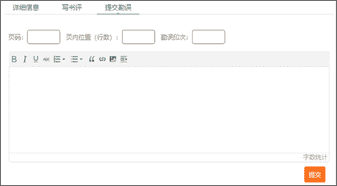

## 扫码关注本书

扫描下方二维码，你将在异步社区微信服务号中看到本书信息及相关服务提醒。


## 与我们联系

联系邮箱为 `contact@epubit.com.cn`。

对本书有任何疑问或建议，请发送邮件，并在邮件主题中注明书名，以便更高效反馈。

若你有兴趣出版图书、录制教学视频，或参与图书翻译、技术审校，可发邮件联系；有意出版的作者也可访问异步社区投稿页面 `www.epubit.com/contribute` 。

学校、培训机构或企业如需批量采购本书或异步社区其他图书，也可邮件联系。

若在网络上发现针对异步社区图书的各类盗版行为，包括对图书全部或部分内容的非授权传播，请将可疑链接通过邮件发送给我们。你的举动是对作者权益的保护，也是我们持续提供优质内容的动力。

## 关于异步社区和异步图书

异步社区是人民邮电出版社旗下的IT专业图书社区，致力于出版精品IT图书及相关学习产品，为作者提供优质出版服务。社区创办于2015年8月，提供大量精品IT图书与电子书，以及高质量技术文章与视频课程。详情见官网 `https://www.epubit.com`。

异步图书是异步社区编辑团队策划的精品IT图书品牌，依托人民邮电出版社数十年的计算机图书出版积累与专业编辑团队，相关图书封面印有异步图书LOGO。出版领域涵盖软件开发、大数据、人工智能、测试、前端、网络技术等。


异步社区


微信服务号

# 基础篇 Python

第 1 天 初识 Python

第 2 天 控制语句和函数

第 3 天 Python 数据类型

第 4 天 类和模块

第 5 天 网络通信

## 第 1 天 初识 Python

### 第 1 部分 开始使用 Python

故事围绕房地产公司员工山本慎吾，25岁，和偶像组合“鱼篮坂256”成员田中千里展开。两人进入编程教室，计划用接下来五天掌握Python基础。接下来会发生什么，让我们一同看看。

讲师 大家好，欢迎来到Python入门课程，我是中岛老师。

慎吾 我听说即使是初学者，也能在五天内学会基础Python？

讲师 可以的。学完后，你就能写出发送邮件或从网站收集信息的程序。

慎吾 真的吗？

讲师 当然，山本慎吾先生。你在房地产销售工作，我可以叫你慎吾君吗？

慎吾 可以。

千里 嘻嘻，糟了呢。

讲师 旁边这位是田中千里小姐吧？

千里 是的，请叫我千里。

讲师 直呼全名有点别扭，我就叫你千里酱吧。哇，原来是偶像团体成员啊。

千里 嘿嘿，是“鱼篮坂256”。团里比较边缘，经常落选。如果会写程序，说不定能吸引理科男粉丝，我想成为偶像里的极客。

慎吾 啊，是女偶像啊！

千里 请多关照！

讲师 今天学习的语言是Python。字面上是蟒蛇，并无特别含义。名称源自英国喜剧节目 `Monty Python’s Flying Circus`，这是Python发明者 `Guido van Rossum`，荷兰人，非常喜爱的节目。

千里 我听说Python程序员能致富，是吧？

讲师 相关调查显示，使用Python的程序员年收入高于其他语言使用者。

慎吾 我的目标不是做程序员，我很喜欢现在的销售工作。但如果能开发对工作有用的应用，就能拓展业务范围。

讲师 明白，目的感很重要。现在打开随身笔记本。慎吾用的是Windows，千里用的是macOS。启动浏览器访问Python官方网站 见图1。

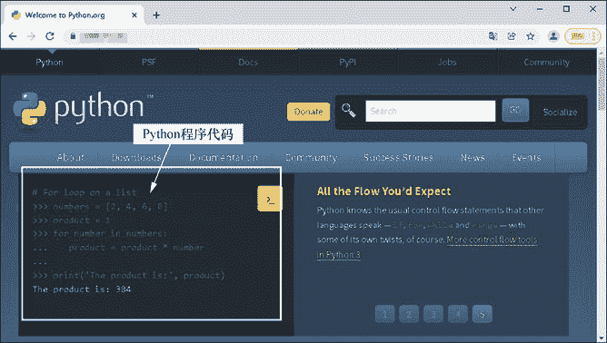

图 1 Python 官方网站

慎吾 突然出现很多英文和符号。

讲师 左侧展示的是Python代码。

千里 这就是Python啊！

讲师 我们把计算机的指令集合称为程序，Python的指令由此处显示的语句构成，叫做“程序代码”或简称“代码”。现在把鼠标悬停在屏幕上的Downloads按钮上。

千里 窗口滑出来了！慎酱的屏幕和我的不太一样呢。

慎吾 啊？慎酱？在叫我吗？

千里 是的～慎～酱～。

讲师 同一网站会根据操作系统差异切换显示。我们先下载 `Python 3.6.0` 版本。点击Downloads按钮，在打开的页面中下滑，找到Python 3.6.0的下载链接。\[1\]

\[1\] 由于在翻译本书时 Python 3 已经更新到 `3.10.1` 且官网推荐下载 Python 3，因此下载界面会有所变化。——译者注

慎吾 下面的 `Python 2.7.13` 是什么？

讲师 Python分为 `Python 3.x` 和 `Python 2.x` 系列，其中，`Python 3.x` 系列采用了新的语言规范。但是，由于仍然有很多使用 `Python 2.x` 的程序，因此这两个系列都可以下载。顺便说一句，如果使用的是 macOS 系统，则系统中已经安装了适用于 2.x 系列的 Python，因此可以立即启动 Python。

千里 搞定了。

慎吾 啥？

讲师 但是，这次我们将研究 `Python 3.x` 系列，因此你们两个都应该下载 `Python 3.6.0` 版本（见图 2）。

慎吾 `python-3.6.exe` 文件下载好了。

千里 我下载的是 `python-3.6.0-macosx10.6.pkg` 文件。

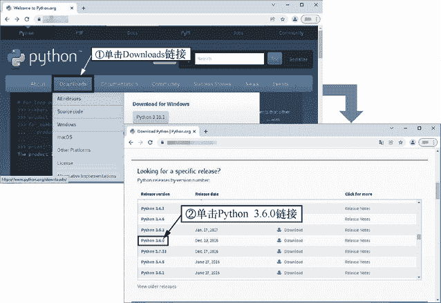

图 2 下载 Python 3.6.0

讲师 这两个文件都需要双击才能启动安装程序。在 Windows 系统中安装 `Python 3.6.0` 的大致过程见图 3。在 macOS 系统中，如果单击“许可协议”界面上的“继续”按钮，则会出现“您必须同意软件许可协议的条款才能继续安装此软件”的对话框，单击“继续”按钮以继续安装。如果出现询问是否允许安装的对话框，请输入密码，然后单击“安装软件”按钮。当显示安装完成的对话框时，单击“关闭”按钮即可完成安装（见图 4）。

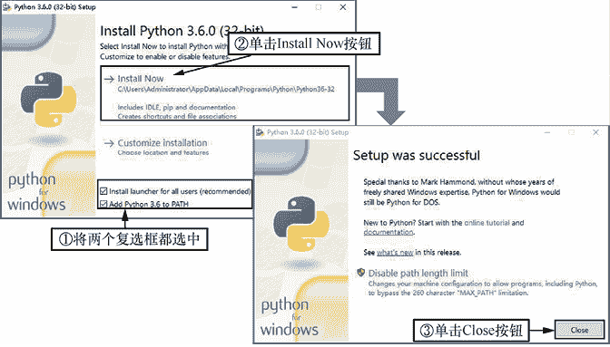

图 3 在 Windows 系统中安装 Python 3.6.0

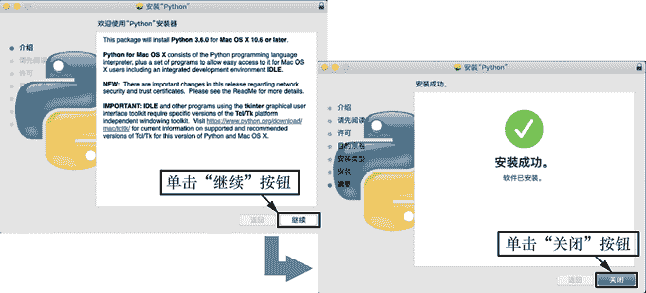

图 4 在 macOS 系统中安装 Python 3.6.0

千里 这是进行 Python 编程的应用程序吗？

讲师 是的，这是用于开发“程序”的程序。

慎吾 这样的话，应该有一个用于开发这个程序的程序，以及一个用于开发这个程序的程序的程序……

讲师 最后，您将回到人类直接编写程序的时代。实际上，人们曾经直接打开和关闭计算机来输入命令，或者在纸带上打孔以进行编程。

慎吾 想起来了，我在以前的动画片里看到过一台纸带计算机。

讲师 过去，人们通过在纸带上打孔来给计算机发送命令和指示。因此，即使到现在，修改现有程序也被称为“打补丁”。换句话说，用补丁将孔补好并修复。

千里 这样啊。但是，当应用程序出问题时，为什么我们将其称为 bug（漏洞）呢？

讲师 那是因为在过去，计算机是通过组合大量称为“继电器”的电气开关制成的。继电器在正常打开时被进入的“虫子”（bug）卡住，导致计算机出现故障，只有清除卡住的虫子后，计算机才能正常运行。根据这个故事，人们将修正程序的不合适之处称为“修复 bug”。

慎吾 呃，被开关夹死的蟑螂。

千里 哎呀，算了吧。

讲师 扯远了。我们休息一下吧。

### 第 2 部分 计算

讲师 现在，我们启动安装好的 Python。在 Windows 系统中，单击“开始”按钮，然后在“开始”菜单中选择“命令提示符”。命令提示符启动后，在其中输入 `python` 并按回车键（见图 1）。

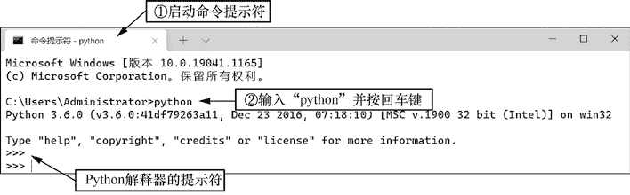

图 1 在 Windows 系统中启动 Python 解释器

慎吾 好的，顺利搞定。

讲师 在 macOS 系统中，单击 `Finder` 菜单，选择“应用程序”命令，选择“实用程序”命令，启动终端，输入 `python3` 并按回车键。请注意，如果使用与 Windows 系统中相同的 `python` 命令，就会启动已安装的 `Python 2.x` 版本（见图 2）。

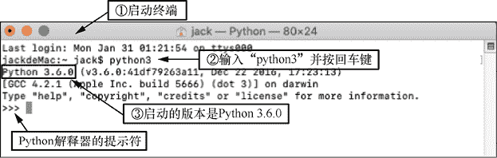

图 2 在 macOS 系统中启动 Python 解释器

千里 好期待啊。

讲师 你们两个人的计算机都显示已经安装 `Python 3.6.0`。此处启动的程序称为“`Python 解释器`”，也可称为“交互式 shell”。在 `Python 解释器` 中，输入 Python 命令后，按回车键即开始执行这条命令。在输入处，用于接收输入的符号 `>>>` 称为“提示符”。

慎吾 在提示符后输入 Python 命令。原来如此，那我输入命令“请编写程序。”并按回车键试一下。不行！被拒绝了（见图 3）。

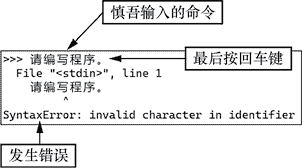

图 3 源代码

讲师 很遗憾，Python 不懂您输入的是什么。由于 `Python 解释器` 只能理解特定的语法，因此必须按照该语法输入代码。如果违反了该语法，就会显示 `SyntaxError`。

千里 慎吾，你太着急了。

慎吾 嗯嗯嗯。

讲师 首先，对 Python 下达 `Hello Python!` 的指示吧。为了显示文字，我们需要使用名为 `print` 的函数。

慎吾 函数？是数学函数吗？

讲师 和数学中的函数有点不一样。在编程世界中，将“接收参数并返回处理结果”的功能称为“函数”。试着像图 4 所示的这样输入，即使是相同的字母和符号，也请注意半角文字和全角文字是不同的。在 Python 中，除显示在屏幕上的字符串以外，所有的输入都是半角形式的。这一次，我们要显示的文字也用半角形式输入（见图 4）。

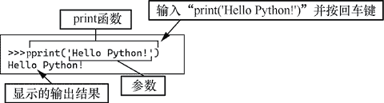

图 4 源代码

千里 怎么说呢，看着很朴素。

慎吾 确实。

讲师 嗯，一开始是这样的，不要失望。`print` 函数又称为“内置函数”，内置函数是不需要额外安装任何库就可以直接使用的函数。传递给函数的数据称为“参数”，`Hello Python!` 部分就是参数。

千里 只会出现文字啊。

讲师 明白了。现在我们使用 Python 进行数值计算。请参照图 5 输入内容并执行。

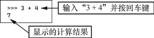

图 5 源代码

慎吾 有点像计算机了。

讲师 想必大家已经知道了 Python 可以做加法，当然它也可以做减法和乘法（见图 6）。

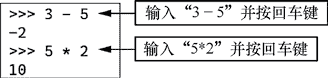

图 6 源代码

慎吾 乘法符号是 `*` ？

讲师 这是“星号”。像这样运算时使用的符号称为“算术运算符”，参见表 1。

表 1 算术运算符

| 运算符 | 含义 | 示例 |

| --- | --- | --- |

| `+` | 加法 | `3 + 4` |

| `−` | 减法 | `6 − 2` |

| `*` | 乘法 | `2 * 4` |

| `/` | 除法 | `8 / 2` |

| `//` | 舍弃除法 | `8 // 2` |

| `%` | 求余 | `5 % 2` |

| `**` | 求幂 | `2 ** 3` |

千里 计算机中的乘法和除法的运算符与算术中的是不一样的。“星号”的输入方法是一边按 Shift 键，一边按键盘上的数字键 8，“斜线”是使用“/”键输入的。另外，还有计算“幂”的运算符呢。

慎吾 有两种除法啊。

讲师 使用 `//` 运算符执行除法运算时，运算结果中小数点以后的内容会被舍弃（见图 7）。

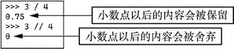

图 7 源代码

讲师 算术运算本身并不难，但在进行带小数点的计算时，有一点必须注意。例如，`0.1+0.1+0.1` 是多少？

慎吾 0.3，对吧？

讲师 试试看吧（见图 8）。

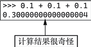

图 8 进行带小数点的计算

千里 哇，好像零头有问题。

慎吾 Python 不对啊。

讲师 像这种带小数点的计算，在大部分编程语言中都会有相同的结果，原因在于计算机中的数值都是以“二进制”形式来表示的。

千里 我知道二进制的故事，计算机是 0 和 1 的世界。

讲师 是的。因为计算机是电子设备，所以电流只能处于“流动”或“不流动”状态。流动状态为 1，不流动状态为 0，将二者组合起来就能表示出命令和数据等内容。

千里 但是，为什么在二进制中带小数点的计算会变得如此奇怪呢？

讲师 计算机将指令和数据存储在“存储器”中并加以利用。这种存储器中排列着可以存储电的小水桶，小水桶中有电的话就记为 1，没有电的话就记为 0。

慎吾 计算机的内存中有一个水桶。

讲师 其实，说到底这只是一种比喻。如果将 8 个这样的小水桶排列在一起，就可以表示 00000000～11111111 的值。这 8 个小水桶称为 `1 字节`，计算机的存储器就是以“字节”（B）为单位来存储数据的。另外，`1KB` 是 1024B，`1MB` 是 1024KB，`1GB` 是 1024MB。

千里 我的手机是 64GB 的。

讲师 也就是说，计算机的内存中只能存储 0 和 1，因而无法表示负数和带小数点的数值。为此，我们制定了一些规则，目的是让人们只使用 0 和 1 就能表示负数和带小数点的数值。此类规则有很多，Python 中的小数使用的是 `IEEE 754 浮点数` 规则。

慎吾 不过，这条规则是有缺陷的。

讲师 与其说是缺陷，不如说是“规格”。

千里 懂了！程序员常用的十大术语。

讲师 嗯。那么，为什么二进制数得不到正确的结果呢？我们实际计算后再分析一下。试着将十进制数 `0.25` 转换成二进制数，转换方法是：将小数点的前后部分分开计算。因为 0.5 只有小数点以后的内容，所以在将其乘以 2 的过程中，如果结果大于等于 1，则取出 1，否则取出 0，然后将结果排列在二进制数的小数点以后（见图 9）。

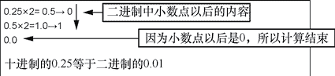

图 9 进行带小数点的计算

千里 十进制数 `0.25` 等于二进制数 `0.01`。

讲师 现在试着将十进制数 `0.3` 转换成二进制数（见图 10）。

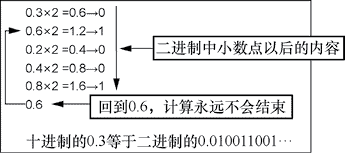

图 10 源代码

慎吾 这样的话，计算还没结束呢。

讲师 这种小数称为“循环小数”。也就是说，十进制数 `0.3` 在二进制中是循环小数。这里请回忆一下计算机内存的故事。计算机以 1B、2B、4B 的分段形式保存数据。但是，循环小数是永远持续的，所以无法全部存储，必须在某个地方进行舍弃。这种计算中的值和内存中的值之间的误差称为“舍入误差”。

千里 也就是说，会显示误差部分。

慎吾 但是，如果小数点以后内容的计算有误差，就有麻烦了吧？

讲师　Python 本身就能返回精确的运算结果。比如可以调用 `decimal` 包里提供的类型来尝试，示例见图11。
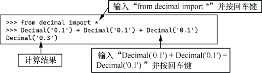
图 11 源代码
讲师　这段示范展示了借助 `decimal` 提供的 `Decimal` 类型，对小数位进行不产生舍入误差的计算。
千里　`Decimal` 是类型吧？不应该是函数？
讲师　Python 的核心理念是对象导向，程序中的一切都可视为对象。数值、文本、函数等在本质上都是对象的实例。
慎吾　全部都是对象？你在说什么？
讲师　对象导向的详细内容我会放到第4天讲，现在姑且理解为把多种能力打包起来的程序单元。
千里　搞不懂原因，但确实 Python 里万物皆对象。
讲师　对，这里还出现了模块这个词，也会在第4天介绍。不同需求要通过 `import` 指令载入合适的模块。
慎吾　感觉有点像期权。
讲师　差不多。小数点后的运算就先到此为止。

### 第 3 部分 数值和字符串
讲师　接下来同时把算式和结果都展示出来。先让屏幕上出现 `3+4=`。
千里　哇，题目一下子就抛出来了。
慎吾　直接敲 `3+4=` 不就行了，见图1。
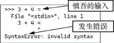
图 1 源代码
慎吾　啊，又出现了 `SyntaxError`！
千里　慎吾，我来试试。
讲师　要把文字输出到界面，就用 `print()`。
千里　那写成这样可以吗，见图2？
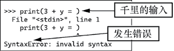
图 2 源代码
千里　糟了，和慎吾的结果一样。
讲师　用 `print()` 输出文本时，参数需要用单引号或双引号括起来，见图3。
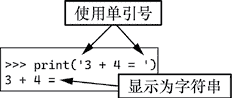
图 3 源代码
慎吾　文本？可这里是 3+4 啊。
讲师　不加引号，Python 会把它当成表达式来处理，见图4。
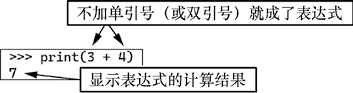
图 4 源代码
千里　搞定了！
讲师　那么在 `3+4=` 后面加上计算结果。
慎吾　感觉很麻烦，要不这样写？哎呀 `SyntaxError` 又来了，见图5！
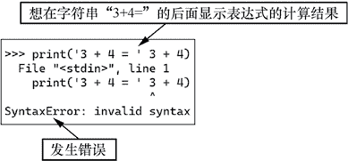
图 5 源代码
千里　不错。
讲师　很遗憾。你想得到 `3+4=7` 对吧？要实现这个，需要先用 `str()` 把表达式的值转为文本，见图6。
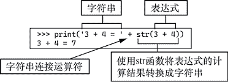
图 6 源代码
慎吾　好狡猾，`str()` 我们还没学过。
讲师　不好意思，`print()` 的参数只能是文本或可转成文本的值。`3+4` 的结果 7 是数值，直接和文本拼接时不会自动变文本。
千里　我对文本和数值的区别还不太清楚。
讲师　屏幕上看到的字其实是字形的图像，每个图像对应一个编号，这个编号叫字符编码。文本就是由这些编码组成的序列。
千里　字符编码我常听说，弄错就会乱码吧。
讲师　不同编码方案给同一个字形分配的编号可能不同。编号相同但编码不同，显示结果就会不一致，这就是乱码，见表1。
表 1 常见的字符编码

| 字符编码 | 释义 |

| --- | --- |

| ASCII | 计算机里最常用的、主要用于现代英文的字符编码 |
| ISO-2022-JP | 简称“JIS 码”，整合了 JIS X 0211、JIS X 0201 拉丁字母、ISO 646 国际标准图形字符、JIS X 0208 等多种编码 |
| EUC-JP | UNIX 系统处理日文时常用的字符编码 |
| Shift_JIS | 允许单字节与多字节字符混用的编码，后期扩展出处理字符更丰富的 Windows-31J、CP932 等变种 |
| Unicode | 覆盖几乎所有字符的多字节编码，目前 Windows、macOS、Linux 等系统均支持 |

慎吾　也就是说，外观一样的 3，一个是字符 3 的编码，一个是数值 3 的含义？
讲师　是的。所以 Python 用引号来区分文本和数值。
千里　没有引号的 `3+4` 不是文本，所以计算结果必须用 `str()` 转换成文本。
讲师　没错，经过处理得到的结果称为返回值。`str()` 接收数值，返回对应的文本。最后用拼接操作符把 “3+4=” 和 “7” 连起来。
千里　原来文本可以用操作符拼接。
讲师　这样界面就会显示 `3+4=7`。
千里　哈哈，明白了。
慎吾　嗯，感觉终于有点懂了。
讲师　习惯了就不会纠结底层。我们先休息一下。

### 第 4 部分 输入
讲师　`print()` 能输出文字，下面试试用键盘输入文字。
慎吾　看起来挺好玩。
千里　很期待。
讲师　要接收键盘输入，需要用 `input()`。请按图1输入代码。
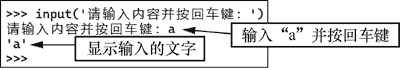
图 1 源代码
慎吾　`input()` 的参数会显示在屏幕上，我该输什么？
千里　输入 a 再回车，a 就被打印出来了。
讲师　显示的内容是 `input()` 从提示符收到的。因为没有其他用途，所以没有存入变量，直接输出了。
千里　变量？
慎吾　跟数学里的变量有什么区别？
讲师　数学里变量用来代入未知数，编程里变量是存放数据的内存区，常比喻成装东西的盒子。先试试把名字存到叫 `my_name` 的变量里，见图2。

图 2 源代码
慎吾　提示说请输入名字，我输入“山本慎吾”回车试试。哎呀，什么都没发生。
讲师　这段代码用 `=` 把 `input()` 的返回值赋给 `my_name`。
千里　给变量放值叫做赋值，听起来有点夸张。
讲师　那就试着输入 `my_name` 回车，见图3。
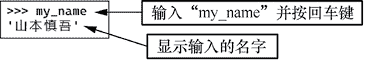
图 3 源代码
慎吾　哦，名字被打印出来了。
千里　名字就保存在 `my_name` 里。
讲师　给变量赋值后就能使用了。命名时请遵守以下规则：
● 变量名可用半角字母、下划线和数字。
● 区分大小写。
● 名称开头不能是数字。
● 不能使用保留字。
慎吾　保留字是什么？
讲师　Python 里具有语法含义的词也叫关键字，如下表。

| False | class | finally | is |
| --- | --- | --- | --- |
| return | none | continue | for |
| lambda | try | True | def |
| from | nonlocal | while | and |
| del | global | not | with |
| as | elif | if | or |
| yield | assert | else | import |
| pass | break | except | in |
| raise |  |  |  |

千里　用保留字做名字不行，我试试，见图4。果然 `class` 是保留字，不能用。
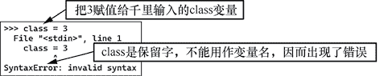
图 4 源代码
慎吾　这样看只有 `False` 和 `True` 首字母大写。
讲师　这两个是常量，值不可变的特殊变量，用来表示条件判断，要记住。接下来把计算结果存到变量 `ans`，见图5。
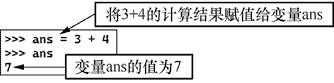
图 5 源代码
慎吾　原来是把 `3+4` 的结果赋给 `ans` 再输出。
讲师　变量之间也能运算，见图6。
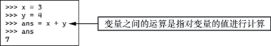
图 6 源代码
千里　先把 3 赋给 x，4 赋给 y，再把 x+y 放入 ans，所以 ans 是 7。
讲师　变量不难吧。那就请从键盘输入两个数，写程序输出它们的和。
千里　骗人吧，又是突袭。先用 `input()` 把返回值存到 x，再存到 y，然后输入 `x+y` 回车不就行了吗，见图7？
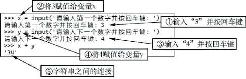
图 7 源代码
千里　啊，为什么变成 34？是不是文本的问题？
讲师　很敏锐，`input()` 接收的始终是文本，所以 x 和 y 都是文本。
慎吾　啊懂了，文本用 + 就是拼接。
讲师　很好。所以要用 `int()` 把文本转成数值，按图8输入。
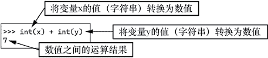
图 8 源代码
千里　老师你又偷偷作弊了，这种事要先说啊，太气人了。
慎吾　对 Python 有点感觉了。
讲师　太好了，今天就到这。退出解释器时要用 `quit()`，见图9。
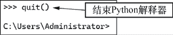
图 9 源代码
慎吾　结束了！
讲师　明天我们继续深入 Python 语法核心，敬请期待。

### 读者服务

微信扫码关注【异步社区】微信公众号，回复“e59085”获取本书配套资源以及异步社区 15 天 VIP 会员卡，近千本电子书免费畅读。

## 第 2 天 控制语句和函数

### 第 1 部分 if 语句和比较运算符
讲师　今天学习决定执行顺序的控制语句。
千里　执行顺序？
讲师　所谓流程指的就是 Python 代码，也就是处理按照什么顺序执行，这个顺序叫处理流程。
慎吾　处理顺序不就是按提示符输入的顺序吗？
讲师　在 Python 里，代码输入了也不一定会执行，要看条件。还能重复执行。控制执行顺序的语句叫控制语句，像 `if`、`while` 等。
千里　`if` 是如果的意思吧？
讲师　对。`if` 能写成如果条件成立就执行某处理的代码。
千里　就像“如果你是焦点，请站到舞台中央”这样。
讲师　“如果你是焦点”是条件，“请站中央”是处理。具体语法看图1。
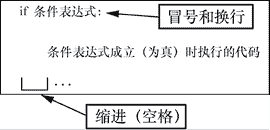
图 1 if 语句
慎吾　缩进是什么？
讲师　就是行首的空格。Python 里条件后加冒号换行，必须缩进，这样才能表示代码块。
千里　就像粉丝见面会的安保人员划分区域？
讲师　缩进还有划分区域的意思。实际输入更直观，比如图2的代码，先把 3 赋给 x，然后写 if，后面跟 x==3 比较 x 是否等于 3，这叫条件表达式，== 是比较运算符。条件成立就执行 print('x 等于 3')。
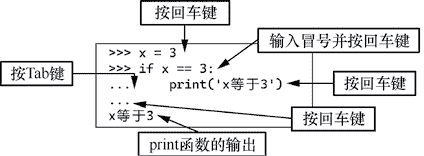
图 2 源代码
慎吾　if 后加冒号换行会出现省略号。
讲师　这不是执行，是等待后续代码。此时可用 Tab 或空格缩进。相同缩进的代码属于同一块。虽然这里只有 print，但多行同缩进就被视为同一块。
千里　所以缩进就是划分区域。
讲师　条件成立就执行下面的块，不成立就跳过整个块。
慎吾　原来如此。但 x 赋 3，条件成立不是理所当然吗？
讲师　确实。下面用昨天的 input 和 int 把输入的数字赋给 x，先输入 3 再输入别的数字试试，见图3。
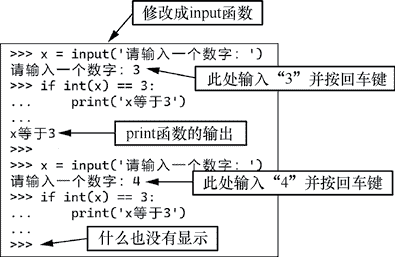
图 3 源代码
千里　输入 4 不是 3，所以没输出。
讲师　x 为 3 时 int(x)==3 成立，x 为 4 时不成立。成立叫真，值为 True；不成立叫假，值为 False。
慎吾　条件表达式有值？
讲师　对，成立是 True，不成立是 False。用图4确认一下。
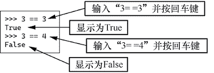
图 4 源代码
慎吾　真的是这样，条件表达式返回 True 和 False。
讲师　除了 ==，比较运算符还有，见表1。
表 1 比较运算符

| 运算符 | 含义 |
| --- | --- |
| `==` | `a == b`在`b`和`a`相等时为`True` |
| `!=` | `a != b`在`b`和`a`不相等时为`True` |
| `>` | `a > b`在`a`大于`b`时为`True` |
| `<` | `a < b`在`a`小于`b`时为`True` |
| `>=` | `a >= b`在`a`大于或等于`b`时为`True` |
| `<=` | `a <= b`在`a`小于或等于`b`时为`True` |

千里　也就是说用比较运算符判断条件是否成立来决定执行代码。但如果想成立和不成立各执行不同代码怎么办？
讲师　就是想在条件为假时做别的事。这时要用 if-else，见图5。
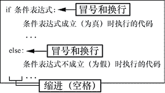
图 5 if-else 语句
千里　呵呵。
讲师　下面代码用 if-else，输入非 3 的数就会显示“x 不等于 3”。见图6。
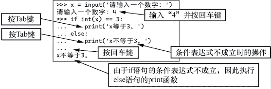
图 6 源代码
千里　这样就能根据 True 或 False 切换处理。
讲师　另外用 elif 可以判断多个条件，见图7。
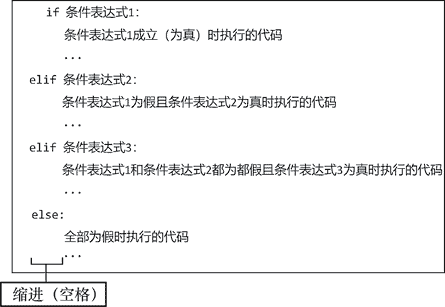
图 7 elif 语句
千里　这是什么？
慎吾　这是复杂的条件判断。
讲师　elif 必须配合 if 用，通过计算条件表达式得到结果，这叫判断。判断顺序是先看 if，条件 1 成立就执行对应块，然后跳到 else 后面，中间代码忽略。
千里　那条件 1 为假时呢？
慎吾　就去判断条件 2 吗？
讲师　对。条件 2 为真就执行对应块，结束后跳到 else 后面。
千里　然后依次判断其余条件，全部为假就执行 else。
讲师　没错。
慎吾　但这种代码我现在写不出来。
千里　确实。
讲师　虽然暂时可能用不上，先记下语法。

### 第 2 部分 逻辑运算符
讲师　在 if 里用比较运算符判断 x 是否等于 3。x 和 3 都是运算对象，叫操作数。比较运算符比较两个操作数，返回 True 或 False。
慎吾　比较运算符我理解了。
讲师　真假合称逻辑值。实际上可以把比较运算符和逻辑运算符组合，做更复杂的判断。
千里　逻辑？听起来好难。
讲师　逻辑运算符只有 3 个，很好记，见表1。比如 and，左边是 False 就直接返回 False。左边是 True 再看右边，右边 True 就返回 True，右边 False 就返回 False。听起来复杂，实际代码一跑就明白，见图1。
表 1 逻辑运算符

| 运算符 | 含义 |
| --- | --- |
| `and` | 从左侧开始判断，如果当前项等同于`False`，则返回当前项的值；如果所有项都等同于`True`，则返回最后一项的值 |
| `or` | 从左侧开始判断，如果当前项等同于`True`，则返回当前项的值；如果所有项都等同于`False`，则返回最后一项的值 |
| `not` | 对于表达式`not a`来说，当`a`等同于`True`时，结果为`False`，当`a`等同于`False`时，结果为`True` |

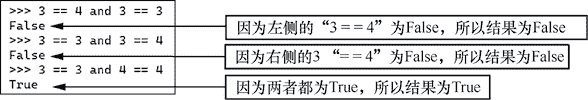
图 1 源代码
千里　and 只有两边都是 True，结果才是 True。
讲师　对。接下来看 or。这里为了只确认返回值，把操作数换成逻辑值测试，见图2。
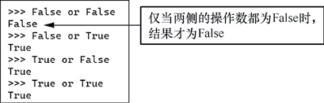
图 2 源代码
千里　or 只要有一个操作数是 True，结果就是 True。
慎吾　但表 1 写着如果当前项等同于 True……，这个等同于是什么意思？
讲师　确实，or 的说明是说从左开始判断，当前项等同于 True 就返回当前项的值。实际上不只是逻辑值，数值和对象也能用于条件判断。
千里　用数值判断条件吗？

讲师 对的。0 在布尔语境里就是 False，只要不是 0 的数值都被视作 True，所以 0 和 1 完全可以拿来当条件判断。说个极端点的情况，图 3 这段代码语法上是合法的。

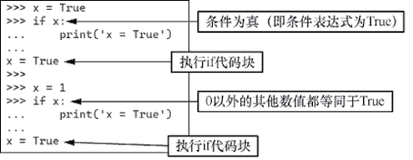

图 3 源代码

慎吾 条件成立，if 体居然跑了，原来 1 真能顶替 True！

讲师 同样，False 和 0 被认为是等价的，把条件换成数值 0 后，if 体就不会被执行了，见图 4。

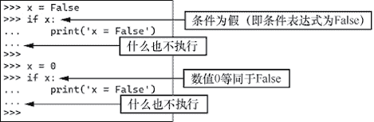

图 4 源代码

千里 原来如此！

讲师 下面我们用逻辑运算符再确认一下，看图 5。

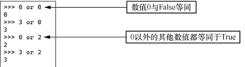

图 5 源代码

慎吾 真的！左边操作数是 3，3 等同于 True，所以直接返回了 3。“0 与 False 等同、非零与 True 等同”这一点很重要，看图 6。

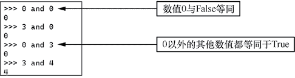

图 6 源代码

千里 and 运算符也是这个规律。

讲师 not 运算符只有一个操作数，若操作数等同于 True 则返回 False，等同于 False 则返回 True，看图 7。

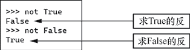

图 7 源代码

千里 也就是说正好反过来，挺好理解的。

讲师 把比较运算符和逻辑运算符组合起来，if 语句里的条件判断就能做得很灵活了。

慎吾 啊，记的东西也太多了。

千里 确实，有点可怕。

讲师 那我们先歇一下吧。

### 第 3 部分 while 循环讲解
讲师 Python 除了基于条件分支的 if 之外，还有一种一直重复执行直到条件改变的控制结构，重复执行也叫循环处理。

千里 重复是指把代码倒着再跑一遍吗？

讲师 并不会逆序执行，而是可以跳回前面已经执行过的位置。

慎吾 跳回前面？具体怎么实现？

讲师 那我问千里一下，如果要把自己的名字打印 5 次，你会怎么做？

千里 突然问这个。嗯，在 print 参数里写 5 次自己的名字？

讲师 看下图 1，大致就是这个思路。

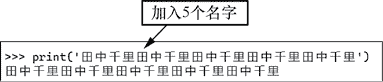

图 1 源代码

千里 是啊，让它换行会好看些。

讲师 想换行就在字符串里插 `"\n"` 试试，看图 2。

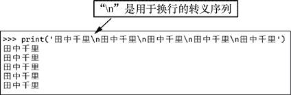

图 2 源代码

讲师 `"\n"` 这类字符串叫转义序列，除了它还有 `"\t"`。`"\t"` 的效果和按 Tab 键一样，能空出光标位置，看图 3。

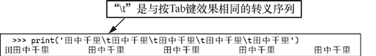

图 3 源代码

千里 哇，我说怎么回事。

讲师 ……

千里 啊，也不是吗？正好显示了 5 个名字。

讲师 当然这么做也能行。但局限性很大，想显示 100 个名字，或者想让显示次数由输入决定时，这招就不好用了。

千里 是啊，那怎么办呢？

慎吾 所以才需要循环处理。

## 第 3 天 循环与函数入门
## while 语句
讲师 很聪明！循环可以让指定代码多次重复执行，重复次数还能跟着条件变化。

千里 那 print 函数也能循环执行吗？

讲师 能。循环有 while 和 for 两种，今天先学 while。while 的写法看图 4。

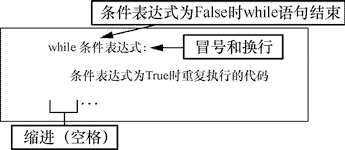

图 4　`while`语句的语法

慎吾 while 也要像 if 一样用缩进来形成代码块。

讲师 当条件表达式为假时，while 会直接跳到代码块末尾结束；条件为真时就进入代码块，执行完后再回到 while 开头。

千里 跳转。

讲师 回到开头后会再次判断条件，为真就再次进入代码块。我们用图 5 的代码来体会。

慎吾 有点绕了。先把变量 i 设为 0，while 条件 i 小於 5 时为 True，于是执行代码块，第一次就输出 0。然后执行 i = i + 1，i 变 1，走到 while 末尾。因为会跳回开头，再次判断，i 为 1 仍小于 5，继续执行，输出 1，i 再加 1…… cứ 这样循环。

讲师 没错。预先给变量赋值的动作叫初始化。每次循环都要对初始化的变量做 i = i + 1。随着 i 涨到 5，条件变成 False，循环结束。现在参照图 5，试着把自己的名字打印 5 次吧。

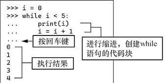

图 5　源代码

千里 明白了，我已经做完了，见图 6。

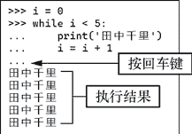

图 6　源代码

讲师 不愧是千里。下面学习循环中常用的 break 和 continue，先看 break，图 7。


图 7　源代码

慎吾 while 代码块里嵌了 if，缩进不一样才能区分。

讲师 看运行结果就能明白，break 会强制退出循环。一般和 if 搭配，条件为 True 时执行 break。若不加条件，break 会立刻执行，直接跳出 while。

千里 那循环还有什么意义。

讲师 接下来是 continue，continue 会强制回到循环开头，图 8。


图 8　源代码

千里 奇怪，为什么 3 没显示？

慎吾 因为 continue 会强制跳转到 while 开头。i 为 2 时 if 条件为 True，i 被改成 4，然后直接回到开头。

讲师 对的。缩进不熟练时可能觉得难，但流程本身很简单，多确认几次就好。

### 第 4 部分 自定义函数
讲师 今天最后一个主题是函数的创建。

慎吾 函数是我自己也能建的吗？

讲师 到目前为止用到的 print、int 都是内置函数，Python 自带的。把这些内置函数组合起来，就能造出原创函数。

千里 原创函数？

讲师 对，独一无二的函数。原创函数可以在解释器里直接输入运行，但用过一次后下次又要重打。这里介绍用文本编辑器写脚本文件的方法。Python 的源文件就叫脚本文件。

慎吾 文本编辑器是什么？

讲师 就是在电脑上输入和编辑文字的程序，通常能保存成文件。这次请装一个免费的 ATOM 编辑器，先打开浏览器访问官网，看图 1。


图 1　`ATOM`官方网站

讲师 点首页的 Download 按钮，双击下载的 AtomSetup.exe 开始安装。装好后会自动启动，macOS 只需下载后拖到应用程序即可启动，看图 2。


图 2　启动`ATOM`编辑器

慎吾 软件挺成熟的，就是菜单是英文。

讲师 想切中文，就点 Welcome Guide 里的 Install a Package，没看到的话在 Help 菜单里打开 Welcome Guide 再点。

千里 macOS 上是 Open Installer 按钮吗？

讲师 是的，点 Open Installer，左边会出现输入框，输入 `simplif ied-chinese-menu`，再点下方的 Packages。

慎吾 出现了相关介绍。

讲师 点 `simplif ied-chinese-menu` 里的 Install 按钮，看图 3。


图 3　设置中文菜单

慎吾 好像没动静。

千里 Install 按钮在闪，菜单已经变中文了。

讲师 好了，现在在 ATOM 里输入 Python 代码吧。先把 Settings、Welcome Guide 这些页签的 × 关掉。Telemetry Consent 是询问是否收集使用信息，点 是 或 否 即可，否则重启还会弹出。把 Welcome 页也关掉。

慎吾 现在只剩 untitled 了。

讲师 点右下角的 Plain Text，会弹出语言选择，对话框里输入 `python`，选择 Python。若右下角显示 Python，就表示进入 Python 模式，看图 4。


图 4　使`ATOM`编辑器进入“`Python`模式”

千里 Python 模式，好酷！

讲师 我们来建一个算 3 和 4 之和的 add 函数并运行。请按图 5 的方式输入，输完后保存。选 文件 菜单的 另存为，Windows 会保存到 文档，macOS 保存到 文稿，看图 6。


图 5　源代码


图 6　保存文件

千里 嗯。

讲师 文件名设为 `add_test.py`，最后的 `.py` 表示这是 Python 脚本，扩展名用来标识文件类型。

慎吾 用 `.py` 扩展名保存了源文件。

讲师 确认下是否保存成功。用 cd 命令切到 Documents，再在命令提示符输入 dir 回车，就能看到文件列表，看图 7。macOS 输入 ls。


图 7　源代码

讲师 找到文件后执行吧。Windows 在命令提示符输入 `python add_test.py` 回车，macOS 输入 `python3 add_test.py` 回车，看图 8。


图 8　源代码

慎吾 输出是 7。

讲师 这是 add_test.py 里定义的 add 函数的运行结果。先说 `def` 是定义函数的保留字，之后是函数名、参数列表的括号和冒号。

千里 有冒号，就是代码块的开始。

讲师 对。add 函数里只有 print，输出 3+4 的结果。下面的 add() 就是调用刚刚建好的函数。

千里 这就是原创函数啊，呵呵。

讲师 这样没什么用，但可以传参数。把 add_test.py 改成图 9 的样子，改完从 文件 菜单点 保存，或按 Ctrl+S 覆盖保存，保存后用同样命令执行。


图 9　源代码

慎吾 因为调用时传了 4 和 9，所以输出 13。

讲师 对。传值时用参数接收，函数可以没有参数，也可以有多个。多个参数基本按顺序传递，这里是加法，顺序互换结果一样；如果是减法，4-9 和 9-4 结果不同，就要注意顺序。

千里 这样就能把数字一个个加起来，挺方便。

讲师 再用更巧妙的方式输出，看图 10。


图 10　源代码

千里 这是什么？字符串里有个 format 函数。

讲师 还记得万物皆对象吗？字符串也是对象，有格式化功能。

慎吾 就是这个 format。

讲师 对。对比运行结果就明白了。

千里 {0} 位置显示 x，{1} 显示 y，{2} 显示 x+y 的结果。

讲师 这种作为对象能力发挥的函数叫方法。这个话题第 4 天再说。我们继续回到函数。下面讲返回值的用法。

慎吾 函数是可以返回值的是吧。

讲师 是的，用 return 语句。例如返回两个参数值的和，看图 11。


图 11　源代码

千里 这次去掉了输出语句，用 return 返回 x 和 y 的和。

慎吾 用变量 ans 接收返回值，再用下一行的 print 显示。

讲师 理解函数了吗？

千里 内置函数已经很多了，自己造还有意义吗？

讲师 Python 的函数和对象已经不少，但做一定规模的应用时，调用会变得很长。用功能为单位创建函数，流程更清晰，也更容易维护。

慎吾 也就是现在用不上，将来肯定要用到。

讲师 可以这么理解。另外 Python 有推荐的写法，叫编码风格。建议遵守以下规则：

● 缩进用 4 个空格，不要用制表符。
● 适当换行，让代码行不超过 79 个字符。
● 用空行分隔代码块。
● 注释单独写一行。
● 运算符前后和逗号后加空格，括号内侧不要立刻加空格。

千里 约束好像不少，有点重。

讲师 虽然有约束，但遵循后谁写的代码都一样，可读性高，bug 也相对少。

慎吾 也就是胳膊拧不过大腿。

讲师 比喻不太准，但意思对。今天就到这里，大家辛苦了。

### 读者服务：


微信扫码关注【异步社区】微信公众号，回复“`e59085`”获取本书配套资源以及异步社区 15 天 VIP 会员卡，近千本电子书免费畅读。

## 第 3 天 Python 数据类型概览
### 第 1 部分 列表入门
讲师 今天要学列表、元组、集合、字典这些 Python 数据结构。

千里 数据结构？

讲师 数据结构是计算机为了高效处理数据制定的规则和形式。比如列表就能把多个变量聚合成一个，看图 1。


图 1　列表示意图

慎吾 原来是把好几个变量包成一个。有什么好处？

讲师 比如要向函数传 5 个参数，函数就要收 5 个。但把它们合成列表，函数只要收 1 个就行了。

千里 原来如此。

讲师 在 Python 里用 list 对象就能创建列表。先启动解释器，输入图 2 的代码创建包含 1、4、7、10、13 的列表。


图 2　源代码

慎吾 这样就有了名为 number 的列表？

讲师 严格说变量 number 保存的是列表对象的引用值。

千里 啥意思。

讲师 引用值的细节后面再说，先学怎么用列表。要取某个元素，就在中括号里填索引，从 0 开始。索引超出范围就会报 IndexError，看图 3。


图 3　源代码

慎吾 为了不出错，一定要记住列表里有几个元素。

讲师 用 len 函数就能随时查长度。访问前先用 len 确认范围，程序会更安全，看图 4。另外修改元素时，用索引指定位置再赋新值即可，看图 5。


图 4　源代码


图 5　源代码

千里 啊，我懂了。每个元素都有索引，通过索引就能挑选。

讲师 确实。顺带一提，列表可以看成数组的升级版。

千里 我也想升级啊。

慎吾 相比数组，列表到底升级在哪些地方？

讲师 举个最直观的例子，数组一旦定型就无法再增添或减少元素数量；列表就不一样了，可以用 `append` 方法和 `insert` 方法来追加元素，用 `remove` 方法来剔除元素（见图 6）。


图 6　源代码

慎吾 `remove` 会从左往右找，找到第一个匹配的就删掉，这个查找方向要记牢。

讲师 对了，变量 `number` 里面存的其实是列表对象的引用。请记住，对象本身并不是变量。

慎吾 啊？变量里没有装列表吗？

讲师 来做个小实验。把刚创建的 `number` 列表再赋给新的变量 `number2`，随后改动 `number` 里的某个元素，会发现 `number2` 里的元素也跟着变了（见图 7）。

千里 为什么会这样？

讲师 因为 `number` 和 `number2` 两个变量里保存的是同一个列表对象的引用。


图 7　源代码

慎吾 引用值？

讲师 引用值就是用来指向对象的那个值。创建列表时，列表对象的引用会被赋给变量 `number`，借助这个引用就能通过 `number` 访问到对象本身（见图 8）。


图 8　对象的引用值

千里 每个对象都有个编号，那就是引用值吧。

讲师 图 8 里的引用值只是为了方便理解而画的，真实值不重要。把 `number` 的值再赋给 `number2`，等于是把引用复制了一份，于是两个变量指向同一个列表。

慎吾 懂了，改 `number` 的话 `number2` 也会变。

千里 那如果想得到一个元素一样但完全独立的列表，就得像当初创建 `number` 那样重新写一遍。

讲师 也可以这么做，但还有更省事的办法。比如用 `copy` 函数就能再造一个一模一样的对象（见图 9 和图 10）。


图 9　源代码


图 10　使用`copy`函数复制列表对象

慎吾 没导入 `copy` 模块就用不了 `copy` 函数。

讲师 `copy` 既是复制对象的函数，也常被叫做 `copy` 方法。需要注意的是，`copy` 方法遇到对象内部还引用着其它对象时，并不会全部复制下去，这种情况就要用到 `deep copy` 方法。

千里 啊？又来个新概念，有点头疼。

讲师 熟悉 Python 对象的机制后，`deep copy` 就好理解了。先歇口气，下面进入列表的实用技巧。

### 第 2 部分　列表的便捷功能

讲师 处理列表时，重复元素的清理是很常见的需求。比如要把列表里所有相同的值都删掉，就可以用 `while` 语句循环删除（见图 1）。


图 1　源代码

千里 `while` 只要条件表达式为真，就会一直执行里的代码块。`fruits.count('orange')` 就是条件，它在干嘛？

讲师 `count` 方法会统计参数值在列表里出现了多少次。这里列表中有两个 `'orange'`，所以第一次判断得到 2。

慎吾 明白了。2 被当成真，代码块就执行。执行完 `fruits.remove('orange')` 后，剩下 1 个 `'orange'`，`count` 返回 1，仍为真，再删一次。全部删完后 `count` 返回 0，0 等于假，`while` 结束。

千里 慎吾，你说的我有点跟不上。

### 第 3 部分　列表与 for 语句

讲师 说得对，删光后 `count` 就是 0 也就是假，循环自然停止。当需要按顺序逐个使用元素时，`for` 比 `while` 更省心。`for` 的写法看图 2。


图 2　`for`语句的语法

慎吾 咦，`for` 语句里没有判断条件，这样会不会无限循环？

讲师 `for` 会从可迭代对象里依次取出元素，循环次数正好等于元素的个数。请看图 3 的例子。


图 3　源代码

千里 这也太顺滑了，直接跑完，太方便了！

讲师 但不是所有对象都能用 `for`，只有可迭代对象才行。

慎吾 我还是更习惯 `while`。

讲师 用哪种看场景，但两种都要会。下面讲几个列表的小技巧。先说切片，可以提取或修改指定区间的元素（见图 4）。


图 4　源代码

讲师 再说 `in` 关键字，通常配合比较使用。如果列表里存在指定值，就返回 True，用法见图 5。


图 5　源代码

千里 好强！

讲师 最后是排序。`sort` 方法是升序，`reverse` 方法是倒序。所以先 `sort` 再 `reverse` 就能得到降序（见图 6）。


图 6　源代码

### 第 3 部分　元组和集合

讲师 列表讲完了，接下来是元组。`tuple` 在结构上跟列表很像，差别在于元组的元素一旦确定就不能改。

千里 那不如还是列表清楚。

讲师 可元组运行更快、占内存更少，算是更省资源。确定值不会再变时，用元组更合适。来试试代码确认一下（见图 1）。


图 1　源代码

讲师 元组跟列表很像，只是元素外面不用方括号，用普通的圆括号即可。

千里 那我干脆不用括号。

讲师 指定元组元素的下标方式和切片规则都与列表一致（见图 2）。下面验证一下改元组元素会怎样（见图 3）。


图 2　源代码


图 3　源代码

千里 确实报错，屏幕全是错误信息。

讲师 掌握了列表，元组很快就能上手，唯一要注意的是空元组和单元素元组的写法。比如只有一个元素的元组，末尾必须加逗号，否则会被当成字符串。另外元组不能改也不能删元素，列表有的 `remove` 方法元组没有，不过可以用 `del` 语句删掉整个元组本身。`del` 对列表也适用（见图 5）。


图 4　源代码


图 5　源代码

讲师 元组还能作为函数参数，实现可变长度参数。

千里 呵呵，我唱卡拉 OK 时也让人把键盘降调。

讲师 那是变调，这里是参数长度可变。

慎吾 参数长度能变是什么意思？

讲师 普通参数数量是固定的，把参数设计成元组形式后，个数就不受限制，这类参数叫元组型参数。我们先退出解释器写个脚本来演示（见图 6）。


图 6　源代码

千里 参数前面带 `*` 的话就能传任意多个。

讲师 对，带 `*` 的就是元组型参数。

慎吾 看起来方便，但参数没名字真烦。

讲师 用字典就能解决这个问题。

慎吾 啊？

讲师 在那之前先说集合。集合 `set` 像列表一样有元素，但元素不能重复，而且没有顺序。来在解释器里确认一下（见图 7）。


图 7　源代码

讲师 你看，即使想放重复值，也会被自动剔除。

千里 有点意思。

讲师 空集合要用 `set` 函数创建，用 `{}` 创建的不是集合而是后面要讲的字典（见图 8）。

千里 虽然不知道字典是什么，但空集合必须用 `set`。

讲师 没错。集合没有顺序，所以不能用索引取值，但可以用 `for` 遍历所有元素（见图 9）。


图 8　源代码 图 9　源代码

千里 这个也挺好玩。

讲师 集合真正的强项是集合运算：并集 `union`、交集 `intersection`、差集 `difference`、对称差集 `symmetric difference` 等，可以用代码验证（见图 10）。


图 10　源代码

慎吾 突然像数学课了。

讲师 接下来讲字典。

### 第 4 部分　字典

讲师 字典 `dict` 最大的特点是元素由键和值构成，键在同一个字典里必须唯一，而且元素无序。

慎吾 字典的元素也是无序的啊。

讲师 正因为无序，增删元素时不用管索引，取用和检索反而更快。

千里 就像买票排队，有人插队后面的人会很不爽。

讲师 对，索引处理和插队的麻烦差不多。

慎吾 键值对的概念有点难想象。

讲师 看图 1 的示例，字典的写法和集合类似，用大括号把逗号分隔的键值对包起来即可。下面在解释器里输入验证（见图 2）。


图 1　字典示意图


图 2　源代码

千里 我总分不清哪个是键哪个是值。

慎吾 对照图和代码就清楚了，元素是 `键:值` 的形式，以逗号分隔。

讲师 按键就能取出对应的值了（见图 3）。


图 3　源代码

千里 取到了！

讲师 删除元素时要把字典名和要删的键一起传给 `del`（见图 4）。


图 4　源代码

慎吾 确实把 “苹果:红色” 这个元素删掉了。

讲师 更新就指定键赋新值，新增就指定新键赋新值（见图 5）。


图 5　源代码

千里 有点像索引是键的清单。

讲师 像但不一样，字典增删不用专门的方法，这就是典型特征。字典还可以用 `dict` 函数创建，参数写成 `key=value` 的形式，这些参数叫关键字参数（见图 6）。稍微跑题一下，给函数参数加 `*` 变成元组型参数，加 `**` 变成字典型参数（见图 7）。


图 6　源代码


图 7　源代码

千里 这样可变长度参数也能用名字了。

讲师 最后讲推导式。原本要多行才能完成的操作，推导式几行就搞定。比如给空列表填入 0 到 9（见图 8），用列表推导式写出来就是图 9 的样子。


图 8　源代码


图 9　源代码

千里 太厉害了，两行就搞定。

讲师 列表推导式里直接嵌入生成元素的代码，字典推导式也可以用（见图 10）。


图 10　源代码

慎吾 看起来反而复杂了。

讲师 关键是把字典的键用元组准备好。不习惯的话会觉得难，但这种写法是可以的。今天辛苦了。

### 读者服务：


微信扫码关注【异步社区】微信公众号，回复“e59085”获取本书配套资源以及异步社区 15 天 VIP 会员卡，近千本电子书免费畅读。

## 第 4 天　类和模块

### 第 1 部分　面向对象

讲师 今天从“面向对象”开始。两位觉得对象是什么？

千里 物体？异议？反对？

讲师 objection 是异议的意思，跟编程里的对象无关。

慎吾 您不是常说艺术作品是“××东西”吗？对象就是物体的意思吧？

讲师 慎吾说得对，但在编程里“面向对象”指的是程序开发和设计的方法。

慎吾 怎么开发程序？不是用解释器和编辑器吗？

讲师 当然要用工具，但程序员也可以自行思考程序的组织方式。

千里 那程序岂不是都长得一样？

讲师 不会。首先考虑一个把两个输入值相加并输出的程序（见图 1）。如果要再加上求差的功能，该怎么改？


图 1　源代码

千里 就在做加法的代码下面再加做减法的代码。

慎吾 那必须先做完加法才能做减法。我会先让用户选加法还是减法。

千里 好麻烦。干脆再建一个只做减法的程序 `my_sub.py`，执行时选它就行。

慎吾 不行，以后还要加乘除，提前选择运算更方便。

千里 嗯。

讲师 别争了。只看眼前，单独启动程序最简单；但要考虑扩展和维护，就会陷入设计的问题。

慎吾 对不起千里。每个人讲究点不同，设计方法自然也多种多样。

讲师 没错，于是出现了各种规则，面向对象就是其中之一。比如面向对象编程里，程序是通过对象之间的交互来思考的（见图 2）。在面向对象之前，人们认为程序应该分成操作和数据。分开后程序更清晰，但在别的程序里复用操作却很困难。


图 2　面向对象编程思想和传统编程思想的对比

千里 为什么不能复用？

讲师 因为数据和处理绑定太紧。硬要拿出来用，改动太多就没意义了。

千里 不能绑太紧。

慎吾 面向对象能复用吗？

讲师 面向对象里处理和数据不必强行分离，而是封装在对象内部使用。

千里 还是没分开啊。

讲师 然后把对象的数据叫做属性，处理叫做行为。对象之间互相调用对方的行为和属性，程序就跑起来了，这就是面向对象的由来。

千里 对象之间交换信息，真的很像人。

讲师 通过信息交换，对象间的耦合变弱，更容易在别的程序里复用。Python 对面向对象支持很好，数值、字符串、函数都是对象，还提供了很多可导入使用的内置对象。

慎吾 第一天用的 `Decimal` 对象就是这样。

讲师 你记得很清楚。对象的构成看图 3。


图 3　对象的构成

千里 对象由变量和函数组成。按以前的说法，变量是数据，函数是处理。

讲师 对，在面向对象里，变量就是属性，函数就是行为。

慎吾 原来如此，有点感觉了。

讲师 另外，数值、字符串、函数都是特殊的对象，因为它们都是由类生成的。

千里 类？

讲师 休息一下，稍后解释类的情况。

### 第 2 部分　类和继承

讲师 在面向对象里，对象是由类生成的，由类生成的对象叫实例。

千里 实例就是由类生成的对象。

讲师 所以在造实例之前，先得造类。

慎吾 为什么不直接造实例？

讲师 因为类可以批量生产多个实例，更高效。类也叫原型。

慎吾 原型……好像在哪听过。

讲师 给参数加 `*` 变成元组型，加 `**` 变成字典型。元组型可以用 `tuple` 类表示，字典型可以用 `dict` 类表示。也就是说，每个对象都有自己的基础类，也就是原型。

千里 原来如此。

讲师 下面一边定义类一边讲解。先创建一个代表慎吾的类（见图 1）。


图 1　源代码

慎吾　`class Shingo` 这玩意儿是我自己的类吧？

讲师　对的，里面有 `name` 属性。只要调用 `greeting` 方法就能自我介绍。

千里　好可爱呀！

讲师　类的写法可以参考图2。


图2　类定义写法

千里　类成员到底指什么？

讲师　写在类内部的属性和函数都叫做类成员。

千里　原来就是类里的一员。

讲师　如果只需要一个实例，直接把类当对象用也行。用这种方式就是 `类名.属性名`、`类名.方法名()` 来访问。

慎吾　那岂不是只能对应一个对象？

讲师　没错。要做多个对象就得先实例化。实例化时方法里必须带 `self` 参数，准备一个变量接收 `类名()` 的返回值，这个返回值就是实例，变量里会保存它的引用，见图3。

千里　哇，又冒出一个“田中信吾”。

慎吾　用实例就不能再用类名了，要用对象名去调用。

讲师　对象名就是那个保存了引用的变量。

千里　直接把类当对象用和先生成实例再用，差别挺大的。

讲师　这里就产生一个小问题。如果要一个和 `Shingo` 功能一样只是名字不同的 `Chisato` 对象，该怎么搞？

慎吾　直接再建一个 `Chisato` 类不就好了？


图3　示例代码

讲师　那样也能实现，但更省事的做法是先抽象出一个 `Human` 类，实例化时再通过“构造方法”传入名字，参考图4 的写法。


图4　示例代码

千里　类名改成 `Human` 这算抽象吗？`__init__` 方法就是构造方法吗？

讲师　是的。`__init__` 就是构造方法，每次用类创建实例时会自动执行。

慎吾　我明白 `name` 参数是用来收名字的，那构造方法里的 `self` 参数又是什么？

讲师　`self` 就是当前实例自己的引用，所有实例方法都必须带上它。

千里　好吧，反正加了 `self` 就对了。

讲师　看一下 `Human` 的实例化：`shingo = Human('山本慎吾')` 会把字符串传给构造方法，方法内部用 `self.name = name` 把值赋给该实例的 `name` 属性。

千里　`self` 指向 `shingo` 这个实例，`self.name` 就是它的名字。那为什么不直接赋值，而要走构造方法呢？

讲师　直接写也行，但容易忘了给名字，最后得到一个没名字的实例。用构造方法更保险。

慎吾　也就是说用了构造方法就能确保从 `Human` 生成的实例一定有名字。

讲师　现在给类加上 `sales` 卖房方法和 `sing` 唱歌方法。

千里　老师我来试试，给 `Human` 加上这两个方法对吗？见图5。

讲师　没错，你已经成功加上了。

千里　嘿嘿。

慎吾　不知不觉就……


图5　示例代码

讲师　这样所有 `Human` 实例都会又会卖房又会唱歌，现实里可不是每个人都会卖房子。

慎吾　对，我也不喜欢在公司里唱歌。

千里　哎呀，看起来挺开心的。

讲师　这种时候就可以用“继承”。在复用 `Human` 的基础上，只补充差异就能派生新类。虽然有点复杂，先简单演示一下，见图6。

千里　出现了 `Shingo` 类和 `Chisato` 类，但只有 `Chisato` 有 `sing` 方法。


图6　示例代码

慎吾　`Shingo` 既有 `sales` 方法，也能用 `Human` 的 `name` 属性和 `greeting` 方法。

讲师　在这种关系里，`Human` 是 `Shingo` 和 `Chisato` 的“基类”或“父类”，后两者是“子类”或“派生类”。

慎吾　子类能直接用父类的属性和方法，这就是继承吧？

讲师　对。继承的好处是不用改动原有类，只添差异就能造新类，也更不容易引入bug。理解到这层就行，我们先休息一下。

### 第 3 部分　异常

讲师　接下来聊面向对象，大家跟得上吗？

千里　我懂了，Python 程序就是一堆对象拼起来的。

慎吾　而且对象得先有类定义。

讲师　对，理解加深了。顺便说一下，Python 里产生的错误本身也是对象。

千里　错误也是对象？

讲师　是的。可以故意写出错误来看看。初学者常犯的“语法错误”就是典型，比如在解释器里输入 `if` 或 `while` 忘了加冒号回车，就会报 `SyntaxError: invalid syntax`，见图1。


图1　示例代码

慎吾　这演示得不错。

讲师　这里的 `SyntaxError` 本质上是一个异常对象。

千里　异常？

讲师　异常是程序没达到预期时的通知机制。`SyntaxError` 就是在告诉你语法写错了。异常对象的诞生我们叫“抛出异常”。

慎吾　`SyntaxError` 在说语法有问题。

讲师　还有 `ZeroDivisionError` 除零、`NameError` 找不到名字、`TypeError` 类型不对等等。

千里　除零真的会报错吗？

讲师　会，任何数除以0都会触发 `ZeroDivisionError`，见图2。


图2　示例代码

慎吾　确实会。大家可能经常踩这个坑。

讲师　Python 支持“异常处理”。在可能出错的代码前做安排，出错时就转移到专门的处理块，不会影响原来的流程。

千里　只有除零时才有特殊处理吗？

讲师　对。异常处理的写法见图3。


图3　异常处理语法

讲师　在 `try` 块里放可能出错的代码，出错后执行就会跳到对应的 `except` 块。`except` 后可以加 `as 变量名` 来拿到异常对象的引用。`else` 和 `finally` 可以省略，后面再讲。现在用它来处理 `ZeroDivisionError`，见图4。


图4　示例代码

慎吾　这次没有报错信息了。

千里　异常被消除了吗？

讲师　异常确实发生了，但被 `except` 块拦截并处理掉了。如果想用异常对象，就在 `as` 后面命名变量，处理前就能访问它，见图5。


图5　示例代码

慎吾　异常也是对象，所以能拿引用用。

讲师　如果 `except:` 后面什么都不写，就会把所有异常都吞掉，见图6。


图6　示例代码

千里　`except` 好强！

慎吾　这样不管什么错都能被处理。

讲师　但这样会把所有错误都忽略，很危险。最好明确列出可能出现的异常分别处理。

慎吾　还有哪些异常类型？

讲师　想看全貌可以查官方文档。下面是官方给出的异常类层级，见图7。


图7　异常类层级

千里　记不住记不住。

讲师　不用急，知道错误种类和异常对象存在就行，用到时再查。

千里　明白了。

讲师　最后确认一下 `else` 和 `finally` 的执行时机，见图8。输入0会除零，触发异常走 `except`，最后一定会执行 `finally`。再输入2没有异常，就走 `else`，输出结果后仍执行 `finally`。


图8　示例代码

慎吾　`else` 是不出错时执行，`finally` 无论如何都会执行。那 `finally` 什么时候用？

讲师　当你想无论成功失败都要做收尾，比如打印状态时就用它。只要用了 `finally`，它一定会被执行。

千里　这就是强制执行了。

讲师　异常就讲到这里。

### 第 4 部分　模块

讲师　最后一个主题是模块。把代码写进文件让解释器跑，这叫脚本文件；写进文件供别的脚本导入用的，就叫模块。

慎吾　像之前用的 `decimal` 模块是吗？

讲师　对。Python 自带的叫内置模块，另外还有单独安装的外部模块，也叫扩展模块。

千里　名字好多，有点乱。

讲师　脚本和模块都是 `.py` 文件，模块里的对象和函数要用 `import` 导入后才能用。

千里　原来模块必须先导入。

讲师　我们自己造一个模块练手。做一个包含加法函数 `my_add` 和减法函数 `my_sub` 的 `module_test.py`，保存后在解释器里试用，见图1。

慎吾　先 `import module_test`，然后用 `模块名.函数名()` 调用。

讲师　这是基本用法。也可以省掉模块名前缀，见图2。


图1　示例代码

图2　示例代码

讲师　一次导入多个函数也行，用 `*` 还能一次性导入全部，见图3。


图3　示例代码

千里　用通配符好方便，下次试试。

讲师　看 `module_test.py`，里面其实也写了函数调用，见图4。下面在脚本文件 `script_test.py` 里调用它，见图5。

千里　这样执行 `script_test.py` 时 `module_test.py` 里的调用也会被执行，有点麻烦。


图4　示例代码

图5　示例代码

慎吾　把调用部分删掉会不会好点？

讲师　可以，但加一句 `if __name__ == '__main__':` 就能控制，见图6。

千里　为什么加了这句就能避免重复执行？


图6　示例代码

讲师　`__name__` 是全局变量，表示当前模块的名字。直接运行脚本时它会变成 `'__main__'`，被导入时则是模块名。所以只有直接运行时 `if` 条件才为真。

慎吾　对，从 `script_test.py` 导入时 `__name__` 是 `module_test`，条件为假，就不会执行里面的调用。

千里　原来是这样切换的。

讲师　今天就到这里，明天做个实用程序，请好好复习。

慎吾 千里　好的。

### 读者服务：


微信扫码关注【异步社区】微信公众号，回复“e59085”获取本书配套资源以及异步社区 15 天 VIP 会员卡，近千本电子书免费畅读。

## 第 5 天　网络通信

### 第 1 部分　电子邮件基础与要做的准备工作

讲师　最后一天，学 Python 发邮件。爬虫后面再说。先问下平时用邮件吗？

慎吾　公司里经常用。

千里　跟事务所联系用 Gmail，日常用 LINE。

讲师　收发邮件需要客户端程序和邮件服务器。

慎吾　邮件服务器？

千里　服务器是什么？

讲师　你们电脑连教室 Wi-Fi 上网，网路上有很多提供服务的电脑，连上去就能用邮件、网页。提供服务的叫服务器，用服务的叫客户端，见图1。


图1　客户端与服务器

千里　发送方先把邮件交给服务器，接收方再从服务器取下来。

讲师　对。发送服务器不会直送到对方手机，而是先传给接收方的服务器，接收方客户端定期去取，见图2。


图2　邮件收发流程

慎吾　原来不是直接传过去的。

讲师　客户端和服务器之间靠“协议”通信。

慎吾　HTTP 是协议吧？

讲师　对，HTTP 是网页浏览用的。邮件发送用 SMTP，接收用 POP3 或 IMAP4。

慎吾　那写发邮件程序就要用 SMTP。

讲师　没错，Python 提供了各种协议的模块，几行代码就能实现。

千里　邮件服务器在哪？

讲师　装上相应软件的电脑就能当服务器，不过跨网收发要很多设置。这次用网易163的服务器，你们都有163邮箱吧？

慎吾　我有。

千里　我知道但不太清楚。

讲师　先用浏览器打开163邮箱登录确认一下。打开搜索页。

慎吾　打开了。

讲师　搜“网易163邮箱”，点官网，输入账号密码登录。

千里　登录成功了。

讲师　登录后能看到收件箱界面，见图3。


图3　163邮箱登录页

慎吾　这是我第一次在浏览器里用。

讲师　好，现在开始写 Python 发邮件程序。

### 第 2 部分　使用 Python 发送邮件

讲师　发邮件用 `smtplib` 模块，先导入。

慎吾　发送邮件当然要用它。

讲师　再导入 `email` 包里的 `MIMEText`，用来处理 MIME 格式。

千里　我好像听过哑剧。

慎吾　千里你多大了？

千里　……

讲师　MIME 是多用途互联网邮件扩展，邮件原本只能传文字，后来能带图片等。发邮件时 `MIMEText` 很重要。

千里　总之发邮件离不开它。

讲师　看实际代码，见图1。

千里　直接输入执行就行吗？

讲师　别急，这是模板，现在输入不会成功。先讲内容，再动手。首先把发送方的163邮箱地址和登录密码存进变量，这里填自己的。

慎吾　相当于自己给自己发。


Python 邮件与网页抓取实战笔记

图 1　源代码

讲师　下面要实例化一个 `MIMEText` 对象，把邮件正文传进去作为构造参数。随后给该对象的属性字典赋值，比如 `Subject` 对应邮件主题、`From` 对应发件人邮箱、`To` 对应收件人邮箱。

慎吾　抄送功能能加吗？

讲师　可以的，抄送用 `msg['Cc']` 指定，密送用 `msg['Bcc']` 指定。接下来就是发送环节。创建 `SMTP` 实例时要填上邮件服务器的 IP、域名以及端口。

千里　IP 地址、域名、端口号具体指什么？

讲师　IP 地址是互联网上分配给一台机器的数字编号，用来定位目标服务器。域名与 IP 绑定后就可以用更易记的名字访问。端口号相当于服务器程序的对外通道，本次使用网易 163 邮箱，域名和端口都是固定的。

慎吾　这样就能把邮件发到 163 服务器了吧。

讲师　在初始化 `SMTP` 时请选用 `SMTP_SSL`。登录靠 `login` 方法，需要传入邮箱账号和密码。登录通过后把 `MIMEText` 对象交给 `send_message`，最后记得调用 `close`。客户端和服务器的交互是按协议约定的，就照这个写法。

千里　有点明白了，赶紧敲吧。

讲师　好，我们在编辑器里把命令写好并运行（见图 2）。


图 2　源代码

慎吾　不行，报错了。

讲师　抱歉，我漏掉了一步，163 邮箱网页端必须先开启 SMTP。先登录 163 邮箱界面，点击“设置”，在下拉里选“POP3/SMTP/IMAP”，分别把“IMAP/SMTP 服务”和“POP3/SMTP 服务”打开即可（见图 3）。

千里　开启成功后系统会有提示吗？


图 3　开启 SMTP 服务

讲师　开启成功会弹出一个授权码提示框（见图 4），这个授权码可以在程序里用来登录邮件服务器。


图 4　SMTP 服务开启成功后得到授权密码

慎吾　我再跑一次 `send_mail.py`（见图 5）。


图 5　源代码

讲师　这次正常了。去收件箱看看有没有收到（见图 6）。


图 6　确认收到邮件

千里　收到了，虽然是自己给自己发的。

慎吾　有了这个基础，就能扩展成向特定客户群批量投递销售邮件的工具。

讲师　对 Python 来说，这类轻量网络应用写起来很顺手。

### 第3部分 Web 服务器交互原理

讲师　下面介绍如何用 Python 从网页里抓取指定信息。

慎吾　网页不就是浏览器里看到的页面吗？

讲师　浏览器向 Web 服务器发出请求，拿到回应后再渲染成可视页面。后面要讲的程序就是读取这个回应的数据并提取有用内容。

千里　请求、响应、渲染这些词有点晕。

讲师　还记得邮件章节提过的 `HTTP` 协议吗？

慎吾　你是说浏览器和服务器之间用 `HTTP` 通讯？

讲师　对的。用 `HTTP` 向服务器索取页面就叫做发送请求。

千里　类似点播歌曲那样吗？

讲师　差不多。服务器收到请求后把内容返回，这一步叫响应，见图 1。


图 1　请求和响应

慎吾　所以我们要写一个主动请求服务器的程序。

讲师　不仅要发请求，还要处理响应。响应包含文字、链接、脚本等，浏览器把它们组合成页面的过程就是渲染。

千里　听起来有点复杂，能不能简化？

讲师　用 Python 只要几行就能完成第一次交互。我们先用浏览器确认一下服务器返回的数据长什么样。打开 Python 官网，首页的 Logo 图片地址是 `https://www.python.org/static/img/python-logo.png`，直接在地址栏访问只能看到 Logo（见图 2）。


图 2　Python 的 Logo

慎吾　原来图片也有独立的地址。

讲师　这条地址表示 `www.python.org` 的 `static/img` 目录下名为 `python-logo.png` 的文件。服务器存在该文件就会把它作为响应发给客户端。试试在解释器里执行图 3 的代码。

慎吾　跑出来一些信息，文件真的下载了吗？


图 3　源代码

讲师　去解释器所在目录看一下，应该能看到 `python-logo.png`（见图 4）。


图 4　下载的图像文件

慎吾　图片下载下来了。

千里　只要 4 行就能实现浏览器能做的事情。

讲师　是的。代码导入了 `urllib.request`，用 `urlretrieve` 向服务器请求，方法会把响应保存成本地文件名为 `python-logo.png`。对这种请求-响应的方式有什么感受？

慎吾　挺简单的。

千里　Python 真方便。

讲师　继续往下学吧。

### 第4部分 借助第三方库抓取

讲师　`urllib.request` 可以很方便地把图片抓下来。

慎吾　那整页网页能抓吗？

讲师　可以。但若只是查看网页，用浏览器就行。下面我们尝试用程序从网页里抠出特定数据。

千里　从网页里抽取信息？

讲师　对，这类操作常被称为网络爬虫。我们这次从 Yahoo! 财经页提取日经平均指数。

慎吾　这种指数抓取程序实用性挺高。

讲师　先在浏览器打开 Yahoo! 财经，点击“日经平均指数”链接（见图 1）。

千里　是要抓那个数字吗？

讲师　没错。在写代码前，先用浏览器看看页面实际由什么构成，了解一下网页的真实面貌。

慎吾　真实面貌？

讲师　我们看到的页面是浏览器把服务器返回的原始数据渲染后的结果，那些原始数据其实是 `HTML`。

千里　`HTML` 我在网页设计里听过。

讲师　打开开发者模式就能看到原始数据。Edge 按 `F12`，Safari 则在“偏好设置-高级”里开启“开发”菜单，再选“显示网页检查器”。不同浏览器的选项卡名称不同，但都能看到 `HTML` 结构（见图 2）。


图 1　Yahoo!财经页面


图 2　浏览器的开发者模式

慎吾　这就是 `HTML` 了。

讲师　`HTML` 用 `< >` 包裹的标签赋予文档意义，所以叫标记语言。超文本则是指可以链接到其他页面。

慎吾　HyperText 就是超文本的意思。

讲师　根标签 `<html lang="ja">` 是整棵树的起点，点击三角可以展开折叠。

千里　这个操作 `HTML` 也要懂吗？

讲师　光懂 `HTML` 不够，`CSS` 和 `JavaScript` 也常会用到。

慎吾　难度一下子上升了。

讲师　时间有限就不展开了，但做爬虫必须熟悉 `HTML`。

千里　好，为了胜利加油。

讲师　现在定位日经指数是用哪段标签展示的。在 Edge 里选中数字右键“检查”，Safari 可用取景器拖到数字上，会高亮对应元素（见图 3）。


图 3　检查用来显示日经平均指数的标签

慎吾　`DOM Explorer` 出现了 `"<span class=\"_3bYcwOHa\">28,765.66</span>"`，这就是显示指数的标签。

讲师　`span` 是标签名，`class` 属性值为 `_3bYcwOHa`。标签内部的内容就是数值。利用 Python 访问该页，找到这一类 `span` 即可读取当前指数。

千里　做爬虫前要先找到目标标签。

讲师　对，这里用的是 `beautifulsoup4`，它是对 `HTMLParser` 的替代方案，能解析并提取 `HTML`。它不是标准库，需要自行安装。

慎吾　安装会不会很麻烦？

讲师　用 `pip3` 一条命令即可（见图 4）。


图 4　源代码

千里　一行命令就搞定了，真省事。

讲师　接下来是获取指数的代码（见图 5）。前两行导入 `urllib.request` 和 `BeautifulSoup`，用 `urlopen` 访问 Yahoo! 财经日经指数页面，URL 直接复制自浏览器地址栏。实例化 `BeautifulSoup` 时把页面数据传进去。


图 5　源代码

慎吾　参数 `'html.parser'` 是指解析 HTML。

讲师　然后用 `BeautifulSoup` 的 `select` 方法按 `class="_3bYcwOHa"` 筛选标签。

千里　这样 `stoksPrice` 就对应 `"<span class=\"_3bYcwOHa\">28,765.66</span>"` 了。

讲师　最后输出标签的文本内容。

慎吾　我不明白为什么要取 `stoksPrice[0]`，它看起来像列表。

讲师　因为符合条件的元素不止一个。为了验证，可在开发者模式里查看如图 6 的结构，指数数字外层还有一个同样 `class` 的 `span`，所以需要取第一个元素，执行如图 7。

千里　成功提取出日经平均指数了。

慎吾　原来只要这样就能从网页取信息。


图 6　源代码


图 7　源代码

讲师　怎么样，用 Python 爬网页也很轻松吧？

千里　我一直觉得编程很难，原来 Python 并不算难。下次想在博客发自己的程序。

慎吾　能发邮件也能抓网信息，下次我打算做个自动收集房源信息并邮件推送的小工具。

讲师　很好，继续加油。五天的基础课到这里结束，大家辛苦了。

### 读者服务：


微信扫码关注【异步社区】微信公众号，回复“e59085”获取本书配套资源以及异步社区 15 天 VIP 会员卡，近千本电子书免费畅读。

# Python 网络爬虫篇

第 1 天 Web 基础

第 2 天 CSS 和 JavaScript

第 3 天 表单和正则表达式

第 4 天 Selenium 自动化

第 5 天 Python 网络爬虫

## 第 1 天 Web 基础

### 第 1 部分　启动 Web 服务器

几个月前，在房地产公司工作的山本慎吾（25 岁）和来自偶像组合“鱼篮坂 256”的田中千里（年龄不详）参加了中岛讲师为期 5 天的“Python 基础篇”讲座。为了提升 Python 编程技术，他们决定参加此次为期 5 天的“Python 网络爬虫篇”讲座，故事就从这里开始。

讲师　大家好，我是中岛，好久不见了。喜欢 Python 编程吗？

慎吾　托您的福，我现在能读懂代码了，但要自己开发应用时总觉得缺很多知识。

讲师　慎吾你是想用 Python 做网络爬虫（见图 1）吧？


图 1　网络爬虫

慎吾　是的，不过网上术语太多，看不懂。

讲师　千里也有同样困扰吧。

千里　对，我想实现自动化搜索，结果冒出 `HTML`、`JavaScript` 等一堆词，完全懵。

讲师　单靠 Python 知识很难推进。

慎吾　原来如此。

千里　那怎么办。

讲师　因此我安排了这场结合 Web 技术与 Python 的课程。

慎吾　真的吗？

千里　中岛老师太好了。

讲师　那就开始吧。本次主题是 Web 浏览器自动化和网络爬虫，都是用 Python 处理网站的手段。

千里　Web 技术？处理网站？

讲师　Web 技术涵盖 `HTML`、`CSS`、`JavaScript`、Web 服务器、`CGI` 等，不了解这些就很难在 Python 里使用。

慎吾　Web 服务器和浏览器的关系我还能理解。

讲师　网页本质是 `HTML` 数据。要从服务器获取，浏览器需通过 `HTTP` 协议发出请求。

千里　我有点晕了，Web 服务器到底是什么？

讲师　先用 Python 启动一个简单的 Web 服务器试试。

千里　用 Python 做服务器吗？

讲师　Python 自带服务器模块，不用自己开发就能跑起来。

慎吾　Python 真强大。

讲师　在用户目录下建一个名为 `www` 的文件夹作为根目录。Windows 可右键新建，macOS 可在终端执行 `mkdir www`。

千里　Finder 里也能新建文件夹并改名 `www`。

讲师　在 `www` 里保存 `index.html`，用 `ATOM` 编辑器输入代码并以 `UTF-8` 保存（见图 2）。


图 2　源代码

慎吾　搞定了，文件已放到 `www`（见图 3）。

千里　我也保存好了。


图 3　将`index.html`文件保存到`www`文件夹中

讲师　启动服务器。Windows 用命令提示符或 PowerShell，macOS 用终端。进入 `www` 目录后输入命令（见图 4）。

千里　macOS 要输入 `python3 -m http.server 8000`。

讲师　服务器就此启动。打开浏览器尝试访问刚才的 `index.html`。


图 4　启动 Web 服务器

慎吾　明白了，直接在浏览器里打开 `index.html` 文件。

讲师 先暂停一下，别直接双击打开 `index.html`。正确做法是让浏览器向本地 Web 服务器发起请求，由服务器把文件内容推送过去。你可以在地址栏里敲入 `http://127.0.0.1:8000/index.html` 回车，就相当于向 IP 为 127.0.0.1 的服务发出请求。

慎吾 在 Windows 上这时会出现“重要安全警告”的弹窗。

讲师 那是系统在询问是否允许服务器接收连接，点一下“允许访问”即可。

千里 看到了，页面上出现了“欢迎来到 Web 服务器的世界”，图 5 就是这个画面。

讲师 没问题了。现在先关掉浏览器，顺便停掉服务器。只要在启动服务器的那个终端里按 `Ctrl+C` 就能退出，看到最初的命令行提示就说明退出了。Python 启动服务器是不是很简单？

千里 原来只要一行命令就能跑起来。

慎吾 Python 确实好用！


图 5　访问 Web 服务器

### 第 2 部分　Web 服务器与 HTML 的关系

讲师 接下来聊聊 Web 服务器和 HTML 怎么配合。光在浏览器里直接打开 HTML 文件也可以，那种方式和经过服务器呈现有什么不同？

千里 是不是要输入 `http://127.0.0.1:8000/index.html` 来访问？

讲师 你抓到重点了，见图 1。


图 1　请求和响应

慎吾 所以浏览器得先向服务器索要页面。

讲师 对，浏览器发出请求，服务器返回响应，合起来就是请求-响应。想拿 `index.html` 的时候，地址栏里要写明协议、服务器 IP、端口、路径。

慎吾 协议具体指什么？

讲师 就是通信规则，像 HTTP 这种超文本传输协议。地址栏里的 http 就是在指明它。

慎吾 我还见过 https 开头的网址。

讲师 HTTPS 是在 HTTP 基础上加了身份验证和加密，用来保证安全访问。

讲师 IP 地址相当于网络设备的编号，127.0.0.1 就是一串数字。为了好记，我们一般用域名代替，比如 xx.com 或 xx.org。

千里 域名和全球 IP 是唯一对应的，通过 DNS 系统就能查到对应的服务器。

讲师 说得好，就像用名字叫人比用号码更舒服。

讲师 还有端口号，用来指定本机上哪个程序接收请求。Web 服务器常用 80 端口，可以省略，示例里我们用了 8000。

千里 懂了，IP 定位到机器，端口定位到程序，路径定位到文件。

讲师 完全正确。你也可以试试访问自己电脑上的服务器，本地 IP 用 Windows 的 ipconfig 或 macOS 的 ifconfig 就能查到。

千里 好多信息，我的 IP 到底是哪一个？

讲师 比如慎吾的 IPv4 地址是 192.168.0.8，这就是本地 IP；千里在 en0 下的 inet 192.168.0.4 也是本地 IP。

慎吾 这就是路由器分配给设备用的地址对吧？

讲师 是的，换个网络就会变。

千里 那为什么示例里用 127.0.0.1 呢？

讲师 它是本地回环地址，代表本机自己。也可以改成自己的本地 IP。

慎吾 那我试试。

讲师 等一下，如果想互访，用彼此的 IP 比较好。先把 `index.html` 改成显示自己的名字，见图 2。改完保存后启动服务器。


图 2　源代码

千里 我执行 `python3 -m http.server 8000`，这里的 8000 是端口吧？

讲师 对。然后在浏览器打开 `http://对方的 IP 地址 :8000/index.html`。

慎吾 成功了，我能看到千里的页面，图 3。


图 3　访问千里的 Web 服务器

千里 浏览器里显示的是我的名字。

慎吾 现在我明白服务器和 HTML 文件是怎么配合工作的了。

讲师 浏览器请求，服务器把文件内容发回去，这个流程就清晰了。

千里 这是我第一次亲手改 HTML。

讲师 HTML 有固定语法，我们接着看。

### 第 3 部分　HTML 基础

慎吾 终于要讲 HTML 了。

讲师 打开文件第一行通常是 `<!DOCTYPE html>`，这叫 DOCTYPE 声明，表明是 HTML5 文档。

慎吾 除了 5 以外还有 4、3 吗？

### 第 4 部分　HTML 元素与属性

讲师 有的。比如 HTML 4.01 的 DOCTYPE 是这样的：

```
<!DOCTYPE HTML PUBLIC "-//W3C//DTD HTML 4.01//EN" "http://www.w3.org/TR/html4/strict.dtd">
```

讲师 实际上 HTML 4.01 还有其他写法，都很复杂，HTML5 统一了。

千里 简洁最好。

讲师 之后是 `<html lang="zn">` 到 `</html>`，这是 html 元素，表示文档主体是 HTML。

慎吾 元素是什么概念？

讲师 HTML 用尖括号包起来的标签来定义含义，结构见图 1。


图 1　标签的结构

讲师 开始标签和结束标签之间的内容就是元素，`<html></html>` 就是 html 元素。

千里 我发现标签里面还能嵌套标签。

讲师 对，形成了层级结构。

慎吾 `lang="zn"` 是干嘛的？

讲师 那是属性，写法见图 2。


图 2　HTML 属性的描述语法

讲师 属性名用等号连属性值，值用引号括起来。多个属性之间用空格隔开。`lang` 表示语言，`zh` 代表中文，也可以用 `en`、`jp`、`ko` 等。

千里 所以这个文档是中文的。

讲师 html 元素里必须包含 head 和 body。

慎吾 head 是头部，body 是正文，对吧？

讲师 没错。head 里通常放 meta 和 title。

慎吾 meta 没有结束标签。

讲师 这种只有开始标签的叫空元素。meta 用来给文档加信息，比如 charset 表示字符编码。HTML5 推荐 UTF-8，也可以用 Shift_JIS 等，但最好统一用 UTF-8。

千里 title 是做什么的？

讲师 用来给页面起标题，会显示在浏览器标签页。body 的内容则显示在页面主体里。

千里 了解标签就能区分不同类型的数据了。那 HTML 有多少元素？

讲师 大约一百零八种左右。

慎吾 现在还没定型吗？

讲师 标准由 W3C 制定，HTML 5.1 会增删元素，所以数量会变化。

千里 不同浏览器会不会不支持某些元素？

讲师 会。所以 Mozilla 提供了 Mozilla Developer Network，图 3，可以测试兼容性。


图 3　Mozilla Developer Network 网站

讲师 下面介绍 body 里常用的标题和列表元素，按图 4 修改 `index.html`。


图 4　改写`index.html`文件

讲师 h1 到 h6 表示标题，h1 最重要，h6 最次。无序列表用 ul，列表项用 li。

千里 修改后保存，直接用浏览器打开就行，不一定要走服务器，图 5。


图 5　标题和列表

千里 标签不同呈现也不同。

讲师 ul 不考虑顺序，ol 是有序列表。把 ul 换成 ol 试试，图 6 和图 7。


图 6　源代码

千里 有了序号。

讲师 重点是 HTML 只负责内容，显示效果由浏览器决定。

慎吾 那不同浏览器外观会不一样吗？


图 7　有序列表

讲师 会，所以才有 CSS，明天讲。

千里 要记的东西好多。

讲师 先休息一下吧。

### 第 4 部分　<table>标签

讲师 最后介绍网页抓取常用到的 table 元素和链接用的 a 元素。

慎吾 table 是餐桌吗？

讲师 还有表格的意思，像 Excel 那样的。

千里 HTML 也能做表格？

讲师 可以。表格由行列构成，见图 1。


图 1　表格的结构

慎吾 单元格就是交叉的小格子。

讲师 table 表示表格，tr 表示行，td 表示列单元格。来重写 `index.html` 做个简单表格，图 2 和图 3。

慎吾 table 里包 tr，tr 里包 th 和 td。

讲师 用 th 做表头，td 放数据。

千里 为什么 table 很重要？


图 2　源代码


图 3　`table`元素

讲师 它能整齐排列信息，很多抓取的目标数据都放在表格里。

千里 现在表格没有边框，怎么画线？

讲师 边框用 CSS 控制更好，临时可以用 table 的 border 属性，值用像素指定。设为 2 以上，内侧不会变粗，只有外侧变粗，图 4、图 5。


图 4　源代码


图 5　设置`table`元素的`border`属性

慎吾 加上线后看起来像表格了。

讲师 但现代网页不建议用属性控制外观，CSS 才是正道。

千里 我知道了，外观交给 CSS。

讲师 最后讲 a 元素，锚点，用于超链接。需要用 href 属性指定目标路径或 URL。先建一个 next.html，用 a 链接回 index.html，图 6。


图 6　源代码

千里 很简单。

讲师 再在 index.html 里加指向 next.html 的链接，图 7。


图 7　源代码

讲师 保存后打开 index.html，点击链接，图 8。

慎吾 真的跳转到 next.html 了。


图 8　测试超链接

讲师 再点回 index.html 链接，就能返回。

千里 HTML 做链接比 Python 简单多了。

讲师 元素和属性很多，但标签直观，试一试就懂了。今天先到这里，明天讲 CSS 和 JavaScript。

### 读者服务：


微信扫码关注【异步社区】微信公众号，回复“e59085”获取本书配套资源以及异步社区 15 天 VIP 会员卡，近千本电子书免费畅读。

## 第 2 天 CSS 和 JavaScript

### 第 1 部分　CSS 是什么

讲师 今天从 CSS 开始。

千里 我对 CSS 还不太熟。

讲师 CSS 負責页面设计，历史比 HTML 短，2011 年 CSS2.1 成为 W3C 推荐标准。之前设计靠 HTML 属性。

慎吾 为何要分离？

讲师 网站越来越多，设计复用需求大。如果用属性混在一起，内容和设计耦合，难以复用。于是形成了用 HTML 写内容，用 CSS 写样式的分离思路，见图 1。


图 1　HTML 和`CSS`的关系

千里 这个思路好像似曾相识。

慎吾 跟面向对象里数据和操作分离的道理一样。

讲师 对，编程追求复用，减少重复造轮子带来的风险。

千里 如果每个页面都要重新调属性，确实麻烦。

讲师 正因如此，HTML5 明确把 CSS 作为必要技术。下面看个简单例子，在 `index.html` 里用 CSS 把 h2 设成红色，图 2。


图 2　源代码

慎吾 里面的 style 元素就是 CSS 吗？

讲师 CSS 有三种引入方式：外链文件、style 元素、标签的 style 属性。这里用的是 style 元素。语法见图 3。


图 3　`CSS`语法

讲师 选择器指定作用范围，我们选了 h2 标签。

千里 所以选择器定对象，属性定改什么，值定改成什么。

讲师 在浏览器直接打开 index.html，图 4。


图 4　`CSS`的应用效果

慎吾 只有 h2 变红了。

讲师：CSS 声明的本质就是把属性与取值打包在一起。需要多条时用分号分隔，比如把文字底色改成黄色就得写 background-color，见图5。若整段只剩一对属性取值，结尾的分号可以省掉。


图 5　源代码

千里：属性跟取值总是成对出现。

讲师：先看实际渲染效果，图6。


图 6　将背景变成黄色

慎吾：原来这么直观。掌握可用属性和对应取值后，页面设计就能立刻开工。

讲师：CSS 就是在组装属性和取值，完整清单可以在 MDN 的 CSS 参考入口查到，见图7。


图 7　Mozilla Developer Network 网站上的“`CSS`参考”

### 第 2 部分　CSS 选择器

讲师：今天重点拆解 CSS 选择器。

慎吾：选择器不就是用来指定要装饰哪块内容吗？

讲师：对，定位方式很多。Python 爬虫里也能用 CSS 语法来挑选节点，所以熟悉各种选择器的用法对抓取页面很有帮助。

千里：慎吾，这部分必须掌握。

讲师：最直接的是直接按标签名点名。要让多个标签共用同一样式，就用逗号分隔列出，示例见图1。


图 1　源代码

慎吾：h1 与 h3 会套用完全相同的样式吗？

讲师：会。下面看图2 的呈现。


图 2　选择器的分组

千里：这样就不用重复写多份样式表了。

讲师：接下来是子选择器，可写成“父元素>子元素”的形式，只有真正位于指定父元素之下的子元素才会生效，示例见图3 和图4。


图 3　源代码


图 4　子选择器

慎吾：很有意思，只有当元素确实是另一个元素的内容时才适用。

讲师：类似地，还有只针对兄弟关系的通用兄弟选择器，以及只针对紧邻兄弟的相邻兄弟选择器。

千里：选择器像是给元素家族画像。

讲师：在数据爬取时，很少用兄弟选择器来抽取，反而常用类选择器和 ID 选择器，前者对应 class 标注，后者对应 id 标注，示例见图5 和图6。


图 5　源代码


图 6　类选择器

慎吾：原来如此。借助 class 标注就能把相同标签细分，想装饰的和不想装饰的可以区分开。

讲师：若要装饰与标签类型无关、但 class 值相同的所有标签，可把元素部分设为 *。另外 ID 选择器可以用来精确定位并装饰某个位置，示例见图7 和图8。


图 7　源代码


图 8　ID 选择器

千里：能指定得这么细，厉害。

讲师：像 class、id 这种基于属性来定位的选择器就叫属性选择器。选择器的话题先到这里，接下来聊 JavaScript。

### 第 3 部分　JavaScript 是什么

讲师：两位听说过 JavaScript 这门语言吗？

千里：名字听过，具体不太清楚。

慎吾：我也只大概知道，似乎是给网页增加交互的语言。

讲师：没错。JavaScript 最初由 Netscape 为自家浏览器开发，最初叫 LiveScript。1995 年与 Sun 合作后改名为 JavaScript。

慎吾：起初根本没有 JavaScript 这个名字。

讲师：因此它与 Java 毫无关系，面向对象的思路也不同。

千里：它和 Python 相像吗？

讲师：有相似之处。JavaScript 也把函数当对象处理，和 Python 有不少共通点。不同的是它只能在浏览器里运行，这点和 Python 相差很大。

慎吾：在浏览器里执行？

讲师：对。下面用 JavaScript 写一个输出文字的小程序，先把代码写入 index.html 并保存，见图1。打开浏览器就能看到效果，见图2。


图 1　源代码


图 2　页面效果

千里：script 标记里的内容直接显示出来了，这点很可疑。

讲师：被 script 标记包住的部分就是 JavaScript 脚本。能在 HTML 里直接嵌入脚本是它的典型特征之一。

千里：document 应该是对象名，write 是方法名吧？看起来是接收字符串参数并输出文档，语法和 Python 很像。

讲师：document 用来把 HTML 元素对象化。这种把页面元素当对象访问的结构叫 DOM，即文档对象模型。

讲师：变量通常用 var 关键字声明，不过不声明也能用，但那样变量会变成全局可访问，见图3。


图 3　源代码

慎吾：不声明就变成全局，作用域越大不是更好吗？

讲师：作用域太大容易误用，很难排查。所以先声明再使用更安全。变量名可用半角英文字母、数字、下划线和美元符号，num_1 或 $name 这类写法都是合法的。和 Python 一样，不能以数字开头，也不能使用关键字。JavaScript 的关键字列表见图4。


图 4　JavaScript 中的关键字

慎吾：关键字不少，和 Python 有很多重叠。

讲师：运算符基本和 Python 保持一致。算术运算符见图5，赋值运算符 = 以及 += 等复合赋值见图6。

| 运算符 | 含义 | 示例 |

| --- | --- | --- |

| `+` | 加法 | `a + b` |

| `−` | 减法 | `a − b` |

| `*` | 乘法 | `a * b` |

| `/` | 除法 | `a / b` |

## 第 4 部分　JavaScript 运算符与控制结构

| `%` || 取模 || `a % b` |

图 5　JavaScript 中的算术运算符

| 运算符 || 含义 || 示例 || 说明 |

| --- | --- | --- | --- |

| `=` || 赋值 || `a = b` || 将等号右侧的值赋给左侧的变量 |

| `+=` || 加法赋值 || `a += b` || 与`a = (a + b)`等价 |

| `-=` || 减法赋值 || `a -= b` || 与`a = (a - b)`等价 |

| `*=` || 乘法赋值 || `a *= b` || 与`a = (a * b)`等价 |

| `/=` || 除法赋值 || `a /= b` || 与`a = (a / b)`等价 |

| `%=` || 取模赋值 || `a %= b` || 与`a = (a % b)`等价 |

图 6　JavaScript 中的赋值运算符

千里：Python 没有 ** 和 // 这两个运算符。

讲师：在 JavaScript 里，求幂要用 Math 对象的 pow 方法。Math 对象还有专门舍弃小数部分的函数。

慎吾：也就是说 Python 能做的运算 JavaScript 基本都能做。

讲师：是的。比较运算符和逻辑运算符见图7。

| JavaScript 中的比较运算符 |

| --- |

| 运算符 || 含义 || 示例 || 说明 |

| `<` || 小于 || `a < b` || `a`小于`b`为真，`a`大于或等于`b`为假 |

| `<=` || 小于或等于 || `a <= b` || `a`小于或等于`b`为真，`a`大于`b`为假 |

| `>` || 大于 || `a > b` || `a`大于`b`为真，`a`小于或等于`b`为假 |

| `>=` || 大于或等于 || `a >= b` || `a`大于或等于`b`为真，`a`小于`b`为假 |

| `==` || 等于 || `a == b` || `a`和`b`相等为真，不相等为假 |

| `!=` || 不等于 || `a != b` || `a`和`b`不相等为真，相等为假 |

| JavaScript 中的逻辑运算符 |

| --- |

| 运算符 || 含义 || 示例 || 说明 |

| `!` || 逻辑 NOT || `!a` || 如果`a`为`true`，则返回`false`，否则返回`true` |

| `&&` || 逻辑 AND || `a && b` || 如果`a`为`false`，返回`a`，否则返回`b` |

| `||` || 逻辑 OR || `a || b` || 如果`a`为`true`，返回`a`，否则返回`b` |

图 7　JavaScript 中的比较运算符和逻辑运算符

讲师：在 JavaScript 里，分支的思想和 Python 一样，只是代码块用大括号 {} 界定，缩进只影响阅读不影响执行，见图8。


图 8　JavaScript 中的 if 语句（一）

千里：缩进没意义，这个习惯有点新奇。

讲师：if 语句里还有 else if，可以按顺序判断多个条件，见图9。

慎吾：这和 Python 里的 elif 很像。


图 9　JavaScript 中的 if 语句（二）

讲师：到 for 循环，语法就和 Python 有差异，见图10。


图 10　JavaScript 中的 for 语句

讲师：JavaScript 的 for 包含初始化、条件判断、循环体、增减更新四部分。先执行初始化，再判断条件为 true 就进入循环体，执行完后再做增减更新，然后再次判断，如此反复。

千里：感觉把 while 的流程写进了 for。

讲师：对，for 也可以用 while 替代。JavaScript 还提供 ++ 递增和 -- 递减运算符，比如 r++ 等价于 r = r + 1，配合起来写循环更简洁。

千里：明白了，其实也没那么难，读代码没问题了。

讲师：掌握一门语言后迁移很快。接下来讲函数和事件。

### 第 4 部分　函数和事件

讲师：和 Python 一样，JavaScript 也可以自定义函数。定义时关键字是 function 而不是 def，其它如参数、return 的用法基本相同，见图1。例如用图2 的代码创建 add 函数求和。

千里：函数体也是用大括号，不靠缩进。


图 1　JavaScript 函数


图 2　源代码

讲师：来实际运行一下，见图3。


图 3　函数的调用结果

讲师：再看数组。Python 用 list，JavaScript 用 Array 对象。可以用 new 创建，再初始化，见图4。也支持类似 Python 列表字面量的写法，见图5。

慎吾：必须用 new 生成，感觉有点麻烦。


图 4　数组的创建和初始化（一）


图 5　数组的创建和初始化（二）

千里：这种写法我更喜欢。

讲师：除数组外，还有类似 Python dict 的关联数组，可以先了解。

慎吾：好的。

讲师：最后讲事件。

千里：鱼篮坂 256 每周日都有活动。

讲师：活动就是事件的意思。

慎吾：JavaScript 会触发什么事件呢？

讲师：对象会触发单击、输入完成等事件。浏览器读取 HTML 时，document 会触发 onLoad 事件。

千里：onLoad 触发后会怎样？

讲师：默认什么都不做。但可以以事件为契机调用函数。在 index.html 里输入图6 的代码。


图 6　源代码

讲师：这样就能在 onLoad 事件里启动处理，这里给的是 body 标记的 onload 属性。打开浏览器试试，见图7。


图 7　当 onLoad 事件发生时出现警告

千里：弹出了警告。

讲师：alert 函数是在 onLoad 触发时被调用的。也可以创建自己的函数并调用，见图8 和图9。


图 8　源代码


图 9　通过 onLoad 事件调用函数的效果

慎吾：那 onLoad 事件什么时候用呢？

讲师：它在页面读取并显示之前触发，所以适合放初始化处理。

慎吾：原来如此，用 onLoad 做初始化，页面显示时完成准备。

讲师：鼠标操作、键盘输入等也会产生事件。按钮相关的事件明天再讲。今天就到这里，大家辛苦了。

### 读者服务：


微信扫码关注【异步社区】微信公众号，回复“e59085”获取本书配套资源以及异步社区 15 天 VIP 会员卡，近千本电子书免费畅读。

## 第 3 天 表单和正则表达式

### 第 1 部分　表单

讲师：今天从 HTML 表单开始。

千里：又是 HTML 的内容？

讲师：表单是理解 Web 技术的重要一环，稍微讲一下很有必要。

慎吾：千里，别闹。

千里：嗯，好的。

讲师：登录、注册、问卷调查这类能输入的界面在 HTML 里叫表单界面。里面会用到文本字段、文本域、单选按钮、复选框、下拉列表等控件，见图1。


图 1　表单界面

慎吾：表单界面，这名字第一次听说。

讲师：大家可以试着做一个简单的表单。打开 login.html，源代码见图2，页面效果见图3。

千里：有邮箱和密码的输入框，不过点登录只会跳到错误页。

讲师：因为还没有后端程序，所以会出错。

千里：为什么？


图 2　源代码


图 3　页面效果

讲师：下面逐项解释。制作表单要用 form 标记，里面可以把 input 等表单控件作为子元素放进去。

千里：form 元素像是把 input 汇总起来。form 里面的 action 和 method 属性是做什么用的？

讲师：action 指定请求要启动的程序，表单里输入的数据会经由 Web 服务器传过去。

慎吾：也就是说邮箱和密码会被传给 cgi-bin/login.py 吗？

讲师：对。然后 method 用来指定 HTTP 发送方式。

千里：HTTP 请求有好几种，看通信方法来定。

慎吾：所以这里的类型是 POST 吗？

讲师：一种是 POST，还有一种是 GET。

千里：它们有什么区别呢？

Web 表单、CGI 与浏览器自动化要点

讲师：浏览器地址栏里输入网址并打开页面时，背后的请求一般是 GET，点击页面里的链接也是同样机制。

慎吾：按常理多数是 GET，那用表单提交会不会自动变成 POST？

讲师：表单也可以声明为 GET，先记住这种写法是允许的。

千里：感觉这里面还有讲究。

讲师：对，GET 和 POST 的本质区别后面会说明，先回到表单本身。form 可以把 input 作为子元素，借由 input 的 type 来切换控件形态，name 给字段命名，size 调整呈现宽度。图 4 列出了常见 type。

| 属性值 | 控件类型 | 说明 |
| --- | --- | --- |
| `hidden` | 不显示 | 隐藏的辅助数据 |
| `text` | 一行文本 | 单行输入区 |
| `email` | 邮箱地址 | 邮箱输入区 |
| `password` | 密码 | 密码遮挡输入区 |
| `checkbox` | 复选框 | 可多选 |
| `radio` | 单选按钮 | 同组只能选其一 |
| `file` | 文件 | 上传文件 |
| `submit` | 提交 | 把数据发往服务器 |
| `button` | 按钮 | 普通点击按钮 |

图 4　常用的 type 属性值

慎吾：login.html 里用到了提交按钮，它和普通按钮差异在哪？

讲师：提交按钮会把整份表单按 action 指定的目标发送出去。如果目标程序不存在就会报错。

千里：也就是说点一下可能直接出错？

讲师：来看例子 radiocheck.html，相关截图见图 5 和图 6。


图 5　源代码

图 6　单选按钮和复选框

讲师：单选按钮属于分组选择，组内成员共用同一个 name。

慎吾：改 name 就能划分新组吧。

讲师：想预先选中，可以给对应项加上 checked。

千里：checked 用法是？

讲师：HTML5 对布尔属性做了简写，属性名与值相同时只保留名称。

千里：懂了。

讲师：复选框也是选择类控件，但一般各自独立，不做分组使用。

千里：input 好像没有下拉和多行文本的类型？

讲师：下拉需要 select，多行输入需要 textarea。下面 select.html 演示了两者，见图 7、图 8。


图 7　源代码

图 8　下拉列表和文本区域

慎吾：原来表单不止 input 一种标签。

讲师：select 由 option 构成，name 标识下拉框，选中后 option 的 value 会被提交。加上 multiple 可实现多选，size 大于 1 时会变成滚动列表框。

慎吾：可配置项不少。

讲师：option 可通过 selected 预选，value 表示提交值，若省略 value 则显示文本即为值。

千里：textarea 呢？

讲师：textarea 提供多行输入，name 标识它，提交时内容连同名称一起发送。cols 设定每行字符数，rows 设定行数且为必填，maxlength 限制最大长度。

慎吾：这些属性记起来费劲。

讲师：多查多练即可。稍作休息，下面讲服务器端处理。

### 第 2 部分　用 Python 程序接收表单输入

讲师：前面那些页面就算填写并点击发送，没有后端接收也会报错。现在写个 Python 脚本接收表单并返回响应。

慎吾：Python 真能直接拿到浏览器输入吗？

讲师：严格说是经 Web 服务器接收请求，再把处理后的 HTML 作为响应返回。

千里：既能收数据又能生成页面返回？

讲师：是的，这也是 Web 应用开发的基础。

千里：那就用 Python 试试。

讲师：先建一个最简的 text.html，只放一个文本框，放在 www 目录，见图 1。


图 1　源代码

千里：就一个输入框。

讲师：在 www 下建 cgi-bin，放入处理程序 input.py，代码见图 2。


图 2　源代码

慎吾：开头的 cgi 模块是什么作用？

讲师：CGI 是程序与 Web 服务器协作的规范，cgi 模块提供了常用函数。

千里：下面的 sys 和 io 也必备吗？

讲师：为了方便执行图 3 的代码而引入。

讲师：第一行 shebang 仅 macOS 有效，Windows 不识别。另外 macOS 编码默认可用，Windows 需要显式设为 UTF-8。


图 3　源代码

千里：是为了避免乱码？

讲师：对。设定编码后把要输出的 HTML 赋给 html_body，FieldStorage 会拿到控件，通过 getvalue 指定名称取值。

慎吾：文本框 name 是 mytext，所以用这个取。

讲师：于是能拿到用户输入的字符串。

千里：把字符串填进 <h1>%s</h1> 模板，再用 print 输出响应。

讲师：没错。保存后在终端执行 chmod 755 input.py 赋予执行权限。

慎吾：我已在 www 下建好 cgi-bin 并放入文件。

讲师：随后启动服务器，先 cd 到 www，再运行 python -m http.server --cgi 8000，见图 4。

慎吾：命令里带了 --cgi。

讲师：加上它服务器就工作在 CGI 模式。

千里：相当于应用模式。


图 4　启动 Web 服务器

讲师：在浏览器打开 http://127.0.0.1:8000/text.html 试试。

### 第 3 部分　CGI 测试

慎吾：页面出来了，我输入了内容。

讲师：输入后点发送，见图 5。


图 5　 CGI 测试

千里：文字原样显示在浏览器了。

讲师：打开开发者工具看源码，会发现输出正是 input.py 的结果，见图 6。

千里：呵呵。

讲师：千里，你怎么了？

千里：Web 应用原来这么简单。


图 6　在开发者模式下进行确认

讲师：代码量少得益于 Python 丰富的内置库。

慎吾：结构虽简，手写大量 HTML CSS 做网站会很费时。

讲师：因此现在多用框架。

千里：框架指什么？

讲师：即 Web 应用框架，内置常用库和模板，开发者在其上定制。Bottle 和 Django 较为知名，有空可了解。

慎吾：明白了。

讲师：休息一下。

### 第 3 部分　用正则表达式检查输入

讲师：注册页如果邮箱未填会提示重输，这类校验是怎么实现的？

千里：服务器没收到所需数据就把表单页再发回？

讲师：可以这样做。

千里：嘿嘿。

讲师：还有更高效的办法。

慎吾：是不是 JavaScript？

讲师：对。

千里：哎呀，说到点子上了。

讲师：服务器校验需要网络往返会延迟，浏览器内用 JavaScript 直接检查则更快。

慎吾：逐字检查会不会很麻烦？

讲师：这时用正则表达式。它用模式描述字符串，实现模式匹配。

千里：用图形表示？

讲师：靠元字符定义样式。例如字符串 abcd 的正则就是 abcd，仅完全相同时匹配。

慎吾：明白。

讲师：那以 ab 开头以 d 结尾共 4 个字符的有多少种？

千里：很多，像 abcd、abed、abmd 等。

讲师：可用 ab.d 表示，中间字符任意。

慎吾：点在这里代表任意字符？

讲师：是的。还可用区间限制，如 ab[a-z]d 表示中间为小写字母。

千里：[a-z] 即任意小写字母，见图 1。

| 字符串 | 正则表达式 | 匹配的字符串 |
| --- | --- | --- |
| abcd | abcd | abcd |
| 以 ab 开始、以 d 结束且仅包含 4 个字符的字符串 | ab.d | abcd、ab-d、ab9d 等 |
| 以 a 开始、以 c 结束且仅包含另一个小写字母的字符串 | a\[a-z\]c | abc、acc、azc 等 |

图 1　正则表达式示例

讲师：下面是常用元字符，见图 2。

| 元字符 | 含义 | 示例 |
| --- | --- | --- |
| . | 任意一个字符 | a.c→abc、a3c、azc 等 |
| ^ | 开始 | ^ab→abc、ab098、abbbb 等 |
| $ | 结束 | $ab→123ab、xyzab、8u7yab 等 |
| \* | 没有或连续一个及以上 | ab\*c→ac、abc、abbbbc 等 |
| + | 连续一个以上 | ab+c→abc、abbc、abbbbbc 等 |
| ? | 没有或只有一个 | ab?c→只有 ac 和 abc |
| {*n*} | 重复*n*个 | ab{3}→只有 ababab |
| | | 任意一个字符串 | abc | xyz | 012→abc、xyz 或 012 |
| \[\] | 指定文字中的某个 | a\[xyz\]b→axb、ayb 或 azb |
| () | 分组 | a(bc)\*d→ad、abcd、abcbcd、abcbcbcd 等 a(b|c)d→abd 或 acd |
| \\d | 阿拉伯数字 | 与\[0-9\]等价 |
| \\w | 字母或下画线 | 与\[a-zA-Z\_0-9\]等价 |

图 2　正则表达式中常用的元字符

千里：模式可以很细。

讲师：多用 JavaScript 练习。下面看 seikicheck.html 源码，见图 3。

慎吾：代码很整洁。checkString 就是匹配函数吧？

讲师：对，点击按钮会触发。

千里：onclick 会把 form.string.value 传进去。

讲师：函数内用 match 对比正则。源码里 var seiki=/^a/ 就是把正则存进变量，写法是用斜杠包住。


图 3　源代码

慎吾：这个正则 ^a，^ 表示开头，所以以 a 开头的都匹配？

讲师：用浏览器验证一下。

千里：abc 匹配，bcd 不匹配，见图 4。

慎吾：明白了。那像 000-0000 这种怎么校验？

讲师：可以试试 /^\\d{3}[-]\\d{4}$/，见图 5。


图 4　模式匹配测试

图 5　源代码

千里：看起来复杂了，^\\d 表示数字开头，{3} 是三位，[-] 是连字符，\\d{4}$ 是以四位数字结尾。

讲师：修改保存后可在浏览器试试。

慎吾：通过了，123-4567 匹配，1234-5678 和 1234567 不匹配。

讲师：这类校验正则网上很多。今天就到这里，大家辛苦了。

读者服务：

微信扫码关注【异步社区】微信公众号，回复“e59085”获取本书配套资源以及异步社区 15 天 VIP 会员卡，近千本电子书免费畅读。

## 第 4 天 Selenium 自动化

### 第 1 部分　Selenium 是什么

讲师：感觉大家对 Web 已有一定理解。今天聊浏览器自动化。

千里：我的梦想终于要实现了。

讲师：自动化即让程序控制浏览器，见图 1。大致分两种思路：用浏览器自带库，或用外部工具。


图 1　浏览器的自动化

慎吾：有什么区别？

讲师：浏览器本身也是软件，用编程语言写成。

千里：Python 也能写浏览器吗？

讲师：可以，但为性能多数用 C++。

千里：C++？哦。

讲师：C++ 能直接调用浏览器库来操控。

慎吾：不熟悉内部的话这条路会很难？

讲师：确实有难度。也可以用 Selenium 这类外部工具。

千里：Selenium 是什么？

讲师：它是 Web 应用自动化测试工具，配合 WebDriver 能用 Python 控制浏览器。

千里：好厉害。

讲师：学习前先安装 Microsoft Edge，后续简称 Edge。

1　由于当前 Firefox 浏览器已经不支持安装 Selenium IDE 插件，因此本书中文版将浏览器改为 Microsoft Edge，后续关于 Selenium IDE 的操作部分都将在 Edge 中进行。——译者注

慎吾：Edge 是浏览器吗？

讲师 对，Edge 浏览器里自带一个叫 Selenium IDE 的自动化插件，靠它就能直观感受到 Selenium 到底是什么东西。先请大家各自装一下 Edge 浏览器（见图 2）。

慎吾 装好了，这是我第一次打开 Edge。

千里 我这边也弄好了。

讲师 接下来在 Edge 里装 Selenium IDE 插件。打开 Edge 的“扩展”入口，进入扩展管理页面，点击左侧的“获取 Microsoft Edge 扩展”，跳转到扩展商店后，在搜索框里输入 Selenium IDE，找到对应条目点“获取”按钮就行（见图 3）。

千里 装完之后界面看起来没什么变化。


图 2　下载 Edge 浏览器


图 3　安装 Selenium IDE 插件

讲师 去扩展页面确认一下 Selenium IDE 是否处于“开启”状态。只有开启后，工具栏才会出现它的图标（见图 4）。

慎吾 出现了，像个小仪表盘的图标。

讲师 这就是 Selenium IDE。启动后它会自动进入录制模式，右边红色的“记录”按钮可以用来停止录制（见图 5）。

千里 测试用例指的是什么？


图 4　启动 Selenium IDE


图 5　停止记录

讲师 在 Selenium IDE 里，能下达给浏览器的一组操作指令就叫测试用例。中间的空白区域是测试脚本编辑区，用来填写这些指令。顺带一提，多条用例组合起来就是测试套件。

千里 明白了。

讲师 先休息一下，接下来正式讲怎么用 Selenium IDE。

### 第 2 部分　Selenium IDE

讲师 我们先尝试做一个只打开百度首页的用例。Selenium IDE 中间的区域是表格形式的测试脚本编辑框。启动时默认打开的就是这个编辑区，里面有 Command、Target、Value 三列，列宽可以拖动调节，请调到合适的宽度。

慎吾 Value 列如果看不到，可能被挤到右边了，拉一下列宽就能显出来。

讲师 在“Playback base URL”里填入百度网址 https://www.baidu.com/，这是后续操作的基础地址。然后点一下脚本编辑区底部的命令输入栏。

千里 编辑区变蓝了，输入栏也变深了。

讲师 现在就可以输入命令了。可以从下拉列表里挑“open”，也可以直接手打。

慎吾 我已经打好了（见图 1）。

讲师 再试试让 Edge 跳转到百度之外的页面。点“运行当前测试用例”按钮，这时旁边的“暂停/重启”按钮会被激活，而“运行当前测试用例”会变灰不可点，点暂停/重启又能恢复（见图 2）。

千里 哇，直接跳到百度了，Edge 真的执行了 Selenium 的指令。

慎吾 这工具看起来很简单却很管用。


图 1　命令的输入


图 2　测试用例的执行

讲师 还可以录制操作，比如用百度搜索“Python”的过程。在脚本编辑区，在 open 命令下面点一下进入输入状态，然后点右侧红色的“记录”按钮开始录制（见图 3）。

千里 开始录了。

讲师 在 Edge 的百度搜索框里输入“Python”，点“百度一下”（见图 4）。


图 3　开始记录


图 4　执行搜索

慎吾 结果出来了。

讲师 再点一次“记录”按钮停止录制（见图 5）。


图 5　记录搜索

千里 怎么命令一下子多了起来。

讲师 在搜索框里打字被记录成了 type 命令，目标是搜索框，输入内容放在 Value 列里。

千里 目标写的是 id="kw"，这个 id 就是 HTML 里的 id 属性吧？

讲师 没错。Edge 有开发者模式，可以看源码。Windows 按 F12，macOS 按 cmd+opt+i。进去后 Windows 右键搜索框选“检查”，macOS 按住 Control 单击（见图 6）。

慎吾 果然 <input> 标签里有 id="kw"，Selenium 确实解析了 HTML。

讲师 回到 Selenium IDE。刚才点“百度一下”的动作被记录为 Click 命令，目标是搜索按钮。

千里 搜索按钮没有 name 属性，所以靠 id 来定位，挺聪明的，完全利用了 HTML 信息。


图 6　Edge 的开发者模式

讲师 现在把这个用例保存下来。点菜单栏的“保存项目”图标，文件名设为“Python 搜索”保存，然后退出 Selenium IDE。把 Edge 切回启动页，再重新打开 Selenium IDE。

慎吾 我打开了保存的“Python 搜索”用例。

讲师 对，打开后点“运行当前测试用例”。

千里 哇，它自动用百度搜了 Python。就是在重现刚才的操作，我想要的效果。

慎吾 真的可以啊。

讲师 有了 Selenium IDE，确实能随意操控 Edge，只是每次都要先启动浏览器和插件，再加载用例。

千里 听起来跟自己手动搜也没差多少。

讲师 Selenium 的优势在于能用 Python 调用。

慎吾 原来先用 Python 驱动 Selenium，再由 Selenium 驱动浏览器。

讲师 好了，接下来进入 Python 调用 Selenium 的部分。

### 第 3 部分　在 Python 中使用 Selenium

讲师 想用 Python 操作 Selenium，先用 pip 安装 Selenium 模块。

千里 pip 是安装 Python 第三方库的工具。

讲师 对。在 Windows PowerShell 里执行 pip install -U selenium 回车，或执行 pip3 install -U selenium（见图 1）。


图 1　Selenium 模块的安装

慎吾 千里 模块装好了。

讲师 接下来要操控 Firefox 浏览器 2，还需要准备 WebDriver。请去指定网站下载 Firefox geckodriver（见图 2）。

2　在 Python 中可正常使用 Selenium 操作 Firefox，故沿用原书示例。——译者注

千里 mozilla 是指哥斯拉吗？

讲师 像是哥斯拉的“蜥蜴”。Firefox 前身 Netscape Navigator 的开发代号就是 mozilla。另外 gecko 是“壁虎”的意思。

慎吾 看来 Firefox 团队偏爱爬行动物。


图 2　下载 Firefox geckodriver

讲师 下载好 geckodriver 后，把文件解压到 www 文件夹，并在该文件夹下启动 Python（见图 3）。macOS 上可执行 sudo cp ./geckodriver /usr/local/bin 复制一下。


图 3　geckodriver 的展开

讲师 切到 www 文件夹启动 Python 解释器。先输入 from selenium import webdriver 回车导入 WebDriver，再输入 browser = webdriver.Firefox() 回车启动 Firefox 并把对象赋给 browser。

千里 好，Firefox 起来了。

讲师 用 browser.get('https://www.baidu.com/') 把网址发给 Firefox（见图 4）。


图 4　源代码

千里 糟了，Firefox 真的跳到百度了（见图 5）。


### 图 5　使用 Python 控制 Firefox

讲师 有意思吧？

慎吾 那输入和点击怎么实现？

讲师 WebDriver 提供了定位元素的方法，再对元素做输入或点击，详细用法见图 6 的 Selenium 文档。

千里 整个文档看起来有点多。

讲师 其实有更简单的办法。

千里 什么办法，快说。


### 图 6　Selenium 文档

讲师 Selenium IDE 能把测试用例导出成 Python 代码。我们先启动 Selenium IDE，加载刚才保存的“Python 搜索”用例，然后在左侧用例上右键选“导出”。

慎吾 弹出保存对话框了。

讲师 在对话框里选“Python pytest”，点导出，把文件命名为 Sample.py 保存到桌面，再用编辑器打开（见图 7）。

千里 代码好多，不过 Selenium 命令我还能认出来。self.driver.find_element(By.ID, "kw").send_keys("Python") 就是在 id 为 kw 的元素里输入 Python。self.driver.find_element(By.ID, "su").click() 就是对 id 为 su 的元素触发点击。

讲师 没错，把其中的 driver 换成 browser 再用 Python 解释器执行吧（见图 8）。


### 图 7　将测试用例转换成 Python 代码


### 图 8　源代码

千里 成功了，用 Python 实现了百度搜索自动化。看来用 Selenium IDE 学命令，再转成代码，什么操作都能自动化。

讲师 今天就到这里，明天开始学 Python 网络爬虫。

### 读者服务：


微信扫码关注【异步社区】微信公众号，回复“e59085”获取本书配套资源以及异步社区 15 天 VIP 会员卡，近千本电子书免费畅读。

## 第 5 天 Python 网络爬虫

### 第 1 部分　使用正则表达式进行数据采集

讲师 终于要做慎吾一直想做的网络爬虫了。还记得 Python 基础篇里，我从 Yahoo!财经页面抓取日经平均指数吗？

慎吾 记得，用 beautifulsoup4 从 HTML 里提取了指数。

千里 啊，当时做到了吗？

讲师 做到了，不过当时只是演示“能做”。现在想介绍用正则表达式、beautifulsoup4、XPath 和 Selenium 四种方式采集数据。

慎吾 选择好丰富！

讲师 每种方法各有优劣，大家可以按慎吾认为最好的方式来挑战采集网页数据。

慎吾 好的。

讲师 先试试正则表达式。思路很简单，拿到 HTML 后用正则直接抽取目标字符串就行。

千里 Python 也能用正则吗？

讲师 当然可以。先加载 re 模块，就像上次一样从 Yahoo!财经页面抽取日经平均指数（见图 1）。

讲师 为了拿到 HTML，先用 urllib 模块的 request 对象去抓日经页面并打印，代码写到 scraping1.py 里（见图 2）。


图 1　Yahoo!财经页面上的日经平均指数


图 2　源代码

千里 输入完了，现在运行吧（见图 3）。咦，慎吾那边 HTML 马上出来了，我这边报错了。

讲师 对，macOS 上 OpenSSL 比较旧会报错。如果用 urllib.request 或 Selenium 访问页面出错，可以在终端执行 /Applications/Python 3.6/Install Certificates.command，有时能解决。

千里 谢谢，我现在也能显示源码了。要从这些 HTML 里用正则找日经指数吗？


图 3　运行界面

讲师 是的，先打开浏览器开发者模式看看指数对应的标签。

慎吾 Edge 里按 F12。

讲师 想看指数标签，在 Edge 里选中数字高亮后右键选“检查”；Safari 里点菜单“开发→显示网页检查器”，把取词图标拖到指数上（见图 4）。


图 4　查看日经平均指数的标签

慎吾 标签是 <span class="_3bYcwOHa">28,765.66</span>，class 用来套 CSS 的。

千里 慎吾，HTML 已经很全了（见图 5）。


图 5　 HTML 节选

讲师 也就是说从 <span class="_3bYcwOHa"> 到 </span> 之间是日经指数。

千里 不过数字每天都在变啊。

讲师 没错，但可以用正则表示数字部分。指数每三位一个逗号，小数点后没有逗号，所以可以用 (\\d+\[,.\])*\\d+ 这类模式匹配。

慎吾 \\d 表示数字，+ 表示一个或多个，[, .] 表示逗号或点，* 表示零次或多次。所以 (\\d+\[,.\])* 表示以逗号或点结尾的数字重复，最后的 \\d+ 放小数点后的数字。

讲师 接下来用正则从 HTML 里提取指数，源码见图 6。先导入 re，用 compile 建模式对象，再用 search 搜索，得到 match 后用 group 取出内容。

慎吾 group 里的 0 有什么含义？


图 6　源代码

讲师 数字代表匹配组的顺序，取全部匹配时用 0。我们来看看指数走势（见图 7）。


图 7　执行界面

慎吾 提取出来了，但带上了整个 span 标签。

千里 用 Python 切片把标签去掉不就行了（见图 8）？


图 8　源代码

讲师 千里这个思路很好，这样标签就去掉了。

慎吾 千里你什么时候学会这种技巧的？

千里 不过能不能更简单地直接取出元素内容？

讲师 正则对熟练者很方便，不熟练的话写模式会很麻烦。接下来介绍 beautifulsoup4 和 XPath 的采集方式。

千里 好期待。

### 第 2 部分　使用 beautifulsoup4 和 XPath 进行数据采集

讲师 除了 re，Python 还有很多数据采集模块。

慎吾 beautifulsoup4 算吗？

讲师 当然算。它能解析 HTML 并取出数据。大家应该已经用 pip 装了 beautifulsoup4，先运行基础篇的代码（见图 1）。


图 1　源代码

千里 结果跟正则一样，不过我觉得这样更简洁。

数据抓取手法对话

讲师　这段示例在演示 beautifulsoup4 里用 select 来锁定目标节点。顺便问一句，`soup.select('._3bYcwOHa')` 的写法是不是很像 CSS 选择器？

慎吾　是啊，CSS 里给元素加类样式时，常用的写法也是“标签名.类名”这种形式。

讲师　对。beautifulsoup4 的 select 本质上就是借鉴 CSS 选择器语法来检索标签。比如想抓取 id 为 nav 的节点，可以写成 `soup.select('#nav')`。

千里　在 CSS 里指向 id 也要带上 # 符号。

讲师　记得很牢。再比如只想找 class 是 myclass 的 h2，就能用 `soup.select('h2.myclass')` 来描述。

慎吾　这样一来 CSS 的经验就能直接迁移过来了。

讲师　在 BeautifulSoup 里还有 find_all，它可以把所有符合条件的标签都筛出来，也支持按 class 过滤。即使不懂选择器语法，也能用属性名加属性值的字典形式定位。要注意 class 在 Python 里是关键字，所以传参时要写成 `class_` 并在末尾加下划线（见图 2）。


图 2　源代码

千里　明白了，只要看得懂 HTML 就能找到办法。

慎吾　我已经掌握了，还是继续用 CSS 选择器吧。

讲师　哈哈。除了 BeautifulSoup，lxml 模块里的 XPath 也能完成同样的提取任务。

千里　XPath 是什么东西？

讲师　XPath 也是描述文档层级结构的一种语言，名字里的 X 指的就是 XML。举个例子，html 下的 body 中的 h1，可以写成 `/html/body/h1`，这种从根一路写下来的写法叫做绝对路径。

慎吾　所以 XPath 能把层级一层层写出来。

讲师　以 `/html/body/h1` 为例，开头的 / 代表根节点，html 是根的子节点，body 是 html 的子节点，h1 则是 body 的子节点。

慎吾　在 XPath 里元素之间也是父子关系，这点和 CSS 选择器很像。

讲师　如果想在整棵树里查找，就以 // 开头。比如查找所有 h1，可以写 `//h1`。

千里　看起来不算复杂。

讲师　XPath 还能取内容，比如 `//h1/text()` 就是取所有 h1 的文本。

千里　等等，这不是 text 函数吗？

讲师　也可以把元素作为 `string` 函数的参数来获取字符串内容。关于 XPath，微软的参考网站讲解得很细（见图 3）。


图 3　微软的 XPath 参考网站

千里　哇，运算符、集合、函数都有，感觉 XPath 都快成一门编程语言了。

讲师　XPath 的特点就是用语法锁定层级，再用函数缩小范围。在 Python 里使用 XPath，需要先安装 lxml 模块，用 pip 安装即可（见图 4）。安装完成后导入 lxml 并运行 scraping3.py（见图 5）。


图 4　安装 lxml 模块


图 5　源代码

慎吾　日经平均指数被抓出来了。这里先定位 td 标签，再用 `[@class="_3bYcwOHa"]` 筛选 class。

讲师　对，XPath 也可以指定属性或标签，还能用 string 函数取值。相较 BeautifulSoup，XPath 在定位精度上更有优势。

千里　哼，XPath 也没什么可怕的。

### 第 3 部分　Selenium 自动化采集实操

讲师　最后来介绍一下借助 Selenium 做数据采集的做法。Selenium 堪称全能，既能自动化浏览器，也能完成从获取 HTML 到查找节点的一整套流程。

千里　Selenium 最强传说要登场了。

讲师　下面演示用 Selenium 打开日经平均指数页面。为了便于观察浏览器行为，这里直接启动 Python 交互环境（见图 1）。


图 1　执行界面

慎吾　Firefox 启动后，日经平均指数页面就出现了。

讲师　在 WebDriver 中提取页面标签的方式有很多，比如用 `find_elements_by_tag_name` 按标签名取内容（见图 2）。


图 2　源代码

千里　哇，span 内容一下子就列出来了，不过返回的是列表形式。

慎吾　对，第 4 行就有日经指数。如果是列表，取下标 3 就能拿到。

讲师　大家试一下。

慎吾　明白了，先用 `browser.find_elements_by_tag_name("span")` 拿到 span 列表，赋给 span 变量，再打印 `span[3].text` 即可（见图 3）。


图 3　源代码

讲师　除了按标签名，还能用 `find_elements_by_class_name` 按 class 搜索，也能用 `find_elements_by_css_selector` 按 CSS 选择器搜索（见图 4）。


图 4　源代码

千里　Selenium 的响应速度让人惊喜！

讲师　另外，`find_elements_by_xpath` 支持 XPath，定位会更精准（见图 5）。


图 5　源代码

慎吾　今天跟中岛老师学了好几种采集模块，Selenium 我最喜欢。

讲师　Selenium 的优点不止这些。即使是登录后才显示的内容，也能通过它实现。

千里　真的吗？还能自动登录？

讲师　没错。不过对需要双重验证的站点，自动化登录基本不可行，别硬做。弄不好账号会被封，甚至可能被追究妨碍业务的责任。

千里　真的吗？

讲师　采集本身不违法，但短时间内高频访问，很可能被视为攻击。

慎吾　用自动化工具是不是能查出密码？

讲师　所以很多站点会明确禁止使用自动化工具。

千里　明白了。

讲师　请大家在不给运营方添麻烦的前提下合理使用。

慎吾 千里　好的。

讲师　加油啊，今天辛苦了。

### 读者服务：


微信扫码关注【异步社区】公众号，回复“e59085”即可领取本书配套资料和 15 天 VIP 会员卡，可免费阅读近千本电子书。

# Python AI 编程篇

第 1 天 AI 编程准备

第 2 天 scikit-learn

第 3 天 监督学习（*k*最近邻算法）

第 4 天 监督学习（其他相关的机器学习算法）

第 5 天 神经网络和聚类

## 第 1 天 AI 编程准备

### 第 1 部分　开场

未来不少工作可能被人工智能取代，关于大规模失业的讨论一直存在。在这样的背景下，大家还好吗？大家好，我是技术作家中岛。

人工智能正处于热潮，我怎么能置之不理？某天下午，日经软件的编辑打来电话，说 AI 编程篇就交给您了。

编辑　编程语言是`Python`，AI 库是`scikit-learn`，拜托了。

中岛　`scikit-learn`？好的，我知道了，放心吧。

### ▶ 人工智能概览

“人工智能”一词最早由约翰·麦卡锡在 1956 年的达特茅斯会议上提出。此后，模糊理论与神经网络曾试图掀起第二次 AI 热潮。

另外，据说 2006 年深度学习技术被提出，与现在的人工智能热潮有关。所谓深度学习，是指比神经网络更高级的机器学习。

谷歌、苹果、微软等 IT 巨头都在推进人工智能项目的开发。2016 年，谷歌旗下 DeepMind 开发的 AlphaGo 战胜了人类顶尖围棋棋手，这件事令人印象深刻。

随后，谷歌公开了备受关注的深度学习和机器学习工具库`TensorFlow`，让所有人都能使用和学习。最近，谷歌又发布了面向非编程人员的机器学习服务`AutoML`。

这方面的故事很流行，知道的人也多，但大家不了解的是如何把机器学习技术用在程序里。也就是说，具体怎么用的人并不多。

进一步调查就会发现，除`TensorFlow`外，还有很多公开的 AI 库，其中`scikit-learn`相当有名。掌握了`scikit-learn`的使用方法，就能自行编写机器学习程序了。

### ▶ 机器学习常用名词

若研究过机器学习，则会发现以下术语经常出现。

  监督学习

属于机器学习的一种，是在已有标注数据上进行训练。比如想让程序认出猫，就先准备一批标注为“猫”的图片，让模型学习猫的特征。这种带正确答案标签的学习方式就是监督学习。

  无监督学习

在监督学习中，需要事先在图像上标记猫和正确答案。与监督学习相反，从没有任何标记的图像中查找共同特征，并对具有类似特征的数据进行判断的方法称为“无监督学习”。

  聚类

在无监督学习中，有一种数据分类方法叫作“聚类”。聚类包括分层型聚类和非分层型聚类两种。其中，用于分层型聚类的算法有凝聚法，用于非分层型聚类的算法有`*k*`均值算法等。

  学习模型

机器学习的目的是根据数据的特征建立用于预测的模型，这种模型称为“学习模型”。例如，在创建识别猫的图像的学习模型之后，通过向学习模型提供与学习时不同的图像，就可以知道猫的特征所占的百分比。

对于上述机器学习术语，大家可能还有很多地方没有完全领悟，请不要贪心，可以先试着努力理解机器学习的基础概念。接下来我们从构建学习环境开始吧！

### 第 2 部分 安装 Anaconda

机器学习编程中使用的语言是`Python`。因此，尽管从`Python`官网下载并搭建`Python`编程环境比较好，但还有更简单的方法——安装`Anaconda`。

`Anaconda`是`Continuum Analytics`公司发布的`Python`发行版，其中不仅包含`Python`主体，而且包含`NumPy`、`scikit-learn`、`Jupyter Notebook`、`Pandas`和`matplotlib`等机器学习必需的库和工具，它们配置起来非常方便。当然，它们都是可以免费使用的。首先，我们需要从官网下载`Anaconda`（见图 1）。


图 1 Anaconda 下载页面

`Anaconda`有很多版本，此处下载的是适用于 64 位 Windows 系统和`Python 3.6`的`Anaconda 5.0.1`[\[1\]](#Chapter11.xhtml#anchor14)，下载的安装文件名为`anaconda3-5.0.1-windows-x86_64.exe`，双击后进入安装向导（见图 2）。

[\[1\]](#Chapter11.xhtml#ac14) 因为翻译本书时`Anaconda`的版本划分以及下载地址都已发生变化，所以此处给出的是当前官网上个人版的最新下载地址。——译者注

顺便提一下，`Anaconda 5.0.1`是在 2017 年 10 月发布的，本书使用的是 2018 年 1 月发布的版本。只需要按照安装指示进行操作即可，安装步骤比较简单。


图 2 安装 Anaconda

安装完成后，`Anaconda3`文件夹会出现在“开始”菜单中，我们可以尝试启动`Anaconda Prompt`（见图 3）。


图 3 启动 Anaconda Prompt

启动`Anaconda Prompt`后，输入`python`，`Python`解释器就会启动，然后输入下面的代码进行确认。

```
>>> print("Hello Python!") 
Hello Python!
```

在`>>>`的后面输入`print("Hello Python!")`，如果出现`Hello Python!`，就表示`Anaconda`安装成功了（见图 4）。

确认操作结束后，请关闭`Anaconda Prompt`。


图 4 输入并执行代码以确认 Anaconda 安装成功

### 第 3 部分 Jupyter Notebook

机器学习一定会用图表来显示数据和预测结果，好在`Anaconda`配备了可以同时显示`Python`代码和图表的编程工具`Jupyter Notebook`。在`Jupyter Notebook`中，当编写并运行代码时，代码下方就会显示图表。

在“开始”菜单中选择`Anaconda3`文件夹里的`Jupyter Notebook`，启动`Jupyter Notebook`（见图 1）。

`Jupyter Notebook`是运行在浏览器中的服务器工具，此处使用的浏览器是`Microsoft Edge`，其他浏览器应该也能正常工作。在浏览器中启动`Jupyter Notebook`后，单击页面右上角的`New`下拉按钮，从弹出的下拉列表中选择`Python3`（见图 2）。


图 1 启动 Jupyter Notebook


图 2 在 Jupyter Notebook 中选择 Python 3

在`Jupyter Notebook`中，将`Python`代码输入`单元格`中，然后单击`run cell, select below`按钮即可执行代码。下面将之前用来确认`Anaconda`是否安装成功的代码输入单元格中。

```
In [ ]: print("Hello Python!")
```

然后尝试执行（见图 3）。


图 3 在 Jupyter Notebook 中执行代码

顺便提一下，`run cell, select below`按钮有快捷键。当需要执行单元格中的代码时，可以按`Ctrl + 回车键`或`Shift + 回车键`。其中，按`Shift + 回车键`后，光标会自动移到下一个单元格中。

图 4 详细描述了每个`Jupyter Notebook`图标的功能。

`Jupyter Notebook`提供了保存、读取和输出数据的功能。如果想在`Jupyter Notebook`中保存代码及执行结果，那么最好将它们以`.ipynb`格式保存到文件中。当然，`Jupyter Notebook`也能读取`.ipynb`格式的文件。此外，也可以将它们以`HTML`格式导出，或者仅输出`Python`代码。


图 4 Jupyter Notebook 图标

### 第 4 部分 NumPy

接下来我们了解机器学习中常见工具库的使用方法。由于它们都需要在`Jupyter Notebook`中运行，因此请先启动`Jupyter Notebook`。

我们要学习的第一个库是`NumPy`。`NumPy`主要用于数值计算，`AI`库`scikit-learn`就利用了`NumPy`。

以防万一，请先确认已经安装了`NumPy`，并尝试将`NumPy`以别名`np`导入。

在`Jupyter Notebook`的单元格中输入如下代码，单击`run cell, select below`按钮或按`Shift + 回车键`执行。

```
In [1]: import numpy as np
```

如果`NumPy`安装失败，则会出现错误提示。在这种情况下，请在`Anaconda Prompt`中输入`pip install numpy`命令以重新安装`NumPy`。

### 使用 NumPy 操作数组

在`NumPy`中创建数组时需要使用`array`函数。例如，元素为 3、5、8 的数组的创建代码如下（见图 1）。

```
In [2]: arr = np.array([3,5,8]) 
        arr 
Out[2]: array([3, 5, 8])
```


图 1 在 NumPy 中创建数组

二维数组的创建方式如下。

```
In [3]: arr = np.array([[3,5,8], [1,4,9]]) 
        arr 
Out[3]: array([[3, 5, 8], 
               [1, 4, 9]])
```

由于`NumPy`数组是`NumPy.ndarray`类的实例，因此在高速运行的基础上，`NumPy`准备了很多便利的函数和属性。例如，如果想知道数组各个维度的元素数量，可以访问`shape`属性。

```
In [4]: arr.shape 
Out[4]: (2, 3)
```

另外，可以使用 0～1 的随机值来初始化数组元素。

```
In [5]: arr = np.random.rand(2, 3) 
        arr 
Out[5]: array([[ 0.5735834 , 0.92614039, 0.70211732], 
               [ 0.34815397, 0.99924502, 0.18050367]])
```
### 向量·矩阵运算速览
NumPy 的数组本身就兼具向量与矩阵的身份。比如先构造一个示范数组，整体乘以 5 后，每个分量都会放大到原来的五倍。

```
In [6]: arr = np.array([1,2,3]) 
        arr = arr * 5 
        arr 
Out[6]: array([ 5, 10, 15])
```
当两个同类型且形状一致的数组进行运算时，输出会保持一致的维度与类型。

```
In [7]: arr1 = np.array([[1,2,3],[2,3,4]]) 
        arr2 = np.array([[3,4,5],[4,5,6]]) 
        arr = arr1 + arr2 
        arr 
Out[7]: array([[ 4, 6, 8], 
               [ 6, 8, 10]])
```
转置操作最省事的方式就是调用自带的 T 属性。

```
In [8]: arr1 = np.array([[1,2,3], 
                         [2,3,4]]) 
        arr2 = arr1.T 
        arr2 
Out[8]: array([[1, 2], 
               [2, 3], 
               [3, 4]])
```
点乘与矩阵相乘，dot 是最常用的入口，参数对照见图 2。

| `numpy.dot(a, b, out = None)` |

| --- |

| 参数 || 说明 |

| a || 从左边乘以向量或矩阵 |

| b || 从右边乘以向量或矩阵 |

| out || 用来存储结果的替代数组 |

| 返回值 || 向量的内积结果或矩阵的乘积结果 |

图 2 dot 函数的语法格式

向量内积本质是逐位置相乘再累加。以 arr1 与 arr2 为例，1×2 + 2×3 + 3×4 的累加结果为 20。

```
In [9]: arr1 = np.array([1,2,3]) 
        arr2 = np.array([2,3,4]) 
        np.dot(arr1,arr2) 
Out[9]: 20
```
矩阵相乘则是行与列对应相乘后求和。arr1 与 arr2 相乘展开为“ [1×5 + 2×7, 1×6 + 2×8], [3×5 + 4×7, 3×6 + 4×8]”，最终得到“[19, 22], [43, 50]”。

```
In [10]: arr1 = np.array([[1,2], [3,4]]) 
         arr2 = np.array([[5, 6], [7,8]]) 
         np.dot(arr1, arr2) 
Out[10]: array([[19, 22], 
                [43, 50]])
```
### 统计函数快速上手
mean 能快速给出数组元素的平均值，参数表见图 3。

| `numpy.mean(a, axis = None, dtype = None, out = None, keepdims =False)` |

| --- |

| 参数 || 说明 |

| a || 要求取平均值的阵列 |

| axis || 沿哪个轴求平均值 |

| dtype || 计算平均值时使用的数据类型 |

| out || 用来存储结果的替代数组 |

| keepdims || 使返回阵列的轴的数量保持原样不变 |

| 返回值 || 指定阵列元素的平均值，或指定以平均值作为元素的阵列 |

图 3 mean 函数的语法格式

举例先用 random.randint 生成取值 0～9 的随机数组，下限、上限不含上限、元素个数三个参数分别控制范围与长度，随后求均值。

```
In [11]: r = np.random.randint(0, 10, 10) 
         r 
Out[11]: array([9, 1, 1, 5, 8, 0, 4, 8, 7, 6])
```
该序列的均值结果如下。

```
In [12]: m = np.mean(r) 
         m 
Out[12]: 4.9000000000000004
```
标准差则借助 std 实现，语法格式如下。

| `numpy.std(a, axis=None, dtype=None, out=None, ddof=0, keepdims = <class numpy._globals._NoValue>)` |

| --- |

| 参数 || 说明 |

| a || 要计算标准差的值 |

| axis || 计算标准差的一个或多个轴 |

| dtype || 计算标准差时使用的数据类型 |

| out || 用来存储结果的替代数组 |

| ddof || 表示 Delta 自由度 |

| keepdims || 如果设置为 True，则保留所返回数组的维度与原始数组相同 |

| 返回值 || 标准差，如果 out 参数为 None，则返回一个包含标准差的新数组，否则返回对输出数组的引用 |

图 4 std 函数的语法格式

前面那个数组的标准差如下。

```
In [13]: s = np.std(r) 
         s 
Out[13]: 3.1128764832546763
```
sum 也很常用，通过 axis 可以决定二维数据的汇总方向。

```
In [14]: arr = np.array([[1,2,3], 
                         [2,3,4]]) 
         np.sum(arr, axis=0) 
Out[14]: array([3, 5, 7]) 
 
In [15]: np.sum(arr, axis=1) 
Out[15]: array([6, 9])
```
想算两点间欧几里得距离，也就是向量长度，可用 linalg.norm。例如在 (*x*, *y*) 坐标系下，点 *a*(2,5) 到点 *b*(7,8) 的距离计算如下。

```
In [16]: a = np.array([2, 5]) 
         b = np.array([7, 8]) 
         np.linalg.norm(b - a) 
Out[16]: 5.8309518948453007
```
### 第 5 部分 Pandas 入门
Pandas 是 Python 里的主流数据分析库，在机器学习里经常要把原始数据整理成 DataFrame 方便操作，下面做个简要介绍。

DataFrame 本质上是类表格结构，能很好地对应关系型表、CSV、Excel 等。

### DataFrame 怎么建
下面演示如何创建。首先导入 NumPy 与 Pandas。

```
In [1]: import numpy as np 
        import pandas as pd
```
随后把一个列表喂给 DataFrame 构造器就能得到对象。这里列表按姓名、国籍、年龄、生日排列，并做了转置以便阅读。

```
In [2]: df = pd.DataFrame([["Nakajima","Smith","Chen"], 
                           ["Japan","USA","China"], 
                           [51,25,39], 
                           ["11/20","3/5","8/29"]] ).T
```
此时 DataFrame 的骨架已成，列名由 columns 指定。

```
In [3]: df.columns = ["Name","Country","Age","Birthday"]
```
若需要行标签，可为 df 的 index 属性赋予一个列表。

```
In [4]: df.index = [1,2,3]
```
下面展示已建好的 df，可见它就是一张表格（见图 1）。

```
In [5]: print(df)
        Name         Country    Age        Birthday 
1       Nakajima     Japan      51         11/20 
2       Smith        USA        25         3/5 
3       Chen         China      39         8/29
```


图 1 显示创建的 DataFrame 对象

### DataFrame 导出 CSV
DataFrame 支持写入与读入 CSV。下面演示把前面那个 DataFrame 写入文件，使用的就是 to_csv，参数说明见图 2。

| `DataFrame.to_csv(path_or_buf=None, sep=', ', na_rep=",", float_format=None, columns=None, header=True, index=True, index_label=None, mode='w', encoding=None, compression=None, quoting=None, quotechar="", line_terminator='\n', chunksize=None, tupleize_cols=False, date_format=None, doublequote=True, escapechar=None, decimal='.')` |

| --- |

| 参数 || 说明 |

| path_or_buf || 输出文件名（如果省略，则以字符串形式输出） |

| sep || 分隔符 |

| float_format || 浮点数的格式化字符串 |

| columns || 输出的列名 |

## DataFrame 的 CSV 操作

| `header` || 是否保存列名 |

| `index` || 是否保存行名 |

| `encoding` || 字符编码格式（'utf-8'、'shift\_jis'、'euc\_jp'、'ascii'等） |

| `compression` || 文件压缩格式（'gzip'、'bz2'、'xz'） |

| `line_terminator` || 换行符 |

| `quotechar` || 引用字符 |

| `escapechar` || 转义字符 |

| `date_format` || 日期时间格式的字符串 |

| `decimal` || 小数点符号 |

图 2　`to_csv`函数的语法格式

这里以 temp.csv 作为目标文件名保存。

```
In [6]: df.to_csv("temp.csv")
```
运行后会生成 temp.csv，打开可验证确实是 CSV 格式（见图 3）。


图 3　将`DataFrame`导出到 CSV 文件中

### CSV 读回 DataFrame
反之也能从 CSV 还原 DataFrame。先按如下方式修改 temp.csv 再保存。

```
Name,Country,Age,Birthday 
Nakajima,Japan,51,11/20 
Smith,USA,25,3/5 
Chen,China,39,8/29
```
读取工作由 read_csv 完成，语法格式详见图 4。

```
In [7]: dft = pd.read_csv('temp.csv')
```
若无报错即表示读入成功，内容如下。

```
In [8]: print(dft) 
        Name          Country     Age    Birthday 
0       Nakajima      Japan       51     11/20 
1       Smith         USA         25     3/5 
2       Chen          China       39     8/29
```

| `pandas.read_csv(filepath_or_buffer, sep=', ', delimiter=None, header='infer',names=None, index_col=None,usecols=None, squeeze=False,prefix=None, mangle_dupe_cols=True, dtype=None, engine=None, converters=None, true_values=None, false_values=None,skipinitialspace=False, skiprows=None, skipfooter=None,nrows=None, na_values=None, keep_default_na=True, na_filter=True,verbose=False, skip_blank_lines=True,parse_dates=False,infer_datetime_format=False, keep_date_col=False, date_parser=None, dayfirst=False,iterator=False, chunksize=None,compression='infer', thousands=None, decimal='.', lineterminator=None,quotechar='"', quoting=0, escapechar= None, comment=None, encoding=None, dialect=None, tupleize_cols=False, error_bad_lines=True, warn_bad_lines=True, skip_footer=0, doublequote=True, delim_whitespace=False,as_recarray=False, compact_ints=False, use_unsigned=False, low_memory=True, buffer_lines=None,memory_map=False, float_precision=None)` |

| --- |

| 参数 || 说明 |

| `filepath_or_buffer` || 输入文件名（如果省略，则以字符串形式输出） |

| `sep` || 分隔符 |

| `delimiter` || 自定义分隔符 |

| `header` || 标题行的行数 |

| `names` || 用于结果的列名列表 |

| `index_col` || 行的索引号 |

| `dtype` || 各行的数据类型（'a': np.float64、'b': np.int32 等） |

| `skiprows` || 从开始向后跳过需要忽略的行数 |

| `skipfooter` || 从结尾向前跳过需要忽略的行数 |

| `encoding` || 字符编码格式（'utf-8'、'shift\_jis'、'euc\_jp'、'ascii'等） |

| `quotechar` || 引用字符 |

| `escapechar` || 转义字符 |

| `comment` || 注释行的行首字母 |

| 返回值 || 读入 CSV 文件的`DataFrame`对象 |

图 4　`read_csv`函数的语法格式

### 第 6 部分 matplotlib 可视化
在科学计算里，用图表呈现结果更直观。matplotlib 能绘制各类图形，且已随 Anaconda 集成。

### 导入 matplotlib
下面用别名 plt 导入 matplotlib.pyplot，并加上内联显示指令，让图表直接在 Jupyter 单元格下方出现。

```
In [1]: import matplotlib.pyplot as plt
 
        # 用于内联显示的语句
        %matplotlib inline
```
### 绘图展示
绘图主要靠 plot 与 show 配合，先用 plot 传入 x、y 数据，再用 show 渲染。其中 x 与 y 可以是数组或列表形式传递。

接下来演示如何绘制一条信号波形。横向坐标借助 NumPy 提供的 linspace 生成，纵向坐标则通过 sin 求得。关于这两个工具的使用规则，可参考下面两张表格。

| `numpy.linspace(start, stop, num = 50, endpoint = True, retstep = False, dtype = None)` |

| --- |

| 参数 || 说明 |

| `start` || 所生成数列的起始值 |

| `stop` || 所生成数列的结束值 |

| `num` || 所生成数列的元素数量（默认为 50 个元素） |

| `endpoint` || 指定生成的数列中是否包含结束值 |

| `dtype` || 指定所生成数列中元素的数据类型（不指定的话，默认为 float 类型） |

| 返回值 || 包含`num`个元素的等差数列 |

图 1　`linspace`函数的语法格式

| `numpy.sin(x[, out]) = <ufunc 'sin'>` |

| --- |

| 参数 || 说明 |

| `x` || 弧度 |

| 返回值 || 指定弧度的正弦值 |

图 2　`sin`函数的语法格式

还要调用 math 里面的 pi 来获取圆周率。算好的横纵坐标交给 matplotlib 的 plot 绘制，随后调用 show 呈现图形，效果如图 3。


图 3　信号波的显示

```
In [2]: import math 
        import numpy as np 
 
         x = np.linspace(0, 5 * math.pi)
         y = np.sin(x) 
 
         plt.plot(x, y) 
         plt.show()
```

### 标题和轴标签的设定

标题的设置依靠 title，x 轴与 y 轴的名称分别由 xlabel、ylabel 负责，图例的文字先在 plot 的 label 中定义，再通过 legend 展示。

补充一点，若图表中需出现中文，原版配置须做调整。本次演示仅验证图形，暂不改动配置。

下面给出实现代码。

```
In [3]: # 使用 title 函数为图表添加标题
        plt.title('Sin Graph') 
 
        # 使用 xlabel 函数和 ylabel 函数为图表添加轴标签 
        plt.xlabel('X-Axis') 
        plt.ylabel('Y-Axis') 
 
        # 使用 plot 函数的 label 参数为图表指定图例
        plt.plot(x, y, label='sin') 
 
        # 使用 legend 函数显示图表的图例
        plt.legend() 
 
        plt.show()
```

运行后得到的效果如图 4。


图 4　为图表添加标题和轴标签

### 读者服务：


微信扫码关注【异步社区】微信公众号，回复“e59085”获取本书配套资源以及异步社区 15 天 VIP 会员卡，近千本电子书免费畅读。

## 第 2 天 scikit-learn

### 第 1 部分　了解 scikit-learn

今天先认识 scikit-learn。它基于 BSD 许可开源，内部集成了回归、分类、聚类等常用机器学习方法。

底层依赖 NumPy 与 SciPy 完成数值运算。正式上手前，建议先浏览官方文档了解概况（见图 1）。


图 1　`scikit-learn`官方网站

下面简要回顾几种主流学习范式。

### 监督学习

监督学习使用带有标准答案的样本进行训练，模型据此捕捉特征与规律，再对未标注数据给出对应的类别或数值预测。

按标签类型划分，可分为回归 regression 与分类 classification 两类。

### 无监督学习

无监督学习面向无标签数据，目标是挖掘内在结构、相似性与分布。标注成本降低，但结果具有探索性，事先难以预判会得到何种模式。

常见分支为聚类 clustering 与降维 dimensionality reduction。

### 其他机器学习算法（强化学习等）

还有一部分算法难以归入上述两类，比如强化学习。它根据行为带来的回报进行反馈，让策略逐步优化。

### scikit-learn 中的机器学习算法

scikit-learn 收录的算法很多，大致可归为 4 类。

● **回归 regression**：利用历史数据预测连续值，例如 SGD 回归、LASSO 回归等。
● **分类 classification**：依据带标签样本对新样本进行类别判断，例如核近似法、k 近邻算法等。
● **聚类 clustering**：把相似样本归为一组以发现结构，例如 k 均值算法、谱聚类算法等。
● **降维 dimensionality reduction**：压缩特征维度以揭示内在结构，也可作为后续算法的输入，例如主成分分析 PCA、核 PCA 等。

### 哪种算法最合适

官方提供了大量模型，选择起来容易迷茫。官网上有一张决策流程图帮助定位（见图 2）。


图 2　算法图

沿流程图只需回答是非。举例：START → 样本是否超过 50？否则提示补充数据；是否做分类预测？是；数据是否带标签？是则进入监督分支，否则进入无监督分支。

明确模型后如何使用仍需实践，回归因其直观常被作为入门。接下来先体验 scikit-learn 中最基础的回归方法。

### 第 2 部分　回归分析

回归分析用统计手段刻画因变量与自变量间的关联。其中结果称为目标变量，影响因素称为解释变量。

scikit-learn 主要使用线性回归，思路是在数据点上拟合一条直线，最小二乘法用于求解最优参数。

自变量单一为一元，多变量为多元，均可支持。本节先做一元案例。

### 一元回归分析

在 scikit-learn 中可通过 linear_model.LinearRegression 创建线性回归模型，语法格式如图 1 所示。

| `sklearn.linear_model.LinearRegression(fit_intercept=True, normalize=False,copy_X=True, n_jobs=1)` |

| --- |

| 参数 || 说明 |

| `fit_intercept` || 指定是否包含求截距的计算 |

| `normalize` || 指定是否事先将解释变量归一化 |

| `copy_X` || 为了不在内存中重写，指定是否在复制`X`轴数据后执行 |

| `n_jobs` || 指定用于计算的作业数量。如果设为−1，则使用可用的所有`CPU` |

图 1　`linear_model.LinearRegression`函数的语法格式

环境使用 Jupyter Notebook，需先启动。导入 NumPy、matplotlib、Pandas，并从 sklearn 引入 linear_model。

```
In [1]: import numpy as np 
        import matplotlib.pyplot as plt 
        from pandas import DataFrame 
        from sklearn import linear_model 
        %matplotlib inline
```

为方便观察，先用 Pandas DataFrame 构造 X 与 Y 的示例数据。

```
In [2]: X = DataFrame([0,1,2,3,4,5]) 
        Y = DataFrame([3,2,5,7,6,10])
```

随后用 matplotlib 画出散点分布（见图 2）。

```
In [3]: plt.scatter(X, Y, color='red')
```


图 2　绘制的散点图

线性回归的本质是寻找一条贴合数据的直线。先凭目测标出一条参考线（见图 3）。


图 3　用目测法画出的回归直线

接下来通过公式求出斜率与截距，进而确定直线。这一步用 linear_model.LinearRegression 实现，以下创建模型对象。

```
In [4]: model = linear_model.LinearRegression()
```

把 X、Y 传入模型并调用 fit 进行训练，Notebook 会展示训练后的参数。

```
In [5]: model.fit(X, Y) 
Out[5]: LinearRegression(copy_X=True, fit_intercept=True, n_jobs=1, normalize=False)
```

模型已完成对数据的学习。

以下用 NumPy arange 生成覆盖 X 范围、步长 0.01 的序列。

```
In [6]: tmp = np.arange(X.min(), X.max(),0.01)
```

再借助 newaxis 将序列转为二维形式以满足输入要求。

```
In [7]: px = tmp[:,np.newaxis]
```

最后把该序列输入模型的 predict 方法得到预测值。

```
In [8]: py = model.predict(px)
```

用下面代码叠加原始散点与拟合直线（见图 4）。

```
In [9]: plt.scatter(X, Y, color='red') 
        plt.plot(px, py, color='blue')
        plt.title("Regression line") 
        plt.show()
```


图 4　同时显示原始数据和创建好的回归直线

系数保存在 coef_，截距保存在 intercept_。

```
In [10]: print("回归系数：", model.coef_) 
         print("切片：",model.intercept_) 
         回归系数：[[ 1.4]] 
         切片：[ 2.]
```

借助 LinearRegression，算法细节被封装，调用方式非常简洁。

### 第 3 部分　机器学习数据集

使用方法大致清楚，但实操仍需数据支撑。

这里选取 scikit-learn 自带的 iris 与手写数字两个经典数据集进行演示。

## ▶ iris 数据集

iris 因长期作为入门示例而知名，可用 load_iris 直接载入。

```
In [1]: from sklearn.datasets import load_iris
        iris_dataset = load_iris()
```

官方说明指出，载入结果为 Bunch 类型对象（见图 1）。

数据可通过 data、target 等键访问，下面用 DESCR 键查看描述信息（见图 2）。

```
In [2]: print(iris_dataset['DESCR'])
```

输出显示共 150 条记录，单位厘米，包含 Setosa、Versicolour、Virginica 三种鸢尾的花萼与花瓣长宽测量。


图 1　`scikit-learn`官方网站上关于`load_iris`函数的说明


图 2　`iris`数据集的说明信息

接下来查看除 DESCR 外的其他键。

```
In [3]: print(iris_dataset.keys()) 
        dict_keys(['data', 'target', 'target_names', 'DESCR', 'feature_names'])
```

除了 DESCR，还包括 data、target、target_names、feature_names 等，可逐一查看。

data 存储特征矩阵，顺序为花萼长、宽，花瓣长、宽。

```
In [4]: print(iris_dataset['data']) 
        [[ 5.1 3.5 1.4 0.2] 
        [ 4.9 3. 1.4 0.2] 
        [ 4.7 3.2 1.3 0.2] 
・・・
```

target 为 150 个标签，0、1、2 各 50，表示三种品种。

```
In [5]:print(iris_dataset['target']) 
       [0 0 0 0 0 0 0 0 0 0 0 0 0 0 0 0 0 0 0 0 0 0 0 0 0 0 0 0 0 0 0 0 0 0 0 0 0 
        0 0 0 0 0 0 0 0 0 0 0 0 0 1 1 1 1 1 1 1 1 1 1 1 1 1 1 1 1 1 1 1 1 1 1 1 1 
        1 1 1 1 1 1 1 1 1 1 1 1 1 1 1 1 1 1 1 1 1 1 1 1 1 1 2 2 2 2 2 2 2 2 2 2 2 
        2 2 2 2 2 2 2 2 2 2 2 2 2 2 2 2 2 2 2 2 2 2 2 2 2 2 22 2 2 2 2 2 2 2 2 2 2]
```

通过 target_names 可知 0 为 setosa，1 为 versicolour，2 为 virginica。

```
In [6]:print(iris_dataset['target_names']) 
       ['setosa' 'versicolour' 'virginica']
```

feature_names 则给出各特征的命名。

```
In [7]:print(iris_dataset['feature_names']) 
       ['sepal length (cm)', 'sepal width (cm)', 'petal length (cm)', 'petal width (cm)']
       ['setosa' 'versicolor' 'virginica']
```

下面借助 Pandas DataFrame 将数据集呈现出来。

```
In [8]:import pandas as pld 
       pld.DataFrame(iris_dataset.data, columns=iris_dataset.feature_names)
```

至此 iris 的结构已清晰（见图 3）。


图3  iris数据集结构一览

## ▶ 手写数字识别的秘密数据
`scikit-learn`能分辨手写数字，核心在于它内置了`digits`手写数字集。`digits`里存放的并不是图片本身，而是已经提取好的数字特征向量以及对应的类别标记。


图4  `digits`数据集概览

源头数据来自`lecun`网站的`mnist`，而随`scikit-learn`发布的`digits`是面向入门的精简版。想了解更多细节，可查阅官方文档中“Digits dataset”说明页，内容在图5里有展示。


图5  `digits`数据集官方说明

下面先把`digits`载入环境。

```
In [9] :from sklearn.datasets import load_digits 
        digits = load_digits()
```

再看一下数据本身以及它的形状大小。

```
In [10]: print(digits.data) 
         [[ 0. 0. 5. ..., 0. 0. 0.] 
          [ 0. 0. 0. ..., 10. 0. 0.] 
          [ 0. 0. 0. ..., 16. 9. 0.]
          ···, 
          [ 0. 0. 1. ..., 6. 0. 0.] 
          [ 0. 0. 2. ..., 12. 0. 0.] 
          [ 0. 0. 10. ..., 12. 1. 0.]] 
In [11]: print(digits.data.shape) 
         (1797, 64)
```

每一笔记录都是由8×8=64个数值构成的`NumPy`序列，整体共有1797条样本，对应的正确答案0～9则统一保存在`target`里。

```
In [12]: print(digits.target)
         [0 1 2 ..., 8 9 8]
```

到这里，`digits`的大致构成应该已经清楚。

翻阅官方“The Digits Dataset”页面会发现`digits.images`里保存的是8×8像素的图像数据，于是可以在学习`matplotlib`的同时，用`imshow`尝试把这些数据画出来，效果见图6。

```
In [13]: import matplotlib.pyplot as plt 
    
         # 绘制 3×3 英寸（1 英寸约等于 2.54cm）的新窗口 
         plt.figure(figsize=(3, 3)) 
            
         # 使用 imshow 函数绘制图像 
         # 为 cmap 指定彩图的灰度
         plt.imshow(digits.images[0], cmap=plt.cm.gray_r) 
         plt.show()
```


图6  `digits.images`原始图像可视化

今天就先到这里，明天会用`digits`来实测机器学习算法的表现。

## 读者服务：

微信扫码关注【异步社区】微信公众号，回复“`e59085`”获取本书配套资源以及异步社区15天VIP会员卡，近千本电子书免费畅读。

## 第 3 天 监督学习（`k`最近邻算法）

### 第 1 部分　了解`k`最近邻算法
今天开始第一次动手用机器学习算法，选用的是`k`最近邻。

`k`最近邻（`k`-nearest neighbor）属于监督学习的分类方法。

分类任务的本质是把训练样本归到预设的类别分组，并对新样本做出类别预测。

为何先从`k`最近邻入手？一方面它原理直观易懂，另一方面几乎所有入门教材都会把它作为开篇案例。

先说明模型如何做预测。第一步，把训练样本连同标准答案的标签一起投放到向量空间，监督学习必须依赖这些正确答案，见图1。


图 1　`k`最近邻算法的思想（一）

随后把待判别的样本作为特征向量输入，系统会在邻域内寻找带有标签的样本进行比对，见图2。

这就是`k`最近邻的基础思路。最后在不透露正确答案的情况下，把待测样本交给已建立的模型，见图3。


图 2　`k`最近邻算法的思想（二）


图 3　`k`最近邻算法的思想（三）

模型会依据样本与已有类别的距离来推断归属。`k`最近邻的决策规则很简单：看最近的`k`个邻居中哪一类占多数，就归在哪一类。

举例来说，当`k`取6时，被测样本会被判定为类别3，见图4。


图 4　`k`最近邻算法的思想（四）

不过`k`并不是固定的，数值一变结果可能随之改变。比如`k`调到12时，同一个样本会被划入类别1，见图5。


图 5　`k`最近邻算法的思想（五）

所以`k`的选择要通过验证预测正确率来确定最合适的邻居数量。

### 第 2 部分　数据划分
要评估模型好不好，必须把`iris`数据拆成训练集和测试集。若用训练数据来测，准确率虚高并不真实。

顺带一提，反复地把数据切分训练测试的过程就叫“交叉验证”。

`scikit-learn`提供`train_test_split`来做切分，调用格式如图1所示，注意`**options`里可配置`test_size`、`random_state`、`shuffle`等可选参数。

| **`model_selection.train_test_split(*arrays, **options)`** |

| --- |

| 参数 || 说明 |

| `*arrays` || 训练用的特征矩阵、评估用的特征矩阵、训练用的目标变量、评估用的目标变量 |

| `test_size` || 测试数据的占比，1代表100% |

| `random_state` || 随机数种子 |

| `shuffle` || 是否打乱，默认True |

| 返回值 || 切分后的各份数据 |

图 1　`train_test_split`函数调用格式

该函数既能随机打乱，又能按指定比例划分。

下面对`iris`进行划分，先读取数据集。

```
In [1]: from sklearn.datasets import load_iris 
        iris_dataset = load_iris()
```

再用`train_test_split`把数据拆成训练与测试两部分，切分后得到：

● `X_train`：训练特征
● `X_test`：测试特征
● `y_train`：训练标签
● `y_test`：测试标签

在`scikit-learn`里特征用大写，标签用小写。这里用70%做训练，30%做测试。

```
In [2]: from sklearn.model_selection import train_test_split 
        X_train, X_test, y_train, y_test = train_test_split(iris_dataset['data'], 
        iris_dataset['target'], test_size=0.3, random_state=0)
```

`test_size`设为0.3意味着测试占全部的30%，其余70%用于训练。为验证切分是否正确，用`Pandas`的`DataFrame`展示`X_train`，可以看到里面有105条记录，且顺序已被打乱。

```
In [3]: import pandas as pld 
        pld.DataFrame(X_train, columns=iris_dataset.feature_names) 
Out[3]: 
          sepal length (cm)   sepal width (cm)   petal length (cm)   petal width (cm) 
       0  5.0               2.0              3.5               1.0 
       1  6.5               3.0              5.5               1.8 
       2  6.7               3.3              5.7               2.5 
       ・・・
       105 rows × 4 columns
```

`X_test`则剩下45条记录。

```
In [4]: pld.DataFrame(X_test, columns=iris_dataset.feature_names) 
Out[4]: 
           sepal length (cm)   sepal width (cm)   petal length (cm)   petal width (cm)
        0  5.8               2.8             5.1              2.4 
        1  6.0               2.2             4.0              1.0 
        2  5.5               4.2             1.4              0.2 
        ・・・ 
        44  5.4              3.7             1.5              0.2
```

再检查标签是否同步切分正确。

```
In [5]: y_train 
Out[5]: array([1, 2, 2, 2, 2, 1, 2, 1, 1, 2, 2, 2, 2, 1, 2, 1, 0, 2, 1, 1, 1, 
               1, 2, 0, 0, 2, 1, 0, 0, 1, 0,  2, 1, 0, 1, 2, 1, 0, 2, 2, 2, 2, 
               0, 0, 2, 2, 0, 2, 0, 2, 2, 0, 0, 2, 0, 0, 0, 1, 2, 2, 0, 0, 0, 
               1, 1, 0, 0, 1, 0, 2, 1, 2, 1, 0, 2, 0, 2, 0, 0, 2, 0, 2, 1, 1, 
               1, 2, 2, 1, 1, 0, 1, 2, 2, 0, 1, 1, 1, 1, 0, 0, 0, 2, 1, 2, 0]) 
In [6]: y_test 
Out[6]: array([2, 1, 0, 2, 0, 2, 0, 1, 1, 1, 2, 1, 1, 1, 1, 0, 1, 1, 0, 0, 2, 
               1, 0, 0, 2, 0, 0, 1, 1, 0, 2,  1, 0, 2, 2, 1, 0, 1, 1, 1, 2, 0, 2, 0, 0])
```

可以确认标签也已正确划分。

### 第 3 部分　绘制散点图

### 第 4 部分　数据集可视化与 mglearn 安装
接下来用散点图展示`k`最近邻所用的`iris`数据集，通过花萼长宽与花瓣长宽4个特征的可视化，判断鸢尾花是否可分。

检查绘图代码会发现配色使用了`mglearn`库。

`mglearn`是`matplotlib`的辅助包，并未随`Anaconda`自带，需要手动安装。打开`Anaconda Prompt`执行`pip install mglearn`。

```
(C:\ProgramData\Anaconda3) C:\Users\User>pip install mglearn 
Collecting mglearn 
Downloading mglearn-0.1.6.tar.gz (541 KB) 
100% |███████████████████████████████████████████████ 
██| 542 KB  6.5 MB/s 
・・・
Successfully built mglearn 
Installing collected packages: mglearn 
Successfully installed mglearn-0.1.6 
(C:\ProgramData\Anaconda3) C:\Users\User>
```

安装完成后回到`Jupyter Notebook`，导入`mglearn`并一并导入`matplotlib.pyplot`，这样才能画图。

```
In [1]:import mglearn 
       import matplotlib.pyplot as plt
```

随后基于`X_train`生成一个`DataFrame`。

```
In [2]:iris_dataframe = pld.DataFrame(X_train, columns=iris_dataset.feature_names)
```

绘制散点图需要`pandas.tools.plotting`里的`scatter_matrix`函数，调用格式见图1，注意`**kwds`可传入`s`、`cmap`等可选参数。

`pandas.tools.plotting.scatter_matrix(frame, alpha=0.5, figsize=None, ax=None, grid=False, diagonal='hist', marker='.', density_kwds=None, hist_kwds=None, **kwds)`

| 参数 | 说明 |

| --- | --- |

| `frame` | Pandas `DataFrame` |

| `alpha` | 透明度，0完全透明至1完全不透明 |

| `s` | 点的大小，默认20 |

| `figsize` | 画布尺寸，单位英寸 |

| `marker` | 点的样式 |

| `hist_kwds` | 传递给直方图的关键字参数 |

| `cmap` | 配色映射 |

| 返回值 | `k`最近邻算法的学习模型 |

图 1　`scatter_matrix`函数调用格式

该函数能生成多变量的配对图，也可转为散点图。配色方面，每个标签可用`mglearn`提供的三种颜色区分。

下面用`scatter_matrix`实际绘图。

```
In [3]: from pandas.plotting import scatter_matrix
        grr = scatter_matrix(iris_dataframe, c=y_train, figsize=(15, 15), marker='o', 
        hist_kwds={'bins': 20}, s=60, alpha=.8, cmap=mglearn.cm3) 
        plt.show()
```

图2显示，Setosa、Versicolour、Virginica三个品种已按标签着色，依据花萼与花瓣的测量值划分后，鸢尾花可以被区分开。


图 2　绘制的散点图

### 第 4 部分　构建机器学习模型
数据准备好后，用`k`最近邻搭建分类模型。`scikit-learn`的`KNeighborsClassifier`实现了该算法，调用格式如图1。

`sklearn.neighbors.KNeighborsClassifier(n_neighbors=5, weights='uniform', algorithm='auto', leaf_size=30, p=2, metric='minkowski', metric_params=None, n_jobs=1, **kwargs)`

| 参数 | 说明 |

| --- | --- |

| `n_neighbors` | `k`值，默认5 |

| `weights` | 预测时使用的权重方式 |

| `algorithm` | 计算近邻所用的算法 |

| `n_jobs` | 并行进程数，-1表示用满CPU |

| 返回值 | `k`最近邻算法的学习模型 |

图 1　KNeighborsClassifier 语法概览

下面以训练集为例演示模型构建流程。先导入所需的分类器。
```
In [1]: from sklearn.neighbors import KNeighborsClassifier
```

接着实例化 KNeighborsClassifier，k 参数取 1。
```
In [2]: knn = KNeighborsClassifier(n_neighbors=1)
```

模型框架就此搭好，随后调用 fit 方法喂入训练数据完成学习。
```
In [3]: knn.fit(X_train, y_train) 
Out[3]:KNeighborsClassifier(algorithm='auto', leaf_size=30, metric='minkowski', 
        metric_params=None, n_jobs=1, n_neighbors=1, p=2, weights='uniform')
```

打印结果可见该实例的参数配置，仅 n_neighbors 取 1，其余全部使用默认值，训练宣告结束。

接下来抽取训练集中的样本检验学习效果。

先构造一个新数组，元素为鸢尾花萼长、萼宽、花瓣长、花瓣宽，四项均符合 Setosa 品种特征。
```
In [4]: import numpy as np 
        X_new = np.array([[5.0, 2.9, 1.0, 0.2]])
```

随后对该数组对应的品种进行预测。
```
In [4]: prediction1 = knn.predict(X_new)
```

预测值会写入 prediction1，下方展示模型给出的标签。
```
In [5]: print(iris_dataset['target_names'][prediction1]) 
        ['setosa']
```

可以看出预测完全正确。

再换一组数据验证。
```
In [6]: X_new = np.array([[6.0, 2.7, 5.1, 1.6]]) 
        prediction1 = knn.predict(X_new) 
        print(iris_dataset['target_names'][prediction1]) 
        ['virginica']
```

结果依然准确。需要注意的是，以上样本均来源于训练集，所以得到正确结果是理所当然的。

下面改用测试集评估整体表现。先准备好测试用的数据。
```
In [7]: y_pred = knn.predict(X_test)
```

对应的品种标签如下。
```
In [8]: y_pred 
Out[8]: array([2, 1, 0, 2, 0, 2, 0, 1, 1, 1, 2, 1, 1, 1, 1, 0, 1, 1, 0, 0, 
               2, 1, 0, 0, 2, 0, 0, 1, 1, 0, 2, 1, 0, 2, 2, 1, 0, 1, 1, 1, 
               2, 0, 2, 0, 0])
```

真实标签是什么？
```
In [9]: y_test 
Out[9]: array([2, 1, 0, 2, 0, 2, 0, 1, 1, 1, 2, 1, 1, 1, 1, 0, 1, 1, 0, 0, 
               2, 1, 0, 0, 2, 0, 0, 1, 1, 0, 2,  1, 0, 2, 1, 1, 0, 1, 1, 1, 
               2, 0, 2, 0, 0])
```

其中存在一处预测失误。接下来计算准确率。
```
In [10]: np.mean(y_pred == y_test)  
Out[10]:0.97777777777777775
```

大致可以得到约 97% 的测试准确率。

若把 k 提升到 3 重新建模并在相同测试集上评估，准确率保持不变。k=1 时约 97%，增大 k 并未带来明显提升。

k 近邻算法易于理解实现，但在数据量大且结构复杂的场景下表现有限。后续会尝试其他机器学习方法。

### 读者服务：


微信扫码关注【异步社区】微信公众号，回复“e59085”获取本书配套资源以及异步社区 15 天 VIP 会员卡，近千本电子书免费畅读。

## 第 4 天 监督学习（其他相关的机器学习算法）

### 第 1 部分　感知机

机器学习入门里常会提到逻辑斯谛回归、支持向量机、神经网络等分类算法，而它们的底层都离不开感知机。因此先弄清感知机是什么。

感知机分为单层和多层两种，多层感知机与神经网络、深度学习相关，明天再讲，先认识单层感知机。

### ▶ 简单感知机

简单感知机用于把样本划分为类别 1 或类别 2，即二分类问题。


图 1　简单感知机原理示意

当预测输出与监督标签不一致时，感知机会调整权重并进行下一轮输入；若一致则保持权重不变。通过不断迭代寻找最优权重。

### ▶ 偏置

感知机在计算时，除了输入的权重，还常加入偏置以引导权重朝特定方向偏移，该偏置值在训练过程中会被更新。

### ▶ 激活函数

激活函数决定输入达到何种程度才触发输出。简单感知机通常只输出 0 或 1，可选用阶梯函数。

下面用 Python 实现阶梯函数并借助 matplotlib 绘制其图像。
```
In [1]: import numpy as np 
        import matplotlib.pyplot as plt 
        %matplotlib inline 

        x = np.arange(-5.0, 5.0 , 0.1) 
        y = np.array(x > 0) 
        plt.plot(x, y) 
        plt.ylim(-0.1, 1.1) 
        plt.show()
```


图 2　阶梯函数图像

### ▶ 简单感知机的工作原理

简要说明感知机如何划分数据。

图 3 所示的直线把类别 1 和类别 2 分开，这类直线称为决策边界，能用直线划分的情况称为线性可分。


图 3　线性可分示例

面对未知输入，决策边界决定其归属。为此需要求解权重向量。为便于理解，先把平面按决策边界划分为正侧和负侧，用来判断归属的函数称为识别函数，决策边界也常称识别面。


图 4　正负两侧划分

随后把负侧的样本翻转到正侧。


图 5　负侧样本翻转

翻转不影响边界本身。也就是说，若把类别 1 置于负侧、类别 2 置于正侧，只需把类别 1 的点翻转到正侧，求出以权重向量为法线的直线即可。


图 6　决策边界推导

要得到以权重向量为法线的直线，需要求出权重系数，即决策边界的导出参数。

在简单感知机中如何获得该系数？先把标签为 1 的样本置于决策边界负侧，标签为 2 的样本置于正侧。
随后设定一组初始系数绘制临时决策边界。


图 7　决策边界构建思路一

读取训练数据，若标签为 1 则进行翻转。判断样本落在临时边界的正侧还是负侧，若在正侧则系数不变。


图 8　决策边界构建思路二

若样本落在负侧，则调整权重系数，通过改变斜率将其翻转至正侧。


图 9　决策边界构建思路三


图 10　决策边界构建思路四

如此反复读取数据并修正系数。


图 11　决策边界构建思路五

数据全部处理完后，各点均位于正确位置，即可画出以权重向量为法线的直线。


图 12　决策边界构建思路六

把之前翻转过的标签为 1 的数据再翻转回来，最终得到能二分类别的决策边界。


图 13　最终决策边界

这就是简单感知机的工作机制。

### ▶ 多个类别的情况

前面讨论的是两类情形。当类别增至三类及以上时，需要多条决策边界。


图 14　三类情形示例

### 第 2 部分　scikit-learn 感知机

了解原理后，用 iris 数据集做一次实践。scikit-learn 的 linear_model.Perceptron 已内置感知机，其语法见图 1。

`Perceptron(penalty = None, alpha = 0.0001, fit_intercept = True, max_iter = None, tol = None, shuffle = True, verbose = 0, eta0 = 1.0, n_jobs = 1, random_state = 0, class_weight = None, warm_start = False, n_iter = None)`

| 参数 | 说明 |
| --- | --- |
| `max_iter` | 对训练数据的最大迭代次数，也称 epoch，0.19 版本新增 |
| `n_iter` | 迭代次数，不推荐使用 |
| `eta0` | 更新时的常数倍率 |
| `shuffle` | 是否打乱训练数据 |
| `random_state` | 打乱时的随机种子 |

图 1　linear_model.Perceptron 参数说明

生成模型后先读取 iris 数据集。
```
In [1]: from sklearn.datasets import load_iris 
        iris_dataset = load_iris()
```

与之前相同，用 train_test_split 进行划分：
- X_train 训练数据 70%
- X_test 测试数据 30%
- y_train 训练标签 70%
- y_test 测试标签 30%
```
In [2]: from sklearn.model_selection import train_test_split 
        X_train, X_test, y_train, y_test = train_test_split(iris_dataset['data'], 
        iris_dataset['target'], test_size=0.3, random_state=0)
```

## 感知机

本次对数据做归一化处理，压缩波动并便于计算。均值调为 0，方差调为 1，多数点集中在 x=0 附近，分布于 -1 到 1 之间。
```
In [3]: from sklearn.preprocessing import StandardScaler 
        sc = StandardScaler() 

        # 在 StandardScaler 中设置数据集
        sc.fit(X_train) 

        # 归一化数据集
        X_train = sc.transform(X_train) 
        X_test = sc.transform(X_test)
```

感知机通过不断微调权重向量 w，使其作为决策边界的直线最优。eta0 控制单次调整幅度，值越小越容易收敛到最优。调整幅度过小则需多次迭代，影响速度。此处将 max_iter 设为 100，eta0 设为 0.1，可多次尝试以获得更有效参数。
```
In [4]: from sklearn.linear_model import Perceptron 
        ppn = Perceptron(max_iter=100, eta0=0.1, random_state=0, shuffle=True)
        ppn.fit(X_train, y_train) 
Out[4]:Perceptron(alpha=0.0001,class_weight=None,eta0=0.1,fit_intercept=True, 
       max_iter=100, n_iter=None, n_jobs=1, penalty=None, random_state=0, 
       shuffle=True, tol=None, verbose=0, warm_start=False)
```

训练完成，接下来评估预测准确率。
```
In [5]: y_pred = ppn.predict(X_test) 
        import numpy as np 
        np.mean(y_pred == y_test) 

Out[5]: 0.97777777777777775
```

感知机的表现与 k 近邻相当。

再统计误分类样本数量。
```
In [6]: print('误分类：%d' % (y_test != y_pred).sum()) 
Out[6]: 误分类：1
```

目测与实际一致，仅有一个样本被误分。虽然此前使用 NumPy 的 mean 计算准确率，sklearn.metrics 也提供 accuracy_score 可直接返回结果。
```
In [7]: from sklearn.metrics import accuracy_score 
        print('预测准确率：%.2f' % accuracy_score(y_test, y_pred)) 
        预测准确率：0.98
```

准确率达到 98%，仅就 iris 数据而言，感知机已足够使用。

### 非线性可分

感知机可以分离线性可分的类别，但数据并非总能线性划分。若不可分会怎样？看图 2 所示情况。


图 2　非线性可分示例

此时决策边界应为曲线，数据交织时直线无法有效分类，这就是非线性可分。后续要介绍的逻辑斯谛回归和支持向量机可用来应对此类问题。

### 第 3 部分　逻辑斯谛回归

逻辑斯谛回归以概率而非 0/1 判定类别，例如某样本属于类别 1 的概率为 80%，不属于为 20%。即使概率不高，也能据此修正决策边界。

若直接计算概率，可能出现 -150% 或 1200% 的不合理值。可借助 sigmoid 函数把结果压缩到 0%~100% 区间。


图 1　sigmoid 函数压缩示意

```
In [1]: # x 的值(取值范围为−5～5，刻度为 0.1)
        import numpy as np 
        x = np.arange(-5, 5, 0.1) 
        # exp 函数(指数函数)的输出
        y = 1 / (1 + np.exp(-x) ) 
      
        # 图表的设定和显示
        import matplotlib.pyplot as plt 
        plt.plot(x, y) 
        plt.xlim(-5, 5) 
        plt.ylim(-0.1, 1.1) 
        plt.grid() 
        plt.show()
```
sigmoid 的核心作用就是把任意实数值平滑地压进 0 到 1 的区间里。只要把这个函数放到模型中间，输出天然就被限制在 0~1 之间，可以直接当作概率来读，0.5 大致等于一半把握，0.8 则意味着八成的置信度。

### LogisticRegression
要用逻辑斯谛回归做分类任务，scikit-learn 里现成的 LogisticRegression 就是标准入口，下面的调用格式就是它的样子。

| `LogisticRegression(penalty='l2', dual=False, tol=0.0001, C=1.0, fit_intercept=True, intercept_scaling=1, class_weight=None, random_state=None, solver='liblinear', max_iter=100, multi_class='ovr', verbose=0, warm_start=False, n_jobs=1)` |

| --- |

| 参数 | 说明 |

| `penalty` | 正则化的种类（默认为 L2 范数正则化） |

| `C` | 正则化的强度 |

图 2　`LogisticRegression`的语法格式

penalty 和 C 是一组正则化参数，本质上是通过惩罚来防止模型复杂度失控。聊正则化前，先说清楚过拟合。

过拟合可以理解为模型对训练样本过度贴合，导致在全新测试数据上的表现反而下滑。避免这种掉链子现象，正则化是常用做法。

衡量复杂度的典型方式是 L1 范数正则化和 L2 范数正则化。按本文的设定，系数 C 越大，正则化的约束力度就越强。

这次我们先关闭这些正则化参数的影响，换成 digits 手写数字集而不是之前用的 iris，整体步骤和前面保持一致。

首先把 digits 数据集读进来。

```
In [2]: # 读取 digits 数据集
        from sklearn.datasets import load_digits 
        digits = load_digits()
```
随后把 digits 拆成训练集和测试集。

- `X_train`：训练用数据（占 70%）。
- `X_test`：测试用数据（占 30%）。
- `y_train`：训练用正确答案的标签（占 70%）
- `y_test`：测试用正确答案的标签（占 30%）。

```
In [3]: from sklearn.model_selection import train_test_split 
        X_train, X_test, y_train, y_test = train_test_split(digits['data'], 
        digits['target'], test_size=0.3, random_state= 0)
```
紧接着用这些训练数据生成一个逻辑斯谛回归学习模型。

```
In [4]: from sklearn.linear_model import LogisticRegression 
        logreg = LogisticRegression() 
        logreg_model = logreg.fit(X_train, y_train)
```
然后拿测试数据去做一次预测。

```
In [5]: pred = logreg.predict(X_test)
```
训练结束之后，计算一下该模型的预测准确率。

```
In [6]: pred = logreg.predict(X_test) 
        import numpy as np 
        np.mean(pred == y_test) 

Out[6]: 0.95370370370370372
```
下面把测试集的真实标签展示出来。

```
In [7]: print(y_test) 
       [2 8 2 6 6 7 1 9 8 5 2 8 6 6 6 6 1 0 5 8 8 7 8 4 7 5 4 9 2 9 4 7 6 8 
        9 4 3 1 0 1 8 6 7 7   1 0 7 6 2 1 9 6 7 9 0 0 5 1 6 3 0 2 3 4 1 9 2 
        6 9 1 8 3 5 1 2 8 2 2 9 7 2 3 6 0 5 3 7 5 1 2 9 9 3 1 7 7 4 8 5 8 5 
        5 2 5 9 0 7 1 4 7 3 4 8 9 7 9 8 2 6 5 2 5 8 4 8 7 0 6 1 5 9 9 9 5 9 
        9 5 7 5 6 2 8 6 9 6 1 5 1 5 9 9 1 5 3 6 1 8 9 8 7 6 7 6 5 6 0 8 8 9 
        8 6 1 0 4 1 6 3 8 6 7 4 5 6 3 0 3 3 3 0 7 7 5 7 8 0 7 8 9 6 4 5 0 1 
        4 6 4 3 3 0 9 5 9 2 1 4 2 1 6 8 9 2 4 9 3 7 6 2 3 3 1 6 9 3 6 3 2 2 
        0 7 6 1 1 9 7 2 7 8 5 5 7 5 2 3 7 2 7 5 5 7 0 9 1 6 5 9 7 4 3 8 0 3 
        6 4 6 3 2 6 8 8 8 4 6 7 5 2 4 5 3 2 4 6 9 4 5 4 3 4 6 2 9 0 1 7 2 0 
        9 6 0 4 2 0 7 9 8 5 4 8 2 8 4 3 7 2 6 9 1 5 1 0 8 2 1 9 5 6 8 2 7 2 
        1 5 1 6 4 5 0 9 4 1 1 7 0 8 9 0 5 4 3 8 8 6 5 3 4 4 4 8 8 7 0 9 6 3 
        5 2 3 0 8 3 3 1 3 3 0 0 4 6 0 7 7 6 2 0 4 4 2 3 7 8 9 8 6 8 5 6 2 2 
        3 1 7 7 8 0 3 3 2 1 5 5 9 1 3 7 0 0 7 0 4 5 9 3 3 4 3 1 8 9 8 3 6 2 
        1 6 2 1 7 5 5 1 9 2 8 9 7 2 1 4 9 3 2 6 2 5 9 6 5 8 2 0 7 8 0 5 8 4 
        1 8 6 4 3 4 2 0 4 5 8 3 9 1 8 3 4 5 0 8 5 6 3 0 6 9 1 5 2 2 1 9 8 4 
        3 3 0 7 8 8 1 1 3 5 5 8 4 9 7 8 4 4 9 0 1 6 9 3 6 1 7 0 6 2 9]
```
再把模型预测出来的标签展示出来。

```
In [8]: print(pred) 
       [2 8 2 6 6 7 1 9 8 5 2 8 6 6 6 6 1 0 5 8 8 7 8 4 7 5 4 9 2 9 4 7 6 8 
        9 4 3 8 0 1 8 6 7 7   1 0 7 6 2 1 9 6 7 9 0 0 5 1 6 3 0 2 3 4 1 9 2 
        6 9 1 8 3 5 1 2 8 2 2 9 7 2 3 6 0 5 3 7 5 1 2 9 9 3 1 4 7 4 8 5 9 5 
        5 2 5 9 0 7 1 4 1 3 4 8 9 7 8 8 2 1 5 2 5 8 4 1 7 0 6 1 5 5 9 9 5 9 
        9 5 7 5 6 2 8 6 9 6 1 5 1 5 9 9 1 5 3 6 1 8 9 8 7 6 7 6 5 6 0 8 8 9 
        8 6 1 0 4 1 6 3 8 6 7 4 1 6 3 0 3 3 3 0 7 7 5 7 8 0 7 1 9 6 4 5 0 1 
        4 6 4 3 3 0 9 5 3 2 1 4 2 1 6 9 9 2 4 9 3 7 6 2 3 3 1 6 9 3 6 3 2 2 
        0 7 6 1 1 9 7 2 7 8 5 5 7 5 3 3 7 2 7 5 5 7 0 9 1 6 5 9 7 4 3 8 0 3 
        6 4 6 3 2 6 8 8 8 4 6 7 5 2 4 5 3 2 4 6 9 4 5 4 3 4 6 2 9 0 6 7 2 0 
        9 6 0 4 2 0 7 8 8 5 4 8 2 8 4 3 7 2 6 9 1 5 1 0 8 2 8 9 5 6 2 2 7 2 
        1 5 1 6 4 5 0 9 4 1 1 7 0 8 9 0 5 4 3 8 8 6 5 3 4 4 4 8 8 7 0 9 6 3 
        5 2 3 0 8 2 3 1 3 3 0 0 4 6 0 7 7 6 2 0 4 4 2 3 7 1 9 8 6 8 5 6 2 2 
        3 1 7 7 8 0 9 3 2 6 5 5 9 1 3 7 0 0 3 0 4 5 9 3 3 4 3 1 8 9 8 3 6 3 
        1 6 2 1 7 5 5 1 9 2 8 9 7 2 8 4 9 3 2 6 2 5 9 6 5 8 2 0 7 8 0 6 8 4 
        1 8 6 4 3 4 2 0 4 5 8 3 9 1 8 3 4 5 0 8 5 6 3 0 6 9 1 5 2 2 1 9 8 4 
        3 3 0 7 8 8 1 1 3 5 5 8 4 9 7 8 4 4 9 0 1 6 9 3 6 1 7 0 6 2 9]
```
和 iris 不同，digits 的类别多到靠肉眼很难逐一核对对错。我们可以借助 scikit-learn 的 confusion_matrix 来统计哪里错了。

```
In [9]: from sklearn.metrics import confusion_matrix 
        confusion_matrix(y_test, pred, labels=digits['target_names']) 
Out[9]: array([[45, 0, 0, 0, 0, 0, 0, 0, 0, 0], 
               [ 0, 47, 0, 0, 0, 0, 2, 0, 3, 0], 
               [ 0, 0, 51, 2, 0, 0, 0, 0, 0, 0], 
               [ 0, 0, 1, 52, 0, 0, 0, 0, 0, 1], 
               [ 0, 0, 0, 0, 48, 0, 0, 0, 0, 0], 
               [ 0, 1, 0, 0, 0, 55, 1, 0, 0, 0], 
               [ 0, 1, 0, 0, 0, 0, 59, 0, 0, 0], 
               [ 0, 1, 0, 1, 1, 0, 0, 50, 0, 0], 
               [ 0, 3, 1, 0, 0, 0, 0, 0, 55, 2], 
               [ 0, 0, 0, 1, 0, 1, 0, 0, 2, 53]], dtype=int64)
```
混淆矩阵是一个二维数组，每一行代表真实类别，列代表预测类别。能看到 0 这个数字全部被判对了，一共 45 个；1 这个数字里有 47 个被正确识别，有 2 个被误判成 6，还有 3 个被误判成 8。

### 第 4 部分　支持向量机
支持向量机 SVM 在二分类里属于很强的模型，难度也不小。

SVM 的两大标志是边际最大化和核技巧。

边际指的是分类面到两侧样本的最小距离，追求边际最大化就等于在追求更强的泛化能力。见图 1。


图 1　边际最大化

能做到训练时不太用力，测试时依然稳的模型，就说明泛化能力好。SVM 正是通过最大化边际来实现对未知数据的可靠判断。

不过边际最大化只在数据线性可分时才有效。面对线性难分的情形，SVM 靠核技巧来解决。

核技巧的思路是把数据映射到更高维空间再做线性分析，不是停留在二维，而是升到三维甚至更高维去找可分超平面。原理比较绕，这里点到为止。

### svm.SVC
接下来用 svm.SVC 来构建可以做非线性识别的模型，其调用格式如下。

| `svm.SVC(C = 1.0, kernel = 'rbf', degree = 3, gamma = 'auto', coef0 = 0.0, shrinking = true, probability = false, tol = 0.001, cache_size = 200, class_weight = None, verbose = False, max_iter = -1, decision_function_shape = 'ovr', random_state = None)` |

| --- |

| 参数 | 说明 |

| `C` | 允许误分类的程度 |

| `kernel` | 内核类型（linear、poly、rbf、sigmoid、precomputed） |

| `gamma` | 当内核类型为 rbf、poly、sigmoid 时使用 |

图 2　`svm.SVC`的语法格式

## ▶ 使用 SVM 识别图像
整体测试流程和逻辑斯谛回归一样，这里用 svm.SVC 来建模。gamma=0.001 控制的是 rbf 核下决策边界的复杂程度，数值越大边界越曲折；C=100 则表示对误分类的容忍度。

```
In [1]: from sklearn import svm
        clf = svm.SVC(gamma=0.001, C=100.)
```
模型建好后开始训练。

```
In [2]: clf.fit(X_train, y_train) 
        SVC(C=100.0, cache_size=200, class_weight=None, coef0=0.0, 
        decision_function_shape='ovr', degree=3, gamma=0.001, 
        kernel='rbf', max_iter=-1, probability=False, random_state=None, 
        shrinking=True, tol=0.001, verbose=False)
```
训练完后评估一次预测准确率。

```
In [3]: pred = clf.predict(X_test) 
        import numpy as np 
        np.mean(pred == y_test) 

Out[3]: 0.9907407407407407
```
准确率看起来很高，再细看各个数字的对错分布。

```
In [4]: from sklearn.metrics import confusion_matrix 
        confusion_matrix(y_test, pred, labels=digits['target_names']) 
Out[4]: array([[45, 0, 0, 0, 0, 0, 0, 0, 0, 0], 
               [ 0, 52, 0, 0, 0, 0, 0, 0, 0, 0], 
               [ 0, 0, 52, 0, 0, 0, 0, 1, 0, 0], 
               [ 0, 0, 0, 54, 0, 0, 0, 0, 0, 0], 
               [ 0, 0, 0, 0, 48, 0, 0, 0, 0, 0], 
               [ 0, 0, 0, 0, 0, 55, 1, 0, 0, 1], 
               [ 0, 0, 0, 0, 0, 0, 60, 0, 0, 0], 
               [ 0, 0, 0, 0, 0, 0, 0, 53, 0, 0], 
               [ 0, 1, 0, 0, 0, 0, 0, 0, 60, 0], 
               [ 0, 0, 0, 0, 0, 1, 0, 0, 0, 56]], dtype=int64)
```
提升很明显，感觉“SVM 最强”的说法有依据。

不过准确率也会受参数和数据影响，其他算法换个设定再测一下也很有必要。

明天的内容会转向神经网络和无监督学习。

### 读者服务：

微信扫码关注【异步社区】微信公众号，回复“e59085”获取本书配套资源以及异步社区 15 天 VIP 会员卡，近千本电子书免费畅读。

## 第 5 天 神经网络和聚类
### 第 1 部分　神经网络
今天是本次课程的收官日，我们会尝试神经网络和 k 均值聚类。先从神经网络的基本概念讲起。

### ▶ 人工神经元初探
神经网络的构造思路来自对大脑细胞的工作方式进行抽象，把大量微小程序串联起来形成学习系统。

生物神经元在接受外界电信号刺激后会被激活，随后向下游神经元传递信号，整个过程会趋于收敛。能在计算机里复现这种行为的程序就被称为形式神经元，也常叫做人工神经元，具体示意见图 1。


图 1　形式神经元

从实现角度看，形式神经元只是一个很简单的计算单元：把 1 或 0 的输入乘上各自的权重求和，判定和是否超过阈值，超过就输出 1，否则输出 0。负责做这个二选一判断的函数我们称之为激活函数。

前一篇讲过的简单感知机，本质上就是基于这种形式神经元搭建的初级学习模型。

### ▶ 单层感知机的局限
人工神经元的输入最初只限定为 0 与 1，把输入映射到实数域并让权重在训练中自行调整后，就演化成了简单感知机。

整体架构与形式神经元相近，只是把接收数据的部分命名为输入层，把给出结果的部分命名为输出层，中间的计算单元仍叫做神经元，见图 2。


图 2　简单感知机的结构

简单感知机可以完成二分类任务，把样本划到类别 1 或类别 2。但它的决策面本质上是一条直线，所以只能处理线性可分的问题。碰到线性不可分的数据，模型就无能为力了，这类困境通常以 XOR 问题来说明。

以 OR 关系为例，训练样本可以被一条直线干净地分开，标签为 1 的点归一边，标签为 0 的点归另一边，决策边界如图 3。


图 3　XOR 问题（一）

再看图 4 所示的 AND 与 NAND 数据。虽然两者的类别归属相反，划分线却是同一条。

把 OR、AND、NAND 都分析完后，最后来看 XOR，如图 5。XOR 的样本分布无法用一条直线分割，这正是单层感知机的根本短板。


图 4　XOR 问题（二）


图 5　XOR 问题（三）

### ▶ 叠层解决 XOR
如果把实现 OR、AND、NAND 的形式神经元组合起来，就能把 XOR 问题破解掉，组合示意见图 6。


图 6　XOR 问题（四）

也就是说，通过把多个感知机层层堆叠，决策边界可以变得非常复杂，这就是多层感知机的核心思想。

多层感知机由输入层、输出层以及夹在它们之间的隐藏层组成，隐藏层也称中间层。增加隐藏层后，模型可以拟合更复杂的分界，如图 7。


图 7　多层感知机

基于多层感知机构建的系统，我们通常称之为神经网络。

### ▶ 激活函数的演进
早期神经网络多采用逻辑斯谛回归中的 sigmoid 函数，最近的主流选择则是 ReLU，即修正线性单元。

ReLU 的做法很直接：输入大于 0 时原样输出，输入小于 0 时输出 0，示意见图 8。

```
In [1]: import numpy as np 
        import matplotlib.pyplot as plt 
        %matplotlib inline 

        # x 的值(取值范围为-5～5，刻度为 0.1) 
        x = np.arange(-5.0, 5.0 , 0.1) 

        # y 的值(比较 0 和 x 元素的较大值)
        y = np.maximum(0, x) 

        # 图表的设定和显示
        plt.plot(x, y) 
        plt.ylim(-0.1, 1.1) 
        plt.show()
```


图 8　ReLU 函数

顺带一提，输入什么输出什么的函数叫恒等函数，见图 9。

```
In [2]: x = np.arange(-5.0, 5.0 , 0.1) 
        y = x 

        plt.plot(x, y) 
        plt.show()
```


图 9　恒等函数

做分类任务时，输出层的激活函数常换成 softmax，即归一化指数函数。它能把结果表示成各类别的概率分布，见图 10。

```
In [3]: x = np.arange(-5.0, 5.0 , 0.1) 
        exp_x = np.exp(x) 
        sum_exp_x = np.sum(exp_x) 

        y = exp_x / sum_exp_x 
        plt.plot(x, y) 
        plt.show()
```


图 10　softmax 函数

### ▶ 反向传播更新权重
简单感知机里需要调整的权重向量只有一组。多层结构里，权重随层级不同而不同，更新顺序也受判断流程影响。

误差反向传播是常用的优化手段，它沿着神经元的逆向路径追踪误差，从而逐层修正权重。

### 第 2 部分　MLPClassifier 实战
scikit-learn 从 0.18.0 开始就内置了神经网络实现。下面演示如何使用其中的 MLPClassifier。

MLPClassifier 以多层感知机为基础，调用格式如下。

| `MLPClassifier(hidden_layer_sizes=(100,), activation='relu', solver='adam', alpha=0.0001, batch_size='auto', learning_rate='constant', learning_rate_init=0.001, power_t=0.5, max_iter=200, shuffle=True, random_state=None, tol=0.0001, verbose=False, warm_start=False, momentum=0.9, nesterovs_momentum=True, early_stopping= False, validation_fraction=0.1, beta_1=0.9, beta_2=0.999, epsilon=1e-08)` |

| --- |

| 参数 | 说明 |

| `hidden_layer_sizes` | 隐藏层的层数与每层神经元个数 |

| `activation` | 激活函数：'identity'、'logistic'、'tanh'或'relu' |

| `solver` | 优化器：'lbfgs'、'sgd'或'adam' |

| `alpha` | L2 正则化系数 |

| `learning_rate_init` | 初始学习率 |

| `learning_rate` | 学习率调整策略：'constant'、'invscaling'或'adaptive' |

| `max_iter` | 最多迭代次数 |

| `shuffle` | 每次迭代是否打乱数据 |

| `random_state` | 随机种子 |

| `warm_start` | 二次 fit 时是否沿用已有权重 |

图 1　`MLPClassifier`分类器的语法格式

### ▶ 鸢尾花分类实验
先读入 iris 数据集，并把数据切成训练集与测试集。

```
In [1]: from sklearn.datasets import load_iris 
        iris = load_iris() 
        X = iris.data 
        y = iris.target 

        from sklearn.model_selection import train_test_split 
        X_train, X_test, y_train, y_test = train_test_split(X, y, test_size=0.3, 
        random_state=0)
```

随后实例化 MLPClassifier 并调用 fit，使用全部默认值进行训练。

```
In [2]: from sklearn.neural_network import MLPClassifier 
        mlpc = MLPClassifier() 
        mlpc.fit(X_train, y_train) 
        C:\ProgramData\Anaconda3\lib\site-packages\sklearn\neural_network\
        multilayer_perceptron.py:564: ConvergenceWarning: Stochastic Optimizer: 
        Maximum iterations (200) reached and the optimization hasn't converged yet. 
        % self.max_iter, ConvergenceWarning) 

Out[2]: MLPClassifier(activation='relu', alpha=0.0001, batch_size='auto', beta_1=0.9, 
        beta_2=0.999, early_stopping=False, epsilon=1e-08, 
        hidden_layer_sizes=(100,), learning_rate='constant', 
        learning_rate_init=0.001, max_iter=200, momentum=0.9, 
        nesterovs_momentum=True, power_t=0.5, random_state=None,
        shuf f le=True, solver='adam', tol=0.0001, validation_fr 
        action=0.1,verbose=False, warm_start=False)
```

运行后会给出收敛警告。对测试集做预测并计算准确率。

```
In [3]: pred = mlpc.predict(X_test) 
        import numpy as np 
        np.mean(pred == y_test) 
Out[3]: 0.9555555555555556
```

准确率偏低，警告里提到的 max_iter 默认值显然太小。把 max_iter 调大后重新训练。

```
In [4]: from sklearn.neural_network import MLPClassifier 
        mlpc = MLPClassifier(max_iter=1000) 
        mlpc.fit(X_train, y_train) 
Out[4]: MLPClassifier(activation='relu', alpha=0.0001, batch_size='auto', beta_1=0.9, 
        beta_2=0.999, early_stopping=False, epsilon=1e-08, 
        hidden_layer_sizes=(100,), learning_rate='constant', 
        learning_rate_init=0.001, max_iter=1000, momentum=0.9, 
        nesterovs_momentum=True, power_t=0.5, random_state=None, shuffle=True, 
        solver='adam', tol=0.0001, validation_fraction=0.1, verbose=False, 
        warm_start=False) 

In [5]: pred = mlpc.predict(X_test) 
        import numpy as np 
        np.mean(pred == y_test) 
Out[5]: 0.97777777777777775
```

准确率明显提升，说明神经网络对默认超参数的敏感度很高。

### ▶ 手写数字识别实验
换成 digits 数据集，同样划分训练与测试。

```
In[6]: from sklearn.datasets import load_digits 
       digits = load_digits() 

       from sklearn.model_selection import train_test_split 
       X_train, X_test, y_train, y_test = train_test_split(digits['data'], 
       digits['target'], test_size=0.3, random_state=0)
```

这次把 fit 的 max_iter 设为 1000，生成模型并训练。

```
In [7]: from sklearn.neural_network import MLPClassifier 
        mlpc = MLPClassifier(max_iter=1000) 
        mlpc.fit(X_train, y_train) 
Out[7]: MLPClassifier(activation='relu', alpha=0.0001, batch_size='auto', beta_1=0.9, 
        beta_2=0.999, early_stopping=False, epsilon=1e-08, 
        hidden_layer_sizes=(100,), learning_rate='constant', 
        learning_rate_init=0.001, max_iter=1000, momentum=0.9, 
        nesterovs_momentum=True, power_t=0.5, random_state=None, 
        shuf f le=True, solver='adam', tol=0.0001, validation_fraction=0.1, 
        verbose=False, warm_start=False)
```

训练结束后再算预测准确率。

```
In [8]: pred = mlpc.predict(X_test) 
        import numpy as np 
        np.mean(pred == y_test) 
Out[8]: 0.97037037037037033
```

效果看起来比其他基线算法更有优势。下面还能进一步观察具体哪些数字容易被误分。

```
In [9]: from sklearn.metrics import confusion_matrix 
        confusion_matrix(y_test, pred, labels=digits['target_names']) 
Out[9]: array([[45, 0, 0, 0, 0, 0, 0, 0, 0, 0], 
               [ 0, 51, 0, 0, 0, 0, 0, 0, 1, 0], 
               [ 0, 0, 52, 0, 0, 0, 0, 1, 0, 0], 
               [ 0, 0, 0, 53, 0, 0, 0, 0, 1, 0], 
               [ 0, 0, 0, 0, 47, 0, 0, 1, 0, 0], 
               [ 0, 0, 0, 0, 0, 53, 2, 0, 0, 2], 
               [ 0, 1, 0, 0, 0, 0, 59, 0, 0, 0], 
               [ 0, 0, 0, 0, 0, 0, 0, 53, 0, 0], 
               [ 0, 2, 0, 0, 0, 1, 0, 0, 56, 2], 
               [ 0, 0, 0, 0, 0, 1, 0, 1, 0, 55]], dtype=int64)
```

实践中需要不断调参，寻找容易出错的样本特征。但 scikit-learn 的优势在于，改动很少就能在统一接口下尝试神经网络和其他机器学习方法，这也是它广受欢迎的原因。

### 第 3 部分　从监督到无监督
前面演示的都是在标注数据上学习的监督学习。接下来要尝试另一种范式：无监督学习。

无监督学习不依赖标签，而是从无标注数据中挖掘内在结构。常见的技术有聚类分析与主成分分析，这里先聚焦聚类分析。

### ▶ 聚类算法入门

# 一文搞懂 KMeans 聚类与 scikit-learn 实战

聚类方法大致能划成两大阵营，一类是层级式的，一类是非层级式的。接下来我们以 scikit-learn 为试验场，重点拆解其中最经典也最好上手的一种：k 均值聚类，简称 KMeans。

### ▶ KMeans 原理速览

KMeans 属于非层次聚类，这类方法需要在动手前先确定要划分的簇的数量。比如指定 k=3，算法就会试图把样本聚成 3 个内部相似、彼此差异明显的群体。

它的核心思想很直观：每个样本都归到离它最近的质心所在的簇里进行划分（见图 1）。


图 1　`k`均值算法（一）

把数据分成 3 个簇，整个迭代过程可以概括成下面几步。

先给所有观测点随机贴上 1~3 中的一个簇标签，然后算出每个簇的质心，也就是成员坐标的平均位置（见图 2）。

随后以算出的质心为临时中心，把每个点重新分配到距离最近的临时中心所属的簇，再次更新该簇的质心（见图 3）。


图 2　`k`均值算法（二）


图 3　`k`均值算法（三）

只要质心位置发生变化，就继续用最近中心原则重新归类，再算一次新的质心（见图 4）。


图 4　`k`均值算法（四）

当质心不再移动，归类结果趋于稳定，迭代也就结束了（见图 5）。


图 5　`k`均值算法（五）

整体来看，KMeans 的逻辑非常清晰易懂。因为初始分配带有随机性，结果会有一点波动，多次运行取平均或多起点的策略会更稳。

### 第 4 部分 用 scikit-learn 跑 KMeans

下面进入动手环节。scikit-learn 提供了 `cluster.KMeans` 来实现 KMeans 聚类，其调用形式如图 1 所示。

| `KMeans(n_clusters=8, init='k-means++', n_init=10, max_iter=300, tol=0.0001, precompute_distances='auto', verbose=0, random_state=None, copy_x=True, n_jobs=1)` |

| --- |

| 参数 |  | 说明 |

| `n_clusters` |  | 簇的数量 |

| `max_iter` |  | k 均值算法的最大迭代次数 |

| `n_init` |  | k 均值算法运行不同质心种子的次数 |

| `init` |  | 初始化方法：'k-means++'、'random'或'ndarray' |

| `tol` |  | 用于收敛判定的容许误差 |

| `precompute_distances` |  | 是否预先计算距离 |

图 1　`cluster.KMeans`的语法格式

### ▶ Iris 实战演示

这次我们拿鸢尾花数据集来做例子，目标是把它切成 3 个簇。先把 iris 数据载入，顺便核对下真实标签。

```
In [1]: from sklearn.datasets import load_iris 
        iris_dataset = load_iris() 
        iris_dataset['target'] 
Out[1]: array([0, 0, 0, 0, 0, 0, 0, 0, 0, 0, 0, 0, 0, 0, 0, 0 , 0, 0, 0, 0, 
               0, 0, 0, 0, 0, 0, 0, 0, 0, 0, 0, 0, 0, 0, 0, 0, 0, 0, 0, 0, 
               0, 0, 0, 0, 0, 0, 0, 0, 0, 0, 1, 1, 1, 1, 1, 1, 1, 1, 1, 1, 
               1, 1 , 1, 1, 1, 1, 1, 1, 1, 1, 1, 1, 1, 1, 1, 1, 1, 1, 1, 1, 
               1, 1, 1, 1, 1, 1, 1, 1, 1, 1, 1, 1, 1, 1, 1, 1, 1, 1, 1, 1, 
               2, 2, 2, 2, 2, 2, 2, 2, 2, 2, 2, 2, 2, 2, 2, 2, 2, 2, 2, 2, 
               2, 2, 2, 2, 2, 2, 2, 2, 2, 2, 2, 2, 2, 2, 2, 2, 2, 2, 2, 2, 
               2, 2, 2, 2, 2, 2, 2, 2, 2, 2])
```

可以看出 iris 共有三类鸢尾花，每类 50 条样本，标签分别为 0、1、2。下面只把特征数据喂给 KMeans 模型，看看能否自动分成三堆。

```
In [2]: # KMeans 学习模型的生成(簇的数量被指定为 3)
        from sklearn.cluster import KMeans 
        kme = KMeans(n_clusters=3) 

         # 开始聚类
         kme.fit(iris['data']) 
Out[2]: KMeans(algorithm='auto', copy_x=True, init='k-means++ ', max_iter=300, 
        n_clusters=3, n_init=10, n_jobs=1, precompute_distances='auto',
        random_state=None, tol=0.0001, verbose=0)
```

运行结果显示，KMeans 确实把 150 条样本分成了 3 组。接着我们把分配的标签打印出来看看。

```
In [3]: kme.labels_ 
Out[3]: array([1, 1, 1, 1, 1, 1, 1, 1, 1, 1, 1, 1, 1, 1, 1, 1, 1, 1, 1, 1, 
               1, 1, 1, 1, 1, 1, 1, 1, 1, 1, 1,  1, 1, 1, 1, 1, 1, 1, 1, 1, 
               1, 1, 1, 1, 1, 1, 1, 1, 1, 1, 2, 2, 0, 2, 2, 2, 2, 2, 2, 2, 
               2, 2, 2, 2, 2, 2, 2, 2, 2, 2, 2, 2, 2, 2, 2, 2, 2, 0, 2, 2, 
               2, 2, 2, 2, 2, 2, 2, 2, 2, 2, 2, 2, 2, 2, 2, 2, 2, 2, 2, 2, 
               0, 2, 0, 0, 0, 0, 2, 0, 0, 0, 0, 0, 0, 2, 2, 0, 0, 0, 0, 2, 
               0, 2, 0, 2, 0, 0, 2, 2, 0, 0, 0, 0, 0, 2, 0, 0, 0, 0, 2, 0, 
               0, 0, 2, 0, 0, 0, 2, 0, 0, 2])
```

标签序号是随机的，和真实标签不完全对应，但大致规律很清晰：前 50 条被划到簇 1，中间 50 条到簇 2，最后 50 条到簇 0。

如果簇数事先不知道该怎么办？能从数据里推断出来吗？聚类的本质到底是什么？看完上面的输出，这些问题的答案应该已经在心里有了雏形。实际上也有专门估算最优簇数的指标和方法，有兴趣可以再去查阅。

### 读者服务：


微信扫码关注【异步社区】微信公众号，回复“e59085”获取本书配套资源以及异步社区 15 天 VIP 会员卡，近千本电子书免费畅读。