# 2018通信与人工智能研究报告

# 摘要

信息传递是构成现代社会文明的基本要素，通信系统与网络已经成为人类生活中必不可少的基础设施。在我国，信息通信业是国民经济中最具成长性、关键性、基础性的产业。随着 AI（人工智能）技术、云计算技术在各个领域的推广和应用，人工智能时代已经启航。

信息通信技术的新一轮发展变革中，同样出现了人工智能、云计算、大数据等新技术的身影，多种技术的融合促进信息产业新模式、新业态不断涌现，信息通信业正加速迈向大融合、大变革，继续深刻改变人们的生产生活方式，有利推动了经济社会的持续发展。

为了梳理人工智能和通信的理论、研究、应用的融合发展，我们编写了此份报告，主要内容包括：

一、通信技术领域概述。首先对通信技术的起源进行了回顾，接着按照传输媒质将通信分为有线通信和无线通信，并分别对其进行介绍；然后对通信产业现状及其市场情况进行了介绍。

二、通信领域研究专家简介。利用 AMiner 大数据对通信领域专家进行深入挖掘，选取十位通信领域有代表性的专家进行简要介绍。

三、AI 在通信领域的研究与应用。在整合前人研究的基础上，利用 AMiner 提供的数据对 AI 和通信领域的热点进行挖掘，对其中的机器学习+通信（Machine Learning & Communication）、自然语言处理+通信（Natural Language Processing & Communication）等进行分析。并对未来二者的交叉学科发展做出预测。

# 1 概述篇

# 1 概述篇

## 1.1 通信技术的起源

人类的发展是离不开通信的。通信，简单而言，是指人与人之间的信息交换，人们通过语言、手势等进行交流就是最简单的通信方式，研究通信技术的起源及其发展可以从以下几个关键点来理解。

### （1）语言和文字的产生

在人类早期发展过程中，为了生存以及相互之间交流与沟通，他们通过肢体语言、面部神态、手势、呼声等形式来交流和传递信息。语言的产生使人类第一次有了精细表达和传递信息的工具，为人类相互之间的交流提供了新的“通信”方式，扩展了人类信息交流范围和空间。此后虽然相继出现了更加先进的通信（电信）体系，但话语“通信”贯穿始终，其重要作用从未消减。

中国汉字大约产生于原始社会晚期，经历了结绳、契刻、图画等原始记事方法后，人类社会的文字最终从图画式的符号逐渐演变为象形文字，以后又从象形文字逐渐向表意文字和表音文字发展。文字作为新的信息传播符号，借助纸和印刷术为载体和手段，使信息保存时间更长、传播范围更广。

### （2）古代远距离通信系统

随着社会生产力水平的不断提高，人类活动区域不断扩大，信息交流的范围随之扩展。经历了从分散、自发“通信”到有组织的“通信”，从相互之间以物示意到大规模的统一的“通信”活动的过程。据文字记载，从西周开始，中国的“通信”组织不断完善，逐渐形成了两套官方“通信”系统：一套是以步行、乘车为主的邮传“通信”系统，另一套是以烽火为主的声光“通信”系统。清明时期，出现了民营的邮递组织。

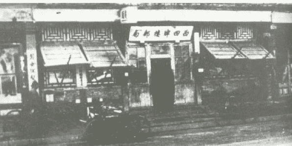

图 1 清末北京西四牌楼邮局外景

### （3）现代网络与系统

中国古代的“通信”是利用简单的自然现象（光、声）和交通工具来进行信息传递。19世纪40年代，第二次工业革命以后，随着西方科学技术的发展，尤其是电磁科学和技术的发展，电报电话相继出现，并在此基础上形成了现代通信网络的雏形。

按照传输媒质分类，通信可以分为有线通信和无线通信。现代通信时代的到来是以电话与电报的发明为标志的。电话与电报的发明实现了利用金属导线传递信息，开启了人类通信的新纪元。最早的电报机是在 1837 年，由美国人 Samuel Morse 发明的，世界上第一台电话机则是在 1875 年由苏格兰人 A. G. Bell 发明的。

- 有线通信

所谓有线通信指的是是必须要借助于一些有形的媒介来对信号进行传输，而利用这些有形媒介来进行信息传输的技术就被称为有线通信技术。有线通信技术中所使用的传输媒介一般指电线或者光缆。电线可以有效地承载电信号传输，在接收端接收到这些电信号之后，再通过特定的设备对其进行翻译，从而获得相应的信息。光纤通信技术是现在有线通信中主要的技术之一，通过利用光导纤维传输信号，实现信息传递，具有频带宽、传输容量大、损耗低、中继距离长与抗电磁干扰能力强的特点。

一般而言，有线通信的通信容量大、质量好。有线通信依托于有形的媒介完成信息传递，信道带宽较大，噪声干扰少，信噪比质量好，因此通信容量较大。其传输链路不容易受到外界的干扰，使得信息的传输更为稳定可靠，有效地保证信息的可靠度。随着通信系统的不断建设，有线通信网络普及度很高，并且承担了远距离干线传输的角色。所以说有线通信在人们的生活中发挥着十分重要的作用。

- 无线通信

无线通信的产生是以 J. C. Maxwell 对于电磁波的预言为依托的。1864 年，英国物理学家 J. C. Maxwell 建立了一套电磁理论，预言了电磁波的存在。1888 年，德国青年物理学家 H. R. Hertz 用电波环进行了一系列实验，发现了电磁波的存在，导致了无线电的诞生和电子技术的发展。1924 年第一条短波通信线路在瑙恩和布宜诺斯艾利斯之间建立。1933 年法国人克拉维尔建立了英法之间和第一条商用微波无线电线路，推动了无线电技术的进一步发展，从此以后无线通信不断发展，一直到今天。

## 1.2 现代通信技术的发展

现代通信技术与系统的发展先后经历了：有线电报、无线电报、电话、数据通信网、广播、电视、计算机、移动通信等。从电子器件的角度来看，先后经历了电子管、晶体管、集成电路等。

### (1) 有线电报

1835 年，莫尔斯发明的第一台电报机问世，1844 年 5 月 24 日，莫尔斯发出了人类历史上第一份公众电报，内容为“上帝创造了何等奇迹！”这是人类首次利用电信技术实现信息的“远距离传输”。莫尔斯电报机分为莫尔斯人工电报机和自动电报机，发报主要利用电键拍发电报信号。这种最早的电报机由于完全依赖于人工操作，其通报速率很低。之后出现了韦斯登电报机，在电路上使用了机器操作收发电报，工作速率比人工操作的莫尔斯电报大大

图 2 电报机的演变

### （2）无线电报

莫尔斯发明了有线电报，开创了电通信的新纪元。但有线电报离不开电线，局限了电报使用的地理范围。在 Maxwell 对电磁波的研究与赫兹对无线电波存在证实的基础上，1895 年，意大利人马可尼和俄国人波波夫分别发明了无线电报。这项先进的通信工具很快在世界各国广泛应用，在通信发展史上具有划时代的意义。1901 年 12 月马可尼发射的无线电波从英格兰传到加拿大的纽芬兰省。横跨大西洋的无线电报发明成功，随后他获得了诺贝尔物理学奖。

### （3）电话

1875 年 6 月 2 日，贝尔发明了世界上第一台电话。早期的电话机分为磁电式和共电式，人工磁电式电话用户呼叫时必须先摇动电话机上的发电机，使交换机上的号牌“跌落”，话务员见号牌跌落后开始接线过程。共电式电话机以信号灯的明灭表示呼叫、应答、通话和话终等各种用户状态。当主叫用户摘机呼叫时，交换机台上用户号灯亮，话务员开始接线过程。

1889 年美国人 A.B.史端乔发明了能够自动接续的步进制电话交换机。1892 年 11 月 3 日，第一个史端乔步进制电话局在美国印第安纳州投入使用，这就是世界上第一个自动电话局，交换机的出现标志着现代意义的电话网诞生。

图 3 电话机的演变

### (4) 数据通信网

电话网发展的同时，数据通信业务开始兴起，先后出现了 X.25、DDN、帧中继、ISDN 等。

X.25 网络是第一个分组交换网络，也是第一个公共数据网络。X.25 协议是 ITU 建议的协议，它定义终端和计算机到分组交换网络的连接。数字数据网（DDN）是以满足 OSI 数据通信环境为基本需求，采用数字交叉连接设备和光纤传输系统，以提供高速数据业务的数据传输网络，可用于航空公司、银行、证券公司，以及各种专用计算机网中，是一种重要的传输基础设施。帧中继对 X.25 的协议进行了简化，用两层结构代替了三层结构，从而具有传输速率高，时延小，容量大等优点可以实现局域网互联、形成虚拟专用网等功能。1972 年到 1980 年间，国际电信界集中研究电信设备数字化，最终在模拟 PSTN 网络的基础上形成了综合业务数字网（ISDN），这种网络同时支持分组交换业务和电路交换业务；其核心技术是在原有模拟二线用户的基础上，把双向数字技术推进到用户终端，即著名的 2B+D 技术。

### (5) 广播

19 世纪末 20 世纪初，技术人员利用无线电波传送声音的实验相继成功。1906 年圣诞节前夕，美国电子和无线电技术专家费森登和亚历山德逊在纽约附近设立了一个广播站，成功实现了人类历史上第一次实验性的无线广播。1920 年 11 月 2 日，美国 KDKA 电台开始正式广播，这是历史上第一座领有执照的电台，标志着广播时代的到来。

### (6) 电视

1924 年，英国的贝尔德发明了世界上第一套视频发射机和接收器，制造出了最原始的机械电视系统。1925 年 10 月 2 日，他将木偶“比尔”的图像用电信号发射到屏幕上，一台有使用意义的电视机宣告诞生，贝尔德被人们称作“电视之父”。

视频通信技术是电视系统的核心基础之一，视频通信技术是利用光电和电光转换原理，将光学图像转换为电信号进行记录或远距离传输，然后还原为光图像的一门技术。最初的视频通信技术只针对政府、金融、集团公司等高端市场，主要集中在专网中运行，造价不菲，是名副其实的“贵族”通信手段。随着现代通信技术和业务的发展，宽带网络的迅速普及和服务的完善，视频业务逐渐由“贵族”转向“平民化”。

### (7) 计算机与互联网

计算机的发展是互联网发展的前提。第一台计算机（ENIAC）于 1946 年 2 月在美国诞生。美国的数学家冯·诺依曼最早提出了程序存储，在美国陆军部的资助下，他于 1943 年开始了 ENIAC 的研制，并于 1946 年完成。冷战时期，出于与苏联争霸的需要，为了保证在核打击下军事通信的畅通，美国国防部于 1969 年建立了由 4 台计算机构成的、分布式的控制分组交换网（ARPA NET）。1983 年，为了满足更大规模网络互联的需要，阿帕网采用了新型传输控制与国际协议（TCP/IP），并被正式命名为“互联网（Internet）”。

WLAN（Wireless Local Area Networks，无线局域网络）是计算机互联网络的一种连接方式，是利用无线技术进行数据传输的系统，该技术的出现弥补了有线局域网络的不足，达到网络延伸之目的。相比较传统的物理连接布线而言，WLAN 的使用非常简便，适合移动办公的需要，同时，它比蓝牙技术等传统无线通信技术具备更高的传输速率和更远的传送距离。但也有一些缺点，如无线信号容易受到建筑物墙体的阻碍、传播时容易受到同频段其他信号的干扰等，另外网络安全性也差强人意，容易受到非法用户对网络进行窃听、攻击和入侵。

### (8) 蜂窝移动通信

蜂窝移动通信技术是无线通信的一个分支，对现代通信网络的发展具有重要的作用。早期的无线通信是采用大功率实现覆盖，有限的频谱资源限制了用户数的增加。例如，30 年代，美国警察已使用了调幅的移动通信系统；40 年代美国使用了公众移动电话系统；50 年代改进的移动电话已经能够自动拨 PSTN，然而，服务的用户数量非常少。1968 年，AT&T 向 FCC 提出了蜂窝移动通信的概念，用有限的频谱资源为无限用户提供服务，引发了无线通信的革命。

蜂窝系统，也叫“小区制”系统。是将所有要覆盖的地区划分为若干个小区，通过控制基站和手机发射功率使得频谱资源在一个大区的不同小区间重复利用，大大提高了系统容量。可以说，蜂窝概念真正解决了公用移动通信系统要求容量大与频率资源有限的矛盾。

1G 网，即以 AMPS 和 TACS 为代表的第一代蜂窝移动通信网。它存在一定的问题和缺陷，如频率利用率低、移动设备复杂、费用高、业务种类受限、通话易被窃听等，此外，更重要的问题是其容量已不能满足日益增长的移动用户需求。1987 年 7 月 16 日，一个规模较小的模拟移动通信实验网在秦皇岛市开通，手持式移动电话进入中国。但真正的移动通信大规模商用系统诞生于改革开放前沿的广东。当时的移动电话是一种奢侈品，首批用户只有 700 个，1993 年统计总用户不到 30 万。

2G 网（GSM），即第二代蜂窝移动通信系统。早在 20 世纪 70 年代末期，当模拟蜂窝系统还处于开发阶段时，一些发达国家就开始着手数字蜂窝移动通信系统的研究。直到 1991 年 7 月，数字蜂窝移动通信才开始投商用，并很快遍布欧洲。在我国，1994 年 12 月底，广东首先开通了第一个 GSM 省级数字移动电话网。1995 年底，京、沪、粤等六市先后开通了移动数字网，总容量达到 160 万户。2001 年 11 月，我国移动用户电话用户突破 1 亿户，居世界第一位。2008 年 6 月，我国移动用户总量突破 6 亿户。

3G 网，1985 年，高通公司在美国圣地亚成立，探索 CDMA 技术，直接导致了 3G 技术的诞生。2000 年 5 月，国际电信联盟正式公布第三代移动通信标准，我国提交的 TD-SCDMA 正式成为国际标准，与欧洲 WCDMA、美国 CDMA2000 成为 3G 时代最主流的三大技术之一。3G 的网络结构主要包括核心网、无线接入网和用户终端模块，其中前两者是第三代移动通信系统的核心内容。相比于 2G 网，3G 网速度更快，覆盖更广，能够在全球范围内实现无线漫游，而且能够提供包括网页浏览、电话会议、电子商务等多种信息服务。

4G 网，即四代移动通信技术，有更高的数据速率和频谱效率、更强的安全性、更好的智能性和灵活性。4G 移动通信技术的最高数据传输速率达到的 100Mbit/s，这是 3G 技术的

50 倍的速度。4G 移动通信技术的优势明显，逐渐成为移动通信的主力。高兼容性的 4G 通信能满足移动通信终端在不同的全球地区和应用领域的通信业务需求，提供高品质移动通信服务，而在价格方面，4G 通信的平均成本更低。

5G 网络，已经进入标准化的过程，预期在 2020 年可以实现商用部署。5G 的频谱利用率更高，网络结构设计更优，能耗和运营成本也会大大降低。未来 5G 通信网络技术的研究，将更注重用户体验，交互式游戏、3D、虚拟现实、传输延时、网络的平均吞吐速度和效率等指标将成为考量 5G 网络系统性能的关键指标。

相较于前几代移动通信技术，5G 的变化除了速率的提升之外，还有核心网的变化。核心网是用于管理数据业务的。原来的核心网是有层次的，每一层的核心网由不同的专用设备组成，负责不同的管理内容。未来的核心网要实现云化，即把原来专门定义的硬件设备变成通用的处理器，使得不同区域的带宽调度成为可能。在以前，由于不同基站之间的硬件是固定的，基站之间带宽的调度只能通过硬件的扩容来实现。在未来，核心网的云化使得不同基站之间的调动成为了可能，通过代码的改动，不同基站即可实现带宽的改变，限制更少。未来，我们有望用软件的方式达到现在网络的水平，用计算取代专用的设备。核心网的变化减少了核心网金字塔的层级，使得网络的管理具有更大的灵活性与智能性。

2013 年初，欧盟等国家的第 7 框架计划中启动了关于 5G 的研发项目，共有 29 个参加方，我国的华为公司也参与其中。随着该项目的启动，各种 5G 移动通信技术的研发组织应运而生，如韩国成立的 5G 技术论坛，中国成立的 IMT-2020（5G）推进组等。目前，世界各个国家正积极的就 5G 移动通信技术的应用需求、关键技术指标、使能技术、候选频段、发展愿景等各个方面进行全面的研讨。随着政策支持与企业的境外布局，我国 5G 产业建设已走在世界前列，有望成为全球 5G 领跑者，国内部分 5G 研发企业已跻身全球第一梯队，预计在 2020 年实现 5G 技术的商用。

## 1.3 通信发展挑战与 AI

随着现代社会生活节奏的不断加快，人们对通信速率的要求越来越高。在现实生活中，无线通信的速率主要面临两方面的限制，一是传输频谱，即带宽的限制，二是发射功率的限制。

整个地球的通信带宽是有限的，但是人们对通信速率的需求却在不断上升。由于能量发动功率是有上限的，提升速率只能寻求于增加带宽或者提高功率。但是因为辐射、电池功率、能量等方面的限制，提高功率以提升通信速率是不现实的。唯一现实的途径便是从带宽上寻求突破。

要进一步满足用户对于高速率的追求，运营商必须解决带宽的问题。在所有的通信服务中，不同于其他点对点的通信服务，广播是一对多的。这也就是说，广播是最节约带宽的。但是，因为不同用户之间的需求是不一样的，广播什么内容是无线通信需要考虑的问题。AI 的介入能够使得广播对不同用户精准投放内容成为可能。在这一方面，AI 预测可以在基站内容流行度的分析方面产生作用。

此外，无线网络的全覆盖是有代价的。事实上，我国的无线网络只覆盖了 95%的人口。无线网络的覆盖需要与人的行为匹配。其中，区域内是否有人决定了运营商是否在当地覆盖无线网络，而有多少人决定了给当地分配多少带宽。带宽的分配是动态的。举例来说，特定区域内白天与晚上的带宽是有区别的。在北京回龙观地区，白天的人口是远少于晚上的人口的，因此，运营商白天分配给回龙观的带宽也是少于晚上的。实际的商业化的运作中，带宽的分配并不是简单地只关注白天与夜晚的区别。带宽的分配需要关注更精确的时间刻度，而当时间刻度精确到小时、分钟时，对人口变化的预测提出了更为严格的要求。运营商开关基站是有代价的。一旦关错基站，运营商将面临客户满意度下降、用户流失等困境。因此，准确预测特定时段特定区域内的用户数量与需求对于运营商来说至关重要。目前的算法无法支撑预测的准确率和遗漏率。AI 对数据的处理能力则能在这方面产生作用。

总的来说，现代通信网络可以看作是一个巨大的，不断发展的分布式数据库，移动手持设备和应用程序相当于其中的上下文和信息，所有用户的基站当前流量负载相当于其中的网络，由车辆交通管理系统提供的预测用户轨迹则相当于数据库中的环境。

移动运营商需要开发并结合大量数据的新型知识提取机制和预测分析手段，以加强整个网络的决策过程。提取的上下文信息可以用于：

- 需求建模：根据用户预测的请求建立一个精确的 QoS 模型。
- 预先缓冲：在移动用户到达覆盖不足的区域之前，通过填充播放缓冲区来确保媒体流的流畅。
- 预期性交接：通过在交接决策中包含覆盖图，以避免交接失败。
- 预期流量卸载：通过延迟流量来减少蜂窝流量负载，直到用户到达容量充足的区域。
- 小区间调度：为用户分配多个小区的资源，以提高用户体验的服务质量。

对当前和未来覆盖图的可靠重建，将使未来的网络能够更好地利用稀缺的无线资源，并提高用户体验的服务质量（QoS）。例如，预计路径损失预测对实现主动式资源分配至关重要。这里，关于资源分配的决定不仅基于当前的信道状态信息，而且还基于关于未来传播条件的信息。特别是，如果将沿用户路线的未来路径损耗传播条件的信息用于主动资源分配，移动用户所经历的服务质量可以显著提高。

人工智能，例如其中计算复杂度较低的在线机器学习方法的开发，将对此方面的研究产生重要影响。这些功能特别重要，因为在实时网络中，信道质量测量报告持续传递给网络，决策算法必须实时处理（在线）。运营商需要解决的主要挑战之一是设计自适应算法，特别是在某些场景下实时测量数据缺失时，仍能在实时约束和传输质量要求下，提供准确的路径损耗估计。

同时，无线通信还面临着信号干扰的问题。不管是同频段还是不同频段，信号之间都是存在干扰的。一方面，我们可以寻求法律法规的帮助，从差异化的角度，减少信号干扰的产生，另一方面则是要寻求技术的突破。通信抗干扰技术能够让人们发现干扰、消除干扰。在战争中，如何有效干扰和抗干扰是非常重要的。由于现实生活中没有无穷大的功率，因此，信号干扰机不能时时刻刻工作。这也就意味着，信号干扰机的工作是有着一定的模式存在的——总有一个间隙，干扰机是不工作的。AI 如果能够预测出这样的干扰模式，则可以在干扰机不工作的时候传送信息，实现反干扰。

我们通过对 1994-2016 年间无线通信领域论文的挖掘，总结出这二十多年来，无线通信领域的研究关键词主要集中在频谱管理、电信、通信设备、下一代网络、智能网络、信息技术、IP 多媒体子系统、移动代理、经济政策、移动通信、服务质量、无线通信服务等领域。图 4 是对无线通信研究趋势的分析，旨在基于历史的科研成果数据的基础上，对技术来源、热度甚至发展趋势进行研究。图 4 中，每个彩色分支表示一个关键词领域，其宽度表示该关键词的研究热度，各关键词在每一年份（纵轴）的位置是按照这一时间点上所有关键词的热度高低进行排序。其中，telecommunication（电信）增长迅速，并在 2001-2008 年期间，成为最热的研究领域。与远程通信的研究热度变化相类似的是 intelligent network（智能网络）。从 1994 年起，智能网络一直是研究的重点，在 2015 年成为研究的中心。Information technology（信息技术）是研究热度变动较大的一个学科。在 2016 年，信息技术超过智能网络与远程通信，一跃成为最炙手可热的研究方向。

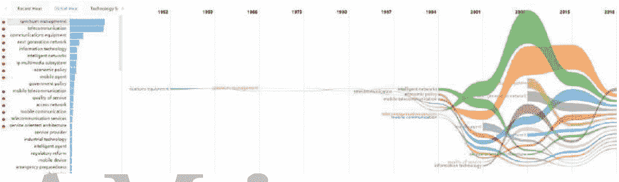

图 4 无线通信研究热点趋势变化

## 1.4 中国通信行业现状

随着流量业务对话音业务的转型替代，未来对于网络流量承载量的要求将快速增长，同时在接入网、传输网、数据中心等领域都有迫切的升级替代需求。

依据《中华人民共和国国民经济和社会发展第十三个五年规划纲要》，工信部编制并印发《信息通信行业发展规划（2016—2020 年）》，提出到 2020 年，信息通信业收入达 3.5 万亿元，年均增速 15.5%；信息通信基础设施累计投资 2 万亿元，与“十二五”期间实际累计投资 1.9 万亿相比略有提升，行业投资力度较大。《规划》中工信部针对“十二五”遗留的问题提出了很高的建设目标，提升基础设施发展水平、发展云计算和物联网等应用、提供网络和信息安全保障等成为建设重点。

发改委和工信部在 2016 年底印发《信息基础设施重大工程建设三年行动方案》，2016-2018 年信息基础设施建设共需投资 1.2 万亿元，并拟重点推进骨干网、城域网、固定宽带接入网、移动宽带接入网、国际通信网和应用基础设施建设项目 92 项，设计总投资 9022 亿元。从《2016-2021 年中国通信产业市场运行暨产业发展趋势研究报告》分析看，5G 成为发展趋势。在 4G 建设末期，5G 技术研发积累的关键时期，国家也非常重视改变国内通信行业大而不强的格局。《信息通信行业发展规划（2016—2020 年）》中关于 5G 提出目标：突破 5G 关键技术和产品，成为 5G 标准和技术的全球引领者之一，具体包括构建 5G 试商用网络，打造系统、芯片、终端、仪表等完整产业链等。

5G 无线网络预计将于 2020 年左右商用，但在此之前，仍有大量准备工作亟待完成。5G 的到来激发了业界对于基站致密化发展的讨论，而这也是实现 5G 所必需的技术。更多的基站，无论是小基站、都市基站、还是传统的宏基站，都需要比以往更多的电力和光纤回程。

如今，人工智能的重要性几乎得到了所有行业的认可。像谷歌和百度这样的大公司已经启动了人工智能战略计划，旨在将人工智能应用到人们的日常生活中。电信运营商也参与探索并将这项新技术用于语音识别，新产品和服务开发等应用。

随着 5G 时代的到来，移动互联网，物联网，云计算等各类通信和数据处理技术导致数据流量爆炸性增长。CT（Communication Technology，通信技术）领域的传统无线通信网络已进入“IT（Information Technology，信息技术）+CT+DT（Data Technology，数据技术）”时代。IT 与 CT 的深度融合使处理资源，传输网络资源和频谱资源得以共享，使运营商能够提高资源利用效率和快速推出业务。在网络优化、容量提升、个性化服务、更好的用户体验和更低的成本方面，大数据和人工智能为移动网络产业的发展带来了新的动力，引发了更多创新和颠覆性技术。

# 2 人才篇

根据 AMiner 的数据统计分析，国外有关通信的研究学者主要以 Robert·E·Kraut、Ian·F·Akyildiz、Theodore S·Rappaport、Aaron R·Folsom、H·Vincent·Poor、K·J·Ray·Liu、John M·Carroll、Lajos·Hanzo 等人为代表的流派研究构成。这些研究学者分别来自于不同的研究机构，研究兴趣主要集中在无线传感网络（Wireless Sensor Networks）、移动通信（Mobile Communication）和无线通信（Wireless Communication）等方向；国内主要以尤肖虎、钟章队等人的研究为代表。

## 2.1 通信研究学者分布及迁徙

通信产业是世界上最重要的产业之一，人们对通信质量的要求不断上升，研究学者对通信的研究热情也一直热度不减。

从全球来看，美国在通信方面的研究占领着绝对的优势，而中国对于通信的研究也做出了卓越的贡献，研究学者近百人。除了中美两国以外，加拿大、英国、德国、日本等也聚集着大量通信领域的研究学者。下图是根据通信领域影响力排名 TOP1000 专家学者的分布绘制的。

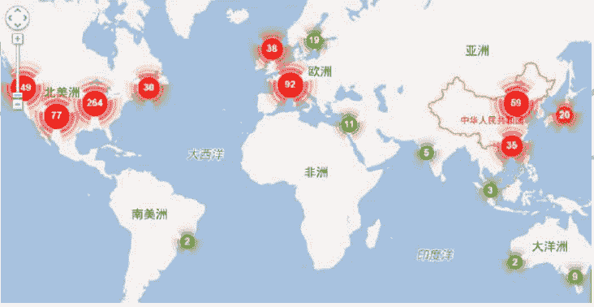

图 5 全球通信学者分布

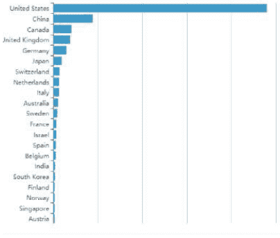

图 6 全球通信学者分布

从产业化的角度而言，中国在通信方面的产业研究是领先于美国的。中国是世界上通信需求最大的市场，产业规模是大于美国的。华为作为世界第二大设备商在通信研究上的投入令人瞩目。而随着近些年来留美的研究学者不断归国，预计中国在通信上的发展将远超世界其他国家。

AMiner 基于全球通信领域最具影响力的 1000 人的迁徙路径绘制了迁徙动态视频，可以点击查看：http://v.youku.com/v_show/id_XMzYyMjYxMjg3Mg==.html?spm=a2h3j.8428770.3416059.1

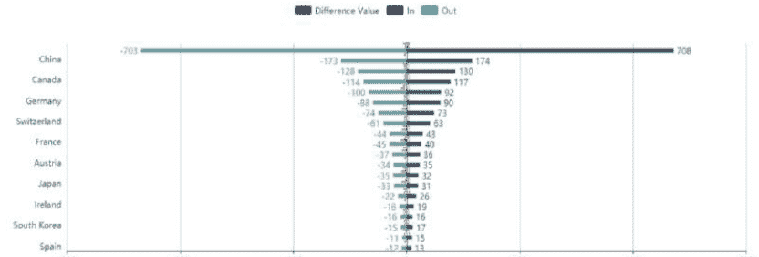

图 7 各国通信人才顺逆差对比图

由图 7 可以看出，各国通信领域人才的流失和引进是相对比较均衡的，其中美国为通信人才流动大国，人才输入和输出幅度都大幅度领先。中国、加拿大、德国和瑞士等国落后于美国，但各国之间人才流动相差并不明显。

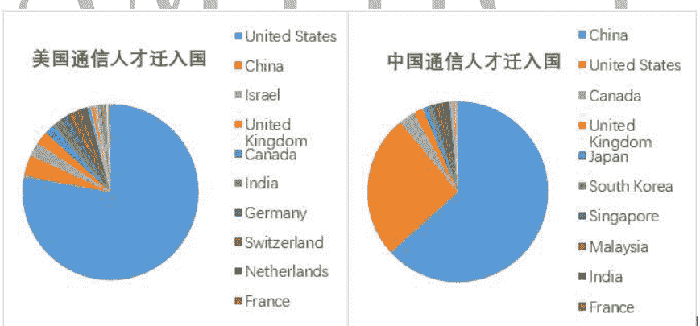

图 8 中美通信人才迁出国对比

由图 8 可以看出，中美两国通信人才流动主要集中于本国之间。其中，美国通信人才除在本国流动外，迁入排名前五的国家分别是中国、以色列、英国、加拿大和印度等；中国通信人才除在本国流动外，迁入排名前五的国家分别是美国、加拿大、英国、日本和韩国，其中美国占整体迁入人数的四分之一左右，其余分散在日本韩国亚洲等国。而美国人才四分之三多都在本国内流动，流入他国的人才较少且分散在不同国家。由此可以看出，美国对人才的吸引力大于中国。

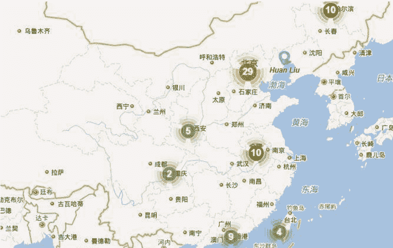

图 9 中国通信学者分布

在中国国内，通信领域的研究学者主要分布在北京、香港、南京等城市。其中，北京的研究学者数量大于其他城市，这主要是得益于北京市内清华、北大等诸多高校以及产业研究所的存在。

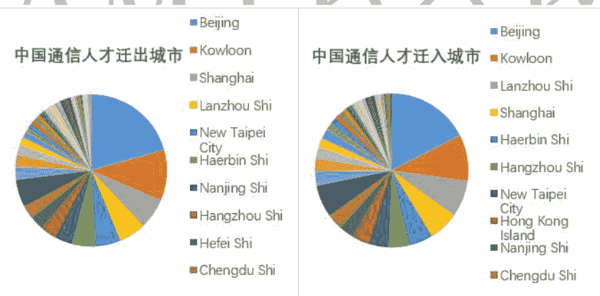

图 10 中国通信人才流动图

图 10 是中国通信人才在国内各城市的流动图，由图可以看出，北京、九龙、上海、兰州、台北和哈尔滨等城市是人才流出比较多的城市，同时，北京、九龙、兰州、上海和哈尔滨是人才流入比较多的城市。综合看来，北京、九龙、上海等发达城市人才流动较为频繁，兰州由于酒泉卫星发射中心的影响，通信产业也较为发达，人才流动较多，但合肥对人才的吸引力不够强，人才流失量较大。

## 2.2 通信代表研究学者

AMiner 基于发表于国际期刊会议的学术论文，对某一领域内专家进行深入挖掘，并按照相关度和影响力等对专家进行排序和分类。排序规则参考 H-index、citation、论文数、专家所获得的荣誉、任职机构排名、专家活跃度、社交性及兴趣多样性等。多项指标综合计算分析，将该领域专家划分为领军人物、中坚力量和领域新星。

### 2.2.1 领军人物

- H·Vincent·Poor

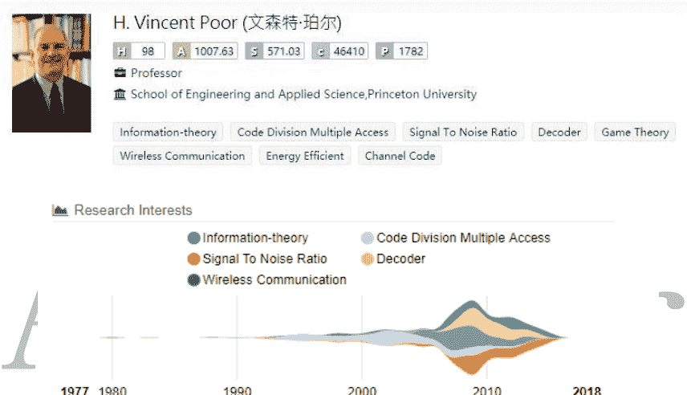

Vincent-Poor 是普林斯顿工程和应用科学学院的院长，同时任职于普林斯顿大学的应用和计算数学项目以及运筹学和金融工程学系，也是迈克尔·亨利·斯特雷特大学电气工程的教授。Vincent-Poor 是美国国家工程院、美国艺术与科学学院院士、IEEE fellow，同时也是数理统计学会、美国光学学会以及其他科学和技术组织的成员。他参与了统计信号处理和随机分析领域的研究和教学，推动了它们在无线网络、金融等相关领域的应用。

Vincent-Poor 目前的研究主要集中在技术快速发展的几个领域，尤其是无线网络、能源系统和社交网络。其中，在无线网络这一领域中，他研究的重点是通过信息理论和相关的继电器和干扰通道，来分析以及反馈在改善这些渠道的通信性能方面的作用，以解决当代无线网络对新容量和更高性能的需求。另一重点是开发和分析新的信令和网络结构，例如非正交多访问（NOMA）和云无线访问网络（C-RANs）。除此之外，利用无线电信道的物理基础能力保证数据传输的安全性，也是 Vincent-Poor 研究的一个重要内容。他在能源系统中的工作主要是使用通信和信息技术领域的先进方法来解决当前能源领域的一些问题，例如运营商和消费者隐私、坏数据和物理攻击的检测等。在社会网络领域，Vincent-Poor 的工作重点是了解和建模小世界网络的互联性以及社会互动在协作感知和决策任务方面的作用等。

以下是 Vincent-Poor 发表论文中 citation 较高的论文：

| 排名 | 论文标题 | 作者 | 发表来源 | 引用次数 | BibTeX 链接 |
|------|----------|------|----------|----------|-------------|
| 1782 | Iterative (turbo) soft interference cancellation and decoding for coded CDMA | Xiaodong Wang, H. Vincent Poor | IEEE Transactions on Communications (1999) | 2189 | http://dx.doi.org/10.1109/26.774855 |
| 1781 | Wireless Communication | H. Vincent Poor, Gregory W. Wornell | Body Sensor Networks (1993) | 1398 | http://dx.doi.org/10.1007/978-1-4471-6374-9_4 |
| 1780 | Improving wireless physical layer security via cooperating relays | Lun Dong, Zhu Han, Athina P. Petropulu, H. Vincent Poor | IEEE Transactions on Signal Processing (2010) | 986 | http://dx.doi.org/10.1109/TSP.2009.2038412 |
| 1779 | MIMO Wireless Communications | Ezio Biglieri, Robert Calderbank, Anthony Constantinides, Andrea Goldsmith, Arogyaswami Paulraj, H. Vincent Poor | MIMO Wireless Communications (2007) | 954 | http://www.cambridge.org/gb/knowledge/isbn/item4026955/?site_locale=en_GB |

#### Lajos Hanzo

Lajos Hanzo
H 61 A 1812.42 S 1280.93 c 24779 P 1547
professor, Head of Group in Southampton Wireless Group
ECS, Faculty of Physical Sciences and Engineering University of Southampton
Bit Error Rate Decoding Fading Signal To Noise Ratio Channel Coding Exit Chart Code Division Multiple Access Mimo

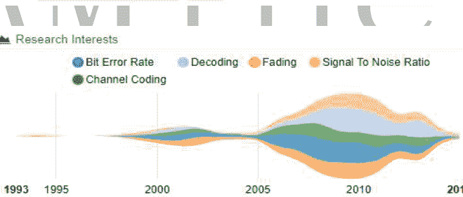

Lajos·Hanzo 教授于 1983 年从布达佩斯技术大学博士毕业。2010 年，他获得了该大学的最高荣誉，即荣誉博士。自 1986 年以来，他一直在英国南安普顿大学电子与计算机科学学院任职，并于 2004 年获得了科学博士学位。他目前为英国皇家工程院院士，IEEE Fellow，IET Fellow，IEEE Press 主编，IEEE 通信学会 Governor，IEEE 车载技术学会 Governor，以及 IEEEWCNC 2006、IEEE WCNC 2009 和 IEEE VTC 2011 等国际会议的大会主席。

Lajos·Hanzo 在 IEEE 期刊及会议上发表文章超过 1500 篇，著有 20 多本著作并且组织并主持了一些重要的 IEEE 会议，如 WCNC’2006，WCNC’2009 和 VTC’2011 等。

目前，Lajos·Hanzo 领导的实验小组致力于无线多媒体通信领域的一系列研究项目，他们的目标是实现完美的远程呈现，可以支持丰富的三维音频/视频通信。

##### 以下是 Lajos-Hanzo 发表论文中 citation 较高的论文：

- 1547
  Mobile Radio Communications: Second and Third Generation Cellular and WATM Systems: 2nd
  Raymond Steele, Lajos Hanzo
  (1999)
  Cited by 1477 Bibtex

- 1548
  OFDM and MC-CDMA for Broadband Multi-User Communications, WLANs and Broadcasting
  Lajos Hanzo, T. Keller, M. Muenter, B-J. Choi
  OFDM and MC-CDMA for Broadband Multi-User Communications, WLANs and Broadcasting (2003)
  Cited by 1356 Bibtex

- 1545
  Quadrature Amplitude Modulation: From Basics to Adaptive Trellis-Coded, Turbo-Equalised and Space-Time Coded OFDM, CDMA and MC-CDMA Systems
  Lajos Hanzo, Soon Xin Ng, W. I. Webb, L. Keller
  (2004)
  Cited by 948 Bibtex

- 1544
  Adaptive multicarrier modulation: a convenient framework for time-frequency processing in wireless communications
  THOMAS KELLER, LAJOS HANZO
  Proceedings of The IEEE (2000)
  Cited by 784 Bibtex http://dx.doi.org/10.1109/JPROC.849157

#### K·J·Ray·Liu

**K. J. Ray Liu**

H 85 A 244.42 S 49.84 C 30037 P 898

Professor
Information Technology Electrical and Computer Engineering Department University of Maryland

Wireless Network Game Theory Wireless Communication Protocol Signal To Noise Ratio Indexing Terms Signal Processing Ofdm Modulation

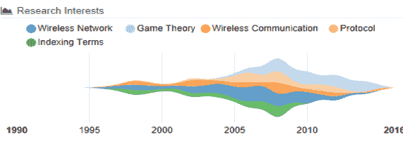

K·J·Ray·Liu 是著名的信息技术教授，于 1990 年获加州大学洛杉矶分校电器工程博士学位。2007 年，他被任命为马里兰大学的杰出教师，出版了超过 10 本书和 650 篇论文。K·J·Ray·Liu 领导的马里兰信号和信息小组（SIG）的研究贡献涵盖了无线通信和网络的很多方面，例如多媒体通信和信号处理；取证和安全的信息；生物医学成像和生物信息学以及信号处理算法和架构等。

K·J·Ray·Liu 是 Origin Wireless 公司的创始人，该公司开发了世界上第一个厘米精度的室内定位/跟踪系统，智能无线电技术支持智能生命/家庭/城市和 5G/物联网应用。他还是 1997 年奥德赛技术公司的创始人，在互联网上开创了数字监控系统。

K·J·Ray·Liu 是 IEEE 和 AAAS 的研究员，他的研究被 IEEE 认定为将会对人类与机器、世界和彼此互动的方式产生影响的七项技术之一，以纪念 IEEE 的 125 周年纪念。

K·J·Ray·Liu 的研究课题主要包括以下：适用于 5G 及更高版本的 MAC（MAC for 5G and beyond）；一种单线大规模输入输出的解决方法（A Single-antenna Massive MIMO Solution）；无线能量传输（Wireless Power Transfer）；空闲设备的无线监控（Device-free Wireless Monitoring）；关键迹象的无线检测（Wireless Vital Signs Detection）等。

以下是 K·J·Ray·Liu 发表论文中 citation 较高的论文：

**888**
Achieving Centimeter-Accuracy Indoor Localization on WiFi Platforms: A Multi-Antenna Approach.
Chen Chen, Yan Chen, Yi Han, Hung-Quoc Lai, Feng Zhang, K. J. Ray Liu.
IEEE Internet of Things Journal (2017)
Cited by 7 Bibtex

**897**
Achieving Centimeter-Accuracy Indoor Localization on WiFi Platforms: A Frequency Hopping Approach.
Chen Chen, Yan Chen, Yi Han, Hung-Quoc Lai, K. J. Ray Liu,
IEEE Internet of Things Journal (2017)
Cited by 7 Bibtex

**896**
A Graphical Evolutionary Game Approach to Social Learning.
Xuanyu Cao, K. J. Ray Liu,
IEEE Signal Process. Lett. (2017)
Cited by 1 Bibtex

**894**
Radio Biometrics: Human Recognition Through a Wall.
Qinyi Xu, Yan Chen, Beibei Wang, K. J. Ray Liu,
IEEE Trans. Information Forensics and Security (2017)
Cited by 1 Bibtex

#### P. R. Kumar
H 25 | A 0 | S 0 | C 5612 | P 125

**Professor**
Dept. of Electrical and Computer Engineering, Texas A&M University

Wireless Network Ad Hoc Network Scheduling Sensor Network Wireless Sensor Network Linear Program Stability Routing Protocol

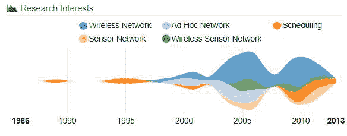

P.R.Kumar 任职于伊利诺伊大学厄本那香槟分校，同时还是富兰克林 W.沃尔特奇电气和计算机工程教授、协调科学实验室研究教授、信息信托研究所研究教授，以及计算机科学系副教授。

P.R.Kumar 在博弈论、自适应控制、随机系统、神经网络、机器学习、制造系统、调度、晶圆制造工厂和信息理论等方面都有研究。他目前的主要的研究兴趣在无线网络、传感器网络和网络嵌入式控制系统。

P.R.Kumar 是 IEEE 的资深会员和美国国家工程院院士。曾获美国自动控制委员会的 Donald P. Eckman 奖，控制系统 IEEE 领域奖以及 IEEE 通信协会的 Fred W. Ellersick 奖。

##### 以下是 P.R. Kumar 发表论文中 citation 较高的论文：

- **125** Critical Power for Asymptotic Connectivity in Wireless Networks
  Piyush Gupta, P. R. Kumar
  (1998)
  Cited by 1695 Bibtex http://dx.doi.org/10.1007/978-1-4612-1784-8_33

- **124** The number of neighbors needed for connectivity of wireless networks
  Feng Xue, P. R. Kumar
  Wireless Networks (2003)
  Cited by 952 Bibtex http://dx.doi.org/10.1023/B:WINE.0000013081.09837.c0

- **123** Power Control and Clustering in Ad Hoc Networks
  Vikas Kawadia, Panganamala Kumar
  INFOCOM (2003)
  Cited by 826 Bibtex http://www.ieee-infcom.org/2003/papers/12_01.PDF

- **122** SEEDX: a MAC protocol for ad hoc networks
  R. Rozovsky, P. R. Kumar
  MobiHoc '01 Proceedings of the 2nd ACM international symposium on Mobile ad hoc networking & computing... (2001)
  Cited by 196 Bibtex http://dx.doi.org/10.1145/501416.501427

#### 王晓东

王晓东 (Xiaodong Wang)
H 102 A 390.87 S 172.75 C 88406 P 3659
Professor
Electrical Engineering Department, Columbia University

- Fading Channel
- Decoding
- Wireless Sensor Network
- Indexing Terms
- Code-division Multiple-access
- Signal-to-noise Ratio
- Fading
- Mimo

##### Research Interests

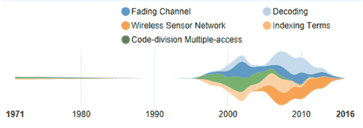

王晓东现为美国哥伦比亚大学电子工程系教授，1998 年获美国普林斯顿大学电子工程系博士学位，他是 IEEE Fellow（2008 年）、中组部千人计划学者、教育部长江学者讲座教授，兼任 NEC Labs 美国首席研究员，先后担任包括 IEEE Transactions on Information Theory、IEEE Transactions on Signal Processing、IEEE Transactions on Communications 在内的多个国际顶级期刊编委，曾担任多个国际学术会议主席、副主席、程序委员会委员。王晓东的研究兴趣主要在统计信号处理、基因组信号处理、生物信息学、通信理论、无线通信、光通信等领域。

近年来王晓东在无线通信和信号处理领域里开展了广泛而深入的研究，在多用户通信、空时信号处理、蒙特卡洛信号处理、基因组信号处理等方向上取得了丰富的研究成果。在无线通信、统计信号处理、并行和分布式计算、纳米电子学和量子计算领域发表文章 800 余篇，主编/合编了 10 余部学术著作。专著 Wireless Communication Systems：Advanced Techniques for Signal Reception 于 2003 年由 Prentice Hall 出版公司出版。

王晓东获得了 1999 年美国国家自然科学基金会 CAREER 奖，2001 年 IEEE 通信协会和信息论协会联合最佳论文奖，2011 年 IEEE 通信学会杰出论文奖，并被评为 ISI 高引作者（ISI Highly-cited Author）。

以下是王晓东发表论文中 citation 较高的论文：

| ID | Title | Authors | Journal | Year | Citations | Link |
|---|---|---|---|---|---|---|
| 3047 | Iterative (turbo) soft interference cancellation and decoding for coded CDMA | Xiaodong Wang, H. Vincent Poor | IEEE Transactions on Communications | 1999 | 2189 | http://dx.doi.org/10.1109/26.774855 |
| 3046 | Blind multiuser detection: a subspace approach | Xiaodong Wang, H. V. Poor | IEEE Transactions on Information Theory | 1998 | 1019 | http://dx.doi.org/10.1109/18.661512 |
| 3044 | Blind equalization and multiuser detection in dispersive CDMA channels | Xiaodong Wang, H. Vincent Poor | IEEE Transactions on Communications | 1998 | 472 | http://ieeexplore.ieee.org/xpl/abstractAuthors.jsp?tp=&arnumber=655407 |

### 2.2.2 中坚力量

- Theodore S. Rappaport

Theodore S. Rappaport

34 47.41 37.50 81330 225

Professor
Computer Science, Courant Institute of Mathematical Sciences, New York University

Wireless Community Path Loss Radio Receivers Mobile Communication Wireless Network Radio Transmitters Millimeter Wave Base Station

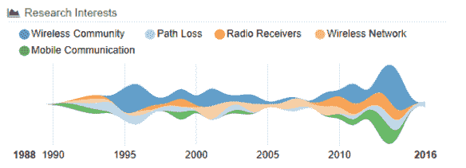

Theodore·S·Rappaport 是纽约大学理工学院的工程学和数理学院的计算机科学教授，还是纽约大学朗格尼医学院的放射学教授，同时也是无线互联网高级技术中心（WICAT and NYU Wireless）的负责人、纽约大学无线学院的创始董事，该公司是世界上第一个将无线工程、计算机科学和医学结合起来的学术研究中心。

Rappaport 教授的研究跨越了无线电波传播和天线的领域，他是无线电波传播、无线通信系统设计和 60GHz/毫米波通信领域的先驱，他的研究被用于蜂窝和个人通信、无线通信系统的设计、分析和仿真，以及宽带无线通信电路和系统。他在弗吉尼亚理工大学创建的移动和便携式无线电研究小组（MPRG）是世界上第一个致力于无线通信领域的大学研究和教学中心。

Rappaport 是一位广受欢迎的顾问和技术专家，曾在联邦通信委员会技术咨询委员会（FCC）任职，并在几家高科技公司的董事会任职，同时担任国际电信联盟的国际顾问，为 30 多家主要电信公司提供咨询，并在许多国家委员会工作，工作领域涉及通信研究和技术政策。

Rappaport 教授发明的无线电测量设备被广泛使用，并进行了无线电模拟方法和分析方法的探索以及无线电传播渠道的建模和新兴无线系统的设计工作。他还发明了无线网络部署的无线射频（RF）信道建模和设计技术，这一技术现在在整个无线通信行业中被广泛使用。Rappaport 教授一直追求毫米波无线通信的效率，以及在这一频段之上的频率，以满足全球日益增长的个人和手机应用的带宽需求，以及从城市设置到农村光纤更换的室内和室外场景。这项工作已经影响了联邦通信委员会（FCC）和 3GPP/ITU 在全球范围内发展 5G 无线网络。

Rappaport 是世界上被引用最多的无线领域的作者之一，撰写或合著了超过 200 份技术论文，超过 100 份美国和国际专利。2008 年，他获得了奥斯丁无线联盟和 IEEE 通信协会 WTC 表彰奖的行业领导奖，表彰他在无线通信系统和网络领域的杰出成就和贡献。

#### 以下是 Theodore·S·Rappaport 发表论文中 citation 较高的论文：

- 225
  Wireless Communications: Principles and Practice
  Theodore S. Rappaport
  Wireless Communications: Principles and Practice (1996)
  Cited by 25727

- 224
  Wireless Communications: Principles and Practice
  Theodore S. Rappaport
  Wireless Communications: Principles and Practice (2001)
  Cited by 20269

- 223
  Millimeter Wave Mobile Communications for 5G Cellular: It Will Work!
  Theodore S. Rappaport, Shu Sun, Rimma Mayzus, Hang Zhao, Yaniv Azar, Kevin Wang, George N. Wong, Jocelyn K. Schulz, Mathew Samimi, Felix Gutierrez Jr.
  IEEE Access (2013)
  Cited by 2231

- 222
  Smart Antennas for Wireless Communications: IS-95 and Third Generation CDMA Applications
  Joseph C. Liberti, Theodore S. Rappaport
  Smart Antennas for Wireless Communications: IS-95 and Third Generation CDMA Applications (1999)
  Cited by 2104

#### 尤肖虎

尤肖虎 (Xiaohu You) H 28 206.8k i 163.28 c 4359 P 463 长江学者特聘教授、博士生导师、杰青 东南大学 Ofdm Mimo Mobile Communication Signal To Noise Ratio Ofdm Modulation Fading Channel Estimation Wireless Communication

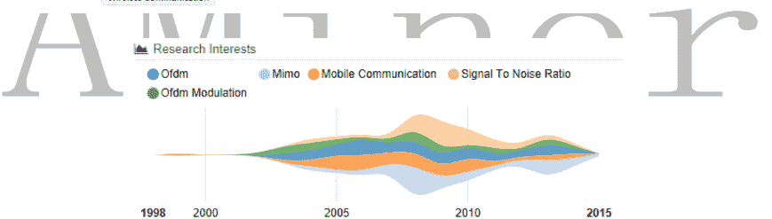

尤肖虎，1988 年于东南大学信号、电路与系统专业获博士学位。任东南大学信息科学与工程学院院长、东南大学移动通信国家重点实验室主任、博士生导师、长江学者计划特聘教授、江苏省科协副主席、IEEE Nanjing Section 主席和 IEEE Fellow, 《中国科学：F辑》副主编。

尤肖虎是中国 3G、4G 掌门人。1999 年至 2002 年，担任国家第三代移动通信系统研究开发重大专项项目总体组组长，所负责的项目被两院院士评选为 2002 年度中国十大科技进展新闻。他创新性地提出了多径能量窗结构 CDMA 接收技术，取得 3 项美国发明专利和 11 项国家发明系列专利，获得 2003 年度国家科技进步二等奖，排名第一。2002-2006 年，主持国家 863 Future 重大研究计划，在 3G 移动通信无线组网与传输等关键技术研发方面取得了一系列重要进展，产生了较为广泛的国际影响。2004 年至 2008 年，作为首席负责人承担了国家自然科学基金重大项目“未来移动通信基础理论与技术研究”，在分布式无线组网研究等方面取得了一系列走在世界前列的基础性研究成果。2013 年 12 月尤肖虎领衔完成的“宽

带移动通信容量逼近传输与分布式组网”项目获 2014 年度陈嘉庚信息技术科学奖。该成果为分布式多天线技术这一新兴的组网方式提供了相关的基础理论和分析方法，对我国第 4 代移动通信的发展和应用做出了重要贡献。目前担任国家 863 计划宽带网科技专项专家组组长、信息领域专家组成员、国家中长期科技规划 03 重大专项副总师、国家 863 计划 5G 移动通信重大项目专家组组长、国务院学位委员会学科评议组成员、中国电子学会常务理事、中国通信学会常务理事等。

尤其肖虎教授在 IEEE 核心期刊发表论文 50 余篇，论文被引用超过 3000 次，第一作者单篇最高引用 163 次，SCI 他引 400 余次。获国家发明专利 71 项、国际发明专利 10 项。

以下是肖虎发表论文中 citation 较高的论文：

- 463 Cellular architecture and key technologies for 5G wireless communication networks Cheng-Xiang Wang, Founat Haider, Xiqi Gao, Xiaohu You, Yang Yang, Dongfeng Yuan, Hadi Aggoune, Harald Haas, S. Fletcher, Erol Hepsaydir IEEE Communications Magazine (2014) Cited by 879
- 462 Three novel opportunistic scheduling algorithms in CoMP-CSB scenario ... SCIENCE CHINA Information Sciences (2013) Cited by 464
- 461 Three novel opportunistic scheduling algorithms in CoMP-CSB scenario wang hao, liu nan, wu ping, pan zhiwen, you xiaohu, (2013) Cited by 465
- 460 Cooperative MIMO Channel Modeling and Multi-Link Spatial Correlation Properties. Xiang Cheng, Cheng-Xiang Wang, Haiming Wang, Xiqi Gao, Xiaohu You, Dongfeng Yuan, Bo Ai, Qiang Huo, Lingyang Song, Bingli Jiao IEEE Journal on Selected Areas in Communications (2012) Cited by 133

#### 梁振英 (Victor C·M·Leung)

Victor C. M. Leung H 63 A 861.19 S 540.54 C 17913 P 1030 Professor Department of Computing, The Hong Kong Polytechnic University Quality Of Service Wireless Sensor Networks Wireless Communication Throughput Wireless Sensor Network Wireless Networks Protocols Internet

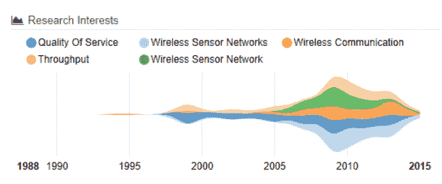

梁振英（Victor C.-M. Leung）目前是不列颠哥伦比亚大学的一名教授，IEEE 院士，加拿大工程学院研究员，加拿大工程院院士，ACM 投票委员，IEEE 通信协会的杰出讲师，同时也是美国 TELUS 移动工业研究委员会（TELUS Mobility Industrial Research Chair in Advanced Telecommunications Engineering）的创始人。他的研究方向是计算机和电信网络的建筑和协议设计和性能分析领域，目前的重点是无线网络和移动系统。

从 1981 年到 1987 年，梁振英是微泰太平洋研究有限公司技术人员的资深成员（后来更名为 MPR-Teltech-Ltd.），专门从事卫星通信系统的规划、设计和分析。他还在 1986 年和 1987 年担任西蒙弗雷泽大学的客座助理教授。1988 年，担任香港中文大学电子学系的讲师。他是 UBC 计算、信息和认知系统研究所的成员。同时，他还是吉林大学、北京交通大学和华南理工大学的客座教授和兼职教授。

他曾在 IEEE 无线通讯、IEEE 计算机、计算机通信等编辑部任职并在众多国际会议的技术计划委员会任职。他是国际无线通信大会（WC 2010）的主席，多次主持国际会议。

##### 以下是梁振英发表论文中 citation 较高的论文：

- **Body Area Networks: A Survey**
  Min Chen, Sergio Gonzalez, Athanasios Vasilakos, Huasong Cao, Victor C. Leung
  MONET (2011)
  Cited by 1125

- **Cache in the air: exploiting content caching and delivery techniques for 5G systems**
  Xiaofei Wang, Min Chen, Tian Taleb, Adlen Ksentini, Victor C. M. Leung
  IEEE Communications Magazine (2014)
  Cited by 442

- **A new method to support UMTS/WLAN vertical handover using SCTP**
  Li Ma, Fei Yu, V. C. M. Leung, T. Randhawa
  IEEE Wireless Commun. (2004)
  Cited by 353

- **Location management for next-generation personal communications networks**
  V. W. S. Wong, V. C. M. Leung
  IEEE Network: The Magazine of Global Internetworking (2000)
  Cited by 324

#### 钟章 (Zhangdui Zhong)

H 27 | A 164.19 | S 109.77 | G 2789 | P 294
Railway Communication Fading High-speed Railway Wireless Communication Probability Signal To Noise Ratio
Statistical Analysis Path Loss

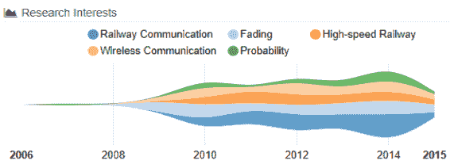

钟章，北京交通大学电子信息工程学院教授、博士生导师，学术委员会委员，现代通信研究所所长，轨道交通控制与安全国家重点实验室通信首席教授。

钟章是我国较早开展高速铁路无线通信与控制研究的专家，是 GSM-R 研究第一人，1994 年提出在中国建设和发展新一代铁路数字移动通信系统（GSM-R）。他的主要研究方向包括无线通信及宽带移动通信、数据通信及计算机通信、高速铁路列车运行控制和智能交通系统等，是我国轨道交通专用移动通信理论与关键技术方向首席专家，“面向高速铁路控制的无线移动通信系统研究”教育部创新团队带头人。

钟章作为铁路通信专家，带领其创新团队，为铁路六次大提速、青藏铁路、大秦重载运输、高速铁路等国家重大工程及创新人才培养做出了重大贡献。出版专著 7 部，发表论文 300 多篇，高被引论文 2 篇，授权专利 10 项；享受国务院政府特殊津贴；获茅以升科学技术奖、詹天佑铁道科学技术贡献奖、成就奖。

##### 以下是钟章发表论文中 citation 较高的论文：

- Operator controlled device-to-device communications in LTE-advanced networks. Lei Lei, Zhangdui Zhong, Chuang Lin, Xiaomin Shen. IEEE Wireless Commun. (2012). Cited by 565.
- Challenges Toward Wireless Communications for High-Speed Railway Bo Ai, Xiang Cheng, Tiemea Kurner, Zhangdui Zhong, Ke Guan, Ruisi He, Lei Xiong, David W. Matolak, David G. Michelson, Cesar Briso-Rodriguez. IEEE Transactions on Intelligent Transportation Systems (2014). Cited by 194.
- Challenges on wireless heterogeneous networks for mobile cloud computing Lei Lei, Zhangdui Zhong, Ke Zheng, Jiadi Chen, Huimin Meng. IEEE Wireless Commun. (2013). Cited by 119.
- Assessment of LTE-R Using High Speed Railway Channel Model Ke Guan, Zhangdui Zhong, Bo Ai. CMIC (2011). Cited by 109.

#### Yu-Chee Tseng

H 62 A 61.40 S 32.38 c 25087 P 450 Chairman and Professor Department of Computer Science National Chiao Tung University

- Wireless Sensor Network
- Wireless Sensor Networks
- Wireless Communication
- Mobile Computing
- Wireless Network
- Computer Science
- Routing
- Mobile Ad Hoc Network

##### Research Interests

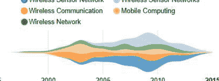

Yu-Chee Tseng 于 1994 年 1 月获得俄亥俄州立大学计算机与信息科学博士学位。他担任过中华大学（1994~1996）、国立中央大学（1996~1999）的副教授和国立中央大学教授（1999~2000）。目前是台湾国立台湾大学计算机科学系的教授（2000~至今），主席（2005~至今），副院长（2007~至今），同时也是中原基督教大学（2006~至今）的兼职教授。他的研究方向包括移动计算、无线通信、网络安全、并行和分布式计算。

Yu-Chee Tseng 是 ACM fellow，IEEE 的资深成员。他于 2001-2002 年及 2003-2005 年度获国家科学委员会颁授杰出研究奖，获最佳论文奖，分别于 2003 年、2004 年获颁“杰出奖”，并于 2005 年获俄亥俄州立大学颁发杰出校友奖。

Yu-Chee Tseng 担任多种期刊杂志的编辑工作，例如《计算机学报》（2001~至今）的副主编，《计算机杂志》（2003 年）的特邀编辑，《信息科学与工程学报》（2002~2008 年）的编辑，《信息科学与工程学报》（2002~2008 年）的编辑，IEEE Trans 的副编辑及《信息科学与工程学报》（2002~2008 年）的编辑等。

##### 以下是 Yu-Chee Tseng 发表论文中 citation 较高的论文：

- 450 The broadcast storm problem in a mobile ad hoc network
  Sze-Yao Ni, Yu-Chee Tseng, Yuh-Shyan Chen, Jang-Ping Sheu
  Mobile Computing and Networking (1999)
  Cited by 4858

- 449 The broadcast storm problem in a mobile ad hoc network
  Yu-Chee Tseng, Sze-Yao Ni, Yuh-Shyan Chen, Jang-Ping Sheu
  Wireless Networks (2002)
  Cited by 4796

- 448 The coverage problem in a wireless sensor network
  Chi-Fu Huang, Yu-Chee Tseng
  Wireless Sensor Networks and Applications (2003)
  Cited by 1546

- 447 Power-saving protocols for IEEE 802.11-based multi-hop ad hoc networks
  Yu-Chee Tseng, Chih-Shun Hsu, Ten-Yueng Hsieh
  Computer Networks (2002)
  Cited by 742

### 2.2.3 领域新星

George R. MacCartney Jr.，纽约大学的一名 PhD，师从 Theodore S. Rappaport。研究兴趣包括毫米波传播、统计通道建模、无线回程、射线追踪等领域。

Yunchou Xing，纽约大学的一名 PhD，师从 Theodore S. Rappaport。研究方向是无线通信、信道测深、射频通道测量等。

Ojas Kanhere，纽约大学的一名 PhD，师从 Theodore S. Rappaport。研究兴趣包括无线通信、毫米波通道音响开发、毫米波通道模拟器(NYUSIM)开发、统计通道建模及室内定位等。

Watthanasak Jeamwatthanachai，南安普顿大学 Lajos·Hanzo 教授的一名学生。他的研究兴趣在人机交互、用户体验以及实时嵌入式系统等领域，尤其是无线传感器网络。目前主要在研究如何帮助视障人士和盲人在公共空间和建筑物内的日常航行中更为便捷。

Nawfal f.Fadhel，南安普顿大学 Lajos·Hanzo 教授的一名学生。他的主要研究兴趣是 3D 打印、3D 安全、物理对象的来源、可转移 3D 维属性、密码学、数字安全等。

# 3 应用篇

# 3 应用篇

## 3.1 中国电信在人工智能领域的探索

通信行业涉及范围极为广泛，本节以中国电信行业为例，来探究 AI+通信的实际应用。

中国电信早在 2005 年进行业务转型过程中，就开始注意到以自然语言处理为代表的人工智能技术的重要性。首先在号码百事通搜索索引擎中进行了语义理解技术的研究及探索；从 2006 年开始，又以上海电信、中国电信股份有限公司上海研究院为应用及技术研究主体参与了国家 863 计划“中文为核心的多语言处理技术”，并主要负责“基于多语言识别、合成及跨媒体搜索等关键技术的综合信息服务应用示范”项目。研究成果应用在 2010 年上海世博会 962010 世博服务热线，提供中英日法多语言的人机交互服务。之后，中国电信的技术研发团队以现网需求为核心，对语义理解、语音识别、机器翻译、语音合成等技术较系统地研究及现网应用梳理，并逐渐把相关研究成果在 IPTV 自动语音控制、客服人机交互及搜索等业务中进行了探索性的研究及应用。

自然语言处理技术（Natural Language Processing，NLP）是人工智能的核心技术之一，是实现人机交互的关键支撑技术。自然语言处理技术主要包含语音识别（Automatic Speech Recognition，ASR），语义理解（Semantic Comprehension，或 Semantic Understanding）两项主要技术（另外还有语音合成及机器翻译等）。上海电信在人工智能领域的技术及应用研究主要是围绕 NLP 技术开展的，应用实践的主要业务有世博会 962010 的多语言服务系统、号百搜索、短信客服、微信客服、客服预质检、IVR 扁平化、自动总机以及 IPTV 自动语音控制等。

中国电信在 NLP 领域的语义理解实践，与互联网网页信息理解技术相比，具备比较独特的需求，即非标准语法条件下的短文本理解，需处理的文本以口语类型、非规范化、非标准语法的短文本（通常是几十个字文本，最大文本不过上百字）为主，从技术角度上看，表现形式有：

- 面向业务应用的关键词提取（分词/特征）：提取用户问题、会话文本中的关键词，而这些关键词基本是中国电信或上海电信业务涉及的自定义关键词；
- 同近义词理解：针对同一信息对象的不同语义相关的同义词、近义词识别及理解；
- 语法分析：应用传统的语法分析规则，经优化后针对短文本的特异性语法研究及应用；
- 上下文理解：由于在服务过程中，用户基本很难在一个对话短文本中准确表达需求，需实现对话文本的上下文理解；
- 带引导流程的自然语言理解应用服务：系统需有目的地根据后台能服务的信息，给用户提示，引导用户理解、并表达出后台能提供服务的信息需求；
- 智能搜索服务：在大多数情况下，系统不可能精确地给出问题答案，因此需要给出与问题相关的答案列表，搜索系统的优劣评价就是符合需求的答案排在列表的前几位，达到查准和查全可以接受的平衡点；
- 短文本分类及聚类：这个工作挑战最高，首先，上海电信业务分类的概念和定义本身就是随着业务需求演进的，客观上不存在一个适应性很强，特征表达很清晰的分类体系；

其次，不同业务人员对某一个类的理解，受限于知识水平和接触业务，对类的认识也不一样；第三，移动互联网条件下，业务融合趋势越来越明显，这造成了类的内涵和外延不断变化，对模型和算法的适应性要求很高；第四，上海电信面临的分类文本，如上所述是非标准语法表达条件下的短文本分类，这与以往的研究不同。

人工智能技术未来将应用到电信的各个业务条线，以工业互联网及智能制造领域为例，工业大数据应用的核心技术就是人工智能技术，通过对各类标识技术汇聚的工业大数据进行分析，可以在工业互联网领域实现类似互联网领域的信息聚合效应，进而触发新业态的形成。未来可以进行的应用方向有：基于不同标识解析体系数据融合的应用试验示范、面向物联网语义理解及语义互操作的试验示范、基于标识进行行业语义定义及相应语义扩展的试验示范、基于标识技术支持工业互联网与互联网数据相互融合的数据开放技术研究及实验示范等。

## 3.2 AI+通信的热点挖掘

### (1) 通信（Communication）

我们选取通信（Communication）领域近期热度，全局热度最高，相关性最强的 7 个相关领域作为研究对象，具体包括：

- 1. 通信（Communication）
- 2. 电信（Telecommunication）
- 3. 电信服务（Telecommunication Service）
- 4. 电信行业（Telecommunication Industry）
- 5. 电话（Telephony）
- 6. 在线社区（Online Community）
- 7. 无线通信（Wireless Communication）

### (2) 人工智能（Artificial Intelligence）

选取人工智能（Artificial Intelligence）领域近期热度，全局热度最高，相关性最强的 10 个相关领域作为研究对象，具体包括：

- 1. 人工智能（Artificial Intelligence）
- 2. 自然语言处理（Natural Language Processing）
- 3. 机器翻译（Machine Translation）
- 4. 机器学习（Machine Learning）
- 5. 计算机视觉（computer vision）
- 6. 计算机图形学（Computer graphics）
- 7. 可视化（visualization）
- 8. 人机交互（human-computer interaction）
- 9. 虚拟现实（Virtual reality）
- 10. 数据挖掘（Data mining）

### (3) 通信+人工智能（Communication + Artificial Intelligence）

- 交叉创新笛卡尔智能分析

通过对两个领域的知识图谱的计算，再对两个领域的细分子领域进行笛卡尔乘积热点挖掘，本研究报告挖掘了历史数据分析和未来趋势预测两部分。其中本报告主要探讨 2007 年至今的研究状况；趋势预测仅以未来 3 年为周期来探讨。

领域交叉热力值由交叉研究的论文的 Citation 等数据加权计算得出，热力值越高，表明这两个交叉子领域交叉研究的越深入和广泛；学者研究影响度由交叉领域内论文量，H-index 等计算得出；论文相关度由交叉领域内论文的关联程度和引用数量等计算得出；对比分析中“中外研究人员对比”和“中外研究论文对比”是专家数量和论文数量的直接对比；而“中外论文影响对比”是论文 Citation 值的对比。

- 历史热点图

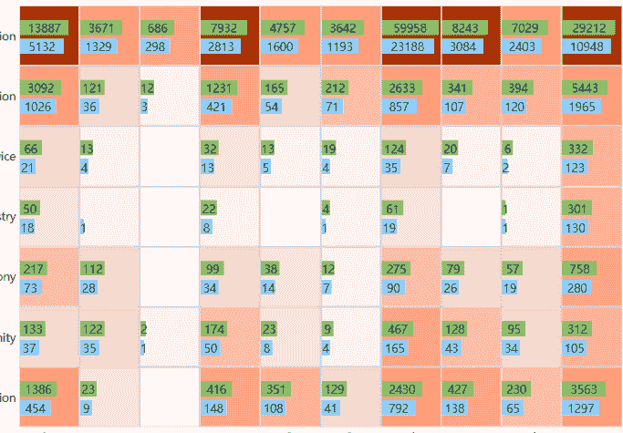

图 11 2007 年至今通信与 AI 领域交叉分析

- 历史数据统计

2007 年至今，全球共有 28707 位专家投入了 Communication 和 Artificial Intelligence 领域的交叉研究中，其中华人专家 4960 人，约占 17.28%，共产生交叉研究论文 10898 篇。学者 H-Index 分布和 Citation 分布如下：

表 1 2007 年至今 communication 领域与 artificial intelligence 领域交叉研究学者 H-index 分布

| H-index | 专家人数 | 分布占比 |
|---|---|---|
| 小于 10 | 117431 | 93.53% |
| 10-20 | 5665 | 4.51% |
| 20-40 | 1883 | 1.50% |
| 大于 40 | 383 | 0.31% |
| 总计 | 12554 | 100% |

表 2 2007 年至今 communication 领域与 artificial intelligence 领域交叉研究论文 Citation 分布

| Citation | 专家人数 | 分布占比 |
|---|---|---|
| 小于 10 | 26426 | 53.48% |
| 1-10 | 14822 | 30.00% |
| 10-100 | 7461 | 15.10% |
| 100-200 | 439 | 0.89% |
| 大于 200 | 264 | 0.53% |
| 总计 | 49412 | 100% |

- 交叉研究热点

- 1. 通信与可视化（communication & visualization）
- 2. 通信与数据挖掘（communication & data mining）

下面就这两个交叉研究热点做详细分析：

### 3.2.1 通信与可视化（communication & visualization）

communication & visualization 相关性最高的 5 位专家为：

Luca Benini
H 83 A 171.06 S 84.72 c 31528 P 690
professor
ETH Zürich
Design Space Exploration Fault Tolerance Wireless Sensor Networks Low Latency Power Management Embedded Computing Video Processing Heterogeneous Computing

Lothar Thiele
H 70 A 73.82 S 21.08 c 39524 P 410
professor
Swiss Federal Institute of Technology Zurich Computer Engineering and Networks Laboratory
Wireless Sensor Networks Performance Analysis Distributed Systems Sensor Networks Embedded Software Design Space Exploration Embedded Systems System Architecture

Bernd Girod
H 69 A 47.57 S 17.41 c 22935 P 475
Professor
Stanford University
Error Concealment Data Compression Video Compression Video Compression Standards Wireless Channel Motion Compensation Scalable Video Coding Image Compression

Edward A. Fox
H 64 A 48.38 S 13.87 C 22536 P 682
Professor
Dept. of Electrical and Computer Engineering, Virginia Tech
Digital Libraries Information Retrieval Knowledge Management Information Access World Wide Web Digital Library Open Access Knowledge Discovery

Majid Sarrafzadeh
H 52 A 75.45 S 33.73 C 9485 P 423
Professor
Embedded & Reconfigurable Computing Lab (ER Lab), University of California, Los Angeles
Wireless Sensor Networks Sensor Networks High Level Synthesis Fault Tolerant Embedded Computing Anomaly Detection Static Timing Analysis Physical Design

#### communication & visualization 相关性最高的论文为：

- **The ONE simulator for DTN protocol evaluation**
  Ari Keränen, Jörg Ott, Teemu Kärkikäinen
  SIMUTools (2009)
  Cited by: 1892
- **Toward a Deeper Understanding of the Role of Interaction in Information Visualization**
  Ji Soo Yi, Youn ah Kang, John T. Stasko, Julie A. Jacko,
  IEEE Trans. Vis. Comput. Graph. (2007)
  Cited by: 723
- **The Rise of People-Centric Sensing**
  Campbell, A.T., Eisenman, S.B., Lane, N.D., Miluzzo, E.
  Internet Computing, IEEE (2008)
  Cited by: 499

#### communication & visualization 历史对比：

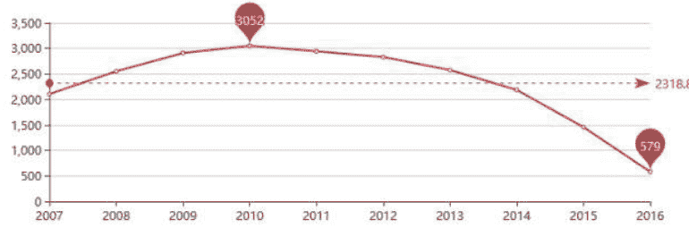

图 12 communication & visualization 历史论文数据

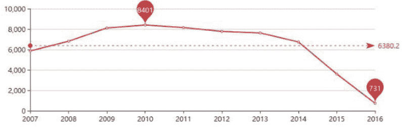

图 13 communication & visualization 历史专家数据

communication & visualization 中美两国对比：

#### 中美研究人员对比

| 地区 | 数量 |
| --- | --- |
| 中国 | 14793 |
| 美国 | 10969 |
| 其他 | 34202 |

#### 中美研究论文对比

| 地区 | 数量 |
| --- | --- |
| 中国 | 3209 |
| 美国 | 2415 |
| 其他 | 4040 |

#### 中美论文影响对比

| 地区 | 数量 |
| --- | --- |
| 中国 | 32380 |
| 美国 | 31632 |
| 其他 | 48706 |

图 14 communication & visualization 中美对比

communication & visualization 研究中，领先的国家分别是：

- 1. 中国（China）
- 2. 美国（USA）
- 3. 英国（United Kingdom）
- 4. 日本（Japan）
- 5. 德国（Germany）

communication & visualization 研究中，全球主要研究机构是：

- 1. 斯坦福大学（Stanford University）
- 2. 卡内基梅隆大学（Carnegie Mellon University）
- 3. 犹他大学（University of Utah）
- 4. 麻省理工学院（Massachusetts Institute of Technology）
- 5. 伊利诺伊大学厄巴纳-香槟分校（University of Illinois at Urbana-Champaign）

### 3.2.2 通信与数据挖掘（communication & data mining）

communication & data mining 相关性最高的 5 位作者为：

Amit P. Sheth
98 138.28 55.79 40385 774
Professor
Department of Computer Science & Engineering Wright State University
Semantic Web Web Service Ontology Rdf Information System Social Network Workflow Management System Semantics

Serge Abiteboul
84 48.05 24.40 38635 356
Professor
INRIA Saclay
Xml Document Web Service Xml Query Language Data Model Web Services Expressive Power Database System

Guohong Cao
71 123.98 40.32 19208 246
Professor and Director
Department of Computer Science and Engineering at the Pennsylvania State University
Wireless Sensor Network Sensor Network Mobile Computer Wireless Network Ad Hoc Network Computer Science

Schahram Dustdar
64 281.17 127.04 22610 713
Full Professor
Information Systems Institute Vienna University of Technology
Web Service Service-oriented Architecture Cloud Computing Business Process Quality Of Service Service-oriented Computing Gridware Software Architecture

李旺聪（Wang-Chien Lee）
56 167.24 84.46 10948 385
Associate Professor
Department of Computer Science and Engineering The Pennsylvania State University
Indexation Mobile Computing Query Processing Wireless Sensor Networks Location Based Service Wireless Sensor Network Sensor Network Indexing

communication & data mining 相关性最高的 5 篇论文为：

- **Optimal beamforming for two-way multi-antenna relay channel with analogue network coding**
  Rui Zhang, Ying-Chang Liang, Chin Choy Chai, Shuguang Cui
  Selected Areas in Communications, IEEE Journal (2009)
  Cited by: 565
- **Identification of overlapping community structure in complex networks using fuzzy c-means clustering**
  Shihua Zang, Rui-Sheng Wang, Xiang-Sun Zhang
  Physica A: Statistical Mechanics and its Applications (2007)
  Cited by: 471
- **Interference Alignment for Cellular Networks**
  Changho Sun, David Tse
  Cited by: 402

#### communication & data mining 历史对比：

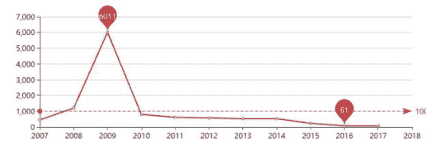

图 15 communication & data mining 历史论文数数据

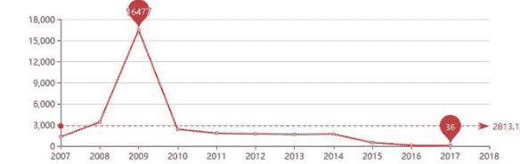

图 16 communication & data mining 历史专家数数据

#### communication & data mining 中美对比：

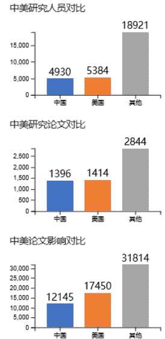

图 17 communication & data mining 中美对比

communication & data mining 研究中，领先的国家和地区分别是：

- 1. 美国（USA）
- 2. 中国（China）
- 3. 日本（Japan）
- 4. 德国（Germany）
- 5. 台湾（Taiwan）

Artificial Intelligence & Communication 研究中，全球主要研究机构是：

- 1. 北京大学（Beijing University）
- 2. 中国电子科技大学（University of Electronic Science and Technology of China）
- 3. 卡内基梅隆大学（Carnegie Mellon University）
- 4. 伊利诺伊大学厄巴纳-香槟分校（University of Illinois at Urbana-Champaign）
- 5. 明尼苏达大学（University of Minnesota）

# 4 趋势篇

按照 AMiner 交叉分析工具预测未来三年研究热度较高的交叉领域：

- 1. 通信与数据挖掘（communication & data mining）
- 2. 通信与人工智能（communication & Artificial Intelligence）
- 3. 通信与计算机视觉（communication & computer vision）

人工智能已经正式成为主流，各行各业都将运用智能语音识别、意图理解技术，机器学习和分析大数据，努力实现 AI 与教育、医疗、金融、司法、交通、工业等各领域的大融合，并做出了诸多有益的探索和实践，从“互联网+”到“AI+”，通信行业恰逢 5G 时代和人工智能时代两个机遇期，更是致力于 AI 与具体应用相结合，进行了诸多有益的探索。

未来的电信业面临着各种复杂性的挑战：网络服务越来越复杂（业务多样化）、网络维护越来越复杂、组织构架越来越复杂（CT 与 IT 文化与构架融合）、数据越来越复杂（万物互联产生海量数据，其中很多是无价值的），传统网络和新型网络之间的融合越来越复杂。举例而言，人工智能可以运用于网络主动安全防护、电信网诈骗防范、电视手机等通信工具等通信相关的领域。

人工智能应用于网络主动安全防护。ICT 行业网络信息安全事件频发，这些事件导致了许多不良后果，包括断网、经济损失和信誉受损等。故而通过机器学习在网络各层建立强大的智能安全防护体系意义非凡。基于机器学习的行为分析将显著地提高网络攻击检测、自动分析数据和识别孤立行为之间关系的能力。

人工智能应用于电信网诈骗防范。运用智能语音识别、意图理解技术，机器学习和分析大数据，能实现诈骗电话分类和诈骗深度判定的主动发现应用。

人工智能应用于电视手机等通信工具，可为用户提供超高清视频，并同时支持海量的机器通信，能与人对话，通过大数据自主判断决策，将逐渐渗透到各个生活场景。

面对足以令运营商掉泪的网络复杂性，以及由人工操作失误带来巨额损失的隐患，人工智能和自动化渗透入电信领域已是必然趋势。2018 年，我们将看到电信业加速引入人工智能以优化网络操作流程。

2018 年，我们也将看到运营商面向消费者的人工智能应用，比如聊天机器人与客户互动，减少客服成本；智慧家庭中将引入基于人工智能的语音助手等。

在感受到 AI 发展并带来各种好处的同时，也会给通信行业带来新的风险和挑战。

能源和硬件支撑是“AI+”的基础。在人工智能的大潮中通信行业也要“伺机而动”，需敏锐眼光和清晰思路。首先要从行为应用出发提供全盘解决方案和硬件支撑，让人工智能像能源一样驱动行业发展。用户随时随地在线，通信流量必将剧增，通信行业能耗也会随之剧增；以此同时，AI 也对包括处理器、传感器等方面的硬件领域带来需求，从而使相关产业链上的企业在受益的同时，具备足够的硬件支撑能力。

隐私保护、数据的权属很关键。由于电子商务的刺激，中国物流业的产业规模正在快速扩大，在利益驱动下，市场秩序存在一定程度的混乱，因而有必要加强同业组织建设和监管措施。中国最大物流公司顺丰与阿里系的菜鸟网络因物流数据产生摩擦，京东也因禁止平台商户使用天天快递，而和后者大股东苏宁爆发冲突。京东通知平台商户将关闭天天快递物流接口，理由是该快递公司服务质量较差。天天快递由此公开谴责京东，并向国家邮政局投诉其严重扰乱市场秩序。同时，京东还向平台商户提出一份推荐物流公司名单，其中将 EMS、圆通、德邦、百世汇通等公司排除在外。苏宁云商集团副董事长公开发文指责京东作恶，圆通、百世等公司也对京东做法提出异议，京东则发文反击，陷入口水战。京东与天天、菜鸟与顺丰，这些企业间最根本的矛盾在于对大数据的掌握。这些大数据究竟是企业商业秘密，还是公共产品？目前中国对部分传统行业如汽车销售、酒店餐饮等行业的用户数据，都按公共服务数据归入统计范围。而互联网企业掌握的用户数据信息缺乏与国家相关部门分享，导致他们认为这些数据是企业内部的商业秘密。因此用户隐私及数据权属问题亟待解决。

面对以上诸多风险和挑战，通信行业不可坐以待毙，而要有所应对。

国家协调相关部门从立法层面明确大数据的归属问题。在此基础上，建立通信、金融等相关行业数据库共享机制。2017 年，已被视为 5G 决定性的一年，这时更需各大通信企业发挥技术上的关键推动力和跨行业合作的纽带作用。电商行业可集中一部分信息数据收归国家，作为公共产品提供给客户共享，并在共享中共建。

加强人工智能通信行业的人才储备，提前预防失业冲击。政府及行业要大力投资人工智能相关教育和研究项目，资助顶尖大学创建人工智能研究实验室和创新中心，推进大学、科研机构和私营企业间的合作。未来的一项长久挑战是帮助受到人工智能冲击的通信行业劳动者重新适应并获得新技能，这将是保障公共福利和维护社会稳定的关键。政府及行业要及时识别那些是最可能被自动化取代的工作，并为受到影响的劳动者提供再培训。

# 参考文献

- [1] Australian Government, The communications sector : recent trends and developments, 2016, communications.gov.au/BCR
- [2] Budimir, M. An Overview of Research on Technological and Telecommunication Development [J]. Ekonomski Vjesnik, 2014: 171-182.
- [3] Why telcos will soon be betting on Artificial Intelligence to build their networks. https://telecom.economictimes.indiatimes.com/news/why-telcos-will-soon-be-betting-on-artificial-intelligence-to-build-their-networks/61531211
- [4] Jennings A. & Adam I. & Akira K. & Greg V. & Jon R. W., AI in Telecommunications[J]. https://www.ijcai.org/Proceedings/91-1/Papers/086.pdf
- [5] Artificial intelligence in Telecom: Intelligent operations is the new norm[R/OL]. http://bigdata-madesimple.com/artificial-intelligence-in-telecom-intelligent-operations-is-the-new-norm/
- [6] AI in the telecommunications industry - a Q&A with Infosys. https://www.gigabitmagazine.com/telecoms/ai-telecommunications-industry-qa-infosys
- [7] Wedge Greene, Trevor Hayes. The Promise of Artificial Intelligence in Telecom. https://www.pipelinepub.com/telecom_innovation/AI-in-telecom
- [8] Intel AI. Taking Telecom to New Heights with Artificial Intelligence, 2018. https://ai.intel.com/taking-telecom-new-heights-artificial-intelligence/

# 版权声明

AMiner 研究报告版权为 AMiner 团队独家所有，拥有唯一著作权。AMiner 咨询产品是 AMiner 团队的研究与统计成果，其性质是供用户内部参考的资料。

AMiner 研究报告提供给订阅用户使用，仅限于用户内部使用。未获得 AMiner 团队授权，任何人和单位不得以任何方式在任何媒体上（包括互联网）公开发布、复制，且不得以任何方式将研究报告的内容提供给其他单位或个人使用。如引用、刊发，需注明出处为“AMiner.org”，且不得对本报告进行有悖原意的删节与修改。

AMiner 研究报告是基于 AMiner 团队及其研究员认可的研究资料，所有资料源自 AMiner 后台程序对大数据的自动分析得到，本研究报告仅作为参考，AMiner 团队不保证所分析得到的准确性和完整性，也不承担任何投资者因使用本产品与服务而产生的任何责任。

