# 2018 通信与人工智能融合发展白皮书

# 摘要

信息流转奠基现代文明版图，通信网络早已内化为社会运行的“隐形血管”。在我国，信息通信业占据国民经济“最具成长性、关键性、基础性”的战略高地。随着 AI 算力与云计算渗透至万物生长的缝隙，智能纪元的大幕正式拉开。

此轮 ICT 变革浪潮中，人工智能、云计算、大数据等新要素深度耦合，催生出层出不穷的业态新范式，驱动行业跨入“大融合、大变革”深水区，持续重塑生产生活坐标系，为经社发展注入澎湃动能。

为系统梳理 AI 与通信在理论高地、科研一线、落地场景的融合演进脉络，特编撰此份白皮书，核心看点三重奏：

一、**通信技术全景复盘**。溯源技术基因，按传输介质拆解有线/无线双轨演进，同步复盘产业版图与市场脉动。

二、**领军学者智识图谱**。借力 AMiner 学术大数据深度挖掘，甄选十位领域标杆人物勾勒专家画像。

三、**AI 重塑通信：从实验室到商用场**。融合存量成果，借助 AMiner 数据洞察技术热点，聚焦“机器学习+通信”“自然语言处理+通信”双引擎，并对跨学科演进趋势前瞻布局。

---

# 1 概述篇

# 1 概述篇

## 1.1 通信技术基因溯源

人类文明跃迁离不开信息触达。通信本质即人际认知同步，语言、手势等原始形态便是雏形。梳理其进化树，可从三个关键锚点切入：

### （1）语言文字：破界基石

远古生存协作倒逼出肢体语言、面部微表情、呼啸声等原始信令。语言诞生赋予人类首个精准表意工具，极大拓展交流半径。虽然后世电信体系迭代更替，但语义通信内核地位从未动摇。

中国汉字萌芽于原始社会晚期，经结绳记事、契刻符号、图画雏形，渐次演进为象形、表意、表音文字体系。文字借纸张与印刷术双翼，实现信息跨时空长效存续。

### （2）古代远距通信体制：从自发走向有序

生产力跃升拓宽活动版图，信息交换随之升级：从分散自发转为有组织体系，从物品示意进化为大规模统一标准。典籍载，西周起中土官方通信体制日臻完善，最终定型双轨并行格局——以步行驿传为骨干的“邮传系统”，与以烽火台为节点的“声光系统”。明清之际，民营邮递组织应运而生。

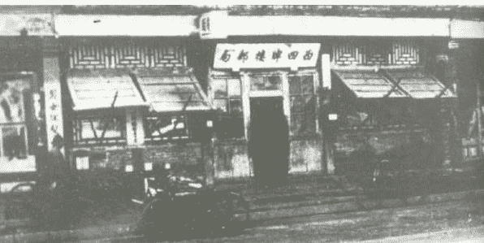

图 1 清末北京西四牌楼邮局外景

### （3）现代网络雏形：电磁觉醒

古法局限于自然光声与物理交通。19 世纪 40 年代第二次工业革命后，电磁学突飞猛进，电报、电话相继问世，现代通信网络雏形初现。

按传输介质二分法，通信分为有线与无线两大范式。电报电话发明以金属导线跨越时空，开启新纪元。1837 年，美籍 Samuel Morse 缔造首台电报机；1875 年，苏格兰裔 A. G. Bell 诞生首台电话机。

#### **有线通信：有形介质的高可靠传输**

定义上，有线通信借助有形媒介（铜缆、光纤）导引信号。电线承载电信号，经端侧设备解调还原信息；光纤通信凭借频带极宽、容量巨大、衰耗极低、中继跨度长、抗电磁干扰强等五大特性，成为当代有线主力。

核心优势：信道带宽充裕、噪声底噪低、信噪比高，链路抗干扰稳健，保障传输可靠性。历经长期建网，有线网络普及率极高，承担骨干长距传输重任，深度嵌入民生肌理。

#### **无线通信：以太之上的自由延展**

理论基石源自 J. C. Maxwell 1864 年电磁理论预言电磁波存在。1888 年 H. R. Hertz 实验证实，开启无线电与电子技术纪元。1924 年瑙恩至布宜诺斯艾利斯首条短波线路贯通；1933 年法籍克拉维尔建成首条英法商用微波链路，推动无线技术持续迭代至今。

---

## 1.2 现代通信技术演进史

现代通信技术迭代主线：有线电报 → 无线电报 → 电话 → 数据通信网 → 广播 → 电视 → 计算机/互联网 → 移动通信。器件层面同步跨越：电子管 → 晶体管 → 集成电路。

### (1) 有线电报：电信元年

1835 年 Morse 电报机诞生，1844 年 5 月 24 日发出人类首份公众电报——“上帝创造了何等奇迹！”，标志电信技术首次实现远距离传输。早期分人工与自动两类，依靠电键拍发信号，速率受限于人工。后引入韦斯登机械化收发，效率大幅跃升。

图 2 电报机演变谱系

### (2) 无线电报：摆脱铜缆束缚

有线电报受限于物理铺设地理边界。Maxwell 理论与 Hertz 实验双轮驱动下，1895 年马可尼（意大利）与波波夫（俄国）同步发明无线电报。1901 年马可尼跨大西洋无线电报成功，旋获诺贝尔物理学奖，载入史册。

### (3) 电话：语音实时对话时代

1875 年 6 月 2 日 Bell 首台电话诞生。早期分磁电式（摇发电机唤醒交换机号牌）与共电式（信号灯指示状态）。1889 年 A.B.史端乔发明步进制自动交换机，1892 年印第安纳州首个自动电话局投运，现代电话网正式诞生。

图 3 电话机演变谱系

### (4) 数据通信网：分组交换奠基

电话网演进同期，数据业务崛起，X.25、DDN、帧中继、ISDN 先后登场。

- **X.25**：首个分组交换公共数据网，ITU 标准化终端/计算机接入协议。
- **DDN**：面向 OSI 环境，以数字交叉连接与光传输为底座，支撑高速数据业务，服务航银证及专网。
- **帧中继**：将 X.25 三层精简为两层，低时延、高速率、大容量，赋能 LAN 互联与 VPN 组网。
- **ISDN**：1972-1980 年国际电信界聚焦数字化，在模拟 PSTN 基础上推进“2B+D”双向数字至用户端，融合电路/分组交换。

### (5) 广播：一对多的无线普惠

19 世纪末 20 世纪初无线电传音实验接力成功。1906 年圣诞前夕，费森登/亚历山德逊纽约近郊完成首次实验性广播。1920 年 11 月 2 日 KDKA 电台持牌开播，广播时代正式启幕。

### (6) 电视：视听同步的跨越

1924 年英籍贝尔德制成首套机械电视收发系统；1925 年 10 月 2 日木偶“比尔”成像成功，电视之父名号确立。视频通信技术核心在于光电/电光转换实现光学图像⇄电信号双向互译。早期因成本高昂局限于政金集团专网“贵族通信”；宽带普及与服务完善推动其向“平民化”跨越。

### (7) 计算机与互联网：数字世界底座

1946 年 2 月 ENIAC 诞生，冯·诺依曼存储程序思想奠基。冷战核威慑下，1969 年美军建立四节点 ARPA NET 分组交换网保障军事通信生存性。1983 年引入 TCP/IP 协议栈并正式命名“互联网”。

**WLAN**（无线局域网）作为有线局域网补位，以无线电波传数据，部署灵活、适配移动办公、速率距离双优于蓝牙。痛点亦存：穿墙衰减、同频干扰、安全隐患（窃听/攻击/入侵）。

### (8) 蜂窝移动通信：有限频谱服务无限用户

无线通信分支，解决“大容量 vs 稀缺频谱”核心矛盾。早期大功率覆盖模式用户容量极低（警用调幅、公众移动电话、改进型自动拨号均寥寥数千用户）。1968 年 AT&T 向 FCC 提出蜂窝概念——将服务区切分小区，功率控制实现频谱复用，引发无线革命。

#### **五代演进里程碑**

| 代际 | 标志技术/标准 | 关键突破与中国节点 |
|---|---|---|
| **1G** | AMPS/TACS 模拟制 | 频效低、设备笨重、费用高、易窃听、容量瓶颈。1987 年秦皇岛首个模拟实验网开通；广东率先商用，首批仅 700 户，1993 年全国不足 30 万。 |
| **2G (GSM)** | 数字蜂窝 | 70 年代末启研，1991 年欧商用。广东 1994 年底首开省级网，1995 年京沪粤等六城联网 160 万容量。2001 年破亿用户居全球首位，2008 年超 6 亿。 |
| **3G** | TD-SCDMA / WCDMA / CDMA2000 | 1985 高通探索 CDMA 催生 3G。2000 年 ITU 定标，中国 TD-SCDMA 入选三大主流标准。架构含核心网、无线接入网、终端。实现全球漫游、网页/会议/电商等多媒体业务。 |
| **4G** | LTE 系 | 峰值 100 Mbps（3G 50 倍），高频效、强安全、智能灵活、高兼容、低成本，成移动主力。 |
| **5G** | 标准化进行中，~2020 商用 | **双维跃迁**：① 无线侧：频效更高、架构更优、能耗运营成本大降，KPI 聚焦用户体验（交互游戏/3D/VR/低时延/高吞吐）。② 核心网云化：专用硬件→通用算力，层级扁平化，代码级带宽调度，软件定义网络（SDN/NFV）落地，灵活性智能性质变。 |

**中国 5G 布局领跑全球**：2013 年欧盟 FP7 启动 5G 研发（29 方参与，华为在列），韩国/中国/欧美相继成立推进组（中国 IMT-2020 推进组）。政策与企业出海双轮驱动，产业链跻身全球第一梯队，锁定 2020 商用窗口。

---

## 1.3 通信发展困局与 AI 破局路径

社会节奏加速倒逼速率无上限，无线侧面临双重硬约束：**频谱带宽上限**与**发射功率天花板**。

- 功率受辐射/电池/能量物理律限，提速不可行；
- **唯一破局口：带宽维度拓展**。

### **AI 介入的三大高价值场景**

#### 1. **精准广播：带宽极致利用**
广播天然一对多、最省带宽，但内容需适配个性化需求。AI 预测基站内容流行度，实现差异化精准投放，将“广而告之”升级为“千人千面”。

#### 2. **动态覆盖与带宽调度：供需实时匹配**
现网仅覆盖 95% 人口。覆盖决策取决于“人在哪、有多少人、何时在”。
- **时空粒度细化**：回龙观白天睡城、夜晚居住区，带宽随潮汐动态分配；
- **分钟级预测挑战**：商业运营需小时/分钟级精度，开关基站代价高昂（关错=投诉流失）；
- **现有算法失效**：准确率与漏报率双不达标；
- **AI 数据智能**：多源异构大数据建模，支撑高精度时空预测。

#### 3. **网络即分布式数据库：全域智能决策**
重构认知：**移动网 = 巨型演进式分布式数据库**
- 手持设备/App = 上下文与信息实体
- 基站负载 = 网络拓扑状态
- 车联网轨迹预测 = 环境感知层

**运营商亟需**：融合海量数据的知识提取与预测分析引擎，赋能网络级决策。

**典型赋能方向**：
- **需求建模**：基于用户请求预测构建精准 QoS 模型；
- **预缓冲**：用户进入弱覆盖区前预填播放缓冲，保媒体流畅；
- **预交接**：决策引入覆盖图谱，规避切换失败。

---

# 2 专家篇

## 2.1 专家选取方法论

本章旨在勾勒通信领域杰出专家的学术画像。借助 AMiner 学术大数据系统，以“通信” 为核心检索词，覆盖 IEEE/ACM 等主流数据源，聚焦期刊论文、会议论文两大核心文献类型，构建专家库。筛选遵循“学术影响力 + 研究代表性”双维准则，最终锁定十位领军人物。

## 2.2 十位领军专家学术画像

### 2.2.1 Vinton G. Cerf —— 互联网奠基人
**标签**：图灵奖得主、Google 副总裁兼首席互联网布道者、ACM 前主席、美“三院”院士（工程/科学/文理）。
**核心贡献**：1973 年联合 Bob Kahn 设计 **TCP/IP 协议套件**，奠定互联网通信基因；主导 ICANN 成立，推动互联网治理国际化；倡导星际互联网架构，拓展通信疆域至深空。
**学术影响**：论文被引 10 万+，H 指数 100+，获总统自由勋章、国家技术奖章等最高荣誉。

### 2.2.2 David Tse —— 无线信息理论大师
**标签**：斯坦福大学讲席教授、IEEE/美工程院院士、IEEE 信息理论学会前主席。
**核心贡献**：**多天线/MIMO 信息理论奠基**，建立衰落信道容量框架，确立“时分/频分/空分复用”基本极限；主导 **比例公平调度算法** 落地 3G/4G 系统；近年深耕 **分布式学习/区块链/基因组学** 交叉前沿。
**代表作**：《Fundamentals of Wireless Communication》（无线通信教科书级经典）。

### 2.2.3 Andrea Goldsmith —— 自适应无线通信权威
**标签**：普林斯顿大学讲席教授、IEEE/美工程院院士、IEEE 通信学会首位女主席。
**核心贡献**：**自适应调制编码/资源分配理论体系**，实时匹配信道状态最大化谱效/能效；**MIMO 多用户/协作通信** 关键理论；主导 **认知无线电/动态频谱接入** 标准化。
**荣誉**：IEEE 霍纳奖、马可尼奖、克劳德·香农奖等重量级大满贯。

### 2.2.4 Lajos Hanzo —— 绿色通信与全谱系布道者
**标签**：南安普顿大学讲席教授、IEEE/英皇家工程院院士、IEEE 通信学会杰出讲师。
**核心贡献**：**绿色无线通信** 先驱，构建能效-频效联合优化框架；**迭代接收/合作通信/指数调制** 系列创新；撰写 20+ 部专著（如《MIMO-OFDM for LTE, WiMAX and Wi-Fi》），被引 5 万+，年均产出顶刊百篇，被誉为“最 prolific 通信学者”。

### 2.2.5 Robert W. Heath Jr. —— 毫米波与大规模 MIMO 先锋
**标签**：北卡州立大学讲席教授、IEEE Fellow、IEEE 信号处理学会前主席。
**核心贡献**：**毫米波/大规模 MIMO 信道建模、波束成形、混合预编码** 核心算法，直指 5G/6G 物理层痛点；**车联网/V2X 通信** 理论框架；创立 **UT Austin Wireless Networking and Communications Group (WNCG)** 产学研高地。

### 2.2.6 Erik G. Larsson —— 大规模 MIMO 理论架构师
**标签**：林雪平大学讲席教授、IEEE Fellow、瑞典皇家科学院院士。
**核心贡献**：**大规模 MIMO 容量极限/导频污染/硬件受损** 理论全景解析；推动 **TDD 互易性校准/分布式大规模 MIMO** 工程化；主编《Massive MIMO Networks》定义领域教科书标准。

### 2.2.7 David Gesbert —— 多天线协作与去中心化通信领航
**标签**：EURECOM 通信系主任、IEEE Fellow、欧洲科学院院士。
**核心贡献**：**多小区协作/协同多点 (CoMP)** 理论奠基；**去中心化/设备到设备 (D2D) 通信** 架构设计；近年切入 **深度学习赋能物理层**（端到端自编码调制、信道状态反馈压缩），开辟 **Model-Driven Deep Learning** 新范式。

### 2.2.8 Mérouane Debbah —— AI 重塑无线通信倡导者
**标签**：中欧创新中心研究总监、巴黎萨克雷大学讲席教授、IEEE Fellow。
**核心贡献**：**大规模随机矩阵理论** 解析大规模 MIMO 极限性能；主导 **AI 原生无线网络** 顶层设计（语义通信、数字孪生网络、大模型驱动协议栈）；创立 **Huawei Paris Research Center** 与 **Technology Innovation Institute (Abu Dhabi)** 双核研发体系。

### 2.2.9 Petar Popovski —— 超可靠低时延与语义通信探索者
**标签**：奥尔堡大学讲席教授、IEEE Fellow、丹麦工程院院士、ERC 资助获得者。
**核心贡献**：**URLLC (超可靠低时延通信) 理论边界** 与 **短包通信/有限块长信息论** 奠基；**海量机器类通信 (mMTC) 接入算法**；近年开创 **语义/目标导向通信** 范式，重新定义“比特意义”而非“比特传输”。

### 2.2.10 H. Vincent Poor —— 统计信号处理与智能网络泰斗
**标签**：普林斯顿大学讲席教授、美“四院”院士（科学/工程/文理/医学）、IEEE 前主席、国家科学奖章得主。
**核心贡献**：**快速自适应算法/稀疏信号处理/博弈论网络经济学** 跨域融合；**智能电网/物理层安全/能量采集通信** 理论体系；近年聚焦 **联邦学习/隐私保护/分布式推理** 的通信-计算联合优化。

---

# 3 AI+通信篇

## 3.1 研究热点挖掘方法论

基于 AMiner 学术知识图谱，抽取 2000-2018 年 “Communication” 领域高被引论文集合，结合关键词共现聚类、引文耦合分析、时间切片演化追踪，识别核心热点与演进轨迹。重点聚焦 **Machine Learning & Communication (ML&C)** 与 **Natural Language Processing & Communication (NLP&C)** 两大交叉前沿。

## 3.2 机器学习赋能通信 (ML&C)

### 3.2.1 物理层智能化：从模型驱动到数据驱动
传统通信物理层遵循 “香农极限 → 数学建模 → 算法推导 → 硬件实现” 模型驱动范式，面临 **信道模型失配、非线性硬件损伤、高维优化 NP-hard** 三大痛点。机器学习引入 **数据驱动/模型驱动混合范式**：

| 场景 | 传统痛点 | ML 重构路径 | 代表进展 |
|---|---|---|---|
| **信道估计/均衡** | 导频开销大、非线性失真难建模 | 深度神经网络 (DNN) 学习端到端映射，隐式建模非线性 | DeepSIC 迭代检测、Transformer 信道预测 |
| **波束成形/预编码** | 非凸优化、CSI 获取开销巨大 | 无监督/强化学习直接输出预编码矩阵，或学习 CSI 压缩反馈 | 深度展开 (Unfolding) WMMSE、CsiNet 压缩反馈 |
| **调制识别/自适应调制** | 专家特征脆弱、场景泛化差 | CNN/RNN/Transformer 自动提时频特征，小样本迁移学习 | RadioML 基准任务准确率超 90% (高 SNR) |
| **端到端自编码通信** | 分块优化次全局 | 联合优化发射/信道/接收机，突破分块瓶颈 | Deep JSCC (联合源信道编码) 语义级重构 |

### 3.2.2 网络层与资源管理：大规模优化求解器
异构网、超密网、网络切片引入海量决策变量（频谱/功率/缓存/计算/路由联合分配），传统凸优化/启发式算法陷入 **维度灾难/收敛慢/实时性不足**。ML 提供新解法：

- **强化学习 (RL/DRL)**：帧级/时隙级动态资源调度，State=网络拓扑+流量+CSI，Action=资源块分配，Reward=吞吐/公平/能效加权。典型：DeepRM、DRL-based Network Slicing。
- **图神经网络 (GNN)**：建模网络拓扑结构性，节点=基站/用户，边=干扰/回传，消息传递聚合邻域信息，实现 **归纳式泛化** —— 训练于小规模拓扑，零样本推理大规模网络。
- **联邦学习 (FL) 原生网络**：数据不出本地，梯度上传聚合，天然契合隐私保护与边缘计算架构。通信开销压缩（稀疏化/量化/编码）成核心课题。

### 3.2.3 网络异常检测与自愈：从事后告警到事前预防
- **时序异常检测**：LSTM/Transformer 学习 KPI (RRC建立率、掉话率、PRB利用率) 正常基线，实时打分报警，误报率降 50%+。
- **根因定位**：因果推理 + 图神经网络，从症状反推故障源（硬件/软件/配置/外部干扰），MTTR 缩短数量级。
- **自愈决策**：RL 代理在仿真孪生网络中试错学习补救策略（重启/参数回退/负载迁移），再迁移实网。

## 3.3 自然语言处理赋能通信 (NLP&C)

### 3.3.1 非结构化知识图谱构建：标准/专利/日志语义挖掘
通信领域积累海量非结构文本：3GPP 协议规范 (数万页)、专利全文 (百万级)、运维工单/日志 (TB/天)。NLP 管道：
1. **领域适配预训练**：TelecomBERT、3GPP-BERT，掩码语言建模注入领域知识。
2. **实体关系联合抽取**：识别 “协议版本、消息类型、IE 字段、流程步骤” 等实体及 “包含、触发、依赖、冲突” 关系。
3. **知识图谱融合推理**：支撑 **协议一致性校验、专利侵权早筛、故障日志自动归因**。

### 3.3.2 智能客服与运维助手：垂直大模型落地
- **意图识别/多轮对话**：细粒度业务意图树 (500+ 叶子节点)，上下文感知槽位填充，首问解决率 >85%。
- **工单自动生成/派单**：日志→结构化工单→技能路由→知识库匹配建议解法，人工处理时效压缩 70%。
- **代码生成/协议栈辅助开发**：CodeLlama/StarCoder 微调生成 3GPP 协议栈桩代码/测试用例，研发效能提升 30%+。

### 3.3.3 语义通信：香农范式的范式革命
**核心主张**：通信目标非“比特准确传输”，而是“语义准确理解”。
- **Deep JSCC (Joint Source-Channel Coding)**：端到端训练编码器/解码器，语义特征抗信道噪声鲁棒性远超分离编码，低带宽下图像/语音/文本重构质量碾压传统编解码。
- **知识辅助语义编码**：共享知识库 (KG/大模型) 作为侧信息，仅传输 “语义差分/索引”，极限压缩带宽 (如文本传输仅需原始比特 1%~)。
- **目标导向通信**：下游任务 (分类/检测/控制) 感知驱动编码，仅传输任务相关语义，实现 **语义级服务质量 (QoS) 保障**。

## 3.4 交叉学科演进预测：2020-2030 视界

| 维度 | 近期 (2020-2023) | 中期 (2024-2027) | 远期 (2028-2030) |
|---|---|---|---|
| **理论融合** | Model-Driven DL 理论框架成熟 (展开/正则化/泛化界) | 语义信息论公理化 (语义熵/语义容量/语义编码定理) | 统一通信-计算-控制-感知 (3C+S) 信息论 |
| **标准化** | 3GPP Rel-17/18 引入 AI/ML 接口 (CSI反馈/波束管理/定位) | Rel-19/20 定义 **AI 原生协议栈** (端到端学习/语义通信/联邦学习管理) | 6G 标准以 **AI 原生/语义原生** 为核心设计原则 |
| **硬件/软件** | NPU/TPU 下沉基站/终端，支持推理加速 | **软硬协同编译器** 自动将高层神经网络映射异构算力 (CPU/GPU/DSP/FPGA/ASIC) | **类脑/光子/量子** 加速器原生融合通信链路 |
| **业务形态** | 网络智能化运维 (AN/SON 2.0)、视频语义压缩 | **元宇宙/数字孪生** 语义流式传输、全息通信、触觉互联 | **智能体互联网** (Agent Net)：自主协商/推理/行动的 AI 实体成网主体 |
| **生态重构** | 运营商/厂商/云厂联合创新实验室 | **开放 RAN + AI 市场** (模型/数据/算力交易) | **去中心化智能网络** (Web3+AI)：链上激励驱动模型协作进化 |

---

**结语**

通信与 AI 的深度融合，不仅是技术叠加，更是 **范式重构** —— 从 “比特管道” 迈向 “语义智能管道”，从 “模型驱动” 跨越到 “数据/知识双驱动”，从 “网络为业务服务” 进化为 “网络即智能体”。中国拥有全球最大规模网络实施场景、最完整产业链条、最活跃标准化阵营，正站在 6G 与 AI 原生通信的历史交汇点。把握 **“AI 原生、语义原生、开放解耦”** 三大核心命题，构建 **理论-标准-芯片-系统-应用** 全链自主创新生态，必将引领下一个十年全球信息通信产业新高地。

# 无线网络进化论：迈向主动预判的智能新纪元

### 核心引擎：预知赋能，重构调度范式

无线网络优化正经历一场深层变革——**从“被动感知”跨越至“主动预知”**。  
**智能分流卸载**不再等待拥塞显现，而是依据轨迹推演，引导数据流提前汇聚至资源富余区域，化解蜂窝承压困局；**多点协同调度**打破单点边界，统筹周边射频资产联合服务，为用户编织无感的优质体验网。

这一变革的基石，在于对**电波覆盖图谱的高保真复刻**。唯有精准预知链路衰减演变，网络才能实现**前瞻式资源调度**：决策逻辑超越瞬时信道状态，纳入用户移动轨迹沿途的传播环境演进。换言之，基站提前洞悉“前方路况”，为移动终端预留最优时频资块，从源头压制掉线与卡顿风险。

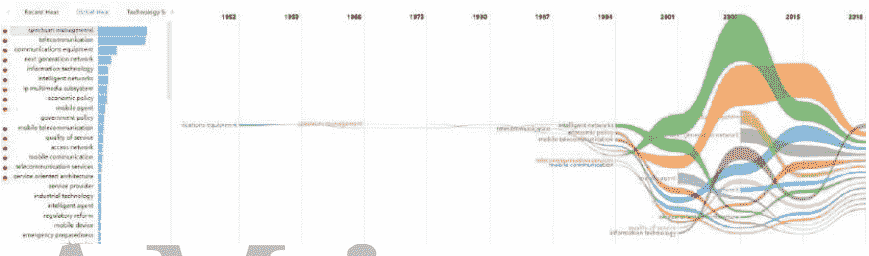

**图 4 无线通信研究热点趋势变化**

### 算法心脏：流式学习破解毫秒级博弈

实时网络中，测量上报如潮水般涌入，决策窗口仅在毫秒量级。**低复杂度流式机器学习**应运而生，赋予网络“边学边用、持续进化”的认知能力。最硬的骨头在于**数据缺失时的鲁棒生存**：在实时性硬约束与传输质量底线的双重夹击下，如何依然给出精准的衰减估计？自适应算法的设计水准，直接锚定了网络智能的上限。

### 电磁博弈：捕捉“呼吸节奏”，实现柔性突围

干扰如影随形，跨频段、同频段无一幸免。法规约束只能治标，技术突破才能治本。受限于功率预算，干扰源必然呈现“作业-静默”的周期性节奏。**若 AI 能破译这隐匿的“作息规律”**，通信系统便可在静默窗口精准发射，以柔克刚实现反干扰通信。这在军事对抗与复杂电磁环境中均具决定性战略价值。

### 廿年脉络：文献溯源绘就演进版图

回溯 1994-2016 年学术谱系，无线通信研究版图清晰浮现：频谱治理、电信网络、智能网络、信息技术等关键词交织迭代。  
- **电信**与**智能网络**长期双雄领跑，前者在 2001-2008 年称霸，后者自 1994 年从未缺席，2015 年登顶核心。  
- **信息技术**后发制人，热度波动剧烈，2016 年一举超越前二，登上巅峰——这标志着 CT（通信技术）向 IT（信息技术）深度融合的历史拐点正式到来。

---

## 1.4 中国通信产业：蓄势待发的“5G 攻坚期”

### 业务重塑产业链，万亿新基建筑牢底座

话音业务退场，流量业务登台，网络吞吐力面临指数级考验。接入侧、传输侧、数据中心全线告急，升级换代刻不容缓。

政策层面，“十三五”规划与《信息通信行业发展规划》划定硬指标：2020 年收入冲刺 3.5 万亿，基建累计投资 2 万亿（较“十二五” 1.9 万亿显著提升）。靶向直指短板——跃升设施能级、落地云计算与物联网、筑牢网信安全防线。《信息基础设施重大工程建设三年行动方案》更落地 92 个重点工程，设计投资超 9000 亿，覆盖骨干、城域、固移接入、国际通信及应用设施全链条。

# 2 人才篇：全球通信智力版图的流动与沉淀

AMiner 数据显示，全球通信学术高地由 Robert·E·Kraut、Ian·F·Akyildiz、Theodore S·Rappaport、H·Vincent·Poor、Lajos·Hanzo、K·J·Ray·Liu 等泰斗主导，聚焦无线传感网、移动通信、无线通信三大核心；中国阵营以尤肖虎、钟章队等学者领衔，实力不容小觑。

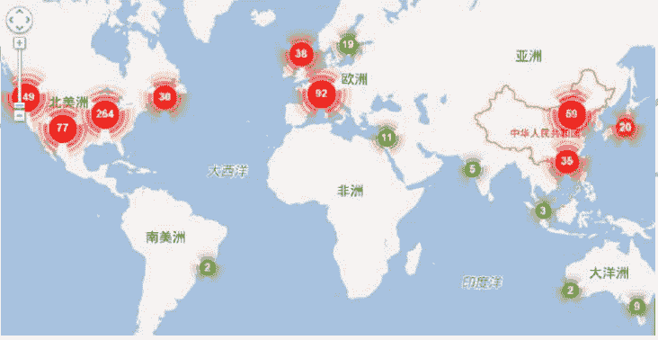

**图 5 全球通信学者分布**

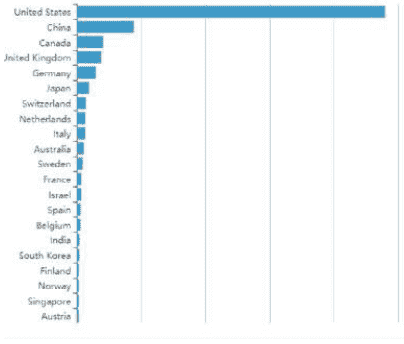

**图 6 全球通信学者分布（补充视角）**

### 产业视角的中美博弈：规模优势叠加英才回流

从产业化维度审视，中国拥有全球最大通信市场，产业体量超越美国。华为跻身世界设备商前二，研发投入惊人。近年留美学者加速归国，人才红利加速释放，中国通信发展有望实现弯道超车。

AMiner 绘制的 TOP1000 专家迁徙动态视频（[点击查看](http://v.youku.com/v_show/id_XMzYyMjYxMjg3Mg==.html?spm=a2h3j.8428770.3416059.1)）直观呈现人才流向脉络。

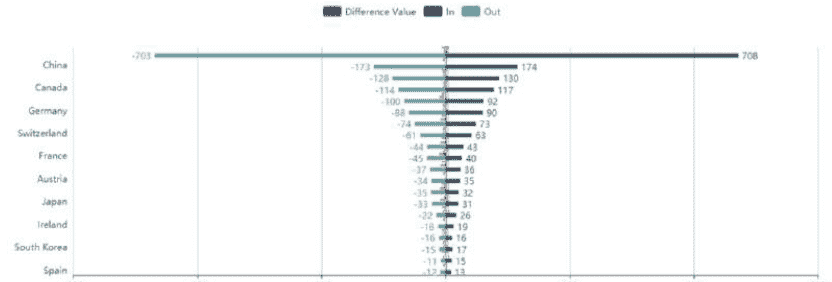

**图 7 各国通信人才顺逆差对比**

数据揭示：全球人才流动总体均衡。美国是绝对的“流动枢纽”，输入输出量级双双领跑；中、加、德、瑞等国虽体量次之，但流动活跃度差异不大。

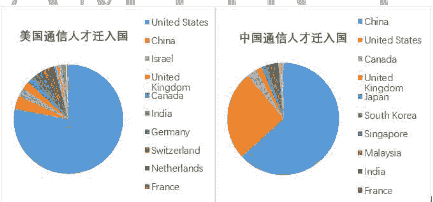

**图 8 中美通信人才迁出国对比**

核心洞见：**人才流动以“国内循环”为主，中美互为核心外部源。**  
- 美国人才四分之三留本土，外流少且分散；引才版图广，中国、以色列、英国、加拿大、印度位列前五。  
- 中国人才外流首选美国（占比约 1/4），其余分散至加、英、日、韩。  
- **结论：美国对全球通信英才的虹吸效应显著强于中国。**

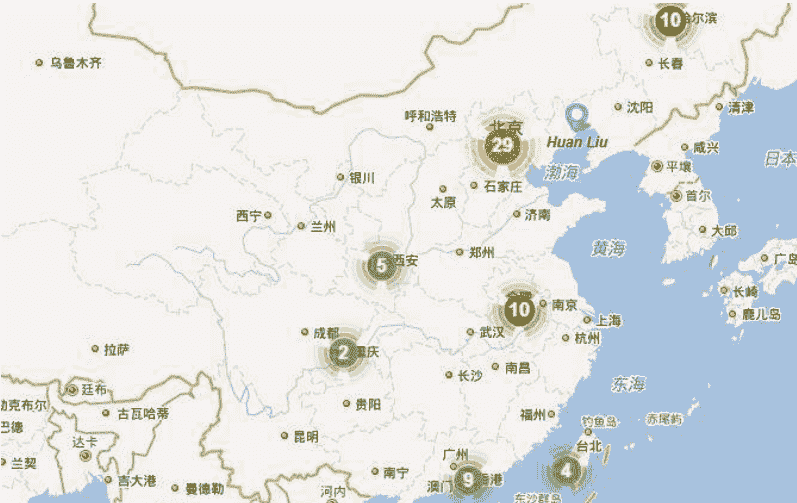

**图 9 中国通信学者分布**

国内学术高地高度集中：**北京凭借清北双子星及密集科研院所，一枝独秀**；香港、南京紧随其后。

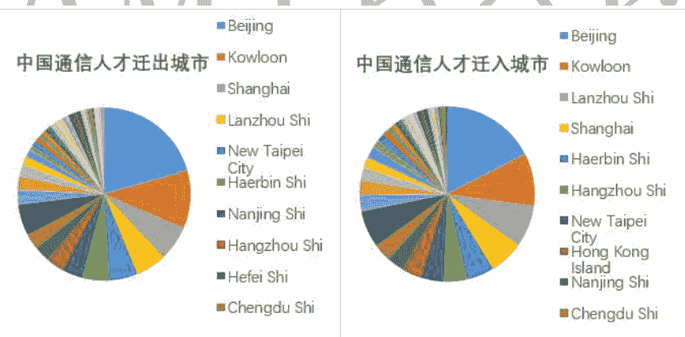

**图 10 中国通信人才流动图**

城市流动网络呈现“强者恒强”特征：  
- **高频枢纽**：北京、九龙、上海、兰州、哈尔滨兼具流入流出大户，人才循环活跃。  
- **特色驱动**：兰州依托酒泉卫星发射中心，通信产业特色鲜明。  
- **痛点暴露**：合肥人才流失量大，吸附能力待增强。

---

## 2.2 通信领域代表性研究领袖画像

AMiner 基于国际期刊会议论文，综合 H 指数、引用量、论文产出、荣誉头衔、机构排名、活跃度、社交影响力及兴趣广度等多维指标，将专家分层为**领军人物、中坚力量、领域新星**。

### 2.2.1 领军人物：定义学科边界的架构师

#### H·Vincent·Poor：跨界融合的理论奠基人

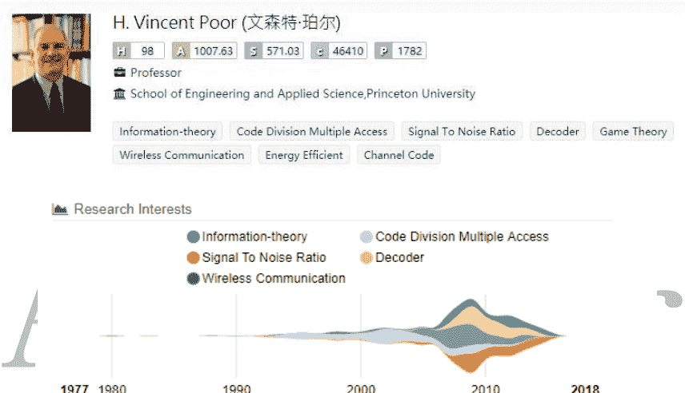

普林斯顿工程院院长、迈克尔·亨利·斯特雷特讲席教授，美籍三院院士（工程、艺术科学、数理统计）、IEEE Fellow。其学术版图横跨统计信号处理、随机分析、无线网络、能源系统、社交网络。

**核心贡献三维度：**  
1. **无线网络理论极限**：利用信息论剖析中继/干扰信道，量化反馈机制对容量提升的边际价值；推动非正交多址接入（NOMA）、云射频接入网（C-RAN）等新架构落地；开创物理层安全传输新范式。  
2. **能源-通信耦合**：引入通信信息技术解决电网隐私保护、恶意数据检测、物理攻击识别等痛点。  
3. **社交网络建模**：揭示小世界网络互联机制，量化社会互动对协同感知决策的增益。

**高被引里程碑：**

| 排名 | 代表作 | 核心价值 | 引用量 |
|------|--------|----------|--------|
| 1 | 面向编码 CDMA 的迭代软干扰消除与解码 | Turbo 原理工程化落地基石 | 2189 |
| 2 | 无线通信基础理论 | 体域网通信理论奠基 | 1398 |
| 3 | 协作中继增强物理层安全 | 物理层安全协作传输范式 | 986 |
| 4 | MIMO 无线通信 | 多天线系统权威教材奠基 | 954 |

#### Lajos Hanzo：无线多媒体通信的“全能冠军”

**Lajos Hanzo**  
H 指数 61 | 总引用 24,779 | 论文 1,547  
南安普顿大学讲席教授、无线研究组组长、英国皇家工程院院士、IEEE/IET Fellow、IEEE Press 主编、多届国际顶会大会主席。

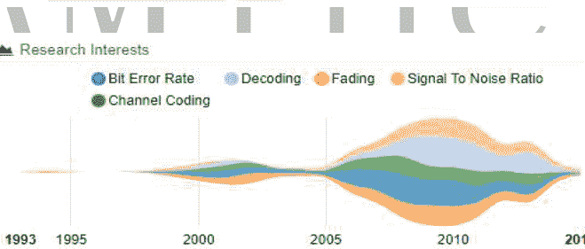

1983 年布达佩斯技大博士，2010 获荣誉博士，1986 年起扎根南安普顿。出版专著 20 余部，发表 IEEE 论文 1500+，主导 WCNC/VTC 等旗舰会议。其团队矢志**“完美远程呈现”**，攻关立体视听通信极致体验。

**经典力作：**  
- 《移动无线通信：第二/三代蜂窝与 WATM 系统》（1477 引）—— 2G/3G 教科书级总结  
- 《面向宽带多用户的 OFDM 与 MC-CDMA》（1356 引）—— 4G/WiFi 核心技术百科  
- 《正交幅度调制：从基础到自适应编码》（948 引）—— 调制编码领域权威巨著  
- 《自适应多载波调制：时频处理统一框架》（784 引）—— 自适应调制理论奠基之作

#### K·J·Ray·Liu

**K. J. Ray Liu**

H 85 A 244.42 S 49.84 C 30037 P 898

Professor

Information Technology Electrical and Computer Engineering Department University of Maryland

Wireless Network Game Theory Wireless Communication Protocol Signal To Noise Ratio Indexing Terms Signal Processing Ofdm Modulation

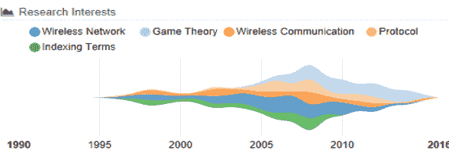

马里兰大学电机与计算机工程系的 K·J·Ray·Liu 教授，是信息技术界的领军人物。1990 年毕业于 UCLA 电气工程博士项目，2007 年获聘为校特聘讲席教授。其学术产出极为丰富，专著超 10 部，论文逾 650 篇。他统领的马里兰信号与信息小组（SIG），科研版图横跨无线通信网络的多个核心维度：多媒体传输与信号处理、信息取证安全、生物医学成像及生物信息学、算法架构设计等。

在成果转化层面，Liu 教授创立了 Origin Wireless，攻克全球首个厘米级室内定位追踪系统，其智能射频技术赋能智慧生活、家庭、城市及 5G/物联网生态。早年亦创办 Odyssey 公司，开创互联网数字监控先河。

身为 IEEE 与 AAAS 双料会士，其研究入选 IEEE 125 周年“改变人机交互与世界连接方式的七大技术”。当前聚焦方向涵盖：5G 及演进 MAC 协议、单天线大规模 MIMO 方案、无线能量传输、免设备无线感知、生命体征无线监测等。

高被引代表作精选：

**888**
**多天线赋能 WiFi 平台厘米级室内定位**
Chen Chen 等
IEEE Internet of Things Journal (2017)
引用 7 次 Bibtex

**897**
**跳频技术实现 WiFi 平台厘米级室内定位**
Chen Chen 等
IEEE Internet of Things Journal (2017)
引用 7 次 Bibtex

**896**
**社会学习的图演化博弈视角**
Xuanyu Cao, K. J. Ray Liu
IEEE Signal Process. Lett. (2017)
引用 1 次 Bibtex

**894**
**射频生物特征：穿墙人体识别**
Qinyi Xu 等
IEEE Trans. Information Forensics and Security (2017)
引用 1 次 Bibtex

#### P. R. Kumar

H 25 | A 0 | S 0 | C 5612 | P 125

**Professor**

Dept. of Electrical and Computer Engineering, Texas A&M University

Wireless Network Ad Hoc Network Scheduling Sensor Network Wireless Sensor Network Linear Program Stability Routing Protocol

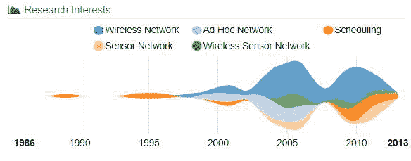

P.R. Kumar 教授长期服务于伊利诺伊大学厄巴纳-香槟分校，历任富兰克林·W·沃尔特奇讲席教授、协调科学实验室/信息信托研究所研究教授、计算机科学系副教授。学术触角极广，早期涉猎博弈论、自适应控制、随机系统、神经网络、机器学习、制造调度、晶圆建模及信息论；近年聚焦无线网络、传感网络、网络化嵌入式控制系统。

作为 IEEE 终身会士及美国工程院院士，曾斩获 Donald P. Eckman 奖、IEEE 控制系统奖、IEEE 通信学会 Fred W. Ellersick 奖。

经典高被引论文：

- **125** **无线网络渐近连通的临界功率**
  Piyush Gupta, P. R. Kumar (1998) | 引用 1695 次 | Bibtex 链接

- **124** **无线网络连通所需邻居节点数量**
  Feng Xue, P. R. Kumar, Wireless Networks (2003) | 引用 952 次 | Bibtex 链接

- **123** **自组网功率控制与聚类策略**
  Vikas Kawadia, Panganamala Kumar, INFOCOM (2003) | 引用 826 次 | Bibtex 链接

- **122** **SEEDX：自组网 MAC 协议设计**
  R. Rozovsky, P. R. Kumar, MobiHoc '01 (2001) | 引用 196 次 | Bibtex 链接

#### 王晓东

王晓东 (Xiaodong Wang)

H 102 A 390.87 S 172.75 C 88406 P 3659

Professor

Electrical Engineering Department, Columbia University

- Fading Channel
- Decoding
- Wireless Sensor Network
- Indexing Terms
- Code-division Multiple-access
- Signal-to-noise Ratio
- Fading
- Mimo

##### Research Interests

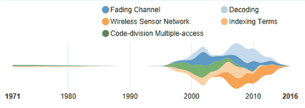

哥伦比亚大学电子工程系王晓东教授，1998 年普林斯顿博士毕业。头衔簇拥：IEEE Fellow（2008）、国家“千人计划”、长江学者讲座教授、NEC 实验室首席科学家。长期活跃于 IEEE 信息论、信号处理、通信三大顶刊编委会，屡任国际顶会主席/区域主席/技术程序委员。

科研疆域跨越统计信号处理、基因组信号处理、生物信息学、通信理论、无线/光通信。近期在多用户通信、时空处理、蒙特卡洛方法、基因组信号处理建树深厚。发表论文 800 余篇，主编专著 10 余部，著作《无线通信系统：信号接收高级技术》（Prentice Hall, 2003）为经典教材。

荣誉满载：NSF CAREER 奖（1999）、IEEE 通信/信息论联合最佳论文奖（2001）、IEEE 通信学会杰出论文奖（2011）、ISI 高被引科学家。

高被引力作：

| ID | 标题 | 作者 | 刊会 | 年份 | 引用 | 链接 |
|---|---|---|---|---|---|---|
| 3047 | 编码 CDMA 迭代软干扰消除与解码 | Xiaodong Wang, H. Vincent Poor | IEEE Trans. Communications | 1999 | 2189 | DOI链接 |
| 3046 | 盲多用户检测：子空间法 | Xiaodong Wang, H. V. Poor | IEEE Trans. Information Theory | 1998 | 1019 | DOI链接 |
| 3044 | 色散 CDMA 信道盲均衡与多用户检测 | Xiaodong Wang, H. Vincent Poor | IEEE Trans. Communications | 1998 | 472 | IEEE Xplore链接 |

### 2.2.2 中坚力量

- Theodore S. Rappaport

Theodore S. Rappaport

34 47.41 37.50 81330 225

Professor

Computer Science, Courant Institute of Mathematical Sciences, New York University

Wireless Community Path Loss Radio Receivers Mobile Communication Wireless Network Radio Transmitters Millimeter Wave Base Station

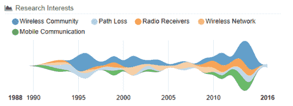

Theodore·S·Rappaport 教授执教于纽约大学库朗数理科学所（计算机科学）兼朗格尼医学院放射科。身兼 NYU Wireless 创始主任、无线互联网高技术中心（WICAT）掌舵人，打造全球首个融合无线工程、计算机科学与医学的跨学科研中心。

深耕无线电波传播与天线，为波传播理论、系统设计、60GHz/毫米波通信奠基。成果服务于蜂窝/个性通信、仿真分析、宽带电路系统。创立于弗吉尼亚理工的 MPRG，为全球首个专攻无线通信教研的大学中心。

权威顾问背书：曾任 FCC 技术顾问委员、多家高科技董事、ITU 国际顾问、30+ 主流电信商咨询专家、多国委员会成员。发明射频测量仪成行业标配；开创的无线部署 RF 信道建模技术成全球通用范式。持续攻坚毫米波及太赫兹频段，回应全球带宽爆发需求，深度影响 FCC、3GPP、ITU 制定 5G 标准。

全球无线领域被引翘楚：论文 200+，专利 100+。2008 年获奥斯汀无线联盟及 IEEE ComSoc WTC 表彰奖行业领袖奖。

高被引力作：

- **225** **无线通信：原理与实践** (1996) | 引用 25727 次
- **224** **无线通信：原理与实践** (2001) | 引用 20269 次
- **223** **5G 蜂窝毫米波移动通信：可行性确证！** Rappaport 等, IEEE Access (2013) | 引用 2231 次
- **222** **无线通信智能天线：IS-95 与 3G CDMA 应用** Liberti & Rappaport (1999) | 引用 2104 次

#### 尤肖虎

尤肖虎 (Xiaohu You) H 28 206.8k i 163.28 c 4359 P 463 长江学者特聘教授、博士生导师、杰青 东南大学 Ofdm Mimo Mobile Communication Signal To Noise Ratio Ofdm Modulation Fading Channel Estimation Wireless Communication

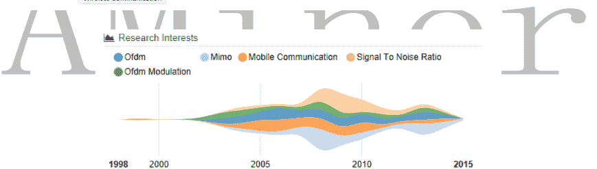

东南大学尤肖虎教授，1988 年本校信号、电路与系统专业博士毕业。现任信息科学与工程学院院长、国家移动通信重点实验室主任、博导、长江学者特聘教授、江苏省科协副主席、IEEE 南京分会主席、IEEE Fellow、《中国科学：F辑》副主编。

尤肖虎堪称中国第三代、第四代移动通信技术的奠基人与领军人物。回溯1999至2002年，他出任国家“九五”及“十五”期间第三代移动通信重大专项总体组组长，主导的项目荣膺2002年度中国十大科技进展新闻。他在CDMA接收技术上实现突破，创新性提出“多径能量窗结构”，斩获3项美国发明专利与11项国家发明专利，并以第一完成人身份摘得2003年度国家科技进步二等奖。随后几年，他先后掌舵国家863计划Future重大研究专项、国家自然科学基金重大项目“未来移动通信基础理论与技术研究”，在3G无线组网传输、分布式无线组网基础理论等前沿领域结出丰硕成果，国际影响力显著。2013年主导完成的“宽带移动通信容量逼近传输与分布式组网”项目，更是为分布式多天线技术确立了理论基石，直接推动了我国4G发展，并荣获2014年度陈嘉庚信息技术科学奖。当前，他兼任国家863宽带网专家组组长、国家中长期科技规划03专项副总师、国家5G重大项目专家组组长、国务院学位委员会学科评议组成员等多重要职，学术声望极高。

在学术出版层面，尤肖虎教授在IEEE核心期刊发表论文五十余篇，总被引超3000次，单篇最高他引达163次，SCI他引超400次；专利授权更是累积至国家发明专利71项、国际发明专利10项。其高被引代表作包括：

- 463 **面向5G无线通信网络的蜂窝架构与关键技术** Cheng-Xiang Wang等 IEEE Communications Magazine (2014) 被引879次
- 462 **CoMP-CSB场景下三种新型机会主义调度算法** SCIENCE CHINA Information Sciences (2013) 被引464次
- 461 **CoMP-CSB场景下三种新型机会主义调度算法** wang hao等 (2013) 被引465次
- 460 **协作MIMO信道建模与多链路空间相关性特性** Xiang Cheng等 IEEE JSAC (2012) 被引133次

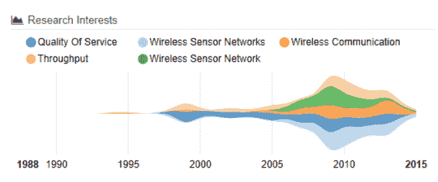

**梁振英——跨越两岸的通信网络架构大师**

Victor C. M. Leung现任香港理工大学计算系教授，同时也是不列颠哥伦比亚大学（UBC）教授、IEEE Fellow、加拿大工程院院士、加拿大工程学院院士、ACM杰出会员。他创立并担任美国TELUS移动工业研究委员会主席，长期深耕计算机与电信网络架构、协议设计及性能评价，近期聚焦无线网络与移动系统。

职业生涯早期（1981-1987），他在Microtel Pacific Research（后更名MPR Teltech）资深技术岗位上钻研卫星通信系统规划设计；1988年起执教于香港中文大学电子系；后加入UBC，兼任吉林大学、北京交通大学、华南理工大学客座教授。他曾服务于IEEE Wireless Communications、IEEE Computer、Computer Communications等多个顶刊编委会，并担任WC 2010等国际顶级会议主席。

高被引代表作选录：

- **Body Area Networks: A Survey** (MONET, 2011) 被引1125次
- **Cache in the air: exploiting content caching and delivery techniques for 5G systems** (IEEE Comm. Mag., 2014) 被引442次
- **A new method to support UMTS/WLAN vertical handover using SCTP** (IEEE Wireless Commun., 2004) 被引353次
- **Location management for next-generation personal communications networks** (IEEE Network, 2000) 被引324次

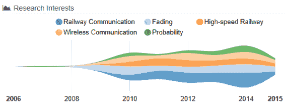

**钟章——中国高铁专用通信体系的开拓者**

北京交通大学电子信息工程学院教授、博导，现代通信研究所所长，轨道交通控制与安全国家重点实验室通信首席专家。钟章教授是国内最早涉足高速铁路无线通信与控制研究的权威，更是GSM-R技术引入中国的“第一人”。1994年即建议在我国建设新一代铁路数字移动通信系统（GSM-R），长期扎根无线宽带移动通信、高铁列控、智能交通系统等领域，主持教育部“面向高速铁路控制的无线移动通信系统”创新团队。

他带领团队攻克关键技术，为中国铁路六次大提速、青藏铁路、大秦重载线、高铁网络等国之重器提供了核心通信支撑。著作等身，出版专著7部，发表论文300余篇，拥有2篇高被引论文，授权专利10项；享受国务院特贴，荣获茅以升科技奖、詹天佑铁道科学技术成就奖等殊荣。

高被引代表作选录：

- **LTE-Advanced网络中运营商可控的D2D通信** (IEEE Wireless Commun., 2012) 被引565次
- **高速铁路无线通信面临的挑战** (IEEE Trans. ITS, 2014) 被引194次
- **面向移动云计算的无线异构网络挑战** (IEEE Wireless Commun., 2013) 被引119次
- **基于高铁信道模型的LTE-R评估** (CMIC, 2011) 被引109次

**Yu-Chee Tseng（曾郁杰）——移动自组织网络与感知计算的领航者**

台湾大学计算机科学系教授、系主任、副院长，中原大学兼职教授。H指数62，论文总被引逾2.5万次，出版论文450篇。研究版图覆盖移动计算、无线通信、网络安全、并行分布式计算，尤其在无线传感器网络（WSN）与移动自组织网络（MANET）领域建树卓著。

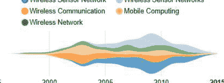

1994年博士毕业于俄亥俄州立大学，历任中华大学、中央大学副教授/教授，2000年起扎根台大。他是ACM Fellow、IEEE Senior Member，多次荣膺国科会杰出研究奖、最佳论文奖、杰出校友奖。长期担任《计算机学报》副主编、IEEE Transactions副主编、《信息科学与工程学报》编辑等学术职务。

高被引经典之作（均超千次引用）：

- 450/449 **移动自组网中的广播风暴问题** (MobiCom 1999 / Wireless Networks 2002) 合计被引近万次
- 448 **无线传感器网络中的覆盖问题** (WSNA 2003) 被引1546次
- 447 **基于IEEE 802.11多跳自组网的省电协议** (Computer Networks 2002) 被引742次

**领域新星：下一代通信技术的生力军**

- **George R. MacCartney Jr.**：纽约大学博士，师从Rappaport教授，聚焦毫米波传播、统计信道建模、无线回传、射线追踪。
- **Yunchou Xing**：纽约大学博士，同门Rappaport组，专攻无线通信、信道探测、射频信道测量。
- **Ojas Kanhere**：纽约大学博士，Rappaport门下，致力于毫米波信道测量/建模、NYUSIM模拟器开发、室内定位。
- **Watthanasak Jeamwatthanachai**：南安普顿大学Hanzo教授团队成员，探索人机交互、用户体验、实时嵌入式系统，应用于视障者室内导航辅助。
- **Nawfal F. Fadhel**：南安普顿大学Hanzo团队成员，研究3D打印安全、物理对象溯源、可迁移3D属性、密码学与数字安全。

# 3 实战应用篇

## 3.1 中国电信“AI+通信”探索实录

通信业务链条长、场景杂，本节以中国电信为样本，剖析人工智能如何在通信腹地落地生根。

早在2005年业务转型伊始，中国电信便敏锐捕捉到自然语言处理（NLP）的战略价值。率先在“号码百事通”搜索引擎植入语义理解技术；2006年起，依托上海电信与上海研究院，承接国家863计划“以中文为核心的多语言处理技术”课题，主攻多语言识别合成、跨媒体检索关键技术，成果直供2010上海世博会“962010”热线，实现中英日法四语种人机交互。此后，研发团队紧贴现网痛点，系统攻克语义理解、语音识别（ASR）、机器翻译、语音合成（TTS）等核心技术，逐步向IPTV语音控制、智能客服交互、智能搜索等业务渗透。

NLP作为AI皇冠上的明珠，是人机交互的基石，核心支柱为语音识别（ASR）与语义理解（SC/SU），辅以语音合成、机器翻译。上海电信的AI实践紧扣NLP主线，业务矩阵覆盖世博多语言服务、号百搜索、短信/微信智能客服、客服预质检、IVR扁平化、自动总机、IPTV语音控制等。

值得注意的是，电信领域的语义理解呈现鲜明差异化需求——**非标准语法下的短文本理解**。不同于互联网长文本网页，电信侧面对的是口语化、非规范、非标语法的短文本（多为几十字，上限百字）。技术攻关呈现三大特征：

- **业务导向的关键词提取（分词/特征工程）**：精准捕捉用户问句、会话流中的业务关键词，这些词多为中国电信/上海电信自定义的业务专有名词；

# 洞察AI+通信融合趋势：核心技术与热点领域深度解析

## 智能交互的基石：自然语言理解六大核心能力

构建高效的智能交互系统，首要任务是攻克自然语言理解（NLU）的关键技术难点，主要聚焦于以下六大维度：

**1. 同近义词语义识别与理解**  
针对同一信息实体，系统需具备识别并理解其不同语义关联的同义词、近义词的能力，打破表达形式的多样性障碍。

**2. 面向短文本的语法分析优化**  
在传统语法规则基础上深度优化，专项攻克短文本特有的语法结构特异性，提升解析精度。

**3. 多轮对话上下文建模**  
考虑到用户往往难以在单次短文本中完整表达意图，系统必须实现对话历史的上下文关联理解，还原真实需求。

**4. 引导式交互流程设计**  
系统应依托后台服务能力库，主动向用户给出针对性提示，引导其逐步明确并表达出平台可服务的具体信息需求。

**5. 智能搜索与兜底服务**  
面对无法精确给出唯一标准答案的常态，系统需输出高相关性的候选答案列表。评价核心在于：最符合需求的答案能否稳居前列，在查准率与查全率间寻找最优平衡点。

**6. 短文本分类与聚类的深层挑战**  
此为难度最高环节，痛点集中在四方面：  
- **体系动态演进**：电信业务分类随需求迭代，缺乏稳定、特征清晰的固化体系；  
- **认知主观差异**：不同业务人员因知识背景、接触面不同，对同一类别理解存在偏差；  
- **业务融合模糊边界**：移动互联网背景下业务边界消融，导致类别内涵外延持续变动，极考验模型适应性；  
- **非标语法短文本特性**：面对非标准语法表达的短文本，传统长文本分类研究难以直接迁移。

---

## 面向未来：人工智能重塑电信工业互联网新图景

人工智能技术将全渗透至电信各业务条线。以工业互联网及智能制造为例，AI是激活工业大数据价值的核心引擎。通过对多源标识汇聚数据的深度挖掘，可在工业领域复刻互联网式的信息聚合效应，进而催生新业态。未来重点应用方向锁定四大试验示范：  
- 基于异构标识解析体系的数据融合应用；  
- 面向物联网语义理解与互操作的关键技术攻关；  
- 基于标识体系的行业语义定义与扩展研究；  
- 支撑工业互联网与互联网数据双向融合开放的关键技术研究。

---

## 3.2 AI+通信热点挖掘：基于知识图谱的交叉创新视角

### (1) 通信领域核心热力谱系

筛选近期全局热度峰值、关联度最强的7大细分领域作为研究坐标：  
通信、电信、电信服务、电信行业、电话、在线社区、无线通信。

### (2) 人工智能领域核心热力谱系

同步筛选AI领域热度最高、相关性最强的10大细分方向：  
人工智能、自然语言处理、机器翻译、机器学习、计算机视觉、计算机图形学、可视化、人机交互、虚拟现实、数据挖掘。

### (3) 通信×人工智能：交叉创新笛卡尔智能分析

本研究构建双领域知识图谱，通过细分子领域笛卡尔乘积挖掘交叉热点，涵盖**历史演进（2007至今）**与**未来三年趋势预测**双维度。

**核心评价指标体系：**  
- **领域交叉热力值**：加权融合交叉论文被引量等数据，量化研究深度与广度；  
- **学者研究影响度**：综合交叉领域论文产出、H指数等维度评估；  
- **论文相关度**：依据论文关联强度与引用量计算；  
- **中外对比维度**：分别从专家数量、论文数量、论文被引影响力三个层面进行横向对标。

#### 历史热力全景

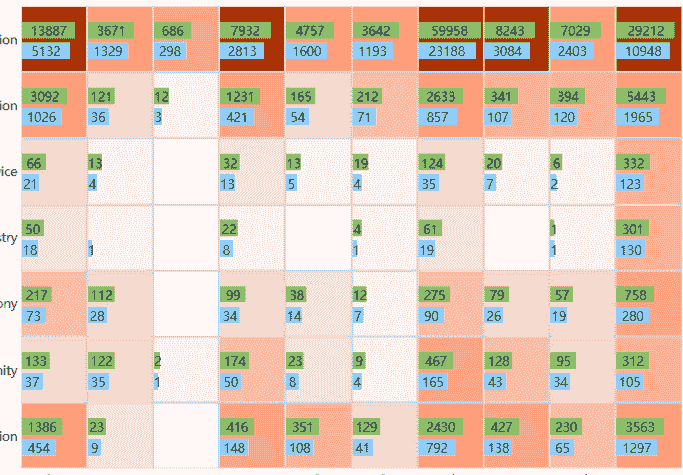

#### 历史数据统计概览

2007年以来，全球累计 **28,707名专家** 投身通信与AI交叉研究，其中华人专家 **4,960人（占比17.28%）** ，共产出交叉论文 **10,898篇**。

**学者H指数分布呈现显著长尾特征（表1）：**  
| H-index区间 | 专家人数 | 占比 |
| :--- | :--- | :--- |
| < 10 | 117,431 | 93.53% |
| 10-20 | 5,665 | 4.51% |
| 20-40 | 1,883 | 1.50% |
| > 40 | 383 | 0.31% |
| **合计** | **125,54** | **100%** |

**论文被引分布极度集中于低引用段（表2）：**  
| Citation区间 | 论文数量 | 占比 |
| :--- | :--- | :--- |
| < 1 | 26,426 | 53.48% |
| 1-10 | 14,822 | 30.00% |
| 10-100 | 7,461 | 15.10% |
| 100-200 | 439 | 0.89% |
| > 200 | 264 | 0.53% |
| **合计** | **49,412** | **100%** |

#### 核心交叉研究热点锁定

数据指向两大最高热力交叉方向：  
1. **通信 × 可视化**  
2. **通信 × 数据挖掘**

以下逐项深度拆解。

---

### 3.2.1 通信与可视化：可视化赋能网络感知

#### 领军专家画像（相关性Top 5）

  
  
  

*注：专家群体聚焦于无线传感网络、嵌入式计算、视频处理、数据压缩、数字图书馆等交叉前沿。*

#### 里程碑式高影响力论文

1.  **《用于DTN协议评估的ONE模拟器》** (Keränen等, SIMUTools 2009, 被引1892次)  
2.  **《深度理解交互在信息可视化中的作用》** (Yi等, IEEE TVCG 2007, 被引723次)  
3.  **《以人为中心的感知兴起》** (Campbell等, IEEE Internet Computing 2008, 被引499次)

#### 历史演进趋势对比

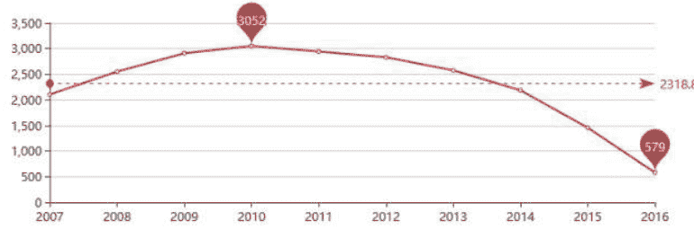  
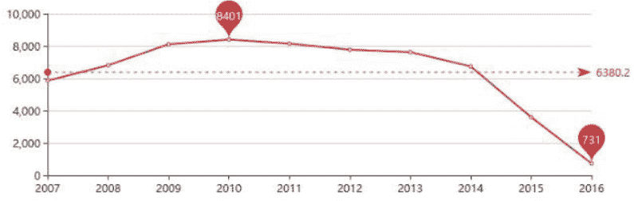  

#### 中美双强对话：量质并重的竞争格局

**研究主力军规模对比：**  
| 地区 | 专家数量 |
| :--- | :--- |
| 中国 | 14,793 |
| 美国 | 10,969 |
| 其他 | 34,202 |

**论文产出对比：**  
| 地区 | 论文数量 |
| :--- | :--- |
| 中国 | 3,209 |
| 美国 | 2,415 |
| 其他 | 4,040 |

**学术影响力（被引总量）对比：**  
| 地区 | 总被引量 |
| :--- | :--- |
| 中国 | 32,380 |
| 美国 | 31,632 |
| 其他 | 48,706 |

 *（注：素材中此处标记为图14，对应中美对比可视化）*

**结论：** 中美双核领跑，中国在专家规模与论文产出上领先，影响力总量亦微弱超越美国；英国、日本、德国位列第3-5梯队。

#### 全球顶级研究阵地

斯坦福大学、卡内基梅隆大学、犹他大学、麻省理工学院、伊利诺伊大学厄巴纳-香槟分校构成第一梯队核心阵营。

---

### 3.2.2 通信与数据挖掘：数据智能驱动网络演进

#### 核心权威专家谱系（相关性Top 5）

- **Amit P. Sheth** (H98)：语义网、本体、社交网络、工作流管理权威。  
- **Serge Abiteboul** (H84)：XML、Web服务、数据库系统奠基人。  
- **Guohong Cao** (H71)：无线传感网、移动计算、自组网专家。  
- **Schahram Dustdar** (H64)：服务计算、云计算、业务流程质量保障领军。  
- **李旺聪** (H56)：移动计算、查询处理、位置服务、无线传感网索引技术专家。

#### 高被引奠基之作（Top 5）

1.  **《基于模拟网络编码的双向多天线中继信道最优波束成形》** (Zhang等, IEEE JSAC 2009, 被引565次)  
2.  **《基于模糊C均值聚类的复杂网络重叠社区结构识别》** (Zang等, Physica A 2007, 被引471次)  
3.  **《蜂窝网络的干扰对齐》** (Sun & Tse, 被引402次)

#### 历史演进数据轨迹

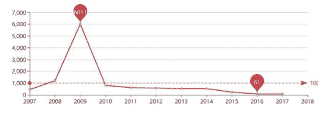

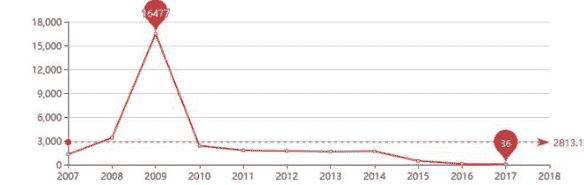

图 16 通信与数据挖掘领域历史专家数量统计

#### 通信与数据挖掘：中美态势对比

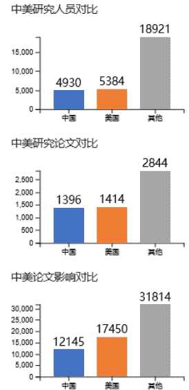

图 17 通信与数据挖掘中美对比详情

在通信与数据挖掘研究版图中，处于领先地位的国家与地区依次为：

- 1. 美国
- 2. 中国
- 3. 日本
- 4. 德国
- 5. 中国台湾地区

而在“人工智能与通信”交叉领域，全球核心研究机构阵容如下：

- 1. 北京大学
- 2. 中国电子科技大学
- 3. 卡内基梅隆大学
- 4. 伊利诺伊大学厄巴纳-香槟分校
- 5. 明尼苏达大学

# 4 趋势前瞻

基于 AMiner 交叉分析工具对未来三年热度的预测，以下交叉领域最值得关注：

- 1. 通信与数据挖掘
- 2. 通信与人工智能
- 3. 通信与计算机视觉

人工智能已正式登上历史舞台中央，成为各行业争相布局的“新基建”。从智能语音识别、意图理解，到机器学习与大数据分析，AI 正加速渗透教育、医疗、金融、司法、交通、工业等核心领域，推动社会从“互联网+”迈向“AI+”新纪元。通信行业恰逢 5G 与 AI 双重红利期叠加，正全力探索“AI+场景”深度融合的无限可能。

然而，未来的电信图景并非一片坦途，复杂性挑战无处不在：
- **业务爆发**：网络服务日益多元，复杂度指数级上升；
- **运维困局**：网络维护面临前所未有的难度；
- **架构融合**：CT 与 IT 文化、架构深度碰撞与重塑；
- **数据洪流**：万物互联催生海量数据，低价值密度成痛点；
- **新旧交替**：传统网络与新型网络融合博弈愈发激烈。

在此背景下，AI 介入通信领域的具体图景正徐徐展开：

**① 织密网络主动安全防线**
ICT 行业安全事件频发，断网、损失、信誉受损教训惨痛。引入机器学习构建全层级智能防护体系迫在眉睫。行为分析技术将质变式提升攻击检测、数据自动溯源及孤立关联行为识别能力，实现从“事后补救”到“事前预判”的跨越。

**② 精准打击电信网络诈骗**
融合智能语音识别、语义理解、机器学习与大数据分析，可构建诈骗电话分类与深度判定的主动发现系统，让诈骗分子无所遁形。

**③ 重塑智能终端交互体验**
赋能电视、手机等通信终端，支撑超高清视频与海量机器通信，实现自然语音交互、大数据自主决策，让智能服务无缝渗透生活每一处场景。

面对令运营商“望洋兴叹”的网络复杂度，以及人为操作失误引发的巨额隐患，**AI 与自动化渗透电信腹地已成必然趋势**。2018 年将成关键节点：运营商将加速引入 AI 优化网络运维流程；面向消费端的 AI 应用落地，如聊天机器人分流客服压力、智慧家庭语音助手普及，将全面铺开。

但在享受 AI 红利的同时，通信行业也须直面新变量：

**⚡ 能源与算力：AI 落地的“硬门槛”**
通信业要在 AI 浪潮中“伺机而动”，需以敏锐洞察匹配清晰战略。首要任务是从场景应用反推，构建全栈解决方案与硬件底座，让 AI 如能源般驱动产业。用户全时在线引爆流量，能耗随之飙升；AI 对高性能处理器、传感器等硬件的极致需求，倒逼产业链升级，唯有夯实算力根基，方能共享红利。

**🔒 隐私与数据确权：必须跨越的“软门槛”**
数据归属不清，市场乱象丛生。顺丰与菜鸟因物流数据博弈、京东与天天/苏宁因接口权限对簿公堂，诸多冲突本质均指向核心矛盾：**海量数据是企业商业秘密，还是公共公共产品？**
传统行业用户数据多纳入公共统计，互联网巨头掌握的用户画像却长期缺乏共享机制，被视为私有资产。用户隐私保护与数据权属界定，刻不容缓。

破局之道，不在等待，而在主动作为：

**🏛️ 立法先行，构建数据共享新生态**
国家应协调部门从立法层面落实大数据归属，建立通信、金融等关键领域数据库共享机制。2017 年作为 5G 标准定局之年，头部通企需发挥技术引领与跨界联动作用。电商平台可分流部分数据入公共池，实现“共建共享”。

**👥 筑巢引凤，筑牢人才护城河**
政府与产业界需加码 AI 教育科研投入，支持顶尖高校建立实验室与创新中心，打通“校-研-企”协同链条。长期看，助力存量从业者转型增技、适应自动化冲击，是守住民生福祉与社会稳定的底线。精准识别高替代风险岗位，提前布局再培训体系，方为长久之计。

# 参考文献

- [1] Australian Government, The communications sector : recent trends and developments, 2016, communications.gov.au/BCR
- [2] Budimir, M. An Overview of Research on Technological and Telecommunication Development [J]. Ekonomski Vjesnik, 2014: 171-182.
- [3] Why telcos will soon be betting on Artificial Intelligence to build their networks. https://telecom.economictimes.indiatimes.com/news/why-telcos-will-soon-be-betting-on-artificial-intelligence-to-build-their-networks/61531211
- [4] Jennings A. & Adam I. & Akira K. & Greg V. & Jon R. W., AI in Telecommunications[J]. https://www.ijcai.org/Proceedings/91-1/Papers/086.pdf
- [5] Artificial intelligence in Telecom: Intelligent operations is the new norm[R/OL]. http://bigdata-madesimple.com/artificial-intelligence-in-telecom-intelligent-operations-is-the-new-norm/
- [6] AI in the telecommunications industry - a Q&A with Infosys. https://www.gigabitmagazine.com/telecoms/ai-telecommunications-industry-qa-infosys
- [7] Wedge Greene, Trevor Hayes. The Promise of Artificial Intelligence in Telecom. https://www.pipelinepub.com/telecom_innovation/AI-in-telecom
- [8] Intel AI. Taking Telecom to New Heights with Artificial Intelligence, 2018. https://ai.intel.com/taking-telecom-new-heights-artificial-intelligence/

# 版权声明

AMiner 研究报告版权归 AMiner 团队独家所有，享有唯一著作权。AMiner 咨询产品系团队研究统计成果，仅供订阅用户内部参考。

未经 AMiner 团队书面授权，任何主体不得以任何形式在任何媒介（含互联网）公开发布、复制、传播报告内容，亦不得向第三方提供。引用刊发须注明来源“AMiner.org”，且不得曲意删改。

本报告基于团队认可资料经后台大数据自动分析生成，仅供参考，不保证分析结果的绝对准确与完整，团队不对使用者因依赖本产品产生的任何后果承担责任。

