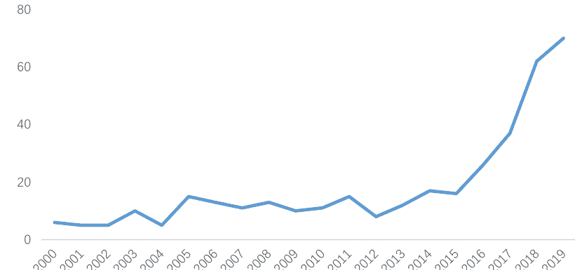

# 全球AI伦理治理：六大核心共识与中国实践路径

## 核心观点速览
随着自动决策能力的跃升，人工智能正深度介入人类决策链条，引发的伦理隐忧随之放大。全球治理虽处探索期，但已在透明、公平、安全、负责、以人为本、可持续六大维度形成基础共识。本文基于2015-2020年118份全球政策文本的深度解析，梳理治理演进脉络，并对标中国最新政策动向与美团实践承诺。

## 一、 治理起步期：从战略表达到规则萌芽

### 学术界觉醒：伦理议题从边缘走向核心
AI以数据为燃料、以算法为引擎，其决策介入天然挑战既有伦理框架。2015年起，各国将伦理治理纳入国家战略蓝图：美列入八大战略重点，欧视为生态核心构件，英日分别谋划治理准则与“AI-Ready社会”建设。然而整体仍处破题阶段。

斯坦福以人为本AI研究所（HAI）数据揭示学术端变化：2015年前鲜见“伦理”关键词论文，此后数量攀升，至2020年迎来爆发期。标志性事件是NeurIPS大会首次强制要求投稿附带“广泛影响声明”，倒逼技术社区直面社会后果。

图 1 2000-2019 年国际上主要的人工智能会议上提及“伦理”的论文标题数量变化

资料来源：Prates et al., 2018 ¹，斯坦福以人为本智能研究所（2021） ²

### 实践端爆发：多元主体共筑规则矩阵
政府、巨头企业、学术社团、国际组织四方合力，推出大量准则文本。Gartner归纳出早期五大支柱——透明、公平、安全、负责、以人为本；经本文对118份文件实证比对，确认上述五项构成核心共识，**“可持续发展”**亦跻身基本准则行列。

| 年份 | 企业 | 研究机构 | 政府 |
| :--- | :--- | :--- | :--- |
| 2015 | | 2 | |
| 2016 | | 2 | |
| 2017 | 3 | 10 | 3 |
| 2018 | 19 | 12 | 13 |
| 2019 | 11 | 7 | 14 |
| 2020 | 12 | 4 | 5 |

图 2 2015-2020 年按组织类型划分的人工智能伦理准则文件数量

资料来源：各国人工智能伦理治理准则文件总结

### 六大准则速览

| 准则维度 | 核心内涵关键词 |
| :--- | :--- |
| **透明** | 知情权、可解释、IP保护、可审计 |
| **公平** | 反歧视、反操纵、就业创造 |
| **安全可靠** | 隐私盾、过程跟踪、零物理伤害 |
| **负责任** | 主体担责、治理计划落地 |
| **以人为本** | 决策主权、能力增强、社会利、合法性 |
| **可持续发展** | 人与自然和谐、能效优化、生态足迹最小化 |

图 3 人工智能伦理治理准则体系

资料来源：各国人工智能伦理治理准则文件总结

## 二、 深度拆解：六大准则的实操内涵

### 1. 透明：打破“黑箱”，构建可信交互
作为几乎全文覆盖的首位准则，透明旨在化解技术复杂性导致的信息不对称，守住人的知情权与主体性。
- **知情交互**：用户必须明知自己在与AI对话，并理解其功能边界。
- **可解释果**：虽深度学习本质难解，但可通过人工复核流程、干预接口、反事实假设、接受阈值设定、过滤机制等工程手段，实现结果层面的可说明性。
- **有度公开**：保护开发方商业秘密与IP，防范过度透明引发的欺诈滥用，建立分级披露风控机制。
- **留痕备查**：模型、算法、数据、决策全链路留档，支持第三方独立审计。

### 2. 公平：在效率与正义间寻找平衡点
AI是“双刃剑”：全局最优不等于个体公正，甚至被异化为歧视工具（算法偏见、大数据杀熟、隐私窃取）。金融信贷画像等争议场景凸显“公平”定义的语境依赖性。在共同富裕导向下，公平权重上升，需将其内化为目标函数约束条件。共识聚焦三点：
- **实质反歧视**：MIT实证显示AI易放大人类偏见，技术部署须主动规避对弱势群体的结构性伤害。
- **拒绝暗箱操纵**：技术初衷是福祉增进，而非利用画像能力制造“信息茧房”或诱导非理性消费。
- **就业转型托底**：布鲁金斯预警3600万美岗位高危。美、英等国已通过立法（如美《AI就业法案》、英人才规划）推动终身学习与再培训，将“创造新岗位”纳入治理指标。

### 3. 安全可靠：筑牢不伤人底线
核心承诺：零物理伤害、零心理创伤。
- **隐私为信任基石**：双重保障——技术端监控训练过程、防御对抗攻击、防泄露；数据端最小化采集、敏感加密、目的限制。
- **全链路跟踪**：训练全程留痕、异常即时测试，堵住恶意投毒后门。
- **实体融合红线**：AI+机器人场景下，必须实现零误差风险预判，杜绝物理接触伤害。
监管已相对成熟：欧盟GDPR确立数据主权，美日巴新跟进立法，中国《个保法》（2021.11生效）确立“告知-同意+最小必要”原则与用户权益清单。

### 4. 负责任：责任归属不模糊
AI具自动性、无自主性；有行动力、无意识。本质是人造工具，主体资格存疑。**责任链条最终指向人**。主流准则要求利益相关方落实治理计划，深化责任主体界定研究。

### 5. 以人为本：确立工具属性的根本法则
服务人、支撑人、利人、护人。
- **决策主权在人**：AI可代劳，终局受控于人。
- **增强而非异化**：补齐人类短板，拒绝以效率名义侵权。
- **社会贡献导向**：聚焦重大民生难题，输出正外部性。
- **合规底线**：开发部署严守属地法律，合法性是前提。

### 6. 可持续发展：为地球负责的新维度
后疫代视角下，AI部署须纳入生态核算：评估生物多样性影响、压缩能耗足迹、提升能效比。技术进化不应以透支地球为代价。

## 三、 中国方案：全面对标，从跟跑到并跑

政策“三步走”稳步推进：2017《规划》设定2020/2025/2030三个里程碑。治理专委会两份里程碑文件完成从原则到规范的深化：
- **2019《治理原则》**：八大原则（和谐、公正、包容、隐私、可控、共担、开放、敏捷）搭建框架。
- **2021《伦理规范》**：六项基本规范（增进福祉、公平正义、隐私安全、可控可信、责任担当、伦理素养）落地执行。

**结论明确：中国AI伦理准则已与国际主流体系全面接轨。**

## 企业宣言：美团的承诺与行动
美团将AI伦理治理置于战略高位。未来双轮驱动：一手持续加码科技创新投入，一手联动政府、行业协会、科研院所等多方力量，共治共享，推动AI技术真正成为经济社会高质量发展的可靠引擎。

---

美团研究院 刘婉莹 厉基巍 赫建营