# 这本Python神作，把AI大佬们都看服了！

## 权威大咖争相点赞：不只是教语法，更是通往数据科学的“黄桥”

**得克萨斯大学高级讲师 Shyamal Mitra：**  
全书对Python核心与数据科学基石讲解得透彻醒目。特别点赞书中对“随机种子保证复现性”的强调，字典/集合推导式的简洁用法让人拍案叫绝。第7.6节论证数组优先策略逻辑严密，Pandas Series与DataFrame的讲解更是我看过最清晰的版本，数据清洗与NLP章节更是干货满满，我本人都捡漏不少新知。

**Lander Analytics数据科学家 Daniel Chen：**  
面向对象章节结合`doctest`实战单元测试，实现代码与测试同步推进，这招太实用了。骰子模拟中静态/动态可视化的逐行拆解教学极具匠心。全书弃用老式格式化转拥`f-string`，引入TextBlob降低NLP门槛，词云可视化极大激发入门兴趣。后半部案例研究落地性极强，物联网大数据案例更是眼前一亮。

**数据科学顾问 Jamie Whitacre：**  
这是一本极具感染力、可读性极强的佳作，能点燃初学者好奇心，助其在Python、统计、数据处理、API、可视化、ML、云计算等领域打下铁底基础。Twitter情感分析实战讲透了NLP工具链，JSON与Pickle序列化对比更是纠正了我多年的认知盲区——原来JSON才是更安全、更优的选择！

**圣地亚哥大学助理教授 Alison Sanchez：**  
模块化架构配合Jupyter Notebook全代码复现，让跨背景读者皆受益。大数据章节全景式覆盖主流平台，IBM Watson实战概括精准。翻译案例设计的“即时反馈”机制让人上瘾，ML章节用加州房价实战贯通业务分析全流程，可视化效果堪称教科书级别。

**西盎斯贝格大学 Lance Bryant：**  
计算机科学、数据科学与统计学的三维融合，打破了传统课程简单拼凑的弊端。本书正是构建“以Python为桥梁的统一数据科学教学体系”的关键拼图。

**马萨诸塞大学助理教授 David Koop：**  
海量成熟库调用、极少代码解决复杂问题，是本书最大特色。异常处理回溯机制、Twitter实战数据挖掘（可视化+NLP）、词云生成、Keras深度学习概览、流式处理示例……每个专题都直击痛点，极大降低了认知负荷。

**乔治·梅森大学 Irene Bruno 博士 / 内布拉斯加大学 Harvey Siy 博士 / IT顾问 José Antonio González Seco / 伊利诺伊大学 Elizabeth Wickes / 内布拉斯加大学 Mark Pauley 博士 / 东康涅狄格州立大学 Garrett Dancik / 詹姆斯·麦迪逊大学 Ramon Mata-Toledo 教授：**  
……更多权威专家一致认证：**示例是灵魂，实战是核心，入门数据科学首选无争议。**

---

## 译者序：在南开园，为你搭建通往AI的“高速公路”

Python以“简洁、生态强、免费开源、跨平台、胶水属性”称霸系统开发、科学计算、Web、数据分析、AI等全场景。尤其在数据科学与AI领域，它已成绝对主力语言，连非计算机专业背景的研究者也纷纷转投怀抱。

市面上Python书汗牛充栋，但**“以编程为骨、以数据/AI为肉、两者深度融合”**的教材凤毛麟角。这导致大量学习者陷入“语法学会了，实战不会用”的尴尬。

2019年，全球编程教材泰斗 **Paul Deitel & Harvey Deitel** 推出 *Python for Programmers*。本书中文版正是引进此作，**以“语法速成+库实战+真实案例”三位一体模式，强行打通“会写代码”到“解决问题”的任督二脉。**

**全书四大模块，层层递进：**
1.  **基础速成篇（Ch1-5）：** 从环境搭建到模块化思维/函数设计，夯实编程基本功。
2.  **数据核心篇（Ch6-9）：** 字典/集合场景化、NumPy数组高性能计算、字符串/正则/文件/异常处理全攻略。
3.  **进阶架构篇（Ch10）：** 面向对象设计与工程化落地，掌握大型系统搭建能力。
4.  **AI实战篇（Ch11-16）：** **重头戏来了**——NLP、Twitter舆情挖掘、IBM Watson认知计算、机器学习（监督/无监督）、深度学习（CNN/RNN）、大数据（Hadoop/Spark/NoSQL/IoT）六大前沿战场实战演练。

**含金量看这里：**
- **500+ 即时交互示例**（IPython REPL风格，输即得）
- **40+ 重量级完整案例**（前10章每章配数据科学导入案例，后6章全是硬核项目）
- **全书代码/Jupyter Notebook 开源同步**，复现零门槛

**翻译团队：** 南开大学王恺（统稿/Ch9,10,12）、王刚（Ch1-4,13）、于名飞（Ch5-8）、徐夏（Ch11,14,15）、李涛（Ch16）。适配高校教材、工程师案头书、自学者进阶梯。

---

## 前言：站在“数据淘金热”入口，手把手教你挖金子

> **“塔尔山上有黄金！”**

欢迎登车。本书将带你用**全球最火、增速最猛**的Python，攻克当下最前沿的计算技术高地。Python以极致的表达力、可读性、简洁性与交互性，配合爆发式增长的开源生态，已成创新主引擎。

**宏观趋势不可逆：**
- 算力指数级增长、成本指数级下降
- 带宽无限趋近“免费”
- 开源软件构建起“免费基建”
- **万亿级物联网设备即将上线，数据洪流喷薄而出**

**现在的技术竞争，本质全是“数据竞争”**：数据科学、分析、大数据、SQL/NoSQL/NewSQL……**Python是处理所有这些问题的统一创新接口。**

### 就业缺口：才是最硬核的推荐信
- **麦肯锡 (2011)：** 仅美帝缺14-19万深度分析师 + 150万懂数据决策的管理者。
- **LinkedIn (2018)：** 美帝数据科学家缺口超15万。
- **IBM/Burning Glass (2017)：** 2020年前将新增数十万数据科学岗位。
**学这本书，就是在抢占下一个十年的职业红利。**

### 独创“模块化”架构：既可当字典，又可当教材，更能当项目库
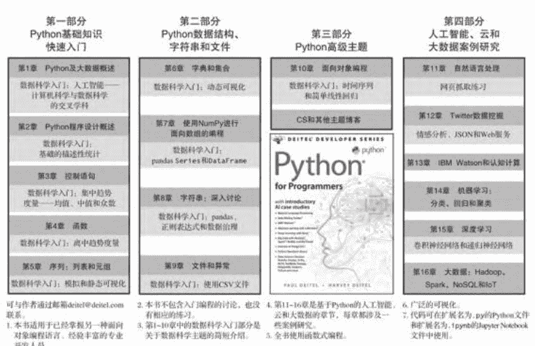

**前十章（Python编程核心）** 每章内嵌**“数据科学快速入口”**：描述统计、集中/离中趋势、模拟、静/动态可视化、Pandas探查清洗、CSV/时间序列/线性回归……**这些微型实战，为后六章大案例铺好每一块垫脚石。**

**依赖关系极度灵活：** 读完Ch1-5 + Ch6-7关键节，**即可直接跳读 Ch11-16 所有案例研究**！教师可据此自由组合课程，自学者可“带着问题学语法”。

**后六章（AI/大数据/云实战）** 硬核项目全景图：
- **NLP实战：** TextBlob/词云/情感分析
- **Twitter舆情挖掘：** 真实数据源+可视化+NLP全链路
- **IBM Watson：** 认知计算服务集成
- **机器学习：** 分类/回归/聚类 + 加州房价/商业案例全流程
- **深度学习：** Keras驾驭CNN/RNN
- **大数据生态：** Hadoop/Spark/NoSQL/IoT 一网打尽

配合详细目录与索引，构建你的**数据科学知识图谱**。

---

## 五大“反直觉”设计哲学：为什么这书能让你学会？

### 1. 三个“Keep it Simple”铁律
- **工具选最简：** NLP教TextBlob不教NLTK；DL教Keras不教TensorFlow底层API。**只要能跑通，就不整花活。**
- **代码保持小：** 538个示例，绝大多数几行代码+即时输出。**认知负荷降到地板。**
- **技术追最新：** 作者组啃读1.5万+最新论文/文章/视频/博客，**把社区最鲜活的“脉搏”注入书里。**

### 2. “即时反馈”学习范式：拒绝枯燥，拥抱多巴胺
**全程IPython REPL / Jupyter Notebook 模式：**
- 写一行，跑一行，看结果。
- **探索-发现-实验**闭环极短，注意力不易涣散，原型验证快人一步。
- **所见即所得**的完整程序呈现，告别代码片段拼凑的痛苦。

### 3. 编程基础“全栈覆盖”，范式不设限
- 过程式、函数式、面向对象**三大范式全讲透**。
- **全书贯彻函数式思维**，4.17节汇总Python函数式编程关键特性速查表。
- **现代最佳实践/惯用法**为准则，拒绝过时写法。

### 4. 538个例子：从“Hello World”到“生产级项目”
- **库矩阵全明星：** NumPy/Pandas/SciPy/NLTK/TextBlob/spaCy/Tweepy/scikit-learn/Keras + Matplotlib/Seaborn/Folium。
- **任务矩阵全覆盖：** NLP、数据挖掘、ML、DL、Hadoop/MapReduce/Spark、Watson、云服务……

### 5. “去数学化”不等于“去原理化”
- **核心思想讲透，推导细节封库。** 调用`statistics`/`NumPy`/`SciPy`/`pandas`直接落地线性回归等技术，**数学细节交给库，业务逻辑留给你。**
- **ML/DL建模聚焦“对象封装”**，隐藏张量运算细节，让你专注架构与调优。

---

## 可视化：让数据说话，让洞察“看得见”

- **67个高级可视化资产：** 静态/动态/动画/交互/地图（Folium）全形态。
- **教学可视化：** 动态骰子模拟演示**大数定律**——频率收敛1/6、柱状图趋于均衡，一眼穿透概率本质。
- **大数据可视化：** “四万公里高空俯瞰数据”。**Anscombe Quartet（安斯库姆四重奏）警示：** 统计量相同≠分布相同，**不看图就建模，就是耍流氓。**
- **代码级可复现：** 所有动画/交互代码开源，参数随改随跑，即学即用。

---

## 数据实验场：真枪实弹，拒绝玩具数据

- **Ch11-16 皆为实战场：** 真实数据集、真实数据源、真实业务痛点。
- **开源数据集宝库指路：** 书中引用网站汇聚数百/数千高质量数据集，随取随用。
- **库自带数据集：** 多款主流库内置经典数据集，零配置开练。
- **全流程闭环：** 获取→清洗/准备→多技术分析→模型调优→可视化汇报，**端到端项目级训练。**

---

## GitHub & 云实战：工程化交付的必修课

- **GitHub不只是托管，** 是开源协作、版本控制、CI/CD的核心枢纽。本书引导你用好它。
- **全链路零成本：** 免费开源库、软件免费版/试用版/云免费增值服务，**零门槛搭建企业级开发/部署环境。**

---

**[本书配套代码/Jupyter Notebook/数据集/勘误，扫码或访问出版方官网获取]**

**别再犹豫了。这不是一本教你语法的书，这是一张通往“数据科学/人工智能核心竞争力”的地图。翻开第一章，开始你的淘金之旅吧！**

# 这本Python大数据/AI实战书，到底值不值得啃？

最近在整理技术书单，翻到一本主打“云端大数据、AI案例、Python实战”的厚砖头书。看完前言和章节架构，发现它不像传统教程那样枯燥堆砌语法，而是把**工程落地**放在了核心位置。如果你正想从写脚本进阶到做数据产品、跑AI模型、搭大数据管道，这份阅读指南能帮你避坑。

---

## 核心定位：不造轮子，教你用好“云端武器库”

本书最大的特点是**拥抱云生态**。作者直言：现在的大数据分析基本都在云上跑。全书贯穿使用 Twitter、Google Translate、IBM Watson、Azure、OpenMapQuest、PubNub 等主流云服务，甚至专门叮嘱：优先用免费/免信用卡的套餐，防止“跑个模型刷爆账单”的惨剧。

**数据量级的压迫感很真实：**
- IBM 数据：全球 90% 数据诞生于近两年。
- 物联网爆发：五年内联网设备超 500 亿，2020 年人均每秒产生 1.7MB 数据。
面对这洪流，传统关系型数据库（SQL）处理非结构化数据乏力，书里专门安排了 **NoSQL (MongoDB) 与 NewSQL** 的实战对比，还有一整章（第16章）讲大数据软硬件基建。

---

## 知识架构：四部曲，层层递进

全书 16 章分四部分，依赖关系画得很清晰，**前 5 章是基石，后面全靠它撑着**。

### 第一部分：Python 极速起飞 (Ch 1-5)
*   **Ch 1**：基础概念 + IPython/Jupyter 环境配置（全书实验场）。
*   **Ch 2-3**：语法核心、控制流、列表初体验。
*   **Ch 4-5**：函数、随机模拟、元组、函数式编程入门、列表/元组深度解析。
> **培训师/自学者建议**：按序读最稳。但凡后面看不懂，90% 是这五章没练透。

### 第二部分：数据结构与文件实战 (Ch 6-9)
不再教你手写链表，全聚焦**内置容器（列表/元组/字典/集合）+ 科学计算三件套**。
*   **Ch 6**：内置数据结构精讲——干大多数活都够用了。
*   **Ch 7**：**NumPy 数组**（性能碾压列表两个数量级）+ **pandas Series/DataFrame** 入门。这是数据科学的通用货币。
*   **Ch 8**：字符串、正则、原始字符串——清洗数据的利器。
*   **Ch 9**：文件 IO、JSON/CSV 序列化、pandas 直读数据集。
> **依赖提示**：Ch 7 需懂字典；Ch 8 需懂正则和 pandas 基础；Ch 9 需懂字典、with 语句、pandas DataFrame。

### 第三部分：进阶与工程化 (Ch 10)
*   面向对象（OOP）核心：继承、多态、鸭子类型。
*   单元测试、洗牌模拟案例。
*   **关键观点**：Python 实战中**“基于对象”**（调库实例化）远比“面向对象”（写类）高频。Ch 11-16 基本只用简单的类，重点是会用库里的类。

### 第四部分：AI、云与大数据案例集 (Ch 11-16) —— **含金量最高**
假设你扛过前 5 章 + 字典基础，就能进场：
*   **Ch 11**：NLP 入门、Twitter 情感分析、词云、TextBlob。
*   **Ch 12**：IBM Watson 认知计算全家桶（对话、翻译、语音、视觉识别、性格洞察...）。重头戏：用 Watson Lite 免费层做“旅行者翻译助手”——说英语→转文本→译西语→朗读，对方回西语→转文本→译英语→朗读，全程免信用卡。
*   **Ch 13**：更多 Watson 服务实战。
*   **Ch 14**：监督/非监督学习、机器学习通用流程。
*   **Ch 15**：深度学习、Keras/TensorFlow 实战。
*   **Ch 16**：**大数据硬核基建**——Hadoop、Spark 分布式计算、GPU/TPU 集群、Docker 容器化部署、Kafka 流处理、地理可视化。不用你写并行代码，教你驾驭自动并行的工具。

> **依赖网很密**：Ch 12 要用 Ch 8 的 join、Ch 9 的 JSON、Ch 11 的 NLP 工具、Ch 10 的继承；Ch 16 更是集大成者，从字符串 split 到 Matplotlib 动画、Tweepy 流监听、geopy/folium 地理库全串联。

---

## 三大“杀手级”工程实践贯穿全书

### 1. Jupyter Notebook：不是 IDE，是“可复现的计算故事”
全书代码双版本供给：`.py` 命令行跑 + `.ipynb` 浏览器交互。
- **为什么不用 PyCharm/VS Code？** 作者引用 Knuth “文学编程” 理念：Jupyter 把代码、文档、图表、参数打包在一起，天然满足**科研级可复现性**。
- 团队协作：GitHub 共享、`nbviewer` 一键渲染成网页，汇报工作、交接项目极其丝滑。

### 2. Docker：解决“在我机器上能跑”的终极方案
Ch 16 重度使用。复杂环境（Hadoop/Spark 集群）一条命令拉取预置容器，版本锁死，跨平台零配置。作者强调：这是保证**实验可复现**的基础设施级工具。

### 3. 性能优化：有据可查，不搞玄学
- `timeit` 实测对比（生成器 vs 列表、NumPy vs 原生列表）。
- 模型训练性能、分布式计算吞吐量量化分析。
- 书里 538 个例子、约 4000 行代码，平均每例不足 8 行——**用库的高级 API 干活，少写胶水代码**。

---

## 独家福利：IBM Watson “白嫖”全攻略
作者专门调研过竞品，**Watson 的“Lite 免费层免信用卡”策略最友好**。书里手把手教你用 `watson-developer-cloud` Python SDK 调用 10+ 核心 API（自然语言理解、语音互转、视觉识别、个性洞察...）。Ch 12 的“旅行者助手”案例，跑通它你就掌握了多模态 AI 应用的完整闭环。

---

## 读前必备 & 资源包

| 维度 | 详情 |
| :--- | :--- |
| **运行环境** | Win/macOS/Linux 全兼容，推荐 **Anaconda 发行版**（含 NumPy、pandas、Jupyter、Spyder 等全家桶）。 |
| **代码获取** | 书网页 `deitel.com` 下载，含所有 `.py` / `.ipynb` 文件。 |
| **官方文档** | Python 3 Reference / Library Reference 必备收藏。 |
| **遇到坑去哪** | StackOverflow、python-forum.io、DreamInCode、库对应 GitHub Issues、作者官网支持页。 |
| **Jupyter 专属帮助** | Google Group、Gitter 即时聊天、GitHub Help、StackOverflow 标签、教育组。 |

---

## 避坑指南：这书不适合谁？
1.  **想系统学计算机科学理论/算法推导的**——它是工程实战手册，原理一笔带过。
2.  **拒绝云服务/只能离线环境的**——案例强依赖云 API 与云端算力。
3.  **想精通 C++/Java 底层并行编程的**——它教你用 Keras/Spark/Hadoop 的高层抽象，不造轮子。

---

## 怎么读最高效？

- **时间紧/只想做 AI 应用**：Ch 1-5 → Ch 6(字典) → Ch 7(NumPy/pandas) → 直冲 Ch 11-15，Ch 10、16 按需查阅。
- **想夯实工程能力/做数据管道**：全书通读，重点攻克 Ch 7、9、10、16，配合 Docker 复现分布式环境。
- **培训讲师/教学大纲**：前言提供了极详细的**章节依赖图**（本文已提炼），可灵活裁剪模块。

---

## 总结

这不是本教你 `print("Hello World")` 的入门书。它是一张**从 Python 语法出发，直达云端大数据、认知计算、深度学习工程落地的地图**。配上 Jupyter 可复现工作流、Docker 环境封装、Watson 免费实战场，性价比极高。

如果你手头有 Anaconda 环境，且愿意在云端跑几个真实的 API 调用，**建议先把 Ch 12 的“旅行者助手”跑通**——那一刻你会发现，原来离“构建智能应用”就差这一本的距离。

# 配套资源下载

- 本书所有代码示例的 Python 源文件（.py）与 Jupyter Notebook 文档（.ipynb）均可下载获取。
- 入门指引视频演示了在 IPython 与 Jupyter Notebook 中运行示例的方法，第 1.5 节亦有详细图文讲解。
- 后续的博客文章与书籍勘误更新将同步发布。

具体下载步骤请翻阅前言之后的 **“开始阅读本书之前”** 章节。

---

# 与作者联系

若您在阅读过程中有任何疑问，或发现书中有误需提交勘误，欢迎通过以下方式联系我们：

- 电子邮件：`deitel@deitel.com`
- 社交媒体互动：
  - Facebook：[http://www.deitel.com/deitelfan](http://www.deitel.com/deitelfan)
  - Twitter：[@deitel](https://twitter.com/deitel)
  - LinkedIn：[http://linkedin.com/company/deitel-&-associates](http://linkedin.com/company/deitel-&-associates)
  - YouTube：[http://youtube.com/DeitelTV](http://youtube.com/DeitelTV)

---

# 致谢

感谢 Barbara Deitel 对本书项目长期以来的深度网络研究投入。我们也倍感荣幸能与 Pearson 专业的出版团队携手合作。特别鸣谢我们的老友兼同事、培生 IT 专家组副总裁 Mark L. Taub，感谢他 25 年来的辛勤耕耘与悉心指导。Mark 及其团队负责在 Safari 服务（[https://learning.oreilly.com/](https://learning.oreilly.com/)）上架我们的专业图书、LiveLessons 视频课程及学习路径，并赞助了 Safari 在线培训研讨会。Julie Nahil 负责统筹本书的出版制作事宜。英文原版封面由 Chuti Prasertsith 设计。

衷心感谢审稿专家们的严谨把关。Patricia Byron-Kimball 与 Meghan Jacoby 负责审稿人的招募与流程管理。审稿团队对书稿进行了严格审阅，提供了无数宝贵建议，极大地提升了本书的准确性、完整性与时效性。

---

# 审稿专家名单

## 书籍审稿人

- Daniel Chen，Lander Analytics 数据科学家
- Garrett Dancik，东康涅狄格州立大学计算机科学系与生物信息学系副教授
- Pranshu Gupta，迪西尔斯大学计算机科学系助理教授
- David Koop，马萨诸塞大学达特茅斯分校助理教授、数据科学委员会副主任
- Ramon Mata-Toledo，詹姆斯·麦迪逊大学计算机科学系教授
- Shyama Mitra，得克萨斯大学奥斯汀分校计算机科学系高级讲师
- Alison Sanchez，圣地亚哥大学经济学专业助理教授
- José Antonio González Seco，IT 顾问
- Jamie Whitacre，独立数据科学顾问
- Elizabeth Wickes，伊利诺伊大学信息科学学院讲师

## 提案审稿人

- Dr. Irene Bruno，乔治·梅森大学信息科学与技术系副教授
- Lance Bryant，西盎斯贝格大学数学系副教授
- Daniel Chen，Lander Analytics 数据科学家
- Garrett Dancik，东康涅狄格州立大学计算机科学系与生物信息学系副教授
- Dr. Marsha Davis，中康涅狄格州立大学数学科学系主任
- Roland DePratti，东康涅狄格州立大学计算机科学系兼职教授
- Shyama Mitra，得克萨斯大学奥斯汀分校计算机科学系高级讲师
- Dr. Mark Pauley，内布拉斯加大学奥马哈分校跨学科信息学院生物信息学高级研究员
- Sean Raleigh，威斯敏斯特学院数学系副教授、数据科学系主任
- Alison Sanchez，圣地亚哥大学经济学专业助理教授
- Dr. Harvey Siy，内布拉斯加大学奥马哈分校计算机科学系/信息科学与技术系副教授
- Jamie Whitacre，独立数据科学顾问

---

阅读过程中，您的任何评论、批评、纠错或改进建议都是我们宝贵的财富，请发送至 `deitel@deitel.com`，我们必定及时回复。

再次欢迎您踏入 Python 编程与开源技术的精彩世界，祝您在使用 Python、IPython、Jupyter Notebook 以及数据科学、人工智能、大数据、云计算等前沿技术构建高阶应用的旅途中收获满满。

**Paul Deitel 与 Harvey Deitel**

---

# 作者简介

## Paul Deitel
Deitel & Associates 公司首席执行官兼首席技术官，麻省理工学院毕业，拥有 38 年计算领域实战经验。他是全球极具影响力的编程语言培训专家之一，自 1992 年起持续为软件开发人员授课。其授课足迹遍布全球，客户涵盖思科、IBM、西门子、Sun Microsystems（现 Oracle）、戴尔、富达、NASA 肯尼迪航天中心、美国国家严重风暴实验室、白沙导弹靶场、Rogue Wave、波音、北电网络、Puma、iRobot 等行业巨头。他与合著者 Harvey Deitel 博士共同创作了畅销全球的编程教材、专业著作及视频教程。

## Harvey Deitel
博士，Deitel & Associates 公司董事长兼首席战略官，拥有 58 年计算从业资历。持有麻省理工学院电气工程学士及硕士学位，及波士顿大学数学博士学位（在计算机科学独立成科前，他已涉足相关计算研究）。拥有深厚的大学执教背景及终身教职，曾任波士顿大学计算机科学系主任，于 1991 年携子 Paul 创立 Deitel & Associates。其著作享誉国际，拥有 100 余种译本，覆盖日、德、俄、西、法、波、意、中、韩、葡、希、乌尔都、土耳其等语种。Deitel 博士曾为学术界、企业界、政府及军方机构提供数百场专业培训。

### Deitel & Associates 公司简介
公司由 Paul 与 Harvey Deitel 创立，是国际公认的专业创作与企业培训机构，业务覆盖编程语言、对象技术、移动应用开发、互联网与网络软件技术。客户群体包括世界顶级企业、政府部门、军方及学术机构分支。公司在全球客户现场提供主流编程语言的讲师领导式培训。

44 年来，公司携手 Pearson / Prentice Hall，以纸质与电子书形式出版前沿编程教材与专业书籍、LiveLessons 视频课程（可在 [https://www.informit.com](https://www.informit.com) 购买）、Safari 服务（[https://learning.oreilly.com](https://learning.oreilly.com)）中的学习路径与在线直播研讨会，以及 Revel 交互式多媒体课程。

**联系方式**：
- 邮箱：`deitel@deitel.com`（咨询业务、作者联络、讲师指导培训）
- 培训详情：[http://www.deitel.com/training](http://www.deitel.com/training)
- 个人购书：[https://www.amazon.com](https://www.amazon.com)
- 企业/政府/军队/院校批量采购请直接联系 Pearson，详情访问 [https://www.informit.com/store/sales.aspx](https://www.informit.com/store/sales.aspx)

---

# 开始阅读本书之前

本节汇总了读者正式开读前需知的关键信息。若有信息更新，将同步发布于 [http://www.deitel.com](http://www.deitel.com)。

## 字体与命名约定
- **等宽字体**：用于呈现 Python 代码、命令、文件/文件夹名称。
- **楷体**：用于强调内容。
- **粗体**：标注关键术语。

## 获取代码示例
访问 [http://www.deitel.com](http://www.deitel.com) 官网，点击 **Download Examples** 链接下载 `examples.zip`。解压后，请将其中的 `examples` 文件夹放置至用户账户的 `Documents` 目录下：
- **Windows**：`C:\Users\<用户名>\Documents\examples`
- **macOS / Linux**：`~/Documents/examples`

大多数系统自带解压工具，亦可使用 7-Zip ([www.7-zip.org](www.7-zip.org)) 或 WinZip ([www.winzip.com](www.winzip.com)) 等第三方软件。

## `examples` 文件夹目录结构
本书示例通过以下三种形态运行（第 1.5 节将演示具体操作）：
1.  **代码片段**：在 IPython 交互式环境中逐行执行。
2.  **完整脚本**：独立的应用程序文件。
3.  **Jupyter Notebook**：基于浏览器的交互式编程环境，支持代码、文本、图像、音视频、动画的混合编排。

`examples` 根目录下按章节划分子文件夹，命名规则为 `ch##`（两位数章节号 01~16，如 `ch01`）。
- **第 1~12 章、第 14 章**：各章文件夹包含 `snippets_ipynb`（Notebook 文件）、`snippets_py`（Python 源码片段，片段间以空行分隔，可直接复制至 IPython 或 Notebook 运行）、以及脚本文件及其依赖资源。
- **第 13 章**：包含一个完整应用程序。
- **第 15、16 章**：所需文件位置将在对应章节中说明。

## 安装 Anaconda 发行版
本书采用开箱即用的 **Anaconda Python 发行版**，预装了绝大多数示例运行所需组件：
- IPython 解释器
- 本书涉及的主流 Python 标准库与数据科学库
- Jupyter Notebook 本地服务器（用于运行配套 `.ipynb` 文件）
- Spyder IDE 等工具（本书仅用到 IPython 与 Jupyter Notebook）

请前往 [https://www.anaconda.com/download/](https://www.anaconda.com/download/) 下载对应系统（Windows/macOS/Linux）的 Python 3.x 版安装包。安装时请遵循向导提示，**安装完成后请勿移动安装目录**，以免环境失效。

## 更新 Anaconda 环境
打开系统命令行终端：
- **macOS**：`应用程序` > `实用工具` > `终端`
- **Windows**：开始菜单搜索并打开 `Anaconda Prompt`。若需更新或安装包，**请右键选择“更多” > “以管理员身份运行”**。
- **Linux**：打开系统 `Terminal` 或 `Shell`。

在终端中依次执行以下命令将所有包更新至最新版：
```bash
conda update conda
conda update --all
```

## 包管理工具
上述 `conda` 命令调用的是 **conda 包管理器**，这是本书使用的两大核心包管理器之一，另一个是 **pip**。
- **优先使用 conda** 安装包；仅当 conda 无法安装特定包时，才尝试 pip。
- pip 目前支持的包生态更广，若 conda 安装遇阻，可尝试切换 pip。

## 安装 Prospector 静态代码分析工具
为规范代码质量，建议安装 Prospector 及其依赖库。请在命令行执行：

```
pip install prospector
```

## 安装 jupyter-matplotlib 扩展
本书部分需在 Notebook 中呈现 Matplotlib 动画效果，需安装 `ipympl` 扩展。请在终端依次执行：

```
conda install -c conda-forge ipympl
conda install nodejs
jupyter labextension install @jupyter-widgets/jupyterlab-manager
jupyter labextension install jupyter-matplotlib
```

## 安装其他第三方包
Anaconda 预置了约 300 个主流库（NumPy、Matplotlib、pandas、Regex、BeautifulSoup、requests、Bokeh、SciPy、Scikit-Learn、Seaborn、Spacy、sqlite、statsmodels 等）。本书极少依赖额外包，若后续章节需要会专门说明。实际操作中如需安装新包，请参考官方文档。

## 申请 Twitter 开发者账号
运行第 12 章及后续章节涉及 Twitter API 的示例，**必须** 先申请开发者账号。请访问 [https://developer.twitter.com/en/apply-for-access](https://developer.twitter.com/en/apply-for-access) 提交申请。
- 审核机制：个人账号通常即时通过；企业账号需数天至数周，且存在被拒风险。

## 部分章节需联网环境
- 安装额外 Python 库需联网。
- 部分章节需注册云服务账号使用免费额度（部分需信用卡验证身份）。
- 遇到付费服务时，通常可利用厂商提供的免费信用额度试用。**注意**：实验结束请**立即释放/删除云资源**，避免产生意外扣费。

## 程序输出的微小差异
读者运行结果与书中展示可能存在细微差别，原因包括：
- 不同操作系统对浮点数（如 -123.45、7.5、0.0236937）的计算精度处理不同，尾数位可能有出入。
- 书中输出窗口为排版美观已裁剪边界。

---

# 第 1 章

## Python 与大数据概览

## 学习目标
- 洞悉计算机领域的前沿动态。
- 复习面向对象编程（OOP）核心要素。
- 明确 Python 语言的核心竞争力。
- 掌握本书将高频使用的关键 Python 标准库与数据科学库。
- 熟练使用 IPython 交互式解释器执行代码。
- 运行动态柱状图模拟脚本，直观体验概率统计。
- 上手基于浏览器的 Jupyter Notebook 进行代码创作与执行。
- 建立对“大数据”规模与增长速度的具象认知。
- 阅读知名移动导航 App Waze 的大数据实战案例。
- 认识人工智能——计算机科学与数据科学交叉融合的前沿学科。

## 1.1 导论

欢迎来到 Python 的世界！根据 **PYPL（编程语言流行度指数）** 统计，Python 当前稳居全球最受欢迎编程语言榜首。

本章将奠定术语与概念基石，为第 2~10 章的 Python 核心编程、第 11~16 章的大数据、AI 与云原生案例研究铺平道路。

内容安排：
1.  **回顾 OOP 基础**：梳理面向对象核心术语与概念。
2.  **解析 Python 盛行之因**：深度剖析其生态优势。
3.  **巡礼核心库**：介绍 Python 标准库与数据科学库矩阵——善用这些“轮子”能让我们避免重复造轮子，以少量代码驱动软件对象协作，高效完成复杂任务。

**1.5 節實戰演練**（三步走掌握运行技能）：
- **1.5.1**：在 IPython 中交互式执行代码，即写即得。
- **1.5.2**：运行动态柱状图脚本，模拟六面骰子投掷分布，直观验证“大数定律”（第 6 章将用 Matplotlib 从零构建该应用）。
- **1.5.3**：通过 JupyterLab 入门 Jupyter Notebook，体验代码、多媒体、文档一体化的沉浸式开发流。

**从孤岛到互联**：早期应用多运行于离线单机。如今，我们编写的应用可跨越互联网连接全球数十亿设备。本章将引入**云计算**与**物联网**概念，为后续实战章节奠基。

**大数据视野**：量化“大数据”究竟有多大，以及其指数级增长的惊人速度。

**案例深度剖析**：Waze 导航 App 如何利用海量实时数据、众包情报与前沿算法，为用户规划最优、最安全路径？我们将拆解其技术栈，并标注后续章节对应的技术实现章节。

**章末引领**：数据科学入门——揭秘计算机科学与数据科学交叉融合的核心领域：**人工智能**。

## 1.2 面向对象技术基石速览

## 面向对象核心：从汽车类比到 Python 生态实战

随着软件规模膨胀，如何高效、低成本、高质量地交付代码成为核心难题。面向对象（OO）技术由此崛起，其核心单元是“类”与“对象”——可复用的软件积木。无论是日期、音频、视频，还是汽车、人物，凡是名词皆可建模为拥有状态（属性：如颜色、速度）与动作（方法：如计算、移动）的实体。相较于早期的结构化编程，OO 的模块化设计让代码更易读、易测、易改，显著提升团队协作效能。

### 汽车作为对象

以驾驶汽车为例：若想踩油门加速，先决条件是什么？首当其冲是**设计图纸**。正如盖房需蓝图，造车需工程图，其中定义了油门、刹车、方向盘等组件。油门封藏了引擎加速的复杂机制，驾驶员只管踩下即可，无需懂内燃机原理；刹车、方向盘同理。这种“封装”让操作极简。

但图纸跑不了路。必须按图造出实体车（对象），配真油门，司机踩下才能加速。这揭示了**类（蓝图）与对象（实例）的本质区别**。

### 方法和类

映射到代码世界：**方法**对应“踏板”，封装完成特定任务的代码细节；**类**则是“工程图纸”，聚合一组相关方法。比如 `BankAccount` 类包含 `deposit()`、`withdraw()`、`get_balance()` 三个方法，正如图纸标注油门、刹车、仪表盘。

### 实例化

**实例化**即“按图造车”：用类创建对象（实例），随后调用对象的方法执行任务。没有实例，类里的方法只是静态定义，无法干活。

### 重用

一套图纸可量产万辆车；一个类可实例化无数对象。更关键的是，开发新系统时复用成熟类库（已充分测试、调优），能大幅缩短周期、降低缺陷率。这好比工业革命依赖标准化零件，软件革命依赖可复用类。Python 鼓励“搭积木”式开发，最大化利用现有高质量组件，这是其核心优势之一。

### 消息与方法调用

驾驶员踩油门 = 向车发“加速”消息。代码中，向对象发消息即**调用其方法**。如 `account.deposit(100)` 即向账户对象发“存款”消息，触发余额增加逻辑。

### 属性与实例变量

车有颜色、油量、里程等属性，图纸上体现为仪表盘设计。每辆车实例维护私有状态：自知油量，不知他车油量。对象亦然：`BankAccount` 实例各自持有 `balance` 实例变量，互不干扰。类将属性与操作属性的方法**封装**在一起，形成高内聚单元。

### 继承

继承支持“基础上延伸”：子类自动拥有超类特征，可覆盖或新增。如 `Convertible` 继承 `Car`，复用引擎、轮子等通用逻辑，只需添加“车顶升降”新特性。这实现了“差量编程”，避免重复造轮子。

### 面向对象分析与设计 (OOAD)

写小脚本可直接敲代码；构建千台 ATM 控制系统或万名工程师协作的空管系统，若无设计直接开工必崩。必须先做**需求分析**（定义“做什么”），再做**系统设计**（定义“怎么做”），且在编码前完成评审。若全程采用面向对象视角，即为 OOAD 流程。Python 原生支持 OOP，天然契合 OOAD 落地。

## 1.3 Python

Python 由 Guido van Rossum 于 1991 年发布，现已跻身全球顶流语言之列，尤其在教育、科学计算、数据科学（超越 R 语言）领域独领风骚。其流行非偶然，核心优势包括：

*   **开源免费**，社区庞大活跃。
*   **上手极快**，语法简洁，新老手皆宜。
*   **可读性强**，代码近似伪代码，利于维护。
*   **教学首选**，普及度极高。
*   **生态丰富**，标准库 + 海量第三方库（详见 1.4 节），寥寥数行代码搞定复杂任务。
*   **免费开源应用**层出不穷。
*   **Web 开发主流**，Django、Flask 生态成熟。
*   **多范式支持**：面向过程、函数式、面向对象随心切换（函数式详见第 4 章）。
*   **并发简化**：`asyncio`/`async` `await` 让单线程并发代码易写易调试。
*   **性能增强手段**多样。
*   **应用跨度大**：从微脚本到 Dropbox、YouTube、Instagram 级超大型应用皆宜。
*   **AI/数据科学核心语言**，推动智能爆发。
*   **金融量化重度应用**。
*   **就业面广薪资高**，数据科学方向尤甚。
*   与 R 语言并列数据科学双子星（R 侧重统计建模与可视化）。

### Anaconda Python 发行版

本书采用 Anaconda 发行版：跨平台（Win/macOS/Linux）一键装好最新 Python、IPython、Jupyter Notebook，并预装数据科学常用包，免去配置烦恼，开箱即用。IPython 交互环境极利探索验证。

### Python 之禅

`import this` 可查看 Tim Peters 总结的设计哲学（PEP 20），凝练了 Guido 的语言美学，指导我们写出地道 Pythonic 代码。

## 1.4 Python 库

全书贯彻“拿来主义”：善用现有库，事半功倍。大量造轮子费时费力，调用库往往一行代码解决核心问题。我们将大量实战标准库、数据科学库及第三方库。

### 1.4.1 Python 标准库

“电池内置”名不虚传，覆盖文本/二进制处理、数学、函数式编程、文件目录、持久化、压缩、加密、OS 服务、并发、IPC、网络协议、JSON/XML、多媒体、国际化、GUI、调试剖析等。书中高频模块速览：

| 模块 | 核心用途 |
|------|----------|
| `collections` | 强化版容器（基于 list/tuple/dict/set） |
| `csv` | 逗号分隔值文件读写 |
| `datetime`, `time` | 日期时间运算 |
| `decimal` | 定点/浮点精确运算（金融必备） |
| `doctest` | docstring 嵌入式单测 |
| `json` | Web/NoSQL 通用数据交换格式 |
| `math` | 常用数学常量与函数 |
| `os` | 操作系统交互 |
| `queue` | 先进先出队列 |
| `random` | 伪随机数生成 |
| `re` | 正则表达式模式匹配 |
| `sqlite3` | 嵌入式关系型数据库 |
| `statistics` | 统计函数（均值/中位数/方差等） |
| `string` | 字符串工具集 |
| `sys` | 命令行参数/标准流 |
| `timeit` | 代码性能计时 |

### 1.4.2 数据科学库

开源社区贡献了庞大生态，是 Python 统治数据科学的基石。本书通过实战带你体验“几行代码成神器”的快感。可视化主用 Matplotlib、Seaborn、Folium（更多见 <http://pyviz.org/>）。核心库分类速览：

| 领域 | 代表库与定位 |
|------|--------------|
| **科学计算与统计** | **NumPy**：无内置数组的 Python 补上高性能 `ndarray`（矩阵/向量）及运算，速度碾压列表。<br>**SciPy**：基于 NumPy，提供积分、微分方程、高等矩阵运算等科研级工具。<br>**StatsModels**：统计建模、检验、探索专用。 |
| **数据处理与分析** | **pandas**：建立在 NumPy 之上，核心结构 `Series`(1D) 与 `DataFrame`(2D)，清洗/变形/聚合/合并一把梭，分析神器。 |
| **可视化** | **Matplotlib**：高度可定制绘图基座，正规图/散点/柱状/等高线/饼图/矢量场/3D/极坐标/文本标注全覆盖。<br>**Seaborn**：Matplotlib 高层封装，颜值更高、API 更简、代码更少出图更美。 |
| **机器学习/深度学习/强化学习** | **scikit-learn**：经典 ML 算法库（分类/回归/聚类/降维/模型选择）工业标准。<br>**Keras**：深度学习入门首选，后端可接 TensorFlow/CNTK/Theano。本书用 TF 内置 `tf.keras`。<br>**TensorFlow**：Google 出品，最广泛深度学习框架，配合 GPU/TPU 极致性能，AI/大数据核心基建。<br>**OpenAI Gym**：强化学习算法开发/测试/基准环境。 |
| **自然语言处理 (NLP)** | **NLTK**：NLP 教学/研究经典工具集。<br>**TextBlob**：面向对象封装 NLTK/Pattern，极简 API 完成分词/词性/情感/翻译等常见任务。<br>**Gensim**：专注文档索引与相似度计算（如 LDA 主题模型、Word2Vec）。 |

## 1.5 玩转 IPython 与 Jupyter Notebook

本节双轨制：交互模式（即输即得，适合探索）与脚本模式（加载 `.py` 文件执行，适合正式程序）。另介绍浏览器端神器 Jupyter Notebook。

### 1.5.1 IPython 交互模式：你的超级计算器

#### 进入交互环境

打开终端：
*   macOS：`应用程序` → `实用工具` → `终端`
*   Windows：开始菜单 → `Anaconda Command Prompt`
*   Linux：系统终端/Shell

输入 `ipython` 回车，见到类似提示即就绪：


`In [1]:` 等待输入，输 `?` 看帮助，或直接敲代码。

#### 算术求值

```
In [1]: 45 + 72
Out[1]: 117
In [2]:
```

输入 `45+72` 回车，`Out[1]` 显示 `117`，提示推进至 `In [2]`。每段编号自增。本书各小节重置从 `In[1]` 开始。

复杂表达式演示：

```
In [2]: 5 * (12.7 - 4) / 2
Out[2]: 21.75
```

`*` 乘，`/` 除。括号改优先级：先算 `(12.7-4)=8.7`，再 `5*8.7=43.5`，最后 `/2=21.75`。`5,4,2` 为**整型**；`12.7, 43.5, 21.75` 为**浮点数**。

#### 退出交互

三种方式：
1.  `exit` 回车即走。
2.  `<Ctrl>+D` 提示确认，回车默认 `y` 退出。
3.  连按两次 `<Ctrl>+D` 强制退出（仅 macOS/Linux）。

### 1.5.2 运行 Python 脚本文件

实战执行 `RollDieDynamic.py`（第 6 章讲解源码），模拟六面骰子投掷，含彩色动态频数可视化。

#### 切换到示例目录

源码在 `examples/ch01`。按“开始阅读前”解压至 `Documents`。各章对应 `ch##` 文件夹。打开终端，`cd` 进 `ch01`：

# 命令行启动与脚本运行实战

## 跨平台进入示例目录

**macOS / Linux 用户**：打开终端，输入 `cd ~/Documents/examples/ch01` 并回车。

**Windows 用户**：在命令提示符或 PowerShell 中输入 `cd C:\Users\YourAccount\Documents\examples\ch01` 并回车。

## 运行演示脚本

在命令行输入以下指令并回车执行：

```
ipython RollDieDynamic.py 6000 1
```

程序运行后会弹出可视化窗口。此处数字 `6,000` 代表投掷总次数，`1` 代表每次投掷的骰子数。脚本会循环 6,000 轮，每轮更新一次图表。

六面骰子各面朝上的理论概率均为 1/6（约 16.667%）。按此计算，6,000 次投掷中，每个点数的数学期望约为 1,000 次。但受随机性影响，实际出现次数会围绕 1,000 上下波动。每次运行脚本生成的随机序列不同，结果自然也就各异。

我们可以尝试将骰子数量（代码中的值）依次调整为 100、1,000、10,000 观察变化：随着样本量激增，各点数出现频率的百分比会无限逼近 16.667%，这便是经典的**大数定律**在眼前验证。下图为脚本运行时的截图：

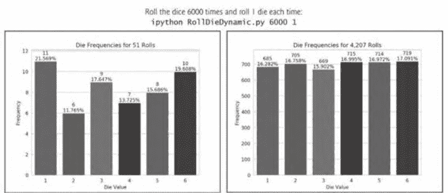

## 编写 Python 脚本的工具选择

理论上，任何文本编辑器都能编写 Python 代码。但**集成开发环境（IDE）**集成了代码编写、调试、运行等全流程工具，能显著提升开发效率。主流 Python IDE 包括：
*   **Spyder**（Anaconda 自带）
*   **PyCharm**
*   **Visual Studio Code**

## 运行时常见错误及应对

初次运行代码报错是常态。例如“除以零”这类非法操作会触发错误提示。遇到此类情况，需返回编辑器修正代码，再重新运行验证。

这类在程序运行过程中爆发的错误，称为**运行时错误**或**执行时错误**。
*   **致命运行时错误**：导致程序异常终止，任务未完成。
*   **非致命运行时错误**：程序能跑完，但输出结果错误。

---

# 1.5.3 Jupyter Notebook 交互式开发指南

Anaconda 发行版预装了 **Jupyter Notebook**，这是一款基于浏览器的交互式编程环境。它支持代码、文本、图像、视频混合编排，是数据分析、科学计算领域的标杆工具，且持续扩展对多语言的支持。

本书所有源码均提供对应的 Notebook 版本，开箱即用。本节将基于 **JupyterLab** 界面（管理 Notebook 及资源文件的现代化界面）演示代码编写、执行、调试全流程。

## 启动 JupyterLab

在终端/命令行中定位到 `ch01` 目录（参考 1.5.2 节路径），输入以下命令并回车：

```
jupyter lab
```

该命令启动 Jupyter Notebook 服务，并自动在默认浏览器打开 JupyterLab。左侧文件浏览器（📁 图标）将显示 `ch01` 目录内容。


> **提示**：服务运行期间，若误关浏览器，可在地址栏输入 `http://localhost:8888/lab` 重新访问。双击文件可在右侧区域以标签页形式打开。

## 创建与重命名 Notebook

1.  在 **Launcher** 页点击 **Python 3** 按钮，生成名为 `Untitled.ipynb` 的新文件（`.ipynb` 即 IPython Notebook 缩写）。
2.  重命名为 `TestDrive.ipynb`：
    *   右键标签页 `Untitled.ipynb` → 选择 **Rename Notebook...**
    *   输入 `TestDrive.ipynb` → 点击 **RENAME**。

重命名后界面顶部效果如下：

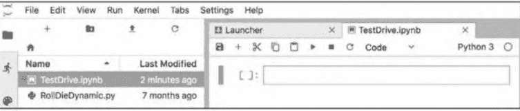

## 单元格操作：从表达式到多行代码

Notebook 以**单元格**为最小执行单元。新建文件默认含一个空单元格（矩形框），左侧 `[]` 处将显示执行序号。

### 执行简单表达式
点击单元格输入代码：

```
45 + 27
```

按 `Ctrl + Enter`（Mac 同 `Control + Enter`）执行。结果直接输出在单元格下方。

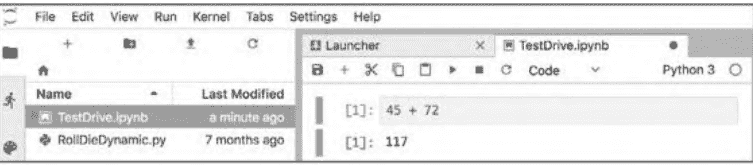

### 新增单元格执行复杂逻辑
点击左上角工具栏 `+` 号，在当前单元格下方插入新单元格。

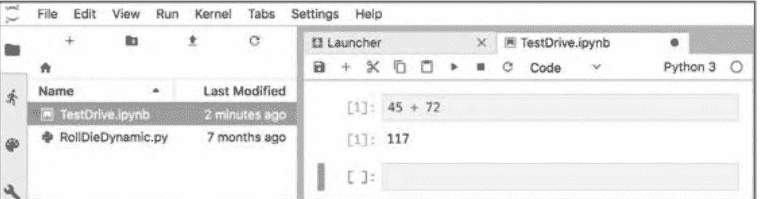

输入表达式：

```
5 * (12.7 - 4) / 2
```

同样按 `Ctrl + Enter` 运行。

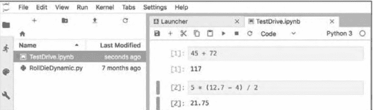

## 保存与状态指示

文件修改后未保存时，标签页的 `X` 会变为 `●`。点击菜单栏 **File** → **Save Notebook** 即可保存（注意：此菜单在 JupyterLab 界面内，非浏览器菜单）。

## 使用预置示例 Notebook

各章节提供的示例 Notebook 含完整代码但无输出。建议逐单元格执行，实时查看结果。

**重置 Notebook 示例**：
打开 `TestDrive.ipynb`，依次操作：**Kernel** 菜单 → **Restart Kernel and Clear All Outputs...** → 点击 **RESTART**。这能清空输出与执行编号，恢复初始态。随后保存并关闭标签页（点 `X`）。

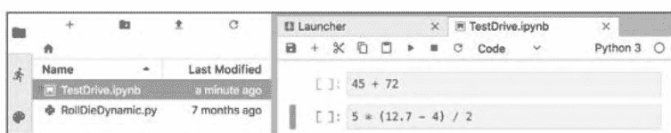

**打开现有 Notebook 并全量运行**：
在 JupyterLab 文件浏览器中双击目标 `.ipynb` 文件。可逐个运行单元格，或用 **Run** 菜单 → **Run All Cells** 一键顺序执行全文，各单元格输出将依次呈现。

## 关闭 JupyterLab

关闭浏览器标签页后，在启动服务的终端中按两次 `Ctrl + C`（Mac 同 `Control + C`）彻底停止服务。

## JupyterLab 效率小贴士

*   **连续编码利器**：用 `Shift + Enter` 替代 `Ctrl + Enter`，执行完当前单元格自动在下方新建一个，适合大量代码输入。
*   **显示行号**：后续多行代码增多时，开启 **View** → **Show line numbers** 便于定位与调试。

## 深入学习资源

JupyterLab 功能远不止此。官方文档：[https://jupyterlab.readthedocs.io/en/stable/index.html](https://jupyterlab.readthedocs.io/en/stable/index.html)
*   **GETTING STARTED > Overview**：快速上手总览。
*   **USER GUIDE**：界面布局、文件操作、文本编辑器、Notebook 进阶用法详解。

---

# 1.6 云计算与物联网：连接万物的新基建

## 1.6.1 云：算力与服务的“电网化”

如今，海量计算负载已迁移至**“云”端**——即分布全球的互联网数据中心。日常使用的 App 背后，往往支撑着庞大的云资源池（服务器、CPU、内存、存储、数据库），它们通过互联网协同工作。这种“通过互联网按需提供服务”的模式称为 **Web 服务**。

Python 调用云服务极其便捷：实例化对象、调用方法，底层网络通信细节尽皆封装。本书第 11-16 章将实战多个主流云服务：

| 章节 | 云服务 & 库 | 核心场景 |
| :--- | :--- | :--- |
| Ch 12, 16 | **Twitter (X) API / Tweepy** | 用户画像分析、历史推文检索、实时推文流监听 |
| Ch 11, 12 | **Google Translate / TextBlob** | 多语言文本自动翻译 |
| Ch 13 | **IBM Watson (TTS/STT/Translate)** | 开发“旅行者翻译伴侣”：语音↔文本互转、多语言合成播报 |
| Ch 16 | **Microsoft Azure HDInsight & Web Services** | 基于 Hadoop/Spark 的大数据处理管道 |
| Ch 16 | **dweet.io / 仪表板服务** | 模拟智能恒温器上报温度、实时可视化预警 |
| Ch 16 | **PubNub** | 实时传感器数据流可视化、模拟股票行情流处理 |

核心模式：**构建 Python 对象代理云端服务，屏蔽网络通信复杂度。**

### Mashup：像搭积木一样组装应用
第 13 章的翻译伴侣采用 **Mashup（混搭/组合）** 架构——将免费/开放的 Web 服务与数据源拼装，快速生成强大应用。鼻祖案例：Craigslist 房源数据 + Google Maps 地图 = 可视化找房神器。

资源推荐：**ProgrammableWeb** (programmableweb.com) 收录 20,000+ Web 服务与 8,000+ Mashup 案例，并提供开发指南。当前最热服务：Facebook、Google Maps、Twitter (X)、YouTube。

## 1.6.2 物联网：万物互联的神经元

互联网不再仅连接计算机，而是延伸为 **物联网 (IoT)**。凡具备 IP 地址、能自动收发数据的“物”皆可入网：
*   **移动资产**：ETC 车载装置、共享单车/汽车定位器
*   **基础设施**：车位占用传感器、智能水表/电表、水质/辐射监测站
*   **医疗健康**：植入式心脏监护仪、穿戴式运动追踪器
*   **智能空间**：自适应恒温器、互联家电、仓储资产追踪器

**数据洞察**：Statista 统计，当前全球 IoT 设备超 230 亿台，2025 年预计突破 **750 亿**。万物互联时代，数据生成端前所未有地密集。

---

# 1.7 大数据究竟有多“大”？

对数据科学家而言，数据价值已与代码并重。IBM 数据：全球日均新增 **2.5 EB** 数据，近两年产出占历史总量 **90%**。IDC 预测 2025 年全球年数据总量将达 **175 ZB** (175 万亿 GB / 1750 亿 TB)。以下用生活化场景具象化存储单位：

## MB 级：指尖上的碎片
**1 MB ≈ 100 万字节 (2^20)**
*   **MP3**：1 分钟高质量 ≈ 1–2.4 MB
*   **照片**：JPEG 单张 ≈ 8–10 MB
*   **视频**：iPhone 为例
    *   1080p/30fps：1 分钟 ≈ **130 MB**
    *   4K/30fps：1 分钟 ≈ **350 MB**

## GB 级：个人媒体库基线
**1 GB ≈ 1,000 MB (2^30)**，双层 DVD 容量 8.5 GB 可存：
*   **音频**：~141 小时 MP3
*   **照片**：~1,000 张 (1600 万像素)
*   **1080p 视频**：~7.7 分钟
*   **4K 视频**：~2.85 分钟
*   **蓝光极限**：100 GB 存储高清影片
*   **流媒体 4K 电影**：7–10 GB/小时 (高压缩)

## TB 级：家庭级冷存储
**1 TB ≈ 1,000 GB (2^40)**，主流桌面硬盘最大 15 TB 可装：
*   **音频**：28 年不重样
*   **照片**：168 万张
*   **1080p 视频**：226 小时
*   **4K 视频**：84 小时
*   **SSD 极限**：Nimbus Data 100 TB 固态盘 = 15 TB 机械盘的 **6.67 倍** 容量

## PB / EB / ZB 级：全球数据洪流
*   **日增量**：~2.5 EB = 2,500 PB (近 40 亿网民贡献)
*   **2020 年密度**：人均每秒生成 **1.7 MB** (AnalyticsWeek)
*   **按 77 亿人口折算**：
    *   每秒：**13 PB**
    *   每分钟：**780 PB**
    *   每小时：**46.8 EB**
    *   每天：**1.123 ZB** (≈ 1,123 EB)
*   **形象对比**：每天新增数据 ≈ **550 万小时 4K 视频 (600+ 年)** 或 **1,160 亿张照片**！

## 实时脉动：Internet Live Stats
访问 [internetlivestats.com](https://www.internetlivestats.com) 可观测实时计数器：
*   Google 搜索量
*   推文 (X Post) 量 (2018 年全年超 **2,500 亿** 条)
*   YouTube 视频上传/观看时长 (**用户每小时上传 24,000 小时视频，日均观看近 10 亿小时**)
*   Instagram 照片分享量

每个指标均可深钻查看详情，直击数据爆炸的当下。

# 数据洪流与算力跃迁：重塑世界的隐形引擎

### 每一秒，都在刷新认知

互联网从未眠过。眨眼间，全球网络吞吐 **51.773 TB** 流量；推特上新增 **7,894 条** 推文；谷歌处理 **64,332 次** 搜索；YouTube 迎来 **72,029 个** 新视频。这还只是冰山一角。

放大到天维度，Facebook 每天收割 **8 亿个** “点赞”，**6,000 万个** 表情符号飞跃屏幕，自上线以来，搜索量破亿的帖子已超 **2.5 亿** 条。

天基视角同样震撼。Planet 公司 CEO Will Marshall 曾透露：旗下 **142 颗** 卫星每天为地球陆地拍一张“全家福”，日增 **100 万张** 照片、**7 TB** 数据。借助机器学习，这些像素变成了增产良方、港口航运图谱、森林砍伐预警系统。他说：“过去我们只能事后发现亚马逊雨林的‘大窟窿’，现在能每天数清地球上每一棵树的命运。”

Domo 旗舰报告 *Data Never Sleeps 6.0* 将镜头对准**每一分钟**：
- 47.34 万条推文飞出
- 208.3 万张 Snapchat 照片闪现
- 9.7 万小时 Netflix 影片被吞噬
- 12.99 万亿条短信穿梭
- 4.9 万条 Instagram 动态上新
- 17.6 万通 Skype 通话接通
- 75 万首 Spotify 歌曲流淌
- 387.7 万次 Google 搜索发起
- 433.3 万个 YouTube 视频被点播

---

### 算力进化史：从“亿次”到“百亿亿次”

数据野蛮生长，算力必须进化。衡量标准是 **FLOPS（每秒浮点运算次数）**。

- **90 年代初**：超算刚破 **Gigaflops（10⁹）** 大关。
- **90 年代末**：英特尔推出首台 **Teraflops（10¹²）** 级巨兽。
- **21 世纪前十年**：百万亿次 **Petaflops（10¹⁵）** 成常态，IBM “巅峰” 登顶 **122.3 Petaflops**。
- **分布式反击**：Folding@home 聚合全球闲置 PC，2016 年底算力破 **100 Petaflops**，助力药物研发。
- **下一站 Exaflops（10¹⁸）**：IBM 等巨头已在攻关。
- **量子终局**：理论速度碾压常规机 **1.8 亿亿倍**。一秒算完人类计算机史总和，区块链加密体系面临“降维打击”，工程师正火速重构抗量子链。

**算力平权**：超算技术从实验室下放，云端按需付费取代“为峰值买单”，让中小团队也能调动超算级资源。

---

### 隐形“电老虎”：数据中心的能源账单

繁荣背后是惊人的电费单。研究显示：
- 2015 年起，数据处理用电年增 **20%**，占全球 **3%~5%**。
- **2025 年恐触及 20%** 红线。

**比特币是“隐形大户”**：单笔交易耗电 ≈ 美国家庭一周用电量。全网年耗电超以色列、逼近希腊。摩根士丹利 2018 年警告：挖矿耗电或超 2025 年全球电动车总充电量。区块链社区正在拼命寻找低能耗共识，但应用爆发让降温之路漫漫长夜。

---

### 机遇：拥抱指数级未来

**500 亿** 智能设备即将入网，数据将呈指数爆发。无论企业、政府、军队还是个人，**“懂数据”即“握未来”**。

摩根大通、麦肯锡等头部机构率先交出高分答卷，倒逼全行业跟进投入大数据、机器学习、深度学习、NLP。人才缺口随之撕大，数据科学/计算机科学复合型专家将成未来十年最紧俏“稀缺资源”。

---

## 1.7.1 读懂大数据：四个“V”定乾坤

数据分析源远流长（古埃及统计、1962 年定名），**“大数据”概念 2000 年前后诞生，“大数据分析”则是近年新贵**。

核心特征四维坐标：
1. **量** - 指数级堆叠的 TB/PB/ZB。
2. **速** - 生成快、传播快、衰变快，“实时”成标配。
3. **杂** - 突破字符数字，涵盖图音视、物联网传感器流。
4. **真** - 完整性、准确性、可信度，决策前必须问：敢信吗？

摩尔定律让存储“又大又便宜又小”，海量留存成为可能。**“计算的目的是洞察，而非数字”**（Richard W. Hamming, 1962），数据科学正以前所未有的速度、深度、细度产出洞察，重塑社会。本书后续将深入 NoSQL、Hadoop、Spark、实时物联网流等基建领域。

---

## 1.7.2 万物皆可“数”：用例全景图

数据科学落地开花，直接转化为利润、体验、胜场。以下领域均已跑出标杆案例（本书将逐一拆解）：

> **智能决策类**：推荐系统、动态定价、预测分析、风险最小化、库存控制、营销分析、股市预测、房地产评估、保险定价、信用评分、机器人财务顾问。  
> **健康生命类**：癌症诊断/预测、基因组学、个性化医疗、精准医学、电子健康档案、远程医疗、新药研发、免疫治疗、可穿戴监测、阿片类药物滥用预防、疾病爆发预警、医院再入院率降低。  
> **城市交通类**：自动驾驶、乘车共享、动态路线、智能交通灯、智能停车、物流优化、Waze/地图导航、自治船舶。  
> **安全防务类**：欺诈/恶意软件/网络钓鱼检测、网络安全、犯罪预测/预防、反恐、身份防盗、灾难受害者识别。  
> **生活服务类**：智能助手/家居/恒温器/电表、语音/语言翻译、个性化购物/饮食/旅行、社交分析、情感分析、垃圾邮件过滤、趋势发现。  
> **工业能源类**：预测性维护、能耗降低、碳减排、作物增产、智能电网、制造质检、供应链优化。  
> **科学研究类**：大脑图谱、基因编辑（CRISPR）、天气预报、材料发现、粒子物理、天文巡天。  
> **交互媒体类**：计算机视觉、图像标题/生成、音乐生成、文本摘要、手写识别、手语阅读、游戏 AI（AlphaGo/Zero）、视觉产品搜索。

> *注：以上为高频落地场景分类，书中表格罗列 100+ 细分用例，覆盖从“异常检测”到“天气预报”的全谱系。*

---

## 1.8 实战解剖：Waze —— 口袋里的“全知导航”

**9000 万月活**，Waze 是大数据移动端教科书级产品。

**旧时代**：静态地图 + GPS = 死板路线，堵车无感。  
**Waze 逻辑**：**众包实时流** ➜ **云端毫秒级分析** ➜ **动态最优路 + 预警推送**。

用户手机化身 **移动物联网传感器**（GPS + 加速度计 + 网络），自动上报位置、速度；用户可主动标注：路障、施工、警车、油价。服务端融合百万级流，实时重算拓扑，把“避坑指南”推给周边车辆。

**技术栈推断（贯穿本书实战线）**：
- **通信**：JSON over HTTP/HTTPS（Ch9）
- **语音交互**：TTS + ASR → NLP 意图识别（Ch11, 13）
- **可视化**：Matplotlib/Seaborn/Folium 动态交互地图（Ch12, 16）
- **边缘感知**：手机 = IoT 节点，模拟流式传感器（Ch16）
- **后端算力**：云原生集群 + 大规模并行处理（MPP），流式入库、实时 OLAP（Ch16）
- **智能大脑**：ML/DL 预测 ETA、拥堵演化、最优路径（Ch14, 15）
- **存储拓扑**：图数据库 存路网、算最短路（Ch16 - Neo4j）
- **进阶视觉**：车载摄像头 + CV 深度学习，自动识别障碍/路边停车，减少人工上报（Ch15）

---

## 1.9 AI 启蒙：当计算机开始“像婴儿一样学习”

婴儿睁眼不知“脸”为何物，需海量样本训练视觉皮层。**AI 亦是如此**——吞噬数据、自主习得模式、泛化到未知。

从下围棋、开车、诊病、翻译、写代码，到聊天机器人调用万亿参数知识库，**通用人工智能（AGI）** 是终极图景：具备人类级泛化智能。这令人振奋，亦令许多人不安。

### 里程碑：人类被超越的时刻
| 年份 | 事件 | 关键技术/数据规模 |
|------|------|-------------------|
| 1997 | **DeepBlue** 胜 卡斯帕罗夫 | 千万级棋谱 + 蛮力搜索 2 亿步/秒（大数据雏形） |
| 2011 | **Watson** 碾压《危险边缘》人类冠军 | 2 亿页语料（4 TB）+ 百模型集成 + ML/RL 训练 |
| 2015 | **AlphaGo** 胜 欧洲冠军 范辉 | 双神经网络 + 深度强化学习，应对 10¹⁷⁰ 棋局空间（宇宙原子数仅 10⁷⁸~⁸⁷） |
| 2017 | **AlphaZero** 4 小时自学象棋胜 Stockfish 8，8 小时围棋 60:40 胜 AlphaGo | **零人类知识**，纯强化学习自博弈，通用棋类架构 |

### 作者手记：序列预测与“曼哈顿街区”的启示
合著者 Harvey Deitel 1960 年代在 MIT 跟随 AI 之父 **Marvin Minsky** 修课。期末挑战：写程序预测数字序列下一项。他在 PDP-1 上用 Lisp 递归实现，破解 IQ 测试级数列，令同学折服。

直到同学出题：**14, 23, 34, 42 …**  
程序跑不出，Harvey 也瞎猜。答案揭晓：**57, 125 …**  
规则是：**曼哈顿双向穿越街道编号**。  
纯数学模型彻底失效——**“知识边界决定智能上限”**。这段往事成全书注脚：**没有海量多元知识库，再精妙的算法也是“井底之蛙”**。

### Watson 与大数据：打开新世界的钥匙
Watson 胜利不是终点，是起点。它证明：**海量非结构化数据 + 认知计算 = 专家级推理能力**。这正是本书要带你构建的能力图谱——从数据采集、存储、治理，到机器学习、深度学习、知识图谱，最终落地为解决真问题的智能应用。

**旅程正式开始。**

### 启程：Watson点燃的AI与大数据探索

起初执笔时，Paul与我深受IBM Watson震撼：这款系统凭借海量数据、自然语言处理与机器学习等尖端技术，在《危险边缘》节目中力克两位人类冠军。我们敏锐察觉到，Watson背后的技术栈完全有能力攻克序列预测等难题——毕竟它内置了全球街道地图等海量信息。这一洞见点燃了我们深耕大数据与AI领域的激情，并直接催生了本书第11至16章的核心内容。

**读者须知**：第11至16章的所有数据科学实战案例，均扎根于AI算法或大数据软硬件基建之上，正是这些底座赋能科学家高效落地高阶智能方案。

### AI：长期“只有问题、无方案”的破局史

数十载光阴，AI曾被视为“只有问题、没有答案”的领域。怪圈在于：一旦难题被攻克，众人便论断“这不算智能，只是预设指令的程序罢了”。机器学习（第14章）与深度学习（第15章）的出现打破了僵局——我们不再为特定问题硬编码答案，而是让机器从海量数据中自主习得解法。

当下最迷人、最硬核的挑战，多由深度学习破局。单Google内部就有数千个深度学习项目并行推进，规模仍在指数级跃升。随书深入，你将系统接触处于实践最前沿的AI、大数据与云技术生态。

## 1.10 章节回顾

本章为全书奠基，梳核心术语与概念，为第2-10章Python编程实战、第11-16章大数据/AI/云原生案例铺路。

我们复盘了面向对象编程范式，剖析Python流行根因，介绍标准库与数据科学生态如何助力“避免重复造轮子”。后续章节将驾驭这些工具，构建可交互软件对象，以极简代码完成重磅任务。

通过三个试用程序，实演IPython与Jupyter Notebook的代码执行流。同步引入云计算与物联网概念，为后续App开发搭建认知脚手架。

我们量化了“大数据”的规模与爆发增因，深度剖析Waze导航App案例——其融合当红技术实现动态领航，助用户极速安全抵达，并标注了涉及技术对应的章节分布。本章收官于数据科学入门，聚焦计算机科学与数据科学的交叉核心——人工智能。

# 第2章

## Python编程入门全景

## 本章看点

- 熟练运用IPython交互模式即时验证代码片段；
- 掌握编写简洁Python语句与脚本的要诀；
- 精通变量创建与数据存储机制；
- 全景式认知内置核心数据类型；
- 灵活驾驭算术/比较运算符及其优先级规则；
- 区分单、双、三引号字符串的适用场景；
- 熟练调用`print`输出文本、`input`捕获键盘输入并转化业务数据；
- 掌握`int`将文本转整型、`type`探查对象类型的实操；
- 结合比较运算符与`if`语句实现流程分支决策；
- 深度理解Python对象模型与动态类型机制。

## 2.1 起步篇

承接第一章IPython实战热身，本章正式开启Python程序设计之旅，将通过丰富示例拆解语言关键特性。

## 2.2 变量定义与赋值机制

第一章我们已用IPython交互模式充当计算器，评估如下表达式：

```
In [1]: 45 + 72
Out[1]: 117
```

现在，定义变量`x`并绑定整数`7`：

```
In [2]: x = 7
```

上述代码段[2]为声明语句：创建变量`x`并以赋值符（`=`）绑定值。Python习惯单行单语句，亦允跨行。同理，创建`y`绑定`3`：

```
In [3]: y = 3
```

随后即可在表达式中直接引用`x`、`y`的值：

```
In [4]: x + y
Out[4]: 10
```

### 赋值表达式中的运算逻辑

下面语句将`x`、`y`求和并赋予`total`，随即输出：

```
In [5]: total = x + y
In [6]: total
Out[6]: 10
```

**核心规则**：赋值表达式**永远先算右侧**，再绑定左侧变量。赋值符`=`**非运算符**。

### 编码规范指引

《Python代码风格指南》（PEP 8）是规范基准。建议赋值符与运算符（如`+`）两侧各留一空格，显著提升可读性。

### 变量命名准则

变量名（如`x`）本质是标识符。合法字符含字母、数字、下划线（`_`），**不可数字开头**。Python**区分大小写**，`number`与`Number`互不相干。

### 类型系统初探

Python中万物皆有类型，标识数据本质。内置`type()`函数可探查类型：

```
In [7]: type(x)
Out[7]: int
In [8]: type(10.5)
Out[8]: float
```

变量`x`绑定整数`7`（见代码段[2]），故显示`int`；`10.5`属浮点数，显示`float`。

## 2.3 算术运算深度解析

下表汇总Python算术运算符，含代数中罕见符号：

| Python 运算 | 算术运算符 | 代数表达式 | Python 表达式 |
|---|---|---|---|
| 加法 | + | f+7 | f + 7 |
| 减法 | - | p-c | p - c |
| 乘法 | * | b · m | b * m |
| 求幂 | ** | x² | x ** y |
| 除法 | / | x/y 或 x÷y | x / y |
| 整除 | // | [x / y] 或 [x÷y] | x // y |
| 取余（模） | % | r mod s | r % s |

### 乘法 (`*`)

星号(`*`)充当乘法符，示例：

```
In [1]: 7 * 4
Out[1]: 28
```

### 求幂 (`**`)

`**`计算幂次，示例：

```
In [2]: 2 ** 10
Out[2]: 1024
```

平方根可用`0.5`作指数（即`1/2`）：

```
In [3]: 9 ** (1 / 2)
Out[3]: 3.0
```

### 除法 (`/`) 与 整除 (`//`)

除法(`/`)产出浮点数（含小数点）：


整除(`//`)向下取整（直接截尾小数部）：


负数场景更见真章：`-13 / 4 = -3.25`：


`-13 // 4` 取**不大于-3.25的最大整数**，即`-4`：


### 异常与回溯机制

除零（`/`或`//`）触发异常，标示运行故障：

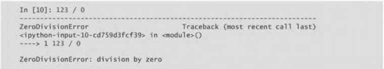

Python通过**回溯**报告异常。上例抛出`ZeroDivisionError`（多数异常以`Error`结尾）。交互模式下，回溯中的数字标识故障代码段编号。

```
<ipython-input-10-cd759d3fcf39> in <module>()
```

`---->`指向故障代码行；多行代码段中，数字定位具体行。末行给出异常名与详细信息：

```
ZeroDivisionError: division by zero
```

第9章将系统讲解异常处理。

引用未定义变量同理报错。如`7 + z`（`z`未建立）触发`NameError`：

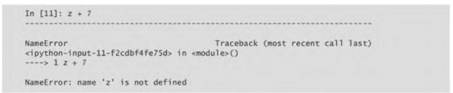

### 取余运算符 (`%`)

`%`返回左操作数除右操作数的余数：

```
In [12]: 17 % 5
Out[12]: 2
```

`17 ÷ 5` 商`3` 余`2`。`%`常用于整数，亦适用其他数值类型：

```
In [13]: 7.5 % 3.5
Out[13]: 0.5
```

### 直线形式表达式

编译/解释器不识竖式分数，必须**直线形式**水平排列运算符与操作数，如`a/b`或`a//b`。

### 括号分组控制优先级

同代数，括号改变结合顺序。示例先算`5+3`，再乘`10`：

```
In [14]: 10 * (5 + 3)
Out[14]: 80
```

无括号则按默认优先级，结果迥异：

```
In [15]: 10 * 5 + 3
Out[15]: 53
```

若去括号结果不变，则括号**冗余**。

### 运算符结合性

“从左向右”即结合性。如`a + b + c`等价`(a + b) + c`。

```
a + b + c
```

除`**`**从右向左**外，其余均左结合。

### 运算符优先级规则

Python遵循标准优先级（与代数一致）：

1.  **括号最高**：嵌套时由内而外（如`(a/(b-c))`先算`b-c`）。
2.  **求幂 (`**`)**：多幂运算**从右向左**结合。
3.  **乘/除/整除/模 (`*`, `/`, `//`, `%`)**：同级，**从左向右**。
4.  **加/减 (`+`, `-`)**：同级，**从左向右**。

完整优先级表（低到高）见官方文档：https://docs.python.org/3/reference/expressions.html#operator-precedence

### 善用冗余括号提升清晰度

为阅读性可加冗余括号。二次多项式：

```
y = a * x ** 2 + b * x + c
```

加括号更直观：

```
y = (a * (x ** 2)) + (b * x) + c
```

将复杂表达式拆解为短语句序列，亦是良策。

### 操作数类型与结果类型

算术运算符支持整/浮点混合：
- 双整数运算 → 整数（**除法`/`除外，恒产浮点**）；
- 双浮点运算 → 浮点数；
- 混合类型表达式 → **浮点数**。

## 2.4 `print`函数与引号作用

内置`print()`将参数作为行文本输出：

```
In [1]: print('Welcome to Python!')
Welcome to Python!
```

参数`'Welcome to Python!'`为**单引号字符串**。区别于交互模式自动显示`Out[...]`及引号，`print`净输出内容。

**双引号**同样合法：

```
In [2]: print("Welcome to Python!")
Welcome to Python!
```

社区偏好单引号。`print`执行后光标自动定位下行行首。

### 逗号分隔多参数输出

`print`接受逗号分隔参数列表，**自动插空分隔**：

```
In [3]: print('Welcome', 'to', 'Python!')
Welcome to Python!
```

输出等效前两例。参数类型不限于字符串。下章将讲解控制分隔符（抑制空格或自定义）。

### 单语句输出多行文本

反斜杠(`\`)为**转义字符**，连同后字符形成**转义序列**。`\n`即**换行符**，驱动光标移次行首。三个`\n`造三行输出：

```
In [4]: print('Welcome\nto\n\nPython!')
Welcome
to

Python!
```

### 常用转义序列速查

| 转义序列 | 含义 |
|---|---|
| `\n` | 换行：光标移至下行行首 |
| `\t` | 水平制表：光标跳至下一制表位 |
| `\\` | 字面反斜杠 |
| `\"` | 字面双引号 |
| `\'` | 字面单引号 |

### 长字符串续行技巧

行尾反斜杠(`\`)作**续行符**，将长字符串/语句拆行，**不计入内容**：

```
In [5]: print('this is a longer string, so we \\\n...: split it over two lines')
this is a longer string, so we split it over two lines
```

解释器自动拼合为无续行符的完整串。虽在引号内，但因无后续字符，**不视为转义字符**。

### 直接打印表达式值

`print`参数可为表达式，即时计算输出：

```
In [6]: print('Sum is', 7 + 3)
Sum is 10
```

## 2.5 三引号字符串：多行、嵌套引号、文档字符串

单/双引号之外，**三引号**（`"""`或`'''`）定界字符串。PEP 8推荐**三双引号(`"""`)**。三大用途：

1.  **多行字符串**；
2.  **包含单/双引号**的字符串；
3.  **文档字符串** —— 标准化记录组件用途的推荐实践。

### 字符串内嵌引号处理

单引号串可嵌双引号：

```
In [1]: print("Display "hi" in quotes")
Display "hi" in quotes
```

**不可嵌单引号**（视为终止符）：

```
In [2]: print("Display 'hi' in quotes")
File "<ipython-input-2-19bf596ccf72>", line 1
print("Display 'hi' in quotes")
^ SyntaxError: invalid syntax
```

强行嵌单引号需转义 `\'` ：

```
In [3]: print("Display \"hi\" in quotes")
Display "hi" in quotes
```

代码段[2]报`SyntaxError`，`^`标位，提示`invalid syntax`。

双引号串镜像对称：可嵌单引号，禁双引号（需转义 `\"`）：

```
In [4]: print("Display the name O'Brien")
Display the name O'Brien
```
```
In [5]: print("Display \"hi\" in quotes")
Display "hi" in quotes
```

**三引号终极方案**：完美包裹单双引号混杂内容，免转义之累：

```
In [6]: print("""Display "hi" and 'bye' in quotes""")
Display "hi" and 'bye' in quotes
```

### 多行字符串原生支持

下例将三引号多行串赋值变量 `triple_quoted_string`：

# Python 基础进阶：交互输入、条件分支与对象本质

```
In [7]: triple_quoted_string = """This is a triple-quoted
... string that spans two lines"""
```

在交互式 Shell 中，若按下回车时引号未闭合，解释器会判定语句未完，随即给出延续提示符 `...`。此时可继续录入后续行，直至补全结束引号并确认。下方演示了变量 `triple_quoted_string` 的实际内容：

```
In [8]: print(triple_quoted_string)
This is a triple-quoted
string that spans two lines
```

Python 内部靠嵌入 `\n` 来保存多行文本。比如在 REPL 直接查看变量而非 `print` 时，会用单引号包裹显示，并在换行处标出转义符。注意：显示的引号仅标识类型，不属于字符串内容：

```
In [9]: triple_quoted_string
Out[9]: 'This is a triple-quoted\nstring that spans two lines'
```

## 2.6 捕获用户输入与类型转换

内置函数 `input` 负责弹出提示并读取键盘数据：

```
In [1]: name = input("What's your name? ")
What's your name? Paul
In [2]: name
Out[2]: 'Paul'
In [3]: print(name)
Paul
```

运行流程如下：
1.  `input` 将参数作为提示词打印，程序暂停等待用户录入并回车（示例中录入 `Paul`，粗体用于区分提示文本）。
2.  函数把录入的字符序列作为**字符串**返回，上例赋值给 `name`。

查看变量值时，带引号的 `'Paul'` 表明其为字符串；`print` 输出则不显示引号。若用户录入时自带引号，这些符号会并入字符串：

```
In [4]: name = input("What's your name? ")
What's your name? 'Paul'
In [5]: name
Out[5]: "'Paul'"
In [6]: print(name)
'Paul'
```

### `input` 固定返回字符串

这是新手高频误区。尝试读取两数相加：

```
In [7]: value1 = input('Enter first number: ')
Enter first number: 7
In [8]: value2 = input('Enter second number: ')
Enter second number: 3
In [9]: value1 + value2
Out[9]: '73'
```

结果非数学上的 `10`，而是拼接得到 `'73'`。`+` 两侧均为字符串，触发拼接而非加法。

### 获取整数输入

需显式用 `int()` 转换返回值：

```
In [10]: value = input('Enter an integer: ')
Enter an integer: 7
In [11]: value = int(value)
In [12]: value
Out[12]: 7
```

也可合并为一步：

```
In [13]: another_value = int(input('Enter another integer: '))
Enter another integer: 13
In [14]: another_value
Out[14]: 13
```

此时两变量均为 `int`，`+` 执行真正加法：

```
In [15]: value + another_value
Out[15]: 20
```

**异常提示**：传给 `int` 的字符串若无法解析（如含字母），将抛出 `ValueError`：

```
In [16]: bad_value = int(input('Enter another integer: '))
Enter another integer: hello
---------------------------
ValueError Traceback (most recent call last)
<ipython-input-16-cd36e6cf8911> in <module>()
----> 1 bad_value = int(input('Enter another integer: '))
ValueError: invalid literal for int() with base 10: 'hello'
```

`int` 也能截断浮点数；若需浮点数，请用 `float()`。

```
In [17]: int(10.5)
Out[17]: 10
```

## 2.7 分支控制：`if` 判断与比较操作

条件本质是求值为 `True`/`False` 的布尔表达式。示例判断 `7 > 4` 与 `7 < 4`：


**注意**：`True`/`False` 首字母大写，属关键字，不可作变量名。

### 比较运算符速查

| 数学符号 | Python 符号 | 示例 | 含义 |
| :--- | :--- | :--- | :--- |
| > | `>` | `x > y` | 大于 |
| < | `<` | `x < y` | 小于 |
| ≥ | `>=` | `x >= y` | 大于等于 |
| ≤ | `<=` | `x <= y` | 小于等于 |
| = | `==` | `x == y` | 等于 |
| ≠ | `!=` | `x != y` | 不等于 |

**优先级规则**：`> < >= <=` 同级，高于 `== !=`。符号间**严禁加空格**（如 `> =` 报错），顺序颠倒（`=>`、`=<`、`=!`）同样非法。


### 实战脚本：多条件比较器

交互模式适合片段验证，完整逻辑通常写入 `.py` 文件。示例 `fig02_01.py` 读两个整数，用 6 个连续 `if` 覆盖所有比较符。每次运行必有 3 个条件成立。书中先给完整代码（含行号，非语法一部分），再逐段解析。

执行命令（在对应目录下）：

```
ipython fig02_01.py
```

或在已启动的 IPython 中运行：

```
run fig02_01.py

1 # fig02_01.py
2 """Comparing integers using if statements and comparison operators."""
3
4 print('Enter two integers, and I will tell you',
5 'the relationships they satisfy.')
6
7 # read first integer
8 number1 = int(input('Enter first integer: '))
9
10 # read second integer
11 number2 = int(input('Enter second integer: '))
12
13 if number1 == number2:
14     print(number1, 'is equal to', number2)
15
16 if number1 != number2:
17     print(number1, 'is not equal to', number2)
18
19 if number1 < number2:
20     print(number1, 'is less than', number2)
21
22 if number1 > number2:
23     print(number1, 'is greater than', number2)
24
25 if number1 <= number2:
26     print(number1, 'is less than or equal to', number2)
27
28 if number1 >= number2:
29     print(number1, 'is greater than or equal to', number2)
```

```
Enter two integers and I will tell you the relationships they satisfy.
Enter first integer: 37
Enter second integer: 42
37 is not equal to 42
37 is less than 42
37 is less than or equal to 42
```

```
Enter two integers and I will tell you the relationships they satisfy.
Enter first integer: 7
Enter second integer: 7
7 is equal to 7
7 is less than or equal to 7
7 is greater than or equal to 7
```

```
Enter two integers and I will tell you the relationships they satisfy.
Enter first integer: 54
Enter second integer: 17
54 is not equal to 17
54 is greater than 17
54 is greater than or equal to 17
```

#### 代码解剖

**注释（第 1 行）**  
以 `#` 开头至行尾为注释，本书每脚本首行标注文件名。行尾注释亦可。

```
### fig02_01.py
```

**文档字符串（第 2 行）**  
PEP 8 建议脚本以文档字符串开头说明用途。复杂脚本可写多行，后续也将用于函数/类说明，配合 `help()` 机制极佳。

```
"""Comparing integers using if statements and comparison operators."""
```

**空行（第 3 行）**  
空行、空格、制表符统称空白。Python 忽略大部分空白，**缩进除外**（后章详述）。

**长语句拆行（第 4-5 行）**  

```
print('Enter two integers, and I will tell you',
'the relationships they satisfy.')
```

提示字符串过长，拆为两行置于 `print` 参数列表（逗号分隔，输出自动空格分隔）。推荐在括号内隐式换行（PEP 8 首选），而非显式续行符 `\`。断点应选在逗号后或运算符前等有意义位置。

**读取整数（第 8、11 行）**  
组合 `input` 与 `int` 完成录入与转换。

**`if` 语句结构（第 13-14 行）**  

```
if number1 == number2:
    print(number1, 'is equal to', number2)
```

用 `==` 判等。条件真执行缩进块（套件），假跳过。后续 5 个 `if` 同理。语法要素：`if` + 条件 + **冒号** + **缩进套件**（至少一句）。漏写冒号是高发语法错误。

**缩进规范**  
强制缩进标识代码块归属。PEP 8 推荐 **4 空格**，全书遵循此标准。错误缩进会导致逻辑错乱或 `IndentationError`。

**`==` 与 `=` 混淆**  
条件判断误用赋值号 `=` 是常见错误。口诀：`==` 读“等于”，`=` 读“被赋值”。反之，赋值语句误写 `==` 会引发隐蔽 Bug（下章详述）。

**链式比较**  
判断区间成员资格极其优雅，如检测 `x` 在 1 到 5 之间（含边界）：

```
In [1]: x = 3

In [2]: 1 <= x <= 5
Out[2]: True

In [3]: x = 10

In [4]: 1 <= x <= 5
Out[4]: False
```

### 本章运算符优先级与结合性汇总

按优先级降序排列：

| 运算符 | 结合性 | 类别 |
| :--- | :--- | :--- |
| `( )` | 左→右 | 括号/分组 |
| `**` | 右→左 | 幂运算 |
| `* / // %` | 左→右 | 乘/除/整除/取模 |
| `+ -` | 左→右 | 加/减 |
| `< <= > >=` | 左→右 | 比较运算 |
| `== !=` | 左→右 | 相等性判断 |

完整官方表参考：`https://docs.python.org/3/reference/expressions.html#operator-precedence`。复杂表达式建议显式加括号消除歧义。

## 2.8 对象机制与动态类型特性

Python 中一切皆对象。`7`（整数）、`4.1`（浮点数）、`'dog'`（字符串）均为对象，**每个对象拥有：类型、值、标识（内存地址）**。

```
In [1]: type(7)
Out[1]: int

In [2]: type(4.1)
Out[2]: float

In [3]: type('dog')
Out[3]: str
```

上例展示了内置类型 `int`、`float`、`str` 的实例。

### 变量即标签：引用语义

赋值 `x = 7` 实为：创建整数对象 `7`，将变量名 `x` **绑定**至该对象。变量本身不存数据，仅持有引用。

```
In [4]: x = 7
In [5]: x + 10
Out[5]: 17

In [6]: x
Out[6]: 7
```

代码段 `[4]` 后 `x` 指向 `7`。代码段 `[5]` 读取 `x` 不改变对象。若要让 `x` 代表新值，需重新赋值绑定新对象：

```
In [7]: x = x + 10
In [8]: x
Out[8]: 17
```

### 动态类型：运行时确定

变量无固定类型，其类型随所引用对象动态变化。下例通过连续绑定不同对象演示：


### 垃圾回收：自动内存管理

对象创建于内存，若无任何变量引用（如 `[10]` 执行后原 `int` 对象 `7` 失去绑定），Python 自动回收其内存。此机制确保内存资源高效复用，底层细节后续章节展开。

### 2.9 数据分析基础：核心统计指标初探

数据分析领域常用统计指标来刻画数据全貌。本节优先介绍五个基础描述性统计量：
- **最值下限**——数据集的最小元素；
- **最值上限**——数据集的最大元素；
- **跨度**——从最小到最大的区间范围；
- **计数**——元素总数；
- **累加和**——全体数值之和。

后续章节将深入讲解计数与累加和的确定方法。跨度此类离散程度指标能直观反映数值铺展情况，更高阶的方差、标准差等波动度量将在后文展开。

#### 案例实操：三数取最值

先编写脚本实现三数比较获取最值。程序依次提请输入三个数字，通过条件判断逻辑得出结果：

```
### Fig02_02.py
"""Find the minimum of three values."""
number1 = int(input('Enter first integer: '))
number2 = int(input('Enter second integer: '))
number3 = int(input('Enter third integer: '))
minimum = number1
if number2 < minimum:
    minimum = number2
if number3 < minimum:
    minimum = number3
print('Minimum value is', minimum)
```
```
Enter first integer: 12
Enter second integer: 27
Enter third integer: 36
Minimum value is 12
```
```
Enter first integer: 27
Enter second integer: 12
Enter third integer: 36
Minimum value is 12
```
```
Enter first integer: 36
Enter second integer: 27
Enter third integer: 12
Minimum value is 12
```

执行流程解析：
1. **基准预设**：第 8 行假定首个输入最小，赋值给临时变量。
2. **首轮比对**：第 10–11 行判断次输入是否更小，是则更新临时变量。
3. **次轮比对**：第 13–14 行同样处理第三个输入。
4. **结果输出**：最终临时变量持有最小值并显示。多次测试表明，无论最小值位于何处，程序均能准确捕获。

#### 内置函数一键获取极值

Python 标准库提供现成函数直接返回参数组的极值：

```python
In [1]: min(36, 27, 12)
Out[1]: 12

In [2]: max(36, 27, 12)
Out[2]: 36
```

两者均支持可变参数列表，调用极为灵活。

#### 极差：量程数据分布

极差即跨度区间。以上例为例，区间为 12~36。但同一区间下，分布形态迥异：可能均匀分布，也可能极端倾斜（如 99 个 12 加 1 个 36，或反过来)。仅凭极差无法完全复原分布细节，引入更多统计量势在必行。

#### 归约思想：函数式编程视角

`min`/`max` 是函数式编程中 **归约** 的典型实例——将集合折叠为单一值。全书将反复用到求和、均值、方差、标准差等归约操作，并指导如何自定义归约逻辑，助你写出更精简、更明晰、更易维护及可并行的代码。

#### 学习路线预告

随后两章将系统讲解基于中心趋势（均值、中位数、众数）与离散度（方差、标准差）的统计描述，构建更完整的分析工具箱。

---

### 2.10 章节回顾

本章重点梳理：
- 算术操作与变量存储；表达式须单行书写，`print` 负责输出。
- 单引、双引、三引字符串；三引号支持多行文本及引号嵌套。
- `input` 交互获取输入，搭配 `int`/`float` 完成类型转换。
- 比较操作符配合 `if` 链实现整数大小判定。
- 动态类型机制，`type()` 查看对象类别。
- 基础统计入门：最值下限、最值上限及极差计算。

下章将详解流程控制语句。

---

# 第3章 流程控制

## 学习目标

- 运用 `if`、`if-else`、`if-elif-else` 构建决策逻辑。
- 熟练驾驭 `while` 与 `for` 实现循环逻辑。
- 善用增强赋值运算符精简赋值操作。
- 结合 `range()` 与 `for` 遍历数值序列。
- 用 `while` 处理边界控制迭代。
- 组合逻辑运算符 `and`、`or`、`not` 创建复合判断条件。
- 使用 `break` 终止循环，`continue` 跳过当前迭代。
- 发挥函数式特性，写出更优、更易维护、可并行化的脚本。

## 3.1 引言

本章逐一拆解 Python 的七条控制语句：`if`、`if-else`、`if-elif-else`、`while`、`for`、`break`、`continue`。

**序列控制迭代**：`for` 遍历序列，迭代次数由序列长度决定；内置 `range` 可按需生成整数序列。

**边界控制迭代**：`while` 依条件持续循环。

**实战技能拓展**：引入 `Decimal` 类处理精确货币计算，使用格式化字符串（f-string）规范输出，利用逻辑运算符组合复合判断。数据分析板块将引入 `statistics` 库计算均值、中位数、众数。

## 3.2 控制流总览

### 三类选择语句

Python 提供三种选择语句，依条件真值执行代码：

| 语句 | 行为 |
|------|------|
| `if` | 条件为真则执行，为假则跳过 |
| `if-else` | 真执行分支 A，假执行分支 B |
| `if-elif-else` | 多条件链式判断，执行首个为真的分支 |

每个分支或为单语句，或为多语句块（套件）。

### 两类迭代语句

- `while`：条件为真则重复执行（块）。
- `for`：遍历序列每项执行（块）。

### 保留字速查表

以下关键字不可作标识符（变量名等）：

| Python 保留字 |
| :--- |
| `and` `as` `assert` `async` `await` `break` `class` `continue` `def` `del` `elif` `else` `except` `False` `finally` `for` `from` `global` `if` `import` `in` `is` `lambda` `None` `nonlocal` `not` `or` `pass` `raise` `return` `True` `try` `while` `with` `yield` |

## 3.3 单分支 `if`

最简单的 `if` 示例：

```
In [1]: grade = 85
In [2]: if grade >= 60:
    ...:     print('Passed')
    ...:
Passed
```

条件 `grade >= 60` 评估为真，缩进块打印 `'Passed'`。

### 缩进即语法

Python 强制缩进界定块：
- 缩进缺失 → `IndentationError`  
  ```
In [3]: if grade >= 60:
    ...: print('Passed') # statement is not indented properly
File "<ipython-input-3-f42783904220>", line 2
print('Passed') # statement is not indented properly
^
IndentationError: expected an indented block
```
- 块内多语句缩进不一致 → `IndentationError`  
  ```
In [4]: if grade >= 60:
    ...:     print('Passed') # indented 4 spaces
    ...:     print('Good job') # incorrectly indented only two spaces
File "<ipython-input-4-8c0d75c127bf>", line 3
print('Good job') # incorrectly indented only two spaces
^
IndentationError: unindent does not match any outer indentation level
```

报错行号未必精准，但检查临近行通常能定位问题。统一缩进（建议 4 空格）是可读性前提。

### 任意表达式皆可作条件

非零数值为真，零为假；非空字符串为真，空串（`''`、`'\n'`、`""`）为假。示例：

```
In [5]: if 1:
    ...:     print('Nonzero values are true, so this will print')
    ...
Nonzero values are true, so this will print
In [6]: if 0:
    ...:     print('Zero is false, so this will not print')
    ...
In [7]:
```

### 赋值与比较的易混淆点

误用 `==` 而非 `=` 会引发隐蔽问题。例：此处本意赋值：

```
grade = 85
```

若写成比较：

```
grade == 85
```

则变量未定义触发 `NameError`；若变量已存在，则成为逻辑错误——仅作比较，不赋值。

## 3.4 双分支与多分支

### `if-else` 双分支

```
In [1]: grade = 85

In [2]: if grade >= 60:
    ...:     print('Passed')
    ... else:
    ...:     print('Failed')
...
Passed
```

条件为真，执行 `if` 块打印 `'Passed'`。交互模式下输入 `else:` 时会自动缩进，需手动回退对齐 `if`。

将 `grade` 改为 `57` 再运行，仅执行 `else` 分支：

```
In [3]: grade = 57

In [4]: if grade >= 60:
    ...:     print('Passed')
    ... else:
    ...:     print('Failed')
...
Failed
```

利用上下箭头复用历史代码段（每次执行获新 ID），设 `grade=99` 后重跑：

```
In [5]: grade = 99

In [6]: if grade >= 60:
    ...:     print('Passed')
    ... else:
    ...:     print('Failed')
...
Passed
```

### 三元条件表达式

常见场景：按条件给变量赋不同值。

```
In [7]: grade = 87

In [8]: if grade >= 60:
    ...:     result = 'Passed'
    ...: else:
    ...:     result = 'Failed'
    ...:
```

随后打印或评估 `result`：

```
In [9]: result
Out[9]: 'Passed'
```

可压缩为单行三元表达式：

```
In [10]: result = ('Passed' if grade >= 60 else 'Failed')

In [11]: result
Out[11]: 'Passed'
```

括号虽非必需但建议保留以明确优先级。执行逻辑：先算 `grade >= 60`，真赋 `'Passed'`，假赋 `'Failed'`。交互模式可直接求值：

```
In [12]: 'Passed' if grade >= 60 else 'Failed'
Out[12]: 'Passed'
```

### 分支内多语句

此处 `else` 块含两句：

```
In [13]: grade = 49

In [14]: if grade >= 60:
    ...:     print('Passed')
    ... else:
    ...:     print('Failed')
    ...:     print('You must take this course again')
    ...:

Failed
You must take this course again
```

`grade<60`，两句均执行。若第二句无缩进则脱离 `else`，无论真假皆执行，导致错误：

```
In [15]: grade = 100

In [16]: if grade >= 60:
    ...:     print('Passed')
    ... else:
    ...:     print('Failed')
    ...:     print('You must take this course again')
    ...:

Passed
You must take this course again
```

### `if-elif-else` 多分支

`elif` 链按序匹配，仅执行首个为真的分支。成绩分级：A≥90，B≥80，C≥70，D≥60，F 其余。`grade=77` 结果为 C：

```
In [17]: grade = 77

In [18]: if grade >= 90:
    ...:     print('A')
    ... elif grade >= 80:
    ...:     print('B')
    ... elif grade >= 70:
    ...:     print('C')
    ... elif grade > 60:
    ...:     print('D')
    ... else:
    ...:     print('F')
    ...:

C
```

# Python控制流与循环进阶：从条件判断到精准计算

### `if-elif-else` 结构的执行机制与效率

假设变量 `grade` 值为 75。程序首先检测 `grade >= 90`，结果为假，直接跳过 `print('A')`；紧接着判断 `grade >= 80`，同样为假，`print('B')` 也被忽略；直到第三个条件 `grade >= 70` 成立，执行 `print('C')`。一旦命中条件，整个 `if-elif-else` 块即刻结束，后续判断不再进行。正是这种“短路”特性，使其运行效率高于多个独立的 `if` 语句——后者会无条件逐一评估所有条件。

### `else` 子句的灵活使用

`else` 在 `if-elif` 链中属于可选项。加上它，兜底处理所有条件均不满足的情况；若省略，当所有条件均为假时，程序只是静默跳过整个结构，继续执行后续代码。注意：若保留 `else`，它必须位于最后一个 `elif` 之后，否则会触发 `SyntaxError` 语法错误。

### 警惕隐蔽的逻辑错误

代码段[16]演示了一个典型的**非致命逻辑错误**：因缩进不当导致代码虽能跑通，却产出错误结果。这类错误最隐蔽，因为解释器不会报警。反之，**致命逻辑错误**（如除零触发 `ZeroDivisionError`）会抛出异常并附带回溯信息终止脚本（交互模式下仅中断当前代码块）。

---

## 3.5 `while` 循环：条件驱动的重复执行

`while` 循环在条件为真期间持续迭代。下面示例寻找首个大于 50 的 3 的幂次：

```
In [1]: product = 3

In [2]: while product <= 50:
    ...: product = product * 3
    ...:

In [3]: product
Out[3]: 81
```

代码段[3] 确认结果为 81。

**避免无限循环的关键**：循环体内必须包含改变判断条件变量（如 `product`）的语句。若陷入死循环，终端可用 `Ctrl + C` 强制中断，IDE 通常提供停止按钮。

---

## 3.6 `for` 循环：遍历序列的利器

`for` 循环逐个处理序列元素。以字符串 `'Programming'` 为例，以下代码将字符以双空格分隔输出：

```
In [1]: for character in 'Programming':
    ...:     print(character, end=' ')
    ...:
    P r o g r a m m i n g
```

**执行流程解析**：
1.  初始化：将首字符 `'P'` 赋值给目标变量 `character`。
2.  执行循环体：打印字符及两个空格。
3.  迭代更新：取序列下一字符 `'r'` 赋值给 `character`，重复步骤 2。
4.  终止：序列耗尽（最后处理 `'g'`）后自动退出。

目标变量在循环体内使用虽常见，但非强制。

### `print` 函数的 `end` 参数：控制行尾行为

默认 `print` 输出后换行。通过 `end` 关键字参数可自定义结尾：

```
print(character, end=' ')
```

此处设 `end='  '` 实现同行分隔输出。`end` 非 Python 保留字，仅为参数名。PEP 8 建议关键字参数 `=` 两侧不加空格。

### `print` 函数的 `sep` 参数：定制分隔符

多参数输出时，`sep` 控制项间分隔符（默认单空格）：

```python
In [2]: print(10, 20, 30, sep=', ')
10, 20, 30
```

若需无缝拼接，设 `sep=''` 即可。

---

### 3.6.1 可迭代对象、列表与迭代器

`for` 后 `in` 右侧需为**可迭代对象**——能逐个产出元素直到耗尽。字符串、列表皆属此类。列表用 `[]` 括起、逗号分隔，是最常用的序列容器。示例：对整数列表求和：

```python
In [3]: total = 0

In [4]: for number in [2, -3, 0, 17, 9]:
            ...:     total = total + number
            ...:

In [5]: total
Out[5]: 25
```

每个序列内部维护一个**迭代器**，如同阅读书签，记录当前位置并按需返回下一项。`for` 循环隐式调用迭代器完成遍历。列表详情见第 5 章，重点涵盖有序性与可变性。

### 3.6.2 内置函数 `range`：生成整数序列

配合 `for` 实现固定次数迭代，如输出 0~9：

```python
In [6]: for counter in range(10):
...:     print(counter, end=' ')
...:
0 1 2 3 4 5 6 7 8 9
```

`range(10)` 生成左闭右开区间 `[0, 10)` 的整数流。迭代器与可迭代对象是函数式编程基石，后续章节深入展开。

#### 易发的“缺一错误”

误以为 `range(n)` 包含 `n` 会导致越界/少循环。例：`range(9)` 仅产出 0~8，若需 0~9 必用 `range(10)`。

---

## 3.7 增强赋值：简化同名变量运算

变量同时出现在赋值号两侧时，可用增强赋值简写。如累加变量 `total`：

```python
for number in [1, 2, 3, 4, 5]:
    total = total + number
```

重写为 `+=` 形式：


含义：先执行 `total + number`，再将结果回存 `total`。常用操作符对照表：

| 操作符 | 示例 | 等价写法 | 结果 (假设初值见表头) |
| :--- | :--- | :--- | :--- |
| `+=` | `c += 7` | `c = c + 7` | 10 |
| `-=` | `d -= 4` | `d = d - 4` | 1 |
| `*=` | `e *= 5` | `e = e * 5` | 20 |
| `**=` | `f **= 3` | `f = f ** 3` | 8 |
| `/=` | `g /= 2` | `g = g / 2` | 4.5 |
| `//=` | `g //= 2` | `g = g // 2` | 4 |
| `%=` | `h %= 9` | `h = h % 9` | 3 |

---

## 3.8 序列控制迭代与 f-string 格式化输出

**案例**：计算 10 名学生测验平均分（数据：98, 76, 71, 87, 83, 90, 57, 79, 82, 94）。

脚本将成绩存列表，循环累加求和、计数，最后算均值输出：

```python
1 # class_average.py
2 """Class average program with sequence-controlled iteration."""
3
4 # initialization phase
5 total = 0 # sum of grades
6 grade_counter = 0
7 grades = [98, 76, 71, 87, 83, 90, 57, 79, 82, 94] # list of 10 grades
8
9 # processing phase
10 for grade in grades:
11     total += grade # add current grade to the running total
12     grade_counter += 1 # indicate that one more grade was processed
13
14 # termination phase
15 average = total / grade_counter
16 print(f'Class average is {average}')
Class average is 81.7
```

```python
grades = [98, 76, 71, 87, 83, 90, 57, 79, 82, 94] # list of 10 grades
```

- 第 5-6 行：`total`、`grade_counter` 初始化为 0。
- 第 7 行：`grades` 列表承载 10 个分数。
- `for` 遍历列表，累加分数至 `total`，计数器 `grade_counter` 递增。
- 循环结束，第 15 行计算平均值，第 16 行格式化打印。PEP 8 建议控制语句上下留空行（第 8、13 行）。

### f-string 格式化字符串入门

第 16 行使用 f-string 嵌入变量：

```python
f'Class average is {average}'
```

- 前缀 `f` 标识格式化字符串。
- `{average}` 为占位符，自动将变量值转字符串替换。
- 花括号内可放表达式（如 `total/grade_counter`），可省去中间变量 `average`。

---

## 3.9 哨兵控制循环：处理不定数量输入

**升级需求**：程序每次运行处理任意数量成绩，用户输完输入哨兵值（如 -1）结束。

### 实现逻辑与代码

```python
#### class_average_sentinel.py
"""Class average program with sentinel-controlled iteration."""
#### initialization phase
total = 0 # sum of grades
grade_counter = 0 # number of grades entered
#### processing phase
grade = int(input('Enter grade, -1 to end: ')) # get one grade
while grade != -1:
    total += grade
    grade_counter += 1
    grade = int(input('Enter grade, -1 to end: '))
#### termination phase
if grade_counter != 0:
    average = total / grade_counter
    print(f'Class average is {average:.2f}')
else:
    print('No grades were entered')
```


**关键点**：
1.  **预读机制**：`while` 前先读首值（第 9 行），决定是否入循环。
2.  **循环体**：条件为真时累加分数、计数，再读下一值（第 14 行）回到判断。
3.  **哨兵排除**：输入 -1 即刻终止，**不**参与累加计数。
4.  **提示友好**：每次输入提示均应标明哨兵值。
5.  **防除零**：计算均值前必须判断 `grade_counter` 非零，否则引发致命错误（第 9 章引入异常处理机制）。

### 保留两位小数格式化

f-string 格式说明符 `.2f` 实现定点两位四舍五入：

```python
print(f'Class average is {average:.2f}')
```

若均值 85.666... → 显示 85.67；85.5 → 补齐为 85.50。详细格式化规范见第 8 章。

---

## 3.10 `range` 进阶：多参数形态

除单参数版，`range` 还支持两/三参数：

**两参数**：`range(start, stop)` 生成 `[start, stop)` 序列。

```python
In [1]: for number in range(5, 10):
    ...:     print(number, end=' ')
    ...:
    ...:
5 6 7 8 9
```

**三参数**：`range(start, stop, step)` 按步长递增/递减。

```python
In [2]: for number in range(0, 10, 2):
    ...:     print(number, end=' ')
    ...:
    ...:
0 2 4 6 8
```

**负步长**：逆序生成，如 `range(10, 0, -1)` 产出 10~1。

```python
In [3]: for number in range(10, 0, -2):
    ...:     print(number, end=' ')
    ...:
    ...:
10 8 6 4 2
```

---

## 3.11 `Decimal` 类型：货币计算的精准之选

浮点数二进制存储导致部分十进制小数无法精确表示（如 0.1）。科学计算可容忍微小误差，但**金融/银行场景“分级必争”**，必须用 `decimal.Decimal`。

演示：变量 `amount = 112.31` 看似精确，实则为近似值：

```python
In [1]: amount = 112.31
In [2]: print(amount)
112.31
```

打印 20 位小数可见真容。`Decimal` 以十进制元组存储，彻底规避二进制转换偏差，保证精确到分。后续章节详解其用法。

```python
In [3]: print(f'{amount:.20f}')
112.3100000000000227374
```

不少应用场景对带小数点的数字精度要求极高。典型的如金融机构，日均交易额动辄上亿，账目必须“分厘不差”。虽然浮点数能处理部分货币运算，但无法覆盖所有精确到“分”的场景。

Python 标准库封装了大量现成工具，助力开发者避免重复造轮子。针对货币核算等高精度需求，`decimal` 模块提供了 `Decimal` 类型。它采用特殊编码机制攻克精度难题，完美契合金融计算标准，甚至内置了银行日常业务必需的“银行家舍入法”（如计算日息时的公平舍入）。代价是占用更多内存与 CPU 周期，但这笔开销在金融场景下完全值得。

### 引入 Decimal：标准库里的“精算师”

此前我们常用 `int`、`float`、`str` 等内置类型。`Decimal` 并非内置，而是居于标准库的 `decimal` 模块中。标准库按功能划分模块，`decimal` 便是专司高精度十进制运算的一员。

使用前需先导入。可整体引入模块：
```python
import decimal
```
随后通过 `decimal.Decimal` 调用；或用 `from...import` 精准导入单一类型：
```python
In [4]: from decimal import Decimal
```
后者将 `Decimal` 直接引入命名空间，调用更简洁。其他导入姿势留待后文展开。

### 实例化 Decimal：字符串是最佳“原料”

创建 `Decimal` 对象，推荐传入字符串：
```python
In [5]: principal = Decimal('1000.00')

In [6]: principal
Out[6]: Decimal('1000.00')

In [7]: rate = Decimal('0.05')

In [8]: rate
Out[8]: Decimal('0.05')
```
后续复利案例将沿用变量 `principal` 与 `rate`。

### 算术运算：像用原生数字一样自然

`Decimal` 完美支持 `+ - * / // ** %` 及对应的增强赋值（`+=` 等）：
```python
In [9]: x = Decimal('10.5')

In [10]: y = Decimal('2')

In [11]: x + y
Out[11]: Decimal('12.5')

In [12]: x // y
Out[12]: Decimal('5')

In [13]: x += y

In [14]: x
Out[14]: Decimal('12.5')
```
可与整数混合运算，**但严禁与浮点数直接交互**——这是守住精度的底线。

### 实战：复利计算器

需求如下：本金 1000 美元，年利率 5%，利息不取出，滚存 10 年。需输出每年末账面余额。核心公式：
$$a = p(1 + r)^n$$
- $p$：本金
- $r$：年利率
- $n$：年数
- $a$：第 $n$ 年末金额

利用前文定义的 `principal`、`rate`，配合 `for` 循环逐年推演：
```python
In [15]: for year in range(1, 11):
    ...:     amount = principal * (1 + rate) ** year
    ...:     print(f'{year:>2}{amount:>10.2f}')
    ...:
 1 1050.00
 2 1102.50
 3 1157.62
 4 1215.51
 5 1276.28
 6 1340.10
 7 1407.10
 8 1477.46
 9 1551.33
10 1628.89
```
其中幂运算 $(1+r)^n$ 代码写作：
```python
(1 + rate) ** year
```
`rate` 对应 $r$，`year` 对应 $n$。

### 格式化输出：对齐小数点，像账本一样漂亮

输出语句：
```python
print(f'{year:>2}{amount:>10.2f}')
```
采用双占位符的 f-string 实现排版。

首个占位符：
```python
{year:>2}
```
`>2` 意为：字段宽度 2、右对齐。个位数年份（1~9）自动补齐前导空格，形成整齐右对齐列。示意如下：

| 字段宽度 2 | 前导空格 | 效果 |
|---|---|---|
| 1 | 1个 | ` 1` |
| 10 | 0个 | `10` |

若改用 `<` 则左对齐。

次占位符：
```
{amount:>10.2f}
```
`>10.2f` 解读：浮点数（`f`）、右对齐（`>`）、宽度 10、保留 2 位小数（`.2`）。这能让所有金额小数点垂直对齐，宛若专业账本。右侧 3 字符固定为小数点及两位小数，剩余 7 字符容纳整数部分与前导空格。本例中金额整数部分均为 4 位，故各留 3 个前导空格。以 1050.00 为例：
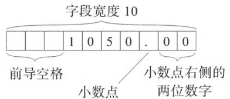

## 3.12 break 与 continue：循环的“紧急刹车”与“跳过本轮”

两者能改写循环控制流。`break` 即刻终结当层 `while`/`for`；`continue` 放弃本轮剩余逻辑，`while` 回头测条件，`for` 直接取下一项。

示例：`range(100)` 本产出 0~99，但 `number == 10` 时强行收场：
```
In [1]: for number in range(100):
    ...:     if number == 10:
    ...:         break
    ...:     print(number, end=' ')
    ...:
0 1 2 3 4 5 6 7 8 9
```
循环结束后，程序自然衔接后续语句。注意：`while`/`for` 可选的 `else` 分支，**仅在循环正常耗尽时执行**；因 `break` 中断而终止则跳过 `else`。

`continue` 示例：跳过偶数，仅处理奇数：
```
In [2]: for number in range(10):
    ...:     if number == 5:
    ...:         continue
    ...:     print(number, end=' ')
    ...:
0 1 2 3 4 6 7 8 9
```

## 3.13 布尔三剑客：and、or、not

比较运算符（`> < >= <= == !=`）构建基础条件（如 `grade >= 60`）。组合复杂条件，靠这三位。

### and：全真才真

需多条件同时满足时上场。示例：判定“女性且年满 65 岁”：

两个子条件：
- `gender == 'Female'`
- `age >= 65`

求值顺序：`==`/`>=` 优先级高于 `and`，故先算两侧，再合流。且具备**短路特性**——左侧为 `False` 则右侧不再计算。加括号可增强可读性：
```
(gender == 'Female') and (age >= 65)
```

真值表速记：

| 表达式 1 | 表达式 2 | 结果 |
|---|---|---|
| False | False | False |
| False | True | False |
| True | False | False |
| True | True | **True** |

### or：一真即真

只要一个达标即通过。示例：学期均分≥90 **或** 期末≥90 视为优秀：
```
In [4]: semester_average = 83

In [5]: final_exam = 95

In [6]: if semester_average >= 90 or final_exam >= 90:
    ...:     print("Student gets an A")
    ...
Student gets an A
```
子条件：
- `semester_average >= 90`
- `final_exam >= 90`

注意：`and` 优先级高于 `or`。真值表：

| 表达式 1 | 表达式 2 | 结果 |
|---|---|---|
| False | False | False |
| False | True | **True** |
| True | False | **True** |
| True | True | **True** |

### 短路求值：性能隐形加速器

- `and`：一旦遇 `False` 即停，后续不算。
- `or`：一旦遇 `True` 即停，后续不算。

实例 ````
gender == 'Female' and age >= 65
```` 中，`gender != 'Female'` 直接定局为 `False`，`age` 根本不看；同理 ````
semester_average >= 90 or final_exam >= 90
```` 中，学期均分达标即宣判 `True`，期末成绩免查。

**最佳实践**：
- `and` 链：把**最可能为 False** 的条件前置。
- `or` 链：把**最可能为 True** 的条件前置。
可显著减少无效求值，提升吞吐。

### not：取反器

一元运算符，翻转真假。例：`not (age < 65)` 等价于 `age >= 65`：
```
In [7]: grade = 87

In [8]: if not grade == -1:
    ...:     print('The next grade is', grade)
    ...:
The next grade is 87
```
实战中建议改写为正向逻辑（如 ````
In [9]: if grade != -1:
    ...:     print('The next grade is', grade)
    ...:
The next grade is 87
````），更符合直觉，降低认知负荷。

真值表：

| 表达式 | not 表达式 |
|---|---|
| False | True |
| True | False |

### 运算符优先级速查表（高→低）

| 运算符 | 结合性 |
|---|---|
| `( )` | ← |
| `**` | → |
| `* / // %` | ← |
| `+ -` | ← |
| `< <= > >= == !=` | ← |
| `not` | ← |
| `and` | ← |
| `or` | ← |

## 3.14 数据科学入门：三大“中心”指标——均值、中位数、众数

描述性统计的核心任务：用单一数值概括一组数据的“典型水平”。三大度量各有所长：
- **均值**：算术平均，全员参与，极值敏感。
- **中位数**：有序序列正中值，抗干扰能力强。
- **众数**：最高频值，适用离散/分类数据。

### 手动算均值：内置函数的约简之美

构造成绩单列表，用 `sum` 求和、`len` 计数，相除得均值：
```
In [1]: grades = [85, 93, 45, 89, 85]

In [2]: sum(grades) / len(grades)
Out[2]: 79.4
```
`sum`、`len`、`min`、`max` 皆为函数式编程中“约简”范式的典范——将集合折叠为标量。早前班级平均分案例可直接用此法替代循环累加。

### 统计模块：一键拿下三大指标

`statistics` 模块专供描述性统计，导入即用：
```
In [3]: import statistics
```
调用 `mean`、`median`、`mode` 分别得三指标：
```
In [4]: statistics.mean(grades)
Out[4]: 79.4
In [5]: statistics.median(grades)
Out[5]: 85
In [6]: statistics.mode(grades)
Out[6]: 85
```
参数需可迭代对象（列表、元组等）。

验证中位数与众数：`sorted` 产出有序副本：
```
In [7]: sorted(grades)
Out[7]: [45, 85, 85, 89, 93]
```
本例 5 个样本（奇数），中位数落在中间值 85。若为偶数个样本，`median` 自动取两中间值平均。众数 85 出现两次，称霸频次。

**雷区提示**：若出现多个并列最高频值（如 ````
[85, 93, 45, 89, 85, 93]
```` 中 85 与 93 各两次），`mode` 抛 `StatisticsError`，这称作“双峰分布”。

## 3.15 章末回顾

本章核心清单：
1. **控制流全家桶**：`if/elif/else` 分支，`while/for` 双循环范式（边界控 vs 序列控），`break/continue` 流控利器。
2. **`range` 三段式**：单参数（0~n-1）、双参数（start~end-1）、三参数（步长控制），驾驭 `for` 迭代次数。
3. **`Decimal` 精准金融**：导入、实例化、运算规则、复利实战、f-string 格式化对齐账本。
4. **布尔逻辑进阶**：`and/or/not` 组合拳、短路机制、优先级层级、最佳排序策略。
5. **统计入门**：均值/中位数/众数概念与 `statistics` 模块落地，约简思想贯穿始终。

下一章（第 4 章）将解锁 `math`、`random` 模块与**自定义函数**，正式踏入代码复用与模块化设计的大门。敬请期待！

# 第4章 函数

## 学习目标

- 掌握自定义函数的定义与调用。
- 善用 `random`、`math` 等标准库模块，站在巨人肩膀上避免重复造轮子。

# 第 4 章 函数进阶与随机模拟实战

## 学习目标速览

掌握以下核心技能点：
- 函数间数据的传递与交互
- 随机数生成及其在模拟场景中的应用
- 设定种子值锁定随机序列，实现结果复现
- 元组的打包、解包技巧及多返回值实现
- 标识符作用域规则与变量可见范围
- 默认参数、关键字参数、不定长参数的灵活定义
- 对象方法的调用机制
- 递归函数的编写与逻辑构建

## 4.1 章节导读

本章将深入探讨 Python 自定义函数的进阶用法。我们将借助标准库 `random` 模块，通过模拟六面骰子投掷来引入随机数生成机制，并演示如何通过设置种子保证随机序列的可复现性。实战案例中，我们将随机数生成与自定义函数相结合，同步讲解元组序列类型及其“打包/解包”特性，实现函数返回多个值。

随后，我们将导入 `math` 模块，借此熟悉 IPython 强大的 Tab 补全功能，提升编码效率。重点知识还包括：带默认值参数与变长参数的函数定义、关键字参数调用、对象方法调用、以及标识符作用域对代码结构的影响。

进阶部分将细谈模块导入机制，并带你实现一个递归函数，触及 Python 函数式编程的边界。最后在“数据科学入门”板块，我们延续描述性统计主题，引入方差与标准差这两大离散趋势度量，并调用 `statistics` 模块完成实战计算。

## 4.2 自定义函数深度解析

在前序章节中，我们已频繁调用 `int`、`print`、`len`、`statistics.mean` 等内置与库函数，它们各司其职。实际开发中，封装自定义函数是复用逻辑的关键。下面以 `square` 函数为例，演示定义与调用流程：

```
In [1]: def square(number):
    ...:     """Calculate the square of number."""
    ...:     return number ** 2

In [2]: square(7)
Out[2]: 49

In [3]: square(2.5)
Out[3]: 6.25
```

函数体仅需编写一次，却可随处调用。注意：若传入非数值类型（如字符串 `'hello'`），幂运算符 `**` 将抛出 `TypeError`。

### 2.1 函数定义语法拆解

函数定义以 `def` 关键字起始，遵循 **函数名 + 括号 + 冒号** 结构。命名规范同变量：小写开头，多词下划线分隔（snake_case）。

括号内为**参数列表**，用逗号分隔，承载函数运行所需数据。`square` 仅接收单一参数 `number`；若括号为空，则无需外部输入。

冒号后缩进区域为**函数体**，首行可选文档字符串，后跟执行逻辑语句。

### 2.2 文档字符串：最佳实践

PEP 8 规范建议：函数体首行必须置入单行文档字符串，简述功能用途：

```
"""Calculate the square of number."""
```

若需详细说明，采用多行文档字符串：首行摘要 + 空行 + 详细说明。

### 2.3 返回机制与控制流

函数执行完毕将控制权交还调用处。`square` 中的 `return` 语句：

```
return number ** 2
```

先计算平方值，再终止函数并回传结果。示例中两次调用分别对应 `Out[2]` 与 `Out[3]` 输出。

函数调用可嵌入表达式，如直接打印结果：

```
In [4]: print('The square of 7 is', square(7))
The square of 7 is 49
```

**隐式返回的两种情况：**
1.  执行无表达式的 `return`，或
2.  函数体无任何 `return` 语句
均会隐式返回 `None`（布尔语境下为 `False`）。

### 2.4 局部变量的生命周期

函数内定义的参数与变量均为**局部变量**，仅在函数执行期间存在，作用域严格限定在函数内部。外部访问将触发 `NameError`。

### 2.5 善用 IPython 帮助系统

IPython 内置强大的对象探查工具。输入 `函数名?` 即可调阅文档：

```
In [5]: square?
Signature: square(number)
Docstring: Calculate the square of number.
File: ~/Documents/examples/ch04/<ipython-input-1-7268c8ff93a9>
Type: function
```

返回信息涵盖：**签名（名称+参数）、文档字符串、定义来源（交互式会话显示代码段编号）、对象类型**。

若源码可访问（如当前会话定义或 `.py` 文件导入），`函数名??` 可显示完整源码：

```
In [6]: square??
Signature: square(number)
Source:
def square(number):
    """Calculate the square of number."""
    return number ** 2
File:      ~/Documents/examples/ch04/<ipython-input-1-7268c8ff93a9>
Type:      function
```

源码不可访问时，`??` 退化为显示文档字符串。长文档支持分页浏览（空格翻页、方向键导航、q 退出），输入 `?` 可查阅 IPython 自身帮助。

## 4.3 多参数函数与内置替代方案

定义 `maximum` 函数，比较三个值并返回最大值，分别测试整数、浮点数、字符串场景：

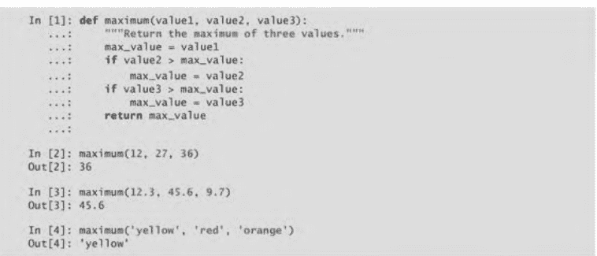

> **交互模式技巧**：函数体内避免空行，因空行回车会被判定为定义结束。

支持混合数值类型比较（如 `int` 与 `float`）：


但跨类别比较（如数值与字符串）会引发 `TypeError`。

### 3.1 逻辑实现细节

`maximum` 接收三参数 `value1, value2, value3`。核心逻辑：
1.  假设 `value1` 最大，赋值给局部变量 `max_value`。
2.  依次用 `value2`、`value3` 与 `max_value` 比较，若更大则更新。
3.  返回最终 `max_value`。

函数结束时，所有局部变量（参数及 `max_value`）随栈帧销毁回收。

### 3.2 内置 `max`/`min`：站在巨人肩膀上

Python 内置 `max()` 与 `min()` 已完美支持多参数及可迭代对象（列表、字符串等）：


**工程原则**：优先使用标准库成熟函数，可显著缩短开发周期，提升可靠性、可移植性与性能。完整函数/模块清单见官方文库索引。

## 4.4 随机数生成与模拟基础

本节聚焦模拟与博弈应用，核心工具为 `random` 模块。

### 4.1 模拟单次骰子投掷

`randrange(start, stop)` 生成 `[start, stop)` 区间内的随机整数。模拟 10 次投掷：

```
In [1]: import random
In [2]: for roll in range(10):
...:     print(random.randrange(1, 7), end=' ')
...
4 2 5 5 4 6 4 6 1 5
```

需先 `import random`。向上键复用循环语句重跑，每次输出序列各异：

```
In [3]: for roll in range(10):
...:     print(random.randrange(1, 7), end=' ')
...
4 5 4 5 1 4 1 4 6 5
```

### 4.2 大数定律验证：百万级模拟

理论上真随机分布均匀。脚本模拟 6,000,000 次投掷，统计各面频次（预期约 1,000,000）：

```
### fig04_01.py
'''Roll a six-sided die 6,000,000 times.'''
import random

### face frequency counters
frequency1 = 0
frequency2 = 0
frequency3 = 0
frequency4 = 0
frequency5 = 0
frequency6 = 0

### 6,000,000 die rolls
for roll in range(6_000_000):  # note underscore separators
    face = random.randrange(1, 7)

    # increment appropriate face counter
    if face == 1:
        frequency1 += 1
    elif face == 2:
        frequency2 += 1
    elif face == 3:
        frequency3 += 1
    elif face == 4:
        frequency4 += 1
    elif face == 5:
        frequency5 += 1
    elif face == 6:
        frequency6 += 1

print(f'Face{"Frequency":>13}')
print(f'{"1:>4"}{frequency1:>13}')
print(f'{"2:>4"}{frequency2:>13}')
print(f'{"3:>4"}{frequency3:>13}')
print(f'{"4:>4"}{frequency4:>13}')
print(f'{"5:>4"}{frequency5:>13}')
print(f'{"6:>4"}{frequency6:>13}')
```

| 点数 | 频次     |
|------|----------|
| 1    | 998,686  |
| 2    | 1,001,481|
| 3    | 999,900  |
| 4    | 1,000,453|
| 5    | 999,953  |
| 6    | 999,527  |

**关键技术点：**
- 嵌套控制结构：`for` 循环外层，`if-elif` 链内层计数。
- 数值分隔符 `_` 增强可读性：`6_000_000`（切勿写成 `6,000,000`，否则被解析为三参数）。
- 无 `else` 分支的 `if-elif` 结构。
- 多次运行结果波动，符合随机特性。

### 4.3 种子机制：驯服伪随机

`randrange` 产出**伪随机数**，由确定性算法与初始**种子**生成。新会话/脚本默认种子不同，序列貌似随机。

**调试痛点**：需固定随机数据复现 Bug。解决方案：`random.seed(value)` 显式设种。

验证：相同种子（如 32）下，序列完全重现；未重置种子时，序列延续前序状态：

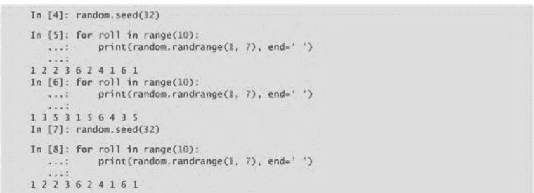

## 4.5 实战案例：Craps 博弈游戏模拟

本节复刻经典骰子博弈 **Craps** 规则引擎：

**核心规则：**
1.  **首轮（Come-out Roll）**：投两骰子求和。
    - 和为 **7 或 11** → **玩家即时胜 (Natural)**。
    - 和为 **2, 3, 12** → **玩家即时负**；庄家胜。
    - 和为 **4, 5, 6, 8, 9, 10** → 确立 **Point（点数）**，进入后续轮次。
2.  **后续轮次**：持续投掷直至终局。
    - 再现 **Point** → **玩家胜**。
    - 出现 **7** → **玩家负**；庄家胜。

下方脚本完整模拟该流程，并演示四种典型结局：首轮胜、首轮负、后续轮胜、后续轮负。

# Python进阶：从掷骰子游戏到标准库实战

```
### fig04_02.py
"""Simulating the dice game Craps."""
import random

def roll_dice():
    """Roll two dice and return their face values as a tuple."""
    die1 = random.randrange(1, 7)
    die2 = random.randrange(1, 7)
    return (die1, die2) # pack die face values into a tuple

def display_dice(dice):
    """Display one roll of the two dice."""
    die1, die2 = dice # unpack the tuple into variables die1 and die2
    print(f'Player rolled {die1} + {die2} = {sum(dice)}')

dice_values = roll_dice() # first roll
display_dice(dice_values)

### determine game status and point, based on first roll
sum_of_dice = sum(dice_values)

if sum_of_dice in (7, 11): # win
    game_status = 'WON'
elif sum_of_dice in (2, 3, 12): # lose
    game_status = 'LOST'
else: # remember point
    game_status = 'CONTINUE'
    my_point = sum_of_dice
    print('Point is', my_point)

### continue rolling until player wins or loses
while game_status == 'CONTINUE':
    dice_values = roll_dice()
    display_dice(dice_values)
    sum_of_dice = sum(dice_values)

    if sum_of_dice == my_point: # win by making point
        game_status = 'WON'
    elif sum_of_dice == 7: # lose by rolling 7
        game_status = 'LOST'

### display "wins" or "loses" message
if game_status == 'WON':
    print('Player wins')
else:
    print('Player loses')
```

玩家掷出 2 + 5 = 7  
玩家胜  

玩家掷出 1 + 2 = 3  
玩家败  

玩家掷出 5 + 4 = 9  
点数定为 9  

玩家掷出 4 + 4 = 8  
玩家掷出 2 + 3 = 5  
玩家掷出 5 + 4 = 9  
玩家胜  

玩家掷出 1 + 5 = 6  
点数定为 6  

玩家掷出 1 + 6 = 7  
玩家败  

## `roll_dice` 函数：用元组一次返回多个值

`roll_dice` 函数（第 5～9 行）负责模拟每一次投掷两颗骰子。它只定义一次，却在后续代码中被多次调用（第 16 行和第 33 行）。空参数列表表明该函数运行时无需外部传入数据。

此前我们接触的函数，无论是内置还是自定义，通常只返回单个值。但在实际开发中，经常需要一次返回多个数据——`roll_dice` 就是典型例子，它把两颗骰子的点数打包成一个**元组**返回（第 9 行）。元组是不可变的有序序列，创建方式只需用逗号分隔各个值，如第 9 行所示：

```
(die1, die2)
```

这一过程称为“元组打包”。虽然括号不是必须的，但加上括号能让代码更易读。下一章我们会深入讲解元组。

## `display_dice` 函数：元组解包的实战

要使用元组里的数据，可以把它们一次性赋值给一组用逗号分隔的变量，这叫“元组解包”。`display_dice` 函数（第 11～14 行定义，第 17 行和第 34 行调用）接收一个元组参数（第 13 行），并在内部完成解包。注意：**等号左边的变量数量必须与元组元素个数一致**，否则会抛出 `ValueError`。第 14 行通过格式化字符串输出两颗骰子的点数及总和，总和是用内置 `sum` 函数直接作用于元组得到的——元组和列表一样，都是可迭代的序列。

顺便观察一下：`roll_dice` 和 `display_dice` 都在函数开头写了文档字符串说明用途；两个函数内部都有 `die1`、`die2` 等局部变量，但互不干扰，因为局部变量只在各自的函数作用域内可见。

## 首轮投掷：胜负与“点数”的分水岭

脚本启动后，第 16～17 行完成首轮投掷并显示结果。第 20 行算出点数总和，供第 22～29 行的逻辑判断使用。每一轮投掷都可能直接分出胜负，`game_status` 变量专门用来追踪当前游戏状态。

### 第 22 行的 `in` 运算符

```
sum_of_dice in (7, 11)
```

这里用 `in` 检查 `sum_of_dice` 是否落在元组 `(7, 11)` 中。若首轮投出 7 或 11，条件为真，直接判定玩家胜，将 `game_status` 设为 `'WON'`。`in` 右侧可以是任意可迭代对象；对应的 `not in` 则用于判断“不包含”。这行简洁的写法等价于：

```
(sum_of_dice == 7) or (sum_of_dice == 11)
```

同理，第 24 行的条件

```
sum_of_dice in (2, 3, 12)
```

检查 `sum_of_dice` 是否在 `(2, 3, 12)` 中。若命中，首轮即败，`game_status` 置为 `'LOST'`。

### 其他点数：进入“继续”阶段

若首轮点数为 4、5、6、8、9、10 中的任意值，按以下流程处理：
- 第 27 行：`game_status = 'CONTINUE'`，游戏继续；
- 第 28 行：把本轮总和存入 `my_point`，后续必须再投出这个点数才能赢；
- 第 29 行：提示玩家当前的 `my_point`。

## 后续轮次：循环直到分出胜负

只要 `game_status == 'CONTINUE'`（第 32 行），就会进入 `while` 循环（第 33～40 行）。每次循环都调用 `roll_dice` 获取新点数并求和。若新总和等于 `my_point`（第 37 行）或等于 7（第 39 行），分别将 `game_status` 设为 `'WON'` 或 `'LOST'` 并跳出循环；否则循环继续，进行下一轮投掷。

## 最终结果输出

循环结束后，执行第 43～46 行的 `if...else`：`game_status` 为 `'WON'` 则输出 `'Player wins'`，否则输出 `'Player loses'`。

---

# Python 标准库：站在巨人的肩膀上

编程时大量用到的现成函数、类，往往来自 **Python 标准库** 或第三方库。善用这些现成工具、避免重复造轮子，是工程实践的核心原则之一。

**模块** 是把相关函数、数据、类聚合在一个文件里；**包** 则是多个模块的集合。前面章节用到的 `Decimal` 类型，就来自标准库的 `decimal` 模块。每个 `.py` 源文件本质上都是一个模块；包的创建超出本书范围，但包的作用是把大型库按功能拆分成更小、可单独导入的子集，便于维护和使用。例如 `matplotlib` 文档超 2300 页，我们通常只导入需要的 `pyplot` 和 `animation` 子模块。

标准库与核心语言同属 Python 官方发布，涵盖编程常用的各类功能。完整模块列表见：


我们已经用过 `decimal`、`statistics`、`random` 等模块，接下来还会用到 `math` 模块。下表列出本书常用的标准库模块速查：

| 模块 | 核心用途 |
|------|----------|
| `collections` | 列表/元组/字典/集合之外的进阶数据结构 |
| `cryptography` | 加密与安全传输 |
| `csv` | 处理逗号分隔值文件（如 Excel 导出） |
| `datetime` | 日期时间运算（配套 `time`、`calendar`） |
| `decimal` | 定点/浮点精确运算，适合金融计算 |
| `doctest` | 在文档字符串里嵌入单元测试 |
| `gettext` / `locale` | 国际化与本地化 |
| `json` | JSON 处理，配合 Web API 和 NoSQL |
| `math` | 常用数学常量与函数 |
| `os` | 与操作系统交互 |
| `profile` / `pstats` / `timeit` | 性能分析 |
| `random` | 伪随机数生成 |
| `re` | 正则表达式模式匹配 |
| `sqlite3` | SQLite 轻量级关系数据库 |
| `statistics` | 统计函数：均值、中位数、众数、方差等 |
| `string` | 字符串工具集 |
| `sys` | 命令行参数、标准输入输出流 |
| `tkinter` | GUI 与画布绘图 |
| `turtle` | 海龟绘图教学 |
| `webbrowser` | 在程序中打开网页 |

---

# `math` 模块：数学计算的瑞士军刀

`math` 模块内置了大量常用数学函数。先用 `import math` 导入，再通过 `math.函数名()` 调用：

```python
In [1]: import math
```

例如求 900 的平方根：

```python
In [2]: math.sqrt(900)
Out[2]: 30.0
```

求 -10 的绝对值（返回 `float`）：

```python
In [3]: math.fabs(-10)
Out[3]: 10.0
```

常用函数速查表（完整列表见 <https://docs.python.org/3/library/math.html>）：

| 函数 | 说明 | 示例 |
|------|------|------|
| `ceil(x)` | 向上取整 | `ceil(9.2)=10.0`、`ceil(-9.8)=-9.0` |
| `floor(x)` | 向下取整 | `floor(9.2)=9.0`、`floor(-9.8)=-10.0` |
| `sin(x)` / `cos(x)` / `tan(x)` | 三角函数（弧度制） | `sin(0)=0.0`、`cos(0)=1.0` |
| `exp(x)` | 指数 $e^x$ | `exp(1)=2.718282` |
| `log(x)` | 自然对数（底 $e$） | `log(2.718282)=1.0` |
| `log10(x)` | 常用对数（底 10） | `log10(100)=2.0` |
| `pow(x, y)` | 幂运算 $x^y$ | `pow(2, 7)=128.0`、`pow(9, .5)=3.0` |
| `sqrt(x)` | 平方根 | `sqrt(900)=30.0` |
| `fabs(x)` | 绝对值（返回 float）<br>内置 `abs()` 会根据参数类型返回 int 或 float | `fabs(-5.1)=5.1` |
| `fmod(x, y)` | 浮点余数 $x \\bmod y$ | `fmod(9.8, 4)=1.8` |

---

# IPython 里的 Tab 补全：写代码的“加速器”

在 IPython 交互环境下，按 **Tab 键** 可触发自动补全，既能补全标识符，也能列出候选项，极大提升编码与探索效率。候选列表可用上下键浏览，IPython 会高亮当前项并显示在 `In[]` 右侧：

```python
In [1]: import math
In [2]: ma<Tab>       %macro        %markdown
         map         %magic        %matplotlib1b
         math        %man
         max()
```

## 查看模块成员

输入 `模块名.` 后按 Tab，即可列出该模块所有公开标识符：

```python
In [3]: math.<Tab>      atan()        copysign()    e            expm1()
         acos()        atan2()       cos()         erf()        fabs()
         acosh()       atanh()       cosh()        erfc()       factorial() >
         asin()        ceil()        degrees()     exp()        floor()
         asinh()
```

列表过长时右侧会出现 `>` 提示（如 `factorial()` 右侧），上下键可滚动。列表遵循约定：
- **带括号** = 函数/方法
- **大写开头** = 类名（如 `Employee`、`CommissionEmployee`），即 **CamelCase** 命名
- **小写无括号** = 变量/常量（如 `pi`、`e`），`math.pi≈3.14159`、`math.e≈2.71828`

> **注意**：Python 无真正常量机制，`pi`、`e` 理论上可被重绑定。PEP 8 建议自定义常量用**全大写**命名以示区分。

## 直接使用高亮函数 & 查文档

浏览列表时，高亮某函数后直接在括号内填参数即可调用，补全列表自动隐藏。想看文档？在名字后加 `?` 回车：

```python
In [4]: math.fabs?
Docstring:
fabs(x)

Return the absolute value of the float x.

Type: builtin_function_or_method
```

输出显示 `builtin_function_or_method`，说明 `fabs` 是标准库内置函数（属于 `math` 模块）。

---

# 默认参数值：让函数更灵活

定义函数时可给参数指定**默认值**。调用时若省略该参数，函数自动使用默认值。下面示例演示带默认参数的 `rectangle_area`：

```python
In [1]: def rectangle_area(length=2, width=3):
    ...:     """Return a rectangle's area."""
    ...:
    ...:     return length * width
```

## 4.9 缺省参数值设定

给形参加上 “=预设值” 即可设置缺省项。示例里 `length` 预设为 2，`width` 预设为 3。注意：带预设值的形参必须置于无预设值形参的后方。

不传实参时，直接沿用预设值，等同于 `rectangle_area(2, 3)`：

```python
In [2]: rectangle_area()
Out[2]: 6
```

只传一个值，按从左到右顺序绑定给 `length`，`width` 继续用预设值 3，效果等同 `rectangle_area(10, 3)`：

```python
In [3]: rectangle_area(10)
Out[3]: 30
```

全传了值，预设值直接被覆盖忽略：

```python
In [4]: rectangle_area(10, 5)
Out[4]: 50
```

## 4.10 具名实参

若在调用时显式写出「形参名=实参值」，实参顺序便可随意排列，无需对应声明时的位置。先声明一个无缺省值版本：

```python
In [1]: def rectangle_area(length, width):
    ...:     """Return a rectangle's area."""
    ...:     return length * width
```

实测具名实参顺序打乱依然能正确对应：

```python
In [2]: rectangle_area(width=5, length=10)
Out[3]: 50
```

**约定**：具名实参必须置于所有顺序实参（未写形参名者）之后。解释器优先按从左至右匹配顺序实参，随后处理具名实参。这在形参较多的子程序中极大提升了可读性。

## 4.11 可变数量参数列表

像 `min`、`max` 这类能接受任意数量输入的内置功能，依靠 `*args` 机制实现。文档显示 `min` 要求至少两个输入 `arg1`、`arg2`，外加可选的 `*args`。调用时：

```
min(88, 75, 96, 55, 83)
```

实参前两个分别对应 `arg1`、`arg2`，其余全部收集成元组交给 `args`，即 `(96, 55, 83)`。

### 声明收集任意输入的功能块

自定义 `average` 可接收任意多个数值：

```python
In [1]: def average(*args):
    ...:     return sum(args) / len(args)
    ...:
```

习惯称作 `args`，标识符可自定。**若签名包含其他形参，`*args` 必须置于最末尾**。

不同数量输入演示：

```python
In [2]: average(5, 10)
Out[2]: 7.5

In [3]: average(5, 10, 15)
Out[3]: 10.0

In [4]: average(5, 10, 15, 20)
Out[4]: 12.5
```

内部用 `sum(args) / len(args)` 计算均值。留意：`args` 为空会触发 `ZeroDivisionError`，后续章节将介绍不拆包直接读取元组项的技巧。

### 解包可迭代容器作实参

列表、元组等可迭代容器前加 `*` 即可展开为逐个实参。把 `grades` 列表展开传给 `average`：

```python
In [5]: grades = [88, 75, 96, 55, 83]
In [6]: average(*grades)
Out[6]: 79.4
```

等同于 `average(88, 75, 96, 55, 83)`。

## 4.12 成员函数：绑定于实体

成员函数（方法）绑定于特定实体，调用形式为 `实体.成员函数()`。

示例：建立字符串变量 `s` 指向 `'Hello'`。经由实体唤起 `lower()` 与 `upper()`，产出全小写与全大写副本，原实体 `s` 维持原貌：

```
object_name.method_name(arguments)
```
```python
In [1]: s = 'Hello'

In [2]: s.lower() # call lower method on string object s
Out[2]: 'hello'

In [3]: s.upper()
Out[3]: 'HELLO'

In [4]: s
Out[4]: 'Hello'
```

内置库成员文档参考 <https://docs.python.org/3/library/index.html>。第十章将构建自定义类型——类，并声明可经由实例唤起的成员函数。

## 4.13 可见范围规则

名称在代码中的可用范围称作其可见范围。名称处于此范围内时，即为“在可见范围内”。

### 局部可见范围

功能块内部声明的名字属于局部可见范围，从声明处起至功能块末尾。功能块结束，该名字即超出可见范围，随之销毁，不可再用。

### 模块级可见范围

功能块与类之外声明的标识（功能块名、名字、类名）属于模块级可见范围。此类名字称作模块级名字。在 .py 文件或交互环节中声明后，可于其后任意处引用。

### 内部读取模块级名字

直接以名字读取模块级名字的值即可：

```python
In [1]: x = 7
In [2]: def access_global():
    ...:     print("x printed from access_global!", x)
    ...:
In [3]: access_global()
x printed from access_global: 7
```

### 内部修改模块级名字需 `global`

默认在功能块内对同名名字设值，会**新建局部名字遮蔽模块级**，不影响外部：

```python
In [4]: def try_to_modify_global():
   ...:     x = 3.5
   ...:     print('x printed from try_to_modify_global:', x)
   ...:
In [5]: try_to_modify_global()
x printed from try_to_modify_global: 3.5
In [6]: x
Out[6]: 7
```

功能块内 `x` 为新局部名字，模块级 `x` 仍保持 7。

欲真改模块级，须声明 `global x`：

```python
In [7]: def modify_global():
   ...:     global x
   ...:     x = 'hello'
   ...:     print('x printed from modify_global:', x)
   ...:
In [8]: modify_global()
x printed from modify_global: hello
In [9]: x
Out[9]: 'hello'
```

### 代码块与套件的可见范围差异

- 功能块内设值 → 局部名字
- 控制结构套件设值 → 视控制结构所在层级：模块层则模块级，功能块内则局部。

第十章类声明时再细说可见范围。

### 遮蔽内置功能

别用 `sum`、`list` 等内置名作名字。设值 `sum = 10` 后，内置 `sum` 被遮蔽，再唤起报 `TypeError`：

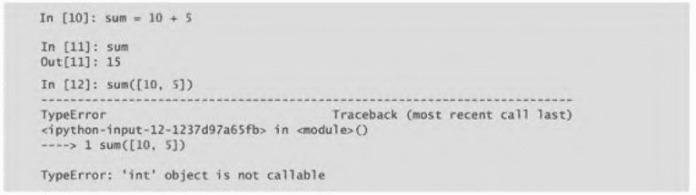

### 模块级语句的执行时机

脚本中模块级语句**载入即运行**；功能块内语句仅在**唤起时**运行。

## 4.14 模块引入：进阶

### 基础引入

若已用语句引入库（如 `math`、`random`）：```
import module_name
```

便可通过 `库名.功能名()` 使用其中功能。

### 引入指定标识

若用代码从库中引入特定标识（如 `decimal` 的 `Decimal` 类型）：```
from module_name import identifier
```

便可直呼其名，无需库名前缀。

### 一次引入多个标识

`from 库 import 名1, 名2, ...` 同理可直呼：```
In [1]: from math import ceil, floor

In [2]: ceil(10.3)
Out[2]: 11

In [3]: floor(10.7)
Out[3]: 10
```

未引入就用会报 `NameError`。

### 警惕星号引入

`from 库 import *` 把库中所有名字一次性纳入，**极易引发隐蔽冲突**。例：先 `e = 'hello'`，再 `from math import *`，`e` 遭数学库常数 `e` 覆盖：

```
from modulename import *
```
```
In [4]: e = 'hello'
In [5]: from math import *
In [6]: e
Out[6]: 2.718281828459045
```

### 别名简化引用

`import 库 as 别名`，常用于长库名或约定缩写：

- `import statistics as stats`
- `import numpy as np`（数据科学惯例）

```
In [7]: import statistics as stats
In [8]: grades = [85, 93, 45, 87, 93]
In [9]: stats.mean(grades)
Out[9]: 80.6
```
```
import numpy as np
```

**建议**：优先用 `import` 或 `import ... as`，显式加前缀引用，规避命名冲突。

## 4.15 实参传递机制：进阶

现在深入探讨实参如何传入子程序。多数语言提供两种机制：值传模式与引用传模式。

- 值传模式：被调子程序获取副本，操作副本不影响原变量。
- 引用传模式：被调子程序直接触达原变量，若可变则可修改。

Python 采用**对象引用传递模式**（Call by Object Reference）。实参传入时，复制的是对象引用（内存位置），而非对象实体。这避免了大体量实体复制，显著提升性能。

### 内存位置、指针与句柄

经由引用与实体交互，实则使用实体在内存中的位置（某些语言称“指针”）。完成绑定 `x = 7` 后：```
x = 7
```

`x` 并非存有 7，而是存有指向含有 7 的内存实体的引用（指针），该实体驻留内存某处。可说 `x`“指向”含 7 的实体：

### `id()` 与实体身份标识

每个实体在内存占据唯一位置，`id(实体)` 返回唯一整数标识。建立 `x = 7` 并查看 `id`：```
In [1]: x = 7
```

### 实参传入子程序时引用同一实体

声明 `cube` 打印形参 `id` 并返回立方：```
In [2]: id(x)
Out[2]: 4350477840
```

传入 `x` 执行：```
In [3]: def cube(number):
    ...:     print("id(number):", id(number))
    ...:     return number ** 3
    ...:
```

形参 `number` 的 `id` 与 `x` 完全一致，证明**同一实体为引用目标**，子程序内读取数值直接来自原实体。

### `is` 判断验证同一性

`a is b` 判断两引用是否指向同一目标（`id` 相同）：```
In [4]: cube(x)
id(number): 4350477840
Out[4]: 343
```

### 不可改实体作实参：仅能读不能改

`int`、`float`、`str`、`tuple` 等不可改实体，子程序内虽拿到引用，但**无法原地修改**。在 `cube` 里对 `number` 做增强设值（`number **= 3`），打印设值前后 `id`：```
In [5]: def cube(number):
.....:     print('number is x:', number is x) # x is a global variable
.....:     return number ** 3
.....:
In [6]: cube(x)
number is x: True
Out[6]: 343
```
```
In [7]: def cube(number):
.....:     print('id(number) before modifying number:', id(number))
.....:     number **= 3
.....:     print('id(number) after modifying number:', id(number))
.....:     return number
.....:
In [8]: cube(x)
id(number) before modifying number: 4350477840
id(number) after modifying number: 4396653744
Out[8]: 343
```

设值前 `id` 与外部 `x` 一致；设值后 `id` 变了——**实为生成新整数实体**，原实体未动，外部 `x` 自然不受影响。```
number **= 3
```

# 函数参数传递的深层机制

当把不可变对象传给函数时，Python会生成一个包含新数值的对象，并将其引用赋予形参。正如前文所述，若原对象不再被其他变量引用，它便会被垃圾回收机制回收。函数内部第二次打印标识符，能清晰展示新对象的唯一身份标识——这直接证明了形参指向了全新的对象。为验证实参未被篡改，我们再次输出其数值与标识符：

```
In [9]: print(f'x = {x}; id(x) = {id(x)}')
x = 7; id(x) = 4350477840
```

### 可变对象传参的不同之处

下一节将揭示：当列表这类可变对象的引用作为实参传入时，函数内部能直接修改调用者持有的原始对象。

## 4.16 递归算法详解

### 经典案例：阶乘计算

编写程序计算正整数 n 的阶乘（记作 n!），数学定义为：
n × (n-1) × (n-2) × ... × 1

例如 5! = 5×4×3×2×1 = 120。特别约定：1! = 1，0! = 1。

#### 迭代实现思路

用 for 循环累乘即可得到 5!：

```
In [1]: factorial = 1

In [2]: for number in range(5, 0, -1):
    ...:     factorial *= number
    ...:

In [3]: factorial
Out[3]: 120
```

#### 递归解题的通用模式

递归函数解决问题时，核心在于两步走：
1. **基线条件**：针对最简单的情况直接返回结果
2. **递归步骤**：将复杂问题拆解为“已知处理部分”+“同类更小规模子问题”

这种分而治之的思想贯穿始终。每次递归调用都会在调用栈中保留上一层的上下文，随着参数规模逐层递减，最终收敛到基线条件。随后返回值沿调用链层层回传，直至最初调用者获得最终结果。

#### 阶乘的递归定义

观察可得递归关系式：

```
n! = n · (n - 1)!
```

以 5! 为例，展开过程如下：

```
5! = 5 · 4 · 3 · 2 · 1
5! = 5 · (4 · 3 · 2 · 1)
5! = 5 · (4!)
```

#### 递归过程可视化

计算 5! 时，左侧展示递归调用不断深入直至触及基线条件 1!；右侧展示返回值如何逐级回传、累乘，最终得到 120。

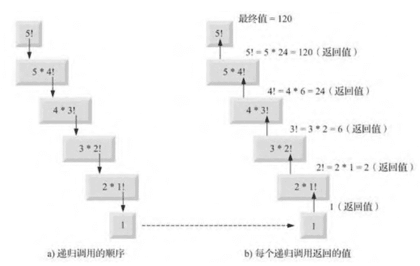

#### 代码实现与解析

下面的代码递归计算并输出 0~10 的阶乘：

```
In [4]: def factorial(number):
    ....:     """Return factorial of number. """
    ....:     if number <= 1:
    ....:         return 1
    ....:     return number * factorial(number - 1) # recursive call
    ....:
In [5]: for i in range(11):
    ....:     print(f'{i}! = {factorial(i)}')
    ...:
0! = 1
1! = 1
2! = 2
3! = 6
4! = 24
5! = 120
6! = 720
7! = 5040
8! = 40320
9! = 362880
10! = 3628800
```

函数 `factorial` 首先判断 `number <= 1`：成立则返回 1（基线条件）；否则返回 `number * factorial(number-1)`（递归步骤）。注意：此处未校验负数输入，实际使用时需补充防御性编程。

循环调用输出结果显示阶乘增长极快。Python 整数无大小上限，这与许多语言形成鲜明对比。

#### 间接递归

函数 A 调用 B，B 再调用 A，这种相互嵌套调用称为间接递归。本质上仍是同一函数在未返回前被再次激活。

#### 栈溢出与无限递归风险

调用栈容量有限，递归层数过深会引发栈溢出致命错误。常见原因包括：
- 缺失基线条件
- 递归步骤无法向基线条件收敛

这类似于循环中的死循环，需格外警惕。

## 4.17 函数式编程范式

Python 虽非纯函数式语言（如 Haskell），但提供了丰富的函数式特性，助力编写更健壮、简洁、易维护的代码，且天然适配多核并行。

下表汇总 Python 主要函数式编程工具（括号内为涉及章节）：

| 函数式编程特性 |

|---|

| 避免副作用 (4) |

| 闭包 |

| 声明式编程 (4) |

| 装饰器 (10) |

| 字典推导式 (6) |

| filter/map/reduce (5) |

| functools 模块 |

| 生成器表达式 (5) |

| 生成器函数 |

| 高阶函数 (5) |

| 不可变性 (4) |

| 内部迭代 (4) |

| 迭代器 (3) |

| itertools 模块 (16) |

| lambda 表达式 (5) |

| 惰性求值 (5) |

| 列表推导式 (5) |

| operator 模块 (5、11、16) |

| 纯函数 (4) |

| range 函数 (3、4) |

| 约简操作 (3、5) |

| 集合推导式 (6) |

绝大多数特性本书均有代码实例讲解。我们已使用列表、字符串、range 迭代器及 sum/len/min/max 等约简函数。接下来重点剖析声明式编程、不可变性与内部迭代。

### 关注“做什么”而非“怎么做”

任务复杂度上升时，命令式代码的控制流细节会让逻辑晦涩、易出错。函数式编程提倡**声明意图**，将实现细节封装在库函数中。

传统 for 循环需手工管理计数器初始化、增量、终止条件——这种**外部迭代**极易因边界条件失误导致 bug。函数式编程强调**不可变数据**，规避变量修改带来的风险。

Python 的 `for` 与 `range` 已隐藏大部分迭代细节：只需声明遍历范围与接收变量。`sum()`、`min()`、`max()` 更是内部迭代的典范——调用 `sum(grades)` 只需表达“求和”意图，遍历与累加全交由库函数完成。这种**声明式风格**正是函数式编程的核心。

### 纯函数：确定性与无副作用

纯函数满足两大特征：
1. **确定性输出**：相同输入必得相同输出（如 `sum([1,2,3])` 恒等于 6）
2. **零副作用**：不修改任何外部状态，甚至不改变传入的可变对象

示例验证 `sum` 不修改参数：

```
In [1]: values = [1, 2, 3]

In [2]: sum(values)
Out[2]: 6

In [3]: sum(values) # same call always returns same result
Out[3]: 6

In [4]: values
Out[5]: [1, 2, 3]
```

下一章将深化函数式编程概念，并揭示函数作为一等公民可被传递的特性。

## 4.18 数据科学入门：离散程度度量

前文介绍了均值、中位数、众数等**集中趋势**指标。本节引入**离散程度**（变异性）度量，洞察数据分布形态。

### 核心概念：总体与样本

研究对象全体称为**总体**（如亿级选民），现实中常通过**样本**（如千人民调）推断总体特征。

### 实战数据：10 次掷骰结果

以下 10 个六面骰点数作为总体数据，手动与 `statistics` 模块双轨计算各项指标：

```
1, 3, 4, 2, 6, 5, 3, 4, 5, 2
```

#### 方差——量化波动幅度

步骤：
1. 计算均值：35/10 = 3.5
2. 各数减去均值得偏差（含负值）  
   ```
-2.5, -0.5, 0.5, -1.5, 2.5, 1.5, -0.5, 0.5, 1.5, -1.5
```
3. 偏差平方（消除负号、放大异常值影响）  
4. 平方和平均：22.5/10 = **2.25**（总体方差）

平方操作使远离均值的异常值贡献显著放大。验证代码：

```
In [1]: import statistics
In [2]: statistics.pvariance([1, 3, 4, 2, 6, 5, 3, 4, 5, 2])
Out[2]: 2.25
```

#### 标准差——同量纲的离散度量

标准差 = √方差 = 1.5。它降低了异常值权重，单位与原始数据一致。方差与标准差越小，数据越聚集于均值附近。验证代码：

```
In [3]: statistics.pstdev([1, 3, 4, 2, 6, 5, 3, 4, 5, 2])
Out[3]: 1.5
```

亦可通过 `math.sqrt(pvariance)` 复核：

```
In [4]: import math
In [5]: math.sqrt(statistics.pvariance([1, 3, 4, 2, 6, 5, 3, 4, 5, 2]))
Out[5]: 1.5
```

#### 标准差相对于方差的实用优势

以 3 月华氏温度为例（单位：度）。方差单位变为“平方度”，失去直观物理意义；标准差单位仍为“度”，便于直接解读与业务结合。

## 4.19 章节回顾

本章核心收获：
- 自定义函数、模块导入（`random`/`math`）、随机模拟、元组打包/解包返回多值
- 默认参数、关键字参数、不定长参数、方法调用、作用域规则
- 模块导入进阶、引用传参机制、调用栈与栈帧原理
- 递归函数（直接/间接）、栈溢出风险
- 函数式编程特性（声明式、不可变性、内部迭代、纯函数）
- 描述性统计延伸：方差与标准差计算及 `statistics` 模块应用

递归本质：函数直接或间接调用自身，配合基线条件与收敛步骤解决可分解问题。

---

# 第 5 序列：列表与元组

## 学习目标

- 创建、初始化列表与元组
- 访问列表、元组、字符串元素
- 列表排序/搜索、元组搜索
- 函数/方法中使用列表与元组
- 列表常用操作：增删改查、排序
- 函数式工具：lambda、filter/map/reduce
- 列表推导式与生成器表达式
- 二维列表应用
- Seaborn/Matplotlib 可视化实战
- 模块化设计，按需阅读

## 5.1 导论

列表与元组均为**序列类型**，表示有序项集合。集合即相关数据项的预封装结构：手机歌单、通讯录、图书馆藏书、扑克牌、球星名单、持仓股票、患者档案、购物清单……Python 内置集合类型让数据存取高效便捷。本章深度聚焦列表与元组。

二者共享大量通用功能，均可存放同构或异构数据。关键差异：**列表可变，支持运行时动态扩缩容；元组不可变。** 后续将详解一维与二维列表。

本章前段演示随机数与掷骰模拟，末段“数据科学入门”引入 Seaborn/Matplotlib 绘制骰子频率静态柱状图。下一章将实现动态柱状图——随投掷次数增长实时演变，直观呈现**大数定律**。

## 5.2 列表深度解析

### 创建列表

列表常存同构数据。示例：包含 5 个整数的列表 `c`：

```
In [1]: c = [-45, 6, 0, 72, 1543]
In [2]: c
Out[2]: [-45, 6, 0, 72, 1543]
```

亦可存异构数据。示例：学生信息（名、姓、GPA、毕业年份）：

```
['Mary', 'Smith', 3.57, 2022]
```

### 访问元素

通过 `列表名[索引]` 访问，`[]` 称下标运算符。索引从 0 起算，长度为 5 的列表 `c`，首元素 `c[0]`，尾元素 `c[4]`。

  
```
In [3]: c[0]
Out[3]: -45
In [4]: c[4]
Out[4]: 1543
```

### 获取长度

内置 `len()` 返回元素个数：

```
In [5]: len(c)
Out[5]: 5
```

### 负索引：从尾部访问

支持负数索引，`-1` 为最后一个元素，`-5` 为第一个：

  
```
In [6]: c[-1]
Out[6]: 1543
In [7]: c[-5]
Out[7]: -45
```

### 索引类型要求

索引必须为整数、整数表达式或切片对象（稍后介绍）：

```
In [8]: a = 1
In [9]: b = 2
In [10]: c[a + b]
Out[10]: 72
```

# Python 序列类型核心机制全景解析

若尝试以非整数值检索序列，解释器将抛出 `TypeError` 异常。

### 列表具备可变性

列表属于可变容器，支持对内部成员进行增删改操作：

```
In [11]: c[4] = 17

In [12]: c
Out[12]: [-45, 6, 0, 72, 17]
```

后续演示将揭示插入与移除元素时，列表长度如何自动同步调整。

### 不可变序列类型

字符串与元组均为不可变序列，意即其内部元素一经生成便锁定无法更改。虽可通过下标读取字符串单字，但企图为某字符重新赋值将触发 `TypeError`：

```
In [13]: s = 'hello'

In [14]: s[0]
Out[14]: 'h'

In [15]: s[0] = 'H'
---------------------------------------------------------------------------
TypeError                                 Traceback (most recent call last)

<ipython-input-15-812ef2514689> in <module>()
----> 1 s[0] = 'H'

TypeError: 'str' object does not support item assignment
```

### 越界访问引发的索引错误

无论列表、元组抑或字符串，一旦下标超出合法边界，即刻抛出 `IndexError`：

```
In [16]: c[100]
---------------------------------------------------------------------------
IndexError                                Traceback (most recent call last)

<ipython-input-16-9a31ealeala13> in <module>()
----> 1 c[100]

IndexError: list index out of range.
```

### 列表成员在表达式中的应用

表达式中，列表元素可直接作为变量参与运算：

```
In [17]: c[0] + c[1] + c[2]
Out[17]: -39
```

### 利用 `+=` 实现列表尾部扩充

以空列表 `[]` 为起点，结合 `for` 循环与 `+=` 操作，即可将 1 至 5 依次纳入，容器随之动态扩容：

```
In [18]: a_list = []

In [19]: for number in range(1, 6):
    ...:     a_list += [number]
    ...: 

In [20]: a_list
Out[20]: [1, 2, 3, 4, 5]
```

**核心约束**：`+=` 左侧为列表时，右侧**必须**提供可迭代对象，否则报 `TypeError`。示例中 `[number]` 构造单元素列表再合并；若右侧含多项则整体并入。下例将字符串 `'Python'` 拆解为字符逐个加入 `letters`：

```
In [21]: letters = []

In [22]: letters += 'Python'

In [23]: letters
Out[23]: ['P', 'y', 't', 'h', 'o', 'n']
```

若右侧操作数为元组，其成员亦会被逐个追加。后文将介绍列表原生 `append` 方法作为替代方案。

### 以 `+` 运算符合并序列

`+` 可将两个同类序列（列表/元组/字符串）融合为**全新对象**，源对象保持原貌：

```
In [24]: list1 = [10, 20, 30]

In [25]: list2 = [40, 50]

In [26]: concatenated_list = list1 + list2

In [27]: concatenated_list
Out[27]: [10, 20, 30, 40, 50]
```

跨类型合并（如列表加元组）将直接触发 `TypeError`。

### 索引遍历的传统模式与隐患

除直接下标取值外，亦可借 `range(len(...))` 生成下标序列间接访问：

```
In [28]: for i in range(len(concatenated_list)):
    ...:     print(f"{i}: {concatenated_list[i]}")
    ...: 
0: 10
1: 20
2: 30
3: 40
4: 50
```

此法强制开发者手动把控下标合法性，稍有疏忽即酿 `IndexError`。稍后将呈现更稳健的 `enumerate` 方案。

### 列表整体比较：逐元素裁决

比较运算符支持直接作用于列表，按位序逐项对决：

```
In [29]: a = [1, 2, 3]
In [30]: b = [1, 2, 3]
In [31]: c = [1, 2, 3, 4]
In [32]: a == b  # True: corresponding elements in both are equal
Out[32]: True
In [33]: a == c  # False: a and c have different elements and lengths
Out[33]: False
In [34]: a < c  # True: a has fewer elements than c
Out[34]: True
In [35]: c > b  # True: elements 0-2 are equal but c has more elements
Out[35]: True
```

---

## 5.3 元组：不可变的数据载体

如前所述，元组特性为不可变，常承载异构（类型各异）数据，同构亦可。其长度在运行期恒定。

### 元组构建的多元语法

空元组以 `()` 表示：

```
In [1]: student_tuple = ()

In [2]: student_tuple
Out[2]: ()

In [3]: len(student_tuple)
Out[3]: 0
```

圆括号可缺位，**逗号才是元组的本质标识**：

```
In [4]: student_tuple = 'John', 'Green', 3.3

In [5]: student_tuple
Out[5]: ('John', 'Green', 3.3)

In [6]: len(student_tuple)
Out[6]: 3
```

输出显示时，Python 统一以括号包裹呈现：

```
In [7]: another_student_tuple = ('Mary', 'Red', 3.3)

In [8]: another_student_tuple
Out[8]: ('Mary', 'Red', 3.3)
```

单元素元组**强制要求**尾随逗号：

```
In [9]: a_singleton_tuple = ('red',) # note the comma

In [10]: a_singleton_tuple
Out[10]: ('red',)
```

缺失逗号时，`('red')` 仅为字符串 `'red'`，不具备元组身份。

### 元组元素访问：定点读取为主

元组成员虽语义关联但常含异构类型，实战多采用下标定点访问而非迭代。下标同样从 0 起算。下例构建 `(时, 分, 秒)` 元组并换算零点至今总秒数——留意各元素参与了差异化运算：

```
In [11]: time_tuple = (9, 16, 1)
In [12]: time_tuple
Out[12]: (9, 16, 1)
In [13]: time_tuple[0] * 3600 + time_tuple[1] * 60 + time_tuple[2]
Out[13]: 33361
```

任何妄图对元组元素赋值的行为均将招致 `TypeError`。

### `+=` 与不可变特性的协同机制

虽属不可变类型，字符串与元组仍支持 `+=` 扩充赋值。两次赋值后，`tuple1` 与 `tuple2` 内容趋同：

```
In [14]: tuple1 = (10, 20, 30)
In [15]: tuple2 = tuple1
In [16]: tuple2
Out[16]: (10, 20, 30)
```

实则 `tuple1 += (40, 50)` 先生成新元组再回绑变量 `tuple1`，原对象 `tuple2` 毫发无损：

```
In [17]: tuple1 += (40, 50)

In [18]: tuple1
Out[18]: (10, 20, 30, 40, 50)

In [19]: tuple2
Out[19]: (10, 20, 30)
```

**类型强匹配原则**：字符串仅接字符串，元组仅接元组，混用即报 `TypeError`。

### 元组融入列表：`+=` 的拆包特性

列表以 `+=` 接纳元组时，会将元组成员逐个拆解追加：

```
In [20]: numbers = [1, 2, 3, 4, 5]

In [21]: numbers += (6, 7)

In [22]: numbers
Out[22]: [1, 2, 3, 4, 5, 6, 7]
```

### 元组内部的“可变暗室”

元组本体虽固，若内嵌列表等可变对象，其内部状态仍可流动：

```
In [23]: student_tuple = ('Amanda', 'Blue', [98, 75, 87])
```

构造含成绩单列表的学生元组：

```
In [24]: student_tuple[2][1] = 85

In [25]: student_tuple
Out[25]: ('Amanda', 'Blue', [98, 85, 87])
```

`student_tuple[2][1]` 为双重下标：首取元组第 3 项（列表），次取列表下标 1 处值（75），代码将其覆写为 85。

---

## 5.4 序列解包：一行代码拆解结构

将序列赋予逗号分隔的变量组，即完成解包。**变量数量必须与元素总数严格对等**，否则抛 `ValueError`：

```
In [1]: student_tuple = ('Amanda', [98, 85, 87])
In [2]: first_name, grades = student_tuple
In [3]: first_name
Out[3]: 'Amanda'
In [4]: grades
Out[4]: [98, 85, 87]
```

字符串、列表、`range` 对象均适用此法：

```
In [5]: first, second = 'hi'
In [6]: print(f'{first} {second}')
h i
In [7]: number1, number2, number3 = [2, 3, 5]
In [8]: print(f'{number1} {number2} {number3}')
2 3 5
In [9]: number1, number2, number3 = range(10, 40, 10)
In [10]: print(f'{number1} {number2} {number3}')
10 20 30
```

### 打包解包双剑合璧：变量优雅互换

无需临时中介，一行达成交换：

```
In [11]: number1 = 99
In [12]: number2 = 22
In [13]: number1, number2 = (number2, number1)
In [14]: print(f'number1 = {number1}; number2 = {number2}')
number1 = 22; number2 = 99
```

### `enumerate`：索引与值的安全双人行

早前 `range(len(...))` 配合 `[]` 遍历，极易因参数误设导致越界。内置函数 `enumerate` 专治此痛：入参可迭代对象，吐出迭代器，每轮产出 `(索引, 值)` 二元组。

收敛结果入列表：

```
In [15]: colors = ['red', 'orange', 'yellow']

In [16]: list(enumerate(colors))
Out[16]: [(0, 'red'), (1, 'orange'), (2, 'yellow')]
```

同理，`tuple()` 可转元组容器：

```
In [17]: tuple(enumerate(colors))
Out[17]: ((0, 'red'), (1, 'orange'), (2, 'yellow'))
```

实战常配合 `for` 直接解包双变量：

```
In [18]: for index, value in enumerate(colors):
   ...:     print(f'{index}: {value}')
   ...:
0: red
1: orange
2: yellow
```

### 实战演示：基于 `enumerate` 的文本柱状图

下列脚本按数值比例打印星号条形图，索引与数值均由 `enumerate` 安全产出：

```
ipython fig05_01.py
```

IPython 环境可用魔法命令驱动：

```
run fig05_01.py
```

```
1 # fig05_01.py
2 """Displaying a bar chart"""
3 numbers = [19, 3, 15, 7, 11]
4 print('\nCreating a bar chart from numbers:')
5 print(f"{'Index':<7}{'Value':>8} Bar")
6
7 for index, value in enumerate(numbers):
8     print(f"{index:<7}{value:>8}{'*' * value}")
```

输出呈现如下：

Creating a bar chart from numbers:

| Index | Value | Bar |
|-------|-------|-----|
| 0 | 19 | ******************* |
| 1 | 3 | *** |
| 2 | 15 | *************** |
| 3 | 7 | ******* |
| 4 | 11 | *********** |

核心表达式 ````
"{0:n} * value
```` 利用字符串乘法 `'*' * value` 定制星号长度。后续章节将引入 Seaborn/Matplotlib 绘制出版级图表。

---

## 5.5 序列切片：按需裁剪生成新序列

切片操作从原序列截取片段，产出**同类型新对象**，源头纹丝不动。列表、元组、字符串通用此法。

### 双边界切片 `[start:end]`

截取下标 2 至 5（含首不含尾，即 2~5）区间成员：

```
In [1]: numbers = [2, 3, 5, 7, 11, 13, 17, 19]
In [2]: numbers[2:6]
Out[2]: [5, 7, 11, 13]
```

切片遵循**左闭右开**准则：包含起始下标，排除终止下标。

### 省略起始 `[:end]` → 默认溯源头部

`numbers[:6]` 等价于 `numbers[0:6]`：

```
In [3]: numbers[:6]
Out[3]: [2, 3, 5, 7, 11, 13]
In [4]: numbers[0:6]
Out[4]: [2, 3, 5, 7, 11, 13]
```

### 省略终止 `[start:]` → 直抵尾部

缺省终止下标时，Python 自动延伸至序列末端（本例长度 8），故覆盖下标 6、7：

```
In [3]: numbers[:6]
Out[3]: [2, 3, 5, 7, 11, 13]
In [4]: numbers[0:6]
Out[4]: [2, 3, 5, 7, 11, 13]
```

```
In [5]: numbers[6:]
Out[5]: [17, 19]

In [6]: numbers[6:len(numbers)]
Out[6]: [17, 19]
```

### 切片的简写形式：省略首尾索引

如果不指定起始和终止位置，切片操作会直接复制整个序列：

```
In [7]: numbers[:]
Out[7]: [2, 3, 5, 7, 11, 13, 17, 19]
```

虽说切片会生成新对象，但这属于浅拷贝。简单说，它只复制了元素的“引用地址”，并未复制引用指向的实际对象。所以上述代码中，新列表里的元素依然指向原列表元素所指的同一块内存区域，并非独立副本。第7章会详细讲解“深拷贝”——它会递归复制引用指向的对象本身，并说明何时该优先选用深拷贝。

### 切片的步长参数

下面代码将步长设为2，从 `numbers` 中隔一个元素取一个，生成新切片：

```
In [8]: numbers[::2]
Out[8]: [2, 5, 11, 17]
```

这里省略了首尾索引，Python 自动补全为默认值 0 和 `len(numbers)`。

### 反向切片：步长为负数

把步长设为负数，就能倒序生成切片。利用这点，轻松实现列表反转：

```
In [9]: numbers[::-1]
Out[9]: [19, 17, 13, 11, 7, 5, 3, 2]
```

其效果等同于：

```
In [10]: numbers[-1:-9:-1]
Out[10]: [19, 17, 13, 11, 7, 5, 3, 2]
```

### 通过切片原地修改列表

给切片赋值可直接改写列表局部，其余部分保持不动。例如替换前三个元素：

```
In [11]: numbers[0:3] = ['two', 'three', 'five']
In [12]: numbers
Out[12]: ['two', 'three', 'five', 7, 11, 13, 17, 19]
```

若赋值为空列表，即可实现删除前三个元素的效果：

```
In [13]: numbers[0:3] = []
In [14]: numbers
Out[14]: [7, 11, 13, 17, 19]
```

给间隔切片（步长为2）赋值，可批量更新隔行元素：

```
In [15]: numbers = [2, 3, 5, 7, 11, 13, 17, 19]
In [16]: numbers[::2] = [100, 100, 100, 100]
In [17]: numbers
Out[17]: [100, 3, 100, 7, 100, 13, 100, 19]
In [18]: id(numbers)
Out[18]: 4434456648
```

把整个列表切片赋值为空列表，可清空现有列表：

```
In [19]: numbers[:] = []
In [20]: numbers
Out[20]: []
In [21]: id(numbers)
Out[21]: 4434456648
```

注意，这种“清空内容”（片段[19]）与“重新赋值一个新空列表 `[]`”（片段[22]）有本质区别。我们在操作后打印 `numbers` 的 `id`（身份标识）对比，发现两者 `id` 不同，说明它们在内存中是两个完全不同的对象：

```
In [22]: numbers = []
In [23]: numbers
Out[23]: []
In [24]: id(numbers)
Out[24]: 4406030920
```

只有当变量指向新对象（片段[22]），且原对象不再被其他变量引用时，原对象才会被垃圾回收机制回收。

## 5.6 `del` 语句的用法

`del` 语句既能按索引或切片删除列表元素，也能在交互环境中直接删除变量名绑定。

### 删除指定索引位置的元素

先建个列表，用 `del` 移除最后一个元素：

```
In [1]: numbers = list(range(0, 10))

In [2]: numbers
Out[2]: [0, 1, 2, 3, 4, 5, 6, 7, 8, 9]

In [3]: del numbers[-1]

In [4]: numbers
Out[4]: [0, 1, 2, 3, 4, 5, 6, 7, 8]
```

### 删除切片范围内的元素

以下代码删除列表前两个元素：

```
In [5]: del numbers[0:2]

In [6]: numbers
Out[6]: [2, 3, 4, 5, 6, 7, 8]
```

利用切片步长，还能隔一个删除一个：

```
In [7]: del numbers[::2]

In [8]: numbers
Out[8]: [3, 5, 7]
```

### 清空列表所有元素

用全切片配合 `del`，一键清空列表：

```
In [9]: del numbers[:]

In [10]: numbers
Out[10]: []
```

### 从当前命名空间移除变量

`del` 甚至能删除变量本身。删除 `numbers` 后再访问，会抛出 `NameError`（未定义错误）：

```
In [11]: del numbers

In [12]: numbers
---------------------------------------------------------------------------
NameError                                Traceback (most recent call last)
<ipython-input-12-426f8401232b> in <module>()
----> 1 numbers

NameError: name 'numbers' is not defined
```

## 5.7 列表作为函数参数传递

上一章提到：Python 采用“引用传递”机制，并演示了不可变对象传参的行为。这里我们重点看可变列表对象传给函数后会发生什么。

### 传递整个列表对象

定义函数 `modify_elements`，接收列表引用并将每个元素乘以 2：

```
In [1]: def modify_elements(items):
    ...:     """Multiplies all element values in items by 2."""
    ...:     for i in range(len(items)):
    ...:         items[i] *= 2
    ...: 
In [2]: numbers = [10, 3, 7, 1, 9]
In [3]: modify_elements(numbers)
In [4]: numbers
Out[4]: [20, 6, 14, 2, 18]
```

参数 `items` 接收的是原列表的引用（别名），所以循环中对元素的修改，直接作用在原列表对象上。

### 传递元组对象

元组不可变，传给函数后若尝试修改元素，会直接报 `TypeError`：

```
In [5]: numbers_tuple = (10, 20, 30)

In [6]: numbers_tuple
Out[6]: (10, 20, 30)

In [7]: modify_elements(numbers_tuple)
---------------------------------------------------------------------------
TypeError                                 Traceback (most recent call last)
<ipython-input-7-9339741cd595> in <module>()
----> 1 modify_elements(numbers_tuple)

<ipython-input-1-27acb8f8f44c> in modify_elements(items)
      2     """Multiplies all element values in items by 2."""
      3     for i in range(len(items)):
----> 4         items[i] *= 2
      5
      6

TypeError: 'tuple' object does not support item assignment
```

但注意：元组内若包含列表等可变对象，通过元组传参依然能修改那些内部可变对象。

### 关于 Traceback 回溯信息的补充

前面的报错堆栈显示了两个代码片段：调用处（片段[7]）和定义处（片段[1]）。单行片段异常行首标 `----> 1`；多行片段（如函数定义）显示连续行号，`----> 4` 表示第 4 行出错。无论堆栈多深，最后一行必标 `---->` 指向直接导致异常的代码。

## 5.8 列表排序操作

排序就是按升序或降序重排数据。

### 升序排列

列表方法 `sort()` 原地修改元素顺序。下面代码按升序排列：

```
In [1]: numbers = [10, 3, 7, 1, 9, 4, 2, 8, 5, 6]

In [2]: numbers.sort()

In [3]: numbers
Out[3]: [1, 2, 3, 4, 5, 6, 7, 8, 9, 10]
```

### 降序排列

调用 `sort()` 时指定 `reverse=True`（默认 `False`）即可降序：

```
In [4]: numbers.sort(reverse=True)

In [5]: numbers
Out[5]: [10, 9, 8, 7, 6, 5, 4, 3, 2, 1]
```

### 内置函数 `sorted`：返回新列表

`sorted()` 不改动原序列，而是返回包含已排序元素的**新列表**。下面演示对列表、字符串、元组排序：

```
In [6]: numbers = [10, 3, 7, 1, 9, 4, 2, 8, 5, 6]

In [7]: ascending_numbers = sorted(numbers)

In [8]: ascending_numbers
Out[8]: [1, 2, 3, 4, 5, 6, 7, 8, 9, 10]

In [9]: numbers
Out[9]: [10, 3, 7, 1, 9, 4, 2, 8, 5, 6]

In [10]: letters = 'fadgchjebi'

In [11]: ascending_letters = sorted(letters)

In [12]: ascending_letters
Out[12]: ['a', 'b', 'c', 'd', 'e', 'f', 'g', 'h', 'i', 'j']

In [13]: letters
Out[13]: 'fadgchjebi'

In [14]: colors = ('red', 'orange', 'yellow', 'green', 'blue')

In [15]: ascending_colors = sorted(colors)

In [16]: ascending_colors
Out[16]: ['blue', 'green', 'orange', 'red', 'yellow']

In [17]: colors
Out[17]: ('red', 'orange', 'yellow', 'green', 'blue')
```

同理，传 `reverse=True` 可得降序结果。

## 5.9 序列查找/搜索

常需判断序列（列表、元组、字符串）是否包含特定值，这个过程称作搜索。

### 列表的 `index` 方法

`index(value)` 从索引 0 开始扫描，返回首个匹配值的索引：

```
In [1]: numbers = [3, 7, 1, 4, 2, 8, 5, 6]
In [2]: numbers.index(5)
Out[2]: 6
```

若值不存在，抛出 `ValueError`。

### 指定搜索起始位置

用可选参数 `start` 缩小搜索范围。先用 `*=` 把 `numbers` 扩充为两倍（即原内容追加自身一次）：

```
In [3]: numbers *= 2
In [4]: numbers
Out[4]: [3, 7, 1, 4, 2, 8, 5, 6, 3, 7, 1, 4, 2, 8, 5, 6]
```

然后在新列表中，从索引 7 到末尾查找值 5：

```
In [5]: numbers.index(5, 7)
Out[5]: 14
```

### 同时指定起始和结束索引

`index(value, start, end)` 在 `[start, end)` 区间查找。片段[5] 调用示例：

```
numbers.index(5, 7)
```

第三个参数默认值为列表长度，等价于：

```
numbers.index(5, 7, len(numbers))
```

下面在索引 0 到 3（不含 3）范围内找值 7：

```
In [6]: numbers.index(7, 0, 4)
Out[6]: 1
```

### 成员运算符 `in` / `not in`

`value in seq`：值在序列中返回 `True`，否则 `False`：

```
In [7]: 1000 in numbers
Out[7]: False
In [8]: 5 in numbers
Out[8]: True
```

`value not in seq`：值不在序列中返回 `True`，否则 `False`：

```
In [9]: 1000 not in numbers
Out[9]: True
In [10]: 5 not in numbers
Out[10]: False
```

### 用 `in` 规避 `ValueError`

查找不存在的值时，`in` 运算符不会像 `index()` 那样抛异常，更安全：

```
In [11]: key = 1000

In [12]: if key in numbers:
    ...:     print(f'found {key} at index {numbers.index(search_key)}!')
    ...: else:
    ...:     print(f'{key} not found')
    ...:
1000 not found
```

### 内置函数 `any` 与 `all`

只需要知道“任一为真”还是“全为真”时用得上。
- `any(iterable)`：任一项为真即返回 `True`。
- `all(iterable)`：全为真才返回 `True`。

记得点：非零即真、零为假；非空容器为真、空容器为假。这两个函数也是函数式编程中内部迭代的典型例子。

## 5.10 列表的其他常用增删方法

以列表 `color_names` 为例：

```
In [1]: color_names = ['orange', 'yellow', 'green']
```

### `insert(index, item)`：指定位置插入

在索引 0 处插入 `'red'`：

```
In [2]: color_names.insert(0, 'red')
In [3]: color_names
Out[3]: ['red', 'orange', 'yellow', 'green']
```

### `append(item)`：尾部追加单个元素

将新元素加到列表末尾：

```
In [4]: color_names.append('blue')
In [5]: color_names
Out[5]: ['red', 'orange', 'yellow', 'green', 'blue']
```

### `extend(iterable)`：批量追加另一序列所有元素

把另一个序列的所有元素逐个加到末尾：

```
In [6]: color_names.extend(['indigo', 'violet'])
In [7]: color_names
Out[7]: ['red', 'orange', 'yellow', 'green', 'blue', 'indigo', 'violet']
```

`extend` 等价于 `+=`。下面代码先把字符串的每个字符拆开追加，再把元组的所有元素追加：

```
In [8]: sample_list = []
In [9]: s = 'abc'
In [10]: sample_list.extend(s)
In [11]: sample_list
Out[11]: ['a', 'b', 'c']
In [12]: t = (1, 2, 3)
In [13]: sample_list.extend(t)
In [14]: sample_list
Out[14]: ['a', 'b', 'c', 1, 2, 3]
```

# Python列表高阶玩法与函数式编程实战

## 列表常用操作速查

### 技巧：`extend` 直接吃元组
想把元组直接喂给 `extend` 而不想多声明个变量？行，**括号必须留着**——这是元组字面量的铁律：
```
In [15]: sample_list.extend((4, 5, 6)) # note the extra parentheses
In [16]: sample_list
Out[16]: ['a', 'b', 'c', 1, 2, 3, 4, 5, 6]
```

括号一省，解释器立马甩你个 `TypeError`。

### 精准删除首个匹配项：`remove`
`remove(val)` 只管**第一个**等于 `val` 的元素；列表里压根没有，直接抛 `ValueError`：
```
In [17]: color_names.remove('green')
In [18]: color_names
Out[18]: ['red', 'orange', 'yellow', 'blue', 'indigo', 'violet']
```

### 一键归零：`clear`
想把列表掏空？`clear()` 走起：
```
In [19]: color_names.clear()
In [20]: color_names
Out[20]: []
```

效果等同于早先见过的切片赋值 `seq[:] = []`：
```
color_names[:] = []
```

### 计数器：`count`
`count(val)` 直接告诉你 `val` 出现了几回：
```
In [21]: responses = [1, 2, 5, 4, 3, 5, 2, 1, 3,  
...:     1, 4, 3, 3, 3, 2, 3, 3, 2, 2]

In [22]: for i in range(1, 6):
...:     print(f'{i} appears {responses.count(i)} times in responses')
1 appears 3 times in responses
2 appears 5 times in responses
3 appears 8 times in responses
4 appears 2 times in responses
5 appears 2 times in responses
```

### 原地倒序：`reverse`
`reverse()` 会**就地**把顺序掰过来，别跟切片 `[::-1]` 搞混——后者产出的是**新对象**：
```
In [23]: color_names = ['red', 'orange', 'yellow', 'green', 'blue']

In [24]: color_names.reverse()

In [25]: color_names
Out[25]: ['blue', 'green', 'yellow', 'orange', 'red']
```

### 浅拷贝：`copy`
`copy()` 吐出一个新列表，里头装的是原对象的浅拷贝：
```
In [26]: copied_list = color_names.copy()

In [27]: copied_list
Out[27]: ['blue', 'green', 'yellow', 'orange', 'red']
```

跟 `seq[:]` 切片拷贝一个德行：
```
copied_list = color_names[:]
```

---

## 5.11 拿列表当栈用

Python 没内置栈，但列表天生支持**后进先出（LIFO）**：
- **压栈** → `append(item)`（扔到尾巴上）
- **弹栈** → `pop()`（弹走并返回尾巴元素）

跑个例子验证一下：
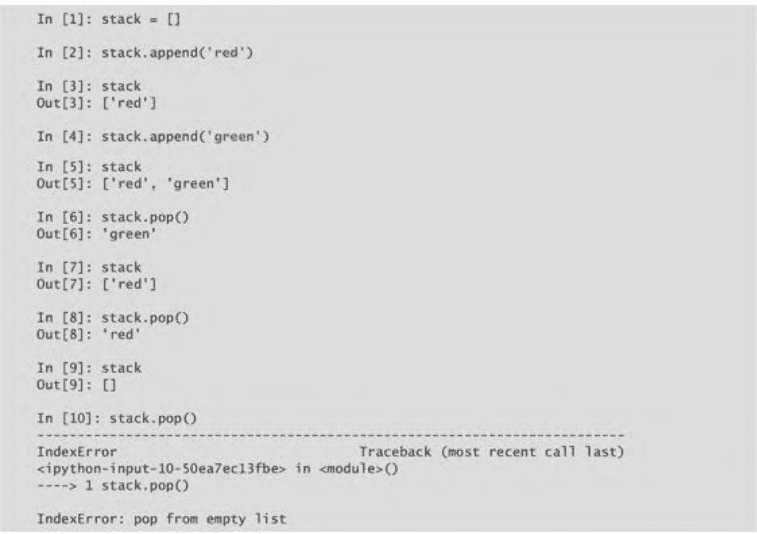

每次 `pop()` 都把最后压入的值吐出来。空栈强行 `pop()` 会炸 `IndexError`，实战前先判 `len > 0`。要是压栈速度持续快于弹栈，内存早晚不够用。

> 同理，列表也能充当**队列（FIFO）**，把“出队”改成 `pop(0)`，或者直接上 `collections.deque` 性能更强。

---

## 5.12 列表推导式：一行代码搞定转换与筛选

列表推导式 = `map` + `filter` 的语法糖。先看老派 `for` 循环怎么写：
```
In [1]: list1 = []

In [2]: for item in range(1, 6):
    ...:     list1.append(item)
    ...: 

In [3]: list1
Out[3]: [1, 2, 3, 4, 5]
```

### 构建整数序列
一行搞定：
```
In [4]: list2 = [item for item in range(1, 6)]

In [5]: list2
Out[5]: [1, 2, 3, 4, 5]
```

`for` 部分跟普通循环没两样：
```
for item in range(1, 6)
```

`range(1,6)` 每吐一个值，左边表达式（这儿就是 `item` 本身）算完塞进新列表。这种“原样收集”用 `list(range(1,6))` 更干净：
```
list2 = list(range(1, 6))
```

### 映射：左边写表达式算新值
左边随便写表达式，把元素变成新类型或新数值。下例把每个数**立方**（注意：素材里 `item*3` 实为笔误，应为 `item**3`）：
```
In [6]: list3 = [item ** 3 for item in range(1, 6)]

In [7]: list3
Out[7]: [1, 8, 27, 64, 125]
```

### 过滤：加个 `if` 守门
只留满足条件的。比如只保留偶数：
```
In [8]: list4 = [item for item in range(1, 11) if item % 2 == 0]

In [9]: list4
Out[9]: [2, 4, 6, 8, 10]
```

### 处理任意可迭代对象
`for` 后面不限 `range`，生成器、元组、字符串全行。比如把小写字符串列表整体转大写：
```
In [10]: colors = ['red', 'orange', 'yellow', 'green', 'blue']

In [11]: colors2 = [item.upper() for item in colors]

In [12]: colors2
Out[12]: ['RED', 'ORANGE', 'YELLOW', 'GREEN', 'BLUE']

In [13]: colors
Out[13]: ['red', 'orange', 'yellow', 'green', 'blue']
```

---

## 5.13 生成器表达式：惰性计算，省内存

语法跟推导式如出一辙，把 `[]` 换成 `()` 即可。**惰性计算**：不一次性造列表，而是按需逐个产出，处理大序列/无限序列时内存占用极低。
```
In [1]: numbers = [10, 3, 7, 1, 9, 4, 2, 8, 5, 6]
In [2]: for value in (x ** 2 for x in numbers if x % 2 != 0):
    ...:     print(value, end=' ')
    ...:
9 49 1 81 25
```

赋值给变量瞅瞅类型：
```
In [3]: squares_of_odds = (x ** 2 for x in numbers if x % 2 != 0)
In [3]: squares_of_odds
Out[3]: <generator object <genexpr> at 0x1085e84c0>
```

`<generator object>` 确认它是生成器对象，根本不占列表那点内存。

---

## 5.14 函数式三板斧：filter、map、reduce

### `filter`：筛选器
留下让判断函数返回 `True` 的元素。返回**迭代器**（惰性）：
```
In [1]: numbers = [10, 3, 7, 1, 9, 4, 2, 8, 5, 6]
In [2]: def is_odd(x):
    ....:     """Returns True only if x is odd."""
    ....:     return x % 2 != 0
    ....:
In [3]: list(filter(is_odd, numbers))
Out[3]: [3, 7, 1, 9, 5]
```

`filter` 是**高阶函数**——吃函数、吐迭代器。配合 `list()` 落地：
```
In [4]: [item for item in numbers if is_odd(item)]
Out[4]: [3, 7, 1, 9, 5]
```

### `lambda`：匿名函数速写
简单函数直接内联成 `lambda`：
```
In [5]: list(filter(lambda x: x % 2 != 0, numbers))
Out[5]: [3, 7, 1, 9, 5]
```

`lambda x: x % 2` 等价于：
```
filter(lambda x: x % 2 != 0, numbers)
``` ```
lambda x: x % 2 != 0
```

语法：`lambda 参数: 表达式`，隐式返回表达式值。凡是“单表达式返回”的函数都能这么写：
```
def function_name(parameter_list):
    return expression
``` → ```
lambda parameter_list: expression
```

### `map`：映射器
对每个元素应用函数，产出新值迭代器：
```
In [6]: numbers
Out[6]: [10, 3, 7, 1, 9, 4, 2, 8, 5, 6]

In [7]: list(map(lambda x: x ** 2, numbers))
Out[7]: [100, 9, 49, 1, 81, 16, 4, 64, 25, 36]
```

等价推导式写法：
```
In [8]: [item ** 2 for item in numbers]
Out[8]: [100, 9, 49, 1, 81, 16, 4, 64, 25, 36]
```

### 组合拳：`filter` 接 `map`
先筛奇数，再平方：
```
In [9]: list(map(lambda x: x ** 2,
.... filter(lambda x: x % 2 != 0, numbers)))
....
Out[9]: [9, 49, 1, 81, 25]
```

推导式一把梭更直观：
```
In [10]: [x ** 2 for x in numbers if x % 2 != 0]
Out[10]: [9, 49, 1, 81, 25]
```

### 归约：聚合成单值
内置 `sum`、`min`、`max`、`len` 做基础聚合；复杂聚合用 `functools.reduce`。大数据圈的 MapReduce 思想即源于此。

---

## 5.15 其它实用序列内置函数

### 用 `key` 定制 `min`/`max` 比较逻辑
字符串比较默认按 ASCII 码值，大写字母码值**小于**小写：
```
In [1]: 'Red' < 'orange'
Out[1]: True
``` ```
In [2]: ord('R')
Out[2]: 82
In [3]: ord('o')
Out[3]: 111
```

混合大小写列表里找“字典序”最小/最大：
```
In [4]: colors = ['Red', 'orange', 'Yellow', 'green', 'Blue']
```

按字母表顺序理想排序长这样：
```
'Blue', 'green', 'orange', 'Red', 'Yellow'
```

解法：`key=str.lower`（或 `lambda s: s.lower()`）把比较键统一转小写：
```
In [5]: min(colors, key=lambda s: s.lower())
Out[5]: 'Blue'
In [6]: max(colors, key=lambda s: s.lower())
Out[6]: 'Yellow'
```

`key` 接收单参数函数，每个元素先过该函数，再拿返回值比大小。

### `reversed`：反向迭代器
返回反向迭代器，不改原列表。配合推导式算平方演示一下：

```
In [7]: numbers = [10, 3, 7, 1, 9, 4, 2, 8, 5, 6]
In [7]: reversed_numbers = [item for item in reversed(numbers)]
In [8]: reversed_numbers
Out[8]: [36, 25, 64, 4, 16, 81, 1, 49, 9, 100]
```

### 巧用 `zip` 并行打包多序列

Python 内置的 `zip` 函数能实现多个可迭代对象的同步遍历。它接收一个或多个序列为参数，返回一个迭代器，该迭代器会将各参数中索引相同的元素“捆绑”成元组。以代码片段 [11] 为例，`zip` 依次取出两个列表中索引 0、1、2 处的元素，生成三个元组：`('Bob', 3.5)`、`('Sue', 4.0)`、`('Amanda', 3.75)`。

```
In [9]: names = ['Bob', 'Sue', 'Amanda']
In [10]: grade_point_averages = [3.5, 4.0, 3.75]
In [11]: for name, gpa in zip(names, grade_point_averages):
   ...:     print(f'Name={name}; GPA={gpa}')
   ...:
Name=Bob; GPA=3.5
Name=Sue; GPA=4.0
Name=Amanda; GPA=3.75
```

随后代码将每个元组解包为 `name` 与 `gpa` 变量并打印。值得注意的是，`zip` 生成的元组总数由最短的输入序列长度决定；本例中两个列表等长，故完美对应。

## 5.16 二维列表：构建表格式数据结构

列表元素若为列表，便形成了嵌套（多维）列表。这类结构常用于表达表格数据——用行、列二维坐标定位信息。按惯例，第一个索引标识行，第二个标识列，这种需两个索引访问元素的列表称为**二维列表**（亦称双索引/双下标列表），维度可进一步扩展为三维及更高，本节聚焦二维场景。

### 创建二维列表

假设我们要记录 3 名学生各自 4 门考试的成绩，即一个 3 行 4 列（3×4）的结构：

```
In [1]: a = [[77, 68, 86, 73], [96, 87, 89, 81], [70, 90, 86, 81]]
```

调整排版后，行列归属一目了然：

```
a = [[77, 68, 86, 73], # first student's grades
     [96, 87, 89, 81], # second student's grades
     [70, 90, 86, 81]] # third student's grades
```

### 二维列表结构解析

下表直观呈现了列表 `a` 的行列分布：

| | 列0 | 列1 | 列2 | 列3 |
|---|---|---|---|---|
| **行0** | 77 | 68 | 86 | 73 |
| **行1** | 96 | 87 | 89 | 81 |
| **行2** | 70 | 90 | 86 | 81 |

### 精准定位元素

每个元素通过 `a[i][j]` 唯一标识，`i` 为行索引，`j` 为列索引。例如第 0 行第 3 列对应 `a[0][3]`。列表 `a` 的具体数值映射如下：

- 第 0 行：`a[0][0]`~`a[0][3]` 分别为 77、68、86、73
- 第 1 行：`a[1][0]`~`a[1][3]` 分别为 96、87、89、81
- 第 2 行：`a[2][0]`~`a[2][3]` 分别为 70、90、86、81

一个 m 行 n 列的列表称为 m×n 列表，共包含 m×n 个元素。

使用嵌套 `for` 循环可按行依次输出所有元素：

```
In [2]: for row in a:
    ...:     for item in row:
    ...:         print(item, end=' ')
    ...:     print()
    ...:
    77 68 86 73
    96 87 89 81
    70 90 86 81
```

### 嵌套循环执行流拆解

为观察循环细节，我们修改代码打印行列索引与值：

```
In [3]: for i, row in enumerate(a):
    ...:     for j, item in enumerate(row):
    ...:         print(f'a[{i}][{j}]={item}', end=' ')
    ...:     print()
    ...:
a[0][0]=77 a[0][1]=68 a[0][2]=86 a[0][3]=73
a[1][0]=96 a[1][1]=87 a[1][2]=89 a[1][3]=81
a[2][0]=70 a[2][1]=90 a[2][2]=86 a[2][3]=81
```

外层循环每次迭代拿到一行数据（即一个一维列表）。首轮迭代中，`row0` 绑定 `[77, 68, 86, 73]`，内层循环依次遍历该行的四个元素，输出 `a[0][0]=77` 至 `a[0][3]=73`。第二、三轮同理，分别处理 `row1` (`[96, 87, 89, 81]`) 与 `row2` (`[70, 90, 86, 81]`)，完成全表遍历。

> **展望**：第 7 章将引入 NumPy `ndarray` 与 pandas `DataFrame`，操作多维数据将比原生二维列表更高效、简洁。

## 5.17 数据科学实战：模拟与静态可视化

本节聚焦描述性统计与可视化——通过图形“看懂”数据，而非盯着原始数字。我们将联合使用 **Seaborn** 与 **Matplotlib** 两大开源库，绘制静态柱状图展示模拟掷六面骰子的结果分布。Seaborn 基于 Matplotlib 封装，操作更简便；两者协作模式为：Matplotlib 返回底层对象，Seaborn 进一步美化。后续章节将进阶至动态可视化。

### 5.17.1 大数定律的可视化见证：600 / 60,000 / 6,000,000 次投掷

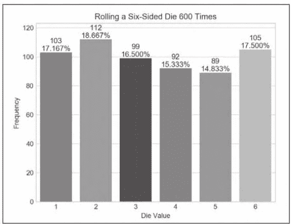

上图为 600 次投掷的垂直柱状图（Seaborn 称作 bar plot）。理论上每面期望出现 100 次（概率 16.667%），但小样本下波动显著，无一面命中 100 次，百分比亦偏离理论值。

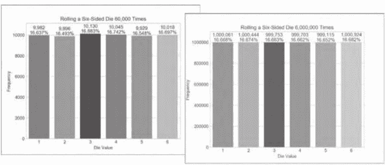

当样本量增至 60,000 次，各柱高度显著趋同；达 6,000,000 次时，六柱几乎等高——**大数定律**在眼前生动上演。随着投掷次数激增，各面出现频率百分比无限逼近 16.667%。

图表关键要素控制包括：
- 窗口标题（如“掷 600 次骰子”）
- 坐标轴标签（x 轴：点数，y 轴：出现次数）
- 柱顶标注（次数 + 百分比）
- 调色方案

Seaborn/Matplotlib 多采用智能默认值：x 轴自动映射点数 1~6，y 轴映射频数，柱子位置大小自适应窗口。所有属性均可按需定制。

### 5.17.2 从零手搓频率统计柱状图

本节在 IPython 交互环境中分步构建上述图表。

#### 启动 IPython 开启交互绘图

IPython 原生支持 Matplotlib 交互开发，启动命令如下：

```
ipython --matplotlib
```

#### 导入核心依赖

```
In [1]: import matplotlib.pyplot as plt
In [2]: import numpy as np
In [3]: import random
In [4]: import seaborn as sns
```

1. `matplotlib.pyplot`（常用别名 `plt`）：Matplotlib 绘图接口。
2. `numpy`（常用别名 `np`）：高性能数值计算库，此处用其 `unique` 函数统计频数。
3. `random`：Python 标准库随机数模块。
4. `seaborn`（常用别名 `sns`）：统计可视化库，缩写源自《海底总动员》角色 Sammy the Shark，趣味满分。

#### 模拟投掷并统计频次

利用列表推导式生成 600 次随机点数，再借 `np.unique` 去重并计数：

```
In [5]: rolls = [random.randrange(1, 7) for i in range(600)]
In [6]: values, frequencies = np.unique(rolls, return_counts=True)
```

`np.unique` 底层基于高性能 `ndarray`。传入列表 `rolls` 会自动转换。设置 `return_counts=True` 后，函数返回两个一维数组：唯一值（`values`）与对应频次（`frequencies`），解包赋值即可直接用于绘图。

#### 绘制基础柱状图

设置标题、主题风格，调用 `sns.barplot` 出图：

```
In [7]: title = f'Rolling a Six-Sided Die ({len(rolls):,} Times'
In [8]: sns.set_style('whitegrid')
In [9]: axes = sns.barplot(x=values, y=frequencies, palette='bright')
```

标题中投掷总数用 f-string 配合逗号格式化（如 `60,000`），见代码段 [7]。

```
{len(rolls):,}
```

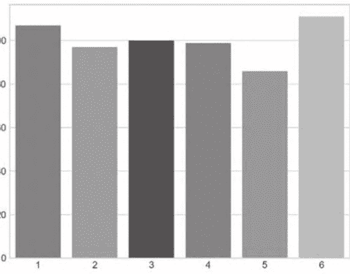

`sns.set_style('whitegrid')` 为图表添加浅灰横向网格，辅助读取柱高。`barplot` 接收 x、y 两数组，`palette='bright'` 指定明亮调色板（更多方案见官网教程）。函数返回 `Axes` 对象（变量 `axes`），后续所有微调均通过它完成，所见即所得。

#### 完善坐标轴与标题

```
In [10]: axes.set_title(title)
Out[10]: Text(0.5,1,'Rolling a Six-Sided Die 600 Times')

In [11]: axes.set(xlabel='Die Value', ylabel='Frequency')
Out[11]: [Text(92.6667,0.5,'Frequency'), Text(0.5,58.7667,'Die Value')]
```

`axes.set_title` 设置居中标题；`axes.set(xlabel=..., ylabel=...)` 一次性配置双轴标签。执行后图表如下：

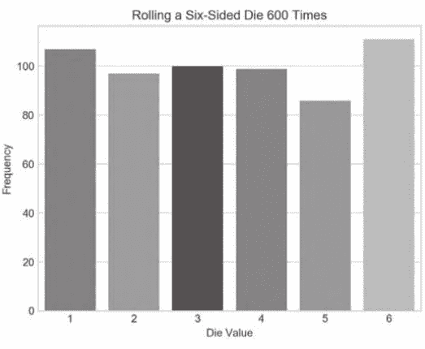

#### 画龙点睛：柱顶标注次数与占比

```
In [12]: axes.set_ylim(top=max(frequencies) * 1.10)
Out[12]: (0.0, 122.10000000000001)

In [13]: for bar, frequency in zip(axes.patches, frequencies):
    ...:     text_x = bar.get_x() + bar.get_width() / 2.0
    ...:     text_y = bar.get_height()
    ...:     text = f'{frequency:,}\n{frequency / len(rolls):.3%}'
    ...:     axes.text(text_x, text_y, text,
    ...:             fontsize=11, ha='center', va='bottom')
    ...: 
```

两步收尾：
1. **留白**：`axes.set_ylim(top=max(frequencies)*1.10)` 将 y 轴上限提高 10%，为柱顶文字腾出空间。
2. **逐柱写字**：遍历 `axes.patches`（柱子矩形对象集合）与 `frequencies`，`zip` 同步迭代。循环内：
   - 计算文本 x 坐标：柱左边缘 `bar.get_x()` + 半宽 `bar.get_width()/2` → 水平居中。
   - 文本 y 坐标：柱顶 `bar.get_y()`。
   - 组装双行文本：`频次\n占比%`。
   - `axes.text(x, y, s, ha='center', va='bottom')` 精准绘制，`ha`/`va` 控制对齐方式。

最终成图：

# 从交互式绘图到脚本复用：掌握 IPython 魔法与字典集合入门

刚完成一个精美的柱状图？想尝试不同模拟次数、把代码沉淀为可复用脚本，甚至进阶学习 Python 核心数据结构？这篇实战笔记带你一次搞定。

---

## 一、 交互环境下的“快速试错”与“代码归档”

### 1. 清屏重绘，验证新参数
已有图形在手，若想测试 60,000 次投掷效果，先调用 `cla()` 清空当前坐标系：

```
In [14]: plt.cla()
```

### 2. 善用 `%recall` 召回历史片段
IPython 的魔术命令堪称效率神器。输入 `%recall 5`，即可把第 5 个代码片段（构建 `rolls` 列表的逻辑）调至下一个输入提示符，随手把次数改为 `60000` 回车即可生成新数据：

```
In [15]: %recall 5
In [16]: rolls = [random.randrange(1, 7) for i in range(600)]
```
```
In [16]: rolls = [random.randrange(1, 7) for i in range(60000)]
```

### 3. 批量重跑绘图流水线
绘图涉及片段 [6] 到 [13]？直接 `%recall 6-13` 一次性调出全链路，回车重跑，更新后的柱状图瞬间呈现：

```
In [17]: %recall 6-13
In [18]: values, frequencies = np.unique(rolls, return_counts=True)
....: title = f'Rolling a Six-Sided Die {len(rolls):,} Times'
....: sns.set_style('whitegrid')
....: axes = sns.barplot(x=values, y=frequencies, palette='bright')
....: axes.set_title(title)
....: axes.set(xlabel='Die Value', ylabel='Frequency')
....: axes.set_ylim(top=max(frequencies) * 1.10)
```
```
....: for bar, frequency in zip(axes.patches, frequencies):
....:     text_x = bar.get_x() + bar.get_width() / 2.0
....:     text_y = bar.get_height()
....:     text = f'{frequency:,.3f}\n{frequency / len(rolls):.3%}'
....:     axes.text(text_x, text_y, text,
....:             fontsize=11, ha='center', va='bottom')
```


### 4. `%save` 落地生成可执行脚本
交互探索结束，别让代码躺在 Notebook 里吃灰。`%save RollDie.py 1-13` 将 1~13 号片段按序写入文件，屏幕会回显每一行写入内容，脚本即刻诞生：

```
In [19]: %save RollDie.py 1-13
The following commands were written to file 'RollDie.py':
import matplotlib.pyplot as plt
import numpy as np
import random
import seaborn as sns
rolls = [random.randrange(1, 7) for i in range(600)]
values, frequencies = np.unique(rolls, return_counts=True)
title = f'Rolling a Six-Sided Die {len(rolls):,} Times'
sns.set_style('whitegrid')
axes = sns.barplot(values, frequencies, palette='bright')
axes.set_title(title)
axes.set(xlabel='Die Value', ylabel='Frequency')
axes.set_ylim(top=max(frequencies) * 1.10)
for bar, frequency in zip(axes.patches, frequencies):
    text_x = bar.get_x() + bar.get_width() / 2.0
    text_y = bar.get_height()
    text = f'frequency: {frequency / len(rolls):.3%}'
    axes.text(text_x, text_y, text,
              fontsize=11, ha='center', va='bottom')
```

### 5. 脚本化改造：接收命令行参数
裸跑脚本还不够灵活？引入 `sys.argv` 让用户运行时自定投掷次数。修改版 `RollDie.py` 仅两处调整：
- 导入 `sys`，读取 `argv[1]` 并转 `int` 赋值给循环变量；
- 结尾补上 `plt.show()`，否则脚本结束窗口即闪退。

核心改动如下：

```
ipython RollDie.py 600
```
```
rolls = [random.randrange(1, 7) for i in range(int(sys.argv[1]))]
```
```
plt.show()
```

> **要点**：`argv[0]` 固定为脚本名，`argv[1]` 对应用户传入的首个参数（字符串），务必显式转型为整型。

---

## 二、 第 5 章知识地图速览

本章深度挖掘 **列表** 与 **元组** 两大序列：
- **列表**：可变、动态伸缩、支持切片/排序/推导式/嵌套建模二维表，还能模拟栈；
- **元组**：不可变、可解包、配合 `enumerate` 产出索引-值对；
- **通用技能**：切片、成员检测、内置函数（`sum/min/max/map/filter/reversed`）、`del` 释放引用。

**数据科学首秀**：用 Seaborn + Matplotlib 完成投骰子模拟的**静态柱状图**可视化。下一章将把图表“动”起来，实现动态更新。

**展望**：
- 第 6 章：字典（键值映射）与 集合（唯一元素集）
- 第 7 章：NumPy `ndarray`——大数据量下的性能王者
- 第 16 章：MongoDB 实战高性能存储

---

# 第二部分：Python 数据结构、字符串与文件
- 第 6 章 字典和集合
- 第 7 章 NumPy 面向数组编程
- 第 8 章 字符串深度解析
- 第 9 章 文件与异常处理

---

# 第 6 章 字典与集合：非序列容器的双子星

## 学习目标速览
- 构建/遍历/增删改查字典与集合
- 掌握 `in`/`not in` 判键、集合运算（并/交/差）、推导式速建
- 体会可变/不可变类型在容器中的行为差异
- 为动态可视化打下数据组织基础

## 6.1 破题：从“有序”到“映射”与“唯一”
前序已学字符串、列表、元组三大**有序序列**。今起转向**非序列容器**：
- **字典**：无序的 **键→值** 映射，键必须不可变且唯一，值可为任意类型；
- **集合**：无序、元素唯一且不可变，天然去重利器。

| 典型键 | 键类型 | 典型值 | 值类型 |
|---|---|---|---|
| 国家名 | `str` | 顶级域名 | `str` |
| 十进制数 | `int` | 罗马数字 | `str` |
| 病人ID | `str` | 生命体征 | `tuple(int, float)` |
| 库存编码 | `str` | 库存量 | `int` |

> **铁律**：键必须不可变（数字/字符串/元组），且全局唯一；不同键可指向同一值。

## 6.2 字典实战速成

### 6.2.1 创建与判空
花括号 `{}` 直接定义，空字典亦同。演示用国家代码映射：

```
In [1]: country_codes = {'Finland': 'fi', 'South Africa': 'za',
....:
....: 'Nepal': 'np'}
In [2]: country_codes
Out[2]: {'Finland': 'fi', 'South Africa': 'za', 'Nepal': 'np'}
```

> **注意**：打印顺序遵循插入顺序（CPython 3.7+ 保证），但**语义上字典无序**，切勿依赖顺序编程。

判空三式：
- `len(d) == 0`
- `if not d:`（空即 False）
- `d.clear()` 后再判

```
In [3]: len(country_codes)
Out[3]: 3
```
```
In [4]: if country_codes:
    ...: print('country_codes is not empty')
    ...: else:
    ...: print('country_codes is empty')
    ...:
country_codes is not empty
```
```
In [5]: country_codes.clear()

In [6]: if country_codes:
    ...: print('country_codes is not empty')
    ...: else:
    ...: print('country_codes is empty')
    ...:
country_codes is empty
```

### 6.2.2 优雅遍历：`items()` 解包
以「月份→天数」字典为例，多键同值（如 31 天）完全合法：

```
In [1]: days_per_month = {'January': 31, 'February': 28, 'March': 31}

In [2]: days_per_month
Out[2]: {'January': 31, 'February': 28, 'March': 31}
```

单层 `for` 搞定键值对拆包：

```
In [3]: for month, days in days_per_month.items():
...:     print(f'{month} has {days} days')
...:
January has 31 days
February has 28 days
March has 31 days
```

### 6.2.3 CRUD 核心操作全景
以 `roman_numerals` 为沙箱，故意把 `'X'` 设错为 100，演示全生命周期：

```python
In [1]: roman_numerals = {'I': 1, 'II': 2, 'III': 3, 'V': 5, 'X': 100}
In [2]: roman_numerals
Out[2]: {'I': 1, 'II': 2, 'III': 3, 'V': 5, 'X': 100}
```

| 操作 | 语法 | 示例 |
|---|---|---|
| **取值** | `d[key]` | `roman_numerals['V']` → 5 |
| **更新** | `d[key] = new_val` | 修正 `'X'`: 10 |
| **新增** | `d[new_key] = val` | 大小写敏感，误拼即新键 |
| **删除** | `del d[key]` / `d.pop(key)` | `pop` 还能返回被删值 |
| **防错取值** | `d.get(key)` / `d.get(key, default)` | 键缺失返回 `None` 或自定义提示 |
| **键存在性** | `key in d` / `key not in d` | 布尔判断，极简高效 |

实战代码依次演示：

```python
In [3]: roman_numerals['V']
Out[3]: 5
```
```python
In [4]: roman_numerals['X'] = 10
In [5]: roman_numerals
Out[5]: {'I': 1, 'II': 2, 'III': 3, 'V': 5, 'X': 10}
```
```python
In [6]: roman_numerals['L'] = 50

In [7]: roman_numerals
Out[7]: {'I': 1, 'II': 2, 'III': 3, 'V': 5, 'X': 10, 'L': 50}
```
```python
In [8]: del roman_numerals['III']

In [9]: roman_numerals
Out[9]: {'I': 1, 'II': 2, 'V': 5, 'X': 10, 'L': 50}
```
```python
In [10]: roman_numerals.pop('X')
Out[10]: 10

In [11]: roman_numerals
Out[11]: {'I': 1, 'II': 2, 'V': 5, 'L': 50}
```
```python
In [12]: roman_numerals['III']
---------------------------------------------------------------------------
KeyError                                 Traceback (most recent call last)
<ipython-input-12-ccd50c7f0c8b> in <module>()
----> 1 roman_numerals['III']

KeyError: 'III'
```
```python
In [13]: roman_numerals.get('III')

In [14]: roman_numerals.get('III', 'III not in dictionary')
Out[14]: 'III not in dictionary'

In [15]: roman_numerals.get('V')
Out[15]: 5
```

---

> **下一节预告**：集合的数学运算（并/交/差/对称差）与可变集合原地修改技巧，助你写出更 Pythonic 的去重与关系计算代码。

```python
In [16]: 'V' in roman_numerals
Out[16]: True

In [17]: 'III' in roman_numerals
Out[17]: False

In [18]: 'III' not in roman_numerals
Out[18]: True
```

### 6.2.4 字典的 keys 与 values 方法

前文介绍了用 `items()` 遍历键值对元组，实际上，字典还提供了 `keys()` 和 `values()` 方法，分别用于单独迭代键或值：

```python
In [1]: months = {'January': 1, 'February': 2, 'March': 3}

In [2]: for month_name in months.keys():
    ...:
    print(month_name, end=' ')
January February March

In [3]: for month_number in months.values():
    ...:
    print(month_number, end=' ')
1 2 3
```

#### 字典视图机制

`items()`、`keys()`、`values()` 返回的并非数据副本，而是**字典视图**。这意味着遍历视图时，读取到的是字典此刻的实时状态。

为验证视图不持有独立数据副本，我们先将 `keys()` 返回的视图存入变量 `months_view` 并进行遍历：

```python
In [4]: months_view = months.keys()

In [5]: for key in months_view:
   ...:     print(key, end=" ")
   ...:
January February March
```

随后，在字典 `months` 中新增一条键值对并打印更新后的字典：

```python
In [6]: months['December'] = 12

In [7]: months
Out[7]: {'January': 1, 'February': 2, 'March': 3, 'December': 12}
```

此时再次遍历 `months_view`，会发现新增的键已自动出现在视图中：

```python
In [8]: for key in months_view:
   ...:     print(key, end=" ")
   ...:
January February March December
```

**注意**：遍历视图期间切勿修改字典。依据 Python 标准库文档 4.10.1 节，此举可能触发 `RuntimeError`，或导致视图元素处理不完整。

#### 视图转列表

若需获取键、值或键值对的静态列表，可将视图对象传入内置 `list()` 函数。对生成的列表进行增删改查，不会波及原字典：

```python
In [9]: list(months.keys())
Out[9]: ['January', 'February', 'March', 'December']

In [10]: list(months.values())
Out[10]: [1, 2, 3, 12]

In [11]: list(months.items())
Out[11]: [('January', 1), ('February', 2), ('March', 3), ('December', 12)]
```

#### 键的有序遍历

需按字母顺序处理键时，配合内置 `sorted()` 函数即可实现：

```python
In [12]: for month_name in sorted(months.keys()):
    ...:     print(month_name, end=' ')
    ...:
December February January March
```

### 6.2.5 字典比较操作

`==` 与 `!=` 用于判断两字典内容是否一致。只要键值对完全相同，`==` 即返回 `True`，与字典内部存储顺序无关：

```python
In [1]: country_capitals1 = {'Belgium': 'Brussels',
   ...:                 'Haiti': 'Port-au-Prince'}
   ...:
In [2]: country_capitals2 = {'Nepal': 'Kathmandu',
   ...:                 'Uruguay': 'Montevideo'}
   ...:
In [3]: country_capitals3 = {'Haiti': 'Port-au-Prince',
   ...:                 'Belgium': 'Brussels'}
   ...:
In [4]: country_capitals1 == country_capitals2
Out[4]: False
In [5]: country_capitals1 == country_capitals3
Out[5]: True
In [6]: country_capitals1 != country_capitals2
Out[6]: True
```

### 6.2.6 实战案例：学生成绩管理

下面脚本演示用字典模拟成绩册：键为学生姓名（字符串），值为包含 3 次考试分数的列表（整数）。循环遍历（第 13~17 行）时解包键值对至 `name` 与 `grades`，第 14 行用 `sum()` 求总分 `total`，第 15 行计算平均分（总分除以 `len(grades)`）。第 16~17 行累加全班总分与总科次数，第 19 行输出班级平均分：

```python
#### Fig06_01.py
"""Using a dictionary to represent an instructor's grade book."""
grade_book = {
   'Susan': [92, 85, 100],
   'Eduardo': [83, 95, 79],
   'Azizi': [91, 89, 82],
   'Pantipa': [97, 91, 92]
}

all_grades_total = 0
all_grades_count = 0

for name, grades in grade_book.items():
   total = sum(grades)
   print(f'Average for {name} is {total/len(grades):.2f}')
   all_grades_total += total
   all_grades_count += len(grades)

print(f"Class's average is: {all_grades_total / all_grades_count:.2f}")
```

```
Average for Susan is 92.33
Average for Eduardo is 85.67
Average for Azizi is 87.33
Average for Pantipa is 93.33
Class's average is: 89.67
```

### 6.2.7 实战案例：单词词频统计

此脚本统计字符串中各单词出现次数。第 4~5 行拼接字符串 `text`（即分词/标记化素材）。第 7 行建立空字典，以唯一单词为键、出现次数为值。

第 10 行调用 `split()` 分词（默认按空白字符分割），返回单词列表。第 10~14 行遍历列表：第 11 行判断单词是否已在字典，若在则第 12 行计数加一；否则第 14 行新增键值对，初始计数为 1。

第 16~21 行以双列表格形式输出结果。第 18~19 行遍历 `items()` 解包至 `word` 与 `count` 并打印。第 21 行显示唯一单词总数。

```python
#### fig06_02.py
"""Tokenizing a string and counting unique words."""
text = ('this is sample text with several words '
        'this is more sample text with some different words')
word_counts = {}
#### count occurrences of each unique word
for word in text.split():
    if word in word_counts:
        word_counts[word] += 1 # update existing key-value pair
    else:
        word_counts[word] = 1 # insert new key-value pair
print(f'{"WORD":<12}{"COUNT"}')
for word, count in sorted(word_counts.items()):
    print(f'{word:<12}{count}')
print('\nNumber of unique words:', len(word_counts))
```

```
WORD         COUNT
different    1
is           2
more         1
sample       2
several      1
some         1
text         2
this         2
with         2
words        2
Number of unique words: 10
```

#### 标准库 `collections.Counter` 简化实现

标准库 `collections` 模块提供 `Counter` 类，专门用于对可迭代对象元素计数，可大幅精简上述逻辑：

```python
In [1]: from collections import Counter

In [2]: text = ('this is sample text with several words '
    ...:     'this is more sample text with some different words')
    ...:

In [3]: counter = Counter(text.split())

In [4]: for word, count in sorted(counter.items()):
    ...:     print(f'{word:<12}{count}')
    ...:
different   1
is          2
more        1
sample      2
several     1
some        1
text        2
this        2
with        2
words       2

In [5]: print('Number of unique keys:', len(counter.keys()))
Number of unique keys: 10
```

片段 [3] 创建 `Counter` 对象，直接统计 `text.split()` 返回的列表。片段 [4] 中，`items()` 返回单词-计数元组，经 `sorted()` 排序（默认按单词字典序）后遍历打印。

### 6.2.8 字典的 update 方法

`update()` 方法支持批量插入或更新键值对。先创建空字典 `country_codes`：

```python
In [1]: country_codes = {}
```

调用 `update()` 传入待插入/更新的数据：

```python
In [2]: country_codes.update({'South Africa': 'za'})
In [3]: country_codes
Out[3]: {'South Africa': 'za'}
```

`update()` 还能识别关键字参数，自动将参数名转为字符串键。如下代码将 `Australia` 变为键 `'Australia'`，关联值 `'ar'`：

```python
In [4]: country_codes.update(Australia='ar')
In [5]: country_codes
Out[5]: {'South Africa': 'za', 'Australia': 'ar'}
```

片段 [4] 故意录入错误代码，现用另一关键字参数修正 `'Australia'` 对应的值：

```python
In [6]: country_codes.update(Australia='au')
In [7]: country_codes
Out[7]: {'South Africa': 'za', 'Australia': 'au'}
```

此外，`update()` 也接受包含键值对的可迭代对象（如二元元组列表）。

### 6.2.9 字典推导式

字典推导式以花括号包裹，`for` 左侧表达式定义 `key:value` 形式，适合快速构建或转换字典。例如，对值唯一的字典进行键值反转：

```python
In [1]: months = {'January': 1, 'February': 2, 'March': 3}
In [2]: months2 = {number: name for name, number in months.items()}
In [3]: months2
Out[3]: {1: 'January', 2: 'February', 3: 'March'}
```

推导式遍历 `months.items()`，解包至 `name`、`number`，表达式 `number:name` 完成键值互换，生成数字映射月份名的新字典。

**值重复怎么办？** 若原字典值有重复，反转时键冲突会导致后值覆盖前值。若 `'February'` 与 `'March'` 均映射 2，结果将仅保留后者：

```
{1: 'January', 2: 'March'}
```

推导式也可对值做映射变换。下例将「姓名-成绩列表」字典转为「姓名-平均分」字典，惯用 `k`、`v` 代表键值：

In [4]: grades = {'Sue': [98, 87, 94], 'Bob': [84, 95, 91]}

In [5]: grades2 = {k: sum(v) / len(v) for k, v in grades.items()}

In [6]: grades2

Out[6]: {'Sue': 93.0, 'Bob': 90.0}

推导式解包 `grades.items()` 获取 `k`（姓名）与 `v`（分数列表），以 `k` 为键、`sum(v)/len(v)` 为值构建新字典。

## 6.3 集合

集合是**无序且元素唯一**的容器。仅允许存放不可变对象（字符串、数值、元组等）。虽可迭代，但非序列，**不支持下标 `[]` 索引与切片**（字典亦同）。

### 用花括号创建集合

以下代码建立字符串集合 `colors`：

```
In [1]: colors = {'red', 'orange', 'yellow', 'green', 'red', 'blue'}

In [2]: colors
Out[2]: {'blue', 'green', 'orange', 'red', 'yellow'}
```

重复项 `'red'` 被自动忽略（不报错）。**去重**是集合创建时的天然特性。另外，打印顺序与定义顺序不同（此处恰按首字母序），集合本质无序，**切勿编写依赖元素顺序的代码**。

### 获取集合长度

内置 `len()` 函数返回元素个数：

```
In [3]: len(colors)
Out[3]: 5
```

### 成员资格检测

用 `in`、`not in` 判断元素是否存在于集合：

```
In [4]: 'red' in colors
Out[4]: True
In [5]: 'purple' in colors
Out[5]: False
In [6]: 'purple' not in colors
Out[6]: True
```

### 遍历集合

集合可直接用 `for` 循环逐元素处理：

```
In [7]: for color in colors:
    ...: print(color.upper(), end=' ')
    ...:
RED GREEN YELLOW BLUE ORANGE
```

# Python集合与动态数据可视化实战指南

集合本质上是无序容器，因此遍历操作无法依赖特定的元素排列次序。

### 利用内置 `set()` 构建集合

调用内置的 `set()` 函数即可依据一组元素值生成集合。示例中先构建了一个含有重复整数的列表，随后将其作为参数传入 `set()`：

```
In [8]: numbers = list(range(10)) + list(range(5))
In [9]: numbers
Out[9]: [0, 1, 2, 3, 4, 5, 6, 7, 8, 9, 0, 1, 2, 3, 4]
In [10]: set(numbers)
Out[10]: {0, 1, 2, 3, 4, 5, 6, 7, 8, 9}
```

初始化空集合时，必须使用 `set()` 而非空花括号 `{}`，因为后者在 Python 中表示空字典：

```
In [11]: set()
Out[11]: set()
```

解释器会以 `set()` 的形式展示空集合，以此区别于空字典的字符串表现形式 `{}`。

### `frozenset`：不可变的集合变体

标准集合支持增删元素（可变），但要求元素本身必须是不可变（可哈希）的。因此，集合不能直接嵌套其他集合。`frozenset` 正是为了解决此限制而设计的不可变集合类型——实例化后内容冻结，不可修改，故而可以作为普通集合的元素。内置函数 `frozenset()` 接受可迭代对象以创建实例。

## 6.3.1 集合间的比较逻辑

Python 提供了丰富的运算符与方法用于集合比较。当两个集合包含完全相同的值时，`==` 判定为真，`!=` 判定为假。

```
In [1]: {1, 3, 5} == {3, 5, 1}
Out[1]: True

In [2]: {1, 3, 5} != {3, 5, 1}
Out[2]: False
```

`<` 运算符用于判断左侧集合是否为右侧集合的**真子集**：左侧所有元素均在右侧，且两者不相等。

```
In [3]: {1, 3, 5} < {3, 5, 1}
Out[3]: False

In [4]: {1, 3, 5} < {7, 3, 5, 1}
Out[4]: True
```

`<=` 运算符检测左侧是否为右侧的**非真子集**（即子集或相等）：左侧元素全在右侧，允许两集合相等。

```
In [5]: {1, 3, 5} <= {3, 5, 1}
Out[5]: True

In [6]: {1, 3} <= {3, 5, 1}
Out[6]: True
```

同理，调用 `issubset()` 方法也可完成非真子集判定。

```
In [7]: {1, 3, 5}.issubset({3, 5, 1})
Out[7]: True

In [8]: {1, 2}.issubset({3, 5, 1})
Out[8]: False
```

`>` 运算符验证左侧是否为右侧的**真超集**：右侧元素全包含于左侧，且左侧拥有更多元素。

```
In [9]: {1, 3, 5} > {3, 5, 1}
Out[9]: False

In [10]: {1, 3, 5, 7} > {3, 5, 1}
Out[10]: True
```

`>=` 运算符验证左侧是否为右侧的**非真超集**：右侧元素全在左侧，两集合可相等。

```
In [11]: {1, 3, 5} >= {3, 5, 1}
Out[11]: True

In [12]: {1, 3, 5} >= {3, 1}
Out[12]: True

In [13]: {1, 3} >= {3, 1, 7}
Out[13]: False
```

`issuperset()` 方法提供相同的非真超集检查能力。

```
In [14]: {1, 3, 5}.issuperset({3, 5, 1})
Out[14]: True

In [15]: {1, 3, 5}.issuperset({3, 2})
Out[15]: False
```

值得注意的是，`issubset` 与 `issuperset` 的参数不仅限于集合，任意可迭代对象均可。若传入非集合对象，方法会先将其转为集合再执行比较。

## 6.3.2 集合的数学运算体系

本节详解并集 `|`、交集 `&`、差集 `-`、对称差集 `^` 及其对应方法。

#### 并集运算

两个集合的并集汇总双方所有元素，重复项仅保留一份。可用 `|` 运算符或 `union()` 方法实现：

```
In [1]: {1, 3, 5} | {2, 3, 4}
Out[1]: {1, 2, 3, 4, 5}

In [2]: {1, 3, 5}.union([20, 20, 3, 40, 40])
Out[2]: {1, 3, 5, 20, 40}
```

运算符两侧操作数必须均为集合；但 `union()` 方法更灵活，接受任意可迭代对象。调用时会自动将参数转为集合再运算。另请注意：尽管打印输出常按升序排列，但代码切勿依赖此显示顺序。

#### 交集运算

交集仅保留两集合共有的元素。使用 `&` 运算符或 `intersection()` 方法：

```
In [3]: {1, 3, 5} & {2, 3, 4}
Out[3]: {3}

In [4]: {1, 3, 5}.intersection([1, 2, 2, 3, 3, 4, 4])
Out[4]: {1, 3}
```

#### 差集运算

差集由“属于左操作数但不属于右操作数”的元素构成。对应 `-` 运算符与 `difference()` 方法：

```
In [5]: {1, 3, 5} - {2, 3, 4}
Out[5]: {1, 5}

In [6]: {1, 3, 5, 7}.difference({2, 2, 3, 3, 4, 4})
Out[6]: {1, 5, 7}
```

#### 对称差集运算

对称差集包含“仅存在于两集合之一中”的元素（即排除共有部分）。使用 `^` 运算符或 `symmetric_difference()` 方法：

```
In [7]: {1, 3, 5} ^ {2, 3, 4}
Out[7]: {1, 2, 4, 5}
In [8]: {1, 3, 5, 7}.symmetric_difference({2, 2, 3, 3, 4, 4})
Out[8]: {1, 2, 4, 5, 7}
```

#### 判断不相交集

若两集合无任何公共元素，则互为不相交集。通过 `isdisjoint()` 方法快速判定：

```
In [9]: {1, 3, 5}.isdisjoint({2, 4, 6})
Out[9]: True
In [10]: {1, 3, 5}.isdisjoint({4, 6, 1})
Out[10]: False
```

## 6.3.3 就地修改：可变运算符与方法

上一节运算均生成新集合，本节聚焦原地修改现有集合的操作。

#### 可变数学运算

`|=` 运算符执行并集并更新左操作数，效果等同于 `union()` 但原地生效：

```
In [1]: numbers = {1, 3, 5}
In [2]: numbers |= {2, 3, 4}
In [3]: numbers
Out[3]: {1, 2, 3, 4, 5}
```

`update()` 方法同样执行并集合并并修改调用者，参数可为任意可迭代对象：

```
In [4]: numbers.update(range(10))
In [5]: numbers
Out[5]: {0, 1, 2, 3, 4, 5, 6, 7, 8, 9}
```

其他对应的增强赋值运算符与就地更新方法对应关系如下：

- `&=` 对应 `intersection_update()`（交集更新）
- `-=` 对应 `difference_update()`（差集更新）
- `^=` 对应 `symmetric_difference_update()`（对称差集更新）

#### 元素增删工具箱

- **`add(x)`**：若 `x` 不在集合中则插入，已存在则无操作。

```
In [6]: numbers.add(17)
In [7]: numbers.add(3)
In [8]: numbers
Out[8]: {0, 1, 2, 3, 4, 5, 6, 7, 8, 9, 17}
```

- **`remove(x)`**：移除元素 `x`；若 `x` 缺失则抛出 `KeyError`。

```
In [9]: numbers.remove(3)
In [10]: numbers
Out[10]: {0, 1, 2, 4, 5, 6, 7, 8, 9, 17}
```

- **`discard(x)`**：移除元素 `x`；若 `x` 缺失**不报错**，静默处理。

- **`pop()`**：随机弹出并返回一个元素。因集合无序，无法预知弹出哪项。

```
In [11]: numbers.pop()
Out[11]: 0
In [12]: numbers
Out[12]: {1, 2, 4, 5, 6, 7, 8, 9, 17}
```

  对空集合调用 `pop()` 会触发 `KeyError`。

- **`clear()`**：清空集合所有元素。

```
In [13]: numbers.clear()

In [14]: numbers
Out[14]: set()
```

## 6.3.4 集合推导式

语法类似字典推导式，均使用花括号。示例：从列表 `numbers` 中筛选不重复的偶数构建新集合。

```
In [1]: numbers = [1, 2, 2, 3, 4, 5, 6, 6, 7, 8, 9, 10, 10]

In [2]: evens = {item for item in numbers if item % 2 == 0}

In [3]: evens
Out[3]: {2, 4, 6, 8, 10}
```

# 6.4 数据科学进阶：动态可视化实战

上一章我们用 Seaborn 与 Matplotlib 绘制了掷骰子模拟的静态柱状图，展示最终频率分布。本节将引入动画机制，让图表“动”起来，直观呈现数据演变过程。

### 大数定律的直观验证

随机模块 `randrange` 生成的整数在指定范围内等概率出现。六面骰子每面理论概率为 1/6（约 16.667%）。

即将构建的动态模拟脚本会随投掷次数增加，展示各面出现频率逐渐逼近理论值、柱高趋于一致的过程——这是大数定律的生动演示。

## 6.4.1 动态可视化核心原理

静态图仅呈现终态，而 `matplotlib.animation.FuncAnimation` 通过逐帧回调 `update` 函数，实现柱状图的动态刷新。随着投掷推进，柱高、计数、百分比、坐标轴刻度及标题总投掷数同步变化。

### 动画帧机制

`FuncAnimation` 驱动逐帧渲染。每帧代表一次状态更新，连续帧串联形成动画。可通过参数控制帧内容。

**单帧执行流程：**
1.  执行指定次数投掷（1次至N次），累加各面点数计数。
2.  清空当前画布。
3.  依据最新计数绘制新柱子。
4.  为每柱标注最新计数与百分比文本。

帧率（FPS）越高动画越流畅（游戏常 30+ FPS）。可设定帧间隔毫秒数，但实际帧受单帧计算量及 CPU 影响。示例设为 33ms/帧（约 30 FPS），建议实测调优。

```
运行RollDiceDynamic.py
```

静态图开发时可交互逐句执行观察变化，终态仅绘制一次。动态图因画面持续重绘（柱高、文本、轴标签、标题全变），适合作为完整脚本运行而非交互式开发。

脚本接收两个命令行参数：
- **`number_of_frames`**：总动画帧数，决定 `FuncAnimation` 调用 `update` 的总次数。
- **`rolls_per_frame`**：单帧内投掷次数。循环累加结果后一次性更新画面。

**参数组合解析：**

```
ipython RollDieDynamic.py 6000 1
```

此命令共 6000 帧，每帧投 1 次，总投 6000 次。动画约 3.33 分钟（6000/30/60），仅能观测少量投掷下的波动。

屏幕渲染属 I/O 密集型慢操作，CPU 计算投掷极快。若每帧仅投 1 次，难以在合理时间内积累大样本，也难看到频率收敛。

**提升效率策略：单帧多投。**

```
ipython RollDieDynamic.py 10000 600
```

此命令 10,000 帧，每帧投 600 次，总投 600 万次。耗时约 5.55 分钟（10000/30/60），每秒呈现约 1.8 万次投掷结果（30 * 600），能快速见证频率收敛至 16.667%（各面约 100 万次）。

建议实验不同参数组合，直到获得最佳可视化效果。

### 示例运行截图

两次执行共捕获四关键帧：
1.  6000 总投：第 64 次、第 604 次投掷后画面。
2.  600 万总投：第 7200 次、第 166,200 次投掷后画面。

实时运行感受柱状图动态生长。大样本下频率百分比显著向 16.667% 收敛。

**执行 6000 帧，单帧 1 次投掷：**
`ipython RollDieDynamic.py 6000 1`

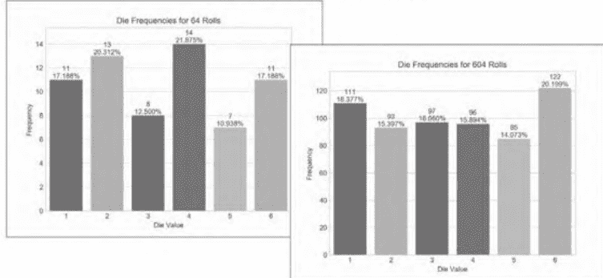

**执行 10,000 帧，单帧 600 次投掷：**
`ipython RollDieDynamic.py 10000 600`

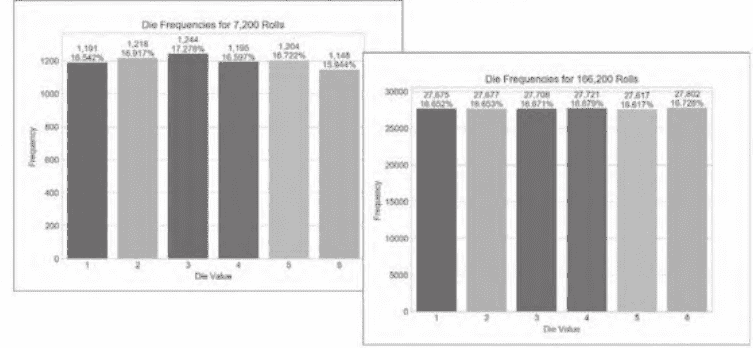

## 6.4.2 动态可视化代码实现

复用上章 Seaborn 与 Matplotlib 特性，重点利用 `animation` 模块重构逻辑。

### 引入动画模块

第 3 行导入 `matplotlib.animation`，这是实现动效的关键。

```
1  # RollDieDynamic.py
2  """Dynamically graphing frequencies of die rolls."""
3  from matplotlib import animation
4  import matplotlib.pyplot as plt
5  import random
6  import seaborn as sns
7  import sys
8

```

### 定义 `update` 回调函数

第 9-27 行定义 `update`，`FuncAnimation` 每帧调用一次。函数签名（第 9-10 行）至少需一个参数，具体接收：

- `frame_number`：帧序号（本例中未使用，但参数位必须保留）。
- `rolls`：单帧投掷次数（对应 `rolls_per_frame`）。
- `faces`：骰子面值列表，作 x 轴标签。
- `frequencies`：各面出现次数列表（可变对象，函数内修改即影响外部）。

函数体核心逻辑将在后续小节拆解。

```
9 def update(frame_number, rolls, faces, frequencies):
10    """Configures bar plot contents for each animation frame."""
```

#### update函数：模拟掷骰并刷新频率统计

代码第12至13行执行掷骰操作，并同步更新 `frequencies` 列表。值得注意的是，在将结果写入列表前，点数值（1至6）需先减去1。原因在于 `frequencies` 是一个预定义的6元素列表（见第36行），其索引范围仅为0至5，需对齐这层映射关系。

```
11  # roll die and update frequencies
12  for i in range(rolls):
13      frequencies[random.randrange(1, 7) - 1] += 1
14
```

#### update函数：重绘柱状图与标注文本

第16行调用 `matplotlib.pyplot.cla()` 清空当前坐标系，为新一帧动画腾出画布。第17至27行逻辑承接上一章数据可视化的基础：前半段（17-20行）构建柱状图骨架，涵盖标题、坐标轴标签及Y轴缩放（预留顶部文本空间）；后半段（23-27行）则在各柱顶精准标注该点数的出现次数与占比百分比。

```
15    # reconfigure plot for updated die frequencies
16    plt.cla()   # clear old contents of current Figure
17    axes = sns.barplot(faces, frequencies, palette='bright')  # new bars
18    axes.set_title(f'Die Frequencies for {sum(frequencies):,} Rolls')
19    axes.set(xlabel='Die Value', ylabel='Frequency')
20    axes.set_ylim(top=max(frequencies) * 1.10)  # scale y-axis by 10%
21

22    # display frequency & percentage above each patch (bar)
23    for bar, frequency in zip(axes.patches, frequencies):
24        text_x = bar.get_x() + bar.get_width() / 2.0
25        text_y = bar.get_height()
26        text = f'{frequency:,}\n{frequency / sum(frequencies):.3%}'
27        axes.text(text_x, text_y, text,
28                ha='center', va='bottom')
```

#### 状态维护与画布初始化关键变量

第30、31行通过 `sys.argv` 捕获命令行启动参数。第33行锁定 Seaborn 的 `whitegrid` 风格。第34行实例化 `Figure` 对象并设定窗口标题，此对象后续将作为 `FuncAnimation` 的核心载体。第35行备好X轴刻度标签（1至6），第36行初始化长度为6、全零的 `frequencies` 列表，用于累计各面朝上的频次。

```
29    # read command-line arguments for number of frames and rolls per frame
30    number_of_frames = int(sys.argv[1])
31    rolls_per_frame = int(sys.argv[2])
32

33    sns.set_style('whitegrid')   # white background with gray grid lines
34    figure = plt.figure('Rolling a Six-Sided Die')   # Figure for animation
35    values = list(range(1, 7))   # die faces for display on x-axis
36    frequencies = [0] * 6   # six-element list of die frequencies
37
```

#### 驱动动画：调用 FuncAnimation

第39至41行启动 `matplotlib.animation.FuncAnimation` 实现动态渲染。该函数返回一个动画对象引用，**务必保持该引用存活**；若未显式持有，Python垃圾回收机制会瞬间回收动画资源，导致窗口一闪而过。

```
38 # configure and start animation that calls function update
39 die_animation = animation.FuncAnimation(
40 figure, update, repeat=False, frames=number_of_frames, interval=33,
41 fargs=(rolls_per_frame, values, frequencies))
42 plt.show() # display window
```

**FuncAnimation 核心参数解析**

两大必选参数：
*   `figure`：承载动画的 Figure 画布；
*   `update`：逐帧回调的更新函数。

本例额外启用的可选参数：
*   `repeat=False`：播放完指定帧数即停止（默认True循环播放）。
*   `frames=600`：总帧数，等同于 `range(600)`。每帧执行时，当前帧索引会作为首个实参自动传入 `update`。
*   `interval=33`：帧间隔33毫秒（约30FPS），默认200ms。
*   `fargs`：打包传给 `update` 的额外位置参数元组，对应函数签名中的 `roll`、`faces`、`frequencies`（第9行）。

完整参数表请查阅 Matplotlib 官方文档。最后，第43行 `plt.show()` 启动事件循环，呈现交互窗口。

## 第6章 小结

本章深度剖析了字典与集合两大核心集合类型：从字典的键值语法、推导式、增删改查到遍历技巧；再到集合的去重特性、数学运算（并/交/差）、可变与不可变（frozenset）形态转换。

数据科学实战环节，我们构建了**掷骰子动态柱状图**，直观演示“大数定律”收敛过程。除复用 Seaborn/Matplotlib 绘图基础外，核心在于驾驭 `FuncAnimation` 实现逐帧状态刷新，通过参数化控制动画节奏与内容。

**下章预告**：引入 NumPy 库，揭秘 `ndarray` 为何能在批量计算中碾压原生列表**两个数量级**——这正是大数据高性能计算的基石。

# 第7章：NumPy 面向数组编程

## 学习目标速览

- 掌握 `ndarray` 与 `list` 的本质差异；
- 熟练使用高性能 `ndarray` 及 `%timeit` 基准测试；
- 精通数组创建、索引、切片、迭代与多维操作；
- 执行向量化运算，告别显式循环；
- 上手 Pandas `Series` 与 `DataFrame`，玩转自定义索引、描述性统计与输出格式化。

## 7.1 简介：为何选 NumPy？

NumPy（Numerical Python）自2006年问世，迅速成为 Python 科学计算的**基石标准**。其核心 `ndarray`（n维数组）以 C 级性能著称，**批量运算速度超越列表两个数量级**——在 TB 级数据处理中，这意味着小时级与秒级的差距。生态层面，超 450 个库（含 Pandas、SciPy、Keras 等）深度依赖 NumPy，Anaconda 发行版默认预装。

本章将系统讲解“面向数组编程”范式：利用内置向量化算子替代显式循环，代码更简洁、少 Bug、跑得快。数据科学篇将引入 Pandas，补齐 NumPy 在混合类型、缺失值、自定义索引、非结构化数据上的短板。读完本章，你将驾驭 List、Array、Series、DataFrame 四大类表结构，为第15章 Tensor（张量）铺路。

## 7.2 从现有数据构建数组

惯例导入：`import numpy as np`。

```
In [1]: import numpy as np
```

`np.array()` 接受任意序列（列表、元组等），返回**深拷贝**的新数组。示例传入一维列表：

```
In [2]: numbers = np.array([2, 3, 5, 7, 11])
```

查看对象类型与内容：

```
In [3]: type(numbers)
Out[3]: numpy.ndarray

In [4]: numbers
Out[4]: array([ 2, 3, 5, 7, 11])
```

输出显类型为 `numpy.ndarray`。NumPy 打印时按**最大元素宽度**右对齐列（如 `11` 占两位，故 `2`、`3` 前自动补空格），并以逗号分隔，风格统一紧凑。

### 多维结构自动识别

传入嵌套列表，`array` 会原样复制维度结构：

```
In [5]: np.array([[1, 2, 3], [4, 5, 6]])
Out[5]:
array([[1, 2, 3],
       [4, 5, 6]])
```

NumPy 自动按行列对齐渲染，二维结构一目了然。

## 7.3 数组元数据属性速查

以下数组为例：

```
In [1]: import numpy as np

In [2]: integers = np.array([[1, 2, 3], [4, 5, 6]])

In [3]: integers
Out[3]:
array([[1, 2, 3],
       [4, 5, 6]])

In [4]: floats = np.array([0.0, 0.1, 0.2, 0.3, 0.4])

In [5]: floats
Out[5]: array([ 0. ,  0.1,  0.2,  0.3,  0.4])
```

> 注：浮点数打印会省略尾随零（如 `1.` 而非 `1.0`）。

### 元素数据类型

`dtype` 属性揭示底层存储类型：

```
In [6]: integers.dtype
Out[6]: dtype('int64') # int32 on some platforms

In [7]: floats.dtype
Out[7]: dtype('float64')
```

NumPy 底层由 C 实现，默认整数用 `int64`（8字节），浮点用 `float64`，另有 `bool`、字符串用 `object` 等。完整类型表见[官方文档](https://docs.scipy.org/doc/numpy/user/basics.types.html)。下节将演示如何通过 `dtype` 参数强制指定类型。

### 维度与形状

*   `ndim`：维数（秩）；
*   `shape`：各维长度元组。

```
In [8]: integers.ndim
Out[8]: 2

In [9]: floats.ndim
Out[9]: 1

In [10]: integers.shape
Out[10]: (2, 3)

In [11]: floats.shape
Out[11]: (5,)
```

`integers` 为 2×3 矩阵（2行3列），`floats` 为一维长度5，故 `shape` 显示 `(5,)`（单元素元组需带逗号）。

### 总元素数与单元字节数

*   `size`：总元素量（各维乘积）；
*   `itemsize`：单元素占用字节。

```
In [12]: integers.size
Out[12]: 6

In [13]: integers.itemsize # 4 if C compiler uses 32-bit ints
Out[13]: 8

In [14]: floats.size
Out[14]: 5

In [15]: floats.itemsize
Out[15]: 8
```

`integers` 共 6 个 `int64`，`floats` 共 5 个 `float64`，均为 8 字节/元素。

### 多维遍历：显式 vs 扁平化

虽推荐向量化操作，但数组可迭代。嵌套循环遍历行列：

```python
for row in integers:
    for col in row:
        print(col, end=' ')
    print()
```

更简洁的 `.flat` 属性可将多维视为一维流式遍历：

```
In [17]: for i in integers.flat:
    ...:     print(i, end=' ')
1 2 3 4 5 6
```

## 7.4 特定值快速填充数组

NumPy 提供三大工厂函数，首参为形状（整数或元组），默认产出 `float64`：

| 函数 | 用途 |
|------|------|
| `zeros` | 全 0 初始化 |
| `ones`  | 全 1 初始化 |
| `full`  | 填充指定标量值 |

**一维示例**（传入整数 `n` 即得长度 `n` 的一维数组）：

```
In [1]: import numpy as np

In [2]: np.zeros(5)
Out[2]: array([ 0., 0., 0., 0., 0.])
```

**多维示例**（传入元组 `(行, 列, ...)`）：

通过 `dtype` 关键字覆盖默认类型：

```
In [3]: np.ones((2, 4), dtype=int)
Out[3]:
array([[1, 1, 1, 1],
       [1, 1, 1, 1]])
```

`full` 直接推断第二个参数的值与类型，最为灵活。

```
In [4]: np.full((3, 5), 13)
Out[4]:
array([[13, 13, 13, 13, 13],
       [13, 13, 13, 13, 13],
       [13, 13, 13, 13, 13]])
```

## 7.5 基于区间生成数组

NumPy 内置了高效工具，可直接从数值区间构建数组。咱们重点看等差的整数与浮点序列，当然，非线性区间也在支持范围内。

### 用 `arange` 生成整数序列

`arange` 的用法跟 Python 内置的 `range` 很像，但它是为数组量身定制的。每次调用时，它先算好需要多少元素、申请内存，再把指定范围的值填进去：

```
In [1]: import numpy as np

In [2]: np.arange(5)
Out[2]: array([0, 1, 2, 3, 4])

In [3]: np.arange(5, 10)
Out[3]: array([5, 6, 7, 8, 9])

In [4]: np.arange(10, 1, -2)
Out[4]: array([10,  8,  6,  4,  2])
```

虽说把 `range` 对象传给数组构造器也能成事，但 `arange` 专为数组优化，性能更强。稍后咱们会用实测数据对比一下两者的速度差距。

### 用 `linspace` 生成浮点序列

想要等间距的浮点数？`linspace` 正是为此而生。前两个参数定起止值（含端点），可选参数 `num` 控制生成多少个元素，默认 50 个：

```
In [5]: np.linspace(0.0, 1.0, num=5)
Out[5]: array([ 0. ,  0.25,  0.5 ,  0.75,  1.  ])
```

### 重塑数组形状

先造个一维数组，再用 `reshape` 方法把它“捏”成立体结构。比如先生成 1 到 20，再变成 4 行 5 列：

```
In [6]: np.arange(1, 21).reshape(4, 5)
Out[6]:
array([[ 1,  2,  3,  4,  5],
       [ 6,  7,  8,  9, 10],
       [11, 12, 13, 14, 15],
       [16, 17, 18, 19, 20]])
```

留意上面的链式调用：`arange` 先产出一维数组，紧接着 `reshape` 原地变形。只要总元素数不变，想怎么折腾形状都行——6 个元素能变 3×2 或 2×3，但 15 个元素硬塞进 4×4（16 个坑）就会报 `ValueError`。

### 大数组显示策略

元素超 1000 个时，NumPy 会自动折叠中间部分，用省略号代替。下面代码造 10 万数据：第一种只秀前 3 列、后 3 列；第二种则展示前后 3 行、前后 3 列：

```
In [7]: np.arange(1, 100001).reshape(4, 25000)
Out[7]:
array([[
           1,  2,  3, ..., 24998, 24999, 25000],
          [ 25001, 25002, 25003, ..., 49998, 49999, 50000],
          [ 50001, 50002, 50003, ..., 74998, 74999, 75000],
          [ 75001, 75002, 75003, ..., 99998, 99999, 100000]])

In [8]: np.arange(1, 100001).reshape(100, 1000)
Out[8]:
array([[
           1,  2,  3, ..., 998, 999, 1000],
          [ 1001, 1002, 1003, ..., 1998, 1999, 2000],
          [ 2001, 2002, 2003, ..., 2998, 2999, 3000],
          ...,
          [ 97001, 97002, 97003, ..., 97998, 97999, 98000],
          [ 98001, 98002, 98003, ..., 98998, 98999, 99000],
          [ 99001, 99002, 99003, ..., 99998, 99999, 100000]])
```

## 7.6 列表与数组性能大 PK：引入 `%timeit`

数组运算碾压列表不是吹的。咱们用 IPython 的 `%timeit` 魔法命令实测平均耗时（注：不同机器数值会有出入）。

### 列表推导式造 600 万次掷骰数据计时

用 `random.randrange` 配合列表推导式跑 600 万次，计时代码如下（用 `\` 换行）：

```
In [1]: import random

In [2]: %timeit rolls_list = \
...: [random.randrange(1, 7) for _ in range(6_000_000)]
6.29 s ± 119 ms per loop (mean ± std. dev. of 7 runs, 1 loop each)
```

`%timeit` 默认跑 7 轮循环，单轮迭代次数自适应：超 500ms 的操作只跑 1 次，更快的则跑 10 次以上。实测列表创建均耗 **6.29 秒**（标准差 119ms），7 轮合计约 44 秒。

### NumPy 数组造 600 万数据计时

换 `numpy.random.randint` 直接生成数组：

```
In [3]: import numpy as np

In [4]: %timeit rolls_array = np.random.randint(1, 7, 6_000_000)
72.4 ms ± 635 µs per loop (mean ± std. dev. of 7 runs, 10 loops each)
```

均耗 **72.4 毫秒**（标准差 635μs），总计不足半秒——**快了两个数量级！**

### 更大规模测试：6000 万 & 6 亿

6000 万次掷骰：

```
In [5]: %timeit rolls_array = np.random.randint(1, 7, 60_000_000)
873 ms ± 29.4 ms per loop (mean ± std. dev. of 7 runs, 1 loop each)
```

均耗 **873 毫秒**。

6 亿次掷骰：

```
In [6]: %timeit rolls_array = np.random.randint(1, 7, 600_000_000)
10.1 s ± 232 ms per loop (mean ± std. dev. of 7 runs, 1 loop each)
```

NumPy 造 6 亿元素约 **10 秒**，而列表造 600 万就要 **6 秒** 左右。结论显而易见：计算密集型场景，**数组是首选**。后续数据科学篇会深入聊如何用硬件、算法、通信协同应对海量计算。

### 定制 `%timeit` 行为

用 `-n` 控制单轮迭代数，`-r` 控制循环轮数。下面每轮跑 3 次，共 2 轮：

```
In [7]: %timeit -n3 -r2 rolls_array = np.random.randint(1, 7, 6_000_000)
85.5 ms ± 5.32 ms per loop (mean ± std. dev. of 2 runs, 3 loops each)
```

### 其他实用魔法命令

IPython 还藏着几十个魔法命令，完整列表看官方文档。常用几个速记：

- `%load`：从文件/URL 导代码进 Notebook  
- `%save`：把代码块存成文件  
- `%run`：在 Notebook 里跑 `.py` 脚本  
- `%precision`：调输出浮点精度  
- `%cd`：不退出 Notebook 切目录  
- `%edit`：启动外部编辑器改复杂代码  
- `%history`：翻当前会话的所有历史输入  

## 7.7 数组运算符：批量计算利器

NumPy 重载了大量运算符，让你能用极简表达式完成整数组级运算。先看数组与标量、同形数组间的四则运算。

### 数组与标量运算

算术运算符、增强赋值均按元素级生效。下面代码分别对每个元素 `×2`、做立方，均返回**新数组**：

```
In [1]: import numpy as np

In [2]: numbers = np.arange(1, 6)

In [3]: numbers
Out[3]: array([1, 2, 3, 4, 5])

In [4]: numbers * 2
Out[4]: array([ 2, 4, 6, 8, 10])

In [5]: numbers ** 3
Out[5]: array([ 1, 8, 27, 64, 125])

In [6]: numbers # numbers is unchanged by the arithmetic operators
Out[6]: array([1, 2, 3, 4, 5])
```

原数组 `numbers` 未被修改。`+`、`*` 满足交换律，所以 `2 * numbers` 效果一样。

增强赋值（`+=` 等）则**原地修改**左操作数：

```
In [7]: numbers += 10

In [8]: numbers
Out[8]: array([11, 12, 13, 14, 15])
```

### 广播机制

运算双方通常要求形状一致。若一方是标量，NumPy 会把它“广播”成与另一方同形的数组，再做逐元素运算。上面 [4]、[5]、[7] 都是这机制。例如代码 [4] 等价于：

```
numbers * [2, 2, 2, 2, 2]
```

广播还能处理形状不同的数组间运算，后面讲 ufunc 时再细说。

### 数组间运算

同形数组可直接做四则运算或增强赋值。两个长度为 5 的一维数组相乘：

```
In [9]: numbers2 = np.linspace(1.1, 5.5, 5)

In [10]: numbers2
Out[10]: array([ 1.1,  2.2,  3.3,  4.4,  5.5])

In [11]: numbers * numbers2
Out[11]: array([ 12.1,  26.4,  42.9,  61.6,  82.5])
```

结果是对应位置相乘：`11×1.1`、`12×2.2`……整型与浮点型运算结果自动升为浮点型。

### 数组比较

数组能跟标量或同形数组比较，逐元素进行，产出**布尔数组**：

```
In [12]: numbers
Out[12]: array([11, 12, 13, 14, 15])

In [13]: numbers >= 13
Out[13]: array([False, False, True, True, True])

In [14]: numbers2
Out[14]: array([ 1.1,  2.2,  3.3,  4.4,  5.5])

In [15]: numbers2 < numbers
Out[15]: array([ True,  True,  True,  True,  True])

In [16]: numbers == numbers2
Out[16]: array([False, False, False, False, False])

In [17]: numbers == numbers
Out[17]: array([ True,  True,  True,  True,  True])
```

代码 [13] 用广播判断每个元素是否 `>=13`，其余为两数组对应位置比较。

## 7.8 NumPy 统计计算方法

数组自带一堆聚合方法，默认无视形状、全量参与计算（如求均值用总和除总数）。也可指定维度（轴）分行、分列算。

假设有个 4×3 数组，存 4 名学生 3 门课成绩：

```
In [1]: import numpy as np

In [2]: grades = np.array([[87, 96, 70], [100, 87, 90],
   ...:                     [94, 77, 90], [100, 81, 82]])
   ...:

In [3]: grades
Out[3]:
array([[ 87, 96, 70],
       [100, 87, 90],
       [ 94, 77, 90],
       [100, 81, 82]])
```

`sum`、`min`、`max`、`mean`、`std`、`var` 分别求和、极值、均值、标准差、方差，本质都是函数式“归约”：

```
In [4]: grades.sum()
Out[4]: 1054

In [5]: grades.min()
Out[5]: 70

In [6]: grades.max()
Out[6]: 100

In [7]: grades.mean()
Out[7]: 87.83333333333333

In [8]: grades.std()
Out[8]: 8.792357792739987

In [9]: grades.var()
Out[9]: 77.30555555555556
```

### 按行/列聚合

多数计算方法接受 `axis` 参数，指定沿哪个轴压缩。二维数组里 `axis=0` 按列算（压缩行），`axis=1` 按行算（压缩列）。

求**每门课平均分**（按列）：

```
In [10]: grades.mean(axis=0)
Out[10]: array([95.25, 85.25, 83. ])
```

结果对应三列：第一列 `(87+100+94+100)/4=95.25`，第二列 `85.25`，第三列 `83.0`（显示为 `83.` 并补齐宽度）。

求**每位学生平均分**（按行）：

```
In [11]: grades.mean(axis=1)
Out[11]: array([84.33333333, 92.33333333, 87. , 87.66666667])
```

输出 4 个值，对应 4 行。第一行 `(87+96+70)/3≈84.33`，以此类推。

更多计算方法请查阅 NumPy 官方文档 `ndarray` 章节。

## 7.9 通用函数

NumPy 提供大量**通用函数**，专门干逐元素操作。它们接受 1~2 个数组或类数组对象，返回新数组。平时用 `+`、`*` 等运算符时，底层其实就在调用这些 ufunc。

创建数组，用 `sqrt` 求逐元素平方根：

```
In [1]: import numpy as np

In [2]: grades = np.array([[87, 96, 70], [100, 87, 90],
   ...:                     [94, 77, 90], [100, 81, 82]])
   ...:

In [3]: grades
Out[3]:
array([[ 87, 96, 70],
       [100, 87, 90],
       [ 94, 77, 90],
       [100, 81, 82]])
```

```
In [1]: import numpy as np

In [2]: numbers = np.array([1, 4, 9, 16, 25, 36])

In [3]: np.sqrt(numbers)
Out[3]: array([1., 2., 3., 4., 5., 6.])
```

演示如何用通用函数 `add` 完成两个维度一致数组的逐元素求和：

```
In [4]: numbers2 = np.arange(1, 7) * 10

In [5]: numbers2
Out[5]: array([10, 20, 30, 40, 50, 60])

In [6]: np.add(numbers, numbers2)
Out[6]: array([11, 24, 39, 56, 75, 96])
```

调用 `np.add(numbers, numbers2)` 与下面写法效果相同：

```
numbers + numbers2
```

### 通用函数的广播特性

下面用 `multiply` 让 `numbers2` 内每个值乘以标量 5：

```
In [7]: np.multiply(numbers2, 5)
Out[7]: array([ 50, 100, 150, 200, 250, 300])
```

`np.multiply(numbers2, 5)` 的等效形式为：

```
numbers2 * 5
```

现在把 `numbers2` 调整为 2×3 矩阵，再与一个含三个元素的一维数组相乘：

```
In [8]: numbers3 = numbers2.reshape(2, 3)

In [9]: numbers3
Out[9]:
array([[10, 20, 30],
       [40, 50, 60]])

In [10]: numbers4 = np.array([2, 4, 6])

In [11]: np.multiply(numbers3, numbers4)
Out[11]:
array([[ 20,  80, 180],
       [ 80, 200, 360]])
```

因 `numbers4` 长度与 `numbers3` 每行一致，NumPy 会自动把 `numbers4` 视作如下形式参与运算：

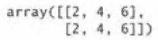

若两数组形状不满足广播条件，将抛出 `ValueError`。完整规则请参考：https://docs.scipy.org/doc/numpy/user/basics.broadcasting.html 。

### 通用函数分类一览

官方文档将通用函数划为五大类：数学、三角、位运算、比较、浮点运算。下表列举各类常用函数，完整清单见：https://docs.scipy.org/doc/numpy/reference/ufuncs.html 。

### NumPy 通用函数分类表

| 类别 | 典型函数 |
| :--- | :--- |
| 数学运算 | add、subtract、multiply、divide、remainder、exp、log、sqrt、power 等 |
| 三角运算 | sin、cos、tan、hypot、arcsin、arccos、arctan 等 |
| 位运算 | bitwise_and、bitwise_or、bitwise_xor、invert、left_shift、right_shift |
| 比较运算 | greater、greater_equal、less、less_equal、equal、not_equal、logical_and、logical_or、logical_xor、logical_not、minimum、maximum 等 |
| 浮点处理 | floor、ceil、isinf、isnan、fabs、trunc 等 |

## 7.10 索引与切片

一维数组沿用第 5 章语法，本节聚焦多维数组操作。

### 二维数组单元素定位

在方括号内传入 `(行号, 列号)` 元组即可精准取值（参考代码段 [4]）：

```
In [1]: import numpy as np

In [2]: grades = np.array([[87, 96, 70], [100, 87, 90],
   ...:                         [94, 77, 90], [100, 81, 82]])
   ...: 
In [3]: grades
Out[3]: array([[ 87, 96, 70],
       [100, 87, 90],
       [ 94, 77, 90],
       [100, 81, 82]])

In [4]: grades[0, 1] # row 0, column 1
Out[4]: 96
```

### 行选择技巧

*   **单行**：方括号仅给行索引  
    ```
In [5]: grades[1]
Out[5]: array([100, 87, 90])
```
*   **连续行区间**：使用切片  
    ```
In [6]: grades[0:2]
Out[6]: array([[ 87, 96, 70],
       [100, 87, 90]])
```
*   **离散行集合**：传入索引列表  
    ```
In [7]: grades[[1, 3]]
Out[7]:
array([[100,  87,  90],
       [100,  81,  82]])
```

### 列选择技巧

以 `(行切片, 列切片)` 元组形式选取。先看仅取第 0 列的情况：

```
In [8]: grades[:, 0]
Out[8]: array([ 87, 100,  94, 100])
```

元组中逗号后的 `0` 锁定第 0 列，逗号前的 `:` 代表全体行。冒号可替换为具体行号、行切片或行索引列表（详见代码段 [5]～[7]）。

*   **连续列区间**：切片  
    ```
In [9]: grades[:, 1:3]
Out[9]:
array([[ 96,  70],
       [ 87,  90],
       [ 77,  90],
       [ 81,  82]])
```
*   **离散列集合**：列索引列表  
    ```
In [10]: grades[:, [0, 2]]
Out[10]:
array([[ 87,  70],
       [100,  90],
       [ 94,  90],
       [100,  82]])
```

## 7.11 视图：浅拷贝机制

视图不持有独立数据，仅“映射”他对象存储区，属于浅拷贝范畴。许多数组方法与切片操作均返回视图。

### `view()` 方法构建视图

先建立数组 `numbers` 及其视图 `numbers2`：

```
In [1]: import numpy as np
In [2]: numbers = np.arange(1, 6)
In [3]: numbers
Out[3]: array([1, 2, 3, 4, 5])
In [4]: numbers2 = numbers.view()
In [5]: numbers2
Out[5]: array([1, 2, 3, 4, 5])
```

用内置 `id()` 验证二者为不同对象：

```
In [6]: id(numbers)
Out[6]: 4462958592
In [7]: id(numbers2)
Out[7]: 4590846240
```

更改 `numbers` 某元素，两数组同步变化，印证共享底层存储：

```
In [8]: numbers[1] *= 10
In [9]: numbers2
Out[9]: array([ 1, 20,  3,  4,  5])
In [10]: numbers
Out[10]: array([ 1, 20,  3,  4,  5])
```

反向修改视图元素，源数组随之更新：

```
In [11]: numbers2[1] /= 10
In [12]: numbers
Out[12]: array([1, 2, 3, 4, 5])
In [13]: numbers2
Out[13]: array([1, 2, 3, 4, 5])
```

### 切片生成的视图

切片同样产出视图。令 `numbers2` 为 `numbers` 前三项的切片：

```
In [14]: numbers2 = numbers[0:3]

In [15]: numbers2
Out[15]: array([1, 2, 3])
```

再次确认 `id` 不同：

```
In [16]: id(numbers)
Out[16]: 4462958592

In [17]: id(numbers2)
Out[17]: 4590848000
```

尝试访问 `numbers2[3]` 抛出 `IndexError`，侧面证明它仅映射前三个位置：

```
In [18]: numbers2[3]
---------------------------------------------------------------------------
IndexError                                 Traceback (most recent call last)
<ipython-input-18-582053f52daa> in <module>()
----> 1 numbers2[3]

IndexError: index 3 is out of bounds for axis 0 with size 3
```

修改共享区域后，两数组同步刷新：

```
In [19]: numbers[1] = 20

In [20]: numbers
Out[20]: array([ 1, 20,  3,  4,  5])

In [21]: numbers2
Out[21]: array([ 1, 20,  3])
```

## 7.12 深拷贝：`copy()` 方法

视图虽节省内存，但共享数据在并发修改时易引发竞争。此时需用 `copy()` 获取完全隔离的副本。

创建数组 `numbers` 及其深拷贝 `numbers2`：

```
In [1]: import numpy as np
In [2]: numbers = np.arange(1, 6)
In [3]: numbers
Out[3]: array([1, 2, 3, 4, 5])
In [4]: numbers2 = numbers.copy()
In [5]: numbers2
Out[5]: array([1, 2, 3, 4, 5])
```

更改 `numbers` 元素，`numbers2` 保持原貌，验证数据独立：

```
In [6]: numbers[1] = 10
In [7]: numbers
Out[7]: array([ 1, 10, 3, 4, 5])
In [8]: numbers2
Out[8]: array([1, 2, 3, 4, 5])
```

> **拓展**：标准库 `copy.deepcopy()` 可对任意 Python 对象实施深拷贝，不限 NumPy 数组。

## 7.13 形状变换与转置

### `reshape` 与 `resize` 对比

两者均能改变维度，行为却不同：
*   `reshape`：返回**视图**，源数组不动  
    ```
In [1]: import numpy as np

In [2]: grades = np.array([[87, 96, 70], [100, 87, 90]])

In [3]: grades
Out[3]: array([[ 87, 96, 70],
        [100, 87, 90]])

In [4]: grades.reshape(1, 6)
Out[4]: array([[ 87, 96, 70, 100, 87, 90]])

In [5]: grades
Out[5]: array([[ 87, 96, 70],
        [100, 87, 90]])
```
*   `resize`：**原地重塑**形状  
    ```
In [6]: grades.resize(1, 6)

In [7]: grades
Out[7]: array([[ 87, 96, 70, 100, 87, 90]])
```

### `flatten` 与 `ravel`：压扁为一维

*   `flatten`：产出**独立副本**  
    ```
In [8]: grades = np.array([[87, 96, 70],[100, 87, 90]])

In [9]: grades
Out[9]:
array([[ 87, 96, 70],
       [100, 87, 90]])

In [10]: flattened = grades.flatten()

In [11]: flattened
Out[11]: array([ 87, 96, 70, 100, 87, 90])

In [12]: grades
Out[12]:
array([[ 87, 96, 70],
       [100, 87, 90]])
```  
    调整 `flattened` 内容不波及 `grades`：  
    ```
In [13]: flattened[0] = 100

In [14]: flattened
Out[14]: array([100, 96, 70, 100, 87, 90])

In [15]: grades
Out[15]:
array([[ 87, 96, 70],
       [100, 87, 90]])
```
*   `ravel`：返回**视图**，共享存储  
    ```
In [16]: raveled = grades.ravel()

In [17]: raveled
Out[17]: array([ 87, 96, 70, 100, 87, 90])

In [18]: grades
Out[18]:
array([[ 87, 96, 70],
       [100, 87, 90]])
```  
    修改 `raveled` 会同步改变 `grades`：  
    ```
In [19]: raveled[0] = 100

In [20]: raveled
Out[20]: array([100, 96, 70, 100, 87, 90])

In [21]: grades
Out[21]:
array([[100, 96, 70],
       [100, 87, 90]])
```

### `.T` 属性实现行列互换

`.T` 返回转置**视图**，行列对调，源数组不变。  
以“2 学生 × 3 考试”为例，转置后呈现“3 考试 × 2 学生”：

```
In [22]: grades.T
Out[22]:
array([[100, 100],
       [ 96,  87],
       [ 70,  90]])
```

源数组 `grades` 维持原状：

```
In [23]: grades
Out[23]:
array([[100,  96,  70],
       [100,  87,  90]])
```

### 数组拼接：横向与纵向

*   **横向拼接 `hstack`**：按列合并（列数增加）  
    创建另一 2×3 数组 `grades2`：  
    ```
In [24]: grades2 = np.array([[94, 77, 90], [100, 81, 82]])
```  
    视为“同 2 学生的 3 门新考试”，用 `hstack((grades, grades2))` 合并：  
    ```
In [25]: np.hstack((grades, grades2))
Out[25]:
array([[100,  96,  70,  94,  77,  90],
       [100,  87,  90, 100,  81,  82]])
```
*   **纵向拼接 `vstack`**：按行合并（行数增加）  
    视为“新 2 学生的同 3 门考试”，用 `vstack((grades, grades2))` 合并

```
In [26]: np.vstack((grades, grades2))
Out[26]:
array([[100, 96, 70],
       [100, 87, 90],
       [ 94, 77, 90],
       [100, 81, 82]])
```

## 7.14 数据科学起步：解锁 pandas Series 与 DataFrame

NumPy 数组主打同构数值数据，靠整数下标从零开始访问，性能极强。但数据科学的实战场景远比这复杂：混合数据类型、自定义索引、缺失值填坑、结构不一的脏数据，还得随时准备对接数据库或分析工具。这些需求催生了更专业的数据结构。

pandas 就是为此而生的“瑞士军刀”，也是当下最火的处理此类数据的库。它提供两大核心容器——一维的 **Series** 和二维的 **DataFrame**，贯穿本节及第四部分的案例实战。借助 `MultiIndex`，它们甚至能驾驭多维数据。

2008 年，Wes McKinney 在业界摸爬滚打时开发了 pandas。名字源自“Panel Data”（面板数据），指随时间变化的观测序列，如股价走势、历史气温。他急需一个统一结构，既能搞定时间序列也能处理非时序数据，还要原生支持对齐、缺失值处理、类 SQL 操作等。

NumPy 与 pandas 深度绑定：Series 和 DataFrame 底层都构建在 `ndarray` 之上。它们能无缝接入 NumPy 运算，反之亦然。

pandas 博大精深，官方 PDF 文档超 2000 页。本章及下章只做“入门领航”，重点讲 Series 与 DataFrame 如何助力**数据准备**——你会发现，选取元素、过滤/映射/归约（函数式编程与大数据核心范式）、数学运算、可视化，统统能用极简代码搞定。

### 7.14.1 Series：进化版一维数组

Series 可视为“加强版一维数组”。普通数组只认从 0 开始的整数下标，Series 却支持**任意自定义索引**，甚至字符串、非连续整数等非整数类型。它还内置大量面向数据科学的便捷功能，例如**默认跳过缺失值**参与计算，省去大量判空代码。

#### 用默认索引创建 Series

不指定索引时，默认生成 0、1、2… 的整数索引。下面从整数列表构建学生成绩 Series：

```
In [1]: import pandas as pd

In [2]: grades = pd.Series([87, 100, 94])
```

初始化源除列表外，还可用元组、字典、NumPy 数组、另一个 Series 甚至单个标量（稍后演示）。

#### Series 的显示风格

pandas 采用**双列对齐**输出：左列左对齐显示索引，右列右对齐显示值；末尾标注底层数组的 `dtype`（数据类型）。相比同格式打印列表，Series 可读性瞬间拉满。

```
In [3]: grades
Out[3]:
0    87
1   100
2    94
dtype: int64
```

#### 创建定值 Series

想要全是同一个值的 Series？直接指定值与索引长度即可：

```
In [4]: pd.Series(98.6, range(3))
Out[4]:
0    98.6
1    98.6
2    98.6
dtype: float64
```

第二参数接收任意一维可迭代对象（列表、数组、range），其长度决定元素个数。

#### 访问元素

方括号套索引，即时取值：

```
In [5]: grades[0]
Out[5]: 87
```

#### 一键生成描述性统计

Series 内置统计方法库，开箱即用。常用指标一把抓：

```
In [6]: grades.count()
Out[6]: 3

In [7]: grades.mean()
Out[7]: 93.66666666666667

In [8]: grades.min()
Out[8]: 87

In [9]: grades.max()
Out[9]: 100

In [10]: grades.std()
Out[10]: 6.506407098647712
```

这些本质都是**函数式归约**操作。想要全景统计？`describe()` 一键出表：

```
In [11]: grades.describe()
Out[11]:
count    3.000000
mean     93.666667
std      6.506407
min      87.000000
25%      90.500000
50%      94.000000
75%      97.000000
max     100.000000
dtype: float64
```

输出包含四分位数（25%、50%、75%）：
- **50%**：中位数。
- **25%**：前半段数据的中位数。
- **75%**：后半段数据的中位数。

若中间有两个数，取平均。本例仅 3 个值，故 25% 为 (87+94)/2，75% 为 (94+100)/2。**四分位距 (IQR) = Q3 - Q1**，是除标准差、方差外另一衡量离散度的利器，大数据集中更具参考价值。

#### 自定义索引创建 Series

用 `index` 关键字参数传入自定义标签：

```
In [12]: grades = pd.Series([87, 100, 94], index=['Wally', 'Eva', 'Sam'])

In [13]: grades
Out[13]:
Wally    87
Eva     100
Sam      94
dtype: int64
```

示例用字符串，其实任何**不可变类型**（非零起始整数、非连续整数、元组等）皆可。pandas 依然精美对齐输出。

#### 字典直接初始化

字典键自动变索引，值自动填元素，一步到位：

```
In [14]: grades = pd.Series({'Wally': 87, 'Eva': 100, 'Sam': 94})

In [15]: grades
Out[15]:
Wally    87
Eva     100
Sam      94
dtype: int64
```

#### 自定义索引下的取值

方括号传标签名，精准命中：

```
In [16]: grades['Eva']
Out[16]: 100
```

**彩蛋**：若标签是合法 Python 标识符（如 `'Eva'`），pandas 会自动挂载为属性，支持**点号访问**：

```
In [17]: grades.Wally
Out[17]: 87
```

Series 还自带实用内置属性：
- `dtype`：底层数组元素类型
```
In [18]: grades.dtype
Out[18]: dtype('int64')
```
- `values`：直接拿到底层 `ndarray`
```
In [19]: grades.values
Out[19]: array([ 87, 100, 94])
```

#### 字符串 Series 的向量化操作

Series 装字符串时，`str` 访问器能批量调用字符串方法。先造个五金工具 Series：

```
In [20]: hardware = pd.Series(['Hammer', 'Saw', 'Wrench'])
In [21]: hardware
Out[21]:
0    Hammer
1      Saw
2   Wrench
dtype: object
```

注意：字符串值右对齐，`dtype` 显示 `object`。

逐元素判断是否含 `'a'`：

```
In [22]: hardware.str.contains('a')
Out[22]:
0     True
1    True
2    False
dtype: bool
```

返回布尔 Series，索引 2 处 `'Wrench'` 无 `'a'` 故为 `False`。迭代全由 pandas 内部完成，又是**函数式编程**范式的体现。`str` 访问器覆盖绝大多数 Python 字符串方法，详见官网 API 文档。

批量转大写生成新 Series：

```
In [23]: hardware.str.upper()
Out[23]:
0    HAMMER
1      SAW
2    WRENCH
dtype: object
```

---

### 7.14.2 DataFrame：表格数据的终极容器

DataFrame 是**增强版二维数组/表格**。像 Series 一样，行索引与列索引均可自定义；每一列本质是一个 Series，**列与列之间数据类型可以不同**（读取外部数据集时极常见）。缺失值处理、丰富运算、灵活切片……DataFrame 让表格操作如虎添翼。

#### 从字典构建 DataFrame

键成列名，值成列数据，行索引自动生成 0、1、2…：

```
In [1]: import pandas as pd

In [2]: grades_dict = {'Wally': [87, 96, 70], 'Eva': [100, 87, 90],
   ...:
   ...:                 'Sam': [94, 77, 90], 'Katie': [100, 81, 82],
   ...:

   ...:                 'Bob': [83, 65, 85]}

In [3]: grades = pd.DataFrame(grades_dict)

In [4]: grades
Out[4]:
     Wally  Eva  Sam  Katie  Bob
0     87  100   94    100   83
1     96   87   77     81   65
2     70   90   90     82   85
```

显示为标准表格：索引列左对齐，数据列右对齐。后文会演示如何“行列互换”。

#### 创建时指定行索引

用 `index` 参数一次性定制行标签：

```
pd.DataFrame(grades_dict, index=['Test1', 'Test2', 'Test3'])
```

#### 事后修改行索引

直接赋值 `df.index` 即可把默认整数索引换成标签：

```
In [5]: grades.index = ['Test1', 'Test2', 'Test3']

In [6]: grades
Out[6]:
          Wally  Eva  Sam  Katie  Bob
Test1     87  100   94    100   83
Test2     96   87   77     81   65
Test3     70   90   90     82   85
```

长度必须与行数一致，否则报 `ValueError`。Series 同理，也有 `index` 属性可改索引。

#### 灵活提取列

多种方式随心选。按列名取 Series：

```
In [7]: grades['Eva']
Out[7]:
Test1    100
Test2    87
Test3    90
Name: Eva, dtype: int64
```

列名若是合法标识符，直接**点号访问**更丝滑：

```
In [8]: grades.Sam
Out[8]:
Test1    94
Test2    77
Test3    90
Name: Sam, dtype: int64
```

#### 用 `loc` 与 `iloc` 专业选行

虽支持 `[]` 索引，但官方文档强推四大属性：**`loc`、`iloc`、`at`、`iat`**。它们专为 DataFrame 优化，功能更全；且 `[]` 赋值易触发 `SettingWithCopyWarning` 逻辑坑，慎用。

- **`loc`**：按**标签**选行。取 `'Test1'` 全行成绩：
```
In [9]: grades.loc['Test1']
Out[9]:
Wally    87
Eva     100
Sam      94
Katie   100
Bob      83
Name: Test1, dtype: int64
```
- **`iloc`**：按**整数位置**选行（i = integer）。取第 2 行（索引 1）：
```
In [10]: grades.iloc[1]
Out[10]:
Wally    96
Eva      87
Sam      77
Katie    81
Bob      65
Name: Test2, dtype: int64
```

#### 切片与列表批量选行

- `loc` 切片**含右端点**（含 `'Test3'`）：
```
In [11]: grades.loc["Test1":"Test3"]
Out[11]:
       Wally  Eva  Sam  Katie  Bob
Test1   87  100   94    100   83
Test2   96   87   77     81   65
Test3   70   90   90     82   85
```
- `iloc` 切片**不含右端点**（不含索引 2），符合 Python 左闭右开习惯：
```
In [12]: grades.iloc[0:2]
Out[12]:
       Wally  Eva  Sam  Katie  Bob
Test1   87  100   94    100   83
Test2   96   87   77     81   65
```
- 非连续行用**列表**指定：
```
In [13]: grades.loc[["Test1", "Test3"]]
Out[13]:
       Wally  Eva  Sam  Katie  Bob
Test1   87  100   94    100   83
Test3   70   90   90     82   85

In [14]: grades.iloc[[0, 2]]
Out[14]:
       Wally  Eva  Sam  Katie  Bob
Test1   87  100   94    100   83
Test3   70   90   90     82   85
```

#### 子集选择：行列双维定位

结合两个切片、两个列表或一片一表，精准切出子表。

例子：只看 **Test1、Test2** 两行中 **Eva、Katie** 两列：
```
In [15]: grades.loc['Test1':'Test2', ['Eva', 'Katie']]
Out[15]:
        Eva Katie
Test1  100   100
Test2   87    81
```
`loc['Test1':'Test2', ['Eva','Katie']]` 一气呵成。

混用 `iloc`：取第 0、2 行（第 1、3 次测验）的前 3 列：
```
In [16]: grades.iloc[[0, 2], 0:3]
Out[16]:
        Wally Eva Sam
Test1   87  100  94
Test3   70   90  90
```

#### 布尔索引：按条件筛选行

# 第7章  pandas 数据分析进阶

## 核心筛选技术：布尔索引

pandas 中极具威力的筛选手段莫过于布尔索引。以筛选优秀成绩（A等，分数≥90）为例：

```
In [17]: grades[grades >= 90]
Out[17]:
        Wally   Eva   Sam  Katie   Bob
Test1   NaN  100.0  94.0  100.0   NaN
Test2  96.0   NaN   NaN    NaN   NaN
Test3   NaN  90.0  90.0    NaN   NaN
```

pandas 会逐一核对每个分数是否达标（≥90），符合条件的保留原值，不满足条件的则在新生成的 DataFrame 中标记为 NaN（Not a Number），这是 pandas 标识缺失数据的专用标记。

再如，筛选良好成绩（B等，80-89分区间）：

```
In [18]: grades[(grades >= 80) & (grades < 90)]
Out[18]:
        Wally   Eva   Sam  Katie   Bob
Test1  87.0   NaN   NaN    NaN  83.0
Test2   NaN  87.0   NaN   81.0   NaN
Test3   NaN   NaN   NaN   82.0  85.0
```

值得注意的是，pandas 布尔索引组合多条件时，必须使用 Python 位运算符 `&`（与）和 `|`（或），而非逻辑运算符 `and`/`or`。虽然 NumPy 数组也支持布尔索引，但它总会将结果压扁为一维数组，仅保留满足条件的元素，这与 pandas 保留原有结构（用 NaN 占位）形成鲜明对比。

### 精准定位单元格：`at` 与 `iat`

若需精准读取或修改 DataFrame 中的单个标量值，可使用 `at`（基于标签）和 `iat`（基于整数位置）属性。两者均要求以“行索引，列索引”逗号分隔的方式指定坐标。例如获取 Eva 的 Test2 成绩（87）与 Wally 的 Test3 成绩（70）：

```
In [19]: grades.at['Test2', 'Eva']
Out[19]: 87
In [20]: grades.iat[2, 0]
Out[20]: 70
```

修改操作同样简洁：先用 `at` 将 Eva 的 Test2 成绩改为 100，再用 `iat` 改回 87：

```
In [21]: grades.at['Test2', 'Eva'] = 100
In [22]: grades.at['Test2', 'Eva']
Out[22]: 100
In [23]: grades.iat[1, 2] = 87
In [24]: grades.iat[1, 2]
Out[24]: 87.0
```

### 一览全局：描述性统计 `describe()`

Series 与 DataFrame 均内置 `describe()` 方法，能瞬间计算并汇总核心统计指标（计数、均值、标准差、四分位数等），结果以 DataFrame 形式返回。对于 DataFrame，默认按列计算：

```
In [25]: grades.describe()
Out[25]:
             Wally      Eva      Sam     Katie     Bob
count  3.000000  3.000000  3.000000  3.000000  3.000000
mean   84.333333  92.333333  87.000000  87.666667  77.666667
std    13.203535   6.806859   8.888194  10.692677  11.015141
min    70.000000  87.000000  77.000000  81.000000  65.000000
25%    78.500000  88.500000  83.500000  81.500000  74.000000
50%    87.000000  90.000000  90.000000  82.000000  83.000000
75%    91.500000  95.000000  92.000000  91.000000  84.000000
max    96.000000 100.000000  94.000000 100.000000  85.000000
```

这体现了面向数组编程的简洁高效——繁琐的逐列计算细节全由内部封装。若需按行（即逐个测试）查看统计，稍后将介绍转置技巧。

默认统计精度为浮点数 6 位有效数字，可通过 `pd.set_option` 全局调整显示精度：

```
In [26]: pd.set_option('precision', 2)

In [27]: grades.describe()
Out[27]:
          Wally    Eva   Sam    Katie    Bob
count  3.00   3.00   3.00   3.00   3.00
mean   84.33  92.33  87.00  87.67  77.67
std    13.20   6.81   8.89  10.69  11.02
min    70.00  87.00  77.00  81.00  65.00
25%    78.50  88.50  83.50  81.50  74.00
50%    87.00  90.00  90.00  82.00  83.00
75%    91.50  95.00  92.00  91.00  84.00
max    96.00 100.00  94.00 100.00  85.00
```

在成绩分析中，均值往往最受关注。直接对 DataFrame 调用 `.mean()` 即可得出每位学生的平均分：

```
In [28]: grades.mean()
Out[28]:
Wally    84.33
Eva      92.33
Sam      87.00
Katie    87.67
Bob      77.67
dtype: float64
```

紧接着，我们将演示如何仅用一行代码，通过转置获取每门测试的全班平均分。

### 视角转换：`T` 属性转置

`T` 属性可瞬间实现行列互换（返回视图而非副本，内存极其高效）：

```
In [29]: grades.T
Out[29]:
Test1  Test2  Test3
Wally  87   96   70
Eva   100   87   90
Sam   94   77   90
Katie 100   81   82
Bob   83   65   85
```

利用此特性，针对“测试”维度的统计分析变得轻而易举：只需对 `grades.T` 调用 `describe()`：

```
In [30]: grades.T.describe()
Out[30]:
         Test1   Test2   Test3
count  5.00    5.00    5.00
mean   92.80   81.20   83.40
std     7.66   11.54    8.23
min   83.00   65.00   70.00
25%   87.00   77.00   82.00
50%   94.00   81.00   85.00
75%  100.00   87.00   90.00
max  100.00   96.00   90.00
```

同理，各测试的平均分仅需 `grades.T.mean()`：

```
In [31]: grades.T.mean()
Out[31]:
Test1    92.8
Test2    81.2
Test3    83.4
dtype: float64
```

### 多维排序策略

排序是提升数据可读性的关键步骤，pandas 支持按索引或数值、按行或按列灵活排序。

**1. 按行索引排序**
使用 `sort_index(ascending=False)` 可按行标签降序排列，返回新 DataFrame：

```
In [32]: grades.sort_index(ascending=False)
Out[32]:
       Wally   Eva   Sam   Katie   Bob
Test3   70   90   90   82   85
Test2   96   87   77   81   65
Test1   87   100   94   100   83
```

**2. 按列索引排序**
指定 `axis=1` 即可按列名升序（左到右）排列，`axis=0`（默认）对应行索引：

```
In [33]: grades.sort_index(axis=1)
Out[33]:
    Bob   Eva  Katie   Sam  Wally
Test1  83  100   100   94    87
Test2  65   87    81   77    96
Test3  85   90    82   90    70
```

**3. 按列数值排序**
若想按 Test1 成绩降序查看学生排名，使用 `sort_values(by='Test1', axis=1, ascending=False)`。此处 `by` 指定基准列，`axis=1` 表明按列值对行排序：

```
In [34]: grades.sort_values(by='Test1', axis=1, ascending=False)
Out[34]:
    Eva  Katie  Sam  Wally  Bob
Test1  100   100   94    87   83
Test2   87    81   77    96   65
Test3   90    82   90    70   85
```

若转置后操作（行变测试，列变学生），默认 `axis=0` 即可直接按 Test1 行排序，无需指定 axis：

```
In [35]: grades.T.sort_values(by='Test1', ascending=False)
Out[35]:
    Test1 Test2 Test3
Eva   100   87   90
Katie 100   81   82
Sam   94   77   90
Wally 87   96   70
Bob   83   65   85
```

**4. 筛选与排序组合**
若仅关注 Test1 排名，可链式操作：先选列再排序：

```
In [36]: grades.loc['Test1'].sort_values(ascending=False)
Out[36]:
Katie    100
Eva      100
Sam       94
Wally     87
Bob       83
Name: Test1, dtype: int64
```

### 原地排序 vs 复本排序

默认排序方法均返回副本，大数据场景下内存开销大。添加 `inplace=True` 参数可在原对象上直接修改，节省资源。

---

## 7.15 章节小结

本章深入剖析了 NumPy `ndarray`（简称 array）作为高性能数据容器的核心能力：
- **创建与属性**：多维数组构建、形状/类型/大小探查、特殊数组生成（全0、全1、范围等）。
- **性能优势**：经 `%timeit` 实测，数组运算较列表快 **两个数量级**。
- **向量化计算**：算术运算符与通用函数实现逐元素并行计算；广播机制支持数组-标量、异形数组间运算。
- **聚合与维度控制**：丰富的统计方法支持全局、按行、按列聚合。
- **高级索引与重塑**：切片、花式索引、布尔掩码远超原生序列；`reshape`、`ravel` 等重塑工具灵活多变。
- **拷贝语义**：明确区分浅拷贝（视图）与深拷贝（副本）。

**pandas 专题** 引入了更灵活的表格型数据结构——**Series（一维）** 与 **DataFrame（二维）**，专为解决实际数据分析痛点设计：
- 支持混合类型、自定义索引、缺失值（NaN）、非矩形数据。
- 覆盖创建、索引定制、精美输出、精度控制、多样化数据选取（`loc`/`iloc`/`at`/`iat`/布尔索引）、描述性统计、转置（`T`）、多维排序等全流程操作。

至此，您已掌握四大类数组状容器：**list、ndarray、Series、DataFrame** 及其适用场景。第15章将引入第五种强力工具。

---

## 下一章预告：第8章 字符串深度解析

下一章将聚焦文本处理核心技能：
- 字符串格式化、拼接、分割、大小写转换、去空白
- 比较、查找替换、正则表达式（`re` 模块）全套语法（元字符、量词、字符类、分组）
- 正则在数据清洗/整理、NLP 预处理中的实战应用
- 为第11章文本分析及后续数据科学章节奠基

**数据科学实战篇**将演示 pandas 数据清洗/整理全流程，并引入时间序列分析与可视化。

---

# 第8章  字符串：深度解析

## 学习目标

- 掌握文本处理核心认知
- 熟练运用字符串方法族
- 精通 f-string 与格式化规范
- 字符串拼接、重复、切片、大小写、比较、查找替换、分割、连接
- 正则表达式：模式匹配、替换、验证、分组捕获
- 理解字符串操作对 NLP（自然语言处理）的基石意义
- 澄清数据整理、规整、清洗等核心概念，实战正则清洗

## 典型应用场景速览

| 领域 | 典型应用 |
|------|----------|
| 智能文本 | 聊天机器人、自动作文评分、文档摘要/分类、情感/舆情分析、垃圾邮件过滤 |
| 语言工程 | 编译器/解释器、词性标注、机器翻译、语音识别/合成、拼写/语法检查 |
| 数据挖掘 | 搜索引擎、网页抓取、文档相似度、欺诈检测、古籍溯源（如莎士比亚著作权） |
| 安全与隐写 | 密码学、隐写术、法律文书自动化 |
| 科研医疗 | 基于检查报告自动生成诊断、基因序列分析 |
| 创意与娱乐 | 创意写作辅助、单词游戏、回文/易位构词、标签云 |
| 其他 | 电子书阅读器、排版软件、文字处理器、古腾堡计划数字化 |

---

## 8.1 导论

前文已初步接触字符串基础。字符串作为**不可变序列**，支持切片、索引、迭代等通用序列操作。本章将系统深入：
1.  高级格式化与表示类型控制
2.  正则表达式（`re` 模块）工业级模式匹配

这些技能是第11章“文本理解”与后续数据科学实战的必备前置知识。

---

## 8.2 字符串格式化进阶

良好的格式化让数据自带可读性。

### 8.2.1 表示类型控制

f-string 中，占位符默认按字符串处理。若需特定数值格式，**必须显式声明表示类型**。例：将浮点数 `17.489` 保留两位小数（百分位）：

```
In [1]: f'{17.489:.2f}'
Out[1]: '17.49'
```

精度控制（`.2`）仅对 `float` 和 `Decimal` 生效。若对字符串 `'hello'` 强用 `.2f`，将抛出 `ValueError`。因此类型后缀 `f`（定点数）不可省略，它告知解释器按何种类型规则解析后续格式指令。详见官方文档：`https://docs.python.org/3/library/string.html#formatspec`。

#### 整数格式化
`d` 类型将整数转为十进制字符串：

```
In [2]: f'{10:d}'
Out[2]: '10'
```

### 整数多进制输出

除十进制外，整数还可通过 `b`（二进制）、`o`（八进制）、`x`/`X`（十六进制）直接格式化。

#### 字符编码还原

`c` 类型码把整数编码转回对应字符：

```
In [3]: f'{65:c} {97:c}'
Out[3]: 'A a'
```

#### 字符串显式控制

`s` 是默认字符串类型。显式写 `s` 时，参数必须是字符串变量、生成字符串的表达式或字面量（首个占位符演示）。省略类型则自动把非字符串（如整数 `7`）转为字符串（次个占位符演示）：

```
In [4]: f'{"hello":s} {7}'
Out[4]: 'hello 7'
```

示例中 `"hello"` 用双引号包裹。注意：单引号字面量内不能直接再写单引号。

#### 浮点数与 Decimal 科学计数法

前文用 `f` 类型格式化过浮点数和 `Decimal`（见片段[1]）。数值极大或极小时，指数记数法更紧凑。下面对比 `f` 与 `e` 在大数值下、保留小数点后三位的效果：

```
In [5]: from decimal import Decimal

In [6]: f'{Decimal("100000000000000000000000000.0"):.3f}'
Out[6]: '100000000000000000000000000.000'

In [7]: f'{Decimal("100000000000000000000000000.0"):.3e}'
Out[7]: '1.000e+25'
```

片段[5] 中 `e` 输出的 `1.000e+25` 即 `1.000 × 10^25`。

若偏好大写 `E`，把类型码改为 `E` 即可。

### 8.2.2 字段宽度与对齐

前文已演示宽度如何定位文本。Python 默认数值靠右、字符串靠左——下方用方括号 `[ ]` 框出结果，直观展示对齐：

```
In [1]: f'[{27:10d}]'
Out[1]: '[         27]'
In [2]: f'[{3.5:.10f}]'
Out[2]: '[   3.5000000000]'
In [3]: f'{"hello":10}'
Out[3]: '[hello     ]'
```

片段[2] 显示：浮点数默认保留小数点后六位。内容短于宽度时，空位用空格补齐；超出宽度则自动扩展容纳完整内容。

#### 显式左右对齐

回顾：`<` 强制靠左，`>` 强制靠右：

```
In [4]: f'[{27:<15d}]'
Out[4]: '[27              ]'
In [5]: f'[{3.5:<15f}]'
Out[5]: '[3.500000              ]'
In [6]: f'{"hello":>15}'
Out[6]: '[           hello]'
```

#### 居中显示

用 `^` 让内容居中：

```
In [7]: f'[{27:^7d}]'
Out[7]: '[   27   ]'
In [8]: f'[{3.5:^7.1f}]'
Out[8]: '[ 3.5 ]'
In [9]: f'{"hello":^7}'
Out[9]: '[ hello ]'
```

居中会把剩余空位尽量均分两侧。若剩余为奇数，多出的空位置于右侧。

### 8.2.3 数值格式化进阶

几项实用技巧：

#### 强制显示正号

需显式展示 `+` 时：

```
In [1]: f'{27:+10d}'
Out[1]: '        +27'
```

格式说明符中宽度前的 `+` 表示正数加 `+`，负数始终以 `-` 开头。想用 `0` 而非空格填充空位，在宽度前加 `0`（若有 `+` 则置于 `+` 后）：

```
In [2]: f'{27:+010d}'
Out[2]: '+000000027'
```

#### 正数前置空格对齐

空格标记指示正数在符号位保留空格，助正负数列对齐：

```
In [3]: print(f'{27:d}\n{27: d}\n{-27: d}')
27
 27
-27
```

可见，带空格标记的数值与 `-27` 对齐整齐。若指定了宽度，空格标记应置于宽度之前。

#### 千位分隔

逗号 `,` 启用千位分隔，增强大数可读性：

```
In [4]: f'{12345678:,d}'
Out[4]: '12,345,678'
In [5]: f'{123456.78:,.2f}'
Out[5]: '123,456.78'
```

### 8.2.4 `format` 方法

Python 3.6 引入 f-string 后，`format` 虽非首选，但理解它很有必要：f-string 底层基于此实现；大量存量代码、官方文档及早期教材仍广泛使用。新代码建议用 f-string，掌握 `format` 有助于阅读旧代码。

在含花括号 `{}` 占位符的格式串上调用 `format`，传入待处理值。例如把 `17.489` 四舍五入至百分位：

```
In [1]: '{:.2f}'.format(17.489)
Out[1]: '17.49'
```

占位符内可嵌入格式规范，同 f-string 一样，规范前加冒号 `:`。`format` 返回格式化后的新字符串。

#### 多占位符

格式串可含多个占位符，`format` 参数按顺序左至右对应：

```
In [2]: '{} {}'.format('Amanda', 'Cyan')
Out[2]: 'Amanda Cyan'
```

#### 索引引用参数

占位符可用 `{0}`、`{1}` 等索引（从 0 开始）指定参数：

```
In [3]: '{0} {0} {1}'.format('Happy', 'Birthday')
Out[3]: 'Happy Happy Birthday'
```

示例中索引 `0` 对应的 `'Happy'` 被复用两次。可任意顺序、重复引用任意参数。

#### 关键字引用参数

占位符写关键字名，即可对应 `format` 的关键字实参：

```
In [4]: '{first} {last}'.format(first='Amanda', last='Gray')
Out[4]: 'Amanda Gray'
In [5]: '{last} {first}'.format(first='Amanda', last='Gray')
Out[5]: 'Gray Amanda'
```

## 8.3 字符串拼接与重复

前文已展示 `+` 拼接、`*` 重复，增强赋值（`+=`、`*=`）同理。核心点：字符串不可变，每次操作都会生成新对象赋值给变量：

```
In [1]: s1 = 'happy'
In [2]: s2 = 'birthday'
In [3]: s1 += ' ' + s2
In [4]: s1
Out[4]: 'happy birthday'
In [5]: symbol = '>'
In [6]: symbol *= 5
In [7]: symbol
Out[7]: '>>>>>'
```

## 8.4 去除首尾空白

多种方法可删除首尾空白，均返回新串，原串不变。再次强调：字符串不可变，看似“修改”实为“生成新值”。

### 同时去首尾

`strip()` 一次清理两端空白：

```
In [1]: sentence = '\t \n This is a test string. \t\t\n'
In [2]: sentence.strip()
Out[2]: 'This is a test string.'
```

### 仅去前导

`lstrip()` 只处理开头空白：

```
In [3]: sentence.lstrip()
Out[3]: 'This is a test string. \t\t\n'
```

### 仅去尾部

`rstrip()` 只处理结尾空白：

```
In [4]: sentence.rstrip()
Out[4]: '\t \n This is a test string.'
```

输出可见，这些方法覆盖空格、换行符、制表符（Tab）等所有空白字符。

## 8.5 大小写转换

除 `lower`/`upper` 外，`capitalize` 与 `title` 提供更细粒度控制。

### 仅首字母大写（句子风格）

`capitalize()` 返回副本，仅首字母大写，其余转小写：

```
In [1]: 'happy birthday'.capitalize()
Out[1]: 'Happy birthday'
```

### 每词首字母大写（标题风格）

`title()` 返回副本，每个单词首字母大写：

```
In [2]: 'strings: a deeper look'.title()
Out[2]: 'Strings: A Deeper Look'
```

## 8.6 字符串比较

比较基于底层整数编码（Unicode/ASCII）。大写编码小于小写，故 `'A' < 'a'`。例如 `'A'` 编码 65，`'a'` 编码 97，可用 `ord()` 查看：

```
In [1]: print(f'A: {ord("A")}; a: {ord("a")}')
A: 65; a: 97
```

下例用各比较运算符对比 `'Orange'` 与 `'orange'`：

```
In [2]: 'Orange' == 'orange'
Out[2]: False

In [3]: 'Orange' != 'orange'
Out[3]: True

In [4]: 'Orange' < 'orange'
Out[4]: True

In [5]: 'Orange' <= 'orange'
Out[5]: True

In [6]: 'Orange' > 'orange'
Out[6]: False

In [7]: 'Orange' >= 'orange'
Out[7]: False
```

## 8.7 子串查找

可在字符串中搜索连续字符片段（子串），统计次数、判断存在性、定位索引。以下方法均按字符编码做字典序比较。

### 统计出现次数

`count(sub)` 返回 `sub` 在整串中的出现次数：

```
In [1]: sentence = 'to be or not to be that is the question'
In [2]: sentence.count('to')
Out[2]: 2
```

提供 `start_index` 作第二参数，则仅搜索切片 `[start_index:]`：

```
In [3]: sentence.count('to', 12)
Out[3]: 1
```

同时提供 `start_index` 和 `end_index`，则搜索 `[start_index:end_index]`（不含末尾）：

```
In [4]: sentence.count('that', 12, 25)
Out[4]: 1
```

本节其余搜索方法均支持这两个可选参数，至少提供一个即触发切片搜索模式。

### 定位子串索引

`index(sub)` 返回首次出现的索引，找不到抛 `ValueError`：

```
In [5]: sentence.index('be')
Out[5]: 3
```

`rindex(sub)` 从右向左找，返回最后一次出现的索引，失败亦抛 `ValueError`：

```
In [6]: sentence.rindex('be')
Out[6]: 16
```

`find`/`rfind` 功能同 `index`/`rindex`，但找不到返回 `-1` 而不抛异常。

### 判断是否包含

仅需布尔判断时，用 `in` / `not in` 运算符最简洁：

```
In [7]: 'that' in sentence
Out[7]: True

In [8]: 'THAT' in sentence
Out[8]: False

In [9]: 'THAT' not in sentence
Out[9]: True
```

### 判断前缀/后缀

`startswith(sub)` / `endswith(sub)` 检查字符串是否以 `sub` 开头或结尾：

```
In [10]: sentence.startswith('to')
Out[10]: True

In [11]: sentence.startswith('be')
Out[11]: False

In [12]: sentence.endswith('question')
Out[12]: True

In [13]: sentence.endswith('quest')
Out[13]: False
```

## 8.8 子串替换

`replace(old, new)` 将所有 `old` 替换为 `new`，返回新串。示例：把制表符替换为逗号：

```
In [1]: values = '1\t2\t3\t4\t5'

In [2]: values.replace('\t', ',')
Out[2]: '1,2,3,4,5'
```

可选第三参数 `count` 限制最大替换次数。

## 8.9 字符串拆分与连接

阅读句子时大脑会将其拆解为词/标记；解释器同样将代码标记化为关键字、标识符等。标记常由空白（空格、Tab、换行）分隔，也可自定义分隔符（即定界符）。

### 拆分字符串

`split()` 无参数时按任意空白拆分返回列表；指定字符串参数（如 `', '`）则按该定界符拆分：

```
In [1]: letters = 'A, B, C, D'

In [2]: letters.split(', ')
Out[2]: ['A', 'B', 'C', 'D']
```

第二参数传整数 `maxsplit` 限制最大拆分次数，最后一个元素为剩余部分：

```
In [3]: letters.split(', ', 2)
Out[3]: ['A', 'B', 'C, D']
```

`rsplit` 同 `split`，但从右向左拆分。

### 连接字符串

`join(iterable)` 以调用者为分隔符连接可迭代对象内的字符串，元素必须全为字符串，否则抛 `TypeError`。示例生成逗号分隔值字符串：

```
In [4]: letters_list = ['A', 'B', 'C', 'D']
In [5]: ','.join(letters_list)
Out[5]: 'A,B,C,D'
```

下例连接生成的字符串列表：

```
In [6]: ','.join([str(i) for i in range(10)])
Out[6]: '0,1,2,3,4,5,6,7,8,9'
```

第 9 章将讲解 CSV（逗号分隔值）文件处理，这是电子表格（Excel、Google Sheets）通用的数据交换格式。第 11~15 章介绍的 NumPy、pandas、Seaborn 等核心库均内置了强大的 CSV 处理能力。

### `partition` 与 `rpartition` 三段式拆分

`partition(sep)` 按分隔符将字符串拆为三元组：
- 分隔符前的部分
- 分隔符本身
- 分隔符后的部分

# 高阶字符串切分：从尾部精准定位分隔符

处理结构化文本时，常规切分手段有时难以应对复杂场景。例如面对 `'Amanda: 89, 97, 92'` 这种“姓名+分数列表”格式，我们需要将姓名、冒号及分数字符串三者彻底分离：

```
In [7]: 'Amanda: 89, 97, 92'.partition(': ')
Out[7]: ('Amanda', ':', '89, 97, 92')
```

若需从文本末端反向查找分隔点进行切割，`rpartition` 是首选工具。以网址为例，我们想从完整路径中剥离文件名 `'table_of_contents.html'`：

```
In [8]: url = 'http://www.deitel.com/books/PyCDS/table_of_contents.html'
In [9]: rest_of_url, separator, document = url.rpartition('/')
In [10]: document
Out[10]: 'table_of_contents.html'
In [11]: rest_of_url
Out[11]: 'http://www.deitel.com/books/PyCDS'
```

### splitlines：多行文本拆解为列表

实际开发中，读取文件得到的大段文本常需按行拆解。`splitlines` 专为这一设计，它在每个换行标记（Python 中以 `\n` 表示）处切割，生成纯文本行集合：

```
In [12]: lines = """This is line 1
...: This is line2
...: This is line3"""
In [13]: lines
Out[13]: 'This is line 1\nThis is line2\nThis is line3'
In [14]: lines.splitlines()
Out[14]: ['This is line 1', 'This is line2', 'This is line3']
```

若需保留各行末尾的换行标记，仅需向方法传入 `True` 参数：

```
In [15]: lines.splitlines(True)
Out[15]: ['This is line 1\n', 'This is line2\n', 'This is line3']
```

## 8.10 字符串特征检测方法集

Python 不区分字符与字符串类型，单字符本质是长度为 1 的字符串。为此，内置了一组以 `is` 开头的检测函数，用于快速判断文本特征。例如校验用户输入是否为纯数字，`isdigit` 即可胜任：

```
In [1]: '-27'.isdigit()
Out[1]: False

In [2]: '27'.isdigit()
Out[2]: True
```

若需确认文本仅由字母数字构成，`isalnum` 则给出 `True` 判定：

```
In [3]: 'A9876'.isalnum()
Out[3]: True

In [4]: '123 Main Street'.isalnum()
Out[4]: False
```

下表汇总常用检测函数，条件不满足时均返回 `False`：

| 函数名 | 触发条件 |
| :--- | :--- |
| `isalnum()` | 仅含数字与字母 |
| `isalpha()` | 仅含字母 |
| `isdecimal()` | 仅含十进制数字字符（无符号） |
| `isdigit()` | 仅含数字 |
| `isidentifier()` | 符合标识符命名规范 |
| `islower()` | 所有字母均为小写 |
| `isnumeric()` | 字符均为数值型（无符号、小数点） |
| `isspace()` | 仅含空白字符 |
| `istitle()` | 每单词首字母大写且其余小写 |
| `isupper()` | 所有字母均为大写 |

## 8.11 原始字符串：消除转义干扰

文本中反斜杠 `\` 会触发转义（如 `\n` 换行、`\t` 制表），若需字面量反斜杠，必须写成 `\\`。这在 Windows 路径中尤为麻烦：

```
In [1]: file_path = 'C:\\MyFolder\\MySubFolder\\MyFile.txt'

In [2]: file_path
Out[2]: 'C:\\MyFolder\\MySubFolder\\MyFile.txt'
```

原始字符串（以 `r` 或 `R` 前缀标识）可将反斜杠视为普通符号，显著提升代码清晰度：

```
In [3]: file_path = r'C:\MyFolder\MySubFolder\MyFile.txt'

In [4]: file_path
Out[4]: 'C:\\MyFolder\\MySubFolder\\MyFile.txt'
```

注意：Python 内部仍以转义形式存储，但原始写法让编写与阅读更直观，配合正则表达式使用时优势更明显。

## 8.12 正则表达式：文本模式匹配利器

识别电话、邮箱、URL 等文本模式，正则是核心工具。它不仅能从非结构化内容（如社交动态）中解析数据，还是数据清洗、格式校验的基石。

### 数据校验场景

处理文本前，常用正则做格式“安检”：
- **邮政编码**：5 位数字或 `5位-4位` 格式。
- **人名**：仅允许字母、空格、撇号、连字符。
- **邮箱/社保号**：需符合严格字符序列与规则。

无需重复造轮子，以下站点提供现成正则库及测试工具：
- https://regex101.com
- http://www.regexlib.com
- https://www.regular-expressions.info

### 更多实战用途

- **数据抓取**：从网页提取所有 URL（亦可用 BeautifulSoup 等专用库）。
- **数据清洗**：去重、补全、纠错、统一格式、处理异常值。
- **格式转换**：如将制表符/空格分隔数据重组为 CSV 标准逗号分隔格式。

### 8.12.1 核心模块 `re` 与 `fullmatch` 入门

使用正则需引入标准库 `re`：

```
In [1]: import re
```

`fullmatch` 功能单一强大：**核验整段文本是否完全符合规则**。

#### 字面量匹配

最基础的规则由字面字符构成，仅匹配自身：

```
In [2]: pattern = '02215'
In [3]: 'Match' if re.fullmatch(pattern, '02215') else 'No match'
Out[3]: 'Match'
In [4]: 'Match' if re.fullmatch(pattern, '51220') else 'No match'
Out[4]: 'No match'
```

首个参数为规则，次参数为待测文本。完全一致（含顺序）才给出匹配对象（真值），否则返回 `None`（假值)。

#### 元字符、字符类与量词

正则威力源于特殊符号（元字符）：

| 正则元字符 |
| :--- |
| `[] {} () \ * + ^ $ ? .` |

反斜杠 `\` 引入预定义**字符类**，匹配特定字符组。量词则限定重复次数。校验 5 位邮编示例：

```
In [5]: 'Valid' if re.fullmatch(r'\d{5}', '02215') else 'Invalid'
Out[5]: 'Valid'
In [6]: 'Valid' if re.fullmatch(r'\d{5}', '9876') else 'Invalid'
Out[6]: 'Invalid'
```

`\d` 代表任意数字，`{5}` 量词重复 5 次。若文本长度不足（如 `'9876'`），校验不通过。

#### 常用预定义字符类速查

| 字符类 | 含义 |
| :--- | :--- |
| `\d` | 任意数字 (0-9) |
| `\D` | 非数字字符 |
| `\s` | 空白字符 (空格、制表、换行等) |
| `\S` | 非空白字符 |
| `\w` | 单词字符 (字母、数字、下划线) |
| `\W` | 非单词字符 |

> **转义提醒**：匹配元字符本身需加反斜杠，如 `\\` 匹配 `\`，`\$` 匹配 `$`。

#### 自定义字符集 `[]`

方括号构建专属字符组，匹配其中任一成员：
- `[aeiou]`：小写元音
- `[A-Z]`：大写字母
- `[a-zA-Z]`：任意字母

实战：校验首字母大写、其后皆小写的单词：

```
In [7]: 'Valid' if re.fullmatch('[A-Z][a-z]*', 'Wally') else 'Invalid'
Out[7]: 'Valid'
In [8]: 'Valid' if re.fullmatch('[A-Z][a-z]*', 'eva') else 'Invalid'
Out[8]: 'Invalid'
```

`*` 量词表示左侧子表达式出现 **0 次或多次**，故 `[A-Z][a-z]*` 能命中 `'Amanda'`、`'Bo'` 甚至单字母 `'E'`。

若字符组以 `^` 起始，则取反（匹配非组内字符）：

```
In [9]: 'Match' if re.fullmatch('[^a-z]', 'A') else 'No match'
Out[9]: 'Match'
In [10]: 'Match' if re.fullmatch('[^a-z]', 'a') else 'No match'
Out[10]: 'No match'
```

组内元字符失去特殊功能，退化为字面量。例如 `[*+$]` 直接命中 `*`、`+` 或 `$`：

```
In [11]: 'Match' if re.fullmatch('[^.5]', '.^') else 'No match'
Out[11]: 'Match'

In [12]: 'Match' if re.fullmatch('[^.5]', '.!') else 'No match'
Out[12]: 'No match'
```

#### 量词 `*` 与 `+` 的差异

要求至少一个小写字母？将 `*` 替换为 `+`（匹配 **1 次或多次**）：

```
In [13]: 'Valid' if re.fullmatch('[A-Z][a-z]+', 'Wally') else 'Invalid'
Out[13]: 'Valid'

In [14]: 'Valid' if re.fullmatch('[A-Z][a-z]+', 'E') else 'Invalid'
Out[14]: 'Invalid'
```

两者均为**贪婪模式**，尽力多吞噬字符。

#### 进阶量词：`?`、`{n,}`、`{n,m}`

- `?`：**0 次或 1 次**。兼容英美拼写差异（`labelled` vs `labeled`）：

```
In [15]: 'Match' if re.fullmatch('label1?ed', 'labelled') else 'No match'
Out[15]: 'Match'

In [16]: 'Match' if re.fullmatch('label1?ed', 'labeled') else 'No match'
Out[16]: 'Match'

In [17]: 'Match' if re.fullmatch('label1?ed', 'labelled') else 'No match'
Out[17]: 'No match'
```

- `{n,}`：**不少于 n 次**。如匹配至少 3 连续数字：

```
In [18]: 'Match' if re.fullmatch(r'\d{3,}', '123') else 'No match'
Out[18]: 'Match'
In [19]: 'Match' if re.fullmatch(r'\d{3,}', '1234567890') else 'No match'
Out[19]: 'Match'
In [20]: 'Match' if re.fullmatch(r'\d{3,}', '12') else 'No match'
Out[20]: 'No match'
```

- `{n,m}`：**n 到 m 次**（含边界）。匹配 3-6 位数字：

```
In [21]: 'Match' if re.fullmatch(r'\d{3,6}', '123') else 'No match'
Out[21]: 'Match'
In [22]: 'Match' if re.fullmatch(r'\d{3,6}', '123456') else 'No match'
Out[22]: 'Match'
In [23]: 'Match' if re.fullmatch(r'\d{3,6}', '1234567') else 'No match'
Out[23]: 'No match'
In [24]: 'Match' if re.fullmatch(r'\d{3,6}', '12') else 'No match'
Out[24]: 'No match'
```

### 8.12.2 `sub` 替换与 `split` 切分：正则处理文本两大招式

`re` 模块提供 `sub`（替换）与 `split`（分割）函数，直接作用于规则匹配结果。

#### `sub` 函数：模式替换高手

将制表符分隔数据转为逗号分隔：

```
In [1]: import re
In [2]: re.sub(r'\t', ',', '1\t2\t3\t4')
Out[2]: '1, 2, 3, 4'
```

三大必要参数：规则、替换内容、目标文本。`count` 参数可限定替换上限：

```
In [3]: re.sub(r'\t', ' ', '1\t2\t3\t4', count=2)
Out[3]: '1 2 3\t4'
```

#### `split` 函数：弹性切分文本

依据“逗号+任意空白”切分文本，`\s*` 代表零到多个空白字符：

### 8.12.3 正则搜索进阶：定位与提取匹配内容

通过 `maxsplit` 参数可限制分割次数：
```
In [4]: re.split(r'\s+', '1, 2, 3,4, 5,6,7,8')
Out[4]: ['1', '2', '3', '4', '5', '6', '7', '8']
```
示例显示执行三次分割后，剩余部分归入第四个子串：
```
In [5]: re.split(r'\s+', '1, 2, 3,4, 5,6,7,8', maxsplit=3)
Out[5]: ['1', '2', '3', '4, 5,6,7,8']
```

除了 `fullmatch` 判断整串匹配外，`re` 模块还提供 `search`、`match`、`findall` 与 `finditer` 等搜索工具，下面逐一介绍并演示如何提取匹配片段。

#### search 函数——捕获任意位置的首个匹配
`search` 会扫描整个字符串，返回首个符合模式的匹配对象（`SRE_Match` 类型），调用其 `group()` 即可得到对应子串：
```
In [1]: import re

In [2]: result = re.search('Python', 'Python is fun')

In [3]: result.group() if result else 'not found'
Out[3]: 'Python'
```
若无匹配则返回 `None`：
```
In [4]: result2 = re.search('fun!', 'Python is fun')

In [5]: result2.group() if result2 else 'not found'
Out[5]: 'not found'
```
若仅需校验字符串开头，可改用 `match` 函数。

#### 忽略大小写的 flags 参数
多数 `re` 函数接受可选的 `flags` 参数以改变匹配行为。默认区分大小写，传入 `re.IGNORECASE` 可启用大小写不敏感模式：
```
In [6]: result3 = re.search('Sam', 'SAM WHITE', flags=re.IGNORECASE)

In [7]: result3.group() if result3 else 'not found'
Out[7]: 'SAM'
```
此时 `'SAM'` 与模式 `'Sam'` 视为匹配，尽管前者全为大写。

#### 锚定开头与结尾的元字符
正则开头（非字符组内）的 `^` 表示仅匹配字符串起始：
```
In [8]: result = re.search('^Python', 'Python is fun')

In [9]: result.group() if result else 'not found'
Out[9]: 'Python'

In [10]: result = re.search('^fun', 'Python is fun')

In [11]: result.group() if result else 'not found'
Out[11]: 'not found'
```
同理，末尾的 `$` 限定仅匹配字符串终止：
```
In [12]: result = re.search('Python$', 'Python is fun')

In [13]: result.group() if result else 'not found'
Out[13]: 'not found'

In [14]: result = re.search('fun$', 'Python is fun')

In [15]: result.group() if result else 'not found'
Out[15]: 'fun'
```

#### findall 与 finditer——获取所有匹配
`findall` 返回所有匹配子串组成的列表。以提取美式电话号码（`###-###-####`）为例：
```
In [16]: contact = 'Wally White, Home: 555-555-1234, Work: 555-555-4321'
In [17]: re.findall(r'\d{3}-\d{3}-\d{4}', contact)
Out[17]: ['555-555-1234', '555-555-4321']
```
`finditer` 功能相近，但返回惰性迭代器，逐个产出匹配对象，面对海量匹配时更省内存：
```
In [18]: for phone in re.finditer(r'\d{3}-\d{3}-\d{4}', contact):
    print(phone.group())
555-555-1234
555-555-4321
```

#### 捕获组提取子串
用圆括号 `()` 标记捕获组，可将匹配中的特定片段单独取出。例如同时抓取姓名与邮箱：
```
In [19]: text = 'Charlie Cyan, e-mail: demo1@deitel.com'

In [20]: pattern = r'([A-Z][a-z]+ [A-Z][a-z]+), e-mail: (\w+@\w+\.\w{3})'

In [21]: result = re.search(pattern, text)
```
括号不影响整体匹配判定，`match` 仅在完整模式命中时才返回对象。

解析上述正则：
- `'([A-Z][a-z]+ [A-Z][a-z]+)'`：匹配两个首字母大写的单词，中间以空格分隔。
- `', e-mail:'`：字面量字符。
- `'(\w+@\w+\.\w{3})'`：简易邮箱模式，`\.` 转义原本匹配任意字符的点号。

匹配对象提供三种提取方式：
- `groups()` 返回所有捕获组组成的元组：
```
In [22]: result.groups()
Out[22]: ('Charlie Cyan', 'demo1@deitel.com')
```
- `group()` 无参数时返回整个匹配串：
```
In [23]: result.group()
Out[23]: 'Charlie Cyan, e-mail: demo1@deitel.com'
```
- `group(n)` 按 1 起始编号取单个捕获组（注意与列表 0 起始索引区分）：
```
In [24]: result.group(1)
Out[24]: 'Charlie Cyan'
In [25]: result.group(2)
Out[25]: 'demo1@deitel.com'
```

---

## 8.13 实战数据治理：pandas + 正则表达式

数据鲜少以分析就绪姿态出现——格式错误、数值异常、字段缺失屡见不鲜。业界统计显示，数据科学家多达 75% 的时间耗费在“数据治理”（Data Wrangling/Munging）上，核心步骤为**清洗**与**转换**。

常见清洗动作：
- 剔除或填补缺失值
- 修正或删除异常值
- 去重、统一不一致格式
- …… 过程繁杂易出错，堪比临床医学的经验科学，需依据数据质量与业务标准动态决策。

常见转换动作：
- 丢弃无关特征、关联相关特征
- 抽样获取代表性子集
- 统一格式、分组聚合
- …… 原则上**务必保留原始数据**以备回溯。

下文在 pandas Series 与 DataFrame 中演示基础清洗与转换。

### 数据清洗：缺失与异常值处理
某医院每日记录患者四次体温，示例数据：
```
['Brown, Sue', 98.6, 98.4, 98.7, 0.0]
```
前三次读数（99.7、98.4、98.7）均值约 98.57℉，末次因传感器故障记为 0.0。若直接纳入均值计算，结果骤降至 73.93℉——临床决策将严重偏离。

通用对策：用同组有效值的均值（98.57）填补缺失位，保持整体统计特征不变。

### 数据验证：正则守护数据质量
构建城市-邮编 Series，故意录入错误的四位数迈阿密邮编：
```
In [1]: import pandas as pd

In [2]: zips = pd.Series({'Boston': '02215', 'Miami': '3310'})

In [3]: zips
Out[3]:
Boston    02215
Miami     3310
dtype: object
```
Series 实为一维，索引为城市名，值为邮编。

利用 `str.match` 与正则 `\d{5}` 逐元素校验：
```
In [4]: zips.str.match(r'\d{5}')
Out[4]:
Boston    True
Miami    False
dtype: bool
```
`match` 内部完成迭代，返回布尔 Series，迈阿密因位数不足标记为 `False`。

后续处理策略：
1. 源头拦截并修正（如物联网高速流不可行时退而求其次）
2. 就近修补：如查找 `3310*` 发现 `33101` 与 `33109`，择一补齐

若仅需判断**是否包含**符合模式的子串，而非整值匹配，改用 `contains`。示例：检测“州缩写+空格”模式 `' [A-Z]{2} '`：
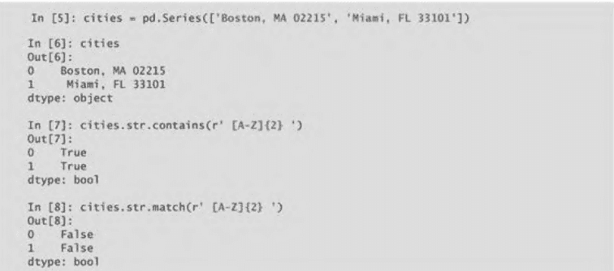
`contains` 返回 `True`/`False` 标识包含关系；`match` 因要求整值符合故全为 `False`。

### 重新格式化：统一电话号码呈现
假设原始数据为连续 10 位数字，需转为 `###-###-####` 格式。先建立 DataFrame：
```
In [9]: contacts = [['Mike Green', 'demo1@deitel.com', '5555555555'],
       ['Sue Brown', 'demo2@deitel.com', '5555551234']]
In [10]: contactsdf = pd.DataFrame(contacts,
                                 columns=['Name', 'Email', 'Phone'])
In [11]: contactsdf
Out[11]:
Name                   Email           Phone
0  Mike Green  demo1@deitel.com  5555555555
1   Sue Brown  demo2@deitel.com  5555551234
```
列名由 `columns` 指定，行索引默认从 0 起，数值列右对齐（区别于 Python 原生格式化）。

定义格式化函数并通过 `map` 向量化应用：
```
In [12]: import re
In [13]: def get_formatted_phone(value):
    result = re.fullmatch(r'(\d{3})(\d{3})(\d{4})', value)
    return '-'.join(result.groups()) if result else value
```
函数逻辑：
1. 正则 `(\d{3})(\d{3})(\d{4})` 捕获三段数字
2. 若不匹配返回原值；否则用 `'-'.join(result.groups())` 拼接

`map` 产出新 Series：
```
In [14]: formatted_phone = contactsdf['Phone'].map(get_formatted_phone)
In [15]: formatted_phone
0    555-555-5555
1    555-555-1234
Name: Phone, dtype: object
```
确认无误后回写覆盖原列：
```
In [16]: contactsdf['Phone'] = formatted_phone
In [17]: contactsdf
Out[17]:
         Name              Email        Phone
0   Mike Green  demo1@deitel.com  555-555-5555
1    Sue Brown  demo2@deitel.com  555-555-1234
```

后续章节将继续深化 pandas 实战。

---

## 8.14 要点回顾

本章涵盖字符串格式化与处理核心技能：
- f-string 与 `format` 方法格式化输出
- 增强赋值实现拼接/重复
- `strip` 家族去除首尾空白、`upper`/`lower` 大小写转换
- `split`/`join` 拆分与合并
- 多维字符串测试方法（`startswith`、`isnumeric` 等）
- 正则表达式搜索、捕获、标志位与锚点
- pandas 配合正则完成数据校验、清洗、格式标准化

# 第9章 文件系统与异常控制

## 学习靶向

- 吃透持久化存储与文件系统的底层逻辑。
- 熟练掌握文件读写、追加与随机访问技巧。
- 攻克 CSV 格式处理——数据科学领域的通用语言。
- 驾驭 JSON 序列化/反序列化，实现跨平台数据互通。
- 善用上下文管理器自动托管资源生命周期，杜绝句柄泄露。
- 构建分层异常捕获体系（try/except/else/finally），打造高可用程序。
- 解读堆栈跟踪，主动抛出业务异常。
- 实战演练：引入 pandas 高效剖析 Titanic 数据集。

## 9.1 破题：内存易失，落盘永存

变量、容器类型、数组结构、DataFrame 对象，本质皆为**易失性存储**。进程终止或作用域销毁，数据即随风而散。文件系统引入**非易失性介质**（SSD、HDD 等），实现数据与进程生命周期解耦。

本章聚焦三大主流文本载体：
- **纯文本**：最原始的字节/字符流。
- **JSON**：Web 时代的通用数据契约，承载对象跨网络流转。
- **CSV**：表格数据的事实标准，数据科学管道的入口。

> **必读实战**：第 9.12 节“数据科学入门”将实战演示标准库 `csv` 与 `pandas` 协同清洗 CSV，以 **Titanic 数据集** 为例。后续案例研究章节将复用大量经典数据集。

### 安全红线：弃用 `pickle`，首选 JSON
`pickle` 反序列化不可信数据存在**远程代码执行 (RCE)** 高危风险。生产环境严禁用于外部数据交互，**JSON 是唯一安全选择**。

### 异常机制：让程序“抗打击”
你已见识过 `ZeroDivisionError`、`KeyError` 等运行期故障。本章系统讲解 `try` 块捕获异常，`else` 分支承载正常流，`finally` 分支兜底释放资源。掌握此道，局部故障不再导致全局崩溃。

### 资源托管：上下文管理器的优雅
文件句柄、网络连接、数据库会话均为稀缺资源。`with` 结构基于协议保证：**无论代码块以何种方式退出（正常/异常），`__exit__` 必被调用**。这是防泄露的标准范式。

---

## 9.2 文件本质：双重视角

Python 提供两种视图：
- **文本模式**：面向 **字符流**（Unicode），自动处理编码/解码与换行符转换。
- **二进制模式**：面向 **字节流**（`bytes`），图像、音视频、序列化对象的原始形态。

同序列索引一致，首元素偏移量为 `0`，长度 `n` 的文件，最大偏移量为 `n-1`。


每次 `open()` 调用，解释器构建一个**文件句柄**，后续一切操作皆通过该代理对象完成。

### EOF 标记
底层依赖 OS 机制（特殊标记或长度记录），高级语言屏蔽差异，开发者无感知。

### 三大预置流
进程启动即绑定三个标准流（需 `import sys` 显式引用，日常极少直接操作）：
- `sys.stdin`：键盘输入源（`input()` 底层依赖）。
- `sys.stdout`：屏幕输出汇（`print()` 默认目标）。
- `sys.stderr`：诊断信息出口（异常堆栈、报错日志）。

---

## 9.3 文本文件全生命周期实战

构建简易“应收账务”系统演示。记录结构：账号 | 姓名 | 欠款。Python 不预设记录概念，**边界由开发者约定**（本例：单行一记录，`\n` 分隔）。

> **环境准备**：请在 `ch09` 目录下启动交换式解释器运行示例。

### 9.3.1 落盘写入：初识上下文管理器

生成 `accounts.txt`，注入 5 条样本。`write()` 不自带换行，需手动追加 `\n`：

```
In [1]: with open('accounts.txt', mode='w') as accounts:
    ....:     accounts.write('100 Jones 24.98\n')
    ....:     accounts.write('200 Doe 345.67\n')
    ....:     accounts.write('300 White 0.00\n')
    ....:     accounts.write('400 Stone -42.16\n')
    ....:     accounts.write('500 Rich 224.62\n')
    ....:
```

若嫌繁琐，`print(..., file=handle)` 自动注入换行，语义更清晰：

```
print('100 Jones 24.98', file=accounts)
```

#### 为何强制 `with`？
获取 → 使用 → **确定性释放**。`with` 完美闭环：
1. `open()` 返回句柄，绑定变量。
2. 进入块体操作。
3. **块体结束（含异常跳出）时，自动调用 `close()` 归还系统资源。**

#### `open()` 关键参数
- `mode='w'`：写入模式。不存在则创建；**存在则截断清零（毁灭性操作），落笔需谨慎。**
- 相对路径基于当前工作目录（`ch09`）。
- 约定 `.txt` 标识纯文本。

#### 执行流
`as` 关键字绑定句柄。块内连续 5 次调用写入。离块瞬间，隐式 `close()`。

#### 磁盘实况
打开 `ch09/accounts.txt` 可见：

```
100 Jones 24.98
200 Doe 345.67
300 White 0.00
400 Stone -42.16
500 Rich 224.62
```

下节验证读取逻辑。

### 9.3.2 回读数据：流式迭代 vs 全量加载

以只读 `'r'` 打开（防误写），格式化列输出：前两列靠左，金额靠右（小数点对齐）。

```
In [1]: with open('accounts.txt', mode='r') as accounts:
    ...:     print(f'{"Account":<10}{"Name":<10}{"Balance":>10}')
    ...:     for record in accounts:
    ...:         account, name, balance = record.split()
    ...:         print(f'{account:<10}{name:<10}{balance:>10}')
    ...: 
Account      Name       Balance
100          Jones      24.98
200          Doe        345.67
300          White      0.00
400          Stone      -42.16
500          Rich       224.62
```

**核心机制**：`for line in handle:` 触发迭代器协议，逐行产出字符串。配合 `split()` 切分字段，解包赋值，最后格式化渲染。

#### `readlines()` 权衡
- 返回“全量行列表”。小文件可用，大文件**内存暴涨、首行延迟高**（需读完才能处理）。
- **最佳实践**：直接迭代句柄，流式处理，内存占用 O(1)，首行即算。

#### 随机访问：`seek()` 定位
系统维护**读写偏移量**指向下一个待处理字节。需重读时，除重开文件外，`handle.seek(0)` 瞬间归零更高效：

```
file_object.seek(0)
```

---

## 9.4 文本文件修改的“痛点”与“标准解”

**核心矛盾**：文本文件是**变长记录的字节流，不支持原地修改**。
案例：账号 300 姓名 `White` (5字符) → `Williams` (8字符)。直接覆盖导致后续字节“被挤占”：
- 原行：`300 White 0.00`
- 盲改后：`300 Williams0.00`（多出的 `ams` 覆盖了空格、`0`、`.`）

根因：内存定长数值，文本化后长度不定（`7` vs `27383`）。

```
300 White 0.00
```
```
300 Williams00
```

### 标准修改范式：中转文件法
1. 双句柄：原文件读、临时文件写。
2. 逐行扫描：非目标行原样转存；目标行修正后写入。
3. 双闭合。
4. 删除原文件 (`os.remove`)。
5. 临时文件改名顶替 (`os.rename`)。

> 单条修改遍历全文看似笨重，实则批量修改时摊销成本极低，且彻底规避原地破坏风险。

### 实战代码演示

```
In [1]: accounts = open('accounts.txt', 'r')
In [2]: temp_file = open('temp_file.txt', 'w')
In [3]: with accounts, temp_file:
    ....:     for record in accounts:
    ....:         account, name, balance = record.split()
    ....:         if account != '300':
    ....:             temp_file.write(record)
    ....:     else:
    ....:         new_record = ' '.join([account, 'Williams', balance])
    ....:         temp_file.write(new_record + '\n')
    ....:
```

> 单 `with` 托管双资源（逗号分隔），循环解包字段，分支判断写入新旧行。执行后 `temp_file.txt` 实况：

```
100 Jones 24.98
200 Doe 345.67
300 Williams 0.00
400 Stone -42.16
500 Rich 224.62
```

### `os` 模块收尾：原子性替换
先除旧，后立新，完成热更换：

```
In [4]: import os
In [5]: os.remove('accounts.txt')
```
```
In [6]: os.rename('temp_file.txt', 'accounts.txt')
```

---

## 9.5 JSON 序列化：对象跨边界的通用契约

# JSON核心技能：云端交互、数据持久化与异常防御指南

现代应用若想对接 Twitter、IBM Watson 等云端能力，绕不开的通用语言便是 **JSON（JavaScript Object Notation）**。这种基于文本、人机同读的轻量级规范，通过“名称-数值”配对组织信息，甚至能承载自定义类型实例（后续章节展开），早已坐稳跨平台传输、调用云端 Web API 的头把交椅。后续实战中我们将反复用到它：第 12 章解析推文及其元数据，第 13 章消费 Watson 服务返回的响应，第 16 章则将抓取的推文对象持久化至 MongoDB 这类 NoSQL 存储，此外多个网络服务交互场景也离不开 JSON 报文的收发。

## JSON 语法速览

JSON 结构与 Python 字典、列表极其相似，学习曲线平缓：
*   **对象**：对标 Python 字典，用大括号 `{}` 包裹，内含逗号分隔的“键:值”配对。如一条客户档案示例：
```
{"account": 100, "name": "Jones", "balance": 24.98}
```
*   **数组**：对标 Python 列表，用中括号 `[]` 包裹，存放有序值序列。如一组数值集合：
```
[100, 200, 300]
```

**可承载的值类型**囊括：双引号包裹的字符串、数值（整数/浮点数）、布尔量（`true`/`false`）、空值（`null`，对应 Python `None`）、嵌套数组或嵌套对象。

## 核心工具：标准库 `json` 模块

Python 内置 `json` 模块提供四大核心函数，完成原生对象与 JSON 文本的双向转换：
*   **编码（序列化）**：`dump(obj, fp)` 写入文件流；`dumps(obj)` 生成字符串。
*   **解码（反序列化）**：`load(fp)` 从流读取；`loads(s)` 从字符串解析。

### 实战：将映射表编码落盘

假设存在嵌套字典 `accounts_dict`，外层键 `'accounts'` 指向一个列表，列表内每个元素均为包含账号、户名、余额三字段的字典：
```
In [1]: accounts_dict = {'accounts': [
....     {'account': 100, 'name': 'Jones', 'balance': 24.98},
....     {'account': 200, 'name': 'Doe', 'balance': 345.67}]}
```

寥寥数行即可完成持久化：
```
In [2]: import json

In [3]: with open('accounts.json', 'w') as accounts:
....     json.dump(accounts_dict, accounts)
....
```
脚本打开 `accounts.json`，调用 `dump` 写入。生成文件内容如下（已美化缩进）：
```
{"accounts": [
    {"account": 100, "name": "Jones", "balance": 24.98},
    {"account": 200, "name": "Doe", "balance": 345.67}
]}
```
> **关键点**：JSON 规范强制字符串必须用**双引号**界定。

### 实战：从文件解码还原对象

使用 `load` 读取文件句柄，即可将磁盘上的 JSON 文本重构为 Python 字典：
```
In [4]: with open('accounts.json', 'r') as accounts:
    ...:     accounts_json = json.load(accounts)
    ...:
    ...:
```

随后即可随意操作：直接打印全貌 ```
In [5]: accounts_json
Out[5]:
{'accounts': [{'account': 100, 'name': 'Jones', 'balance': 24.98},
{'account': 200, 'name': 'Doe', 'balance': 345.67}]}
```，提取 `'accounts'` 列表 ```
In [6]: accounts_json['accounts']
Out[6]:
[{'account': 100, 'name': 'Jones', 'balance': 24.98},
{'account': 200, 'name': 'Doe', 'balance': 345.67}]
```，遍历每个账户子字典 ```
In [7]: accounts_json['accounts'][0]
Out[7]: {'account': 100, 'name': 'Jones', 'balance': 24.98}
In [8]: accounts_json['accounts'][1]
Out[8]: {'account': 200, 'name': 'Doe', 'balance': 345.67}
```，甚至修改数据后再调用 `dump` 回写。

### 进阶：漂亮打印与字符串互转

`dumps` / `dump` 的 `indent` 参数能让输出自带换行缩进，实现“完美打印”效果，极大提升调试阅读体验：
```python
In [9]: with open("accounts.json", 'r') as accounts:
   ...:     print(json.dumps(json.load(accounts), indent=4))
   ...:
{
    "accounts": [
        {
            "account": 100,
            "name": "Jones",
            "balance": 24.98
        },
        {
            "account": 200,
            "name": "Doe",
            "balance": 345.67
        }
    ]
}
```

---

## ⚠️ 安全警示：远离 `pickle` 陷阱

标准库 `pickle` 虽能序列化任意复杂 Python 对象，但**官方文档明确警告**：
1.  **极高风险**：解码不可信来源的 pickle 数据可导致**任意代码执行**（RCE）。网络传输场景下**严禁**直接 `loads` 外来 pickle 流；仅限本地受信文件且确保无他人篡改时使用。
2.  **生态封闭**：pickle 是 Python 专有协议，**无法跨语言通信**。

**结论**：遗留代码库中虽常见，但新项目**坚决不推荐**使用 pickle，首选 JSON 或 MessagePack 等安全中立格式。

---

## 文件操作备忘录：访问模式与常用方法

### 打开模式速查表

| 模式 | 行为说明 |
|------|----------|
| `'r'`  | 只读（默认），文件缺失抛 `FileNotFoundError` |
| `'w'`  | 只写，**清空**现有内容或新建 |
| `'a'`  | 追加写，文件缺失则新建，数据写入末尾 |
| `'r+'` | 读写兼备，文件必须存在 |
| `'w+'` | 读写兼备，**清空**现有内容或新建 |
| `'a+'` | 读追加兼备，文件缺失则新建 |

> 二进制模式只需在上述字母后加 `b`（如 `'rb'`, `'wb+'`），处理图片、音视频、压缩包等非文本资源时必用。

### 常用文件对象方法

*   `read(size=-1)`：文本模式返回字符串，二进制模式返回 `bytes`；省略参数读全量。
*   `readline()`：逐行读取，保留末尾换行符，到达末尾返回空串。
*   `writelines(iterable)`：批量写入字符串序列，**不自动添加换行**。

底层实现细节可参考 `io` 模块官方文档。

---

## 异常处理：让程序在错误中“存活”

文件操作、类型转换、数学运算均可能触发故障，常见类型包括：
*   `FileNotFoundError`：读模式打开不存在文件。
*   `PermissionError`：无权限访问/创建文件（如系统目录）。
*   `ValueError`：向已关闭文件写入，或 `int('hello')` 类型转换失败。
*   `ZeroDivisionError`：除数为零。

### 典型故障复现

**除零故障**：尝试用零做除数会直接抛出 `ZeroDivisionError`：
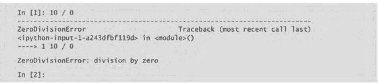

**非法输入**：试图用 `int` 解析非数字字符串（如 `'hello'`）会抛出 `ValueError`：
```
In [2]: value = int(input('Enter an integer: '))
Enter an integer: hello
---------------------------------------------------------------------------
ValueError                                Traceback (most recent call last)
<ipython-input-2-b521605464d6> in <module>()
----> 1 value = int(input('Enter an integer: '))
ValueError: invalid literal for int() with base 10: 'hello'
In [3]:
```

### `try / except / else` 机制详解

通过 `try` 语句捕获异常，保证主流程不中断。经典除法计算器示例：
```
#### dividebyzero.py
"""Simple exception handling example."""

while True:
    # attempt to convert and divide values
    try:
        number1 = int(input('Enter numerator: '))
        number2 = int(input('Enter denominator: '))
        result = number1 / number2
    except ValueError: # tried to convert non-numeric value to int
        print('You must enter two integers\n')
    except ZeroDivisionError: # denominator was 0
        print('Attempted to divide by zero\n')
    else: # executes only if no exceptions occur
        print(f'{number1:.3f} / {number2:.3f} = {result:.3f}')
        break # terminate the loop
```
运行交互示例：
```
Enter numerator: 100
Enter denominator: 0
Attempted to divide by zero
Enter numerator: 100
Enter denominator: hello
You must enter two integers
Enter numerator: 100
Enter denominator: 7
100.000 / 7.000 = 14.286
```

#### 结构拆解
1.  **`try` 块**（第 6-9 行）：包裹“高风险”代码片段。
2.  **`except` 块**（第 10-13 行）：可堆叠多个，按顺序匹配异常类型；命中即执行对应处理逻辑（如打印提示）。
3.  **`else` 块**（第 14-16 行）：**仅当 `try` 块零故障时执行**——本例中输出结果并 `break` 退出循环。

#### 执行流向深度解析

**场景 A：输入 `100 / 0` 触发 `ZeroDivisionError`**
1.  第 7、8 行正常获取输入。
2.  第 9 行执行除法，**抛出故障**，`try` 块**即刻终止**，后续行不再执行。
3.  解释器自上而下检索 `except`：
    *   第 10 行捕获 `ValueError` → **不匹配** → 跳过。
    *   第 12 行捕获 `ZeroDivisionError` → **命中** → 执行打印提示。
4.  故障处理完毕 → 无 `finally` → 直接进入 `try` 结构后的代码（本例即循环下一轮）。
> **核心原则**：**不会**返回抛出点（第 9 行）继续，而是彻底离开 `try` 结构。

**场景 B：输入 `100 / hello` 触发 `ValueError`**
1.  第 8 行 `int('hello')` 直接抛出 `ValueError`。
2.  首个 `except ValueError` 匹配成功，打印提示。
3.  同理，循环继续，给用户重试机会。

---

> **最佳实践提示**：`else` 块将“正常业务逻辑”与“异常防护逻辑”物理隔离，避免在 `try` 块过大时误捕非预期故障，代码更健壮、可读性更强。

### 异常触发后的程序流向

一旦异常抛出，`try` 块中后续代码的执行将即刻中断，控制权随即移交给匹配的首个异常处理器。以此为例，第 10、11 行的 `except` 块捕获到了对应的异常类型，于是执行内部逻辑并打印提示信息。处理完毕后，程序并未终止，而是继续往下执行 `try` 语句之后的代码。由于 `try` 结构位于循环体内，这也标志着本轮循环结束，随即开启下一轮迭代。

#### 除法运算成功时的控制流走向

我们结合输出结果的最后三行，剖析一次成功除法运算的执行路径：

- 程序先在代码第 7 行处接收用户输入的被除数 `100`；
- 接着在代码第 8 行读取除数 `7`；
- 既然已获得两个合法整数且除数非零，第 9 行的除法运算便顺利完成。

当 `try` 块全程无异常抛出时，程序会依次执行 `else` 块（若存在）及 `try` 语句后的后续代码。本例中，`else` 块负责输出计算结果，随后跳出循环，整个程序随之结束。

### 9.8.3 单个 `except` 捕获多种异常

`try` 后跟多个 `except` 以分别处理不同异常，这是常见做法。倘若多个处理器的逻辑完全一致，可将这些异常类型打包成元组，合并为一个处理器，示例如下：

```
except (type1, type2, ...) as variable_name:
```

其中 `as` 子句为可选项。多数场景下无需直接操作异常对象，故可省略 `as`；若保留，则可在处理器内通过该变量访问捕获到的异常实例。

### 9.8.4 排查函数或方法可能抛出的异常

`try` 块内不仅执行语句本身可能抛异常，直接或间接调用的函数、方法同样隐藏风险。

在调用任何函数/方法前，务必先查阅其在线 API 文档，确认其可能抛出的异常类型；继而针对每类异常深读文档，分析触发根因。

### 9.8.5 `try` 坛应包含何种代码

编码时遵循的通用原则是：将核心业务逻辑集中置于一个 `try` 块中，哪怕其中多条语句均可能抛异常；切忌将每条“危险语句”单独包裹在独立的 `try` 中。但从异常处理粒度的合理性考量，每个 `try` 应仅覆盖足够小的代码片段。这样一旦异常发生，上下文清晰明确，便于处理器精准应对。倘若同一 `try` 块内多句代码抛出同类异常，最好拆分为多个 `try` 以区分各自上下文。

## 9.9 `finally` 子句

操作系统通常会阻止多进程同步操作同一文件。文件用毕应即刻关闭以释放资源，方便他进程访问，这也能有效避免资源泄漏。

### `try` 语句的 `finally` 机制

`finally` 子句可置于所有 `except` 与 `else`（如有）之后。其代码**必然会被执行**。在其他支持 `finally` 的语言中，该块常用于释放 `try` 块中获取的资源。但在 Python 中，更推荐用 `with` 语句管理资源，将 `finally` 保留给其他类型的“收尾”工作。

### 实战演示

下面通过 IPython 会话验证：无论 `try` 块是否异常，`finally` 总会运行。先看无异常场景：

```
In [1]: try:
   ....:     print('try suite with no exceptions raised')
   ....: except:
   ....:     print('this will not execute')
   ....: else:
   ....:     print('else executes because no exceptions in the try suite')
   ....: finally:
   ....:     print('finally always executes')
   ....: 
try suite with no exceptions raised
else executes because no exceptions in the try suite
finally always executes

In [2]:
```

上述代码中，`try` 块仅打印消息，未抛异常。控制流顺利抵达块尾，`except` 被跳过，`else` 执行，`finally` 打印承诺信息。随后控制流继续向下，会话等待下一条指令。

再看有异常场景：

```
In [2]: try:
    ...: print('try suite that raises an exception')
    ...: int('hello')
    ...: print('this will not execute')
    ...: except ValueError:
    ...:     print('a ValueError occurred')
    ...: else:
    ...:     print('else will not execute because an exception occurred')
    ...: finally:
    ...:     print('finally always executes')
    ...

try suite that raises an exception
a ValueError occurred
finally always executes

In [3]:
```

`try` 块首句打印后，次句尝试 `int('hello')` 导致 `ValueError`。块内剩余语句（最后一条 `print`）即刻终止。`except` 捕获并处理，因有异常故 `else` 不执行。最后 `finally` 依然履约打印。流程随后继续，会话就绪。

### `with` 语句与 `try...except` 联用

对多数需显式释放的资源（文件、网络连接、数据库连接等），操作过程中均可能出异常（如文件 IO 触发 `IOError`）。为保代码健壮，常将资源操作置于 `try` 块中捕获异常，同时配合 `with` 确保资源释放——此处无需 `finally`，因 `with` 已兜底。

假设程序要求用户给文件名，用户误输 `grades.txt`（实为 `grades.txt`）。尝试以读模式打开不存在文件时，`open` 会抛 `FileNotFoundError`：

```
In [3]: open('gradez.txt')
------------------------------------------------------------
FileNotFoundError                             Traceback (most recent call last)
<ipython-input-3-b74f1b2d5969> in <module>()
----> 1 open('gradez.txt')

FileNotFoundError: [Errno 2] No such file or directory: 'gradez.txt'
```

为捕获打开文件时的异常（如读不存在文件触发的 `FileNotFoundError`），需将 `with` 语句嵌入 `try` 坛：

```
In [4]: try:
    ....:     with open('gradez.txt', 'r') as accounts:
    ....:         print(f"{'ID':<3}{'Name':<7}{'Grade'}")
    ....:         for record in accounts:
    ....:             student_id, name, grade = record.split()
    ....:             print(f'{student_id:<3}{name:<7}{grade}')
    ....: except FileNotFoundError:
    ....:     print('The file name you specified does not exist')
    ....: 
The file name you specified does not exist
```

## 9.10 显式抛出异常

前文已见 Python 运行时自动抛出的各类异常。有时我们需自定义函数，通过主动抛异常告知调用方错误详情。

`raise` 语句用于显式抛异常，最简形式如下：

```
raise ExceptionClassName
```

`raise` 会实例化指定异常类。类名后可选括号，括号内传入初始化参数（通常为自定义错误消息）。注意：执行 `raise` 前，应确保前序获取的资源已释放。下节将给出示例。

大多数情况下，建议优先使用 Python 内置异常类型。内置异常清单请查阅：https://docs.python.org/3/library/exceptions.html。

## 9.11 （选学）堆栈展开与回溯

每个异常对象内置了导致其发生的函数调用链信息，这对调试至关重要。假设 `function1` 调用 `function2`，后者抛异常：

```
In [1]: def function1():
    ...:     function2()
    ...
In [2]: def function2():
    ...:     raise Exception('An exception occurred')
    ...
```

调用 `function1` 将产生如下回溯（为聚焦重点，关键行以粗体标出）：

```
In [3]: function1()
-----------------------------------------------------------------------
Exception                                 Traceback (most recent call last)
<ipython-input-3-c0b3cafe2087> in <module>()
----> 1 function1()
<ipython-input-1-a9f4faeeeb0c> in function1()
      1 def function1():
----> 2     function2()
      3 
<ipython-input-2-c65e19d6b45b> in function2()
      1 def function2():
----> 2     raise Exception('An exception occurred')
Exception: An exception occurred
```

### 回溯细节解读

回溯首行给出异常类型（示例中为 `Exception`），随后列出完整调用栈——栈底调用在前，栈顶在后，故解释器提示：

> Traceback (most recent call last)

回溯中，如下文本指示栈底：即代码段 `[3]`（显示为 `ipython-input-3`）中的 `function1` 调用：

```
<ipython-input-3-c0b3cafe2087> in <module>()
----> 1 function1()
```

随即可见代码段 `[1]` 第 2 行，`function1` 调用了 `function2`：

```
<ipython-input-1-a9f4faeeeb0c> in function1()
1 def function1():
----> 2 function2()
3
```

最后定位到抛异常点：代码段 `[2]` 第 2 行：

```
<ipython-input-2-c65e19d6b45b> in function2()
1 def function2():
----> 2 raise Exception('An exception occurred')
```

### 堆栈展开机制

前面示例中，异常点均在 `try` 块内并被对应处理器捕获。若异常在当前函数未被捕获，便触发**堆栈展开**。结合当前示例理解：

- `function2` 中 `raise` 抛异常，该语句不在 `try` 坛，故 `function2` 终止，栈帧出栈，控制权回到 `function1` 的调用处。
- `function1` 中调用 `function2` 的语句亦不在 `try` 坛，故 `function1` 终止，栈帧出栈，控制权回到调用 `function1` 处（即 IPython 代码段 `[3]`）。
- 代码段 `[3]` 调用 `function1` 也不在 `try` 坛，调用终止。因异常最终未被捕获（未捕获异常），IPython 打印回溯并等待下一输入；若在脚本中则直接终止进程。

### 回溯分析实用建议

我们常调用第三方库函数，这些函数运行时可能抛异常。分析回溯时，**从最底端开始**：先读错误消息；再向上追溯，**找到首行属于自己编写的代码**，通常即为导致异常的“罪魁祸首”。

### `finally` 坛内抛异常的隐患

`finally` 坛中抛异常易引发隐蔽问题。若 `try` 坛已抛异常且在进入 `finally` 前未被处理，将触发堆栈展开。若此时 `finally` 内又抛出新异常且未捕获，**原异常将丢失**，新异常取而代之传递给外层 `try`。因此，**`finally` 坛内任何可能抛异常的代码，都应再次用 `try` 包裹**，确保内部异常就地消化。

## 9.12 数据科学入门：CSV 文件实战

本书数据科学章节将大量用到数据集。CSV（逗号分隔值）因通用性极强，应用极广。本节演示用 Python 标准库与 pandas 处理 CSV。

### 9.12.1 标准库 `csv` 模块

`csv` 模块提供读写 CSV 的功能，许多第三方库也内置了 CSV 支持。

#### 向 CSV 写入数据

此处创建 `accounts.csv`。文档建议打开文件时指定 `newline=''`，以跨平台正确处理换行：

```
In [1]: import csv

In [2]: with open('accounts.csv', mode='w', newline='') as accounts:
    ...:     writer = csv.writer(accounts)
    ...:     writer.writerow([100, 'Jones', 24.98])
    ...:     writer.writerow([200, 'Doe', 345.67])
    ...:     writer.writerow([300, 'White', 0.00])
    ...:     writer.writerow([400, 'Stone', -42.16])
    ...:     writer.writerow([500, 'Rich', 224.62])
    ...:

```

`.csv` 后缀标识格式。`csv.writer` 返回写入器对象，调用其 `writerow` 方法可将可迭代对象（此处为列表）按行写入。默认以逗号分隔，亦可自定义分隔符。执行上述代码后，`accounts.csv` 内容如下：

| 100 | Jones | 24.98 |
| 200 | Doe | 345.67 |
| 300 | White | 0.00 |
| 400 | Stone | -42.16 |
| 500 | Rich | 224.62 |

# CSV 进阶与 Pandas 实战：从文件读写到泰坦尼克数据探索

CSV 文件的标准写法通常不在逗号后留空，不过为了代码阅读方便，不少开发者会手动加上空格。前面演示的多次 `writerow` 调用，其实完全可以用一条 `writerows` 搞定。这个方法能一次性把可迭代对象里的多个列表（每个列表代表一行记录）按逗号分隔写入文件。

**字段里若藏逗号，双引号来护航**

写入的字符串若自带逗号，`writerow` 会自动给它加上双引号。比如这个列表：

```
[100, 'Jones, Sue', 24.98]
```

注意 `'Jones, Sue'` 里的逗号是分隔姓氏名的，不是字段分隔符。写入文件时会变成这样：

```
100,"Jones, Sue",24.98
```

文件里的 `"Jones, Sue"` 两侧加了双引号，标识这是个整体值。读取时程序能正确识别出三个字段：`100`、`'Jones, Sue'` 和 `24.98`。

#### 读取 CSV 数据

咱们来看看怎么把数据读回来。下面这段代码从 `accounts.csv` 读取并打印每条记录，输出结果和前面章节的例子一致：

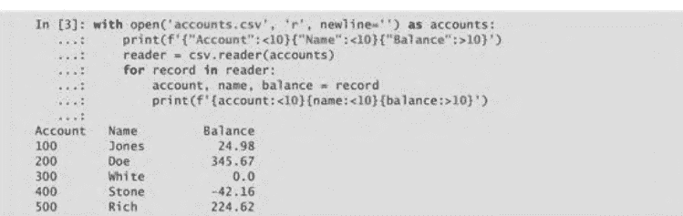

`csv.reader` 返回的对象专门用于逐行解析 CSV 格式。它像文件对象一样可迭代，每次循环返回一个由字段值组成的列表。示例里的 `for` 循环直接把列表解包到 `account`、`name`、`balance` 三个变量里。

#### ⚠️ 避坑指南：字段里的逗号

处理像 `'Jones, Sue'` 这种带逗号的字符串要当心。要是不小心拆成了 `'Jones'` 和 `'Sue'` 两个字符串，`writerow` 就会生成 4 个字段的记录，而不是预期的 3 个。读取端通常假设每行字段数一致，一旦对不上就会报错。看这两个列表：

```
[100, 'Jones', 'Sue', 24.98]
[200, 'Doe' , 345.67]
```

第一个 4 个值，第二个 3 个值。写入后再用前面的代码读，解包到 3 个变量时直接崩：

```
account, name, balance = record
```

#### ⚠️ 避坑指南：逗号缺失与多余

手工准备 CSV 更要细心。假设每行应有 4 个整数，正常长这样：

```
100,85,77,9
```

要是漏了一个逗号：

```
100,8577,9
```

这行就只剩 3 个字段，`8577` 成了个不存在的错误值。

要是手抖打了两个逗号：

```
```

就变成 5 个字段，中间多了个空字段。

以上这些逗号相关的失误，都会让后续处理程序读不出正确数据。

---

### 9.12.2 用 Pandas 一行代码搞定 CSV 读写

前两章已经铺垫了 Pandas 基础，这回看它加载 CSV 的威力，顺便做点简单分析。

#### 数据从哪来？

第 11-15 章要用大量开放数据集。Rdatasets 仓库提供 1100+ 个 CSV 数据集（原为 R 语言准备，通用性强），GitHub 上可下载：`https://vincentarelbundock.github.io/Rdatasets/datasets.html`。

还有专门的 `pydataset` 库方便 Python 调用，安装用法见 `https://github.com/iamaziz/PyDataset`。

更多资源可逛 `https://github.com/awesomedata/awesome-public-datasets`。

新手最常练手的是**泰坦尼克号数据集**，记录了 1300 多名乘客信息及生还情况。本节以此为例演示加载、查看、统计，后续章节还会深挖。

#### 读取本地 CSV

用 `pd.read_csv` 直接加载进 DataFrame。这段代码加载前面创建的 `accounts.csv`：

```
In [1]: import pandas as pd

In [2]: df = pd.read_csv('accounts.csv', ... names=['account', 'name', 'balance'])

In [3]: df
Out[3]:
           account   name  balance
    0       100    Jones   24.98
    1       200     Doe   345.67
    2       300   White     0.00
    3       400   Stone  -42.16
    4       500    Rich   224.62
```

`names` 参数指定列名；不传则默认把文件第一行当表头。

存回 CSV 也简单，调 `to_csv`：

```
In [4]: df.to_csv('accounts_from_dataframe.csv', index=False)
```

`index=False` 别把左侧行号（0-4）写进去。生成的文件长这样：

| account | name | balance |
|---|---|---|
| 100 | Jones | 24.98 |
| 200 | Doe | 345.67 |
| 300 | White | 0.0 |
| 400 | Stone | -42.16 |
| 500 | Rich | 224.62 |

---

### 9.12.3 实战：加载泰坦尼克号数据集

#### 直接从 URL 读

有现成 URL 别下载了，`read_csv` 直连 GitHub：

```
In [1]: import pandas as pd

In [2]: titanic = pd.read_csv('https://vincentarelbundock.github.io/' +
   ...:                         'Rdatasets/csv/carData/TitanicSurvival.csv')
   ...: 
```

#### 快速瞄一眼数据

数据集 1300+ 行（维基百科称 1317 人，815 遇难）。大 DataFrame 默认只显首尾 30 行。这用 `head()` 和 `tail()` 看前 5 后 5 行（可传参改行数）：

```
In [3]: pd.set_option('precision', 2) # format for floating-point values

In [4]: titanic.head()
```

| | Unnamed: 0 | survived | sex | age | passengerClass |
|---|---|---|---|---|---|
| 0 | Allen, Miss. Elisabeth Walton | yes | female | 29.00 | 1st |
| 1 | Allison, Master. Hudson Trevor | yes | male | 0.92 | 1st |
| 2 | Allison, Miss. Helen Loraine | no | female | 2.00 | 1st |
| 3 | Allison, Mr. Hudson Joshua Crei | no | male | 30.00 | 1st |
| 4 | Allison, Mrs. Hudson J C (Bessi | no | female | 25.00 | 1st |

```
In [5]: titanic.tail()
```

| | Unnamed: 0 | survived | sex | age | passengerClass |
|---|---|---|---|---|---|
| 1304 | Zabour, Miss. Hileni | no | female | 14.50 | 3rd |
| 1305 | Zabour, Miss. Thamine | no | female | NaN | 3rd |
| 1306 | Zakarian, Mr. Mapriededer | no | male | 26.50 | 3rd |
| 1307 | Zakarian, Mr. Ortin | no | male | 27.00 | 3rd |
| 1308 | Zimmerman, Mr. Leo | no | male | 29.00 | 3rd |

列宽自动适配最宽内容。注意第 1305 行 `age` 是 `NaN`，标记缺失值。

#### 给列名整容

第一列 `Unnamed: 0` 很别扭，改成 `name`，把 `passengerClass` 简写成 `class`：

```python
In [6]: titanic.columns = ['name', 'survived', 'sex', 'age', 'class']
In [7]: titanic.head()
Out[7]:
      name survived  sex   age class
0  Allen, Miss. Elisabeth Walton  yes  female  29.00  1st
1  Allison, Master. Hudson Trevor  yes  male    0.92  1st
2  Allison, Miss. Helen Loraine   no  female  2.00   1st
3  Allison, Mr. Hudson Joshua Crewe no  male   30.00  1st
4  Allison, Mrs. Hudson J C (Bessie no  female 25.00  1st
```

---

### 9.12.4 简单的数据分析走起

#### 数值列的统计画像

对混合类型 DataFrame 调 `describe()`，只会算数值列。这数据集里只有 `age` 是数值：

```python
In [8]: titanic.describe()
Out[8]:
       age
count  1046.00
mean    29.88
std     14.41
min      0.17
25%     21.00
50%     28.00
75%     39.00
max     80.00
```

**关键洞察**：
- `count=1046` 远少于总行数 `1309`（尾行索引 1308），说明 263 条年龄缺失（如 1305 行）。
- Pandas 计算自动跳过 `NaN`。
- 有效年龄乘客平均 **29.88 岁**。
- 最小 **0.17 岁**（约 2 个月），最大 **80 岁**。
- 中位数 **28 岁**（50% 分位）；25% 和 75% 分位数分别代表年轻/年长半边的中位数。

#### 生还率一目了然

想看生还统计？把 `survived` 跟 `'yes'` 比较，生成布尔 Series 再 `describe()`：

```python
In [9]: (titanic.survived == 'yes').describe()
Out[9]:
count    1309
unique      2
top     False
freq      809
Name: survived, dtype: object
```

非数值列的 `describe` 输出含义：
- `count`：总条数
- `unique`：唯一值个数（2 个：True/False）
- `top`：众数（出现最多的值）
- `freq`：众数频次

---

### 9.12.5 年龄分布直方图：一图胜千言

可视化是理解数据的捷径。Pandas 内置 Matplotlib 绘图，先在 IPython 里开启支持：

```python
In [10]: %matplotlib
```

`DataFrame.hist()` 自动分析所有数值列并画直方图。这数据集只有一个数值列 `age`，所以只出一张图：

```python
In [11]: histogram = titanic.hist()
```

#### age 分布

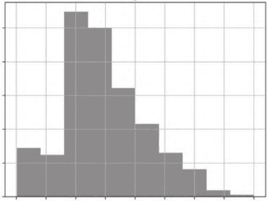

多数值列数据集会自动生成多张子图。

---

## 9.13 章节小结

本章核心：**文本文件处理** 与 **异常处理**。

**文件篇**：
- 文件即字符/字节序列，程序启动自带标准文件对象。
- `open` + `with` 语句 = 安全打开、自动关闭、防泄漏。
- 覆盖纯文本、JSON、CSV 三大主流格式。
- `json` 模块：序列化/反序列化、美化打印。

**异常篇**：
- 异常表达运行时错误，罗列了常见异常类型。
- `try/except` 捕获特定异常，写出健壮容错代码。
- `finally` 保证清理逻辑跑通，但 **首选 `with` 管理资源**。

**数据科学入门篇**：
- 标准库 `csv` 模块 + `pandas` 强强联手玩转 CSV。
- 实战泰坦尼克数据集：加载 → 改列名 → `head/tail` 看数据 → `describe` 做统计 → `hist` 画分布。

下一章（第 10 章）进入 **面向对象编程** 核心领域。

---

# 第三部分：Python 高级主题

## 第 10 章 面向对象编程

### 学习目标速览

- 从零定义类、造对象
- 懂得“造有价值的类”是什么意思
- 掌握属性访问控制
- 读懂 OOP 的核心优势
- 用 `__repr__`、`__str__`、`__format__` 定制字符串表现
- 运算符重载：让自定义对象支持 `+` `-` `==` 等
- 继承：复用父类逻辑，子类再扩展
- 理清基类/派生类关系
- 鸭子类型与多态：实现“泛型编程”
- 万物皆对象：`object` 基类的作用
- 组合 vs 继承：怎么选？
- `doctest`：把测试写进文档字符串
- 命名空间与作用域规则

---

## 10.1 入门：对象无处不在

第 2.1 节已铺垫 OO 基本概念。Python 里**一切皆对象**，翻开前几章代码，你早就在大量使用对象了。

**类 = 蓝图，对象 = 房子**。蓝图画好，盖房子（实例化）通常就一条语句。

### 什么是“有价值的类”？

# 核心技能解锁：从零构建你的专属Python类

前文我们已大量实战“拿来主义”——调用内置与第三方库现成的类。本章将转换跑道，带你掌握**“创建高价值自定义类”**的核心技艺，这是构建健壮应用的基石。面向对象编程（OOP）四大支柱——类、对象、继承、多态——将贯穿始终。随着软件规模膨胀、功能迭代，OOP让设计、实测、维护变得游刃有余。建议重点攻克10.1～10.9节，通过大量代码实战内化核心技术；10.10～10.15节为进阶拓展，按需阅读即可。

## 类库生态与基于对象的编程范式

在Python生态中，绝大多数OOP实践本质上是**基于对象的编程**：即创建并驱动现有类的实例。此前我们早已轻车熟路——`int`、`str`、`list`、`dict` 等内置类型，`Decimal` 等标准库类，以及 NumPy 的 `array`、Matplotlib 的绘图组件、pandas 的 `Series`/`DataFrame`，皆是如此。

**想用好Python，必先熟悉“轮子库”。** 开源社区历年沉淀海量高质量类库，覆盖极广。**重用而非重造**，能让开发事半功倍。这些广泛采用的开源库，往往历经全面测试与性能打磨，兼具零缺陷与跨平台移植性。GitHub、BitBucket、SourceForge 等平台汇聚宝藏资源，配合 `conda`/`pip` 一键安装，极大降低了接入门槛。**丰富的库生态，正是Python霸榜的关键——你所需的绝大多数类，开源社区早已免费备好。**

## 定义自定义类：创造新数据类型

**自定义类 = 定义新数据类型。** 标准库与第三方库中的每个类，皆源于他人的自定义实践。本章将结合 `CommissionEmployee`、`Time`、`Card`、`DeckOfCards` 等实战场景展开。

- **个人/小项目**：极少需自建类，或仅需寥寥数个。
- **企业级团队**：动辄百千类规模的协同开发。
- **回馈社区**：可贡献优质类至开源生态，但非强制，遵从公司开源合规策略即可。

## 继承：站在巨人肩膀上造新轮

**继承与组合，是复用现有类创建新类的双引擎。** 未来软件将如硬件般，由标准化、可复用组件装配而成，从容应对复杂度爆炸。

创建新类无需从零写起。继承基类（父类）的属性与方法，即可快速成型派生类（子类）；随后按需微调满足特定诉求。**黄金法则：优先继承最贴近需求的基类，以最小代价定制。** 前提是——你得先摸清相关类库的底细。

## 多态：一招鲜，吃遍天

**多态让编程从“特定化”转向“一般化”。** 统一的方法调用，发往不同类型对象，各自触发专属逻辑——“同一调用，多态响应”，这便是名字由来。本章将结合继承机制与 Python 独有的**鸭子类型**，配套代码演示多态威力。

## 实战案例：洗牌发牌模拟器

承接前文“骰子模拟 → 掷骰游戏”进阶，本案例将实现**洗牌与发牌核心逻辑**，轻松支撑各类扑克玩法。加餐福利：引入 Matplotlib，洗牌前后以精美扑克牌面可视化呈现全副牌状态。

## 数据类：Python 3.7+ 的效率利器

`dataclass` 以极简语法+自动生成样板代码，大幅加速类开发。社区口碑极佳，虽推广需时，但已成趋势。本章将**新旧范式对标演示**，助你平滑迁移。

## 进阶知识包

本章还将解锁：
- **访问控制**：约定下划线前缀 `_` 标识内部属性，约束外部直接访问。
- **特殊方法**：定制 `str()` 表现、重载运算符（如 `+`、`==`）。
- **异常体系**：剖析内置异常层级，自定义业务异常类。
- **文档测试**：`doctest` 模块实现“文档即测试”。
- **命名空间机制**：Python 如何通过作用域决议标识符归属。

---

## 10.2 实战开发：银行 `Account` 类

首战以简驭繁：`Account` 类仅建模**持有者姓名**与**余额**（实战中还含地址、生日、账号等，此处精简聚焦语法）。核心行为：`deposit()` 增余额，`withdraw()` 减余额。

### 10.2.1 先睹为快：`Account` 类试驾

每个新类皆为新数据类型，彰显 Python “可扩展”本色。看代码前，先过一遍功能演示。

#### 导入依赖：`Account` 与 `Decimal`

在 `ch10` 目录启动 IPython，引入类模块：

```python
In [1]: from account import Account
```

账户余额采用 `Decimal` 类型确保精度，同步导入：

```python
In [2]: from decimal import Decimal
```

#### 构造器表达式：基于蓝图建对象

创建 `Decimal` 对象示例：

```python
value = Decimal('12.34')
```

此即**构造器表达式**——以类名为蓝图，实参为配置参数，实例化并初始化对象。类名后的圆括号不可省（无参亦需保留）。

实战创建 `Account` 实例，传入持有者名（字符串）与初始余额（`Decimal`）：

```python
In [3]: account1 = Account('John Green', Decimal('50.00'))
```

#### 读取属性：姓名与余额

直接访问实例属性 `name` 与 `balance`：

```python
In [4]: account1.name
Out[4]: 'John Green'

In [5]: account1.balance
Out[5]: Decimal('50.00')
```

#### 存款操作：`deposit()`

`deposit(amount)` 接收正数金额，累加至余额：

```python
In [6]: account1.deposit(Decimal('25.53'))

In [7]: account1.balance
Out[7]: Decimal('75.53')
```

#### 参数守卫：拒绝非法输入

方法内置校验，存款金额若为负，即抛 `ValueError`：

```python
In [8]: account1.deposit(Decimal('-123.45'))
ValueError                                Traceback (most recent call last)
<ipython-input-8-27dc468365a7> in <module>()
----> 1 account1.deposit(Decimal('-123.45'))

~/Documents/examples/ch10/account.py in deposit(self, amount)
     21     # if amount is less than 0.00, raise an exception
     22     if amount < Decimal('0.00'):
---> 23     raise ValueError('Deposit amount must be positive.')
     24
     25     self.balance += amount

ValueError: Deposit amount must be positive.
```

### 10.2.2 源码解剖：`Account` 类定义全貌

源码位于 `account.py`，逐层拆解。

#### 类定义语法

`class` 关键字起头，紧跟类名（驼峰命名，如 `CommissionEmployee`）与冒号，**类头**即告成立。类体统一缩进。

```python
#### account.py
"""Account class definition."""
from decimal import Decimal

class Account:
    """Account class for maintaining a bank account balance."""
```

#### 文档字符串：类的说明书

第 6 行为类级文档字符串（紧随类头）。IPython 中输入 `类名?` 即可查阅，同时展示 `__init__` 文档：

```python
In [9]: Account?
Init signature: Account(name, balance)
Docstring: Account class for maintaining a bank account balance.
Init docstring: Initialize an Account object.
File: ~/Documents/examples/ch10/account.py
Type: type
```

> `Account` 既是类名，也是构造器表达式中的调用名，故帮助系统双重呈现。

#### 初始化核心：`__init__` 方法

构造器表达式：

```
account1 = Account('John Green', Decimal('50.00'))
```

触发 `__init__` 完成实例数据初始化。每个实例可定制专属 `__init__`。**铁律：`__init__` 不得返回非 `None` 值，否则抛 `TypeError`；惯例省略 `return` 语句。**

`Account.__init__`（第 8~16 行）接收 `name`、`balance`，校验通过后落地属性：

```
8    def __init__(self, name, balance):
9        """Initialize an Account object."""
11       # if balance is less than 0.00, raise an exception
12       if balance < Decimal('0.00'):
13           raise ValueError("Initial balance must be >= to 0.00.")
15       self.name = name
16       self.balance = balance
```

> **隐式 `self` 机制**：调用实例方法时，Python 自动将实例引用作为首参传入。故所有实例方法首参惯命名为 `self`，借此访问属性与同类方法。

`if` 守卫 `balance < 0`，违规即抛 `ValueError` 终止初始化；合规则动态绑定属性：

```
self.attribute_name = value
```

> **特殊方法家族**：`__init__` 仅冰山一角，双下划线包裹的特殊方法贯穿对象生命周期。本章后续将介绍基类 `object` 定义的通用特殊方法。

#### 存款逻辑：`deposit()` 细节

校验 `amount > 0`，违规抛 `ValueError`；合规则累加至 `self.balance`：

```
18 def deposit(self, amount):
19     """Deposit money to the account."""
20
21     # if amount is less than 0.00, raise an exception
22     if amount < Decimal('0.00'):
23         raise ValueError('amount must be positive.')
24
25     self.balance += amount
```

### 10.2.3 组合：对象引用为成员

`Account` 实例持有 `name`（`str` 对象引用）与 `balance`（`Decimal` 对象引用）。**Python 中万物皆对象，属性本质是引用。** 将外部对象引用内嵌为成员，即**组合**——体现 “has-a” 关系。稍后将对比继承的 “is-a” 关系。

---

## 10.3 属性访问控制：守住数据底线

`Account` 方法虽校验参数，但**直接赋值属性可绕过守卫**。实测如下：

```
In [1]: from account import Account
In [2]: from decimal import Decimal
In [3]: account1 = Account('John Green', Decimal('50.00'))
In [4]: account1.balance
Out[4]: Decimal('50.00')
```

初始余额合规。尝试直接注入负值：

```
In [5]: account1.balance = Decimal('-1000.00')
In [6]: account1.balance
Out[6]: Decimal('-1000.00')
```

输出证实：余额被污染为负数。**结论：裸属性无自卫能力，验证逻辑必须封装在方法中。**

### 封装思想

**客户端代码**（使用类的代码）不应触碰内部数据。主流 OOP 语言通过私有化实现封装；Python 无强制私有，靠**约定俗成**落地。

### 下划线前缀 `_`：绅士协议

- `_attr`：约定为**内部专用**，客户端请通过方法/`property` 间接操作。
- 无下划线：视为**公开 API**，客户端可直接访问。

> 下节 `Time` 类将实战此约定。**注意：约定不等于强制，`_` 属性客户端照样能访问，全凭自觉。**

---

## 10.4 `property`：属性访问的“智能代理”

开发 `Time` 类建模 24 小时制（时 0~23，分/秒 0~59），引入 `property` 机制。**对客户端而言，`property` 用法与普通属性零差别，实则掌管读写拦截与校验。** 假设调用方遵循 Python 约定规范用类。

### 10.4.1 先睹为快：`Time` 类试驾

切换至 `ch10` 目录，导入带属性版 `Time` 类：

```
In [1]: from timewithproperties import Time
```

#### 创建 `Time` 对象

# Python 进阶实战：Time 类设计与 Property 封装深度解析

## 实战演示：构建与展示 Time 对象

首先来实例化一个 `Time` 对象。其构造器 `__init__` 接受 `hour`、`minute`、`second` 三个参数，均预置默认值 0。下面示例仅显式传入小时与分钟，秒数沿用缺省值：

```
In [2]: wake_up = Time(hour=6, minute=30)
```

### 对象的两种字符串形态

`Time` 类内置两个特殊方法，分别服务于不同场景下的字符串呈现。在 IPython 交互环境中直接键入变量名回车，底层会触发 `__repr__` 生成官方表示；而 `print()` 输出或 `str()` 转换则调用 `__str__` 面向用户展示。

`__repr__` 返回的格式便于调试复现，形如标准构造调用：

```
In [3]: wake_up
Out[3]: Time(hour=6, minute=30, second=0)
```

`__str__` 则采用 12 小时制（AM/PM）风格，更符合阅读习惯：

```
In [4]: print(wake_up)
6:30:00 AM
```

### Property 读取：看似寻常，实则有礼

类暴露了 `hour`、`minute`、`second` 三个 property 供外部读写。乍看 `wake_up.hour` 只是简单取值，实则透明调用了底层的 getter 方法（后文将揭秘内部字段实为 `_hour`）：

```
In [5]: wake_up.hour
Out[5]: 6
```

### 批量更新时间：`set_time` 方法

除单独赋值外，`set_time` 提供一站式修改入口，参数签名与构造器保持一致，默认值同样为 0：

```
In [6]: wake_up.set_time(hour=7, minute=45)
In [7]: wake_up
Out[7]: Time(hour=7, minute=45, second=0)
```

### Property 写入：赋值背后的校验逻辑

通过 `wake_up.hour = 6` 这类语句修改属性时，实际上触发了对应的 setter。该方法会在落盘前执行合法性检查，确保数据完整性：

```
In [8]: wake_up.hour = 6
In [9]: wake_up
Out[9]: Time(hour=6, minute=45, second=0)
```

### 非法输入拦截实测

为验证防线有效性，尝试传入越界数值。正如预期，setter 立即抛出 `ValueError`，拦住脏数据：

```
In [10]: wake_up.hour = 100
ValueError
Traceback (most recent call last)
<ipython-input-10-fce0716ef14> in <module>()
----> 1 wake_up.hour = 100
~/Documents/examples/ch10/timewithproperties.py in hour(self, hour)
20 """Set the hour."""
21 if not (0 <= hour < 24):
---> 22 raise ValueError(f'Hour ({hour}) must be 0-23')
23
24 self._hour = hour
ValueError: Hour (100) must be 0-23
```

---

## 10.4.2 Time 类内核剖析

前文演示了“如何用”，下面深入源码看“如何造”。

### 构造器：缺省参数与隐式委托

`__init__` 签名包含三个带默认值 0 的参数。`self` 指向正在诞生的实例。第 9-11 行看似直接挂载同名属性，实则委托给同名 property 的 setter 完成初始化，进而建立以下划线开头的内部字段 `_hour`、`_minute`、`_second`（单下划线约定仅供内部访问）：

```
#### timewithproperties.py
"""Class Time with read-write properties."""
class Time:
    """Class Time with read-write properties."""
    def __init__(self, hour=0, minute=0, second=0):
        """Initialize each attribute."""
        self.hour = hour # 0-23
        self.minute = minute # 0-59
        self.second = second # 0-59
```

### 核心支柱：可读写 Property `hour` 详解

第 13-24 行构建了对外公开的 `hour` property，底层操作 `_hour` 字段。遵循约定，外部代码不应直触 `_hour`。对调用者而言，property 与普通属性无感，实则由 getter 与 setter 两方法组成。

**Getter 机制**：以 `@property` 装饰器标记，仅接收 `self`。装饰器赋予函数“属性式访问”能力。方法名即 property 名，职责返回 `_hour` 值。外部表达式 `obj.hour` 实则调用此方法：

```
@property
def hour(self):
    """Return the hour."""
    return self._hour

@hour.setter
def hour(self, hour):
    """Set the hour."""
    if not (0 <= hour < 24):
        raise ValueError(f'Hour ({hour}) must be 0-23')
    self._hour = hour
```
```
wake_up.hour:
```

类内部方法（如 `__str__`）同样复用 getter，保证逻辑一致。

**Setter 机制**：以 `@hour.setter` 装饰，接收 `self` 与待写入值。核心职责是**边界校验**：合法则写入 `_hour`，否则抛 `ValueError`。外部赋值 `obj.hour = val` 透明触发此逻辑：

```
wake_up.hour = 8
```

关键点：构造器第 9 行 `self.hour = hour` 同样走 setter，确保实例化阶段也受保护。这也是“可读写”与“只读”（仅含 getter） property 的分水岭：

```
self.hour = hour
```

### 分钟与秒属性：同构的校验边界

第 26-37 行与 39-50 行分别定义 `minute` 与 `second` property，结构与 `hour` 对齐。差异仅在于 setter 校验区间：均限定在 0-59 闭区间，符合分秒制定义：

```
26 @property
27 def minute(self):
28     """Return the minute."""
29     return self._minute
30
31 @minute.setter
32 def minute(self, minute):
33     """Set the minute."""
34     if not (0 <= minute < 60):
35         raise ValueError(f'Minute ({minute}) must be 0-59')
36
37     self._minute = minute
38
39 @property
40 def second(self):
41     """Return the second."""
42     return self._second
43
44 @second.setter
45 def second(self, second):
46     """Set the second."""
47     if not (0 <= second < 60):
48         raise ValueError(f'Second ({second}) must be 0-59')
49
50     self._second = second
51
```

### 便捷封装：`set_time` 复用校验链

`set_time` 实现三字段联动更新。第 54-56 行显式调用三个 property 的 setter，复用校验逻辑，避免重复造轮子：

```
52 def set_time(self, hour=0, minute=0, second=0):
53     """Set values of hour, minute, and second."""
54     self.hour = hour
55     self.minute = minute
56     self.second = second
57
```

### 双重字符串契约：`__repr__` 与 `__str__` 分工

**官方表达 `__repr__`**：对象传入内置 `repr()`（或 IPython 直接求值）时触发。旨在生成无歧义、可复现的官方字符串：

```
58 def __repr__(self):
59     """Return Time string for repr()."""
60     return (f'Time(hour={self.hour}), minute={self.minute}, ' +
61     f'second={self.second})')
62


Python文档指出，__repr__返回对象的“官方”字符串表示，该字符串看上去像一个用于创建并初始化对象的构造器表达式，如

```
```

这与前一节中代码段[2]给出的构造器表达式类似。Python有一个内置函数eval，该函数能够接收字符串'Time(hour=6, minute=30, second=0)'作为参数，并使用该字符串包含的值（即Time(hour=6, minute=30, second=0)）创建并初始化一个Time对象。

#### Time类：__str__特殊方法

我们也为Time类定义了__str__特殊方法。当使用内置函数str将一个对象转成字符串时（如使用print输出一个对象或显式调用str），该方法被隐式调用。我们实现的__str__创建了一个以12小时时钟格式表示的字符串，如'7:59:59 AM'或'12:30:45 PM':

```

**非正式表达 `__str__`**：`print()` 或 `str()` 调用时触发。面向终端用户，采用 12 小时制（AM/PM）格式。实现上利用 getter 访问 `self.hour` 等，自动处理 0/12 点显示为 12、其余取模 12、分秒补零等细节：

```

## 10.4.3 Time类定义的设计说明

下面结合Time类，考虑一些类设计方面的问题。

### 一个类的接口

Time类的property和方法定义了该类的公共接口，即编程人员所使用的用于操作类对象的property和方法集合。

### 属性应始终是可访问的

虽然我们提供了良好定义的接口，但Python并不会禁止编程人员直接操作__hour、__minute和__second这些数据属性，如

```

---

## 反面教材：封装防线的脆弱性实证

Python 靠约定而非强制实现封装，以下案例揭示直接越界访问的后果。

导入类并建立实例：

```

在执行代码段[4]后， `wake_up`对象包含了无效的数据。与C++、Java和C#等其他面向对象编程语言不同，Python不会对客户端代码隐藏数据属性。按Python教程所说：“Python没有提供隐藏数据的功能，所有的数据操作方式都是基于约定。”

### 内部数据表示

在这里，将时间表示为3个整数值，分别对应时、分和秒。实际上，类内部将时间表示为午夜后的秒数也完全合理。由于内部数据表示的改变，我们将不得不重写`hour`、`minute`和`second`这3个property，但对于编程人员来说，他们并不需要关心内部数据表示的改变，他们可以使用相同的接口并得到相同的结果。请读者完成内部数据表示的修改（即改为用午夜后的秒数表示时间），并展示使用Time对象的客户端代码不需要做任何修改。

### 改进类的实现细节

设计一个类时，在将这个类提供给其他开发者使用前，请务必仔细考虑类的接口。理想情况下，对于所设计的类接口来说，在更改类的实现细节（如内部数据表示或方法体实现方式）时，客户端代码不需要做任何修改也可正常使用。

如果Python编程者遵循约定，不直接访问名字以单下划线（_）开始的那些属性，则类设计者能够在不影响客户端代码的情况下改进类的实现细节。

### property

与直接访问数据属性相比，使用具有`setter`和`getter`的`property`似乎并没有带来什么优势，但需要注意二者之间存在的一些细微差异：`getter`似乎允许客户端代码随意读取数据，但能够控制返回数据的格式；`setter`能够对试图修改数据属性值的操作进行检查，以防止数据被设置为无效值。

### 工具方法

在一个类中，并不是所有的方法都需要作为该类的接口。一些方法可以作为仅在类内使用的工具方法，而不应在客户端代码中调用。与仅在类内部使用的数据属性相同，这些仅在类内使用的工具方法在命名时，也应以单下划线开始。在C++、Java和C#等其他面向对象语言中，这些工具方法通常被实现为私有方法。

### datetime模块

在专业的Python程序开发中，通常不用自己创建类来表示时间和日期，而是直接使用Python标准库中`datetime`模块的功能。关于`datetime`模块的更多细节信息，请参阅 https://docs.python.org/3/library/datetime.html。

## 10.5 模拟“私有”属性

在C++、Java和C#等编程语言中，类会显式地声明哪些类成员是可公开访问的。不允许在类定义体外访问的类成员是**私有的**，这些私有成员仅在定义它们的类内可直接访问。Python编程者经常使用“私有”属性表示仅在类内使用而不作为类的公开接口的那些属性和工具方法。

可见，Python对象的属性始终是可访问的。然而，Python对“私有”属性有命名约定。如果我们想创建一个`Time`类的对象，并禁止下面的赋值语句

```

**直接篡改 `_hour`（单下划线字段）**：
命名约定无法物理阻拦外部写入。赋值 100 后，`__repr__` 诚实反映非法状态；但 `__str__` 因依赖 `self.hour`（即 getter），意外输出“4:45:30 AM”（100 % 12 = 4），掩盖了数据腐败：

```

即禁止将小时设置为无效值，则不应该用以单下划线开始的属性名`_hour`，而应该用以双下划线开始的属性名`__hour`。以双下划线开始的命名约定，说明`__hour`是“私有”的，不应该在客户端代码中直接访问它。为了帮助避免客户端代码直接访问这些“私有”属性，Python会对“私有”属性加前缀`_ClassName`（`ClassName`要替换为具体的类名）进行重命名，如`_Time__hour`，这被称为**命名修饰**。如果尝试给`__hour`赋值，如

```

**尝试篡改 `__hour`（双下划线触发名称重整）**：
Python 将 `__hour` 重整为 `_Time__hour`。外部赋值 `wake_up.__hour = 100` 实则在实例上**新建**了一个无关字段 `__hour`，原本的 `_Time__hour`（即内部真正使用的 `_hour`）保持不变。这种“看似成功实则无效”的行为极易埋下隐患。

> **核心警示**：Property setter 提供的校验屏障，**仅在通过 property 访问时生效**。直接操作下划线字段会绕过所有保护，团队务必约定“仅通过公开 property 交互”的铁律。

# Python 封装与建模实战：从私有属性到扑克牌类设计

掌握面向对象编程的精髓，关键在于理解**封装**如何保护内部状态，以及如何通过**特殊方法**让自定义类型表现得像内置类型一样自然。本文通过两个经典案例——私有属性演示与扑克牌系统构建，带你领略 Python 类机制的细节之美。

```

则Python会引发`AttributeError`异常，即类中没有`_hour`这个属性，下面我们将通过代码示例展示这一点。

### IPython自动补全仅显示“公有”属性

当试着通过按Tab键自动补全下面的表达式时，IPython不会显示以单下划线或双下划线开始的那些属性：

```

wake_up.

```

IPython自动补全列表中仅会显示作为wake_up对象“公有”接口的那些属性。

### “私有”属性示例

为了证实前面介绍的命名修饰，这里考虑PrivateClass类，具有一个“公有”数据属性public_data和一个“私有”数据属性__private_data：

```

### private.py

"""Class with public and private attributes."""

class PrivateClass:

    """Class with public and private attributes."""

    def __init__(self):

        """Initialize the public and private attributes."""

        self.public_data = "public"   # public attribute

        self.__private_data = "private"   # private attribute

```

下面创建一个PrivateClass类的对象，以展示对数据属性的访问：

```

In [1]: from private import PrivateClass

In [2]: my_object = PrivateClass()

```

代码段[3]说明能够直接访问public_data属性：

```

In [3]: my_object.public_data

Out[3]: 'public'

```

然而，当尝试在代码段[4]中直接访问__private_data属性时，我们得到AttributeError异常，这说明在PrivateClass类中没有名字为__private_data的属性：

```

In [4]: my_object.__private_data

------------------------------------------------------------

AttributeError                            Traceback (most recent call last)

<ipython-input-4-d896bdf2053> in <module>()

----> 1 my_object.__private_data

AttributeError: 'PrivateClass' object has no attribute '__private_data'

---

**解析**：上述交互直观展示了 Python 的**名称修饰**机制。以双下划线 `__` 开头的实例变量，在类内部会被重命名为 `_ClassName__variable`，因此外部无法直接通过原名访问。这并非绝对的访问控制，而是一种防止子类意外覆盖的约定俗成保护。公有成员 `public_data` 则毫无障碍地暴露给外部调用。

接下来，我们将视角转移到一个更具实战意义的场景——构建一套完整的扑克牌模型。这涵盖了数据建模、运算符重载、格式化输出等核心技能。

```

这是因为Python通过命名修饰自动修改了这个“私有”属性的名字。不幸的是，__private_data仍然不能直接访问。

## 10.6 案例研究：洗牌和分牌模拟

本节中的例子给出了两个自定义类，利用这两个类可以进行洗牌和分牌。Card类用于表示一张扑克牌，有牌面（face）和花色（suit）两个属性，牌面的取值范围是（'Ace', '2', '3', ..., 'Jack', 'Queen', 'King'），花色的取值范围是（'Hearts', 'Diamonds', 'Clubs', 'Spades'）。DeckOfCards类用于表示一副扑克牌，是包括52张扑克牌的Card对象列表。首先，我们在IPython会话中试用这些类，演示洗牌、分牌以及以文本形式显示牌的功能。然后，我们将看到类的定义方法。最后，我们将使用另一个IPython会话，利用Matplotlib以图像形式显示52张牌。

## 10.6.1 试用Card类和DeckOfCards类

在分析Card类和DeckOfCards类的具体实现前，先通过一个IPython会话演示它们的功能。

### 创建对象，洗牌和分牌

首先，从deck.py导入DeckOfCards类，并创建该类的对象：

```

In [1]: from deck import DeckOfCards

In [2]: deck_of_cards = DeckOfCards()

```

DeckOfCards类的__init__方法先按花色、再对每一种花色按牌面创建52个Card对象。通过打印deck_of_cards对象，可以看到DeckOfCards类的__str__方法被调用以获得整副牌的字符串表示。从左向右阅读每一行，以证实所有的牌按每一种花色（Hearts、Diamonds、Clubs和Spades）的牌面顺序依次显示：

```

In [3]: print(deck_of_cards)

Ace of Hearts   2 of Hearts   3 of Hearts   4 of Hearts

5 of Hearts   6 of Hearts   7 of Hearts   8 of Hearts

9 of Hearts  10 of Hearts   Jack of Hearts  Queen of Hearts

King of Hearts  Ace of Diamonds 2 of Diamonds 3 of Diamonds

4 of Diamonds 5 of Diamonds 6 of Diamonds 7 of Diamonds

8 of Diamonds 9 of Diamonds 10 of Diamonds Jack of Diamonds

Queen of Diamonds King of Diamonds Ace of Clubs   2 of Clubs

3 of Clubs   4 of Clubs   5 of Clubs   6 of Clubs

7 of Clubs   8 of Clubs   9 of Clubs   10 of Clubs

Jack of Clubs Queen of Clubs King of Clubs   Ace of Spades

2 of Spades   3 of Spades   4 of Spades   5 of Spades

6 of Spades   7 of Spades   8 of Spades   9 of Spades

10 of Spades Jack of Spades Queen of Spades King of Spades

---

**观察**：初始化后的牌组按花色、点序排列整齐，这是 `__str__` 方法配合列表遍历的呈现效果。但实战中我们需要随机性。

```

下面来洗牌并再次打印deck_of_cards对象。我们没有指定可以保证结果可重现的种子，因此每次洗牌都会得到不同的结果：

```

In [4]: deck_of_cards.shuffle()

In [5]: print(deck_of_cards)

King of Hearts   Queen of Clubs   Queen of Diamonds 10 of Clubs

5 of Hearts   7 of Hearts   4 of Hearts   2 of Hearts

5 of Clubs   8 of Diamonds 3 of Hearts   10 of Hearts

8 of Spades   5 of Spades   Queen of Spades   Ace of Clubs

8 of Clubs   7 of Spades   Jack of Diamonds 10 of Spades

4 of Diamonds 8 of Hearts   6 of Spades   King of Spades

9 of Hearts   4 of Spades   6 of Clubs   King of Clubs

3 of Spades   9 of Diamonds 3 of Clubs   Ace of Spades

Ace of Hearts   3 of Diamonds 2 of Diamonds 6 of Hearts

King of Diamonds Jack of Spades Jack of Clubs   2 of Spades

5 of Diamonds   4 of Clubs   Queen of Hearts 9 of Clubs

10 of Diamonds   2 of Clubs   Ace of Diamonds 7 of Diamonds

9 of Spades   Jack of Hearts   6 of Diamonds   7 of Clubs

---

**解析**：`shuffle()` 利用 `random.shuffle` 打乱内部列表 `_deck`，再次打印即呈现乱序。这种“状态改变+视图刷新”的模式是面向对象交互的典型范式。

```

### 分牌

通过调用deal_card方法，可以一次得到一个Card对象。IPython调用所返回Card对象的__repr__方法，生成Out[]提示符中显示的字符串输出：

```

In [6]: deck_of_cards.deal_card()

Out[6]: Card(face='King', suit='Hearts')

```

### Card类的其他功能

为了演示Card类的__str__方法，我们分牌得到另一个Card对象并将它传递给内置函数str：

```

In [7]: card = deck_of_cards.deal_card()

In [8]: str(card)

Out[8]: 'Queen of Clubs'

```

每个Card对象都有对应的图像文件名，通过image_name这个只读property可以获取图像文件名。后面以图像形式显示牌时，将使用这个文件名：

```

In [9]: card.image_name

Out[9]: 'Queen_of_Clubs.png'

---

**亮点**：`deal_card()` 返回的是 `Card` 对象而非字符串。交互环境自动调用 `__repr__` 给出开发者友好的构造式表达（`Out[6]`）；`str()` 则触发 `__str__` 生成面向用户的可读文本（`Out[8]`）；而 `image_name` 属性巧妙复用 `__str__` 结果拼接出资源路径，体现了 **DRY（Don't Repeat Yourself）** 原则。

下面深入剖析 `Card` 与 `DeckOfCards` 的源码实现。

```

## 10.6.2 Card类：引入类属性

每个Card对象包含3个字符串property，分别表示牌面（face）、花色（suit）和图像文件名（image-name）。如在前面的IPython会话中所看到的，Card类也提供了用于初始化Card对象和获取不同字符串表示的方法。

### 类属性FACES和SUITS

一个类的每个对象都有关于类中数据属性的自己的副本。例如，每一个Account对象都有它自己的name和balance属性（以使不同的Account对象可以保存不同的数据）。有些情况下，一个属性需要由一个类的所有对象共享。类属性（也称为类变量）用于表示类范围的信息，这个信息属于类，而不属于该类的一个特定对象。Card类定义了两个类属性（第5～7行）：

- FACES是一个牌面名称列表。
- SUITS是一个花色名称列表。

```

### card.py

"""Card class that represents a playing card and its image file name."""

class Card:

    FACES = ['Ace', '2', '3', '4', '5', '6',

             '7', '8', '9', '10', 'Jack', 'Queen', 'King']

    SUITS = ['Hearts', 'Diamonds', 'Clubs', 'Spades']

```

在类定义内部但在所有方法和property外，可以通过赋值定义一个类属性（在某一方法或property内通过赋值会定义局部变量）。

FACES和SUITS是不需要修改的常量，因此按StyleGuide for Python Code的建议，命名常量时所有的字母应大写。

我们将使用这两个列表中的元素初始化所创建的每个Card对象。
然而，我们不需要在每个Card对象中单独保存这两个列表。类属性可以通过该类的任一对象访问，但通常是通过类名访问（如Card.FACES或Card.SUITS）。一旦导入了类定义，则该类的类属性就存在了。

### Card类的__init__方法

创建一个Card对象时，__init__方法定义了对象的_face和_suit数据属性：

```

def __init__(self, face, suit):

    """Initialize a Card with a face and suit."""

    self._face = face

    self._suit = suit

```

### 只读property: face、suit和image_name

一旦一个Card对象被创建，则它的face、suit和image_name都不会再改变，因此我们将它们实现为只读property（第14~17行、第19~22行和第24~27行）。face和suit这两个property会返回相应的数据属性_face和_suit。一个property并不需要有相应的数据属性。为了演示这一点，image_name这个property的值被动态创建：先用str(self)获得Card对象的字符串表示，再用下划线替换空格、加上'.png'文件扩展名。这样，'Ace of Spades'变成了'Ace_of_Spades.png'。我们将使用这个文件名加载当前Card对象对应的PNG格式的图像。PNG（Portable Network Graphic，便携式网络图形）是一种流行的Web图像格式。


### 返回Card对象的字符串表示的方法

```

14  @property

15  def face(self):

16      """Return the Card's self._face value."""

17      return self._face

18  

19  @property

20  def suit(self):

21      """Return the Card's self._suit value."""

22      return self._suit

23  

24  @property

25  def image_name(self):

26      """Return the Card's image file name."""

27      return str(self).replace(' ', '_') + '.png'

28

```

Card类提供了3个返回字符串表示的方法。与Time类中一样，__repr__方法返回一个字符串表示，该字符串看上去像一个用于创建并初始化Card对象的构造器表达式：

```

29  def __repr__(self):

30      """Return string representation for repr()."""

31      return f'Card(face={self.face!r}, suit={self.suit!r})'

32

```

__str__方法返回'face of suit'格式的字符串，如'Ace of Hearts'：

```

33  def __str__(self):

34      """Return string representation for str()."""

35      return f'{self.face} of {self.suit}'

36

```

前面的IPython会话打印整副牌时，所有的牌以4列、左对齐方式显示。如同将在DeckOfCards类的__str__方法中所看到的，我们使用f字符串进行每张牌对应字符串的格式化，每个字符串显示在有19个字符的字段中。当Card对象被格式化为字符串时，Card类的特殊方法__format__被调用。例如，下面的代码以f字符串形式完成了字符串格式化：

```

37  def __format__(self, format):

38      """Return formatted string representation for str()."""

39      return f'{str(self):{format}}'

---

**设计解读**：

1.  **类属性常量**：`FACES` 与 `SUITS` 定义在类层级，全体实例共享，节省内存且便于维护合法值校验。
2.  **受保护实例变量**：`_face`、`_suit` 以下划线前缀标记内部使用，配合 `@property` 暴露只读接口，封装内部存储细节。
3.  **派生属性**：`image_name` 无需额外存储，动态基于 `__str__` 计算，保证与显示文本强一致。
4.  **三大特殊方法分工明确**：
    *   `__repr__`：面向调试，理想情况下 `eval(repr(obj)) == obj`。
    *   `__str__`：面向终端用户，自然语言描述。
    *   `__format__`：支持 `format()` 与 f-string 格式化规范（如对齐、宽度），代理给字符串处理。

最后看看牌组类如何组装 52 张牌并提供核心行为。

```

该方法的第2个参数是用于格式化对象的格式化字符串。为了将format参数的值用作格式说明符，这里将参数名format放在冒号右边的花括号中。在本例中，我们对str(self)返回的Card对象的字符串表示进行格式化。在介绍DeckOfCards类的__str__方法时，我们将再讨论__format__。

## 10.6.3 DeckOfCards类

DeckOfCards类有一个类属性NUMBER_OF_CARDS，用于表示一副牌中牌的数量。另外，还有两个数据属性：

- _current_card用于记录下一次被发放的牌（0~51）。
- _deck（第12行）是一个包含52个Card对象的列表。

### __init__方法

DeckOfCards类的__init__方法初始化了_deck属性。for语句通过循环将新的Card对象添加到列表_deck的尾部。其中，每个新的Card对象用两个字符串进行初始化，这两个字符串分别取自列表Card.FACES和Card.SUITS。count%13这个运算将返回0~12的值（即列表Card.FACES的13个索引），而count//13这个运算将返回0~3的值（即列表Card.SUITS的4个索引）。当初始化_deck列表时，先添加的是花色为Hearts、牌面从'Ace'到'King'的13张牌，其次是花色为Diamonds的13张牌，再次是花色为Clubs的13张牌，最后是花色为Spades的13张牌。

```python

### deck.py

"""Deck class represents a deck of Cards."""

import random

from card import Card

class DeckOfCards:

    NUMBER_OF_CARDS = 52  # constant number of Cards

    def __init__(self):

        """Initialize the deck."""

        self._current_card = 0

        self._deck = []

---

**架构要点**：

*   **组合关系**：`DeckOfCards` 内部维护 `_deck` 列表聚合 `Card` 对象，体现“整体-部分”关系。
*   **状态追踪**：`_current_card` 记录下一张待发牌的索引，配合 `deal_card()` 实现有序发牌（洗牌后即为随机发牌）。
*   **常量语义**：`NUMBER_OF_CARDS = 52` 消除魔术数字，提升可读性。
*   **依赖注入思想**：构造器中通过双重循环实例化 52 张 `Card`，若未来扩展大小王或花色，仅需修改 `Card` 类常量或此处生成逻辑，符合开闭原则。

---

**总结**

从 `PrivateClass` 的名称修饰，到 `Card` 类的多态显示协议（`__repr__`/`__str__`/`__format__`），再到 `DeckOfCards` 的组合与状态管理，这组案例串联起了 Python 面向对象的核心脉络：

*   **封装**不只是隐藏，更是提供稳定契约（Property）；
*   **特殊方法**让对象融入语言生态（打印、格式化、调试）；
*   **组合优于继承**，通过委托复用 `Card` 能力构建复杂 `Deck`。

掌握这些模式，你就能写出既符合 Python 风格（Pythonic），又健壮可维护的类库代码。

# 从零构建扑克牌模拟系统：发牌、洗牌与可视化实战

在面向对象编程的练习中，模拟一副扑克牌是经典且极具教学价值的案例。它涵盖了集合管理、随机算法、迭代器模式以及与第三方库协作可视化等核心技能。下面我们将分步拆解如何用 Python 实现一个功能完备的 `DeckOfCards` 类，并结合 Matplotlib 直观呈现发牌效果，最后补充一个员工薪资体系的基类设计。

## 核心数据结构：初始化 52 张牌

一切的起点是建立牌堆。我们利用两个元组常量分别存储 13 种点数（`FACES`）与 4 种花色（`SUITS`），通过单层循环结合取模与整除运算，巧妙地完成 52 次笛卡尔积组合，将每一张 `Card` 实例按序存入 `_deck` 列表。

```python
        for count in range(DeckOfCards.NUMBER_OF_CARDS):

            self._deck.append(Card(Card.FACES[count % 13],

                                   Card.SUITS[count // 13]))
```

## 核心行为：洗牌与发牌机制

牌堆建好后，最基础的操作莫过于“洗牌”与“发牌”。

**洗牌逻辑** 非常直观：借助标准库 `random.shuffle` 对内部列表原地打乱，同时将发牌指针 `_current_card` 重置为 0，确保每次洗牌后都能从头开始发。

```

### shuffle方法

shuffle方法先将_current_card重置为0，然后使用random模块的shuffle函数将_deck中的Card对象的顺序打乱：

```python

def shuffle(self):

    """Shuffle deck."""

    self._current_card = 0

    random.shuffle(self._deck)

**发牌逻辑** 则采用防御性编程：尝试按当前指针取牌并后移指针；若指针越界（牌发完），捕获异常并返回 `None`，避免程序崩溃。

```

### deal_card方法

deal_card方法从_deck中得到一个Card对象。前面已介绍，_current_card表示下一张要被发放的牌（即整副牌中最上面的那张牌）的索引，其取值范围是0~51。第26行代码从_deck中获取索引为_current_card的元素。如果成功，则将_current_card增1，然后返回得到的Card对象；否则，返回None，表示已经没有可以发放的牌。

```python

def deal_card(self):

    """Return one Card."""

    try:

        card = self._deck[self._current_card]

        self._current_card += 1

        return card

    except:

        return None

## 调试利器：自定义字符串表达

为了方便控制台调试，重写 `__str__` 方法至关重要。下面的实现将 52 张牌按每行 4 张的格式排版输出，利用 f-string 的左对齐填充（`<19`）保证列对齐，每 4 张换行，视觉清晰度极高。

```

### __str__方法

DeckOfCards类也定义了特殊方法__str__，用于获取整副牌的字符串表示。字符串分4列，每张牌对应的字符串以左对齐的方式放在19个字符宽的字段中。当第37行代码格式化一个给定的Card对象时，该Card对象的__format__特殊方法被调用，格式说明符'<19'作为__format__方法的format参数。然后，__format__方法使用'<19'创建Card对象的格式化的字符串表示。

```python

def __str__(self):

    """Return a string representation of the current _deck."""

    s = ''

    for index, card in enumerate(self._deck):

        s += f'{self._deck[index]:<19}'

        if (index + 1) % 4 == 0:

            s += '\n'

    return s

## 实战演练：在 Jupyter Notebook 中可视化发牌过程

代码写得再好，不跑一遍不踏实。我们在交互式环境中导入类、实例化对象，并借助 Matplotlib 将牌面图片渲染出来。

首先完成环境准备与实例化：

```

## 10.6.4 利用Matplotlib显示扑克牌图像

到目前为止，我们都是以文本形式显示扑克牌的。现在，我们来看一下如何以图像形式显示。为了展示程序，我们需要从Wikimedia Commons (https://commons.wikimedia.org/wiki/Category:SVG_English_pattern_playing_cards) 下载public-domain扑克牌图像。

这些扑克牌图像放在了本书ch10文件夹的card_images子文件夹中。首先，我们创建一个DeckOfCards对象：

```python

In [1]: from deck import DeckOfCards

In [2]: deck_of_cards = DeckOfCards()

接着配置 Matplotlib 后端并定位图片资源路径：

```

### 在IPython中使用Matplotlib

下面，在IPython中通过使用%matplotlib魔术命令启动Matplotlib支持：

```python

In [3]: %matplotlib

Using matplotlib backend: Qt5Agg

```

### 为每幅图像创建基路径

在显示每幅图像前，必须从card_images文件夹中加载图像。我们使用pathlib模块的Path类构造每幅图像在我们系统中的完整路径。代码段[5]为当前文件夹（即ch10文件夹）创建了一个Path对象，其表示为'.'。然后使用Path的joinpath方法追加包含扑克牌图像的子文件夹：

```python

In [4]: from pathlib import Path

In [5]: path = Path('.').joinpath('card_images')

导入绘图模块：

```

### 导入Matplotlib功能

下面，我们导入显示图像所需要的那些Matplotlib模块。matplotlib.image中的一个函数将被用于加载图像：

```python

In [6]: import matplotlib.pyplot as plt

In [7]: import matplotlib.image as mpimg

### 首轮发牌：有序牌堆的可视化

创建一个 4 行 13 列的子图网格，遍历所有坐标轴隐藏刻度，依次从牌堆顶部取牌，读取对应图片文件并绘制。`tight_layout()` 自动调整子图间距，防止重叠。

```

### 创建Figure对象和Axes对象

下面的代码段使用Matplotlib的subplots函数创建了一个Figure对象。在这个Figure对象中，我们将在52个subplots（子图）中以4行（nrows）、13列（ncols）显示图像。subplots函数返回一个元组，该元组中包含一个Figure对象和由subplots的Axes对象组成的一个数组（52个元素）。下面将它们解包到变量figure和axes_list中：

```python

In [8]: figure, axes_list = plt.subplots(nrows=4, ncols=13)

```

在IPython中执行这条语句时，Matplotlib窗口会立即出现，并且窗口中会出现52个空的子图。

### 配置Axes对象并显示图像

下面，我们迭代axes_list中的所有Axes对象。根据前面的介绍，ravel提供了多维数组的一维视图。对于每一个Axes对象，我们执行下面的处理：

- 我们不是在绘制数据，因此对于每幅图像不需要轴线和标签。循环中的前两条语句隐藏了x轴和y轴。
- 由第3条语句可得到一个Card对象并获取其image_name。
- 第4条语句使用Path的joinpath方法将image_name添加到路径中，然后调用Path的resolve方法确定图像在我们系统中的完整路径。我们将resolve返回的包含完整路径的Path对象传递给内置函数str，得到图像路径的字符串表示。再将这个字符串传递给matplotlib.image模块的imread函数，即可完成图像加载。
- 最后一条语句调用了Axes的imshow方法，在当前子图中显示了当前的图像。

```python

In [9]: for axes in axes_list.ravel():

    ...:     axes.get_xaxis().set_visible(False)

    ...:     axes.get_yaxis().set_visible(False)

    ...:     image_name = deck_of_cards.deal_card().image_name

    ...:     img = mpimg.imread(str(path.joinpath(image_name).resolve()))

    ...:     axes.imshow(img)

    ...:

```

### 最大化图像尺寸

目前，所有的图像都显示出来了。为了使扑克牌显示得尽可能大，可以最大化窗口，然后调用Matplotlib的Figure对象的`tight_layout`方法。这将去掉窗口中的大多数多余空白：

```python

In [10]: figure.tight_layout()

此时你将看到一副按花色、点数完美有序排列的牌面。

### 二轮发牌：洗牌后的随机分布

调用 `shuffle()` 打乱内部顺序，重复上述绘图流程，即可得到一副完全随机的牌面分布，直观验证洗牌算法的有效性。

```

下图显示了结果窗口的内容。


### 洗牌和重新分牌

为了看到打乱有顺序的图像，可以调用`shuffle`方法，然后重新执行代码段[9]的代码：

```python

In [11]: deck_of_cards.shuffle()

In [12]: for axes in axes_list.ravel():

....:     axes.get_xaxis().set_visible(False)

....:     axes.get_yaxis().set_visible(False)

....:     image_name = deck_of_cards.deal_card().image_name

....:     img = mpimg.imread(str(path.joinpath(image_name).resolve()))

....:     axes.imshow(img)

## 扩展案例：佣金员工基类设计

除了扑克牌模拟，面向对象设计在业务领域建模中同样大放异彩。以 `CommissionEmployee` 为例，它封装了“按销售额提成”这一核心薪资逻辑的基础属性与校验规则。

类定义了姓名、社保号等只读身份标识（通过 `@property` 暴露），并将 `gross_sales` 与 `commission_rate` 设为受保护属性，后续可在子类或属性设值器中加入非负校验等业务约束。

```


## 10.7 继承：基类和子类

一个类的一个对象经常也是另一个类的一个对象。例如，一个 CarLoan（车贷）对象也是一个 Loan（贷款）对象；同样，HomeImprovementLoan（住房改善贷款）和 MortgageLoan（抵押贷款）的对象也是 Loan 对象。CarLoan 类可以说成继承自 Loan 类。在这种情况下，Loan 类是基类，而 CarLoan 类是子类。CarLoan 是一种特定类型的 Loan，但如果反过来说，每一个 Loan 对象都是一个 CarLoan 对象，则这是不正确的，因为 Loan 也可以是车贷以外的其他类型的贷款。下面的表格列出了一些基类和子类的简单示例，基类趋向于表示更一般的事物，而子类趋向于表示更具体的事物（即基类表示的事物范围比子类更广）。

| 基类 | 子类 |
| :--- | :--- |
| Student（学生） | GraduateStudent（研究生）, UndergraduateStudent（本科生） |
| Shape（形状） | Circle（圆）, Triangle（三角形）, Rectangle（矩形）, Sphere（球体）, Cube（立方体） |
| Loan（贷款） | CarLoan（车贷）, HomeImprovementLoan（房屋改善贷款）, MortgageLoan（抵押贷款） |
| Employee（员工） | Faculty（教员）, Staff（行政人员） |
| BankAccount（银行账户） | CheckingAccount（支票账户）, SavingsAccount（储蓄账户） |

每个子类对象都是其基类的一个对象，并且一个基类可以有很多子类。因此，由基类表示的对象集合比其任一子类表示的对象集合更大。例如，基类 Vehicle 表示所有的交通工具，包括小汽车、卡车、小船、自行车等，相比之下，子类 Car（小汽车）表示交通工具的一个更小、更具体的子集。

### CommunityMember继承层次结构

继承关系形成了树形层次结构。基类与它的子类是一种层次关系。在这里，我们设计一个简单的类层次结构（如下图所示），类层次结构也称为继承层次结构。一个大学社区有上千名成员，包括员工（Employee）、学生（Student）和校友（Alum）。员工可以分为教员（Faculty）和行政人员（Staff），教员（Faculty）又可以分为管理人员（Administrator，如院长和系主任）和教师（Teacher）。这个层次结构还可以再包含许多其他类。例如，学生（Student）可以分为研究生（GraduateStudent）和本科生（UndergraduateStudent），本科生又可以分为大一、大二、大三或大四的学生。对于单继承，一个类从一个基类派生；对于多重继承，一个子类对两个或更多基类进行继承。单继承比较简单易懂，多重继承不属于本书的讨论范围。在使用多重继承前，请在线搜索“diamond problem in Python multiple inheritance.”。


层次结构中的每一个箭头表示一个“是”（is a）关系。例如，当我们在这个类层次结构中沿着箭头向上，我们可以说“一名员工（Employee）是一名大学社区成员（CommunityMember）”“一名教师（Teacher）是一名教员（Faculty）”。CommunityMember是Employee、Student和Alum的直接基类，是该图中其他所有类的间接基类。从底部开始，沿着箭头应用“是”关系能够到达最顶部的父类。例如，一名管理人员（Administrator）是一名教员（Faculty），是一名员工（Employee），是一名大学社区成员（CommunityMember），当然最终是一个object（后面会介绍，实际上object类是所有类的直接或间接基类）。

### Shape继承层次结构

现在考虑下面类图中的Shape继承层次结构。该层次结构从基类Shape开始，Shape有TwoDimensionalShape和ThreeDimensionalShape两个子类，即每个形状（Shape）可以是一个二维形状 (TwoDimensionalShape)，也可以是一个三维形状 (ThreeDimensionalShape)。同前面一样，我们能够从图的底部开始，沿着箭头通过几个“是”关系到达这个类层次结构最顶部的基类。例如，一个三角形（Triangle）是一个二维形状（TwoDimensionalShape），也是一个形状（Shape）；而一个球体（Sphere）是一个三维形状（ThreeDimensionalShape），也是一个形状（Shape）。这个层次结构也可以包含许多其他类。例如，椭圆和梯形也是二维形状（TwoDimensionalShape），而锥体和圆柱体也是三维形状（ThreeDimensionalShape）。

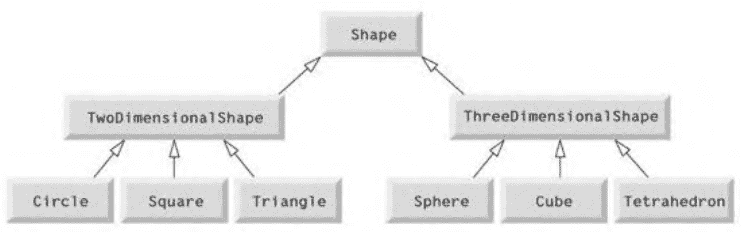

### “是”（is a）与“有”（has a）两种关系的区别

继承产生“是”关系，即一个子类类型的对象也可以被视作一个基类类型的对象。前面已经介绍了“有”（组合）关系，即一个类中可以包括一个或多个其他类对象的引用作为该类的成员。


## 10.8 构建继承层次结构：引入多态性

一个公司的工资单应用程序中包含不同类型的员工，这里使用员工类层次结构，讨论基类和其子类之间的关系。公司里的员工有许多共同点，但佣金员工（commission employee，将被表示为基类的对象）的收入只有销售提成，而带薪佣金员工（salaried commission employee，将被表示为子类的对象）的收入是底薪加销售提成。

首先，我们给出基类CommissionEmployee（佣金员工）。然后，我们通过继承CommissionEmployee类，创建子类SalariedCommissionEmployee（带薪佣金员工）。最后，我们使用IPython会话创建一个SalariedCommissionEmployee对象，并演示该对象同时拥有基类和子类的功能，但其收入计算方式与基类对象不同。

### 10.8.1 基类CommissionEmployee

CommissionEmployee类提供下列功能：

- __init__方法（第8～15行）—创建了数据属性_first_name、_last_name和_ssn（社会保障号），并使用gross_sales和commission_rate这两个property的setter方法创建相应的数据属性。
- first_name（第17～19行）、last_name（第21～23行）和ssn（第25～27行）这3个只读property—返回相应的数据属性。
- gross_sales（第29～39行）和commission_rate（第41～52行）这2个读写property—其中的setter方法会执行数据有效性验证。
- earnings方法（第54～56行）—计算并返回一个CommissionEmployee对象的收入。
- __repr__方法（第58～64行）—返回一个CommissionEmployee对象的字符串表示。

```python

#### commissionemployee.py

"""CommissionEmployee base class."""

from decimal import Decimal

class CommissionEmployee:

    """An employee who gets paid commission based gross sales."""

    def __init__(self, first_name, last_name, ssn,

                 gross_sales, commission_rate):

        """Initialize CommissionEmployee's attributes."""

        self._first_name = first_name

        self._last_name = last_name

        self._ssn = ssn

        self.gross_sales = gross_sales # validate via property

        self.commission_rate = commission_rate # validate via property

    @property

    def first_name(self):

        return self._first_name

    @property

    def last_name(self):

        return self._last_name

    @property

    def ssn(self):

        return self._ssn

---

通过上述两个截然不同的领域案例——游戏模拟与业务建模，我们展示了 Python 面向对象特性在数据封装、行为抽象、运算符重载（`__str__`）以及生态库集成上的强大表现力。掌握这些模式，便能游刃有余地应对更复杂的系统设计挑战。

# Python 继承实战：构建灵活的员工薪酬体系

在面向对象设计中，继承是实现代码复用与扩展的核心手段。今天我们通过一个完整的“员工薪酬计算”案例，深度解析如何从基础的佣金员工模型出发，利用继承机制优雅地构建出“底薪加提成”的复合薪资结构。

---

## 奠基：打造健壮的基类 `CommissionEmployee`

一切始于一个设计良好的基类。我们定义了 `CommissionEmployee`，它封装了员工的基本信息（姓名、社保号）以及核心业务指标——**销售总额** 与 **提成比率**。

为了保证数据的合法性，我们在属性设值器中引入了严格的边界校验，并利用 `Decimal` 类型规避浮点数精度陷阱。

```

first_name、last_name和ssn这3个property是只读的。原则上，我们应该验证它们的3个属性（即_first_name、_last_name和_ssn）的取值的有效性。例如，我们可以验证姓和名的长度是否在合理的范围、社会保障号是否包含9个数字以及是否带有短横线（即验证社保号是否符合####-##-####或##########格式，其中每个#是一个数字）。但在这里我们并没有做这些验证工作。

### 所有的类直接或间接继承自object类

使用继承可以根据已有类创建新类。实际上，每个Python类都继承自一个已有类。在创建新类时，如果没有显式指定基类，Python会认为这个新类是直接从object类继承的。因此，Python类层次结构从object类开始，其他每个类都是object类的直接或间接子类。这样，CommissionEmployee的类头也可以写为：

```python

class CommissionEmployee(object):

@property

def gross_sales(self):

        return self._gross_sales

@gross_sales.setter

def gross_sales(self, sales):

        """Set gross sales or raise ValueError if invalid."""

        if sales < Decimal('0.00'):

            raise ValueError('Gross sales must be >= to 0')

        self._gross_sales = sales

@property

def commission_rate(self):

        return self._commission_rate

@commission_rate.setter

def commission_rate(self, rate):

        """Set commission rate or raise ValueError if invalid."""

        if not (Decimal('0.0') < rate < Decimal('1.0')):

            raise ValueError(

                'Commission rate must be greater than 0 and less than 1')

        self._commission_rate = rate

def earnings(self):

        """Calculate earnings."""

        return self.gross_sales * self.commission_rate

def __repr__(self):

        """Return string representation for repr()."""

        return ("CommissionEmployee: " + \

                f'{self.first_name} {self.last_name}\n' +

                f'social security number: {self.ssn}\n' +

                f'gross sales: {self.gross_sales:,.2f}\n' +

                f'commission_rate: {self.commission_rate:.2f}')

```

类名CommissionEmployee后的括号用于说明继承关系，括号里可以只是一个基类（单继承），也可以是由逗号分开的基类列表（多重继承）。这里再一次说明，多重继承不在本书的讨论范围内。

CommissionEmployee类继承了object类的所有方法。object类没有任何数据属性，而__repr__和__str__是其他每个类从object类继承的众多方法中的两个。因此，每个类都具有这两个方法，当它们被调用时将返回对象的字符串表示。当一个基类方法的实现不适用于某个派生类时，则在该派生类中可以对继承自基类的方法进行重写（即重定义），根据需要给出新的实现。例如，第58~64行为CommissionEmployee定义的__repr__方法，就是对CommissionEmployee类从object类继承的方法的重写。

### 测试CommissionEmployee类

下面测试CommissionEmployee类的一些功能。首先，创建并显示CommissionEmployee对象：

```python

In [1]: from commissionemployee import CommissionEmployee

In [2]: from decimal import Decimal

In [3]: c = CommissionEmployee('Sue', 'Jones', '333-33-3333',

   ....:                 Decimal('10000.00'), Decimal('0.06'))

   ....: 

In [4]: c

Out[4]: CommissionEmployee: Sue Jones

social security number: 333-33-3333

gross sales: 10000.00

commission rate: 0.06

```

然后，计算并显示这个CommissionEmployee对象的收入：

```python

In [5]: print(f'{c.earnings():,.2f}')

600.00

```

最后，我们改变这个CommissionEmployee对象的总销售额和提成比例，再重新计算其收入：

```python

In [6]: c.gross_sales = Decimal('20000.00')

In [7]: c.commission_rate = Decimal('0.1')

In [8]: print(f'{c.earnings():,.2f}')

2,000.00

---

## 进阶：派生 `SalariedCommissionEmployee` 实现薪资复合

当业务演进，出现“底薪+提成”的混合薪酬模式时，我们不必重写逻辑。通过继承 `CommissionEmployee`，子类 `SalariedCommissionEmployee` 仅需新增 `base_salary` 属性，并在 `earnings()` 中叠加父类计算结果，即可以极低成本完成功能扩展。

关键点在于：
1.  `super().__init__()` 复用父类初始化与校验逻辑；
2.  `super().earnings()` 复用提成计算逻辑，实现“组合而非重写”；
3.  `__repr__` 通过拼接父类字符串，保持输出格式的统一性与完整性。

```

### 10.8.2 子类SalariedCommissionEmployee

在单继承方式下，初始时，子类和基类基本相同。继承的真正优势在于，子类中可以增加新的成员，或者对继承自基类的功能进行替换或改进。

SalariedCommissionEmployee类与CommissionEmployee类在许多功能上是相似的。两种类型的员工都有名、姓、社会保障号、总销售额和提成比例这些数据属性，以及用于操作这些数据的property和方法。如果创建SalariedCommissionEmployee类时不使用继承，则需要从CommissionEmployee类复制代码并粘贴到SalariedCommissionEmployee类中，然后再为这个新类增加一个底薪数据属性，以及操作这个底薪数据的property和方法，并重新实现earnings方法。这种复制-粘贴方式容易产生错误，更糟糕的是，这种方式会使得系统中包含很多重复的代码（包括错误），增加了代码维护的难度（如需要在多处相同的代码中重复做相同的修改）。继承使我们能够在不复制代码的情况下重用已有类的功能，下面来看一下这是如何实现的。

#### 声明SalariedCommissionEmployee类

现在声明子类SalariedCommissionEmployee，该类所具有的大多数功能是从CommissionEmployee类继承而来的（第6行）。一个SalariedCommissionEmployee对象是一个CommissionEmployee对象，继承传递了CommissionEmployee类的所有功能，但SalariedCommissionEmployee类还实现了下面列出的功能：

- `__init__`方法（第10~15行）—先初始化了从CommissionEmployee类继承的所有数据，然后使用base_salary这个property的setter方法创建了_base_salary数据属性。
- `base_salary`这个可读写property（第17~27行），其setter方法执行了数据验证。
- `earnings`方法的自定义版本（第29~31行）。
- `__repr__`方法的自定义版本（第33~36行）。

```python

#### salariedcommissionemployee.py

"""SalariedCommissionEmployee derived from CommissionEmployee."""

from commissionemployee import CommissionEmployee

from decimal import Decimal

class SalariedCommissionEmployee(CommissionEmployee):

    """An employee who gets paid a salary plus

    commission based on gross sales."""

    def __init__(self, first_name, last_name, ssn,

                 gross_sales, commission_rate, base_salary):

        """Initialize SalariedCommissionEmployee's attributes."""

        super().__init__(first_name, last_name, ssn,

                         gross_sales, commission_rate)

        self.base_salary = base_salary # validate via property

    @property

    def base_salary(self):

        return self._base_salary

    @base_salary.setter

    def base_salary(self, salary):

        """Set base salary or raise ValueError if invalid."""

        if salary < Decimal('0.00'):

            raise ValueError('Base salary must be >= to 0')

        self._base_salary = salary

    def earnings(self):

        """Calculate earnings."""

        return super().earnings() + self.base_salary

    def __repr__(self):

        """Return string representation for repr()."""

        return ('Salaried ' + super().__repr__() +

                f'\nbase salary: {self.base_salary:,.2f}')

```

#### 从CommissionEmployee类继承

为了从一个类继承，必须首先导入该类的定义（第3行）。第6行

```python

class SalariedCommissionEmployee(CommissionEmployee):

```

指定SalariedCommissionEmployee类从CommissionEmployee类继承。虽然在SalariedCommissionEmployee类中没有看到CommissionEmployee类的那些数据属性、property和方法，但后面马上会看到，通过继承，SalariedCommissionEmployee类中已经包含了这些数据属性、property和方法。

#### __init__方法和super内置函数

每个子类中的 __init__ 方法必须显式调用其基类的 __init__ 方法，以初始化从基类继承的那些数据属性，而这个显式调用通常是子类的 __init__ 方法的第一条语句。如在第13和14行代码中，SalariedCommissionEmployee类的 __init__ 方法显式调用 CommissionEmployee类的 __init__ 方法，以初始化一个 SalariedCommissionEmployee对象的基类部分（即从 CommissionEmployee类继承的5个数据属性）。super().__init__ 通过内置函数super找到并调用基类的 __init__ 方法，并传入5个参数，用以初始化继承过来的那些数据属性。

#### 重写earnings方法

SalariedCommissionEmployee类的earnings方法（第29～31行）重写了CommissionEmployee类的earnings方法（10.8.1节，第54～56行），以实现一个SalariedCommissionEmployee对象的收入计算。SalariedCommissionEmployee类重定义的这个新版本的earnings方法，先通过表达式super().earnings()（第31行）调用CommissionEmployee类的earnings方法得到销售提成收入，然后将base_salary和销售提成收入相加计算出总收入。通过在SalariedCommissionEmployee类的earnings方法中调用CommissionEmployee类的earnings方法来计算一个SalariedCommissionEmployee对象的销售提成收入，使我们避免了代码重复问题并减少了代码维护工作量。

#### 重写__repr__方法

SalariedCommissionEmployee类的__repr__方法（第33～36行）重写了CommissionEmployee类的__repr__方法（10.8.1节，第58～64行），以返回适合一个SalariedCommissionEmployee对象的字符串表示。子类的__repr__方法中，先通过拼接'Salaried'和super().__repr__()返回的字符串，创建了适合子类对象的部分字符串表示，其中super().__repr__()的作用是调用CommissionEmployee类的__repr__方法；然后再将前面返回的字符串与底薪信息拼接，形成最后返回的结果字符串。

#### 测试SalariedCommissionEmployee类

下面来测试SalariedCommissionEmployee类，以展示其实际继承了CommissionEmployee类的功能。首先，创建一个SalariedCommissionEmployee对象，并打印它的所有property：

```python

In [9]: from salariedcommissionemployee import SalariedCommissionEmployee

In [10]: s = SalariedCommissionEmployee('Bob', 'Lewis', '444-44-4444',

    ...: Decimal('5000.00'), Decimal('0.04'), Decimal('300.00'))

In [11]: print(s.first_name, s.last_name, s.ssn, s.gross_sales,

    ...: s.commission_rate, s.base_salary)

Bob Lewis 444-44-4444 5000.00 0.04 300.00

```

可见，SalariedCommissionEmployee对象具有CommissionEmployee类和SalariedCommissionEmployee类给出的所有property。

然后，计算并显示这个SalariedCommissionEmployee对象的收入。因为我们通过一个SalariedCommissionEmployee对象调用earnings方法，所以该方法的子类版本（即SalariedCommissionEmployee类中重写的earnings方法）被执行：

```python

In [12]: print(f'{s.earnings():,.2f}')

500.00

```

现在，我们修改gross_sales、commission_rate和base_salary这3个property，再通过SalariedCommissionEmployee的__repr__方法显示更新后的数据：


```

In [13]: s.gross_sales = Decimal('10000.00')

In [14]: s.commission_rate = Decimal('0.05')

In [15]: s.base_salary = Decimal('1000.00')

In [16]: print(s)

SalariedCommissionEmployee: Bob Lewis

social security number: 444-44-4444

gross sales: 10000.00

commission rate: 0.05

base salary: 1000.00

```

与前面相同，因为通过一个SalariedCommissionEmployee对象调用了__repr__方法，所以该方法的子类版本被执行。最后，计算并显示这个SalariedCommissionEmployee对象更新后的收入：

```

---

## 总结

本案例展示了教科书级别的继承最佳实践：
- **封装性**：属性访问由 setter 统一把关，杜绝脏数据。
- **复用性**：子类借助 `super()` 最大化利用父类已有能力，避免代码冗余。
- **可维护性**：单一职责原则贯穿始终，修改提成算法只动基类，调整底薪规则只动子类。

掌握这种“由简入繁、层层递进”的建模思维，是编写高质量面向对象代码的关键一步。

# Python 进阶：多态、鸭子类型与运算符重载实战解析

在 Python 编程中，理解对象如何协作远比死记语法更关键。今天我们通过一系列实战演示，深度剖析**继承体系下的多态行为**、**鸭子类型的动态特性**，以及**运算符重载如何让自定义类支持原生语法**。

---

## 一、 继承树与多态：`is-a` 关系的验证

首先，我们定义了一条薪资计算体系：`CommissionEmployee`（提成员工）作为基类，`SalariedCommissionEmployee`（底薪加提成员工）继承自它。让我们看看这个层级在运行时如何表现。

```

#### 测试“是”关系

Python提供了issubclass和isinstance这两个内置函数来测试“是”关系。issubclass函数用于判断一个类是否是从另一个类继承而来的：

```

```python
In [17]: print(f'{s.earnings():,.2f}')

1,500.00
```

通过 `issubclass` 检查，子类与父类的类层级关系成立：

```

isinstance函数用于判断一个对象是否与一个指定类型满足“是”关系。因为SalariedCommissionEmployee类继承自CommissionEmployee类，所以下面的两个代码段都返回True，确认了满足“是”关系：

```

```python
In [18]: issubclass(SalariedCommissionEmployee, CommissionEmployee)

Out[18]: True
```

实例层面，`isinstance` 确认对象 `s` 同时属于子类与父类类型，这是多态的基石：

```

## 10.8.3 以多态方式处理CommissionEmployee和SalariedCommissionEmployee

通过继承，子类的每个对象也可以被视为该子类的基类的对象，我们可以利用这个“子类对象也是一个基类对象”关系来执行一些有趣的操作。例如，可以通过继承将相关的对象放入列表中，然后遍历列表并将每个元素视为基类对象进行处理。这就使得我们能够以一般化的方式处理各种对象。在这里，我们把CommissionEmployee对象和SalariedCommissionEmployee对象放在一个列表中，然后对列表中的每个元素显示其对应的字符串表示和收入：

```

```python
In [19]: isinstance(s, CommissionEmployee)

Out[19]: True

In [20]: isinstance(s, SalariedCommissionEmployee)

Out[20]: True
```

利用这一特性，我们可以将不同类型的员工对象放入同一容器，统一调用 `earnings()` 方法，无需关心具体子类型：

```

CommissionEmployee: Sue Jones
social security number: 333-33-3333
gross sales: 20000.00
commission rate: 0.10
2,000.00

SalariedCommissionEmployee: Bob Lewis
social security number: 444-44-4444
gross sales: 10000.00
commission rate: 0.05
base salary: 1000.00
1,500.00

可见，对于每名员工，都显示了正确的字符串表示和收入。这就是所谓的多态，多态是面向对象编程的一项重要特性。

## 10.8.4 关于基于对象和面向对象编程的说明

支持方法重写的继承，是基于已存在的相似组件、根据应用程序的独特需求自定义软件组件的一种有效方式。在Python开源世界中，有大量良好设计的类库。基于这些类库，通常采用的编程方式是：

- 掌握有哪些库可以使用；
- 掌握有哪些类可以使用；
- 根据已有类创建对象；
- 向已创建的对象发送消息（即调用它们的方法）。

这种编程方式被称为基于对象的编程（Object-Based Programming，OBP）。当基于已知类的对象进行组合时，所进行的仍然是基于对象的编程。一旦增加了继承功能，则相应的编程方式被称为面向对象编程（Object-Oriented Programming，OOP）。在继承中，可以通过重写方法来满足应用程序的独特需求，也可以以多态方式处理对象。如果基于派生的子类的对象进行组合，则所进行的也是面向对象编程。

## 10.9 鸭子类型和多态性

其他大多数面向对象编程语言，需要通过基于继承的“是”关系来实现多态。Python则更加灵活，其借助被称为鸭子类型（duck typing）的概念来实现多态。Python文档将鸭子类型描述为：

一种编程风格，它不会根据对象的类型来确定一个对象是否具有正确的接口；相反，方法或属性被简单地调用或使用（“如果它看起来像鸭子，像鸭子一样嘎嘎叫，那么它就是鸭子。”）。

因此，在执行程序并操作对象时，对象的类型无关紧要。只要对象具有你希望访问的数据属性、property或方法（具有与方法调用相匹配的参数），代码就可以正常工作。

这里重新考虑10.8.3节结尾处的循环，该循环操作员工列表：

```

```python
In [21]: employees = [c, s]

In [22]: for employee in employees:
    print(employee)
    print(f'{employee.earnings():,.2f}\n')
```

```

在Python中，只要employees中包含的对象满足下列条件，这个循环就可以正常工作：

- 能够通过print函数显示对象信息（即对象有字符串表示）；
- 有不带任何参数的earnings方法。

所有类直接或间接继承自object类，因此所有类都继承了用于获取字符串表示的方法，即所有类的对象都可以使用print函数显示信息。如果一个类提供了不带任何参数的earnings方法，则即使这个类的对象与CommissionEmployee之间不满足“是”关系，我们也可以在employees列表中包含这个类的对象。为了演示这一点，这里考虑WellPaidDuck类：

```

```python
for employee in employees:
    print(employee)
    print(f'{employee.earnings():,.2f}\n')
```

---

## 二、 鸭子类型：”像鸭子叫、像鸭子走，它就是鸭子“

Python 不强制要求继承自同一基类。只要对象拥有所需的方法（如 `earnings`），它就能融入协作流程。我们定义一个完全无关的 `WellPaidDuck` 类，它只有 `earnings` 和 `__repr__` 方法：

```

WellPaidDuck对象（显然不是员工）将能够在前面的循环中被正常处理。为了证明这一点，我们分别创建了CommissionEmployee类、SalariedCommissionEmployee类和WellPaidDuck类的对象，并将这些对象放在一个列表中：

```

```python
In [1]: class WellPaidDuck:
    def __repr__(self):
        return 'I am a well-paid duck'
    def earnings(self):
        return Decimal('1_000_000.00')
```

将这个”鸭子”与员工对象混在同一个列表中迭代，代码依然完美运行，毫无压力：

```

现在，我们使用10.8.3节的循环处理这个列表。如输出所显示的，Python能够通过鸭子类型以多态方式处理列表中的这三类对象：

```

```python
In [2]: from decimal import Decimal
In [3]: from commissionemployee import CommissionEmployee
In [4]: from salariedcommissionemployee import SalariedCommissionEmployee
In [5]: c = CommissionEmployee('Sue', 'Jones', '333-33-3333',
    Decimal('10000.00'), Decimal('0.06'))
In [6]: s = SalariedCommissionEmployee('Bob', 'Lewis', '444-44-4444',
    Decimal('5000.00'), Decimal('0.04'), Decimal('300.00'))
In [7]: d = WellPaidDuck()
In [8]: employees = [c, s, d]
```

```

CommissionEmployee: Sue Jones
social security number: 333-33-3333
gross sales: 10000.00
commission rate: 0.06
600.00
SalariedCommissionEmployee: Bob Lewis
social security number: 444-44-4444
gross sales: 5000.00
commission rate: 0.04
base salary: 300.00
500.00
I am a well-paid duck
1,000,000.00

## 10.10 运算符重载

前面已经看到，通过访问对象的属性和property或调用对象的方法，能够与对象交互。对于某些类型的操作，例如算术运算，通过方法调用的方式实现这些操作会让人感觉不太直观。此时，使用Python中丰富的内置运算符集合会更加方便。

本节介绍如何使用运算符重载来重定义Python的运算符，使这些运算符能够支持自定义类型的对象的运算。实际上，前面已经在频繁地使用各种类型的运算符重载。例如，前面已经使用了：

- +运算符—用于数值相加、拼接列表、拼接字符串，以及用一个特定值与NumPy数组中的每个元素相加。
- []运算符—用于访问列表、元组、字符串和数组中的元素，以及根据特定键访问字典中的元素值。
- *运算符—用于数值相乘、重复序列，以及用一个特定值与NumPy数组中的每个元素相乘。

大多数运算符能够被重载。对于每一个可重载的运算符，object类都定义了一个内置方法，如__add__对应加法（+）运算符、__mul__对应乘法（*）运算符。通过重写这些方法，能够定义一个给定运算符如何处理自定义类对象。关于这些特殊方法的完整列表，请参考https://docs.python.org/3/reference/datamodel.html#special-method-names。

### 运算符重载限制

运算符重载存在一些限制：

- 不能通过重载更改运算符的优先级，但通过括号可以指定表达式的运算顺序。
- 不能通过重载更改运算符的左结合性或右结合性。
- 无论是一元运算符还是二元运算符，一个运算符的操作数个数无法更改。
- 无法创建新的运算符，即只能重载已有运算符。
- 一个运算符如何处理内置类型对象，这一点无法更改。例如，不能更改+使其执行两个整数的减法运算。
- 运算符重载仅适用于自定义类的对象，或者混合使用自定义类的对象和内置类型的对象，即运算符重载中，至少有一个操作数应该是自定义类的对象。

### 复数

为了演示运算符重载，我们将定义一个名字为Complex的类来表示复数。复数（如-3+4i和6.2-11.73i）具有如下形式：

```

```python
In [9]: for employee in employees:
    print(employee)
    print(f'{employee.earnings():,.2f}\n')
```

**核心启示**：静态类型语言靠接口/抽象类约束，Python 靠协议。这就是鸭子类型的威力——**关注行为，而非血统**。

---

## 三、 运算符重载：让自定义类支持 `+` 与 `+=`

接下来，我们实现一个复数类 `Complex`，目标是让它能像内置数值类型一样，直接使用 `+` 和 `+=` 运算符。

数学上，复数加法规则为：实部加实部，虚部加虚部。
即：`(a + bi) + (c + di) = (a+c) + (b+d)i`

```

其中，i等于-1的平方根。类似于整数、浮点数和十进制数，复数是算术类型。本节中，我们将创建一个Complex类，该类重载了+加法运算符和+=增强赋值运算符。因此，我们可以通过Python的数学表示形式完成Complex对象的加法运算。

### 10.10.1 试用Complex类

首先，通过使用Complex类演示它所具有的功能。我们将在下一节讨论Complex类的实现细节。从complexnumber.py中导入Complex类：

```

```python
realPart + imaginaryPart * i
```

### 1. 类骨架与初始化

```

然后，创建多个Complex对象并显示。代码段[3]和[5]隐式调用了Complex类的__repr__方法，以获取每个对象的字符串表示：

```

```python
### complexnumber.py
"""Complex class with overloaded operators."""

class Complex:
    """Complex class that represents a complex number
    with real and imaginary parts."""

    def __init__(self, real, imaginary):
        """Initialize Complex class's attributes."""
        self.real = real
        self.imaginary = imaginary
```

### 2. 重载 `+`：`__add__` 返回新对象

实现 `__add__` 方法，接收右操作数 `right`，返回一个**全新的** `Complex` 实例，不修改原对象。

```

代码段[3]和[5]中显示的__repr__方法生成的字符串格式，是对Python内置complex类型的__repr__字符串的模仿。

现在，我们使用+运算符将Complex对象x和y相加。这个表达式将两个操作数的实部（2和5）和两个操作数的虚部（4i和-1i）分别相加，得到包含计算结果的一个新的Complex对象：

```

```python
def __add__(self, right):
    """Overrides the + operator."""
    return Complex(self.real + right.real,
                   self.imaginary + right.imaginary)
```

验证效果：创建两个实例 `x`、`y`，直接相加得到新实例，原对象 `x`、`y` 保持不变。

```

这个+运算符并不会更改操作数的值：

```

```python
In [1]: from complexnumber import Complex
In [2]: x = Complex(real=2, imaginary=4)
In [3]: x
Out[3]: (2 + 4i)
In [4]: y = Complex(real=5, imaginary=-1)
In [5]: y
Out[5]: (5 - 1i)
```

```

最后，我们使用+=运算符将y加到x上，x中保存了运算结果。这个+=运算符更改了左操作数的值，但右操作数不会改变：

```

```python
In [6]: x + y
Out[6]: (7 + 3i)
```

```

## 10.10.2 Complex类的定义

前面已经看到了Complex类具有哪些功能，下面通过Complex类的定义来看这些功能是如何实现的。

### __init__方法

Complex类的__init__方法通过接收到的参数初始化real和imaginary这两个数据属性：

```

```python
In [7]: x
Out[7]: (2 + 4i)
In [8]: y
Out[8]: (5 - 1i)
```

### 3. 重载 `+=`：`__iadd__` 就地修改并返回自我

`+=` 期望修改左操作数本身。`__iadd__` 需更新实例属性，并**返回 `self`**。

```

### 重载+运算符

下面的代码通过重写特殊方法`__add__`，定义了如何重载用于两个`Complex`对象的+运算符：

```

```python
def __iadd__(self, right):
    """Overrides the += operator."""
    self.real += right.real
    self.imaginary += right.imaginary
    return self
```

实测：`x += y` 后，`x` 变为相加结果，`y` 不变，且 `x` 仍是同一个对象引用。

```

用于重载二元运算符的方法必须提供两个参数：第一个参数（`self`）对应左操作数，第二个参数（`right`）对应右操作数。
`Complex`类的`__add__`方法接收两个`Complex`对象作为参数并返回一个新的`Complex`对象，这个新`Complex`对象中存储了两个操作数的实部之和及虚部之和。

我们并没有修改两个原始操作数的内容。这与加法运算符原有的功能相符，即将两个数相加的结果返回但不会修改这两个操作数的值。

### 重载+=增强赋值运算符

第18～22行代码重写了特殊方法`__iadd__`，其定义了如何通过`+=`运算符将两个`Complex`对象相加：

```

```python
In [9]: x += y
In [10]: x
Out[10]: (7 + 3i)
In [11]: y
Out[11]: (5 - 1i)
```

### 4. 友好显示：`__repr__` 处理正负号格式

重写 `__repr__`，智能处理虚部符号，输出标准数学格式（如 `2 + 4i` 或 `5 - 1i`，而非 `5 + -1i`）。

```

增强赋值运算符会修改左操作数。因此，`__iadd__`方法修改了对应左操作数的`self`对象，然后将修改后的`self`作为返回值。

### `__repr__`方法

第24～28行代码返回`Complex`对象的字符串表示：

```

```python
def __repr__(self):
    """Return string representation for repr()."""
    return f'({self.real}' +
           ('+' if self.imaginary >= 0 else '-') +
           f'{abs(self.imaginary)}i)')
```

---

## 总结

本文通过代码实战串联了三大核心概念：
1.  **多态与继承**：`isinstance`/`issubclass` 确立类型层级，统一接口调用。
2.  **鸭子类型**：打破继承壁垒，任意拥有 `earnings` 方法的对象皆可参与协作。
3.  **运算符重载**：通过 `__add__`（新建对象）、`__iadd__`（就地修改）、`__repr__`（规范显示），赋予自定义类原生数据类型般的操作体验。

掌握这些，你就能写出更符合 Python 风格、更具扩展性与表达力的代码。

# Python 进阶：从 namedtuple 到 dataclass 优雅建模扑克牌

以扑克牌为例，展示 Python 中结构化数据的两种主流实现路径。首先登场的是 `collections.namedtuple`，它能以极低成本生成不可变的记录类型，支持字段名访问与序列解包。

```

## 10.11 异常类层次结构和自定义异常

在前一章中，我们介绍了异常处理。实际上，每个异常都是Python异常类层次结构中某个类的对象，或者是已有异常类的派生类的对象。异常类都是以BaseException作为基类、通过直接或间接继承它而得到，它们在exceptions模块中定义。

Python定义了4个重要的BaseException子类，即SystemExit、KeyboardInterrupt、GeneratorExit和Exception：

- 终止程序执行（或终止一个交互式会话）时，会发生SystemExit异常。当该异常未被捕获时，不会像其他异常类型一样产生回溯信息。
- 当用户在大多数系统中键入中断命令Ctrl + C（或Control + C）时，会发生KeyboardInterrupt异常。
- 当生成器关闭（通常是生成器完成生成值的操作或其close方法被显式调用）时，会发生GeneratorExit异常。
- Exception是大多数常见异常的基类。前面已经看到过一些Exception的子类类型的异常，包括ZeroDivisionError、NameError、ValueError、StatisticsError、TypeError、IndexError、KeyError、RuntimeError和AttributeError。

### 捕获基类异常

异常类层次结构的一个优点是，异常处理程序可以捕获特定类型的异常，或者可以使用基类类型来捕获基类异常和所有相关的子类异常。例如，一个指定为捕获基类Exception的异常处理程序，也可以用于捕获Exception的任何子类异常。在其他类型的异常处理程序之前放置一个用于捕获Exception类型的异常处理程序，这样会导致逻辑错误（程序运行时不会报错，但逻辑上不正确）。这是因为，所有的异常都会被Exception异常处理程序捕获，而后续的其他异常处理程序永远不会被执行。

### 自定义异常类


从代码中引发异常时，通常应该使用Python标准库中的一个现有异常类。然而，使用本章前面介绍的继承技术，也可以创建自己的自定义异常类，这些自定义异常类从Exception类直接或间接派生。但一般来说，不建议自定义异常类，尤其是新手程序员，建议直接使用已有异常类。在创建自定义异常类之前，请先在Python异常层次结构中查找是否有合适的已有异常类。仅当需要以不同于其他已有异常类型的方式捕获和处理异常时，才定义新的异常类，而这种情况是很少见的。

## 10.12 具名元组

前面已经使用元组将多个数据属性聚合到一个对象中。Python标准库的collections模块还提供了具名元组，通过使用具名元组，可以按名字而不是索引号引用元组的成员。

```

In [1]: from collections import namedtuple

```

namedtuple函数创建了内置元组类型的一个子类类型。该函数的第一个参数是新创建的类型的名字，第二个参数是一个字符串列表（用于表示将用来引用新类型成员的标识符）：

```

In [2]: Card = namedtuple('Card', ['face', 'suit'])

```

目前已经创建了一个名字为Card的新元组类型，我们可以在任何需要用元组的地方使用Card类型。下面创建一个Card对象，通过名字访问其成员，并显示其字符串表示：

```

In [3]: card = Card(face='Ace', suit='Spades')

In [4]: card.face

Out[4]: 'Ace'

In [5]: card.suit

Out[5]: 'Spades'

In [6]: card

Out[6]: Card(face='Ace', suit='Spades')

```

### 具名元组的其他功能

每个具名元组类型还有一些其他方法。具名元组类型的 _make类方法（即可以通过类调用的方法）接收一个可迭代值作为参数并返回一个具名元组类型的对象：

```

In [7]: values = ['Queen', 'Hearts']

In [8]: card = Card._make(values)

In [9]: card

Out[9]: Card(face='Queen', suit='Hearts')

```

这在实际中是有用的。例如，如果有一个以具名元组类型表示记录的CSV文件，从CSV文件中读取这些记录时，可以利用_make方便地将它们转换为具名元组对象。

对于一个给定的具名元组类型的对象，可以得到一个由对象中成员的名字和值构成的OrderedDict字典表示。OrderedDict会记住其键-值对在字典中的插入顺序：

```

In [10]: card._asdict()

Out[10]: OrderedDict([('face', 'Queen'), ('suit', 'Hearts')])

但实际开发往往需要可变性、类型提示或自定义逻辑，这时 `@dataclass` 登场，它像是给类装上了“自动驾驶”，自动生成 `__init__`、`__repr__` 等样板代码。

```

关于具名元组的其他功能，请参考 https://docs.python.org/3/library/collections.html#collections.namedtuple。

## 10.13 Python 3.7的新数据类简介

虽然具名元组允许通过名字引用其成员，但它们仍然只是元组而不是类。通过Python标准库的dataclasses模块可以使用Python 3.7的新数据类，其兼具了具名元组的优点以及传统Python类提供的功能。

数据类是Python 3.7中最重要的新功能之一。通过更简洁的表示方法以及自动生成大多数类中常见的“样板代码”，数据类可以用于更快地构建类。它们很可能会成为定义许多Python类的首选方式。在本节中，我们将介绍数据类的基础知识。在本节最后，我们将提供关于更多参考信息的链接。

### 数据类自动生成代码

所定义的大多数类，都提供了__init__方法来创建并初始化一个对象的属性，以及提供了__repr__方法来返回一个对象的自定义字符串表示。如果一个类有许多数据属性，则创建这些方法将会是一个烦琐的过程。

数据类能够自动生成这些数据属性以及__init__和__repr__方法，这对主要用于聚合相关数据项的类会特别有用。例如，在一个用于处理CSV记录的应用程序中，可能会需要一个类，其中，每条CSV记录的字段与该类对象中的数据属性一一对应。数据类也可以从字段名称列表中动态生成。

数据类也会自动生成__eq__方法，其用于重载==运算符。另外，具有__eq__方法的任何类也隐式支持!=运算符：所有的类都继承了object类的默认__ne__（不等于）方法实现，其作用是对__eq__方法的结果取反后返回（如果类中没有定义__eq__，则返回NotImplemented）。数据类不会自动为<、<=、>和>=这些比较运算符自动生成方法，但实际上它们也可以生成。

### 10.13.1 创建Card数据类

这里以数据类的形式重新实现10.6.2节中的Card类，这个新的Card类在carddataclass.py中定义。后面将会看到，定义数据类需要一些新的语法。在随后的小节中，我们将在DeckOfCards类中使用新定义的Card数据类，以表明这个Card数据类可以与原来的Card类互换使用。然后，我们会讨论，相对于具名元组和传统的Python类，数据类具有哪些优点。

#### 从dataclasses和typing模块进行导入

Python标准库的dataclasses模块定义了用于实现数据类的装饰器和函数。我们使用@dataclass装饰器（在第4行代码导入）将一个新的类指定为一个数据类，其会生成不同的代码。在前面的内容中，我们为原来的Card类定义了类变量FACES和SUITS，这两个类变量是用于初始化Card对象的字符串列表。我们使用Python标准库typing模块中的ClassVar和List（在第5行代码导入），以说明FACES和SUITS是引用列表的类变量。后面很快会再对这些内容进行更多的讨论：

```python

#### carddataclass.py

"""Card data class with class attributes, data attributes,

autogenerated methods and explicitly defined methods."""

from dataclasses import dataclass

from typing import ClassVar, List

```

#### 使用@dataclass装饰器

要将一个类指定为数据类，则在其定义前需要使用@dataclass装饰器：

```python

@dataclass

class Card:

```

可选地，@dataclass装饰器的后面可以加上括号并指定包含的参数，这些参数能够帮助数据类确定要自动生成的方法。例如，装饰器@dataclass(order=True)将使数据类为<、<=、>和>=自动生成比较运算符的重载方法。这在实际中可能是有用的，例如，如果需要对数据类对象排序，则会用到这些比较运算符的重载方法。

#### 变量注解：类属性

与普通类不同，数据类在类中但在类的方法之外声明类属性和数据属性。在普通类中，仅类属性采用这种声明方式，数据属性则通常在__init__方法中创建。因此，数据类需要额外的信息（或提示）来区分类属性和数据属性，这也会影响自动生成方法的实现细节。

第9~11行代码定义并初始化了类属性FACES和SUITS：

```python

FACES: ClassVar[List[str]] = ['Ace', '2', '3', '4', '5', '6', '7',

                              '8', '9', '10', 'Jack', 'Queen', 'King']

SUITS: ClassVar[List[str]] = ['Hearts', 'Diamonds', 'Clubs', 'Spades']

```

在第9~11行代码中，下面的表示

`: ClassVar[List[str]]`

是一个变量注解（有时候被称作类型提示），其指定FACES是一个引用字符串列表（List[str]）的类属性（ClassVar）。同样，SUITS也是一个引用字符串列表的类属性。

类变量在其定义中初始化，并且其与类有关而与类的个体对象无关。然而，__init__、__repr__ 和 __eq__ 这些方法是用于类的对象。当一个数据类生成这些方法时，它会检查所有的变量注解，并且在方法实现中仅考虑数据属性。

#### 变量注解：数据属性

通常，我们在类的__init__方法（或由__init__方法调用的方法）中，通过self.attribute_name = value这种形式的赋值来创建对象的数据属性。但因为一个数据类是自动生成它的__init__方法，所以需要以另一种方式在数据类的定义中指定数据属性。我们不能简单地将数据属性的名字放在类中，这会产生NameError异常，如：

```

In [1]: from dataclasses import dataclass

In [2]: @dataclass

    ...: class Demo:

    ...:     x # attempting to create a data attribute x

    ...:

    ...:

NameError                             Traceback (most recent call last)

<ipython-input-2-79ffe37b1ba2> in <module>()

      1 @dataclass

      2 class Demo:

----> 3     x # attempting to create a data attribute x

      4

<ipython-input-2-79ffe37b1ba2> in Demo()

      1 @dataclass

      2 class Demo:

----> 3     x # attempting to create a data attribute x

      4

NameError: name 'x' is not defined

```

类似于类属性，数据类中的每个数据属性在声明时都必须使用变量注释。第13和14行代码定义了数据属性face和suit。变量注释 “:str” 表示每一个数据属性都应该引用一个字符串对象：

```python

face: str

suit: str

```

#### 定义property和其他方法

数据类也是类，所以数据类可以包含property和方法，也可以作为类层次结构中的一员。与本章前面给出的Card类相同，对于这个Card数据类，我们也定义了image_name这个只读property以及自定义特殊方法__str__和__format__：

```python

@property

def image_name(self):

    """Return the Card's image file name."""

    return str(self).replace(' ', '_') + '.png'

def __str__(self):

    """Return string representation for str()."""

    return f'{self.face} of {self.suit}'

def __format__(self, format):

    """Return formatted string representation."""

    return f'{str(self):{format}}'

定义完毕，实例化对象即可体验开箱即用的比较、打印与自定义方法能力。

```

#### 关于变量注释的说明

在指定变量注释时，可以使用内置类型名字（如str、int和float），也可以使用类类型或由typing模块定义的类型（如前面所示的ClassVar和List）。需要注意，即便使用了类型注解，Python仍然是一种动态类型语言。因此，在执行程序时，类型注解并不会起到限定数据类型的作用。例如，虽然Card的face数据属性应该对应一个字符串，但实际上可以将任何类型的对象赋给face。

### 10.13.2 使用Card数据类

这里演示新的Card数据类的使用。首先，创建一个Card对象：

```

In [1]: from carddataclass import Card

In [2]: c1 = Card(Card.FACES[0], Card.SUITS[3])

```

然后，使用Card自动生成的__repr__方法显示这个Card对象：

```

In [3]: c1

Out[3]: Card(face='Ace', suit='Spades')

```

当将一个Card对象作为参数传给print函数时，会调用自定义的__str__方法，返回'face of suit'这种形式的字符串：

```

In [4]: print(c1)

Ace of Spades

```

下面来访问数据类的属性和只读property：

```

In [5]: c1.face

Out[5]: 'Ace'

In [6]: c1.suit

Out[6]: 'Spades'

In [7]: c1.image_name

Out[7]: 'Ace_of_Spades.png'

```

接下来，我们演示通过自动生成的==运算符和派生的!=运算符进行Card对象的比较。首先，再创建两个新的Card对象，一个与前面创建的c1相同，另一个与c1不同：

```

In [8]: c2 = Card(Card.FACES[0], Card.SUITS[3])

In [9]: c2

Out[9]: Card(face='Ace', suit='Spades')

In [10]: c3 = Card(Card.FACES[0], Card.SUITS[0])

In [11]: c3

Out[11]: Card(face='Ace', suit='Hearts')

```

现在，可以使用==和!=比较这些对象：

```

In [12]: c1 == c2

Out[12]: True

In [13]: c1 == c3

Out[13]: False

In [14]: c1 != c3

Out[14]: True

```

新定义的Card数据类与本章前面定义的Card类可以互换使用。为了证明这一点，我们创建了deck2.py文件，其包含本章前面给出的DeckOfCards类的副本，并导入了Card数据类。下面的代码段导入了DeckOfCards类、创建了一个DeckOfCards对象并通过print函数打印了该对象。print函数会隐式调用DeckOfCards的__str__方法，其在一个19个字符宽的字段中显示每一个Card对象的格式化字符串，而得到Card对象的格式化字符串时又会调用每个Card对象的__format__方法。从左向右阅读每一行，可以看到所有的扑克牌对每一花色（Hearts、Diamonds、Clubs和Spades）按牌面顺序依次显示。

```

In [15]: from deck2 import DeckOfCards # uses Card data class

In [16]: deck_of_cards = DeckOfCards()

In [17]: print(deck_of_cards)

Ace of Hearts   2 of Hearts   3 of Hearts   4 of Hearts

5 of Hearts   6 of Hearts   7 of Hearts   8 of Hearts

9 of Hearts   10 of Hearts  Jack of Hearts  Queen of Hearts

King of Hearts  Ace of Diamonds 2 of Diamonds 3 of Diamonds

4 of Diamonds 5 of Diamonds 6 of Diamonds 7 of Diamonds

8 of Diamonds 9 of Diamonds 10 of Diamonds Jack of Diamonds

## 文档测试陷阱：异常回溯为何“失踪”了？

材料伊始，罗列了一组特定的扑克牌面：方片 Q、K，随后是梅花与黑桃两门完整的 A 至 K 序列。核心逻辑藏在 `accountdoctest.py` 中，演示如何借助 `doctest` 校验一个账户模型。此模型强制引入 `Decimal` 类型处理金额，核心规则只有一条——**起始金额与后续存入金额均不可为负值**。

类内部定义了构造函数与 `deposit` 存款方法，文档字符串内嵌了标准验证样例：正常构建对象、读取属性、以及传入负数触发报错的预期场景。

```

### 10.13.3 数据类相对于具名元组的优势

相对于具名元组，数据类具有下面这些优势：

- 尽管从技术角度看，每个具名元组代表一种不同的类型，但具名元组仍然是一个元组，且所有的元组都可以相互比较。因此，如果不同具名元组类型的对象具有相同数量的成员且这些成员的值相同，则不同具名元组类型的对象会得到相等的比较结果。而比较不同数据类的对象，则总是返回 False，将数据类对象与元组对象进行比较也是如此。

- 如果有解包元组的代码，则向该元组添加更多成员时会使那些解包代码无法正常工作。数据类对象不支持解包操作，因此，可以在不破坏现有代码的情况下向数据类添加更多的数据属性。

- 在一个继承层次结构中，数据类可以是基类，也可以是子类。

### 10.13.4 数据类相对于传统类的优势

相对于在本章前面看到的传统Python类，数据类也具有一些优势：

- 数据类自动生成了 __init__、__repr__ 和 __eq__ 这些方法，能够节省开发时间。

- 数据类能自动生成用于重载<、<=、>和>=这些比较运算符的特殊方法。

- 当更改数据类中定义的数据属性，然后在脚本或交互式会话中使用它时，自动生成的代码会自动更新。因此，需要维护和调试的代码量会更少。

- 通过类属性和数据属性所需的变量注释，可以更好地利用静态代码分析工具。因此，在错误代码被执行前，就可以根据静态分析结果消除一些错误。

- 如果代码中使用了错误的数据类型，则某些静态代码分析工具和 IDE可以检查变量注释并发出警告。这样可以在执行代码前找到代码中的逻辑错误。

### 更多信息

数据类还具有其他功能。例如，创建“冻结”实例，其特殊之处在于：一旦这样的数据类对象被创建，则不再允许为该对象的属性赋值。有关数据类优点和功能的完整列表，请参阅

https://www.python.org/dev/peps/pep-0557/和
https://docs.python.org/3/library/dataclasses.html。

## 10.14 使用文档字符串和doctest进行单元测试

软件开发的一个关键步骤是进行代码测试，以发现并解决错误，确保程序能正常工作。然而，即便已经进行了大量测试，代码中仍可能会包含错误。著名的荷兰计算机科学家Edsger Dijkstra说过：“测试不是为了证明程序没有缺陷，而是为了证明程序存在缺陷。”

### doctest模块和testmod函数

Python标准库提供了doctest模块，辅助编程人员进行代码测试，以及在修改代码后进行回归测试（即用原来的测试用例重新测试代码）。当执行doctest模块的testmod函数时，它会检查函数、方法和类的文档字符串，并搜索以>>>开头的示例Python语句。如果该示例Python语句有输出，则在示例Python语句的下一行会有期望的输出结果。然后，testmod函数执行那些示例语句，并确认这些语句的实际输出结果是否与期望的输出结果一致。如果二者不一致，testmod会报告错误，表明测试失败，根据错误提示可以定位并解决代码中的问题。在文档字符串中定义的每一个测试用例通常都是对特定的代码单元进行测试，如一个函数、一个方法或一个类，因此这个测试被称为单元测试。

### 修改的Account类

accountdoctest.py文件包含本章第一个例子中给出的Account类。这里修改__init__方法的文档字符串，使其包含4个测试用例，这些测试用例能够用于测试__init__方法是否正常工作：

- 第11行代码中的测试用例创建了一个名字为account1的Account对象，该语句不会产生任何输出。
- 如果第11行代码被成功执行，则第12行代码中的测试用例会显示account1对象的name属性值。第13行显示第12行代码的期望输出。
- 如果第11行代码被成功执行，则第14行代码中的测试用例会显示account1对象的balance属性值。第15行显示第14行代码的期望输出。
- 第18行代码中的测试用例创建一个Account对象，需要注意，该对象在初始化时所传入的余额值是无效的。期望输出说明该测试用例应该产生一个ValueError异常。对于这种产生异常的情况，doctest模块的文档建议仅显示回溯信息的第一行和最后一行。

在文档字符串中，可以使用第17行所示的描述性文本发布测试用例：

```python

### accountdoctest.py

"""Account class definition."""

from decimal import Decimal

class Account:

    """Account class for demonstrating doctest."""

    def __init__(self, name, balance):

        """Initialize an Account object.

        >>> account1 = Account('John Green', Decimal('50.00'))

        >>> account1.name

        'John Green'

        >>> account1.balance

        Decimal('50.00')

        The balance argument must be greater than or equal to 0.

        >>> account2 = Account('John Green', Decimal('-50.00'))

        Traceback (most recent call last):

          ...

        ValueError: Initial balance must be >= to 0.00.

        """

        # if balance is less than 0.00, raise an exception

        if balance < Decimal('0.00'):

            raise ValueError('Initial balance must be >= to 0.00.')

        self.name = name

        self.balance = balance

    def deposit(self, amount):

        """Deposit money to the account."""

        # if amount is less than 0.00, raise an exception

        if amount < Decimal('0.00'):

            raise ValueError('amount must be positive.')

        self.balance += amount

if __name__ == '__main__':

    import doctest

    doctest.testmod(verbose=True)

```

### __main__模块

在加载任何模块时，Python都将一个包含模块名的字符串赋值给模块的全局属性__name__。而在以脚本方式执行Python源文件（如accountdoctest.py）时，Python使用字符串‘__main__’作为模块名。因此，可以使用类似于第40～42行所示代码的形式，在if语句中判断__name__ 属性的取值。这样，仅在源文件以脚本方式执行（此时，该源文件的 __name__ 属性的值是'__main__'）时，if语句中的这些代码才会被执行。本例中，第41行代码导入了doctest模块，第42行代码通过调用doctest模块的testmod函数执行文档字符串中的单元测试。

### 运行测试

以脚本方式运行accountdoctest.py文件，就会执行文档字符串中的测试用例。默认情况下，在调用testmod函数时可以不传入任何参数，此时显示的测试结果中就不会包含运行成功的测试用例。本例中，第42行代码调用testmod函数时指定了关键字参数verbose=True，该参数的作用是显示每个测试用例的详细输出：

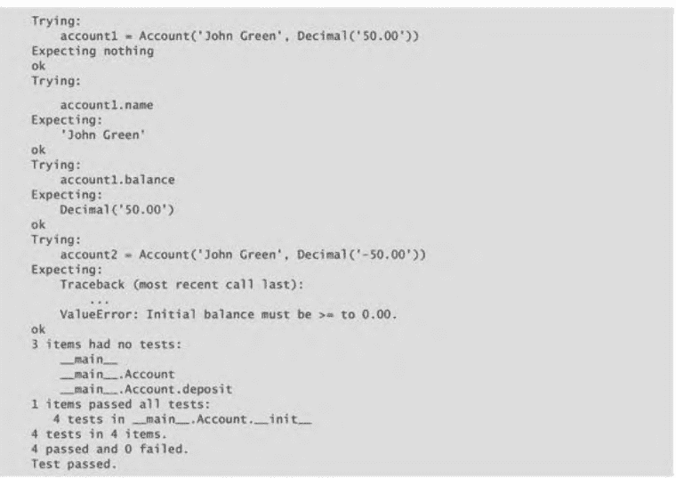

在verbose模式下，对于每个测试用例，testmod函数首先在“Trying”中显示该测试用例要执行的代码，然后在“Expecting”中显示期望的输出结果，最后，如果测试成功，则显示“ok”。在verbose模式下完成测试后，testmod函数显示测试结果的摘要信息。

为了演示测试失败的情况，这里通过在前面加#的方式，将accountdoctest.py中的第25和26行代码注释掉，然后再以脚本方式运行accountdoctest.py。为了节省篇幅，这里仅显示表明测试失败的部分doctest输出结果：

```

...

********************************************************

File "accountdoctest.py", line 18, in __main__.Account.__init__

Failed example:

account2 = Account('John Green', Decimal('-50.00'))

Expected:

Traceback (most recent call last):

...

ValueError: Initial balance must be >= to 0.00.

Got nothing

********************************************************

1 items had failures:

1 of 4 in __main__.Account.__init__

4 tests in 4 items.

3 passed and 1 failed.

***Test Failed*** 1 failures.

```

从输出中可以看到，本例第18行的测试用例未通过。testmod函数在执行第18行的测试用例时，期望的输出结果是一个回溯信息，以表明由于初始余额值无效而引发了ValueError异常。但因为前面已将第25和26行的代码注释掉了，所以不会产生任何异常、测试失败。作为负责定义此类的程序员，通过这个失败的测试用例，可以看出__init__方法中用于验证数据值是否有效的代码存在问题。

### IPython的`%doctest_mode`魔术命令

为已有代码创建doctest的一种便捷方法是，使用IPython交互式会话来测试代码，然后将该会话中的内容（包括测试代码和期望输出）复制并粘贴到文档字符串中。需要注意，IPython的In[]和Out[]提示与doctest不兼容，因此IPython提供了魔术命令`%doctest_mode`，以能够用与doctest兼容的格式显示提示信息。该魔术命令可以使IPython提示在两种方式之间切换：在第一次执行`%doctest_mode`时，IPython提示会切换到“以>>>作为输入提示、没有输出提示”的方式（该方式与doctest要求的格式一致）；而在第二次执行`%doctest_mode`时，IPython提示会切换回“In[]和Out[]提示”的方式。

## 10.15 命名空间和作用域

在第4章中，已经展示了每个标识符都有一个作用域，其决定了一个标识符可以在程序中的哪些地方使用。前面已经介绍了局部作用域和全局作用域，这里介绍命名空间并在命名空间的基础上讨论作用域。

命名空间决定了作用域，其以字典形式将标识符与对象相关联。所有的命名空间相互独立，因此，同样的标识符可以出现在多个命名空间中。主要有局部、全局和内置3种命名空间，下面分别介绍。

### 局部命名空间

每个函数或方法都有一个局部命名空间，其将局部标识符（如参数和局部变量）与对象相关联。一个局部命名空间从一个函数或方法被调用的时刻开始存在，直到该函数或方法执行结束，该局部命名空间终止，且该局部命名空间仅在被调用的这个函数或方法中可访问。在一个函数或方法的语句序列中，为一个不存在的变量赋值会创建一个局部变量并将其加到局部命名空间中。对于局部命名空间中的标识符，其作用域是从定义它们的位置开始，直到其所在函数或方法结束的位置终止。

### 全局命名空间

每个模块有一个全局命名空间，其将一个模块的全局标识符（如全局变量、函数名和类名）与对象相关联。当加载一个模块时，Python会创建该模块的全局命名空间，且该模块的全局命名空间直到程序（或交互式会话）结束时才终止。对于全局命名空间中的标识符，其作用域是其所在模块中的代码。一个IPython会话有自己的全局命名空间，其包含了在该会话中创建的所有标识符。

每个模块的全局命名空间中都有一个名字为 `__name__` 的标识符，其存储了模块的名字，如math模块中 `__name__` 的值是'math'、random模块中 `__name__` 的值是'random'。如前面所讲的doctest程序示例所展示的，当以脚本方式运行.py文件时，该模块中__name__的值是'__main__'。

### 内置命名空间

在内置命名空间中，将Python内置标识符（如input、range等函数和int、float、str等类型）与定义这些内置标识符的对象相关联。当解释器开始执行时，Python会创建内置命名空间。对于内置命名空间中的标识符，其作用域是所有代码。

### 在命名空间中查找标识符

在使用一个标识符时，Python会在当前可访问的命名空间中搜索该标识符。搜索顺序是先局部命名空间、再全局命名空间，最后是内置命名空间。这里以下面的IPython会话为例说明命名空间的搜索顺序：

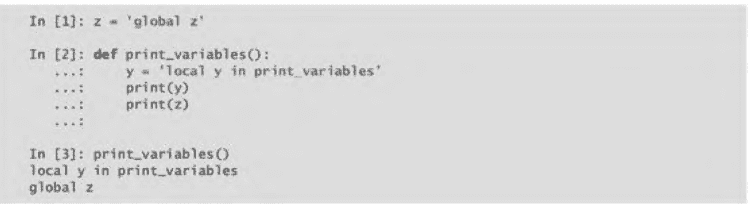

在IPython会话中定义的标识符（这里指代码段[1]中的z）会被放在会话的全局命名空间中。当代码段[3]调用print_variables时，Python按下列方式搜索局部、全局和内置命名空间：

- 代码段[3]并没有在一个函数或方法的内部，因此当前可访问的命名空间包括会话的全局命名空间和内置命名空间。Python会先搜索会话的全局命名空间，其包含了print_variables，所以print_variables在作用域中，Python使用相应的对象调用print_variables。
- 在print_variables函数开始执行时，Python会创建该函数的局部命名空间。当print_variables函数定义局部变量y时，Python则将y添加到函数的局部命名空间中。当前y在作用域中，直到函数执行结束，y的作用域才终止。
- print_variables函数调用了内置函数print，并将y作为参数传给了print。为了执行这个调用，Python必须解析y和print这两个标识符。标识符y是定义在局部命名空间中，因此y在作用域中，Python将使用相应的对象（即字符串'local y in print_variables'）作为print的参数。接下来，Python查找print对应的对象。首先，在局部命名空间中查找，该命名空间中没有定义print；然后，在会话的全局命名空间中查找，该命名空间中也没有定义print；最后，在内置命名空间中找到了print的定义。因此，print在作用域中，Python可以使用内置命名空间中找到的相应对象调用print函数。
- print_variables函数再次调用内置函数print，并将z作为参数传给了print。局部命名空间中没有定义z，则Python继续在全局命名空间中查找z，而全局命名空间中定义了z。因此，z在作用域中，Python使用相应的对象（即字符串'global z'）作为print的参数。然后，Python仍然是在内置命名空间中找到了标识符print，并使用相应的对象调用print。
- 此时，已执行到print_variables函数语句序列的结束位置。因此，该函数执行结束，其局部命名空间被销毁，局部变量y也就成为未定义的标识符。

下面通过显示y来证明y是未定义的标识符：

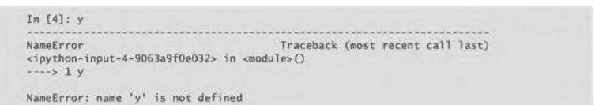

本例中，没有局部命名空间，因此Python直接在会话的全局命名空间中搜索y。全局命名空间中没有定义y，因此Python继续在内置命名空间中搜索y。同样，内置命名空间中也没有定义y。此时已经没有其他命名空间供继续搜索了，因此Python引发了NameError异常，表明y是未定义的标识符。

标识符print_variables和z仍然存在于会话的全局命名空间中，因此可以继续使用这两个标识符。例如，下面的代码显示了z的值：

```

In [5]: z

Out[5]: 'global z'

# 实战解析：Python 绘制纽约百年气温回归曲线

启动交互式环境并启用绘图支持，为后续可视化做好准备。

```

### 嵌套函数

前面所介绍的内容没有涉及的一个命名空间是封闭命名空间。Python允许在其他函数或方法内部定义嵌套函数。例如，如果一个函数或方法多次执行同样的任务，则可以定义一个嵌套函数，以避免在这个封闭函数（即包含嵌套函数定义的那个函数）中重复书写多次同样的代码。在一个嵌套函数中访问一个标识符时，Python会先搜索嵌套函数的局部命名空间，再搜索封闭函数的局部命名空间，然后是全局命名空间，最后搜索内置命名空间。这有时被称作LEGB规则，即 local （局部）、enclosing （封闭）、global （全局）、built-in （内置）的首字母组合。

### 类命名空间

每个类都有一个命名空间，其存储了类属性。在访问一个类属性时，Python会先在类命名空间中搜索这个属性，然后搜索基类命名空间，按此规则直到找到这个属性（则查找成功），或者直到在object类中也没有找到这个属性（查找失败）。查找失败时会引发NameError异常。

### 对象命名空间

每个对象都有自己的命名空间，其存储了该对象的方法和数据属性。类的__init__方法从一个空对象（self）开始，将每个属性依次添加到对象的命名空间中。一旦在一个对象的命名空间中定义了一个属性，则使用这个对象的客户端代码就可以访问这个属性的值。

## 10.16 数据科学入门：时间序列和简单线性回归

前面已经介绍了列表、元组和数组等序列数据，本节将讨论时间序列。时间序列是与时间点相关联的值（称作观测）的序列，如每日收盘价格、每小时温度读数、飞机飞行中的位置变化、每年作物产量、每季度公司利润这些都是时间序列数据。来自全球Twitter用户的带时间戳的推文流也是一个时间序列数据，第12章将深入讨论Twitter数据。

本节将使用一个称为简单线性回归的技术，完成时间序列数据的预测。这里使用1895～2018年纽约市的1月份平均高温数据，一方面预测未来的1月份平均高温，另一方面估计1895年以前那些年的1月份平均高温。

第14章将使用scikit-learn库再次讨论这个例子，而第15章将使用递归神经网络（RNN）分析时间序列。

时间序列在金融应用和物联网（IoT）领域非常流行，第16章对此会做具体讨论。

本节利用Seaborn和pandas显示图形，而Seaborn和pandas都使用了Matplotlib，因此在启动IPython时需要启用Matplotlib支持：

```

```bash
ipython --matplotlib
```

首先定义华氏度转摄氏度的计算逻辑，这里利用匿名函数简化书写。

```

### 时间序列

这里使用的时间序列数据是按年份顺序排列的。单变量时间序列中，每个时间点只有一个观测值，如某年纽约市1月份高温的平均值。而多变量时间序列中每个时间点有两个或更多个观测值，如天气应用中的温度、湿度和气压读数。这里分析的是单变量时间序列。

常对时间序列执行的两个任务如下：

- 时间序列分析，即根据现有时间序列数据得到其模式信息，以帮助数据分析师理解数据。一个常见的分析任务是查找数据中的季节性规律，如纽约市月平均高温随季节（春、夏、秋、冬）的显著变化情况。
- 时间序列预测，即使用过去的数据预测未来的数据。

本节讨论时间序列预测任务。

### 简单线性回归

使用称为简单线性回归的技术，可以通过对月份（即每年的1月份）和纽约市1月份平均高温建立线性关系，完成预测任务。给定表示自变量（年-月）和因变量（该年-月的平均高温）的值合集，简单线性回归使用一条直线表示这两个变量之间的关系，这条直线被称作回归线。

### 线性关系

这里通过华氏温度（Fahrenheit）和摄氏温度（Celsius）理解线性关系的概念。给定华氏温度，则可以使用以下公式计算相应的摄氏温度：

```

```python
c = 5 / 9 * (f - 32)
```

构建转换函数并批量生成 0 到 100 度华氏度（步长 10）对应的摄氏度数值对。

```

在这个公式中，f（华氏温度）是自变量，而c（摄氏温度）是因变量，即c的取值依赖于计算中所使用的f的值。

绘制华氏温度及其相应的摄氏温度将产生一条直线。为了展示这一点，首先创建一个lambda函数实现前面的公式，并用这个lambda函数计算华氏温度以10为增量、在0~100的范围依次取值时对应的摄氏温度。每一个华氏温度/摄氏温度对以元组的形式保存在temps中：

```

```python
In [1]: c = lambda f: 5 / 9 * (f - 32)

In [2]: temps = [(f, c(f)) for f in range(0, 101, 10)]
```

引入 pandas 将数据装入 DataFrame，随后调用绘图接口生成折线图，线型设为点划线并标注纵轴名称。

```


然后，将数据放在一个DataFrame中，并调用该DataFrame的plot方法显示华氏温度和摄氏温度之间的线性关系。plot方法的style关键字参数决定了数据的显示风格，字符串'-.'中的点表示每个数据显示为一个点，而短横线表示用线连接这些点。plot方法默认仅在图形的左上角显示'Celsius'，这里将y轴标签手动设置为'Celsius'。

```

```python
In [3]: import pandas as pd

In [4]: temps_df = pd.DataFrame(temps, columns=['Fahrenheit', 'Celsius'])

In [5]: axes = temps_df.plot(x='Fahrenheit', y='Celsius', style='-.')

In [6]: y_label = axes.set_ylabel('Celsius')
```

读取纽约 1895-2018 年 1 月平均最高气温的 CSV 文件，开始正式分析真实数据集。

```

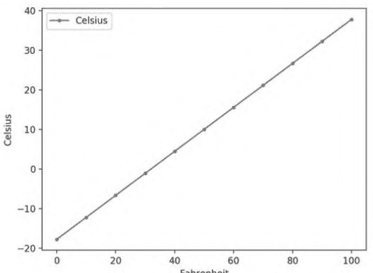

### 简单线性回归方程的组成

对于二维情况下沿着任一直线排列的那些点（类似于前面的图形所示的情况），可以使用以下等式表示：

$y = mx + b$

其中，

- m是直线的斜率；
- b是x=0处直线在y轴上的截距；
- x是自变量（下图中的date）；
- y是因变量（下图中的temperature）。

在简单线性回归中，y是给定x的预测值。

### SciPy的stats模块中的linregress函数

简单线性回归通过对数据的最佳拟合确定一条直线的斜率（m）和截距（b）。下图显示了后面要处理的时间序列数据的几个点以及对应的回归线，并通过竖线表示了每个数据点到回归线的距离。

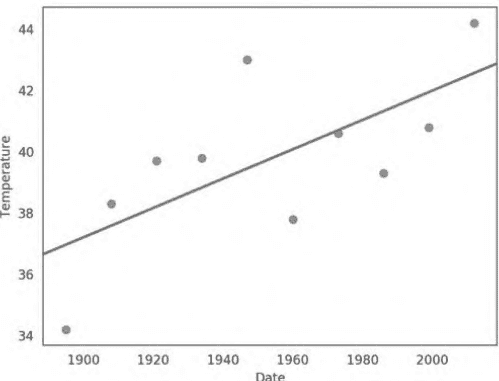

简单线性回归算法迭代地调整斜率和截距。在每次迭代中，以每个点到直线的距离的平方作为调整依据。调整斜率和截距，使所有的数据点到直线的平方距离和最小，此时就得到了最佳拟合结果。这个过程被称为普通最小二乘计算。

在Python中，SciPy（Scientific Python）库广泛应用于工程、科学和数学等领域的问题求解。其中，scipy.stats模块的linregress函数可以完成简单线性回归任务。在调用linregress后，可以得到回归线的斜率和截距，将它们代入y = mx + b方程式即可进行预测。

### pandas

在前面几章的数据科学入门小节中，已经使用了pandas进行数据操作，本书的后面会继续使用pandas。本例将保存在CSV文件中的纽约市1895～2018年的1月份平均高温数据加载到了一个DataFrame中。接着，我们将格式这些数据以在示例中使用。

### Seaborn可视化

本例将使用Seaborn绘制DataFrame的数据，并使用回归线显示1895～2018年的平均高温趋势。

### 从NOAA获取天气数据

美国国家海洋和大气管理局（NOAA）提供了大量的公开历史数据，其中包括不同时间段内特定城市的平均高温时间序列。

我们可从NOAA的“Climate at a Glance”时间序列（见 https://www.ncdc.noaa.gov/cag/）中获得纽约市1895～2018年的1月份平均高温数据。

在上述网页上，可以选择整个美国、美国某些地区、某些州、某些城市等不同区域，也可以选择温度、降水量或其他等不同数据。设置好区域和时间范围后，单击Plot按钮可以显示图表和包含所选数据的表格。该表的顶部显示了供以多种格式（包括CSV）下载数据的链接，在第9章中已对此进行过讨论。在撰写本书时，NOAA提供的最大日期范围是1895～2018年。为方便起见，本书ch10示例文件夹的ave_hi_nyc_jan_1895-2018.csv文件中提供了本例所使用的数据。如果使用自己下载的数据，请注意将“Date,Value,Anomaly”所在行前面的那些行都删除。

该数据的每个观测值包含三列：

- Date: 'YYYYMM'形式的值（如'201801'）。由于仅下载了每年1月份的数据，所以MM的值总是01。
- Value: 浮点数形式的华氏温度。
- Anomaly: 当前日期的值与所有日期的平均值之间的差异。本例并没有使用该列数据。

### 将平均高温数据加载到一个DataFrame中

下面从ave_hi_nyc_jan_1895-2018.csv文件加载并显示纽约市数据：

```

```python
In [7]: nyc = pd.read_csv('ave_hi_nyc_jan_1895-2018.csv')
```

查看数据前几行与末尾几行，快速掌握原始结构与内容范围。

```

通过查看DataFrame的头部和尾部可以了解数据的情况：

```

```python
In [8]: nyc.head()
```

```

| Date | Value | Anomaly |
|------|-------|---------|
| 189501 | 34.2 | -3.2 |
| 189601 | 34.7 | -2.7 |
| 189701 | 35.5 | -1.9 |
| 189801 | 39.6 | 2.2 |
| 189901 | 36.4 | -1.0 |

```

```python
In [9]: nyc.tail()
```

重命名列名以便后续引用，分别对应年份、温度与偏差值。

```

| Date | Value | Anomaly |
|------|-------|---------|
| 201401 | 35.5 | -1.9 |
| 201501 | 36.1 | -1.3 |
| 201601 | 40.8 | 3.4 |
| 201701 | 42.8 | 5.4 |
| 201801 | 38.7 | 1.3 |

### 清理数据

后面会使用Seaborn来绘制Date-Value对和回归线。在绘制DataFrame数据时，Seaborn使用DataFrame的列名称作为轴标签。为了便于阅读，这里将'Value'列重命名为'Temperature'：

```

```python
In [10]: nyc.columns = ['Date', 'Temperature', 'Anomaly']
```

抽样前三行确认重命名生效。

```

```

```python
In [11]: nyc.head(3)
```

检查日期列数据类型，确认为 64 位整数，格式类似 `YYYYMMDD`。

```

| Date | Temperature | Anomaly |
|------|-------------|---------|
| 189501 | 34.2 | -3.2 |
| 189601 | 34.7 | -2.7 |
| 189701 | 35.5 | -1.9 |

Seaborn用Date值标记x轴上的刻度线。本示例仅处理1月份的温度，如果x轴的标签不包含01（1月份），那么会有更好的可读性，因此这里将每个Date数据最后的01删除。首先，检查Date列的数据类型：

```

```python
In [12]: nyc.Date.dtype
Out[12]: dtype('int64')
```

通过整除 100 剥离月日信息，仅保留年份部分用于建模。

```

可见，Date列的数据值是整数，因此可以通过除以100将最后两位数字截掉。前面介绍过，一个DataFrame中的每一列是一个Series。调用Series的floordiv方法即可对Series的每个元素执行整数除运算：

```

```python
In [13]: nyc.Date = nyc.Date.floordiv(100)
```

再次抽样验证年份提取是否正确。

```

```

```python
In [14]: nyc.head(3)
```

设置浮点数显示精度为两位小数，优化统计摘要输出格式。

```

| Date | Temperature | Anomaly |
|------|-------------|---------|
| 1895 | 34.2 | -3.2 |
| 1896 | 34.7 | -2.7 |
| 1897 | 35.5 | -1.9 |

### 计算数据集的基本描述性统计信息

通过Temperature列调用describe方法，可快速得到数据集关于温度的统计信息。从结果中可以看到，该数据集包含124个观测值，这些观测值的均值是37.60，最低值和最高值分别是26.10和47.60：

```

```python
In [15]: pd.set_option('precision', 2)
```

输出温度列的描述性统计，包含均值、标准差、分位数等关键指标。

```

```

```python
In [16]: nyc.Temperature.describe()
```

调用 SciPy 统计模块，以年份为自变量、温度为因变量执行简单线性回归拟合。

```

| | |
|---|---|
| count | 124.00 |
| mean | 37.60 |
| std | 4.54 |
| min | 26.10 |
| 25% | 34.58 |
| 50% | 37.60 |
| 75% | 40.60 |
| max | 47.60 |

Name: Temperature, dtype: float64

### 预测未来1月份的平均高温

在Python中，SciPy库广泛应用于工程、科学和数学领域的问题求解。其stats模块所提供的linregress函数，可以根据给定数据点集合计算回归线的斜率和截距：

```

```python
In [17]: from scipy import stats

In [18]: linear_regression = stats.linregress(x=nyc.Date,
...:                                   y=nyc.Temperature)
...:
```

获取回归模型的斜率与截距，斜率为正说明存在升温趋势。

```

linregress函数接收两个长度相同的一维数组作为参数，这两个一维数组分别表示数据点的x坐标和y坐标。关键字参数x表示自变量，y表示因变量。linregress函数返回的对象包含了回归线的斜率和截距：

```

```python
In [19]: linear_regression.slope
Out[19]: 0.00014771361132966167

In [20]: linear_regression.intercept
Out[20]: 8.694845520062952
```

代入 2019 年预测该年 1 月平均最高气温，结果约为 38.5 华氏度。

```

将斜率和截距代入简单线性回归方程y = mx + b，即可根据给定年份预测纽约市1月份的平均高温。首先预测2019年1月的平均华氏温度。在下面的计算中，linear_regression.slope是m，2019是x（即所要预测温度的日期值），而linear_regression.intercept是b：

```

```python
In [21]: linear_regression.slope * 2019 + linear_regression.intercept
Out[21]: 38.51837136113298
```

同理回溯至 1890 年，估算值约为 36.6 华氏度，直观对比百年温差。

```

另外，也可以估算1895年之前那些年的平均高温。例如，下面的代码估算了1890年1月份的平均高温：

```

```python
In [22]: linear_regression.slope * 1890 + linear_regression.intercept
Out[22]: 36.612865774980335
```

引入 Seaborn 绘制带置信区间的回归散点图，风格设为白底网格增强可读性。

```

本例在拟合简单线性回归的斜率和截距时，使用了1895～2018年的数据。一般来说，要预测的年份超出此范围越多，预测结果的可靠性就越低。

### 绘制平均高温和回归线

接下来，使用Seaborn的regplot函数绘制每个数据点，其中，x轴为Date，y轴为Temperature。regplot函数创建了下面所示的散点图，其中，零散的点表示给定日期对应的温度，穿过这些点的那条直线是回归线。

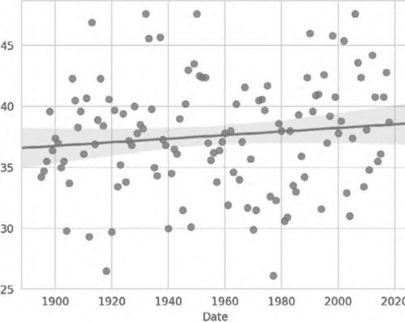

请注意，执行下面的代码前，先关闭之前显示的Matplotlib窗口。否则，regplot将使用已包含图形的现有窗口进行散点图的绘制。regplot函数的关键字参数x和y是具有相同长度的一维数组，表示要绘制的x-y坐标对。前面介绍过，如果名称是有效的Python标识符，则pandas会自动为每个列名创建属性：

```

```python
In [23]: import seaborn as sns

In [24]: sns.set_style('whitegrid')

In [25]: axes = sns.regplot(x=nyc.Date, y=nyc.Temperature)
```

限定纵轴范围在 10 到 70 之间，聚焦核心数据分布区间完成最终呈现。

```

回归线的斜率（左侧较低，右侧较高）表示过去124年的变暖趋势。在该图中，y轴在最小值26.1和最大值47.6之间的21.5的范围内取值，因此数据看起来显著地分布在回归线的上方和下方，难以看出线性关系。这是数据分析可视化中的一个常见问题，即如果有反映不同类型数据的轴（本例中分别是日期和温度），应如何合理地确定它们各自的尺度？在上图中，纯粹是图形高度的问题，Seaborn和Matplotlib会根据数据的取值范围自动对轴进行缩放。对于该问题，可以通过缩放y轴的取值范围来使线性关系更加明显，这里将y轴从21.5的范围缩放到60的范围（从10到70）：

```

```python
In [26]: axes.set_ylim(10, 70)
Out[26]: (10, 70)
```

# 手把手教你用 TextBlob 玩转 NLP 基础操作

想快速上手自然语言处理？TextBlob 绝对是新手的神器。咱们不废话，直接从环境搭建干到核心功能演示。

## 1. 极速部署环境

打开终端，敲两行命令搞定安装与语料下载：

```

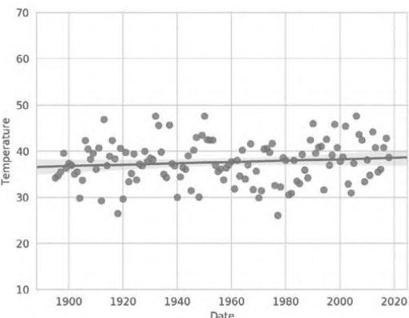

### 获取时间序列数据集

以下给出一些热门网站，在这些网站中可以找到供你学习的时间序列数据：

#### 时间序列数据集来源

https://www.ncdc.noaa.gov/cag/

这是美国国家海洋和大气管理局（NOAA）的 “Climate at a Glance” 网站，其提供了全球和美国天气相关的时间序列数据。

https://www.esrl.noaa.gov/psd/data/timeseries/

这是NOAA的地球系统研究实验室（ESRL）网站，其提供了月度和季节性气候相关的时间序列数据。

https://www.quandl.com/search

Quandl提供了数百个免费的金融相关的时间序列数据，同时也提供了收费的时间序列数据。

https://datamarket.com/data/list/?q=provider:tsdl

时间序列数据库（TSDL）提供了涉及许多行业的数百个时间序列数据集的链接。

http://informweb.umd.edu/econdata/econdata.html

马里兰大学的EconData服务提供了来自美国各政府机构的数千个与经济时间序列有关的链接。

## 10.17 小结

本章详细讨论了如何制作有价值的类。通过本章应掌握如何定义类、如何创建类的对象、如何访问对象的属性以及调用对象的方法。另外，也应掌握特殊方法__init__的使用，其用于创建和初始化新对象的数据属性。

本章还讨论了属性的访问控制和property的使用。客户端代码可以直接访问对象的所有属性。以单下划线（_）开始的标识符，表示不应该由客户端代码直接访问的属性。通过以双下划线（__）开始的命名约定可以实现“私有”属性，Python会自动修改这些“私有”属性的名称。

本章实现了一个洗牌和分牌模拟程序，其包括一个Card类和一个用于维护扑克牌列表的DeckOfCards类，并使用Matplotlib分别以字符串和图像形式显示整副牌。该程序中引入了特殊方法__repr__、__str__和__format__，以创建对象的字符串表示。

本章研究了Python用于创建基类和子类的功能。在创建子类时，该子类能够从其基类继承许多功能，然后再根据需要增加新的功能，在子类中也可以重写基类的方法。通过创建一个同时包含基类对象和子类对象的列表，演示了Python编程中的多态。

本章介绍了运算符重载，其用来定义Python的内置运算符如何处理自定义类类型的对象。实际上，运算符重载是通过对所有类从object类继承的各种特殊方法进行重写来实现的。本章讨论了Python异常类层次结构并创建了自定义异常类。

本章展示了如何创建一个具名元组，利用具名元组可以通过属性名称而不是索引号来访问元组元素。接下来，本章介绍了Python 3.7中新增的数据类，使用数据类可以自动生成类定义中通常包含的各种样板代码，如__init__、__repr__和__eq__这些特殊方法中的代码。

本章介绍了如何在文档字符串中为代码编写单元测试用例，并展示了如何通过doctest模块的testmod函数方便地执行这些测试用例。本章还讨论了Python用于确定标识符作用域的各种命名空间。

本书后面将给出一系列使用AI和大数据技术的案例研究，讨论自然语言处理、Twitter数据挖掘、IBM Watson和认知计算、监督和无监督机器学习、涉及卷积神经网络和递归神经网络的深度学习等方面的内容。此外，还会讨论大数据软件和硬件基础设施，包括NoSQL数据库、Hadoop和Spark。

# 第四部分

## 人工智能、云和大数据案例研究

- 第11章 自然语言处理
- 第12章 Twitter数据挖掘
- 第13章 IBM Watson和认知计算
- 第14章 机器学习：分类、回归和聚类
- 第15章 深度学习
- 第16章 大数据：Hadoop、Spark、NoSQL和IoT

# 第11章

## 自然语言处理

## 目标

- 执行自然语言处理任务，这是后面有关数据科学案例研究章节的基础。
- 运行大量的NLP演示程序。
- 使用TextBlob、NLTK、Textatistic和spaCy NLP库及其预训练模型来执行各种NLP任务。
- 将文本标记为单词和句子。
- 使用词性标注。
- 使用情感分析来确定文本是正面的、负面的还是中性的。
- 使用TextBlob库的Google Translate支持检测文本语言，并进行跨语言翻译。
- 通过词干提取和词形还原得到词根。
- 使用TextBlob库的拼写检查和拼写校正功能。
- 获取单词定义、同义词和反义词。
- 从文本中删除停用词。
- 创建词云。
- 使用Textatistic库确定文本可读性。
- 使用spaCy库进行命名实体识别和相似性检测。

## 11.1 简介

闹钟将你唤醒，你可以点击“关闭闹钟”按钮。你可以使用智能手机阅读短信并查看最近的新闻。你可以听电视节目主持人采访名人，与家人、朋友和同事交谈并倾听他们的回应。你有一个听力受损的朋友，他喜欢可隐藏字幕的视频节目，你们通过手语交流。你有一个盲人同事，他读盲文、听电脑阅读器阅读的书籍，并通过屏幕阅读器了解电脑屏幕上的内容。你会阅读电子邮件、区分垃圾邮件与重要邮件，并发送电子邮件。你读过小说或非小说作品。你开车时会观察路标，如“停止”“限速35”和“道路正在施工”。你向自己的汽车下达口头命令，如“给家里打电话”“播放古典音乐”，或提出问题，如“最近的加油站在哪里？”。你教孩子如何说和读，发一张慰问卡给朋友。你看书、报纸和杂志，在课堂或会议期间做笔记。你学习外语，准备出国旅游。你收到客户用西班牙语发来的电子邮件，并通过免费的翻译软件理解邮件内容。你用英语回复邮件，知道客户可以轻松地将邮件翻译回西班牙语。如果你不确定电子邮件的语言，语言检测软件会自动为你确定语言并将邮件翻译成英语。

这些是文本、语音、视频、手语、盲文等自然语言通信的示例，还有其他形式的语言，如英语、西班牙语、法语、俄语、中文、日语和数百种其他语言。在本章中，我们将通过一系列需要动手实践的演示程序和IPython会话掌握多种自然语言处理（Natural Language Processing, NLP）功能，并在后面的数据科学案例研究章节中使用这些NLP功能。

自然语言处理是在文本合集上进行的，包括推文、Facebook帖子、对话、影评、莎士比亚戏剧、历史文献、新闻、会议日志，等等。一个文本合集称为一个语料库（corpus）。

自然语言不像数学一样精密，意思间的细微差别使得它理解起来并不容易，文本的含义可能受其上下文和读者“世界观”的影响，例如，搜索引擎可以通过我们的搜索历史“了解我们”，这样可以给我们提供更好的搜索结果，但缺点是，可能侵犯我们的个人隐私。


## 11.2 TextBlob

TextBlob是一个面向对象的NLP文本处理库，基于NLTK库和pattern库构建，但简化了它们的许多功能。TextBlob可以执行的一些NLP任务，包括：

- 分词—将文本拆分为有意义的单元（即标记），如单词和数字。
- 词性（POS）标注—识别每个单词的词性，例如名词、动词、形容词等。
- 名词短语提取—定位代表名词的单词组，例如 “red brick factory”。
- 情感分析—确定文本是否具有正面、中性或负面的情感。
- 由Google Translate提供跨语言翻译和语言检测支持。
- 变形—把单词复数化或单数化。变形还有其他方面的内容，但不属于TextBlob库的范畴。
- 拼写检查和拼写校正。
- 词干提取—通过删除前缀或后缀把单词缩减为词干。例如，varieties的词干是varieti。
- 词形还原—类似于词干提取，但它是基于原始词的上下文生成真实的单词。例如，varieties的词形还原是 “variety”。
- 词频—确定每个单词在语料库中出现的频率。
- WordNet集成—用于查找单词的定义、同义词和反义词。
- 去停用词—删除一些常用单词，例如a、an、the、I、we、you等，以分析语料库中的重要单词。
- n元—语料库中产生的连续单词集合，用于识别经常彼此相邻的单词。

其中，很多功能都可以用作更复杂的NLP任务，本节将使用TextBlob和NLTK执行这些NLP任务。

### 安装textblob模块

为了安装textblob，需打开Anaconda Prompt（Windows）、Terminal（macOS / Linux）或shell（Linux），然后执行以下命令：

```
conda install -c conda-forge textblob

```

Windows用户可能需要以管理员身份运行Anaconda Prompt，才能获得正确的软件安装权限。为此，需要在开始菜单中右键单击Anaconda Prompt选项，然后选择More > Run as administrator。

安装完成后，执行以下命令下载TextBlob使用的NLTK语料库：

```
ipython -m textblob.download_corpora

## 2. 核心对象初探

启动 IPython，几行代码建立 `TextBlob` 对象，后续所有操作都基于它：

```

其中包括：

- Brown Corpus（出自布朗大学），用于词性标注。
- Punkt，用于英文句子分词。
- WordNet，用于单词的定义、同义词和反义词。
- Averaged Perceptron Tagger，用于词性标注。
- conll2000，用于组块分析，将文本分成组块，如名词、动词、名词短语等。conll2000的名字的取自“Conference on Computational Natural Language Learning”，conll2000语料库由该会议推出。
- Movie Reviews，用于情感分析。

### 古腾堡工程

古腾堡工程的免费电子书是文本分析的重要来源，请参阅 https://www.gutenberg.org。该网站提供57,000多种不同格式的电子书，包括纯文本文件，它们在美国不受版权保护。有关古腾堡工程在其他国家/地区的使用条款和版权信息，请参阅 https://www.gutenberg.org/wiki/Gutenberg:Terms_of_Use。

在本节的一些示例中，我们使用莎士比亚的Romeo and Juliet的纯文本电子书文件，请参阅 https://www.gutenberg.org/ebooks/1513。古腾堡工程不允许以编程方式访问该电子书，除非只是复制书籍。如果想将Romeo and Juliet作为纯文本电子书下载，需右键单击书籍网页上的“Plain Text UTF-8”链接，然后选择“Save Link As...（Chrome / FireFox）”、“Download Linked File As...（Safari）”或“Save target as（Microsoft Edge）”选项将书籍保存到系统中。在ch11示例文件夹中，我们将其保存为RomeoAndJuliet.txt，以确保代码正常工作。出于分析目的，我们删除了“THE TRAGEDY OF ROMEO AND JULIET”之前的古腾堡工程文本，以及文件末尾的古腾堡工程信息，该信息从以下内容开始：

End of the Project Gutenberg EBook of Romeo and Juliet,
by William Shakespeare

### 11.2.1 创建一个TextBlob对象

TextBlob类是基于textblob模块的NLP基础类，下面创建一个包含两个句子的TextBlob对象：

```
In [1]: from textblob import TextBlob

In [2]: text = 'Today is a beautiful day. Tomorrow looks like bad weather.'

In [3]: blob = TextBlob(text)

In [4]: blob
Out[4]: TextBlob("Today is a beautiful day. Tomorrow looks like bad weather.")

## 3. 结构化拆解文本

### 3.1 切分句子
自动识别标点边界，输出句子列表：

```

TextBlob类（还有接下来会看到的Sentence类和Word类）支持字符串处理方法，可以与字符串进行比较，为多种NLP任务提供支持。Sentence、Word和TextBlob类都继承自BaseBlob类，因此它们有很多共同的方法和属性。

### 11.2.2 将文本标记为句子和单词

自然语言处理通常需要在执行其他NLP任务之前对文本进行标记，TextBlob类提供了方便的属性来访问其中的句子和单词。下面我们使用sentences属性来获取一个包含Sentence对象的列表：

```
In [5]: blob.sentences
Out[5]:
[Sentence("Today is a beautiful day."),
 Sentence("Tomorrow looks like bad weather.")]

### 3.2 提取词汇
将文本打散为单词序列，标点自动过滤：

```

words属性会返回一个WordList对象，包含一个Word对象的列表，表示TextBlob对象中删除标点符号后的单词：

```
In [6]: blob.words
Out[6]: WordList(['Today', 'is', 'a', 'beautiful', 'day', 'Tomorrow', 'looks', 'like', 'bad', 'weather'])

### 3.3 词性标注
逐词标记语法角色（NN=名词, VBZ=动词, JJ=形容词...）：

```

### 11.2.3 词性标注

词性标注是根据上下文确定单词词性的过程，有8个主要的英语词性—名词、代词、动词、形容词、副词、介词、连词和感叹词（感叹词是表达情感的单词，通常后跟感叹号，如“Yes！”或“Ha！”）。每个词性类别中有很多子类别。

有些词有多重含义，例如，单词“set”和“run”各有几百个含义！如果看一下“run”这个词在dictionary.com中的定义，会发现它可以是动词、名词、形容词或动词短语的一部分。词性标注的一个重要用途是确定单词在其可能的许多含义中的其中一个，这对于帮助计算机“理解”自然语言非常重要。

tags属性会返回一个元组列表，每个元组包含一个单词和一个表示其词性的字符串：

```
In [7]: blob
Out[7]: TextBlob("Today is a beautiful day. Tomorrow looks like bad weather.")

In [8]: blob.tags
Out[8]:
[('Today', 'NN'), ('is', 'VBZ'), ('a', 'DT'), ('beautiful', 'JJ'), ('day', 'NN'),
 ('Tomorrow', 'NNP'), ('looks', 'VBZ'), ('like', 'IN'), ('bad', 'JJ'), ('weather', 'NN')]

### 3.4 抽取名词短语
自动识别核心名词组合，关键信息一目了然：

```

默认情况下，TextBlob类使用PatternTagger来确定词性，该类使用了pattern库（https://www.clips.uantwerpen.be/pattern）的词性标注功能。

可以在https://www.clips.uantwerpen.be/pages/MBSP-tags上查看pattern库中的63种词性标注。

在前面的代码中：

- Today、day和weather被标注为NN—单数名词或不可数名词。
- is和looks被标注为VBZ—第三人称单数现在时动词。
- a被标注为DT—限定词。
- beautiful和bad被标注为JJ—形容词。
- Tomorrow被标注为NNP—专有单数名词。
- like被标注为IN—从属连词或介词。

### 11.2.4 提取名词短语

假如我们准备买滑水板，会先上网查一下，搜索“最好的滑水板”，这里“滑水板”是一个名词短语，如果搜索引擎没有正确解析名词短语，可能无法给出最佳搜索结果，这时候可以尝试搜索“最好的水”“最好的滑板”和“最好的滑水板”，看看分别能搜出什么。

TextBlob类的noun_phrases属性会返回一个WordList对象，它是一个包含多个Word对象的文本列表，文本中每个名词短语对应一个Word对象：

```
In [9]: blob
Out[9]: TextBlob("Today is a beautiful day. Tomorrow looks like bad weather.")

In [10]: blob.noun_phrases
Out[10]: WordList(['beautiful day', 'tomorrow', 'bad weather'])

## 4. 情感倾向实战测

先准备三句风格迥异的文本感受一下：

```

请注意，表示名词短语的Word对象可以包含多个单词，WordList是Python内置列表类型的扩展，提供了额外的用于词干提取、词形还原、单数化和复数化的方法。

### 11.2.5 使用TextBlob的默认情感分析器进行情感分析

最常见和最有价值的NLP任务之一是情感分析，用来确定文本是正面的、中性的还是负面的，例如，有些公司可能会用它来判断人们是否在网上对他们的产品做出正面或负面的评论。我们都知道表达积极的单词“好”和表达消极的单词“坏”，但不能仅仅因为一个句子包含“好”或“坏”来判定它表达的情感必然是积极的或消极的。例如下面的句子：

```
The food is not good.

```

显然有负面情绪。同样，

```
The movie was not bad.

```

显然有积极的情绪，虽然它可能没有下面这句话积极：

```
The movie was excellent!

回到主例句，直接调用 `.sentiment` 属性，返回极性与主观性双指标：

```

情感分析是一个复杂的机器学习问题，但TextBlob库已经包含了用来执行情感分析的预训练机器学习模型。

#### 获取TextBlob的Sentiment

TextBlob对象的sentiment属性会返回一个Sentiment对象，指示文本是正面的还是负面的，以及是客观的还是主观的：

```
In [11]: blob
Out[11]: TextBlob("Today is a beautiful day. Tomorrow looks like bad weather.")

In [12]: blob.sentiment
Out[12]: Sentiment(polarity=0.07500000000000007,

# 玩转 TextBlob：从情感分析到文本翻译的实战指南

在 Python 自然语言处理（NLP）的工具箱里，**TextBlob** 以其极简的 API 和强大的功能，成为初学者和快速原型开发的首选。今天我们就通过一系列实战代码，带你速通这个库的核心技能树。

## 一、 情感分析：洞察文本背后的情绪

### 1. 默认分析器：极性与主观性
TextBlob 内置的 PatternAnalyzer 能快速给出两个关键指标：**极性** 与 **主观性**。
- **极性**：范围 [-1, 1]，负数代表消极，正数代表积极。
- **主观性**：范围 [0, 1]，值越大越偏向个人观点，越小越接近客观事实。

```python
```

polarity表示情感，其值为-1.0（负面的）到1.0（正面的），0.0为中性情感。subjectivity是从0.0（客观的）到1.0（主观的）的值。根据TextBlob对象的情感分析结果，其整体情感接近中性，文本倾向主观。

#### 从Sentiment对象中获取polarity和subjectivity

上面的情感分析结果提供的精度可能高于大多数情况下我们的需求，这会降低数字输出的可读性。IPython的魔术命令%precision允许为独立float对象和float对象在内置类型（比如列表、字典和元组）中指定默认精度，下面使用这个魔术命令将polarity和subjectivity的值四舍五入到小数点后的第三位：

```
In [13]: %precision 3
Out[13]: '%.3f'

In [14]: blob.sentiment.polarity
Out[14]: 0.075

In [15]: blob.sentiment.subjectivity
Out[15]: 0.833
```

这段文本整体呈微弱积极（0.075），但主观性极强（0.833），暗示内容多为个人感受而非客观陈述。

### 2. 句子级细粒度分析
情绪往往在句子间流转，逐句拆解能还原更真实的语义图谱。

```python
```

#### 获取一个句子的情感

我们也可以以单个句子为单位获取情感，使用`sentences`属性来获取一个`Sentence`对象的列表，然后遍历并显示每个句子的`sentiment`属性：

```
In [16]: for sentence in blob.sentences:
    ...: print(sentence.sentiment)
    ...:
Sentiment(polarity=0.85, subjectivity=1.0)
Sentiment(polarity=-0.69999999999999998, subjectivity=0.6666666666666666)
```

第一句高度积极且纯主观；第二句转为消极，主观性下降。这种“过山车”式情绪在评论分析中极为常见。

### 3. 切换引擎：NaiveBayesAnalyzer
若需直接得到“正/负”标签及置信度，可切换为基于朴素贝叶斯的分析器（训练数据集为电影评论）。

```python
```

这个结果可能解释了为什么整个`TextBlob`对象的`sentiment`属性接近0.0（中性），因为该对象中一个句子的情感是正面的（0.85），而另一个是负面的（-0.69999999999999998）。

### 11.2.6 使用NaiveBayesAnalyzer进行情感分析

默认情况下，`TextBlob`对象以及从中获得的`Sentence`和`Word`对象使用`PatternAnalyzer`情感分析器来确定情感，它使用与`pattern`库相同的情感分析技术。`TextBlob`库还附带了一个在影评数据库上训练的`NaiveBayesAnalyzer`情感分析器（`textblob.sentiments`模块），其中的朴素贝叶斯方法是一种常用的机器学习文本分类算法，回想一下上文，我们正在进行的IPython会话中，`text`包含的语句为“Today is a beautiful day. Tomorrow looks like bad weather.”。下面的代码使用`analyzer`关键字参数来指定情感分析器：

```
In [17]: from textblob.sentiments import NaiveBayesAnalyzer
In [18]: blob = TextBlob(text, analyzer=NaiveBayesAnalyzer())
In [19]: blob
Out[19]: TextBlob("Today is a beautiful day. Tomorrow looks like bad weather.")
```

整体判定为 **消极**，但正向概率接近 0.48，负向仅 0.52，胜出并不明显。

```python
```

下面使用`TextBlob`类的`sentiment`属性，通过指定的`NaiveBayesAnalyzer`情感分析器来展示文本的情感：

```
In [20]: blob.sentiment
Out[20]: Sentiment(classification='neg', p_pos=0.47662917962091056,
p_neg=0.5233708203790892)
```

逐句来看，分化更加剧烈：

```python
```

整体情感被归类为负面（classification='neg'），但 Sentiment 对象中的 p_pos 显示该 TextBlob 对象有 47.66% 的正面情感，p_neg 显示有 52.34% 的负面情感，由于整体情感略微偏负面，我们认为这个 TextBlob 对象的情感为中性。

下面来获取每个句子的情感：

```
In [21]: for sentence in blob.sentences:
    ...:     print(sentence.sentiment)
    ...:
Sentiment(classification='pos', p_pos=0.8117563121751951,
p_neg=0.18824368782480477)
Sentiment(classification='neg', p_pos=0.174363226578349,
p_neg=0.8256367734216521)
```

第一句 81% 确信是积极，第二句 82% 确信是消极。**结论：长文本务必拆句分析，避免抹平细节。**

---

## 二、 语言识别与机器翻译：打破语言壁垒

TextBlob 封装了 Google Translate API，支持语言检测与多语言互译。

### 1. 自动检测语言
```python
```

请注意，我们从 NaiveBayesAnalyzer 得到的 Sentiment 对象不是 polarity 值和 subjectivity 值，而是情感类别—'pos'（正面的）或 'neg'（负面的），即从 0.0 到 1.0 的 p_pos（正面百分比）值和 p_neg（负面百分比）值。从结果中可以再次看到 TextBlob 对象的第一句话是正面的，第二句是负面的。

### 11.2.7 语言检测与翻译

跨语言翻译在自然语言处理和人工智能中是一个具有挑战性的问题。随着机器学习、人工智能和自然语言处理的进步，Google Translate（100多种语言）和微软 Bing 翻译器（60多种语言）等可以在不同语言之间实现即时翻译。

对于前往国外旅行的人来说，跨语言翻译也很有用。他们可以使用翻译 APP 来翻译菜单、路标等，甚至还可以现场语音翻译，以便与不了解自己语言的人实时交谈。有些智能手机现在可以通过耳机提供许多语言的实时翻译。在第 13 章中，我们将会开发一个可以在 Watson 支持的语言中实现近乎实时跨语言翻译的脚本。

TextBlob 库使用 Google Translate 来检测文本语言并将 TextBlob、Sentence 和 Word 对象转换成其他语言。下面使用 detect_language 方法来检测文本语言（'en' 代表英语）：

```
In [22]: blob
Out[22]: TextBlob("Today is a beautiful day. Tomorrow looks like bad weather.")
In [23]: blob.detect_language()
Out[23]: 'en'
```

### 2. 多语言翻译演示
**目标语：西班牙语**
```python
```

接下来，使用translate方法将文本翻译为西班牙语（'es'），并检验翻译结果。关键字参数to指定了目标语言：

```
In [24]: spanish = blob.translate(to='es')
In [25]: spanish
Out[25]: TextBlob("Hoy es un hermoso dia. Mañana parece mal tiempo.")
In [26]: spanish.detect_language()
Out[26]: 'es'
```

**目标语：中文（简体）**
```python
```

再将TextBlob对象翻译为简体中文（指定为'zh'或'zh-CN'），检验翻译结果：

```
In [27]: chinese = blob.translate(to='zh')
In [28]: chinese
Out[28]: TextBlob("今天是美好的一天。明天看起来像恶劣的天气。")
In [29]: chinese.detect_language()
Out[29]: 'zh-CN'
```

> **小贴士**：`translate()` 也支持显式指定源语言 `from_lang`，应对自动检测失准的场景。
```python
```

尽管translate函数可以通过'zh'或'zh-CN'指定简体中文，detect_language方法输出时通常将简体中文显示为'zh-CN'。

在上述情况中，Google Translate都会自动检测源语言，我们也可以通过将from_lang关键字参数传递给translate函数来显式地指定源语言，如：

```
chinese = blob.translate(from_lang='en', to='zh')
```

### 3. 回译验证质量
将翻译结果再译回英语，可直观评估语义保真度。

```python
```

Google Translate使用的是iso-639-1语言代码，请参阅 https://en.wikipedia.org/wiki/List_of_ISO_639-1_codes。对于支持的语言，可以使用这些代码作为from_lang和to关键字参数的值。 Google Translate支持的语言列表可参见 https://cloud.google.com/translate/docs/languages。在不带指定参数的情况下调用translate函数会将检测到的源语言翻译成英语：

```python
In [30]: spanish.translate()
Out[30]: TextBlob("Today is a beautiful day. Tomorrow seems like bad
weather.")

In [31]: chinese.translate()
Out[31]: TextBlob("Today is a beautiful day. Tomorrow looks like bad
weather.")
```
中文回译几乎完美复现原文，西班牙语版将 "looks like" 译为 "seems like"，语义等价但措辞微变。

---

## 三、 词形还原与复数化：处理词汇形态

英文单词形态多变，TextBlob 提供开箱即用的词形转换。

### 1. 单复数互转
```python
```

请注意翻译结果的细微差别。

## 11.2.8 变形：复数化和单数化

单词变形是指单词的不同形式之间的转化，例如单数和复数之间的转化（如“person”和“people”）、不同的动词时态（如“run”和“ran”）。为了更加精确地计算词频，可能需要首先将所有的变形单词转换为相同的形式，Word和Wordlist都支持将单词转化为相应的单数或复数形式，下面来将一组Word对象进行单复数转化：

```python
In [1]: from textblob import Word
In [2]: index = Word('index')
In [3]: index.pluralize()
Out[3]: 'indices'

In [4]: cacti = Word('cacti')
In [5]: cacti.singularize()
Out[5]: 'cactus'
```
连不规则变化（index/indices, cacti/cactus）都能精准处理。

### 2. 批量处理词表
```python
```

单复数转化非常复杂，正如上面所讲的，并不像在单词末尾添加或删除“s”或“es”那么简单。

可以使用WordList执行相同的操作：

```python
In [6]: from textblob import TextBlob
In [7]: animals = TextBlob('dog cat fish bird').words
In [8]: animals.pluralize()
Out[8]: WordList(['dogs', 'cats', 'fish', 'birds'])
```
注意 `fish` 复数不变，库内部词典覆盖完善。

---

## 四、 拼写纠错：从单词到句子的兜底方案

### 1. 单词级纠错与置信度
```python
```

请注意，单词“fish”的单复数形式是相同的。

## 11.2.9 拼写检查和拼写校正

对于自然语言处理任务，确保文本没有拼写错误是非常重要的，用于编写和编辑文本的软件包（如Microsoft Word、Google Docs和其他软件包）会在键入单词时自动检查拼写，并且通常会在拼写有误的单词下画红线，当然也可以手动调用其他拼写检查器。

我们可以使用spellcheck方法检查单词的拼写，该方法返回一个包含可能的正确拼写和对应置信度的元组列表。假设打算输入单词“they”，但我们误将其拼写为“theyr”，拼写检查结果会显示两个可能的更正，其中“they”这个词具有最高的置信度：

```python
In [1]: from textblob import Word
In [2]: word = Word('theyr')
In [3]: %precision 2
Out[3]: '%.2f'
In [4]: word.spellcheck()
Out[4]: [('they', 0.57), ('their', 0.43)]
```
返回候选词及概率，**they** 胜出。

### 2. 一键修正
```python
```

请注意，具有最高置信度的单词可能不是符合给定上下文的正确单词。

TextBlob、Sentence和Word对象都可以通过correct方法校正拼写错误，在Word对象上调用correct方法会返回具有最高置信度的正确拼写的单词（正如拼写检查的返回）：

```python
In [5]: word.correct() # chooses word with the highest confidence value
Out[5]: 'they'
```

### 3. 句子级自动纠错
实战中更常用的是对整句进行清洗。

```python
```

在TextBlob或Sentence对象上调用correct方法可以检查每个单词的拼写，对于不正确的单词，correct都会将其替换为具有最高置信度的正确拼写的单词：

```python
In [6]: from textblob import Word
In [7]: sentence = TextBlob('Ths sentense has misspelled wrds.')
In [8]: sentence.correct()
Out[8]: TextBlob("The sentence has misspelled words.")
```
三处拼写错误全数修复，且保留原句结构，**数据清洗管道必备神器**。

---

## 五、 词干提取 vs 词形还原：NLP 预处理的核心抉择

这是文本标准化的两大路径，TextBlob 同时支持。

```python
```

## 11.2.10 规范化：词干提取和词形还原

词干提取旨在删除单词的前缀或后缀，只留下词干，词干可能是也可能不是真正的单词。词形还原与之类似，但它会影响单词的词性和意义，并产生真实的单词。

词干提取和词形还原是规范化操作，可以通过它们来准备用于分析的单词，例如，在对文本中的单词做统计计算之前，可以将所有的单词转换为小写，以便不区分大写和小写单词。有时候我们可能希望使用词根来表示单词的各种形式，例如，在给定的应用程序中，可能希望将单词program、programs、programmer、programming和programmed（以及英式拼写programmes）都视为“program”。

Word和Wordlist对象都通过stem和lemmatize方法进行词干提取和词形还原，下面在一个Word对象上尝试一下：

```python
In [1]: from textblob import Word
In [2]: word = Word('varieties')
In [3]: word.stem()
Out[3]: 'varieti'
In [4]: word.lemmatize()
Out[4]: 'variety'
```
- **Stemming (词干提取)**：暴力截断，结果 `varieti` 非真实单词，速度快但可能过切。
- **Lemmatization (词形还原)**：依据词性还原为词典形 `variety`，语义完整，下游任务（如检索、知识图谱）首选。

---

## 六、 语料统计实战：《罗密欧与朱丽叶》高频词探秘

结合 `pathlib` 读取本地文本，瞬间变身语料分析器。

```python
```

## 11.2.11 词频

用于检测文档之间相似性的各种技术都依赖于词频，接下来我们将会看到，TextBlob会自动计算词频。首先，将莎士比亚的Romeo and Juliet电子书加载到TextBlob对象中，为此，我们使用Python标准库中pathlib模块的Path类：

```python
In [1]: from pathlib import Path
In [2]: from textblob import TextBlob
In [3]: blob = TextBlob(Path('RomeoAndJuliet.txt').read_text())
```

### 1. 核心角色词频
```python
```

使用之前下载的RomeoAndJuliet.txt文件，假设从该文件夹启动IPython会话，当使用Path类的read_text方法读取文件时，它会在完成文件读取后立即关闭文件。

可以通过TextBlob类中的word_counts字典计算词频，下面来看看该书中几个单词的词频：

```python
In [4]: blob.word_counts['juliet']
Out[4]: 190
In [5]: blob.word_counts['romeo']
Out[5]: 315
In [6]: blob.word_counts['thou']
Out[6]: 278
```
罗密欧出场频次远超朱丽叶，古英语 "thou" 高频印证文本风格。

### 2. 词与名词短语统计
```python
```

如果已将一个TextBlob对象标记为WordList，则可以通过count方法计算列表中指定单词的词频：

```python
In [7]: blob.words.count('joy')
Out[7]: 14
In [8]: blob.noun_phrases.count('lady capulet')
Out[8]: 46
```
单词 `joy` 出现 14 次，名词短语 `lady capulet` 出现 46 次。`noun_phrases` 能捕捉实体级共现，比单词粒度更具语义密度。

---

## 七、 词典集成：WordNet 语义网络一键直达

TextBlob 无缝对接 WordNet，让单词查询「释义」与「同义词集」变得极简。

```python
```

## 11.2.12 从WordNet中获取单词定义、同义词和反义词

WordNet是普林斯顿大学创建的一个单词数据库，TextBlob库使用NLTK库的WordNet接口，能够查找单词定义，并获取其同义词和反义词。更多相关信息请查看NLTK的WordNet接口文档，见https://www.nltk.org/api/nltk.corpus.reader.html#module-nltk.corpus.reader.wordnet。

### 获取定义

首先，创建一个Word对象：

```python
In [1]: from textblob import Word
In [2]: happy = Word('happy')
```

### 1. 多义项定义
```python
```

Word类中的definitions属性会返回WordNet数据库中该单词所有定义的一个列表：

```python
In [3]: happy.definitions
Out[3]:
['enjoying or showing or marked by joy or pleasure',
 'marked by good fortune',
 'eagerly disposed to act or to be of service',
 'well expressed and to the point']
```
涵盖情感、运气、意愿、表达等多维语义。

### 2. 同义词集
```python
```

这个数据库不一定包含给定单词的所有定义。另外，define方法能够将词性作为参数传递，这样就可以获得仅与特定词性匹配的单词定义。

### 获取同义词

可以通过synsets属性获取Word对象的同义词集合，结果可得一个Synset对象列表：

```python
In [4]: happy.synsets
Out[4]:
[Synset('happy.a.01'),
 Synset('felicitous.s.02'),
 Synset('glad.s.02'),
 Synset('happy.s.04')]
```
直接获取 WordNet Synset 对象，可进一步遍历超义词、下义词、反义词，**构建语义知识图谱的基石**。

---

## 结语

从情感极性到跨语言翻译，从拼写纠错到词形还原，再到语料统计与语义网络，**TextBlob 用极少的代码串起了 NLP 全流程的关键环节**。它虽不及 spaCy 或 Transformers 那般工业级强悍，但在**教学验证、快速原型、中小规模文本处理**上，堪称“瑞士军刀”般的存在。

收藏这份速查表，下次处理文本数据时，直接 `from textblob import TextBlob` 开工吧！

# NLP 实战指南：从 WordNet 语义挖掘到莎翁名著词频图谱

自然语言处理的入门之路，往往始于对词汇关系的理解，终于对真实语料的统计分析。本文将带你通过代码实操，串联起**同义/反义词提取、停用词过滤、N-gram 切片**，直至完成一份经典文学作品的**高频词可视化大屏**。

---

### 一、 借助 WordNet 探索词汇语义网络

NLTK 的 WordNet 语料库是构建语义关系的利器。我们首先以 "happy" 为切入点，看看如何收集其同义词集合。

**```

每个Synset代表一组同义词，以happy.a.01为例：

- happy是源词的词形还原（这里与源词是一样的）。
- a为词性。其中a代表形容词，n代表名词，v代表动词，r代表副词，s代表形容词附属。WordNet中很多形容词的同义词集都有与其类似的形容词附属。
- 01是索引号。许多单词具有多种含义，这是该单词在WordNet数据库中对应含义的索引号。

我们也可以通过get_synsets方法将词性作为参数传递，从而得到仅与特定词性匹配的Synset。

遍历synsets列表就可以找到源词的所有同义词，每个Synset都有一个lemmas方法，该方法返回一个Lemma对象列表来表示相应的同义词。同时Lemma的name方法将该同义词作为字符串返回。在以下代码中，对于synsets列表中的每个Synset，嵌套的for循环遍历该Synset的Lemmas（如果有的话），然后将同义词添加到名为synonyms的集合中。这里使用了集合，以便自动消除重复项：

```**
```python
In [5]: synonyms = set()

In [6]: for synset in happy.synsets:
    ...:     for lemma in synset.lemmas():
    ...:         synonyms.add(lemma.name())
    ...:

In [7]: synonyms
Out[7]: {'felicitous', 'glad', 'happy', 'well-chosen'}
```

通过遍历 `synsets` 与 `lemmas`，我们快速获取了包含 "glad"、"felicitous" 等近义词的集合。进一步地，若想定位到具体的词条对象，可以直接索引首个同义词集：

**```

### 获取反义词

如果Lemma所代表的单词在WordNet数据库中有反义词，则可以调用Lemma的antonyms方法返回一个表示该反义词的Lemmas列表（如果数据库中没有反义词，则返回空列表）。在代码段 [4]中， 看到有四个 “happy” 的Synset。 首先，我们在synsets列表的索引0处获取相应 Synset的Lemmas：

```**
```python
In [8]: lemmas = happy.synsets[0].lemmas()

In [9]: lemmas
Out[9]: [Lemma('happy.a.01.happy')]
```

语义对立面同样触手可及，调用 `antonyms()` 即可拿到反义词标注：

**```

lemmas返回一个包含Lemma对象的列表。现在可以检查数据库中是否包含该Lemma的反义词：

```**
```python
In [10]: lemmas[0].antonyms()
Out[10]: [Lemma('unhappy.a.01.unhappy')]
```

---

### 二、 停用词过滤与基础分词实战

文本预处理的核心步骤莫过于去除噪音。NLTK 内置的英文停用词表涵盖了代词、介词、连词等高频功能词，直接下载即用：

**```

结果是包含反义词的一个Lemmas列表， 可以看到WordNet数据库中有 “happy” 的一个反义词 “unhappy” 。

## 11.2.13 删除停用词

停用词是文本中的常用词， 通常在分析文本之前进行删除， 因为它们通常不能提供有用的信息。 下面显示了NLTK库中的英语停用词表， 该列表由NLTK中stopwords模块的words函数返回：

### NLTK的英语停用词表

```**
```python
['a', 'about', 'above', 'after', 'again', 'against', 'ain',
'all', 'am', 'an', 'and', 'any', 'are', 'aren', "aren't",
'as', 'at', 'be', 'because', 'been', 'before', 'being',
'below', 'between', 'both', 'but', 'by', 'can', 'couldn',
"couldn't", 'd', 'did', 'didn', "didn't", 'do', 'does',
'doesn', "doesn't", 'doing', 'don', "don't", 'down',
'during', 'each', 'few', 'for', 'from', 'further', 'had',
'hadn', "hadn't", 'has', 'hasn', "hasn't", 'have', 'haven',
"haven't", 'having', 'he', 'her', 'here', 'hers', 'herself',
'him', 'himself', 'his', 'how', 'i', 'if', 'in', 'into',
'is', 'isn', "isn't", 'it', "it's", 'its', 'itself', 'just',
'll', 'm', 'ma', 'me', 'mightn', "mightn't", 'more', 'most',
'mustn', "mustn't", 'my', 'myself', 'needn', "needn't", 'no',
'nor', 'not', 'now', 'o', 'of', 'off', 'on', 'once', 'only',
'or', 'other', 'our', 'ours', 'ourselves', 'out', 'over',
'own', 're', 's', 'same', 'shan', "shan't", 'she', "she's",
'should', "should've", 'shouldn', "shouldn't", 'so', 'some',
'such', 't', 'than', 'that', "that'll", 'the', 'their',
'theirs', 'them', 'themselves', 'then', 'there', 'these',
'they', 'this', 'those', 'through', 'to', 'too', 'under',
'until', 'up', 've', 'very', 'was', 'wasn', "wasn't", 'we',
'were', 'weren', "weren't", 'what', 'when', 'where', 'which',
'while', 'who', 'whom', 'why', 'will', 'with', 'won',
"won't", 'wouldn', "wouldn't", 'y', 'you', "you'd", "you'll",
"you're", "you've", 'your', 'yours', 'yourself', 'yourselves']
```

**```

NLTK库还列出了其他几种语言的停用词，在使用NLTK的停用词表之前，必须先使用nltk模块的download函数把它下载下来：

```**
```python
In [1]: import nltk

In [2]: nltk.download('stopwords')
[nltk_data] Downloading package stopwords to
[nltk_data]     C:\Users\PaulDeitel\AppData\Roaming\nltk_data...
[nltk_data]   Unzipping corpora\stopwords.zip.
Out[2]: True
```

**```

对此示例，我们将加载'english'停用词表，首先从nltk.corpus模块导入stopwords，然后利用stopwords类中的words方法来加载'english'停用词表：

```**
```python
In [3]: from nltk.corpus import stopwords

In [4]: stops = stopwords.words('english')
```

有了停用词表，配合 TextBlob 的分词能力，保留实义词变得轻而易举：

**```

下面创建一个TextBlob对象并从中移除停用词：

```**
```python
In [5]: from textblob import TextBlob

In [6]: blob = TextBlob('Today is a beautiful day.')
```

**```

最后，为了删除停用词，在一个列表推导式中访问TextBlob对象中的单词，只有当该单词不在stops中时才将其返回：

```**
```python
In [7]: [word for word in blob.words if word not in stops]
Out[7]: ['Today', 'beautiful', 'day']
```

列表推导式一行搞定，"is"、"a" 等虚词被精准剔除，仅保留核心语义单元。

---

### 三、 N-gram 滑动窗口：捕捉局部语序特征

单词孤立存在信息有限，N-gram 通过滑动窗口保留上下文顺序。默认生成三元组：

**```

## 11.2.14 n元

一个n元是n个文本条目组成的一个序列，例如单词中的n个字母或句子中的n个单词。在自然语言处理中，n元可用于识别经常彼此相邻的字母或单词，对于基于文本的用户输入，它可以帮助预测用户将键入的下一个字母或单词，例如，使用制表符补全功能补全IPython中的输入时，或者通过你最喜爱的APP向朋友发送消息时。对于语音转文本，n元可用于提高转录质量，它是一种共生形式，其中单词或字母在文本中以彼此相邻的形式出现。

TextBlob类的ngrams方法默认生成一个长度为3的n元WordList对象列表，称为三元。也可以传递关键字参数n来生成任何长度的n元。下面的代码段的输出显示了包含句子中的前三个单词（Today、is和a）的第一个三元，然后，ngrams创建一个以第二个单词（is、a和beautiful）开头的三元，以此类推，直到创建一个包含TextBlob对象中最后三个单词的三元：

```**
```python
In [1]: from textblob import TextBlob

In [2]: text = 'Today is a beautiful day. Tomorrow looks like bad weather.'

In [3]: blob = TextBlob(text)

In [4]: blob.ngrams()
Out[4]:
[WordList(['Today', 'is', 'a']),
 WordList(['is', 'a', 'beautiful']),
 WordList(['a', 'beautiful', 'day']),
 WordList(['beautiful', 'day', 'Tomorrow']),
 WordList(['day', 'Tomorrow', 'looks']),
 WordList(['Tomorrow', 'looks', 'like']),
 WordList(['looks', 'like', 'bad']),
 WordList(['like', 'bad', 'weather'])]
```

调整参数 `n=5` 即可获得五元语法片段，视野更广：

**```

下面的代码会产生由5个单词组成的n元：

```**
```python
In [5]: blob.ngrams(n=5)
Out[5]:
[WordList(['Today', 'is', 'a', 'beautiful', 'day']),
 WordList(['is', 'a', 'beautiful', 'day', 'Tomorrow']),
 WordList(['a', 'beautiful', 'day', 'Tomorrow', 'looks']),
 WordList(['beautiful', 'day', 'Tomorrow', 'looks', 'like']),
 WordList(['day', 'Tomorrow', 'looks', 'like', 'bad']),
 WordList(['Tomorrow', 'looks', 'like', 'bad', 'weather'])]
```

---

### 四、 综合案例：《罗密欧与朱丽叶》高频词可视化

理论落地，我们以莎士比亚悲剧《罗密欧与朱丽叶》全文为语料，完整走一遍**读取 -> 清洗 -> 统计 -> 排序 -> 绘图**流程。

首先启用交互式绘图后端，并加载文本文件：

**```


## 11.3 使用柱状图和词云可视化词频

早些时候，我们在Romeo and Juliet电子书中获得了几个单词的词频，词频可视化可以提高对语料库的分析。通常有多种方法可以可视化词频，但它们各有优势，例如，我们可能对相对词频感兴趣，或者只对语料库中单词的相对使用感兴趣。本节中将介绍两种可视化词频的方法：

- 柱状图：可以定量地将Romeo and Juliet中词频最高的前20个单词可视化为表示每个单词及其频率的柱状图。
- 词云：定性地将较频繁出现的单词以较大字体显示，较少出现的单词以较小字体显示。

### 11.3.1 使用pandas可视化词频

下面将Romeo and Juliet中出现频率最高的前20个单词可视化，这些单词不是停用词。为此，我们将使用TextBlob、NLTK和pandas中的功能。pandas的可视化功能是基于Matplotlib的，因此使用以下命令启动IPython：

```**
```bash
ipython --matplotlib
```

**```

#### 加载数据

首先，加载Romeo and Juliet电子书。在执行以下代码之前，从ch11示例文件夹启动IPython，以便可以访问前面下载的电子书文件RomeoAndJuliet.txt：

```**
```python
In [1]: from pathlib import Path
In [2]: from textblob import TextBlob

In [3]: blob = TextBlob(Path('RomeoAndJuliet.txt').read_text())
```

引入停用词表准备过滤：

**```

然后，加载NLTK停用词表：

```**
```python
In [4]: from nltk.corpus import stopwords
In [5]: stop_words = stopwords.words('english')
```

提取词频统计项，并剔除停用词干扰：

**```

#### 获取词频

为了可视化词频最高的前20个单词，我们需要知道文本中的每一个单词及其对应的词频，下面调用blob.word_counts字典的items方法来获取一个词频元组的列表：

```**
```python
In [6]: items = blob.word_counts.items()
```

**```

#### 删除停用词

接下来，使用列表推导式来删除包含停用词的元组：

```**
```python
In [7]: items = [item for item in items if item[0] not in stop_words]
```

利用 `operator.itemgetter` 按频次降序排列：

**```

其中，item[0]从每个元组中获取单词，以便检查它在stop_words中是否存在。

#### 按频率对单词进行排序

为了确定前20个单词，按词频的降序对items中的元组进行排序，可以使用带有key参数的内置函数根据元组中的词频来排序，为了指定排序所依据的元组中的元素，使用Python标准库中operator模块的itemgetter函数：

```**
```python
In [8]: from operator import itemgetter
In [9]: sorted_items = sorted(items, key=itemgetter(1), reverse=True)
```

截取榜单前 20 名（跳过索引 0 通常为最高频残留）：

**```

sorted函数为items中的元素排序时，通过表达式itemgetter(1)访问每个元组中索引1处的元素。reverse=True关键字参数表示元组应按降序排序。

#### 获取前20个单词

接下来，我们使用切片从sorted_items中获取前20个单词。当TextBlob对一个语料库进行标注时，它会在撇号处对所有格缩写词进行分割，并将撇号的总数计为“单词”之一。Romeo and Juliet有很多所有格缩写词，如果把sorted_items [0]显示出来，会发现最常出现的“单词”就是撇号，有867个，但我们只想显示单词，所以把索引为0处的元素忽略，获取一个仅包含第1到20个元素的切片：

```**
```python
In [10]: top20 = sorted_items[1:21]
```

构建 Pandas DataFrame 便于结构化操作：

**```

#### 将top20转换为DataFrame

接下来，我们将top20的元组列表转换为pandas的DataFrame，以便将其可视化：

```**
```python
In [11]: import pandas as pd
In [12]: df = pd.DataFrame(top20, columns=['word', 'count'])
In [13]: df
Out[13]:
```

最后，调用 DataFrame 内置绘图接口生成柱状图，并微调布局防止标签重叠：

**```

| word | count |
|------|-------|
| romeo | 315 |
| thou | 278 |
| juliet | 190 |
| thy | 170 |
| capulet | 163 |
| nurse | 149 |
| love | 148 |
| thee | 138 |
| lady | 117 |
| shall | 110 |
| friar | 105 |
| come | 94 |
| mercutio | 88 |
| lawrence | 82 |
| good | 80 |
| benvolio | 79 |
| tybalt | 79 |
| enter | 75 |
| go | 75 |
| night | 73 |

#### 可视化DataFrame

为了可视化这些数据，我们将使用DataFrame类中plot属性的bar方法，下面的参数指示了哪些列的数据应沿x轴和y轴显示，并且指示不希望在图表上显示图例：

```**
```python
In [14]: axes = df.plot.bar(x='word', y='count', legend=False)
```

**```

bar方法会创建并显示Matplotlib柱状图。

查看柱状图，会注意到某些单词被截断，要解决这个问题，可使用Matplotlib中的gcf（获取当前图像）函数来获取pandas显示的Matplotlib图，然后调用tight_layout方法，这样会压缩柱状图以确保其所有的组件都合适：

```**
```python
In [15]: import matplotlib.pyplot as plt
In [16]: plt.gcf().tight_layout()
```

---

### 总结

从微观的词汇语义关系（同义/反义），到中观的文本清洗与 N-gram 特征工程，再到宏观的长文本高频词可视化分析，这组代码串联起了 NLP 预处理与探索性分析的标准化范式。掌握这套流程，即可对任何非结构化文本数据开展快速洞察。

玩转 Python 文本分析：从炫酷词云到深度语义洞察

文本数据处理从来不只是枯燥的数字堆砌，今天我们就用三个实战案例，带你体验从可视化展示、可读性量化到 NLP 核心能力的完整进阶路线。

### 一、 词云可视化：让高频词“跳”出心形轮廓

首先搞定环境依赖，`conda-forge` 源下的 `wordcloud` 包兼容性最稳。

```

最终的柱状图如下所示。

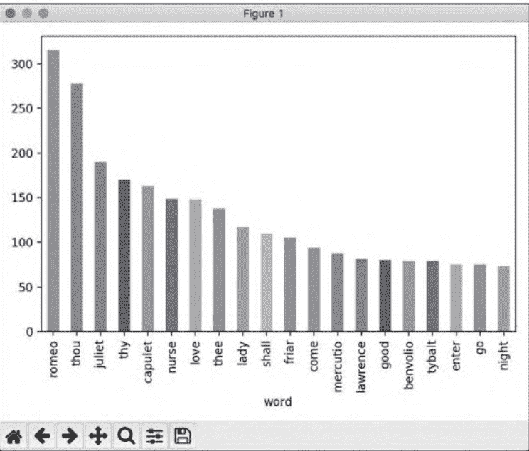

## 11.3.2 使用词云可视化词频

接下来，我们将构建一个可视化Romeo and Juliet中词频最高的前200个单词的词云，使用开源wordcloud模块的WordCloud类，只需几行代码就可以生成词云，默认情况下，wordcloud会创建矩形词云，但它其实可以创建任何形状的词云。

### 安装wordcloud模块

为了安装wordcloud，需打开Anaconda Prompt (Windows)、Terminal (macOS / Linux) 或shell (Linux) 并输入命令：

```

conda install -c conda-forge wordcloud

读取素材文本，这里以经典剧本《罗密欧与朱丽叶》为例，`pathlib` 处理路径跨平台无压力。

```

Windows用户可能需要以管理员身份运行Anaconda Prompt，才能获取正确的软件安装权限。为此，需在开始菜单中右键单击Anaconda Prompt选项，然后选择More > Run as administrator。

### 加载文本

首先，加载Romeo and Juliet电子书。在执行以下代码之前，从ch11示例文件夹启动IPython，以便可以访问之前下载的电子书文件RomeoAndJuliet.txt：

```

In [1]: from pathlib import Path

In [2]: text = Path('RomeoAndJuliet.txt').read_text()

想要词云长成特定造型？得先用 `imageio` 读入一张掩码图片（如心形轮廓 `mask_heart.png`），白色区域将承载文字。

```

### 加载指定词云形状的掩膜图

要创建给定形状的词云，可以使用掩膜图来初始化WordCloud对象，WordCloud会用文本填充掩膜图的非白色区域。我们在此示例中使用心形，掩膜图为ch11示例文件夹中的mask_heart.png文件，使用越复杂的掩膜图创建词云，需要的时间越长。

下面使用Anaconda自带的imageio模块中的imread函数加载掩膜图：

```

In [3]: import imageio

In [4]: mask_image = imageio.imread('mask_heart.png')

实例化 `WordCloud` 对象时，`colormap='prism'` 赋予绚丽配色，`background_color='white'` 设定白底，`mask` 参数则套用刚才的心形模版。

```

此函数将掩膜图作为NumPy数组返回，以便WordCloud处理。

### 配置WordCloud对象

接下来创建和配置WordCloud对象：

```

In [5]: from wordcloud import WordCloud

In [6]: wordcloud = WordCloud(colormap='prism', mask=mask_image,

...     background_color='white')

...

核心一步：`generate()` 方法直接吞入全量文本，自动完成分词、词频统计与布局计算。

```

除非指定了width和height关键字参数或掩膜图，否则默认WordCloud对象的宽度和高度（以像素为单位）为400×200。如果指定了掩膜图，WordCloud对象的大小就是掩膜图的大小。WordCloud在底层使用Matplotlib，从颜色表中随机分配颜色，也可以通过colormap关键字参数指定颜色。有关颜色表中的颜色名及其对应颜色，请参阅https://matplotlib.org/examples/color/colormaps_reference.html。mask关键字参数指定使用先前加载的mask_image掩膜图。默认情况下，单词是在黑色背景上绘制的，但我们使用background_color关键字参数指定在白色（white）背景上绘制。有关WordCloud关键字参数的完整列表，请参阅http://amueller.github.io/word_cloud/generated/wordcloud.WordCloud.html。

### 生成词云

WordCloud类的generate方法接收在词云中需使用的文本作为参数，并创建词云，它将作为WordCloud对象返回：

```

In [7]: wordcloud = wordcloud.generate(text)

成品落盘为 PNG，分辨率足够清晰，方便后续分享或嵌入报告。

```

在创建词云之前，generate方法首先通过wordcloud模块的内置停用词表将text中的停用词删除，然后计算剩余单词的词频。默认情况下，该方法最多使用200个单词，但可以使用max_words关键字参数进行自定义。

### 将词云保存为图像文件

最后，我们使用WordCloud类的to_file方法将词云图保存到指定文件:

```

In [8]: wordcloud = wordcloud.to_file('RomeoAndJulietHeart.png')

在 Notebook 里即时预览？开启 `matplotlib` 内联模式，`imshow` 直接渲染对象，记得关掉坐标轴更美观（此处代码省略了 `plt.axis('off')`）。

```

现在可以转到ch11示例文件夹，并双击系统中的RomeoAndJuliet.png图像进行查看—由于版本不同，可能与下图所示的单词位置和颜色不同。


### 从字典生成词云

如果已经有一个表示单词计数的键-值对字典，则可以将其传递给 WordCloud 类的 fit_words 方法，此方法假设已经删除了停用词。

### 使用 Matplotlib 显示图像

如果想在屏幕上显示图像，可以使用 IPython 的魔术命令

```

%matplotlib

```

它可以在 IPython 中启用交互式 Matplotlib 支持，然后执行以下语句，就可以在屏幕上显示词云图：

```

import matplotlib.pyplot as plt

plt.imshow(wordcloud)

---

### 二、 可读性量化：用硬指标拆解文本难度

光看词云不过瘾，`textatistic` 库能把文本“体检”出十几项专业指标。先装包：

```

## 11.4 使用Textatistic库进行可读性评估

自然语言处理的一个有趣用途是评估文本可读性。可读性受所使用的词汇、句子结构、句子长度、主题等方面的影响。在编写本书时，我们使用了付费工具Grammarly来调整文字以确保文本的可读性。

本节将使用Textatistic库来评估文本可读性。有很多用于计算自然语言处理的可读性的公式，Textatistic使用五种流行的公式—Flesch Reading Ease、Flesch-Kincaid、Gunning Fog、Simple Measure of Gobbledygook（SMOG）和Dale-Chall。

### 安装Textatistic

为了安装Textatistic，需打开Anaconda Prompt（Windows）、Terminal（macOS/Linux）或shell（Linux）并输入以下命令：

```

pip install textatistic

同样读入剧本文本，实例化 `Textatistic` 对象即可自动完成句法与词汇层面的统计。

```

Windows用户可能需要以管理员身份运行Anaconda Prompt，才能获得正确的软件安装权限。为此，请在开始菜单中右键单击Anaconda Prompt选项，然后选择More > Run as administrator。

### 计算统计得分和可读性得分

首先，将Romeo and Juliet文本加载到text变量中：

```

In [1]: from pathlib import Path

In [2]: text = Path('RomeoAndJuliet.txt').read_text()

```

为了计算文本统计数据和可读性得分，需要将其转化为Textatistic对象：

```

In [3]: from textatistic import Textatistic

In [4]: readability = Textatistic(text)

设置显示精度为小数点后三位，调用 `.dict()` 一键导出全量指标字典。

```

Textatistic类的dict方法会返回一个包含统计信息和可读性得分的字典：

```

In [5]: %precision 3

Out[5]: '%3.3f'

In [6]: readability.dict()

Out[6]:

{'char_count': 115141,

 'word_count': 26120,

 'sent_count': 3218,

 'syb1_count': 30166,

 'notdalechall_count': 5823,

 'polysyblword_count': 549,

 'flesch_score': 100.892,

 'fleschkincaid_score': 1.203,

 'gunningfog_score': 4.087,

 'smog.score': 5.489,

 'dalechall_score': 7.559}

**解读关键看点**：
- **Flesch Reading Ease 100.89**：极易阅读，接近小学水平；
- **Flesch-Kincaid Grade 1.2 / Gunning Fog 4.09 / SMOG 5.49**：均指向极低年级阅读门槛；
- **Dale-Chall 7.56**：虽高于前几项，但仍属平易近人范畴。
莎翁原著在现代拼写规范下，词汇与句法复杂度远低于当代学术文本，这组数据印证了“通俗大师”的标签。

---

### 三、 spaCy 实战：实体识别与语义相似度双管齐下

工业级 NLP 首选 `spaCy`，安装后别忘下载小模型 `en_core_web_sm`（命令行别名 `en`）。

```

字典中的每个值都可以通过与其键名同名的Textatistic属性访问。dict方法产生的统计结果包括：

- char_count—文本中的字符数。
- word_count—文本中的单词数。
- sent_count—文本中的句子数。
- sybl_count—文本中的字节数。
- notdalechall_count—不在Dale-Chall列表中的单词数。Dale-Chall列表是80%的五年级学生所能理解的单词词列表，notdalechall_count值与总单词数相比，若越高，则文本的可读性越低。
- polysyblword_count—包含三个或三个以上字节的单词数。
- flesch_score—Flesch易读性得分，其可以映射到年级。90分以上的文本被认为对五年级学生是可读的，30分以下的文本对应于大学生，30~90分对应于两者之间的其他年级。
- fleschkincaid_score—Flesch-Kincaid得分，与不同年级对应。
- gunningfog_score—Gunning Fog指数，与不同年级对应。
- smog_score—Simple Measure of Gobbledygook（SMOG），对应理解文本所需的教育年限，这个指标对医学材料非常有用。
- dalechall_score—Dale-Chall得分，可以映射到从4年级到16年级（大学）及以上的年级。该得分被认为对于包含多种文本类型的文本更有意义。

想了解更多可读性得分的相关信息，请参考 https://en.wikipedia.org/wiki/Readability。Textatistic文档还给出了所使用的可读性公式，参见 http://www.erinhengel.com/software/textstatistic/。

## 11.5 使用spaCy命名实体识别

NLP可以分析出文本的内容，其中的一个关键部分就是命名实体识别。命名实体识别可以定位和分类文本中的日期、时间、数量、地点、人员、事物、组织等。在本节中，我们将使用spaCy NLP库 中的命名实体识别功能来分析文本。

### 安装spaCy

为了安装spaCy，需打开Anaconda Prompt（Windows）、Terminal（macOS / Linux）或shell（Linux），然后执行以下命令：

```

conda install -c conda-forge spacy

```

Windows用户可能需要以管理员身份运行Anaconda Prompt，才能获得正确的软件安装权限。为此，请在开始菜单中右键单击Anaconda Prompt选项，然后选择More > Run as administrator。

安装完成后，还需要执行以下命令，使得spaCy可以下载处理英语（en）文本所需的其他组件：

```

python -m spacy download en

载入管线，几毫秒完成分词、词性标注、依存分析及实体识别全流程。

```

### 加载语言模型

使用spaCy的第一步是，加载表示文本所属自然语言的语言模型。为此，需调用spacy模块的load函数，下面加载之前下载的英语模型：

```

In [1]: import spacy

In [2]: nlp = spacy.load('en')

喂入一段包含时间、人名、机构名的测试句，`document.ents` 直接吐出结构化实体三元组。

```

spaCy文档建议使用变量名称nlp。

### 创建一个spaCy Doc

接下来，使用上面的nlp对象创建一个表示所处理文档的Doc对象。这里使用很多书籍在介绍万维网时用的一句话：

```

In [3]: document = nlp('In 1994, Tim Berners-Lee founded the ' +

    ...:     'World Wide Web Consortium (W3C), devoted to ' +

    ...:     'developing web technologies')

    ...:

```

### 获取命名实体

Doc对象的ents属性会返回一个Span对象的元组，以表示在Doc中找到的命名实体。每个Span对象都有很多属性。下面遍历Span对象并显示出text和label_属性：

```

In [4]: for entity in document.ents:

    ...:     print(f'{entity.text}: {entity.label_}')

    ...:

1994: DATE

Tim Berners-Lee: PERSON

the World Wide Web Consortium: ORG

**进阶玩法：文档级语义相似度**。基于词向量平均池化，`similarity()` 能给出 0-1 间的语义距离。

重新初始化管线（或复用上文 `nlp`），分别加载《罗密欧与朱丽叶》与《爱德华二世》全文。

```

每个Span对象的text属性都将实体作为字符串返回，label_属性返回一个表示实体类型的字符串。此处spaCy对象找到了三个代表DATE (1994)、PERSON (Tim Berners-Lee) 和ORG (组织, the World Wide Web Consortium) 的实体。更多关于spaCy的信息请参阅https://spacy.io/usage/models#section-quickstart。


## 11.6 使用spaCy进行相似性检测

相似性检测是分析文档以确定其相似程度的过程，一种可能的相似性检测技术是词频计数。例如，有些人认为莎士比亚的作品实际上可能是Sir Francis Bacon、Christopher Marlowe等人所写的，将他们的作品的词频进行比较，可以发现写作风格的相似之处。

本书后面的章节讨论的各种机器学习技术都可用于研究文档相似性，但诸如spaCy和Gensim这样的库也可以进行文档相似性检测。这里将使用spaCy的相似性检测功能来比较莎士比亚的Romeo and Juliet与Christopher Marlowe的Edward the Second。Edward the Second可以从古腾堡工程中找到，下载方法与Romeo and Juliet的下载方法一样。

### 加载语言模型并创建spaCy Doc

同上节，首先加载英文模型：

```

In [1]: import spacy

In [2]: nlp = spacy.load('en')

```

### 创建spaCy Doc

接下来，创建两个Doc对象—一个用于Romeo and Juliet，另一个用于Edward the Second：

```

In [3]: from pathlib import Path

In [4]: document1 = nlp(Path('RomeoAndJuliet.txt').read_text())

In [5]: document2 = nlp(Path('EdwardTheSecond.txt').read_text())

输出 **0.935** 的高相似度，佐证了同一作者、同一时期、同一体裁戏剧在词汇分布与主题空间上的高度重合。

```

### 比较书籍的相似性

最后，我们使用Doc类的similarity方法会得到一个0.0（毫不相似）到1.0（完全相同）的值，来表示文档的相似程度：

```

In [6]: document1.similarity(document2)

Out[6]: 0.9349950179100041

---

**总结**：从 `wordcloud` 的直观美感，到 `textatistic` 的量化严谨，再到 `spaCy` 的深度语义理解，三行主流库串起文本分析的“观、测、悟”三重境界。代码虽短，组合拳打出的洞察力却不容小觑。

获取 API 权限的关键在于准确配置以下两组核心凭据，请务必替换为您自己的有效密钥：

```

spaCy认为这两个文档有很大的相似之处。为了进行比较，我们还创建了一个表示近期新闻的Doc对象，并将其与Romeo and Juliet进行了比较。正如所料，spaCy会返回一个很低的值，表明它们之间几乎没有相似之处，大家可以尝试将最近的新闻文章复制到文本文件中，然后执行相似性检测看看结果。

## 11.7 其他NLP库和工具

本章展示了各种NLP相关的库，但可供使用的库还有更多，以便我们能够用最优的方式解决不同的任务。下面是一些其他的主要的NLP库和API，大部分都是免费开源的：

- Gensim—相似性检测和主题建模。
- Google Cloud Natural Language API—针对NLP任务的云API，如命名实体识别、情感分析、词性分析和可视化等。
- Microsoft Linguistic Analysis API。
- Bing情感分析—微软的Bing搜索引擎现在将情感融入搜索结果，目前仅在美国可用。
- PyTorch NLP库—NLP的深度学习库。
- Stanford CoreNLP库—基于Java的NLP库，它还提供了Python包装类，包括共指消解（可以通过它找到同一对象的所有指称）。
- Apache OpenNLP库—基于Java的NLP库，用于执行常见任务，包括共指消解。Python包装类也是可用的。
- PyNLPI（pineapple）库—Python NLP库，包括基本的和更复杂的NLP功能。
- SnowNLP库—简化了中文文本处理的Python库。
- KoNLPy库—韩语NLP库。
- stop-words库—带有多种语言停用词的Python库。本章使用了NLTK库的停用词表。
- TextRazor—一个付费的云API，提供一个免费层。

## 11.8 机器学习和深度学习自然语言应用

有很多自然语言应用需要机器学习和深度学习技术，我们将在后面的机器学习和深度学习章节中讨论以下内容：

- 回答自然语言问题—例如，本书的出版商Pearson Education有一个合作伙伴IBM Watson， IBM Watson使用Watson作为虚拟导师，学生可以利用自然语言向Watson提问并获取答案。
- 文档总结—分析文档并生成简短总结（也称为摘要），可以把它包含在搜索结果中，帮助读者决定是否阅读此文档。
- 语音合成（语音转文本）和语音识别（文本转语音）—第13章会使用这些功能，结合跨语言文本到文本的翻译，来开发一种近乎实时的跨语言语音到语音翻译器。
- 协同过滤—用于创建推荐系统（“如果你喜欢这部电影，可能也喜欢……”）。
- 文本分类—例如，按类别对新闻文章进行分类，分为世界新闻、国家新闻、当地新闻、体育、商业、娱乐等。
- 主题建模—查找文档中讨论的主题。
- 讽刺检测—常和情感分析一起使用。
- 文本简化—使文本更简洁、更易于阅读。
- 语音转手语，反之亦然—帮助与听障人士对话。
- 唇语识别—适用于不会说话的人，将唇部动作转换为文本或语音以帮助交流。
- 隐藏式字幕—为视频添加文字字幕。

## 11.9 自然语言数据集

有大量文本数据源可用于自然语言处理任务：

- 维基百科—维基百科的部分或全部内容 (https://meta.wikimedia.org/wiki/Datasets)。
- IMDB (Internet Movie Database) —内含多种电影和电视剧数据集。
- UCI文本数据集—包含Spambase等很多数据集。
- 古腾堡工程—50,000多种免费电子书，在美国不受版权保护。
- Jeopardy!数据集—来自电视节目Jeopardy!的200,000多个题目。人工智能的一个里程碑事件发生在2011年，当时IBM Watson击败了两个世界级Jeopardy!玩家。
- 自然语言处理数据集: https://machinelearningmastery.com/datasets-natural-language-processing/。
- NLTK数据： https://www.nltk.org/data.html。
- 有情感标签的句子数据集（包括IMDB.com、amazon.com、yelp.com等）。
- AWS上的开放数据注册表—亚马逊网络服务上托管的数据集目录 (https://registry.opendata.aws)。
- 亚马逊客户评论数据集—超过1.3亿条产品评论 (https://registry.opendata.aws/Amazon-reviews/)。
- Pitt.edu语料库（http://mpqa.cs.pitt.edu/corpora/）。

## 11.10 小结

本章使用了多个NLP库执行了大量自然语言处理任务，我们看到了NLP是在称为语料库的文本合集上执行的。我们讨论了句子意思间的细微差别会使自然语言理解起来很困难。

本章主要关注TextBlob库，它建立在NLTK库和pattern库之上，但更易于使用。我们创建了TextBlob对象并将其标记为Sentence和Word，确定了TextBlob对象中每个单词的词性，并提取了其中的名词短语。

本章演示了如何使用TextBlob库的默认情感分析器和NaiveBayesAnalyzer情感分析器评估TextBlob和Sentence的情感，结合TextBlob库与Google Translate检测了文本语言并执行了跨语言翻译。

本章展示了一些其他的NLP任务，包括单数化和复数化、拼写检查和拼写校正、通过词干提取和词形还原规范化，以及词频获取。我们从WordNet获取了单词定义、同义词和反义词，还使用了NLTK库的停用词表来消除文本中的停用词，并创建了包含连续单词组的n元。

本章展示了如何使用pandas内置绘图功能定量地将词频可视化为柱状图，然后使用wordcloud模块定性地将词频可视化为词云，使用Textatistic库评估了文本可读性，最后，使用spaCy查找了命名实体并执行了相似性检测。下一章将继续使用自然语言处理，通过Twitter API对推文进行数据挖掘。

# 第12章

## Twitter数据挖掘

## 目标

- 了解Twitter在商业、品牌、声誉、情感分析、预测等方面的作用。
- 使用Tweepy进行Twitter数据挖掘，Tweepy是应用于客户端代码中最流行的Python Twitter API之一。
- 使用Twitter搜索API来下载符合要求的历史推文。
- 使用Twitter流API对实时推文流进行采样。
- 了解Twitter返回的推文对象中所包含的推文文本之外的有价值信息。
- 使用上一章中的自然语言处理技术，对推文进行清理和预处理，为后续的分析做好准备。
- 对推文进行情感分析。
- 使用Twitter热门话题API发现热门话题。
- 使用folium和OpenStreetMap进行推文映射。
- 了解如何利用本书中所讨论的技术存储推文。

## 12.1 简介

我们一直在尝试着预测未来。即将到来的野餐会赶上下雨天吗？股票市场或个人证券是涨是跌？以及什么时候涨跌多少？在一次选举中人们将如何投票？一家新的石油勘探企业开采出石油的可能性有多大？如果能开采出石油，它的生产量可能是多少？如果一支棒球队的击球理念改变为“用力挥棒，力求打出一个全垒打”，它会赢得更多的比赛吗？航空公司预计未来几个月的客流量，以及该公司应该如何购买石油商品期货，以确保它能够以最低成本获得所需的能源供应？飓风可能会走哪条路径？它的强度将如何变化（1～5类）？这种信息对于应急准备工作至关重要。一笔金融交易是否可能具有欺诈性？一笔抵押贷款会违约吗？一种疾病是否有可能迅速传播？如果传播，会传播到哪些地域？

预测是一个具有挑战性且往往成本高昂的任务，但其潜在回报也非常巨大。本章和下一章将展示如何利用人工智能（通常与大数据配合）快速提高预测能力。

本章主要关注Twitter数据挖掘，对推文进行情感分析。**数据挖掘**是通过搜索大量数据（通常是大数据），找出对个人和组织有价值的信息的过程。从推文中收集的信息，可以帮助预测选举结果、新电影可能产生的收入以及公司营销活动是否成功，还可以帮助公司发现竞争产品的弱点。

通过Web服务可以连接到Twitter。使用Twitter搜索API可以访问大量的历史推文，使用Twitter流API可以对新的推文进行大量采样，使用Twitter热门话题API可以看到热门话题。第11章介绍的大部分内容，在构建Twitter应用程序方面都很有用。

正如在本书前面所看到的，由于强大的库的支持，通常仅需要几行代码就可以完成强大的功能。这是Python及其开源社区如此富有活力的主要原因。

目前Twitter已经取代了主要的新闻机构，成为有新闻价值的事件的第一来源。大多数Twitter帖子都是公开的且会实时公布全球发生的各种事件。人们直言任何话题，发表与个人和商务相关的推文，并对社交、娱乐、政治等各方面的内容进行评论。通过手机，他们还可以拍摄和发布事件的照片和视频。目前流行的两个术语Twitterverse和Twittersphere指的是与发送、接收和分析推文有关的数亿用户。

### 什么是Twitter

Twitter是一家成立于2006年的微博公司，目前已成为Internet上最流行的网站之一。其概念很简单，人们在Twitter上可以发布称为推文的短信息，推文最初限制为140个字符，但最近大多数语言都增加到了280个字符。一名用户可以选择关注任何其他用户，这与其他社交媒体平台上相对封闭、严格的社区不同，如Facebook、LinkedIn和许多其他社交媒体平台中“关注关系”必须是相互的。

### Twitter统计数据

Twitter拥有数亿用户，每天发送数亿条推文（即平均每秒发送数千条）。在线搜索“Internet statistics”和“Twitter statistics”可以直观地看到这些数据。一些Twitter用户拥有超过1亿关注者。活跃Twitter用户通常每天发布几条推文，以让他们的关注者参与进来。具有最多关注者的Twitter用户通常是演艺人员和政治家。开发人员可以实时地获取最新的推文流，并显示给用户，使用户能够快速获取最新信息。

### Twitter和大数据

Twitter已成为最受全球研究人员和商业人士欢迎的大数据源。Twitter允许普通用户免费访问最新的一小部分推文。通过与Twitter的特殊合约，一些第三方企业（以及Twitter本身）提供付费访问服务，用户通过付费可以访问大部分历史推文数据。

### 注意事项

Internet上的内容并不一定可信，推文也不例外。例如，人们可能会使用虚假信息操纵金融市场或影响政治选举。对冲基金通常会部分参考它们所关注的推文流进行证券交易，但它们对信息的可靠度也会持谨慎态度。网络信息的不完全可信问题，是基于社交媒体内容构建业务关键型或任务关键型系统的挑战之一。

后面将广泛使用Web服务。然而，需要注意，在使用Web服务时，将无法构建与桌面应用程序具有相同可靠性的程序。Internet连接可能会丢失，Web服务可能会改变，有些服务在一些区域可能会不可用，这些是基于云进行编程需要考虑的问题。

## 12.2 Twitter API概况

Twitter的API是基于云的Web服务，因此执行本章的代码时需要有Internet连接。Web服务是在云中执行的方法，如在本章中使用的Twitter API、下一章介绍的IBM Watson API以及基于云计算的其他API。每个API方法都有一个Web服务端点，该端点表示为一个URL，使用这个URL可以调用Internet上的方法。

Twitter API提供了多种类别的功能，其中，有免费的，也有付费的。大多数API都有速率限制，其约定了在15分钟间隔内可以使用它们的次数。本章将使用Tweepy库，调用以下Twitter API提供的方法：

- 身份验证API：将Twitter凭据（稍后讨论）传递给Twitter，以便可以使用其他API。
- 账户和用户API：访问一个账户的相关信息。
- 推文API：搜索历史推文，访问推文流以获取最新的推文等。
- 热门话题API：查找有热门话题的地点，并按地点获取热门话题列表。

在网址https://developer.twitter.com/en/docs/api-reference-index.html上可以查看Twitter API类别、子类别和方法的详细列表。

### 速率限制

每个Twitter API方法都有一个速率限制，即在15分钟窗口期内可以进行的最大请求（即调用）数。对于一个给定的API方法，如果在达到速率限制后继续调用它，则Twitter会阻塞该调用。

在使用任何API方法之前，请阅读它的文档并了解其速率限制。通过配置Tweepy，可以在达到速率限制时使API保持等待，这有助于防止超出速率限制而引起的问题。某些方法列出了用户速率限制和应用程序速率限制，本章的所有示例均使用应用程序速率限制。用户速率限制适用于允许个人用户登录Twitter的APP，如来自其他供应商的智能手机APP，其代表用户完成Twitter操作。

有关速率限制的详细信息，请参阅 https://developer.twitter.com/en/docs/basics/rate-limiting。有关各个API方法的特定速率限制，请参阅 https://developer.twitter.com/en/docs/basics/rate-limits和每个API方法的文档。

### 其他限制

Twitter是用于数据挖掘的重要工具，利用Twitter提供的免费服务可以完成很多任务。但是，需要注意遵守Twitter的规则和规定，否则开发者账户可能会被禁用。请仔细阅读以下链接上的文档：

- 服务条款：https://twitter.com/tos。
- 开发者协议：https://developer.twitter.com/en/developerterms/agreement-and-policy.html。
- 开发者政策：https://developer.twitter.com/en/developer-terms/policy.html。
- 其他限制：https://developer.twitter.com/en/developer-terms/more-on-restricted-use-cases。

在本章后面将会看到，使用免费的Twitter API，只能搜索过去七天的推文，并且只能获取有限数量的推文。一些书籍和文章中提到，可以直接从twitter.com抓取推文以避开这些限制。但是，服务条款规定“明确禁止未经Twitter允许的抓取服务”。

## 12.3 创建一个Twitter账户

Twitter要求用户申请开发者账户后才能使用其API。可访问 https://developer.twitter.com/en/apply-for-access并提交申请。如果还没有注册过账户，则需要先注册一个账户。注册账户时，系统会询问有关账户用途的问题。必须仔细阅读并同意Twitter的条款才能完成申请，然后确认电子邮件地址。

Twitter会审核每个申请，有的申请可能会被拒绝。在撰写本书时，个人账户会立即审核通过。而对于公司账户，根据Twitter开发者论坛的说法，审核过程需要几天到几周的时间。

## 12.4 获取Twitter凭据，创建应用程序

拥有Twitter开发者账户后，需要创建一个应用程序，并获取使用Twitter API的凭据。注意，每个应用程序都需要一个单独的凭据。要创建应用程序，请登录https://developer.twitter.com并执行以下步骤：

- 1. 在页面右上角，单击账户的下拉菜单，然后选中Apps选项。
- 2. 单击“Create an app”选项。
- 3. 在“App name”字段中指定应用程序名称。如果通过API发送推文，该应用程序的名称将作为推文的发件人。如果创建需要用户通过Twitter登录的应用程序，该应用程序的名称也会显示给用户。这里直接填入“YourName Test App”。
- 4. 在“Application description”字段中，输入应用程序的说明。在创建将由其他人使用的基于Twitter的应用程序时，这将用于描述应用程序的功能。这里直接填入“Learning to use the Twitter API”。
- 5. 在“Website URL”字段中，输入网址。在创建基于Twitter的应用程序时，该网址对应托管应用程序的网站。可以使用Twitter的URL: https://twitter.com/YourUserName。其中，YourUserName是Twitter账户名。例如，https://twitter.com/nasa对应的账户名是@nasa。
- 6. 在“Tell us how this app will be used”字段中，输入至少100个字符的描述，这可使Twitter员工了解应用程序的功能。这里我们输入“I am new to Twitter app development and am simply learning how to use the Twitter APIs for educational purposes”。
- 7. 不填写其余字段并单击“Create”按钮，然后仔细阅读开发者条款并再次单击“Click”按钮。


### 获取凭据

完成上述的步骤7后，Twitter将显示一个用于管理应用程序的页面。在页面顶端有 “App details” “Keys and tokens” 和 “Permissions” 这些选项卡，单击 “Keys and tokens” 选项卡可以查看应用程序的凭据。初始时，页面显示了使用者的两个API密钥，即 “API key” 和 “API secret key”。单击 “Create” 按钮，可以获取 “access token” 和 “access token secret” 这两个访问令牌。利用这四项信息可以通过Twitter认证，通过认证后即可以调用Twitter API。

### 存储凭据

不要将API密钥和访问令牌（或任何其他凭据，如用户名和密码）直接放在源代码中，因为这样会将它们直接暴露给任何阅读代码的人。应该将密钥存储在一个单独的文件中，并且不要将该文件共享给其他人。

在后面要执行的代码中，假定密钥和访问令牌已放在如下所示的 `keys.py` 文件中，在 `ch12` 示例文件夹中可以找到该文件：

```
consumer_key='YourConsumerKey'
consumer_secret='YourConsumerSecret'

# Tweepy 实战：快速搭建 Twitter API 认证连接

要让 Python 程序获得操作 Twitter（现 X 平台）账号的权限，核心在于完成 OAuth 认证流程。下面我们通过一个完整的代码演示，带你从环境配置到拿到可用的 `api` 对象。

## 1. 准备你的密钥凭证

首先，妥善保管好开发者后台申请到的四串字符串，建议单独存放在配置文件（如 `keys.py`）中：

```python
# keys.py
consumer_key = 'YourConsumerKey'
consumer_secret = 'YourConsumerSecret'
access_token = 'YourAccessToken'
access_token_secret = 'YourAccessTokenSecret'
```

```

编辑此文件，将 `YourConsumerKey`、`YourConsumerSecret`、`YourAccessToken`、`YourAccessTokenSecret` 替换为有效的密钥和访问令牌，然后保存文件。

### OAuth 2.0

每个密钥和访问令牌都是OAuth 2.0身份验证过程的一部分，有时称其为OAuth dance。Twitter通过这些信息开启对其API的访问权限。Tweepy库提供了相应接口，用于接收密钥和访问令牌并完成OAuth 2.0身份验证。

## 12.5 什么是推文

Twitter API方法返回JSON对象。JSON（Javascript对象表示）是一个基于文本的数据交换格式，其用于将对象表示为名称-值对的合集。JSON通常在调用Web服务时使用，是一种人类可读和计算机可读的格式，使数据易于通过Internet发送和接收。

JSON对象类似于Python中的字典。每个JSON对象都包含一个由属性名称和值组成的列表，使用一对花括号括起来：

```

## 2. 环境依赖安装

确保安装了指定版本的 `tweepy` 以及用于地理编码的 `geopy`：

```

### Twitter JSON对象资源

有关推文对象属性的完整列表，请参阅 https://developer.twitter.com/en/docs/tweets/data-dictionary/overview/tweet-object.html。

关于Twitter将每条推文的限制从140个字符增加到280个字符的其他详细信息，请参阅 https://developer.twitter.com/en/docs/tweets/data-dictionary/overview/intro-to-tweet-json.html#extendedtweet。

关于Twitter API返回的所有JSON对象的概况，以及跳转到特定对象详细信息的链接，请参阅 https://developer.twitter.com/en/docs/tweets/data-dictionary/overview/intro-to-tweet-json。

## 12.6 Tweepy

我们将使用Tweepy库（见http://www.tweepy.org/）操作Twitter API。Tweepy库是最受欢迎的Python库之一。通过Tweepy库，可以在不知道Twitter API返回的JSON对象的处理细节的情况下，轻松地使用Twitter的各种功能。关于Tweepy库的文档，请参阅http://docs.tweepy.org/en/latest/。

关于Tweepy库的附加信息和源代码，请参阅https://github.com/tweepy/tweepy。

### 安装Tweepy

要安装Tweepy库，请打开Anaconda Prompt（Windows）、Terminal（macOS / Linux）或shell（Linux），然后执行以下命令：

```

```

Windows用户可能需要以管理员身份运行Anaconda Prompt，才能获得正确的软件安装权限。因此，请在开始菜单中右键单击Anaconda Prompt选项，然后选择More>Run as administrator。

### 安装geopy

在本章所提供的使用Tweepy库的示例代码中，将会用到我们编写的tweetutilities.py文件。该文件中的一个实用函数用到了geopy库（见https://github.com/geopy/geopy），12.15节将介绍这个geopy库的相关内容。要安装geopy库，请执行以下命令：

```

## 3. 认证与 API 对象初始化

启动交互式环境（如 IPython 或 Jupyter），按顺序执行以下步骤：

**第一步：导入模块与密钥**
```

## 12.7 通过Tweepy进行Twitter身份验证

下面几节将演示如何通过Tweepy调用各种基于云的Twitter API。这里首先使用Tweepy进行Twitter身份验证并创建一个Tweepy API对象，这是通过Internet使用Twitter API的基础。在后续部分中，将通过调用Tweepy API对象的方法来使用各种Twitter API。

在调用任何Twitter API之前，必须使用API密钥（API key和API secret key）和访问令牌（access token和access token secret）进行Twitter身份验证。从ch12示例文件夹启动IPython，然后导入tweepy模块和本章前面修改过的keys.py文件。通过import语句，使用去除.py扩展名的文件名，可以将任何.py文件作为模块导入：

```

**第二步：创建 OAuth 处理器**
实例化 `OAuthHandler` 并注入 Consumer Key 与 Secret：
```

将keys.py作为模块导入，则可以使用keys.variable_name单独访问该文件中定义的四个变量中的每一个。

### 创建和配置OAuthHandler进行Twitter身份验证

通过Tweepy进行Twitter身份验证包括两个步骤：首先，创建tweepy模块的OAuthHandler类对象，并将API密钥（API key和API secret key）传递给其构造方法。构造方法是一个与类同名的函数（在本例中为OAuthHandler），其可以接收用于配置新对象的参数：

```

**第三步：设置访问令牌**
调用 `set_access_token` 方法，传入 Access Token 与 Secret，完成用户授权绑定：
```

然后，通过调用OAuthHandler对象的set_access_token方法指定访问令牌（access token和access token secret）：

```

**第四步：生成 API 实例**
实例化 `tweepy.API`，强烈建议开启 `wait_on_rate_limit` 与 `wait_on_rate_limit_notify` 参数，程序将在触及频率限制时自动等待并提示，避免报错中断：
```

### 创建API对象

接下来，创建用于与Twitter交互的API对象：

```

---

## 4. 实战验证：解析返回的推文对象

认证成功后，调用 API 获取的单条推文是一个结构丰富的 JSON 对象。以 NASA 官方账号的一条回复为例，其核心字段结构如下：

```

与在Python中一样，JSON列表使用一对方括号括起各元素值并通过逗号分隔它们：

```

```

为方便起见，Tweepy会自动处理JSON，使用Tweepy库中定义的类将JSON转换为Python对象。

### 推文对象的关键属性

推文（也称为状态更新）最多可包含280个字符，但Twitter API返回的推文对象包含许多用于描述推文的元数据属性，例如

- 创建时间；
- 创建者；
- 推文中包含的主题标签（hashtags）列表、网址（urls）列表、@某用户（@-mentions）列表，以及通过网址指定的图片、视频等媒体（media）列表；
- 其他属性。

下表列出了推文对象的一些关键属性。

| 属性 | 描述 |
|---|---|
| created_at | UTC (协调世界时) 格式的创建日期和时间 |
| entities | Twitter 从推文中提取 hashtags、urls、user_mentions（即 @某用户）、media（如图像和视频）、symbols 和 polls，并将它们以列表形式存在 entities 字典中，通过 hashtags 等键可以访问这些列表 |
| extended_tweet | 对于超过 140 个字符的推文，其包含了推文的 full_text、entities 等细节信息 |
| favorite_count | 其他用户点赞该推文的次数 |
| coordinates | 发布推文时用户的坐标位置（纬度和经度）。许多用户禁用发送位置数据的功能，因此该值通常为 null（在 Python 中为 None） |
| place | 用户可以将地点与推文相关联。如果做了关联，则其是一个 place 对象，见 https://developer.twitter.com/en/docs/tweets/data-dictionary/overview/geo-objects#place-dictionary；否则，其为 null (Python 中为 None) |
| id | 整数类型的推文 ID。Twitter 建议使用 id_str 以方便移植 |
| id_str | 推文 ID 的字符串表示 |
| lang | 推文的语言，如 'en' 表示英语，'fr' 表示法语 |
| retweet_count | 其他用户转发该推文的次数 |
| text | 推文的文本内容。如果推文使用新的 280 个字符限制并包含超过 140 个字符，则此属性将被截断，且 truncated 属性被置为 true。如果转发 140 个字符的推文并且转发的推文超过 140 个字符，则也会出现截断现象 |
| user | 发布推文的用户所对应的 User 对象。对于 User 对象的 JSON 属性，请参阅 https://developer.twitter.com/en/docs/tweets/data-dictionary/overview/user-object |

### JSON格式的推文示例

以下是来自@nasa账户的JSON格式的推文示例：

> @NoFear1075 Great question, Anthony! Throughout its seven-year mission, our Parker #SolarProbe spacecraft... https://t.co/xKd6ym8wAT

这里对原始JSON数据添加了行号并对部分内容进行了重新格式化。请注意，在JSON格式的推文中，并不是每个字段都被所有的Twitter API方法所支持，每种方法的在线文档都给出了相关的详细说明。

```

**关键字段速览：**
- **基础身份**：`id` / `id_str`（唯一标识）、`created_at`（发布时间）、`text`（正文内容，含 @提及 与 #话题 实体）。
- **交互上下文**：`in_reply_to_status_id` 等字段标明这是一条回复推文，指向原推文及用户 `@NoFear1075`。
- **发布者详情**：`user` 对象嵌套了完整的账号画像，包括 `screen_name` (NASA)、`followers_count` (2900万+)、`verified` (蓝V认证)、`profile_image_url` 等。
- **传播数据**：`retweet_count` (7)、`favorite_count` (19)、`lang` (en)。
- **实体解析**：`entities` 中自动提取了 `hashtags`、`user_mentions`、`urls` 及其在正文中的位置索引。

拿到这个 `api` 对象，你就拥有了检索推文、发布内容、管理关注、分析用户画像等全套操作能力，接下来就可以尽情发挥了。

# 使用 Tweepy 探索 Twitter API：以 NASA 账号为例

```

我们为API的构造方法指定了三个参数：

- auth是包含Twitter凭据的OAuthHandler对象。
- 关键字参数wait_on_rate_limit = True的作用是，让Tweepy每次达到给定API方法的速率限制时等待15分钟，这可以确保不会违反Twitter的限速限制。
- 关键字参数wait_on_rate_limit_notify = True的作用是，由于达到速率限制而需要等待时，Tweepy在命令行显示通知消息。

到目前为止，已完成了通过Tweepy操作Twitter的准备工作。请注意，接下来几个部分中的代码示例应在一个IPython会话中完成，这样可以使得前面已完成的授权过程无须再重复执行。


## 12.8 获取一个Twitter账户的相关信息

在进行Twitter身份验证后，可以使用Tweepy API对象的get_user方法获取tweepy.models.User对象，该对象包含了用户Twitter账户信息。下面的代码获取了NASA的@nasa Twitter账户的User对象：

```

首先，我们通过 `api.get_user` 方法获取 NASA 的官方账号对象，为后续的信息提取奠定基础。

```

get_user方法调用Twitter API的users/show方法。请注意，通过Tweepy调用的每一个Twitter方法都有相应的速率限制。对于Twitter的users/show方法，其作用是获取特定用户的账户信息，每15分钟最多可调用900次。本章对提到的每一个Twitter API方法，都通过脚注形式给出了该方法的文档链接，可在文档中查看方法的速率限制。

tweepy.models的每个类都与Twitter返回的JSON相对应。例如，User类对应了Twitter的user对象，参见 https://developer.twitter.com/en/docs/tweets/data-dictionary/overview/user-object。

tweepy.models的每个类都提供了一个方法，该方法用于读取JSON并将其转换为相应的Tweepy类的对象。

### 获取基本账户信息

下面的代码通过访问User对象的属性以显示有关@nasa账户的信息：

- id属性是账户的ID号，当用户加入Twitter时由Twitter自动分配。
- name属性是与用户账户关联的名字。
- screen_name属性是用户的Twitter句柄（@nasa）。name和screen_name都可以使用自己定义的名字（即不必是真名），以保护用户的隐私。
- description属性是用户配置中的描述信息。

```

接着，我们依次查看了该账号的核心身份标识：数字 ID、全称、用户名（Handle）以及账号简介。从输出可以看到，NASA 的简介中明确指出了发帖时区通常为 EST (UTC-5)。

```

### 获取最新状态更新

User对象的status属性返回一个tweepy.models.Status对象，该对象对应于Twitter的推文对象，参见 https://developer.twitter.com/en/docs/tweets/data-dictionary/overview/tweet-object。

Status对象的text属性包含账户的最新推文的文本：

```

紧接着，我们抓取了该账号最新的一条动态内容。这条推文似乎涉及一颗高速运动的年轻恒星与气体尘埃云的相互作用，并附带了一个缩短链接指向详细内容。

```

text属性最初用于最多140个字符的推文。当Twitter将限制增加到280个字符时，其增加了一个extended_tweet属性（稍后介绍），用于访问推文中第141到280个字符之间的文本和其他信息。在这种情况下，Twitter将text设置为extended_tweet文本的删减版本，代码中的...表示被删减的部分。此外，需要注意，转发推文时，会添加可能超出字符数限制的字符，因此通常会导致推文的部分信息被截断。

### 获取关注者的数量

通过followers_count属性可以查看一个账户的关注者数量：

```

```

虽然nasa的关注者数量已经很多了，但实际上还有超过1亿关注者的账户。

### 获取朋友的数量

类似地，可以使用friends_count属性查看一个账户的朋友数量（即该账户所关注的账户数）：

```

通过对比粉丝数（近 2945 万）与关注数（287），直观地展示了这一官方权威账号“粉丝基数极大、关注极少”的典型大V特征。

```

### 获取自己的账户信息

对于自己的账户，也可以访问前面介绍的这些属性信息。通过调用Tweepy API对象的me方法：

```

随后，调用 `api.me()` 获取当前认证用户（即操作者）的自身信息对象。

```

可以返回进行Twitter身份验证的账户所对应的User对象。

## 12.9 Tweepy Cursor简介：获得一个账户的关注者和朋友

在调用Twitter API方法时，经常会接收到对象合集形式的返回结果。例如，Twitter时间线中的推文、另一账户时间线中的推文或符合指定搜索条件的推文列表。时间线由该用户和该用户的朋友发送的推文组成。朋友就是该用户所关注的其他账户。

每个Twitter API方法的文档都讨论了方法在一次调用中可以返回的最多数据项数，即结果页面。当请求的结果项数多于给定方法可以返回的结果项数时，从Twitter的JSON响应中会看到可以获得更多页面的信息。使用Tweepy的Cursor类，可以方便地完成相应处理。Cursor调用指定的方法，检查Twitter响应中是否说明了还有更多结果。如果还有更多结果，Cursor会再次自动调用该方法来获得这些结果。重复该过程直至没有更多的结果。如果将API对象配置为在达到速率限制时等待（正如前面所做的那样），则Cursor将遵循速率限制，并在达到速率限制的情况下根据需要进行等待。下面几个小节讨论了Cursor的基本原理。有关更多详细信息，请参阅网址http://docs.tweepy.org/en/latest/cursor_tutorial.html中的Cursor教程。

### 12.9.1 确定一个账户的关注者

这里使用Tweepy Cursor调用API对象的followers方法，该方法通过调用Twitter API的follows/list方法获取一个账户的关注者。Twitter默认以20个数据项为一组返回结果，但一次最多可以请求200个数据项。这里以抓取NASA的10个关注者为例给出示例代码。

followers方法返回多个tweepy.models.User对象，这些对象包含每一个关注者的信息。首先创建一个列表，用于存储这些User对象：

```

```

#### 创建Cursor

下面，创建一个Cursor对象，该对象将为NASA账户调用followers方法，该方法使用screen_name关键字参数指定账户信息：

```

为了演示如何遍历粉丝列表，我们初始化一个空列表，并利用 `tweepy.Cursor` 创建一个针对 NASA 粉丝的迭代器。Cursor 是处理分页数据的利器，能自动处理翻页逻辑。

```

Cursor的构造方法接收api.followers方法名称作为第一个参数，其表明该Cursor对象将用于调用api对象的followers方法。Cursor构造方法所接收的其他关键字参数，如screen_name，将传递给构造方法的第一个参数所指定的方法（即api.followers）。因此，这个Cursor对象专门用于获取@nasaTwitter账户的关注者。

#### 获取结果

现在，可以使用Cursor来获取关注者。下面的for语句完成了对表达式cursor.items(10)返回结果的遍历。Cursor的items方法将完成对api.followers方法的调用并将api.followers方法的调用结果返回。本例中，将10传递给items方法，即仅获取10个关注者：

```

这里我们仅提取前 10 位粉丝的用户名存入列表，最后按字母顺序排序并打印输出。结果展示了一组随机的用户 ID 样本。

```

前面的代码段通过调用内置的sorted函数以升序方式显示了关注者。sorted函数的第二个参数是用于指定关注者排序方式的函数。本例中，使用lambda函数将每个关注者名称转换为小写字母，以不区分大小写的方式完成排序。

#### 自动分页

如果请求的数量超过一次调用可以返回的关注者数量，则items方法会通过多次调用api.followers方法自动完成结果分页获取。默认情况下，api.followers方法一次最多返回20个关注者，因此前面的代码只需要调用一次api.followers。如果需要一次获得200个关注者，则可以使用count关键字参数创建Cursor对象，如下所示：

```

代码中还演示了如何在创建 Cursor 时通过 `count=200` 参数指定每页返回的最大记录数，以优化请求效率。

```

如果没有为items方法指定参数，则Cursor会尝试获取该账户的所有关注者。对于有大量关注者的账户，由于Twitter的速率限制，这个过程可能会花费大量时间。Twitter API的followers/list方法一次最多可以返回200个关注者，每15分钟最多允许15次调用。因此，使用Twitter的免费API，每15分钟最多只能获得3000个关注者。前面已经将API对象配置为在达到速率限制时自动等待，因此如果尝试获取所有关注者且关注者数超过3000，则Tweepy将在每获取3000个关注者后自动暂停15分钟并显示通知消息。在撰写本书时，NASA拥有超过2950万关注者。按每小时可以获取12,000个关注者计算，则需要100多天才能获得NASA的所有关注者。

请注意，这里主要是为了展示如何通过Cursor完成followers方法调用。在该示例中，只是获得少量的关注者，因此也可以直接调用followers方法，而不必使用Cursor。在后面的一些示例中，将不使用Cursor，而是直接调用API方法以获取仅包含少量数据项的结果。

#### 获取关注者ID

虽然可以一次获得最多200个关注者的完整User对象，但也可以通过调用API对象的followers_ids方法获得更多的Twitter ID号。followers_ids方法会调用Twitter API的followers/ids方法，一次最多可返回5000个ID号（同样，这些速率限制有更改的可能）。每15分钟最多可以调用15次，这样在每个速率限制间隔中就可以获得75,000个账户的ID号。followers_ids方法常与API对象的lookup_users方法结合使用，以获取更多的关注者信息。lookup_users方法会调用Twitter API的users/lookup方法，一次最多可返回100个用户对象，每15分钟最多可调用300次。因此，通过结合使用followers_ids和lookup_users，每个速率限制间隔最多可以获得30,000个User对象。

### 12.9.2 确定一个账户的关注对象

API对象的friends方法调用Twitter API的friends/list方法，以获取表示一个账户的朋友信息的User对象列表。Twitter默认以20个数据项为一组返回结果，但也可以一次获取最多200个朋友（与前面讨论的followers方法相同）。Twitter允许每15分钟最多调用15次 friends/list方法。下面的代码用于获取NASA的10个朋友账户：

```

同理，我们同样演示了获取 NASA 关注账号（Friends）的流程。提取前 10 个关注对象的用户名，排序后输出。列表中包含 `POTUS44`（奥巴马）、`Astro_Kimiya` 等宇航员及相关机构账号，侧面印证了其关注对象的高度垂直性。

```

### 12.9.3 获取一个用户的最新推文

API对象的user_timeline方法根据一个特定账户的时间线返回推文。一个时间线包括该账户的推文和来自该账户的朋友的推文。user_timeline方法调用Twitter API的statuses/user_timeline方法，其默认返回最新的20条推文，但可设置为一次最多返回200条。此方法只能返回账户的3200条最新推文，每15分钟最多可调用1500次。

user_timeline方法返回多个Status对象，每个对象代表一条推文。每个Status对象的user属性对应一个tweepy.models.User对象，其中包含有关发送该推文的用户的信息，如该用户的screen_name。Status的text属性包含推文的文本。下面的代码显示了来自@nasa的三条推文的screen_name和text属性信息：

```

进一步，我们调用 `api.user_timeline` 获取 NASA 最近的 3 条推文。内容涵盖了太空微生物研究、SXSW 太空议题征集以及对退休数学家的致敬，展现了官方账号内容的多样性与权威性。

```

由于使用了较新的280个字符的推文限制，因此这些推文以...表示删除的内容。后面将使用extended_tweet属性来访问此类推文的全文。

在前面的代码段中，直接调用user_timeline方法并使用count关键字参数指定要检索的推文数。如果需要获得超过每次调用的最大推文数（200），那么应该按前面介绍的方式使用Cursor来调用user_timeline，Cursor会通过多次调用方法完成结果的自动分页。

### 根据自己的时间线抓取最新推文

通过调用API对象的home_timeline方法：

```

除了指定用户的时间线，`api.home_timeline()` 可用于抓取当前认证用户主页的聚合信息流（即“关注页”内容）。

```

可以根据自己的时间线获取推文，包括自己发布的推文和所关注的账户发布的推文。home_timeline方法调用Twitter的 statuses/home_timeline方法。默认情况下，home_timeline返回最新的20条推文，但一次最多可以返回200条。同样，如果需要获取超过200条的推文，应该使用Tweepy Cursor来调用home_timeline。

## 12.10 搜索最新的推文

Tweepy API对象的search方法返回与查询字符串匹配的推文。根据该方法的文档，Twitter仅为最近七天的推文维护其搜索索引，并且不保证通过搜索能够返回所有匹配的推文。search方法会调用Twitter的search/tweets方法，默认情况下，一次返回15条推文，但最多可一次返回100条。

### tweetutilities.py中的实用函数print_tweets

本节创建了一个实用函数print_tweets，该函数将调用API对象的search方法所返回的结果作为参数，对每条推文显示用户的screen_name和推文的内容。如果推文不是英文的并且tweet.lang不是'und'（未定义的），则会使用TextBlob将推文翻译成英文，如同在第11章中所做的那样。在使用该函数前，需要从tweetutilities.py导入该函数：

```

```

print_tweets函数的定义如下所示：

```

最后，素材中还定义了一个辅助工具函数 `print_tweets`，并从 `tweetutilities` 模块导入，旨在规范化推文的打印输出格式，提升代码复用性。

# Tweepy 实战：从推文翻译到趋势词云全流程

本文记录一次完整的 Twitter 数据挖掘实战：构建自动翻译的推文查看器、多维度检索实测、全球与城市热榜分析，最终输出可视化词云。

## 一、 核心组件：多语言推文智能打印器

先定义一个工具函数 `print_tweets`，遍历 `Status` 对象列表。逻辑分三档：英语直接落笔；语言未识别（`und`）保持原样；其余语言调用 `TextBlob` 翻译成英文后再输出，保证信息无损获取。

```python
"""For each Tweepy Status object in tweets, display the
user's screen_name and tweet text. If the language is not
English, translate the text with TextBlob."""
for tweet in tweets:
    print(f"{tweet.screen_name}: ", end=' ')
    if 'en' in tweet.lang:
        print(f"{tweet.text}\n")
    elif 'und' not in tweet.lang: # translate to English first
        print(f"ORIGINAL: {tweet.text}")
        print(f"TRANSLATED: {TextBlob(tweet.text).translate()}\n")
```

```

### 使用特定词搜索

这里搜索三篇关于NASA的 “Mars Opportunity Rover” 的最新推文。search方法的q关键字参数用于指定查询字符串，即要搜索的内容；count关键字参数用于指定要返回的推文数：

```

## 二、 关键词检索实测：三类场景演示

### 1. 事件追踪：火星“机遇号”探测器
搜索关键词 `Mars Opportunity Rover`，抓取 3 条最新动态，包含 NASA 官方截止通知、媒体转发及网友讨论。

```

与其他方法一样，如果需要获取的结果多于一次调用返回的结果，则应使用Cursor对象。

### 使用Twitter搜索运算符搜索

在查询字符串中可以使用各种Twitter搜索运算符来优化搜索结果。下表给出了几个Twitter搜索运算符，在实际应用中，可以组合多个运算符以构造更复杂的查询。要查看所有的运算符，请访问 https://twitter.com/search-home，并点击operator链接。

| 示例 | 功能描述 |
|---|---|
| python twitter | 隐式地使用逻辑与运算符，查找包含 python 和 twitter 的推文 |
| python OR twitter | 逻辑或运算符，查找包含 python 或 twitter 或两者都包含的推文 |
| python ? | ? (问号)，找到有关 python 问题的推文 |
| planets -mars | - (减号)，查找包含 planets 但不包含 mars 的推文 |
| python :) | :) (笑脸)，找到包含 python 的带有积极情绪的推文 |
| python :( | :( (悲伤的脸)，找到包含 python 的带有负面情绪的推文 |
| since:2018-09-01 | 查找指定日期当天或之后的推文，其格式必须为 YYYY-MM-DD |
| near:"New York City" | 查找在 "New York City" 附近发送的推文 |
| from:nasa | 查找来自 @nasa 账户的推文 |
| to:nasa | 查找发给 @nasa 账户的推文 |

下面的代码使用from和since运算符从NASA获取2018年9月1日开始的三条推文。请注意，在执行此代码之前应将日期（即2018-09-01）改为七天内的一个日期：

```

### 2. 官方账号定向监控：NASA 近期动态
限定账号 `from:nasa` 与起始日期 `since:2018-09-01`，获取火情监测、山火成灾记录及 60 周年纪念图片等官方发布。

```

### 搜索主题标签

推文通常包含以#开头的主题标签，以表示某些重要内容，如热门话题。下面的代码用于获取两条包含#collegefootball主题标签的推文：

```

### 3. 话题标签聚焦：美式橄榄球赛季
以 `#collegefootball` 为钩子，捕捉比赛结果吐槽与烧烤聚会现场等垂直领域 UGC。

```

## 12.11 热门话题发现: Twitter热门话题API

如果一个话题传播得非常快速，则可能会有成千上万甚至数百万人同时发布该话题相关的推文。Twitter将这些话题视为热门话题，并维护全球热门话题列表。通过Twitter热门话题API，可以获得有热门话题的地点的列表以及每个地点的前50个热门话题的列表。

### 12.11.1 有热门话题的地点

Tweepy API的trends_available方法调用Twitter API的trends/available方法，以获取Twitter中具有热门话题的所有地点的列表。trends_available方法返回用于表示这些地点的字典列表。当执行下面的代码时，能够得到467个（撰写本书时）具有热门话题的地点：

```

## 三、 趋势地理库探勘：467 个可用坐标

调用 `trends_available()` 拉取平台支持的所有地理实体，共 467 条。每条记录含名称、类型代码、WOEID（雅虎地理标识）、父级 ID 及国家编码。

```

trends_available返回的列表中，每个字典类型的元素具有各种信息，包括地点的名字和woeid（下面将会讨论）：

```

首条为全球聚合视图（`Supername`，WOEID=1），无归属国家：

```

Twitter热门话题API的trends/place方法使用Yahoo! WOEID（Where on Earth IDs）查找热门话题。WOEID用1代表全世界，其他地点的唯一WOEID值大于1。在接下来的两个小节中将使用WOEID来获取全球的热门话题和特定城市的热门话题。下表给出了几个地标、城市、州和大陆所对应的WOEID值。请注意，虽然这些都是有效的WOEID值，但Twitter并不一定具有所有这些地点的热门话题。

| 地点 | WOEID | 地点 | WOEID |
|---|---|---|---|
| 自由女神像 | 23617050 | 伊瓜苏瀑布 | 468785 |
| 加利福尼亚州洛杉矶 | 2442047 | 美国 | 23424977 |
| 华盛顿特区 | 2514815 | 北美 | 24865672 |
| 法国巴黎 | 615702 | 欧洲 | 24865675 |

另外，通过Tweepy API的trends_closest方法，也可以使用纬度和经度值搜索指定位置附近的地点，该方法调用Twitter API的trends/closest方法。

### 12.11.2 获取热门话题列表

Tweepy API的trends_place方法调用Twitter热门话题API的trends/place方法，以获得指定WOEID所对应地点的前50个热门话题。利用上一节介绍的trends_available或trends_closest方法，可以从返回的每个字典中根据woeid键获取WOEID，或者也可以在网址http://www.woeidlookup.com上通过搜索城市/城镇、州、国家、地址、邮政编码或地标获取一个地点的WOEID。

另外，还可以通过Python库（如woeid，见https://github.com/Ray-SunR/woeid）使用Yahoo!的Web服务以编程方式查找WOEID。

#### 全球的热门话题

下面的代码显示了目前的全球热门话题（由于运行代码的实际日期不同，所以读者会得到不同的结果）：

```

第二条以加拿大温尼伯为例，类型为 `Town`，父级指向加拿大国家（ID 23424775）：

```

trends_place方法返回仅包含一个字典的单元素列表。字典的'trends'键指向一个字典列表，该列表中的每个字典对应一个热门话题：

```

## 四、 全球热榜深度清洗与 Top 5 解析

以全球坐标（WOEID=1）为切入点，请求趋势数据。

```

每个热门话题字典都有name、url、promote_content（表示该推文是广告）、query和tweet_volume键（如下所示）。下面的热门话题是西班牙文，#BienvenidoSeptiembre的意思是“欢迎九月”：

```

原始条目含话题名、检索链接、推广标识、查询参数及热度值（`tweet_volume`）。

```

对于超过10,000条推文的热门话题，tweet_volume的值是推文的数量；否则，它的值是None。下面的代码使用列表推导式来过滤列表，使其仅包含超过10,000条推文的热门话题：

```

数据清洗两步走：先用列表推导式剔除热度为空的脏数据，再引入 `operator.itemgetter` 按热度降序排序。

```

接下来，将热门话题按tweet_volume降序排序：

```
```

现在，显示前五大热门话题的名称：

```

最终输出全球热度最高的前五话题，涵盖标签、人名与赛事关键词。

```

#### 纽约市的热门话题

下面的代码显示了纽约市（WOEID为2459115）的前五大热门话题：

```

## 五、 纽约城市热榜词云可视化落地

锁定纽约（WOEID=2459115），复用“获取 → 清洗 → 排序”管线。

```

### 12.11.3 根据热门话题创建词云

在第11章中，使用了WordCloud库来创建词云。这里再次使用词云进行纽约市热门话题的可视化，每个热门话题都有超过10,000条推文。首先，创建一个由热门话题的名称和tweet_volumes组成的键-值对字典：

```

纽约本地热度前五呈现：品牌庆典标签、周常话题、生日祝福、贸易关键词及网球赛事。

```

接下来，根据topics字典的键-值对创建一个WordCloud，然后将词云输出到图像文件TrendingTwitter.png（在代码之后显示了该图）。参数prefer_horizontal = 0.5表明应该有50%的单词保持水平，但软件可能会忽略该参数以适应内容：

```

构建「话题-热度」权重字典，配置 `WordCloud` 参数（画布 1600×900，横向倾向 0.5，最小字号 10，棱镜配色 `prism`，白底），基于频率生成图像并保存为 `TrendingTwitter.png`。

```

接下来，根据topics字典的键-值对创建一个WordCloud，然后将词云输出到图像文件TrendingTwitter.png（在代码之后显示了该图）。参数prefer_horizontal = 0.5表明应该有50%的单词保持水平，但软件可能会忽略该参数以适应内容：

```

# Python 打造实时推文监控系统：从清洗到入库全流程

需要实时抓取特定话题下的推特动态？这篇教程手把手教你用 `tweepy` 搭建流式采集器，配合 `tweet-preprocessor` 做前端净化，再接入 `TextBlob` 实现非英语内容即时汉化，最后做一个可控的自动停机机制。

## 第一步：给原始数据“洗个澡”

推特原始文本里充斥着 `RT` 转发标记、短链接、@提及等噪音，直接分析信噪比太低。`tweet-preprocessor` 专治此类疑难杂症。

```

下面显示了生成的词云图。需要注意，由于运行代码的实际日期不同，得到的热门话题也会不同。

#WednesdayWisdom Jordan Edwards
#TuesdayThoughts
#PumpkinSpiceLatte
Ron DeSantis #earthquake
Emmett Till Louis CK
I Have a Dream Labor Day
#IDOL100M
#USOpen #NationalBowtieDay Matt Smith Martha McSally #SDLive NAFTA #GreenLeaf #HappyBirthdayLiam #BachelorInParadise Times Square

## 12.12 推文分析前的清理或预处理

数据清理是数据科学家执行的最常见任务之一。基于要对推文所做的处理，需要使用自然语言处理技术，通过执行下表中的部分或全部数据清理任务，以进行推文的规范化。其中许多清理任务可以使用第11章介绍的库来完成。

| 推文清理任务 |
|---|
| 将所有的文本转换为相同的大小写 |
| 从主题标签中删除#符号 |
| 删除@某用户 |
| 删除重复项 |
| 删除多余的空格 |
| 删除主题标签 |
| 删除标点符号 |
| 删除停用词 |
| 删除RT（转发）和FAV（收藏） |
| 删除网址 |
| 提取词干 |
| 词形还原 |
| 分词 |

### tweet-preprocessor库和TextBlob实用函数

本节将使用tweet-preprocessor库（见 https://github.com/s/preprocessor）执行一些基本的推文清理任务。使用tweet-preprocessor库可以自动删除：

- 网址；
- @某用户（如@nasa）；
- 主题标签（如#mars）；
- Twitter保留字（如表示转发的RT和表示收藏的FAV）；
- 表情符号（全部或只是微笑）；
- 数字。

下表展示了表示上述选项的模块常量。

| 选项 | 选项常量 |
| :--- | :--- |
| @某用户（如@nasa） | OPT.MENTION |
| 表情符号 | OPT.EMOJI |
| 主题标签（如#mars） | OPT.HASHTAG |
| 数字 | OPT.NUMBER |
| 保留字（RT 和 FAV） | OPT.RESERVED |
| 笑脸表情符号 | OPT.SMILEY |
| 网址 | OPT.URL |

#### 安装tweet-preprocessor库

要安装tweet-preprocessor库，请打开Anaconda Prompt（Windows）、Terminal（macOS / Linux）或 shell（Linux），然后执行以下命令：

```

pip install tweet-preprocessor

```

Windows用户可能需要以管理员身份运行Anaconda Prompt，才能获得安装软件的权限。因此，请在开始菜单中右键单击Anaconda Prompt选项，然后选择More>Run as administrator。

#### 清理推文

下面做一些基本的推文清理工作，这些清理操作将在本章后面的例子中使用。`tweet-preprocessor`库的模块名称是`preprocessor`，其文档建议以如下方式导入模块：

```

In [1]: import preprocessor as p

```

通过调用`preprocessor`模块的`set_options`函数，可以设置所使用的清理选项。本例中，要删除网址和Twitter保留字：

```

In [2]: p.set_options(p.OPT.URL, p.OPT.RESERVED)

```

下面的代码对一个包含保留字（RT）和网址的示例推文完成了清理：

```

In [3]: tweet_text = 'RT A sample retweet with a URL https://nasa.gov'

In [4]: p.clean(tweet_text)

Out[4]: 'A sample retweet with a URL'

如上所示，指定 `OPT.URL` 与 `OPT.RESERVED` 两个选项后，链接、转发前缀及保留字符会被一并剔除，留下的就是干净的正文。

## 第二步：定制专属流式监听器

新建 `tweetlistener.py`，核心是继承 `tweepy.StreamListener` 并重写关键回调。我们要实现：连接确认、智能提取全文（兼容截断/长推）、多语言自动翻译、以及到量即停。

```


## 12.13 Twitter流API

免费的Twitter流API会动态地向应用程序推送随机选择的推文，推送的推文最多能达到每天推文量的百分之一。根据InternetLiveStats.com的统计结果，每秒大约有6000条推文，每天的推文超过了5亿条。因此，通过Twitter流API每天大约可以访问500万条推文。Twitter曾经允许免费访问10%的推文流，但这项服务（称为消防水带（fire hose））目前已经改为付费服务。本节将使用一个类定义和一个IPython会话来完成推文流处理过程的示例。请注意，接收推文流的代码需要放在一个自定义类中，该自定义类通过继承另一个已有类而得到创建。关于继承的相关知识已在第10章讨论。

### 12.13.1 创建StreamListener的子类

推文流API会在匹配搜索条件时发送推文。需要注意，推文流并不是在每次调用方法时才连接到Twitter，而是通过一个持久连接将推文推送（即发送）到应用程序。根据搜索条件的不同，推文在推送速度上的差别会很大。一个话题越流行，则推文就越有可能更快速地被推送。

处理推文流时，需要对Tweepy的StreamListener类进行继承，创建一个子类。该子类的对象是一个侦听器，用于接收每条新推文（或Twitter发送的其他消息）的到达通知。Twitter发送的每条消息都会导致一个StreamListener类的方法被自动调用，下表列出了几个会被自动调用的方法。StreamListener类已经定义了这些方法，因此在创建子类时只需要对所需的方法进行重新定义（即重写）即可。关于StreamListener类的其他方法，请参阅https://github.com/tweepy/tweepy/blob/master/tweepy/streaming.py。

| 方法 | 描述 |
| --- | --- |
| on_connect(self) | 成功连接到 Twitter 流时被调用。该方法中应包括仅在应用程序连接到流时才执行的语句 |
| on_status(self, status) | 当推文到达时被调用。status 是 Tweepy 的 Status 类的一个对象 |
| on_limit(self, track) | 在限制通知到达时被调用。如果搜索条件匹配的推文数多于 Twitter 可以根据其当前的流速率限制提供的推文数，则会产生限制通知。该限制通知包含匹配但无法传递的推文数 |
| on_error(self, status_code) | 响应 Twitter 发送的错误代码时被调用 |
| on_timeout(self) | 如果连接超时（即 Twitter 服务器没有响应），则被调用 |
| on_warning(self, notice) | 如果 Twitter 发送断开连接警告以表明连接可能关闭，则此方法被调用。例如，Twitter 为每个应用程序维护着一个推送给它们的推文队列。如果一个应用程序没有足够快地读取推文，on_warning 的 notice 参数将包含一条警告消息，表示如果队列已满，连接将会终止 |

#### TweetListener类

下面的代码在tweetlistener.py中定义了StreamListener类的子类 TweetListener，其中第6行表示TweetListener类是 tweepy.StreamListener类的子类。通过继承，TweetListener这个新类具有在StreamListener类中实现的那些方法。

```

#### tweetlistener.py

"""tweepy.StreamListener subclass that processes tweets as they arrive."""

import tweepy

from textblob import TextBlob

class TweetListener(tweepy.StreamListener):

    """Handles incoming Tweet stream."""

```

#### TweetListener类：__init__方法

下面的代码定义了TweetListener类的__init__方法，该方法在创建新的TweetListener对象时被调用。api参数是TweetListener用于与Twitter交互的Tweepy API对象；limit参数是要处理的推文总数，默认为10，通过此参数可以控制要接收的推文数量。后面将会看到，在达到该限制时Twitter流会自动终止；如果将limit设置为None，则Twitter流不会自动终止。第11行代码创建了一个实例变量，用于跟踪目前为止处理的推文数量（初始值为0）；第12行代码创建了一个常量，用于保存推文数量限制；第13行代码调用父类的__init__方法，用于保存api对象以供侦听器对象使用。

```

def __init__(self, api, limit=10):

    """Create instance variables for tracking number of tweets."""

    self.tweet_count = 0

    self.TWEET_LIMIT = limit

    super().__init__(api) # call superclass's init

```

#### TweetListener类：on_connect方法

当一个应用程序成功连接到Twitter流时，on_connect方法将会自动被调用。下面的代码重写了StreamListener类的on_connect方法以显示“Connection successful”消息。

```

def on_connect(self):

    """Called when your connection attempt is successful, enabling

    you to perform appropriate application tasks at that point."""

    print('Connection successful\n')

```

#### TweetListener类：on_status方法

当一条推文到达时，Tweepy会自动调用on_status方法。该方法的第二个参数status用于接收表示推文的Tweepy Status对象。第23~26行代码用于获取推文的文本内容。首先，假设推文使用新的280个字符限制，因此在try子句中尝试访问tweet的extended_tweet属性并获取其full_text。如果推文没有extended_tweet属性，则会发生异常，此时将在except子句中访问text属性。然后，第28~30行代码显示发送推文的用户的screen_name、推文的lang（即语言）和tweet_text。如果语言不是英语（'en'），则第32~33行代码会使用TextBlob翻译推文并以英语显示。第36行代码将self.tweet_count的值增1，然后在第39行代码中将self.tweet_count与self.TWEET_LIMIT进行比较并通过return将比较结果返回。如果on_status返回True，则Twitter流保持打开状态。否则，如果on_status返回False，则Tweepy会断开Twitter流连接。

```

def on_status(self, status):

    """Called when Twitter pushes a new tweet to you."""

    # get the tweet text

    try:

        tweet_text = status.extended_tweet.full_text

    except:

        tweet_text = status.text

    print(f'Screen name: {status.user.screen_name}')

    print(f'Language: {status.lang}')

    print(f'Status: {tweet_text}')

    if status.lang != 'en':

        print(f'Translated: {TextBlob(tweet_text).translate()}')

    print()

    self.tweet_count += 1  # track number of tweets processed

    # if TWEET_LIMIT is reached, return False to terminate streaming

    return self.tweet_count != self.TWEET_LIMIT

逻辑梳理：
1.  **初始化** 注入 API 对象并设定上限计数器。
2.  **建连回调** 仅打印提示，确认通道畅通。
3.  **数据回调** 是重头戏：先尝试拿 `extended_tweet.full_text`（防截断），失败则退回 `status.text`；检测语言字段，非英语则调用 `TextBlob` 翻译；打印结构化信息；计数器加一，若达阈值返回 `False` 断流。

## 第三步：串联鉴权与启动流

有了监听器，剩下的就是标准 OAuth 流程加启动参数配置。建议把密钥单独放 `keys.py` 里，别硬编码进主脚本。

```

### 12.13.2 启动流处理

这里使用一个IPython会话来测试TweetListener类。

#### 身份验证

首先，必须进行Twitter身份验证并创建一个Tweepy API对象：

```

In [1]: import tweepy

In [2]: import keys

In [3]: auth = tweepy.OAuthHandler(keys.consumer_key,

   ...:                         keys.consumer_secret)

In [4]: auth.set_access_token(keys.access_token,

   ...:                        keys.access_token_secret)

In [5]: api = tweepy.API(auth, wait_on_rate_limit=True,

   ...:               wait_on_rate_limit_notify=True)

```

#### 创建一个TweetListener对象

接下来，创建一个TweetListener类的对象并使用api对象初始化它：

```

In [6]: from tweetlistener import TweetListener

In [7]: tweet_listener = TweetListener(api)

```

这里没有指定limit参数，因此这个TweetListener对象会在接收10条推文之后终止。

#### 创建一个Stream对象

Tweepy的Stream对象用于管理与Twitter流的连接，并将信息传递给TweetListener对象。Stream构造函数的auth关键字参数接收api对象的auth属性，该属性包含了前面配置的OAuthHandler对象。listener关键字参数接收侦听器对象tweet_listener：

```

tweet_stream = tweepy.Stream(auth=api.auth,

 listener=tweet_listener)

```

#### 启动推文流

通过Stream对象的filter方法开始进行流处理。这里跟踪关于NASA Mars rovers的推文，并使用track参数传递搜索词列表：

```

tweet_stream.filter(track=['Mars Rover'], is_async=True)

```

流API将返回匹配推文的完整JSON对象，进行匹配时考虑了推文中的所有数据项，不仅包括推文的文本信息，还包括@某用户、主题标签、扩展的URL以及在一个推文对象的JSON中维护的其他Twitter信息。因此，在推文的文本中有可能找不到正在跟踪的搜索词（即搜索词可能出现在@某用户、主题标签等其他Twitter信息中）。

#### 异步流与同步流

参数is_async = True表示filter方法应启动异步推文流。这使得代码在侦听器等待接收推文时可以继续执行，同时也允许提前终止流。当在IPython中执行异步推文流时，将会看到下一个In [ ]提示，并可以通过将Stream对象的running属性设置为False来终止推文流，如下所示：

```

tweet_stream.running=False

关键点提示：
-   `API` 初始化开启 `wait_on_rate_limit`，自动处理限流休眠，省去手写重试逻辑。
-   `Stream` 对象绑定 `auth` 与自定义 `listener`。
-   `filter(track=[...], is_async=True)` 启动后台线程监听关键词 **"Mars Rover"**，主进程不阻塞。
-   最后一行 `running=False` 是手动熄火开关，配合类内部的计数器自动停机，双重保险。

跑通这套流程，你就有了一个轻量级、可扩展的实时舆情捕捉器。后续想入库、做情感分析、接告警，直接在 `on_status` 里扩展即可。

## 实战：构建实时 Twitter 情感分析监听器

想要即时洞察公众对特定话题的情绪倾向？本文将带你从零搭建一个基于 Python 的流式情感分析工具，利用 Tweepy 捕获实时推文，并借助 TextBlob 完成极性判断。

### 核心依赖与环境准备

动手之前，请确保环境已就绪。你需要安装地图可视化库 `folium`（若后续需地理展示），并预留 MapQuest API 密钥位置。

```

第72和73行用于获取命令行参数；第74行创建了sentiment_dict字典，用于记录各种情感的推文数量；第75和76行创建了SentimentListener对象；第79行创建了Stream对象；第82行通过调用Stream的filter方法启动流，此示例使用了同步流，以便第84～87行仅在处理指定limit数量的推文后才显示情感分析报告。在filter方法的调用中，还提供了关键字参数languages，其对应包含语言代码的列表。本例的列表中只包括语言代码'en'，其表示Twitter应该只返回英文推文。

## 12.15 地理编码和映射

本节将收集流推文，然后绘制这些推文包含的位置信息。Twitter 默认为所有的用户禁用位置功能，因此大多数推文不包括经度、纬度坐标。如果希望在推文中包含精确位置，则用户必须选中位置功能。虽然大多数推文不包含精确的位置信息，但很大一部分推文包括了用户的家庭位置信息。然而，即使是这个家庭的位置信息，有时也是无效的，例如有的用户将该信息指定为“远方”或其最喜欢的电影中的一个虚构位置。

为简单起见，本节将使用推文的User对象的location属性在交互式地图上绘制用户的位置。地图支持缩放和拖动功能，以便可以查看不同的区域（称为平移）。每条推文都将显示一个地图标记，单击该标记可以在弹出的窗口中查看用户的屏幕名称和推文文本。

那些转推的推文和不包含搜索主题的推文将被忽略。对于其他推文，将统计包含位置信息的推文的百分比。当获取这些位置的经度和纬度信息时，也会统计那些包含无效位置数据的推文的百分比。

### geopy库

这里使用geopy库（见https://github.com/geopy/geopy）将位置数据转换为经度和纬度坐标（此过程称为地理编码），以便可以在地图上放置标记，12.6节已介绍了geopy库的安装方法。该库支持大量的地理编码Web服务，其中许多具有免费或精简的优点。本示例使用OpenMapQuest地理编码服务，稍后将会讨论具体方法。

### OpenMapQuest地理编码API

这里使用OpenMapQuest地理编码API将位置数据（如马萨诸塞州波士顿）转换为经度和维度（如42.3602534和-71.0582912），以便在地图上进行绘制。对于免费的OpenMapQuest服务，目前允许一名用户每月进行15,000次处理。要使用该服务，请先在网址https://developer.mapquest.com/上注册。

成功登录后，将跳转到网页https://developer.mapquest.com/user/me/apps，然后，单击该网页上的“Create a New Key”选项，在“App Name”字段中填入应用程序的名称，将“Callback URL”字段保留为空，再单击“Create App”按钮以创建API密钥。接下来，在网页中单击应用程序的名称查看使用者密钥，并在本章前面使用的`keys.py`文件中将以下文本行的`YourKeyHere`替换为使用者密钥：

```

mapquest_key = 'YourKeyHere'

```

正如在本章前面所做的那样，通过导入`keys.py`可以访问此密钥。

### folium库和Leaflet.js JavaScript映射库

本示例将使用folium库（见https://github.com/python-visualization/folium）提供的地图功能。folium库使用流行的JavaScript映射库Leaflet.js来显示地图。将其生成的地图保存为HTML文件，便可以在Web浏览器中查看地图。通过执行以下命令可以安装folium库：

```

pip install folium

```

### 来自OpenStreetMap.org的地图

默认情况下，Leaflet.js使用OpenStreetMap.org提供的开源地图，这些地图的版权归OpenStreetMap.org的贡献者们所有。要使用这些地图，必须给出下面的版权声明：

```

Map data © OpenStreetMap contributors

此外，项目依赖 `tweepy`、`textblob` 及 `preprocessor`，请提前通过 pip 安装完毕。别忘了在 `keys.py` 中配置好你的 Twitter 开发者凭证（Consumer Key/Secret、Access Token/Secret）。

### 启动指令速览

脚本支持命令行传参：第一个参数为监测关键词，第二个为抓取上限。例如，抓取 10 条包含 "football" 的推文：

```

如果不指定参数is_async = True，则filter方法将启动同步推文流。  
这种情况下，IPython在流终止后才会显示下一个In [ ]提示符。异步流在GUI（即图形用户界面）应用程序中特别有用，其使得用户可以在推文到达时继续与应用程序的其他部分进行交互。以下显示了两条推文的部分输出内容：


#### filter方法的其他参数

filter方法还具有用于按Twitter用户ID号（用来跟踪来自特定用户的推文）和按位置来细化推文搜索结果的参数。有关这些参数的详细信息，请参阅 https://developer.twitter.com/en/docs/tweets/filter-realtime/guides/basic-stream-parameters。

#### 关于Twitter限制的注意事项

营销人员、研究人员和其他人经常将他们从流API接收到的推文存储起来。Twitter要求用户在接收到一条删除信息时，将该删除信息对应的推文或位置数据从已存储的推文数据中删除。如果一名Twitter用户在Twitter推送其发布的推文后删除了推文或位置数据，那么Twitter就会向接收了这些数据的用户发送删除信息。当接收到删除信息时，侦听器的on_delete方法会被自动调用。有关删除规则和详细信息，请参阅 https://developer.twitter.com/en/docs/tweets/filter-realtime/guides/streaming-message-types。

## 12.14 推文情感分析

第11章已经展示了句子的情感分析方法，许多研究人员和公司会对推文进行情感分析。例如，政治研究人员可能会在选举时期通过推文情感分析，了解人们对特定政治家和问题的看法；公司可能会通过推文情感分析，了解人们对其产品和竞争对手产品的看法。

本节将使用前一节中介绍的技术创建一个脚本（sentimentlistener.py），用于分析特定主题的推文的情感。该脚本将分别统计具有正面、中性和负面情感的推文的总数，并显示统计结果。

该脚本接收两个命令行参数，分别表示希望接收的推文的主题以及用于分析情感的推文的数量。使用的推文中，不包括那些被删除的推文；对于有大量转推的“病毒”主题，也不计算在内。因此，需要花费一些时间来获取指定数量的推文。从ch12文件夹运行脚本

```

ipython sentimentlistener.py football 10

### 代码架构深度解析

#### 1. 基础设施与导入模块

脚本入口 `sentimentlistener.py` 首先引入必要工具包：`keys` 管理密钥，`p` (preprocessor) 负责文本净化，`sys` 处理参数，`TextBlob` 执行 NLP 分析，`tweepy` 连接流式 API。

```

则会产生下面的输出结果。具有正面情感的推文的前面有一个+，具有负面情感的推文的前面有一个-，而具有中性情感的推文的前面有一个空格：

- ftblNeutral: Awful game of football. So boring slow football complete waste of another 90 minutes of my life that I'll never get back #BURMUN
+ TBulmer28: I've seen 2 successful onside kicks within a 40 minute span.
I love college football
+ CMayDay12: The last normal Sunday for the next couple months. Don't text me don't call me. I am busy. Football season is finally here?
rpimusic: My heart legitimately hurts for Kansas football fans
+ DSCunningham30: @LeahShieldswPSD It's awesome that u like college football, but my favorite team is ND - GO IRISH!!!
damanr: I'm bummed I don't know enough about football to roast @sames-fandiani properly about the Raiders
+ jamesianosborne: @TheRochaSays @WatfordFC @JackHind Haha.... just when you think an American understands Football...... so close. Wat...
+ Tshanerbeer: @PennStateFball @PennStateOnBTN Ah yes, welcome back college football. You've been missed.
- cougarhokie: @Hokiehack @skipytyler I can verify the badness of that football
+ Unite_Reddevils: @Pablo_di_Don Well make yourself clear it's football not soccer we follow European football not MLS soccer
Tweet sentiment for "football"
Positive: 6
Neutral: 2
Negative: 2

下面分析脚本sentimentlistener.py中的代码，这里只关注此示例中的新功能。

### 导入库

第4~8行导入keys.py文件和整个脚本中使用的库：

```

### sentimentlistener.py

"""Script that searches for tweets that match a search string

and tallies the number of positive, neutral and negative tweets."""

import keys

import preprocessor as p

import sys

from textblob import TextBlob

import tweepy

#### 2. 核心监听类：`SentimentListener`

继承自 `tweepy.StreamListener`，封装了流处理逻辑。初始化时注入 API 对象、统计字典、目标主题及阈值，并配置预处理器自动剔除链接与保留字。

```

### SentimentListener类：__init__方法

除了与Twitter交互的API对象之外，__init__方法还接收其他三个参数：

- sentiment_dict: 用于记录各种情感的推文的数量的字典；
- topic: 正在搜索的主题，该主题应出现在推文的文本中；
- limit: 要处理的推文数量（不包括被删除的那些推文）。

这些参数值都存储在当前的SentimentListener对象（self）中。

```python

class SentimentListener(tweepy.StreamListener):

    """Handles incoming Tweet stream."""

    def __init__(self, api, sentiment_dict, topic, limit=10):

        """Configure the SentimentListener."""

        self.sentiment_dict = sentiment_dict

        self.tweet_count = 0

        self.topic = topic

        self.TWEET_LIMIT = limit

        # set tweet-preprocessor to remove URLs/reserved words

        p.set_options(p.OPT.URL, p.OPT.RESERVED)

        super().__init__(api) # call superclass's init

#### 3. 实时处理回调：`on_status`

每当推特推送新数据，此方法即被触发。流程如下：
1.  **提取全文**：优先获取 `extended_tweet.full_text`，兼容长推文；失败则退回 `text` 字段。
2.  **过滤噪音**：直接丢弃以 "RT" 开头的转发内容。
3.  **文本净化**：调用 `p.clean()` 去除 URL、@提及等干扰项。
4.  **主题校验**：仅保留正文包含目标关键词（大小写不敏感）的推文。
5.  **极性计算**：`TextBlob` 返回 `polarity` 值，大于 0 记正向，等于 0 记中性，小于 0 记负向，同步更新统计字典。
6.  **控制台输出**：格式化打印 `[情感标识] 用户名: 推文内容`。
7.  **流控终止**：计数达标返回 `False` 关闭流，否则返回 `True` 持续监听。

```

### on_status方法

收到推文后，on_status方法完成下面的操作：

- 得到推文的文本（第27～30行）；
- 如果是转发的推文，则忽略（第33和34行）；
- 清理推文，删除URL以及RT、FAV等保留字（第36行）；
- 如果推文的文本中不包括指定的主题，则跳过该推文（第39和40行）；
- 使用TextBlob分析推文的情感并相应地更新sentiment_dict（第43～52行）；
- 打印推文的文本（第55行），分别在正面、中性和负面情感前面加+、空格和-；
- 检查我们处理的推文是否已经达到了指定数量（第57～60行）。

```python

def on_status(self, status):

    """Called when Twitter pushes a new tweet to you."""

    # get the tweet's text

    try:

        tweet_text = status.extended_tweet.full_text

    except:

        tweet_text = status.text

    # ignore retweets

    if tweet_text.startswith('RT'):

        return

    tweet_text = p.clean(tweet_text) # clean the tweet

    # ignore tweet if the topic is not in the tweet text

    if self.topic.lower() not in tweet_text.lower():

        return

    # update self.sentiment_dict with the polarity

    blob = TextBlob(tweet_text)

    if blob.sentiment.polarity > 0:

        sentiment = '+'

        self.sentiment_dict['positive'] += 1

    elif blob.sentiment.polarity == 0:

        sentiment = ' '

        self.sentiment_dict['neutral'] += 1

    else:

        sentiment = '-'

        self.sentiment_dict['negative'] += 1

    # display the tweet

    print(f'[{sentiment}] {status.user.screen_name}: {tweet_text}\n')

    self.tweet_count += 1 # track number of tweets processed

    # if TWEET_LIMIT is reached, return False to terminate streaming

    return self.tweet_count != self.TWEET_LIMIT

#### 4. 主流程编排：`main()`

程序入口函数串联全局逻辑：
1.  **鉴权初始化**：构建 `OAuthHandler` 并注入访问令牌，生成带重试机制的 `API` 对象。
2.  **参数解析**：从 `sys.argv` 读取关键词与数量上限。
3.  **实例化监听器**：准备计数字典，创建 `SentimentListener` 实例。
4.  **启动流过滤**：调用 `stream.filter()` 定向追踪英语推文，同步阻塞直到收集足够样本。
5.  **结果汇总**：流结束后打印三维情感统计表。

```

### 主程序

主程序在main函数中定义（第62～87行，将在代码后讨论其含义）。以脚本方式执行该文件，则main函数会被第90和91行的代码调用；也可以将sentimentlistener.py作为模块导入IPython或其他模块中，以使用SentimentListener类。

```python

def main():

    # configure the OAuthHandler

    auth = tweepy.OAuthHandler(keys.consumer_key, keys.consumer_secret)

    auth.set_access_token(keys.access_token, keys.access_token_secret)

    # get the API object

    api = tweepy.API(auth, wait_on_rate_limit=True,

                     wait_on_rate_limit_notify=True)

    # create the StreamListener subclass object

    search_key = sys.argv[1]

    limit = int(sys.argv[2]) # number of tweets to tally

    sentiment_dict = {'positive': 0, 'neutral': 0, 'negative': 0}

    sentiment_listener = SentimentListener(api,

                                             sentiment_dict, search_key, limit)

    # set up Stream

    stream = tweepy.Stream(auth=api.auth, listener=sentiment_listener)

    # start filtering English tweets containing search_key

    stream.filter(track=[search_key], languages=['en'], is_async=False)

    print("Tweet sentiment for " + search_key)

    print("Positive:", sentiment_dict['positive'])

    print(" Neutral:", sentiment_dict['neutral'])

    print("Negative:", sentiment_dict['negative'])

if __name__ == "__main__":

    main()

---

**小结**：这套轻量级方案非常适合快速原型验证或舆情监控演示。实际落地时，建议引入更健壮的异常处理、持久化存储（如写入数据库）以及多进程/协程架构以应对高并发流。快去试试监测你感兴趣的热点话题吧！

# 实战：流式抓取推特并绘制足球话题地理热力图

想在美洲大陆地图上直观呈现“足球”话题的实时讨论分布？本文将带你从零开始，利用 Tweepy 捕获数据流，结合地理编码与 Folium 可视化库，完成一次完整的推特地理数据挖掘实战。

## 1. 环境就绪与容器初始化

首先引入封装好的工具函数建立 API 连接，并准备好存放推文对象的列表以及用于统计的计数字典。

```

另外，必须明确说明数据在开源数据库许可下可用。这可以通过提供“许可”或“条款”链接来实现，链接指向www.openstreetmap.org/copyright或www.opendatacommons.org/licenses/odbl。

### 12.15.1 获取和映射推文

这里以交互方式编写用于绘制推文位置的代码，其中使用了tweetutilities.py文件中的实用函数和locationlistener.py中的LocationListener类。关于这些实用函数和类的详细信息，将在后续内容中讨论。

#### 获取API对象

与其他关于流的示例一样，首先进行Twitter身份验证并获取Tweepy API对象。本示例通过tweetutilities.py中的get_API实用函数完成此操作：

```python

In [1]: from tweetutilities import get_API

In [2]: api = get_API()

```

#### LocationListener类所需的数据

LocationListener类需要两个数据：一个列表tweets，用于存储所接收的推文；一个字典counts，用于记录接收的推文的总数和包含位置数据的推文数量。

```python

In [3]: tweets = []

In [4]: counts = {'total_tweets': 0, 'locations': 0}

## 2. 监听器配置与数据流启动

定义一个自定义监听器 `LocationListener`，它负责从推文对象中提取用户名、正文及位置字段。实例化时指定追踪主题为“football”，设定采集上限 50 条带位置信息的推文。

```

#### 创建LocationListener对象

本示例将通过LocationListener对象接收50条关于“football”的推文：

```python

In [5]: from locationlistener import LocationListener

In [6]: location_listener = LocationListener(api, counts_dict=counts,

   ...:    tweets_list=tweets, topic="football", limit=50)

   ...:

随后创建 `tweepy.Stream` 对象绑定认证与监听器，调用 `filter` 方法启动同步过滤流，锁定英语推文。

```

LocationListener将使用实用函数get_tweet_content从每条推文中提取用户的屏幕名称、推文的文本和位置数据，并将这些数据保存在一个字典中。

#### 配置并启动推文流

下面配置Stream以查找包含“football”的英文推文：

```python

In [7]: import tweepy

In [8]: stream = tweepy.Stream(auth=api.auth, listener=location_listener)

In [9]: stream.filter(tracks=['football'], languages=['en'], is_async=False)

## 3. 采集效果一览

流停止后检查统计字典：共捕获 63 条推文，其中 50 条包含用户位置字段，位置有效率约 **79.4%**。

```

执行上面的代码后，会开始等待接收推文。这里为了节省空间而没有显示这些推文，实际运行时，LocationListener会显示每条推文的用户屏幕名称和文本等实时流信息。如果运行代码时没有接收到任何内容，则也许是因为目前不是足球赛季。此时，可以输入Ctrl + C来终止该代码段的执行，然后尝试使用其他搜索词来接收推文。

#### 显示位置统计信息

当显示下一个In []提示时，表示推文流的处理已结束。此时，可以查看所处理的推文数量、包含位置信息的推文数量以及有位置信息的推文的百分比：

```python

In [10]: counts['total_tweets']

Out[10]: 63

In [11]: counts['locations']

Out[11]: 50

In [12]: print(f'{counts["locations"] / counts["total_tweets"]:.1%}')

79.4%

## 4. 地理编码：把文本地址转为经纬度

调用 `get_geocodes` 遍历推文列表，借助 OpenMapQuest 服务解析坐标。过程因网络延迟出现几次超时重试，最终完成解析，共有 7 条位置无效（约 **14%**），无法落点。

```

本次执行中，79.4%的推文包含位置数据（读者运行这些代码时会获得不同数据，因此得到的结果也会与此处的结果不同）。

#### 对位置数据进行地理编码

现在，使用tweetutilities.py的get_geocodes实用函数，以对tweets列表中存储的每条推文的位置数据进行地理编码：

```python

In [13]: from tweetutilities import get_geocodes

In [14]: bad_locations = get_geocodes(tweets)

Getting coordinates for tweet locations...

OpenMapQuest service timed out. Waiting.

OpenMapQuest service timed out. Waiting.

Done geocoding

```

OpenMapQuest地理编码服务有时会超时，这意味着它无法立即处理用户所发送的请求，此时用户需要再次尝试，重新发送请求。在超时情况下，get_geocodes函数会显示一条提示信息，并在等待一小段时间后重新发送地理编码请求。

正如很快将会看到的，对于每条具有有效位置的推文，get_geocodes函数会在tweets列表的推文字典中添加'latitude'和'longitude'这两个新键，并使用OpenMapQuest返回的推文坐标作为这两个新键所对应的值。

#### 显示错误的位置统计信息

当显示下一个In []提示时，可以计算具有无效位置数据的推文的百分比：

```python

In [15]: bad_locations

Out[15]: 7

In [16]: print(f'{bad_locations / counts["locations"]:.1%}')

14.0%

> **核心逻辑回顾**：`get_geocodes` 内部通过 `while` 循环配合指数退避策略应对服务超时，成功则写入 `latitude`/`longitude`，失败计数器加一。

```

### get_geocodes实用函数

get_geocodes函数通过参数 tweet_list 接收包含推文和地理位置的字典列表。如果推文的地理编码成功，则该函数会将经度和纬度添加到 tweet_list 的 tweet 字典中。此代码需要使用 geopy 模块的 OpenMapQuest 类，这里通过下面代码将其导入文件 tweetutilities.py 中：

```python

from geopy import OpenMapQuest

def get_geocodes(tweet_list):

    """Get the latitude and longitude for each tweet's location.

    Returns the number of tweets with invalid location data."""

    print('Getting coordinates for tweet locations...')

    geo = OpenMapQuest(api_key=keys.mapquest_key) # geocoder

    bad_locations = 0

    for tweet in tweet_list:

        processed = False

        delay = .1 # used if OpenMapQuest times out to delay next call

        while not processed:

            try: # get coordinates for tweet['location']

                geo_location = geo.geocode(tweet['location'])

                processed = True

            except: # timed out, so wait before trying again

                print('OpenMapQuest service timed out. Waiting.')

                time.sleep(delay)

                delay += .1

        if geo_location:

            tweet['latitude'] = geo_location.latitude

            tweet['longitude'] = geo_location.longitude

        else:

            bad_locations += 1 # tweet['location'] was invalid

    print('Done geocoding')

    return bad_locations

## 5. 数据清洗：仅保留有效坐标

利用 Pandas 将列表转为 DataFrame，`dropna()` 一键剔除缺失经纬度的行，得到可直接绘图的干净数据集。

```

本次执行中，在包含位置数据的50条推文中，其中7条（14%）具有无效位置（读者运行这些代码时会获得不同数据，因此得到的结果也会与此处的结果不同）。

#### 清理数据

在地图上绘制推文位置之前，可以使用pandas DataFrame来清理数据。当根据tweets列表创建DataFrame时，对于没有有效位置的推文，其 'latitude' 和 'longitude' 的值为 NaN。通过调用 DataFrame 的 dropna 方法，可以删除所有包含 NaN 无效数据的行：

```python

In [17]: import pandas as pd

In [18]: df = pd.DataFrame(tweets)

In [19]: df = df.dropna()

## 6. Folium 绘制交互式地图

以美国地理中心为初始视点，加载 Stamen 地形底图。遍历 DataFrame 行，为每条推文生成弹窗（用户名+正文），并在对应坐标添加标记。

```

#### 使用 Folium 创建地图

现在，创建一个 folium Map 对象，其将被用于绘制推文位置：

```python

In [20]: import folium

In [21]: usmap = folium.Map(location=[39.8283, -98.5795],

........ tiles="Stamen Terrain",

........ zoom_start=5, detect_retina=True)

.......

```

location 关键字参数指定了一个序列，该序列包含地图中心点的经度和纬度坐标，这里给出的值是美国大陆的地理中心（见 http://bit.ly/CenterOfTheUS）。实际绘制的一些推文位置可能在美国之外的地方，当打开地图时并不会马上看到这些位置。此时，可以使用地图左上角的 +和- 按钮进行放大和缩小，也可以使用鼠标拖动地图来平移地图，以查看任何位置。

zoom_start 关键字参数指定了地图的初始缩放级别，较低的值对应较大的显示范围，而较高的值则对应较小的显示范围。本例中将 zoom_start 设置为 5，表示显示整个美国大陆。detect_retina 关键字参数使 folium 能够检测高分辨率屏幕，即当在高分辨率屏幕上显示地图时，folium 会从 OpenStreetMap.org 请求更高分辨率的地图并相应地更改缩放级别。

#### 为推文位置创建弹出标记

下面遍历 DataFrame 并将包含每条推文文本的 folium Popup 对象添加到 Map 中。本例使用 itertuples 方法根据 DataFrame 的每一行数据创建一个元组，每个元组都包含一条推文数据的所有属性：

首先，创建一个字符串（文本），其包含用冒号分隔的用户的screen_name（屏幕名称）和推文text（文本），该字符串是单击地图上的相应标记时所显示的内容。第二条语句创建一个folium Popup对象来显示该文本。第三条语句使用元组创建一个folium Marker对象来指定Marker的经度和纬度，popup关键字参数将Popup对象与Marker对象相关联。最后一条语句调用Marker的add_to方法来指定将显示该Marker的Map。

```python

In [22]: for t in df.itertuples():

    ...:     text = ': '.join([t.screen_name, t.text])

    ...:     popup = folium.Popup(text, parse_html=True)

    ...:     marker = folium.Marker((t.latitude, t.longitude),

    ...:                         popup=popup)

    ...:     marker.add_to(usmap)

    ...: 

最后导出为独立 HTML 文件，浏览器打开即可交互探索。

```

### 保存地图

最后一步是调用Map的save方法将地图保存在HTML文件中，通过双击该HTML文件可以在浏览器中打开它：

```python

In [23]: usmap.save('tweet_map.html')

---

## 附录：关键工具函数源码解析

### `get_tweet_content`：统一提取推文字段
兼容长推文（`extended_tweet`）与普通推文，可选是否带上用户自填位置。

```

所得地图如下所示。注意，读者在运行程序时，地图上显示的Marker会有所不同。


地图数据 ©OpenStreetMap contributors. 该数据在开源数据库许可下可用，见 www.openstreetmap.org/copyright。

## 12.15.2 tweetutilities.py 中的实用函数

这里介绍在前一节的 IPython 会话中使用的实用函数 get_tweet_content 和 get_geo_codes，这两个实用函数都定义在了 ch12 示例文件夹的 tweetutilities.py 脚本文件中。为方便叙述，对于每一个函数，代码的行号都从1开始。

### get_tweet_content实用函数

get_tweet_content函数通过参数 tweet 接收一个 Status 对象并创建一个字典，该字典中包含推文的 screen_name（第4行）、text（第7～10行）和 location（第12和13行，仅当参数 location 为 True 时才包含）。对于推文的文本，先尝试访问 extended_tweet 的 full_text 属性，如果其不可用，再访问 text 属性。

```python

def get_tweet_content(tweet, location=False):

    """Return dictionary with data from tweet (a Status object)."""

    fields = {}

    fields['screen_name'] = tweet.user.screen_name

    # get the tweet's text

    try:

        fields['text'] = tweet.extended_tweet.full_text

    except:

        fields['text'] = tweet.text

    if location:

        fields['location'] = tweet.user.location

    return fields

### `LocationListener`：流式处理的核心类
继承 `tweepy.StreamListener`，在 `on_status` 回调中调用上述工具函数，实时累计计数、存入列表，达到上限自动断流。

```

该函数的具体操作如下：

- 第5行代码创建了用于地理位置编码的OpenMapQuest对象，其中api_key关键字参数的值从之前编辑的keys.py文件加载。
- 第6行代码初始化了bad_locations，其用于记录接收的tweet对象中无效位置的数量。
- 在循环中，第9~18行代码尝试对当前推文的位置进行地理编码。OpenMapQuest地理编码服务有时会超时，这意味着它暂时不可用。当过快地提出太多请求时，就会发生这种情况。为了确保能够完成一条推文的位置的地理编码，只要processed为False，while循环就会继续执行。在每次循环中，使用tweet的'location'元素作为参数调用OpenMapQuest对象的geocode方法。如果成功，则将processed设置为True并且循环终止。否则，第16~18行代码显示一条超时信息，等待delay秒并增加delay值，以防再次超时。第17行代码调用Python标准库time模块的sleep方法来暂停代码执行。
- while循环终止后，第20~24行代码检查是否返回了位置数据。如果是，则将其添加到tweet字典中。否则，第24行代码使bad_locations计数器加1。
- 最后，该函数打印一条信息以表明已完成地理编码，并返回bad_locations值。

## 12.15.3 LocationListener类

LocationListener类与前面关于流的示例中所定义的类的功能相似，这里仅重点介绍该类中的几行代码：

```python

### locationListener.py

"""Receives tweets matching a search string and stores a list of

dictionaries containing each tweet's screen_name/text/location."""

import tweepy

from tweepyutilities import get_tweet_content

class LocationListener(tweepy.StreamListener):

    """Handles incoming Tweet stream to get location data."""

    def __init__(self, api, counts_dict, tweets_list, topic, limit=10):

        """Configure the LocationListener."""

        self.tweets_list = tweets_list

        self.counts_dict = counts_dict

        self.topic = topic

        self.TWEET_LIMIT = limit

        super().__init__()

    def on_status(self, status):

---

**总结**：从流式采集、异常重试地理编码、数据清洗到可视化落地，这套流程跑通后，你就拥有了一个可复用的“推特事件地理分析”最小闭环。下一步可尝试接入时序动画、聚类热力图或情感极性分层展示，挖掘更深层的空间洞察。

### 处理实时推文流：核心逻辑解析

当平台推送新推文至监听端口时，系统会自动触发此处理流程。首要任务是提取关键字段：作者账号、正文内容及地理位置标记。

紧接着进入过滤环节：系统会直接丢弃转发内容，同时对照预设主题词库，若正文未包含目标关键词（不区分大小写）则终止后续操作。通过初筛的原创推文会计入总量统计。

若发布者未填写个人地理信息，该条数据亦被判定为无效并跳过。反之，带有坐标的有效推文将纳入位置统计池，并完整存入缓存列表备用。控制台同步输出账号与正文供实时监控。

流程末端设有熔断机制：当有效地理推文累积达预设上限 `TWEET_LIMIT`，函数返回 `False` 以优雅终结流式连接；否则维持连接持续监听。

```

本例中，__init__方法接收一个counts字典（用于记录处理的推文的总数），以及一个tweet_list（用于保存get_tweet_content实用函数返回的那些字典）。

on_status方法的处理过程如下：

- 调用get_tweet_content函数以获取每条推文的屏幕名称、文本和位置。
- 如果一条推文是转发的推文或者其文本中不包含搜索主题，则忽略该推文，即仅使用包含搜索字符串的原始推文。
- 在counts字典中使'total_tweets'键的值加1，以记录所处理的原始推文的数量。
- 忽略没有位置数据的推文。
- 在`counts`字典中使`'locations'`键的值加1，表示找到了一个包含位置的推文。
- 将`get_tweet_content`返回的`tweet_data`字典追加到`tweets_list`的尾部。
- 显示推文的屏幕名称和推文文本，以便查看该应用程序的执行进程。
- 检查是否已达到`TWEET_LIMIT`。如果是，则返回`False`以终止流。

## 12.16 存储推文的方法

通常会将推文以下面的形式存储以做进一步分析：

- CSV文件：在第9章中介绍的一种文件格式。
- 内存中的pandas DataFrame：CSV文件可以方便地加载到DataFrame中，以进行数据清理和其他操作。
- SQL数据库：如MySQL，一个免费开源的关系型数据库管理系统(RDBMS)。
- NoSQL数据库：Twitter将推文以JSON文档形式返回，因此将这些推文存储在MongoDB等NoSQL JSON文档数据库中会非常方便。如果需要直接操作JSON，请参阅第16章中包括PyMongo库在内的那些内容。

## 12.17 Twitter和时间序列

时间序列是具有时间戳的值序列，如每日的股票收盘价、某地点的每日高温、美国的每月就业数量、某公司的季度收益等。推文本身具有时间戳，因此可以对其进行时间序列分析。在第14章中，将使用一种称为简单线性回归的技术来进行时间序列预测。当在第15章讨论递归神经网络时，也将会再次涉及时间序列。

## 12.18 小结

本章探索了Twitter数据挖掘，Twitter可能是所有社交媒体网站中最开放、最容易访问、最常用的大数据源之一。本章介绍了Twitter开发者账户的创建方法，并介绍如何使用账户凭据连接到Twitter。还讨论了Twitter的速率限制和其他一些规则，以及遵循这些规则的重要性。

本章给出了推文的JSON表示，并介绍了如何通过最广泛使用的Twitter API客户端Tweepy来进行Twitter身份验证以及访问Twitter API。在Twitter API返回的推文中，除了推文文本外还包含很多元数据。还介绍了如何查看一个账户的关注者和关注对象，以及如何查看一个用户的最新推文。

本章介绍了如何使用Tweepy Cursor方便地从各种Twitter API请求连续的结果页面。还介绍了一些Twitter API的具体使用，如Twitter的搜索API，用于下载符合指定条件的历史推文；Twitter的流API，用于获取实时推文流；Twitter的热门话题API，用于确定各个地方的热门话题，还根据获取的热门话题创建了一个词云图。

本章介绍了如何使用tweet-preprocessor库完成推文分析前的清理和预处理工作，并对推文进行了情感分析。使用folium创建了有关推文位置的地图，并与之交互以查看特定位置的推文。列举了存储推文的常用方法，并指出推文是一种自然的时间序列数据。下一章将介绍IBM Watson及其认知计算功能。

# 第13章

## IBM Watson和认知计算

## 目标

- 了解Watson的服务范围，使用免费的Lite层来熟悉这些服务。
- 尝试Watson的多种服务演示。
- 了解什么是认知计算，以及如何将其嵌入自己的应用程序中。
- 注册IBM云账户并获取凭据以使用各种服务。
- 安装Watson开发者云Python SDK来与Watson服务进行交互。
- 使用Python编写程序，综合运用Watson的语音转文本、语言翻译和文本转语音服务，开发一款旅行者翻译伴侣APP。
- 查看其他资源，例如IBM Watson红皮书，它将帮助我们快速启动自定义的Watson应用程序开发。

## 13.1 简介

在第1章中，我们讨论了IBM在人工智能领域的一些代表性成就，其中包括击败两名顶尖的Jeopardy！人类玩家，并赢得了100万美元的奖金。IBM将Watson赢得的奖金捐赠给了慈善机构。在这个项目中，Watson同时执行了数百种语言分析算法，以便在需要4TB存储容量的2亿页内容（包括所有的维基百科）中找到正确的答案。IBM研究人员使用机器学习和强化学习技术训练Watson，机器学习将在下一章讨论。

在准备撰写本书的初期，我们意识到Watson的重要性在快速增长，因此我们使用Google Alerts重点关注了Watson和相关的主题。通过这些Alerts以及所关注的新闻资讯和博客，我们累积了900多篇与Watson相关的文章、文档和视频。除此之外，我们还调查了许多有竞争力的服务，发现Watson的“无须信用卡”政策和免费Lite级服务对于那些想要免费试验Watson服务的人来说是非常友好的。

IBM Watson是一个基于云的认知计算平台，可应用于各种现实场景。认知计算系统模拟人类大脑的模式识别和决策能力，以便在获得更多数据时进行“学习”。我们总结了Watson在提供广泛的网络服务和实用的Watson医疗方案方面所展示出的能力。下面的表格仅列出了众多组织使用Watson的方式中的一部分。

Watson提供了一系列有趣的功能，可以将这些功能引入自己的应用程序中。在本章，我们将设置IBM云账户并使用Lite层和IBM Watson的服务演示来尝试各种网络服务，例如自然语言翻译、语音转文本、文本转语音、自然语言理解、聊天机器人、分析图像和视频中的色调以及识别图像和视频中的文本等。我们还将简要介绍一些其他的Watson服务和工具。

| Watson应用案例 |
| --- |
| 广告定向投放 |
| 人工智能 |
| 增强智能 |
| 增强现实 |
| 聊天机器人 |
| 隐藏式字幕 |
| 认知计算 |
| 对话接口 |
| 犯罪预防 |
| 客户支持 |
| 检测网络欺凌 |
| 药物开发 |
| 教育 |
| 面部识别 |
| 金融 |
| 预防诈骗 |
| 玩游戏 |
| 遗传学 |
| 卫生保健 |
| 图像处理 |
| 物联网 |
| 语言翻译 |
| 机器学习 |


- 恶意软件检测
- 医疗诊断和治疗
- 医学成像
- 音乐
- 自然语言处理
- 自然语言理解
- 物体识别
- 私人助理
- 预测性维护
- 产品推荐
- 机器人和无人机
- 自动驾驶汽车
- 情感和情绪分析
- 智能家居
- 体育
- 供应链管理
- 威胁检测
- 虚拟现实
- 语音分析
- 天气预报

我们需要安装Watson开发者云Python软件开发工具包（SDK），以便使用Python代码以编程的方式访问Watson服务。然后，在案例研究中，我们将通过混合几个Watson提供的服务来快速方便地开发一款旅行者翻译伴侣APP。借助这款APP，只说英语和只说西班牙语的人可以跨越语言的障碍进行口头交流。在这款APP中，我们将英语或西班牙语音频转录为文本，再将文本翻译为其他语言，最后从翻译后的文本中合成并播放英语或西班牙语音频。

Watson包含的功能种类是动态的，在不断变化之中。在我们编写本书的过程中，Watson又增加了新的服务，并且多次更新或删除了现有服务。本书提供的对Watson服务的描述与官方保持同步。我们会在本书的主页www.deitel.com上发布必要的更新。

## 13.2 IBM云账户和云控制台

我们需要一个免费的IBM云账户才能访问Watson的Lite层服务。每项服务的描述网页都列出了该服务包含的分层及每一层的功能。尽管Lite分层服务限制了人们对Watson的使用，但它们通常会提供熟悉Watson功能并开始使用它们开发应用程序所需的一切。限制可能会有所变化，因此我们不会在此列出这些限制，而是给出每个服务的相关网页。在我们撰写本书时，IBM对某些服务的限制显著增加了。Watson的付费层可用于商业级应用程序。

要得到免费的IBM云账户，可以参考网页 https://console.bluemix.net/docs/services/watson/index.html#about中的指示来操作。

按指示操作后，我们会收到一封电子邮件，可按照邮件中的说明来确认账户。然后，就可以使用这个账户登录IBM云控制台。登录后，可以通过网址 https://console.bluemix.net/developer/watson/dashboard访问 Watson面板。在这里可以进行以下操作：

- 浏览Watson服务。
- 链接到已注册使用的服务。
- 查看开发人员资源，包括Watson文档、SDK和用于学习Watson的各种资源。
- 查看自己使用Watson创建的应用程序。

稍后，我们会注册并获取凭据以便使用Watson的服务。可以在网址https://console.bluemix.net/dashboard/apps上的IBM云面板中查看和管理服务列表和凭据：

也可以单击Watson面板中的 “Existing Services” 访问服务列表。

## 13.3 Watson服务

本节概述了Watson的多项服务，并提供了介绍每个服务的详细信息的链接。请务必运行演示以查看正在运行的服务。有关每个Watson服务的文档和API参考信息的链接为
https://console.bluemix.net/developer/watson/documentation。

本书以脚注的方式提供包含每个服务的详细信息的链接。确定使用某项服务后，可以单击其详细信息页面上的“Create”按钮设置凭据。

### Watson助手

Watson助手服务可帮助构建聊天机器人和虚拟助手，使用户能够通过自然语言文本进行人机交互。IBM提供了一个Web界面，使用该界面可以为与我们的应用程序有关的特定场景训练Watson助手服务。例如，可以训练天气聊天机器人来回答诸如“纽约市的天气如何？”之类的问题。如有必要，还可以在客户服务场景中创建用来回答客户问题的聊天机器人，将客户引导到正确的部门。可以在网页
https://www.ibm.com/watson/services/conversation/demo/index.html#demo中查看一些实现人机交互的演示。

### 视觉识别

视觉识别服务使应用程序能够定位和理解图像和视频中的信息，包括颜色、物体、面部、文本、食物和不良内容。IBM提供了预定义的模型（在服务的演示中使用），用户也可以训练和使用自己的模型（第15章中会做详细介绍）。读者可以使用系统提供的图像或自己上传的图像试验网址https://watson-visual-recognition-duo-dev.ng.bluemix.net/上的演示。

### 语音转文本

在实现本章的APP时会使用到语音转文本服务将音频文件转换为文本。你可以提供一些关键字让服务进行“监听”，它会告诉我们是否“监听”到了这些关键字、与关键字的匹配程度有多大，以及该匹配在音频中的位置，甚至可以区分不同的发言者。可以使用此服务来帮助实现语音控制的APP、转录实时音频等。你可以使用示例音频或上传自己的音频来尝试网址https://speech-to-text-demo.ng.bluemix.net/上的演示。

### 文本转语音

在构建本章的APP时，还会用到文本转语音服务将文本合成为语音。可以使用语音合成标记语言（SSML）在文本中嵌入指令，以控制语音的变化、韵律、音调等。目前，该服务支持英语（美国和英国）、法语、德语、意大利语、西班牙语、葡萄牙语和日语。你可以使用简单的示例文本、包含SSML的示例文本或自己提供的文本来尝试网址https://text-to-speech-demo.ng.bluemix.net/上的演示。

### 语言翻译

除以上两项服务外，实现本章的APP时还会用到语言翻译服务，它包含以下两个关键组件：

- 文本翻译；
- 识别正在书写的文本，总共可以识别60多种语言。

语言翻译服务支持英语与多种其他语言之间的互译，也支持其他语言之间的互译。尝试使用网址https://language-translator-demo.ng.bluemix.net/上的演示将文本翻译成各种语言。

### 自然语言理解

自然语言理解服务可以用来分析文本并生成相关信息，包括文本的整体情绪和情感，以及按相关性排列的关键词。除此之外，该服务还可以识别以下内容：

- 人员、地点、职称、组织、公司和数量；
- 体育、政府和政治等类别和概念；
- 主语和动词等词性。

还可以使用Watson知识工作室（稍后讨论）为特定于某行业和应用程序的领域训练服务。使用演示自带的文本、你自己粘贴的文本或线上文章或文档的链接，尝试网址https://natural-language-understanding-demo.ng.bluemix.net/上的演示。

### 发现

Watson的发现服务的许多功能与自然语言理解服务相同，除此之外，它还为企业提供存储和管理文档的功能。例如，某些组织可以使用Watson的发现服务存储其所有文本文档，并能够在这些文档中使用Watson的自然语言理解服务。网址https://discovery-news-demo.ng.bluemix.net/上的演示可以帮助你搜索公司的最新新闻。

### 个性洞察

个性洞察服务能够分析文本体现的人格特质。该服务可以帮助我们“深入洞察人们如何以及为什么思考和行动，体会他们的行为方式。该服务应用语言分析和人格理论从个人的非结构化文本中推断其性格。” 这些信息可用于设计针对产品目标人群的广告。可以使用来自某些Twitter账户或演示中内置的推文、粘贴到演示的文本文档或自己的Twitter账户来尝试网址https://personality-insights-livedemo.ng.bluemix.net/上的演示。

### 音调分析

音调分析服务对文本的音调进行分析。音调包括以下三个类别：

- 情绪—愤怒、厌恶、恐惧、快乐、悲伤；
- 社交倾向—开放性、责任感、外向性、宜人性和神经质；
- 语言风格—分析性的、自信的、试探性的。

使用示例推文、示例产品评论、示例电子邮件或自己的文本尝试网址https://tone-analyzer-demo.ng.bluemix.net/上的演示，你可以在文档级和句子级看到音调分析。

### 自然语言分类

可以使用特定应用程序的句子和短语训练自然语言分类服务，并对句子或短语进行分类。例如，可以将“我需要您产品的帮助”归类为“技术支持”，将“我的账单不正确”归类为“结算”。训练好分类器后，该服务就可以接收句子和短语，然后使用Watson的认知计算功能和分类器得到最匹配的分类及匹配概率，并使用分类和匹配概率来确定应用程序的后续步骤。例如，某人打电话给客户服务APP查询某个产品的相关问题，此时，可以使用语音转文本服务将问题转换为文本，然后使用自然语言分类服务对文本进行分类，最后将呼叫转给相关的人员或部门。需要注意的是，自然语言分类服务不提供Lite层。在网址https://natural-language-classifier-demo.ng.bluemix.net/上的演示中，输入一个关于天气的问题，该服务会根据问题是关于温度的还是关于气象条件的做出不同的响应。

### 同步和异步功能

本书介绍的多数API都采用同步模式，即调用函数或方法时，程序会在转到下一个任务之前等待函数或方法返回。异步程序则可以在启动一个任务后继续执行其他操作，在原始任务完成时收到通知并返回其结果。许多Watson的服务都同时提供同步和异步API。

用来处理两个人对话音频的语音转文本的演示是一个很好的异步API的例子。当语音转文本服务转录音频时，会返回转录的中间结果，即使它还不能区分不同的发言者。显示中间结果与持续处理保持并行，在处理过程中，演示会时不时地显示“检测发言者”，而语音转文本服务会判断说话者是谁。最后，该服务会发送区分发言者的最终的转录结果，演示则使用它替换之前的中间结果。

对于今天的多核计算机和多计算机集群，使用异步API可以帮助我们提高程序性能。但是，使用异步API的编程可能比使用同步API的编程更复杂。在后面讨论安装Watson开发者云Python SDK时，我们会提供一个指向GitHub上的SDK代码示例的链接，读者可以在其中看到多个分别使用同步API和异步API的服务示例。每个服务的API参考文档都提供了完整的详细信息。

## 13.4 额外的服务和工具

本节会介绍Watson的几种高级服务和工具。

### Watson工作室

Watson工作室是一个新的Watson界面，用于创建和管理我们的Watson项目或者通过它与团队成员在这些项目上进行协作。使用Watson工作室可以添加数据、准备数据以进行分析，创建Jupyter Notebook与数据进行交互，创建和训练模型以及使用Watson的深度学习功能。Watson工作室提供单用户Lite层。通过单击该服务详细信息网页https://console.bluemix.net/catalog/services/data-science-experience上的“Create”按钮可以设置Watson工作室Lite层的访问权限。

可以通过网址https://dataplatform.cloud.ibm.com/访问Watson工作室。

Watson工作室包含预先配置的项目，可以单击“Create a project”按钮查看这些项目，具体包括以下类别：

- Standard—使用任何类型的资源进行工作。根据需要为分析资源添加服务。
- Data Science—分析数据以发现隐含的信息，并与他人分享发现。
- Visual Recognition—使用Watson视觉识别服务对可视内容进行标记和分类。
- Deep Learning—构建神经网络并部署深度学习模型。
- Modeler—构建建模流程来训练SPSS模型或设计深层神经网络。
- Business Analytics—从数据创建可视化仪表板，从而更快地获得隐含的信息。
- Data Engineering—使用Data Refinery对数据进行整合、清理、分析和重塑。
- Streams Flow—使用Streaming Analytics服务获取和分析流数据。

### 知识工作室

除了使用预定义的模型外，Watson服务也允许使用针对特定行业或应用程序训练的自定义模型。Watson的知识工作室可以帮助我们构建自定义模型。它还允许企业或团队通过协作来创建和训练新模型，然后部署这些模型供Watson服务使用。

### 机器学习

Watson的机器学习服务使我们能够通过流行的机器学习框架为APP添加预测功能，可以使用的框架包括Tensorflow、Keras、scikit-learn等。接下来的两章中将会用到scikit-learn和Keras。

### 知识目录

Watson的知识目录是一种高级的企业级工具，用于安全地管理、查找和共享组织的数据。该工具提供以下功能：

- 提供中心接入以访问企业的本地或基于云的数据和机器学习模型；
- 提供对Watson工作室的支持，使用户可以查找和访问数据，以便在机器学习项目中方便地使用这些数据；
- 提供安全策略，确保只有具备权限的人才能真正访问特定的数据；
- 支持100多种数据清理和数据整理操作；
- ......

### Cognos分析

IBM Cognos分析服务提供30天的免费试用，使用它，则无须再进行任何编程即可通过AI和机器学习来发现数据中的信息并进行可视化。它还提供了一个自然语言界面，使Cognos能够根据从数据中收集的知识分析并回答我们提出的问题。

## 13.5 Watson开发者云Python SDK

本节介绍如何安装下一节中用来实施完整的Watson案例的模块。为了方便代码的编写，IBM提供了Watson开发者云Python SDK（软件开发工具包）。其watson_developer_cloud模块中包含与Watson服务进行交互的类。我们会为你需要用到的每个服务创建对象，然后调用对象的方法与服务进行交互。

要安装SDK需要打开Anaconda提示符（在Windows中要以管理员身份打开）、终端（macOS / Linux）或shell（Linux），然后执行以下命令：

```

# 利用 IBM Watson 构建双向语音翻译工具：英西实时互译实战

想要打破语言壁垒，让英语与西班牙语使用者无障碍交流？借助 IBM Watson 强大的 AI 服务，我们可以轻松搭建一个语音翻译原型。本教程将带你从环境配置到核心代码逻辑，一步步实现“英语语音 -> 西班牙语语音”及“西班牙语语音 -> 英语语音”的双向转换。

## 环境准备与依赖安装

首先，确保你的 Python 环境已就绪。我们需要升级 Watson SDK，并安装音频处理库 `pyaudio` 与 `pydub` 用于录制与播放声音。

```

### 录制和播放音频所需的模块

还需要安装两个额外的模块来录制（PyAudio）和播放（PyDub）音频。可使用以下命令安装这两个模块：

```

```

### SDK示例

IBM在GitHub上提供了使用Watson开发者云Python SDK的类访问Watson服务的示例代码。可以在网址https://github.com/watson-developer-cloud/python-sdk/tree/master/examples上找到这些示例。

## 13.6 案例研究：旅行者翻译伴侣APP

假设在讲西班牙语的国家旅行，我们会说英语但不会说西班牙语，且需要与只会说西班牙语但不会说英语的人进行交流。此时，可以借助这款翻译APP将英语翻译为西班牙语并读出，也可以将对方的西班牙语回复翻译为英语并读出。

这款APP可以帮助讲不同语言的人能够近乎实时地交谈。实现这款APP会用到三个强大的IBM Watson服务。本案例中使用的将不同服务进行组合来构建APP的方式称为创建一个mashup应用程序。此外，这款APP还会用到第9章中介绍的简单的文件处理功能。

### 13.6.1 准备工作

我们将使用IBM Watson的几个Lite层服务（免费）构建这款APP。在执行APP之前，首先要确保已经注册了IBM云账户。注册账户的方法在本章前面的部分中已经做过介绍，注册好账户后就可以获得APP使用的三种服务的凭据。获得凭据（如下所述）后，把它们插入keys.py文件（位于ch13示例文件夹中），然后将这个文件导入示例中。切记，为了安全，不要与别人分享凭据。

在配置服务时，每个服务的凭据页面都会显示服务的URL。这些URL是Watson开发者云Python SDK使用的默认URL，因此无须复制它们。在13.6.3节中，我们将介绍SimpleLanguageTranslator.py脚本以及详细的代码执行过程。

### 注册语音转文本服务

这款APP使用Watson的语音转文本服务分别将英语和西班牙语音频文件转录为英语和西班牙语文本。当需要与服务进行交互时，必须获取用户名和密码。为此，需要进行以下操作：

- 创建服务实例：打开链接 https://console.bluemix.net/catalog/services/speech-to-text，单击页面底部的“Create”按钮，自动生成一个API密钥，然后可进入使用语音转文本服务的教程。
- 获取服务凭据：单击页面左上角的“Manage”按钮可以查看API密钥。在凭据的右侧，单击“Show credentials”，然后复制API密钥并将其粘贴到keys.py文件（可以在本章ch13示例文件夹中找到）的字符串变量speech_to_text_key中。

### 注册文本转语音服务

这款APP使用Watson的文本转语音服务来合成文本中的语音。此服务也需要获取用户名和密码。为此，需要进行以下操作：

- 创建服务实例：打开链接https://console.bluemix.net/catalog/services/text-to-speech，单击页面底部的“Create”按钮，自动生成API密钥，并进入使用文本转语音服务的教程。
- 获取服务凭据：单击页面左上角的“Manage”按钮可以查看API密钥。在凭据的右侧，单击“Show credentials”，然后复制API密钥并将其粘贴到keys.py文件的字符串变量text_to_speech_key中。

### 注册语言翻译服务

这款APP使用Watson语言翻译服务将需要翻译的文本传递给Watson并接收翻译成另一种语言的文本。此服务要求获取API密钥。为此，需要进行以下操作：

- 创建服务实例：打开链接https://console.bluemix.net/catalog/services/language-translator，然后单击页面底部的“Create”按钮，自动生成API密钥，并进入一个页面来管理服务实例。
- 获取服务凭据：在凭据的右侧，单击“Show credentials”按钮，然后复制API密钥并将其粘贴到keys.py文件的字符串变量translate_key中。


#### 取回凭据

可以在下面的网页中单击相应的服务实例来查看凭据：

```

## 获取云端凭证

前往 IBM Cloud 控制台创建资源，获取 Speech to Text、Language Translator 与 Text to Speech 服务的 API Key 与 URL，并将其保存至本地 `keys.py` 文件中备用。

```

## 13.6.2 运行APP

将凭据添加到脚本后，打开Anaconda命令提示符（Windows）、终端（macOS / Linux）或shell（Linux）。从ch13示例文件夹执行下面的命令来运行脚本：

```

## 运行入口

一切就绪后，在终端执行以下命令启动程序：

```

### 处理提问

这款APP的执行涉及10个步骤，代码中给出了相应的注释。

- 步骤1：提示并记录问题。首先，APP显示：
  - Press Enter then ask your question in English
  - 并等待用户按Enter键。当按下Enter键后，APP显示：
  - Recording 5 seconds of audio
  - 此时可以提问，例如“最近的洗手间在哪里？” 五秒钟后，APP会显示：
  - Recording complete

- 步骤2：与Watson的语音转文本服务进行交互，将音频转录为文本并显示下面的结果：
  - English: where is the closest bathroom

- 步骤3：使用Watson的语言翻译服务将英语文本翻译成西班牙语文本并显示出来，如下：
  - Spanish: ¿Dónde está el baño más cercano?

- 步骤4：将西班牙语文本传递给Watson的文本转语音服务，将文本转换为音频文件。

- 步骤5：播放生成的西班牙语音频文件。

### 处理回复

此时，我们已准备好处理西班牙语发言者的回复。

- 步骤6：显示
  - Press Enter then speak the Spanish answer
  - 等待按下Enter键。当按下Enter键后，APP显示：
  - Recording 5 seconds of audio

西班牙语发言者说出回复并记录下语音。由于我们不会讲西班牙语，所以要使用Watson的文本转语音服务来预先录下Watson用西班牙语读出的回复 “El baño más cercano está en el restaurante”，然后用足够大的音量播放该音频，并通过计算机的麦克风进行录制。在ch13文件夹中提供了预先录制好的音频文件SpokenResponse.wav。如果使用此文件，需要在按Enter键后快速播放，因为APP仅记录5秒钟的音频。为确保音频能够快速加载和播放，可以在按Enter键开始录制前预先播放一次。五秒钟后，APP显示：

```

程序启动后，你将看到提示音，按下回车开始说话，结束后控制台将显示：

```

- 步骤7：与Watson的语音转文本服务进行交互，将西班牙语音频转录为文本并显示结果，如下：
  - Spanish response: el baño más cercano está en el restaurante

- 步骤8：使用Watson的语言翻译服务将西班牙语文本翻译成英语并显示结果，如下：
  - English response: The nearest bathroom is in the restaurant

- 步骤9：将英语文本传递给Watson的文本转语音服务，将文本转换为音频文件。

- 步骤10：播放生成的英语音频。

## 13.6.3 SimpleLanguageTranslator.py脚本代码分析

为了更好地解释SimpleLanguageTranslator.py脚本的源代码，可将其分为连续编号的小块。我们使用类似于第3章中使用的自上而下的方法进行讲解。最上面的内容是：

- 制作一个翻译APP，使讲英语和讲西班牙语的人能够交流。

第一层次的分解为：

- 将一个用英语说出的问题翻译成西班牙语。

- 将一个用西班牙语说出的回复翻译成英语。

将第一行内容细化为以下5个步骤：

- 步骤1：给出提示，然后将英语语音录制到音频文件中；

- 步骤2：将英语语音转录为英语文本；

- 步骤3：将英语文本翻译成西班牙语文本；

- 步骤4：将西班牙语文本合成为西班牙语语音并将其保存到音频文件中；

- 步骤5：播放西班牙语音频文件。

将第二行内容细化为以下5个步骤：

- 步骤6：给出提示，然后将西班牙语语音记录到音频文件中；

- 步骤7：将西班牙语语音转录为西班牙语文本；

- 步骤8：将西班牙语文本翻译为英语文本；

- 步骤9：将英语文本合成为英语语音并将其保存到音频文件中；

- 步骤10：播放英语音频。

这种自上而下的开发模式充分体现了分而治之之开发方法的优势，使我们可以将注意力集中在实现重要问题的多个小的片段上。

在本节的脚本中，实现了上面列出的10个步骤。步骤2和步骤7使用Watson的语音转文本服务，步骤3和步骤8使用Watson的语言翻译服务，步骤4和步骤9使用Watson的文本转语音服务。

### 导入Watson SDK类

下面代码中的第4～6行从watson_developer_cloud模块导入所需的类，该模块随Watson开发者云Python SDK一起安装。导入的这三个类都需要使用之前获得的Watson凭证与其对应的Watson服务进行交互：

- SpeechToTextV1类用来将音频文件传递给Watson的语音转文本服务，并接收包含文本转录内容的JSON文档；

- LanguageTranslatorV3类用来将文本传递给Watson的语言翻译服务，并接收包含翻译文本内容的JSON文档；

- TextToSpeechV1类用来将文本传递给Watson的文本转语音服务，并接收以指定的语言读出文本的音频。

```

## 核心代码深度解析

主脚本 `SimpleLanguageTranslator.py` 整合了三大 Watson 服务，实现了完整的语音翻译闭环。

### 1. 初始化与依赖导入

脚本开头引入必要的 SDK 客户端、本地密钥配置及音频处理模块：

```

### 导入的其他模块

下面代码中的第7行导入包含Watson凭据的keys.py文件，第8~11行导入支持APP音频处理功能的模块，包括：

- pyaudio模块用来录制麦克风的音频；

- pydub和pydub.playback模块用来加载和播放音频文件；

- Python标准库的wave模块用来保存WAV（波形音频文件格式）文件。WAV是一种流行的音频文件格式，由Microsoft和IBM合作开发。这款APP使用wave模块将录制的音频保存为.wav文件，并将其发送给Watson的语音转文本服务进行转录。

```

```

### 主程序： run_translator函数

run_translator函数（第13~54行）是这款APP的主程序部分，它调用了多个在脚本后面定义的函数。为了方便讨论，我们将run_translator函数分解为10个步骤。在步骤1（第15~17行）中，用英语提示用户按Enter键，然后说出问题。函数record_audio录制5秒钟的音频并将其存储在english.wav文件中：

```

### 2. 首轮对话：英语转西班牙语

`run_translator` 函数编排了前五步流程：
1.  **录入英语**：提示用户按回车后讲英语，录音保存为 `english.wav`。
2.  **语音转文本 (STT)**：调用 `en-US_BroadbandModel` 模型识别英语音频。

```

在步骤2中，将文件english.wav作为参数传递给函数speech_to_text进行转换，并通知语音转文本服务使用其预定义的模型'en-US_BroadbandModel'进行文本转录，然后显示转录的文本：

```

3.  **机器翻译 (MT)**：将识别出的英语文本翻译为西班牙语（模型 `en-es`）。

```

在步骤3中，将步骤2中转录好的待翻译文本作为参数传递给函数translate完成翻译，并通知语言翻译服务使用其预定义的模型'en-es'来翻译文本，将英语（en）翻译为西班牙语（es），然后显示西班牙语译文：

```

4.  **语音合成 (TTS)**：采用 `es-US_SofiaVoice` 声音合成西班牙语音频 `spanish.wav`。

```

在步骤4中，将步骤3中的西班牙语文本作为参数传递给函数text_to_speech，并通知文本转语音服务使用'es-US_SofiaVoice'将西班牙语文本转换成音频。同时，指定用于保存音频的文件名：

```

5.  **播放回复**：播放合成的西班牙语音频。

```

在步骤5中，调用函数play_audio播放在步骤4中存储的西班牙语音频文件'spanish.wav':

```

### 3. 次轮对话：西班牙语转英语

紧接着程序进入反向流程，完成双向沟通闭环：
6.  **录入西班牙语**：提示对方按回车讲西班牙语，保存为 `spanishresponse.wav`。
7.  **语音转文本**：使用 `es-ES_BroadbandModel` 识别西班牙语。

```

最后，步骤6~10重复步骤1~5的操作，只是将西班牙语和英语互换：

- 步骤6：记录西班牙语音频；

- 步骤7：使用语音转文本服务预定义的模型'es-ES_BroadbandModel'，将西班牙语音频转录为文本；

- 步骤8：使用语言翻译器服务的'es-en'（西班牙语到英语）模型将西班牙语文本翻译为英语文本；

- 步骤9：使用文本转语音服务的'en-US_AllisonVoice'，创建英语音频。

- 步骤10：播放英语音频。

```

8.  **机器翻译**：将西班牙语翻译回英语（模型 `es-en`）。
9.  **语音合成**：采用 `en-US_AllisonVoice` 生成英语回复 `englishresponse.wav`。
10. **播放回复**：播放最终的英语音频，完成一次完整的跨语言对话循环。

---

通过这短短几十行代码，我们就串联起了**听、懂、译、说**的完整 AI 管线。你可以在此基础上扩展更多语言模型、优化流式处理延迟，或是集成到实时通讯应用中，探索更多跨语言协作的可能性。

# 打造专属语音翻译助手：Watson 与 PyAudio 实战全记录

想要实现“开口说中文，自动输出英文语音”这类跨语言交互？关键在于打通**采集、识别、翻译、合成**四大核心环节。本文将手把手拆解基于 IBM Watson 服务与 PyAudio 库的完整工程代码，带你从零构建一条可落地的语音处理流水线。

## 一、 声音入口：本地高保真录音模块

一切始于捕捉声波。利用 `pyaudio` 直接驱动麦克风，我们可精准控制采样率、位深、声道数等硬核参数，确保输入音频质量经得起后续模型推理的考验。以下代码演示了如何以 44.1kHz、16位立体声标准，固定采集 5 秒原始波形数据并缓存至内存：

```

第121和122行调用两个方法。首先，通过调用TextToSpeechV1对象的synthesize方法调用语音转文本服务，其中传递以下三个参数：

- text_to_speak是要说出的字符串。
- 关键字参数accept表示媒体类型，用来指定语音转文本服务返回的音频格式，'audio/wav'表示WAV格式的音频文件。
- 关键字参数voice用来指定语音转文本服务使用的语音模型。这款APP中使用'en-US_AllisonVoice'来朗读英语文本，使用'es-US_SofiaVoice'来朗读西班牙语文本。Watson在每种语言中都提供了多种类型的男声和女声。

Watson的DetailedResponse对象包含文本的音频文件，可以通过get_result访问。我们访问返回文件的content属性按字节获取音频的内容，并使用audio_file对象的write方法将这些字节输出到.wav文件。

### record_audio函数

pyaudio模块使我们可以录制麦克风的音频。函数record_audio（第124～154行）定义了几个常量（见第126～130行），用于配置来自计算机麦克风的音频信息流。我们采用了与pyaudio模块的在线文档相同的设置，如下：

- FRAME_RATE—44100帧/秒表示44.1 kHz，通常用于有CD品质的音频。
- CHUNK—1024是一次流入程序的帧数。
- FORMAT——pyaudio.paInt16是每帧的大小（在本例中为16位或2字节整数）。
- CHANNELS—2是每帧包含的样本数。
- SECONDS—5是我们在此APP中录制音频的秒数。

```

## 二、 听懂人话：Watson Speech-to-Text 精准转写

拿到 WAV 文件后，调用 Watson STT 服务即可将声波转为文本。流程分三步：初始化认证客户端、以二进制流推送音频、解析嵌套的 JSON 响应结构。注意 `recognize` 方法返回的 `results` 列表层层包裹，需逐级索引 `alternatives` 才能拿到最终置信度最高的 `transcript` 字段。

完整版解析逻辑如下，展示了如何一步步“剥洋葱”取出目标文本：

```

下面，我们来实现在步骤1～10中调用的函数。

### 函数speech_to_text

为了访问Watson的语音转文本服务，函数speech_to_text（第56～87行）创建了一个名为stt（speech-to-text的缩写）的SpeechToTextV1类对象，并将之前设置的API密钥作为参数传递给stt。with语句（第62～65行）打开由file_name参数指定的音频文件，并将变量audio_file指向文件对象。其中，打开模式'rb'表示以二进制（b）方式读取（r）文件，因为audio文件是以二进制格式按字节进行存储的。接下来，第64和65行使用SpeechToTextV1对象的Recognize方法调用语音转文本服务，该方法接收三个关键字参数，分别为

- audio是要传递给语音转文本服务的文件（audio_file）；

- content_type是文件内容的媒体类型，'audio / wav'，表示这是一个以WAV格式存储的音频文件；

model表示服务将使用哪种语言模型来识别语音并将其转录为文本。我们的APP使用的是预定义模型'en-US_BroadbandModel'（英语）或'es-ES_BroadbandModel'（西班牙语）。

```

若追求极简，也可直接链式调用一行搞定：

```

recognize方法返回一个DetailedResponse类的对象。该对象的getResult方法会返回一个JSON文档，其中包含我们存储在结果中的转录文本。JSON文件的构成如下图所示，但具体内容取决于提出的问题。

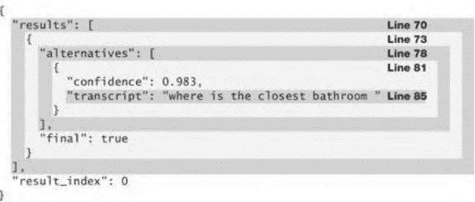

JSON文件包含嵌套的词典和列表。为了简化对这种数据结构的导航，第70～85行使用了简单的语句每次“提取”一个键，直到得到需

要转录的文本，然后返回"where is the closest bathroom"。包含JSON结构的方框和每个方框中的行号对应第70～85行的语句。语句的作用如下：

- 第70行代码将与键'results'对应的列表赋值给results_list:

  results_list = result['results']

根据传递给recognize方法的参数的不同，此列表可能包含中间结果或最终结果。有些时候，中间结果可能是有用的，例如，正在录制类似于新闻广播的现场音频。在我们的APP中只需要最终结果，因此该列表只包含一个元素。

- 第73行代码将最终的语音识别结果，即列表results_list中唯一的元素赋值给speech_recognition_result:

  speech_recognition_result = results_list[0]

- 第78行代码

  alternatives_list = speech_recognition_result['alternatives']

将与键'alternatives'对应的列表赋值给列表alternatives_list。此列表可能包含多个可能的转录，具体取决于方法recognize的参数。我们指定的参数会产生一个只包含唯一元素的列表。

- 第81行代码将alternatives_list中唯一的元素赋值给first_alternative:

  first_alternative = alternatives_list[0]

- 第85行代码使用与键'transcript'对应的值为transcript赋值，其中包含音频的文本转录：

  transcript = first_alternative['transcript']

- 最后，第87行代码返回音频的文本转录。

第70~85行代码可以用更密集的语句来替换

```

## 三、 跨越语言：Language Translator 双向互译

文本就绪，即可送入翻译引擎。Watson Language Translator V3 支持 `en-es`、`es-en` 等多种模型 ID 指定方向。响应体中 `translations` 数组同样只含单元素，取其 `translation` 键值即得译文。

标准调用与解析姿势：

```

但我们倾向于使用多个独立的简洁的语句。

### translate函数

要访问Watson语言翻译服务， translate函数（第89~111行）会 首先创建一个LanguageTranslatorV3类的对象language_translator， 将服务版本（’2018-05-31’）、之前设置的API密钥和服务的URL作为 参数传递。第93和94行代码使用LanguageTranslatorV3的translate方 法来调用语言翻译器服务，传递两个关键字参数，如下：

- text是要被转换为其他语言的字符串。
- model_id是语言翻译服务理解原始文本并将其翻译为适当语言所使用的预定义模型。本例采用的模型是IBM的预定义翻译模型之一 —‘en-es’（英语到西班牙语）或‘es-en’（西班牙语到英语）。

```

典型返回载荷长这样，结构清晰且附带字符统计：

```

translate方法会返回一个DetailedResponse类对象。get_result方法 会返回一个JSON文档，其结构如下图所示。

```

同理，提取译文的一行代码写法：

```

我们会得到什么样的JSON文档作为答复取决于提出的问题。同样，它包含嵌套的字典和列表。第103～109行代码使用短语句来提取翻译文本"¿Dónde está el baño más cercano?"。JSON周围的方框和每个方框中的行号对应第103～109行中的语句。语句的作用如下。

- 运行第103行代码得到列表'translates':
  `translations_list = translated_text['translations']`
  如果方法translate的text参数有多个字符串，则列表将包含多个条目。我们只传递了一个字符串，因此列表只包含一个元素。
- 运行第106行代码得到列表translations_list的唯一一个元素:
  `first_translation = translations_list[0]`
- 运行第109行代码得到与键'translation'对应的值，即翻译好的文本:
  `translation = first_translation['translation']`
- 第111行代码返回翻译好的字符串。

第103～109行代码可以使用更简洁的语句替换，如下：

```

## 四、 还原声音：Text-to-Speech 合成落盘

闭环的最后一步，是让机器“开口说话”。`TextToSpeechV1` 的 `synthesize` 方法接收文本与音色参数，直接输出二进制音频流。以 `wb` 模式写入 `.wav` 文件，即可获得可播放、可分发的语音资产。

核心合成逻辑：

```

但我们依然倾向于使用多个独立的简洁的语句。

### text_to_speech函数

要访问Watson文本到语音服务，text_to_speech函数（第113～122行）创建一个名为tts（text-to-speech的缩写）的TextToSpeechV1对象，将前面设置的API键作为参数传递。with语句打开由file_name指定的文件，并将该文件与名称audio_file相关联。'wb'模式以二进制（b）格式和写入（w）方式打开文件，语音到文本服务返回的音频内容将被写入该文件。

```

---

**结语**  
将上述四个模块串联——`record_audio` → `speech_to_text` → `translate` → `text_to_speech`——一条端到端的语音翻译管线就此打通。部署到边缘设备或封装成 API，即可赋能智能客服、出行助手、多语言会议等无限场景。动手试一把，让代码替你说世界语！

录音流程到此告一段落，我们先做收尾工作：停止数据流、关闭流对象，并释放 PyAudio 占用的底层资源。紧接着，将缓存下来的音频帧写入 WAV 文件，依次配置声道数、采样宽度与采样率，最后一次性写入所有二进制数据。

```

第132行创建PyAudio对象，我们将从中获取输入流以记录来自麦克风的音频。第135和136行使用PyAudio对象的open方法打开输入流，使用常量FORMAT、CHANNELS、FRAME_RATE和CHUNK来配置流。将关键字参数input设置为True，表示该流将用于接收音频输入。open方法返回一个pyaudio Stream对象，用于与流进行交互。

第141和142行使用Stream对象的read方法从输入流中获取数据，每次1024（即CHUNK）帧，然后将其追加到列表audio_frames中。为了确定产生5秒音频所需的循环迭代总数，我们先将FRAME_RATE乘以SECONDS，然后再除以CHUNK。一旦读取完成，第145行调用Stream对象的stop_stream方法终止记录，第146行调用Stream对象的close方法关闭Stream，第147行调用PyAudio对象的terminate方法释放正在管理音频流的底层音频资源。

第150~154行中的with语句使用wave模块的open函数打开file_name指定的WAV文件，以便以二进制格式（'wb'）写入。第151~153行配置WAV文件的通道数、样本宽度（从PyAudio对象的get_sample_size方法获得）和帧速率。然后第154行将音频内容写入文件。表达式b''.join(audio_frames)将所有帧的字节连接成一个字节串。在串前加上b表示它是由字节构成的而不是由一串字符构成的。

### play_audio函数

我们使用pydub和pydub.playback模块的功能来播放Watson的文本转语音服务返回的音频文件。首先，第158行使用pydub模块中的AudioSegment类的from_wav方法来加载WAV文件。该方法返回一个新的AudioSegment对象表示音频文件。第159行将AudioSegment作为参数调用pydub.playback模块的play函数播放AudioSegment。

```

播放端则借助 `pydub` 库轻松实现：读取指定的 WAV 文件生成音频片段，直接调用播放接口即可听见声音。

```

### 执行run_translator函数

当将SimpleLanguageTranslator.py作为脚本执行时，需要调用函数run_translator：

```

脚本的入口点位于底部，直接启动翻译主流程 `run_translator()`，串联起录制、识别、合成与播放的完整闭环。

```

我们希望在编写这个案例的脚本时所采取的分而治之的方法能够使它易于管理。其中的许多步骤能够与一些关键的Watson服务很好地匹配，使我们能够快速创建强大的mashup应用程序。

## 13.7 Watson资源

IBM提供了大量的开发人员资源，可以帮助我们熟悉其服务并开始使用它们来构建应用程序。

### Watson服务文档

Watson服务文档可从 https://console.bluemix.net/developer/watson/documentation 查看。

对于每个服务，都有文档和API的参考链接。每项服务的文档通常包括以下部分或全部内容：

- 入门教程；
- 服务概述的视频；
- 服务演示的链接；
- 指向更具体的操作方法和教程文档的链接；
- 示例应用程序；
- 其他资源，例如更高级的教程、视频、博客文章等。

每个服务的API参考资料都包括使用多种编程语言（包括Python）与服务进行交互的所有细节。单击Python选项卡可以查看Python专用文档以及Watson开发者云Python SDK的相应代码示例。API参考资料会对调用某项服务涉及的所有选项、可以返回的响应类型、示例响应等进行说明。

### Watson SDK

我们使用Watson开发者云Python SDK来开发本章的脚本。除此之外，还有许多其他语言和平台的SDK。完整列表可以在链接 https://console.bluemix.net/developer/watson/sdks-and-tools 上查阅。


### 学习资源

在学习资源页面  
https://console.bluemix.net/developer/watson/learning-resources上可以找到以下链接：

- 关于Watson功能的博客文章以及如何将Watson和AI应用于行业中。
- Watson的GitHub存储库（开发者工具、SDK和示例代码）。
- Watson YouTube频道（接下来会讨论）。
- 代码范例，IBM称之为“解决复杂编程挑战的路线图”。有些是用Python实现的，有些虽然是用其他语言实现的，但对我们使用Python设计和实现APP也是有帮助的。

### Watson视频

Watson YouTube频道（见  
https://www.youtube.com/user/IBMWatsonSolutions/）包含成百上千个视频，演示如何使用Watson的各种功能。还有一些spotlight视频也演示了如何应用Watson。

### IBM红皮书

下面这些IBM红皮书详细介绍了IBM云和Watson服务，帮助我们开发Watson的功能。

- IBM云上的应用程序开发基础：
  http://www.redbooks.ibm.com/abstracts/sg248374.html
- 使用IBM Watson的服务构建认知应用程序（第1卷 入门）：
  http://www.redbooks.ibm.com/abstracts/sg248387.html
- 使用IBM Watson的服务构建认知应用程序（第2卷 转换）（现在称为Watson助手）：
  http://www.redbooks.ibm.com/abstracts/sg248394.html
- 使用IBM Watson的服务构建认知应用程序（第3卷 视觉识别）：
  http://www.redbooks.ibm.com/abstracts/sg248393.html
- 使用 IBM Watson 的服务构建认知应用程序（第4卷 自然语言分类器）：
  http://www.redbooks.ibm.com/abstracts/sg248391.html
- 使用 IBM Watson 的服务构建认知应用程序（第5卷 语言翻译）：
  http://www.redbooks.ibm.com/abstracts/sg248392.html
- 使用 IBM Watson 的服务构建认知应用程序（第6卷 语音转文本和文本转语音）：
  http://www.redbooks.ibm.com/abstracts/sg248388.html
- 使用 IBM Watson 的服务构建认知应用程序（第7卷 自然语言理解）：
  http://www.redbooks.ibm.com/abstracts/sg248398.html

## 13.8 小结

在本章中，我们介绍了IBM的Watson认知计算平台，并对其多样的服务进行了全面的介绍。可以看到Watson提供了可以集成到应用程序中的众多有趣功能。IBM鼓励通过其免费的Lite层进行学习和实验。要利用这一点，需要设置IBM云账户。我们尝试使用Watson的演示来体验各种服务，例如自然语言翻译、语音转文本、文本转语音、自然语言理解、聊天机器人、分析图像和视频中的色调文本、视觉对象识别。

我们安装了Watson开发者云Python SDK，以便使用Python编程访问Watson的服务。在旅行者翻译伴侣APP中，我们混合了几个Watson服务，使只会说英语和只会说西班牙语的人能够轻松地进行口头交流。我们将英语和西班牙语录音转录为文本，再将文本翻译成另一种语言，然后从翻译后的文本中合成英语和西班牙语音频。最后，我们讨论了Watson的各种资源，包括文档、博客、Watson GitHub存储库、Watson YouTube频道、用Python（和其他语言）实现的代码范例以及IBM红皮书。

# 第14章

## 机器学习：分类、回归和聚类

## 目标

- 在流行数据集上使用scikit-learn进行机器学习研究。
- 使用Seaborn和Matplotlib可视化和探索数据。
- 使用k近邻分类和线性回归进行有监督的机器学习。
- 使用Digits数据集执行多分类。
- 将数据集划分为训练集、测试集和验证集。
- 使用k折交叉验证调整模型超参数。
- 测试模型性能。
- 利用混淆矩阵展示分类预测的命中和未命中中样本数。
- 使用加利福尼亚房价数据集执行多元线性回归。
- 在鸢尾花数据集和Digits数据集上使用PCA和t-SNE降维，为二维可视化做准备。
- 使用k均值聚类和鸢尾花数据集执行无监督机器学习。

## 14.1 简介

本章和下一章将介绍机器学习一人工智能最令人兴奋和最有前途的子领域之一。我们将学习如何快速解决新手和大多数有经验的程序员在几年前可能不会尝试的具有挑战性和有趣的问题。机器学习是一个大而复杂的主题，会引发许多微妙的问题，我们的目标是提供一些简单机器学习技术的实用性介绍。

### 什么是机器学习

真的可以让机器（即电脑）学习吗？本章和下一章将展示机器学习是如何发生的。这种新的应用开发风格的“秘诀”是什么呢？是数据，而且是很多数据。不是将专家知识编码进应用，而是通过编程从数据中学习这些知识。接下来的章节将介绍很多基于Python的代码示例，这些示例构建了可工作的机器学习模型，可使用它们进行非常准确的预测。

### 预测

如果能通过改进天气预报挽救更多生命、减少伤害和财产损失，那是不是很棒？如果能够改善癌症的诊断和治疗方法来拯救更多生命，或改善业务预测方法以最大化利润并保障人们的工作，又将会怎样呢？如何能够检测欺诈性信用卡消费和保险索赔呢？如何预测客户流失、房价、新电影的票房，以及新产品和服务的预期收益呢？如何预测能使教练和球员赢得更多比赛和锦标赛的最佳策略呢？所有这些类型的预测都出现在了今天的机器学习中。

### 机器学习应用

以下是一些流行的机器学习应用。

- 异常检测
- 聊天机器人
- 将电子邮件分类为垃圾邮件和非垃圾邮件
- 将新闻分类为体育、财经、政治等
- 计算机视觉和图像分类
- 信用卡欺诈检测
- 客户流失预测
- 数据压缩
- 数据探索
- 社交媒体数据挖掘（比如Facebook、Twitter、LinkedIn）
- 场景中的目标检测
- 数据模式检测
- 医疗诊断
- 人脸识别
- 保险欺诈检测
- 计算机网络入侵检测
- 手写识别
- 市场营销：将客户划分为集群
- 自然语言翻译
- （英语到西班牙语，法语到日语等）
- 预测按揭贷款违约
- 推荐系统（“购买此产品的人也购买了……”）
- 汽车自动驾驶（更广泛地说，是交通工具自动驾驶）
- 情感分析（比如将影评分为正面的、负面的或中性的）
- 垃圾邮件过滤
- 时间序列预测（如股价预测和天气预报）
- 语音识别

### 14.1.1 scikit-learn

接下来，我们将学习使用流行的scikit-learn机器学习库。scikit-learn也称为sklearn，可以方便地将最有效的机器学习算法打包为估计器。每个估计器都是封装的，因此不能看到这些算法的复杂工作细节和数学运算。我们应该会觉得这种方式熟悉，就像在不知道发动机、变速箱、制动系统和转向系统工作细节的情况下驾车。当你下次走进电梯并选择目的楼层，或者打开电视选择想要观看的节目时，请关注一下这一点。另外，我们虽然使用手机，但真的了解智能手机的硬件和软件的内部工作原理吗？

通过scikit-learn和少量的Python代码，可以快速地创建功能强大的模型来分析数据、从数据中提取信息，最重要的是进行预测。我们将使用scikit-learn在数据集的一个子集上训练模型，然后测试剩余数据来查看模型的工作情况。一旦模型经过训练，就可以用来对未知数据进行预测。我们常常对结果感到惊讶，突然之间，主要会死记硬背的计算机竟然有了智能特性。

scikit-learn包含可以自动训练和测试模型的工具，虽然可以指定参数来自定义模型，性能也可能因此提高，但在本章中，我们使用模型的默认参数，仍然可以获得不错的结果。还有像auto-sklearn这样的工具（见https://automl.github.io/auto-sklearn），用它可以自动完成可由scikit-learn执行的很多任务。

#### 应该选择哪种scikit-learn估计器

我们很难事先知道哪种模型对特定的数据表现最佳，因此通常会尝试多种模型并选择性能最佳的，scikit-learn为此提供了方便。一种流行的方法是运行多种模型并选择其中最好的。那么如何评估哪种模型表现最佳呢？

我们想对不同类型的数据集试验很多不同的模型，却通常很少了解sklearn估计器中的复杂数学算法的细节，凭借经验，我们会很熟悉哪些算法可能最适合哪种类型的数据集和问题，但即使有这种经验，也不太可能凭直觉为每个新数据集找到最佳模型。scikit-learn提供了可以轻松“全部尝试”这些模型的途径，最多只需用几行代码即可创建和使用每个模型，并给出性能报告，以便比较结果并选择具有最佳性能的模型。

### 14.1.2 机器学习的类别

我们将介绍两种主要的机器学习方式—监督机器学习（使用标记数据），以及无监督机器学习（使用无标记数据）。

举个例子，如果正在开发一种用于识别狗和猫的计算机视觉应用程序，我们将会在很多标记为“狗”的狗照片和标记为“猫”的猫照片上训练模型。如果模型有效，那么当把它用于处理未标记照片时，它将会识别出从未见过的狗和猫。用于训练的照片越多，模型能够准确预测出猫和狗的概率就越大。在这个拥有大数据、大规模且经济计算能力的时代，我们应该能够使用下面即将讲到的技术构建一些非常精确的模型。

查看未标记数据如何变得有用？在线书商出售大量书籍时，记录了大量的（未标记的）图书交易数据，它们很早就注意到，购买某些书籍的人可能会购买相同或类似主题的其他书籍，这催生了“图书推荐系统”。现在浏览书籍销售网站时，可能会收到一些推荐，比如“购买此书的人还购买了这些书籍”。推荐系统是当今的大商机，有助于最大限度地提高产品销量。

#### 监督机器学习

监督机器学习分为两类—分类和回归。可以在由行和列组成的数据集上训练机器学习模型，每一行代表一个数据样本，每一列代表该样本的一个特征。在有监督的机器学习中，每个样本都有一个标签（如“狗”或“猫”），这是利用训练好的模型进行新数据预测时的预测值。

#### 数据集

我们将使用一些小数据集（也称toy数据集）进行学习，每个数据集都包含少量的具有有限特征的样本，还将使用几个特征丰富的真实数据集，一个包含几千个样本，一个包含数万个样本。在当今大数据时代，一个数据集通常包含数百万甚至数十亿个样本，甚至更多。

有大量免费开放的数据集，可供数据科学研究使用，像scikit-learn这样的库，可以打包很多流行的数据集，并提供了加载数据集的机制（比如openml.org）。世界各国政府、企业和其他组织提供了各种主题的数据集。本书中，我们将学习使用多种机器学习技术处理几个流行的免费数据集。

#### 分类

我们将使用最简单的分类算法之一—k近邻算法，来分析scikit-learn中的数据集。分类算法用于预测样本所属的离散类别。二分类包含两种类别，例如电子邮件分类应用中的“垃圾邮件”和“非垃圾邮件”；多分类使用两个以上的类别，例如Digits数据集中的10类（即0~9类），电影描述分类可能会将其分为“动作”“冒险”“幻想”“浪漫”“历史”等。

#### 回归

回归模型用于预测连续输出，比如在第10章数据科学入门部分中，根据天气时间序列来预测温度。本章我们将再次探讨简单的线性回归示例，这次将使用scikit-learn的LinearRegression估计器来实现。接下来，使用LinearRegression估计器对scikit-learn中自带的加利福尼亚房价数据集进行多元线性回归操作。我们将预测美国的某个街区的房价中值，考虑到每个街区的8个特征，比如平均房间数、房屋年龄中值、平均卧室数和收入中值，LinearRegression估计器默认使用数据的所有特征以完成更加复杂的预测任务，当然，也可以用单一特征执行简单的线性回归。

#### 无监督机器学习

接下来，将基于聚类算法介绍无监督机器学习。我们将Digits数据集的64个特征降（使用scikit-learn的TSNE估计器）为二维以可视化这些特征，使得能够看到Digits数据是如何“聚集”的。Digits数据集包含手写数字，比如邮局的计算机必须能识别出邮政编码，以便把信寄到指定的地方，这是一个非常有挑战的计算机视觉问题，因为每个人的笔迹都是独一无二的。然而，我们只需用几行代码就可以构建这个聚类模型，并能取得不错的结果，而且不需要了解聚类算法内部的工作原理，这就是基于对象编程的美妙之处。我们将在下一章再次看到基于对象编程的便捷，使用开源的Keras库构建强大的深度学习模型。

#### k均值聚类和鸢尾花数据集

下面介绍最简单的无监督机器学习算法—k均值聚类，并将其用于scikit-learn中的鸢尾花数据集，把鸢尾花数据集的四个特征降为二维以进行可视化（使用scikit-learn的PCA估计器），展示数据集中三种鸢尾花物种的集群，并绘制每个集群的质心，即中心点。最后，运行多个聚类算法来比较它们将鸢尾花数据集的样本划分为三个集群的能力。

k均值聚类算法通常需要指定所需的类别数k，将数据划分为k个集群。与很多机器学习算法一样，k均值算法是迭代进行的，并逐渐集中在与指定类别数匹配的集群上。

k均值聚类可以在无标记数据中找到数据之间的相似之处，为分配数据标签提供帮助，以便监督学习算法进一步处理这些数据。鉴于靠人力为无标记数据分配标签非常烦琐且容易出错，并且考虑到世界上绝大多数数据都没有标签，无监督机器学习也是一个重要的机器学习工具。

#### 大数据和大型计算机处理能力

现在可用的数据量已经很庞大，并且会持续呈指数级增长，在过去几年，世界上产生的数据量相当于自人类文明出现以来产生的数据量。我们经常谈论大数据，但“大”这个词可能不足以描述真正的数据规模。

有人曾说“我淹没在数据中，不知道如何处理它”，通过机器学习，我们现在就可以说，“用大数据淹没我吧，这样我就可以利用机器学习技术来提取信息并做出预测”。

这是在计算能力爆炸、计算机内存和二级存储爆炸式增长，而成本急剧下降的情况下发生的，使得我们能够以不同的方式思考解决方案。现在可以对计算机进行编程以从数据甚至大量数据中学习，这都是关于从数据预测的。

### 14.1.3 scikit-learn中内置的数据集

下表列出了scikit-learn的内置数据集。scikit-learn还提供了从其他来源加载数据集的功能，例如可以从openml.org上下载两万多个数据集。

| scikit-learn中内置的数据集 |
|---|
| 小数据集 |
| 波士顿房价数据集 |
| 鸢尾花数据集 |
| 糖尿病数据集 |
| 手写数字光学识别数据集 |
| Linnerud数据集 |
| 葡萄酒识别数据集 |
| 威斯康星州乳腺癌数据集（诊断） |
| 真实数据集 |
| Olivetti人脸数据集 |
| 20个新闻组文本数据集 |
| 野外人脸识别中的标记人脸数据集 |
| 植被覆盖类型数据集 |
| RCV1数据集 |
| Kddcup 99数据集 |
| 加利福尼亚房价数据集 |

### 14.1.4 典型的数据科学研究的步骤

典型的数据科学研究的步骤包括：

- 加载数据集。
- 使用pandas和可视化库探索数据。
- 转换数据（将非数值数据转换为数值数据，因为scikit-learn要求用数值数据。本章使用的数据集是处理好的，我们将在第15章中再次讨论这个问题）。
- 将数据划分为训练集和测试集。
- 创建模型。
- 训练和测试模型。
- 调整模型并评估其准确性。
- 对模型未见过的实时数据进行预测。

在第7章和第8章中的数据科学简介部分，我们讨论了使用pandas来处理缺失值和错误值，这是将数据用于机器学习之前进行数据清理的重要环节。

## 14.2 案例研究：用k近邻算法和Digits数据集进行分类（第1部分）

为了有效地处理邮件并将每个邮件发送至正确的目的地，邮政服务计算机必须能够扫描手写的姓名、地址和邮政编码，并识别出对应的字母和数字。正如即将在本章中看到的，强大的库（比如scikit-learn）使得新手程序员也能够方便地处理这些机器学习问题。在下一章提出卷积神经网络深度学习技术时，我们将使用更多强大的计算机视觉功能。

### 分类问题

在本节中，我们将研究有监督机器学习中的分类问题，它试图预测样本所属类别，比如，如果有含狗的图像和含猫的图像，可以将每个图像分类为“狗”或“猫”，这是一个二分类问题，因为有两个类别标签。

这里将使用scikit-learn中的Digits数据集，该数据集包含8×8像素的1797个手写数字图像（0～9），目标是预测每幅图像代表的数字。由于有10个可能的数字（类），因此这是一个多分类问题。我们可以使用有标记数据（事先知道其中每个数字所属的类别）训练一个分类模型。本案例将使用最简单的机器学习分类算法之一——k近邻算法（k-NN），来识别手写数字。

下面的数字“5”的低分辨率可视化由Matplotlib从一个8×8像素的原始图像得来，接下来将展示如何使用Matplotlib显示出这样的图像。

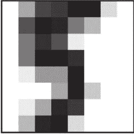

研究者们使用20世纪90年代早期由数十万张32×32像素的图像组成的MNIST数据库创建了这个数据集，在今天的高清相机和扫描仪下，我们可以以更高的分辨率捕获这些图像。

### 我们的方法

我们将通过两个部分介绍此案例，本节将从机器学习案例研究的基本步骤开始：

- 确定用于训练模型的数据
- 加载并探索数据
- 将数据划分为训练集和测试集
- 选择并构建模型
- 训练模型
- 做出预测

正如所看到的，在scikit-learn中，每个步骤最多需要几行代码。下一节中，我们将进行：

- 结果评估
- 模型调整
- 运行多个分类模型以选择出最佳的那个

使用Matplotlib库和Seaborn库可视化数据，因此需要在IPython中启用Matplotlib支持：

```

# 手写数字识别实战：从数据加载到 KNN 模型训练

大家好，今天我们来走一遍经典的手写数字识别流程。我们将使用 `scikit-learn` 自带的 `digits` 数据集，涵盖数据审视、可视化展示、数据集划分以及 KNN 分类器的构建与训练全过程。

首先，启动支持绘图的 IPython 环境，并导入数据集：

```


## 14.2.1 k近邻算法

scikit-learn支持很多分类算法，包括最简单的k近邻（k-NN）。k近邻算法通过观察距离测试样本最近的k个训练样本的类别来预测测试样本的类别。比如下图中，实心点表示四种类别的样本—A、B、C、D。在讨论中，使用这些字母作为类别名称。

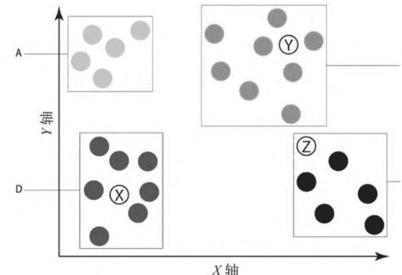

我们想要预测新样本X、Y和Z所属的类别，假设想使用每个样本的三个最近邻样本做出预测，那么k近邻算法中的k就是3：

- 样本X的三个最近邻样本都是D类点，所以X的预测类别是D类。
- 样本Y的三个最近邻样本都是B类点，所以Y的预测类别是B类。
- 对于样本Z，选择不是那么清楚，因为它出现在B和C点之间，它的三个最近邻样本中，一个是B类，两个是C类。在k近邻算法中，认为具有最多“投票”的类别获胜。因此，基于C类两票对B类一票，预测样本Z的类别是C类。另外，在k近邻算法中选择一个奇数k值可以确保不出现相同数量的票数，从而避免纠结。

### 超参数和超参数调整

在机器学习中，模型用于实现机器学习算法，而在scikit-learn中，模型被称为估计器。机器学习中有两种参数类型：

- 估计器根据提供的数据进行学习的参数。
- 创建scikit-learn估计器对象时提前指定的参数。

这些预先指定的参数称为超参数。

在k近邻算法中，k就是一个超参数。为简单起见，我们使用scikit-learn的默认超参数值。在机器学习实际应用研究中，通常会尝试不同的k值来选择最好的模型，这个过程称为超参数调整。稍后我们将使用超参数调整来选择合适的k值，使k近邻算法能够对Digits数据集进行最佳预测。另外，scikit-learn还具有自动超参数调整功能。

## 14.2.2 加载数据集

sklearn.datasets模块中的load_digits函数会返回一个Bunch对象，其包含关于Digits数据集的数字数据和信息（称为元数据）：

```

In [1]: from sklearn.datasets import load_digits

In [2]: digits = load_digits()

数据加载完成后，我们先快速浏览一下前 100 个样本的标签，感受一下类别分布：

```

Bunch类是dict类的子类，具有与数据集交互的附加属性。

### 显示描述

与scikit-learn捆绑在一起的Digits数据集是UCI（加利福尼亚大学欧文分校）ML手写数字数据集的一个子集，可参见http://archive.ics.uci.edu/ml/datasets/Optical+Recognition+of+Handwritten+Digits。

最初的UCI数据集包含5620个样本—3823个用于训练，1797个用于测试。scikit-learn中捆绑的Digits数据集仅包含1797个测试样本。Bunch类的DESCR属性包含对数据集的描述。根据描述，Digits数据集中每个样本有64个特征（由Number of Attributes指定），这些特征用来表示一幅像素值在0~16范围内的8×8像素的图像（由Attribute Information指定）。该数据集没有缺失值（由Missing Attribute Values指定）。这64个特征可能看起来挺多了，但真实的数据集有时可能有数百、数千甚至上百万种特征。

### 检查样本和目标尺寸

Bunch对象的data和target属性是NumPy中的array类型：

- data数组包含1797个样本（数字图像），每个样本有64个特征，其值在0~16范围内，用于表示像素强度。我们将通过Matplotlib利用白色（0）到黑色（16）的灰度色调可视化这些像素强度：

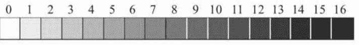

target数组包含图像的标签—指示每幅图像代表哪个数字类别。该数组被称为target，是因为进行预测时我们希望可以达到这个“目标值”。要查看整个数据集中部分样本的标签，可以通过target展示每第100个样本的目标值：

```

In [4]: digits.target[:100]

Out[4]: array([0, 4, 1, 7, 4, 8, 2, 2, 4, 1, 9, 7, 3, 2, 1, 2, 5])

接着检查数据的结构维度。特征矩阵包含 1797 个样本，每个样本由 64 个特征构成（即 8x8 像素展平）；目标向量长度也为 1797，与样本数一一对应：

```

我们可以通过查看data数组的shape属性来确认样本和特征（每个样本）的数量，该属性显示data数组中有1797行（样本）和64列（特征）：

```

In [5]: digits.data.shape

Out[5]: (1797, 64)

```

可以通过查看target数组的shape属性来确认目标值的数量与样本数量是否匹配：

```

In [6]: digits.target.shape

Out[6]: (1797,)

为了更直观地理解数据，我们取第 14 个样本（索引 13）为例。先看其原始的 8x8 二维图像矩阵，像素值范围大致在 0-16 之间：

```

### 一个数字图像样本

每幅图像都是二维的—具有一定的宽度和高度（以像素为单位），load_digits函数返回的Bunch对象包含一个images属性—一个数组，其中每个元素是一个二维的8×8数组，用来表示数字图像的像素强度。虽然原始数据集将每个像素表示为0～16的整数值，但scikit-learn将这些值存储为浮点型数据（NumPy的float64类型）。例如，下面的二维数组表示索引为13的图像样本：

```

In [7]: digits.images[13]

Out[7]:

array([[ 0., 2., 9., 15., 14., 9., 3., 0.],

       [ 0., 4., 13., 8., 9., 16., 8., 0.],

       [ 0., 0., 0., 6., 14., 15., 3., 0.],

       [ 0., 0., 0., 11., 14., 2., 0., 0.],

       [ 0., 0., 2., 15., 15., 11., 0., 0.],

       [ 0., 0., 1., 0., 2., 15., 4., 0.],

       [ 0., 1., 5., 6., 13., 16., 6., 0.],

       [ 0., 2., 12., 12., 13., 11., 0., 0.]])

对比之下，`digits.data` 中对应的则是将该矩阵按行展平后的一维向量，长度为 64：

```

下面是该二维数组所代表的图像，后文将给出显示此图像的代码。


### 准备数据以供scikit-learn使用

scikit-learn中的机器学习算法要求将样本存储在二维浮点数组（或二维的类似数组的合集，比如列表或pandas中的DataFrame）中：

- 每行代表一个样本
- 给定行中的每列代表该样本的一个特征

为了将每个样本表示为一行，必须将诸如代码段[7]所示的二维图像数组的多维数据拉直为一维数组。

如果正在使用包含分类特征的数据（通常表示为字符串，例如'spam'或'not-spam'），则必须将这些特征预处理为数值—独热编码，下一章将介绍独热编码。scikit-learn的sklearn.preprocessing模块提供了将分类数据转换为数值数据的功能。Digits数据集没有分类特征。

为了方便起见，load_digits函数返回准备进行学习的预处理过的数据。Digits数据集本身就是数字的，因此load_digits函数只是将每个图像的二维数组拉直为一维数组，例如，代码段[7]中显示的8×8的digits.images[13]数组对应于下面显示的1×64的digits.data[13]数组：

```

In [8]: digits.data[13]

Out[8]:

array([ 0.,  0.,  9., 15., 14.,  9.,  3.,  0.,  0.,  4., 13.,  8.,  9.,

       16.,  8.,  0.,  0.,  0.,  0.,  6., 14., 15.,  3.,  0.,  0.,  0.,

        0., 11., 14.,  2.,  0.,  0.,  0.,  0.,  0.,  2., 15., 11.,  0.,

        0.,  0.,  0.,  0.,  2., 15.,  4.,  0.,  0.,  1.,  5.,  6.,

       13., 16.,  6.,  0.,  0.,  2., 12., 12., 13., 11.,  0.,  0.])

光看数字不够直观，我们用 `matplotlib` 批量绘制前 24 张图片，并标注真实标签，构建一个 4 行 6 列的画廊：

```

在这个一维数组中，前8个元素是二维数组的第0行，接下来的8个元素是二维数组的第一行，以此类推。

## 14.2.3 可视化数据

我们自己应该熟悉自己的数据，这个过程称为数据探索。对于数字图像，可以使用Matplotlib的imshow函数显示这些图像。下图显示了Digits数据集的前24个图像，想观察手写数字识别的难度，可以看一下第一、第三和第四行中“3”的图像的变化，并查看第一、第三和第四行中的“2”。

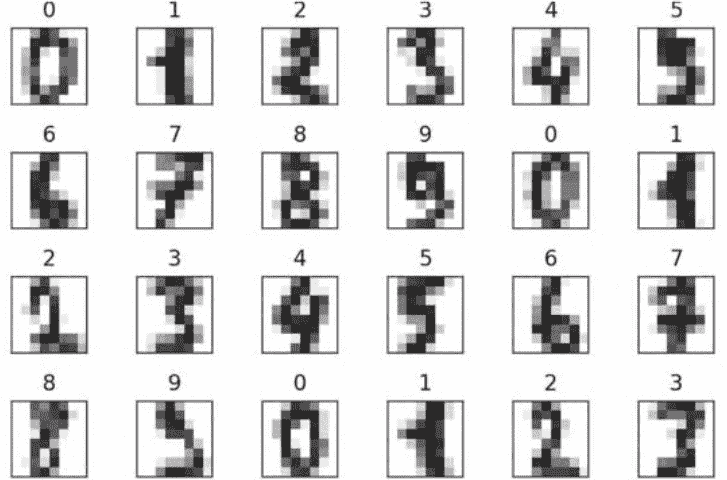

### 创建图像

下面来看看显示这24个数字的代码，以下对subplots函数的调用创建了一个6×4英寸的图像（由figsize=(6,4)关键字参数指定），包含24个子图，排列为4行（nrows = 4）、6列（ncols = 6），每个子图都有自己的Axes对象，我们将用它来显示一个数字图像：

```

In [9]: import matplotlib.pyplot as plt

In [10]: figure, axes = plt.subplots(nrows=4, ncols=6, figsize=(6, 4))

```

subplots函数将Axes对象以二维NumPy数组的形式返回，如下图所示，每个子图的x轴和y轴上都有标签（将被删除）。

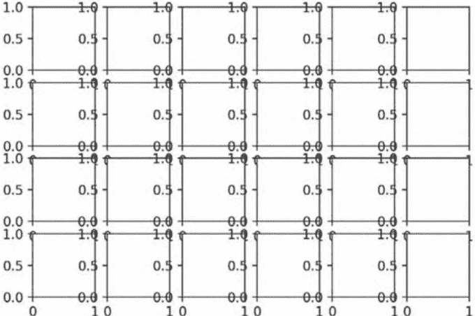

### 显示每个图像并删除轴标签

接下来，使用带有内置zip函数的for语句对这24个Axes对象、digits.images中的前24个图像和digits.target中的前24个值并行迭代：

```

In [11]: for item in zip(axes.ravel(), digits.images, digits.target):

    ...:     axes, image, target = item

    ...:     axes.imshow(image, cmap=plt.cm.gray_r)

    ...:     axes.set_xticks([]) # remove x-axis tick marks

    ...:     axes.set_yticks([]) # remove y-axis tick marks

    ...:     axes.set_title(target)

    ...: plt.tight_layout()

    ...:

    ...:

数据理解完毕，下一步利用 `train_test_split` 进行切分。首次调用采用默认比例（测试集 25%），随机种子固定为 11 以保证可复现。结果显示训练集约 1347 条，测试集 450 条：

```

回想一下，NumPy的数组方法ravel方法会为多维数组创建一维视图，zip函数会生成包含其中参数的元组，并且具有最少元素的参数决定了zip函数返回的元组数。

循环迭代：

- 将zip函数生成的一个元组解压缩为三个变量，分别表示Axes对象、图像和目标值。
- 调用Axes对象的imshow方法来显示一个图像，关键字参数cmap=plt.cm.gray_r确定了图像中显示的颜色。plt.cm.gray_r是一个颜色表——一组可以很好地搭配使用的颜色，使我们能够以灰度模式显示图像的像素，0为白色，16为黑色，两者之间的值为渐变的灰色。关于Matplotlib的颜色表名称请参阅 https://matplotlib.org/examples/color/colormaps_reference.html。每个都可以通过plt.cm对象或字符串访问，比如'gray_r'。
- 使用空列表调用Axes对象的set_xticks方法和set_yticks方法，以指示x轴和y轴不应有刻度线。
- 调用Axes对象的set_title方法以在图像上显示target值，即图像所代表的实际数字。

在循环结束之后，调用tight_layout函数来移除图的顶部、右侧、底部和左侧的额外空白，使得图像可以填充Figure中更多的空间。

## 14.2.4 拆分数据以进行训练和测试

我们通常使用数据集的一个子集来训练机器学习模型。通常情况下，训练的数据越多，模型训练的效果就越好。将一部分数据留出来进行测试是非常重要的，这样就可以使用模型尚未见过的数据来评估模型的性能。一旦确定模型运行良好，就可以用它来对未见过的新数据进行预测。

首先将数据划分为训练集和测试集，以准备训练和测试模型，sklearn.model_selection模块中的train_test_split函数将数据随机打乱，然后将data数组中的样本和target数组中的目标值分成训练集和测试集，这有助于确保训练集和测试集具有类似的特征。通过sklearn.model_selection模块中的ShuffleSplit对象，可以方便地执行数据混洗和拆分。train_test_split函数会返回包含四个元素的元组，其中前两个元素为训练集和测试集的样本，后两个元素是训练集和测试集的相应目标值。按照惯例，大写X用于表示样本，小写y用于表示目标值：

```

In [12]: from sklearn.model_selection import train_test_split

In [13]: X_train, X_test, y_train, y_test = train_test_split(

    digits.data, digits.target, random_state=11)

...:

...:

```

假设数据的类别是均衡的，样本是根据类别均匀分配的。每个 scikit-learn中捆绑的分类数据集都是这种情况，因为类别不均衡可能会导致结果不正确。

在第4章中，我们了解了如何为随机数生成器设置种子以获得可重复性，在机器学习研究中，这有助于其他人通过使用相同的随机数来复现你的结果。train_test_split函数为可重复性提供了一个关键字参数random_state，当使用相同的种子值运行代码时，train_test_split函数将选择相同的训练数据和测试数据。在下面的代码中，我们任意指定种子值为11。

### 训练集和测试集规模

从X_train和X_test的shape属性可以看出，默认情况下，train_test_split函数保留75%的训练数据和25%的测试数据：

```

In [14]: X_train.shape

Out[14]: (1347, 64)

In [15]: X_test.shape

Out[15]: (450, 64)

如果我们显式指定 `test_size=0.20`，则测试集占比 20%，对应的划分代码如下：

```

若要指定不同的划分，可以使用train_test_split函数的关键字参数test_size和train_size设置测试集和训练集的大小，使用0.0到1.0之间的浮点数来指定百分比，也可以使用整数值来设置精确的样本数。如果指定其中一个关键字参数，则另一个就可以推断出来。比如

```

X_train, X_test, y_train, y_test = train_test_split(

    digits.data, digits.target, random_state=11, test_size=0.20)

万事俱备，引入 K 近邻分类器。这里直接使用默认参数（K=5，欧氏距离，均匀权重）实例化模型：

```

指定20%的数据用于测试，因此train_size为0.80。

## 14.2.5 创建模型


利用KNeighborsClassifier估计器（sklearn.neighbors模块）实现k近邻算法。首先，创建KNeighborsClassifier估计器对象：

```python

In [16]: from sklearn.neighbors import KNeighborsClassifier

In [17]: knn = KNeighborsClassifier()

最后，在训练集上拟合模型。输出显示了模型生效时的完整超参数配置：

```

要创建估计器，只需创建一个对象即可，实现k近邻算法的内部细节将隐藏在这个对象中，我们只需要调用它，这是Python基于对象编程的本质。

### 14.2.6 训练模型

接下来，调用KNeighborsClassifier对象的fit方法，该方法将训练集的样本（x_train）和目标（y_train）加载到估计器中：

```python

In [18]: knn.fit(X=x_train, y=y_train)

Out[18]:

KNeighborsClassifier(algorithm='auto', leaf_size=30, metric='minkowski',

metric_params=None, n_jobs=None, n_neighbors=5, p=2,

weights='uniform')

至此，一个基于 KNN 的手写数字识别基线模型就训练完成了。后续可以尝试调整 `n_neighbors`、距离度量或引入降维等手段来提升性能。希望这份实操记录对你有帮助！

## 实战检验：KNN 模型在手写数字上的表现如何？

```

对于大多数scikit-learn估计器，fit方法首先将数据加载到估计器中，然后使用该数据在后台执行复杂计算，从数据中学习并训练模型。KNeighborsClassifier对象的fit方法只是将数据加载到估计器中，因为k近邻没有初始学习过程。估计器是很懒的，它仅在进行预测时才会工作。在本章和下一章中，我们将使用许多具有重要的训练过程的模型。在实际的机器学习应用中，有时需要花几分钟、几小时、几天甚至几个月的时间来训练模型。我们将在第15章看到，GPU和TPU这类专用的高性能硬件可以显著缩短模型的训练时间。

如代码段[18]的输出所示，fit方法将估计器返回，因此IPython显示其字符串表示形式，其中包括估计器的默认设置。n_neighbors值对应于k近邻算法中的k，默认情况下，KNeighborsClassifier估计器找出5个最近邻样本进行预测。为了简单起见，我们通常使用默认设置，KNeighborsClassifier估计器的详细介绍请参考链接 http://scikit-learn.org/stable/modules/generated/sklearn.neighbors.KNeighborsClassifier.html上的介绍。其中的很多设置超出了本书的介绍范围。在本案例研究的第2部分（14.3节）中，我们将讨论如何为n_neighbors参数选择最佳值。

### 14.2.7 预测数字类别

现在我们已经将训练样本加载到KNeighborsClassifier估计器中，可以将它与测试样本一起使用来进行预测。通过x_test参数调用估计器的predict方法将返回一个数组，该数组包含模型对每个测试图像的预测类别：

```python
```python
# 对测试集进行预测
predicted = knn.predict(X_test)
# 获取真实标签
expected = y_test
```

首先，我们让训练好的 KNN 分类器在测试集上“亮相”，生成预测结果 `predicted`，并将其与真实标签 `expected` 对应起来。

```

我们来看看前20个测试样本的预测值与期望值：

```python
```python
# 查看前 20 条预测结果
predicted[:20]
# array([0, 4, 9, 9, 3, 1, 4, 1, 5, 0, 4, 9, 4, 1, 5, 3, 3, 8, 5, 6])

# 对比前 20 条真实标签
expected[:20]
# array([0, 4, 9, 9, 3, 1, 4, 1, 5, 0, 4, 9, 4, 1, 5, 3, 3, 8, 3, 6])
```

肉眼对比前 20 个样本，仅第 19 个样本（索引 18）出现分歧：模型预测为 `5`，实为 `3`。其余均精准命中。

```

可以看出，在前20个元素中，只有索引18处的预测值和期望值不匹配。期望值为“3”，但该模型的预测值为“5”。

下面使用列表推导式来为整个测试集定位所有不正确的预测。也就是说，预测值和期望值不匹配的情况：

```python
```python
# 筛选出所有预测错误的样本对 (预测值, 真实值)
wrong = [(p, e) for (p, e) in zip(predicted, expected) if p != e]
wrong
# [(5, 3), (8, 9), ..., (1, 8)]
```

将全量数据的错例提取出来，构建错误清单，方便后续深度剖析。

```

列表推导式使用zip函数来创建包含预测值和对应期望值的元组，只有当p（预测值）和e（期望值）不同时，我们才在结果中给出一个元组。也就是说，这时的预测值是不准确的。在这个例子中，估计器错误地预测了450个测试样本中的10个，因此，即使仅使用估计器的默认参数，该估计器的预测准确性仍然能达到97.78%。

## 14.3 案例研究：利用k近邻算法和Digits数据集进行分类（第2部分）

在本节中，我们继续进行数字分类案例研究，主要执行以下任务：

- 评估k近邻分类估计器的准确性；
- 执行多个估计器并比较它们的结果，以便可以选择最佳的一个或多个；
- 展示如何调整k近邻的超参数k以通过KNeighborsClassifier估计器获得最佳性能。

### 14.3.1 模型准确性指标

一旦训练并测试了模型，我们都需要评估模型的准确性。在这里，我们主要关注两种评估方法—分类估计器的score方法和混淆矩阵。

#### 估计器score方法

每个估计器都有一个score方法，该方法返回估计器对测试数据执行情况的指示。对于分类估计器，该方法返回测试数据上的预测准确性：

```python
```python
# 直接输出测试集准确率
print(f"{knn.score(X_test, y_test):.2%}")
# 97.78%
```

单次划分下的测试集准确率达 **97.78%**，初步表现相当亮眼。

---

### 混淆矩阵：可视化分类细节

光看正确率不够，我们需要看清“谁跟谁搞混了”。

```

KNeighborsClassifier估计器在默认k值的情况下（即n_neighbors=5）实现了97.78%的预测准确性。接下来，我们将执行超参数调整以确定k的最佳值，希望到时可以获得更好的准确性。

#### 混淆矩阵

检查分类估计器的准确性的另一种方法是混淆矩阵，该矩阵显示出给定类别中的正确和不正确的预测值（也称命中和未命中），只需简单地从sklearn.metrics模块中调用confusion_matrix函数，将预测所得类别和期望类别作为参数传递，如下所示：

```python
```python
from sklearn.metrics import confusion_matrix
# 计算混淆矩阵
confusion = confusion_matrix(y_true=expected, y_pred=predicted)
```

```

y_true关键字参数指定了测试样本的真实类别，通过人为查看数据集中的图像并给出类别标签（数字值），y_pred关键字参数指定这些测试图像的预测数字值。

下面是之前的调用产生的混淆矩阵，正确的预测显示在从左上角到右下角的对角线上，也就是主对角线上，不在主对角线上的非零值表示不正确的预测：

| 真实类\预测类 | 0 | 1 | 2 | 3 | 4 | 5 | 6 | 7 | 8 | 9 |
|---|---|---|---|---|---|---|---|---|---|---|
| 0 | 45 | 0 | 0 | 0 | 0 | 0 | 0 | 0 | 0 | 0 |
| 1 | 0 | 45 | 0 | 0 | 0 | 0 | 0 | 0 | 0 | 0 |
| 2 | 0 | 0 | 54 | 0 | 0 | 0 | 0 | 0 | 0 | 0 |
| 3 | 0 | 0 | 0 | 42 | 0 | 1 | 0 | 1 | 0 | 0 |
| 4 | 0 | 0 | 0 | 0 | 49 | 0 | 1 | 0 | 0 | 0 |
| 5 | 0 | 0 | 0 | 0 | 0 | 38 | 0 | 0 | 0 | 0 |
| 6 | 0 | 0 | 0 | 0 | 0 | 0 | 42 | 0 | 0 | 0 |
| 7 | 0 | 0 | 0 | 0 | 0 | 0 | 0 | 45 | 0 | 0 |
| 8 | 0 | 1 | 1 | 2 | 0 | 0 | 0 | 0 | 39 | 1 |
| 9 | 0 | 0 | 0 | 0 | 1 | 0 | 0 | 0 | 1 | 41 |

每一行表示不同的类，即数字0~9之一。行中的列指定将多少测试样本分类到每一类中。例如，第0行：

[45, 0, 0, 0, 0, 0, 0, 0, 0, 0]

表示数字“0”类，列表示10个可能的目标类0~9，因为我们处理的是数字，所以类别（0~9）和行、列索引号（0~9）恰好匹配。根据第0行的结果，45个测试样本被分类为数字“0”，并且没有测试样本被错误地分类为数字“1” ~ “9”中的任何一个。因此，100%的“0”都被正确地预测了。

另外，观察第8行，它代表数字“8”的结果：

[0, 1, 1, 2, 0, 0, 0, 0, 39, 1]

- 列索引1处的1表示一个“8”被错误地分类为“1”；
- 列索引2处的1表示一个“8”被错误地分类为“2”；
- 列索引3处的2表示两个“8”被错误地分类为“3”；
- 列索引8处的39表示39个“8”被正确地分类为“8”；
- 列索引9处的1表示一个“8”被错误地分类为“9”。

因此该算法正确预测出了88.63%的数字“8”（39个命中，共44个），之前我们看到这个估计器的整体预测准确性为97.78%，“8”的较低预测准确性表明它显然比其他数字更难识别。

#### 分类报告

sklearn.metrics模块还提供了classification_report函数，该函数根据预测值和期望值生成了下面的分类指标表：

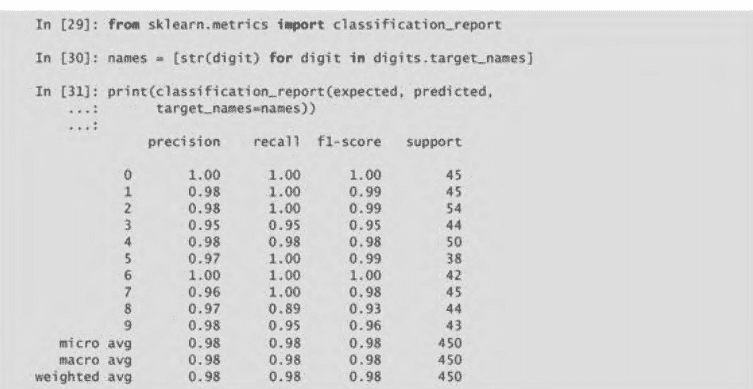

报告中：

- precision（精度）是给定数字的正确预测总数除以该数字的预测总数。可以通过查看混淆矩阵中的每一列来确认它的值，比如对于列索引7，在第3行和第4行中看到1，表示一个数字“3”和一个数字“4”被错误地分类为数字“7”，第7行为45表示45个图像正确地分类为数字“7”，因此数字“7”的预测精度为45/47或0.96。

- recall（召回率）是给定数字的正确预测总数除以应该预测为该数字的样本总数，可以通过查看混淆矩阵中的每一行来确认召回率。例如，如果查看索引为8的行，将看到3个1和1个2，表示某些数字“8”被错误地分类为其他数字，而39表示39个图像被正确地分类。因此，数字“8”的召回率为39/44或0.89。

- f1-score—精度和召回率的均值。
- support—具有给定期望值的样本数，比如50个样品标记为“4”，38个样品标记为“5”。

有关报告底部显示的均值的详细信息，请参阅http://scikit-learn.org/stable/modules/generated/sklearn.metrics.classification_report.html。

#### 混淆矩阵可视化

热图可将混淆矩阵中的数值显示为不同的颜色，通常将更高幅度的值显示为更强烈的颜色。Seaborn的绘图功能适用于二维数据，使用pandas中的DataFrame作为数据源时，Seaborn会使用列名和行索引自动标记图像，因此我们首先将混淆矩阵转换为DataFrame形式，然后进行绘制：

```python
```python
import pandas as pd
import seaborn as sns
import matplotlib.pyplot as plt

# 转为 DataFrame 便于标注行列索引 (0-9)
confusion_df = pd.DataFrame(confusion, index=range(10), columns=range(10))

# 绘制热力图，annot=True 显示具体数值
axes = sns.heatmap(confusion_df, annot=True, cmap='nipy_spectral_r')
plt.xlabel('Predicted Label')
plt.ylabel('True Label')
plt.title('Confusion Matrix Heatmap')
plt.show()
```

热力图对角线极其显眼，非对角线区域稀疏。重点关注几个易混淆对：
*   **8 ↔ 9**：结构相似，易互判。
*   **3 ↔ 5 / 8**：手写体变化大时易误判。
*   **1 ↔ 8**：部分手写风格的 1 带横杠，酷似 8。

---

### 交叉验证：评估模型泛化稳健性

单次切分有偶然性，用 10 折交叉验证（CV）来“压测”稳定性。

```

Seaborn中的heatmap函数从指定的DataFrame创建热图，关键字参数annot = True（“annotation”的缩写）表示在图表右侧显示一个颜色条，展示混淆矩阵中的值如何与热图的颜色相对应。cmap = 'nipy_spectral_r'关键字参数指定要使用的颜色表，我们使用了nipy_spectral_r颜色表，对应热图颜色条中的颜色。将混淆矩阵显示为热图时，主对角线和不正确的预测就会很好地展现出来。

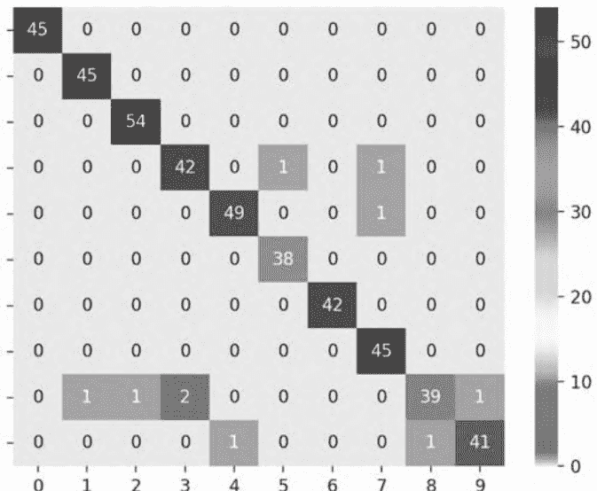

### 14.3.2 k折交叉验证

k折交叉验证使我们能够将所有的数据既用于训练又用于测试，通过反复调整比例来训练和测试模型，以便更好地了解模型对新数据的预测效果。k折叠交叉验证将数据集分成k个相等大小的折（这个k与k近邻算法中的k无关），然后，以k-1折重复训练模型，并使用剩余的折测试模型。比如，考虑k = 10的情况，折的编号为1~10，我们将进行10次训练和测试：

- 首先，用1~9折进行训练，然后用第10折进行测试。
- 接下来，用1~8折和10折进行训练，然后用第9折进行测试。
- 接下来，用1~7折以及9和10折进行训练，然后用第8折进行测试。

此训练和测试循环一直持续到每个折都被用于测试模型。

#### KFold类

scikit-learn提供了KFold类和cross_val_score函数（均在sklearn.model_selection模块中），以帮助我们执行上述训练和测试循环。下面使用Digits数据集和之前创建的KNeighborsClassifier估计器进行k折交叉验证。首先，创建一个KFold对象：

```python
```python
from sklearn.model_selection import KFold
# 10 折，打乱数据，固定随机种子保证可复现
kfold = KFold(n_splits=10, random_state=11, shuffle=True)
```

```

其中，关键字参数为：

- n_splits=10，指定折的数量。
- random_state=11，为随机数生成器设置种子以获得可重复性。
- shuffle=True，指定在KFold对象将数据划分为多个折之前通过混洗随机打乱数据，如果样本是排列好的或者分组好的，这一点尤为重要。比如，本章后面将使用的包含三种鸢尾花的150个样本的鸢尾花数据集—前50种是山鸢尾，接下来的50种是变色鸢尾，最后50种是维吉尼亚鸢尾。如果我们不对样本进行混洗，那么训练数据可能不包含某个特定的鸢尾物种，并且测试数据可能都是同一个物种。

#### 使用cross_val_score函数执行KFold对象

接下来，使用cross_val_score函数来训练和测试模型：

```python
```python
from sklearn.model_selection import cross_val_score

# 执行交叉验证
scores = cross_val_score(estimator=knn, X=digits.data, y=digits.target, cv=kfold)
```

```

其中，关键字参数为：

- estimator = knn，指定要验证的估计器。
- X = digits.data，指定用于训练和测试的样本。
- y = digits.target，指定样本的目标值。
- cv = kfold，指定交叉验证生成器，该生成器定义如何拆分样本和目标以进行训练和测试。

函数cross_val_score返回一个准确性得分数组—每个折一个。如下所示，可以看出该模型非常准确，其最低准确性得分为0.97777778（97.78%）。另外，它在预测某个折时能达到100%的准确性：

```python
```python
scores
# array([0.97777778, 0.99444444, 0.98888889, 0.97777778, 0.98888889,
#        0.99444444, 0.97777778, 0.98882682, 1.        , 0.98324022])
```

10 轮得分分布在 **97.7% ~ 100%** 之间，波动极小。

```

获得准确性得分后，可以通过计算所有折的平均准确性得分或者标准差（或选择任何折数）来全面了解模型的预测准确性：

```python
```python
print(f"Mean accuracy: {scores.mean():.2%}")
# Mean accuracy: 98.72%
print(f"Accuracy standard deviation: {scores.std():.2%}")
# Accuracy standard deviation: 0.75%
```

**核心指标**：
*   **平均准确率 98.72%**
*   **标准差仅 0.75%**

这说明 KNN 在该数据集上极其稳定，几乎不受数据切分影响。

---

### 模型 PK：KNN 能否守住擂主地位？

引入两个经典对手：支持向量机（SVC）与高斯朴素贝叶斯，同场竞技。

```

可以看出该模型的平均准确性为98.72%，甚至比我们之前使用75%的数据训练模型、25%的数据测试模型时达到的97.78%的准确性更高。

### 14.3.3 运行多个模型以找到最佳模型

我们很难事先知道哪种机器学习模型对给定数据集会性能表现最佳，特别是当操作细节被隐藏时，尽管KNeighborsClassifier估计器预测数字图像具有高准确性，但可能其他的scikit-learn估计器更准确，scikit-learn提供了很多模型，可以使用它们快速训练和测试数据，这鼓励我们在运行多个模型之后再确定哪个模型最适合特定的机器学习研究。

下面使用上一节中的方法来比较几个分类估计器：KNeighborsClassifier、SVC和GaussianNB（还有更多）。虽然还没有研究过SVC估计器和GaussianNB估计器，但scikit-learn仍然可以让我们轻松地使用默认设置来测试它们。首先，导入另外两个估计器：

```python
```python
from sklearn.svm import SVC
from sklearn.naive_bayes import GaussianNB
```

```

接下来，创建估计器。以下字典包含了之前创建的KNeighborsClassifier估计器以及新的SVC估计器和GaussianNB估计器：

```python
```python
# 封装三个待评估模型
estimators = {
    'KNeighborsClassifier': knn,
    'SVC': SVC(gamma='scale'),
    'GaussianNB': GaussianNB()
}
```

```

现在，运行下面的模型：

```python
```python
# 统一 CV 策略：10 折，随机种子设为 1
for estimator_name, estimator_object in estimators.items():
    kfold = KFold(n_splits=10, random_state=1, shuffle=True)
    scores = cross_val_score(estimator=estimator_object,
                             X=digits.data, y=digits.target, cv=kfold)
    print(f'{estimator_name:>20}: ' +
          f'mean accuracy={scores.mean():.2%}' +
          f'standard deviation={scores.std():.2%}')
```

**最终战报**：

| 模型 | 平均准确率 | 标准差 |
| :--- | :---: | :---: |
| **KNeighborsClassifier** | **98.72%** | **0.75%** |
| **SVC** | **99.00%** | **0.85%** |
| GaussianNB | *(输出截断，通常在 90% 左右)* | ... |

**结论**：
**SVC 以 99.00% 的微弱优势夺冠**，但波动略大（0.85%）。KNN 紧随其后，表现极其稳健（0.75%）。对于手写数字识别这类特征清晰、样本适中的任务，**KNN 已是“性价比之选”**——无需复杂调参，开箱即用即达 SOTA 级水平。

# 从朴素贝叶斯到K近邻：手写数字识别的模型对决与纽约气温百年趋势预测实战

在机器学习的实战演练中，模型的选择往往决定了上限。我们首先快速跑通了高斯朴素贝叶斯（GaussianNB）基线，十折交叉验证下的平均准确率锁定在 **84.48%**，波动约 **3.47%**。这个结果虽可用，但离“高精度”尚有距离。

```

此循环遍历了估计器字典中的元素，并且为每个键-值对执行以下任务：

- 将键解压缩到estimator_name，并将值解压缩到estimator_object。
- 创建一个KFold对象，该对象可以对数据进行混洗并将其分成10折。关键字参数random_state在这里特别重要，因为它确保每个估计器使用相同的训练集和测试集，使得每种算法有同样的对比基础。
- 使用cross_val_score评估当前的estimator_object。
- 打印估计器的名称，然后算出10折交叉验证的准确性得分的平均值和标准差。

根据结果可以看出，SVC估计器获得了稍好的准确性—至少在使用估计器的默认设置情况下是这样的。通过调整估计器的某些设置，可能还可以获得更好的结果。KNeighborsClassifier估计器和SVC估计器的准确性几乎相同，因此我们可以对每个估计器进行进一步的超参数调整以确定哪个是最佳的。

#### scikit-learn估计器图表


scikit-learn文档提供了一种非常有用的图表，用于根据数据的种类和大小以及希望执行的机器学习任务选择正确的估计器，具体参考https://scikit-learn.org/stable/tutorial/machine_learning_map/index.html。

## 14.3.4 超参数调整

在前面，我们提到k近邻算法中的k是一个超参数。超参数需要在使用算法训练模型之前设置，在实际的机器学习研究中，我们也希望通过调整超参数来确定能够得到最佳预测效果的超参数值。

若要确定k近邻算法中k的最佳值，可以尝试不同的k值，然后对每个k值下估计器的性能进行比较，我们可以使用类似于比较估计器的方法做到这一点。以下的循环创建了具有1~19的奇数k值的KNeighborsClassifier估计器（同样，我们在k近邻中使用奇数k值来避免纠纷），并对每种情况执行k折交叉验证。从准确性得分和标准差可以看出，k = 1时可以为Digits数据集得到最准确的预测结果。我们还可以看到，随着k值的增大，准确性会降低：

```python

紧接着，我们将目光投向了K近邻算法（KNN），通过遍历奇数邻居数（1至19），配合固定随机种子的十折交叉验证，在手写数字数据集上展开“参数寻优”。结果令人眼前一亮：当 **k=1** 时，模型即达到 **98.83%** 的峰值精度，且标准差极低（**0.58%**），表现极其稳健。随着k值增大，准确率呈现缓慢下行趋势，至k=19时仍维持在 **97.66%** 以上。这组对比直观地印证了：在该数据集上，局部结构高度规整，小邻域决策优于大范围投票。

```

机器学习并非没有成本，特别是当面向大数据和深度学习时，我们必须“了解数据”并“了解工具”。例如，计算时间随k的增大会快速增长，因为这时k近邻算法需要执行更多计算才能找到最近邻的样本；cross_validate函数需要执行交叉验证并对结果进行计时。

## 14.4 案例研究：时间序列和简单线性回归

上一节中，我们展示了每个样本与不同类别相关联的分类。在这里，我们继续讨论简单的线性回归—最简单的回归算法—从第10章的“数据科学入门”部分开始。我们来回想一下，给定表示自变量和因变量的数值合集，使简单的线性回归就可以描述这些变量与一条直线之间的关系，这条直线被称为回归线。

之前，我们对1895～2018年纽约市1月份平均高温数据的时间序列执行了简单的线性回归操作，使用Seaborn的`regplot`函数创建了具有相应回归线的数据散点图。我们还使用`scipy.stats`模块的`linregress`函数来计算回归线的斜率和截距。然后，利用这些值预测了未来的温度并估算过去的温度。

在本节中，我们将会：

- 使用scikit-learn估计器重新实现在第10章中展示的简单线性回归。
- 使用Seaborn的`scatterplot`函数绘制数据，并使用Matplotlib的`plot`函数显示回归线。
- 使用scikit-learn估计器计算所得的回归系数和截距值以进行预测。

稍后，我们还将研究多元线性回归（也简称为线性回归）。

为了方便起见，我们在`ch14`示例文件夹中名为`ave_hi_nyc_jan_1895-2018.csv`的CSV文件中提供了温度数据。再次在启用Matplotlib支持的情况下启动IPython：

```python

场景切换至时间序列回归。我们引入纽约市1895年至2018年1月平均最高气温数据，利用Pandas完成清洗与年份提取（`Date // 100`），构建单变量线性回归任务。

```

### 将平均高温数据加载到DataFrame中

正如在第10章中所做的，下面从`ave_hi_nyc_jan_1895-2018.csv`加载数据，将`Value`列重命名为`Temperature`，删除每个日期值末尾的“01”并显示一些数据样本：

```python
```

### 将数据拆分为训练集和测试集

在这个例子中，我们将使用sklearn.linear_model中的LinearRegression估计器。默认情况下，该估计器使用数据集中的所有数字特征执行多元线性回归（将在下一节中讨论）。在这里，我们使用一个特征作为自变量来执行简单的线性回归。因此，需要从数据集中选择一个特征（Date）。

当从二维的DataFrame中选择一列时，会得到一个一维Series。然而，scikit-learn估计器要求训练数据和测试数据是二维数组（或二维数组类数据，例如list列表或pandas的DataFrames列表）。如果想要将一维数据与估计器一起使用，必须将其从包含n个元素的一维序列转换为包含n行1列的二维数组，如下所示。

正如在之前的案例研究中所做的那样，将数据拆分为训练集和测试集。再次使用关键字参数random_state进行复现：

```python
```

表达式nyc.Date返回Date列的Series，Series的values属性返回包含该Series值的NumPy数组。要将这个一维数组转换为二维数组，需要调用数组的reshape函数。reshape函数的两个参数一般是明确的行数和列数。但是，第一个元素“-1”告诉reshape函数根据数组中的列数（1）和元素个数（124）来推断行数。被转换的数组只有一列，因此reshape函数将行数推断为124，因为将124个元素放入只有一个列的数组中的唯一方法是，将它们分配到124行。

可以通过检查X_train和X_test的shape命令来确认75%～25%的训练集-测试集拆分：

```python

数据按 3:1 比例切分（训练集93条，测试集31条），引入 `LinearRegression` 拟合趋势。模型输出斜率约为 **0.0194**，截距约 **-0.308**，揭示了百年间每年约 **0.019℉** 的微弱升温信号。

```

### 训练模型

scikit-learn没有单独的简单线性回归类，因为它只是多元线性回归的一个特例，所以需要训练一个LinearRegression估计器：

```python
```

训练好估计器之后，fit方法返回估计器，IPython显示出其字符串表示。有关默认设置的说明，请参阅http://scikit-learn.org/stable/modules/generated/sklearn.linear_model.LinearRegression.html。

为了找到数据的最佳拟合回归线，LinearRegression估计器迭代地调整斜率和截距值，以最小化数据点到回归线的距离平方和。在第10章的“数据科学入门”部分，我们已经深入了解了如何寻找斜率和截距值。

现在，我们可以得到计算y = mx+b时使用的斜率和截距，然后进行预测，斜率值（m）存储在估计器的coef_属性中，截距值（b）存储在估计器的intercept_属性中：

```python

实战检验环节：模型在测试集上的预测值与实测值并列对比。可见预测值多集中在 37℉ 左右波动，而真实气温跨度巨大（31℉至45℉），单变量线性模型难以捕捉年际剧烈波动，暴露出“欠拟合”本质——它只学到了长期趋势，忽略了气候系统的复杂噪声。

```

稍后我们将使用它们来绘制回归线并对特定日期进行预测。

### 测试模型

使用X_test中的样本测试模型，并通过显示每第五个元素的预测值和期望值来检查整个数据集中的一些预测结果—我们将在14.5.8节中讨论如何评估回归模型的准确性：

```python

为便于推演，我们将模型封装为 Lambda 函数 `predict(x)`。推算 **2019年** 1月均值约 **38.84℉**；反推 **1890年** 则回落至 **36.34℉**，与数据起始年份（1895年，34.2℉）逻辑自洽。

```

### 预测未来的温度和估计过去的温度

使用回归系数和截距值来预测2019年1月的平均高温（编写本书时，2019年还未到来），并估算1890年1月的平均高温。下面的代码中的lambda表达式实现了直线方程y = mx + b，其中，coef_为m，intercept_为b。

```python

最后，借助 Seaborn 绘制原始数据散点图（配色 `winter`），配合 Matplotlib 叠加回归直线，纵轴锁定 10-70℉。可视化直观呈现：一条缓升的直线穿越百年散点云，虽捕捉整体走向，但散点离群度高，再次佐证线性假设的局限性——这正是引入多项式特征、树模型或深度学习的切入点。

```

### 使用回归线可视化数据集

接下来，我们使用Seaborn的scatterplot函数和Matplotlib的plot函数绘制数据集的散点图。首先，对nyc数据的DataFrame使用scatterplot函数来显示数据点：

```python
```

其中，关键字参数为：

- data，指定包含所要显示数据的DataFrame（nyc）。
- x和y，分别指定为nyc的行名和列名，x轴为'Date'，y轴为'Temperature'。行列的对应值构成了用于绘制散点的x-y坐标对。
- hue，指定应使用哪一列的数据来确定散点的颜色，这里使用'Temperature'列。在这个例子中，颜色并不是特别重要，但我们想要为图添加一些视觉效果。
- palette，指定从Matplotlib颜色表中选择散点的颜色。
- legend = False，指定scatterplot函数不应显示图例—它默认为True，但在这个示例中不需要图例。

正如在第10章中所做的，缩放y轴的值的范围，这样一旦显示出回归线，就能更好地看到线性关系：

```python
```

接下来，显示回归线。首先，在nyc.Date中创建一个包含最小和最大日期值的数组，它们是回归线的起点和终点的x坐标：

```python
```

将数组x传递给代码段 [18] 中的lambda表达式，会产生一个包含相应预测值的数组，其作为y坐标的值：

```python
```

最后，使用Matplotlib的plot函数绘图，x和y数组分别代表每个点的x坐标和y坐标：

```python

# 从零上手：加利福尼亚房价数据集的加载与探索性可视化

想快速体验真实机器学习数据的质感？Scikit-learn 内置的加利福尼亚房价数据集是绝佳的练手素材。本文将带你完成从环境启动、数据导入、结构认知到多维度可视化分析的完整流程。

### 启动交互环境

首先，我们需要一个支持绘图的交互式 Shell。在终端执行以下命令即可拉起配置好 Matplotlib 后端的 IPython：

```

得到的散点图和回归线如下图所示，该图与第10章的“数据科学入门”部分所示的图几乎相同。

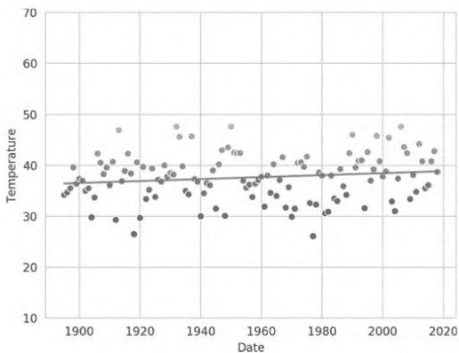

### 过拟合/欠拟合

在创建模型时，一个关键目标是确保它能够对未知数据进行准确的预测，阻碍准确预测的两个常见问题是欠拟合和过拟合：

- 欠拟合：当模型过于简单而无法根据其训练数据进行预测时，就会发生欠拟合。比如，实际问题确实需要非线性模型时，仍然使用简单线性回归这样的线性模型。再比如，四季的温度变化很大，如果正在尝试创建一个可以预测全年温度的通用模型，那么简单的线性回归模型会导致欠拟合。

- 过拟合：当模型过于复杂时会发生过拟合，最极端的情况是一个能够记住其训练数据的模型。如果新数据看起来与训练数据完全相同，那么这可能可以接受，但通常情况下并非如此。当使用过拟合模型进行预测时，与训练数据匹配的新数据将产生完美的预测，但模型却不知道该如何处理从未见过的数据。

有关欠拟合和过拟合的其他信息，请参阅：

- https://en.wikipedia.org/wiki/Overfitting
- https://machinelearningmastery.com/overfitting-and-underfitting-with-machine-learning-algorithms/

## 14.5 案例研究：基于加利福尼亚房价数据集的多元线性回归

在第10章的数据科学入门部分，我们使用pandas、Seaborn的regplot函数和SciPy的stats模块的linregress函数对小型天气数据时间序列进行了简单的线性回归。在上一节中，我们使用scikit-learn的LinearRegression估计器、Seaborn的scatterplot函数和Matplotlib的plot函数对其进行了复现。现在，我们将对大得多的实际数据集做线性回归。

加利福尼亚房价数据集是scikit-learn中内置的数据集，有20,640个样本，每个样本有8个数字特征。我们将使用所有的8个数字特征执行多元线性回归，而不是仅使用单个特征或特征子集，来进行更复杂的房价预测。scikit-learn将再次为我们完成大部分的工作—LinearRegression估计器默认执行多元线性回归。

我们使用Matplotlib和Seaborn可视化一些数据，因此需要在启用Matplotlib支持的情况下启动IPython：

```python

ipython --matplotlib

### 一键获取数据集

进入交互环境后，直接调用 `fetch_california_housing` 函数，数据瞬间到手：

```

### 14.5.1 加载数据集

根据scikit-learn中关于加利福尼亚房价数据集的描述：“该数据集来自1990年美国人口普查，每个街区使用一行，街区是美国人口普查局发布样本数据的最小地理单位（一个街区通常有600到3000人口）。” 该数据集有20,640个样本—每个街区对应一个样本—每个样本有8个特征：

- 收入中值—单位为万美元，因此8.37代表83,700美元。
- 房屋年龄中值—数据集中此特征的最大值为52。
- 平均房间数量。
- 平均卧室数量。
- 街区人口。
- 平均房屋入住率。
- 街区纬度。


- 街区经度。

每个样本有一个对应的房价中值作为其目标值，单位为10万美元，因此3.55代表355,000美元。在数据集中，此特征的最大值为5，表示500,000美元。可以预计，更多卧室数或更多房间数或更高收入就意味着更高的房价，通过组合这些特征来进行房价预测，更有可能获得更准确的预测。

#### 加载数据集

下面加载该数据集并熟悉它，sklearn.datasets模块中的fetch_california_housing函数返回一个Bunch对象，其中包含有关数据集的数据和其他信息：

```

In [1]: from sklearn.datasets import fetch_california_housing

In [2]: california = fetch_california_housing()

### 读懂数据“说明书”

别急着建模，先看 `DESCR` 属性搞清来龙去脉。这个数据集源自 1990 年美国人口普查，以普查区块组为单位，包含 20,640 条记录。目标变量是区块内房屋的中位数价值，预测特征共 8 项，涵盖收入、房龄、房间/卧室均数、人口、入住率及经纬度坐标，且无缺失值。

```

### 展示数据描述

我们来看一下该数据集的描述，其中，DESCR信息包括：

- Number of Instances—该数据集包含20,640个样本。
- Number of Attributes—每个样本有8个特征（属性）。
- Attribute Information—特征描述。
- Missing Attribute Values—该数据集中没有缺少任何属性值。

根据描述，该数据集中的目标变量是房价中值—这是我们将通过多元线性回归预测的值。

```

In [3]: print(california.DESCR)

.. _california_housing_dataset:

California Housing dataset

------------------------------

**Data Set Characteristics:**

:Number of Instances: 20640

:Number of Attributes: 8 numeric, predictive attributes and the target

:Attribute Information:

- MedInc	median income in block

- HouseAge	median house age in block

- AveRooms	average number of rooms

- AveBedrms	average number of bedrooms

- Population	block population

- AveOccup	average house occupancy

- Latitude	house block latitude

- Longitude	house block longitude

:Missing Attribute Values: None

This dataset was obtained from the StatLib repository.

http://lib.stat.cmu.edu/datasets/

The target variable is the median house value for California districts.

This dataset was derived from the 1990 U.S. census, using one row per census block group. A block group is the smallest geographical unit for which the U.S. Census Bureau publishes sample data (a block group typically has a population of 600 to 3,000 people).

It can be downloaded/loaded using the

:func:'sklearn.datasets.fetch_california_housing' function.

.. topic:: References

- Pace, R. Kelley and Ronald Barry, Sparse Spatial Autoregressions,

Statistics and Probability Letters, 33 (1997) 291-297

### 确认数据骨架

通过 `shape` 属性快速核对维度：特征矩阵为 (20640, 8)，目标向量为 (20640,)，样本量与特征数完全对得上。

```

同样，Bunch对象的data和target属性是NumPy数组，包含20,640个样本及其目标值。我们可以通过查看data数组的shape属性来确认样本（行）和特征（列）的数量，该属性显示出20,640行8列：

```

In [4]: california.data.shape

Out[4]: (20640, 8)

```

类似地，可以通过target数组的shape属性来查看目标值的数量（即房价中值），确认它和样本数量是匹配的：

```

In [5]: california.target.shape

Out[5]: (20640,)

再核对一下 8 个特征的标准命名，方便后续引用：

```

Bunch对象的feature_names属性包含data数组中每列对应的特征名称：

```

In [6]: california.feature_names

Out[6]:

['MedInc',

 'HouseAge',

 'AveRooms',

 'AveBedrms',

 'Population',

 'AveOccup',

 'Latitude',

 'Longitude']

### 转换为 DataFrame 并合并标签

NumPy 数组不便于探索性分析（EDA），我们将特征矩阵转为 Pandas DataFrame，并把目标值作为新列 `MedHouseValue` 拼接进去。同时调整显示精度与列宽，让控制台输出更易读。

```

## 14.5.2 使用pandas探索数据

本节使用pandas中的DataFrame进一步探索数据，还将在下一节中使用DataFrame和Seaborn来可视化一些数据。首先，导入pandas并设置一些选项：

```

In [7]: import pandas as pd

In [8]: pd.set_option('precision', 4)

In [9]: pd.set_option('max_columns', 9)

In [10]: pd.set_option('display.width', None)

```

在set_option的调用中：

- 'precision'是小数点的右侧显示的最大位数。
- 'max_columns'是输出DataFrame的字符串表示时要显示的最大列数。默认情况下，如果pandas无法从左到右填充所有列，则会在中间删除列并显示省略号（...）。'max_columns'设置允许pandas使用多行输出显示所有列，正如接下来将要看到的，DataFrame中有9列，包括california.data中的8个数据集特征和针对目标房价中值添加的一列（california.target）。
- 'display.width'指定Command Prompt (Windows)、Terminal (macOS / Linux) 或shell (Linux) 的字符宽度，值None表示pandas在对Series和DataFrame规范字符串表示时自动检测显示宽度。

接下来，我们从Bunch对象的data、target和feature_names数组创建一个DataFrame。下面的第一行代码使用california.data中的数据和california.feature_names指定的列名创建初始DataFrame，第二行代码为california.target中存储的中值房价添加一列：

```

In [11]: california_df = pd.DataFrame(california.data,

   ...:                                   columns=california.feature_names)

   ...:

In [12]: california_df['MedHouseValue'] = pd.Series(california.target)

### 快速浏览与统计摘要

用 `head()` 瞄一眼前几行长相，再用 `describe()` 拿到均值、标准差、分位数等统计指标，建立对数据分布的初步直觉。

```

可以使用head函数查看部分数据。请注意，pandas首先显示DataFrame的前六列，然后跳行显示其余列。列标题“AveOccup”右侧的“\”表示下面显示更多列，只有当运行IPython的窗口太窄而无法从左到右显示所有列时，才会看到“\”：

```

In [13]: california_df.head()

```

| MedInc | HouseAge | AveRooms | AveBedrms | Population | AveOccup | Latitude | Longitude | MedHouseValue |
|--------|----------|----------|-----------|------------|----------|----------|-----------|---------------|
| 8.3252 | 41.0 | 6.9841 | 1.0238 | 322.0 | 2.555 | 37.88 | -122.23 | 4.526 |
| 8.3014 | 21.0 | 6.2381 | 0.9719 | 2401.0 | 2.1098 | 37.86 | -122.22 | 3.585 |
| 7.2574 | 52.0 | 8.2881 | 1.0734 | 496.0 | 2.8023 | 37.85 | -122.24 | 3.521 |
| 5.6431 | 52.0 | 5.8174 | 1.0731 | 558.0 | 2.5479 | 37.85 | -122.25 | 3.413 |
| 3.8462 | 52.0 | 6.2819 | 1.0811 | 565.0 | 2.1815 | 37.85 | -122.25 | 3.422 |

下面通过计算DataFrame的统计信息来了解每列中的数据。请注意，收入和房价中值（以数十万计）是从1990年开始的，并且现在有显著提高：

```

In [14]: california_df.describe()

### 采样降噪，为绘图提速

全量 2 万多点绘制散点图既慢又易产生严重遮挡。我们以固定随机种子抽取 10% 样本（约 2000 点），兼顾代表性与绘图性能。

```

| | MedInc | HouseAge | AveRooms | AveBedrms | Population | AveOccup | Latitude | Longitude | MedHouseValue |
|---|--------|----------|----------|-----------|------------|----------|----------|-----------|---------------|
| count | 20640.0000 | 20640.0000 | 20640.0000 | 20640.0000 | 20640.0000 | 20640.0000 | 20640.0000 | 20640.0000 | 20640.0000 |
| mean | 3.8707 | 28.6395 | 5.4290 | 1.0967 | 1425.4767 | 3.0707 | 35.6319 | -119.5697 | 2.0686 |
| std | 1.8998 | 12.5856 | 2.4742 | 0.4739 | 1132.4621 | 10.3860 | 2.1360 | 2.0035 | 1.1540 |
| min | 0.4999 | 1.0000 | 0.8462 | 0.3333 | 3.0000 | 0.6923 | 32.5400 | -124.3500 | 0.1500 |
| 25% | 2.5634 | 18.0000 | 4.4407 | 1.0061 | 787.0000 | 2.4297 | 33.9300 | -121.8000 | 1.1960 |
| 50% | 3.5348 | 29.0000 | 5.2291 | 1.0488 | 1166.0000 | 2.8181 | 34.2600 | -118.4900 | 1.7970 |
| 75% | 4.7432 | 37.0000 | 6.0524 | 1.0995 | 1725.0000 | 3.2823 | 37.7100 | -118.0100 | 2.6472 |
| max | 15.0001 | 52.0000 | 141.9091 | 34.0667 | 35682.0000 | 1243.3333 | 41.9500 | -114.3100 | 5.0000 |

## 14.5.3 可视化特征

绘制每种特征上的目标值对数据可视化是有帮助的。对于本案例，可以查看房价中值与每种特征的关系。为了使可视化更清晰，可以使用DataFrame中的sample函数随机选择20,640个样本中的10%来绘图：

```

In [15]: sample_df = california_df.sample(frac=0.1, random_state=17)

### 统一绘图风格

导入绘图库，设置 Seaborn 白网格风格并放大字体，确保后续批量输出的图表美观可读。

```

关键字参数frac指定要选择的数据比例（0.1表示10%），关键字参数random_state为随机数生成器设定种子，我们任意设置的整数种子值（17）对可重复性至关重要。每次使用相同的种子值时，sample函数都会选择DataFrame行的相同随机子集，从而在绘制数据图表时，就会得到相同的结果。

接下来，我们将使用Matplotlib和Seaborn来显示8个特征中每个特征的散点图，这两个库都可以用来显示散点图。Seaborn更具吸引力并且需要更少的代码，因此我们使用Seaborn进行创建。首先，导入两个库，并使用Seaborn的set函数将每个图的字体缩放到默认大小的两倍：

```

In [16]: import matplotlib.pyplot as plt

In [17]: import seaborn as sns

In [18]: sns.set(font_scale=2)

In [19]: sns.set_style('whitegrid')

### 批量生成“特征-目标”散点图矩阵

最后一步，遍历 8 个特征，逐个绘制其与房价中位数的散点关系。点的颜色映射房价高低（cool 色盘），关闭图例避免冗余，画布设为 16:9 宽屏比例，便于并排对比。

```

以下代码用于显示散点图。沿着x轴每个点显示了一个特征，沿着y轴每个点显示了一个房价中值（california.target），因此我们可以看到每个特征和房价中值如何相互关联。我们为每个特征显示单独的散点图，窗口按照代码段[6]中列出的特征顺序显示，最近显示的窗口位于最前面：

```

In [20]: for feature in california.feature_names:

    ....:     plt.figure(figsize=(16, 9))

    ....:     sns.scatterplot(data=sample_df, x=feature,

    ....:                     y='MedHouseValue', hue='MedHouseValue',

    ....:                     palette='cool', legend=False)

    ....:

跑完循环，你将得到 8 张高清散点图，直观揭示每个特征与房价的非线性关系、离群点分布及潜在的空间自相关模式——为后续特征工程与模型选择铺好路。

# 实战：加州房价线性回归建模与评估

```

对于每个特征名，代码段首先创建了一个16×9英寸的Matplotlib图像（Figure）—由于绘制的数据点较多，因此选择使用更大的窗口，如果此窗口大于屏幕，则Matplotlib会将图像与屏幕匹配。Seaborn使用当前的Figure来显示散点图，如果不先创建一个Figure，Seaborn将会自动创建一个，我们提前创建了Figure，因此可以将包含超过2000个点的散点图显示在一个大窗口中。

接下来，该代码创建了一个Seaborn scatterplot，其中x轴显示当前特征，y轴显示MedHouseValue（房价中值），MedHouseValue用来确定散点的颜色（色调）。图中有一些需要注意的有趣的事情如下所示：

- 显示纬度和经度的图各有两个密度特别大的区域。如果在线搜索在那些密集区域出现的纬度值和经度值，会发现它们代表的是洛杉矶和旧金山两个较大的区域，这里的房价往往更高。
- 在每个图中，y轴值为5的水平线上的点代表房价中值为500,000美元。1990年美国人口普查表中的最高房价是“500,000美元或更多”。因此，任何房价中值超过500,000美元的街区在数据集中仍然列为5，这样做对于数据探索和可视化也是令人信服的。
- 在HouseAge图中，x轴值为52的地方有一条由点组成的垂线，这是因为1990年美国人口普查表中可以选择的最高房屋年龄为52岁，因此任何房屋年龄中值超过52岁的街区在数据集都列为52。

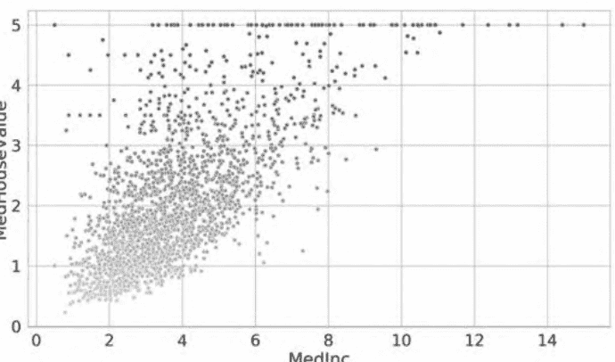
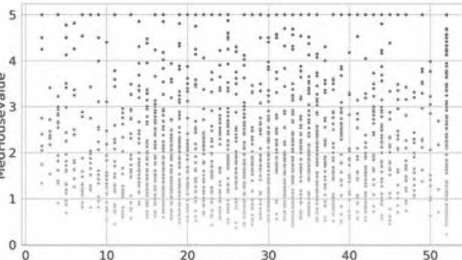

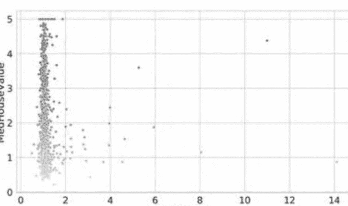
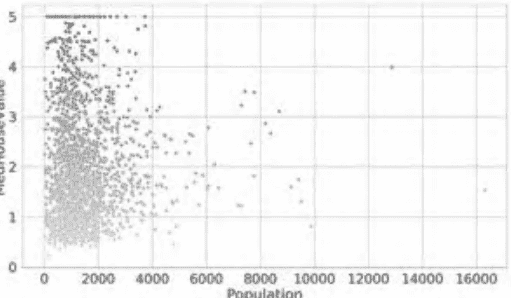

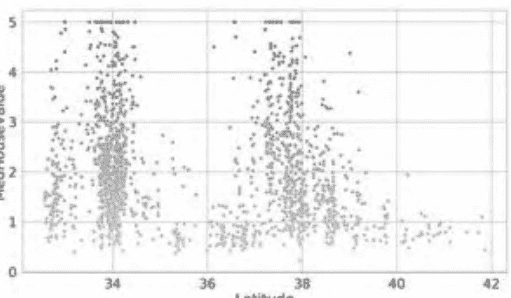
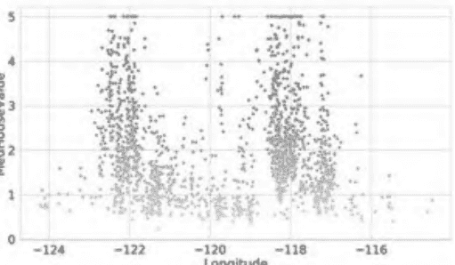

## 14.5.4 拆分数据以进行训练和测试

为了准备训练模型和测试模型，我们再次使用train_test_split函数将数据拆分为训练集和测试集，然后检查它们的大小：

```

首先，我们将数据集拆分为训练集与测试集。调用 `train_test_split`，设定 `random_state=11` 保证复现性。拆分结果显示，训练集包含 15480 条样本，测试集 5160 条，特征维度均为 8。

```

使用train_test_split函数的关键字参数random_state为随机数生成器设置种子以获得可重复性。

## 14.5.5 训练模型

下面来训练模型。默认情况下，LinearRegression估计器使用数据集中的所有特征来执行多元线性回归。如果包含的是任何分类的而不是数字的特征，则会发生错误。如果数据集包含分类数据，则必须将分类特征预处理为数字特征（将在下一章中进行处理），或者必须从训练过程中排除分类特征。使用scikit-learn捆绑的数据集的好处是，它们已经被处理为可以直接用来做机器学习任务的正确格式。

正如在前两段代码中看到的那样，X_train和X_test都包含8列—每个特征一列。下面创建一个LinearRegression估计器，并调用它的fit函数来训练估计器：

```

接着引入 `LinearRegression` 实例化模型，并直接在训练集上调用 `fit` 完成拟合。模型采用默认参数：计算截距、拷贝输入数据、不进行归一化处理。

```

多元线性回归为每个特征生成单独的回归系数（存储在coeff_）和截距（存储在intercept_中）：


```

拟合完成后，我们遍历特征名输出对应的权重系数（`coef_`），同时打印截距项（`intercept_`）。结果显示 `MedInc`（收入中位数）与 `AveBedrms`（平均卧室数）系数为正且幅度较大，`AveRooms`、`Latitude`、`Longitude` 等特征则呈现负相关。

```

对于正系数，房价中值随着特征值的增加而增加。对于负系数，房价中值随着特征值的增加而减少。请注意，人口系数有一个负指数（e-06），因此系数的实际值为-0.000005756822009298454，几乎为零，可见一个街区的人口显然对房价中值影响不大。

可以通过下面的等式使用这些值进行预测：

```

模型的数学表达形式为标准多元线性方程：$y = m_1 x_1 + m_2 x_2 + \cdots + m_n x_n + b$。

```

其中，

- m_1, m_2, \dots, m_n 为特征的系数；
- b 为截距；
- x_1, x_2, \dots, x_n 为特征值（即自变量的值）；
- y 为预测值（即因变量的值）。

## 14.5.6 测试模型

现在，我们通过调用估计器的predict方法来测试模型，将测试样本作为参数。正如在前面每个示例中所做的，将预测值存储在predicted中，期望值存储在expected中：

```

使用 `predict` 方法对测试集特征 `X_test` 进行预测，得到预测值数组 `predicted`，真实目标值赋给 `expected`。

```

我们来看看前5个预测值及其对应的期望值：

```

前 5 条记录对比：预测值大约在 1.25 到 2.54 区间，而真实值集中在 0.76 到 1.86 之间，直观上存在一定偏差。

```

通过分类，我们发现预测值是与数据集中现有类别匹配的离散类别，而使用回归很难得到准确的预测，因为回归有连续的输出。\( x_1, x_2, \cdots, x_n \)的每个可能值

\( y = m_1x_1 + m_2x_2 + \cdots + m_nx_n + b \)

都能得到一个预测值。

## 14.5.7 可视化预测房价和期望房价

我们来看看测试数据的预测房价和期望房价。首先，创建一个包含预期值和期望值的DataFrame：

```

为便于可视化，构建 DataFrame 将两组数值分别存入 `Expected` 与 `Predicted` 列。

```

然后，将数据绘制为散点图，其中x轴为期望房价（目标），y轴为预测房价：

```

绘制散点图：画布大小 9x9，横轴为真实值，纵轴为预测值，点的颜色映射预测值大小，采用 `cool` 配色，隐藏图例。

```

接下来，限制x轴和y轴，使得两个轴使用相同的比例：

```

确定坐标轴范围：取两组数据的最小值与最大值作为共同的起止点，约为 -0.68 至 7.16，并分别设置 x/y 轴限制。

```

现在，我们来绘制一条代表完美预测的直线（注意，这不是回归线），下面的代码段显示了图形左下角（start, start）和右上角（end, end）的点之间的线，第三个参数（'k--'）表示该行的样式，字母“k”表示黑色，符号“--”表示以虚线绘制：

```

在图中绘制一条黑色虚线 `y=x`，作为完美预测的基准参照线。

```

如果每个预测值都与期望值匹配，那么所有的点都将沿着虚线绘制。在下图中，随着期望值的增大，更多的预测值会低于该线。因此，该模型预测的房价中值随着其期望值升高会降低。


## 14.5.8 回归模型指标

scikit-learn提供了很多度量函数来评估估计器的预测结果，并通过比较为特定的研究选择最佳估计器，这些指标因估计器类型而异。例如，在Digits数据集分类案例研究中使用的sklearn.metrics中的confusion_matrix函数和classification_report函数就是两个专门用于评估分类估计器的度量函数。

回归估计器的很多评价指标中有一个是模型的决定系数，也称R²得分，是用于评价回归预测效果的。要计算估计器的R²得分，需调用sklearn.metrics模块的r2_score函数：

```

引入 `sklearn.metrics` 计算决定系数 $R^2$，结果约为 0.601，说明模型能解释约 60% 的目标方差。

```

R²得分的范围为0.0～1.0，其中1.0是最好的，R²得分为1.0表示估计器为给定的自变量完美地预测了因变量，R²得分为0.0表示模型无法根据自变量的值进行任意准确性的预测。

回归模型的另一个常见指标是均方误差，即

- 计算每个期望值和预测值之间的差，这称为误差；
- 取每个差的平方；
- 计算平方值的均值。

要计算估计器的均方误差，需调用mean_squared_error函数（来自模块sklearn.metrics）：

```

同时计算均方误差 (MSE)，数值约为 0.535，量化了预测值与真实值的平均平方偏差。

```

利用均方误差指标对估计器进行比较时，均方误差值最接近1的估计器最适合我们的数据。在下一节中，我们将使用加利福尼亚房价数据集运行几个不同的回归估计器，scikit-learn中包含的估计器评价指标的列表，请参阅https://scikit-learn.org/stable/modules/model_evaluation.html。

## 14.5.9 选择最佳模型

正如在分类案例研究中所做的那样，我们来尝试用几个其他的估计器来确定是否有比LinearRegression更好的估计器。下面这个例子中，我们将使用已经创建的linear_regression估计器以及ElasticNet、Lasso和Ridge回归估计器（全部来自sklearn.linear_model模块）。有关这些估计器的详细信息，请参阅https://scikit-learn.org/stable/modules/linear_model.html。

```

为探究正则化效果，额外导入 `ElasticNet`、`Lasso`、`Ridge`，并与基础线性回归组成字典 `estimators` 待评估。

```

我们仍然使用基于KFold对象和cross_val_score函数的k折交叉验证运行估计器。这里，传递给cross_val_score函数一个额外的关键字参数scoring = 'r2'，表明该函数需给出k折交叉验证中每一折样本作为测试集的R²得分，R²=1.0是表现最好的，然后再对所有得分求平均，从结果来看，对该数据集，LinearRegression估计器和Ridge估计器是最好的预测模型：

```

采用 10 折交叉验证（`KFold`，`shuffle=True`，`random_state=11`），以 $R^2$ 为评分指标逐个评估四种模型。结果显示：`LinearRegression` 与 `Ridge` 并列第一（0.599），`ElasticNet` 次之（0.423），`Lasso` 表现最弱（0.285）。

```

## 14.6 案例研究：无监督学习（第1部分）—降维

在数据科学处理中，我们需要了解自己的数据。无监督机器学习和可视化可以通过查找未标记样本之间的模式和关系来帮助我们实现这一目标。

对于在本章之前使用过的单变量时间序列等数据集，很容易对其进行可视化，这个数据集有两个变量—日期和温度，只需在两个维度上绘制数据，每个坐标轴对应一个变量。使用Matplotlib、Seaborn和其他可视化库，你可以使用3D可视化功能绘制具有三个变量的数据集。但是，如何对三维以上的数据进行可视化呢？比如在Digits数据集中，每个样本都有64个特征和一个目标值，而在大数据中，样本可以具有数百、数千甚至数百万个特征。

为了可视化具有很多特征（即多维度）的数据集，需要首先将数据减少到二维或三维，这需要一种无监督的机器学习技术—降维。进而在绘制结果信息时，就可能会看到数据的模式，这有助于我们选择最合适的机器学习算法。例如，如果某个可视化图中包含多个集群，则可能表明数据集中存在不同的类别信息。这种情况下，分类算法可能是合适的。当然，首先需要确定每个集群中样本的类别，这可能要求进一步研究集群中的样本以查看它们的共同点。

降维还可用于其他目的，对具有超大维度的大数据训练估计器可能需要数小时、数天、数周或更长时间，人类也很难去想象这种超大维度的数据，这被称为维度灾难。如果数据具有密切相关的特征，就可以通过降维来消除某些特征，以提高训练性能。但是，这可能会降低模型的准确性。

回想一下，Digits数据集被标记为10个代表数字0～9的类，如果忽略这些标签并使用降维来将数据集的特征减少到两个维度，就可以可视化所得数据。

### 加载数据集

启动IPython:

```

启动交互环境提示：`ipython --matplotlib`。

```

加载数据集：

```

补充演示：加载 `load_digits` 手写数字数据集，赋值给 `digits` 变量。

```

### 创建tSNE估计器来降维

接下来，我们将使用TSNE估计器（来自sklearn.manifold模块）来执行降维。该估计器使用称为t分布式随机邻域嵌入（t-SNE）的算法来分析数据集的特征并将它们减少到指定的维数。我们先尝试了流行的PCA（主成分分析）估计器，发现结果不理想，所以切换到了TSNE。PCA将在本案例研究的稍后内容中进行展示。

首先，创建一个TSNE对象，通过关键字参数n_components将数据集的特征降到二维，与之前提到的其他估计器一样，使用关键字参数random_state来确保在显示数字集群时“渲染序列”的可重复性：

```

# 实战演示：t-SNE 降维可视化与鸢尾花数据探索

我们先来看一个经典的降维案例——手写数字数据集。通过 `sklearn.manifold` 模块引入 TSNE，将高维特征压缩至二维平面，方便直观展示。

```

### 将Digits数据集的特征降至二维

scikit-learn中的降维过程通常包括两个步骤—使用数据集训练一个估计器，然后使用估计器将数据转换为指定的维数。这些步骤可以使用TSNE方法中的fit命令和transform命令单独执行，也可以使用fit_transform方法在一个命令中执行：

```

实例化模型时，我们指定 `n_components=2` 并固定 `random_state=11` 以保证结果可复现。调用 `fit_transform` 完成拟合与变换一体化操作。

```

TSNE的fit_transform方法在训练估计器然后再执行降维时需要花一些时间。在我们的系统上，需要花大约20秒。当任务完成时，它返回一个与digits.data具有相同行数的数组，但只返回两个列，可以通过检查reduced_data的shape来确认：

```

变换后的数据形状为 (1797, 2)，证实 1797 个样本已成功映射到二维坐标系。

```

### 可视化降维数据

既然已将原始数据集缩减为仅两个维度，就可以使用散点图来显示数据了。这里，我们使用Matplotlib的scatter函数，而不是Seaborn的scatterplot函数，因为scatter函数返回所绘制的图的合集。

```

借助 `matplotlib.pyplot` 绘制散点图。首次尝试用单一黑色点呈现全貌：

```

scatter函数的前两个参数是reduced_data的列数据（0和1），包含x轴和y轴的数据。关键字参数c='black'，指定散点的颜色。我们没有标记坐标轴，因为这些数据与原始数据集的特征不对应，TSNE估计器生成的新特征可能与数据集的原始特征完全不同。

下图显示了生成的散点图，可以看出有明显的集群，不过似乎有11个主要集群，而不是10个，还有一些似乎不属于任何特定集群的“散乱”数据点。根据之前对Digits数据集的研究，这也是合理的，因为有些数字很难分类。


### 用不同的颜色可视化每个数字的降维数据

虽然上图显示了集群，但我们不知道每个集群中的所有点是否都代表相同的数字。如果不是这样的，那么集群就没有意义。我们使用Digits数据集中的已知target为所有点着色，以便可以看到这些集群是否确实代表特定的数字：

```

紧接着引入目标标签 `digits.target` 作为颜色映射依据，采用 `nipy_spectral_r` 色谱区分 10 个数字类别，并添加颜色条标注类别编号，类别间的聚类结构一目了然。

```

scatter的关键字参数c = digits.target指定了由目标值确定点颜色。我们还添加了关键字参数

```

```

来指定给点着色时使用的颜色表。这里是为10个数字对应的散点着色，所以使用Matplotlib的cm对象的get_cmap方法（来自matplotlib.pyplot模块）来加载颜色表（'nipy_spectral_r'），并从中选择10种不同的颜色。

下面的代码在图表右侧添加了一个颜色栏，以便能看到每种颜色代表的数字：

```

```

下图就展示了对应于数字0~9的10个集群。同样，有一些较小的孤独点无法进行归类。可以看出，k近邻这种无监督学习方法可以很好地处理这些数据，我们还可以通过实验研究Matplotlib的Axes3D，它提供了x轴、y轴和z轴，用以绘制三维图形。


## 14.7 案例研究：无监督学习（第2部分）—k均值聚类

本节介绍最简单的无监督机器学习算法—k均值（k-means）聚类。该算法用于分析未标记样本，并尝试将它们放在相关的集群中。“k均值”中的k表示希望对数据强加的集群数。

该算法使用类似于k近邻算法的距离计算，将样本都划归到预先指定数目的集群中。每个样本集群围绕一个质心（即集群的中心点）进行分组。起初，算法从数据集的样本中随机选择k个质心，然后将剩余的样本放置在距离其质心最接近的集群中，迭代地重新计算质心，并将样本再重新分配给各个集群，直到对于所有的集群，从质心到其集群中所有样本的距离被都最小化。算法的结果为：

- 一维标签数组，指示每个样本所属的集群；
- 表示每个集群中心的二维质心数组。

### 鸢尾花数据集

我们将使用scikit-learn中自带的Iris（鸢尾花）数据集，对它通常用分类和聚类进行分析。虽然此数据集已被标记，但此处忽略这些标签以进行聚类操作。然后，再使用这些标签来判定k均值算法对样本聚类的效果。

鸢尾花数据集被称为“toy数据集”，因为它只有150个样本和4个特征，该数据集描述了三种鸢尾花（山鸢尾、变色鸢尾和维吉尼亚鸢尾）各50个样本，它们的照片如下图所示。每个样品的特征包括萼片长度、萼片宽度、花瓣长度和花瓣宽度，均以厘米为单位。萼片是每朵花的较大的外部部分，作用是在花蕾开花之前保护较小的内部花瓣。


山鸢尾

资料来源：美国国家公园


变色鸢尾

资料来源：Jefficus提供，见 https://commons.wikimedia.org/w/index.php?title=User:Jefficus&action=edit&redlink=1


维吉尼亚鸢尾

资料来源：Christer T Johansson

## 14.7.1 加载Iris数据集

使用ipython --matplotlib启动IPython，然后使用 sklearn.datasets模块的load_iris函数获取包含数据集的Bunch对象：

```

---

接下来切换至鸢尾花数据集，开展常规的数据审视流程。加载数据后，特征矩阵为 (150, 4)，目标向量长度 150，三类花种标签分别为 setosa、versicolor 与 virginica。

```

Bunch对象的DESCR属性表示有150个样本（Number of Instances），每个样本有4个特征（Number of Attributes）。该数据集中没有缺失值。数据集通过用整数0、1和2标记样本来对样本进行分类，整数0、1和2分别代表山鸢尾、变色鸢尾和维吉尼亚鸢尾三种鸢尾花。忽略这些标签并尝试利用k均值聚类算法来确定样本的类别。下面的粗体字显示的是DESCR属性中比较关键的信息：

In [3]: print(iris.DESCR)
.. _iris_dataset:

Iris plants dataset
===================

**Data Set Characteristics:**

:Number of Instances: 150 (50 in each of three classes)
:Number of Attributes: 4 numeric, predictive attributes and the class
:Attribute Information:
    - sepal length in cm
    - sepal width in cm
    - petal length in cm
    - petal width in cm
    - class:
        - Iris-Setosa
        - Iris-Versicolour
        - Iris-Virginica

:Summary Statistics:

| 特征 | Min | Max | Mean | SD | Class Correlation |
|------|-----|-----|------|-----|-------------------|
| sepal length | 4.3 | 7.9 | 5.84 | 0.83 | 0.7826 |
| sepal width | 2.0 | 4.4 | 3.05 | 0.43 | -0.4194 |
| petal length | 1.0 | 6.9 | 3.76 | 1.76 | 0.9490 (high!) |
| petal width | 0.1 | 2.5 | 1.20 | 0.76 | 0.9565 (high!) |

:Missing Attribute Values: None
:Class Distribution: 33.3% for each of 3 classes.
:Creator: R.A. Fisher
:Donor: Michael Marshall (MARSHALL%PLU@io.arc.nasa.gov)
:Date: July, 1988

The famous Iris database, first used by Sir R.A. Fisher. The dataset is taken from Fisher's paper. Note that it's the same as in R, but not as in the UCI Machine Learning Repository, which has two wrong data points.

This is perhaps the best known database to be found in the pattern recognition literature. Fisher's paper is a classic in the field and is referenced frequently to this day. (See Duda & Hart, for example.) The data set contains 3 classes of 50 instances each, where each class refers to a type of iris plant. One class is linearly separable from the other 2; the latter are NOT linearly separable from each other.

.. topic:: References

- Fisher, R.A. "The use of multiple measurements in taxonomic problems"
  Annual Eugenics, 7, Part II, 179-188 (1936); also in "Contributions to Mathematical Statistics" (John Wiley, NY, 1950).
- Duda, R.O., & Hart, P.E. (1973) Pattern Classification and Scene Analysis.
  (Q327.D83) John Wiley & Sons. ISBN 0-471-22361-1. See page 218.
- Dasarathy, B.V. (1980) "Nosing Around the Neighborhood: A New System Structure and Classification Rule for Recognition in Partially Exposed Environments". IEEE Transactions on Pattern Analysis and Machine Intelligence, Vol. PAMI-2, No. 1, 67-71.
- Gates, G.W. (1972) "The Reduced Nearest Neighbor Rule". IEEE Transactions on Information Theory, May 1972, 431-433.
- See also: 1988 MLC Proceedings, 54-64. Cheeseman et al's AUTOCLASS II conceptual clustering system finds 3 classes in the data.
- Many, many more ...

### 检查样品、特征和目标的数量

可以通过data数组的shape来确认样本数和每个样本的特征数，并且可以通过target数组的shape来确认目标数：

```

```

数组target_names包含target数组的数字标签的名称，dtype='<U10'表示这些名称是最多包含10个字符的字符串：

```

四个特征维度涵盖萼片与花瓣的长宽（单位：厘米）。

```

数组feature_names包含一个data数组中每列字符串名称的列表：

```

引入 Pandas 并调整显示选项（最多 5 列、自适应宽度），构建 DataFrame 便于表格化查看。

```

## 14.7.2 探索Iris数据集：使用pandas进行描述性统计

下面使用DataFrame来探索鸢尾花数据集。正如我们在加利福尼亚房价案例研究中所做的，需要设置pandas选项来规范输出格式：

```

将数值型特征与对应的物种名称合并入表：

```

使用feature_names数组作为列名，创建一个包含data数组内容的DataFrame：

```

```

接下来，添加一个包含每个样本品种名称的列。下面的代码段中的列表使用target数组中的值来查找target_names数组中的相应品种名称：

```

前 5 条记录显示 setosa 样本的花瓣尺寸普遍较小。

```

下面用pandas来查看一些样本，再次注意pandas在列标题的右侧显示了一个 “\” ，表示下面会显示更多的列：

```

最后设置精度为两位小数，输出描述性统计：150 条样本中，花瓣长度均值 3.76 cm、标准差 1.77 cm，四分位数跨度揭示了各特征的分布差异。

```

### 计算一些数值列的描述性统计数据：

```

# 鸢尾花数据聚类全流程：探索、降维与多模型横评

先看数值特征的统计概貌。四列测量指标里，花瓣宽度介于 0.1 至 2.5 厘米之间，平均值 1.2 左右，中位数 1.3，分布呈现右偏态势。

```

在'species'列上调用describe方法可确认它包含了三个值。这里，我们事先知道样本属于三个类别，但在无监督机器学习中并非总是如此。

```

再看类别标签：样本量 150，共三类，Setosa 以 50 条记录占据榜首，三类样本数均衡。

```

## 14.7.3 使用Seaborn的pairplot可视化数据集

下面来可视化数据集中的特征，了解数据的更多信息的一种方法就是，查看这些特征是如何相互关联的。该数据集有4个特征，我们无法在一幅图中将其中一个与其他三个相对应，但是可以对所有特征两两作图。代码段[20]使用Seaborn的pairplot函数创建了一个图形网格，绘制每个特征相对其自身和其他指定特征的散点图：

```

完成绘图样式配置后，调用 `pairplot` 生成两两散点阵。先按品种着色，类间边界一目了然；再撤去色标，单纯审视特征间的内在关联。

```

其中，关键字参数为：

- data—包含要绘制的数据的DataFrame。
- vars—包含要绘制的变量的名称的序列。对于DataFrame，这些是要绘制的列的名称。这里使用前4个DataFrame的列，这4个列分别代表萼片长度、萼片宽度、花瓣长度和花瓣宽度。
- hue—用于指定所绘制数据的颜色的DataFrame的列，这里通过鸢尾品种对数据进行着色。

前面对pairplot的调用产生了以下4×4的图形网格，实时运行这个示例，你可以看到pairplot的3个不同数据点颜色。


沿左上角到右下角的图显示了该列中绘制的特征的分布，图中从左到右为特征值的范围，从顶部到底部为具有这些值的样本数量。观察萼片长度的分布。


图中，最高的阴影区域表示山鸢尾的萼片长度范围（沿x轴显示）大约为4～6厘米，并且大多数山鸢尾样本位于该范围的中间（大约5厘米）。类似地，最右边的阴影区域表示维吉尼亚鸢尾的萼片长度范围约为4～8.5厘米，并且大多数维吉尼亚鸢尾样品的萼片长度为6～7厘米。

其他图显示了该特征相对于其他特征的散点图。在第一列中，其他三个图分别绘制了沿y轴的萼片宽度、花瓣长度和花瓣宽度以及沿x轴的萼片长度。

运行此代码时，将在全彩色输出图中看到，为每个鸢尾品种使用单独的颜色会显示出这些品种如何在特征-特征的基础上彼此相关。有趣的是，从所有的散点图中都能很清楚地将表示山鸢尾的蓝色点与表示其他品种的橙色点和绿色点分开，这表明山鸢尾确实属于单一类别。我们也可以看到其他两个品种有时会相互混淆，如某些橙色点和绿色点会重叠。例如，如果看萼片宽度与萼片长度的散点图，会发现变色鸢尾和维吉尼亚鸢尾混合在一起。这表明，如果只有萼片的宽度和长度测量值，将很难区分这两个品种。

### 用单色显示pairplot

如果删除hue关键字参数，那么pairplot函数仅使用一种颜色来绘制所有的数据，因为它不知道如何区分不同的品种：

```
```

正如下面即将看到的结果图，在这种情况下，沿对角线的图是显示该特征的所有值的分布的直方图，不区分品种。在分析每个散点图时，它们看起来可能只有两个不同的集群，尽管我们已经知道这个数据集有三类。如果事先不知道集群的数量，那么可能需要请教熟悉该数据的领域专家，这样的人可能知道数据集中有三种，当我们尝试对数据执行机器学习时，这是很有价值的信息。

pairplot图表适用于少量特征或特征子集，这样你会有少量的行和列，并且对于相对较小的样本，通过它就可以查看数据点。随着特征和样本数量的增加，每个散点很快会变得太小以至于无法读取。对于较大的数据集，可以选择绘制特征的子集，并随机选择样本子集，以了解数据。


## 14.7.4 使用KMeans估计器

在本节中，我们将通过scikit-learn的KMeans估计器（来自sklearn.cluster模块）来进行k均值聚类，以将鸢尾花数据集中的每个样本放入一个集群中。与其他估计器一样，KMeans估计器会隐藏算法的复杂数学细节，使其易于使用。

### 创建估计器

### 创建KMeans对象：

```

步入无监督建模阶段。初始化 K-Means，簇数设为 3 并固定随机种子，保证结果可复现。

```

关键字参数n_clusters指定k均值聚类算法的超参数k，KMeans估计器需要计算集群并标记每个样本。当训练KMeans估计器时，算法会为每个集群计算一个质心来表示集群的中心数据点。


n_clusters参数的默认值为8。通常，我们会依赖熟悉数据的领域专家来帮助我们选择合适的k值。但是，使用超参数调整可以估计出一个合适的k，稍后会做这个工作。这种情况下，我们知道了数据中有三种鸢尾花，所以使用n_clusters=3来观察KMeans在有标记的鸢尾样本上的表现。再次使用random_state关键字参数实现可重复性。

### 拟合模型

接下来，将通过调用KMeans对象的fit方法来训练估计器，该步骤用于执行前面讨论的k均值算法：

```

拟合结束后，分三段打印前 150 条记录的簇归属。头 50 条全落入簇 1；中段 50 条以簇 0 为主，仅 2 条跑到簇 2；尾段 50 条则在簇 0 与簇 2 间交替分布。

```

与其他估计器一样，fit方法返回估计器对象，IPython显示其字符串表示。可以在链接https://scikit-learn.org/stable/modules/generated/sklearn.cluster.KMeans.html上查看KMeans的默认参数。

训练完成后，KMeans对象包含：

- 一个labels_数组，其值为0到n_clusters-1（在此示例中为0到2），表示样本所属的集群。
- 一个cluster_centers_数组，其中每行代表一个质心。

### 将聚类集群标签与鸢尾花数据集的目标值进行比较

由于鸢尾花数据集已标记，因此可以查看其target数组值，以了解k均值算法将样本聚类为三种鸢尾的效果。对于未标记数据，我们需要依赖领域专家来帮助我们评估预测的类别是否正确。

在这个数据集中，前50个样本是山鸢尾，接下来的50个是变色鸢尾，最后的50个是维吉尼亚鸢尾。鸢尾花数据集的target数组表示的值为0~2。如果KMeans估计器完美地选择了集群，那么估计器的labels_数组中每组的50个元素应该具有不同的聚类标签。在下面的结果中，请注意KMeans估计器使用0~k-1的值来标记集群，但这些标记与鸢尾花数据集的target数组无关。

我们使用切片来查看每组的50个鸢尾花样本是如何聚类的。下面的代码段显示前50个样本都放在集群1中：

```
```

接下来的50个样本应放入第二个集群中。下面的代码段显示大多数样本都放在集群0中，但是有两个样本放在了集群2中：

```
```

同样，最后50个样本应放入第3个集群中。下面的代码段显示这些样本中的大部分都放在了集群2中，但是其中有14个样本放在了集群0中，表明该算法认为样本属于不同的集群：

```

为在二维平面直观展示四维聚类结构，引入 PCA 将特征压缩为两个主成分。

```

这三段代码的结果证实了我们在本节前面的pairplot图表中看到的山鸢尾完美地形成一个集群，变色鸢尾和维吉尼亚鸢尾之间存在一些混淆。

### 14.7.5 主成分分析降维

接下来，我们将使用PCA估计器（来自sklearn.decomposition模块）来执行降维。此估计器使用主成分分析算法来分析数据集的特征并将其降至指定的维数。对于鸢尾花数据集，我们首先尝试了前面讲的TSNE估计，但对得到的结果不是很满意，所以切换到PCA进行以下演示。

### 创建PCA对象

与TSNE估计器一样，PCA估计器使用关键字参数n_components来指定维数：

```
```

### 将鸢尾花数据集的特征转换为二维

接下来，我们通过调用PCA估计器的fit方法和transform方法来训练估计器并生成降维数据：

```

降维后得到 (150, 2) 矩阵，转为 DataFrame 并挂回原始品种标签，方便后续对照。

```

当任务完成时，返回一个与iris.data行数相同的数组，但只有两列，可以通过检查iris_pca的形状来确认：

```
```

请注意，我们分别调用了PCA估计器的fit方法和transform方法，而不是直接调用fit_transform方法，之前将fit_transform方法与TSNE估计器一起使用过。在这个例子中，我们将重新使用训练过的估计器（由fit生成）并再次使用transform方法将聚类质心从四维减少到二维，以便绘制出每个集群的质心位置。

### 可视化降维数据

既然已将原始数据集降为二维，那么接下来可以使用散点图来显示这些数据。这里，我们将使用Seaborn的scatterplot函数。首先，将降维后的数据转换为DataFrame并添加一个品种列（我们将用它来确定散点的颜色）：

```

在主成分散点图上，以真实品种着色绘制样本点，并叠加 K-Means 聚类中心（黑色大圆点），直观对比无监督划分与真实标签的对应度。

```

接下来，我们用Seaborn绘制散点图：

```
```

KMeans对象的cluster_centers_数组中的每个质心都具有与原始数据集相同的特征数（在本例中为4个）。要绘制质心，必须对它们降维，你可以将质心视为其群集中的“平均”样本，因此，应使用用于为该集群中其他样本降维的相同PCA估计器来转换每个质心：

```
```

现在，将三个集群的质心绘制为更大的黑点，使用Matplotlib的scatter函数直接绘制这三个质心，而不是先将iris_centers数组转换为DataFrame：

```

最后纳入 DBSCAN、MeanShift、谱聚类、层次聚类四大经典算法，连同 K-Means 组成估计器池。逐个拟合并每隔 50 条统计一次簇标签频次，横向考察各算法在鸢尾花数据上的分群表现。

```

关键字参数s=100指定绘制点的大小，关键字参数c = 'k'指定点应以黑色显示。


### 14.7.6 选择最佳聚类估计器

正如在分类和回归案例研究中所做的那样，下面来运行多个聚类算法，看看它们如何很好地聚类三种鸢尾花。在这里，我们将尝试使用之前创建的KMeans对象和scikit-learn的DBSCAN、MeanShift、SpectralClustering、AgglomerativeClustering估计器创建的对象来为鸢尾花数据集聚类。与KMeans一样，可以预先为SpectralClustering和AgglomerativeClustering估计器指定集群的数量：

```
```

下列循环的每次迭代都会调用一种估计器的fit方法，iris.data作为其中的参数，然后使用NumPy的unique函数来获取三组样本的集群标签和数量并显示结果。我们没有预先指定DBSCAN估计器和MeanShift估计器的集群数量。有趣的是，DBSCAN估计器正确地预测了三个集群（标记为-1、0和1），尽管它在同一集群中放置了100个维吉尼亚鸢尾和变色鸢尾中的84个，但是MeanShift估计器只预测了两个集群（标记为0和1），并在同一集群中放置了100个维吉尼亚鸢尾和变色鸢尾中的99个：

```

日志显示：K-Means 前两段划分较纯净，第三段出现混淆；DBSCAN 将部分样本标记为噪声（-1），且后段噪声比例上升；其余算法的详细分布亦在输出中完整记录，供进一步研判。

### 聚类算法实战对比：谁能精准识别鸢尾花品种？

在尝试用无监督学习解析经典鸢尾花数据集时，我对比了四种主流聚类算法的表现。数据集共 150 条样本，按原始顺序每 50 条对应一个真实品类（Setosa、Versicolor、Virginica）。以下是各算法在三个区间（0-50、50-100、100-150）的划分详情：

#### K-Means 聚类
算法将前 50 个样本完整归为一类（标签 1），与真实标签完美对齐；中段 50-100 区间出现少量误判（1 条被分为标签 -1，其余 49 条为标签 1）；后段 100-150 区间则出现明显分裂，标签 0 占 44 条，标签 1 占 10 条，未能有效合并同类。

#### MeanShift 聚类
表现呈现两极分化：前 50 样本全对（标签 1）；中段 50-100 几乎全错，49 条标记为标签 0，仅 1 条正确；后段 100-150 全部判为标签 0，完全丢失了对后两类的区分度。

#### SpectralClustering (谱聚类)
前 50 样本独立成簇（标签 2），中段 50-100 也独立成簇（标签 1），前两类区分清晰；但后段 100-150 混淆严重，35 条归为标签 0，15 条归为标签 1，第三类未能形成独立簇群。

#### AgglomerativeClustering (层次聚类)
前两段表现优异：0-50 全对（标签 1），50-100 仅 1 条误判为标签 2（其余 49 条为标签 0）；后段 100-150 出现错位，35 条被划入标签 2，仅 15 条为标签 0，第三类样本大多被误归为第二类的簇标签。

**小结**：在默认参数下，**层次聚类**整体轮廓最清晰，前两类区分度极高；**K-Means** 紧随其后，仅首类完美；**谱聚类** 前两类分离好但尾部乏力；**MeanShift** 仅适合识别首类，其余失效。

---

### 环境搭建：一键部署 TensorFlow 专用 Conda 环境

复现上述实验需配置专属环境，执行以下命令即可自动拉取 TensorFlow、科学计算栈及可视化工具链：

```

虽然这些算法标记了每个样本，但这种标签只是表示不同的集群。得到集群的信息后该如何进一步处理呢？如果目标是在监督机器学习中使用数据，通常需要研究每个集群中的样本，以尝试确定它们的相关性并标记它们。正如我们将在下一章中看到的，无监督学习常用于深度学习应用中，使用无监督学习技术处理未标记数据的一些示例包括来自Twitter的推文、Facebook帖子、视频、照片、新闻文章、客户评论、观影者影评等。

## 14.8 小结

在本章中，我们使用流行的scikit-learn库开始了机器学习研究。机器学习分为两种：适用于标记数据的有监督机器学习，以及适用于未标记数据的无监督机器学习。我们继续使用Matplotlib和Seaborn来强调可视化，特别是在深入了解数据时。

我们讨论了scikit-learn如何方便地将机器学习算法打包为估计器，它们都是封装的，因此即使不知道这些算法的复杂细节，也仍然可以使用少量的代码快速创建模型。

我们看到了有监督机器学习的分类和回归，使用最简单的分类算法之一——k近邻，来分析捆绑在scikit-learn中的Digits数据集，可以看到分类算法预测了样本所属的类别。二分类问题使用两个类别（例如“垃圾邮件”或“非垃圾邮件”），多分类问题使用两个以上的类别（例如包含10个类别的Digits数据集）。

我们执行了典型的机器学习案例研究的每一步，包括加载数据集，使用pandas和可视化探索数据，拆分数据以进行训练和测试，创建模型，训练模型和进行预测。我们讨论了为什么要将数据划分为训练集和测试集，以及通过混淆矩阵和分类报告评估分类估计器的准确性的方法。

我们提到很难事先知道哪种模型会在特定数据上表现最佳，因此通常会尝试多种模型并选择性能最佳的那个。我们发现运行多个估计器是很容易的事情，还使用了超参数调整和k折交叉验证来为k近邻算法选择最佳的k值。

我们重新审视了第10章的“数据科学入门”部分中的时间序列和简单线性回归示例，这次使用了scikit-learn的LinearRegression估计器来实现，接下来又使用了LinearRegression估计器对加利福尼亚房价数据集执行多元线性回归，该数据集是scikit-learn自带的。可以看到，默认情况下，LinearRegression估计器使用数据集中的所有数值特征比使用简单线性回归能够进行更复杂的预测。之后，我们又运行了多个scikit-learn估计器来比较它们的表现并选择最佳的。

接下来，我们介绍了一种无监督机器学习方法，并提到它通常和聚类算法一起使用。我们使用降维方法（和scikit-learn的TSNE估计器一起）将Digits数据集的64个特征压缩为两个以进行可视化，这使得我们能够看到Digits数据的聚类结果。

我们展示了一种最简单的无监督机器学习算法—k均值聚类，并在鸢尾花数据集上进行了演示，该数据集也是捆绑在scikit-learn中的。我们使用降维（使用scikit-learn的PCA估计器）将鸢尾花数据集的四个特征压缩为两个以进行可视化，从而显示数据集中的三个鸢尾品种及其质心的聚类。最后，我们运行了多个聚类估计器来比较它们将鸢尾花数据集的样本标记为三个集群的能力。

下一章，我们将通过讨论深度学习和强化学习来继续机器学习技术的研究，并将解决一些引人入胜且具有挑战性的问题。

# 第15章
## 深度学习

## 目标

- 了解神经网络是什么以及它如何实现深度学习。
- 创建Keras神经网络。
- 了解Keras的神经网络层、激活函数、损失函数和优化器。
- 使用在MNIST数据集上训练的Keras卷积神经网络（CNN）来识别手写数字。
- 使用在IMDb数据集上训练的Keras递归神经网络（RNN）来执行正面和负面影评的二分类。
- 使用TensorBoard可视化深度学习网络的训练进度。
- 了解Keras中的预训练神经网络。
- 了解在大量ImageNet数据集上预训练的模型对于计算机视觉APP的使用价值。

## 15.1 简介

深度学习是人工智能中最激动人心的领域之一，是机器学习的一个强大子集，过去几年，它在计算机视觉和很多其他领域取得了令人瞩目的成果。大数据的可用性、处理器显著的能力、更快的网络速度以及并行计算硬件和软件的进步，为更多追求需要占用大量资源的深度学习解决方案的组织和个人提供了可能。

### Keras和TensorFlow

上一章中，scikit-learn使我们能够方便地使用一个语句来定义机器学习模型。而深度学习模型需要更复杂的设置，通常要连接多个对象，称为层。我们将使用Keras构建深度学习模型，Keras为Google最广泛使用的深度学习库TensorFlow提供了友好的界面。Keras由Google Mind团队的François Chollet开发，使得深度学习功能更易于访问。François Chollet的Deep Learning with Python一书是非常值得一读的。Google内部也正在开展数千个TensorFlow和Keras项目，而且这个数字还在快速增长。

### 模型

深度学习模型很复杂，需要丰富的数学背景才能理解其内部工作原理。正如全本书所做的那样，本书将避免高强度的数学推导，更关注语言上的解释。

Keras专门针对深度学习，而scikit-learn是针对机器学习的，它们都将复杂的数学运算进行了封装，所以开发者只需要定义、参数化和操纵对象。使用Keras，我们可以从已有的组件构建模型，并根据需求快速参数化这些组件，这就是本书所说的基于对象编程。

### 利用模型进行实验


机器学习和深度学习是经验化而非理论化的，我们将尝试使用多种模型，以各种方式进行调整，直到找到最适合我们的应用的模型，而Keras可以帮助我们完成这种实验。

### 数据集大小

当面对大量数据时，深度学习的效果会很好，但当它与迁移学习和数据扩充等技术相结合时，它对小型数据集也很有效。迁移学习使用之前训练过的模型中的现有知识作为新模型的基础，数据扩充从现有数据中导出新数据并将其添加到原数据集，例如，在某个图像数据集中，可以左右旋转图像，以便模型可以从不同方向了解目标。但总的来说，拥有的数据越多，越能够更好地训练深度学习模型。

### 处理能力

深度学习需要强大的处理能力，在大数据集上训练复杂的模型可能需要数小时、数天甚至更长时间才能完成。本章介绍的模型可以在传统的CPU计算机上被训练几分钟至低于一个小时，而对此只需要一台通用的PC。我们将讨论分别由NVIDIA和Google开发的GPU（图形处理单元）和TPU（张量处理单元）特殊高性能硬件，以满足一些深度学习应用的特别处理需求。

### 捆绑的数据集

Keras与一些流行的数据集打包在一起，我们将在本章的示例中使用其中两个数据集。可以在线查找每个数据集的Keras相关研究，包括采用不同方法处理这些数据集。

在第14章中，我们使用了scikit-learn的Digits数据集，其中包含1797个手写数字图像，这些图像是从更大的MNIST数据集中挑选出来的（MNIST数据集包括60,000个训练图像和10,000个测试图像）。本章将使用完整的MNIST数据集，构建一个Keras卷积神经网络（CNN或convnet）模型，该模型将在测试集中实现手写数字图像的高性能识别。CNN特别适用于计算机视觉任务，例如识别手写数字和字符或识别图像和视频中的对象（包括面部）。我们还将使用Keras递归神经网络对IMDb影评数据集进行情感分析，其中训练集和测试集中的评论被标记为正面或负面。

### 深度学习的未来

较新的自动化深度学习功能使得构建深度学习解决方案变得更加容易，其中包括来自Texas A&M大学Data Lab的Auto-Keras、百度的EZDL和Google的AutoML。

### 15.1.1 深度学习应用

深度学习正在被广泛应用，例如

- 游戏
- 计算机视觉：目标识别、模式识别、面部识别
- 自动驾驶汽车
- 机器人
- 改善客户体验
- 聊天机器人
- 疾病诊断
- 谷歌搜索
- 面部识别
- 自动看图说话和可隐藏字幕视频
- 图像超分辨
- 语音识别
- 跨语言翻译
- 预测选举结果
- 预测地震和天气
- 用Google Sunroof确定是否可以将太阳能电池板放在屋顶上
- 生成式应用—生成原始图像，处理现有图像，使其看起来像指定的艺术家风格，为黑白图像和视频添加颜色，创建音乐、文本（书籍、诗歌）等。

### 15.1.2 深度学习演示

查看下面这4个深度学习演示并在线搜索更多内容，包括上一节提到的实际应用：

- deepArt.io—通过将艺术风格应用于照片将照片转换为艺术作品，见https://deepart.io/。
- DeepWarp演示—分析人的照片，让人的眼睛向不同的方向移动，见https://sites.skoltech.ru/sites/compvision_wiki/static_pages/projects/deepwarp/。
- 图像转图像演示—将线条图转换为图片，见https://affinelayer.com/pixsrv/。
- Google Translate移动APP（从应用程序商店下载到手机）—将照片中的文本翻译成另一种语言（例如，拍摄一个西班牙语的标志或菜单，将其中的文本翻译成英语）。

### 15.1.3 Keras资源

在学习深度学习时，以下资源可能会提供帮助：

- 问题解答请访问Keras团队的slack通道，见http://kerasteam.slack.com。
- 有关文章和教程，请访问https://blog.keras.io。
- Keras文档请访问http://keras.io。
- 寻找学期项目、定向研究项目、毕业论文或论文题目，请到https://arXiv.org访问arXiv（发音同“archive”，其中X代表希腊字母“chi”）。很多人在这里发布研究论文，并同步进行正式出版物同行评审，以便能够得到快速反馈。因此，该网站可以提供最新的研究。

## 15.2 Keras内置数据集

以下是一些Keras的内置数据集（来自模块 `tensorflow.keras.datasets`），用于实践深度学习。我们将在本章的示例中使用其中的几个：

- MNIST手写数字数据集—用于对手写数字图像进行分类，该数据集包含被标记为0～9的28×28像素的灰度数字图像，其中60,000个用于训练，10,000个用于测试。我们将在15.6节中使用这个数据集研究卷积神经网络。
- Fashion-MNIST时尚文章数据集—用于对穿搭图像进行分类，该数据集包含被标记为10个类别的28×28像素的灰度图像，其中60,000个用于训练，10,000个用于测试。一旦构建了基于MNIST数据集的模型，就可以通过更改一些语句在Fashion-MNIST上重新使用该模型。
- IMDb影评数据集—用于情感分析，该数据集包含被标记为正面（1）或负面（0）情感的评论，其中25,000条用于训练，25,000条用于测试。我们将在15.9节中使用该数据集来研究递归神经网络。
- CIFAR10小图像分类数据集—用于小图像的分类，该数据集包含被标记为10个类别的32×32像素的彩色图像，其中50,000个用于训练，10,000个用于测试。
- CIFAR100小图像分类—用于小图像的分类，此数据集包含被标记为100个类别的32×32像素的彩色图像，其中50,000个用于训练，10,000个用于测试。

## 15.3 自定义Anaconda环境

在执行本章的示例之前，需要安装库。在本章示例中，我们将使用TensorFlow深度学习库的Keras版本。在撰写本文时，TensorFlow尚不支持Python 3.7，因此，需要使用Python 3.6.x来执行本章的示例。本章将展示如何设置自定义环境以使用Keras和TensorFlow。

### Anaconda环境

Anaconda Python发行版可以轻松创建自定义环境。自定义环境是单独的配置，可以在其中安装不同的库和同一个库的不同版本。如果代码依赖于特定的Python或特定版本的库，可以利用它进行复现。

Anaconda中的默认环境称为基础环境，这是在安装Anaconda时创建的。Anaconda附带的所有Python库都安装在基础环境中，除非另有指定，否则后来安装的任何其他库也会放在基础环境中，可以通过自定义环境为特定任务安装特定的库。

### 创建一个Anaconda环境

conda create命令可以创建一个环境，下面创建一个TensorFlow环境，并将其命名为tf_env（可以随意命名），在Terminal、shell或Anaconda命令提示符中运行以下命令：

```
conda create -n tf_env tensorflow anaconda ipython jupyterlab

scikit-learn matplotlib seaborn h5py pydot graphviz
[/PRE0]

终端将提示确认安装包列表，直接回车或输入 `y` 继续：

```

可以确定列出的库之间的依赖关系，然后显示出将在新环境中安装的所有库。这个过程有许多依赖项，因此可能需要几分钟时间。看到提示

```
Proceed ([y]/n)?
[/PRE1]

安装完成后，激活环境开始开发：

```

时，就可以按Enter键来创建环境并安装库。

### 激活备用Anaconda环境

要使用自定义环境，需执行conda activate命令：

```
conda activate tf_env
[/PRE2]

实验结束或需切换环境时，使用停用命令退出：

```

这仅影响当前的Terminal、shell或Anaconda命令提示符。激活自定义环境并安装更多库时，它们将成为所激活环境的一部分，而不是基础环境。如果打开单独的Terminal、shell或Anaconda命令提示符，默认会使用Anaconda的基础环境。

### 停用备用Anaconda环境

完成自定义环境后，可以通过执行以下命令回到当前Terminal、shell或Anaconda命令提示符中的基础环境：

```
conda deactivate
[/PRE3]

> **提示**：建议在激活环境后，再通过 `pip` 或 `conda install` 补充特定版本依赖，避免基环境污染。

# 手写数字识别实战：MNIST 数据集预处理全流程解析

在正式构建模型之前，数据的获取与整理是决定上限的关键环节。本文将带你从零开始，完成 MNIST 数据集的加载、探索、可视化以及为卷积神经网络（CNN）量身定制的形状调整与归一化操作。

### 1. 核心库导入与数据获取

首先引入 Keras 内置的数据集模块，一行代码即可将训练集与测试集下载至本地内存。

```

### Jupyter Notebook和JupyterLab

本章的示例都是以Jupyter Notebook形式提供的，它能让我们更方便地尝试这些示例。可以通过调整我们提供的选项重新执行这些Notebook。在本章中，需要从ch15示例文件夹中启动JupyterLab（如15.3节所述）。

## 15.4 神经网络

深度学习是一种利用人工神经网络学习的机器学习方式。**人工神经网络**（或神经网络）是一种软件构造，其运作方式与科学家认为的人类大脑的工作方式类似。我们的生物神经系统通过神经元受控制，神经元之间沿着突触相互通信。特定的神经元使我们能够更有效地执行给定的任务，比如行走、彼此交流。这些神经元在任何我们需要行走的时候都会被激活。

### 人工神经元

在神经网络中，相互连接的人工神经元通过模拟人脑的神经元来帮助网络学习，在学习过程中加强特定神经元之间的联系，以达到特定结果。本章使用的**有监督深度学习**中，我们的目标是预测数据样本提供的目标标签。为此，我们将训练一个通用的神经网络模型，然后用它来预测未知数据。

### 人工神经网络图解

下图展示了一个三层神经网络，每个圆圈代表一个神经元，它们之间的连线模拟了突触。一个神经元的输出成为另一神经元的输入，因此称为神经网络。该图展示了一个**全连接网络**—给定层中的每个神经元都与下一层中的所有神经元建立连接。


### 学习是一个迭代过程

当我们还是孩子的时候，并没有立即学会行走，而是随着时间的推移推移重复性地学习了这个过程，大脑内部逐步建立了能够走路的小组件—学习站立、学习平衡以保持站立、学习抬起脚并向前移动，等等。而且从环境中得到了反馈，当我们走路成功时，父母微笑着拍手；跌倒时，可能会碰到头部并感到疼痛。

同样，我们会随着时间的推移迭代地训练神经网络。一次迭代称为一个epoch，即对训练数据集中的每个样本都执行一次训练。不存在所谓“正确”的epoch数量，因为这是一个超参数，可能需要根据训练数据和模型进行调整。网络的输入是训练样本中的特征，一些层用来从先前层的输出中学习新特征，而另一些层则用来解释这些特征以进行预测。

### 人工神经元如何决定是否激活突触

在训练阶段，网络会计算某层神经元与其下一层神经元之间每个连接的值，称为权重。在神经元-神经元的基础上，每个输入乘以该连接的权重，然后将这些加权输入的总和传递给神经元的激活函数。该函数的输出确定哪些神经元会被激活，就像人类大脑中的神经元传递信息一样，对来自眼睛、鼻子、耳朵等的输入做出不同的响应。下图显示了一个神经元接收了三个输入（黑点）并产生一个输出（空心圆），它将传递给下一层中的所有或部分神经元，具体取决于神经网络的层的类型。


$w_1$、$w_2$和$w_3$是权重。在从头开始训练的新模型中，这些值由模型随机初始化。对网络进行训练时，试图最小化网络预测标签和样本的真实标签之间的错误率，这个错误率称为损失（loss），确定损失的计算称为损失函数（loss function）。在整个训练过程中，网络确定每个神经元对整体损失的贡献，然后返回至各层并调整权重以尽量减少损失，这种方式称为反向传播，网络的权重会在训练过程中逐步调整—通常利用梯度下降法。

## 15.5 张量

深度学习框架通常以张量的形式处理数据，一个“张量”基本上是一个多维数组。类似TensorFlow的框架会将所有的数据打包到一个或多个张量中，用于执行使神经网络能够学习的数学计算。随着数据维度和数据量的增加（例如，图像、音频和视频数据比文本数据更丰富），这些张量可能会变得非常大，学者Chollet讨论了在深度学习中经常会遇到的张量类型：

- 0D（零维）张量—一个值，称为标量。
- 1D张量—类似于一维数组，称为矢量。1D张量可以表示序列，例如来自传感器的每小时的温度读数或一条影评中的词汇。
- 2D张量—类似于二维数组，称为矩阵。2D张量可以表示灰度图像，其中张量的两个维度是图像的宽度和高度（以像素为单位），每个元素中的值是该像素的强度。
- 3D张量—类似于三维阵列，可用于表示彩色图像。前两个维度表示图像的宽度和高度（以像素为单位），每个位置的深度可以表示给定像素的颜色中的红色、绿色和蓝色（RGB）分量。3D张量还可以表示灰度图像的2D张量的合集。
- 4D张量—可用于表示3D张量的彩色图像合集。它也可以用来表示一个视频，视频中的每个帧基本上就是一幅彩色图像。
- 5D张量—可以用来表示包含视频的4D张量的合集。

张量的形式（shape）通常表示为元组，元素的数量指定了张量的维数，而元组中的每个值指定了张量某一维度的大小。

假设正在创建一个深度学习网络来识别和跟踪每秒30帧的4K（高分辨率）视频中的对象，4K视频中的每帧是3840×2160像素，还假设像素呈现为红色、绿色和蓝色分量，因此每帧将是一个3D张量，包含总共24,883,200个元素（3840×2160×3），每个视频将是一个包含帧序列的4D张量。如果视频是一分钟长，那么每个张量就有44,789,760,000个元素！

每分钟有超过600小时的视频上传到YouTube，因此，仅在一分钟的上传时间内，谷歌可能就会有一个包含1,612,431,360,000,000个元素的张量用于训练深度学习模型—这是大数据！正如我们所看到的，张量很快就会变得非常庞大，因此有效地处理这些数据至关重要，这也是在GPU上执行深度学习技术的关键原因之一。最近谷歌设计了专门用来执行张量操作的TPU（张量处理单元），它的执行速度比GPU更快。

### 高性能处理器

实际的深度学习需要用到强大的处理器，因为张量可能是巨大的，并且大张量操作会对处理器产生迫切的需求。最常用于深度学习的处理器包括：

- NVIDIA GPU（图形处理单元）——由NVIDIA公司为电脑游戏开发的，GPU处理大量数据的速度比传统CPU的速度快得多，从而使开发人员能够更有效地训练、验证和测试深度学习模型，并可以做更多的实验。GPU对通常在张量上执行的数学矩阵运算进行了优化，这是在执行深度学习时无须了解其计算过程的一个重要因素。NVIDIA的Volta张量核专门用于深度学习，很多NVIDIA GPU都与TensorFlow兼容，因此与Keras也兼容，从而可以提高深度学习模型的性能。
- 谷歌TPU（张量处理单元）——谷歌公司认识到了深度学习对其未来至关重要，因此开发了TPU，现在在其云TPU服务中已经投入使用，“单个pod可提供高达11.5 petaflops的性能”（即每秒11.5万亿次浮点运算）。此外，TPU的设计特别节能。对于像谷歌这样拥有大规模计算集群的公司而言，这是一个关键问题，因为这些计算集群呈指数级增长会消耗大量能源。

## 15.6 用于视觉的卷积神经网络：使用MNIST数据集进行多分类

在第14章中，我们使用scikit-learn自带的Digits数据集进行了分类，该数据集包含8×8像素的低分辨率手写数字图像，是较高分辨率的MNIST手写数字数据集的子集。在这里，我们将基于MNIST数据集利用卷积神经网络（也称为convnet或CNN）探索深度学习。CNN在计算机视觉应用中很常见，例如识别手写数字和字符，以及识别图像和视频中的对象，它还被用于非视觉应用中，例如自然语言处理和推荐系统。

Digits数据集只有1797个样本，而MNIST有70,000个有标记的数字图像样本—60,000个用于训练，10,000个用于测试。每个样本为28×28像素的灰度图像（784个总特征），表示为NumPy数组。每个像素的值为0～255，表示该像素的强度（Digits数据集使用更精细的像素强度（值为0～16））。MNIST数据集的标签是0～9的整数值，用于表示每个图像代表的数字。

上一章中使用机器学习模型来预测数字图像类别—0～9的整数，本章将构建CNN模型执行概率分类。对于每幅数字图像，模型将输出一个包含10个概率的数组，每个概率表示该数字属于0～9类中的特定类别的可能性，具有最高概率的类别就是最后的预测值。

### Keras和深度学习中的可重复性

我们在整本书中讨论了可重复性的重要性。在深度学习中，可重复性更加难以实现，因为这些库重度并行化了执行浮点计算的操作。每次执行操作时，它们都可以以不同的顺序执行，从而使结果出现差异。现在Keras中获得可重复性的结果，需要结合Keras FAQ中描述的环境设置和代码设置，见https://keras.io/getting-started/faq/#how-can-i-obtain-reproducible-results-using-keras-during-development。

### 基本的Keras神经网络

Keras神经网络由以下组件组成：

- 网络（也称为模型）—包含用于从样本中学习的神经元的层序列。每层神经元接收输入，处理它们（通过激活函数）并产生输出。数据通过输入层输入网络，输入层指定样本数据的维度。接下来是实现学习的神经元隐藏层和产生预测的输出层。堆叠的层次越多，网络越深，因此称为深度学习。
- 损失函数—可以衡量网络预测目标值的效果。损失值越低，表明预测效果越好。
- 优化器—尝试最小化损失函数的值，以调整网络进行更好的预测。

### 启动JupyterLab

本节假设已激活了在15.3节中创建的tf_env环境，并从ch15示例文件夹中启动了JupyterLab。可以在JupyterLab中打开MNIST_CNN.ipynb文件并在我们提供的单元格中执行代码，也可以创建一个新笔记本并自行输入代码，还可以在IPython的命令行中工作，但是，将代码放在Jupyter Notebook中会更容易重新执行本章的示例。

提醒一下，可以通过从JupyterLab的“Kernel”菜单中选择“Restart Kernel and Clear All Outputs...”来重置Jupyter Notebook并删除其输出。如果模型表现不佳且希望尝试不同的超参数，或者想重构神经网络，可以执行此操作。可以一次重新执行一个单元格，或者通过选择JupyterLab的“Run”菜单中的“Run All”来执行整个Notebook。

### 15.6.1 加载MNIST数据集

下面来导入tensorflow.keras.datasets.mnist模块加载MNIST数据集：

```
```python
[1]: from tensorflow.keras.datasets import mnist
```

```

请注意，因为我们使用的是TensorFlow中内置的Keras版本，所以Keras模块名称以“tensorflow.”开头。在独立的Keras版本中，模块


名称以 “keras.” 开头，此时本案例需使用keras.datasets。Keras使用TensorFlow来执行深度学习模型。

mnist模块的load_data函数可以加载MNIST训练集和测试集：

```
```python
[2]: (X_train, y_train), (X_test, y_test) = mnist.load_data()
```

### 2. 数据结构初探

加载完成后，首要任务是确认张量的维度信息。训练集包含 6 万张灰度图，测试集 1 万张，均为 28×28 像素；标签则是对应的一维整数向量。

```

当调用load_data函数时，它会将MNIST数据集下载到系统。该函数返回包含训练集和测试集两个元素的元组，每个元素本身又是一个包含样本和标签的元组。

## 15.6.2 数据探索

在使用数据之前，我们先了解一下这些数据。首先，检查训练集的图像（x_train）、训练集的标签（y_train）、测试集的图像（x_test）和测试集的标签（y_test）的维度：

```
```python
[3]: X_train.shape
[3]: (60000, 28, 28)
[4]: y_train.shape
[4]: (60000,)
[5]: X_test.shape
[5]: (10000, 28, 28)
[6]: y_test.shape
[6]: (10000,)
```

### 3. 可视化环境配置

为了直观感受数据长什么样，我们配置绘图后端与样式。Seaborn 的字体缩放让标签在大画布上更清晰。

```

从x_train和x_test的形式可以看出，图像的分辨率高于scikit-learn中的Digits数据集（8×8像素）。

### 可视化数字

下面来可视化一些数字图像。首先，在Jupyter Notebook中启用Matplotlib，导入Matplotlib和Seaborn并设置字体尺寸：

```
```python
[7]: %matplotlib inline
[8]: import matplotlib.pyplot as plt
[9]: import seaborn as sns
[10]: sns.set(font_scale=2)
```

```

### IPython魔术命令

```
```python
%matplotlib inline
```

### 4. 随机采样展示

从 6 万训练样本中无放回随机抽取 24 张，排布成 4 行 6 列的网格。循环遍历坐标轴对象，关闭刻度、反转灰度色图并在标题处标注真实标签，一目了然。

```

表示基于Matplotlib创建的图形应显示在Jupyter Notebook中而不是在单独的窗口中。关于IPython魔术命令请参阅https://ipython.readthedocs.io/en/stable/interactive/magics.html。

接下来将显示一组随机选择的24个MNIST训练集图像。回想一下第7章，我们可以将一系列索引作为NumPy数组的下标传递，以仅选择这些索引处的数组元素。我们将在此处使用该功能来选择X_train和y_train数组中相同索引处的元素，来为每个随机选择的图像显示正确的标签。

NumPy的choice函数（来自numpy.random模块）从其第一个参数中的数组（这里的数组包含X_train的索引范围）里随机选择第二个参数（24）指定的元素数。函数返回一个包含所选索引的数组，其存储在index中。表达式x_train[index]和y_train[index]使用index从两个数组中获取相应的元素。该代码单元格的其余部分是前一章Digits案例研究中的可视化代码：

```
```python
[11]: import numpy as np

index = np.random.choice(np.arange(len(X_train)), 24, replace=False)

figure, axes = plt.subplots(nrows=4, ncols=6, figsize=(16, 9))

for item in zip(axes.ravel(), X_train[index], y_train[index]):

    axes, image, target = item

    axes.imshow(image, cmap=plt.cm.gray_r)

    axes.set_xticks([]) # remove x-axis tick marks

    axes.set_yticks([]) # remove y-axis tick marks

    axes.set_title(target)

plt.tight_layout()
```

### 5. 维度扩展：适配卷积层输入

CNN 的 `Conv2D` 层要求输入具备通道维度。当前数据为 `(样本数, 高, 宽)`，需重塑为 `(样本数, 高, 宽, 通道数)`。MNIST 为单通道灰度图，故通道数置 1。

```

从下面的输出中可看到，MNIST数据集中的图像分辨率高于scikit-learn的Digits数据集。


观察这些数字，可以看到识别手写数字为什么是一个挑战：

- 有些人写的4是“开口”的（就像第一行和第三行中的那些），有些人写的4是“封闭”的（就像第二行中的那个）。虽然每个“4”都有一些相似的特征，但它们不相同。
- 第二行中的3看起来很奇怪，更像是合并的6和7，对比来看，第四行中的3更清晰。
- 第二行中的5可能很容易与6混淆。
- 此外，人们会以不同的角度来写数字，第三行和第四行中有四个6，其中两个是直立的，一个向左倾斜，一个向右倾斜。

如果多次运行前面的代码段，也可以看到其他随机选择的数字。如果不是每个数字上方有标签，某些数字将难以识别。接下来很快就会看到CNN网络是如何准确地预测MNIST测试集中的数字的。

## 15.6.3 数据准备

回想一下，在第14章，scikit-learn的内置数据集会被预处理成其模型所需的形式。在实际研究中，通常需要准备部分或全部数据，对MNIST数据集需要做一些准备以将其用于Keras的CNN中。

### 重塑图像数据

Keras的CNN需要NumPy数组输入，其中每个样本都具有以下形式：

```
```text
(width, height, channels)
```

```

对于MNIST数据，每个图像的宽度和高度都为28个像素，每个像素有一个通道（像素的灰度范围为0～255），因此每个样本的尺寸是：

```
```text
(28, 28, 1)
```

```

RGB（红色/绿色/蓝色）全彩色图像的每个像素有三个通道—每个通道代表一种颜色（红色、绿色或蓝色）分量。

神经网络从图像中学习时，会创建更多的通道。学习得到的新通道代表更复杂的特征，如边缘、曲线和线条，而不是强度或颜色，这将最终使网络能够基于这些额外的特征以及它们的组合来识别数字。

下面将60,000个训练集图像和10,000个测试集图像重组成CNN中可以使用的维度，并对它们的新尺寸进行确认。回想一下，NumPy数组的reshape方法可以接收一个表示数组的新形式的元组：

```
```python
[12]: X_train = X_train.reshape((60000, 28, 28, 1))
[13]: X_train.shape
[13]: (60000, 28, 28, 1)
[14]: X_test = X_test.reshape((10000, 28, 28, 1))
[15]: X_test.shape
[15]: (10000, 28, 28, 1)
```

### 6. 像素值归一化：加速收敛的关键

原始像素值分布在 0~255 之间。将其转为 `float32` 并除以 255，映射到 `[0, 1]` 区间。这一步能有效缓解梯度爆炸/消失，让优化器更快找到最优解。

```

### 规范化图像数据

数据样本中的数字特征可能具有广泛变化的值。深度学习网络在缩放到0.0～1.0的数据，或者均值为0.0、标准偏差为1.0的数据上表现得更好。将数据转换为其中的任一种形式称为数据规范化。

在MNIST数据集中，每个像素值是0～255的整数。以下语句使用NumPy数组的astype方法将这些值转换为32位（4字节）浮点数，然后将所得数组中的每个元素除以255，从而产生0.0～1.0的规范化值：

```
```python
[16]: X_train = X_train.astype('float32') / 255
[17]: X_test = X_test.astype('float32') / 255
```

---

**小结**：至此，数据已从原始的整数矩阵变身为标准化的四维浮点张量，完全满足后续 Keras 模型构建的输入规范。下一步即可着手搭建 LeNet-5 或更深层的网络架构了。

# 手把手教你搭建第一个卷积神经网络（CNN）实战

```

### 独热编码：将标签由整数转换为分类数据

正如我们所提到的，每个数字的转换预测结果将是一个包含10个概率的数组，表明该数字属于0~9类中特定类别的可能性，当评估模型的准确性时，Keras会将模型的预测值与真实标签进行比较。要做到这一点，Keras要求两者必须具有相同的数据形式。但是，每个数字的MNIST标签是0~9的一个整数值。因此，我们必须将这些标签转换为**分类数据**，即与预测格式匹配的类别数组。为此，我们将使用一种名为**独热编码**的方法，它将数据转换为由“1.0”和“0.0”组成的数组，数组中只有一个元素是“1.0”，其余的都是“0.0”。对于MNIST数据集，独热编码将使用包含10个元素的数组来表示类别0~9。独热编码也可以应用于其他类型的数据。

我们确切地知道每个数字属于哪个类别，因此数字标签的分类表示包含该数字索引处的1.0和所有其他元素的0.0（同样，Keras在内部使用浮点数）。数字7的分类表示为：

```

首先来看看标签数据的初始状态，这是一个典型的独热编码前的分布示例，全部为零仅有一个位置为一。

```

而数字3的分类表示为：

```

接着我们调用 Keras 工具箱中的 `to_categorical` 函数，将整数标签转换为神经网络能直接“读懂”的独热向量格式。转换后的训练集标签形状变为 `(60000, 10)`，完美匹配 10 个类别的分类任务。随便抽取第一条数据验证一下，第 6 个位置（索引为 5）被标记为 1.0，其余全为 0，转换无误。

```

tensorflow.keras.utils模块提供了to_categorical函数来执行独热编码。该函数首先对类别计数，然后为每个正在编码的类别在正确的位置创建具有单个“1.0”的数组。下面将y_train和y_test从包含值0~9的一维数组转换为分类数据的二维数组，执行此操作后，这些数组的行将如上所示，代码段[21]为数字5输出一个分类表示（回想一下，NumPy显示小数点，但不会在浮点值尾部补0）：

```

```python
from tensorflow.keras.utils import to_categorical

y_train = to_categorical(y_train)
print(y_train.shape)
# 输出: (60000, 10)
print(y_train[0])
# 输出: array([0., 0., 0., 0., 0., 1., 0., 0., 0., 0.], dtype=float32)
```

```

## 15.6.4 创建神经网络模型

现在已经准备好了数据，接下来将配置一个卷积神经网络。我们从tensorflow.keras.models模块中的Sequential模型开始：

```

数据准备就绪，现在正式开工搭建模型骨架。我们采用最经典的 `Sequential` 顺序模型，像搭积木一样一层层往上堆叠。

```

生成的网络将按顺序执行各层—某一层的输出成为下一层的输入，这就是前馈网络。我们将会在下面讨论递归神经网络时看到，并非所有的神经网络都以这种方式运行。

### 将层添加到网络

典型的卷积神经网络由若干层组成—接收训练样本的输入层、从样本中学习的隐藏层和产生预测概率的输出层。我们将在这里创建一个基本的CNN，下面从tensorflow.keras.layers模块导入将在本例中使用的层类：

```

先把后面要用到的层组件一次性导入：卷积层 `Conv2D`、全连接层 `Dense`、展平层 `Flatten` 以及池化层 `MaxPooling2D`。

```

我们将在下面对它们分别进行讨论。

### 卷积

使用卷积层开始构建我们的网络，卷积层使用邻近像素之间的关系来学习每个样本小区域中的有用特征（或模式），这些特征成为后续层的输入。

卷积学习的小区域称为卷积核（kernel或patch），考虑在一个6×6的图像上进行卷积，如下图所示，其中的3×3的阴影方块表示卷积核，图中的数字只是位置编号，用来显示卷积核访问和处理的顺序。


可以将卷积核视为“滑动窗口”，即卷积层在图像上从左到右一次移动一个像素进行滑动。当卷积核到达右边缘时，卷积层将卷积核向下移动一个像素并重复这个从左到右的过程。卷积核通常是3×3的大小，但一些用于处理更高分辨率的图像的CNN可能会使用5×5和7×7的卷积核。卷积核的尺寸是可调整的超参数。

最初，卷积核位于原始图像的左上角—左上角的卷积核位置1（阴影方块）。卷积层使用这9个特征进行数学计算来“学习”它们，然后将一个新特征输出到输出位置1。通过查看邻近的特征，网络开始识别边缘、直线和曲线等特征。

接下来，卷积层将内核向右移动一个像素（称为步幅（stride））到输入层中的位置2。这个新位置与前一个位置中的三个列中的两个重叠，因此卷积层可以从所有彼此接触的特征中学习。卷积层从卷积核位置2的9个元素中学习，并在输出位置2输出一个新特征，如下图所示。


对于这个6×6的图像和3×3的卷积核，卷积层再执行两次卷积以生成输出位置3和位置4的特征。然后，卷积层将内核向下移动一个像素，并在接下来的四个卷积核位置再次开始从左到右的过程，在输出位置5～8，然后是9～12，最后是13～16产生输出。图像从左到右和从上到下的整个传递过程称为滤波。对于3×3的卷积核，滤波后的维数（上面示例中的4×4）将比输入尺寸（6×6）小2。对于每个28×28的MNIST图像，滤波后的尺寸将是26×26。

处理MNIST这样的小图像时，卷积层中的滤波器数量通常为32或64，每个过滤器产生不同的结果。滤波器的数量取决于图像维度—更高分辨率的图像具有更多特征，因此需要更多滤波器。如果研究Keras团队用于生成预训练网络的代码，就会发现它们在第一层使用了64、128甚至256个滤波器。基于它们的CNN，并考虑到MNIST数据集很小，我们在第一层使用64个滤波器，由一层卷积层产生的滤波结果称为特征图。

随后的卷积层结合了之前特征图中的特征，以识别更高级的特征，等等。如果进行面部识别，前面的层可能会识别线条、边缘和曲线，后面的层可能会开始组合出更大的特征，如眼睛、眉毛、鼻子、耳朵和嘴巴。一旦CNN学习了特征，由于进行了卷积操作，它可以在图像中的任何位置识别该特征，这是将CNN用于图像目标识别的原因之一。

### 添加一个卷积层

下面在模型中添加一个Conv2D卷积层：

```

第一层卷积层登场：设置 64 个尺寸为 3x3 的过滤器，激活函数选用 ReLU，输入形状锁定为 `(28, 28, 1)`，完美适配灰度图像尺寸。

```

Conv2D层包含以下参数：

- filters=64—所得特征图中的滤波器数。
- kernel_size=(3, 3) —每个滤波器使用的卷积核大小。
- activation='relu'—'relu'（线性整流函数）激活函数用于产生该层的输出。'relu'是目前深度学习网络中使用得最广泛的激活函数，并且对性能有益，由于计算简单，它通常被推荐用于卷积层。

因为这是模型中的第一层，我们还传递了参数input_shape=(28, 28, 1)来指定每个样本的尺寸，自动创建一个输入层来加载样本并将它们传递到Conv2D层，这实际上是第一个隐藏层。在Keras中，每个后续层都会从前一层的输出形式中推断出其input_shape，从而可以轻松堆叠层。

### 第一层卷积层的输出维数

在之前的卷积层中，输入样本是28×28×1，即每个样本包含784个特征。我们为卷积层指定了64个3×3大小的卷积核，因此每个图像的输出为26×26×64，特征图中共有43, 464个特征，比在第14章创建的模型中处理的特征数量更大。随着每层都会添加更多特征，生成的特征图的维度会变得更大，这是深度学习研究经常需要巨大处理能力的原因之一。

### 过拟合

回想一下前一章，当模型比要处理的数据所需的模型复杂得多的时候，可能会发生过拟合。在最极端的情况下，模型会记住其训练过的数据，当使用过拟合模型进行预测时，如果新数据与训练数据匹配，将会得到很准确的预测，但在从未见过的数据上模型表现不佳。

随着层的维数变得过大，过拟合现象在深度学习中很容易发生，这使得网络学习了数字图像训练集的特定特征，而不是一般特征。一些防止过拟合的技术包括训练更少的epoch、增加数据、使用dropout以及L1或L2正则化，我们将在本章后面讨论dropout。

更高的维度也会增加（有时会爆炸）计算时间。如果在CPU而不是GPU或TPU上进行深度学习计算，训练时间可能会让人无法忍受。

### 添加池化层

为了避免过拟合和减少计算时间，卷积层通常后跟一个或多个层来减少卷积层输出的维数。池化层通过丢弃特征来压缩（或下采样）卷积结果，这有助于使模型更加通用。最常见的池化技术称为最大值池化，滑动检查2×2尺寸的特征并仅保留其中最大的那个。为了理解池化，我们再次假设有一组6×6的特征。在下图中，6×6方块中的数值表示我们希望压缩的特征，位置1中的2×2深灰方块表示初始池。


最大值池化层首先查看上面位置1的池，然后输出其中最大的特征值9。与卷积不同，池之间没有重叠，池按宽度移动一个像素。对于2×2的池，步幅为2。第二个池由2×2浅灰方格表示，输出7。第三个池输出为9，池到达右边缘后，池化层会按其高度2移动池，然后从左到右继续。每组的特征由4个减少到1个，2×2的池会让特征数量减少75%。

我们在模型中添加一个MaxPooling2D池化层：

```

紧随其后接入一个 2x2 的最大池化层，负责压缩特征图尺寸，保留关键纹理的同时大幅减少计算量与过拟合风险。

```

它将之前卷积层的输出从26x26减少到13x13x64。

虽然池化是减少过拟合的常用技术，但一些研究表明对卷积核使用更大步幅的额外卷积层可以在不丢弃特征的前提下降维并减少过拟合。

### 添加第二个卷积层和池化层

CNN通常有很多卷积层和池化层。Keras的CNN倾向于将后续卷积层中的滤波器数量增加一倍，以使模型能够了解特征之间的更多关系。因此，下面来添加第二个带有128个滤波器的卷积层，然后再添加第二个池化层将维度降低75%：

```

第二组“卷积+池化”组合来了：卷积核数量翻倍至 128 个，感受野依然是 3x3，配合 ReLU 激活，进一步提取高级语义特征；随后再走一遍 2x2 最大池化，特征图尺寸再次减半。

```

第二个卷积层的输入是第一个池化层的13x13x64输出，因此，代码段[29]的输出将是11x11x128。对于像11x11这样的奇数维度，Keras池化层默认向下舍入（这里为10x10），因此该池化层的输出将是5x5x128。

### 展平结果

此时，前一层的输出是三维的（5x5x128），但模型的最终输出将是对数字进行分类的包含10个概率的一维数组。为了准备最终一维的预测，首先需要展平前一层的三维输出，Keras的Flatten层将其输入变形为一维，于是Flatten层的输出将是1x3200（即5x5x128）：

```

卷积提取特征的任务完成，通过 `Flatten` 层将多维的特征图“拉直”成一维向量，为后续的全连接分类器铺路。

```

### 添加Dense层以减少特征数量


Flatten层之前的层学习了数字特征。现在需要汇集所有这些特征并学习它们之间的关系，这样模型就可以对每个图像代表的数字分类。学习特征之间的关系和执行分类是通过全连接的Dense层完成的，就像本章前面的神经网络图所示。以下Dense层创建了128个神经元（单位），可以从上一层的3200个输出中学习：

```

接入一个拥有 128 个神经元的隐藏全连接层，依然由 ReLU 激活，充当特征组合与非线性映射的中枢。

```

很多CNN包含至少一个这样的Dense层，用于处理更复杂的具有更高分辨率的像ImageNet那样的图像数据集的网络，通常有好几个Dense层，每层有4096个神经元（ImageNet数据集有超过1400万张图像），可以在Keras的几个预训练的ImageNet CNN中看到这样的配置——将在15.11节中列出。

### 添加另一个Dense层以产生最终输出

我们的最后一层是一个Dense层，它将输入分类为代表0~9类的神经元，softmax激活函数将这10个神经元的值转换为分类概率，产生最高概率的神经元代表了对给定数字图像的预测：

```

最后是输出层：10 个神经元对应 10 个数字类别，搭配 `softmax` 激活函数，输出概率分布，直接告诉我们每个类别的置信度。

```

### 打印模型摘要

模型的summary方法可以显示模型的层，需要注意各层的输出形式和参数的数量。参数是网络在训练期间学习的权重，我们创建的只是一个相对较小的网络，但它需要学习近500,000个参数！这仅适用于大多数智能手机上不到图标分辨率四分之一的微小图像。想象一下，网络必须学习多少特征来处理高分辨率4K视频帧或当今数码相机产生的超高分辨率图像。在Output Shape中，None表示模型事先不知道将提供多少训练样本——仅在开始训练时才知道。

```

调用 `summary()` 一键打印模型结构清单，参数量、层级连接、输出形状一目了然，方便调试与核对。

```

| Layer (type) | Output Shape | Param # |
|---|---|---|
| conv2d_1 (Conv2D) | (None, 26, 26, 64) | 640 |
| max_pooling2d_1 (MaxPooling2D) | (None, 13, 13, 64) | 0 |
| conv2d_2 (Conv2D) | (None, 11, 11, 128) | 73856 |
| max_pooling2d_2 (MaxPooling2D) | (None, 5, 5, 128) | 0 |
| flatten_1 (Flatten) | (None, 3200) | 0 |
| dense_1 (Dense) | (None, 128) | 409728 |
| dense_2 (Dense) | (None, 10) | 1290 |

Total params: 485,514
Trainable params: 485,514
Non-trainable params: 0

另请注意，没有“不可训练”的参数。默认情况下，Keras会训练所有的参数，但可以阻止对特定层的训练，这通常发生在调整网络或在新模型中使用其他模型学习的参数时（这个过程称为迁移学习）。

### 可视化模型结构

可以使用tensorflow.keras.utils模块中的plot_model函数可视化模型摘要：

```

为了更直观地存档或分享，我们用 `plot_model` 生成可视化架构图，自动标注层名与张量形状，在 Notebook 中直接渲染显示，文档级的清晰度。

```

在convnet.png中存储可视化后，我们使用IPython.display模块的Image函数在Jupyter Notebook中显示图像。Keras在图像中指定了网络层的名称。


### 编译模型

添加完所有的层后，通过调用compile方法使模型完整：

```

模型架构定下来了，还得给它配上“优化器”、“损失函数”与“评价指标”这三件套。优化器选用自适应学习率的 Adam，损失函数针对多分类独热标签选定 `categorical_crossentropy`，指标自然盯着 `accuracy` 看。

```

其中的参数如下：

- optimizer='adam'—该优化器将用于在学习时调整整个神经网络的权重。优化器有很多，但'adam'在很多模型中都表现良好。
- loss='categorical_crossentropy'—这是优化器在多分类网络中使用的损失函数，例如我们的预测网络，它将预测10个类别。当神经网络学习时，优化器会尝试最小化损失函数返回的值，损失越低，神经网络预测每个图像的效果越好。对于二分类问题（将在本章后面介绍），Keras提供了'binary_crossentropy'损失函数，并为回归问题提供了'mean_squared_error'损失函数。有关其他损失函数，请参阅https://keras.io/loss/。
- metrics=['accuracy']—这是帮助我们评估模型效果的指标列表。准确性是分类模型中常用的指标。在此示例中，我们使用 `accuracy`指标来检查正确预测的百分比。有关其他指标的列表，请参阅https://keras.io/metrics/。

## 15.6.5 训练和评价模型

与scikit-learn的模型类似，我们通过调用fit方法来训练Keras模型：

- 与scikit-learn一样，前两个参数是训练数据和分类目标标签。
- epochs指定模型应处理整组训练数据的次数。正如前面提到的，神经网络是迭代训练的。
- batch_size指定每个epoch期间单次处理的样本数。大多数模型指定为32～512的2的幂次。若batch_size太大，则会降低模型准确性，所以选择了64，也可以尝试不同的值来查看它们是如何影响模型性能的。
- 通常需要使用一些样本来验证模型，如果指定了验证数据，则每个epoch结束之后，将使用模型对验证集进行预测并显示验证损失和准确性，可以通过研究这些值来调整网络层和fit方法的超参数，或者更改模型的层组成。在这里，我们使用`validation_split`参数来指示保留最后10%（0.1）的训练样本进行模型验证，共6,000个验证样本。如果有单独的验证数据，则可以使用`validation_data`参数（如15.9节所示）来指定包含这些样本和目标标签数组的元组。通常，最好随机选择验证样本，利用scikit-learn的`train_test_split`函数（将在本章稍后介绍），然后使用`validation_data`参数传递随机选择的数据。

在以下输出中，我们以粗体突出显示了训练准确性（acc）和验证准确性（val_acc）：

```

万事俱备，只欠东风。调用 `fit` 方法启动训练：喂入训练集 `X_train` 与 `y_train`，设定 5 个 epoch，批次大小 64，静待模型在数据中学会识别手写数字。

## 训练过程：模型快速收敛

完成数据集划分后，我们将5.4万张图片用于训练，剩余6千张作为验证。历经5个轮次的迭代，模型展现出了极佳的学习效率。首轮训练耗时约68秒，训练集准确率即达95.8%，验证集更是高达98.67%。随着轮次推进，损失函数持续下降，精度稳步攀升。至第5轮结束时，训练集准确率锁定在99.48%，验证集准确率稳定在99.27%左右，整个训练过程平滑无震荡，未见过拟合迹象。

```

在15.7节中，我们将介绍TensorBoard——一个TensorFlow工具，用于从深度学习模型中可视化数据，特别是，我们将查看训练和验证准确性以及损失值是如何通过每个epoch发生变化的。在15.8节中，我们将演示Andrej Karpathy的ConvnetJS工具，它可以在Web浏览器中训练网络并动态显示网络层的输出，包括每个卷积层在学习时“看到”的内容，我们还将运行其中的MNIST和CIFAR10模型，这会帮助我们更好地理解神经网络的复杂操作。

随着训练的进行，fit方法不断输出信息来显示每个epoch的进展、执行的时间（在这种情况下，每个epoch的执行需花费63~70秒），以及相应的评价指标。在该模型的最后一个epoch中，训练样本的准确性（acc）达到99.48%，验证样本的准确性（val_acc）达到99.27%。这个结果非常好，考虑到还没有尝试调整超参数或网络层的数量和类型，再进行这些调整可能还会带来更好的结果。像机器学习一样，深度学习是一种经验科学，可以从大量实验中获益。

### 评价模型

现在可以检查模型在未知数据上的准确性。为此，我们调用了evaluate方法，该方法可输出处理测试样本所需的时间（这里为4秒和366微秒）：

```

## 测试集表现：交出高分答卷

在独立的1万张测试集上进行最终大考，模型仅用4秒完成推理，交出了**损失值 0.0268、准确率 99.17%**的亮眼成绩单，充分证明了其泛化能力。

```

根据前面的输出，我们的预测模型在预测未知数据的标签时准确性为99.17%，而且此时我们还没有尝试调整模型。通过一些在线研究，可以找到能够以近100%的准确性预测MNIST数据集的模型。可以自己尝试不同数量的层、不同的层类型和层参数，并观察这些尝试如何影响结果。

### 做出预测

模型的predict方法在其参数数组（X_test）中预测数字图像的类别：

```

## 单样本推理透视：极致的确定性

抽取首张测试图（标签为数字7）进行解码，输出概率分布呈现“单峰独大”态势：第7类概率高达 **99.999976%**，其余9个类别概率总和不足百万分之一，模型对此样本的判断近乎“零犹豫”。

```

可以通过查看y_test[0]来检查第一个样本的真实目标值是什么：

```
```

根据输出结果，第一个样本是数字 “7”，因为测试样本标签的分类表示在索引7中指定了1.0，回想一下，我们之前通过独热编码创建了这种分类表示。

来检查一下predict方法在第一个测试样本上返回的概率：

```
```

根据输出结果，predictions[0]表明我们的模型认为这个数字是“7”，且具有近100%的确定性，但是并非所有的预测都具有这种确定性。

### 找出不正确的预测

接下来，我们想要查看一些被错误预测的图像，以了解我们的模型在哪些数字上遇到了问题。例如，如果它总是把数字 “8” 预测错误，那么训练数据中可能需要加更多的数字 “8” 的样本。

在查看不正确的预测之前，我们需要先找到它们。考虑上面的 predictions[0]，为了确定预测是否正确，我们必须将predictions[0]中的最大概率的索引与y_test[0]中为1.0的元素索引进行比较，如果索引值相同，那么预测是正确的，反之就是不正确的。NumPy的argmax函数可以确定其数组参数中最大值元素的索引，我们用它来定位不正确的预测。在下面的代码段中，p是预测值数组，e是期望值数组（期望值是数据集中测试图像的真实标签）：

```

## 错误案例排查：仅83个“难啃的骨头”

对全量测试集逐一核对，预测类别与真实标签不一致的样本仅 **83张**，错误率不足1%。我们将这些“漏网之鱼”连同索引、图像像素、预测值与真实值一并归档，为后续可视化分析备料。

```

这段代码中，我们首先将数据从Keras需要的 (28, 28, 1) 尺寸变换为 (28, 28) 尺寸，因为Matplotlib需要显示出图像。接下来，我们使用for语句逐渐填充incorrect_predictions列表，对数组predictions和y_test中代表每个样本的行进行zip处理，然后枚举这些行，以便可以捕获它们的索引。如果p和e的argmax操作结果不同，那么预测是不正确的，我们将一个元组添加到包含该样本索引、图像、预测值和期望值的incorrect_predictions列表中。可以通过以下方式确认不正确预测的总数（在测试集中的10,000个图像内）：

```
```

### 可视化不正确的预测

以下代码显示了被不正确预测的24幅图像，并标示出了它们的索引、预测值（p）和期望值（e）：

```

## 典型难例深度剖析：当模型也会“犹豫”

挑选三个典型误判样本，剖析其概率分布，窥探模型的决策心理：

*   **样本 #495 (真实标签 0)：** 模型在“0”（59.7%）与“6”（16.1%）、“8”（23.3%）间反复横跳，最终误判为 0。圆环闭合程度导致特征模糊，易混淆。
*   **样本 #583 (真实标签 7)：** 概率主要集中在“7”（62.7%）与“2”（36.4%）两强争霸，横笔与竖钩的笔画风格导致模型难以抉择，最终花落“7”却非真实标签。
*   **样本 #625 (真实标签 4)：** 上演“4”（51.6%）对决“6”（48.4%）的巅峰对决，两者概率几乎五五开，模型最终倾向“4”而酿成误判。

```

在读期望值之前，请查看每个数字并记下你认为可能的数字，这也是了解数据的重要环节：


### 显示几个不正确预测的概率

下面来看一些不正确预测的概率，以下函数显示了指定预测数组的概率：

```
```

虽然上图的第一行中的 “8” （在索引495处）看起来像 “8” ，但我们的模型在预测它时却遇到了问题，从下面的输出中可以看到，模型预测此图像为数字 “0” ，但也认为它有16%的可能性是 “6” 和有23%的可能性是 “8” ：

```
```

第一行中的 “2” （索引583）被预测为 “7” ，确定性为62.7%，但该模型还认为该数字为 “2” 的可能性是36.4%：

```
```

第二排开始时的 “6” （在索引625处）被预测为 “4” ，但远非确定，因为它被预测为数字 “4” （51.6%）的概率仅略高于 “6” （48.38%）：

```

## 模型落地：持久化与加载

训练成果一键固化为 `mnist_cnn.h5` 文件，后续推理服务仅需调用 `load_model` 即可秒级恢复架构与权重，实现开箱即用。

```

## 15.6.6 保存和加载模型

神经网络模型可能需要用大量的时间来训练，一旦设计并测试了适合需求的模型，就可以保存它的状态，以便稍后加载它以进行更多预测，因为有时会加载模型并进一步对其训练来解决新的问题。例如，模型中的层已经知道如何识别线条和曲线等特征，这些特征在手写字符识别中也很有用（如在MNIST数据集中），因此，可以加载现有

模型，并将其用作创建更强大模型的基础，这个过程称为迁移学习 — 将现有模型的知识转换为新模型。Keras模型中的save方法以HDF5 (Hierarchical Data Format) 的格式存储模型的体系结构和状态信息。默认情况下，此类文件使用.h5文件扩展名：

```
```

可以使用tensorflow.keras.models模块中的load_model函数加载已保存的模型：

```

## 训练监控：TensorBoard 可视化启动

为便于复盘训练动态，配置 TensorBoard 监听 `logs` 目录。激活环境、创建目录、启动服务三步走，浏览器访问 `http://localhost:6006` 即可打开可视化面板，损失曲线、准确率走势、模型拓扑图尽在掌握。

```

然后，可以调用其fit函数。例如，如果已获得更多数据，则可以调用predict函数对新数据额外进行预测，或者可以调用fit函数使用额外的数据对该模型开始训练。

Keras还提供了几个附加功能来保存和加载模型的各个方面，更多信息，请参阅https://keras.io/getting-started/faq/#how-can-i-save-a-keras-model。

## 15.7 用TensorBoard可视化神经网络的训练过程

深度学习网络非常复杂，并且存在很多隐藏的内容，因此很难了解并完全理解其所有细节。这为测试、调试和更新模型和算法带来了挑战。深度学习可以学习特征，但可能会有非常多的特征，而且并没有展示给我们。

Google提供了TensorBoard工具 来可视化在TensorFlow和Keras中执行的神经网络，就像用汽车仪表板可视化汽车传感器的数据一样，速度、发动机温度和剩余汽油量都可以显示出来。TensorBoard仪表板可以直观地显示来自深度学习模型的数据，使我们能够深入地了解模型的学习效果，并帮助我们调整其超参数。接下来将介绍TensorBoard。

### 执行TensorBoard

TensorBoard可以监视系统上的文件夹，查找将在Web浏览器中显示的数据文件。我们需要先创建该文件夹，执行TensorBoard服务器，然后通过Web浏览器访问它。执行步骤如下：

- 1. 切换到Terminal、shell或Anaconda命令提示符中的ch15文件夹。
- 2. 确保自定义Anaconda环境tf_env已激活：

```
```

- 3. 执行以下命令来创建名为logs的子文件夹，深度学习模型将在其中写入TensorBoard可视化的信息：

```
```

- 4. 执行TensorBoard：

```
```

- 5. 在Web浏览器中访问TensorBoard，网址如下：

```

# 利用 TensorBoard 可视化训练 & IMDB 影评数据实战解析

在深度学习模型开发中，监控训练动态与预处理文本数据是两大核心环节。本文将带你实操 TensorBoard 回调配置，并完整拆解 IMDB 电影评论数据集的加载、探索与序列填充流程。

## 一、 接入 TensorBoard，实时追踪训练态势

借助 Keras 内置回调，只需几行代码即可启动可视化面板。我们指定日志存放路径，并开启直方图记录与模型结构图绘制，方便后续在浏览器中直观观察损失曲线、权重分布等指标。

```

如果在执行任何模型之前连接到TensorBoard，它将首先显示一个页面，并显示No dashboards are active for the current data set。

### TensorBoard仪表板

TensorBoard会监视指定的文件夹，查找模型在训练期间输出的文件。当它看到更新时，会将数据加载到仪表板中。


可以在训练时或训练完成后查看数据，上面的仪表板显示的是TensorBoard的SCALARS选项卡，该选项卡显示随时间变化的各个值的变化曲线，例如第一行中显示的是训练准确性（acc）和训练损失（loss），第二行显示的是验证准确性（val_acc）和验证损失（val_loss）。这些图显示了MNIST卷积神经网络的10个epoch，MNIST卷积神经网络位于Jupyter Notebook中的MNIST_CNN_TensorBoard.ipynb笔记本中。这些epoch从0开始沿x轴显示，准确性和损失值显示在y轴上。通过查看训练和验证的准确性，可以在前5个epoch中看到与前一节中的5个epoch类似的运行结果。

对于10-epoch的运行，训练准确性在第9个epoch继续提高，然后略有下降。这可能是开始过拟合的时候，但我们可能需要更长时间的训练才能找到答案。对于验证准确性，可以看到它快速跳跃，然后在稳定了5个epoch之后又迎来了一次上升后下降。对于训练损失，可以看到它迅速下降，然后在第9个epoch持续下降，然后略有增加。验证损失迅速下降然后反弹。我们可以执行更多次的epoch，以查看结果是否有所改善，但基于这些图表，似乎在第6个epoch处得到了训练和验证准确性的最佳组合，并且验证损失最小。

通常，这些图表垂直堆叠在仪表板中，我们可以使用搜索框（在图表上方）显示文件夹名称中包含 “mnist” 的任何文件的内容—稍后将对其进行配置。TensorBoard可以同时从多个模型加载数据，可以选择需要可视化的数据，这样可以轻松比较多个不同模型或对模型进行多个运行。

### 复制MNIST CNN的笔记本

为此示例创建新的笔记本：

- 1. 在JupyterLab的 “File Browser” 选项卡中右键单击 MNIST_CNN.ipynb笔记本，然后选择 “Duplicate” 以复制笔记本。
- 2. 右键单击名为MNIST_CNN-Copy1.ipynb的新笔记本，然后选择 “Rename”，输入 “MNIST_CNN_TensorBoard.ipynb” 并按Enter键。
- 双击名称打开笔记本。

### 配置Keras以写入TensorBoard日志文件

要使用TensorBoard，在fit模型之前，需要配置一个TensorBoard对象（tensorflow.keras.callbacks模块），模型将使用该对象将数据写入TensorBoard监视的指定文件夹，此对象称为Keras中的回调。在笔记本中，单击调用模型fit方法的代码的左侧，然后键入 “a”，这是在当前单元格上方添加新代码单元格的快捷方式（在下方添加时使用 “b” ），在新单元格中，输入以下代码来创建TensorBoard对象：

```

from tensorflow.keras.callbacks import TensorBoard

import time

tensorboard_callback = TensorBoard(log_dir=f'./logs/mnist{time.time()}',

histogram_freq=1, write_graph=True)

将配置好的回调传入 `fit` 方法，设定训练轮数为 10、批次大小 64，并划分 10% 验证集，训练过程即纳入监控体系。

```

其中，参数包括：

- log_dir—指定写入此模型的日志文件的文件夹。符号'./logs/'表示在之前创建的日志文件夹中创建了一个新文件夹，按照'mnist'和当前时间进行操作。这可确保Notebook的每次新的执行都有自己的日志文件夹，以便比较TensorBoard中的多个执行。
- histogram_freq—Keras输出到模型日志文件的epoch频率。这里，我们将在每个epoch为日志进行数据写入。
- write_graph—如果是“write_graph=True”，那么将输出模型图，可以在TensorBoard的GRAPHS选项卡中查看图表。

### 更新对fit函数的调用

最后，我们需要在代码段[37]中修改原始的fit函数调用。在这个例子中，我们将epoch的数量设置为10，并且添加了callbacks参数，它是一个回调对象的列表：

```

cnn.fit(X_train, y_train, epochs=10, batch_size=64,

validation_split=0.1, callbacks=[tensorboard_callback])

## 二、 情感分析基础语料速览

在正式建模前，先建立直观认知：同一词汇在不同语境下情感极性截然不同。例如“not good”明确表达负面，“good”与“excellent”则分别对应正向的弱、强情感。

```

现在可以通过选择Kernel> Restart Kernel and Run All Cells 重新在JupyterLab里执行Notebook。第一个epoch结束后，就可以开始在TensorBoard中查看数据。

## 15.8 ConvnetJS: 基于浏览器的深度学习训练和可视化

在本节中，我们将回顾Andrej Karpathy的基于JavaScript的ConvnetJS工具，用于在Web浏览器（网址见https://cs.stanford.edu/people/karpathy/convnetjs/）中训练和可视化卷积神经网络。

可以运行ConvnetJS的示例卷积神经网络或创建自己的卷积神经网络。我们已经在多个台式机、平板电脑和手机浏览器上使用了该工具。

ConvnetJS的MNIST演示使用15.6节介绍的MNIST数据集训练卷积神经网络。该演示提供了一个可滚动的仪表板，其可在模型训练时动态更新。

### 训练统计

此部分包含一个“Pause”按钮，其可用于停止学习并“冻结”当前仪表板的可视化，暂停演示后，按钮上的文字将更改为“resume”，再次单击该按钮可继续训练。本节还介绍了训练过程的统计数据，包括训练和验证的准确性以及训练损失图。

### 实例化网络和训练器

在本节中，我们将找到创建卷积神经网络的JavaScript代码。默认的网络与15.6节中的CNN有类似的层结构。ConvNetJS文档显示了所支持的神经网络层的类型，以及如何配置它们，可以在提供的文本框中尝试不同的层配置，然后单击“change network”按钮开始训练更新的网络。

### 网络可视化

这个环节一次显示一幅训练图像以及网络如何通过每层处理该图像。单击 “Pause” 按钮可检查给定数字的所有层输出，以了解网络在学习时 “看到” 的内容。网络的最后一层产生概率分类，它显示10个方块—9个黑色和1个白色，用于表示当前数字图像的预测类别。

### 测试集的示例预测

最后一部分显示了测试集图像的随机选择以及每个数字的前三种可能类别，概率最高的显示在绿色条上，另外两个显示在红色条上。每个条的长度是该类概率的视觉指示。

## 15.9 针对序列的递归神经网络：使用 IMDb数据集进行情感分析

在MNIST CNN网络中，我们专注于按顺序应用的堆叠层。非顺序模型也是有可能存在的，正如将在这里看到的递归神经网络。在本节中，我们使用与Keras捆绑的IMDb（互联网电影数据库）影评数据集来进行二分类，预测给定评论的情绪是积极的还是消极的。

这里使用递归神经网络（RNN）来处理序列数据，例如句子中的时间序列或文本。术语“递归”来自这样的事实：神经网络包含循环，其中给定层的输出在下一个时间步长中成为同一层的输入。在时间序列中，时间步长是下一个时间点。在文本序列中，“时间步长”是单词序列中的下一个单词。

RNN中的循环使它们能够学习并记住序列中数据之间的关系。例如，考虑第11章中使用的以下句子

```

The food is not good.

```

显然有负面情绪。同样，这句话

```

The movie was good.

```

有积极的情绪，虽然没有下面这句话积极：

```

The movie was excellent!

## 三、 加载 IMDB 数据集，截取高频词汇表

Keras 内置的 `imdb` 模块已完成分词与整数编码。我们限定词表大小为 10000，仅保留最高频的单词，过滤掉低频噪声。

```

在第一句中，“good”这个词本身就具有积极的情绪，然而，当句子中较早出现“not”时，情绪就变为负面。RNN可以考虑句子中前部和后部之间的关系。

在前面的例子中，确定情绪的词是相邻的。但是，在确定文本的含义时，可以考虑很多单词，而且在确定情绪的词之间可以有任意数量的单词。在本节中，我们将使用长短时记忆（LSTM）层，使神经网络循环并从上面描述的句子中学习以进行优化。

RNN已被用于很多任务，包括：

- 预测文本输入—在键入单词时显示可能的下一个单词；
- 情感分析；
- 基于语料库，用预测出的最佳答案回答问题；
- 跨语言翻译；
- 视频中的可隐藏字幕。

### 15.9.1 加载IMDb影评数据集

Keras捆绑的IMDb影评数据集包含25,000个训练样本和25,000个测试样本，每个样本都标有正（1）或负（0）的情绪标签。下面导入tensorflow.keras.datasets.imdb模块来加载数据集：

```

[1]: from tensorflow.keras.datasets import imdb

```

imdb模块的load_data函数返回IMDb训练集和测试集，数据集中有超过88,000个独一无二的单词。使用load_data函数可以指定要作为训练数据和测试数据的样本数目。这里，由于系统的内存限制以及我们（有意）在CPU而不是GPU上进行训练这一事实，因此只加载了最常出现的10,000个单词（因为大多数读者都无法访问到具有GPU和TPU的系统），加载的数据越多，训练时间就越长，但更多数据可能会有助于生成更好的模型：

```

[2]: number_of_words = 10000

[3]: (X_train, y_train), (X_test, y_test) = imdb.load_data(num_words=number_of_words)

数据划分均衡：训练集与测试集各 25000 条，标签维度与样本一一对应。

```

load_data函数返回包含训练集和测试集两个元素的元组，每个元素本身也是一个包含样本和标签的元组。在给定的评论中，load_data用占位符替换了前10,000个单词之外的所有单词，稍后将讨论。

### 15.9.2 数据探索

下面来检查训练集样本（x_train）、训练集标签（y_train）、测试集样本（x_test）和测试集标签（y_test）的维度：

```

[4]: X_train.shape

[4]: (25000,)

[5]: y_train.shape

[5]: (25000,)

[6]: X_test.shape

[6]: (25000,)

[7]: y_test.shape

[7]: (25000,)

## 四、 深度解码：还原整数序列为可读文本

原始数据为整数索引序列，需反向映射为单词才可阅读。先关闭美化打印以便查看完整序列，取第 124 条样本（索引 123）为例。

```

数组y_train和y_test是包含“1”和“0”的一维数组，表示每个评论是正面的还是负面的。基于前面的输出结果，X_train和X_test看起来也是一维的，但其实它们的元素是整数列表，每个列表代表一条评论的内容，如代码段[9]所示：

```

[8]: %pprint

[8]: Pretty printing has been turned OFF

[9]: X_train[123]

9: [1, 307, 5, 1301, 20, 1026, 2511, 87, 2775, 52, 116, 5, 31, 7, 4,

91, 1220, 102, 13, 28, 110, 11, 6, 137, 13, 115, 219, 141, 35, 221, 956,

54, 13, 16, 11, 2714, 61, 322, 423, 12, 38, 76, 59, 1803, 72, 8, 2, 23,

5, 967, 12, 38, 85, 62, 358, 99]

构建“索引→单词”反查字典，并打印前 50 个高频词，多为停用词及核心名词。

```

Keras深度学习模型需要用数值数据，因此Keras对IMDb数据集进行了预处理。

### 影评编码

由于影评是数值编码的，要查看其原始文本，需要知道每个数值对应的单词。Keras的IMDb数据集提供了一个字典，其可以将单词映射到自身的索引，每个单词的对应值是其在整个评论集中所有单词里的出现频率排名，因此，排名为1的单词是最常出现的单词（由Keras从数据集中计算得出），排名为2的单词是第二个最常出现的单词，以此类推。

尽管字典值以1开头并将其作为最常出现的单词，但在每个编码的评论中（如前面所示的X_train[123]），排名值会偏移3，因此，不管是出现在评论中的哪个地方，任何包含最常出现的单词的评论中都将包含值“4”。Keras在每个编码后的评论中保留0、1和2，用于以下目的：

- 评论中的值0表示填充。Keras深度学习算法希望所有的训练样本具有相同的维度，因此一些评论可能需要扩展到给定长度并且一些评论需要缩短到该长度，需要扩展的评论就用0填充。
- 值1表示Keras的内部指令，指示用于学习为目的的文本序列的开始。
- 评论中的值“2”表示一个未知单词，通常是未加载的单词，通过num_words参数调用load_data就会出现这种情况，任何包含出现频率排名大于num_words的单词的评论，其数值都会被替换为2，这些都是由Keras在加载数据时处理的。

由于每个评论的数值都偏移了3，在解码评论时必须考虑到这一点。

### 影评解码

下面来解码一个评论。首先，通过从tensorflow.keras.datasets.imdb模块中调用get_word_index函数来获取word-to-index字典：

```

[10]: word_to_index = imdb.get_word_index()

```

“great” 这个词可能出现在正面的电影评论中，所以我们来看看它是否在字典中：

```

[11]: word_to_index['great']

[11]: 84

```

根据输出结果，“great” 是数据集的第84个最常用词。如果查找一个不在字典中的单词，会得到一个例外。

为了将频率等级转换为单词，首先反转word_to_index字典的映射，这样就可以通过频率等级查找每个单词。以下字典理解反转了映射：

```

[12]: index_to_word = \

[index: word for (word, index) in word_to_index.items()]

```

回想一下，字典的items方法能够迭代键-值对的元组。我们将每个元组解压到变量word和index中，然后在新字典中使用表达式index: word创建一个条目。

以下列表理解从新词典获取前50个单词—回想一下，最常见的单词的值为1：

```

[13]: [index_to_word[i] for i in range(1, 51)]

[13]: ['the', 'and', 'a', 'of', 'to', 'is', 'br', 'in', 'it', 'i',

 'this', 'that', 'was', 'as', 'for', 'with', 'movie', 'but', 'film', 'on',

 'not', 'you', 'are', 'his', 'have', 'he', 'be', 'one', 'all', 'at', 'by',

 'an', 'they', 'who', 'so', 'from', 'like', 'her', 'or', 'just', 'about',

 'it’s', 'out', 'has', 'if', 'some', 'there', 'what', 'good', 'more']

注意：Keras 保留索引 0、1、2 分别代表 padding、start、unknown，故解码时需减去 3 并处理缺失值。还原后可见这是一条赞扬影片画面、表演及剧情的**正面评论**（标签为 1）。

```

请注意，其中大部分都是停用词。根据应用的不同，可能希望删除或保留停用词。例如，如果正在创建一个预测文本应用，为用户正在键入的句子建议下一个单词，这时候就会想保留停用词以便把它们显示为预测结果。

现在，我们可以来解码评论，使用index_to_word字典的双参数方法get，而不是用[]运算符来获取每个键的值。如果某个值不在字典中，则get方法返回其第二个参数，而不是引发异常。参数i-3解释了每个评论的频率等级的编码偏移。当Keras的保留值0～2出现在评论中时，get返回'？'；否则，get在index_to_word字典中使用键i-3返回单词：

```

[14]: ' '.join([index_to_word.get(i - 3, '?') for i in X_train[123]])

[14]: '? beautiful and touching movie rich colors great settings good acting and one of the most charming movies i have seen in a while i never saw such an interesting setting when i was in china my wife liked it so much she asked me to ? on and rate it so other would enjoy too'

```

可以从y_train数组中看到此评论被归类为正面：

```

[15]: y_train[123]

[15]: 1

## 五、 序列填充：统一长度以适配模型输入

神经网络要求固定张量形状，因此需将变长评论截断或补齐至 200 词。超长截取前段，不足补 0（padding）。

```

### 15.9.3 数据准备

每个评论中的单词数量各不相同，但Keras要求所有样本具有相同的尺寸。因此，需要执行一些数据准备，将每个评论限制为相同数量的单词。有些评论需要填充其他数据，而有些评论则需要被截断。pad_sequences实用函数（模块tensorflow.keras.preprocessing.sequence）将X_train的样本（即其列数）变换为maxlen参数（200）指定的特征数，并返回一个二维数组：

```python

[16]: words_per_review = 200

[17]: from tensorflow.keras.preprocessing.sequence import pad_sequences

[18]: X_train = pad_sequences(X_train, maxlen=words_per_review)

```

如果样本有更多的特征，则`pad_sequences`将其截断为指定的长度。如果样本具有较少的特征，则`pad_sequences`将0添加到序列的开头以将其填充到指定的长度。下面来确认`X_train`的新形式：

```python

至此，数据已就绪，可直接送入 Embedding 层或后续网络架构训练。掌握此流程，文本分类任务的数据预处理便无障碍。

### 实战：构建 LSTM 情感分类模型全流程复盘

首先来确认下数据状态。训练集 `X_train` 的维度是 `(25000, 200)`，符合预期。

```

我们在评估模型时，还必须重塑`X_test`以便稍后评价模型：

```python

接着处理测试集，同样用 `pad_sequences` 将长度统一锁定为 200，形状变为 `(25000, 200)`。

```

### 将测试数据拆分为验证数据和测试数据

在我们的网络中，我们使用了`fit`方法的`validation_split`参数来指示留出10%的训练数据，以便在训练时验证模型。对于此示例，我们手动将25,000个测试样本分成20,000个测试样本和5,000个验证样本。然后，通过参数`validation_data`将5,000个验证样本传递给模型的`fit`方法。下面使用前一章中`scikit-learn`的`train_test_split`函数来拆分测试集：

```python

为了拿出一部分做验证，我们用 `train_test_split` 把原始测试集按 8:2 切分。切分后，测试集剩下 20000 条，验证集 5000 条。

```

下面通过检查`X_test`和`X_val`的形式来确认拆分结果：

```python
```

## 15.9.4 创建神经网络

接下来，配置RNN，再次从一个Sequential模型开始，在其上添加构成我们网络的各层：

```python

现在开始搭建网络架构。采用 `Sequential` 顺序模型，依次堆叠三层：
1.  **Embedding 层**：输入词表大小 `number_of_words`，映射为 128 维稠密向量，序列固定长度 `words_per_review`。
2.  **LSTM 层**：128 个隐藏单元，同时开启 `dropout=0.2` 和 `recurrent_dropout=0.2` 缓解过拟合。
3.  **Dense 输出层**：单神经元，Sigmoid 激活，输出二分类概率。

```

接下来，导入将在此模型中使用的层：

```python
```

### 添加嵌入层

之前使用独热编码将MNIST数据集的整数标签转换为分类数据，每个标签的结果是一个向量，其中除了一个 "1" 元素之外的所有元素都是 "0" 。我们也可以针对表示单词的索引值执行此操作，但是，此示例处理10,000个单词，这意味着我们需要一个10,000×10,000的数组来代表所有的单词，那是100,000,000个元素，几乎所有的数组元素都是0，这不是对数据编码的有效方法。如果要处理数据集中所有88,000多个独特的单词，就需要一个有近80亿个元素的数组！

为了降低维度，处理文本序列的RNN通常以嵌入层开始，嵌入层以更紧凑的密集向量对每个字进行编码。嵌入层产生的向量也可以捕获单词的上下文—给定单词如何与其周围的单词相关。因此，嵌入层使得RNN能够学习训练数据之间的单词关系。

还有预定义的单词嵌入，例如Word2Vec和GloVe，可以将这些加载到神经网络中以节省训练时间。当只有少量训练数据可用时，它们有时也用于向模型添加基本单词关系。可以将其建立在先前学习的单词关系上来提高模型的准确性，而不是在数据量不足的情况下学习这种关系。

我们来创建一个Embedding层（模块tensorflow.keras.layers）：

```python
```

其中，参数包括：

- input_dim—单词的数量。
- output_dim—每个单词嵌入的大小。如果加载预先存在的嵌入，如Word2Vec和GloVe，则必须将其设置为与所加载单词嵌入的大小相匹配。
- input_length=words_per_review—每个输入样本中的单词数。

### 添加LSTM层

接下来，我们将添加一个LSTM层：

```python
```

其中，参数包括：

- units—网络层中的神经元数量。神经元越多，网络的记忆力就越好。你可以从正在处理的句子长度（本例中为200）和尝试预测的类别数量（本例中为2）之间的值开始。
- dropout—处理层输入和输出时随机禁用的神经元百分比。就像网络中的池化层一样，dropout是一种经过验证的技术，可以缓解过拟合。Keras提供了一个Dropout层，可以将其添加到模型中。
- recurrent_dropout—当某一层的输出再次反馈到该层时，随机禁用的神经元百分比，以允许网络从之前看到的内容中学习。

> LSTM层执行任务的机制超出了本书的范围。Chollet曾说：“使用者不需要了解LSTM单元的特定结构。作为人类，理解它不应该是你的工作。你只需记住LSTM单元的用途，即允许以后重新注入过去的信息。”

### 添加Dense输出层

最后，我们需要获取LSTM层的输出并将其减少为一个结果，指示评论是正面的还是负面的，因此units参数的值为1。这里使用sigmoid激活函数，它是二分类的首选，用于将任意值压缩到0.0～1.0的范围，产生一个概率：

```python

编译环节：优化器选 Adam，损失函数用 `binary_crossentropy`，额外监控 `accuracy` 指标。

```

### 编译模型并显示摘要

下面来编译模型，这里只有两个可能的输出，所以使用 binary_crossentropy损失函数：

```python

正式开练，设定 10 个 epoch、batch size 32，验证集传入刚切好的 `(X_val, y_val)`。实际跑了 5 个 epoch 就收敛了，关键指标变化如下：

| Epoch | Train Loss | Train Acc | Val Loss | Val Acc |
| :--- | :--- | :--- | :--- | :--- |
| 1 | 0.6574 | 0.5868 | 0.5582 | 0.6964 |
| 2 | 0.4577 | 0.7786 | 0.3546 | 0.8448 |
| 3 | 0.3277 | 0.8594 | 0.3207 | 0.8614 |
| 4 | 0.2675 | 0.8864 | 0.3056 | 0.8700 |
| 5 | 0.2217 | 0.9083 | 0.3264 | 0.8704 |

训练集准确率稳步攀升至 90%+，验证集准确率在 87% 左右徘徊，第 4、5 个 epoch 验证损失微增，有轻微过拟合苗头，但整体表现稳健。

```

以下是模型的摘要。请注意，即使层数少于之前的CNN网络，RNN的可训练参数（网络权重）几乎是CNN的三倍，参数越多意味着训练时间越长。大量参数主要来自词汇表中的单词数量（加载了10,000个）乘以Embedding层输出的神经元数量（128）：

| Layer (type) | Output Shape | Param # |
| :--- | :--- | :--- |
| embedding_1 (Embedding) | (None, 200, 128) | 1280000 |
| lstm_1 (LSTM) | (None, 128) | 131584 |
| dense_1 (Dense) | (None, 1) | 129 |

Total params: 1,411,713
Trainable params: 1,411,713
Non-trainable params: 0

## 15.9.5 训练和评价模型

下面来训练模型。注意模型对每个epoch的训练时间比对卷积神经网络的训练时间更长，这是由于我们的RNN模型需要学习的参数（权重）数量较多。为了便于阅读，对训练准确性（acc）和验证准确性（val_acc）的值加粗—这些值表示训练样本和validation_data中样本预测的正确率。

```python

最后在保留的 2 万条纯测试集上评估：最终 Loss **0.3415**，Accuracy **0.8599**，与验证集表现高度一致，模型泛化能力合格。

```

最后，可以使用测试数据评价预测结果。`evaluate`函数返回测试损失和测试准确性。在这里，该模型准确性为85.99%：

```python

```

请注意，与CNN结果相比，该模型的准确性似乎较低，但这是一个处理起来更加困难的问题。如果在线搜索其他IMDb情感分析二分类研究，可以找到排名前80的预测结果，这里用只有三层的小型递归神经网络做得已经相当不错了，当然，我们也可以研究一些在线模型并尝试生成更好的模型。

## 15.10 调整深度学习模型

在15.9.5节中，在fit方法的输出中注意到，测试准确性（85.99%）和验证准确性（87.04%）显著低于90.83%的训练准确性，这种差异通常是过拟合的结果，因此我们的模型还有很大的改进空间。如果看一下每个epoch的输出，就会发现训练和验证的准确性都在不断提高。回想一下，训练太多次epoch可能会导致过拟合，但我们现在可能还没有训练充分。对于该模型，可能调整一下某个超参数就可以增加epoch数。

影响模型性能的一些变量包括：

- 更多或更少的训练数据；
- 更多或更少的测试数据；
- 更多或更少的验证数据；
- 更多或更少的网络层；
- 网络层类型；
- 网络层顺序。

在我们的IMDb RNN示例中，可以调整的一些内容包括：

- 尝试不同数量的训练数据—我们只使用了前10,000个单词；
- 设置每条评论的不同单词数量—我们只用了200；
- 网络层中不同数量的神经元；
- 更多层；
- 加载预先训练过的单词向量，而不是让嵌入层从头开始学习它们。

多次训练模型所需的计算时间非常重要，因此，在深度学习中，通常不会使用k折交叉验证或网格搜索等技术来调整超参数。目前已经有各种调整方法，但是一个特别有希望的领域是自动机器学习（AutoML），例如，Auto-Keras库专门用于自动为各种Keras模型选择最佳配置，其他自动机器学习工具包括Google的Cloud AutoML和百度的EZDL。

## 15.11 在ImageNet上预训练的CNN模型

利用深度学习，我们则不需要通过昂贵的训练、验证和测试开始每个新的项目，而是可以使用预训练的深度神经网络模型来

- 做出新的预测；
- 继续使用新数据或进一步训练模型；
- 将类似问题的模型所学习的权重转移到新模型中—迁移学习。

### Keras预训练的CNN模型

Keras捆绑了以下预训练的CNN模型，每个模型都在ImageNet上进行了预训练（ImageNet是一个包含1400多万张图像的不断增长的数据集）：

- Xception
- VGG16
- VGG19
- ResNet50
- Inception v3
- Inception-ResNet v2
- MobileNet v1
- DenseNet
- NASNet
- MobileNet v2

### 重用预训练模型

ImageNet对于大多数计算机来说都太大了，因此大多数对它感兴趣的人都是从一个较小的预训练模型开始使用的。

我们可以仅重用每个模型的体系结构并使用新数据进行训练，也可以重用预训练的权重。有关一些简单示例，请参阅：https://keras.io/applications/。

### ImageNet挑战赛

本章未将研究用于评价目标检测和图像识别模型的“ImageNet Large Scale Visual Recognition Challenge”。此竞赛从2010年到2017年一直在进行，ImageNet现在在Kaggle竞赛网站上一直保持着运行，称为“ImageNet Object Localization Challenge”，目标是识别“图像中的所有对象，然后对这些图像进行分类和注释”，ImageNet每季度会发布一次当前参与者的排行榜。

我们在机器学习和深度学习章节中看到的很多内容都是Kaggle竞赛网站上的。对于很多机器学习和深度学习任务而言，没有明显的最佳解决方案，人们的创造力确实是唯一的限制。很多公司和组织为Kaggle平台提供资金支持，以鼓励全世界的人开发出更好的解决方案。有些公司会在著名的Netflix竞赛中资助高达100万美元的奖金，Netflix希望参赛的模型可带来10%或更高的改进，以确定人们是否会喜欢一部电影，这取决于人们如何评价以前的电影，他们使用这些结果来向会员提供更好的观影建议。即使没有赢得Kaggle竞赛，这个参与的过程也是为当前感兴趣的问题获取解决经验的好方法。

## 15.12 小结

在第15章中，我们了解了AI的未来。深度学习已经吸引了计算机科学和数据科学领域的想象力，这可能是本书中最重要的AI章节。

我们提到了关键的深度学习平台，表明了Google的TensorFlow是使用最广泛的工具库。我们讨论了为什么使用Keras，因为它提供了一个友好的TensorFlow界面，而且已经非常受欢迎。

我们为TensorFlow、Keras和JupyterLab设置了一个自定义的Anaconda环境，然后使用该环境来实现Keras示例。

我们解释了什么是张量，以及为什么它对深度学习至关重要。我们讨论了构建Keras深度学习模型的神经元和多层神经网络的基础知识，考虑了一些流行的网络层类型以及如何布局它们。

我们引入了卷积神经网络并指出它们特别适用于计算机视觉应用。然后，使用手写数字的MNIST数据库构建、训练、验证和测试了一个网络，我们的预测准确性达到了99.17%。这是非常了不起的，因为我们是通过基本模型并且没进行任何超参数调整来实现的。你也可以尝试更复杂的模型并调整超参数来获得更好的性能。我们还列出了各种有趣的计算机视觉任务。

我们引入了TensorBoard来可视化TensorFlow和Keras神经网络的训练和验证过程，还讨论了ConvnetJS，一种基于浏览器的CNN训练和可视化工具，使我们可以窥探训练过程。

接下来，我们提出了用于处理序列数据（例如时间序列或句子中的文本）的递归神经网络（RNN）。我们使用基于IMDb影评数据集的RNN来执行二分类，预测每个评论的情感是正面的还是负面的。我们还讨论了如何调整深度学习模型，以及像NVIDIA GPU和Google TPU这样的高性能硬件是如何让更多人可以处理更实质性深度学习研究的。

考虑到训练深度学习模型的成本和耗时，我们解释了使用预训练模型的策略。我们列出了在大量ImageNet数据集上训练的各种Keras CNN图像处理模型，并讨论了迁移学习如何使我们能够快速有效地使用这些模型创建新模型。深度学习是一个庞大而复杂的主题，我们在本章中更专注于基础知识。

在下一章中，我们将介绍支持第12～15章中讨论过的各种AI技术的大数据基础设施。我们将考虑用于大数据批处理和实时流应用的Hadoop和Spark平台，查看关系数据库和用于查询它们的SQL语言—这些已经在数据库领域占据了数十年的主导地位。我们将讨论大数据如何应对关系数据库无法处理的挑战，并考虑如何设计NoSQL数据库来应对这些挑战。我们将通过对物联网的讨论来结束本书。物联网将成为世界上最大的大数据来源，并为企业家提供很多机会，帮助他们开发出能够真正改变人们生活的前沿商业。

# 第16章

## 大数据：Hadoop、Spark、NoSQL和IoT

## 目标

- 了解与大数据及其增长速度有关的概念。
- 使用结构化查询语言（SQL）操作SQLite关系数据库。
- 了解NoSQL数据库的四种主要类型。
- 将推文存储在MongoDB NoSQL JSON文档数据库中，并在Folium地图上进行可视化。
- 了解Apache Hadoop及其在大数据批处理应用程序中的使用方法。
- 在Microsoft的Azure HDInsight云服务上构建Hadoop MapReduce应用程序。
- 了解Apache Spark及其在高性能、实时大数据应用程序中的使用方法。
- 使用Spark流处理小批量数据。
- 了解物联网（IoT）和发布/订阅模型。
- 发布来自模拟互联网连接设备的消息，并在仪表板中进行消息可视化。
- 订阅PubNub的实时Twitter和IoT流并进行数据可视化。


## 16.1 简介

1.7节介绍了大数据的概念，本章将讨论用于大数据处理的硬件和软件基础设施，并在多个台式机和基于云的大数据平台上开发完整的应用程序。

### 数据库

数据库是用于存储和操作大量数据的关键性大数据基础设施，对于维护大数据的安全性和保密性也非常重要，特别是在美国HIPAA（Health Insurance Portability and Accountability Act）和欧盟GDPR（General Data Protection Regulation）等较为严格的隐私法律背景下。

首先介绍关系数据库，它通过每行有固定数量的列在表中存储结构化数据，并通过结构化查询语言（SQL）来操作关系数据库。

今天生成的大多数数据都是非结构化数据，比如Facebook帖子的内容和Twitter的推文，或JSON和XML文档等半结构化数据。正如第12章所讲的，Twitter将每条推文的内容处理成一个包含大量元数据的半结构化JSON文档。关系数据库不适合大数据应用中的非结构化和半结构化数据。因此，随着大数据的发展，创建新类型的数据库来有效地处理这些数据十分必要。本章将介绍NoSQL数据库的四种主要类型：键-值、文档、列和图数据库。此外，还将介绍NewSQL数据库，它融合了关系数据库和NoSQL数据库的优势。在需要最少安装和设置的云环境中，可通过免费参与和试用开始使用许多NoSQL和NewSQL供应商提供的产品，使得我们在深入研究之前就能获取很多大数据经验。

### Apache Hadoop

现今的大部分数据都比较庞大，以至于单个系统无法处理。随着大数据的增长，我们需要用分布式数据存储和并行处理技术来更有效地处理数据。Apache Hadoop等分布式技术能够在计算机集群中提供高并行性的数据处理能力，自动且正确地处理复杂的细节。本章将介绍Hadoop的架构以及它在大数据应用中的使用方法，并指导读者使用 Microsoft Azure HDInsight云服务配置多节点Hadoop集群，然后使用它来执行基于Python实现的Hadoop MapReduce作业。虽然HDInsight不是免费的，但Microsoft会为新用户提供一个免费的信用额度，使读者能够运行本章的代码示例而无须支付额外费用。

### Apache Spark

随着大数据处理需求的增长，信息技术社区不断寻求提高性能的方法。Hadoop通过将任务分成许多计算机上的大量磁盘I/O来执行任务，而Spark的开发是为了在内存中执行某些大数据任务，以便获得更高的处理性能。

本章将介绍Apache Spark的架构以及如何将其用于高性能、实时大数据处理应用。读者可以使用filter/map/reduce编程功能实现一个简单的Spark应用程序。首先，使用在台式计算机本地运行的Jupyter Docker堆栈构建该实例，然后在基于云的Microsoft Azure HDInsight多节点Spark集群中实现。

本章将介绍用于处理小批量流数据的Spark流。Spark流会在指定的短时间间隔内收集数据，然后提供要处理的批量数据。我们将实现一个处理推文流的Spark应用程序，其中将使用Spark SQL查询存储在 Spark DataFrame中的数据，与pandas DataFrame不同，它可能包含分布在集群中许多计算机上的数据。

### 物联网

最后将介绍物联网（Internet of Things，IoT）—在全球不断产生数据的数十亿台设备。本章将介绍IoT和其他类型的应用程序以及实现数据用户与数据提供者连接的publish/subscribe模型。首先，在不编写任何代码的情况下，使用freeboard.io和PubNub消息传递服务实例的实时流构建基于Web的数据可视化仪表板。接下来，将模拟连接互联网的恒温器，该恒温器使用Python模块Dweepy向免费的dweet.io消息传递服务发布消息，然后使用freeboard.io的数据创建可视化仪表板。最后，构建一个Python客户端，该客户端从PubNub服务订阅实例的实时流，并使用Seaborn和Matplotlib的FuncAnimation来动态显示流。

### 体验云和桌面大数据软件

云供应商专注于面向服务的架构技术，在这些技术中，它们提供应用程序到云的链接和在云中使用的“即服务”（as-a-Service）功能。云供应商提供的常见服务如下：

| "as-a-Service" 缩略词（注意：存在多个相同的缩略词） |
|---|
| BDaaS（Big data as a Service，大数据即服务） |
| HaaS（Hadoop as a Service，Hadoop即服务） |
| HaaS（Hardware as a Service ，硬件即服务） |
| IaaS（Infrastructure as a Service，基础设施即架构） |
| PaaS（Platform as a Service，平台即服务） |
| SaaS（Software as a Service，软件即服务） |
| SaaS（Storage as a Service，存储即服务） |
| SaaS（Spark as a Service，Spark即服务） |

读者可以通过多个基于云的工具获得本章样例。本章示例主要使用以下平台：

- 免费的基于云的MongoDB Atlas集群。
- 在Microsoft的Azure HDInsight的基于云的服务上运行的多节点Hadoop集群。为此，读者可以凭借自己的个人信用获取一个Azure账号。
- 使用Jupyter Docker-stack容器在台式计算机上运行的免费单节点Spark“集群”。
- 多节点Spark集群，也在Microsoft的Azure HDInsight上运行。为此，将继续使用Microsoft为用户免费提供的Azure账号。

还可以使用许多其他工具，包括来自Amazon Web Services、Google Cloud和IBM Watson的云服务，以及Hortonworks和Cloudera平台的免费桌面版本（也有基于云的付费版本）。或者尝试在基于云的免费Databricks Community Edition上运行的单节点Spark集群，这里的Databricks是由Spark创建者创立的。

请务必查看所使用的每项服务的最新条款和条件，有些服务要求用户启用信用卡结算以使用其集群。注意：一旦用户分配了Microsoft Azure HDInsight集群（或其他供应商的集群），就会产生成本。当使用Microsoft Azure等服务完成案例研究后，请务必删除集群及其他资源（如存储资源），这有助于延长免费的Azure账户信用。

系统的安装和配置因平台和版本而异，要始终遵循每个供应商的最新要求。如果遇到问题，最好是寻求供应商的支持或者访问相关论坛求解。此外，检查诸如stackoverflow.com之类的网站。在该网站上，其他人可能已经提出过类似的问题，并从开发者社区获得了答案。

### 算法和数据

算法和数据是Python编程的核心，本书前几章主要是关于算法的，主要介绍了控制语句、算法设计以及简单的数据类型：整数、浮点数和字符串。第5~9章重点介绍了复杂的数据结构，包括列表、元组、字典、集合、数组和文件等。

### 数据的意义

数据的意义是什么？是否可以使用这些数据来更好地诊断癌症从而拯救生命？提高患者的生活质量？减少污染？节约用水？提高农作物产量？减少毁灭性风暴和火灾造成的伤害？制订更好的治疗方案？创造就业机会？提高公司的盈利能力？

第11～15章的数据科学案例研究都集中在人工智能上，本章则主要专注于支持AI解决方案的大数据基础设施。随着数据量呈指数级持续地增长，希望借助这些技术以极快的速度学习这些数据，我们将结合复杂的算法、硬件、软件和网络设计来达到这一目标。前面已经介绍了各种机器学习技术，可以看到从数据中进行挖掘确实是一个很好的方案。随着更多数据的积累，特别是大数据的使用，机器学习将会是更加有效的解决方案。

以下的文章和网站中提供了数百个免费的大数据源的链接。

### 大数据源

- "Awesome-Public-Datasets" : https://github.com/caesar0301/awesome-public-datasets
- "AWS Public Datasets" : https://aws.amazon.com/public-datasets/
- "Big Data And AI: 30 Amazing (And Free) Public Data Sources For 2018" （作者是B. Marr）： https://www.forbes.com/sites/bernardmarr/2018/02/26/big-data-and-ai-30-amazing-andfree-public-data-sources-for-2018/
- "Datasets for Data Mining and Data Science" : http://www.kdnuggets.com/datasets/index.html
- "Exploring Open Data Sets" : https://datascience.berkeley.edu/open-data-sets/
- "Free Big Data Sources" （来自Datamics）： http://datamics.com/free-big-data-sources/
- Publicly Available Big Data Sets的第16章 “Hadoop Illuminated” : http://hadoopilluminated.com/hadoop_illuminated/Public_Bigdata_Sets.html
- “List of Public Data Sources Fit for Machine Learning” : https://blog.bigml.com/list-of-public-data-sources-fit-for-machine-learning/
- “Open Data” : https://en.wikipedia.org/wiki/Open_data
- “Open Data 500 Companies” : http://www.opendata500.com/us/list/
- “Other Interesting Resources/Big Data and Analytics Educational Resources and Research” （作者是B. Marr） : http://computing.derby.ac.uk/bigdataros/?page_id=223
- “6 Amazing Sources of Practice Data Sets” : https://www.jigsawacademy.com/6-amazing-sources-of-practice-data-sets/
- “20 Big Data Repositories You Should Check Out” （作者是M. Krivanek） : http://www.datasciencecentral.com/profiles/blogs/20-free-big-data-sources-everyone-should-check-out
- “70+ Websites to Get Large Data Repositories for Free” : http://bigdata-madesimple.com/70-websites-to-get-large-data-repositories-for-free/
- “Ten Sources of Free Big Data on Internet” （作者是A. Brown） : https://www.linkedin.com/pulse/ten-sources-free-big-data-internet-alan-brown
- “Top 20 Open Data Sources” : https://www.linkedin.com/pulse/top-20-open-data-sources-zygimantas-jacikevicius
- "We're Setting Data, Code and APIs Free" （来自NASA） : https://open.nasa.gov/open-data/
- "Where Can I Find Large Datasets Open to the Public?" （来自Quora） : https://www.quora.com/Where-can-I-find-large-datasets-open-to-the-public

## 16.2 关系数据库和结构化查询语言

数据库至关重要，特别是对于大数据来说更是如此。第9章分别使用CSV文件和JSON文件中的数据演示了对序列文本文件的处理方法，当要处理大部分或全部文件数据时这两种文件都是非常有用的。另一方面，我们需要在事务处理中快速定位单个数据项并可能进行相应的更新操作。

数据库是一个数据合集，**数据库管理系统**（Database Management System，DBMS）提供一种与数据库格式一致的方式存储和组织数据的机制，允许方便地访问和存储数据，而无须考虑数据库的内部表示。

**关系数据库管理系统**（Relational Database Management System，RDBMS）将数据存储在**表**中并定义表之间的关系。结构化查询语言（**Structured Query Language**，SQL）几乎普遍用于关系数据库系统，以操作和查询满足给定条件的数据信息。

流行的开源RDBMS包括SQLite、PostgreSQL、MariaDB和MySQL，这些系统可以供任何人免费下载和使用，并且都支持Python。本章将使用支持Python的SQLite。此外，一些流行的闭源RDBMS包括Microsoft SQL Server、Oracle、Sybase和IBM Db2。

### 表、行和列

关系数据库是基于逻辑的且以表的形式表示数据，允许在不考虑其物理结构的情况下访问数据。下图显示了在人事系统中使用的`Employee`表。

| Number | Name | Department | Salary | Location |
| :--- | :--- | :--- | :--- | :--- |
| 23603 | Jones | 413 | 1100 | New Jersey |
| 24568 | Kerwin | 413 | 2000 | New Jersey |
| 34589 | Larson | 642 | 1800 | Los Angeles |
| 35761 | Myers | 611 | 1400 | Orlando |
| 47132 | Neumann | 413 | 9000 | New Jersey |
| 78321 | Stephens | 611 | 8500 | Orlando |

该表的主要目的是存储员工的属性信息。表由行组成，每行描述一个实体，上表有六行，表示有六个实体，每行代表一名员工。行由包含各个属性值的列组成，其中Number列表示主键，主键通常由一列或多列组成，每行的主键值都是唯一的，从而保证每一行都可以通过其主键来识别。常见的主键是社会保险号、员工ID号和库存系统中的部件号等，每种值都保证是唯一的。在本例中，行按主键以升序列出，但它们也可以以降序列出或不需要特定的顺序。

每列代表不同的数据属性，表中所有行的主键值都不能重复，但主键之外其他列的值允许在不同行是相同的。例如，Employee表中的Department（部门）列的三个不同行具有相同的数值413。

### 选择数据子集

不同的数据库用户通常对不同的数据和数据之间的不同关系感兴趣。大多数用户只需要行和列的子集。从表中指定查询具体的数据子集，可以使用结构化查询语言（SQL）来定义查询。例如，可以从Employee表中选择数据以显示每个部门所在位置的结果，并按部门编号的递增顺序显示数据，结果如下所示。接下来具体讨论SQL。

| Department | Location |
| :--- | :--- |
| 413 | New Jersey |
| 611 | Orlando |
| 642 | Los Angeles |

本节的代码示例使用Python附带的开源SQLite数据库管理系统，大多数流行的数据库系统都支持Python。每种数据库管理系统通常都提供一个遵循Python数据库应用程序编程接口（DB-API）的模块，该模块指定用于操作数据库的通用对象和方法名称。

### 16.2.1 books数据库

本节将提供一个包含几本书籍的信息的books数据库。我们将使用ch16示例文件夹的sql子文件夹中提供的脚本，通过Python标准库的sqlite3模块在SQLite中操作数据库。然后介绍数据库的表，并在IPython会话中使用此数据库来介绍各种数据库相关的概念，包括创建（create）、读取（read）、更新（update）和删除（delete）数据的操作，也就是所谓的CRUD操作。在介绍表时，将使用SQL和pandas DataFrame来显示每个表的内容，然后接下来的几节将讨论其他SQL功能。

#### 创建books数据库

在Anaconda命令提示符、Terminal或shell中，切换到ch16示例文件夹下的sql子文件夹。以下sqlite3命令创建一个名为books.db的SQLite数据库并执行books.sql中的SQL脚本，该脚本定义如何创建数据库的表并在表中填充数据：

```

# Pandas 玩转 SQLite：图书库实战全记录

处理本地轻量级数据时，SQLite 与 Pandas 的组合堪称黄金搭档。前者免安装、单文件存储，后者提供强大的 `read_sql` 接口，能将查询结果直接转为 DataFrame。下面以一个图书管理数据集为例，梳理从建立连接到复杂检索的完整流程。

---

## 一、 启动数据库与建立链接

先在终端运行脚本生成 `books.db`，紧接着在 Python 端创建连接对象。

```

符号<表示books.sql脚本创建的表被输入到sqlite3命令中。命令完成后，数据库即可被使用并开始一个新的IPython会话。

#### 使用Python连接数据库

要在Python中使用数据库，首先调用sqlite3的connect函数连接到数据库并获取Connection对象：

```

接着引入 Pandas 并调整显示设置，随后读取 `authors` 表，以 `id` 为索引查看全貌。

```


### authors表

该数据库有三个表：authors、author_ISBN和titles。authors表存储了所有的作者信息，共有三列：

- id–作者的唯一ID号。此整数列定义为自动递增，即对于插入表中的每一行数据，SQLite将id值增加1以确保每行具有唯一值。此列是表的主键。
- first–作者的名字（字符串）。
- last–作者的姓氏（字符串）。

### 查看authors表中的内容

使用SQL查询和pandas来查看authors表的内容：

```

返回结果显示共五位作者，其中 Deitel 姓氏出现频率最高。

---

## 二、 核心数据表快照

### 1. 书目主表 (`titles`)
包含 ISBN、书名、版次、版权年份四大核心字段。

```

pandas包中的函数read_sql执行SQL查询并返回包含查询结果的DataFrame。函数的参数是：

- 表示要执行的SQL查询的字符串。
- SQLite数据库的Connection对象。
- index_col关键字参数，指示哪个列应该用作DataFrame的行索引（在本示例中是作者的id值）。

当未传递index_col参数时，将看到从0开始的索引值显示在DataFrame行的左侧。

SQL SELECT语句从数据库的一个或多个表中查询并获取行和列。在下面的查询中：

星号（*）是一个通配符，表示从authors表中查询并获取所有的列。稍后将更详细地讨论SELECT查询。

### titles表

titles表存储了所有的书籍，共有四列：

- isbn—书的ISBN（字符串）是该表的主键。ISBN是“国际标准书号”的缩写，是出版商用来为每本书提供唯一标识号的编号方案。
- title—书名（一个字符串）。
- edition—书的版本号（整数）。
- copyright—书的版权年份（字符串）。

使用SQL和pandas来查看titles表的内容：

```

共九条记录，时间跨度 2008-2020 年，涵盖 Python、Java、C 系、Android 及 Web 开发等主流技术栈。

### 2. 关联映射表 (`author_ISBN`)
典型的多对多关系表，维护作者编号与 ISBN 的绑定。

```

### author_ISBN表

author_ISBN表使用以下列将authors表中的作者与titles表中的书籍相关联：

- id—作者的id（整数）。
- isbn—书的ISBN（字符串）。

id列是一个外键，用于与authors表中的主键id列匹配。isbn列也是外键，它匹配titles表的isbn主键列。数据库中可能有许多表，设计数据库的目标是最小化表之间的数据重复。为此，每个表代表一个特定的实体，外键用于连接多个表中的数据。在创建数据库表时需要指定主键和外键（本示例在books.sql脚本中指定）。

此表中的id列和isbn列一起形成复合主键，每一行都唯一地将一位作者与一本书的ISBN相关联。该表包含很多条目，为简单起见，我们使用SQL和pandas只查看前五行：

```

前五行可见，ISBN `0134289366` 对应三位作者（ID 1、2、5），体现合著场景。

---

## 三、 灵活检索与条件限定

### 1. 字段投影：仅取所需
若只关心姓名，显式指定列名即可获得纯净结果集。

```

每个外键值必须作为另一个表的某行中的主键值出现，以便DBMS可以确保外键值有效，这被称为参照完整性规则。例如，DBMS确保author_ISBN行中特定的id值有效，方法是检查authors表中是否有一行以该id为主键。

还允许利用外键从这些表中选择多个表的相关数据并将其组合，这称为连接数据。主键和相应的外键之间存在一对多的关系：一位作者可以写很多书，同样一本书也可以由许多作者合作编写。因此，外键可以在其所属的表中多次出现，但在另一个关联表中只出现一次（作为主键）。例如，在books数据库中，ISBN为0134289366的记录在多个author_ISBN行中出现，因为这本书有多位作者，但它在titles表中作为主键只出现一次。

### 实体-关系图

下面的books数据库的实体-关系（Entity-Relationship，E-R）图显示了数据库的表及其之间的关系。


每个框中的第一栏是表的名称，其余栏是表中的列名。斜体名称是主键，用于唯一标识表中的每一行。每行记录的主键值不能为空，并且该值在表中必须是唯一的，这被称为实体完整性规则。同样，对于author_ISBN表，主键是两列的组合，这被称为复合主键。

连接表的线表示表之间的关系。对于authors表和author_ISBN表之间的线，在authors端有一个1，在author_ISBN端有一个无穷大符号（∞），这表示一对多的关系。对于authors表中的每位作者，该作者在author_ISBN表中可以对应任意数量书籍的ISBN。也就是说，一位作者可以编著任何数量的书籍，因此作者的id可以出现在author_ISBN表的多行中。关系线将authors表中的id列（id为主键）连接到author_ISBN表中的id列（其中id是外键）。表之间的线将一个表中的主键连接到另一个表中的外键。

titles和author_ISBN表之间的线也说明了一对多的关系，一本书可以由多位作者合作编写。这条线将titles表中的主键isbn连接到author_ISBN表中的相应外键。在实体-关系图中的关系，说明author_ISBN表的唯一作用是在authors表和titles表之间提供多对多关系：一位作者可以写很多书，而一本书也可以由很多作者合作编写。

### SQL关键字

以下小节在books数据库的基础上介绍SQL，使用下表中的SQL关键字演示SQL查询和其他语句。其他的SQL关键字不在本书的讨论范围内。

| SQL 关键字 | 描述 |
| :--- | :--- |
| SELECT | 从一个或多个表中检索数据 |
| FROM | 查询中涉及的表，每个 SELECT 都需要 |
| WHERE | 选择标准，用于确定要检索、删除或更新的行。在 SQL 语句中可选 |
| GROUP BY | 对行进行分组的标准，SELECT 查询中的可选项 |
| ORDER BY | 对行进行排序的标准，SELECT 查询中的可选项 |
| INNER JOIN | 合并多个表中的行 |
| INSERT | 将行插入指定的表 |
| UPDATE | 更新指定表中的行 |
| DELETE | 删除指定表中的行 |

## 16.2.2 SELECT查询

上一节使用SELECT语句和*通配符来获取表中的所有列。但大多情况下，尤其是在包含成百上千个列的大数据中，只需要列的一部分。要检索特定的列，需要指定以逗号分隔的列名的列表。例如，从authors表中检索first列和last列：

```

### 2. 时间维度筛选：聚焦新书
用 `WHERE` 子句锁定 2016 年后出版的书目，仅提取书名、版次、版权年。

```

## 16.2.3 WHERE子句

通常会在数据库中选择满足某些选择条件的行，尤其是在数据库可能包含数百万或数十亿行的大数据中，即仅选择满足选择标准的行（称为谓词）。SQL的WHERE子句指定查询的选择条件。例如，需检索title表中copyright年份大于2016的所有图书的title、edition和copyright。SQL查询中的字符串值由单引号分隔，如'2016'：

```

共命中五本，包括 2020 年的 Python 入门新作及数本 2017-2018 年的经典修订版。

### 3. 字符串模糊匹配：`LIKE` 进阶用法
- **姓氏首字母为 D 的作者** (`'D%'`)：

```

### 模式匹配：零个或多个字符

WHERE子句可以包含运算符<、>、<=、>=、=、<>（不等于）和 LIKE。运算符LIKE用于模式匹配，搜索与给定模式匹配的字符串。包含百分号（%）通配符的模式搜索表示在模式中，%字符位置处有零个或多个字符的字符串。例如，找到姓氏以字母D开头的所有作者：

```

精准定位三位 Deitel 作者。

- **名字第二字母为 b 的作者** (`'_b%'`)：

```

### 模式匹配：任意字符

模式字符串中的下划线（_）表示该位置处的单个通配符。例如，在表authors中选择以任何字符开头的姓氏、后跟字母b、再后跟任意数量的附加字符（由%指定）的authors的行：

```

下划线 `_` 代表任意单字符，仅匹配到 **Abbey Deitel** (ID=3)。

---

## 四、 结果排序多种姿势

### 1. 书名字母序 (ASC)
默认升序排列，便于目录式浏览。

```

ORDER BY子句将查询的结果分别按升序（从最低到最高）或降序（从最高到最低）进行显示，对此，分别用ASC和DESC指定。默认的排序顺序是升序，因此ASC是可选的。按升序排序titles：

```

输出按 A-Z 排列，Android 系列居首，Visual C++ 垫底。

### 2. 作者姓名多级次序
- **姓氏升序、同姓按名字升序**：

```

### 多列排序

在ORDER BY关键字后以逗号分隔的列名指定如何排序。下例按last name对表authors进行排序，然后按first name排序具有相同last name的authors：

```

Deitel 家族内部按名字顺序：Abbey → Harvey → Paul，随后是 Quirk 与 Wald。

- **姓氏降序、名字升序 (混合模式)**：

```

不同列的排序方式可以不同，下面对authors以last name降序的方式排序，然后对具有相同last name的authors以first name升序的方式进行排序：

```

顺序彻底反转：Wald → Quirk → Deitel 三兄弟 (Abbey/Harvey/Paul)。

---

## 五、 综合实战：筛选 + 排序

最后演示一个组合招：**提取所有书名以 "How to Program" 结尾的经典系列，并按书名排序。**

```

### 结合WHERE子句和ORDER BY子句

WHERE和ORDER BY子句可以组合在一个查询语句中。下面在titles中获得title以'How to Program'结尾的书的isbn、title、edition和copyright，并按书名升序排列的方式输出结果：

```

共八本入选，涵盖 Android、C/C++、Java、Visual 等系列。版次跨度大（第 2 版至第 11 版），版权年分布 2008-2018 年，直观展现该系列十余年的迭代脉络。

```

## 16.2.5 从多个表中合并数据： INNER JOIN

回想一下，books数据库的author_ISBN表将authors连接到相应的titles。如果没有将这些信息分成单独的表格，则需要在title表的每个条目中包含作者信息，这将会导致重复存储编写了多本书的作者的信息。

可使用INNER JOIN合并多个表中的数据（称为连接表）。下面生成一份author列表，并附上每位作者所写书籍的ISBN，因为这个查询有很多结果，此处只显示结果的头部：

```

---

## 结语

本实战串联了 **建链、投影、条件过滤 (WHERE/LIKE)、多级排序 (ORDER BY)** 等核心操作。熟练套用这些模板，即可高效解决 80% 以上的结构化数据提取需求，让分析流程行云流水。

# Python 实战：数据库增删改查与 MongoDB 环境配置

在数据分析与后端开发的日常场景中，熟练掌握数据库交互操作至关重要。本文通过实战代码演示，带你完整走一遍基于 `pandas` 与 `sqlite3` 的 **CRUD（增删改查）闭环**，最后补充 NoSQL 领域主流工具 **MongoDB** 的驱动安装指引。

---

## 1. 多表联查：获取作者与 ISBN 映射关系

首先，我们利用 `pd.read_sql` 执行一条带 `INNER JOIN` 的 SQL 语句，将 `authors` 表与 `author_ISBN` 表按主键关联，并按姓氏、名字排序输出前几条记录。

```

INNER JOIN的ON子句使用一个表中的主键列和另一个表中的外键列来确定要从每个表合并哪些行，此查询将authors表的first列和last列与author_ISBN表的isbn列合并，并按last和first升序（先last后first）的方式对结果进行排序。


请注意ON子句中的语法authors.id（即表名.列名）。如果两个表中的列具有相同的名称，则需要用此限定名称语法进行区分，可以在任何SQL语句中使用此语法来区分不同表中具有相同名称的列。在某些系统中，用数据库名称限定的表名称可用于执行跨数据库查询，查询可以包含ORDER BY子句。

## 16.2.6 INSERT INTO语句

至此，我们学习了数据库中的查询操作，接下来学习数据库的修改操作。修改数据库时，将使用sqlite3 Cursor对象，可通过调用Connection的cursor方法获得该对象：

```

```python
In [17]: pd.read_sql("""SELECT first, last, isbn
   ...: FROM authors
   ...: INNER JOIN author_ISBN
   ...: ON authors.id = author_ISBN.id
   ...: ORDER BY last, first""", connection).head()
```
**返回结果：**
| first | last | isbn |
| :--- | :--- | :--- |
| Abbey | Deitel | 0132151006 |
| Abbey | Deitel | 0133406954 |
| Harvey | Deitel | 0134289366 |
| Harvey | Deitel | 0135404673 |
| Harvey | Deitel | 0132151006 |

> **解析**：此处展示了典型的一对多关系查询，Deitel 父子/合著者名下关联了多个 ISBN。

---

## 2. 插入数据：新增作者记录

接下来创建游标对象，执行 `INSERT` 语句向 `authors` 表写入新作者 **Sue Red**。

```

pandas的方法read_sql实际上在后台使用Cursor对象来执行查询并访问结果行。

INSERT INTO语句在表中插入新的一行。下面通过调用Cursor对象的execute方法，将一个名为Sue Red的新作者插入authors表中，该方法执行其SQL语句并返回Cursor对象：

```
```

SQL关键字INSERT INTO后跟着要在其中插入新行的表的名称以及括号中的列名列表（列名以逗号隔开）。列名列表后跟关键字VALUES和值列表（用括号括起来，值用逗号隔开），提供的值列表必须在顺序和类型上与指定的列名列表匹配。

id是authors表中的自增列，在创建表的脚本books.sql中指定，不需指定其值。对于每个新行，SQLite都会分配一个唯一的id值，该值是自增序列中的下一个值（即1、2、3等）。在这种情况下，Sue Red被分配了id号6。为了确认这一点，下面查询authors表的内容：

```

```python
In [18]: cursor = connection.cursor()

In [19]: cursor = cursor.execute("""INSERT INTO authors (first, last) 
   ...: VALUES ('Sue', 'Red')""")
```

**验证插入结果**：查询全表发现新记录自动分配 `id=6`。

```

### 关于包含单引号的字符串的说明

SQL使用单引号（'）区分字符串。对于自身包含单引号的字符串（例如O'Malley），必须在单引号出现的位置使用两个单引号来代替（例如，'O''Malley'），相当于第一个单引号充当第二个单引号的转义字符。对SQL语句中的字符串的单引号字符不进行转义会引发SQL语法错误。

### 16.2.7 UPDATE语句

UPDATE语句用于修改现有值。下面假设Sue Red的last name在数据库中不正确，需将其更新为'Black'：

```

```python
In [20]: pd.read_sql('SELECT id, first, last FROM authors',
   ...:              connection, index_col=['id'])
```
**输出：**
| id | first | last |
| :--- | :--- | :--- |
| 1 | Paul | Deitel |
| 2 | Harvey | Deitel |
| 3 | Abbey | Deitel |
| 4 | Dan | Quirk |
| 5 | Alexander | Wald |
| **6** | **Sue** | **Red** |

---

## 3. 更新数据：修改特定记录

业务需求变更，需将名为 Sue、姓氏为 Red 的作者姓氏改为 **Black**。执行 `UPDATE` 并附带复合条件 `WHERE` 子句精准定位。

```

UPDATE关键字后跟着要更新的表名、关键字SET和以逗号分隔的column_name=value对，指示要更改的列及其新值。如果未指定WHERE子句，则将更改所有行。此查询中的WHERE子句表示只更新last name为“Red”，first name为“Sue”的行。

当然，可能有多个人具有相同的first name和last name。如果仅更改一行，最好在WHERE子句中使用行的唯一主键。在这种情况下，可以指定：

```
```

对于修改数据库的语句，Cursor对象的rowcount属性记录一个整数值，表示已修改的行数。如果此值为0，则表明没有进行任何更改。以下确认UPDATE确实修改了一行：

```

```python
In [21]: cursor = cursor.execute("""UPDATE authors SET last='Black'
   ...: WHERE last='Red' AND first='Sue'""")
```

**校验影响行数**：`cursor.rowcount` 返回 `1`，确认仅有一条记录被修改。

```

还可以通过列出authors表的内容来确认更新：

```

```python
In [22]: cursor.rowcount
Out[22]: 1
```

**再次查看表数据**，id=6 处姓氏已变更为 Black。

```

### 16.2.8 DELETE FROM语句

SQL DELETE FROM语句从表中删除指定行。下面使用作者的ID从authors表中删除Sue Black：

```

```python
In [23]: pd.read_sql('SELECT id, first, last FROM authors',
   ...:              connection, index_col='id')
```
**输出：**
| id | first | last |
| :--- | :--- | :--- |
| ... | ... | ... |
| 6 | Sue | **Black** |

---

## 4. 删除数据：移除测试记录

实验结束，清理测试数据。执行 `DELETE` 语句移除 `id=6` 的记录。

```

WHERE子句指定要删除的行。如果省略WHERE子句，则删除表中所有的行。下面的结果是执行过DELETE操作后的authors表：

```

```python
In [24]: cursor = cursor.execute('DELETE FROM authors WHERE id=6')
In [25]: cursor.rowcount
Out[25]: 1
```

**最终确认**：表数据恢复至初始的 5 条核心记录。

```

### 断开数据库连接

当不访问数据库时，调用Connection的close方法断开与数据库的连接：

```

```python
In [26]: pd.read_sql('SELECT id, first, last FROM authors',
   ...:              connection, index_col='id')
```
**输出：**
| id | first | last |
| :--- | :--- | :--- |
| 1 | Paul | Deitel |
| 2 | Harvey | Deitel |
| 3 | Abbey | Deitel |
| 4 | Dan | Quirk |
| 5 | Alexander | Wald |

---

## 5. 释放资源：关闭数据库连接

操作完成后，务必显式关闭连接，释放数据库锁与连接池资源。

```

### 大数据中的SQL

在大数据时代，SQL变得更加重要。本章后面将使用Spark SQL查询Spark DataFrame中的数据，其数据可能分布在Spark集群中的许多计算机上。Spark SQL看起来很像本书介绍的SQL。

## 16.3 NoSQL和NewSQL大数据数据库简述

几十年来，关系数据库管理系统一直是处理数据的标准。但是，关系数据库适合处理能够以表进行组织的结构化数据。随着数据的大小以及表和关系的数量的增加，关系数据库变得很难有效操作。在当今的大数据时代下，出现了NoSQL和NewSQL数据库，用来处理传统关系数据库无法满足的各种数据存储和处理需求。大数据需要大量的数据库，这些数据库通常分布在全球数据中心的大型商用计算机集群中。据statista.com的统计结果显示，目前全球有超过800万个数据中心。

NoSQL最初的意思如其名字所示。随着SQL在大数据等领域日益重要，例如Hadoop上的SQL和Spark SQL，NoSQL现在被称为“Not Only SQL”。NoSQL数据库适用于处理电子邮件、短信和社交媒体帖子中的非结构化数据，如照片、视频和自然语言，以及类JSON和XML文档中的半结构化数据。半结构化数据通常称为元数据的附加信息来组装非结构化数据。例如，YouTube视频是非结构化数据，但YouTube还会为每个视频维护额外的元数据，包括发布的人员、发布时间、标题、说明、标签（用来帮助人们搜索视频）、隐私设置等，通过调用YouTube API，所有的数据都会以JSON格式的文件返回。此元数据为非结构化视频数据添加了结构，使其成为半结构化的数据。

接下来的几个小节会概述四种NoSQL数据库类别：键-值（key-value）、文档（document）、列式（columnar，或column-based，面向列）和图（graph）。此外，我们还将介绍NewSQL数据库，它混合了关系数据库和NoSQL数据库的特点。在16.4节中，将展示一个案例研究，即在NoSQL文档数据库中存储、操作大量JSON推文对象，最后在美国的Folium地图上进行交互式可视化的数据展示。

### 16.3.1 NoSQL键-值数据库

与Python字典一样，键-值数据库存储键-值对，但它针对分布式系统和大数据处理进行了优化，倾向于在多个集群节点中复制数据以提高可靠性。一些键-值数据库，例如Redis，在内存中进行操作，从而提高性能，而其他数据库则将数据存储在磁盘上，例如HBase运行在Hadoop的HDFS分布式文件系统之上。其他流行的键-值数据库包括Amazon DynamoDB、Google Cloud Datastore和Couchbase，其中DynamoDB和Couchbase是支持文档数据库的多模型数据库。HBase也是一个面向列的数据库。

### 16.3.2 NoSQL文档数据库

文档数据库用于存储半结构化数据，例如JSON或XML文档。在文档数据库中，通常会为特定属性添加索引，以便可以有效地定位和操作文档。例如，假设正在存储由IoT设备生成的JSON文档，并且每个文档都包含一个类型属性，可以为此属性添加索引，以便可以根据文档的类型属性过滤文档。如果没有索引，仍然可以执行该任务，但是这样会更慢，因为必须完整地搜索每个文档才能找到该属性。

最流行的文档数据库（以及最流行的NoSQL数据库）是MongoDB数据库，其名称源自嵌入在“humongous”一词中的一系列字母。在接下来的一个示例中，我们将在MongoDB中存储大量推文并进行处理。Twitter的API接口以JSON格式返回推文，因此它们可以直接存储在MongoDB中。在获得推文后，将在一个pandas DataFrame和Folium地图上汇总推文。其他流行的文档数据库包括Amazon DynamoDB（也是键-值数据库）、Microsoft Azure Cosmos DB和Apache CouchDB。

### 16.3.3 NoSQL列式数据库

在关系数据库中，常见的查询操作是获取每一行特定列的值。因为数据被组织成行，所以选择特定列的查询可能表现不佳。数据库系统必须首先获取每个匹配的行，找到所需的列并丢弃行的其余信息。列式数据库（也称为面向列的数据库）类似于关系数据库，但它将结构化数据按列存储而不是按行存储。由于列的所有元素都存储在一起，因此选择给定列的所有数据会更有效。

以books数据库中的authors表为例：

| id | first | last |
|---|---|---|
| 1 | Paul | Deitel |
| 2 | Harvey | Deitel |
| 3 | Abbey | Deitel |
| 4 | Dan | Quirk |
| 5 | Alexander | Wald |

在关系数据库中，每一行的所有数据都存储在一起。如果我们将每一行视为Python元组，则行将表示为（1，'Paul'，'Deitel'）（2，'Harvey'，'Deitel'）等。在列式数据库中，给定的列的所有值将存储在一起，如（1，2，3，4，5）（'Paul'，'Harvey'，'Abbey', 'Dan'，'Alexander'）和 （'Deitel'，'Deitel'，'Deitel'，'Quirk'，'Wald'）。每列中的元素按行的顺序维护，即在给定索引处的值属于同一行。流行的列式数据库包括MariaDB ColumnStore和HBase。

### 16.3.4 NoSQL图数据库

图模型反映对象之间的关系。对象称为节点（或顶点），关系称为边，边是有方向的。例如，代表航空公司航班的边从始发城市指向目的地域市，但是不能从目的地城市指向始发城市。图数据库存储节点、边及其属性。

如果使用社交网络，如Instagram、Snapchat、Twitter和Facebook，以社交图为例，其中包括认识的人（节点）以及他们之间的关系（边）。每个人都有自己的社交图，这些都是相互关联的。著名的“六度分离”问题表明世界上的任何两个人都可以通过跟踪全球社交图中的最多六条边来相互联系。Facebook的算法使用数十亿月活跃用户的社交图确定哪些资讯应出现在每个用户的动态资讯中。通过查看一名用户的兴趣、该用户的朋友及其朋友的兴趣等，Facebook就能预测与用户最相关的资讯。

许多公司使用类似的技术来创建推荐引擎。当在亚马逊网站上浏览产品时，网站会使用用户和产品的关系图向用户展示其他人在购买产品之前浏览过的类似产品。当在Netflix上浏览电影时，网站会使用用户和电影关系图向用户推荐可能感兴趣的电影。

最受欢迎的图数据库之一是Neo4j。图数据库的许多实际用例可以从网址https://neo4j.com/graphists/获取。

对于大多数用例，都显示了Neo4j生成的样本图表。这种方式使图节点之间的关系变得可视化。

### 16.3.5 NewSQL数据库

关系数据库的主要优点包括安全性和事务支持。特别是，关系数据库通常使用ACID（Atomicity, Consistency, Isolation, Durability）事务模型：

- 原子性（Atomicity）确保仅在事务的所有步骤都成功时才修改数据库。如果一名客户去自动柜员机提取100美元，只有在账户中有足够的钱来支付提款，并且ATM中有足够的钱时，这笔钱才会从账户中扣除。
- 一致性（Consistency）可确保数据库状态始终有效。在上面的提款示例中，交易后的新账户余额将准确反映客户从账户中提取的金额数目（可能包含ATM使用费用）。
- 独立性（Isolation）可确保并发事务的发生就像它们被独立执行一样，互相不影响。例如，假设两个人共用一个联合银行账户，并且两个人都试图从两个不同的ATM同时提取资金，则一个交易必须与另一个交易相互独立完成。
- 持久性（Durability）确保即使发生硬件故障，对数据库的更改也能够生效。

如果研究NoSQL数据库的优缺点，会发现NoSQL数据库通常不提供ACID支持，使用NoSQL数据库的应用程序类型通常不需要提供符合ACID的数据库能够提供的安全性和事务支持。许多NoSQL数据库通常遵循BASE（Basic Availability, Softstate, Eventual consistency）模型，该模型更侧重于数据库的可用性。鉴于ACID数据库在你写入数据库时保证了一致性，BASE数据库在稍后的某个时间点也提供了一致性。

NewSQL数据库将关系数据库和NoSQL数据库的优势融合在一起，用于大数据处理任务。一些流行的NewSQL数据库包括VoltDB、MemSQL、Apache Ignite和Google Spanner。

## 16.4 案例研究：MongoDB JSON文档数据库

MongoDB是一个能够存储和检索JSON文档的文档数据库。Twitter的API将推文作为JSON对象进行返回，可以直接将其写入MongoDB数据库。在本节中，读者将：

- 使用Tweepy流式传输有关100名美国参议员的推文，将其存储到MongoDB数据库中。
- 使用pandas，通过推文活动评选出前10名的参议员。
- 显示美国的交互式Folium地图，其中，每个州都配有一个弹出标记，以展示州名和参议员的姓名、所属政党和推文数量。

读者能够使用免费的基于云的MongoDB Atlas集群，该集群无须安装，目前只允许存储最多512MB的数据。若要存储更多内容，可以从网址https://www.mongodb.com/download-center/community下载MongoDB社区服务器，并在本地运行，或者也可以注册MongoDB的付费Atlas服务。

### 安装与MongoDB交互所需的Python库

可以使用pymongo库完成Python代码与MongoDB数据库的交互，还需要使用dnspython库连接到MongoDB Atlas集群。要安装这些库，请使用以下命令：

```

```python
connection.close()
```

---

## 6. 扩展阵地：配置 MongoDB Python 驱动

关系型数据库之外，文档型数据库 MongoDB 同样高频使用。在 Conda 环境下，推荐通过 `conda-forge` 通道安装官方驱动 `pymongo` 及 DNS 解析依赖 `dnspython`（用于 SRV 连接字符串）。

```bash
conda install -c conda-forge pymongo
conda install -c conda-forge dnspython
```

> **提示**：安装完成后即可在代码中 `import pymongo`，开启灵活的文档存储之旅。

---

**总结**：本文串联了 **SQL 查询、事务性写入（增/改/删）、结果校验、资源释放** 的标准化工作流，并给出了 **MongoDB 生态的环境就绪方案**。掌握这套组合拳，应对结构化与半结构化数据存储场景将游刃有余。

# 实战：构建参议员推文实时采集与分析管道

```

### keys.py

ch16示例文件夹的TwitterMongoDB子文件夹包含此示例的代码和keys.py文件。编辑此文件添加自己的Twitter认证信息和来自第12章的OpenMapQuest密钥。在创建MongoDB Atlas集群之后，还需将MongoDB连接字符串添加到此文件中。

### 16.4.1 创建MongoDB Atlas集群

在网址https://mongodb.com上注册一个免费的账户，输入电子邮件地址，单击“Get started free”按钮。在下一页输入姓名并创建密码，阅读服务条款。如果同意，单击此页面上的“Get started free”按钮，进入设置集群的页面，再单击“Build my first cluster”按钮开始构建第一个集群。

接下来弹出的气泡会引导我们完成入门步骤，这些气泡描述并指出需要完成的每项任务，将免费为Atlas集群（M0引用集群）提供默认设置，因此只需在Cluster Name处为集群命名，然后单击“Create Cluster”按钮，进入“Clusters”页面开始创建新集群，这需要花费几分钟时间。

接下来，会弹出“Connect to Atlas”教程，其显示了启动和运行所需的其他步骤：

- Create your first database user—这使用户可以登录到集群。
- Whitelist your IP address—这是一项安全措施，确保只允许通过验证的IP地址与集群进行交互。要从多个位置（学校、家庭、工作等）连接到此集群需要将要连接的每个IP地址列入白名单。
- Connect to your cluster—在此步骤中，需找到集群的连接字符串，使Python代码能够连接到服务器。

#### Creating your first database user

在教程窗口中，单击“Create your first database user”按钮继续按教程前进，然后按照屏幕上的提示查看集群的“Security”选项卡，单击“+ ADD NEW USER”按钮。在“Add New User”对话框中，创建用户名和密码。请记住用户名和密码，这些信息后面会用到。单击“Add User”返回到“Connect to Atlas”教程页面。

#### Whitelist your IP address

在教程窗口中，单击“Whitelist your IP address”按钮继续按教程前进，然后按照屏幕上的提示查看集群的IP白名单并单击“+ ADD

“IP ADDRESS” 按钮。在 “Add Whitelist Entry” 对话框中，可以添加当前计算机的IP地址，也可以设置允许从任何地方进行访问，但不建议用于商业数据库，不过可以用于学习。单击 “ALLOW ACCESS FROM ANYWHERE” 按钮，然后单击 “Confirm” 按钮以返回 “Connect to Atlas” 教程页面。

### Connect to your cluster

在教程窗口中，单击 “Connect to your cluster” 继续按教程前进，按照屏幕上的提示查看集群的 “Connect to YourClusterName” 对话框，从Python连接到MongoDB Atlas数据库需要用到一个连接语句。单击 “Connect Your Application” 按钮获取连接语句，再单击 “Short SRV connection string” 按钮，连接字符串语句将显示在 “Copy the SRV address” 下方。单击 “COPY” 按钮复制字符串，并将此字符串粘贴到keys.py 文件中作为mongo_connection_string的值。用密码替换连接字符串中的 “<PASSWORD>”，并将数据库名称 “test” 替换为 “senators”，这将是此示例中的数据库名称。在 “Connect to YourClusterName” 的底部，单击 “Close” 按钮。现在已经能够和Atlas集群进行交互了。

## 16.4.2 将推文存入MongoDB中

首先，我们将展示一个连接到MongoDB数据库的交互式IPython会话，通过Twitter流媒体下载当前的推文，并按推文数量汇总排名前10的参议员。接下来，类TweetListener处理传入的推文并将它们的JSON数据存储在MongoDB中。最后，将通过创建一个交互式Folium地图来继续IPython会话，该地图用于显示我们存储的推文信息。

### 使用Tweepy通过Twitter进行身份验证

首先，使用Tweepy通过Twitter进行身份验证：

```

首先搞定认证授权。导入 `tweepy` 与存放密钥的 `keys` 模块，利用 `OAuthHandler` 完成消费者密钥与访问令牌的双重校验，拿到经过授权的 `auth` 对象。

```

接下来，配置 Tweepy API对象，等待应用程序达到Twitter的速率限制：

```

接着初始化 API 客户端。开启 `wait_on_rate_limit` 与 `wait_on_rate_limit_notify` 两个开关，让程序在触及速率上限时自动等待并提示，省去手动处理熔断的麻烦。

```

### 加载参议员的数据

将使用文件`senators.csv`（位于`ch16`示例文件夹的`TwitterMongoDB`子文件夹中）中的信息跟踪每个美国参议员的推文，文件中包含参议员的双字母州代码、姓名、党派、Twitter句柄和Twitter ID。

Twitter允许通过其Twitter数值ID查询特定用户，但必须提交这些数值的字符串表示。所以，先将`senators.csv`加载到pandas中，将Twitter ID值转换为字符串（使用序列化方法`astype`转换类型），显示几行数据。这种情况下设置显示的最大列数为6。稍后将向`DataFrame`添加另一列，此设置将确保显示所有的列，而不是使用...来表示。

```

数据端用 Pandas 读取 `senators.csv`。将 `TwitterID` 强转为字符串防止大数精度丢失，设置显示列数后预览前几行，确认参议员的账号名与 ID 已就绪。

```

| State | Name | Party | TwitterHandle | TwitterID |
|---|---|---|---|---|
| AL | Richard Shelby | R | SenShelby | 21111098 |
| AL | Doug Jones | D | SenDougJones | 941080085121175552 |
| AK | Lisa Murkowski | R | LisaMurkowski | 180616669 |
| AK | Dan Sullivan | R | SenDanSullivan | 2891210047 |
| AZ | Jon Kyl | R | SenJonKyl | 24905240 |

### 配置MongoClient

要将推文的JSON作为文档存储在MongoDB数据库中，必须首先通过pymongo的MongoClient方法连接到MongoDB Atlas集群，该方法使用集群的连接字符串作为其参数：

```

```

现在，可以获得一个表示senators数据库的pymongo数据库对象。
如果数据库不存在，则用以下语句创建数据库：

```

切换到 MongoDB 端。通过连接字符串建立 `MongoClient`，指定 `senators` 库，后续流数据将直接写入此处。

```

### 设置Tweet流

让我们指定要下载的推文数量并创建TweetListener。将表示MongoDB数据库的db对象传递给TweetListener，以便它可以将推文写入数据库。根据人们发布关于参议员的推文的速度，可能需要几分钟到几小时才能获得10,000条推文。出于测试目的，这里使用较小的推文数字：

```

核心组件是自定义的 `TweetListener`。它继承自 `tweepy.StreamListener`，构造时接入 API、数据库句柄与采集上限（默认 1 万条）。`on_connect` 负责打印连接成功日志；`on_data` 将推文解析为 JSON 入库，同步输出用户名、发布时间及累计计数；一旦计数达标返回 `False` 优雅停流；`on_error` 仅打印错误码并保持连接存活。

```

### 启动推文流

Twitter实时流一次跟踪多达400个关键字并跟踪多达5,000个Twitter ID。在这种情况下，跟踪参议员的Twitter句柄和Twitter ID，需要来自、去向或者关于每个参议员的推文。为了显示进度，会显示所收到的每条推文对应的账户名称和时间戳，以及目前为止的推文总数。为了节省空间，此处只显示其中一条推文输出，并用XXXXXX替换用户的账户名称：

```

启动流式采集。`filter` 同时指定 `track`（参议员账号名列表）与 `follow`（参议员数值 ID 列表），双重保险确保不漏单条相关推文。控制台会滚动打印实时入库进度。

```

### 类TweetListener

此例中，我们对第12章的类TweetListener略微进行修改。下面显示的大部分Twitter和Tweepy代码与之前给出的代码相同，因此这里将仅关注新概念：

```

### tweetListener.py 核心逻辑复盘

```python
"""TweetListener：流式下载推文并持久化至 MongoDB。"""

import json
import tweepy

class TweetListener(tweepy.StreamListener):
    """处理实时推文流。"""

    def __init__(self, api, database, limit=10000):
        self.db = database
        self.tweet_count = 0
        self.TWEET_LIMIT = limit
        super().__init__(api)

    def on_connect(self):
        print('Successfully connected to Twitter\n')

    def on_data(self, data):
        self.tweet_count += 1
        json_data = json.loads(data)
        self.db.tweets.insert_one(json_data)
        print(f'Screen name: {json_data["user"]["name"]}')
        print(f' Created at: {json_data["created_at"]}')
        print(f'Tweets received: {self.tweet_count}')
        return self.tweet_count != self.TWEET_LIMIT

    def on_error(self, status):
        print(status)
        return True
```

```

之前，TweetListener重写了on_status方法以接收代表推文的Tweepy Status对象。在这里，我们重写了on_data方法（第21～31行）。除了Status对象参数，on_data方法还接收每个tweet对象的原始JSON，第24行将on_data接收的JSON字符串转换为Python JSON对象。每个MongoDB数据库都包含一个或多个文档Collection。在第25行中，表达式`self.db.tweets`访问Database对象db的tweets Collection，如果不存在，则创建它。第25行使用tweets Collection的insert_one方法将JSON对象存储在tweets 集合中。

### 计算有关每个参议员的推文数目

接下来将对推文集合执行全文搜索，并计算包含每个参议员的Twitter句柄的推文数量。要在MongoDB中进行文本搜索，必须为集合创建文本索引，并指定要搜索的文档字段。每个文本索引都被定义为包含要搜索的字段名称和索引类型（'text'）的元组，MongoDB的通配符说明符（$**）表示文档中的每个文本字段（在我们的例子中是一个JSON推文对象）都被编入索引以供全文搜索：

```

采集完成后，在 `tweets` 集合上建立通配符文本索引（`$**`），为后续全文检索铺路。

```

一旦定义了索引，就可以使用Collection的count_documents方法来计算集合中包含指定文本的文档总数。在senators_df DataFrame的TwitterHandle列中为每个推文句柄搜索数据库的tweets 集合：

```

```

在这种情况下传递给count_documents的JSON对象表明正在使用名为text的索引来搜索参议员的值。

### 显示有关每个参议员的推文数量

创建一个DataFrame senators_df的副本，其中tweet_counts作为新列，然后按推文数显示前10名参议员：

```

最后统计各参议员被提及/发布的推文量。遍历账号名列表，用 `$text` `$search` 查询命中文档数，汇总生成新列 `Tweets`，按计数倒序取 Top 10，即可直观看到谁最“活跃”或“受关注”。

# 利用 Python 绘制美国参议员推文分布热力图

```

|   | State | Name | Party | TwitterHandle | TwitterID | Tweets |
|---|---|---|---|---|---|---|
| 78 | SC | Lindsey Graham | R | LindseyGrahamSC | 432895323 | 1405 |
| 41 | MA | Elizabeth Warren | D | SenWarren | 970207298 | 1249 |
| 8 | CA | Dianne Feinstein | D | SenFeinstein | 476256944 | 1079 |
| 60 | HI | Brian Schatz | D | brianschatz | 47747074 | 934 |
| 62 | NY | Chuck Schumer | D | SenSchumer | 17494010 | 811 |
| 24 | IL | Tammy Duckworth | D | SenDuckworth | 1058520120 | 656 |
| 13 | CT | Richard Blumenthal | D | SenBlumenthal | 278124059 | 646 |
| 21 | HI | Mazie Hirono | D | maziehirono | 92186819 | 628 |
| 86 | UT | Orrin Hatch | R | SenOrrinHatch | 262756641 | 506 |
| 77 | RI | Sheldon Whitehouse | D | SenWhitehouse | 242555999 | 350 |

### 获取绘图标记对应的州（美国的）位置

接下来，将使用在第12章中学到的技术来获取每个州的经度和纬度坐标，并把这些标记以弹出菜单的方式置于Folium地图上，这些标记包含所提及的每个州的参议员的推文名称和数量。

文件state_codes.py包含一个state_codes字典，该字典将两个字母的状态代码映射为完整的州名。我们将使用完整的州名和geopy的OpenMapQuest geocode函数来查找每个州的位置。首先，导入所需的库和state_codes字典：

```

首先，我们需要引入必要的工具包。`geopy` 中的 `OpenMapQuest` 用于地理编码，`time` 模块配合重试机制应对网络波动，而 `state_codes` 则是我们准备好的州名与缩写映射表。

```

接下来，使用geocoder对象将位置名称转换为Location对象：

```

接着，实例化地理编码器。记得将你的 MapQuest API Key 传入 `api_key` 参数，这是调用服务的凭证。

```

每个州都有两名参议员，因此可以一次查找每个州的位置，然后将Location对象用于该州的两名参议员。获取唯一的州名并将其按升序排列：

```

从统计数据框 `tweet_counts_df` 中提取所有不重复的州名，并进行排序，确保后续处理顺序一致。

```

接下来使用第12章中的两段代码来查找每个州的位置。在代码段 [28]中，通过使用州名后跟 'USA' 来调用geocode函数，以确保获得美国的地理位置，因为在美国以外也存在着与美国各州有相同名称的地方。为了展示进度，显示每个新的Location对象的字符串：

```

核心步骤来了：遍历州列表，将州名转换为经纬度坐标。考虑到网络请求可能超时，这里设计了一个**带指数退避的重试循环**。初始等待 0.1 秒，每次失败递增 0.1 秒，直到成功拿到坐标并存入 `locations` 列表。控制台会实时打印解析结果，方便监控进度。

```

### 按州对推文进行分组计数

使用该州的两名参议员的推文总数为地图上的该州着色，较深的颜色表示该州具有更多的推文。使用pandas DataFrame方法groupby来按州对参议员进行分组，并按州计算推文总数：

```

有了地理位置，还需要统计数据。我们按 `State` 分组，将 `Tweets` 列求和，生成每个州的推文总量汇总表 `tweets_counts_by_state`，为后续着色做准备。

```

| State | Tweets |
|---|---|
| AK | 27 |
| AL | 2 |
| AR | 47 |
| AZ | 47 |
| CA | 1135 |

代码段 [29]中的as_index=False关键字参数表示状态代码应该是所得GroupBy对象列中的值，而不是行的索引值。GroupBy对象的sum方法汇总了数值数据（按州统计的推文数量）。代码段 [30]显示了GroupBy对象的前几行，从中可以看到某些州的结果。

### 创建地图


接下来创建一个能够调整缩放比例的地图。以下代码段可以用于创建一个地图，在该地图中最初只能看到美国大陆。注意，Folium地图是交互式的，因此在该地图上，可以滚动放大或缩小地图，或者拖动查看不同的区域，例如阿拉斯加或者夏威夷：

```

现在构建底图。使用 `folium.Map` 以美国地理中心（纬度 39.8283，经度 -98.5795）为视角，缩放级别设为 4，启用视网膜高清显示，并选用 `Stamen Toner` 风格的黑白底图，这种高对比度风格最适合叠加数据图层。

```

### 创建Choropleth来为地图着色

Choropleth使用指定颜色的值来阴影化地图中的区域。创建一个Choropleth，通过包含参议员的Twitter句柄的推文数量为各州着色。首先，将Folium的存在于
https://raw.githubusercontent.com/python-visualization/folium/master/examples/data/us-states.json的us-states.json文件下载到包含此示例的文件夹中。该文件包含一个称为GeoJSON（Geographic JSON）的JSON数据，它描述了形状的边界，在本例中为美国每个州的边界，Choropleth使用此信息来阴影化每个州。有关GeoJSON的更多信息，请参见http://geojson.org/。以下代码段创建了choropleth，然后将其添加到地图中：

```

重头戏是 `folium.Choropleth` 分级统计图。关键参数解读：
- `geo_data='us-states.json'`：包含州边界的 GeoJSON 文件；
- `key_on='feature.id'`：将数据与 GeoJSON 中的州 ID（通常为州名缩写）关联；
- `columns=['State', 'Tweets']`：指定用于着色的数据列；
- `fill_color='YlOrRd'`：采用黄-橙-红渐变色系，直观体现推文量高低；
- 透明度与边框参数微调，保证视觉层次清晰；
- 最后别忘了 `folium.LayerControl()`，让用户能自由开关图层。

```

本例使用了以下参数：

- geo_data='us-states.json'—包含GeoJSON的文件，指定了要着色的形状。
- name='choropleth'—Folium将Choropleth显示为地图上的一层。这是将来会出现在地图的图层控件中的图层的名称，可以使用它隐藏和显示图层。当单击地图上的图层图标（🗺️）时，将显示这些控件。
- data=tweets_counts_by_state—这是一个pandas DataFrame（或 Series），其中包含确定Choropleth颜色的值。
- columns=['State', 'Tweets']—当数据是DataFrame时，这是包含两列的列表，分别代表键-值和用于为Choropleth着色的相应值。
- key_on='feature.id'—这是GeoJSON文件中的一个变量，Choropleth将columns参数中的值绑定到该变量。
- fill_color='YlOrRd'—这是一个颜色图，指定用于填充州形状的颜色。Folium提供了12种颜色图：'BuGn'、'BuPu'、'GnBu'、'OrRd'、'PuBu'、'PuBuGn'、'PuRd'、'RdPu'、'YlGn'、'YlGnBu'、'YlOrBr'和'YlOrRd'。读者可以尝试使用这些颜色，以找到最适合应用的着色。
- fill_opacity=0.7—一个从0.0（透明）到1.0（不透明）的值，指定每个州形状中所要填充颜色的透明度。
- line_opacity=0.2—一个从0.0（透明）到1.0（不透明）的值，指定用于描绘每个州形状的线条的透明度。
- legend_name='Tweets by State'—在地图的顶部，Choropleth显示一个颜色条（图例），指示颜色表示的值的范围。legend_name文本出现在颜色栏下方，以指示颜色代表的含义。

Choropleth关键字参数的完整列表记录请见http://python-visualization.github.io/folium/modules.html#folium.features.Choropleth。

### 为每个州创建地图标记

接下来为每个州创建标记。为确保参议员以各州标记中的推文数量降序显示，'Tweets'列以降序对tweet_counts_df进行排序：

```

为了让标记点按热度排序，我们将原始数据框按 `Tweets` 列**降序排列**，推文最多的州排在最前面。

```

以下代码段中的循环用来创建标记。首先，sorted_df.groupby('State')按'State'将sorted_df分组。DataFrame的groupby方法维护每个组中的原始行顺序。在一个给定的组中，推文最多的参议员排在第一位，因为代码段 [35] 根据推文数量以降序对参议员进行了排序：

```

最后一步：为每个州添加交互式标记。遍历排序后的分组数据，组装弹窗内容——首行显示州全称，随后罗列该州参议员姓名、党派及推文数，换行符 `<br>` 保证网页渲染整齐。标记位置精确对应前面获取的 `locations` 坐标，逐个添加到地图对象 `usmap` 上。

```

我们传递要枚举的分组DataFrame，以便获得每个组的索引，使用该索引在location列表中查找每个州的位置。每个组都有一个名称（已分组的州代码）和该组中的项目合集（该州的两名参议员）。循环操作如下：

- 在state_codes词典中查找完整的州名，然后将其存储在strings列表中，之后使用此列表来形成标记的弹出文本。
- 用嵌套循环遍历group合集中的项目，每个项目作为包含给定参议员的具名元组返回。我们为当前参议员创建一个格式化的字符串，其中包含此人的姓名、所属政党和推文数量，然后将其加到strings列表的尾部。
- 使用HTML对标记文本进行格式化。连接strings列表中的元素，使用HTML的<br>元素创建新行将每个元素与下一个元素分开。
- 创建标记。第一个参数是标记的位置（包括经度和纬度的元组）。关键字popup的参数指定了用户单击标记时要显示的文本。
- 将标记添加到地图。

### 显示地图

最后，将地图保存进HTML文件：

```

大功告成！调用 `save` 方法将地图导出为独立的 HTML 文件 `SenatorsTweets.html`。用浏览器打开即可探索：鼠标悬停州域查看总量，点击标记点查看参议员明细，完美实现数据可视化与交互的双重需求。

# MapReduce 流式计算实战：单词长度统计方案

在处理海量文本数据时，利用 Hadoop Streaming 编写 MapReduce 程序是一种轻量且高效的选择。本文将拆解一个经典的“单词长度分布统计”案例，展示如何通过 Python 脚本协作完成从分词、映射到聚合归约的全过程。

## 映射阶段：拆解文本，输出长度键值对

首先看映射器的逻辑。它的核心任务是读取标准输入流，逐行切割单词，并将每个单词转化为“长度-计数”的初始键值对。

脚本通过生成器 `tokenize_input` 惰性读取 stdin，按空白字符分割每行内容。随后遍历单词列表，直接打印字符长度与数字 `1` 的组合，中间用制表符分隔，便于后续框架排序与分组。

```

在Web浏览器上打开该HTML文件，查看地图并与其进行交互，拖动地图以查看阿拉斯加或者夏威夷。下图显示了南卡罗来纳标记的弹出文本。


也可以对本例进行深入研究，使用在前几章中学到的情感分析技术，将发送推文的人在提到每个参议员的观点时表达的情感评价为积极、中立或消极。

## 16.5 Hadoop

接下来的几节将展示Apache Hadoop和Apache Spark如何通过大型计算机集群、大规模并行处理、Hadoop MapReduce编程和Spark内存处理技术来应对大数据存储和处理挑战。

这里先讨论Apache Hadoop，这是一项关键的大数据基础设施技术，它也是大数据处理方面许多最新进展的基础，并且该软件工具的整个生态系统也在不断发展以支持当今的大数据需求。

### 16.5.1 概述

1998年在推出Google时，其线上数据量已经非常庞大，大约有240万个网站—这是真正的大数据。如今，已经有近20亿个网站（增长了近一千倍），并且Google每年处理的搜索量超过2万亿！自Google成立以来，Google搜索就存在了，现如今，用户感觉其响应速度快多了。

Google在开发搜索引擎时，深知必须快速返回搜索结果。唯一可行的方法是使用辅存和主存的巧妙组合来存储和检索整个Internet。但当时的计算机无法容纳数量如此庞大的数据，也无法足够快地分析这些数据，从而无法保证快速响应搜索查询，因此，Google开发了一个集群系统，将大量的计算机（称为节点）连接在一起。但计算机越多，计算机之间的连接越多，这意味着发生硬件故障的可能性更大，所以还增添了高级别的冗余功能，以确保即使集群中的节点出现故障，系统也可以继续运行。数据分布在这些廉价的“商品计算机”上（廉价的普通硬件上）。为了满足搜索请求，集群中的所有计算机都并行地搜索了本地的部分网络，然后收集这些搜索的结果，并报告给用户。

为此，Google需要开发集群硬件和软件，包括分布式存储。Google发布了相关设计，但未开源相关软件。Yahoo!的程序员根据Google在“Google File System”文件中的设计进行了研究，然后构建了Yahoo!自己的系统。他们将该系统开源，而Apache组织将该系统实现为Hadoop，该名称取自其中一个创建者的孩子的大象毛绒玩具的名字。

Google的另外两篇论文也为Hadoop的发展做出了贡献，即“MapReduce: Simplified Data Processing on Large Clusters”和“Bigtable: A Distributed Storage System for Structured Data”，后者是Apache HBase（一个NoSQL的键-值，以及面向列的数据库）的基础。

### HDFS、MapReduce和YARN

Hadoop的关键组件如下：

- HDFS（Hadoop分布式文件系统）：用于在整个集群中存储大量数据。
- MapReduce：用于执行处理数据的任务。

前面介绍了基本的函数式编程以及过滤器/映射/归约。Hadoop MapReduce与其在概念上相似，只是Hadoop MapReduce大规模地并行执行。执行MapReduce任务有两个步骤：映射和归约。在映射步骤（可能还包括过滤）中处理整个集群中的原始数据，并将其映射为键-值对的元组。在归约步骤中将这些元组合起来，生成MapReduce任务的结果。关键是如何执行MapReduce任务的步骤。Hadoop将数据分为若干批，其分布在集群中的各个节点上—从几个节点到Yahoo具有40,000个节点以及超过100,000个处理内核的集群。Hadoop还将MapReduce任务的代码分发到集群中的节点上，每个节点仅处理存储在该节点上的那批数据。在归约步骤中合并所有节点的结果以产生最终的结果。为了对此进行调度，Hadoop使用YARN（Yet Another Resource Negotiator，另一个资源协调者）来管理集群中的所有资源，并调度执行任务。

### Hadoop生态系统

从HDFS和MapReduce开始，再到YARN，Hadoop如今已成长为一个大型生态系统，其中包括Spark（在16.6节和16.7节中讨论）和其他Apache项目：

- Ambari（见https://ambari.apache.org）—用于管理Hadoop集群的工具。
- Drill（见https://drill.apache.org）—用于对Hadoop和NoSQL数据库中的非关系数据进行SQL查询。
- Flume（见https://flume.apache.org）——一种用于收集和存储（在HDFS和其他存储中）流事件数据（例如大容量服务器日志、IoT消息等）的服务。
- HBase（见https://hbase.apache.org）——一个用于大数据的NoSQL数据库。这类大数据具有“商品硬件集群上的数十亿行、数十亿列”。
- Hive（见https://hive.apache.org）—使使用SQL与数据仓库中的数据进行交互。数据仓库聚合各种来源的各种类型的数据。常见操作包括提取数据、转换数据并将其（称为ETL）加载到另一个数据库中，通常这样就可以对其进行分析并写出报告。
- Impala（见https://impala.apache.org）——一个数据库，用于实时查询存储在Hadoop HDFS或HBase中的分布式数据。
- Kafka（见https://kafka.apache.org）—实时消息传递、流处理以及存储，通常用于转换和处理大量流数据，如网站中的操作、物联网数据流。
- Pig（见https://pig.apache.org）——一个脚本平台，可将数据分析任务从Pig Latin语句（Pig Latin是一种脚本语言）转换为MapReduce任务（程序）。
- Sqoop（见https://sqoop.apache.org）—用于在数据库之间移动结构化数据、半结构化数据和非结构化数据的工具。
- Storm（见https://storm.apache.org）—用于诸如数据分析、机器学习、ETL等任务的实时流处理系统。
- ZooKeeper（见https://zookeeper.apache.org）—用于管理集群配置和集群之间协调的服务。

......

### Hadoop供应商

许多云供应商都提供Hadoop服务，包括Amazon EMR、Google Cloud DataProc、IBM Watson Analytics Engine、Microsoft Azure HDInsight等。此外，Cloudera和Hortonworks等公司（在撰写本书时，两公司正在合并）通过主要的云供应商提供集成的Hadoop生态系统组件和工具。它们还提供免费可下载的环境，读者可以在台式电脑上运行这些环境，以进行学习、开发和测试，然后再托管到云服务（这会产生高昂的成本）。在以下各节的示例中，我们将使用基于Microsoft云的Azure HDInsight集群介绍MapReduce编程，该集群提供了Hadoop服务。

### Hadoop 3

Apache一直在改进Hadoop。它在2017年12月发布了Hadoop 3，对其做了很多改善，包括更好的性能，以及显著改进了存储效率。

### 16.5.2 通过MapReduce汇总RomeoAndJuliet.txt中的单词长度

在接下来的几小节中，将使用Microsoft Azure HDInsight创建基于云的多节点计算机集群，然后使用该服务的功能来演示在集群上运行的Hadoop MapReduce。所定义的MapReduce任务需确定RomeoAndJuliet.txt（来自第11章）中每个单词的长度，并汇总每个长度下的单词有多少个。在定义了任务的映射及简化步骤之后，将任务提交到HDInsight集群，Hadoop将决定如何使用计算机集群来执行任务。

### 16.5.3 在Microsoft Azure HDInsight中创建Apache Hadoop集群

大多数主要的云供应商都支持Hadoop和Spark计算集群，可对它们进行配置来满足你的应用程序要求。基于多节点云的集群通常是付费的服务，但大多数供应商都提供免费或信用试用版。

我们希望读者能体验设置集群和使用集群执行任务的过程。在此Hadoop示例中，读者将使用Microsoft Azure的HDInsight服务，创建基于云的计算机集群，测试给出的示例。

在https://azure.microsoft.com/en-us/free上注册一个账户。Microsoft需要用户用信用卡进行身份验证。之后用户便可以使用各种服务，其中有一些可供免费使用12个月。有关这些服务的信息，请参阅https://azure.microsoft.com/en-us/free/free-account-faq/。

Microsoft也提供了一个使用其付费服务（例如HDInsight Hadoop和Spark服务）的机会。但如果用户的信用额度用完了，或者30天试用期到了，那么会从用户的信用卡中扣取相应费用，否则无法继续使用该服务。

鉴于在这些示例中需要使用新的Azure账户（将使用新的Azure账户信用额度），我们将讨论如何配置一个低成本的集群，使得该集群使用的计算资源比Microsoft在默认情况下分配的少。注意：在被分配了集群之后，无论是否使用它，都要继续付费。因此，完成研究时，请务必删除集群和其他资源，以免产生额外费用。有关更多信息，请参见https://docs.microsoft.com/en-us/azure/azure-resource-manager/resource-group-portal。

与Azure有关的文档和视频，请访问：

- https://docs.microsoft.com/en-us/azure/—Azure文档
- https://channel9.msdn.com/—Microsoft频道9的视频
- https://www.youtube.com/user/windowsazure—Microsoft在YouTube上的Azure频道

#### 创建一个HDInsight Hadoop集群

网站https://docs.microsoft.com/en-us/azure/hdinsight/hadoop/apachehadoop-linux-create-cluster-get-started-portal上有如何使用Azure HDInsight服务为Hadoop设置集群的说明。

在遵循 “Create a Hadoop cluster” 的步骤时，请注意以下几点：

- 在步骤1中，可以通过在https://portal.azure.com上登录账户来访问Azure门户。


- 在步骤2中，“Data+Analytics”现在称为“Analytics”。
- HDInsight图标及其颜色与教程中显示的内容有所不同。
- 在步骤3中，所选的集群名称必须尚不存在。输入集群名称时，Microsoft将检查该名称是否可用，若不可用，则会显示一条提示消息。需要创建一个密码，对于“Resource group”，需要单击“Create New”按钮，并提供一个组名。此步骤中其他设置不变。
- 在步骤5中，在“Select a Storage account”下，单击“Create New”按钮，提供包含小写字母和数字的存储账户名称。与集群名称一样，存储账户名称必须唯一。

当到达“Cluster Summary”时，将看到Microsoft最初的集群配置为“Head (2×D12 v2)” “Worker (4×D4 v2)”。写作本书时，此配置每小时的成本大约为3.11美元，总共使用6个具有40个内核的CPU节点，这远远超出了演示所需的数量。

编辑此设置，使用较少数量的CPU和内核，可以省一些钱。将配置改为具有16个内核的4个CPU的集群，此集群使用性能较弱的计算机。

在“Cluster Summary”中：

- 1. 单击“Cluster size”右侧的“Edit”按钮。
- 2. 将“Number of Worker”节点改为2。
- 3. 单击“Worker node size”按钮，再单击“View all”按钮，选择“D3 v2”（这是Hadoop节点所需的基本CPU资源），然后单击“Select”按钮。
- 4. 单击“Head node size”按钮，再单击“View all”按钮，选择“D3 v2”，再单击“Select”按钮。
- 5. 单击“Next”按钮，再单击“Next”按钮，返回“Cluster Summary”，验证新配置。
- 6. 启用“Create”按钮后，单击它，部署集群。

启动集群需要花20～30分钟，为集群分配需要的所有资源和软件。

经过上述更改，基于类似配置的集群的平均使用量，集群每小时的成本大约为1.18美元，实际付费要比这个还少。如果在配置集群时遇到了任何问题，可以到网站https://azure.microsoft.com/en-us/resources/knowledge-center/technical-chat/寻求基于HDInsight讨论的帮助。

### 16.5.4 Hadoop流

对于Hadoop本身不支持的语言（如Python），必须使用Hadoop流。在Hadoop流中，实现映射和归约的Python脚本，使用标准输入流和标准输出流与Hadoop通信。通常，标准输入流从键盘读取，标准输出流则写入命令行。但也可以像Hadoop那样重定向，从其他源读取标准输入流，并写入其他目的地。Hadoop用如下方式使用Hadoop流：

- Hadoop给映射脚本（称为映射器）提供输入。这个脚本从标准输入流读取它的输入。
- 映射器将其结果写入标准输出流。
- Hadoop将映射器的输出作为归约脚本（称为归约器）的输入，使用标准输入流读入。
- 归约器将其结果写入标准输出流。
- Hadoop将归约器的输出写入Hadoop文件系统（HDFS）。

第5章讨论了函数式编程、过滤、映射和归约，所以上面的映射器和归约器对我们来说，应该不陌生。

### 16.5.5 实现映射器

在本节中，将创建一个映射器脚本，该脚本从Hadoop获取文本行作为输入，并将输入映射成键-值对，其中每个键是一个单词，对应的值为1。映射器单独地查看单词，因此，就它而言，每个词只有一个。下一节中，归约器将按键总结这些键-值对，将每个键的计数减少到单个计数。默认情况下，映射器以键-值对形式输出，归约器以键-值对形式输入和输出，键-值对与键-值对之间以一个制表符分隔开来。

在映射器脚本（length_mapper.py）中，第一行的#! 标识符表示Hadoop使用Python 3，而不是默认的Python 2来执行Python代码。这一行必须处在文件中所有其他的代码和注释之前。撰写本书时，我们已经安装了Python 2.7.12和Python 3.5.2。注意，因为集群中没有Python 3.6或更高版本，所以不能在代码中使用f字符串。

```python

#!/usr/bin/env python3

#### length_mapper.py

"""Maps lines of text to key-value pairs of word lengths and 1."""

import sys

def tokenize_input():

    """Split each line of standard input into a list of strings."""

    for line in sys.stdin:

        yield line.split()

#### read each line in the standard input and for every word

#### produce a key-value pair containing the word, a tab and 1

for line in tokenize_input():

    for word in line:

        print(str(len(word)) + '\t1')

## 归约阶段：分组聚合，汇总各长度频次

映射端输出的中间结果会经由框架按键（单词长度）排序分组，发送给归约器。归约器利用 `itertools.groupby` 对相同长度的记录进行聚合，累加计数值，最终输出每种长度对应的总词频。

代码中定义了同名的 `tokenize_input` 解析制表符分隔的键值对，配合 `operator.itemgetter(0)` 按首字段分组，在 try 块中累加计数并捕获潜在转换异常，保证程序健壮性。

```

生成器函数tokenize_input（第6～9行）从标准输入流中读取几行文本，并为每行返回一个字符串列表。在这个例子中，我们没有像在第11章中那样删除标点符号或停用词。

当Hadoop执行脚本时，第13～15行遍历tokenize_input函数中的字符串列表。对于每个列表（line）以及该列表中的每个字符串（word），在第15行输出一个键-值对，以单词的长度作为键，一个值为1的制表符（\t）表示一个单词（目前为止）的长度。当然，可能有很多长度相同的单词。MapReduce算法的归约步骤将汇总这些键-值对，并把所有具有相同键的键-值对汇总为标注总数的单个键-值对。

### 16.5.6 实现归约器

在归约脚本（length_reducer.py）中，生成器函数tokenize_input（第8～11行）读取并拆分由映射器生成的键-值对。同样，MapReduce算法提供标准输入。对于每一行，tokenize_input函数将删除任何前导或尾随空格（例如终止的换行符），并生成一个包含键和值的列表：

```python

#!/usr/bin/env python3

#### length_reducer.py

"""Counts the number of words with each length."""

import sys

from itertools import groupby

from operator import itemgetter

def tokenize_input():

    """Split each line of standard input into a key and a value."""

    for line in sys.stdin:

        yield line.strip().split('\t')

#### produce key-value pairs of word lengths and counts separated by tabs

for word_length, group in groupby(tokenize_input(), itemgetter(0)):

    try:

## 总结

这对脚本完美诠释了 MapReduce “分而治之” 的精髓：Mapper 专注于数据清洗与初步映射，Reducer 负责分组统计与最终汇总。配合 Hadoop Streaming，无需编写 Java 代码即可快速落地分布式文本分析任务，极大降低了开发门槛。

# 在 Azure HDInsight 上运行 Python MapReduce 作业：统计单词长度实战指南

想在 HDInsight 集群上跑通一个基于 Python 的 Hadoop Streaming 作业吗？本文将带你一步步完成从脚本编写、文件部署到作业提交与结果查看的全流程实操，以统计《罗密欧与朱丽叶》文本中单词长度分布为例。

## 核心逻辑：Mapper 与 Reducer 的 Python 实现

整个作业的心脏在于两个 Python 脚本的协作。Mapper 负责拆解文本、计算单词长度并输出键值对；Reducer 则接管分组聚合，累加同一长度下的词频。

**Mapper 端处理流程：**
脚本逐行读取标准输入，去除首尾空白后按空格切分单词。对于每个单词，计算其字符长度，并以 `长度\t1` 的格式写入标准输出，供后续 Shuffle 阶段分组。

**Reducer 端聚合逻辑：**
Reducer 从标准输入读取已按键（长度）排序的数据流。它维护当前长度与累计计数，遇到新长度时输出上一组结果并重置计数器。代码中通过 `try-except` 结构防御非整型计数异常，确保作业健壮性。最后别忘在循环结束后补打印最后一组数据。

## 实战部署：四步走上传与执行

### 1. 准备脚本与数据集
本地需备齐三个文件：`length_mapper.py`、`length_reducer.py` 以及测试语料 `RomeoAndJuliet.txt`。

### 2. 文件分发至集群头节点
利用 `scp` 命令将本地文件批量推送至 HDInsight 头节点的 SSH 用户家目录。命令模板如下，记得替换实际集群名：
```

当MapReduce算法执行此归约器时，第14～19行使用itertools模块中的groupby函数将相同长度的所有单词分成同一组。

- 第一个参数调用tokenize_input函数，获取表示键-值对的列表。
- 第二个参数指出，应该基于每个列表0索引处的元素（键）对键-值对进行分组。

第16行汇总给定键的所有计数。第17行输出一个新的键-值对，该键-值对由单词及其总数组成。MapReduce算法将最终结果写入HDFS（Hadoop文件系统）的一个文件中。

### 16.5.7 准备运行MapReduce示例

将文件上传到集群，以便执行该示例。在命令提示符、终端或shell中，切换到包含映射器脚本、归约器脚本以及RomeoAndJuliet.txt文件的文件夹。假设这3个文件夹都在本章的ch16示例文件夹中，所以一定要先将RomeoAndJuliet.txt文件复制到这个文件夹中。

### 将脚本文件复制到HDInsight Hadoop集群

输入以下命令来上传文件。一定要用设置Hadoop集群时指定的集群名称而不是YourClusterName，并在输入整个命令后按Enter键。以下命令中的冒号是必需的，指示在提示时提供集群密码，之后按Enter键：

```bash

scp length_mapper.py length_reducer.py RomeoAndJuliet.txt

sshuser@YourClusterName-ssh.azurehdinsight.net:

### 3. 建立 SSH 连接
登录头节点操作环境：
```

首次执行此操作时，系统会要求你提供安全信息，以确定目标主机（Microsoft Azure）是可信的。

### 将RomeoAndJuliet.txt复制到Hadoop文件系统中

需要将RomeoAndJuliet.txt文件复制到Hadoop文件系统中，Hadoop才能读取该文件的内容，并将文本行提供给映射程序。首先，必须使用ssh登录集群，访问其命令行。在命令提示符、终端或shell中，执行以下命令。注意一定要用集群名称替换YourClusterName。另外，还需要再次输入集群密码：

```bash

ssh sshuser@YourClusterName-ssh.azurehdinsight.net

### 4. 数据入湖 (HDFS)
将语料文件从本地文件系统拷贝至 HDFS 指定路径，作为作业输入源：
```

本例中，将使用Hadoop命令将文本文件复制到已经存在的文件夹/example/data中，这是集群提供的与微软的Azure Hadoop教程一起使用的文件。在输入整个命令后再按Enter键：

```bash

hadoop fs -copyFromLocal RomeoAndJuliet.txt

/example/data/RomeoAndJuliet.txt

## 作业提交：Hadoop Streaming 关键参数详解

通过 `yarn jar` 调用 Hadoop Streaming JAR 包提交作业。此处有几个关键配置决定了作业能否按预期运行：

*   **`-files`**：显式分发 Python 脚本到各节点工作目录。
*   **`-mapper` / `-reducer`**：指定执行入口脚本名。
*   **`-input` / `-output`**：定义 HDFS 输入输出路径。
*   **排序参数**：`-D mapred.output.key.comparator.class=org.apache.hadoop.mapred.lib.KeyFieldBasedComparator` 配合 `-D mapred.text.key.comparator.options=-n`，**强制按数值而非字典序对 Key（单词长度）进行排序**，这是保证 Reducer 逻辑正确分组的前提。

完整提交命令：
```

### 16.5.8 运行MapReduce作业

现在可以通过执行以下命令在集群上运行RomeoAndJuliet.txt的MapReduce作业。为了方便起见，在这个示例里提供了文件yarn.txt中这个命令的文本，对此，你可以复制粘贴。为了增强可读性，此处重新格式化了命令：

```bash

yarn jar /usr/hdp/current/hadoop-mapreduce-client/hadoop-streaming.jar

-D mapred.output.key.comparator.class=

org.apache.hadoop.mapred.lib.KeyFieldBasedComparator

-D mapred.text.key.comparator.options=-n

-files length_mapper.py,length_reducer.py

-mapper length_mapper.py

-reducer length_reducer.py

-input /example/data/RomeoAndJuliet.txt

-output /example/wordlengthsoutput

## 运行监控与反馈解读

提交后，YARN 会输出详细的作业追踪 URL、Map/Reduce 进度条及最终计数器统计。
```

yarn命令调用Hadoop的YARN工具，来管理和协调对MapReduce任务所用的Hadoop资源的访问。Hadoop-streaming.jar文件包含Hadoop流实用程序，基于此可使用Python来实现映射器和归约器。两个-D选项设置了Hadoop的属性，使其能够将最终的键-值对按键(KeyFieldBasedComparator) 以数字降序的形式（-n减号意味着降序）排列，而不是以字母表顺序排列。其他的命令行参数如下：

- -files—由逗号分隔的文件名列表。Hadoop将这些文件复制到集群中的每个节点，以便每个节点能在本地执行这些文件。
- -mapper—映射器脚本文件名。
- -reducer—归约器脚本文件名。
- -input—作为映射器的输入的文件或文件目录。
- -output—HDFS目录，将结果写入其中。如果此文件夹已存在，则会引发错误。

以下输出为在MapReduce作业执行时Hadoop产生的一些反馈。为了节省空间，我们用...代替了大块的输出，并加粗了几行内容，包括：

- **Total input paths to process**（要处理的输入路径的总数）—本例中的一个输入源是RomeoAndJuliet.txt文件。
- **number of splits**（拆分数）—在本例中为2，其基于集群中的工作节点数。
- 完成的百分比消息。
- **File System Counters**（文件系统计数器）—包括读取和写入的字节数。
- **Job Counters**（作业计数器）—显示所使用的映射和归约任务数以及各种计时信息。
- **Map-Reduce Framework**（Map-Reduce框架）—显示有关执行步骤的各种信息。

```text

packageJobJar: [] [/usr/hdp/2.6.5.3004-13/hadoop-mapreduce/hadoop-streaming-2.7.3.2.6.5.3004-13.jar] /tmp/streamjob2764990629848702405.jar tmp-Dir=null

...

18/12/05 16:46:25 INFO mapred.FileInputFormat: Total input paths to process : 1

18/12/05 16:46:26 INFO mapreduce.JobSubmitter: number of splits:2

...

18/12/05 16:46:26 INFO mapreduce.JobSubmitter: The url to track the job: http://hn0-paulte.y3nghy5db2zkehav5m0opgrjxb.cx.internal.cloudapp.net:8088/proxy/application_1543953844228_0025/

...

18/12/05 16:46:35 INFO mapreduce.Job: map 0% reduce 0%

18/12/05 16:46:43 INFO mapreduce.Job: map 50% reduce 0%

18/12/05 16:46:44 INFO mapreduce.Job: map 100% reduce 0%

18/12/05 16:46:48 INFO mapreduce.Job: map 100% reduce 100%

18/12/05 16:46:50 INFO mapreduce.Job: Job job_1543953844228_0025 completed successfully

18/12/05 16:46:50 INFO mapreduce.Job: Counters: 49

File System Counters

FILE: Number of bytes read=156411

FILE: Number of bytes written=813764

...

Job Counters

Launched map tasks=2

Launched reduce tasks=1

...

Map-Reduce Framework

Map input records=5260

Map output records=25956

Map output bytes=104493

Map output materialized bytes=156417

Input split bytes=346

Combine input records=0

Combine output records=0

Reduce input groups=19

Reduce shuffle bytes=156417

Reduce input records=25956

Reduce output records=2519

Spilled Records=51912

Shuffled Maps =2

Failed Shuffles=0

Merged Map outputs=2

GC time elapsed (ms)=193

CPU time spent (ms)=4440

Physical memory (bytes) snapshot=1942798336

Virtual memory (bytes) snapshot=8463282176

Total committed heap usage (bytes)=3177185280

...

18/12/05 16:46:50 INFO streaming.StreamJob: Output directory: /example/wordlengthsoutput

关键指标确认：
*   **Job 状态**：`completed successfully` 标志作业无异常结束。
*   **Reduce input groups=19**：表明共有 19 种不同的单词长度（Key 去重数），符合 Reducer 分组预期。
*   **Map/Reduce 任务数**：2 个 Map、1 个 Reduce，与输入切片数及单输出目录设定一致。

## 结果验证：查看最终统计表

作业成功后，使用 `hdfs dfs -text` 直接读取输出目录下的结果文件（通常为 `part-00000`），即可看到按长度升序排列的单词长度频次表：
```

### 查看单词计数

Hadoop MapReduce将其输出保存到了HDFS，所以要查看实际的单词计数，需要执行以下命令，查看集群中HDFS的文件：

```bash

hdfs dfs -text /example/wordlengthsoutput/part-00000

终端将打印类似 `1\t523`、`2\t1045` 这样的键值对，直观展示各长度单词的出现总次数。日志末尾的 LZO 库加载提示属于环境依赖正常输出，不影响业务结果。
```

下面是上述命令的结果：

```

18/12/05 16:47:19 INFO lzo.GPLNativeCodeLoader: Loaded native gpl library

18/12/05 16:47:19 INFO lzo.LzoCodec: Successfully loaded & initialized

native-lzo library [hadoop-lzo rev b5efb3e531bc1558201462b8ab15bb412ffa6bb89]

---

**总结：** 通过 Hadoop Streaming，我们无需编写 Java 代码即可利用 Python 生态快速实现分布式文本分析。掌握 **数值排序参数**、**脚本分发机制** 以及 **标准输入输出协议** 是跑通 Python MR 作业的三把钥匙。

# Docker 极速部署 PySpark+NLP 环境：实战词频分析全流程

本地想快速跑通 PySpark 结合 NLTK、TextBlob 做文本挖掘？拉取 `jupyter/pyspark-notebook` 镜像启动容器是捷径。下文梳理从容器拉起、环境配置到分布式词频统计的完整实操步骤。

## 1. 启动挂载工作目录的 JupyterLab 实例

运行下列指令，把本地文件夹映射进容器工作区，同时映射 Notebook 与 Spark UI 端口：

```

| 序号 | 数值 |
|------|------|
| 1 | 1140 |
| 2 | 3869 |
| 3 | 4699 |
| 4 | 5651 |
| 5 | 3668 |
| 6 | 2719 |
| 7 | 1624 |
| 8 | 1062 |
| 9 | 855 |
| 10 | 317 |
| 11 | 189 |
| 12 | 95 |
| 13 | 35 |
| 14 | 13 |
| 15 | 9 |
| 16 | 6 |
| 17 | 3 |
| 18 | 1 |
| 23 | 1 |

### 卸载集群资源，避免产生额外费用

注意：请确保卸载集群及相关资源（如存储），避免额外付费。

在Azure门户网站中，单击“All resources”按钮查看资源，其中包括之前设置的集群和存储账户。如果不卸载，两者都会产生费用。选择每个资源并单击“Delete”按钮将其卸载，用户将被要求键入yes来确认。详细信息请参见https://docs.microsoft.com/en-us/azure/azure-resource-manager/resource-group-portal。

## 16.6 Spark

本节讲述Apache Spark，将使用Python PySpark库和Spark的函数式过滤器/映射/归约功能来实现一个简单的单词计数示例，其汇总了Romeo and Juliet的单词计数。

### 16.6.1 概述

当处理真正的大数据时，性能至关重要。Hadoop适用于基于磁盘的批处理，即从磁盘读取数据、处理数据并将结果写入磁盘。许多大数据应用程序需要比磁盘密集型操作更好的性能。特别地，需要实时或近实时处理的快速流应用程序在基于磁盘的架构中将无法运行。

### 历史

Spark最初是美国伯克利大学在2009年开发的，由DARPA（国防高级研究计划局）资助。起初，Spark是作为一个用于高性能机器学习的分布式引擎而被创建的。它使用内存架构，“对100TB的数据进行排序，Spark在Hadoop MapReduce 1/10规模机器上的速度仍能提高3倍”，运行某些工作负载的速度可以达到Hadoop的100倍。Spark显著地提高了批处理任务的性能，许多公司因此将Hadoop MapReduce替换为Spark。

### 架构和组件

尽管Spark最初是为了在Hadoop上运行并使用HDFS和Yarn等Hadoop组件而开发的，但它可以在单个计算机上独立运行（通常用于学习和测试目的）、在集群上独立运行或使用各种集群管理器和分布式存储系统。Spark在Hadoop YARN、Apache Mesos、Amazon EC2和Kubernetes上运行，支持许多分布式存储系统，包括HDFS、Apache Cassandra、Apache HBase和Apache Hive。

Spark的核心是弹性分布式数据集（Resilient Distributed Dataset，RDD），可使用RDD通过函数式编程处理分布式数据。除了从磁盘读取数据和将数据写入磁盘之外，Hadoop还使用复制来实现容错，而这会增加更多基于磁盘的额外开销。为了消除这一开销，RDD仅在数据不适合内存的情况下使用磁盘，而不复制数据。Spark通过记住创建每个RDD的步骤来处理容错，因此如果集群节点发生故障，Spark可以重建给定的RDD。

Spark将用户在Python中指定的操作分发到集群的节点以并行执行。借助Spark流技术，可以在接收数据时对其进行处理。Spark DataFrame与pandas DataFrame类似，可将RDD作为已命名列的合集进行查看。可将Spark DataFrame与Spark SQL结合使用来查询分布式数据。Spark还包括Spark MLlib（Spark机器学习库），利用该库能够执行机器学习算法，如在第14章和第15章中所学习的算法。在接下来的几个示例中，我们将使用RDD、Spark流、DataFrame和Spark SQL。

### 供应商

Hadoop供应商通常还提供Spark支持。除了16.5节中列出的供应商外，还有一些特定的Spark供应商，如Databricks。它们提供“围绕Spark构建的零管理云平台”，其网站也是学习Spark的绝佳资源。付费的Databricks平台运行在Amazon AWS或Microsoft Azure上，Databricks也提供免费的社区版，这是开始使用Spark和Databricks环境的好途径。

### 16.6.2 Docker和Jupyter Docker堆栈

本节将展示如何下载和执行一个Docker堆栈，其中包含Spark和PySpark模块，用于从Python访问Spark。我们将在Jupyter Notebook中编写Spark示例的代码。首先，简要介绍一下Docker。

### Docker

Docker是一个将软件打包到容器（也称为镜像）中的工具，该容器将软件跨平台执行所需的所有东西打包在一起。本章使用的一些软件包需要复杂的配置，其中大部分都有预先配置的Docker容器，供免费下载，并可在台式电脑或笔记本电脑上本地执行。如此，Docker将帮助我们快速、方便地开始使用新技术。

Docker也有助于研究和分析可重复性。可以创建自定义的Docker容器，这些容器被配置了在研究中使用的每个软件和每个库的版本。这将使其他人能够重建其用户所使用的环境，然后重新生成该用户的工作，也有助于该用户在以后重新生成现在的结果。在本节中，我们将使用Docker下载和执行已经预先配置为运行Spark应用程序的Docker容器。

### 安装Docker

可以按网站https://www.docker.com/products/docker-desktop上的介绍安装适用于Windows 10 Pro或macOS的Docker。

在Windows 10 Pro上，必须允许“Docker for Windows.exe”安装程序对系统进行更改。单击“Yes”按钮允许安装程序对系统进行更改。Windows 10家庭用户必须按照网址https://docs.docker.com/machine/drivers/virtualbox/上的说明使用Virtual Box。

Linux用户应按照网址https://docs.docker.com/install/overview/上的说明安装Docker社区版。

有关Docker的一般概述，请阅读入门指南，网址为https://docs.docker.com/get-started/。

### Jupyter Docker堆栈

Jupyter Notebook团队已经为常见的Python开发场景预先配置了几个Jupyter“Docker stacks”容器，其中的每一个都使我们能够使用Jupyter Notebook来体验强大的功能，而不必担心复杂的软件安装问题。在不同的情况下，都可以在Web浏览器中打开JupyterLab，并在Jupyter中打开一个笔记本并开始编码。JupyterLab还提供了一个可以在浏览器中使用的终端窗口，如计算机终端、Anaconda命令提示符或shell。到目前为止，我们在IPython中展示的所有内容都可以在JupyterLab的终端窗口中使用IPython执行。

我们将使用jupyter/pyspark-notebook Docker堆栈，它预先配置了需要在计算机上创建和测试的Apache Spark应用程序所需的一切。结合所安装的其他python库（在本书中使用的），可使用此容器实现书中的大多数示例。有关可用的Docker堆栈的更多信息，请访问https://jupyter-docker-stacks.readthedocs.io/en/latest/index.html。

### 运行Jupyter Docker堆栈

在执行下一步之前，请确保计算机上当前尚未运行JupyterLab。下载并运行jupyter/pyspark-notebook Docker堆栈。为了确保在关闭Docker容器时不会丢失工作，我们将在容器上附加一个本地文件系统文件夹，用来保存笔记本—Windows用户应将\替换为^。

```

初次访问时，控制台会输出带令牌的登录地址，复制到浏览器打开即可：

```

首次运行上述命令时，Docker将下载称为jupyter/pyspark-notebook:14fdfbf9cfc1的Docker容器。

符号 “: 14fdfbf9cfc1” 指定要下载的特定jupyter/pyspark-notebook容器。在撰写本书时，14fdfbf9cfc1是容器的最新版本。指定版本有助于提高可重复性，如果命令中没有 “: 14fdfbf9cfc1”，Docker将下载容器的最新版本，其中可能包含不同的软件版本，并且可能与试图执行的代码不兼容。Docker容器接近6GB，因此初始下载时间将取决于Internet连接速度。

### 在浏览器中打开JupyterLab

下载并运行容器后，将在命令提示符、终端或shell窗口中看到如下语句：

```

令牌字符串如下（请自行复制）：

```

复制十六进制字符串（用户系统上的字符串与此字符串不同）：

```

## 2. 容器日常管理速查

查看正在运行的容器标识：

```

然后在浏览器中打开http://localhost:8888/lab（本地主机对应于前面的输出中的127.0.0.1），并将令牌粘贴到“Password or token”字段中，单击“Login”按钮以进入JupyterLab界面。如果意外关闭浏览器，可访问http://localhost:8888/lab以继续会话。

在此Docker容器中运行时，JupyterLab左侧“Files”标签中的work文件夹代表在docker run命令的-v选项中附加到该容器的文件夹。从这里可打开我们提供的笔记本文件。默认情况下，新建的任何笔记本或其他文件将保存到此文件夹。由于Docker容器的work文件夹已连接到用户计算机上的文件夹，因此即使决定删除Docker容器，在JupyterLab中创建的所有文件也将保留在计算机上。

### 访问Docker容器的命令行

每个Docker容器都有一个命令行界面，就像在本书中用来运行IPython的界面一样。通过此界面，可将Python软件包安装到Docker容器中，甚至可以像以前一样使用IPython。

打开单独的Anaconda命令提示符、终端或shell，并使用以下命令列出当前正在运行的Docker容器：

```

进入容器内部 Shell（将 `container_name` 替换为实际名字）：

```

该命令的输出很宽，因此文本行可能会换行，如下所示：

| CONTAINER ID | IMAGE | COMMAND | CREATED | STATUS | PORTS | NAMES |
|---|---|---|---|---|---|---|
| f54f6b2b7e6d5 | jupyter/pyspark-notebook:14fdfbf9cfc1 | "tini -g -- /bin/bash" | 2 minutes ago | Up 2 minutes | 0.0.0.0:8888->8888/tcp | friendly_pascal |

在系统输出的最后一行中，第三行的列头NAMES下是Docker随机分配给运行中的容器friendly-pascal的名称，即系统上的名称将有所不同。要访问容器的命令行，请执行以下命令，用正在运行的容器的名称替换container_name：

```

停止与重启操作：

```

### 停止并重新启动Docker容器

每次用docker run启动容器时，Docker都会提供一个新的实例，其中不包含以前安装的任何库。因此，应该跟踪容器名称，以便从另一个Anaconda命令提示符、终端或shell窗口使用它来停止容器并重新启动它。命令

```

```

将关闭容器。命令

```

## 3. 部署 NLP 核心依赖

在容器终端或 Notebook 单元格执行，安装 `nltk` 与 `textblob`：

```

Docker容器在后台使用Linux，因此会看到Linux提示符，可以在其中输入命令。

本节中的应用程序将使用在第11章中使用过的NLTK和TextBlob库的功能。因为没有在Jupyter Docker堆栈中预安装NLTK和TextBlob，所以要安装它们，请输入命令：

```

## 4. 获取 NLTK 停用词语料

在 Notebook 中运行下载指令，若提示已是最新则跳过：

```

将重启容器。Docker还提供了一个名为Kitematic的图形用户界面应用程序，可以用来管理容器，包括停止和重新启动它们。可以从https://kitematic.com/获取应用程序，并通过Docker菜单访问它。网址https://docs.docker.com/kitematic/userguide/上的用户指南概述了如何使用该工具管理容器。

### 16.6.3 使用Spark的单词计数

本节将使用Spark的过滤、映射和归约功能来实现一个简单的单词计数示例，该示例总结了_Romeo and Juliet_中的单词。可以使用SparkWordCount文件夹中现有的名为RomeoAndJulietCounter.ipynb的笔记本（应从第11章中将_RomeoAndJuliet.txt_文件复制到其中），也可以创建一个新的笔记本，然后输入并执行下面展示的代码段。

### 加载NLTK停用词

在此应用中，我们将使用在第11章中学到的技术，在计算单词的出现频率之前从文本中消除停用词。首先，下载NLTK停用词：

```

## 5. 载入英文停用词列表

```

接下来，加载停用词：

```

## 6. 初始化 Spark 本地运行环境

配置应用名称并启用全部可用核心：

```

### 配置SparkContext

访问Python中的Spark功能需要_SparkContext_（来自PySpark模块）对象。许多Spark环境都会自动生成_SparkContext_，但在Jupyter pyspark-notebook Docker堆栈中，需要创建此对象。

首先，创建_SparkConf_对象（来自PySpark模块）来指定配置选项。以下代码段调用对象的_setAppName_方法，指定Spark应用程序的名称，并调用对象的_setMaster_方法以指定Spark集群的URL。URL`'local[*]'`表示Spark正在本地计算机（而不是基于云的集群）上执行，星号表示Spark应该使用与计算机上的内核数相同的线程来运行代码：

```

```

线程使单个节点集群可以并发执行部分Spark任务，以模拟Spark集群提供的并行性。当我们说两个任务并发运行时，意思是它们都在同时取得进展，通常是在短时间内执行一个任务，然后再执行另一个任务。当我们说两个任务并行运行时，意思是在同时执行它们，并行是在基于云的计算机集群上执行的Hadoop和Spark的主要优点之一。

接下来，创建sparkContext，传递sparkConf作为参数：

```

## 7. 文本读取、清洗分词与停用词过滤

借助 `textblob.utils.strip_punc` 去除标点、统一小写，再经 `flatMap` 展平为单词 RDD：

```

可使用应用于RDD的函数式编程技术（如过滤、映射和归约）来处理SparkContext。RDD获取存储在Hadoop文件系统集群中的数据，并使用户能经过一系列处理步骤来转换RDD中的数据。这些处理步骤是惰性的（见第5章），除非用户指示Spark应该处理该任务，否则它们不会执行任何工作。

以下代码段指定了三个步骤：

- sparkContext方法textFile从RomeoAndJuliet.txt加载文本行，并将其作为表示每行的字符串的RDD（来自PySpark模块）返回。
- RDD方法map使用其lambda参数删除TextBlob的strip_punc函数的所有标点，将每行文本转换为小写。这个方法返回一个新的RDD，可在该RDD上指定要执行的其他任务。
- RDD方法flatmap使用其lambda参数将每行文本映射成单词并生成单个单词列表，而不是单个文本行。flatMap生成的新的RDD，代表了Romeo and Juliet中的所有单词。

```

后续可直接接 `filter` 剔除停用词，再用 `map`/`reduceByKey` 聚合词频，`takeOrdered` 取 Top-N，即可跑通端到端的分布式文本分析流水线。

```

### 移除停用词


接下来，使用RDD方法filter创建一个没有剩余停用词的RDD：

```

# Spark 实战全链路：经典剧本词频剖析与实时推特流采集部署

核心步率开启于语料净化，利用转换算子剔除停用词干扰，仅保留承载语义的有效词元。

```

### 计算剩余单词

现在，我们只剩下非停用词，可计算各单词出现的次数。为此，首先将每个单词映射到一个包含该单词且计数为1的元组，这与我们在Hadoop MapReduce中所做的相似。Spark将在集群的各个节点之间分配归约任务，然后在生成的RDD上调用方法reduceByKey，将operator模块的add函数作为参数传递。这会告诉reduceByKey方法增加包含相同word（键）的元组的计数：

```

随即构建统计流水线：将词元映射为键值对结构，借助 `reduceByKey` 与 `operator.add` 完成分布式聚合累加。

```

### 查找计数大于或等于60的单词

Romeo and Juliet中有数千个单词，因此对RDD进行过滤，保留出现60次或以上的单词：

```

设定频次门槛滤除长尾噪音，仅保留出现次数达标的核心词条。

```

### 排序并显示结果

至此，我们已经给出了单词计数的所有步骤，当你调用RDD方法collect时，Spark会启动上面指定的所有步骤，并返回包含最后结果的列表—在这个例子中，就是单词的元组及其计数。在你看来，一切都感觉是在一台计算机上执行的。然而，如果SparkContext配置为使用集群，Spark将为你在集群工作者节点之间进行任务划分。在以下代码段中，根据计数（itemgetter(1)）对元组列表按降序（reverse = True）进行排序。

以下代码段调用collect方法来获得结果，并按照单词计数从高到低进行排序：

```

将分布式结果收回驱动端，依据计数倒序排列，并动态适配最长词长实现控制台对齐美观输出。

```

最后显示结果。首先，确定字母最多的单词，小于该长度的所有单词右对齐，然后显示每个单词及其计数：

```

统计榜单揭示剧作权重：`romeo` 以 298 次领跑，`thou`、`juliet` 紧随其后，`love`、`death` 等意象词高频现身，直观映射人物与主题核心。

```

## 16.6.4 Microsoft Azure上的Spark单词计数

如前所述，我们将介绍用于免费和实际开发场景下的两种工具。本节将在Microsoft Azure HDInsight Spark集群上实现Spark单词计数。

### 使用Azure门户在HDInsight中创建Apache Spark集群

网址https://docs.microsoft.com/en-us/azure/hdinsight/spark/apache-spark-jupyter-spark-sql-use-portal上有一些如何使用HDInsight服务设置Spark集群的介绍。

在执行 “Create an HDInsight Spark cluster” 步骤时，请注意在本章前面的Hadoop集群设置中列出的相同问题，“Cluster type”选 “Spark”。

同样，默认集群配置提供的资源比示例所需的资源多。因此，在“Cluster summary”中，执行Hadoop集群设置中显示的步骤，将Worker节点的数量更改为2，配置Worker节点和Head节点以使用“D3 v2”计算机。单击“Create”按钮时，将花费20～30分钟的时间来配置和部署集群。

### 将库安装到集群中

如果Spark代码需要用到HDInsight集群中未安装的库，那么需要安装这些库。要查看默认安装了哪些库，可以使用ssh登录集群（如本章前面所示），并执行以下命令：

```

流程转入集群侧环境就绪：先在本地 Conda 环境核对依赖版本一致性。

```

代码将在多个集群节点上执行，所以必须在每个节点上安装相应的库。Azure要求创建一个Linux shell脚本，指定安装库的命令。当脚本被提交到Azure时，将验证该脚本，然后在每个节点上执行它。Linux shell脚本超出了本书的讨论范围，并且脚本必须托管在Web服务器上，Azure可以从该服务器下载文件。因此，我们为读者创建了一个安装脚本，用于安装在Spark示例中使用的库。执行以下步骤安装这些库：

- 1. 在Azure门户中，选择要使用的集群。
- 2. 在集群搜索框下的项目列表中，选中“Script Actions”。
- 3. 单击“Submit new”按钮以配置库安装脚本的选项。对于“Script type”，选择“custom”，对于“Name”，选择libraries，对于“Bash script URI”的设置，请参见http://deitel.com/bookresources/introtopython/install_libraries.s。
- 4. 检查“Head”和“Worker”，确保脚本在所有节点上安装库。
- 5. 单击“Create”按钮。

当集群执行完脚本时，如果执行成功，用户将在脚本操作列表中的脚本名称旁边看到一个绿色的复选框。否则，将报错。

### 将RomeoAndJuliet.txt复制到HDInsight集群

如在Hadoop演示中所做的，使用scp命令将在第11章中使用的romeoandjuliet.txt文件上传到集群。在命令提示符、终端或shell中，切换到包含文件的文件夹（假设为本章的ch16文件夹），然后输入以下命令。用创建集群时指定的名称替换YourClusterName，在键入整个命令后按Enter键。冒号为必填的，提示在此处要输入集群密码。在该提示下，键入设置集群时指定的密码，然后按Enter键：

```

通过 SCP 协议将剧本文本推送至 HDInsight 头节点存储。

```

接下来，使用ssh登录集群并访问其命令行。在命令提示符、终端或shell中，执行以下命令。一定要用集群名称替换YourClusterName。同样，系统会再次提示输入集群密码：

```

建立 SSH 远程会话进入集群操作界面。

```

要使用Spark中的RomeoAndJuliet.txt文件，首先使用ssh会话，执行以下命令，将文件复制到集群的Hadoop文件系统中。我们将结合HDInsight教程，使用已经存在的/examples/data/文件夹。键入整个命令后按Enter键：

```

在 HDFS 中落地数据文件，完成分布式存储就绪。

```

### 在HDInsight中访问Jupyter笔记本

在撰写本书时，HDInsight使用旧的Jupyter Notebook界面，而不是较新的JupyterLab界面，如先前所示。对于旧界面，简明概述请参见https://jupyter-notebook.readthedocs.io/en/stable/examples/Notebook/Notebook%20Basics.html。

要在HDInsight中访问Jupyter Notebook，请在Azure门户中选择“All resources”，然后选择要使用的集群。在“Overview”选项卡中，选择“Cluster Dashboards”下的“Jupyter notebook”，打开一个Web浏览器，使用设置集群时的用户名和密码登录。如果没有指定用户，则默认为admin。登录后，Jupyter会显示一个包含PySpark和Scala子文件夹的文件夹，其中包含Python和Scala Spark教程。

### 加载RomeoAndJulietCounter.ipynb笔记本

可通过单击“New”按钮并选择“PySpark3”来创建新笔记本，也可以从计算机上传现有笔记本。对于此示例，我们上传上一节的RomeoAndJulietCounter.ipynb笔记本，对其进行修改以与Azure一起使用。为此，请单击“Upload”按钮，导航到ch16示例文件夹的SparkWordCount文件夹，选择RomeoAndJulietCounter.ipynb，然后单击“Open”按钮，显示文件，其右侧有一个“Upload”按钮。单击该按钮将笔记本放置在当前文件夹中。接下来，单击记事本的名称以在新的浏览器标签中将其打开。Jupyter将显示一个“Kernel not found”对话框。选择“PySpark3”，然后单击“OK”按钮。暂时请勿运行任何单元格。

### 修改笔记本以使用Azure

执行以下步骤，完成时执行每个单元格：

- 1. HDInsight集群不允许NLTK将下载的停用词存储在NLTK的默认文件夹中，因为它是系统的受保护文件夹的一部分。在第一个单元格中，修改nltk.download('stopwords')调用，如下所示，将停用词存储在当前文件夹（'.'）：

  ```

针对 NLTK 词典资源采取离线部署策略：下载至本地目录规避网络限制。

```

  执行第一个单元格时，应用程序“Starting Spark”将显示在该单元格的下方，而HDInsight会设置一个名为sc的SparkContext对象。完成此任务后，执行单元格代码，下载停用词。

- 2. 在第二个单元格中，在加载停用词之前，必须告诉NLTK，停用词位于当前文件夹中。在import语句之后添加以下语句，告诉NLTK在当前文件夹中搜索其数据：

  ```

追加数据搜索路径确保运行时精准定位词典资源。

```

- 3. HDInsight设置了SparkContext对象，所以不需要原始记事本的第三和第四单元格，可将其删除。要执行此操作，单击Jupyter的“Edit”菜单，选择“Delete Cells”，或单击该单元格左侧的空白处并键入dd。

- 4. 在下一个单元格中，指定RomeoAndJuliet.txt在底层Hadoop文件系统中的位置，用字符串'wasb:///example/data/RomeoAndJuliet.txt'替换'RomeoAndJuliet.txt'。符号wasb:///表示RomeoAndJuliet.txt存储在WASB（Microsoft Azure Storage Blob）中。WASB为Azure到HDFS文件系统的接口。

- 5. Azure当前使用Python 3.5.x，不支持f字符串。因此，在最后一个单元格中，使用字符串方法格式将f字符串替换为以下较旧的Python字符串格式：

  ```

同步确认格式化打印语句语法无误。

```

  此时将看到与上一部分相同的最终结果。

注意：使用完集群和其他资源后，一定要删除，避免产生额外费用，详情请参见https://docs.microsoft.com/en-us/azure/azure-resource-manager/resource-group-portal。

请注意：删除Azure资源时，笔记本也会被删除。可通过在Jupyter中选择“File” > “Download as” > “Notebook (.ipynb)”来下载刚刚执行的笔记本。

## 16.7 Spark流：使用pyspark-notebook Docker堆栈计算Twitter主题标签

本节将创建并运行一个Spark流应用程序，它将收到有关指定主题的推文流，在每10秒更新一次的柱状图中给出前20个主题标签。在本例中，将使用第一个Spark示例中的Jupyter Docker容器。这个例子分为两部分。首先使用第12章中的技术，创建一个从Twitter发送推文的脚本。然后，在Jupyter记事本中使用Spark流来读取这些推文并汇总题标签。这两个部分将通过网络套接字（即客户端/服务器网络的低层视图）相互通信，其中客户端应用程序使用类似于文件I/O的技术通过网络与服务器应用程序通信。程序可以从套接字读取或写入套接字，类似于从文件读取或写入文件，套接字表示连接的一个端点。在这种情况下，客户端将是一个Spark应用程序，服务器将是一个接收流式推文并将其发送到Spark应用程序的脚本。

### 启动Docker容器并安装Tweepy

在本例中，将把Tweepy库安装到Jupyter Docker容器中。按照16.6.2节中的说明，启动容器并将Python库安装到其中。使用以下命令安装Tweepy：

```

进阶实时流式场景：引入 `tweepy` 库对接 Twitter 开发者接口。

```

### 16.7.1 将推文流式传输到套接字

脚本starttweetstream.py包含第12章中TweetListener类的修改版本。它流式传输指定数量的推文，并将推文发送到本地计算机上的套接字。当达到tweet限制时，脚本将关闭套接字。前面已经使用过Twitter流，因此我们仅关注其新功能，确保文件keys.py（在ch16文件夹的SparkHashtagSummarizer子文件夹中）包含所使用的Twitter凭据。

### 在Docker容器中执行脚本

在本例中，使用JupyterLab的“Terminal”窗口在一个选项卡中执行starttweetstream.py，在另一个选项卡中使用笔记本执行Spark任务。在Jupyter pyspark-notebook Docker容器运行的情况下，在Web浏览器中打开http://localhost:8888/lab。在JupyterLab中，选择“File” > “New” > “Terminal”，打开一个包含“Terminal”的新选项卡。这是一个基于Linux的命令行，输入ls命令，按Enter键，列出当前文件夹的内容。默认情况下，将看到容器的work文件夹。要执行starttweetstream.py，必须先使用以下命令导航至SparkHashtagSummarizer文件夹：

```

定位至项目工作目录 `work/SparkHashtagSummarizer`。

```

现在可以使用表单的命令执行脚本：

```

启动采集入口脚本，支持自定义抓取总量与检索关键词，示例中捕获 1000 条含 "football" 标签的推文。

```

其中number_of_tweets指定要处理的推文总数，search_terms用一个或多个由空格分隔的字符串来过滤推文。例如，下面的命令将发送1000条关于足球的推文：

```

核心采集逻辑解析：脚本导入认证凭证、Socket 通信模块及系统参数，初始化流式监听器。

```

此时，脚本将显示“Waiting for connection”，一旦Spark连接上，则开始以流式发送推文。

### starttweetstream.py import语句

为了便于讨论，我们将starttweetstream.py分成几个部分。首先，我们导入脚本中使用的模块。Python标准库的socket模块提供了使Python应用程序能够通过套接字进行通信的功能。

```

自定义 `TweetListener` 继承基类，构造函数中绑定 Socket 连接并设定默认 1 万条采集上限，为后续 Spark Streaming 数据接入打通传输通道。

```

### TweetListener类

前面已经在TweetListener类中看到了大多数代码，此处仅关注新的代码：

- 方法__init__（第12~17行）接收表示套接字的connection参数，并将其存储在self.connection属性中。使用此套接字将主题标签发送到Spark应用程序。

- 在方法on_status（第24~44行）中，第27~32行从Tweepy Status对象中提取主题标签，将其转换为小写，并创建一个由空格分隔的主题标签字符串发送给Spark。关键声明是第39行：self.connection.send(hashtags_string.encode('utf-8'))

使用connection对象的send方法将推文发送到正在从该套接字读取内容的应用程序，字节序列是send方法的参数。字符串调用方法encode('utf-8')将字符串转换为字节，Spark将自动读取字节并重建字符串。

```

# 实时推特话题流处理：Socket 传输与 Spark 可视化实战

## 核心监听器类设计

首先构建一个继承自基础流监听器的 `TweetListener` 类。初始化方法通过 `super().__init__(api)` 完成父类构造调用，奠定继承基础。

```python
17 super().__init__(api) # call superclass's init

18

19 def on_connect(self):

20 """Called when your connection attempt is successful, enabling

21 you to perform appropriate application tasks at that point."""

22 print('Successfully connected to Twitter\n')

23

24 def on_status(self, status):

25 # Called when Twitter pushes a new tweet to you."""

26 # get the hashtags

27 hashtags = []

28

29 for hashtag_dict in status.entities['hashtags']:

30 hashtags.append(hashtag_dict['text'].lower())

31

32 hashtags_string = ' '.join(hashtags) + '\n'

33 print(f'Screen name: {status.user.screen_name}:')

34 print(f' Hashtags: {hashtags_string}')

35 self.tweet_count += 1 # track number of tweets processed

36

37 try:

38 # send requires bytes, so encode the string in utf-8 format

39 self.connection.send(hashtags_string.encode('utf-8'))

40 except Exception as e:

41 print(f'Error: {e}')

42

43 # if TWEET_LIMIT is reached, return False to terminate streaming

44 return self.tweet_count != self.TWEET_LIMIT

45

46 def on_error(self, status):

47 print(status)

48 return True
```

```


#### 主应用程序

运行脚本时执行第50~80行。之前传输推文时已经连接到Twitter，所以这里只讨论这个例子中的新功能。

第51行，将命令行参数sys.argv[1]转换为整数，获取要处理的推文数。回想一下，元素0表示脚本的名称：

```

数据处理核心在于 `on_status` 回调。每当平台推送新推文，该方法即被触发。逻辑遍历推文实体中的标签字典，提取文本并统一转为小写存入列表。随后将列表拼接成字符串，输出用户名与标签信息，并累加处理计数器。关键步骤是将编码后的标签字符串经 Socket 连接发出，异常由 try-except 捕获记录。返回值决定流的去留：未达上限返回 `True` 继续，达标则返回 `False` 停止。`on_error` 仅打印错误码并维持连接。

```

第52行调用socket模块的socket函数，该函数返回一个socket对象，使用该对象等待来自Spark应用程序的连接：

```

## 本地 Socket 服务端搭建

主程序入口解析命令行参数获取最大采集量 `tweet_limit`。随即初始化 TCP Socket，绑定至本地回环地址 9876 端口。

```python
50  if __name__ == '__main__':

51      tweet_limit = int(sys.argv[1]) # get maximum number of tweets

```

第52行调用socket模块的socket函数，该函数返回一个socket对象，使用该对象等待来自Spark应用程序的连接：

```

52      client_socket = socket.socket() # create a socket

53

```

第55行使用一个元组调用套接字对象的bind方法，该元组包含计算机的主机名或IP地址以及该计算机上的端口号。这些信息表示此脚本将在何处等待来自另一个应用程序的初始连接：

```

54      # app will use localhost (this computer) port 9876

55      client_socket.bind(('localhost', 9876))

56

```

第58行调用套接字的listen方法，使脚本等待连接。该语句防止Twitter流在Spark应用程序连接上之前启动：

```

57      print('Waiting for connection')

58      client_socket.listen() # wait for client to connect

59

```

Spark应用程序连接上后，第61行调用socket方法accept接受连接。此方法返回一个元组，其中包含Spark应用程序所在计算机的IP地址以及一个新的套接字对象，脚本将使用该套接字对象与Spark应用程序进行通信：

```

60      # when connection received, get connection/client address

61      connection, address = client_socket.accept()

62      print(f'Connection received from {address}')

63

```

接下来，通过Twitter进行身份验证并启动流。第73和74行设置了流，将套接字对象connection传递给TweetListener，以便它可以使用套接字将主题标签发送到Spark应用程序：

```
```

服务端进入监听阻塞，等待客户端握手。连接建立后，`accept()` 返回新连接对象与客户端地址，为后续数据转发铺路。

```

最后，第79和80行对socket对象调用close方法释放其资源：

```

## 推特 API 认证与流式过滤启动

网络就绪后，配置开发者凭证。利用 `OAuthHandler` 完成消费者密钥与访问令牌的双重校验。创建 `tweepy.API` 实例时开启速率限制自动等待，规避因高频请求触发封禁。

```python
#### configure Twitter access

auth = tweepy.OAuthHandler(keys.consumer_key, keys.consumer_secret)

auth.set_access_token(keys.access_token, keys.access_token_secret)

#### configure Tweepy to wait if Twitter rate limits are reached

api = tweepy.API(auth, wait_on_rate_limit=True,

                 wait_on_rate_limit_notify=True)

#### create the Stream

twitter_stream = tweepy.Stream(api.auth,

                               TweetListener(api, connection, tweet_limit))

#### sys.argv[2] is the first search term

twitter_stream.filter(track=sys.argv[2:])
```

```

最后，第79和80行对socket对象调用close方法释放其资源：

```

实例化 `tweepy.Stream` 时注入自定义监听器，并将 Socket 连接对象与限额参数传入。最后调用 `filter(track=...)` 依据命令行后续关键词启动实时过滤采集。任务结束后依序关闭连接与 Socket 释放资源。

```

## 16.7.2 总结推文主题标签，介绍Spark SQL

本节将使用Spark流技术来读取脚本starttweetstream.py发送的主题标签并汇总结果，可以创建一个新的记事本并输入本文中的代码，或者加载ch16示例文件夹的SparkHashtagSummarizer子文件夹中提供的hashtagssummarizer.ipynb笔记本。

### 导入库

首先，导入此笔记本中使用的库。在使用pyspark类时我们再对该类进行解释。从IPython中导入display模块，其中包含可以在Jupyter中使用的类和实用程序函数。特别是，在显示新的图表之前，使用CurryOutlook函数删除现有的图表：

```

## Spark Streaming 环境初始化与绘图工具

切换至大数据处理端。引入 Spark 核心模块、流式上下文、SQL 行对象及会话构建器，同时配置 Matplotlib 与 Seaborn 实现交互式绘图。

```python
[1]: from pyspark import SparkContext

from pyspark.streaming import StreamingContext

from pyspark.sql import Row, SparkSession

from IPython import display

import matplotlib.pyplot as plt

import seaborn as sns

%matplotlib inline
```

```

此Spark应用程序以10秒为时间间隔汇总主题标签数量。处理完每批数据之后，它会显示一个Seaborn柱状图。IPython魔术命令

```

定义通用柱状图渲染函数 `display_barplot`。它接收 Spark DataFrame，转为 Pandas 结构便于绘图，清理旧输出，打印当前批次时间戳。利用 Seaborn 绘制柱状图，设置配色方案与字体缩放，将 X 轴标签旋转 90 度避免重叠，最后优化布局并展示。

```python
[3]: def display_barplot(spark_df, x, y, time, scale=2.0, size=(16, 9)):

    """Displays a Spark DataFrame's contents as a bar plot."""

    df = spark_df.toPandas()

    # remove prior graph when new one is ready to display

    display.clear_output(wait=True)

    print(f"TIME: {time}")

    # create and configure a Figure containing a Seaborn barplot

    plt.figure(figsize=size)

    sns.set(font_scale=scale)

    barplot = sns.barplot(data=df, x=x, y=y

        palette=sns.color_palette('cool', 20))

    # rotate the x-axis labels 90 degrees for readability

    for item in barplot.get_xticklabels():

        item.set_rotation(90)

    plt.tight_layout()

    plt.show()
```

```

表示基于Matplotlib的图形应该显示在笔记本中，而不是在它们自己的窗口中。可以回想一下Seaborn是如何使用Matplotlib的。

本书多次使用了IPython魔术命令，Jupyter笔记本中特别使用了许多魔术命令。有关魔术命令的完整列表，请参见https://ipython.readthedocs.io/en/stable/interactive/magics.html。

### 获取SparkSession的实用程序函数

可以使用Spark SQL查询RDD中的数据，Spark SQL使用Spark DataFrame获取底层RDD的表视图。

SparkSession（模块pyspark.sql）用于通过RDD创建DataFrame。每个Spark应用程序只能有一个SparkSession对象。我们从《Spark Streaming Programming Guide》中借用以下函数，其定义了获取SparkSession实例（如果已存在）或创建实例的正确方法：


### 基于Spark DataFrame显示柱状图的实用程序函数

在Spark处理完每批主题标签后调用函数display_barplot，每次调用会清除以前的Seaborn柱状图，然后根据收到的Spark DataFrame显示一个新的柱状图。首先，我们调用Spark DataFrame的toPandas方法将其转换为与Seaborn一起使用的pandas DataFrame。然后，从IPython.display模块调用clear_output函数。在准备好显示新图形之后，关键字参数wait=True表示应该删除先前的图形（如果有）。该函数中的其他代码使用我们前面给出的标准Seaborn技术。函数调用sns.color_palette('cool', 20)从Matplotlib 'cool'调色板中选择20种颜色。

```

## 微批次处理逻辑：统计、排序、可视化

`count_tags` 函数作为 DStream 的 `foreachRDD` 回调，处理每个时间窗口的 RDD。首要任务是获取单例 `SparkSession` 实例。

```python
[4]: def count_tags(time, rdd):

    """Count hashtags and display top-20 in descending order."""

    try:

        # get SparkSession

        spark = getSparkSessionInstance(rdd.context.getConf())
```

```

### 用实用程序函数汇总到目前为止的前20个主题标签

DStream在Spark流中是一个RDD序列，每个RDD表示要处理的一小批数据。很快可以看到，可以为流中的每个RDD指定一个函数来执行任务。在此应用程序中，函数count_tags将汇总给定RDD中的主题标签计数，将其添加到当前总数中（由SparkSession维护），然后显示更新了前20个主题标签的柱状图，以便我们可以看到前20个主题标签是如何随时间变化的。为了便于讨论，我们将这个函数进一步分解。首先，使用SparkContext的配置信息，调用实用程序函数getSparkSessionInstance来获得SparkSession。每个RDD都可以通过context属性访问sparkContext:

```

将 RDD 中的 `(标签, 计数)` 元组映射为 `Row` 对象，构建含 `hashtag` 与 `total` 两列的 DataFrame。

```python
```

接下来，我们调用RDD的map方法将RDD中的数据映射到Row对象（来自pyspark.sql包）。本例中的RDD包含主题标签和计数的元组，Row构造函数使用其关键字参数的名称为该行中的每个值指定列名，其中，tag[0]是元组中的hashtag，tag[1]是该hashtag的总数：

```

### map hashtag string-count tuples to Rows

rows = rdd.map(

lambda tag: Row(hashtag=tag[0], total=tag[1]))

```

下一条语句创建一个包含Row对象的Spark DataFrame，将其与Spark SQL一起使用，可以查询数据以获取前20个主题标签及其总计数：

```

### create a DataFrame from the Row objects

hashtags_df = spark.createDataFrame(rows)
```

```

要查询Spark DataFrame，首先创建一个表视图，使Spark SQL可以像在关系数据库的表中一样查询DataFrame。createOrReplaceTempView方法可以为Spark DataFrame创建一个临时表视图，并命名该视图以在查询的from子句中使用：

```

注册临时视图 `hashtags`，供 Spark SQL 查询使用。

```python
```

要查询Spark DataFrame，首先创建一个表视图，使Spark SQL可以像在关系数据库的表中一样查询DataFrame。createOrReplaceTempView方法可以为Spark DataFrame创建一个临时表视图，并命名该视图以在查询的from子句中使用：

```

### create a temporary table view for use with Spark SQL

hashtags_df.createOrReplaceTempView("hashtags")
```

```

一旦有了表视图，就可以使用Spark SQL查询数据。下面的语句使用SparkSession实例的sql方法执行Spark SQL查询，该查询从hashtags表视图中选择hashtag和total列，按total降序（desc）排列所选行，然后返回结果的前20行（limit 20）。Spark SQL返回一个包含以下结果的新Spark DataFrame：

```

执行 SQL 查询：按总计数降序、标签字母序降序排列，取前 20 条热门标签。

```python
```

一旦有了表视图，就可以使用Spark SQL查询数据。下面的语句使用SparkSession实例的sql方法执行Spark SQL查询，该查询从hashtags表视图中选择hashtag和total列，按total降序（desc）排列所选行，然后返回结果的前20行（limit 20）。Spark SQL返回一个包含以下结果的新Spark DataFrame：

```

### use Spark SQL to get top 20 hashtags in descending order

top20_df = spark.sql(

"""select hashtag, total

from hashtags

order by total, hashtag desc

limit 20""")
```

```

最后，我们将Spark DataFrame传递给display_barplot实用程序函数。主题标签和总计将分别显示在x轴和y轴上。此外，还显示了调用count_tags的时间：

```

最后调用绘图函数呈现结果，异常信息统一捕获打印。

```python
```

最后，我们将Spark DataFrame传递给display_barplot实用程序函数。主题标签和总计将分别显示在x轴和y轴上。此外，还显示了调用count_tags的时间：

```

display_barplot(top20_df, x='hashtag', y='total', time=time)

except Exception as e:

print(f'Exception: {e}')
```

```

### 获取SparkContext

此笔记本中的剩余代码将设置Spark流从`starttweetstream.py`脚本中读取文本，并指定如何处理推文。首先，我们创建 `SparkContext`，连接到Spark集群。

```

## 上下文创建与检查点配置

初始化 `SparkContext` 作为程序入口。

```python
[5]: sc = SparkContext()
```

```

### 获取StreamingContext

对于Spark流，必须创建一个`StreamingContext`（模块 `pyspark.streaming`），并提供`SparkContext`以及处理批处理流数据的频率（以秒为单位）作为参数。在此应用程序中，我们将每10秒（这是批处理时间间隔）处理一批数据。

```

构建 `StreamingContext`，设定批处理间隔为 10 秒。

```python
[6]: ssc = StreamingContext(sc, 10)
```

```

根据数据到达的速度，你可能希望缩短或者延长批次的时间间隔。有关该问题以及其他性能相关问题的讨论，请参考 `Spark Streaming Programming Guide`中的 “Performance Tuning” 部分，可参见https://spark.apache.org/docs/latest/streaming-programmingguide.html#performance-tuning。

### 设置检查点来维护状态

默认情况下，Spark流在处理RDD流时不维护状态信息，但是，可以使用Spark检查点来跟踪流状态。检查点可以：

- 在集群节点或Spark应用程序发生故障的情况下，用于重新启动流的容错功能。
- 进行带状态的转换，例如汇总到目前为止接收到的数据，如在示例中所做的那样。

`StreamingContext`的`checkpoint`方法用于设置检查点文件夹：

```

启用检查点机制，指定目录 `hashtagsummarizer_checkpoint`，用于容错恢复与有状态操作的元数据持久化。

```python
`[7]: ssc.checkpoint('hashtagsummarizer_checkpoint')`
```

# Spark Streaming 实战：构建实时标签计数与温控数据模拟管线

在实时流处理场景中，快速搭建从数据接入、转换计算到状态维护的完整链路是核心技能。本文通过一个结合 Socket 流摄入与有状态聚合的 Spark Streaming 案例，配合自定义的 Python 物联网设备模拟器，演示如何实现端到端的实时数据处理流程。

## 环境准备与数据源接入

首先，我们需要建立入口程序连接外部数据流。这里采用 `socketTextStream` 监听本地端口，作为流式应用的数据源头。

```

基于云的集群中的Spark流应用程序可以在HDFS中指定存储检查点文件夹的位置。我们在本地Jupyter Docker镜像中运行此示例，因此只需指定文件夹的名称，Spark将在当前文件夹中创建这个文件夹（在本例中为ch16文件夹的SparkHashtagSummarizer）。有关检查点的更多详细信息，请参见 https://spark.apache.org/docs/latest/streaming-programmingguide.html#checkpointing。

### 通过套接字连接到流

StreamingContext方法socketTextStream连接到接收数据流的套接字，并返回接收数据的DStream。该方法的参数是StreamingContext应连接到的主机名和端口号，这些参数必须与starttweetstream.py脚本等待连接的位置相匹配：

```

拿到原始文本流后，首要任务是将每行文本拆解为独立的词元单位。利用 `flatMap` 算子配合字符串分割方法，可将整行内容压平成扁平化的词条集合。

```

### 标记主题标签行

我们在DStream上使用函数式编程调用，指定对流数据执行的处理步骤。以下对DStream的flatMap方法的调用会标记一行由空格分隔的主题标签，返回代表各个主题标签的新DStream：

```

为了便于后续统计，需将每个词条标记为键值对形式，即 `(词条, 1)`，表示每次出现计数为 1。

```

### 将标签映射到主题标签-计数对

接下来，类似于本章前面的Hadoop映射器，我们使用DStream的map方法来获得一个新的DStream，其中每个主题标签都映射到一个主题标签-计数对（在本例中为元组），其计数最初为1：

```

## 核心逻辑：有状态聚合计算

本案例的亮点在于使用 `updateStateByKey` 实现跨批次的累积统计。该方法允许我们自定义状态更新函数：将当前批次的计数列表求和，并加上历史累计值（若不存在则默认为 0），从而实现全局词频的实时维护。

```

### 统计目前为止的主题标签总数

DStream的方法updateStateByKey接收两个参数的lambda函数，该lambda函数总计给定键的计数，并将其添加到该键的先前总计中：

```

计算结果通过 `foreachRDD` 触发具体的业务逻辑处理，此处调用 `count_tags` 函数完成结果的落地或展示。

```

### 指定每个RDD的调用方法

最后， DStream方法foreachRDD指定将每个处理过的RDD都传递给函数count_tag，汇总至今为止的前20个主题标签，并显示一个柱状图：

```

最后，别忘了调用 `start()` 启动流式上下文，并配合 `awaitTermination()` 保持驱动程序运行，等待数据流持续驱动计算引擎。

```

### 启动Spark流

现在，我们已经指定了处理步骤，调用StreamingContext的start方法，连接到套接字并开始流处理：

```

## 配套模拟器：生成动态物联网遥测数据

为了验证上述流式管线，我们编写了一个独立的 Python 脚本模拟恒温器设备，向云端推送 JSON 格式的温度读数。

### 依赖安装与运行指令

请先安装 `dweepy` 库以支持 dweet.io 通信协议，随后通过命令行传入模拟消息总数与发送间隔（毫秒）来启动模拟器。

```

下图展示了在处理与足球有关的推文流中的一个示例柱状图。

因为在美国和世界其他地方，足球是不同的运动，所以主题标签既与美式足球有关，也与我们通常所说的足球有关，其中三个不适合发表的主题标签予以灰显处理。


## 16.8 物联网和仪表板

20世纪60年代末，互联网从最初连接4所大学的ARPANET开始，到1970年底发展到10个节点。在过去的50年里，ARPANET已经发展成，全球有数十亿台计算机、智能手机、平板电脑和大量其他类型设备连接到互联网。任何连接到互联网的设备都是物联网（Internet of Things, IoT）中的“物体”。

每个设备都用唯一的Internet协议地址（IP地址）来标识。大量设备耗尽了大约43亿可用的IPv4（Internet协议版本4）地址，这直接导致了IPv6（Internet协议版本6）的发展，IPv6提供大约3.4×10^38个地址。

在未来，计算机控制的、连接互联网的设备将继续激增，以下是物联网设备类型和应用程序的一小部分。

- 物联网设备
  - 佩戴式追踪装置（可穿戴设备）——苹果手表、FitBit运动追踪器等
  - 亚马逊Dash订购按钮
  - 亚马逊智能语音助手Alexa、苹果语音助手Siri、谷歌助手
  - 家用电器——烤箱、咖啡机、冰箱等
  - 无人驾驶汽车
  - 地震传感器
  - 医疗保健——糖尿病血糖监测器、血压监测器、心电图（EKG/ECG）、脑电图（EEG）、心脏监测器、可摄取传感器、心脏起搏器、睡眠追踪器等
  - 传感器——化学、气体、GPS、湿度、光、运动、压力、温度等
- 智能家居灯、车库开启器、摄像机、门铃、灌溉控制器、安全设备、智能锁、智能插头、烟雾探测器、恒温器、通风口传感器、跟踪设备、酒窖冰箱、无线网络设备

### 物联网问题

尽管物联网带来了很多机遇，但也带来了很多潜在的问题，存在着许多安全、隐私和道德问题。不安全的IoT设备已经用来在计算机系统上执行分布式拒绝服务（Distributed Denial of Service, DDoS）攻击。那些打算用来保护自己的住宅的家庭安防摄像机，可能会遭到黑客入侵从而允许其他人访问视频流。语音控制设备为了听到触发词始终在“倾听”，这也会导致隐私和安全问题。孩子们通过与Alexa设备交谈而意外地在亚马逊上订购了产品，其发布的电视广告还表明，可通过说出触发词并引起Google Assistant阅读有关产品的Wikipedia页面来激活Google Home设备。有人担心这些设备可以用来窃听。近期，一名法官命令亚马逊移交Alexa录音，用于处理刑事案件。

### 本书示例

本节将讨论物联网和其他类型的应用程序用于通信的发布/订阅模型。首先，无须编写任何代码就可以使用freeboard.io构建一个基于Web的仪表板，并订阅来自PubNub服务的示例实时流。接下来，将模拟一个连接互联网的恒温器，该恒温器使用Python模块Dweepy将消息发布到免费的dweet.io服务，然后使用freeboard.io创建它的仪表板可视化效果。最后构建一个Python客户端，该客户端从PubNub服务订阅示例实时流，并使用Seaborn和Matplotlib FuncAnimation动态可视化示例实时流。

### 16.8.1 发布和订阅

物联网设备（以及许多其他类型的设备和应用程序）通常通过发布/订阅（发布者/订阅者）系统彼此通信，并与应用程序实现通信。将消息发送到基于云的服务的设备或应用程序称为发布者，该服务又将该消息发送到所有订阅者。通常，每个发布者指定一个主题或频道，每个订阅服务器指定一个或多个想要接收消息的主题或频道。如今有很多发布/订阅系统，本节将使用PubNub和dweet.io。此外，还应该研究Apache Kafka，它是一个Hadoop生态系统组件，可提供高性能的发布/订阅服务、实时流处理和流数据存储。

### 16.8.2 使用Freeboard仪表板可视化PubNub示例实时流

PubNub是面向实时应用程序的发布/订阅服务，任何连接到Internet的软件和设备都可以通过消息进行通信。一些常见用例包括物联网、聊天、在线多人游戏、社交应用程序和协作应用程序。PubNub也提供了一些用于学习的实时流，包括一个模拟物联网传感器的流（16.8.5节列出了其他流）。

实时数据流的一种常见用途是，将其可视化以进行监视，本节将把PubNub的实时模拟传感器流连接到基于Web的freeboard.io仪表板。汽车的仪表板可以可视化来自汽车传感器的数据，显示诸如外界温度、车速、发动机温度、时间和剩余汽油量之类的信息。基于Web的仪表板对来自各种来源（包括IoT设备）的数据执行相同的操作。

freeboard.io是一个基于云的动态仪表板可视化工具。可以看到，无须编写任何代码就可以轻松地将freeboard.io连接到各种数据流，并在数据到达时对其进行可视化显示。下图中的仪表板显示来自PubNub模拟物联网传感器流中四个模拟传感器里的三个传感器的数据。


对于每个传感器，我们使用仪表（半圆形可视化）和迷你图（锯齿状线）来可视化数据。因为新数据每秒多次到达，我们会看到仪表和迷你图频繁动作。

除了付费服务外， freeboard.io还在GitHub上提供了一个开源版本（选项较少），并且还提供了如何添加自定义插件的教程，用户可以开发自己的可视化文件并将其添加到仪表板中。

### 注册freeboard.io

对于本例，请在网址https://freeboard.io/signup上注册 freeboard.io的30天试用版。注册后，将出现 “My Freeboards” 页面。如果需要，可以单击 “Try a Tutorial” 按钮，以可视化方式显示智能手机中的数据。

### 创建一个新的仪表板

在 “My Freeboards” 页面的右上角，在 “enter a name” 字段中输入 “Sensor Dashboard” ，单击 “Create New” 按钮创建仪表板。接着会显示仪表板设计器。

### 添加数据源

如果在设计仪表板之前添加数据源，则可以在添加每个可视化文件时对其进行配置：

1. 在 “DATASOURCES” 下，单击 “ADD” 按钮，指定新的数据源。

2. “DATASOURCES” 对话框的 “TYPE” 下拉列表显示当前支持的数据源，但也可以为新数据源开发插件。选择 “PubNub” ，每个 PubNub示例实时流的网页都指定 “Channel” 和 “Subscribe” 键。从 PubNub的 “Sensor Network” 页面（见 https://www.pubnub.com/developers/realtime-data-streams/sensor-network/）复制这些值，然后将其值插入相应的 “DATASOURCES” 对话框字段中。输入数据源的 “NAME” ，单击 “SAVE” 按钮。

### 为湿度传感器添加窗格

freeboard.io仪表板分为多个窗格，用于对可视化进行分组。可以拖动多个窗格来重新排列它们。单击“+Add Pane”按钮添加新窗格，每个窗格都有一个标题。若要进行设置，请单击窗格上的扳手图标，将“TITLE”指定为“Humidity”，然后单击“SAVE”按钮。

### 将仪表添加到湿度窗格

要向窗格添加可视化效果，请单击其“+”按钮以显示“WIDGET”对话框。“TYPE”下拉列表显示了几个内置的小部件。选择“Gauge”，在“VALUE”字段的右侧，单击“+DATASOURCE”按钮，然后选择数据源的名称，这将显示该数据源中的可用值。单击“Humidity”以选择湿度传感器的值，指定%作为“UNITS”，然后单击“SAVE”按钮。显示新的可视化界面，其上立即开始显示来自传感器流的值。

请注意，湿度值在小数点右边有四位精度。PubNub支持JavaScript表达式，因此可以使用它们执行计算或格式化数据。例如，可以使用JavaScript函数Math.round将湿度值四舍五入到最接近的整数。要实现此操作，请将鼠标悬停在仪表上，然后单击其扳手图标。然后，在“VALUE”字段中的文本之前插入"Math.round("，在文本之后插入")"，然后单击“SAVE”按钮。

### 将迷你图添加到湿度窗格

迷你图是一种没有轴的线图，通常用于让用户了解数据值是如何随时间变化的。单击湿度窗格的“+”按钮，然后从“TYPE”下拉列表中选择迷你图，为湿度传感器添加迷你图。请再次选择数据源和湿度，然后单击“SAVE”按钮。

### 完成仪表板

使用上面的技术再添加两个窗格，并将它们拖到第一个窗格的右侧。分别将它们命名为“Radiation Level”和“Ambient Temperature”，为每个窗格配置一个仪表和迷你图，如上所示。对于“Radiation Level”仪表，指定“UNITS”为“Millirads/Hours”，“MAXIMUM”为400。对于“Ambient Temperature”，指定“UNITS”为“Ambient Temperature”，“MAXIMUM”为50。

### 16.8.3 用Python模拟一个连接互联网的恒温器

模拟是计算机最重要的应用之一。我们在前面的章节中使用了投掷骰子的模拟。借助物联网，通常使用模拟器来测试应用程序，特别是在开发应用程序无法访问实际设备和传感器时。许多云供应商都具有物联网模拟功能，如IBM Watson物联网平台和IOTIFY.io。

此处，将创建一个脚本来模拟连接到Internet的恒温器，将名为dweets的定期JSON消息发布到dweet.io。“dweet”这个名字是基于“tweet”的—dweet就像来自设备的tweet（推文）。如今许多与互联网连接的安全系统都包括温度传感器，可以在管道冻结前发出低温警告，或者发出高温警告以指示可能发生火灾。我们的模拟传感器将发送包含位置和温度的dweet以及低温和高温通知。只有当温度分别达到3°C或35°C时，这些参数才为True。下一节将使用freeboard.io创建一个简单的仪表板，显示在消息到达时的温度变化以及低温和高温警告灯。

### 安装Dweepy

要从Python将消息发布到dweet.io，请首先安装Dweepy库，安装代码如下：

```

```

该库易于使用，可以在网址https://github.com/paddycarey/dweepy上查看其文档。

### 调用Simulator.py脚本

模拟恒温器的Python脚本Simulator.py位于ch16示例文件夹的iot子文件夹中。使用两个命令行参数调用模拟器，该命令行参数表示要模拟的总消息数以及发送dweet之间的秒数延迟：

```

### 模拟器核心实现解析

`simulator.py` 定义了温度变化的物理约束边界（-25℃ 至 45℃）及单次波动上限（±2℃）。脚本初始化一台位于波士顿的虚拟恒温器，初始温度设为 20℃，预警标志均关闭。

```

### 发送Dweet

Simulator.py如下所示，它使用了本书介绍的随机数生成和Python技术，这里仅关注通过Dweepy将消息发布到dweet.io的几行代码，将以下脚本分解开以进行讨论。

默认情况下，dweet.io是一项公共服务，因此任何应用程序都可以在其中发布或订阅消息。发布消息时，你需要为设备指定一个唯一的名称，这里使用了'temperature-simulator-deitel-python'（见第17行）。第18~21行定义了Python字典，用于存储当前的传感器信息。Dweepy在发送dweet时将其转换成JSON。

```

主循环中，程序依据随机游走算法更新温度值，并强制约束在合法区间内。随后依据阈值（低于 3℃ 或高于 35℃）动态翻转低温或高温预警标志，生成符合真实场景的遥测数据包。

```

第25~53行生成指定的模拟消息数。在循环的每次迭代中：

- 在-2~+2℃范围内产生随机温度变化，并修改温度；
- 确保温度保持在允许范围内；
- 检查是否触发了低温或高温传感器，并相应地更新恒温器字典；
- 显示目前为止生成了多少条消息；
- 使用Dweepy将消息发送到dweet.io（第52行）；

使用time模块的sleep函数来等待指定的时间，然后再生成另一条消息。

```

通过组合 Spark Streaming 的强大计算引擎与轻量级的设备端模拟器，开发者能在本地环境低成本验证复杂的实时分析逻辑，为生产环境部署打下坚实基础。

# 实战：基于 PubNub 与 Matplotlib 的实时股票行情可视化

大家好，今天带来一个硬核实战案例——如何利用 **PubNub** 实时数据流结合 **Matplotlib** 动画功能，构建一个动态更新的股票价格监控面板。这不仅是数据可视化的经典练手项目，更是物联网与实时数据处理的缩影。

---

## 环境准备：安装核心依赖

首先，确保环境中已就绪 PubNub 的 Python SDK（建议 4.1.2 及以上版本），这是连接实时数据总线的钥匙。

```

使用此服务不需注册，首次调用dweepy的dweet_for函数发送dweet（第52行）时，dweet.io创建设备名称。该函数接收设备名称（dweeter）和代表要发送的消息的字典（恒温器）作为参数。一旦执行脚本后，可以通过在Web浏览器中转到网址https://dweet.io/follow/temperature-simulator-deitel-python，立即开始在dweet.io网站上跟踪消息。

如果使用其他设备名称，请将“temperature-simulator-deitel-python”替换为设备名称。该网页包含两个选项卡，“Visual”选项卡中显示各个数据项，并显示任何数值的迷你图；“Raw”选项卡中显示了Dweepy发送到dweet.io的实际JSON消息。

### 16.8.4 使用freeboard.io创建仪表板

站点dweet.io和freeboard.io由同一家公司运行。在上面讨论的dweet.io网页中，可以单击“Create a Custom Dashboard”按钮打开一个新的浏览器选项卡，其中已经为温度传感器实现了默认仪表板。默认情况下，freeboard.io将配置一个名为Dweet的数据源，并自动为

dweet JSON中的每个值生成一个包含一个窗格的仪表板。在每个窗格中，文本小部件将在消息到达时显示相应的值。如果喜欢创建自己的仪表板，可以使用16.8.2节中的步骤来创建数据源（这次选择Dweepy）并创建新的窗格和小部件，也可以修改自动生成的仪表板。

以下是包含四个小部件的三个仪表板的屏幕截图：

- 显示当前温度的“Gauge”小部件。对于此小部件的“VALUE”设置，我们选择了数据源的“Temperature”字段，还将“UNITS”设置为“Celsius”，并将“MINIMUM”和“MAXIMUM”值分别设置为-25和45。

- “Text”小部件以华氏度显示当前温度，我们将“INCLUDE SPARKLINE”和“ANIMATE VALUE CHANGES”设置为“YES”。对于此小部件的“VALUE”设置，再次选择数据源的“Temperature”字段，然后将其添加到“VALUE”字段的末尾，即
`9 / 5 + 32`

执行将摄氏温度转换为华氏温度的计算。我们还在“UNITS”字段中指定了“Fahrenheit”温度。

- 最后，我们添加了两个“Indicator Light”小部件。对于第一个“Indicator Light”的“VALUE”设置，我们选择数据源的“LowTempWarning”字段，将“TITLE”设置为“Freeze Warning”，并将“ON TEXT”值设置为“LOW TEMPERATURE WARNING” — “ON TEXT”表示值为“true”时显示的文本。对于第二个“Indicator Light”的“VALUE”设置，我们选择数据源的“HighTempWarning”字段，将“TITLE”设置为“High Temperature Warning”，将“ON TEXT”值设置为“HIGH TEMPERATURE WARNING”。


## 16.8.5 创建一个Python PubNub订阅服务器

PubNub提供pubnub Python模块，用于方便地执行发布/订阅操作，还提供了7个样本流供用户使用4个实时流和3个模拟流进行实验：

- Twitter Stream（Twitter流）—从Twitter实时流每秒提供多达50条推文，并且不需要用户的Twitter凭据。
- Hacker News Articles（黑客新闻文章）—该网站的最新文章。
- State Capital Weather（州首府天气）—提供美国州首府的天气数据。
- Wikipedia Changes（Wikipedia更改）—Wikipedia编辑流。
- Game State Sync（游戏状态同步）—模拟来自多人游戏的数据。
- Sensor Network（传感器网络）—来自辐射、湿度、温度和环境光传感器的模拟数据。
- Market Orders（市场订单）—模拟五家公司的股票订单。

这里，将使用pubnub模块订阅其模拟的Market Orders流，然后将不断变化的股票价格可视化为Seaborn原型，如下所示。


当然，也可以将消息发布到流。有关详细信息，请参阅 https://www.pubnub.com/docs/python/pubnub-python-sdk。

要准备在Python中使用PubNub，请执行以下命令安装最新版本的 pubnub模块

```
pip install "pubnub>=4.1.2"

---

## 核心脚本架构解析 (`stocklistener.py`)

我们将完整拆解这个监听与可视化脚本，它主要包含数据结构定义、PubNub 回调处理、动画渲染循环三大模块。

### 1. 导包与基础配置

引入数据分析利器 `pandas`、绘图双雄 `matplotlib` 与 `seaborn`，以及 PubNub 客户端核心组件。

```

使用脚本stocklistener.py订阅该流，并且可视化股价，该流在ch16文件夹的pubnub子文件夹中定义。为了便于讨论，我们把脚本分成几部分。

### 消息格式

模拟的Market Orders流返回包含五个键-值对的JSON对象，这些键-值对具有键'bid_price'、'order_quantity'、'symbol'、'timestamp'和'trade_type'，这里仅使用'bid_price'和'symbol'。PubNub客户端将JSON数据作为Python字典返回。

### 导入库

第3～13行导入了此示例中使用的库，这里讨论第10～13行导入的PubNub类型：

```
### stocklistener.py

"""Visualizing a PubNub live stream."""

from matplotlib import animation

import matplotlib.pyplot as plt

import pandas as pd

import random

import seaborn as sns

import sys

from pubnub.callbacks import SubscribeCallback

from pubnub.enums import PNStatusCategory

from pubnub.pnconfiguration import PNConfiguration

from pubnub.pubnub import PubNub

### 2. 初始化监控标的与数据容器

预设五家公司代码，并建立一个 `DataFrame` 作为“最新价”缓存区，初始价格均归零。

```

### 用于存储公司名称和价格的列表和DataFrame

companies列表包含在Market Orders流中报告的公司名称，pandas DataFrame companies_df存储每个公司的最新的股票价格。将这个DataFrame与Seaborn一起使用来显示柱状图：

```
companies = ['Apple', 'Bespin Gas', 'Elerium', 'Google', 'Linen Cloth']

### DataFrame to store last stock prices

companies_df = pd.DataFrame(

    {'company': companies, 'price': [0, 0, 0, 0, 0]})

---

### 3. 核心逻辑：自定义订阅回调类 `SensorSubscriberCallback`

这是连接数据流与本地存储的桥梁，继承自 `SubscribeCallback`。

*   **初始化**：接收用于存价的 DataFrame 与最大订单数上限（默认 1000 条）。
*   **状态监听 (`status`)**：实时打印连接/断开状态，便于调试。
*   **消息处理 (`message`)**：解析推送过来的 `symbol` 与 `bid_price`，精准定位 DataFrame 行索引更新价格；计数器累加，达标后自动取消订阅停止接收。

```

### SensorSubscriberCallback类

订阅PubNub流时必须添加一个侦听器，该侦听器接收来自频道的状态通知和消息，类似于前面定义的Tweepy侦听器。要创建侦听器，必须定义SubscribeCallback的子类（模块pubnub.callbacks），我们将在代码之后讨论它：

```
class SensorSubscriberCallback(SubscribeCallback):

    """SensorSubscriberCallback receives messages from PubNub."""

    def __init__(self, df, limit=1000):

        """Create instance variables for tracking number of tweets."""

        self.df = df # DataFrame to store last stock prices

        self.order_count = 0

        self.MAX_ORDERS = 1000 # 1000 by default

        super().__init__() # call superclass's init

    def status(self, pubnub, status):

        if status.category == PNStatusCategory.PNConnectedCategory:

            print('Connected to PubNub')

        elif status.category == PNStatusCategory.PNAcknowledgmentCategory:

            print('Disconnected from PubNub')

    def message(self, pubnub, message):

        symbol = message.message['symbol']

        bid_price = message.message['bid_price']

        print(symbol, bid_price)

        self.df.at[companies.index(symbol), 'price'] = bid_price

        self.order_count += 1

        # if MAX_ORDERS is reached, unsubscribe from PubNub channel

        if self.order_count == self.MAX_ORDERS:

            pubnub.unsubscribe_all()

---

### 4. 动画帧更新函数 `update`

Matplotlib 动画的心脏。每一帧调用时：
1.  清空旧图 (`cla`)。
2.  用 `seaborn.barplot` 重绘柱状图，配色方案 `cool` 兼具美观与辨识度。
3.  设置坐标轴标签，`tight_layout` 防止标签溢出。

```

SensorSubscriberCallback类的__init__方法存储每个新股票价格的DataFrame。每次新的状态消息到达时，PubNub客户端都会调用重写方法status，这里将检查指示已订阅或取消订阅频道的通知。

当新消息从频道到达时，PubNub客户端将调用重写方法message（第36~45行）。第37和38行从消息中获取公司名称和价格，可将其打印出来以便看到消息正在到达。第40行使用DataFrame方法定位相应公司的行及其'price'列，然后将新价格分配给该元素。一旦order_count达到MAX_ORDERS，第45行就会调用PubNub客户端的unsubscribe_all方法来取消订阅该频道。

### 函数更新

本例使用在第6章的“数据科学入门”部分学到的动画技术来可视化股票价格。函数update()指定了绘制一个动画帧的方式，并由稍后定义的FuncAnimation反复调用。我们利用Seaborn函数barplot，并通过使用x轴上的'company'列值和y轴上的'price'列值来可视化companies_df DataFrame中的数据：

```
def update(frame_number):

    """Configures bar plot contents for each animation frame."""

    plt.cla() # clear old barplot

    axes = sns.barplot(

        data=companies_df, x='company', y='price', palette='cool')

    axes.set(xlabel='Company', ylabel='Price')

    plt.tight_layout()

---

### 5. 主程序入口：绘图环境初始化

设置 `seaborn` 白底灰网格风格，创建标题为 "Stock Prices" 的画布对象。

```

### 配置图

在脚本的主要部分首先设置Seaborn绘图样式，接着创建Figure对象，然后在该对象中显示柱状图：

```
if __name__ == '__main__':

    sns.set_style('whitegrid') # white background with gray grid lines

    figure = plt.figure('Stock Prices') # Figure for animation

---

### 6. 启动动画引擎

配置 `FuncAnimation`：
*   绑定画布 `figure` 与更新函数 `update`。
*   `repeat=False` 仅播放一次流程（配合回调里的取消订阅）。
*   `interval=33` 约等于 30 FPS，保证视觉流畅。
*   `plt.show(block=False)` 非阻塞显示窗口，让主线程继续执行网络连接代码。

```

### 配置FuncAnimation并显示窗口

接下来设置FuncAnimation来调用函数update，然后调用Matplotlib的show方法来显示该图。通常，该方法会阻止脚本继续执行，直到关闭该图为止。在这里，传递关键词参数block = False，以允许脚本继续运行，这样就可以配置PubNub客户端并订阅频道：

```
### configure and start animation that calls function update

stock_animation = animation.FuncAnimation(

    figure, update, repeat=False, interval=33)

plt.show(block=False) # display window

---

### 7. PubNub 客户端实例化与监听器注册

*   实例化配置对象，写死官方公开的 **Market Orders 演示频道订阅密钥**。
*   创建 `PubNub` 客户端，挂载之前定义的回调实例。
*   支持通过命令行参数 `sys.argv[1]` 自定义接收上限，无参数则默认 1000 条。

```

### 配置PubNub客户端

接下来，我们配置PubNub订阅密钥，PubNub客户端将其与频道名称结合使用以订阅频道。该密钥被指定为PNConfiguration对象（模块pubnub.pnconfiguration）的一个属性，第69行将其传递给新的PubNub客户端对象（模块pubnub.pubnub），第70~72行创建了SensorSubscriberCallback对象，并且将其传递给PubNub客户端的add_listener方法，以对其进行注册并从该频道接收消息。我们使用命令行参数来指定要处理的消息总数：

```
64     # set up pubnub-market-orders sensor stream key

65     config = PNConfiguration()

66     config.subscribe_key = 'sub-c-4377ab04-f100-11e3-bffd-02ee2ddab7fe'

67

68     # create PubNub client and register a SubscribeCallback

69     pubnub = PubNub(config)

70     pubnub.add_listener(

71         SensorSubscriberCallback(companies_df,

72         limit=int(sys.argv[1] if len(sys.argv) > 1 else 1000))

---

### 8. 发起订阅：接入实时数据流

一行代码锁定频道 `pubnub-market-orders`，异步执行订阅，数据随即源源不断流入回调类。

```

### 订阅频道

以下语句完成了订阅过程，表示希望从名为'pubnub-market-orders'的频道接收消息，其中execute方法用来启动流：

```
74     # subscribe to pubnub-sensor-network channel and begin streaming

75     pubnub.subscribe().channels('pubnub-market-orders').execute()

---

### 9. 守护主进程：保持窗口存活

最后一行 `plt.show()` 以阻塞模式运行，这是保证 Matplotlib 窗口不闪退、动画持续渲染、回调持续处理数据的关键守门员。

```

### 确保图保留在屏幕上

第二次调用Matplotlib的show方法，以确保在关闭图窗口之前图一直显示在屏幕上：

```
77     plt.show()  # keeps graph on screen until you dismiss its window

---

## 运行效果预览

执行 `python stocklistener.py` 后，你将看到一个柱状图窗口弹出，五家公司的股价柱子随着 PubNub 云端推送的模拟订单数据**实时跳动、生长**。当接收满 1000 条订单（或自定义上限），程序自动优雅退出。

这套流程完美演示了：**实时流入 -> 回调解析 -> 内存更新 -> 高频渲染** 的完整数据可视化闭环。拿去改造成你的期货监控、物联网仪表盘吧！

```

## 16.9 小结

本章介绍了大数据以及如何获取大数据，并讨论了处理大数据的硬件和软件基础设施。介绍了传统的关系数据库和结构化查询语言（SQL），并使用`sqlite3`模块在SQLite中创建和操作了一个`books`数据库。此外，还演示了如何将SQL查询结果加载到`pandas DataFrames`中。

本章讨论了NoSQL数据库的四种主要类型—键-值、文档、列式和图，并介绍了NewSQL数据库。将JSON `tweet`对象作为文档存储在基于云的MongoDB Atlas集群中，然后在Folium地图上显示的交互式可视化中对其进行汇总。

本章介绍了Hadoop及其在大数据应用程序中的使用，使用Microsoft Azure HDInsight服务配置了多节点Hadoop集群，然后使用Hadoop流创建、执行Hadoop MapReduce任务。

本章讨论了Spark及其在高性能、实时大数据处理中的应用。首先使用了Spark的函数式编程的过滤/映射/归约功能，然后在个人计算机上运行了Jupyter Docker堆栈，接着在Microsoft的HDInsight多节点Spark集群中本地运行了该堆栈。接下来介绍了Spark流用于处理小批量数据，并使用Spark SQL查询存储在Spark `DataFrame`中的数据。

本章最后介绍了物联网和发布/订阅模型。使用`freeboard.io`创建了来自PubNub的示例实时流的仪表板可视化，模拟了一个连接互联网的恒温器，该恒温器使用Python模块Dweepy向`dweet.io`服务发布消息，然后使用`freeboard.io`可视化了模拟设备的数据。最后，使用其Python模块订阅了PubNub示例实时流。

感谢你阅读本书。希望你喜欢这本书，觉得它有趣而且内容丰富。最重要的是，我们希望你有能力将所学到的技术应用到你的职业生涯中。

# 索引

索引中的页码为英文原书页码，与书中页边标注的页码一致。

## 符号

- ^ regex metacharacter (^, 正则表达式元字符), 206, 208
- ^ set difference operator (^, 集合差运算符), 150
- ^= set symmetric difference augmented assignment (^=, 集合对称差增强赋值运算符), 151
- _ (digit separator) (_, 数字分隔符), 77
- _ SQL wildcard character (_, SQL通配符), 512
- , (comma) in singleton tuple (, (逗号), 在单元素元组中使用), 107
- : (colon) (:, 冒号), 44
- != inequality operator (!=, 不等于运算符), 41, 45
- ? to access help in IPython (?, 在IPython中获取帮助信息), 74
- ?? to access help in IPython (include source code) (??，在IPython中获取帮助信息（包括源代码）) 74
- . regular expression metacharacter (., 正则表达式元字符), 210
- \' single-quote-character escape sequence (\', 单引号字符转义序列), 37
- relu (Rectified Linear Unit) activation function (整流线性单元激活函数), 475
- \" double-quote-character escape sequence (\\", 双引号字符转义序列), 37
- "is-a" relationships ("是" 关系运算), 267
- & regex metacharacter (&，正则表达式元字符), 209
- [] regex character class ([], 正则表达式字符类), 205
- [] subscript operator ([], 引用运算符), 103, 105
- {} for creating a dictionary ({}, 用于创建一个字典), 138
- {} placeholder in a format string ({}, 格式化字符串中的占位符), 196
- {n,} quantifier (regex) ({n,}, 用于正则表达式的量词), 206
- {n,m} quantifier (regex) ({n,m}, 用于正则表达式的量词), 207
- @-mentions (Twitter中的@某人), 337, 353
- * multiplication operator (*, 乘法运算符), 33, 45
- * operator for unpacking an iterable into function arguments (*, 用于将一个可迭代对象解压为若干函数参数的运算符), 86
- * quantifier (regex) (*, 用于正则表达式的量词), 206
- * SQL wildcard character (*, SQL通配符), 509
- * string repetition operator (*, 字符串重复运算符), 110, 196


- ** exponentiation operator (**, 指数运算符), 33, 45

- *= for lists (*=, 用于列表), 116

- / true division operator (/, 真除法运算符), 33, 45

- // floor division operator (//, 整除运算符), 33, 45

- \ continuation character (\, 续行符), 38, 44

- \ escape character (\, 转义符), 37

- \ regex metacharacter (\, 正则表达式元字符), 205

- \\ backslash character escape sequence (\\, 反斜杠字符转义序列), 37

- \D regex character class (\D, 正则表达式字符类), 205

- \d regex character class (\d, 正则表达式字符类), 205

- \n newline escape sequence (\n, 换行转义序列), 37

- \S regex character class (\S, 正则表达式字符类), 205

- \s regex character class (\s, 正则表达式字符类), 205

- \t horizontal tab (\t, 水平制表符), 37

- \t tab escape sequence (\t, 制表符转义序列), 37

- \W regex character class (\W, 正则表达式字符类), 205

- \w regex character class (\w, 正则表达式字符类), 205

- & bitwise AND operator (&, 按位与运算符), 185

- & set intersection operator (&, 集合求交集运算符), 150

- &= set intersection augmented assignment (&=, 集合求交集增强赋值运算符), 151

- # comment character (#, 注释符), 43

- % remainder operator (%, 取余运算符), 33, 35, 45

- % SQL wildcard character (%, SQL通配符), 512

- + addition operator (+, 加法运算符), 33, 45

- - subtraction operator (-, 减法运算符), 33, 45

- + operator for sequence concatenation (+, 序列拼接运算符), 105

- + quantifier (regex) (+, 用于正则表达式的量词), 206

- - set difference operator (-, 集合求差集运算符), 150

- + string concatenation operator (+, 字符串拼接运算符), 196

- += augmented assignment statement (+=, 增强赋值语句), 57, 104

- < less-than operator (<, 小于运算符), 41, 45

- <= less-than-or-equal-to operator (<=, 小于等于运算符), 41, 45

- = assignment symbol (=, 赋值运算符), 32, 44

- -= set difference augmented assignment (-=, 集合求差集增强赋值运算符), 151

- == equality operator (==, 等于运算符), 41, 44, 45

- > greater-than operator (>, 大于运算符), 41, 45

- >= greater-than-or-equal-to operator (>=, 大于等于运算符), 41, 45

- | (bitwise OR operator) (|, 按位或运算符), 185

- | set union operator (|, 集合求并集运算符), 150

- |= set union augmented assignment (|=, 集合求并集增强赋值运算符), 151

- $ regex metacharacter ($, 正则表达式元字符), 209

## 数值

- 0D tensor (0D张量), 465

- 1D tensor (1D张量), 465

- 2D tensor (2D张量), 466

- 3D tensor (3D张量), 466

- 4D tensor (4D张量), 466

- 5D tensor (5D张量), 466

## A

- 'a' file-open mode ('a', 文件打开模式), 226

- 'a+' file-open mode ('a+', 文件打开模式), 226

- abbreviating an assignment expression (缩写赋值表达式), 57

- abs built-in function (abs, 内置函数), 83

- absence of a value (None) (缺失值 (None)), 74

- absolute value (绝对值), 83

- accept method of a socket (套接字的接收方法), 554

- access token (Twitter) (访问令牌 (Twitter)), 336, 341

- access token secret (Twitter) (访问令牌密钥 (Twitter)), 336, 341

- Account class (Account类), 246, 287

- Accounts and Users API (Twitter) (账户和用户 API (Twitter)), 334

- accounts-receivable file (应收账款文件), 219

- accuracy (准确性), 496

- accuracy of a model (一个模型的准确性), 480

- ACID (Atomicity, Consistency, Isolation, Durability) (ACID (原子性, 一致性, 独立性, 持久性)), 519

- acquire resources (获得资源), 220

- activate a neuron (激活一个神经元), 464

- activation function (激活函数), 465, 468
  - relu, 475
  - sigmoid, 496
  - softmax, 478

- adam optimizer (adam优化器), 480

- add
  - method of set (集合的一个方法), 152

- addition 33, 36

- augmented assignment (+=) (增强赋值运算 (+=)), 57
  - addition (+=) (加法 (+=)), 57, 104

- adjective (形容词), 308

- algebraic expression (代数表达式), 35

- alignment (对齐), 194

- all built-in function (all 内置函数), 117

- alphabetic character (字母字符), 202

- AlphaGo, 27

- alphanumeric character (字母数字字符), 202, 205

- AlphaZero, 27

- Amazon DynamoDB (亚马逊DynamoDB), 517

- Amazon EMR (亚马逊EMR), 533

- Ambari, 532

- Anaconda Python distribution (Anaconda Python发行版), 6, 9

- base environment (基础环境), 462

- conda activate command (conda activate命令), 463

- conda create command (conda create命令), 463

- conda deactivate command (conda deactivate命令), 463

- environment (环境), 462

- NumPy preinstalled (预装的NumPy), 160

- analyze text for tone (分析文本的音调), 378

- anchor (regex) (锚 (正则表达式)), 208, 209

- and Boolean operator (and, 布尔运算符), 65, 66
  - truth table (真值表), 65

- animated visualization (动画可视化), 153

- animation frame (动画帧), 153, 154

- animation module (Matplotlib) (animation模块 (Matplotlib)), 153, 157
  - FuncAnimation function (FuncAnimation函数), 153, 156, 157, 158

- anomaly detection (异常检测), 24

- anonymous function (匿名函数), 123

- answering natural language questions (回答自然语言问题), 329

- antonyms (反义词), 305, 315, 316

- any built-in function (any内置函数), 117

- Apache Hadoop, 16, 503, 530

- Apache HBase, 531

- Apache Ignite (NewSQL), 520

- Apache Kafka, 562

- Apache Mesos, 541

- Apache OpenNLP, 328

- Apache Spark, 16, 503

- API class (Tweepy) (API类 (Tweepy)), 341, 342
  - followers method (followers方法), 344
  - followers_ids method (followers_ids方法), 345
  - friends method (friends方法), 346
  - get_user method (get_user方法), 342
  - home_timeline method (home_timeline方法), 347
  - lookup_users method (lookup_users方法), 346
  - me method (me方法), 344
  - search method (search方法), 347
  - trends_available method (trends_available方法), 350
  - trends_closest method (trends_closest方法), 351
  - trends_place method (trends_place方法), 351
  - user_timeline method (user_timeline方法), 346

- API key (Twitter) (API密钥 (Twitter)), 336, 341

- API reference (IBM Watson) (API参考 (IBM Watson)), 394

- API secret key (Twitter) (API密钥 (Twitter)), 336, 341

- app rate limit (Twitter API), 334

- append method of list (列表的append方法), 117, 119

- approximating a floating-point number (近似一个浮点数), 61

- arange function (NumPy) (arange函数 (NumPy)), 164

- arbitrary argument list (不定长参数列表), 86

- arccos universal function (NumPy) (arccos通用函数 (NumPy)), 171

- arcsin universal function (NumPy) (arcsin通用函数 (NumPy)), 171

- arctan universal function (NumPy) (arctan通用函数 (NumPy)), 171

- *args parameter for arbitrary argument lists (用于接收不定长参数列表的*args参数), 86

- argv list of command-line arguments (命令行参数的argv列表), 135

- argv[0] first command-line argument (第一个命令行参数 argv[0]), 135

- arithmetic expressions (算术表达式), 9

- arithmetic on ndarray (ndarray上的算术运算), 167

- arithmetic operator (算术运算符), 33

- Decimal (十进制), 62

- "arity" of an operator, 277

- ARPANET, 560

- array, JSON (JSON数组), 224

- array attributes (NumPy) (array属性 (NumPy)), 161

- array function (NumPy) (array函数 (NumPy)), 161, 162

- artificial general intelligence (通用人工智能), 26

- artificial intelligence (AI) (人工智能 (AI)), xxi, 26, 27

- artificial neural network (人工神经网络), 463

- artificial neuron in an artificial neural network (一个人工神经网络中的神经元), 464

- as clause of a with statement (with语句的as子句), 220

- as-a-service (即服务)
  - big data (BDaaS) (大数据 (BDaaS)), 504
  - Hadoop (HaaS) (Hadoop (HaaS)), 504
  - Hardware (HaaS) (硬件 (HaaS)), 504
  - Infrastructure (IaaS) (基础设施 (IaaS)), 504
  - platform (PaaS) (平台 (PaaS)), 504
  - software (SaaS) (软件 (SaaS)), 504
  - Spark (SaaS) (Spark (SaaS)), 504
  - storage (SaaS) (存储 (SaaS)), 504

- ascending order (升序)
  - ASC in SQL (SQL中的ASC), 512
  - sort (排序), 115, 146

- assignment symbol (=) (赋值符号 (=)), 32, 44

- assisting people with disabilities (残疾人辅助), 24

- asterisk (*) multiplication operator (星号 (*), 乘法运算符), 33, 45

- asterisk (*) SQL wildcard character (星号 (*), SQL通配符), 509

- astype method of class Series (Series类的astype方法), 522

- asynchronous (异步), 379

- asynchronous tweet stream (异步推文流), 358

- at attribute of a DataFrame (DataFrame的at属性), 185

- atomicity (原子), 519

- attribute (属性), 4
  - internal use only (仅内部使用), 250
  - of a class (一个类的属性), 3, 247
  - of an array (一个数组的属性), 161
  - of an object (一个对象的属性), 4
  - publicly accessible (可公开访问的), 250

- AudioSegment class (AudioSegment类)
  - from pydub module (来自pydub模块), 393
  - from_wav method (from_wav方法), 393

- Authentication API (Twitter) (认证API (Twitter)), 334

- author_ISBN table of books database (books数据库的author_ISBN表), 508, 509

- authors table of books database (books数据库的authors表), 508

- auto insurance risk prediction (汽车保险风险预测), 24

- autoincremented value (自动递增值), 508, 515

- Auto-Keras automated deep learning library (Auto-Keras自动深度学习库), 460, 498

- automated (自动)
  - closed captioning (隐藏式字幕), 490
  - image captions (图像标题), 24
  - investing (投资), 24
  - machine learning (AutoML) (机器学习 (AutoML)), 498

- AutoML, 460

- autonomous ships (自治船舶), 24

- average time (平均时间), 166

- Averaged Perceptron Tagger, 306

- Axes class (Matplotlib) (Axes类 (Matplotlib)), 131


- imshow method (imshow方法), 264

- set method (set方法), 131

- set_ylim method (set_ylim方法), 132

- text method (text方法), 131, 133

- Axes3D class (Matplotlib) (Axes3D类 (Matplotlib)), 442

- axis=1 keyword argument of DataFrame method sort_index (axis=1, DataFrame的sort_index方法的关键字参数), 187

- Azure HDInsight (Microsoft), 503

## B

- b prefix for a byte string (b, 字节串的前缀), 393

- backpropagation (反向传播), 465

- backslash (\\) escape character (反斜杠 (\\) 转义字符), 37

- bad data values (错误的数据值), 211

- balanced classes in a dataset (数据集中的平衡类), 411

- bar chart (柱状图), 319, 321

- static (静态), 102

- bar method of a DataFrame’s plot property (DataFrame的plot属性的bar方法), 321

- bar plot (柱状图), 128, 152, 153

- barplot function (Seaborn) (barplot函数 (Seaborn)), 131

- BASE (Basic Availability, Soft-state, Eventual consistency) (BASE (基本可用性, 软状态, 最终一致性)), 520

- base-10 number system (十进制数字系统), 83

- base case (基本问题), 93

- base class (base类), 245
  - direct (直接), 267
  - indirect (间接), 267

- base e (底为e), 83

- base environment in Anaconda (Anaconda中的基础环境), 462

- BaseBlob class from the textblob module (textblob模块的 BaseBlob类), 307

- BaseException class (BaseException类), 279

- batch (批)
  - interval in Spark streaming (Spark流中的时间间隔), 558
  - of data in Hadoop (Hadoop中的数据), 532
  - of streaming data in Spark (Spark中的流数据), 558

- batch_size argument to a Keras model’s fit method (Keras模型的fit方法的batch_size参数), 480

- BDaaS (Big data as a Service) (BDaaS (大数据即服务)), 504

- behavior of a class (一个类的行为), 3

- big data (大数据), 22, 160
  - analytics (分析), 23

- bimodal set of values (双峰值集合), 68

- binary classification (二分类), 490, 496
  - machine learning (机器学习), 403

- binary file (二进制文件), 219

- binary number system (二进制数字系统), 193

- binary_crossentropy loss function (binary_crossentropy损失函数), 480, 496

- bind a name to an object (将名称绑定到对象), 45

- bind method of a socket (套接字的bind方法), 554

- Bing sentiment analysis (Bing情感分析), 328

- BitBucket, 245

- Bitcoin (比特币), 21

- bitwise (按位)
  - AND operator (&) (与运算符 (&)), 185
  - OR operator (|) (或运算符 (|)), 185

- bitwise_and universal function (NumPy) (bitwise_and通用函数 (NumPy)), 171

- bitwise_or universal function (NumPy) (bitwise_or通用函数 (NumPy)), 171

- bitwise_xor universal function (NumPy) (bitwise_xor通用函数 (NumPy)), 171

- block (块)
  - in a function (函数中), 73, 74
  - vs. suite (套件), 73, 88

- blockchain (区块链), 21

- books database (books数据库), 507

- book-title capitalization (标题大写), 197

- bool NumPy type (bool NumPy类型), 162

- Boolean indexing (pandas) (布尔索引 (pandas)), 185

- Boolean operators (布尔运算符), 65
  - and, 65
  - not, 65, 66, 67
  - or, 65, 66

- Boolean values in JSON (JSON中的布尔值), 224

- brain mapping (脑映射), 24

- break statement (break语句), 64

- broadcasting (NumPy) (传播 (Numpy)), 168, 171

- Brown Corpus (from Brown University) (Brown Corpus (出自布朗大学)), 306

- brute force computing (暴力计算), 26

- building-block approach (积木式方法), 4

- built-in functions (内置函数)
  - abs, 83
  - all, 117
  - any, 117
  - enumerate, 109, 110
  - eval, 255
  - filter, 122
  - float, 41
  - frozenset, 148
  - id, 91
  - input, 39
  - int, 40, 41
  - len, 68, 86, 103
  - list, 109
  - map, 123
  - max, 48, 76, 86, 124
  - min, 48, 76, 86, 124
  - open, 220
  - ord, 124
  - print, 36
  - range, 57, 60
  - repr, 254
  - reversed, 125
  - set, 148
  - sorted, 68, 115, 143
  - str, 255
  - sum, 68, 80, 86
  - super, 272
  - tuple, 109
  - zip, 125

- built-in namespace (内置命名空间), 291

- built-in types (内置类型)
  - dict (dictionary), 138
  - float, 45, 62
  - int, 45, 62
  - set, 138, 147
  - str, 45, 62

- Bunch class from sklearn.utils (sklearn.utils的Bunch类), 426
  - data attribute (data属性), 407, 428
  - DESCR attribute (DESCR属性), 406, 427
  - feature_names attribute (feature_names属性), 428
  - target attribute (target属性), 407, 428

- byte string (字节串), 393

## C

- c presentation type (c表示类型), 193

- C programming language (C编程语言), 162

- cadence, voice (韵律, 声音), 377

- calendar module (calendar模块), 82

- California Housing dataset (加利福尼亚房价数据集), 426

- call-by-reference (按引用调用), 90

- call-by-value (按值调用), 90

- callback (Keras) (回调 (Keras)), 488

- caller (调用者), 73

- caller identification (来电识别), 24

- CamelCase naming convention (CamelCase命名约定), 84

- cancer diagnosis (癌症诊断), 24

- capitalization (大写)
  - book title (书名), 197
  - sentence (句子), 197

- capitalize method of a string (字符串的capitalize方法), 197

- carbon emissions reduction (碳减排), 24

- Card class (Card类), 258, 259, 282

- card images (扑克牌图像), 258

- caret (^) regex metacharacter (插入符号 (^), 正则表达式元字符), 206

- case insensitive (不区分大小写), 208

- case-insensitive sort (不区分大小写的排序), 345

- case sensitive (区分大小写), 33, 208

- catching multiple exceptions in one except clause (在一个 except 子句中捕获多个异常), 230

- categorical data (分类数据), 472, 494

- categorical features in machine learning datasets (机器学习数据集中的分类特征), 408

- categorical_crossentropy loss function (categorical_crossentropy 损失函数), 480

- %cd magic (%cd魔术命令), 167

- ceil (ceiling) function (ceil (向上取整) 函数), 83

- ceil universal function (NumPy) (ceil通用函数 (NumPy)), 171

- cell in a Jupyter Notebook (Jupyter Notebook中的单元格), 14

- central nervous system (中枢神经系统), 463

- centroid (质心), 442, 450

- chained method calls (链式方法调用), 164

- channel in pub/sub systems (发布/订阅系统中的频道), 562

- character class (regular expressions) （character类（正则表达式））, 205

- custom（自定义）, 205

- chatbots（聊天机器人）, 376

- checkpoint method of a StreamingContext（StreamingContext的 checkpoint方法）, 558

- checkpointing in Spark（Spark中的检查点）, 558

- chess（国际象棋）, 26

- Chinese（simplified）（简体中文）, 312

- choice function from the numpy.random module（numpy.random模块 的choice函数）, 469

- Choropleth, 527

- chunking text（分块文本）, 306

- CIFAR10 dataset (Keras)（CIFAR10数据集（Keras））, 462

- CIFAR100 dataset (Keras)（CIFAR100数据集（Keras））, 462

- cla function of matplotlib.pyplot module（matplotlib.pyplot模 块的cla函数）, 133, 156

- class（类）, 3, 81
  - attribute（属性）, 247
  - class keyword（class关键字）, 248
  - client code（客户端代码）, 250
  - data attribute（数据属性）, 248
  - definition (定义)，248
  - header (头)，248
  - instance variable（实例变量）, 4
  - library (库)，245
  - method（方法）, 281
  - namespace（命名空间）, 292
  - object（对象）, 249, 269
  - property（属性）, 251, 253
  - @property装饰器，253
  - @propertyname.setter装饰器，253
  - public interface（公共接口）, 255
  - variable（变量）, 259, 282

- class attribute（类属性）, 259
  - in a data class（在一个数据类中）, 283

- class average for arbitrary number of grades（任意数量的成绩的班级平均分）, 59

- class average problem（班级平均分问题）, 58, 59

- classification (machine learning)（分类（机器学习））, 400, 401, 403
  - algorithm（算法）, 404
  - binary classification (二分类), 403
  - handwritten digits (手写数字), 467
  - metrics (指标), 415
  - multi-classification (多分类), 403
  - probabilities (deep learning) (概率（深度学习）), 478

- classification report (scikit-learn) (分类报告 (scikit-learn))
  - f1-score (f1评分), 416
  - precision (精度), 416
  - recall (召回率), 416
  - support (支持), 416

- classification_report function from the sklearn.metrics module (sklearn.metrics模块的classification_report函数), 415

- classifier (分类器), 378

- classify handwriting (手写字分类), 24

- ClassVar type annotation from the typing module (typing模块的ClassVar类型注释), 282, 283

- cleaning data (数据清理), 204, 239, 366

- clear Axes (清除Axes), 156

- clear method (clear方法)
  - of dictionary (字典中的clear方法), 139
  - of list (列表中的clear方法), 118
  - of set (集合中的clear), 152

- client of a class (类的客户端), 250, 257

- client/server app (客户端/服务器应用程序)
  - client (客户端), 551
  - server (服务器端), 551

- client/server networking (客户端/服务器网络), 551

- close method (close方法)
  - of a file object (文件对象的close方法), 220
  - of a socket (套接字的close方法), 554
  - of a sqlite3 Connection (sqlite3连接的close方法), 516
  - of an object that uses a system resource (使用系统资源的对象的close方法), 220
  - of class Stream (Stream类的close方法), 393

- closed captioning (隐藏式字幕), 329, 490

- closures (关闭), 95

- cloud (云), 16, 334, 374
  - IBM Cloud account (IBM云账户), 374

- cloud-based services (基于云的服务), 16, 223

- Cloudera CDH, 533

- cluster (集群), 531


- node (结点), 531

- cluster of computer (计算机集群), 25

- CNN (convolutional neural network) (CNN (卷积神经网络)), 467

- CNTK (Microsoft Cognitive Toolkit) (CNTK (微软认知工具包)), 8, 458, 462

- code (编码), 5

- coeff_attribute of a LinearRegression estimator (LinearRegression估计器的coeff_属性), 423

- coefficient of determination (R2 score) (决定系数 (R2分数)), 437

- cognitive computing (认知计算), 374, 378

- Cognos Analytics (IBM), 381

- collaborative filtering (协同过滤), 329

- collection (合集)
  - non-sequence (非序列), 138
  - sequence (序列), 138
  - unordered (无序), 139

- Collection class of the pymongo module (pymongo模块的Collection类), 524

- count_documents method (count_documents方法), 525

- insert_one method (insert_one方法), 524

- collections (合集), 102

- collections module (collections模块), 7, 82, 145, 280

- namedtuple function (namedtuple函数), 280

- color map (颜色表), 410

- Matplotlib, 410

- column (列)
  - in a database table (数据库中的列), 507, 508
  - in a multi-dimensional list (多维列表中的列), 126

- columnar database (NoSQL) (列式数据库 (NoSQL)), 517, 518

- column-oriented database (面向列的数据库), 517, 518

- comma (,) format specifier (逗号 (,), 格式说明符), 130

- comma-separated list of argument (由逗号分隔的参数列表), 73

- comma-separated-value (CSV) file (由逗号分隔数据值 (CSV) 的文件), 82

- command-line argument (命令行参数), 135

- argv, 135

- argv[0], 135

- comma-separated-value (CSV) file (由逗号分隔值 (CSV) 的文件), 7

- comment (注释), 43

- comment character (#) (注释符 (#)), 43

- CommissionEmployee class (CommissionEmployee类), 268

- comparison operator (比较运算符), 41

- compile method of class Sequential (Sequential类的compile方法), 480

- Complex class (Complex类), 277

- complex condition (复杂的条件), 65

- component (组件), 3, 245

- composite primary key (复合主键), 509, 510

- composition ("has a" relationship) (组合 (满足 "包含" 关系)), 249, 274

- compound interest (复利), 63

- computer vision (计算机视觉), 24

- computer-vision applications (计算机视觉应用), 26

- concatenate sequences (拼接序列), 105

- concatenate strings separated by whitespace (拼接由空格分隔的字符串), 144

- concurrent execution (并发执行), 546

- concurrent programming (并发编程), 7

- conda activate command (conda activate命令), 463

- conda create command (conda create命令), 463

- conda deactivate command (conda deactivate命令), 463

- condition (条件), 41

- None evaluates to False (None评估为False), 74

- conditional (条件)
  - expression (条件表达式), 53
  - operator (条件运算符), 65

- confidence interval (置信区间), 299

- confusion matrix (混淆矩阵), 414
  - as a heat map (用热图表示), 416

- confusion_matrix function of the sklearn.metrics module (sklearn.metrics模块的confusion_matrix函数), 414

- conjunction, subordinating (从属连词), 308

- conll2000 (Conference on Computational Natural Language Learning 2000) (conll2000 (2000年计算自然语言学习会议)), 306

- connect function from the sqlite3 module (sqlite3模块的connect函数), 508

- Connection class (sqlite3 module) (Connection类 (sqlite3模块)), 508, 514
  - close method (close方法), 516
  - cursor method (cursor方法), 514

- connection string (MongoDB) (连接字符串 (MongoDB)), 523

- consistency (一致性), 519

- constant（常量）, 260

- constants（常量）, 84

- constructor（构造方法）, 341, 342

- constructor expression（构造方法表达式）, 247, 248

- Consumer API key（Twitter）（消费者API密钥（Twitter））, 336

- container（Docker）（容器（Docker））, 542

- contains method for a pandas Series（用于pandas Series的contains方法）, 212

- continental United States（美国大陆）, 366

- continuation character (\\)（续行符（\\)）, 38, 44

- continuation prompt ...: in IPython（IPython中的继续提示...:）, 39

- continue statement（*continue*语句）, 64

- control statement（控制语句）
  - for, 55, 57
  - if, 50, 51
  - if...elif...else, 50, 54
  - if...else, 50, 52
  - while, 55

- Conv2D class from the tensorflow.keras.layers module（tensorflow.keras.layers模块的Conv2D类）, 475

- converge on a base case（基本问题的收敛）, 93

- convert（转换）
  - floating-point value to an integer（浮点数转为整数）, 41
  - speech to text（语音转文本）, 377
  - string to floating-point number（字符串转为浮点数）, 41
  - string to integer（字符串转为整数）, 40

- convnet（convolutional neural network）（convnet（卷积神经网络））, 467, 471, 472, 473, 475, 482
  - pretrained model（预训练模型）, 498

- convolution layer（卷积层）, 473
  - filter（过滤器）, 474

- convolutional neural network（CNN or convnet）（卷积神经网络（CNN或convnet））, 460, 467
  - model（模型）, 473

- co-occurrence（共生）, 318

- Coordinated Universal Time（UTC）, 337

- coordinates（map）（坐标位置（地图））, 363

- copy method of list（list的copy方法）, 119

- copy method of ndarray（ndarray的copy方法）, 174

- copy module（copy模块）, 175

- core Python language（核心Python语言）, 82

- coreference resolution（共指消解）, 328

- corpus（语料库）, 305

- corpora（plural of corpus）（多个语料库）, 305

- correct method of class Sentence（Sentence类的correct方法）, 313

- correct method of class TextBlob（TextBlob类的correct方法）, 313

- correct method of class Word（Word类的correct方法）, 313

- cos（cosine）function（cos（余弦）函数）, 83

- cos universal function（NumPy）（cos通用函数（NumPy））, 171

- Couchbase, 517

- CouchDB, 518

- count method（count方法）
  - of class WordList（WordList类的count方法）, 315
  - of list（列表的count方法）, 119

- count statistic（计数统计）, 46, 68

- count string method（count字符串方法）, 198

- count_documents method of class Collection（Collection类的count_documents方法）, 525

- Counter type for summarizing iterables（用于汇总可迭代数据的Counter类型）, 145, 146

- counting word frequencies（计算单词的出现频率）, 305

- CPU (central processing unit) (CPU (中央处理单元)), 476

- crafting valuable classes (创建有价值的类), 244

- CraigsList, 17

- craps game (craps游戏), 78

- create classes from existing classes (根据已有类创建新类), 269

- create, read, update and delete (CRUD) (创建, 读取, 更新和删除 (CRUD)), 507

- createOrReplaceTempView method of a Spark DataFrame (Spark DataFrame的createOrReplaceTempView方法), 557

- credential (API key) (证书 (API密钥)), 335

- credit scoring (信用评分), 24

- crime (犯罪)
  - predicting location (预测位置), 24
  - predicting recidivism (预测累犯), 24
  - predictive policing (预测性警务), 24
  - prevention (预防), 24

- CRISPR gene editing (CRISPR基因编辑), 24

- crop yield improvement (作物产量提高), 24

- cross_val_score function
  - sklearn.model_selection (sklearn.model_selection模块的cross_val_score函数), 417, 418, 419, 438

- cross-validation, k-fold（交叉验证, k折）, 417

- crowdsourced data（众包数据）, 25

- CRUD operations (create, read, update and delete)（CRUD操作（创建，读取，更新和删除））, 507

- cryptocurrency（加密货币）, 21

- cryptography（加密）, 7, 78
  - modules（模块）, 82

- CSV (comma-separated value) format（CSV（由逗号分隔的数据值格式））, 218, 281, 282

- csv module（csv模块）, 7, 82, 235

- csv module reader function（csv模块的reader函数）, 236

- csv module writer function（csv模块的writer函数）, 235

- file（文件）, 200

- .csv file extension（.csv文件扩展名）, 235

- curly braces in an f-string replacement field（f字符串替换字段中的花括号）, 58

- curse of dimensionality（维数灾难）, 439

- cursor（光标）, 37

- Cursor class (sqlite3) execute method（Cursor类（sqlite3）的execute方法）, 515

- Cursor class (Tweepy)（Cursor类（Tweepy））, 344
  - items method（items方法）, 345

- cursor method of a sqlite3 Connection（sqlite3连接的cursor方法）, 514

- custom character class（自定义字符类）, 205

- custom exception classes（自定义异常类）, 280

- custom function（自定义函数）, 72

- custom indices in a Series（Series中的自定义索引）, 180

- custom models（自定义模块）, 380

- customer（客户）
  - churn（流失）, 24
  - experience（体验）, 24
  - retention（保留）, 24
  - satisfaction（满意度）, 24
  - service（服务）, 24
  - service agents（服务代理商）, 24

- customized diets（定制饮食）, 24

- customized indexing（pandas）（定制索引（pandas））, 177

- cybersecurity（网络安全）, 24

- D

- d presentation type（d表示类型）, 193

- Dale-Chall readability formula（Dale-Chall可读性公式）, 324

- DARPA (the Defense Advanced Research Projects Agency) (DARPA（国防高级研究计划局）), 541

- dashboard（仪表板）, 486

- data（数据）
  - attribute of a class（类属性）, 248
  - encapsulating（封装）, 250
  - hiding（隐藏）, 255
  - data attribute of a Bunch（Bunch的数据属性）, 407, 428
  - data augmentation（数据增强）, 459, 476
  - data class（数据类）, 281
    - autogenerated method（自动生成的方法）, 281
    - autogenerated overloaded operator method（自动生成的运算符重载方法）, 282
    - class attribute（类属性）, 283
  - data cleaning（数据清理）, 192, 210, 239, 353
  - data compression（数据压缩）, 7
  - data exploration（数据探索）, 409, 431
  - data mining（数据挖掘）, 332, 333
    - Twitter（推特）, 24, 332
  - data munging（数据治理）, 192, 210
  - data preparation（数据准备）, 178, 471, 493


- data sampling (数据采样) , 211

- data science use cases (数据科学用例) , 24

- data science libraries (数据科学库)
  - Gensim, 9
  - Matplotlib, 8
  - NLTK, 9
  - NumPy, 8
  - pandas, 8
  - scikit-learn, 8
  - SciPy, 8
  - Seaborn, 8
  - StatsModels, 8
  - TensorFlow, 8
  - TextBlob, 9
  - Theano, 8

- data sources (数据源) , 329

- data visualization (数据可视化) , 24

- data warehouse (数据仓库) , 532

- data wrangling (数据规整) , 192, 210

- database (数据库) , 502, 506, 511

- Database Application Programming Interface (DB-API) (数据库应用编程接口 (DB-API)) , 507

- Database class of the pymongo module (pymongo模块的Database类) , 523

- database management system (DBMS) (数据库管理系统 (DBMS)) , 506

- Databricks, 542

- @dataclass decorator from the module dataclasses (dataclasses模块的@dataclass装饰器) , 282

- dataclasses module (dataclasses模块) , 281, 282

- @dataclass decorator (@dataclass装饰器) , 282

- DataFrame (pandas), 178, 182, 192, 211, 213, 214, 366
  - at attribute (at属性) , 185
  - describe method (describe方法) , 186
  - dropna method (dropna方法) , 366
  - groupby method (groupby方法) , 527, 529
  - head method (head方法) , 238
  - hist method (hist方法) , 240
  - iat attribute (iat属性) , 185
  - iloc attribute (iloc属性) , 183
  - index attribute (index属性) , 182
  - index keyword argument (index关键字参数) , 182
  - itertuples method (itertuples方法) , 366
  - loc attribute (loc属性) , 183
  - plot method (plot方法) , 294
  - plot property (plot属性) , 321
  - sample method (sample方法) , 430
  - sort_index method (sort_index方法) , 187
  - sort_values method (sort_values方法) , 188
  - sum method (sum方法) , 527
  - T attribute (T属性) , 187
  - tail method (tail方法) , 238
  - to_csv method (to_csv方法) , 238
  - transpose row and column (行列转置) , 187

- DataFrame (Spark), 555, 557
  - createOrReplaceTempView method (createOrReplaceTempView方法) , 557

- pyspark.sql module (pyspark.sql模块) , 555, 557

- data-interchange format, JSON (数据交换格式, JSON) , 223

- dataset (数据集)
  - California Housing (加利福尼亚房价) , 426
  - CIFAR10, 462
  - CIFAR100, 462
  - Digits（数字）, 403
  - EMNIST, 485
  - Fashion-MNIST, 462
  - ImageNet, 477, 478
  - IMDb Movie reviews（IMDb影评）, 462
  - Iris, 442
  - MNIST digits（MNIST数字）, 461, 467
  - natural language（自然语言）, 329
  - Titanic disaster（泰坦尼克号灾难）, 237, 238
  - UCI ML handwritten digits（UCI ML手写数字）, 406

- date and time manipulations（日期和时间操作）, 7, 82

- datetime module（datetime模块）, 7, 82, 256

- DB-API（Database Application Programming Interface）（DB-API（数据库应用编程接口））, 507

- Db2（IBM）, 506

- DBMS（database management system）（DBMS（数据库管理系统））, 506

- debug（调试）, 48

- debugging（调试）, 4, 7

- decimal integers（十进制整数）, 202

- decimal module（decimal模块）, 7, 62, 82

- Decimal type (Decimal类型) , 61, 63
  - arithmetic operator (算术运算符) , 62

- DeckOfCards class (DeckOfCards类) , 258, 261

- declarative programming (声明式编程) , 95, 96

- decorator (装饰器)
  - @dataclass, 282
  - @property, 253
  - @propertyname.setter, 253

- decorator (装饰器) , 95

- decrement (递减) , 60

- deep copy (深拷贝) , 111, 174

- deep learning (深度学习) , 8, 26, 328, 458, 459
  - Auto-Keras, 460
  - CNTK, 458, 462
  - epoch, 464
  - EZDL, 460
  - fully connected network (全连接网络) , 464
  - Keras, 458
  - loss function (损失函数) , 468
  - model (模型) , 468
  - network (网络) , 468
  - optimizer (优化器) , 468
  - TensorFlow, 458
  - Theano, 8, 458, 462

- deep learning (IBM Watson) (深度学习 (IBM Watson)) , 379

- deep learning EZDL (深度学习EZDL) , 460

- DeepBlue (深蓝) , 26

- deepcopy function from the module copy (copy模块中的deepcopy函数) , 175

- def keyword for defining a function (定义函数使用的def关键字) , 73

- default parameter value (默认参数值) , 85

- define a function (定义一个函数) , 72

- define method of class Word (Word类的define方法) , 315

- definitions property of class Word (Word类的definitions属性) , 315

- del statement (del语句) , 112, 140

- DELETE FROM SQL statement (DELETE FROM SQL语句) , 511, 516

- delimiter (定界符) , 200

- Dense class from the tensorflow.keras.layers module (tensorflow.keras.layers模块的Dense类) , 477

- dense-vector representation (密集向量表示) , 494

- dependent variable（因变量）, 293, 294, 421, 435

- derived class（派生类）, 245

- "derived-class-object-is-a-base-class object" relationship（“派生类对象是一个基类对象”的关系）, 274

- descending sort（降序排序）, 115

- DESC, 512

- DESCR attribute of a Bunch（Bunch的DESCR属性）, 406, 427

- describe method of a pandas DataFrame（pandas DataFrame的describe方法）, 186

- describe method of a pandas Series（pandas Series的describe方法）, 179

- description property of a User（Twitter）（一个用户的description属性（Twitter））, 343

- descriptive statistics（描述性统计）, 46, 67, 97, 179, 186, 239

- deserializing data（反序列化数据）, 224

- design process（设计过程）, 5

- detect_language method of a TextBlob（TextBlob的detect_language方法）, 311

- detecting new virus（检测新病毒）, 24

- determiner（限定词）, 308

- diagnose medical condition（诊断医疗条件）, 26

- diagnosing breast cancer（诊断乳腺癌）, 24

- diagnosing heart disease（诊断心脏病）, 24

- diagnostic medicine（诊断医学）, 24

- dice game（骰子游戏）, 78

- dict method of class Textstatistic（Textstatistic类的dict方法）, 324

- dictionary（字典）, 95
  - dictionary built-in type（字典内置类型）, 138
    - clear method（clear方法）, 139
    - get method（get方法）, 141
    - immutable key（不可变键）, 138
    - items method（items方法）, 140
    - keys method（keys方法）, 141
    - length（长度）, 139
    - lists as value（列表作为值）, 143
    - modifying the value associated with a key（修改与键关联的值）, 140
    - pop method（pop方法）, 140
    - process key in sorted order（按排序顺序处理键）, 143
    - update a key’s associated value（更新与键关联的值）, 140
    - update method（update方法）, 146
    - values method（values方法）, 141
    - view（视图）, 142

- dictionary comprehension (字典推导式), 95, 146, 492

- die rolling (掷骰子), 77

- visualization (可视化), 129

- difference augmented assignment (set) (差集增强运算 (集合) ), 151

- difference method of set (集合的difference方法), 150

- difference_update method of set (集合的difference_update方法), 151

- digit separator (_) (数字分隔符 (_) ), 77

- Digits dataset (数字数据集), 403

- Dijkstra, 287

- Dimensionality (维度), 475
  - reduction (减少), 439, 476

- direct base class (直接基类), 267

- disaster victim identification (灾难受害者识别), 24

- discard method of set (集合的discard方法), 152

- discovery with IPython tab completion (IPython利用制表符进行自动补全提示), 83

- disjoint (不相交的), 151

- dispersion (分散), 98

- display a line of text（显示一行文本）, 36

- distribution（分布）, 448

- divide and conquer（分治）, 93, 394

- divide by zero（被0除）, 12

- divide universal function（NumPy）（divide通用函数（NumPy））, 171

- dividing by zero is not allowed（不允许出现被0除的运算）, 34

- division（除法）, 10, 34, 36
  - by zero（被除数为0）, 59
  - floor（向下取整）, 33, 45
  - true（真，可得到浮点数形式的结果）, 33, 45

- Doc class（spaCy）（Doc类（spaCy））, 326
  - ents property（ents属性）, 327
  - similarity method（similarity方法）, 328

- Docker, 462, 542
  - container（容器）, 542
  - image（镜像）, 542

- docstring（文档字符串）, 38, 43, 73
  - for a class（用于一个类）, 248
  - for a function（用于一个函数）, 80
  - for testing（用于测试）, 287
  - viewing in IPython（在IPython中查看）, 84

- doctest module（doctest模块）, 7, 82, 287
  - testmod function（testmod函数）, 287

- %doctest_mode IPython magic（%doctest_mode IPython魔术命令）, 290

- document database（文档数据库）, 517, 518

- document-analysis technique（文档分析技术）, 144

- domain expert（领域专家）, 449

- double-indexed list（双索引列表）, 126

- double quotes ("")（一对双引号（“”））, 37

- double-subscripted list（双下标列表）, 126

- download function of the nltk module（nltk模块的download函数）, 317

- Drill, 532

- drones（无人驾驶飞机）, 24

- dropna method of class DataFrame（DataFrame类的dropna方法）, 366

- dropout, 476, 495

- Dropout class from the tensorflow.keras.layers.embeddings module（tensorflow.keras.layers.embeddings模块的Dropout类）, 495

- DStream class（DStream类）
  - flatMap method (flatMap方法), 559
  - foreachRDD method (foreachRDD方法), 559
  - map method (map方法), 559
  - updateStateByKey method (updateStateByKey方法), 559

- DStream class from the pyspark.streaming module (pyspark.streaming模块的DStream类), 556

- dtype attribute of a pandas Series (pandas Series的dtype属性), 181

- dtype attribute of ndarray (ndarray的dtype属性), 162

- duck typing (鸭子类型), 275

- dummy value (虚拟值), 59

- dump function from the json (json的dump函数) module (模块), 224

- dumps function from the json module (json模块的dumps函数), 225

- duplicate elimination (重复消除), 147

- durability (持久性), 519

- Dweepy library (Dweepy库), 564

- dweepy module (dweepy模块)
  - dweet_for function (dweet_for函数), 566
  - dweet (message in dweet.io) (dweet (dweet.io中的消息) ), 564


- dweet_for function of the dweepy module (dweepy模块的dweet_for函数), 566

- dweet.io, 503, 561

- dweet.io web service (dweet.io网络服务), 16

- dynamic (动态)
  - driving route (行车路线), 24
  - pricing (价格), 24
  - resizing (调整大小), 102
  - typing (类型), 46
  - visualization (可视化), 152

- DynamoDB (Amazon) (DynamoDB (亚马逊)), 517

## E

- E (or e) presentation type (E (或e) 表示类型), 194

- edge in a graph (图中的边), 519

- %edit magic (%edit魔术命令), 167

- editor (编辑器), 11

- ElasticNet estimator from sklearn.linear_model (sklearn.linear_model的ElasticNet估计器), 438

- electronic health record (电子健康记录), 24

- element of a sequence (序列元素), 102

- element of chance（随机元素）, 76

- elif keyword（elif关键字）, 51

- else in an if statement（if语句中的else）, 51

- else clause（else子句）
  - of a loop（循环中）, 64
  - of a try statement（try语句中）, 229, 230

- Embedding class from the tensorflow.keras.layers module（tensorflow.keras.layers模块的Embedding类）, 495

- embedding layer（嵌入层）, 494

- EMNIST dataset（EMNIST数据集）, 485

- emotion（情感）
  - detection（检测）, 24

- empirical science（经验科学）, 211

- empty（空）
  - list（列表）, 104
  - set（集合）, 148
  - string（字符串）, 52
  - tuple（元组）, 106

- encapsulation（封装）, 250

- enclosing namespace（封闭命名空间）, 292

- encode a string as bytes（将字符串编码为字节）, 553

- end index of a slice（切片的结束索引）, 110, 111

- endpoint（端点）
  - of a connection（连接）, 551
  - of a web service（网络服务）, 334

- endswith string method（字符串的endswith方法）, 199

- energy consumption reduction（能耗降低）, 24

- English part of speech（语音中的英语部分）, 307

- entity-relationship (ER) diagram（实体-关系（ER）图）, 510

- ents property of a spaCy Doc（spaCy Doc的ents属性）, 327

- enumerate built-in function（枚举内置函数）, 109, 110

- environment in Anaconda（Anaconda环境）, 462

- epoch argument to a Keras model’s fit method（Keras模块fit方法中的epoch参数）, 480

- epoch in deep learning（深度学习中的epoch）, 464

- __eq__ special method of a class（__eq__, 类的特殊方法）, 282

- __ne__ special method of a class（__ne__, 类的特殊方法）, 282

- equal to operator(==)（等于运算符（==））, 41

- equal universal function (NumPy)（等于通用运算符（NumPy））, 171

- equation in straight-line form（直线形式的方程）, 35

- escape character（转义符）, 37, 515

- escape sequence（转义序列）, 37, 203

- estimator（model）in scikit-learn（scikit-learn中的估计器（模型））, 405, 422

- Ethereum（以太坊）, 21

- ETL（extract, transform, load）（ETL（提取，转换，加载））, 532

- eval built-in function（eval内置函数）, 255

- evaluate method of class Sequential（Sequential类的evaluate方法）, 482

- evaluation order（评估顺序）, 10

- evenly-spaced values（均匀间隔的值）, 164

- exabytes（EB）（一种数据存储单位, 1EB等于1024PB）, 19

- exaflops（一种计量单位，表示10的18次方，即百亿亿次, FLOPS=FLoating-point Operations Per Second, 每秒浮点运算次数）, 21

- except clause（except子句）, 228, 229
  - catching multiple exceptions（捕获多个异常）, 230

- exception（异常）, 34, 218
  - handler（处理器）, 218, 229
  - uncaught（未捕获）, 234

- Exception class of exceptions（异常的Exception类）, 279

- exception classes（异常类）

- custom（自定义）, 280

- exceptions module（异常模块）, 279

- execute method of a sqlite3 Cursor（sqlite3 Cursor的execute方法）, 515

- execution-time error（执行时错误）, 12

- exp（exponential）function of module math（math模块的exp（指数）函数）, 83

- exp universal function（NumPy）（exp通用函数（NumPy））, 171

- expected value（期望值）, 154

- exponential notation（指数记数法）, 194

- exponentiation（指数）, 33, 36, 45
  - operator（**）（运算符（**））, 33

- extend method of list（列表的extend方法）, 118

- extended_tweet property of a Status（Twitter）（Status的 extended_tweet属性（推特））, 343

- extensible language（可扩展语言）, 246

- external iteration（外部迭代）, 96, 160, 212

- extracting data from text（从文本中抽取数据）, 204

- EZDL automated deep learning (Baidu)（EZDL自动深度学习（百度））, 460

## F

- f presentation type（f表示类型）, 194

- f1-score in a scikit-learn classification report (scikit-learn分类报告中的f1-score指标) , 416

- fabs (absolute value) function of module math (math模块的fabs (绝对值) 函数) , 83

- fabs universal function (NumPy) (fabs通用函数 (NumPy) ) , 171

- Facebook (脸书) , 333

- Facial Recognition (面部识别) , 24

- factorial (阶乘) , 93

- factorial function (factorial函数) , 93, 94

- False, 41, 50, 51

- fargs keyword argument of FuncAnimation (FuncAnimation的fargs关键字参数) , 158

- Fashion-MNIST dataset (Keras) (Fashion-MNIST数据集 (Keras) ) , 462

- fatal (致命)
  - logic error (逻辑错误) , 55, 59
  - runtime error (运行时错误) , 12

- fault tolerance (容错) , 218
  - Spark streaming (Spark流) , 558

- feature in a dataset (数据集中的特征) , 211

- feature map (特征映射) , 475

- feature_names attribute of a Bunch（Bunch的feature_names属性）, 428

- feed-forward network（前馈网络）, 473

- fetch_california_housing function from sklearn.datasets（sklearn.datasets中的fetch_california_housing函数）, 426

- field alignment（域对齐）, 194

- field width（域宽）, 63, 194

- FIFO (first-in, first-out) order（FIFO（先进先出）顺序）, 120

- Figure class（Matplotlib）（Figure类（Matplotlib））, 131
  - tight_layout method（tight_layout方法）, 264

- figure function of matplotlib.pyplot module（matplotlib.pyplot模块的figure函数）, 157

- file（文件）, 218
  - content deleted（删除的内容）, 226

- file object（文件对象）, 219, 220
  - close method（close方法）, 220
  - in a for statement（for语句中）, 221
  - read method（read方法）, 227
  - readline method（readline方法）, 227
  - readlines method（readlines方法）, 221
  - seek method（seek方法）, 221
  - standard (标准), 219
  - write method (write方法), 220
  - writelines method (writelines方法), 227

- file-open mode (文件打开模式), 220
  - 'a' (append) ('a' (追加)), 226
  - 'a+' (read and append) ('a+' (读取/追加)), 226
  - 'r' (read) ('r' (读取)), 221, 226
  - 'r+' (read and write) ('r+' (读取/写入)), 226
  - 'w' (write) ('w' (写入)), 220, 226
  - 'w+' (read and write) ('w+' (读取/写入)), 226

- file-position pointer (文件位置指针), 221

- file/directory access (文件/目录访问), 7

- FileNotFoundError, 227, 232

- fill with 0 (以0填充), 195

- filter sequence (filter序列), 121, 122

- filter built-in function (filter内置函数), 95, 122

- filter in convolution (卷积中的过滤器), 474

- filter method of class Stream (Stream类的filter方法), 358

- filter method of the RDD class (RDD类的filter方法), 547

- filter/map/reduce operations (过滤/映射/归约操作), 178

- finally clause (finally子句) , 231

- finally suite raising an exception (引发异常的finally子句) , 235

- find string method (字符串的find方法) , 199

- findall function of the module re (re模块的findall函数) , 209

- finditer function of the module re (re模块的finditer函数) , 209

- fire hose (Twitter) (消防水带 (Twitter) ) , 354

- first (第一) , 120

- first-in, first-out (FIFO) order (先进先出 (FIFO) 顺序) , 120

- fit method (fit方法)
  - batch_size argument (batch_size参数) , 480
  - epoch argument (epoch参数) , 480
  - of a scikit-learn estimator (scikit-learn估计器中) , 412, 434
  - of class Sequential (Sequential类中) , 480
  - of the PCA estimator (PCA估计器中) , 452
  - of the TSNE estimator (TSNE估计器中) , 440
  - validation_data argument (validation_data参数) , 494
  - validation_split argument (validation_split参数) , 481, 494

- fit_transform method (fit_transform方法)
  - of the PCA estimator (PCA估计器中) , 452
  - of the TSNE estimator (TSNE估计器中) , 440

- fitness tracking (身体素质追踪) , 24

- flag value (标记值) , 59

- flags keyword argument (regular expressions) (flags关键字参数(正则表达式) ) , 208

- flat attribute of ndarray (ndarray的flat属性) , 163

- flatMap method of a DStream (DStream的flatMap方法) , 559

- flatMap method of the RDD class (RDD类的flatMap方法) , 546

- Flatten class from the tensorflow.keras.layers module (tensorflow.keras.layers模块的Flatten类) , 477

- flatten method of ndarray (ndarray的flatten方法) , 176

- Flesch Reading Ease readability formula (Flesch Reading Ease可读性公式) , 324, 325

- Flesch-Kincaid readability formula (Flesch-Kincaid可读性公式) , 324, 325

- float function (float函数) , 41

- float type (float类型) , 33, 45, 62

- float64 NumPy type (NumPy的float64类型) , 162, 163

- floating-point number (浮点数) , 10, 33, 34, 45

- floor division (向下取整除法) , 33, 34, 45
  - operator (//) (运算符 (//) ) , 34

- floor function of module math (math模块的floor函数), 83

- floor universal function (NumPy) (floor通用函数 (NumPy)), 171

- FLOPS (floating-point operations per second) (FLOPS (每秒浮点运算次数)), 20

- flow of control (控制流), 64

- Flume, 532

- fmod (remainder) function of module math (math模块的fmod (求余数) 函数), 83

- Folding@home network (Folding@home网络), 20

- folds in k-fold cross-validation (k折交叉验证中的折), 417

- Folium mapping library (Folium映射库), 25, 363
  - Map class (Map类), 366
  - Marker class (Marker类), 366
  - Popup class (Popup类), 366

- followers method of class API (API类的followers方法), 344

- followers_count property of a User (Twitter) (用户的followers_count属性 (Twitter)), 343

- followers_ids method of class API (API类的followers_ids方法), 345

- for clause of a list comprehension (列表推导式的for子句), 121

- for statement (for语句), 50, 51, 55, 57


## F

- else clause（else子句）, 64
- target（目标）, 55
- foreachRDD method of a DStream（DStream的foreachRDD方法）, 559
- foreign key（外键）, 509, 510
- format method of a string（字符串的format方法）, 195, 550
- format specifier（格式说明符）, 60, 63, 64, 193, 261
- comma（，）（逗号，）, 130
- format string（格式字符串）, 196, 261
- __format__ special method of class object（__format__类对象的特殊方法）, 261, 263
- formatted input/output（格式化输入/输出）, 222
- formatted string（f-string）（格式化字符串（f字符串））, 58
- formatted text（格式化文本）, 222
- formatting type dependent（格式类型依赖）, 193
- formulating algorithm（公式化算法）, 58, 59
- four V's of big data（大数据的4个V）, 22
- frame-by-frame animation Matplotlib（逐帧动画（Matplotlib））, 153
- frames keyword argument of FuncAnimation（FuncAnimation的frames关键字参数）, 157
- fraud detection（欺诈检测）, 24

- freeboard.io, 503, 561
- friends method of class API（API类的friends方法）, 346
- friends_count property of a User（Twitter）（User的friends_count属性（Twitter））, 343
- FROM SQL clause（FROM SQL子句）, 511
- from_wav method of class AudioSegment（AudioSegment类的from_wav方法）, 393
- from...import statement（from...import语句）, 62, 89
- frozenset
  - built-in function（内置函数）, 148
  - built-in type（内置类型）, 148
- f-string（formatted string）（f-string（格式化字符串））, 58, 60, 63, 193, 261
- curly braces in a replacement field（替换字段中的花括号）, 58
- full function（NumPy）（full函数（NumPy））, 163
- fullmatch function of module re（re模块的fullmatch函数）, 204
- fully connected network（全连接网络）, 464
- FuncAnimation（Matplotlib animation module）（FuncAnimation（Matplotlib animation模块））, 153, 156, 157, 158
- fargs keyword argument（fargs关键字参数）, 158
- frames keyword argument（frames关键字参数）, 157

- interval keyword argument（interval关键字参数）, 158
- repeat keyword argument（repeat关键字参数）, 157
- function（函数）, 73, 74, 81, 87
  - anonymous（匿名）, 123
  - are objects（是对象）, 97, 122
  - block（块）, 73, 74
  - def keyword（def关键字）, 73
  - definition（定义）, 72, 73
  - docstring（文档字符串）, 80
  - name（名称）, 73
  - nested（嵌套）, 292
  - range, 57, 60
  - recursive（递归）, 99
  - signature（签名）, 74
  - sorted（排序）, 68
  - that calls itself（调用自己）, 99
- functional-style programming（函数式编程）, 7, 48, 57, 58, 68, 95, 96, 117, 120, 121, 163, 178, 179, 181, 212, 213
  - reduction（约简）, 48, 68
- functools module（functools模块）, 95, 124
  - reduce function（reduce函数）, 124

## G

- game playing（玩游戏）, 24, 76
- garbage collected（收集的垃圾）, 92
- garbage collection（垃圾收集）, 46
- GaussianNB estimator from sklearn.naive_bayes（sklearn.naive_bayes的GaussianNB估计器）, 419
- gcf function of the module matplotlib.pyplot（matplotlib.pyplot模块的gcf函数）, 321
- GDPR（General Data Protection Regulation）（GDPR（通用数据保护规范））, 502
- generate method of class WordCloud（WordCloud类的generate方法）, 323
- generator（生成器）
  - expression（表达式）, 95, 121
  - function（函数）, 95
  - object（对象）, 121
- GeneratorExit exception（GeneratorExit异常）, 279
- genomics（基因组学）, 24
- Gensim, 9
- Gensim NLP library（Gensim自然语言处理库）, 327, 328
- geocode a location（对一个位置进行地理编码）, 365

- geocode method of class OpenMapQuest（geopy）（OpenMapQuest类的geocode方法（geopy））, 368
- geocoding（地理编码）, 363, 368
- OpenMapQuest geocoding service（OpenMapQuest地理编码服务）, 363
- geographic center of the continental United States（美国大陆地理中心）, 366
- Geographic Information Systems（GIS）（地理信息系统（GIS））, 527
- GeoJSON（Geographic JSON）（GeoJSON（地理JSON））, 527
- geopy library（geopy库）, 341, 363
- OpenMapQuest class（OpenMapQuest类）, 368
- get method of dictionary（字典的get方法）, 141
- get_sample_size method of the class PyAudio（PyAudio类的get_sample_size方法）, 393
- get_synsets method of class Word（Word类的get_synsets方法）, 316
- get_user method of class API（API类的get_user方法）, 342
- get_word_index function of the tensorflow.keras.datasets.imdb module（tensorflow.keras.datasets.imdb模块的get_word_index函数）, 492
- getter method（getter方法）
  - decorator（装饰器）, 253
  - of a property（一个属性的）, 253

- gettext module（gettext模块）, 82
- gigabytes（GB）（吉字节（GB））, 18
- gigaflops, 20
- GitHub, 245
- global（全局）
  - namespace（命名空间）, 290
  - scope（作用域）, 87
  - variable（变量）, 87
- global keyword（global关键字）, 88
- GloVe word embeddings（GloVe单词嵌入）, 495
- Go board game（Go棋类游戏）, 27
- Google Cloud DataProc（谷歌云DataProc）, 533
- Google Cloud Datastore（谷歌云Datastore）, 517
- Google Cloud Natural Language API（谷歌云自然语言API）, 328
- Google Map（谷歌地图）, 17
- Google Spanner（NewSQL）（谷歌Spanner（NewSQL））, 520
- Google Translate（谷歌翻译）, 16, 305, 311
- GPS（Global Positioning System）（GPS（全球定位系统））, 24
- GPS sensor（GPS感知器）, 25
- GPU（Graphics Processing Unit）（GPU（图形处理单元））, 476

- gradient descent（梯度下降）, 465
- graph database（图数据库）, 517, 519
  - edge（边）, 519
  - node（结点）, 519
  - vertices（顶点）, 519
- Graphics Processing Unit（GPU）（图形处理单元（GPU））, 459, 466
- greater universal function（NumPy）（greater函数（NumPy））, 171
- greater_equal universal function（NumPy）（greater_equal通用函数（NumPy））, 171
- greater-than operator（>）（大于运算符（>））, 41
- greater-than-or-equal-to operator（>=）（大于等于运算符（>=））, 41
- greedy evaluation（贪婪求值）, 121
- greedy quantifier（贪婪的量词）, 206
- GROUP BY SQL clause（GROUP BY SQL子句）, 511
- group method of a match object（regular expressions）（match对象的group方法（正则表达式））, 208, 210
- GroupBy class（pandas）（GroupBy类（pandas））, 527
- groupby function of the itertools module（itertools模块的groupby函数）, 537

- groupby method of a DataFrame（DataFrame的groupby方法）, 527, 529
- grouping（operator）（结合性（运算符））, 36, 67, 277
- groups method of a match object（regular expressions）（match对象的groups方法（正则表达式））, 210
- GUI, 7
- Gunning Fog readability formula（Gunning Fog可读性公式）, 324, 325

## H

- h5 file extension for Hierarchical Data Format files（用于分层数据格式文件的h5文件扩展名）, 485
- Hadoop（Apache）, 124, 503, 530
  - as a Service（HaaS）（即服务（Haas））, 504
  - streaming（流）, 535
  - streaming mapper（流映射器）, 535
  - streaming reducer（流归约器）, 536
  - YARN（“yet another resource negotiator”）（YARN（另一个资源协调者））, 532, 538
  - yarn command（yarn命令）, 538
- handle（or resolve）an exception（处理（或解析）一个异常）, 218, 228
- hands-on（实际操作）, 8
- handwritten digits（手写数字）
  - classification（分类）, 467
- hard disk（硬盘）, 218
- Hardware as a Service（HaaS）（硬件即服务）, 504
- “has a” relationship（composition）（“包含”关系（组合））, 249
- hash character（#）（哈希字符（#））, 43
- hashtags（主题标签）, 337, 349
- HBase, 517, 531, 532
- HDFS（Hadoop Distributed File System）（HDFS（Hadoop分布式文件系统））, 531, 558
- HDInsight（Microsoft Azure）（HDInsight（微软Azure云））, 503
- head method of a DataFrame（DataFrame的head方法）, 238
- health outcome improvement（健康改善）, 24
- heat map（热图）, 416
- heatmap function（Seaborn visualization library）（heatmap函数（Seaborn可视化库））, 416
- help in IPython（IPython中的帮助）, 74
- heterogeneous data（异构数据）, 106
- hexadecimal number system（十六进制数字系统）, 193
- hidden layer（隐藏层）, 468, 473, 475
- Hierarchical Data Format（分层数据格式）, 485

- higher-order functions（高阶函数）, 95, 122
- highest level of precedence（最高优先级）, 35
- HIPAA（Health Insurance Portability and Accountability Act）, 502
- hist method of a DataFrame（DataFrame的hist方法）, 240
- histogram（直方图）, 109
- %history magic（%history魔术命令）, 167
- Hive, 532
- home timeline（家庭时间表）, 347
- home_timeline method of class API（API类的home_baseline方法）, 347
- homogeneous data（同构数据）, 102, 103
- homogeneous numeric data（同构数值数据）, 177
- horizontal stacking（ndarray）（水平堆叠（ndarray））, 177
- horizontal tab（\t）（水平制表符（\t））, 37
- Hortonworks, 533
- hospital readmission reduction（降低医院的再入院率）, 24
- hostname（主机名）, 554
- hstack function（NumPy）（hstack函数（NumPy））, 177
- human genome sequencing（人类基因组测序）, 24
- hyperparameter（超参数）
  - in machine learning（机器学习中）, 405, 420
  - tuning（调整）, 406, 420, 497
  - tuning（automated）（调整（自动））, 406
- hypot universal function（NumPy）（hypot通用函数（NumPy））, 171

## I

- __iadd__ special method of class object（__iadd__类对象的特殊方法）, 279
- iat attribute of a DataFrame（DataFrame的iat属性）, 185
- IBM Cloud account（IBM云账户）, 374, 375, 382
- IBM Cloud console（IBM云控制台）, 375
- IBM Cloud dashboard（IBM云仪表板）, 376
- IBM Cognos Analytics, 381
- IBM Db2, 506
- IBM DeepBlue（IBM深蓝）, 26
- IBM Watson, 16, 27, 334, 374
  - Analytics Engine（分析引擎）, 533
  - API reference（API参考）, 394
  - dashboard（仪表板）, 375
  - deep learning（深度学习）, 379
  - GitHub repository（GitHub存储库）, 394


Knowledge Studio（知识工作室）, 380

Language Translator service（语言翻译服务）, 377, 382, 383, 384, 385, 390

Lite tier（Lite层）, 374

machine learning（机器学习）, 380

Machine Learning service（机器学习服务）, 380

Natural Language Classifier service（自然语言分类服务）, 378

Natural Language Understanding service（自然语言理解服务）, 377

Personality Insights service（个性洞察服务）, 378

Python SDK, 375

service documentation（服务文档）, 394

Speech to Text service（语音转文本服务）, 377, 382, 383, 384, 385, 386, 387, 391

Text to Speech service（文本转语音服务）, 377, 382, 383, 384, 385

Tone Analyzer service（音调分析服务）, 378

use case（用例）, 374

Visual Recognition service（视觉识别服务）, 376

Watson Assistant service（Watson助理服务）, 376

Watson Developer Cloud Python SDK（Watson开发者云Python SDK）, 381, 385, 394

Watson Discovery service (Watson发现服务), 378

Watson Knowledge Catalog (Watson知识目录), 380

YouTube channel (YouTube频道), 395

id built-in function (id内置函数), 91, 173

id property of a User (Twitter) (用户的id属性 (Twitter)), 342

IDE (integrated development environment) (IDE (集成开发环境)), 11

Identifiers (身份标识), 33

identity of an object (对象的“身份”（内存地址）), 91

identity theft prevention (身份防窃), 24

if clause of a list comprehension (list推导式的if子句), 121

if statement (if语句), 41, 44, 50, 51

if...elif...else statement (if...elif...else语句), 50, 54

if...else statement (if...else语句), 50, 52

IGNORECASE regular expression flag (IGNORECASE正则表达式标志), 208

iloc attribute of a DataFrame (DataFrame的iloc属性), 183

image (镜像), 376

image (Docker) (镜像 (Docker)), 542

Image class of the IPython.display module (IPython.display模块的Image类), 479

imageio module (imageio模块)

imread function (imread函数), 322

ImageNet dataset (ImageNet数据集), 477, 478

ImageNet Large Scale Visual Recognition Challenge (ImageNet大规模视觉识别挑战), 499

ImageNet Object Localization Challenge (ImageNet物体定位挑战), 499

imaginary part of a complex number (复数的虚部), 277

IMDb (the Internet Movie Database) dataset (IMDb (Internet电影数据库) 数据集), 329, 489

imdb module from tensorflow.keras.datasets (tensorflow.keras.datasets的imdb模块), 462, 490

immunotherapy (免疫治疗), 24

immutability (不变性), 95, 96

immutable (不可变), 80, 84, 92

- elements in a set (集合中的元素), 138, 147

- frozenset type (frozenset类型), 148

- keys in a dictionary (字典中的键), 138

- sequence (序列), 104

- string (字符串), 192, 197

Impala, 532

implementation detail (实现细节), 256

import statement (import语句), 62, 82

import...as statement (import...as语句), 90

importing (导入)

- all identifiers from a module (一个模块中的所有标识符), 89

- libraries (库), 129

- one identifier from a module (一个模块中的一个标识符), 89

improper subset (非真子集), 149

improper superset (非真超集), 149

imread function of module matplotlib.image (matplotlib.image模块的imread函数), 264

imread function of the module imageio (imageio模块的imread函数), 322

imshow method of class Axes (Axes类的imshow方法), 264

in keyword in a for statement (for语句的in关键字), 50, 51, 55, 57

in operator (in运算符), 81, 141, 147

in place sort (pandas) (原址排序 (pandas)), 188

indentation (缩进), 44, 51

IndentationError, 51

independent variable (自变量), 293, 294, 421, 422

index (索引), 103

index attribute of a DataFrame (DataFrame的index属性), 182

index keyword argument for a DataFrame (DataFrame的index关键字参数), 182

index keyword argument of a pandas Series (pandas Series的index关键字参数), 180

index method of list (列表的index方法), 116

index string method (字符串的index方法), 199

IndexError, 104

indexing ndarray (ndarray索引), 171

indirect base class (间接基类), 267

indirect recursion (间接递归), 95

infinite loop (无限循环), 55

infinite recursion (无限递归), 95

infinity symbol (无穷符号), 510

inflection (变形), 305, 312

inflection, voice (变化, 声音), 377

Infrastructure as a Service (IaaS) (基础设施即服务(IaaS)), 504

inherit data members and methods of a base class (继承基类的数据成员和方法), 245

inheritance (继承), 4, 269

- hierarchy (层次), 266

- single (单), 269, 270

__init__ special method of a class (__init__类的特殊方法), 248

in-memory (内存)

- architecture (架构), 541

- processing (处理), 530

inner for structure (内部结构), 127

INNER JOIN SQL clause (INNER JOIN SQL子句), 511, 514

innermost pair of parentheses (最里面的一对圆括号), 35

input function (input函数), 39

input layer (输入层), 468, 473

input-output bound (输入输出限制), 154

INSERT INTO SQL statement (INSERT INTO SQL语句), 511, 515

insert method of list (列表的insert方法), 117

insert_one method of class Collection (Collection类的 insert_one方法), 524

install Tweepy (安装Tweepy), 340, 354

instance (实例), 4

instance variable (实例变量), 4

insurance pricing (保险定价), 24

int function (int函数), 40, 41

int type (int类型), 33, 45, 62

int64 NumPy type (NumPy的int64类型), 162, 163

integer (整数), 10, 33, 45

- presentations types (表示类型), 193

Integrated Development Environment (IDE) (集成开发环境(IDE))

- PyCharm, 12

- Spyder, 12

- Visual Studio Code, 12

integrated development environment (IDE) (集成开发环境(IDE)), 11

intelligent assistants (智能助手), 24

intensity of a grayscale pixel (灰度像素的强度), 407

interactive mode (IPython) (交互式模式(IPython)), 9, 32

- exit (退出), 10

intercept (截距), 295, 298

intercept_ attribute of a LinearRegression estimator (LinearRegression估计器的intercept_属性), 423

interest rate (复利), 63

inter-language translation (跨语言翻译), 305, 490

internal iteration (内部迭代), 95, 96, 117, 160, 212

internal use only attributes (仅限内部使用的属性), 250

International Organization for Standardization (ISO) (国际标准化组织 (ISO)), 312

Internationalization (国际化), 7, 82

Internet of Things (IoT) (物联网 (IoT)), 17, 23, 25, 212, 503, 560

- medical device monitoring (医疗器械监测), 24

- Weather Forecasting (天气预报), 24

Internet Protocol (IP) (Internet协议 (IP)) address (地址), 560

interpreter (解释器), 6

interprocess communication (进程间通信), 7

interquartile range (四分位数间距), 180

intersection augmented assignment (交集增强赋值), 151

intersection method of set (集合的intersection方法), 150

intersection_update method of set (集合的intersection_update方法), 151

interval keyword argument of FuncAnimation (FuncAnimation的interval关键字参数), 158

Inventory Control (库存控制), 24

invert universal function (NumPy) (invert通用函数 (NumPy)), 171

io module (io模块), 227

IoT (Internet of Things) (IoT (物联网)), 23, 503, 560

IOTIFY.io, 564

IP address (IP地址), 17, 554

IPv4 (Internet Protocol version 4) (IPv4 (Internet协议版本 4)), 560

IPv6 (Internet Protocol version 6) (IPv6 (Internet协议版本 6)), 560

IPython

- ? to access help (?, 获取帮助), 74

- ?? to access help (include source code) (??， 获取帮助（包括源代码）), 74

- %doctest_mode magic (%doctest_mode魔术命令), 290

- continuation prompt .... (继续提示...:), 39

- help (帮助), 43, 74

- interactive mode (交互式模式), 9, 32

- interpreter (解释器), 9

- navigate through snippet (分段浏览), 53

- script mode (脚本模式), 9

ipython

- command (命令), 9

- --matplotlib option (--matplotlib选项), 129

IPython interpreter (IPython解释器), 7

IPython magics (IPython魔术命令), 133, 166

- %cd, 167

- %doctest_mode, 290

- %edit, 167

- %history, 167

- %load, 167

- %pprint, 491

- %precision, 167

- %recall, 133

- %run, 167

- %save, 134, 167

- %timeit, 165

IPython magics documentation (IPython魔术命令文档), 166

IPython Notebook (IPython笔记本), 13

IPython.display module Image class (Image类的IPython.display模块), 479

.ipynb extension for Jupyter Notebook (Jupyter笔记本的.ipynb扩展名), 13

Iris dataset (Iris数据集), 442

Iris setosa (山鸢尾), 443

Iris versicolor (变色鸢尾), 443

Iris virginica (维吉尼亚鸢尾), 443

“is-a” relationship ( “是”关系), 267

is operator (is运算符), 92

isalnum string method (字符串的isalnum方法), 202

isalpha string method (字符串的isalpha方法), 202

isdecimal string method (字符串的isdecimal方法), 202

isdigit string method (字符串的isdigit方法), 202

isdisjoint method of set (集合的isdisjoint方法), 151

isidentifier string method (字符串的isidentifier方法), 202

isfinf universal function (NumPy) (isfinf通用函数 (NumPy)), 171

isinstance function (isinstance函数), 273

islower string method (字符串的islower方法), 202

isnan universal function (NumPy) (isnan通用函数 (NumPy)), 171

isnumeric string method (字符串的isnumeric方法), 202

ISO (International Organization for Standardization) (ISO (国际标准化组织)), 312


- isolation (隔离), 519
- isspace string method (字符串的isspace方法), 202
- issubclass function (issubclass函数), 273
- issubset method of set (集合的issubset方法), 149
- issuperset method of set (集合的issuperset方法), 149
- istitle string method (字符串的istitle方法), 202
- isupper string method (字符串的isupper方法), 202
- itemgetter function from the operator module (operator模块的itemgetter函数), 320
- items method (items方法), 146
  - of Counter (Counter中), 146
  - of Cursor (Cursor中), 345
  - of dictionary (字典中), 140
- itemsize attribute of ndarray (ndarray的itemsize属性), 162
- iterable (可迭代), 56, 76, 105, 121
- iterating over lines in a file (迭代文件中的行), 221
- iteration statement (迭代语句), 50
- iterative (non-recursive) (迭代（非递归）), 93
- iterator (迭代器), 56, 95, 123
- itertools module (itertools模块), 95, 537
  - groupby function (groupby函数), 537

- itertuples method of class DataFrame (DataFrame类的itertuples方法), 366

## J

- JavaScript Object Notation (JSON) (JavaScript对象表示法 (JSON)), 7, 337
- Jeopardy! dataset (Jeopardy!数据集), 329
- join string method (字符串的join方法), 200
- joining (连接), 510
- joining database tables (连接数据库表), 510, 514
- joinpath method of class Path (Path类的joinpath方法), 263, 264

- JSON (JavaScript Object Notation) (JSON (JavaScript对象表示法)), 25, 218, 223, 224, 337, 502, 518
  - array (数组), 224
  - Boolean value (布尔值), 224
  - data-interchange format (数据交换格式), 223
  - document (文档), 385
  - document database (NoSQL) (文档数据库 (NoSQL)), 518
  - false, 224
  - json module (json模块), 224
  - JSON object (JSON对象), 223
  - null, 224
  - number (数字), 224
  - object (对象), 337, 520
  - string (字符串), 224
  - true, 224

- json module (json模块), 7, 82
  - dump function (dump函数), 224
  - dumps function (dumps函数), 225
  - load function (load函数), 224

- JSON/XML/other Internet data formats (JSON/XML/其他Internet数据格式), 7

- Jupyter Docker stack container (Jupyter Docker堆栈容器), 504

- Jupyter Notebook (Jupyter笔记本), 2, 9, 12, 13
  - .ipynb extension (.ipynb扩展名), 13
  - cell (单元格), 14
  - reproducibility (可重复性), 12
  - terminate execution (终止执行), 468

- JupyterLab, 2, 12
  - Terminal window (终端窗口), 543

## K

- Keras, 380
  - CIFAR10 dataset (CIFAR10数据集), 462
  - CIFAR100 dataset (CIFAR100数据集), 462
  - Fashion-MNIST dataset (Fashion-MNIST数据集), 462
  - IMDb movie reviews dataset (IMDb影评数据集), 462
  - loss function (损失函数), 480
  - metrics (指标), 480
  - MNIST digits dataset (MNIST数字数据集), 461
  - optimizers (优化器), 480
  - reproducibility (可重复性), 467
  - summary method of a model (模型的summary方法), 478
  - TensorBoard callback (TensorBoard回调), 488

- Keras deep learning library (Keras深度学习库), 458

- kernel (内核)
  - in a convolutional layer (卷积层中), 473

- key (键), 116

- key-value (键-值)
  - database (数据库), 517
  - pair (对), 138

- key (密钥)
  - API key (API密钥), 335
  - credential (证书), 335

- keys method of dictionary (字典的keys方法), 141

- keyword (关键字), 41, 44, 51
  - and, 65, 66
  - argument (参数), 56, 85
  - break, 64
  - class, 248
  - continue, 64
  - def, 73
  - elif, 51
  - else, 51
  - False, 50, 51
  - for, 50, 51, 55, 57
  - from, 62
  - if, 50, 51
  - if...elif...else, 50, 54
  - if...else, 50, 52
  - import, 62
  - in, 50, 51, 55, 57
  - lambda, 123
  - not, 65, 66, 67
  - or, 65, 66
  - True, 50, 51
  - while, 50, 51, 55

- KFold class (KFold类)
  - sklearn.model_selection, 417, 419, 438

- Kitematic (Docker GUI app), 545

- k-means clustering algorithm (k均值聚类算法), 442, 450

- KMeans estimator from sklearn.cluster (sklearn.cluster的KMeans估计器), 450

- k-nearest neighbors (k-NN) classification algorithm (k近邻(k-NN) 分类算法), 404

- KNeighborsClassifier estimator from sklearn.neighbors (sklearn.neighbors的KNeighborsClassifier估计器), 412

- Knowledge Studio (IBM Watson) (知识工作室 (IBM Watson)), 380

- KoNLPy, 328

## L

- L1 regularization (L1正则化), 476

- L2 regularization (L2正则化), 476

- label_ property of a spaCy Span (spaCy Span的label_属性), 327

- labeled data (标记数据), 400, 403

- lambda expression (lambda表达式), 95, 123, 345

- lambda keyword (lambda关键字), 123

- language code (语言代码), 312

- language detection (语言检测), 305

- language translation (语言翻译), 24, 305

- Language Translator service (IBM Watson) (语言翻译服务 (IBM Watson)), 377, 382, 383, 384, 385, 390
  - LanguageTranslatorV3 class (LanguageTranslatorV3类) from the watson_developer_cloud module (来自 watson_developer_cloud模块), 385, 390
    - translate method (translate方法), 390

- largest integer not greater than (不大于某个数的最大整数), 83

- Lasso estimator from sklearn.linear_model (sklearn.linear_model的Lasso估计器), 438

- last-in, first-out (LIFO) order (后进先出 (LIFO) 顺序), 119

- latitude (纬度), 363

- Law of Large Number (大数定律), 2

- law of large number (大数定律), 102, 153, 154

- layer (层), 468

- layers in a neural network (神经网络中的层), 458, 464, 468

- lazy estimator (scikit-learn) (惰性估计器 (scikit-learn)), 412

- lazy evaluation (惰性求值), 95, 121, 123

- Leaflet.js JavaScript mapping library (Leaflet.js JavaScript 映射库), 363, 364

- leave interactive mode (离开交互模式), 10

- left align (<) in string formatting (字符串格式化中的左对齐 (<)), 64, 194

- left-to-right evaluation (从左到右求值), 36, 45

- left_shift universal function (NumPy) (left_shift通用函数 (NumPy)), 171

- leftmost condition (最左边的条件), 66

- legacy code (遗留代码), 226

- LEGB (local, enclosing, global, built-in) rule (LEGB (局部, 封闭, 全局, 内置) 规则), 292

- lemmas method of class Synset (Synset的lemmas方法), 316

- lemmatization (词形还原), 305, 309, 314

- lemmatize method of class Sentence (Sentence类的lemmatize方法), 314

- lemmatize method of class Word (Word类的lemmatize方法), 314

- len built-in function (len内置函数), 68, 86, 103

- length of a dictionary (字典长度), 139

- less universal function (NumPy) (less通用函数 (NumPy)), 171

- less_equal universal function (NumPy) (less_equal通用函数 (NumPy)), 171

- less-than operator (<) (小于运算符 (<)), 41

- less-than-or-equal-to operator (<=) (小于等于运算符 (<=)), 41

- lexicographical comparison (词典序比较), 198

- lexicographical order (词典顺序), 125

- libraries (库), 7

- LIFO (last-in, first-out) order (LIFO (后进先出) 顺序), 119

- LIKE operator (SQL) (LIKE运算符 (SQL)), 512

- linear regression (线性回归)
  - multiple (多元), 421, 434
  - simple (简单), 420, 421

- linear relationship (线性关系), 293, 294

- LinearRegression estimator from sklearn.linear_model (sklearn.linear_model的LinearRegression估计器), 421, 422, 434
  - coeff_ attribute (coeff_属性), 423
  - intercept_ attribute (intercept_属性), 423

- linguistic analytics (语言分析), 378

- LinkedIn (领英), 333

- linregress function of SciPy's stats module (SciPy的stats模块的linregress函数), 295, 298

- linspace function (NumPy) (linspace函数 (NumPy)), 164

- lip reader technology (唇语识别技术), 329

- List (列表), 102
  - *= 116
  - append method (append方法), 117, 119
  - clear method (clear方法), 118
  - copy method (copy方法), 119
  - extend method (extend方法), 118
  - index method (index方法), 116
  - insert method (insert方法), 117
  - pop method (pop方法), 119
  - remove method (remove方法), 118
  - reverse method (reverse方法), 119

- list built-in function (list内置函数), 109

- list comprehension (列表推导式), 95, 120, 130, 493
  - filter and map (过滤和映射), 124
  - for clause (for子句), 121
  - if clause (if子句), 121

- list indexing in pandas (pandas中的列表索引), 184

- list method (列表方法)
  - sort, 115

- list of base-class object (基类对象的列表), 274

- list sequence (列表序列), 56, 58

- List type annotation from the typing module (列出typing模块的类型注释), 282, 283

- listen method of a socket (套接字的listen方法), 554

- listener for tweets from a stream (来自流的推文监听器), 355

- Lite tier (IBM Watson) (Lite层 (IBM Watson)), 374

- literal character (字面字符), 204

- literal digits (字面数字), 204

- load function from the json module (json模块的load函数), 224

- load function of the spacy module (spacy模块的load函数), 326

- %load magic (%load魔术命令), 167

- load_data function of the tensorflow.keras.datasets.mnist module (tensorflow.keras.datasets.mnist模块的load_data函数), 468, 491

- load_digits function from sklearn.datasets (sklearn.datasets的load_digits函数), 406

- load_iris function from sklearn.datasets (sklearn.datasets的load_iris函数), 444

- load_model function of the tensorflow.keras.models module (tensorflow.keras.models模块的load_model函数), 485

- loc attribute of a DataFrame (DataFrame的loc属性), 183

- local (局部)
  - namespace (命名空间), 290
  - scope (作用域), 87
  - variable (变量), 74, 75, 87

- locale module (locale模块), 82

- localization (本地化), 82

- location-based services (基于位置的服务), 24

- log (natural logarithm) function of module math (math模块的log (自然对数) 函数), 83

- log universal function (NumPy) (log通用函数 (NumPy)), 171

- log10 (logarithm) function of module math (math模块的log10 (对数) 函数), 83

- logarithm (对数), 83

- logic error (逻辑错误), 11, 55
  - fatal (致命), 59

- logical_and universal function (NumPy) (logical_and通用函数 (NumPy)), 171


- logical_not universal function (NumPy) (logical_not通用函数 (NumPy) ), 171
- logical_or universal function (NumPy) (logical_or通用函数 (NumPy) ), 171
- logical_xor universal function (NumPy) (logical_xor通用函数 (NumPy) ), 171
- Long Short-Term Memory (LSTM) (长短时记忆 (LSTM) ), 490
- longitude (经度), 363
- lookup_users method of class API (API类的lookup_users方法), 346
- loss (损失), 465
- loss function (损失函数), 465, 480
  - binary_crossentropy, 480, 496
  - categorical_crossentropy, 480
  - deep learning (深度学习), 468
  - Keras, 480
  - mean_squared_error, 480
- lower method of a string (字符串的lower方法), 87, 125, 197
- lowercase letter (小写字母), 33, 202
- loyalty programs (忠诚度计划), 24
- LSTM (Long Short-Term Memory) (LSTM (长短时记忆) ), 490
- lstrip string method (字符串的lstrip方法), 197

## M

- m-by-n sequence (m乘n序列), 127
- machine learning (机器学习), 8, 26, 328, 398, 442, 459, 411, 434
  - binary classification (二分类), 403
  - classification (分类), 403
  - hyperparameter (超参数), 405, 420
  - IBM Watson, 380
  - k-nearest neighbors (k-NN) algorithm (k近邻 (k-NN) 算法), 404
  - measure a model's accuracy (度量模型的准确性), 414
  - model (模型), 405
  - multi-classification (多分类), 403
  - preparing data (准备数据), 408
  - samples (样本), 407, 428
  - scikit-learn, 403, 405, 426
  - target value (目标值), 428
  - training set (训练集), 411, 434
  - unsupervised (无监督), 438
- magics (IPython) (魔术命令 (IPython) ), 133
  - %matplotlib inline, 469
  - %pprint, 491
  - %precision, 309
  - %recall, 133
  - %save, 134
  - documentation (文档), 166
  - '__main__' value ('__main__'值), 290
  - _make method of a named tuple (具名元组的_make方法), 281
  - make your point (game of craps) (投出“point” (掷骰子游戏)), 79
  - Malware Detection (恶意软件检测), 24
  - many-to-many relationship (多对多关系), 511
  - map (地图), 123
    - coordinate (坐标), 363
    - marker (标记), 363
    - panning (平移), 363
    - sequence (序列), 121, 122
    - zoom (缩放), 363
  - map built-in function (map内置函数), 95, 123
  - Map class (Folium) (Map类 (Folium)), 366
    - save method (save方法), 367
  - map data to another format (将数据映射为另一种格式), 213

- map method (map方法)
  - of a DStream (DStream中), 559
  - of a pandas Series (pandas Series中), 213
  - of the RDD class (RDD类中), 546

- mapper in Hadoop MapReduce (Hadoop MapReduce中的映射器), 532, 535
- mapping (映射), 24
- MapReduce, 530, 531
- MapReduce programming (MapReduce编程), 124
- MariaDB ColumnStore, 506, 518
- Marker class (folium) (Marker类 (folium)), 366
  - add_to method (add_to方法), 366
- marketing (营销), 24
  - analytics (分析), 24
- mashup, 17, 382
- mask image (掩膜图), 322
- massively parallel processing (大规模并行处理), 25, 530, 532
- match function of the module re (re模块的match函数), 208
- match method for a pandas Series (pandas Series的match方法), 212
- match object (regular expressions) (匹配对象（正则表达式））, 208, 209
- math module (math模块), 7, 82
  - exp function (exp函数), 83
  - fabs function (fabs函数), 83
  - floor function (floor函数), 83
  - fmod function (fmod函数), 83
  - log function (log函数), 83
  - log10 function (log10函数), 83
  - pow function (pow函数), 83
  - sin function (sin函数), 83
  - sqrt function (sqrt函数), 82, 83
  - tan function (tan函数), 83
- mathematical operators for set (用于集合的数学运算符), 150
- Matplotlib, 25
  - %matplotlib inline magic (%matplotlib inline魔术命令), 469
- Matplotlib visualization library (Matplotlib可视化库), 8, 102, 128, 129, 130, 152, 153, 155, 158, 321, 430
  - animation module (animation模块), 153, 157
  - Axes class (Axes类), 131
  - Axes3D, 442
  - cla function (cla函数), 133, 156
  - color maps (颜色表), 322, 410
  - Figure class (Figure类), 131
  - IPython interactive mode (IPython交互式模式), 129
  - show function (show函数), 135
- matplotlib.image module (matplotlib.image模块), 264
  - imread function (imread函数), 264
- matplotlib.pyplot module (matplotlib.pyplot模块), 130
  - plot function (plot函数), 424
- matplotlib.pyplot module (matplotlib.pyplot模块)
  - cla function (cla函数), 156
  - figure function (figure函数), 157
  - gcf function (gcf函数), 321
  - subplots function (subplots函数), 264
- matrix (矩阵), 466
- max
  - built-in function (内置函数), 48, 76, 86, 124
  - method of ndarray (ndarray的方法), 169
- max pooling (最大池化), 476
- maximum statistic (最大值统计), 46
- maximum universal function (NumPy) (maximum通用函数 (NumPy) ), 171
- MaxPooling2D class from the tensorflow.keras.layers module (tensorflow.keras.layers模块的MaxPooling2D类), 477
- me method of class API (API类的me方法), 344
- mean (均值), 97
- mean function (statistics module) (statistics模块的mean函数), 68
- mean method of ndarray (ndarray的mean方法), 169
- mean squared error (均方误差), 437
- mean statistic (平均值统计), 67
- mean_squared_error loss function (mean_squared_error损失函数), 480
- measure a model's accuracy (度量一个模型的准确性), 414
- measures of central tendency (集中趋势度量), 67, 97
- measures of dispersion (离中趋势度量), 46, 180
  - standard deviation (标准偏差), 46
  - variance (方差), 46
- measures of dispersion (spread) (离中（分散）趋势度量), 97
- measures of variability (离散程度度量), 46
- measures of variability (statistics) (离散程度度量（统计）), 97
- media type（媒体类型）, 388, 392
- median（中值）, 97, 180
- median function（statistics module）（statistics模块的median函数）, 68
- median statistic（中值统计）, 67
- megabytes（MB）（兆字节（MB））, 18
- MemSQL（NewSQL）, 520
- merge record from tables（合并表格中的记录）, 514
- Mesos, 541
- metacharacter（regular expressions）（元字符（正则表达式））, 205
- metacharacters（元字符）
  - ^, 208
  - ., 210
  - ( and )（和）, 209
  - $, 209
- metadata（元数据）, 406, 517
  - tweet（推文）, 337
- method（方法）, 3, 87
  - call（调用）, 4

- Microsoft (微软)
  - Azure Cosmos DB, 518
  - Azure HDInsight, 503, 533
  - Bing Translator (Bing翻译器), 311
  - Linguistic Analysis (语言分析), API, 328
  - SQL Server (SQL服务器), 506
- Microsoft Azure HDInsight, 16
- Microsoft CNTK, 458, 462
- Microsoft Cognitive Toolkit (CNTK), 8
- MIME (Multipurpose Internet Mail Extensions) (MIME (多用途 Internet邮件扩展)), 388
- min built-in function (min内置函数), 48, 76, 86, 124
- min method of ndarray (ndarray的min方法), 169
- MiniBatchKMeans estimator (MiniBatchKMeans估计器), 454
- minimum statistic (最小值统计), 46
- minimum universal function (NumPy) (minimum通用函数 (NumPy) ), 171
- missing value (缺失值), 211
- mixed-type expression (混合类型表达式), 36
- MNIST handwritten digits dataset (MNIST手写数字数据集)
  - Keras, 461, 467
- mnist module from tensorflow.keras.datasets (tensorflow.keras.datasets的mnist模块), 468
- mode statistic (模式统计), 67, 97
- mode function (statistics module) (statistics模块的mode函数), 68
- model, deep learning (模型, 深度学习), 468
- model in machine learning (机器学习中的模型), 405
- module (模块), 62, 81, 82
  - collections, 145, 280
  - csv, 235
  - dataclasses, 281, 282
  - datetime, 256
  - decimal, 62, 82
  - doctest, 287
  - dweepy, 566
  - io, 227
  - itertools, 537
  - math, 82
  - matplotlib.image, 264
  - numpy, 160
  - os, 223
  - pandas, 508
  - pathlib, 263, 314
  - pickle, 226
  - pubnub, 568
  - pyaudio, 385, 392
  - pydub, 385, 393
  - pydub.playback, 385, 393
  - pymongo, 520
  - pyspark.sql, 555, 557
  - pyspark.streaming, 556, 558
  - secrets, 78
  - sklearn.datasets, 406, 426
  - sklearn.linear_model, 421
  - sklearn.metrics, 414
  - sklearn.model_selection, 411
  - sklearn.preprocessing, 408
  - socket, 552
  - sqlite3, 507, 508
  - statistics, 68, 82
- tensorflow.keras.datasets, 461, 468, 490
- tensorflow.keras.datasets.imdb, 490
- tensorflow.keras.datasets.mnist, 468
- tensorflow.keras.layers, 473
- tensorflow.keras.models, 473
- tensorflow.keras.preprocessing.sequence, 493
- tensorflow.keras.utils, 472
- tweepy, 341
- typing, 282
- wave (for processing WAV files) (wave (用于处理WAV文件)), 385, 393
- modulo operator (模运算符), 33
- monetary calculations（货币计算）, 7, 82
- monetary calculations with Decimal type（十进制类型的货币计算）, 61, 63
- MongoClient class of the pymongo module（pymongo模块的MongoClient类）, 523
- MongoDB document database（MongoDB文档数据库）, 370, 518
  - Atlas cluster（Atlas集群）, 520
  - text index（文本索引）, 525
  - text search（文本搜索）, 525
  - wildcard specifier ($**)（通配符说明符（$**））, 525
- Moore's Law（摩尔定律）, 23
- Movie Reviews dataset（影评数据集）, 306
- __mul__ special method of class object（__mul__类对象的特殊方法）, 276
- multi-model database（多模数据库）, 517
- multi-classification (machine learning) （多分类（机器学习））, 403
- multicore processor（多核处理器）, 95
- multidimensional sequences（多维序列）, 126
- MultiIndex collection in pandas（pandas中的MultiIndex集合）, 178
- multimedia（多媒体）, 7


- multiple-exception catching（多异常捕获）, 230

- multiple inheritance（多重继承）, 266, 269

- multiple linear regression（多元线性回归）, 421, 426, 427, 434

- multiple speaker recognition in Watson Speech to Text（Watson语音转文本中的多个发言者识别）, 377

- multiplication（乘法）, 10

- multiplication operator（*）（乘法运算符（*））, 33, 36

  - for sequences（序列）, 110

- multiply a sequence（乘以序列）, 116

- multiply universal function（NumPy）（multiply通用函数（NumPy））, 170, 171

- multivariate time series（多元时间序列）, 293

- music generation（音乐合成）, 24

- mutable（modifiable）（可变的（可修改的））, 56

  - sequence（序列）, 104

- mutate a variable（改变一个变量）, 96

- MySQL database（MySQL数据库）, 506

## N

- Naive Bayes（朴素贝叶斯）, 310

- NaiveBayesAnalyzer, 310

- name mangling（命名修饰）, 257

- name property of a User（Twitter）（用户的name属性（推特））, 342

- __name__ identifier（__name__ 标识符）, 290

- named entity recognition（命名实体识别）, 326

- named tuple（具名元组）, 280

  - __make method（__make方法）, 281

- named tuple（具名元组）, 280

- namedtuple function of the module collections（collections模块的namedtuple函数）, 280

- NameError, 35, 74, 113

- namespace（命名空间）, 290

  - built-in（内置）, 291

  - enclosing（封闭）, 292

  - for a class（用于类）, 292

  - for an object of a class（用于类对象）, 292

  - LEGB（local, enclosing, global, built-in）rule（LEGB（局部，封闭，全局，内置）规则）, 292

- naming convention（命名惯例）

  - for encouraging correct use of attributes（有利于属性的正确使用）, 250

  - single leading underscore（单前导下划线）, 253

- NaN (not a number) (NaN（非数值）), 185

- National Oceanic and Atmospheric Administration (NOAA) (国家海洋和大气管理局 (NOAA)), 296

- natural language (自然语言), 25, 304

- Natural Language Classifier service (IBM Watson) (自然语言分类服务 (IBM Watson)), 378

- natural language dataset (自然语言数据集), 329

- natural language processing (自然语言处理), 25

- natural language processing (NLP) (自然语言处理 (NLP)), 192, 353

  - dataset (数据集), 329

- natural language text (自然语言文本), 376

- natural language translation (自然语言翻译), 24

- natural language understanding (自然语言理解), 305

  - service from IBM Watson (IBM Watson的服务), 377

- natural logarithm (自然对数), 83

- navigate backward and forward through IPython snippets (在 IPython中前后浏览代码段), 53

- ndarray, 130, 160

  - arithmetic (算术), 167

  - copy method (copy方法), 174

  - dtype attribute (dtype属性), 162

  - flat attribute (flat属性), 163

  - flatten method (flatten方法), 176

  - indexing (索引), 171

  - itemsize attribute (itemsize属性), 162

  - max method (max方法), 169

  - mean method (mean方法), 169

  - min method (min方法), 169

  - ndim attribute (ndim属性), 162

  - ravel method (ravel方法), 176

  - reshape method (reshape方法), 164, 175

  - resize method (resize方法), 175

  - shape attribute (shape属性), 162

  - size attribute (size属性), 162

  - slicing (切片), 171

  - std method (std方法), 169

  - sum method (sum方法), 169

  - var method (var方法), 169

  - view method (view方法), 173

- ndarray collection (NumPy) (ndarray集合 (NumPy))

  - T attribute (T属性), 177

- ndim attribute of ndarray（ndarray的ndim属性）, 162

- negative sentiment（消极情绪）, 309

- Neo4j, 519

- nested（嵌套）

  - control statements（控制语句）, 77

  - for structure（for结构）, 127

  - function（函数）, 292

  - list（列表）, 126

  - loop（循环）, 127

  - parentheses（括号）, 35

- network（neural）（网络（神经））, 468

- networking（联网）, 7

- neural network（神经网络）, 8, 27, 463

  - deep learning（深度学习）, 468

  - layer（层）, 464, 468

  - loss function（损失函数）, 468

  - model（模型）, 468

  - neuron（神经元）, 464

  - optimizer（优化器）, 468

  - weight（权重）, 465

- neuron（神经元）, 464

  - activation（激活）, 464

  - in a neural network（神经网络中）, 464

  - in biology（生物学中）, 463

- neutral sentiment（中性情绪）, 309

- new pharmaceuticals（新药）, 24

- newline character (\n)（换行符（\n））, 37

- NewSQL database（NewSQL数据库）, 503, 517, 520

  - Apache Ignite, 520

  - Google Spanner, 520

  - MemSQL, 520

  - VoltDB, 520

- n-grams（n元）, 305, 318

- ngrams method of class TextBlob（TextBlob类的ngrams方法）, 318

- NLTK（Natural Language Toolkit）NLP library（NLTK（自然语言工具包）NLP库）, 9, 305

  - corpora（语料库）, 306

  - data（数据）, 329

- node in a graph（图中的节点）, 519

- nodes in a cluster（集群中的节点）, 531

- None value（None值）, 74

  - evaluates to False in conditions （在条件中评估为False）, 74

- nonexistent element in a sequence （序列中不存在的元素）, 104

- nonfatal logic error （非致命逻辑错误）, 55

- nonfatal runtime error （非致命运行时错误）, 12

- nonsequence collection （非序列合集）, 138

- normalization （规范化）, 314

- normalized data （规范化数据）, 471

- NoSQL database （NoSQL数据库）, 370, 503, 517

  - column based （基于列）, 517

  - columnar database （列式数据库）, 517, 518

  - Couchbase, 517

  - CouchDB, 518

  - document database （文档数据库）, 517, 518

  - DynamoDB, 517

  - Google Cloud Datastore （谷歌云Datastore）, 517

  - graph database （图数据库）, 517, 519

  - HBase, 517

  - key-value （键-值）, 517

  - MariaDB ColumnStore, 506, 518

  - Microsoft Azure Cosmos DB, 518

- MongoDB, 518

- Redis, 517

- not Boolean operator (not布尔运算符), 65, 66, 67

  - truth table (真值表), 67

- not in operator (not in运算符), 81, 147

- not_equal universal function (NumPy) (not_equal通用函数 (NumPy)), 171

- notebook, terminate execution (笔记本, 终止执行), 468

- not-equal-to operator (!=) (不等于运算符 (!=)), 41

- noun phrase (名词短语), 309

  - extraction (抽取), 305

- noun_phrases property of a TextBlob (TextBlob的noun_phrase属性), 309

- null in JSON (JSON中的null), 224

- number system (数字系统)

  - binary (二进制), 193

  - hexadecimal (十六进制), 193

  - octal (八进制), 193

- numbers format with their signs + (带+符号的数字格式), 195

- numbers in JSON (JSON中的数字), 224

- NumPy (Numerical Python) library (NumPy (Numerical Python) 库), 8, 130, 136, 160

  - add universal function (add通用函数), 170

  - arange function (arange函数), 164

  - array function (array函数), 161, 162

  - broadcasting (广播), 168, 171

  - convert array to floating-point value (将数组转换为浮点值), 472

  - full function (full函数), 163

  - hstack function (hstack函数), 177

  - linspace function (linspace函数), 164

  - multiply universal function (multiply通用函数), 170

  - numpy module (numpy模块), 160

  - ones function (ones函数), 163

  - preinstalled in Anaconda (Anaconda中的预安装), 160

  - sqrt universal function (sqrt通用函数), 170

  - statistics functions (statistics函数), 130

  - transpose row and column (行列转置), 177

  - type bool (bool类型), 162

  - type float64 (float64类型), 162, 163

  - type int64 (int64类型), 162, 163

- type object (object类型), 162

- universal functions (通用函数), 170

- unique function (unique函数), 130

- vstack function (vstack函数), 177

- zeros function (zeros函数), 163

- numpy module (numpy模块), 130

- numpy.random module (numpy.random模块), 166

  - choice function (choice函数), 469

  - randint function (randint函数), 166

- NVIDIA GPU, 463

- NVIDIA Volta Tensor Cores, 466

## O

- OAuth 2.0, 337

- OAuth dance, 337

- OAuthHandler class (Tweepy) (OAuthHandler类 (Tweepy)), 341

  - set_access_token method (set_access_token方法), 341

- object (对象), 2, 3, 46

  - identity (身份), 91

  - namespace (命名空间), 292

  - type (类型), 33, 45

  - value (值), 45

- object-based programming (OBP) (基于对象的编程 (OBP)), 245, 274

- object class (object类), 249, 269

  - __add__ special method (__add__ 特殊方法), 276, 278

  - __format__ special method (__format__ 特殊方法), 261, 263

  - __iadd__ special method (__iadd__ 特殊方法), 279

  - __mul__ special method (__mul__ 特殊方法), 276

  - __repr__ special method (__repr__ 特殊方法), 251, 254, 261

  - __str__ special method (__str__ 特殊方法), 251, 255, 261

  - special methods for operator overloading (关于运算符重载的特殊方法), 276

- object NumPy type (NumPy的object类型), 162

- object-oriented analysis and design (OOAD) (面向对象的分析和设计 (OOAD)), 5

- object-oriented language (面向对象语言), 5

- object-oriented programming (OOP) (面向对象编程 (OOP)), 2, 5, 274

- object recognition (物体识别), 475

- OBP (object-based programming) (OBP (面向对象编程)), 245, 274

- observations in a time series (时间序列中的观测), 293

- octal number system (八进制数字系统), 193

- off-by-one error (缺一错误), 57

- ON clause (ON子句), 514

- on_connect method of class StreamListener (StreamListener类的 on_connect方法), 355, 356

- on_delete method of class StreamListener (StreamListener类的 on_delete方法), 359

- on_error method of class StreamListener (StreamListener类的 on_error方法), 355

- on_limit method of class StreamListener (StreamListener类的 on_limit方法), 355

- on_status method of class StreamListener (StreamListener类的 on_status方法), 355, 356

- on_warning method of class StreamListener (StreamListener类的 on_warning方法), 355

- one-hot encoding (独热编码), 408, 472, 482, 494

- one-to-many relationship (一对多关系), 510

- ones function (NumPy) (ones函数 (NumPy)), 163

- OOAD (object-oriented analysis and design) (OOAD (面向对象的分析和设计)), 5

- OOP (object-oriented programming) (面向对象编程), 5, 274

- open a file (打开一个文件), 219

  - for reading (用于读取), 221


- for writing (用于写入), 220
- open built-in function (open内置函数), 220
- open method (open方法), 221
- of the class PyAudio (PyAudio类中), 393
- open-source library (开源库), 25, 245
- OpenAI Gym, 8
- OpenMapQuest
  - API key (API密钥), 363
- OpenMapQuest (geopy)
  - geocode method (geocode方法), 368
- OpenMapQuest class (geopy) (OpenMapQuest类 (geopy)), 368
- OpenMapQuest geocoding service (OpenMapQuest地理编码服务), 363
- open-source software (开源软件), 25
- OpenStreetMap.org, 364
- operand (操作数), 36
- operator (运算符)
  - grouping (结合性), 36, 67, 277
  - precedence chart (优先级图表), 45
  - precedence rule (优先级规则), 35
- operator module (operator模块), 95, 320
- operator overloading (运算符重载), 276
  - special method (特殊方法), 276
- optimizer (优化器)
  - 'adam', 480
  - deep learning (深度学习), 468
  - Keras, 480
- or Boolean operator (or布尔运算符), 65, 66
- Oracle Corporation (甲骨文公司), 506
- ord built-in function (ord内置函数), 124
- ORDER BY SQL clause (ORDER BY SQL子句), 511, 512, 513
- order of evaluation (评估顺序), 35
- ordered collections (有序合集), 102
- OrderedDict class from the module collections (collections模块的OrderedDict类), 281
- ordering of record (记录的排序), 511
- ordinary least square (普通最小二乘), 295
- os module (os模块), 7, 82, 223
  - remove function (remove函数), 223
  - rename function (rename函数), 223
- outer for statement (外部for语句), 127
- outlier (异常值), 98, 204
- output layer (输出层), 468, 473
- overfitting (过拟合), 425, 475, 495
- overriding a method (方法重写), 355
- overriding base-class methods in a derived class (重写派生类中的基类方法), 270

## P

- package (包), 81
- package manager (包管理器)
- packing a tuple (打包一个元组), 80, 106
- pad_sequences function of the tensorflow.keras.preprocessing.sequence module (tensorflow.keras.preprocessing.sequence模块的 pad_sequences函数), 493
- pairplot function (Seaborn visualization library) (pairplot函数 (Seaborn可视化库)), 447
- pandas, 8, 160, 178, 218, 235, 319
  - Boolean indexing (布尔索引), 185
  - DataFrame, 192, 211, 213, 214
  - DataFrame collection (DataFrame合集), 178, 182
  - in place sort (原址排序), 188
  - list indexing (列表索引), 184
  - MultiIndex collection (MultiIndex合集), 178
  - read_csv function (read_csv函数), 237
  - reduction (约简), 179
  - selecting portions of a DataFrame (DataFrame数据选取), 183
  - Series, 178, 192, 211, 212
  - set_option function (set_option函数), 186
  - slice indexing (切片索引), 184
  - visualization (可视化), 240, 319
- pandas module (pandas模块)
  - GroupBy, 527
  - read_sql function (read_sql函数), 508
- panning a map (地图平移), 363
- parallel processing (并行处理), 546
- parameter (参数), 73
- parameter list (参数列表), 73
- parentheses (括号)
  - (), 35
  - nested (嵌套), 35
  - redundant (冗余), 35
  - parentheses metacharacters, (and) (括号元字符, (和)), 209
- partition string method (字符串的partition方法), 201
- parts-of-speech (POS) tagging (词性 (POS) 标记), 305, 307, 308
  - adjectives (形容词), 307
  - adverbs (副词), 307
  - conjunctions (连词), 307
  - interjections (感叹词), 307
  - nouns (名词), 307
  - prepositions (介词), 307
  - pronouns (代词), 307
  - tags list (标签列表), 308
  - verbs (动词), 307
- pass-by-object-reference (按对象引用传递), 90
- pass-by-reference (按引用传递), 90
- pass-by-value (按值传递), 90
- patch in a convolutional layer (卷积层中的patch), 473
- Path class (Path类), 314
  - joinpath method (joinpath方法), 263, 264
  - read_text method (read_text方法), 314
  - resolve method (resolve方法), 264
- Path class from module pathlib (pathlib模块的Path类), 263
- pathlib module (pathlib模块), 314
- Path class (Path类), 263
- pattern matching (模式匹配), 7, 82, 512
- pattern NLP library (NLP的模式库), 9, 305, 308
- PCA estimator (PCA估计器)
  - fit method (fit方法), 452
  - fit_transform method (fit_transform方法), 452
  - sklearn.decomposition module (sklearn.decomposition模块), 452
  - transform method (transform方法), 452
- percent (%) SQL wildcard character (百分号 (%) SQL通配符), 512
- performance tuning (性能调优), 4
- PermissionsError, 227
- persistent (持久), 218
- persistent connection (持久连接), 355
- personal assistants (私人助理), 24
- Personality Insights service (IBM Watson) (个性洞察服务 (IBM Watson)), 378
- personality theory (人格理论), 378
- personality traits (人格特质), 378
- personalized medicine (个性化医疗), 24
- personalized shopping (个性化购物), 24
- petabytes (PB) (拍字节 (PB)), 19
- petaflops, 20
- phishing elimination (网络钓鱼消除), 24
- pickle module (pickle模块), 226
- Pig, 533
- Pig Latin, 533
- pitch, voice (音调，声音), 377
- pixel intensity (grayscale) (像素强度 (灰度)), 407
- placeholder in a format string (格式字符串中的占位符), 196
- Platform as a Service (PaaS) (平台即服务 (PaaS)), 504
- play function of module pydub.playback (pydub.playback模块的play函数), 393
- plot function of the matplotlib.pyplot module (matplotlib.pyplot模块的plot函数), 424
- plot method of a class DataFrame (DataFrame类的plot方法), 294
- plot property of a DataFrame (DataFrame的plot属性), 321
- plot_model function of the tensorflow.keras.utils.vis_utils module (tensorflow.keras.utils.vis_utils模块的plot_model函数), 479
- pluralizing word (复数化单词), 305, 309
- PNG (Portable Network Graphics) (PNG (便携式网络图形)), 260
- polarity of Sentiment named tuple (Sentiment具名元组的polarity属性), 309, 310
- pollution reduction (减少污染), 24
- polymorphism (多态性), 245, 274
- pooling layer (池化层), 476
- pop method of dictionary built-in type (字典内置类型的pop方法), 140
- pop method of list (列表的pop方法), 119
- pop method of set (集合的pop方法), 152
- Popular Python Data-Science Libraries (流行的Python数据科学库), 8
- Popularity of Programming Languages (PYPL) Index (编程语言流行指数), 2
- population (人口), 97
- population standard deviation (人口标准偏差), 98
- population variance (人口方差), 97, 98
- Popup class (folium) (Popup类 (folium)), 366
- position number (位置编号), 103
- positive sentiment (积极情绪), 309
- PostgreSQL, 506
- pow (power) function of module math (math模块的pow (幂) 函数), 83
- power universal function (NumPy) (power通用函数 (NumPy)), 171
- %pprint magic (%pprint魔术命令), 491
- precedence (优先级), 35
- precedence not changed by overloading (重写不改变优先级), 277
- precedence rule (优先级规则), 41, 45
- precise monetary calculation (精确的货币计算), 61, 63
  - Decimal type (Decimal类型), 61, 63
- precision in a scikit-learn classification report (scikit-learn分类报告中的精度), 416
- %precision magic (%precision魔术命令), 167, 309
- precision medicine (精准医学), 24
- predefined word embedding (预定义词嵌入), 495
- predicate (谓语), 511
- predict method of a scikit-learn estimator (scikit-learn估计器的predict方法), 413, 435
- predict method of class Sequential (Sequential类的predict方法), 482
- predicted value in simple linear regression (简单线性回归中的预测值), 295
- predicting (预测)
  - best answers to questions (最佳问题答案), 490
  - cancer survival (癌症存活率), 24
  - disease outbreak (疾病爆发), 24
  - student enrollment (学生入学率), 24
  - weather-sensitive product sale (对天气敏感的产品销售), 24
- prediction accuracy (预测准确性), 414
- predictive analytics (预测分析), 24
- predictive text input (文本输入预测), 490, 493
- prepare data for machine learning (用于机器学习的数据准备), 408
- preposition (介词), 308
- presentation type (string formatting) (表示类型 (字符串格式化)), 193
  - c, 193
  - d, 193
  - e (or E), 194
  - f, 194
  - integer in binary, octal or hexadecimal number system (二进制、八进制或十六进制数字系统中的整数), 193
- pretrained convnet model (预训练的卷积网模型), 498
- pretrained deep neural network model (预训练的深度神经网络模型), 498
- pretrained machine learning model (预训练的机器学习模型), 309
- preventative medicine (预防医学), 24
- preventing (预防)
  - disease outbreaks (疾病爆发), 24
  - opioid abuse (阿片类药物滥用), 24
- primary key (主键), 507, 508, 509, 510
  - composite (复合), 510
- principal (主要的), 63
- principal components analysis (PCA) (主成分分析 (PCA)), 439, 452
- principal diagonal (主对角线), 414
- print built-in function (print内置函数), 36
- privacy (隐私)
  - laws (法律), 502
- private (私有), 256
  - attribute (属性), 257
  - data (数据), 250
- probabilistic classification (概率分类), 467
- probability (概率), 76, 153
- problem solving (问题解决), 58, 59
- process dictionary keys in sorted order (按排序顺序处理字典的键), 143
- profile module (profile模块), 82
- profiling (分析), 7
- program (程序), 9, 42
- program “in the general” (一般化编程), 245
- program “in the specific” (特定化编程), 245
- program development (程序开发), 58, 59
- ProgrammableWeb, 17
- Project Gutenberg (古腾堡工程), 306
- prompt (提示), 39
- proper singular noun (专有单数名词), 308
- proper subset (真子集), 149
- proper superset (真超集), 149
- property (属性)
  - getter method (getter方法), 253
  - name (名称), 253
  - of a class (类中), 251, 253
  - read-only (只读), 253
  - read-write (读写), 253
  - setter method (setter方法), 253


- @property decorator (@property装饰器), 253
- @propertyname.setter decorator (@propertyname.setter装饰器), 253
- protecting the environment (保护环境), 24
- pseudorandom number (伪随机数), 78
- pstats module (pstats模块), 82
- pstdev function (statistics module) (pstdev函数 (statistics模块)), 98
- pub/sub system (发布/订阅系统), 561
  - channel (频道), 562
  - topic (主题), 562
- public attribute (公有属性), 257
- public domain (公共区域)
  - card images (扑克牌图像), 258
  - image (图像), 263
- public interface of a class (类的公共接口), 255
- publicly accessible attribute (可公开访问的属性), 250
- publish/subscribe model (发布/订阅模型), 503, 561
- publisher of a message (消息发布者), 561
- PubNub, 16
- pubnub module (pubnub模块), 568

- Punkt, 306
- pure function (pure函数), 95, 96
- pushed tweets from the Twitter Streaming API (从Twitter 流API推送推文), 355
- pvariance function (statistics module) (pvariance函数(statistics模块)), 98
- .py extension (.py扩展名), 10
- PyAudio class (PyAudio类)
  - get_sample_size method (get_sample_size方法), 393
  - open method (open方法), 393
  - terminate method (terminate方法), 393
- PyAudio class from module pyaudio (pyaudio模块的PyAudio类), 393
- pyaudio module (pyaudio模块), 385, 392
- PyAudio class (PyAudio类), 393
- Stream class (Stream类), 393
- PyCharm, 12
- pydataset module (pydataset模块), 237
- pydub module (pydub模块), 385, 393
- pydub.playback module (pydub.playback模块), 385, 393
  - play function (play函数), 393

- pylinguistics library (pylinguistics库), 324
- PyMongo, 370
- pymongo library (pymongo库), 520
- pymongo module (pymongo模块)
  - Collection, 524
  - Database, 523
  - MongoClient, 523

- PyNLPI, 328

- PySpark, 541

- pyspark module (pyspark模块)
  - SparkConf class (SparkConf类), 546

- pyspark.sql module (pyspark.sql模块), 555, 557
  - Row class (Row类), 557

- pyspark.streaming module (pyspark.streaming模块)
  - DStream class (DStream类), 556
  - StreamingContext class (StreamingContext类), 558

- Python, 5

- Python SDK (IBM Watson), 375

- Python Standard Library (Python标准库), 7, 61, 62, 81, 82
  - calendar module (calendar模块), 82
  - collections module (collections模块), 7, 82
  - copy module (copy模块), 175
  - cryptographic module (cryptographic模块), 82
  - csv module (csv模块), 7, 82
  - datetime module (datetime模块), 7, 82
  - decimal module (decimal模块), 7, 82
  - doctest module (doctest模块), 7, 82
  - gettext module (gettext模块), 82
  - json module (json模块), 7, 82
  - locale module (locale模块), 82
  - math module (math模块), 7, 82
  - os module (os模块), 7, 82
  - profile module (profile模块), 82
  - pstats module (pstats模块), 82
  - queue module (queue模块), 7
  - random module (random模块), 7, 82, 130
  - re module (re模块), 7, 82
  - secrets module (secrets模块), 78
  - socket module (socket模块), 552
  - sqlite3 module (sqlite3模块), 7, 82, 507
  - statistics module (statistics模块), 7, 68, 82
  - string module (string模块), 7, 82
  - sys module (sys模块), 7, 82, 135
  - time module (time模块), 7, 82
  - timeit module (timeit模块), 7, 82
  - tkinter module (tkinter模块), 82
  - turtle module (turtle模块), 82
  - webbrowser module (webbrowser模块), 82

- PyTorch NLP, 328

## Q

- qualified name (限定名称), 514
- quantifier (量词)
  - ?, 206
  - {n,}, 206
  - {n,m}, 207
  - *, 206
  - +, 206
  - greedy (贪婪), 206
  - in regular expression (正则表达式中), 205

## R

- quantum computer（量子计算机）, 21
- quartile（四分位数）, 180
- query（查询）, 506, 507
- query string（查询字符串）, 348
- question mark (?) to access help in IPython（问号（?）用于在 IPython中获取帮助）, 74
- queue data structure（队列数据结构）, 120
- queue module（queue模块）, 7
- quote（引号）
  - double（双）, 37
  - single（单）, 37
  - triple-quoted string（三引号字符串）, 38
- 'r' file-open mode（'r', 文件打开模式）, 221, 226
- R programming language（R编程语言）, 5, 6
- 'r+' file-open mode（'r+', 文件打开方式）, 226
- R2 score（coefficient of determination）（R2分数（决定系数））, 437
- r2_score function（sklearn.metrics module）（r2_score函数（sklearn.metrics模块））, 437
- radian（弧度）, 83
- raise an exception （引发异常）, 227, 233
- raise point （引发点）, 229, 234
- raise statement （raise语句）, 233
- raise to a power （自乘）, 83
- randint function from the numpy.random module （numpy.random模块中的randint函数）, 166
- random module （random模块）, 7, 76, 82, 130
- randrange function （randrange函数）, 76
- seed function （seed函数）, 76, 78
- random number （随机数）, 76
  - generation （生成）, 7, 82
- random sampling （随机采样）, 211
- randomness source （随机源）, 78
- random-number generation （随机数生成）, 130
- randrange function of module random （random模块的randrange函数）, 76
- range built-in function （range内置函数）, 57, 60, 164
- range statistic （范围统计）, 46
- rate limit （Twitter API）（速率限制（Twitter API））, 334, 342
- ravel method of a NumPy array （NumPy数组的ravel方法）, 410
- ravel method of ndarray （ndarray的ravel方法）, 176
- raw data（原始数据）, 222
- raw string（原始字符串）, 203
- Rdatasets repository（Rdatasets存储库）
  - CSV file（CSV文件）, 237
- RDD, 555
- RDD（resilient distributed dataset）（RDD（弹性分布式数据集））, 546, 556
- RDD class（RDD类）, 546
- RDD class（RDD类）
  - filter method（filter方法）, 547
  - flatMap method（flatMap方法）, 546
  - map method（map方法）, 546
  - reduceByKey method（reduceByKey方法）, 547
- re module（re模块）, 7, 82, 192, 204
  - findall function（findall函数）, 209
  - finditer function（finditer函数）, 209
  - fullmatch function（fullmatch函数）, 204
  - match function（match函数）, 208
  - search function（search函数）, 208
  - split function（split函数）, 207
  - sub function（sub函数）, 207

- read a file into a program (将文件读入程序), 221
- read method of a file object (文件对象的read方法), 227
- read method of the class Stream (Stream类的read方法), 393
- read_csv function (pandas) (read_csv函数 (pandas)), 237
- read_sql function from the pandas module (pandas模块的read_sql函数), 508
- read_text method of class Path (Path类的read_text方法), 314
- readability (可读性), 324
- readability assessment (可读性评估), 324
- readability assessment libraries (可读性评估库)
  - readability library (readability库), 324
  - readability-score library (readability-score库), 324
  - readability formulas (可读性公式), 324
    - Dale-Chall, 324, 325
    - Flesch Reading Ease, 324, 325
    - Flesch-Kincaid, 324, 325
    - Gunning Fog, 324, 325
    - Simple Measure of Gobbledygook (SMOG), 324, 325
- reader function of the csv module (csv模块的reader函数), 236
- reading sign language (阅读手语), 24

- readline method of a file object (文件对象的readline方法), 227
- readlines method of a file object (文件对象的readlines方法), 221
- read-only property (只读属性), 253
- read-write property (读写属性), 253
  - definition (定义), 253
- real part of a complex number (复数的实部), 277
- real time (实时), 16
- reasonable value (合理价值), 212
- recall in a scikit-learn classification report (scikit-learn分类报告中的召回指标), 416
- %recall magic (%recall魔术命令), 133
- %save magic (%save魔术命令), 134
- recognize method of class SpeechToTextV1 (SpeechToTextV1类的recognize方法), 387
- recommender system (推荐系统), 24, 329
- record (记录), 219
- record key (记录关键字), 219
- recurrent neural network (RNN) (递归神经网络（RNN）), 293, 370, 460, 489, 490
  - time step (时间步长), 490
- recursion (递归)
  - recursion step (递归步骤), 93
  - recursive call (递归调用), 93
  - recursive factorial function (递归阶乘函数), 94
  - visualizing (可视化), 94
  - recursive call (递归调用), 95
  - recursive function (递归函数), 99
- Redis, 517
- reduce dimensionality (降维), 476, 494
- reduce function (reduce函数), 95
  - of the functools module (functools模块中), 124
- reduceByKey method of class RDD (RDD类的reduceByKey方法), 547
- reducer in Hadoop MapReduce (Hadoop MapReduce中的归约器), 532, 536
- reducing carbon emissions (减少碳排放), 24
- reducing program development time (减少程序开发时间), 76
- reduction (约简), 95, 122, 124
  - in functional-style programming (函数式编程), 48, 68, 124
- pandas, 179
- redundant parentheses （冗余括号）, 35, 36, 65
- refer to an object （引用对象）, 46
- regplot function of the Seaborn visualization library （Seaborn可视化库的regplot函数）, 298
- regression （回归）, 400
- regression line （回归线）, 293, 296, 298
  - slope （斜度）, 299
- regular expression （正则表达式）, 7, 82, 203, 208
  - ^ metacharacter （^, 元字符）, 208
  - ? quantifier （?, 量词）, 206
  - ( metacharacter （(, 元字符）, 209
  - ) metacharacter （）, 元字符）, 209
  - [] character class （[], 字符类）, 205
  - {n,} quantifier （{n,}, 量词）, 206
  - {n,m} quantifier （{n,m}, 量词）, 207
  - * quantifier （*, 量词）, 206
  - \\ metacharacter (\\, 元字符), 205
  - \\d character class (\\d, 字符类), 205
  - \\D character class (\\D, 字符类), 205
  - \\S character class (\\S, 字符类), 205
  - \\s character class (\\s, 字符类), 205


- \W character class (\W, 字符类), 205

- \w character class (\w, 字符类), 205

- + quantifier (+量词), 206

- $ metacharacter ($元字符), 209

- anchor (锚), 208, 209

- caret (^) metacharacter (插入符 (^) 元字符), 206

- character class (字符类), 205

- escape sequence (转义序列), 205

- flags keyword argument (flags关键字参数), 208

- group method of a match object (匹配对象的group方法), 210

- groups method of a match object (匹配对象的groups方法), 208, 210

- IGNORECASE regular expression flag (IGNORECASE正则表达式标记), 208

- match object (匹配对象), 208

- metacharacter (元字符), 205

- parentheses metacharacter, (and) (括号元字符, (和)), 209

- search pattern (搜索模式), 203

- validating data (验证数据), 203

- regularization (正则化), 476

- reinforcement learning (强化学习), 27

- reinventing the wheel (重新造轮子), 81

- relational database (关系数据库), 502, 506

- relational database management system (RDBMS) (关系数据库管理系统 (RDBMS)), 370, 506

- release resources (释放资源), 220

- relu (Rectified Linear Unit) activation function (relu (整流线性单元) 激活函数), 475

- remainder (in arithmetic) (余数 (算术中)), 35

- remainder operator (%) (取余运算符 (%)), 33, 35, 36, 45

- remainder universal function (NumPy) (remainder通用函数 (NumPy)), 171

- remove function of the os module (os模块的remove函数), 223

- remove method of list (列表的remove方法), 118

- remove method of set (集合的remove方法), 152

- removing whitespace (删除空白), 197

- rename function of the os module (os模块的rename函数), 223

- repeat a string with multiplication (用乘法重复字符串), 110

- repeat keyword argument of FuncAnimation (FuncAnimation的 repeat关键字参数), 157

- replace method (replace方法), 199

- replacement text (替换文本), 59, 60

- repr built-in function（repr内置函数）, 254

- __repr__ special method of class object（类对象的__repr__特殊方法）, 251, 254, 261

- reproducibility（可重复性）, 76, 411, 417, 430, 462, 542, 544
  - in Keras（Keras中）, 467

- Jupyter Notebook, 12

- requirement statement（需求声明）, 5, 59

- compound interest（复利）, 63

- craps dice game（骰子游戏）, 78

- reshape method of ndarray（ndarray的reshape方法）, 164, 175, 422

- resilient distributed dataset (RDD)（弹性分布式数据集（RDD））, 542, 546, 555, 556

- resize method of ndarray（ndarray的resize方法）, 175

- resolve method of class Path（Path类的resolve方法）, 264

- resource（资源）
  - acquire（获取）, 220
  - release（释放）, 220

- resource leak（资源泄露）, 231

- return statement（return语句）, 73

- return_counts keyword argument of NumPy unique function（NumPy的unique函数的return_counts关键字参数）, 130

- reusable componentry（可重用组件）, 245

- reusable software component（可重用软件组件）, 3

- reuse（重复使用）, 4

- reverse keyword argument of list method sort（列表sort方法的reverse关键字参数）, 115

- reverse method of list（列表的reverse方法）, 119

- reversed built-in function（reversing sequence）（reversed内置函数（反转序列））, 125

- rfind string method（字符串的rfind方法）, 199

- ride sharing（乘车共享）, 24

- Ridge estimator from sklearn.linear_model（sklearn.linear_model的Ridge估计器）, 438

- right align >（string formatting）（右对齐>（字符串格式化））, 63, 194

- right_shift universal function（NumPy）（right_shift通用函数（NumPy））, 171

- right-to-left evaluation（从右到左求值）, 45

- rindex string method（字符串的rindex方法）, 199

- risk monitoring and minimization（风险监测和最小化）, 24

- robo adviser（机器人顾问）, 24

- robust application（鲁棒应用）, 218

- rolling a six-sided die（掷六面骰子）, 77

- rolling two dice (掷两个骰子), 78, 80

- Romeo and Juliet, 321

- round floating-point number for output (将浮点数四舍五入后输出), 60

- rounding integer (四舍五入为整数), 83

- Row class from the pyspark.sql module (pyspark.sql模块的Row类), 557

- row in a database table (数据库表中的行), 507, 510, 511, 512, 515

- row of a two-dimensional list (二维列表中的行), 126

- rpartition string method (字符串的rpartition方法), 201

- rsplit string method (字符串的rsplit方法), 200

- rstrip string method (字符串的rstrip方法), 197

- Rule of Entity Integrity (实体完整性规则), 510

- Rule of Referential Integrity (参照完整性规则), 510

- %run magic (%run魔术命令), 167

- running property of class Stream (Stream类的running属性), 358

- runtime error (运行时错误), 12

- SalariedCommissionEmployee class (SalariedCommissionEmployee类), 270

- sample method of a DataFrame (DataFrame的sample方法), 430

- sample of a population (人口样本), 97

- sample variance (样本方差), 97

- samples (in machine learning) (样本（机器学习中）), 407, 428

- sampling data (采样数据), 211

- sarcasm detection (讽刺检测), 329

- %save magic (%save魔术命令), 167

- save method of class Map (Map类的save方法), 367

- save method of class Sequential (Sequential类的save方法), 485

- scalar (标量), 167

- scalar value (标量值), 465

- scatter function (Matplotlib) (scatter函数 (Matplotlib)), 440

- scatter plot (散点图), 298, 430

- scattergram (散点图), 298

- scatterplot function (Seaborn) (scatterplot函数 (Seaborn)), 424, 431

- scientific computing (科学计算), 5

- scientific notation (科学记数法), 194

- scikit-learn (sklearn) machine learning library (scikit-learn (sklearn) 机器学习库), 8, 293, 380, 403, 405, 426, 459
  - estimator (model) (估计器（模型）), 405, 422

- fit method of an estimator（估计器的fit方法）, 412, 434

- predict method of an estimator（估计器的predict方法）, 413, 435

- score method of a classification estimator（分类估计器的score方法）, 414

- sklearn.linear_model module（sklearn.linear_model模块）, 421

- sklearn.metrics module（sklearn.metrics模块）, 414

- sklearn.model_selection module（sklearn.model_selection模块）, 411

- sklearn.preprocessing module（sklearn.preprocessing模块）, 408

- SciPy, 8

- scipy, 295

- SciPy（Scientific Python）library（SciPy（Scientific Python）库）, 295, 298
  - linregress function of the stats module（stats模块的linregress函数）, 295, 298

- scipy.stats module（scipy.stats模块）, 295

- stats module（stats模块）, 298

- scipy.stats module（scipy.stats模块）, 295

- scope（作用域）, 87, 290
  - global（全局）, 87
  - local (局部), 87

- score method of a classification estimator in scikit-learn (scikit-learn中分类估计器的score方法), 414

- scraping (抓取), 204

- screen_name property of a User (Twitter) (用户的screen_name属性 (Twitter)), 343

- script (脚本), 9, 42

- script mode (IPython) (脚本模式 (IPython)), 9

- script with command-line argument (带命令行参数的脚本), 135

- Seaborn visualization library (Seaborn可视化库), 8, 25, 128, 130, 152, 153, 155, 157, 158, 430
  - barplot function (barplot函数), 131
  - heatmap function (heatmap函数), 416
  - module (模块), 130
  - pairplot function (pairplot函数), 447
  - predefined color palette (预定义调色板), 131
  - regplot function (regplot函数), 298
  - scatterplot function (scatterplot函数), 424, 431

- search a sequence (搜索序列), 116

- search function of the module re (re模块的search函数), 208

- search method of class API (API类的search方法), 347

- search pattern (regular expressions) (搜索模式（正则表达式）), 203

- seasonality (季节性), 293

- secondary storage device (辅助存储设备), 218

- secrets module (secrets模块), 78

- secure random number (安全随机数), 78

- security enhancement (安全性增强), 24

- seed function of module random (random模块的seed函数), 76, 78

- seed the random-number generator (种子随机数生成器), 78

- seek method of a file object (文件对象的seek方法), 221

- SELECT SQL keyword (SELECT SQL关键字), 509

- selection criteria (选择条件), 511

- selection statement (选择语句), 50

- self in a method's parameter list (方法参数列表中的self), 249

- self-driving car (自动驾驶汽车), 24, 26

- semi-structured data (半结构化数据), 502, 517, 518

- send a message to an object (向对象发送消息), 4

- send method of a socket (套接字的send方法), 552

- sentence capitalization (句子大写), 197

- Sentence class (TextBlob) (Sentence类 (TextBlob)), 307, 310
  - correct method (correct方法), 313
  - lemmatize method (lemmatize方法), 314
  - stem method (stem方法), 314

- sentence property of a TextBlob (TextBlob的sentence属性), 307, 310

- sentiment (情感), 309, 349, 377

- sentiment analysis (情感分析), 24, 305, 309, 359, 490

- sentiment in tweet (推文中的情感), 332

- Sentiment named tuple (Sentiment具名元组)
  - polarity, 309, 310
  - subjectivity, 309, 310

- textblob module (textblob模块), 309

- sentiment property of a TextBlob (TextBlob的sentiment属性), 309, 310

- sentinel-controlled iteration (边界值控制的迭代), 59

- sentinel value (标记值), 59

- separator, thousand (分隔符,千), 130

- sequence (序列), 55, 102
  - + operator for concatenation (+, 拼接运算符), 105
  - concatenate (拼接), 105
  - length（长度）, 103
  - nonexistent element（不存在的元素）, 104
  - of byte（字节的）, 219
  - of character（字符的）, 55, 219
  - of consecutive integer（连续整数的）, 57

- sequence collection（序列合集）, 138

- sequence type string（序列类型字符串）, 192

- Sequential class（Sequential类）
  - compile method（compile方法）, 480
  - evaluate method（evaluate方法）, 482
  - fit method（fit方法）, 480
  - predict method（predict方法）, 482
  - save method（save方法）, 485
  - tensorflow.keras.models module（tensorflow.keras.models模块）, 473

- serializing data（序列化数据）, 224

- Series collection（pandas）（Series合集（pandas））, 178, 192, 211, 212
  - astype method（astype方法）, 522
  - built-in attribute（内置属性）, 181
  - contains method（contains方法）, 212


- custom indices（自定义索引），180
- describe method（describe方法），179
- descriptive statistics（描述性统计），179
- dictionary initializer（字典初始化器），180
- dtype attribute（dtype属性），181
- index keyword argument（index关键字参数），180
- integer indices（整数索引），178
- map method（map方法），213
- match method（match方法），212
- square bracket（方括号），180
- str attribute（set属性），181，212
- string indices（字符串索引），180
- values attribute（values属性），181
- server in a client/server app（客户端/服务器端应用程序中的服务器端），551
- service documentation（IBM Watson）（服务文档（IBM Watson）），394
- service-oriented architecture（SOA）（面向服务架构（SOA）），504
- set built-in type（集合内置类型），138，147
  - add，152
  - clear, 152
  - difference, 150
  - difference_update, 151
  - discard, 152
  - disjoint（不相交）, 151
  - empty set（空集合）, 148
  - improper subset（非真子集）, 149
  - improper superset（非真超集）, 149
  - intersection, 150
  - intersection_update, 151
  - isdisjoint, 151
  - issubset method（issubset方法）, 149
  - issuperset method（issuperset方法）, 149
  - mathematical operators（数学运算符）, 150
  - pop, 152
  - proper subset（真子集）, 149
  - proper superset（真超级）, 149
  - remove, 152
  - symmetric_difference, 150
  - symmetric_difference_update, 151
  - union, 150
  - update, 151
- set built-in function（set内置函数）, 148
- set comprehension (集合推导式), 95
- set method of Axes (Matplotlib) (Axes的set方法 (Matplotlib) ), 131
- SET SQL clause (SET SQL子句), 515
- set_access_token method of class OAuthHandler (OAuthHandler类的set_access_token方法), 341
- set_option function (pandas) (set_option函数 (pandas) ), 186
- set_options function (tweetprocessor library) (set_options函数 (tweetprocessor库) ), 354
- set_ylim method of Axes (Matplotlib) (Axes的set_ylim方法 (Matplotlib) ), 132
- setAppName method of class SparkConf (SparkConf类的setAppName方法), 546
- setMaster method of class SparkConf (SparkConf类的setMaster方法), 546
- set of synonym (synset) (同义词集合 (synset) ), 315
- setter method (setter方法)
  - decorator (装饰器), 253
  - of a property (属性的), 253
- shadow (屏蔽)
  - a built-in identifier（内置标识符）, 291
  - a built-in or imported function（内置或导入的函数）, 88
  - shadow a function name（shadow函数名）, 88
- Shakespeare, 306, 314, 327
- shallow copy（浅拷贝）, 111, 173
- shape attribute of ndarray（ndarray的shape属性）, 162
- Shape class hierarchy（Shape类层次结构）, 267
- sharing economy（共享经济）, 24
- short-circuit evaluation（短路求值）, 66
- show function of Matplotlib（Matplotlib的show函数）, 135
- ShuffleSplit class from sklearn.model_selection（sklearn.model_selection的ShuffleSplit类）, 411
- side effect（副作用）, 95, 96
- sigmoid activation function（sigmoid激活函数）, 496
- signal value（信号值）, 59
- signature of a function（函数签名）, 74
- similarity detection（相似性检测）, 24, 327
- similarity method of class Doc（Doc类的similarity方法）, 328
- simple condition（简单条件）, 66
- simple linear regression（简单线性回归）, 293, 370, 420, 421
- Simple Measure of Gobbledygook (SMOG) readability formula (SMOG可读性公式), 324, 325
- simplified Chinese (简体中文), 312
- simulate an Internet-connected device (模拟Internet连接设备), 503, 561
- simulation (模拟), 76
- sin (sine) function of module math (math模块的sin (正弦) 函数), 83
- sin universal function (NumPy) (sin通用函数 (NumPy) ), 171
- single inheritance (单一继承), 266, 269, 270
- single leading underscore naming convention (单前导下划线命名约定), 253
- single quote (') (单引号 (') ), 37
- singleton tuple (单元素元组), 107
- singular noun (单数名词), 308
- singularizing words (奇异词), 305, 309
- size attribute of ndarray (ndarray的size属性), 162
- sklearn (scikit-learn), 399, 426
- sklearn.cluster module (sklearn.cluster模块)
  - KMeansClassifier estimator (KMeansClassifier估计器), 450
- sklearn.datasets module (sklearn.datasets模块), 406, 426
  - fetch_california_housing function (fetch_california_housing函数), 426
  - load_digits function (load_digits函数), 406
  - load_iris function (load_iris函数), 444
- sklearn.decomposition module (sklearn.decomposition模块)
  - PCA estimator (PCA估计器), 452
- sklearn.linear_model module (sklearn.linear_model模块), 421
  - ElasticNet estimator (ElasticNet估计器), 438
  - Lasso estimator (Lasso估计器), 438
  - LinearRegression estimator (LinearRegression估计器), 421, 422, 434
  - Ridge estimator (Ridge估计器), 438
- sklearn.manifold module (sklearn.manifold模块)
  - TSNE estimator (TSNE估计器), 439
- sklearn.metrics module (sklearn.metrics模块), 414
  - classification_report function (classification_report函数), 415
  - confusion_matrix function (confusion_matrix函数), 414
  - r2_score function (r2_score函数), 437
- sklearn.model_selection module (sklearn.model_selection模块), 411
  - cross_val_score function (cross_val_score函数), 417, 418, 419, 438
  - KFold class (KFold类), 417, 419, 438
  - ShuffleSplit class (ShuffleSplit类), 411
  - train_test_split function (train_test_split函数), 411, 434, 494
- sklearn.naive_bayes module (sklearn.naive_bayes模块)
  - GaussianNB estimator (GaussianNB估计器), 419
- sklearn.neighbors module (sklearn.neighbors模块), 412, 450
  - KNeighborsClassifier estimator (KNeighborsClassifier估计器), 412
- sklearn.preprocessing module (sklearn.preprocessing模块), 408
- sklearn.svm module (sklearn.svm模块)
  - SVC estimator (SVC估计器), 419
- sklearn.utils module (sklearn.utils模块)
  - Bunch class (Bunch类), 426
- slice (切片), 110
  - end index (结束索引), 111
  - indexing in pandas (pandas中的索引), 184
  - ndarray, 171
  - start index (开始索引), 110
- step （步长）, 111
- slope （斜率）, 295, 298
- smart city （智慧城市）, 24
- smart home （智能家居）, 24
- smart meter （智能电表）, 24
- smart thermostat （智能恒温器）, 24
- smart traffic control （智能交通控制）, 24
- snippet （代码段）
  - navigate backward and forward in IPython（在IPython中前后浏览）, 53
  - snippet in IPython（IPython中的代码段）, 9
- SnowNLP, 328
- social analytics（社交分析）, 24
- social graph（社交图谱）, 519
- social graph analysis（社交图谱分析）, 24
- socket（套接字）, 551, 552
  - accept method（accept方法）, 554
  - bind method（bind方法）, 554
  - close method（close方法）, 554
  - listen method（listen方法）, 554
  - send method（send方法）, 552
- socket function (socket函数), 554
- socket module (socket模块), 552
- socketTextStream method of class StreamingContext (StreamingContext类的socketTextStream方法), 559
- softmax activation function (softmax激活函数), 478
- Software as a Service (SaaS) (软件即服务 (SaaS) ), 504
- solid-state drive (固态硬盘), 218
- sort (排序), 115
  - ascending order (升序), 115, 146
  - descending order (降序), 115, 116
- sort method of a list (列表的sort方法), 115
- sort_index method of a pandas DataFrame (pandas DataFrame的sort_index方法), 187
- sort_values method of a pandas DataFrame (pandas DataFrame的sort_values方法), 188
- sorted built-in function (sorted内置函数), 115, 143, 345
- sorted function (sorted函数), 68
- source code (源代码), 10
- SourceForge, 245
- spacy module (spacy模块)
  - load function (load函数), 326
- spaCy NLP library（spaCy NLP库）, 326
  - Doc class（Doc类）, 326
  - ents property（ents属性）, 327
  - label_ property of a Span（Span的label_属性）, 327
  - load function of the spacy module（spacy模块的load函数）, 326
  - similarity method（similarity方法）, 328
  - Span class（Span类）, 327
- spam detection（垃圾邮件检测）, 24
- Span class（spaCy）（Span类（spaCy））, 327
  - label_ property（label_属性）, 327
  - text property（text属性）, 327
- Spark（Apache）, 503, 530
  - as a Service（SaaS）（即服务（SaaS））, 504
  - batches of streaming data（批量流数据）, 558
  - checkpointing（检查点）, 558
  - fault-tolerance in streaming（流媒体中的容错）, 558
  - PySpark library（PySpark库）, 541
  - Spark SQL, 503, 517, 555, 557
    - query（查询）, 557
- stateful transformations in streaming (流中的状态转换), 558
- streaming (流), 503, 542
  - streaming batch interval (流式批处理时间间隔), 558
- table view of a DataFrame (DataFrame的表视图), 557
- SparkConf class from the pyspark module (pyspark模块的SparkConf类), 546
  - setAppName method (setAppName方法), 546
  - setMaster method (setMaster方法), 546
- SparkContext class (SparkContext类), 546
  - textFile method (textFile方法), 546
- sparkline (迷你图), 563
- SparkSession class from the pyspark.sql module (pyspark.sql模块的SparkSession类), 555
- spatial data analysis (空间数据分析), 24
- special method (特殊方法), 249, 276
  - __eq__, 282
  - __init__, 281
  - __ne__, 282
  - __repr__, 281


## string built-in type（字符串内置类型）
- string repetition operator（*，字符串重复运算符）, 196
- + concatenation operator（+，拼接运算符）, 196
- byte string（字节字符串）, 393
- capitalize method（capitalize方法）, 197
- concatenation（拼接）, 40
- count method（count方法）, 198
- encode as byte（编码为字节）, 553
- endswith method（endswith方法）, 199
- find method（find方法）, 199
- format method（format方法）, 195, 550
- in JSON（JSON中）, 224
- index method（index方法）, 199
- isdigit method（isdigit方法）, 202
- join method（join方法）, 200
- lower method（lower方法）, 87, 125, 197
- lstrip, 197
- of character（字符的）, 37
- partition method（partition方法）, 201
- repeat with multiplication（用乘法重复）, 110
- replace method (replace方法), 199
- rfind method (rfind方法), 199
- rindex method (rindex方法), 199
- rpartition method (rpartition方法), 201
- rsplit method (rsplit方法), 200
- rstrip, 197
- split method (split方法), 145, 200
- splitlines method (splitlines方法), 201
- startswith method (startswith方法), 199
- strip, 197
- title method (title方法), 197
- triple quoted (三引号), 38
- upper method (upper方法), 87, 197
- string formatting (字符串格式化)
  - fill with 0 (用0填充), 195
  - left align (<) (左对齐 (<) ), 194
  - number with their signs (+) (带符号 (+) 的数字格式), 195
  - presentation type (表示类型), 193
  - right align (>) (右对齐 (>) ), 194
- string module (string模块), 7, 82

## Style Guide for Python Code
- blank lines above and below（上下空白行）
- control statement（控制语句）, 58
- class name（类名）, 84, 248
- constant（常量）, 84
- docstring for a function（用于函数的docstring）, 73
- naming constant（命名常量）, 260
- no spaces around = in keyword argument（关键字参数中=周围没有空格）, 56
- spaces around binary operator（二元运算符周围的空格）, 32, 43
- split long line of code（拆分长代码行）, 44
- suite indentation（套件缩进）, 44
- triple-quoted strings（三引号字符串）, 38

- speech recognition (语音识别), 25, 329
- speech synthesis (语音合成), 25, 329
- Speech Synthesis Markup Language (SSML) (语音合成标记语言 (SSML) ), 377
- speech to text (语音转文本), 16
- Speech to Text service (IBM Watson) (语音转文本服务 (IBM Watson) ), 377, 382, 383, 384, 385, 386, 387, 391
- speech-to-text (语音转文本), 329
- SpeechToTextV1 class (SpeechToTextV1类)
  - recognize method (recognize方法), 387
- SpeechToTextV1 class from the watson_developer_cloud module (watson_developer_cloud模块的SpeechToTextV1类), 385, 387
- spell checking (拼写检查), 305
- spellcheck method of class Word (Word类的spellcheck方法), 313
- spelling correction (拼写校正), 305
- split
  - function of module re (re模块的函数), 207
  - method (方法), 221
  - method of string (字符串的方法), 145
  - string method (字符串方法), 200
- splitlines string method (字符串的splitlines方法), 201
- sports recruiting and coaching（体育招募与训练）, 24
- spread（分散）, 98
- Spyder IDE, 12
- SQL（Structured Query Language）（SQL（结构化查询语言）), 506, 507, 511, 515
  - DELETE FROM statement（DELETE FROM语句）, 511, 516
  - FROM clause（FROM子句）, 511
  - GROUP BY clause（GROUP BY子句）, 511
  - INNER JOIN clause（INNER JOIN子句）, 511, 514
  - INSERT INTO statement（INSERT INTO语句）, 511, 515
  - keyword（关键字）, 511
  - ON clause（ON子句）, 514
  - ORDER BY clause（ORDER BY子句）, 511, 512, 513
  - percent（%）wildcard character（百分号（%）通配符）, 512
  - query（查询）, 508
  - SELECT query（SELECT查询）, 509
  - SET clause（SET子句）, 515
  - SQL on Hadoop（Hadoop上的SQL）, 517
  - UPDATE statement（UPDATE语句）, 511
  - VALUES clause（VALUES子句）, 515
  - WHERE clause（WHERE子句）, 511
- SQLite database management system (SQLite数据库管理系统), 506, 507
- sqlite3 command (to create a database) (sqlite3命令（用于创建数据库）), 507
- sqlite3 module (sqlite3模块), 7, 82, 507
  - connect function (connect函数), 508
  - Connection class (Connection类), 508, 514
- Sqoop, 533
- sqrt (square root) function of module math (math模块的 sqrt (平方根) 函数), 82, 83
- sqrt universal function (NumPy) (sqrt通用函数（NumPy）), 170, 171
- square bracket (方括号), 180
- SRE_Match object (SRE_Match对象), 208
- stack (堆栈), 119
  - overflow (溢出), 95
  - unwinding (展开), 229, 234
- standard deviation (标准偏差), 46, 166, 180
- standard deviation statistic (标准偏差统计), 98
- standard error file object (标准错误文件对象), 219
- standard file object (标准文件对象), 219
- standard input file object (标准输入文件对象), 219
- standard input stream（标准输入流）, 535
- standard output file object（标准输出文件对象）, 219
- standard output stream（标准输出流）, 535
- StandardError class of exception（异常的StandardError类）, 280
- standardized reusable component（标准化可重用组件）, 245
- Stanford CoreNLP（斯坦福CoreNLP）, 328
- start index of a slice（切片的开始索引）, 110
- start method of a StreamingContext（StreamingContext的start方法）, 559
- startswith string method（字符串的startswith方法）, 199
- stateful transformation（Spark streaming）（状态转换（Spark流）, 558
- statement（语句）, 32
- statement spread over several lines（语句分布在多行上）, 44
- statement（语句）
  - break, 64
  - continue, 64
  - del, 112
  - for, 50, 51, 55, 57
  - from...import, 89
  - if, 50, 51
  - if...elif...else, 50, 54
  - if...else, 50, 52
  - import, 62, 82
  - import...as, 90
  - nested, 77
  - return, 73
  - while, 50, 51, 55
  - with, 220
- static bar chart（静态柱状图）, 102
- static code analysis tool（静态代码分析工具）, 286
- static visualization（静态可视化）, 128
- statistic（统计）
  - count（计数）, 46, 68
  - maximum（最大值）, 46
  - mean（均值）, 67
  - measures of central tendency（集中趋势度量）, 67
  - measures of dispersion（离中趋势度量）, 46
  - measures of dispersion (spread)（离中（分散）趋势度量）, 97
  - measures of variability（离散程度度量）, 46, 97
  - median（中值）, 67
  - minimum (最小值), 46
  - mode (模式), 67
  - range (范围), 46
  - standard deviation (标准偏差), 46, 98
  - sum (求和), 46, 68
  - variance (方差), 46, 97
- statistics module (statistics模块), 7, 68, 82
  - mean function (mean函数), 68
  - median function (median函数), 68
  - mode function (mode函数), 68
  - pstdev function (pstdev函数), 98
  - pvariance function (pvariance函数), 98
- stats, 298
- Statsmodels, 8
- Status class (Twitter API) (Status类 (Twitter API))
  - extended_tweet property (extended_tweet属性), 343
  - text property (text属性), 343
- status property of a User (Twitter) (User的status属性 (Twitter) ), 343
- status update (Twitter) (状态更新 (Twitter) ), 337
- std method of ndarray (ndarray的std方法), 169
- stem method of class Sentence (Sentence类的stem方法), 314
- stem method of class Word (Word类的stem方法), 314
- stemming (词干提取), 305, 309, 314
- step in a slice (切片中的步长), 111
- step in function range (range函数中的步长), 60
- stock market forecasting (股市预测), 24
- stop word (停用词), 323
  - elimination (消除), 305
- stop words (停用词), 317, 328
- stop_stream method of the class Stream (Stream类的stop_stream方法), 393
- Storage as a Service (SaaS) (存储即服务 (SaaS) ), 504
- Storm, 533
- str (string) type (str (字符串) 类型), 45, 62
- str attribute of a pandas Series (pandas Series的str属性), 181, 212
- str built-in function (str内置函数), 255
- __str__ special method of class object (__str__, 类对象的特殊方法), 251, 255, 261
- straight-line form (直线形式), 35
- Stream class (Stream类)
  - close method (close方法), 393
  - read method (read方法), 393
  - stop_stream method (stop_stream方法), 393
- Stream class (Tweepy) (Stream类 (Tweepy) ), 357, 358
  - filter method (filter方法), 358
  - running property (running属性), 358
- Stream class from module pyaudio (pyaudio模块的Stream类), 393
- StreamingContext class (StreamingContext类)
  - checkpoint method (checkpoint方法), 558
  - pyspark.streaming module (pyspark.streaming模块), 558
  - socketTextStream method (socketTextStream方法), 559
  - start method (start方法), 559
- StreamListener class (Tweepy) (StreamListener类 (Tweepy) ), 355
  - on_connect method (on_connect方法), 355, 356
  - on_delete method (on_delete方法), 359
  - on_error method (on_error方法), 355
  - on_limit method (on_limit方法), 355
  - on_status method (on_status方法), 355, 356
  - on_warning method (on_warning方法), 355
- stride (步幅), 474, 476
- string sequence type（字符串序列类型）, 192
- strip string method（字符串的strip方法）, 197
- stripping whitespace（去除空白）, 197
- structured data（结构化数据）, 502, 517
- Structured Query Language（SQL）（结构化查询语言（SQL））, 502, 506, 507, 511
- student performance assessment（学生成绩评估）, 24
- sub function of module re (re模块的sub函数), 207
- subclass (子类), 4, 245
- subjectivity of Sentiment named tuple (Sentiment具名元组的subjectivity), 309, 310
- subordinating conjunction (从属连词), 308
- subplots function of module matplotlib.pyplot (matplotlib.pyplot模块的subplots函数), 264
- subscribe to message (订阅消息), 561
- subscription operator ([]) (下标运算符 ([]) ), 103, 105
- substring (子字符串), 198
- subtract universal function (NumPy) (subtract通用函数 (NumPy) ), 171
- subtraction (减法), 33, 36
- suite (套件), 44
  - indentation (缩进), 44
  - suite vs. block (套件与块), 73, 88
- sum built-in function (sum内置函数), 68, 80, 86
- sum method of a DataFrame (DataFrame的sum方法), 527
- sum method of ndarray (ndarray的sum方法), 169
- sum statistic (求和统计), 46, 68
- summarizing document (文档摘要), 329


summarizing text（文本摘要）, 24

summary method of a Keras model（Keras模型的summary方法）, 478

super built-in function（super内置函数）, 272

superclass（超类）, 4, 245

supercomputing（超级计算）, 21

supervised（有监督的）, 464

supervised deep learning（有监督的深度学习）, 464

supervised machine learning（有监督的机器学习）, 400, 403

support in a scikit-learn classification report（scikit-learn分类报告中的支持度）, 416

SVC estimator from sklearn.svm（sklearn.svm的SVC估计器）, 419

Sybase, 506

symbol（符号）, 337

symmetric difference augmented assignment（对称差增强赋值）, 151

symmetric_difference method of set（集合的symmetric_difference方法）, 150

symmetric_difference_update method of set（集合的symmetric_difference_update方法）, 151

synapse in biology（生物学中的突触）, 463

synapses（突触）, 464

## T

synchronous (同步), 379

synchronous tweet stream (同步推文流), 358

synonyms (同义词), 305, 315, 316

synset (set of synonyms) (synset (同义词集)), 315

Synset class, lemmas method (Synset类, lemmas方法), 316

synsets property of class Word (Word类的synsets属性), 315

syntax error (语法错误), 38

SyntaxError, 38, 41

synthesize method of class TextToSpeechV1 (TextToSpeechV1类的synthesize方法), 392

sys module (sys模块), 7, 82, 135
  - stderr file stream (stderr文件流), 219
  - stdin file stream (stdin文件流), 219
  - stdout file stream (stdout文件流), 219

SystemExit exception (SystemExit异常), 279

T attribute of a NumPy ndarray (NumPy ndarray的T属性), 177

T attribute of a pandas DataFrame (pandas DataFrame的T属性), 187

tab completion (制表符自动补全), 83

tab escape sequence \t (制表符转义序列\t), 37

tab stop (制表位), 37

table (表), 126
  - in a database (数据库中), 506

table view of a Spark DataFrame (Spark DataFrame的表视图), 557

tables (表), 506

tags property of a TextBlob (TextBlob的tags属性), 308

tail method of a DataFrame (DataFrame的tail方法), 238

tan (tangent) function of module math (math模块的tan (正切) 函数), 83

tan universal function (NumPy) (tan通用函数 (NumPy)), 171

target attribute of a Bunch (Bunch的target属性), 407, 428

target in a for statement (for语句中的目标), 55

target value (in machine learning) (目标值 (机器学习中)), 428

t-distributed Stochastic Neighbor Embedding (t-SNE) (t分布随机邻域嵌入 (t-SNE)), 439

telemedicine (远程医疗), 24

tensor (张量), 160, 465
  - 0D, 465
  - 1D, 465
  - 2D, 466
  - 3D, 466
  - 4D, 466
  - 5D, 466

Tensor Processing Unit (TPU) (张量处理单元 (TPU)), 467

TensorBoard, 481
  - dashboard (仪表板), 486

TensorBoard class from the tensorflow.keras.callbacks module (tensorflow.keras.callbacks模块的TensorBoard类), 488

TensorBoard for neural network visualization (用于神经网络可视化的TensorBoard), 486

TensorFlow, 380

TensorFlow deep learning library (TensorFlow深度学习库), 8, 458, 468

tensorflow.keras.callbacks module (tensorflow.keras.callbacks模块)
  - TensorBoard class (TensorBoard类), 488

tensorflow.keras.datasets module (tensorflow.keras.datasets模块), 461, 468, 490
  - tensorflow.keras.datasets.imdb module (tensorflow.keras.datasets.imdb模块), 490
    - get_word_index function (get_word_index函数), 492
  - tensorflow.keras.datasets.mnist module (tensorflow.keras.datasets.mnist模块), 468
    - load_data function (load_data函数), 468, 491

tensorflow.keras.layers module (tensorflow.keras.layers模块), 473, 495
  - Conv2D class (Conv2D类), 475
  - Dense class (Dense类), 477
  - Embedding class (Embedding类), 495
  - Flatten class (Flatten类), 477
  - MaxPooling2D class (MaxPooling2D类), 477

tensorflow.keras.layers.embeddings module (tensorflow.keras.layers.embeddings模块), 495
  - Dropout class (Dropout类), 495

tensorflow.keras.models module (tensorflow.keras.models模块), 473
  - load_model method (load_model方法), 485
  - Sequential class (Sequential类), 473

tensorflow.keras.preprocessing.sequence module (tensorflow.keras.preprocessing.sequence模块), 493
  - pad_sequences function (pad_sequences函数), 493

tensorflow.keras.utils module (tensorflow.keras.utils模块), 472, 479

terabytes (TB) (太字节 (TB)), 18

teraflop (万亿次浮点运算), 20

Terminal window in JupyterLab（JupyterLab中的终端窗口）, 543

terminate method of the class PyAudio（PyAudio类的terminate方法）, 393

terminate notebook execution（终止notebook执行）, 468

terrorist attack prevention（恐怖袭击预防）, 24

testing（测试）, 4
  - unit test（单元测试）, 287
  - unit testing（单元测试）, 287

testing set（测试集）, 411, 434

testmod function of module doctest（doctest模块的testmod函数）, 287
  - verbose output（详细输出）, 288

text classification（文本分类）, 329

text file（文本文件）, 218, 219

text index（文本索引）, 525

text method of Axes（Matplotlib）（Axes的text方法（Matplotlib））, 131, 133

text property of a spaCy Span（spaCy Span的text属性）, 327

text property of a Status（Twitter）（Status的text属性（推特））, 343

text search（文本搜索）, 525

text simplification（文本简化）, 329

text to speech（文本转语音）, 16

Text to Speech service（IBM Watson）（文本转语音服务（IBM Watson））, 377, 382, 383, 384

Textacy NLP library（Textacy NLP库）, 326

textatistic module（textatistic模块）, 324
  - dict method of the Textatistic class（Textatistic类的dict方法）, 324
  - readability assessment（可读性评估）, 324

Textatistic class（Textatistic类）, 324

TextBlob, 9, 16

TextBlob NLP library（TextBlob NLP库）, 305
  - BaseBlob class（BaseBlob类）, 307
  - compare TextBlobs to string（将TextBlobs与字符串进行比较）, 307
  - correct method of the TextBlob class（TextBlob类的correct方法）, 313
  - detect_language method of the TextBlob class（TextBlob类的detect_language方法）, 311
  - inflection（变形）, 305
  - inter-language translation（跨语言翻译）, 305
  - language detection（语言检测）, 305
  - lemmatization（词形还原）, 305
  - n-gram（n元）, 305
  - ngrams method of the TextBlob class（TextBlob类的ngrams方法）, 318
  - noun phrase extraction（名词短语提取）, 305
  - noun_phrases property of the TextBlob class（TextBlob类的noun_phrases属性）, 309
  - parts-of-speech（POS）tagging（词性（POS）标记）, 305
  - pluralizing word（复数化单词）, 305
  - Sentence class（Sentence类）, 307, 310
  - sentence property of the TextBlob class（TextBlob类的sentence属性）, 307, 310
  - sentiment analysis（情感分析）, 305
  - Sentiment named tuple（Sentiment具名元组）, 309
  - sentiment property of the TextBlob class（TextBlob类的sentiment属性）, 309, 310
  - singularizing word（单数化单词）, 305
  - spell checking（拼写检查）, 305
  - spelling correction（拼写校正）, 305
  - stemming（词干提取）, 305
  - stop word elimination（停用词消除）, 305
  - string method of the TextBlob class（TextBlob类的字符串方法）, 307
  - tags property of the TextBlob class（TextBlob类的tags属性）, 308
  - TextBlob class（TextBlob类）, 307
  - textblob module（textblob模块）, 307
  - tokenization（分词）, 305
  - translate method of the TextBlob class（TextBlob类的translate方法）, 312
  - Word class（Word类）, 307, 309
  - word frequency（词频）, 305
  - word_counts dictionary of the TextBlob class（TextBlob类的word_counts字典）, 315
  - WordList class（WordList类）, 307, 309
  - WordNet antonyms（WordNet反义词）, 305
  - WordNet integration（WordNet集成）, 305, 315
  - WordNet synonyms（WordNet同义词）, 305
  - WordNet word definition（WordNet词定义）, 305
  - words property of the TextBlob class（TextBlob类的words属性）, 307

textblob.sentiments module（textblob.sentiments模块）, 310

text-classification algorithm（文本分类算法）, 310

textFile method of the SparkContext class（SparkContext类的textFile方法）, 546

TextRazor, 328

textstat library（textstat库）, 324

text-to-speech（文本转语音）, 329

TextToSpeechV1 class（TextToSpeechV1类）
  - from module watson_developer_cloud（来自watson_developer_cloud模块）, 385, 391, 392
  - synthesize method（synthesize方法）, 392

the cloud（云）, 16

The Jupyter Notebook（Jupyter笔记本）, 13

The Zen of Python（Python之禅）, 7

Theano, 458, 462

Theano deep learning library（Theano深度学习库）, 8

theft prevention（防盗）, 24

theoretical science（理论科学）, 211

third person singular present verb（第三人称单数现在式动词）, 308

thousand separator（千位分隔符）, 130, 195

thread（线程）, 234, 546

three-dimensional graph（三维图形）, 442

tight_layout method of a Matplotlib figure（Matplotlib图形的tight_layout方法）, 321
  - tight_layout method of class Figure（Figure类的tight_layout方法）, 264

Time class（Time类）, 250, 252

time module（time模块）, 7, 82

time series（时间序列）, 293, 370
  - analysis（分析）, 293
  - financial applications（金融应用）, 293
  - forecasting（预测）, 293
  - Internet of Things（IoT）（物联网（IoT））, 293
  - observation（观测）, 293

time step in a recurrent neural network（递归神经网络中的时间步长）, 490

%timeit magic（%timeit魔术命令）, 165

timeit module（timeit模块）, 7, 82

timeline（Twitter）（时间线（Twitter））, 344, 346

Titanic disaster dataset（泰坦尼克灾难数据集）, 218, 237, 238

title method of a string（字符串的title方法）, 197

titles table of books database（books数据库的titles表）, 508

tkinter module（tkinter模块）, 82

to_categorical function（to_categorical函数）, 472

- of the tensorflow.keras.utils module (tensorflow.keras.utils模块), 472
- to_csv method of a DataFrame (DataFrame的to_csv方法), 238
- to_file method of class WordCloud (WordCloud类的to_file方法), 323
- token (标记), 200
- tokenization (分词), 200, 305
- tokenize a string (标记化字符串), 144, 145, 207
- tokens (标记), 305
- Tone Analyzer service (IBM Watson) (音调分析服务 (IBM Watson)), 378
- emotion (情绪), 378
- language style (语言风格), 378
- social propensities (社会倾向), 378
- topic in pub/sub systems (发布/订阅系统中的主题), 562
- topic modeling (主题模型), 329
- TPU (Tensor Processing Unit) (TPU (张量处理单元)), 459, 466, 476
- traceback (回溯), 34, 55, 233
- trailing zero (末尾补零), 60
- train_test_split function from sklearn.model_selection (sklearn.model_selection的train_test_split函数), 411, 434, 494
- training accuracy (训练准确性), 497
- training set (训练集), 411, 434
- translation service (翻译服务)
  - Microsoft Bing Translator (微软Bing翻译器), 311
- transcriptions of audio (音频转录), 377
- transfer learning (迁移学习), 459, 479, 485, 498
- transform method of the PCA estimator (PCA估计器的transform方法), 452
- transform method of the TSNE estimator (TSNE估计器的transform方法), 440
- transforming data (数据转换), 204, 210
- translate method of a TextBlob (TextBlob的translate方法), 312
- translate method of class LanguageTranslatorV3 (LanguageTranslatorV3类的translate方法), 390
- translate speech (翻译语音), 26
- translating text between language (在语言之间翻译文本), 377
- translation (翻译), 16
- translation service (翻译服务), 311
- transpose row and column in a pandas DataFrame (pandas DataFrame中的行列转置), 187
- transpose row and column of an ndarray (ndarray的行列转置), 177
- travel recommendation (旅行推荐), 24
- traveler's companion app (旅行者助理APP), 381
- Trend spotting (趋势发现), 24
- trending topics (Twitter) (热门话题 (Twitter)), 333, 349
- Trends API (Twitter) (热门话题 API (Twitter)), 334
- trends_available method of class API (API类的trends_available方法), 350
- trends_closest method of class API (API类的trends_closest方法), 351
- trends_place method of class API (API类的trends_place方法), 351
- trigonometric cosine (三角余弦), 83
- trigonometric sine (三角正弦), 83
- trigonometric tangent (三角正切), 83
- trigrams (三角函数), 318
- triple-quoted string (三引号字符串), 38
- True, 50, 51
- True Boolean value (True布尔值), 41
- true division operator (/) (真除法运算符 (/)), 33, 34, 36, 45
- trunc universal function (NumPy) (trunc通用函数 (NumPy)), 171
- truncate (截去), 34
- truth table (真值表), 65
- try clause (try子句), 228
- try statement (try语句), 228
- TSNE estimator (TSNE估计器)
  - fit method (fit方法), 440
  - fit_transform method (fit_transform方法), 440
  - sklearn.manifold module (sklearn.manifold模块), 439
  - transform method (transform方法), 440
- tuple (元组), 80, 102, 106
  - arbitrary argument list (不定长参数列表), 86
  - one-element (单元素), 107
  - tuple built-in function (tuple内置函数), 109
- Turtle graphic (海龟图)
  - turtle module (turtle模块), 82
- Tweepy library (Tweepy库), 334, 340
  - API class (API类), 341, 342
  - Cursor, 344
  - Install (安装), 340, 354
  - OAuthHandler class (OAuthHandler类), 341
  - Stream class (Stream类), 357, 358
  - StreamListener class (StreamListener类), 355
  - wait_on_rate_limit, 342
  - wait_on_rate_limit_notify, 342
  - tweepy module (tweepy模块), 341
  - tweepy.models.Status object (tweepy.models.Status对象), 343
  - tweepy.models.User object (tweepy.models.User对象), 342, 344
  - tweet (推文), 337
    - coordinates, 338
    - created_at, 337
    - entities, 337
    - extended_tweet, 337
    - favorite_count, 338
    - id, 338
    - id_str, 338
    - lang, 338
    - place, 338
    - retweet_count, 338
    - text, 338
    - user, 338
- tweet object JSON (Twitter) (推文对象的JSON表示（推特）), 343
- tweet-preprocessor library (tweet-preprocessor库), 353
- set_options function (set_options函数), 354
- Tweets API (Twitter) (推文API（推特）), 334
- 24-hour clock format (24小时时钟格式), 250
- Twitter, 333
  - data mining (数据挖掘), 332
  - history (历史), 333
  - rate limit (速率限制), 334
  - Streaming API (流API), 354, 355
  - timeline (时间线), 344, 346
  - trending topic (热门话题), 349
  - Trends API (热门话题API), 332
- Twitter API, 334
  - access token (访问令牌), 336, 341
  - access token secret (访问令牌密钥), 336, 341
  - Accounts and Users API (账户和Users API), 334
  - API key (API密钥), 336, 341
  - API secret key (API密钥), 336, 341
- app (for managing credential) (应用程序（用于管理凭证）), 335
- app rate limit (应用程序速率限制), 334
- Authentication API (身份认证API), 334
- Consumer API keys (消费者API密钥), 336
- credential (凭证), 335
- fire hose (消防水带), 354
- rate limit (速率限制), 334, 342
- Trends API (热门话题API), 334
- tweet object JSON (推文对象的JSON表示), 343
- Tweets API (推文API), 334
- user object JSON (用户对象的JSON表示), 342
- user rate limit (用户速率限制), 334
- Twitter Python libraries (推特Python库)
  - Birdy, 340
  - Python Twitter Tools (Python推特工具), 340
  - python-twitter, 340
  - TweetPony, 340
  - TwitterAPI, 340
  - twitter-gobject, 340
  - TwitterSearch, 340
- twython, 340
- Twitter search (推特搜索)
  - operator (运算符), 348
- Twitter Trends API (推特热门话题 API), 349
- Twitter web service (Twitter网络服务), 16
- Twittersphere, 333
- Twitterverse, 333
- two-dimensional list (二维列表), 126
- .txt file extension (.txt文件扩展名), 220
- type dependent formatting (类型相关格式), 193
- type function (type函数), 33
- type hint (类型提示), 283
- type of an object (对象的类型), 45
- TypeError, 104, 107
- type (类型)
  - float, 33, 45
  - int, 33, 45
  - str, 45
- typing module (typing模块), 282
  - ClassVar type annotation (ClassVar类型注释), 282
- List type annotation (List类型注释), 282, 283

## U

- UCI ML hand-written digits dataset (UCI ML手写数字数据集), 406
- ufuncs (universal functions in NumPy) (ufuncs (NumPy中的通用函数)), 170
- unary operator (一元运算符), 66
- uncaught exception (未捕获的异常), 234
- Underfitting (欠拟合), 425
- underscore (下划线)
  - __ SQL wildcard character (_, SQL通配符), 512
  - underscore character (_) (下划线字符 (_)), 33
- understand information in image and video scenes (理解图像和视频场景中的信息), 376
- union augmented assignment (并集增强赋值), 151
- union method of set (集合的union方法), 150
- unique function (NumPy) (unique函数 (NumPy)), 130
  - return_counts keyword argument (return_counts关键字参数), 130
- unit testing (单元测试), 7, 82, 287, 288
- United States (美国)
  - geographic center (地理中心), 366
- univariate time series (单变量时间序列), 293
- universal functions (NumPy) (通用函数 (NumPy)), 170
  - add, 171
  - arccos, 171
  - arcsin, 171
  - arctan, 171
  - bitwise_and, 171
  - bitwise_or, 171
  - bitwise_xor, 171
  - ceil, 171
  - cos, 171
  - divide, 171
  - equal, 171
  - exp, 171
  - fabs, 171
  - floor, 171
  - greater, 171
  - greater_equal, 171
  - hypot, 171
  - invert, 171
  - isinf, 171
  - isnan, 171
  - left_shift, 171
  - less, 171
  - less_equal, 171
  - log, 171
  - logical_and, 171
  - logical_not, 171
  - logical_or, 171
  - logical_xor, 171
  - maximum, 171
  - minimum, 171
  - multiply, 171
  - not_equal, 171
  - power, 171
  - remainder, 171
  - right_shift, 171
  - sin, 171
  - sqrt, 171
  - subtract, 171
  - tan, 171
  - trunc, 171
  - ufuncs, 170
- unlabeled data (未标记数据), 400
- unordered collection (无序合集), 139
- unpack a tuple (解包元组), 80
- unpacking a tuple (解包元组), 80, 108
- unpacking an iterable into function argument (解包可迭代对象为函数参数), 86
- unstructured data (非结构化数据), 502, 517
- unsupervised deep learning (无监督深度学习), 464
- unsupervised machine learning (无监督机器学习), 400, 438
- update (更新), 140
- update method of a dictionary (字典的update方法), 146
- update method of set (集合的update方法), 151
- UPDATE SQL statement (UPDATE SQL语句), 511, 515
- updateStateByKey method of a DStream (DStream的updateStateByKey方法), 559
- upper method of a string (字符串的upper方法), 87, 197
- uppercase character (大写字符), 202
- uppercase letter (大写字母), 33
- use cases (用例), 23
  - IBM Watson, 374
- User class (Twitter API) (User类（推特API）)
  - description property (description属性), 343
  - followers_count property (followers_count属性), 343
  - friends_count property (friends_count属性), 343
  - id property (id属性), 342
  - name property (name属性), 342
  - screen_name property (screen_name属性), 343
  - status property (status属性), 343
- user object JSON (Twitter) (用户对象的JSON表示 (Twitter)), 342
- user rate limit (Twitter API) (用户速率限制（推特API）), 334
- user_timeline method of class API (API类的user_timeline方法), 346
- UTC (Coordinated Universal Time) (UTC（格林威治时间）), 337
- utility method (utility方法), 256

## V

- V's of big data (大数据的V), 22
- valid Python identifier (有效的Python标识符), 202
- validate a first name (验证名字), 205


- validate data（验证数据）, 252
- validating data（regular expressions）（验证数据（正则表达式））, 203
- validation accuracy（验证准确性）, 496
- validation_data argument to a Keras model's fit method（Keras模型的fit方法的validation_data参数）, 494
- validation_split argument to a Keras model's fit method（Keras模型的fit方法的validation_split参数）, 481, 494
- value of an object（对象的值）, 45
- ValueError, 108
- ValueError exception（ValueError异常）, 199
- values attribute of a pandas Series（pandas Series的values属性）, 181
- values method of dictionary（字典的values方法）, 141
- VALUES SQL clause（VALUES SQL子句）, 515
- var method of ndarray（ndarray的var方法）, 169
- variable refers to an object（变量引用一个对象）, 46
- variable annotations（变量注释）, 283
- variance（方差）, 46, 97, 180
- variety（in big data）（多样性（大数据））, 23
- vector（向量）, 465
- velocity（in big data）（速度（大数据））, 22

- veracity (in big data) (真实性（大数据）), 23
- vertical stacking (ndarray) (垂直堆叠（ndarray）), 177
- vertices in a graph (图中的顶点), 519
- video (视频), 376
- video closed captioning (可隐藏字幕视频), 329
- view (shallow copy) (视图（浅拷贝）), 173
- view into a dictionary (查看字典), 142
- view method of ndarray (ndarray的view方法), 173
- view object (view对象), 173
- virtual assistant (虚拟助理), 376
- visual product search (可视化产品搜索), 24
- Visual Recognition service (IBM Watson) (视觉识别服务（IBM Watson）), 376
- Visual Studio Code, 12
- visualization (可视化), 25, 110
  - die rolling (掷骰子), 129
  - dynamic (动态), 152
- Folium, 363
- Matplotlib, 128
- pandas, 240
- Seaborn, 128, 130

- visualize the data (可视化数据), 430
- visualize word frequency (可视化词频), 319, 321
- Visualizing (可视化), 94
- visualizing recursion (可视化递归), 94
- voice cadence (声音韵律), 377
- voice inflection (声音变化), 377
- voice pitch (音调), 377
- voice recognition (语音识别), 24
- voice search (语音搜索), 24
- VoltDB (NewSQL database) (VoltDB (NewSQL数据库)), 520
- volume (in big data) (海量 (大数据)), 22
- vstack function (NumPy) (vstack函数 (NumPy)), 177

## W

- 'w' file-open mode ('w', 文件打开方式), 220, 226
- 'w+' file-open mode ('w+', 文件打开方式), 226
- wait_on_rate_limit (Tweepy), 342
- wait_on_rate_limit_notify (Tweepy), 342
- Watson, 374
- dashboard (仪表板), 375
- Watson Assistant service (Watson助理服务), 376
- Watson Developer Cloud Python SDK (Watson开发者云Python SDK), 375, 381, 385, 394
- Watson Discovery service (Watson发现服务), 378
- Watson Knowledge Catalog (Watson知识目录), 380
- Watson Knowledge Studio (Watson知识工作室), 377
- Watson Machine Learning service (Watson机器学习服务), 380
- Watson Studio (Watson工作室), 379
  - Business Analytics project (Business Analytics项目), 380
  - Data Engineering project (Data Engineering项目), 380
  - Data Science project (Data Science项目), 380
  - Deep Learning project (Deep Learning项目), 380
  - Modeler project (Modeler项目), 380
  - Standard project (Standard项目), 379
  - Streams Flow project (Streams Flow项目), 380
  - Visual Recognition project (Visual Recognition项目), 380
- watson_developer_cloud module (watson_developer_cloud模块), 381, 385
  - LanguageTranslatorV3 class (LanguageTranslatorV3类), 385, 390
  - SpeechToTextV1 class (SpeechToTextV1类), 385, 387
  - TextToSpeechV1 class (TextToSpeechV1类), 385, 391, 392
- WAV (Waveform Audio File Format) (WAV (波形音频文件格式)), 385, 388, 392
- .wav file (.wav文件), 385
- wave module (wave模块), 385, 393
- Waze GPS navigation app (Waze GPS导航应用), 24
- Weather Forecasting (天气预报), 24
- web service (网络服务), 16, 223, 334, 374
  - endpoint (端点), 334
  - IBM Watson, 374
- web service (网络服务), 16
- web-based dashboard (基于网络的仪表板), 16
- webbrowser module (webbrowser模块), 82
- weighted input (加权输入), 465
- weight in a neural network (神经网络中的权重), 465
- WHERE SQL clause (WHERE SQL子句), 511, 513, 515, 516
- while statement (while语句), 50, 51, 55
  - else clause (else子句), 64
- whitespace (空白), 43
  - removing (去除), 197
- whitespace character (空白字符), 200, 202
- whitespace character class (空白字符类), 207
- Wikimedia Commons (public domain image, audio and video) (Wikimedia Commons (公共区域图像、音频和视频)), 263
- Wikipedia (维基百科), 329
- wildcard import (通配符导入), 89
- wildcard specifier ($**) (通配符说明符 ($**)), 525
- Windows Azure Storage Blob (WASB), 550
- with statement (with语句), 220
  - as clause (as子句), 220
- WOEID (Yahoo! Where on Earth ID), 350, 351
- word character (单词字符), 205
- Word class (Word类)
  - correct method (correct方法), 313
  - define method (define方法), 315
  - definitions property (definitions属性), 315
  - get_synsets method (get_synsets方法), 316
  - lemmatize method (lemmatize方法), 314
  - spellcheck method (spellcheck方法), 313
  - stem method (stem方法), 314
  - synsets property (synsets属性), 315
- textblob module (textblob模块), 307, 309
- word cloud (词云), 319
- word definitions（词的定义）, 305, 315
- word embedding（词嵌入）, 495
  - GloVe, 495
  - Word2Vec, 495
- word frequency（词频）, 305, 315
  - visualization（可视化）, 319
- word_counts dictionary of a TextBlob（TextBlob的word_counts字典）, 315
- Word2Vec word embeddings（Word2Vec单词嵌入）, 495
- WordCloud class（WordCloud类）, 321
  - fit_words method（fit_words方法）, 323
  - generate method（generate方法）, 323
  - to_file method（to_file方法）, 323
- wordcloud module（wordcloud模块）, 321
- WordList class（WordList类）, 307
  - count method（count方法）, 315
  - from the textblob module（来自textblob模块）, 307, 309
- WordNet, 315
  - antonyms（反义词）, 305
  - synonyms（同义词）, 305
  - synset（同义词集）, 315
- Textblob integration（Textblob集成）, 305
- word definition（词的定义）, 305
- words property of class TextBlob（TextBlob的words属性）, 307
- write method of a file object（文件对象的write方法）, 220
- writelines method of a file object（文件对象的writelines方法）, 227
- writer function of the csv module（csv模块的writer函数）, 235
- writerow method of a CSV writer（CSV writer的writerow方法）, 235
- writerows method of a CSV writer（CSV writer的writerows方法）, 235

## X

- XML, 502, 518

## Y

- Yahoo!, 532
- Yahoo! Where on Earth ID（WOEID）, 350, 351
- YARN（Yet Another Resource Negotiator）（YARN（“另一个资源协调者”））, 532, 538
- yarn command（Hadoop）（yarn命令（Hadoop））, 538

## Z

- Zen（禅）, 7
- Zen of Python（Python之禅）, 7
- import this, 7
- ZeroDivisionError, 34, 227, 229
- zeros function (NumPy) (zeros函数 (NumPy)), 163
- zettabyte (ZB) (泽字节 (ZB)), 19
- zip built-in function (zip内置函数), 125, 132
- ZooKeeper, 533
- zoom a map (缩放地图), 363

```