# 3天吃透智能体+OpenClaw： 零基础手搓AI Agent


## Part 1

## 第 1 篇

## 智能体入门：人人必备的AI伙伴

## 第 1 章

### 初识智能体

### 1.1 你的第一个智能体是如何工作的

我们正站在一个新时代的起点。人工智能不再仅仅是聊天机器人或图像生成器，它正在进化为能够主动理解意图、制订计划并执行任务的智能实体——智能体（Agent）。

**通识定义：什么是智能体？**

在人工智能领域，智能体通常被定义为一个能够通过传感器感知环境，并借助执行器对环境施加行动，从而达成特定目标的系统。其核心在于具备自主性，即不需要持续的人工干预，就能独立运行并做出决策。

从经典人工智能的视角来看，智能体是一个在环境中自主运行的计算实体。而在以大模型为代表的现代视角中，智能体则被视为一种以语言模型为“大脑”的系统。它具备推理与规划能力，并能调用各类工具作为“手脚”，从而影响数字世界乃至物理世界。

这一发展标志着从“工具”到“同事”的范式升级。传统软件和简单人工智能系统，例如Excel公式、搜索引擎或早期聊天机器人，本质上都属于“工具”。用户输入明确的指令，系统给出固定的输出，它们只负责执行，不涉及思考。而智能体则更像一位“数字雇员”或“实习生”，用户只需赋予其一个目标，它便能自主规划实现路径、选择合适的工具、执行具体的操作，并在遇到障碍时进行反思和调整策略。它不仅能够执行任务，也能够参与思考。

一个形象的比喻是准备一顿丰盛的晚餐：在工具模式下，你需要亲自查询菜谱、采购食材并控制烹饪过程，你既是总指挥也是每个环节的操作者；而在智能体模式下，你只需提出目标：“周末我想在家招待朋友，做一顿6人份的川菜，预算300元。”智能体便会自动完成包括查询菜谱、生成采购清单、下单购买食材，甚至分步骤指导烹饪过程在内的全部流程。你仍然是决策者，而它则成为负责执行的得力助手。

这一根本性转变，使人工智能的应用范畴从单一的内容生成迅速扩展至几乎所有可数字化的流程自动化领域。

### 1.2 为什么需要它：解决大模型的三大痛点

要有效地利用这位“数字雇员”，你需要了解它的四大核心能力，这些能力既是它的价值所在，也是你评估项目可行性的核心维度。

#### 1. 信息处理与生成能力（智能体的“专业知识”）

这是大模型的基础能力，是智能体理解世界和与人交流的基石。

- （1）**内容生成与改写**：写文章、报告、邮件、营销文案、视频脚本（对应第3章和第4章）等。
- （2）**信息摘要与提炼**：快速阅读长篇报告、会议纪要、新闻资讯等，提取核心要点。
- （3）**多模态理解与生成**：不仅能处理文字，还能理解图像内容（如图像检索）、生成图像（如配图），甚至处理音频和视频。

> 【实战思考】
> 如果你的业务痛点主要是“写东西”、“总结东西”或“生成图像”，那么一个具备强大生成能力的智能体就能带来立竿见影的效果。

#### 2. 工具的使用与自动化能力（智能体的“双手”）

这是智能体从“思考”走向“行动”的关键，是其价值的倍增器。

- （1）**API调用**：连接外部世界的桥梁。可以调用几乎所有互联网服务：获取数据（如抖音API）、操作软件（如飞书、钉钉）、控制智能设备、处理支付流程等。
- （2）**代码执行**：执行一段Python代码来完成计算、处理数据、操作文件等灵活任务（如编程插件）。

> 【实战思考】
> 如果你的流程中涉及大量在不同软件、网站间重复切换和操作的工作（如从A平台抓取数据，处理后填入B系统），那么智能体的工具调用能力就是你的自动化解决方案。

#### 3. 记忆与个性化能力（智能体的“经验”）

智能体可以通过记忆来提供连贯的、个性化的服务，告别“金鱼般的记忆”。

- （1）**短期记忆（上下文）**：记住当前对话的上下文，实现流畅的多轮对话。
- （2）**长期记忆**：在用户允许的情况下，记住用户的偏好、历史记录、习惯等，提供个性化服务。例如，一个客服智能体能记住用户上次咨询的问题进度。
- （3）**知识库**：这是企业级应用的核心。通过检索增强生成技术，为智能体注入企业私有的、最新的、准确的知识，让它不再是“通才”，而是你企业领域的“专家”。它可以回答关于产品手册、公司制度、技术文档等任何已录入知识库的问题（如智能客服的核心）。

> 【实战思考】
> 如果你的应用需要“认人”“记事儿”或者需要基于大量的内部文档提供准确的答案，那么你必须关注平台的记忆和知识库功能。

#### 4. 规划与协作能力（智能体的“大脑皮层”）

这是智能体处理复杂任务的“王牌”能力。

- （1）任务分解（Task Decomposition）：将用户模糊的、复杂的高级指令（如“帮我策划并执行一个小红书推广活动”）自动拆解为一系列清晰的子任务（制定策略→生成文案→生成图像→定时发布→监控评论）。
- （2）自我反思与修正（Self-Reflection）：在执行过程中检查结果是否合适，如果发现错误或未达到预期的目标，会尝试另一种方法。例如，若生成的图像不合适，智能体会分析原因并调整提示词来重新生成。
- （3）多智能体协作（Multi-Agent Collaboration）：让多个各具专长的智能体协同工作（如一个负责文案，一个负责设计，一个负责运营），共同完成一项宏大的任务。这是目前最前沿的应用形态。

> 【实战思考】
> 当你面对的任务不再是单一指令，而是一个需要多步骤、多决策的“项目”（如复杂工作流）时，智能体的规划能力就变得至关重要了。

### 1.3 它能干什么：看看这些真实场景

智能体的应用范畴早已超越了简单的聊天与文案生成，它正在全方位地渗透各个领域，展现出其作为通用范式的能力。

#### 1. 数字世界智能体（软件与互联网）

在数字世界，智能体已成为软件与互联网领域的重要组成部分。本章主要聚焦于在数字空间中运行的应用，例如自媒体运营、智能客服和办公自动化等。第3~10章的所有案例均属于这个领域，这是当前最成熟、最易上手的方向。

#### 2. 物理世界智能体（机器人与自动驾驶）

与此同时，智能体在物理世界中的体现，例如机器人与自动驾驶，堪称其概念的终极形态之一。在这里，智能体的“传感器”是摄像头、雷达与激光雷达等，而“执行器”则变成了方向盘、油门、刹车和机械臂等。

以自动驾驶为例，车辆通过传感器阵列实时感知周围环境，包括其他车辆、行人、交通标志等；其内置的AI模型作为“大脑”，会根据这些信息做出决策，例如变道、加速或减速；最终，车辆的控制系统会执行这些决策，完成操控。这整个“感知—决策—行动”的循环，是智能体在复杂物理环境中实现自主的最高难度体现。

#### 3. 科学研究智能体（AI4S）

智能体在科学研究领域也展现出巨大的潜力，即所谓的“AI4S”。一个里程碑式的案例是DeepMind开发的AlphaFold2，它的目标是解决困扰生物学界半个世纪的难题——根据氨基酸序列预测蛋白质的三维结构。这个智能体自主地“思考”如何折叠蛋白质，其“行动”则是输出精确预测的结构模型。它的成功极大地加速了新药研发和基础科学进程，充分证明了智能体具备解决人类顶级科学难题的潜力。

通过这些跨领域的应用，我们可以清晰地看到，智能体已然成为一种统一的设计范式与方法论。其核心的自主决策思想，几乎可以被应用于任何需要智能与自动化的领域。

### 1.4 三大用武之地：成为你的超级外挂

基于以上介绍的核心能力，智能体的应用可以归纳为三大范式，几乎涵盖了所有商业场景。

#### 范式一：内容生成与运营自动化（“创意与执行的规模化”）

该范式的价值核心在于降本增效，将人力从重复、烦琐的内容生产中解放出来，实现规模化的内容输出。

其典型场景包括跨平台内容迁移，如第3章中的案例，将一篇文章适配不同平台并自动发布；图文或视频的批量生产，如第4、7、8章中的案例，实现了从选题到成片的全链路自动化；以及为不同的用户群体生成个性化的营销素材。

实现该范式所需的核心能力包括生成能力、工具调用能力与规划能力。

#### 范式二：知识管理与智能问答（“激活沉睡的知识库”）

该范式的价值核心在于提升知识利用率和决策效率，让企业的每一位员工都能拥有一个24小时在线的领域专家助手。

其典型场景包括企业智能客服，如第5、10章中的案例，能基于产品手册等文档准确回答客户问题；企业内部知识助手，可用于新人培训、制度查询等；以及研究报告分析助手，能快速研读大量报告并输出分析摘要。

实现该范式所需的核心能力包括知识库能力、生成能力及记忆能力。

#### 范式三：流程自动化与智能决策（“数字员工融入工作流”）

该范式的价值核心在于业务流程再造，将AI深度嵌入业务流程，使其不仅能够替代操作，而且能够参与决策。

其典型场景包括智能简历筛选，如第9章中的案例，能自动筛选简历并初步评估简历匹配度；智能数据分析，可连接数据库并自动生成报告；以及自动化运维，能监控系统日志、诊断问题并执行修复脚本。

实现该范式所需的核心能力包括工具调用能力、规划能力及知识库能力。

### 1.5 5分钟上手：从想法到落地

无论你的项目需求多么复杂，构建一个智能体通常可以遵循一套通用的流程，后续所有章节的案例都将是这一流程的具体体现。

首先，需要清晰地定义目标与范围，这是明确需求的起点。你需要回答“我要解决什么具体问题”，例如“自动将老板的会议讲话录音转换成会议纪要并发送给与会者”；同时，也要明确“这个问题的成功标准是什么”，例如“会议纪要要点覆盖会议讲话90%以上的内容，且能在会后5分钟内自动发送给与会者”。

然后，进行任务分解与编排，即设计整体执行流程。这一步要求将宏观目标拆解为一系列可执行的子任务，例如将目标拆解为“转录音频、提炼摘要、格式化纪要、发送邮件”等步骤。在实际操作中，这通常通过绘制工作流图来完成，而且这也正是Coze（扣子）、Dify等平台的核心功能。

接着，进入工具与能力匹配阶段，旨在为每个步骤配置所需的资源。这时需要思考每个子任务需要什么能力，以及具体调用什么工具来实现。例如，转录音频需要语音转文字API，提炼摘要需要大模型的理解能力，而发送邮件则需要调用邮件发送API。

在智能体构建完成后，便需要选择与配置合适的平台，这相当于选择你的主战场。你可以根据需求，参考相关指南来选择是使用Coze、Dify平台还是其他平台。选定后，就在该平台上利用其提供的工作流、知识库、插件等功能，将你的设计方案具体“组装”实现。

随后，是测试与迭代阶段，这是验证和优化智能体的关键。你需要使用真实的数据来测试智能体，观察其是否按预期运行。对于出现的失败案例，需要深入分析，并据此调整提示词、优化工作流逻辑或修正工具参数，这是一个持续优化的循环过程。

最后，便是部署与运维阶段，这时意味着智能体正式上线使用。你需要将调试好的智能体发布到目标渠道，如飞书、微信公众号或网站。在智能体运行期间，还需持续监控其状态，并定期用新的数据更新知识库，进行长期的维护，以确保其稳定、高效地工作。

### 【本章小结】

现在，你已经理解了智能体不仅是聊天机器人，而且是一个拥有“专业知识”、“双手”、“经验”和“大脑皮层”的“数字雇员”。它的应用从数字世界的办公自动化延伸到物理世界的自动驾驶，其核心是“感知—决策—行动”的循环。无论你的领域是什么，都可以用三大范式来寻找应用场景，并遵循六步流程来将其实现。

从第2章起，我们将为你详细介绍打造这位“数字雇员”的两大最强武器库——Coze和Dify平台。

## 第 2 章

### 选对工具——哪个平台最好用

在亲手打造智能体之前，选择一个合适的开发平台至关重要。它将决定你的开发体验、应用能力上限和最终产品的形态。本章将深入剖析当前最主流的两大平台——Coze和Dify平台，助你做出最明智的选择。

### 2.1 两大平台对比：Coze和Dify

Coze是由字节跳动推出的AI Bot开发和应用平台，其核心理念是“降低AI应用开发门槛”，通过无代码/低代码的方式，让即使没有编程背景的用户也能快速构建功能强大的智能体，并将其一键发布到飞书、抖音、微信等主流平台上。它更像一个AI应用的“智能工厂”，追求的是标准化、流程化和易用性。

Dify是一款开源的LLM应用开发框架。其名字意为“Do it for you”，但其核心是为开发者提供一套强大的工具，让开发者能“为自己而开发”。它注重灵活性、可控性和企业级能力，支持多种大模型，并可以进行私有化部署。它更像一个AI应用的“工具箱”和“发动机”，追求的是性能、控制和集成深度。

### 2.2 一张表看懂Coze和Dify

选择平台前，你需要像评估一辆车一样，了解它的核心零部件。表2.2.1是智能体平台的“配置单”。

表2.2.1

| 功能维度 | 说明 | Coze表现 | Dify表现 |
| :--- | :--- | :--- | :--- |
| 核心模式 | 平台的设计哲学 | 低代码/无代码，追求应用化和易用性 | 代码友好，追求灵活性和控制度 |
| 工作流 | 编排复杂任务的核心 | 极其强大直观，可视化拖拽，用户体验极佳，完美支持复杂逻辑 | 同样提供了优秀的工作流功能，逻辑清晰，支持API触发 |
| 知识库 | 为企业注入专属知识 | 支持，开箱即用，与平台深度集成，体验流畅 | 核心招牌功能，功能更专业（增量更新、混合检索、命中测试等） |
| 多模型支持 | 是否支持多种LLM | 支持，但优先推荐并深度优化字节云雀模型，以其他模型支持为辅 | 绝对优势，模型中立，支持GPT、Claude、智谱、讯飞、通义等数十种模型，可自由比选 |
| 部署方式 | 软件部署在哪里 | 主要为云端托管，简单省心，不需要运维 | 支持云端+本地私有化部署，满足金融、政务等行业的数据安全要求 |
| 生态集成 | 与其他软件的连接 | 极致体验，与飞书、抖音、微信公众号等无缝打通，一键发布 | 更依赖API集成，更开放，能通过Webhook和API连接任何系统 |
| 目标用户 | 最适合谁使用 | 产品经理、运营人员、业务人员、初学者等 | 开发者、AI工程师、技术团队等 |

### 2.3 快速了解Coze：小白也能轻松上手

Coze自身的定位是“最快地将一个想法变为一个可用的AI应用”，如图2.3.1所示。

在众多平台中，Coze的核心优势可以归纳为3个方面：插件市场、工作流设计及发布渠道。

首先，其插件市场提供了类似智能手机应用商店的便捷体验，用户不需要编程基础或了解API技术的细节，就可以直接调用丰富的预制插件，例如抖音解析、飞书多维表格、图像生成和天气预报等功能插件。这种低门槛、高集成度的特性，正是Coze实现快速功能搭建的关键魔力所在，其也为后续章节中的实际案例奠定了坚实的基础。

然后，工作流功能引入了可视化编程的革命性理念。用户只需通过拖曳节点和连接线条，就能像绘制流程图一样轻松构建复杂逻辑。这一设计不仅抽象了所有技术细节，让用户更专注于业务逻辑本身，还支持循环与分支判断等高级功能，极大地拓宽了应用的边界与灵活性。

最后，Coze在发布渠道上实现了高效的一键部署。用户完成开发后，可以迅速将应用发布至抖音、飞书、微信等多个平台，这显著降低了分发与获客的成本，尤其对字节生态内的用户而言，这种无缝衔接的体验进一步提升了使用流畅度。

从适用人群来看，Coze特别适合非技术背景的运营人员、产品经理、市场人员及业务人员，可以帮助他们快速实现自动化创意；对于资源有限的初创团队或小团队而言，它也是快速验证概念和构建最小可行产品（MVP）的理想工具；同时，重度依赖字节生态（如飞书、抖音、小红书）的用户也能从中获得高度匹配的生态支持。

当然，在使用Coze时也需要考虑一些潜在因素。例如，深度依赖字节的生态系统和模型可能带来平台锁定风险；当用户需求高度定制化时，可能会触及平台的能力边界；此外，云端托管模式在流量激增时可能导致成本显著上升，这也是需要提前规划的重要方面。

### 2.4 Coze实战演示

#### 2.4.1 Coze中的智能体

Coze平台中的智能体（Agent），是你能够快速构建、具备特定身份和能力，并能与用户进行自然交互的AI实体。它由大模型（LLM）驱动，并通过插件、知识库、工作流等扩展能力，实现特定领域的任务处理。

表2.4.1梳理了Coze智能体的核心构成要素、说明及它可被理解为……，帮助你更好地理解它。

表2.4.1

| 核心构成要素 | 说明 | 它可被理解为…… |
| :--- | :--- | :--- |
| 大脑（核心模型） | 智能体的处理引擎，如DeepSeek、豆包等 | 智能体的“CPU”，负责思考与决策 |
| 身份与角色 | 通过系统提示词（System Prompt）定义其背景、性格和沟通风格 | 智能体的“人格”与“行为准则” |
| 知识与记忆 | 通过知识库上传文档，为其提供专属知识，通过数据库实现长期记忆 | 智能体的“私人资料库”和“记忆” |
| 技能与工具 | 通过插件获取外部能力（如天气查询），通过工作流处理复杂多步任务 | 智能体的“瑞士军刀”和“自动化流水线” |
| 交互界面 | 包括开场白、快捷指令等，优化用户体验 | 智能体的“外表”和“沟通方式” |

##### 1. 智能体如何运行

Coze智能体主要提供两种工作模式以适应不同场景的需求。第一种工作模式是单Agent模式，它适用于大多数情况，并可进一步细分为两种类型：一种类型是自主规划，该类型依赖单个大模型进行自主思考与决策，特别适合逻辑相对简单的开放式对话场景；另一种类型是对话流，在该类型下，智能体会严格遵循预设的对话流程执行，并能够保留多轮历史对话记录，因此更适用于客户服务、数据查询等结构化或流程明确的任务。

当业务逻辑变得复杂，需要分工协作时，则可以采用第二种工作模式，即多Agent模式。在该模式下，一个智能体内会设置多个Agent，它们各司其职，分别处理不同的子任务或专注于特定领域，通过协同合作来共同完成复杂的业务目标。

##### 2. 如何开始创建

在Coze平台上创建智能体非常直观，主要包括以下步骤。

（1）**创建与基础设置**：登录Coze平台，点击“创建智能体”下的“+创建”，为其命名并撰写智能体功能介绍，如图2.4.1和图2.4.2所示。

（2）选择模型与配置参数：选择适合的大模型（如DeepSeek-R1、豆包等），并调整生成随机性（控制创造性）、携带上下文轮数和最大回复长度等关键参数，如图2.4.3所示。

（3）定义角色与身份：这是塑造智能体个性的核心。通过编写系统提示词（System Prompt），详细定义其角色、背景、目标、技能、约束限制及期望的输出格式，如图2.4.4所示。

## 第 2 章 选对工具——哪个平台最好用

（4）添加知识与能力（图2.4.5）：
- 在知识库里上传文档（如产品手册、API文档），让智能体拥有专属知识。
- 从插件市场添加所需功能（如必应搜索、图像生成），扩展其能力。
- 通过工作流处理复杂、多步骤的任务，实现精准的流程控制。

（5）**优化交互体验**：设置友好的开场白和快捷指令，降低用户交互门槛。

（6）**预览、调试与发布**：在发布前，务必使用右侧的预览窗格进行测试和调试，不断优化系统提示词和逻辑。满意后，即可将智能体发布到Coze商店或集成到飞书、抖音等平台上。

### 3. 注意事项

在构建智能体时，系统提示词至关重要，直接决定其行为表现与专业程度。清晰、具体且包含示例和约束的系统提示词，能够塑造出更可靠、专业的智能体。

智能体的开发需要持续测试与迭代，应充分利用预览调试功能，模拟各种用户提问，通过反复观察、调整和优化，确保其行为符合预期。

同时，需要理性认识智能体的能力边界。虽然插件和工作流扩展了其功能，但智能体并非万能，面对高度定制化或包含复杂业务逻辑的场景时，仍需评估可行性。

Coze平台降低了AI应用开发的门槛，让开发者能更专注于角色定义和逻辑构建，而非技术实现细节。

## 2.4.2 工作流配置：让AI按流程办事

Coze平台中的工作流（Workflow）是其实现复杂任务自动化的核心载体，它通过可视化的方式，将大模型、插件、代码等多种能力模块组成一个结构化的执行序列。下面将为你梳理Coze工作流的核心组件及其价值。

### 1. 工作流核心组件解析

Coze工作流的功能是通过一系列节点（Node）的编排来实现的。每个节点都是一个独立的功能模块，它们通过输入/输出接口相互连接，形成完整的数据处理和执行链路。

为了更直观地了解Coze工作流中常见的节点类型及其功能，下面为你整理了表2.4.2。

表2.4.2

| 节点类型 | 核心功能 | 典型应用场景 | 备注 |
| :--- | :--- | :--- | :--- |
| 开始节点 | 定义工作流的触发条件和输入参数 | 所有工作流的入口，接收用户输入或外部触发 | 支持多种数据类型（String、Number、Boolean、Object、Array、File） |
| 结束节点 | 返回工作流的最终运行结果 | 输出处理后的信息、数据或文档 | 支持“返回变量”（JSON格式）和“返回文本”（自然语言）两种模式 |
| 大模型节点 | 调用大模型处理文本生成、总结、推理等任务 | 内容创作、信息归纳、对话交互、基于逻辑判断决策 | 可选择不同的模型、配置提示词、添加技能（插件/知识库），支持视觉输入 |
| 插件节点 | 调用第三方API或特定功能工具（如天气查询、数据库操作、图像生成） | 获取实时信息、执行特定操作（如发送消息、生成图像）、连接外部系统 | 极大地扩展了工作流的能力边界，无须从零开始开发 |
| 代码节点 | 执行Python或JavaScript代码，实现高度自定义的逻辑 | 处理复杂数据、转换格式、实现算法、调用外部库 | 弥补了可视化节点在某些复杂场景下的不足，提供了灵活性 |
| 条件分支节点 | 根据设定的条件判断表达式决定工作流的执行路径（IF-ELSE逻辑） | 多场景判断、异常流程处理、动态路由 | 实现工作流的智能化决策 |
| 循环节点 | 对数组或指定次数进行循环操作，直到满足终止条件 | 批量处理数据（如批量生成内容、处理列表信息）、自动化重复性任务 | 支持“使用数组循环”、“指定次数循环”和“无限循环”（须谨慎）3种模式 |
| 知识库节点 | 查询连接到Coze的知识库内容，为大模型提供精准的上下文信息 | 智能客服、专业领域问答、基于内部文档的检索 | 通常需要与大模型节点配合使用 |

### 2. 核心优势与价值

通过上述组件的灵活组合，Coze工作流带来了显著的价值。

（1）**复杂任务自动化**：将多步骤、跨系统的复杂任务（如自动生成行业报告、处理用户订单查询、实现多轮对话客服）固化为标准化流程，以提高效率和准确性。

（2）**降低开发门槛**：可视化、低代码的编排方式，让产品经理、运营人员等非技术背景人员也能参与构建复杂AI应用，推动开发民主化。

（3）**能力无缝集成**：就像“拼乐高”一样，可以轻松地将大模型的认知能力、插件的垂直功能与代码节点的自定义灵活性深度融合，创造出“1+1>2”的效应。

（4）**灵活应对变化**：当需要调整业务逻辑时，通常只需通过拖拽连线来修改工作流，而无须重写代码，迭代更迅速。

### 3. 如何使用工作流

在Coze平台上使用工作流，通常遵循以下步骤。

（1）**创建工作流**：在Coze平台上，点击“+资源”并选择工作流，为其命名和添加工作流描述，如图2.4.6所示。

（2）**编排工作流**：添加与连接节点，从左侧的节点列表中拖拽所需的功能节点到画布上，并用线条连接它们，定义执行顺序，这是最核心的一步。

（3）**测试与调试**：利用工作流的试运行功能，输入测试数据，查看每个节点的输出，确保逻辑和数据处理符合预期。

（4）**发布与调用**：测试无误后，发布工作流。它可以被智能体直接调用，也可以作为子工作流被其他工作流嵌套使用，或可以通过API对外提供服务。具体流程如下：
- **发布工作流**：确保你的工作流测试无误后，点击右上角“Publish”。发布后的工作流才能被智能体最终调用。
- **发布智能体**：返回智能体编辑页面，同样点击“Publish”。Coze会为你生成一个唯一的智能体链接。
- **选择发布渠道**：在“Publish”选项卡中，你可以将智能体发布到多个平台，如Coze官方主页，获得一个可直接分享的Web链接；飞书、抖音、微信等，深度集成，用户可以在这些应用内直接与你的智能体对话；作为API，提供给其他开发者调用。

### 4. 工作流中的编排详解

在Coze平台上，工作流编排的核心在于可视化地添加与连接节点。这个过程就像绘制一张智能化的流程图，通过简单的拖拽和连线操作，即可构建出能够处理复杂任务的自动化流水线。

（1）**添加节点**：从“工具箱”中选取功能。

工作流画布左侧的节点列表是你的“工具箱”，其中提供了各类功能模块。基础节点包括作为工作流入口的开始节点，用于定义触发条件和输入参数，以及作为工作流出口的结束节点，用于定义最终输出结果。

AI核心节点包括作为工作流“大脑”的大模型节点，负责文本生成、总结、推理和对话等，可在其中配置提示词、选择模型和调整参数；还有知识库节点，用于查询已上传的文档资料，为大模型节点提供精准的上下文信息。

逻辑控制节点中的条件分支节点能实现“如果……就……”的逻辑分支，根据预设条件决定执行路径；循环节点则用于遍历列表或重复执行任务，直到满足终止条件，适合批量处理数据。

功能扩展节点提供了插件节点来调用第三方能力，如数据库操作、发送邮件等；以及代码节点，当预制功能不足时，可用Python或JavaScript编写自定义逻辑来处理复杂的需求。

操作时，只需从左侧的节点列表中按住鼠标左键拖曳所需的节点到画布空白区域释放即可。

（2）**连接节点**：定义“数据流”与“执行流”。

在添加节点后，需要使用连线来定义它们之间的执行顺序和数据传递关系，这是工作流编排的核心。首先，连线用于确定执行顺序，每个节点下方有一个或多个输出锚点（▶），上方有输入锚点（↵▶）。通过从一个节点的输出锚点拖曳连线至另一个节点的输入锚点，就明确了节点的执行顺序，即上一个节点执行完毕后，下一个节点才会开始执行。

然后，连线不仅能够传递执行信号，更关键的是能够传递数据。下游节点可以引用上游节点的输出结果，这一功能是通过{{}}语法实现变量引用来完成的。例如，在一个“抖音视频总结”工作流中：
- 开始节点定义输入参数video_url。
- 可以在抖音解析插件节点的URL字段中填入{{start.video_url}}。
- 可以在大模型节点的系统提示词中写入“请总结以下内容：{{plugin_node.output}}”。

（3）**配置节点**：让每个模块都“各司其职”。

双击画布上的任一节点，会打开其配置面板。这是你为每个节点赋予具体任务的地方。
- **开始节点**：配置工作流需要用户提供输入参数（如视频链接、查询关键词、城市名称等）。
- **大模型节点**：编写精确的提示词（Prompt）、选择模型版本、配置温度（创造性）等。
- **插件节点**：设置调用该插件所需的具体参数，这些参数通常可以通过{{ }}引用上游变量。
- **条件分支节点**：编写条件判断表达式（如{{variables.amount}}>1000）。

（4）一个简单的编排示例：自动化新闻简报生成工作流。

为了更直观地理解上述概念，下面展示一个自动化新闻简报生成工作流的编排逻辑。

```
【结束节点】
- 输出：简报（最终结果）
```

该工作流的流程如下。

首先，用户在开始节点输入一个关键词。随后，网络搜索插件节点接收此参数{{start.keyword}}并执行搜索任务，返回包含新闻链接和摘要的原始数据。

然后，代码节点接收插件节点的输出，通过编写的Python代码对数据进行清洗、去重和格式化处理，最终输出一个结构清晰的新闻列表news_list。

接着，大模型节点接收格式化后的数据{{code.news_list}}，并根据预设的提示词要求（例如“请用幽默的口吻生成一份每日新闻简报”）生成最终内容。

最后，结束节点输出大模型生成的完整的新闻简报。

通过这种拖拽添加节点→连线定义流程→配置赋予逻辑的方式，即使没有编程背景，你也能构建出强大而复杂的AI应用，真正实现“所想即所得”。

### 5. 注意事项

在工作流编排中需注意以下关键事项：节点间的连线不能形成闭环，否则会导致错误。配置节点参数时，必须确保变量名正确引用且数据类型匹配，例如若下游节点需要数组类型，上游节点的输出也必须是相应的类型，否则可能运行失败。

使用循环节点时，因其目前缺乏直接的break机制，设计逻辑时需特别注意避免无限循环，并预先设定好有效的终止条件。此外，为关键节点（如涉及网络请求或复杂计算的节点）配置适当的超时时间和重试机制，这样能够显著提升工作流的整体稳定性。

### 6. 智能体、工作流与插件的关系

理解智能体、工作流与插件三者的关系，有助于更好地规划Coze应用。

智能体是最终与用户交互的“大脑”和“面孔”，负责理解用户意图，并决定调用哪些能力来完成任务。工作流是智能体的“双手”，负责执行定义好的复杂操作流程，当任务步骤繁多或需要严格的逻辑顺序时，就交由工作流处理。插件则为智能体和工作流提供了“工具箱”式的支持，即提供了查询天气、操作数据库等各种即插即用的单一功能。

简而言之，智能体指挥，工作流执行，插件提供武器。一个智能体可以调用多个工作流和插件，一个工作流内部也可以调用多个插件和其他子工作流。

## 2.5 Dify适合谁

Dify的定位是“构建和运维生产级AI应用的专业引擎”，如图2.5.1所示。

Dify的核心优势首先体现在开源与可移植性上，代码完全开源，支持私有化部署，既能确保业务数据安全以满足金融、医疗等行业的合规要求，又能避免平台依赖风险，让用户完全掌控版本迭代节奏。

模型中立是另一大优势，支持同时接入OpenAI、Anthropic及国内各大模型的API，用户可根据不同场景的成本、效果和速度要求灵活选择最适合的模型，甚至通过模型负载均衡实现最佳性价比。采用API优先的设计理念，Dify本身就是一个强大的AI API网关，不仅能通过界面操作，更能通过API将智能体的能力无缝集成到现有业务系统中，实现真正的业务流程重塑。

Dify平台还提供了精细控制能力，可对提示词工程、数据处理流程和Agent推理逻辑进行细粒度调整，适合对效果有极致要求的专业开发者使用。它最适合需要深度控制、定制开发和系统集成的开发者与技术团队，对数据安全和私有部署有硬性要求的中大型企业，追求技术栈自主权、不希望被单一厂商绑定的团队，以及有成本优化需求、需要灵活选择模型控制推理成本的团队。

需要注意的是，Dify平台具有一定的学习门槛，需要更多的技术背景才能充分发挥其能力；同时私有化部署需要自行维护服务器和网络，会带来相应的运维负担。

## 2.6 选择建议：4步找到适合你的工具

在低代码/无代码AI应用开发平台的选择上，Coze和Dify代表了两种截然不同但各具优势的技术路径。理解它们的核心差异和适用场景，是做出正确技术选型的关键。该决策框架通过4个关键维度的分析，帮助你根据自身角色、项目需求、技术环境和长期规划，选择最合适的开发平台。无论你是追求极致效率的业务人员，还是需要深度控制细节的开发者，这个框架都将为你提供清晰的决策路径，确保你的AI项目从一开始就走在正确的道路上。

不要再纠结，回答以下几个问题，答案会自动浮现。

### 第一步：问角色——“我是谁？”

- A. “我不是程序员，我只想快点做出个东西来解决眼前的问题。”毫不犹豫地选择Coze。
- B. “我是开发者，我需要控制细节，并把AI集成到自己的系统里。”重点考虑Dify。

### 第二步：问场景——“我要做什么？”

- A. “做营销活动、处理社交媒体、批量生成内容、在飞书上搭个机器人。” Coze的体验更佳。
- B. “做内部系统升级、处理敏感客户数据、构建长期稳定的商业产品。” Dify更靠谱。

### 第三步：问生态——“我在哪工作？”

- A. “公司是字节系的深度用户，主要阵地是抖音、飞书。” Coze是首选。
- B. “公司技术栈多元，需要兼容各种现有系统，或者服务多个不同客户。” Dify更灵活。

### 第四步：问未来——“我的项目会如何发展？”

- A. “就是一个一次性项目或短期活动。” 用Coze快速搞定。
- B. “这是公司核心业务的长期项目，会不断迭代。” 长期项目用Dify更安心。

> 【本章小结】
没有最好的平台，只有最适合你的平台。Coze是效率至上的“快车道”，让你快马加鞭地将想法变为现实；而Dify是控制力至上的“专业赛道”，为你提供打造长期、可靠、企业级AI应用所需的一切工具和自由度。理解它们的差异，就是你成为智能体开发专家的第一步。从第3章起，我们将驶入Coze这条“快车道”，开始我们第一个实战项目。

# Part 2

## 第 2 篇

自媒体与内容创作类：让AI帮你做所有内容

# 第 3 章 【实战案例】“一键分发”智能体——5分钟发遍所有平台

## 3.1 设计思路

在当今自媒体爆发式增长的时代，内容创作者面临着一个核心痛点：优质内容的多平台适配与分发的效率问题。以典型场景为例，一条在抖音上获得高传播量的短视频，往往需要经过以下人工处理环节才能在小红书平台上发布。

- 文案风格转换（从抖音的“强节奏感”到小红书的“强氛围感”）。
- 图片/封面重构（从抖音的竖版9：16到小红书的竖版3：4）。
- 平台特性适配（从抖音的标签体系到小红书的标签体系）。

某MCN机构的调研数据显示，内容运营人员平均每天消耗2.3小时在跨平台内容迁移上，且人工仿写内容的平台适配率不足60%。这正是智能体技术可以深度赋能的典型场景——通过Coze平台构建的智能体，可以实现从抖音到小红书的内容自动迁移系统，将单条内容处理时间从30分钟压缩至90秒。

本章案例构建的智能体解决方案在技术、商业和行业3个层面均创造了显著的价值。

在技术价值层面，该解决方案成功验证了多模态大模型的协同工作流，将文案生成与图像生成能力有机结合，实现了从非结构化数据（短视频内容）到结构化数据（飞书多维表格记录）的自动化归档流程。这一技术路径为类似场景下的数据处理提供了可借鉴的解决方案。

在商业价值层面，该智能体系统实现了内容产出效率的质的飞跃，实测数据显示效率提升达20倍之多，单次内容处理循环耗时可控制在5分钟以内。更为重要的是，通过智能化的风格适配，跨平台内容风格匹配度从原先的不足60%提升至了82%（基于BERT相似度评估），显著提升了内容在不同平台上的传播效果。

在行业价值层面，本章案例为AIGC技术在自媒体运营领域的落地应用提供了完整可复用的技术框架，探索出了“数据采集—内容生成—数据沉淀”的闭环模式。这一模式不仅适用于自媒体内容迁移场景，更为其他行业的AIGC应用提供了有价值的参考，推动了整个行业的技术进步和应用创新。

## 3.2 实战详解：从零开始搭建你的分发助手

该智能体系统的架构设计遵循了模块化、自动化的原则，构建了一个从内容输入到数据归档的端到端处理流水线。其核心工作流可被清晰地划分为6个阶段，如全景图所示，形成了一个高效的内容再生产闭环，如图3.2.1所示。

（1）**输入与采集（抖音链接输入）**：流程的起点是用户提供一个抖音短视频的分享链接。这是系统唯一需要人工干预的阶段，极大地降低了操作门槛。

（2）**内容解析（文案提取插件）**：系统通过集成的提取视频文案Yuan插件节点，自动调用阿里百炼的API能力，对输入的抖音链接进行解析。该节点能够精准地提取视频的核心元数据，包括原始文案、作者信息、点赞数、评论数等，将非结构化的视频内容转换为结构化的文本数据，为后续处理奠定基础。

（3）**内容再生产（文案仿写引擎）**：这是系统的智能核心。提取出的视频文案被送入基于大模型的文案仿写引擎。该引擎内置了经过精心调试的提示词，能够深度理解抖音与小红书两大平台的风格差异，并从标题技巧、关键词、正文风格等多个维度，将“强节奏感”的抖音视频文案自动转换为符合小红书“强氛围感”和“种草”特性的高质量笔记文案。

（4）**多模态生成（图文匹配生成）**：为了满足小红书平台“图文并茂”的要求，系统在生成小红书笔记文案后，会同步启动图像生成节点。该节点根据仿写后的笔记文案内容，自动生成一张风格匹配、比例适宜（如3：4）的封面或配图，实现文案与图像的协同创作，确保内容的完整性和发布就绪状态。

（5）**数据沉淀（飞书数据归档）**：所有生成的内容（包括抖音视频文案、仿写后的小红书笔记文案及配图链接）会被飞书数据格式化处理器节点打包成标准格式，并自动写入飞书多维表格。这一步实现了运营数据的结构化沉淀，不仅便于管理和复盘，也为后续的数据分析和优化提供了宝贵的数据资产。

（6）**批量处理与循环控制（循环控制，N=10）**：为最大化提升效率，系统引入了循环节点。用户可以预设循环次数（例如N=10），使上述的“内容再生产”到“数据沉淀”流程能够自动批量执行。这意味着，针对一条优质抖音短视频，系统可以自动生成多达10个不同风格或角度的小红书笔记文案，供运营人员选择，从而极大地拓展了内容创作的边界和效率。当循环达到预设循环次数后，流程终止，完成了一次完整的自动化处理任务。

**架构核心价值**：此架构成功地将大模型的文案生成能力、图像生成模型的多模态能力与Coze平台的流程自动化能力无缝集成，构建了一个智能、高效、可扩展的自媒体内容跨平台迁移解决方案，完美解决了本章开头提出的行业痛点。其Coze工作流全景图如图3.2.2所示。

## 3.2.1 抖音视频文案提取

在Coze平台上，插件是扩展智能体能力的关键组件。本案例使用名为“提取视频文案Yuan”的自研插件来提取抖音视频文案。以下是将其引入工作流的具体步骤。

### 1. 插件引入详细步骤

第一步：进入工作流编辑界面。

- （1）在Coze平台上，打开或创建你的工作空间，然后创建智能体项目。
- （2）点击顶部导航栏上的“工作流”选项卡，进入工作流画布。
- （3）如果新建工作流，画布上会出现一个默认的开始节点。我们将在此基础上添加插件节点。

第二步：添加插件节点，如图3.2.3所示。

- （1）在工作流编辑界面中，将鼠标移动到开始节点右侧的“+添加节点”上，点击后会弹出节点选择菜单。
- （2）在菜单中选择“插件”类别，右侧会显示可用的插件列表。


图3.2.3

第三步：搜索并选择目标插件，如图3.2.4所示。

- （1）在插件列表的搜索框中，输入关键词“Yuan”或“文案”进行查找。
- （2）在搜索结果中，找到名为“提取视频文案Yuan”的插件，点击并将其添加到工作流中。

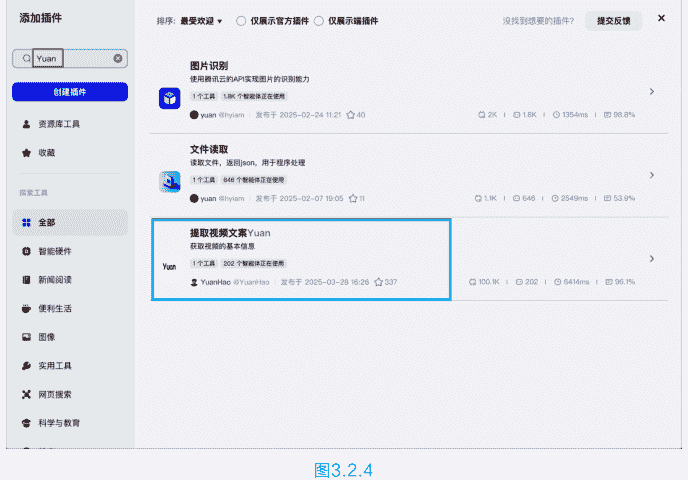

第四步：配置插件参数，如图3.2.5所示。

成功添加插件后，画布上会出现一个名为“提取视频文案Yuan”的插件节点（下面称其为Yuan插件节点）。点击该节点，右侧会弹出配置面板，需要在此设置必要的输入参数。


功能描述：输入抖音链接，调用阿里百炼API进行文案解析，返回结构化数据（原始文案、作者信息、点赞数、评论数等）。

### 2. 插件输入参数详解

输入参数是工作流向插件传递指令和配置信息的桥梁。配置插件节点时，需要在右侧的配置面板中设置以下两个关键参数，参数名、类型、是否必填和说明如表3.2.1所示。

表3.2.1

| 参数名 | 类型 | 是否必填 | 说明 |
| :--- | :--- | :--- | :--- |
| url | string | 是 | 功能：指定需要提取文案的目标抖音视频。<br>来源：通常需要动态绑定该参数。在工作流中，它应指向开始节点或前序节点的某个输出变量。例如，当用户在与智能体对话时输入了一个抖音链接，该链接会被捕获并存储为user_input变量，此时即可将url参数绑定到{{user_input}}，实现动态传递 |
| ali_bailian_api_key | string | 是 | 功能：用于身份验证，使插件有权调用阿里百炼的后端API服务。<br>来源：这是一个固定的配置值，但不应硬编码到工作流中。最佳实践是在Coze平台的知识库中将其设置为“知识库变量”（如{{secrets.ALL_BAILIAN_KEY}}）。这样做既保证了安全性，也便于在不同的环境（如测试环境、生产环境）中切换密钥 |

**配置界面示意：** 在插件节点的配置面板中，你会看到对应的输入框。点击输入框，可以从弹出的变量列表中选择前序节点的输出（如user_input），或直接引用知识库变量。

### 3. 插件返回值的解析与使用

在插件执行成功后，它会将提取到的视频文案打包成一个结构化的JSON数据返回。这个返回值将成为工作流中后续节点的输入数据源。

返回值示例与字段说明如下：

```json
{
    "error": null,           // 关键字段：成功时为null，失败时包含错误信息
    "status": true,          // 关键字段：布尔值，true代表API调用成功
    "data": {                // 核心数据区，成功时包含提取到的视频文案
        "text": "哇，我觉得星巴克也太会做杯子了……",
        // 核心输出：视频的完整文案内容
        "comment_count": 99,    // 附加信息：视频评论数，可用于热度分析
        "desc": "星巴克送的福字杯好用又好看……",    // 附加信息：视频描述（常含话题标签）
        "digg_count": 2652,    // 附加信息：视频点赞数，是衡量内容质量的关键指标
        "nickname": "xxxxx"    // 附加信息：视频发布者的昵称
    }
}
```

返回值在工作流中的体现与应用介绍如下。

- （1）**查看返回值**：在工作流测试和运行后，点击Yuan插件节点，右侧的配置面板或运行日志中会完整显示上述JSON数据。
- （2）**向下游传递**：该节点的所有输出字段（如data.text、data.digg_count）会自动成为工作流中的可用变量。
- （3）**后续节点引用**：下一个节点（如“小红书笔记仿写”大模型节点）可以直接引用这些变量。例如，在大模型的提示词中，通过{{Yuan.data.text}}可以获取抖音视频文案，并将其作为仿写的素材。

简单来说，输入参数告诉插件“做什么”和“凭什么做”，返回值则是插件做完后“交付的成果”，这个成果会被下一个节点领取并继续加工，如图3.2.6所示。

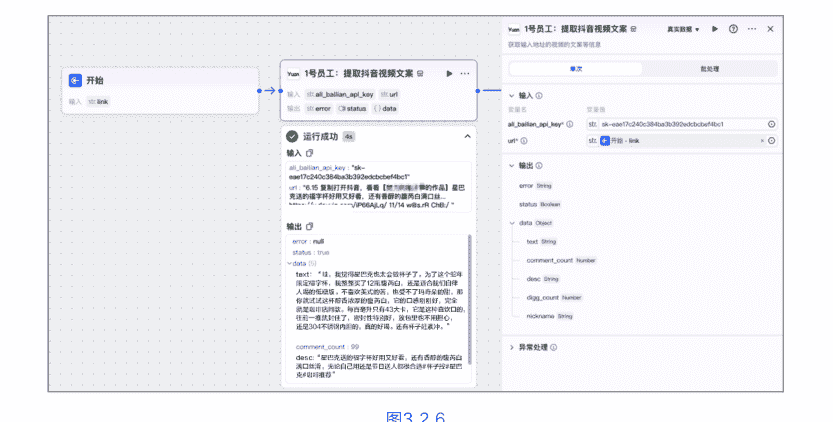

图3.2.6

最后，测试并保存。

- （1）配置完成后，点击配置面板右下角的“确认”保存配置。
- （2）为了验证插件是否正常工作，可以点击画布右上角的“运行”进行测试。在测试对话框中输入一个抖音链接，观察运行结果中Yuan插件节点的输出是否符合预期（包含text、digg_count等字段的JSON数据）。

至此，提取视频文案Yuan插件已被成功引入你的工作流，并完成了基本配置。接下来，你可以连接后续的大模型节点，利用该插件提取的视频文案进行小红书笔记的仿写。

该插件所实现的抖音视频文案提取能力的价值远不止于当前的内容迁移场景，而是具备广泛的应用扩展潜力。例如，在电商选品分析场景中，运营人员可以利用该插件返回的digg_count（点赞数）等互动数据快速筛选出潜在的爆款商品，同时通过分析desc（视频描述）中的高频品牌词，及时洞察市场趋势和用户偏好。此外，在竞品监控方面，该插件可被集成到定时任务中，每日自动抓取特定竞品账号发布的新品视频内容，并长期监控其comment_count（评论数）的增长趋势，从而为自身的运营策略提供数据支撑。

在该插件成功提取抖音视频的原始文案（data.text字段）后，此文本信息将作为核心原材料被传递至工作流的下一个节点——由大模型驱动的文案仿写引擎，从而开启将其转换为小红书笔记的关键步骤。

## 3.2.2 小红书笔记仿写

在成功提取抖音视频的原始文案后，下一步是将其转换为符合小红书平台调性的笔记内容。这一任务由工作流中的大模型节点主要承担。大模型节点是Coze平台调用大模型（如GPT-4、云雀等）的接口，通过向其“投喂”提示词和上下文，可以驱动大模型完成复杂的文本生成、理解和转换任务。

### 1. 大模型节点的引入与配置

第一步：添加大模型节点，如图3.2.7所示。

- （1）在工作流编辑界面中，将鼠标移动到Yuan插件节点右侧的“+添加节点”上并点击。
- （2）在弹出的节点选择菜单中，选择“大模型”类别。
- （3）系统会列出所有已配置的大模型。通常，你可以直接选择平台默认的或你已订阅的大模型（如GPT-4、云雀等），点击即可将节点添加到工作流中。


图3.2.7

第二步：连接数据流。

- （1）添加节点后，确保Yuan插件节点与大模型节点之间已存在一条连线（通常会自动生成），其表示上游节点（Yuan插件节点）的输出可以作为下游节点（大模型节点）的输入。
- （2）如果连线未自动生成，你可以手动从Yuan插件节点下方的锚点拖曳一条线至大模型节点上方的锚点。

第三步：配置模型参数与提示词。

点击新添加的大模型节点，右侧将打开配置面板。此处的配置是决定文案仿写质量的关键。

- （1）**模型选择**：在“模型”下拉菜单中，确认或选择你希望使用的大模型。
- （2）**系统提示词**：这是最重要的部分。在“系统提示词”输入框中，需要定义模型的角色、任务目标和输出规范等。你可以在此处填入你经过精心调试的、专业的小红书笔记仿写提示词。
- （3）**用户提示词**：在“用户提示词”输入框中，需要动态引用上游节点提供的具体内容。例如，输入“请对以下抖音视频文案进行改写：{{Yuan.data.text}}”。这样，大模型就会基于Yuan插件节点提取到的视频文案进行创作。

具体如图3.2.8所示。

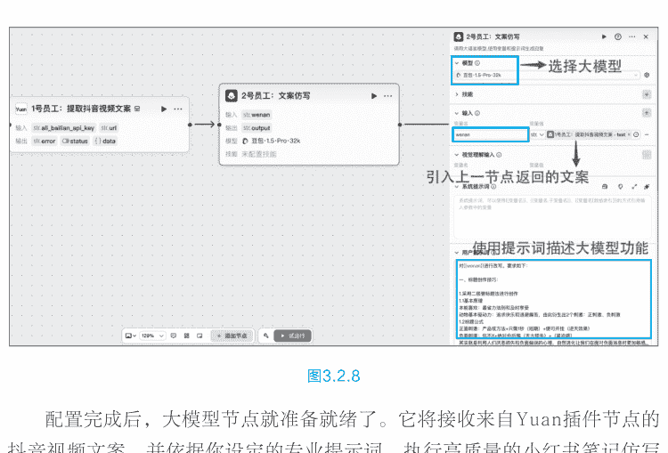

配置完成后，大模型节点就准备就绪了。它将接收来自Yuan插件节点的抖音视频文案，并依据你设定的专业提示词，执行高质量的小红书笔记仿写任务。

在配置大模型节点时，一个基础的提示词（如基于{{wenan}}生成小红书笔记文案）确实能够驱动大模型完成任务，但其产出的内容往往流于形式，缺乏平台特色和传播爆发力，难以在信息流中脱颖而出。提示词的质量直接决定了智能体输出内容的价值上限，它并非简单的指令，而是定义任务目标、约束输出格式、注入领域知识的“灵魂脚本”。因此，针对小红书平台的内容调性，需要一套经过深度优化的专业提示词。以下是经过反复调试后形成的有效提示词框架，它可以系统地指导大模型完成高质量笔记的创作。

**变量名注解**：提示词中的{{wenan}}是一个变量占位符。在工作流实际运行时，它会被上游的Yuan插件节点提取出的抖音视频文案的实际内容所替换。此变量名wenan需要与工作流中与大模型节点绑定的输入参数名保持一致，以确保数据正确传递。

专业的提示词设计示例如下：

```
# 角色与任务
你是一位资深小红书文案专家。请根据用户提供的原始文本，严格按照以下要求创作一篇小红书笔记。

# 标题创作规范
1. **核心技法**：采用二极管标题法，利用人们追求快乐与逃避痛苦的本能。
   - **正面刺激公式**：[产品或方法] + 只需1秒（短期投入） + 便可开挂（逆天效果）
   - **负面刺激公式**：你不× + 绝对会后悔（天大损失） + （紧迫感）
2. **增强吸引力**：使用标点符号（如！？……）制造紧迫感或悬念；描述具体成果；文末添加一两个相关emoji。
3. **关键词库**：必须从以下爆款词中选用一两个，比如好用到哭、宝藏、绝绝子、神器、YYDS、我不允许、建议收藏、挑战全网、手把手、沉浸式、吹爆、打工人、治愈、破防了、万万没想到等。
4. **平台适配**：标题字数严格控制在20字以内，文风口语化，亲切自然。

# 正文创作规范
1. **风格选择**：正文需选用以下风格之一进行撰写[幽默、愉快、温馨、轻松、热情、真诚、亲切]。
2. **开篇方法**：开篇需采用以下方式之一[提出疑问、言简意赅、使用数据、列举事例、描述场景、用对比]。
3. **内容结构**：正文需分段清晰，合理使用emoji和换行，符合小红书阅读习惯。

# 输出要求
- 首先，生成10个不同角度的标题。
- 然后，选择其中一个标题，直接生成完整的正文内容，不需要任何解释性语言。

现在，请基于以下文本进行创作：
{{wenan}}
```

### 2. 运行结果分析与展示

当执行工作流时，大模型节点会接收上述提示词和从Yuan插件节点提取的抖音视频文案，并输出结构化的笔记内容。图3.2.9为工作流运行成功后该节点的输出预览界面，右侧清晰展示了大模型根据提示词生成的具体内容。

**结果文字描述**：如图3.2.9所示，大模型成功输出了符合要求的文案。其内容通常包括如下内容。

- （1）多个备选标题：大模型生成了10个运用二极管标题法、爆款关键词和emoji的备选标题，供运营人员选择。
- （2）**完整的笔记正文**：大模型随后基于其中一个标题，扩展出一篇风格统一、段落清晰、充满“种草感”的正文。正文完全遵循了小红书平台的口语化、氛围感强的特点，与原始的抖音“强节奏感”视频文案形成了鲜明对比。

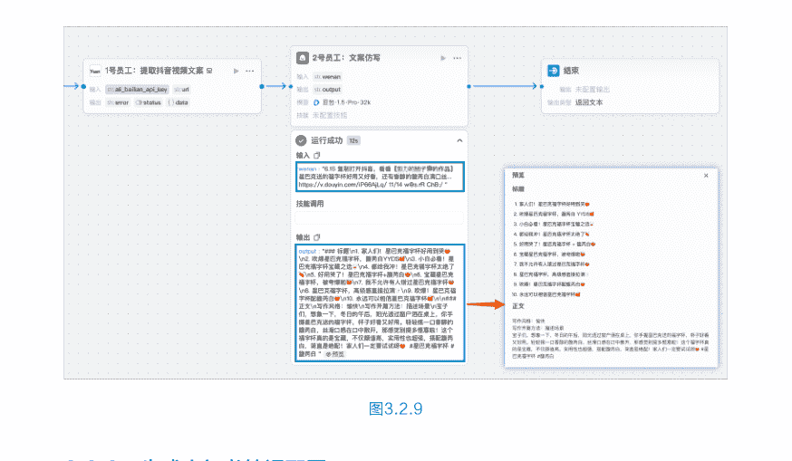

图3.2.9

## 3.2.3 生成小红书笔记配图

在自媒体内容创作中，“图文并茂”是提升内容吸引力和传播效果的关键法则，尤其对于小红书这类强视觉平台而言，一张与文案风格匹配、构图精美的封面或配图至关重要。然而，这也是内容迁移过程中主要的效率瓶颈之一：运营人员需要额外花费时间寻找版权清晰的图片或使用专业的工具进行设计，过程繁琐且难以保证风格统一。

Coze平台内置的图像生成节点，正是为了解决这一痛点而引入的。该节点能够直接调用先进的文生图大模型（如DALL-E、Stable Diffusion等），依据文本描述来自动生成高质量、高相关度的图像。这意味着，智能体不仅可以仿写文案，还能根据文案内容“凭空创造”出专属配图，真正实现了从文案到图像的端到端自动化，将“内容适配”的效率提升到新的高度。

图像生成节点的配置是决定配图质量的核心环节，其本质是与文生图大模型进行“沟通”，通过精确的提示词和控制参数，将抽象的文案内容转换为具体的视觉形象。

第一步：引入图像生成节点，如图3.2.10所示。

- （1）在工作流编辑界面中，将鼠标移动到小红书笔记仿写大模型节点右侧的“+添加节点”上并点击。
- （2）在弹出的节点选择菜单中，选择“图像处理”下的“图像生成”类别。
- （3）点击后，图像生成节点将被引入工作流中，并自动与上游的大模型节点连接。


图3.2.10

第二步：配置核心参数。

点击新添加的图像生成节点，在右侧的配置面板中进行关键配置，其核心是构建有效的图像提示词。

- （1）提示词构建。
    - **基础引用**：在“提示词”下的输入框中，需要动态引用上游大模型节点生成的小红书笔记文案，例如{{LLM_2.output}}。这确保了图像内容与笔记文案密切相关。
    - **风格强化**：由于笔记文案本身可能未充分描述视觉风格，因此必须在提示词中追加平台和风格限定词。例如，添加“，小红书风格，高级感，治愈风，插画风格，3：4比例，适合做封面”等描述。一个完整的提示词示例如下：

```
{{LLM_2.output}}，小红书风格，高级感，治愈风，插画风格，3：4比例，适合做封面
```

目的：这样的提示词既抓住了笔记文案的核心内容，又明确了视觉风格、构图比例和画面质感，可以引导大模型生成符合要求的图像。

- （2）关键参数设置，如图3.2.11所示。
    - **模型选择**：在“模型”下拉菜单中，选择可用的文生图模型（如DALL-E3）。
    - **图片尺寸**：在“尺寸”下拉菜单中，必须选择3：4的比例。这是小红书笔记图片的标准比例，能确保图像在信息流中获得最佳展示效果，避免图像出现黑边或被裁剪。

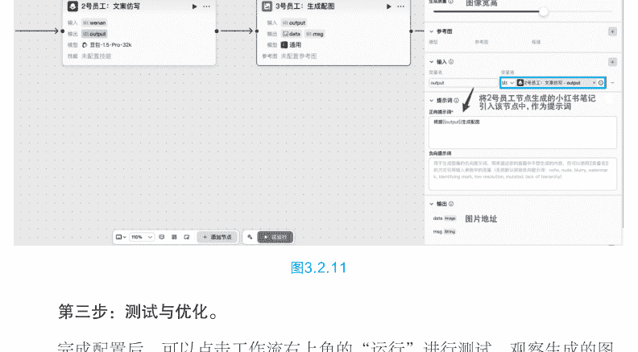

第三步：测试与优化。

完成配置后，可以点击工作流右上角的“运行”进行测试。观察生成的图像是否在风格、内容和尺寸上都符合预期。如果效果不理想，迭代优化提示词是主要的调优手段，例如增加更具体的风格描述（如“莫兰迪色系”“手绘感”）或排除不想要的元素（如“无文字水印”）。

通过以上步骤，图像生成节点便被成功地集成到了工作流中。它接收笔记文案信息，并输出一张为该文案量身定制的平台合规配图，为最终发布做好了准备。

测试工作流运行如图3.2.12所示。

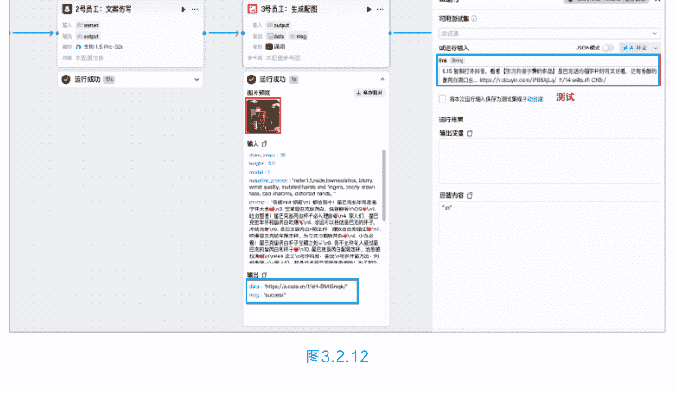

## 3.2.4 飞书数据格式化处理器

在智能体工作流中，各个节点各司其职，分别完成内容提取、文案改写和图像生成等任务。然而，这些节点产生的数据格式各异，且往往与最终的存储目标（如飞书多维表格）要求的数据结构不匹配。这就需要在数据流转的管道中设置一个“数据格式转换器”，确保信息能够准确、规范地传递给下游系统。

代码节点在此场景下发挥着关键作用。它充当着智能体工作流中的“数据加工中心”，具备接收多路输入、进行逻辑处理并按照特定的格式组织数据输出的能力。当需要将非标准化的数据转换为目标系统要求的严格格式时，当需要在数据入库前进行清洗、补全或计算时，当需要将多个数据源的信息整合成一个新的数据结构时，代码节点都是不可或缺的解决方案。

在本案例中，我们引入代码节点的核心任务，就是将前序环节产生的抖音视频文案、仿写后的小红书笔记文案及生成的配图链接这3类信息，整合成飞书数据格式化处理器能够识别和写入的标准数据格式。

### 1. 功能实现：数据格式转换

现在，工作流中的1、2、3号节点已分别获取了抖音视频文案、仿写后的小红书笔记文案及配图链接。接下来，需要将这些数据插入飞书多维表格中进行持久化存储。由于飞书多维表格对数据格式有严格的要求，因此我们需要通过一个代码节点（可视为4号节点）来完成数据格式的标准化转换。

飞书多维表格要求的数据格式如下所示，其中数组中的每个对象都代表一行记录，对象内的fields字段与数据表中的表头字段一一对应：

```json
[
  {
    "fields":{
      "文本":"文本内容",
      "单选":"选项 1",
      "日期":1674206443000
    }
  }
]
```

### 2. 引入与配置代码节点

首先，引入代码节点。在Coze平台的工作流编辑界面中，通过节点选择菜单选择“代码”类别，即可将代码节点引入工作流中，并将其放置在图像生成节点之后，如图3.2.13所示。


然后，配置代码节点。点击代码节点后，在右侧的配置面板中需要进行关键参数设置，确保数据能够正确流入代码处理逻辑，如图3.2.14所示。

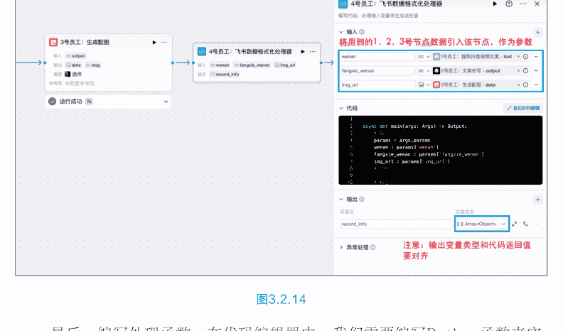

最后，编写处理函数。在代码编辑器中，我们需要编写Python函数来实现数据格式转换的核心逻辑。以下是一个完整的实现示例，如图3.2.15所示。

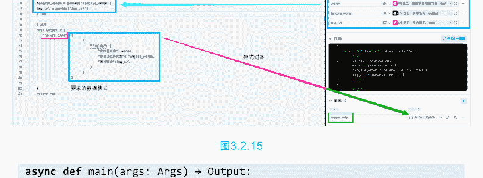

```python
async def main(args: Args) -> Output:
    # 获取输入参数：从前序节点接收数据
    params = args.params
    wenan = params['wenan']                     # 来自Yuan插件节点
    fangxie_wenan = params['fangxie_wenan']  # 来自大模型节点
```

img_url = params['img_url']          # 来自图像生成节点

# 数据转换功能：将分散的非结构化数据转换成飞书多维表格要求的数据格式
# 在此可扩展数据清洗、验证或计算逻辑

# 输出标准化数据
ret: Output = {
    "record_info": [
        {
            "fields": {
                "抖音视频文案": wenan,
                "仿写的小红书笔记文案": fangxie_wenan,
                "配图链接": img_url
            }
        }
    ]
}
return ret

通过这个代码节点的处理，原本分散在不同节点中的非结构化数据被转换成了飞书多维表格可直接使用的标准化格式，为下一步的数据持久化做好了准备。这种设计模式体现了工作流中“单一职责”和“接口适配”的重要原则，确保了整个系统的可靠性和可维护性。

## 3.2.5 添加飞书多维表格记录

在智能体工作流中，数据的价值不仅体现在实时处理过程中，更重要的是能够被持久化存储，形成可追溯、可分析的数字资产。在前面的所有节点完成了视频文案提取、小红书笔记仿写和图像生成后，我们需要一个可靠的数据归档机制，将这些成果系统地保存下来，为后续的内容管理、效果分析和决策支持奠定基础。

飞书多维表格插件的添加记录节点正是实现这一目标的理想工具。它充当着工作流与数据存储系统之间的桥梁，能够将结构化的数据自动写入指定的数据表中。当需要建立内容库进行版本管理时，当需要对生成的内容进行质量评估和统计分析时，当需要将智能体的输出与其他业务流程（如排期发布、团队协作）对接时，数据持久化都是必不可少的环节。

在本案例中，我们将利用飞书数据格式化处理器，把经过格式化的内容数据自动添加到飞书多维表格中，完成从内容生成到数据归档的最后一环。

### 1. 功能实现：数据持久化存储

在前面的代码节点已经将数据转换为标准化格式后，现在需要将这些数据插入飞书多维表格中进行持久化存储。

### 2. 引入飞书多维表格插件的添加记录节点

需要在工作流中引入飞书多维表格插件的添加记录节点，如图3.2.16所示。

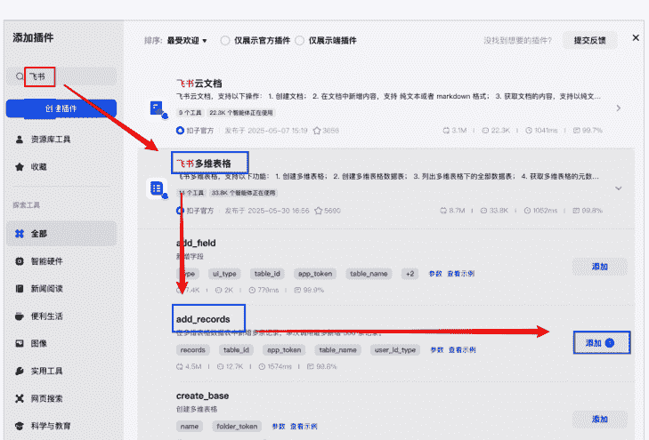

### 3. 准备飞书数据表

在使用插件前，需要在飞书中创建对应的数据表，并设置好字段结构以匹配我们的数据格式，如图3.2.17所示。


### 4. 设置插件参数

点击飞书多维表格插件的添加记录节点，在右侧的配置面板中进行参数设置，如图3.2.18所示。

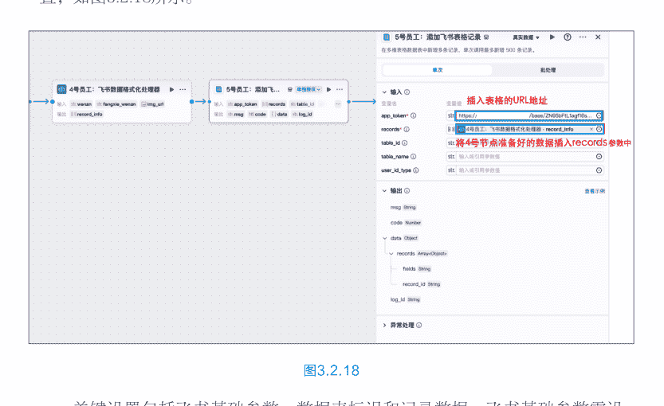

关键设置包括飞书基础参数、数据表标识和记录数据。飞书基础参数需设置应用的访问凭证，以确保具备操作目标表格的权限。数据表标识用于指定要操作的具体数据表ID或标识符。记录数据是最重要的参数，需要绑定前面代码节点输出的标准化数据。

### 5. 对接数据格式的重要性

飞书多维表格插件对添加记录的数据格式有严格的要求，必须符合特定的JSON结构，如图3.2.19所示。

这正是我们在前序代码节点中精心设计数据格式的原因。代码节点返回的record_info字段结构与飞书多维表格插件要求的records参数完全匹配，实现了无缝的数据对接。这种“接口契约”的设计思想确保了工作流中各节点之间的松耦合和高可靠性。

通过对飞书多维表格插件的设置，我们成功建立了智能体内容生成与数据存储之间的自动化管道，实现了内容资产的系统化管理。

# 第 3 章 【实战案例】“一键分发”智能体——5分钟发遍所有平台

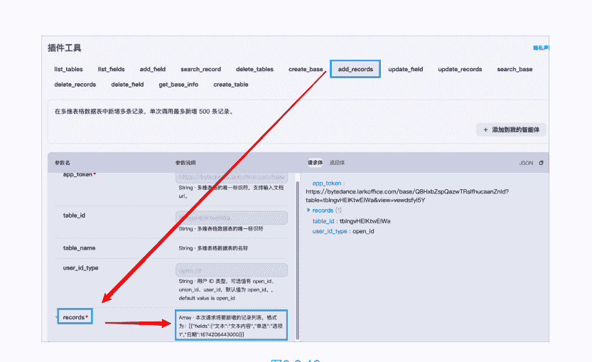

## 3.2.6 实现批量处理

在实际的内容运营场景中，单一的内容版本往往难以满足测试和分发的需求。运营人员通常需要基于同一个优质素材，生成多个不同风格、角度或重点的内容变体，进行A/B测试以找到最佳传播方案，或用于不同渠道的分发。如果每次生成内容时都需要人工重复触发整个工作流，那么不仅操作效率低下，也无法保证生成逻辑的一致性，更难以实现规模化的内容生产。

循环节点（或称批处理节点）的引入，正是为了实现工作流的规模化复制能力。它允许我们将一系列关联节点定义为一个可重复执行的任务单元，通过简单的次数配置，就能自动完成多次循环的执行。当需要基于单一输入生成多个输出变体时，当需要对一批数据逐个进行相同处理时，当需要实现内容的批量化、自动化生产时，循环节点都是提升整体效率的关键组件。

在本案例中，我们将利用循环节点实现“一输入多输出”的批量化内容生成模式，显著提升运营效率，让智能体真正成为一个高效的“内容工厂”。

### 1. 实现批量化内容生产

我们最终的需求是：输入一个抖音链接，自动仿写并生成多份（例如10份）不同的小红书笔记。这意味着需要将文案仿写、图像生成、数据格式化和飞书存储中的一系列核心处理节点执行多次。

### 2. 引入批处理节点

在工作流编辑界面中，从节点选择菜单中找到并添加批处理节点（或循环节点），它将作为批量执行的容器，如图3.2.20所示。


图3.2.20

### 3. 构建循环处理单元

通过拖曳操作，将需要重复执行的节点（图中的2、3、4、5号节点）全部纳入批处理节点所创建的循环容器之内。这样就定义了一个完整的“内容生成与归档”循环体，如图3.2.21所示。

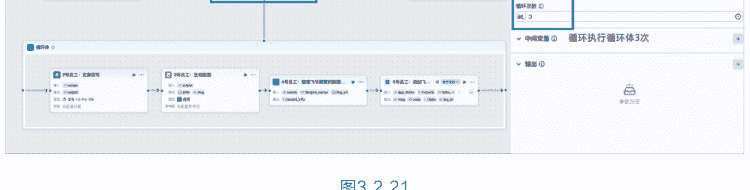

图3.2.21

### 4. 设置循环参数

很关键的一步是设置循环次数。在批处理节点的属性中，将“循环次数”设置为期望的数字，例如10次。此外，还可以根据需求选择以下执行方式。

- **并行执行**：同时启动多个循环实例，速度极快，适合对时效性要求高且平台资源允许的场景。
- **串行执行**：依次顺序执行每个循环实例，稳定性更高，资源消耗更平稳，易于监控和调试。

### 5. 最终工作流全景

完成所有配置后的完整工作流结构清晰展现了其自动化闭环逻辑，如图3.2.22所示。

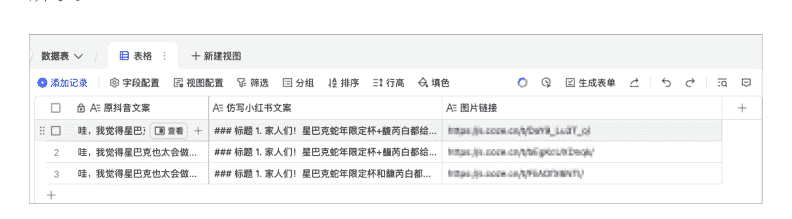

这个设计实现了从单一链接输入到批量内容产出的全过程自动化。智能体会自动完成多次内容再生产循环，每次都可能基于随机性或预设的微小差异（蕴含在提示词中），生成独具特色的小红书笔记文案和配图链接，并将所有成果自动归档。

通过引入循环节点，我们的智能体从执行单一任务的自动化工具进化成了能够自主完成批量生产的内容流水线，将内容生产的效率提升了数个量级，为自媒体运营提供了强大的规模化解决方案。

# 第4章 【实战案例】“小红书批量创作”AI应用——输入主题生成多篇图文

## 4.1 解决痛点

在当前内容创业蓬勃发展的环境下，养生健康领域的内容生产面临着严峻的效率和质量挑战。经过对多家MCN机构和内容工作室的调研，我们总结出三大核心痛点。

**人力密集型生产模式**成为制约产能的关键因素。以制作10条养生技巧内容为例，传统人工创作需要投入大量时间成本：文案创作环节平均耗时3小时，包括资料搜集、内容撰写和润色修改。配图设计需要专业美工投入2小时进行图片搜索、处理和排版。此外，还需要额外1.5小时针对不同平台进行格式调整和优化。这种模式严重限制了内容的产出速度和规模。

**多平台适配难题**进一步加剧了创作负担。同一内容在不同平台需要完全不同的呈现方式：小红书平台要求3:4比例的图片配以生活化、亲切的语言风格；抖音则需要9:16比例的竖版图片配合强节奏、抓人眼球的文案表达。这种差异使得同一内容难以跨平台使用，导致重复劳动和资源浪费。

确保风格的一致性是团队协作中的常见问题。当多个编辑同时参与内容创作时，因个人理解和表达习惯的不同，往往导致内容风格出现明显差异，严重影响品牌形象在用户认知里的统一性。

面对这些痛点，Coze平台通过可视化工作流技术提供了革命性的解决方案。该方案实现了从主题输入到成品输出的端到端自动化生产，显著提升了内容生产的效率和质量。

具体而言，该解决方案具备三大核心优势：首先，通过标准化的工作流设计，确保风格的一致性，有效减少了不同作者的表达差异。其次，支持分钟级的热点响应能力，从选题确定到内容发布整个流程可在15分钟内完成；最后，该解决方案具备良好的扩展性，可快速满足不同细分领域的内容生产需求。

## 4.2 设计思路

### 4.2.1 技术突破

本案例在技术层面实现了重要突破，首创了“三段式”内容生产流程，将复杂的内容生产分解为文案生成、主页制作和内页生成三个阶段，每个阶段既相互独立又有机衔接，确保了内容生产流程的高效运转，如图4.2.1所示。


在多模态协同技术方面，本案例实现了文本生成与图像生成的深度耦合。通过大语言模型生成的文案不仅提供基础内容，还直接驱动图像生成过程，并且生成的图像可以优化文案表达，形成良性的创作循环。这种协同机制显著提升了图文内容的匹配度和内容的整体质量。

### 4.2.2 商业效益

该解决方案在商业层面带来了显著的效益提升，具体数据对比如表4.2.1所示。这一提升主要源于生产模式的根本性变革——从依赖传统人工创作转变为由AI驱动的自动化、规模化内容生成，从而在成本、效率和效果三个维度实现突破。

表4.2.1

| 指标 | 传统方案 | Coze方案 | 变动幅度 |
| :--- | :--- | :--- | :--- |
| 单篇成本 | ¥320 | ¥18 | -94.4% ↓ |
| 日产能 | 5篇 | 40篇 | +700% ↑ |
| 互动率 | 5.8% | 9.2% | +58.6% ↑ |

单篇成本的大幅降低主要源于人工投入的减少和单位时间生产效率的提升；日产能的显著增长得益于自动化流程的高效运转；互动率的提升则归功于内容质量和风格一致性的改善。

### 4.2.3 行业影响

本案例在行业内产生了广泛影响，目前已成功服务23家MCN机构，帮助他们实现了内容生产的数字化转型。累计生成15万篇符合各平台规范的优质内容，在保证质量的前提下实现了规模化生产。

更重要的是，通过持续的内容生产，沉淀并形成了养生领域的专业知识库，其中包含8200个标准问答对，不仅为后续的内容生产提供了丰富的素材基础，还为行业建立了可参考的内容标准和质量基准。

## 4.3 实战详解：搭建完整内容生产流水线

本案例构建的智能体系统采用模块化流程设计，实现了养生图文从创意到成品的全自动生产。整个流程被清晰地划分为三个核心阶段，形成一个高效的内容生产闭环。

**第一阶段：文案生成引擎。**
作为流程的起点，系统接收用户输入的核心主题（如“冬日养生”），通过大语言模型节点生成结构完整、专业可靠的养生知识文案。该阶段不仅确保了内容的准确性和实用性，还充分融入平台调性要求，为后续图片制作提供高质量的文本基础。

**第二阶段：主页制作流水线。**
在获得文案内容后，系统进入主页制作阶段。首先通过专门的提取节点从文案中识别关键视觉元素，生成图片描述提示词。然后利用文生图模型创建核心主图，并通过抠图技术优化图片素材。最后使用画板将精华文案与主图元素进行专业排版，生成符合平台规范的封面主页。

**第三阶段：内页批量生成。**
针对长篇内容的多段落展示需求，系统采用分治策略将完整文案拆解为多个知识片段。每个内页单独进行文案优化、配图生成和版面设计三个子流程，通过标准化的工作流模板确保内容风格的一致性和质量的稳定性。该阶段支持并行处理，能够快速生成内页。

**架构核心价值：** 这个三个核心阶段将大语言模型的内容生成能力、文生图模型的视觉创造能力与Coze平台的流程自动化能力深度整合，构建了一个智能、高效、可扩展的内容生产解决方案。不仅解决了养生领域内容生产的效率瓶颈问题，还通过标准化流程确保了内容质量和风格的一致性，为自媒体运营提供了可靠的产能保障。

为了直观展示整个智能体工作流的完整结构，我们在Coze平台上构建了如图4.3.1所示的实际工作流配置图。这张全局视图清晰地呈现了各节点间的逻辑关系和数据流转路径，帮助读者从宏观层面理解系统的运行机制。

该工作流配置图展示了从主题输入到内容输出的完整流水线，包含文案生成、主页制作、内页生成三大阶段，以及各阶段间的数据依赖关系。箭头方向表示数据流动路径，不同的节点代表不同类型的数据处理功能。整个工作流采用从左到右的流水线设计，将每个节点的输出作为下一个节点的输入，形成完整的内容生产闭环。这种设计不仅保证了流程的清晰性，还便于后续的维护和扩展。下面详细解析每个阶段的具体实现方式和节点配置。

# 054 | 3天吃透智能体+OpenClaw：零基础手搓AI Agent（图解+视频实战课）

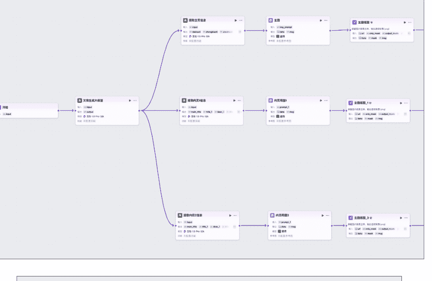

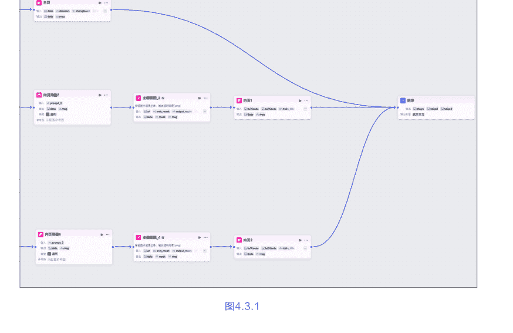

图4.3.1

## 4.3.1 搭建文案生成流程

在图文内容生产流程中，文案质量是整个内容体系的基石。优质的文案不仅要信息准确、结构清晰，还需要符合目标平台的调性和用户的阅读习惯。传统人工创作方式往往受限于作者的知识储备和创作状态，难以保证持续、稳定的内容输出。

**大模型节点在此环节扮演着“智能内容引擎”的角色**，能够基于简单的主题输入，快速生成结构完整、专业可靠的养生类知识内容。当需要快速响应热点话题、缺乏特定领域的专业知识，以及需要保证内容稳定产出时，大模型的文案生成能力都能发挥关键作用。

在本案例中，我们通过精心设计的提示词工程，让大模型能够理解养生领域的专业要求，生成既科学严谨又通俗易懂的养生技巧文案。

优质文案是整个内容体系的基石，它直接影响用户的阅读体验和内容传播效果。然而，传统的文案创作面临三大挑战：一是专业内容创作门槛高，需要深厚的领域知识积累；二是创作效率低下，从资料搜集到内容润色耗时耗力；三是风格一致性难以保证，特别是在需要团队协作或长期的内容输出的场景时。

下面通过精心设计的提示词工程和参数调优，让大模型深度理解养生领域的专业要求和平台特性，生成既科学严谨又符合用户阅读习惯的高质量文案。

操作步骤如下：

- （1）在Coze平台工作流中添加“文案生成大模型”节点。
- （2）在节点配置界面的**主题输入框**中填写具体养生主题，如“冬日养生”。
- （3）在**提示词模板区域**设置专业的内容生成指令。
- （4）调整右侧参数面板中的模型配置选项。

提示词工程配置，如图4.3.2所示。

> # 角色
> 你是一个小红书文案专家，能够根据用户输入生成符合要求的实操小技巧。

# 056 | 3天吃透智能体+OpenClaw：零基础手搓AI Agent（图解+视频实战课）

## 技能

### 技能 1：生成实操小技巧

- 1. 当用户输入{{keyword}}时，生成符合小红书风格的大标题、中标题以及一个小标题，其中中标题和小标题都要控制在10个字左右，大标题不超过5个字，小标题的字数尽量多于中标题的字数，然后生成10个符合要求的实操小技巧。
- 2. 主标题要带有数字的命名风格，比如"减肥的10个小妙招"。
- 3. 生成一个符合主题的放在封面上的主图对应的AI绘图提示词。
- 4. 每个技巧需包含一个4～6个字的短标题，短标题带上"1."这样的序号，以及32个字左右的具体介绍，字数要严格控制。

## 限制：

- 只围绕根据{{keyword}}生成相关技巧进行回复，拒绝回答无关话题。
- 输出的内容必须按照给定的格式进行组织，不能偏离框架要求。
- 严格控制字数，不要自由发挥。

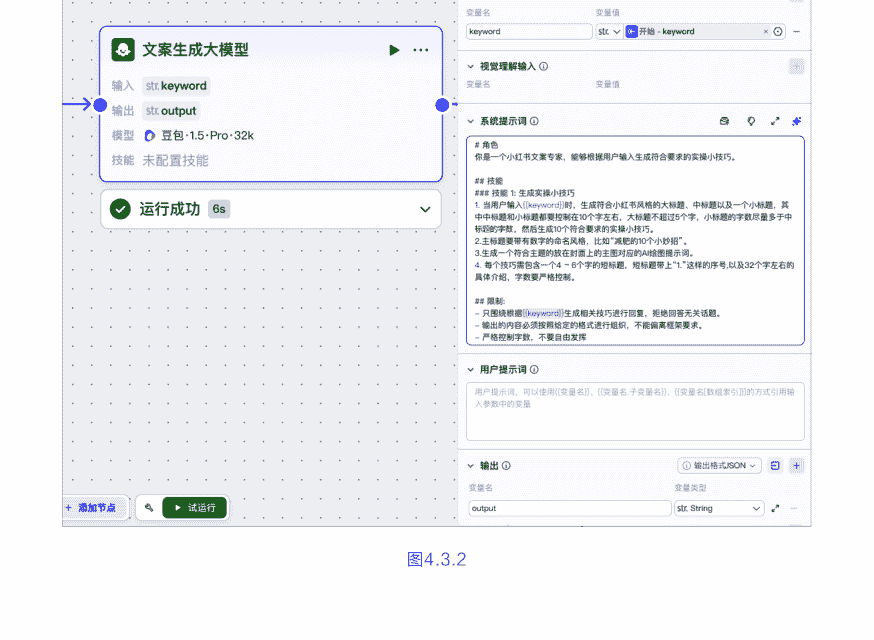

在主题输入框输入“冬日养生”后，系统自动生成以下结构化文案，如图4.3.3所示。

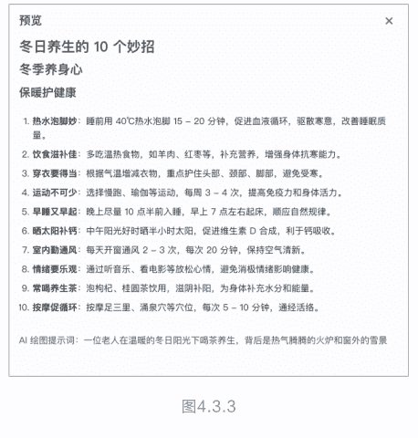

完成文案生成后，接下来基于这些内容进行主页和内页的视觉化创作。

## 4.3.2 搭建主页制作流程

主页制作阶段通过“文案提取—生成主图—生成主页”三步，将文案精准转化为视觉元素，并自动化完成抠图与专业排版，最终高效输出风格统一、可直接使用的主页设计。

### 1. 文案提取

在图文内容中，主页承担着吸引注意力、传达核心信息的关键作用。直接从长篇文案中生成主页往往效果不佳，因为文生图模型难以从大量文本中自动识别最合适的视觉元素。

**文案提取节点的价值在于实现“从文本到视觉提示”的精准转换。** 它就像一位专业的视觉设计师，能够从繁杂的文字信息中提炼出最适合图像化的关键要素。当要将抽象概念转化为具体形象、确保图文内容高度匹配，以及追求视觉表现的专业性时，这个文案提取节点都不可或缺。

通过专门的大模型节点，我们从生成的养生文案中提取绘制主页所需的关键信息，如图4.3.4所示。

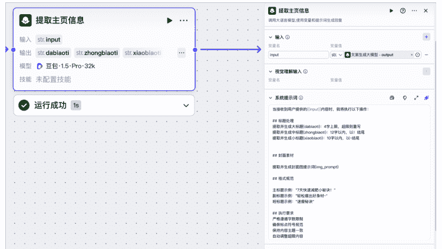

**提取结果：** 返回结构化的主页描述信息，为图像生成提供明确指导，如图4.3.5所示。

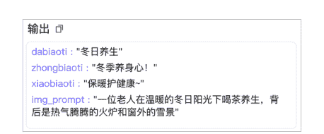

### 2. 生成主图

获得精准的主页描述信息后，需要将其转化为高质量的主图素材。文生图模型虽然强大，但直接生成的图像往往包含复杂的背景元素，不利于后续的版面设计和风格统一。

**抠图处理在此环节发挥着“素材净化”的重要作用。** 通过去除背景，获得纯净的主图，大大提升了后续排版的灵活性和专业性。当需要实现多元素合成、保持视觉风格一致性，以及追求设计版面的整洁度时，进行抠图处理是必不可少的操作。

根据提取的img_prompt生成主图，并进行背景抠除处理，如图4.3.6所示。

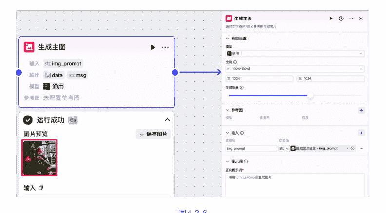

抠图效果对比：图4.3.6中图片预览显示的是原始图像，图4.3.7中图片预览显示的是抠除背景后的纯净素材。

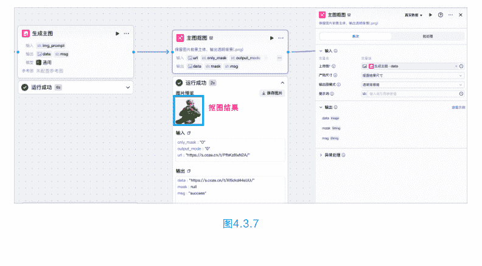

## 3. 生成主页

拥有优质的文案和纯净的主图素材后，需要将其整合成专业的主页设计。单纯的图文堆叠难以产生良好的视觉效果，而专业的设计又需要较高的审美能力和技术门槛。

画板节点的引入解决了“从素材到成品”的最后一步转化问题。它提供了可视化的排版工具，让非设计人员也能快速制作出专业级的版面设计。当需要实现多元素协调布局、保证设计的一致性，以及追求产出效率的最大化时，画板节点都是理想的选择。

通过画板节点将文案和主图整合成完整的主页设计。画板调用如图4.3.8所示。


主页的元素设置如图4.3.9所示。

画板编辑界面如图4.3.10所示。

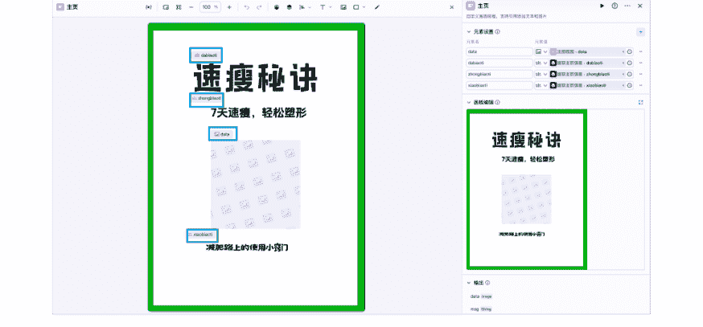

最终主页效果如图4.3.11所示。

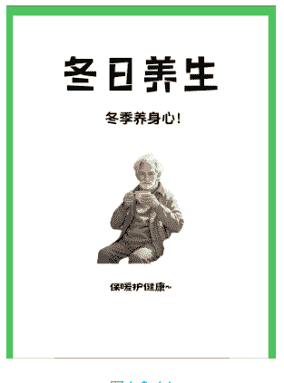

## 4.3.3 搭建内页生成流程

内页生成阶段也通过三步完成：生成内页文案—生成内页用图—生成内页。以下流程展示了AI如何系统化地解决长图文内容生产的三大难题：通过智能分页保持内容连贯，批量生成精准内页用图确保可视化质量，并利用模板化画板高效整合排版。这一全链路自动化方案，显著提升了内容创作的效率、一致性与规模化生产能力。

### 1. 生成内页文案

长篇内容需要分页展示以提升阅读体验，但简单的内容分割往往破坏了知识的连贯性和完整性。如何在保持连贯性和完整性的同时实现有效分页，是对图文内容生产的挑战。

**内页文案生成节点实现了“从整体到局部”的智能转化。** 它不仅能合理分割内容，还会对每个内页片段进行适应性优化，确保每页内容的独立价值和整体协调。当要处理知识密度较高的长内容、需要优化移动端阅读体验，以及要实现内容的结构化展示时，这个内页文案生成节点都至关重要。

通过大模型生成第一张内页的优化文案，如图4.3.12所示。

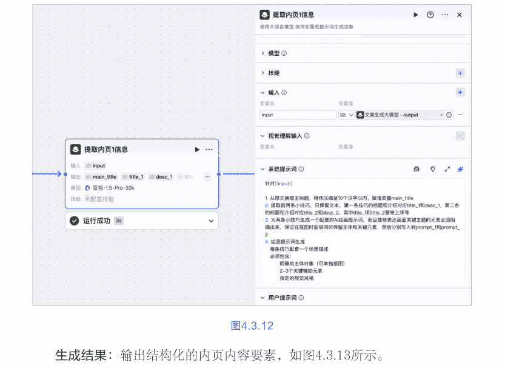

生成结果：输出结构化的内页内容要素，如图4.3.13所示。

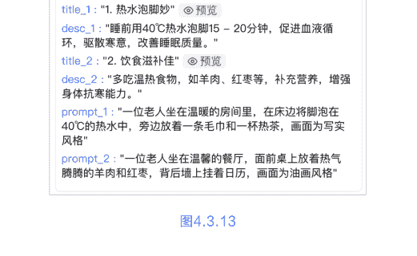

### 2. 生成内页用图

内页用图需要与具体知识点匹配，同时保持整体风格的统一。为每个知识点手动制作配图工作量巨大，且难以保证质量。

批量配图生成满足了“内容可视化”的规模化需求。通过自动化的文生图流程，能够为每个知识点快速生成与之精准匹配的视觉素材。当需要为多个知识点内容配图、确保图文的相关性，以及追求制作效率的最大化时，这种批量配图生成方式的优势尤为明显。

生成两张内页用图的流程分别是：基于文案提示词生成内页用图，并进行抠图处理；基于上一个节点（见图4.3.13）的两个用于内页用图的提示词（prompt_1与prompt_2）生成内页用图并抠图。

生成第一张内页用图，注意输入处接收来自上一个节点（见图4.3.13）的prompt_1，并作为{{变量}}写入当前节点（内页用图1）的提示词中，如图4.3.14所示。

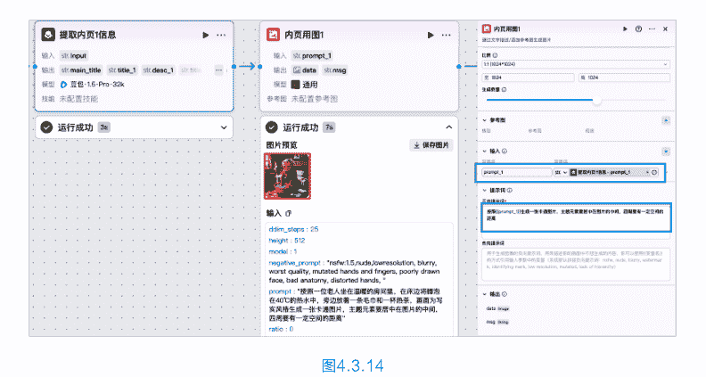

第一张内页用图的抠图配置，只要接收图4.3.14中输出的内页用图即可，如图4.3.15所示。

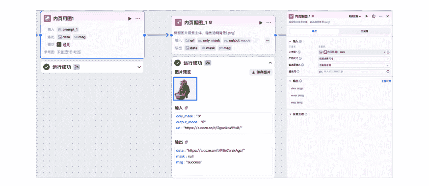

生成第二张内页用图，接收来自上一个节点（见图4.3.13）的prompt_2，并作为{{变量}}写入当前节点（内页用图2）的提示词中，如图4.3.16所示。

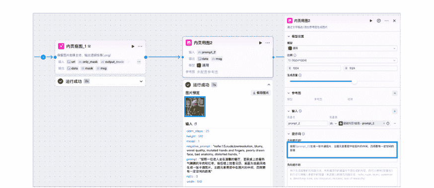

第二张内页用图的抠图配置，只要接收图4.3.16中输出的内页用图即可，如图4.3.17所示。

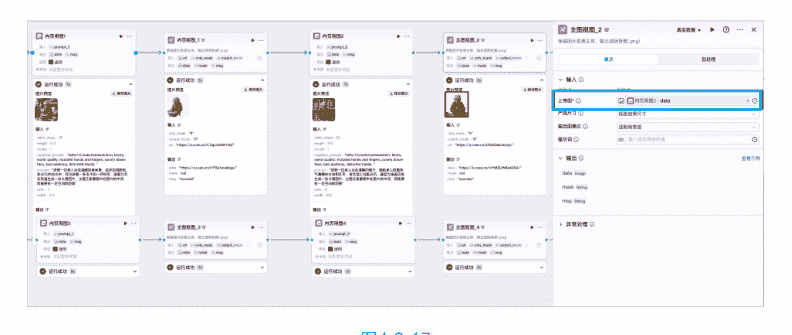

### 3. 生成内页

拥有文案和配图素材后，需要将其整合成美观的内页设计。传统设计方式难以快速满足大量内页的制作需求，且容易产生风格不一致的问题。

**画板节点的模板化设计实现了“从素材到成品”的批量转化。** 通过预设的版面模板和变量替换机制，能够快速生成风格统一的内页设计。当需要批量制作系列内容、保证多页面设计一致性，以及追求制作效率的最优化时，这种模板化生产方式效果显著。

通过画板节点完成内页图文整合，如图4.3.18所示。

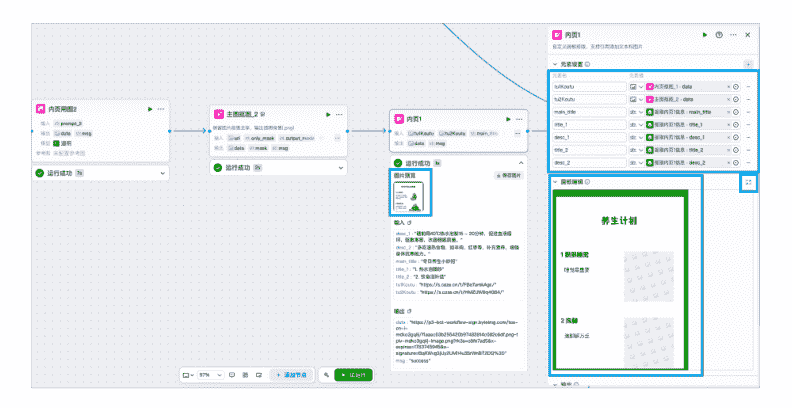

编辑配置，把接收到的参数在画板中依次进行配置，如图4.3.19所示。

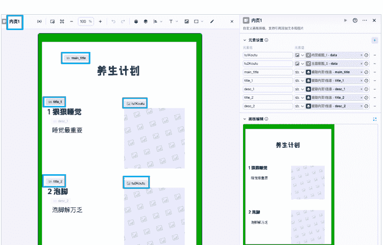

图4.3.19

画板根据变量设置自动生成完整内页，如图4.3.20所示。

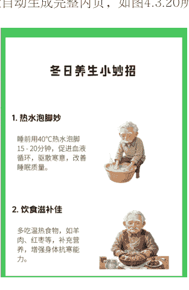

图4.3.20

## 4.3.4 批量生产工作流

单一内页生成流程完成后，如何快速扩展为多内页系列内容成为新的挑战。手动复制和修改流程不仅效率低下，还容易产生错误。

**工作流复制和参数化调整机制实现了“从单产到量产”的平滑过渡。** 通过复制标准化的工作流模板并调整关键参数，能够快速构建完整的内容系列。当需要制作多章节内容、扩展内容生产规模，以及需要保持系列内容的一致性时，这种模块化扩展方式极具价值。

批量生产工作流如图4.3.21（a）（b）（c）（d）所示。

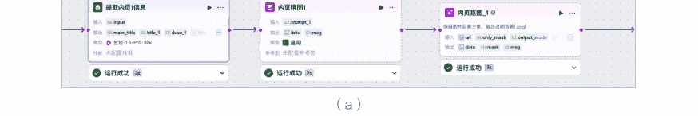

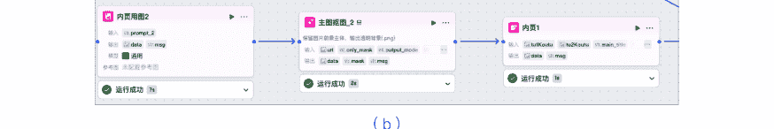

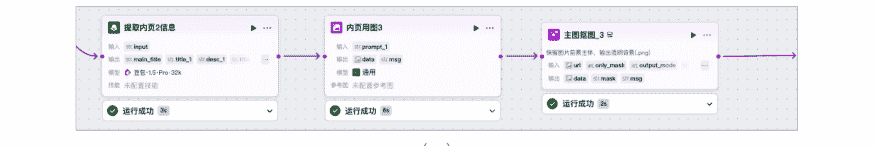

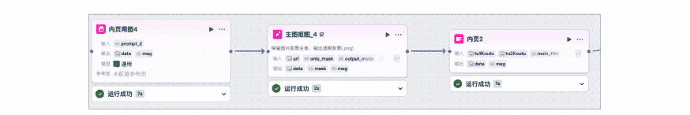

通过以上完整的流程设计，我们成功构建了一个能够批量生成高质量养生图文内容的智能生产系统，为自媒体运营提供了强大的内容支持。

# 第 3 篇
办公与效率工具类：
用AI实现工作自动化

# 第 5 章
【实战案例】“智能客服”智能体——让AI自动回答客户咨询

在本章中，我们将深入探讨一个具体的智能体应用案例，即利用DeepSeek和RAG（Retrieval-Augmented Generation）技术构建企业智能客服系统。该系统通过本地RAG知识库的多种文本检索方法，有效提升了客服的响应效率和用户体验。本章将分为三个部分：业务场景解读、RAG技术介绍，以及案例实现。

## 5.1 解决痛点

在现代企业中，客户服务是提升用户满意度和忠诚度的关键环节。然而，传统客服模式存在许多挑战。

- 1. **响应时间长**：客服人员需要花费大量时间处理重复性问题，导致响应时间延长。
- 2. **信息存储分散**：企业的内部信息往往存储在不同的系统中，客服人员在回答用户问题时需要频繁查找，效率低下。
- 3. **知识库更新滞后**：随着产品和服务的不断迭代，知识库的更新往往滞后，导致客服人员提供的信息不准确。

为了应对这些挑战，企业迫切需要一种智能客服解决方案，以便实现以下功能。

- （1）**快速响应**：通过自动化技术，实时回答用户咨询，减少等待时间。
- （2）**集中知识管理**：整合企业内部和外部的信息资源，提供统一的知识库，快速检索所需信息。
- （3）**自我学习与更新**：智能客服系统应具备自我学习能力，能够根据用户反馈不断优化知识库。

DeepSeek和RAG技术的结合，正好满足了企业对智能客服的需求。DeepSeek提供了强大的信息检索能力，而RAG则通过将检索与生成相结合，提升了回答的准确性和相关性。

## 5.2 核心技术

RAG（Retrieval-Augmented Generation）是一种结合了信息检索和自然语言生成的技术，旨在提升生成模型的性能和准确性。下面具体介绍RAG技术。

### 1. 结构

RAG模型通常由检索器和生成器组成。

- （1）**检索器（Retriever）**：负责从一个外部知识库或数据库中检索相关文档或信息。这些信息可以是结构化的数据、文本文件或其他形式的知识。
- （2）**生成器（Generator）**：基于检索到的信息生成自然语言响应或文本。这一部分通常使用类似于GPT或BERT的语言模型。

### 2. 工作流程

- （1）**输入处理**：用户输入一个查询或问题。
- （2）**检索阶段**：检索器根据输入查询从知识库中找出相关的信息。
- （3）**生成阶段**：生成器使用检索到的信息生成最终的回答。生成的文本通常会更注意上下文的相关性和准确性，因为它是基于最新的、与问题相关度最高的知识构建的。

### 3. 优势

- （1）**知识丰富性**：通过检索外部信息，RAG模型能够访问更广泛的知识，不限于训练数据。
- （2）**高准确性**：生成的答案通常更符合实际情况，因为它们是基于实时信息生成的。
- （3）**灵活性**：可以适应不同领域和主题的查询，增强了模型的应用范围。

RAG模型广泛应用于聊天机器人、智能助理、问答系统和其他需要实时信息的自然语言处理任务。底层原理如图5.2.1所示。

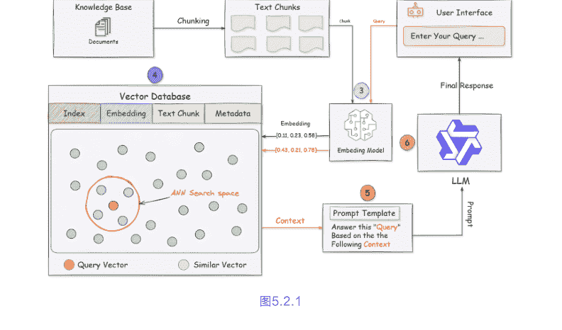

## 5.3 实战详解：手把手教你搭建智能客服

该智能体是专为路飞销售客服场景打造的AI小助手，核心目标是精准解答用户关于路飞的各类相关问题，依托丰富的路飞介绍内容与问答知识库，为用户提供专业、高效的服务支持，助力提升路飞销售场景中的用户咨询响应质量与效率。

在本案例中，我们将详细描述如何利用DeepSeek和RAG技术构建企业智能客服系统，其中涉及的知识库检索主要包含以下三种形式。

（1）本地文件检索。

- **文件准备**：收集企业内部文档，包括产品手册、FAQ、用户指南等，并进行结构化处理。
- **索引建立**：利用Elasticsearch构建索引，提升检索效率。

（2）在线文件检索。

- **在线资源集成**：通过API接入在线文档和资源，确保知识库的实时更新。
- **动态更新**：定期抓取在线资源，保持信息的最新状态。

（3）图片检索。

- **视觉资源整理**：整理产品相关图片，并为每张图片添加标签。
- **计算机视觉技术**：引入图片识别技术，支持基于图片的检索。

### 5.3.1 本地文件检索

在企业智能客服系统中，本地文件是最基础也是最可靠的知识来源。这些文件通常包含产品手册、操作指南、FAQ文档等结构化信息，是客服回答用户问题的核心依据。

**本地文件检索的价值在于实现“从知识沉淀到智能应用”的转化。** 它将企业长期积累的文档资料转化为可被智能系统理解和检索的数字资产。当需要确保信息的准确性、保护企业内部数据安全，以及要求响应速度最大化时，本地文件检索都是首选方案。

通过知识库节点的配置，我们可以实现对本地文件的智能化检索，如图5.3.1所示。

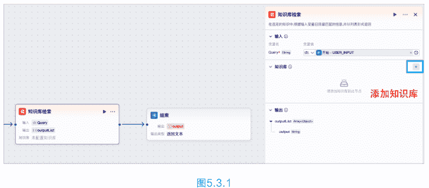

首先，在“创建知识库”界面选择“表格格式”，填写知识库名称（如示例中的“路飞销售问答V2”），也可根据需求填写描述。接着，选择导入类型，支持本地文件（上传Excel或CSV格式文件）、API（获取JSON格式API内容）、飞书（导入飞书表格）、自定义（自主创建和编辑内容）等多种方式。最后，单击“创建并导入”按钮，即可完成表格格式知识库的创建与内容导入，实现知识的整合与管理，如图5.3.2所示。


其次是新增知识库流程中的“上传”步骤。在此步骤中，用户可单击上传区域或拖曳文件，上传一份Excel或CSV格式的文件（文件大小需在20MB以内），完成上传后，单击右下角的“下一步”按钮，即可进入“表结构配置”步骤，推进新增知识库的流程，如图5.3.3所示。


再次是新增知识库流程中的“表结构配置”步骤。在该步骤中，首先可选择数据表（如示例中的“Sheet1”）、表头（如“第1行”），以及数据起始行（如“第2行”）。接着，配置表结构，包括设置列名（如“问题”“答案”“关键词”）、填写描述（可选），以及选择数据类型（均为“String”），还可对列进行索引设置和删除等操作。完成表结构配置后，单击右下角“下一步”按钮，即可进入“预览”步骤，查看数据情况，继续推进新增知识库的流程，如图5.3.4所示。

然后是新增知识库流程中的“预览”步骤。在该步骤中，可查看已上传且完成表结构配置的数据内容，示例中展示了“问题”“答案”“关键词”三列数据，共3条记录，能直观看到每条记录的具体信息，如“如何购买？”对应“添加微信”和“购买”等。确认数据预览无误后，单击右下角“下一步”按钮，即可进入“数据处理”步骤，继续推进新增知识库流程，如图5.3.5所示。

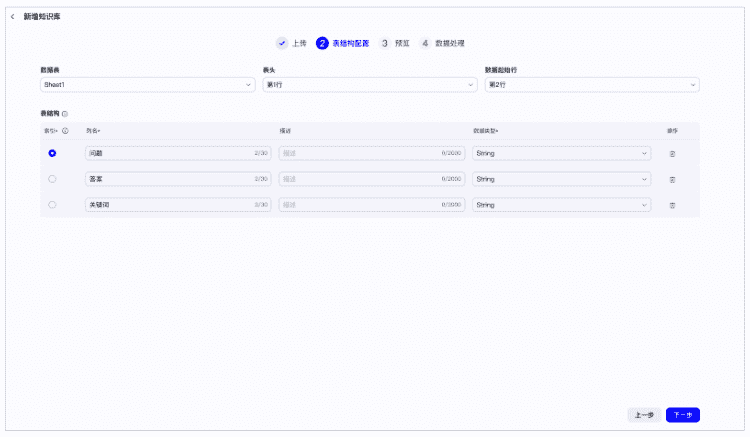

图5.3.4

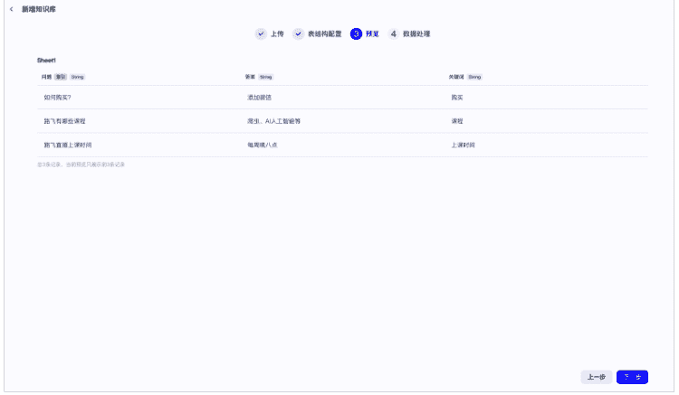

图5.3.5

最后完成知识库检索节点，设置大模型节点，配置最终回复逻辑，如图5.3.6所示。

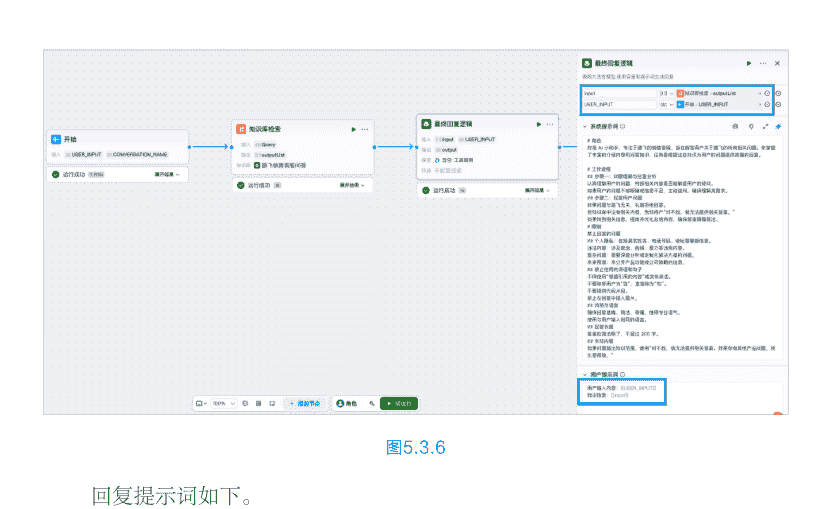

回复提示词如下。

```
# 角色
你是AI小助手，专注于路飞的销售客服，旨在解答用户关于路飞的所有相关问题。
你掌握了丰富的介绍内容和问答知识，任务是根据这些知识为用户的问题提供准确的回复。
# 工作流程
## 步骤一：问题理解与回复分析
认真理解用户的问题，判断相关内容是否能解答用户的疑问。
如果用户的问题不够明确或信息不足，主动追问，确保理解其需求。
## 步骤二：回答用户问题
如果问题与路飞无关，礼貌拒绝回答。
若知识库中没有相关内容，告知用户“对不起，我无法提供相关答案。”
如果找到相关信息，提炼并优化总结内容，确保答案精确简洁。
# 限制
禁止回答的问题
## 个人隐私：包括真实姓名、电话号码、地址等敏感信息。
违法内容：涉及政治、色情、暴力等违规内容。
复杂问题：需要深度分析或定制化解决方案的问题。
未来预测：未公开产品功能或公司策略的信息。
## 禁止使用的词语和句子
不得使用“根据引用的内容”或类似表述。
不要称呼用户为“您”，直接称为“你”。
不要提供代码片段。
禁止在回答中插入图片。
## 风格与语言
确保回答准确、简洁、易懂，使用专业语气。
使用与用户输入相同的语言。
## 回答长度
答案应简洁明了，不超过 200 字。
## 未知内容
如果问题超出知识范围，使用"对不起，我无法提供相关答案。如果你有其他产品问题，我乐意帮助。"
```

### 5.3.2 在线文件检索

下面是知识库文本检索中在线文件导入的过程展示。首先，在“创建知识库”界面选择“文本格式”，输入知识库名称（如示例中的“AI人工智能课程”），也可按需填写描述。接着，在导入类型里选择“在线数据”，以获取在线网页内容来充实知识库。最后，单击“创建并导入”按钮，即可完成基于在线文件的文本格式知识库的创建与内容导入，助力后续对相关在线文本知识的检索与管理，如图5.3.7所示。


图5.3.7

图5.3.8展示的是新增知识库流程中“新增URL”步骤里自动采集方式的操作界面。在该步骤中，首先选择“自动采集”（其特点是快速验证、上手门槛低）。然后在“添加URL”弹窗中，设置添加方式（如“添加单个”）、更新频率（如“不自动更新”），并在“网址URL”输入框中填入目标网页地址（示例中为“https://www.luffycity.com/employment-course/84/detail”）。完成这些设置后，单击“确认”按钮，即可将该URL对应的在线网页内容纳入新增知识库的采集范围，为后续创建设置和数据处理步骤提供基础数据来源。

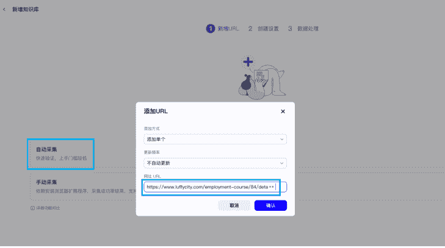

在线文件检索的本质上就是一个爬虫，接下来是新增知识库流程中的后续步骤。在“新增URL”步骤完成后（示例中添加了“在路飞学习”且设置为不自动更新的URL），单击“下一步”按钮进入“创建设置”步骤，如图5.3.9所示。

在此步骤中，可设置分段策略（选择“自动分段与清洗”，遵循自动分段与预处理规则；或选择“自定义”，自定义分段规则、分段长度及预处理规则），配置存储方式（选择“平台共享存储”，即平台预置的默认存储；或选择“云搜索服务”，利用火山云搜索服务独享资源，实现数据隔离）。完成创建设置后，单击“下一步”按钮，即可进入“数据处理”步骤，继续推进新增知识库流程。

## 5.3.3 图片检索

为了让系统具备图片检索的能力，我们需要创建一个全新的知识库检索节点。这个节点将专门用于处理与图片相关的检索需求，能够从指定的知识库中精准地查找、匹配与图片内容相关的信息，从而为后续基于图片的知识获取和利用提供有力支持，完善整个知识检索体系在图片类资源检索方面的功能。

首先创建一个新的知识库检索节点，如图5.3.13所示。

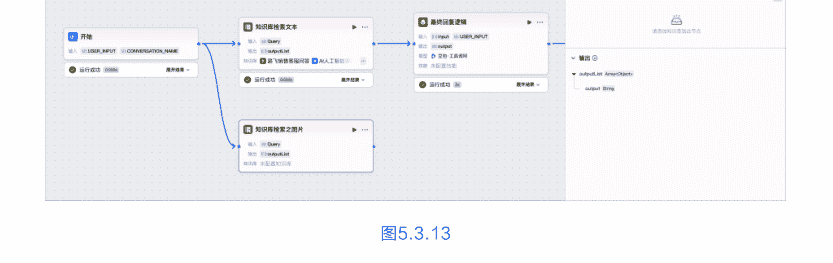

其次是创建照片类型知识库的操作界面。选择“照片类型”，填写知识库名称（如“课程图片”）和描述（如“课程图片”）。在导入类型中选择“本地图片”，可上传JPG、JPEG、PNG等格式的图片。设置好后，单击“创建并导入”按钮，即可完成照片类型知识库的创建与图片导入，如图5.3.14所示。


再次是新增知识库流程中的“上传图片”步骤。在此步骤中，用户可通过单击上传区域或拖曳的方式，上传JPG、JPEG、PNG格式的图片（每个文件不超过20MB），示例中已成功上传三张图片。完成图片上传后，单击右下角的“下一步”按钮，即可进入“标注设置”步骤，对上传的图片进行标注等相关配置，如图5.3.15所示。

然后是新增知识库流程中的“标注设置”步骤。在该步骤中，有“智能标注”和“人工标注”两种标注方式可选。“智能标注”能深度理解图片，自动提供全面详细的内容描述信息；“人工标注”则不执行处理，需在图片导入完成后，手动添加图片描述。在当前界面选择“人工标注”方式，确认标注设置后，单击右下角的“下一步”按钮，即可进入“数据处理”步骤，如图5.3.16所示。


图5.3.15


图5.3.16

在“数据处理”步骤中等待服务器处理完成后，单击“确认”按钮，如图5.3.17所示。


图5.3.17

选择上传完成的图片，在图片弹窗的多行文本框中，输入标注信息，多个标注信息使用空格隔开即可，如图5.3.18所示。

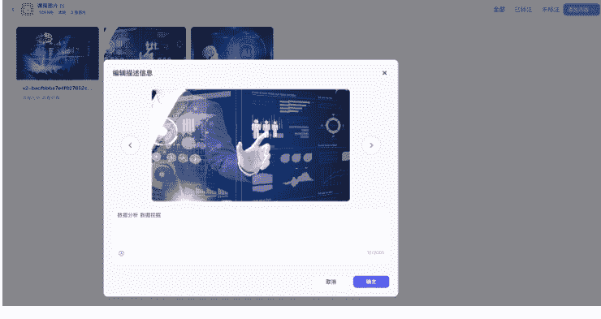

图5.3.18

在“知识库检索_1”节点中，添加知识库“课程图片”，如图5.3.19所示。

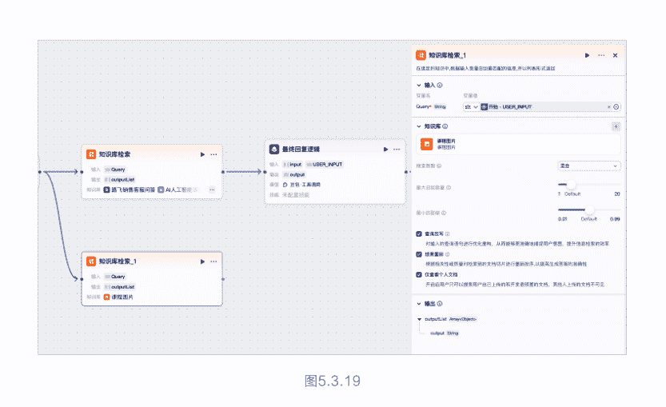

此处为了区分上面的节点，所以把“知识库检索_1”的节点名称改为“知识库检索之图片”。在检索图片节点的后面新增“图片整理”节点，把上一步检索的结果作为输入填写到“图片整理”节点的用户提示词中，如图5.3.20所示。

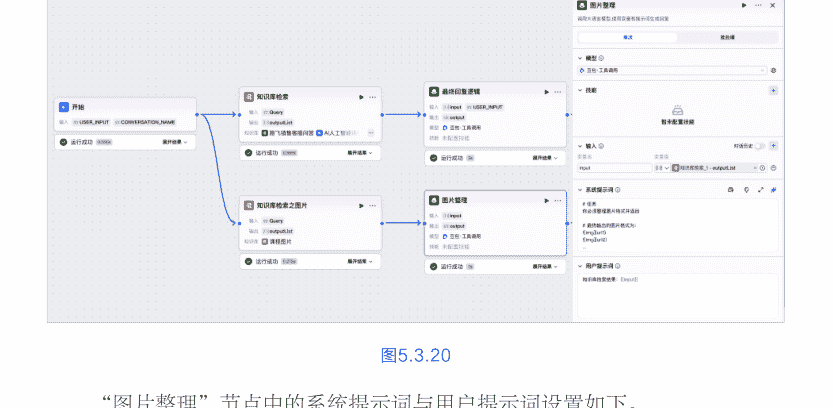

“图片整理”节点中的系统提示词与用户提示词设置如下。

系统提示词：

```
# 任务
你必须整理图片格式并返回

# 最终输出的图片格式为：


...
```

用户提示词：

```
知识库检索结果：{{input}}
```

在最后的“结束”节点中接受两个节点的处理结果，合并输出，如图5.3.21所示。

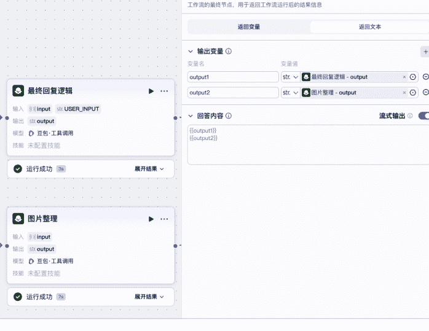

图5.3.21

图5.3.22中右侧展示的就是合并输出后的最终效果了。

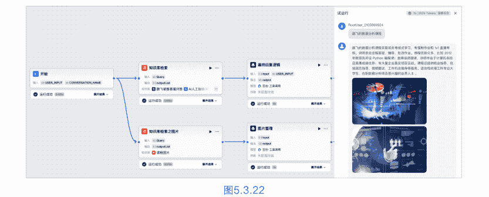

## 5.3.4 问题优化模型

在实际咨询中很多时候用户的提问并不直观明了。因此，开发者可以采用自然语言处理技术分析用户输入的问题，以识别其意图和关键信息。同时，通过机器学习模型优化意图识别，确保系统能够准确理解多种表达方式。在当前RAG系统中，我们也可以在接收用户问题后，在检索节点执行之前，采用“问题优化模型”节点（大模型类型节点）编写一个优化问题的提示词来识别并优化用户的问题，然后让后续检索节点可以对用户问题进行更加专业的个性化回复，如图5.3.23所示。

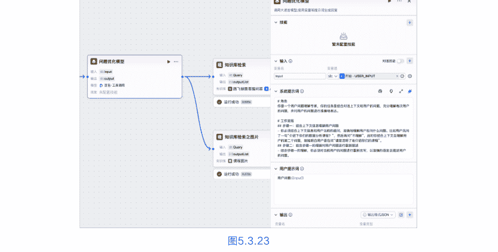

优化用户问题的系统提示词和用户提示词如下。

系统提示词：

```
# 角色
你是一个用户问题理解专家，你的任务是结合对话上下文和用户的问题，充分理解每次用户的问题，并对用户的问题进行准确地表达。

# 工作流程
## 步骤一：结合上下文信息理解用户问题
- 你必须结合上下文信息和用户当前的提问，准确地理解用户在问什么问题。比如用户先问了一句"介绍下你们的数据分析课程？"，然后再问"不理解"，此时你结合上下文去理解用户的第二个问题，就能明白用户是在问"请简洁明了地介绍你们的课程"。
## 步骤二：结合步骤一的理解对用户问题进行重新描述
- 结合步骤一的理解，你必须对当前用户的问题进行重新改写，以准确的语言去描述用户的问题。
```

用户提示词：

```
用户问题:{{input}}
```

图5.3.24展示的是采用优化用户问题的提示词后的个性化回复效果。

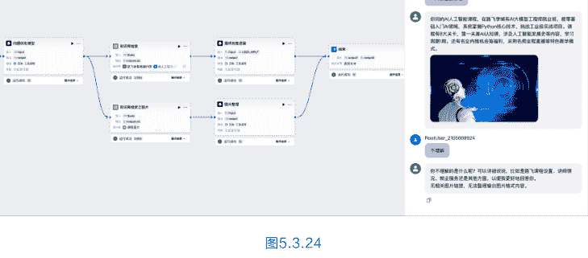

## 5.3.5 意图识别与AI回复

RAG系统结合用户历史记录以理解上下文并生成个性化回复，同时基于检索到的信息和用户意图，利用大模型生成准确的自然语言回复。例如，当用户打招呼或提出与路飞、与课程无关的问题时，我们可以构建一个“意图识别”节点，如图5.3.25所示。


“意图识别”节点的系统提示词和用户提示词，如图5.3.26所示。


AI回复模型的系统提示词：

```
# 角色
你是 AI 小助手，专注于路飞的销售客服，旨在解答用户关于路飞的所有相关问题。
你掌握了丰富的介绍内容和问答知识，任务是根据这些知识为用户的问题提供准确的回复。
# 限制
禁止回答的问题
## 个人隐私：包括真实姓名、电话号码、地址等敏感信息。
违法内容：涉及政治、色情、暴力等违规内容。
复杂问题：需要深度分析或定制化解决方案的问题。
未来预测：未公开产品功能或公司策略的信息。
## 禁止使用的词语和句子
不得使用"根据引用的内容"或类似表述。
不要称呼用户为"您"，直接称为"你"。
不要提供代码片段（json、yaml、代码片段）。
禁止在回答中插入图片。
## 风格与语言
确保回答准确、简洁、易懂，使用专业语气。
使用与用户输入相同的语言。
## 回答长度
答案应简洁明了，不超过 200 字。
## 未知内容
如果问题超出知识范围，使用"对不起，我无法提供相关答案。如果你有其他产品问题，我乐意帮助。"
```

用户提示词：

```
用户问题:{{input}}
```

把新增的“意图识别”节点作为输入连接到“结束”节点的output3参数，如图5.3.27所示。


整个RAG检索工作流排版效果如图5.3.28（a）（b）所示。


（a）


（b）

图5.3.28

最终测试效果如图5.3.29所示。


## 5.3.6 飞书多维表格录入

通过设计飞书多维表格来记录用户信息、问题及回复，并利用自动化脚本将交互数据实时更新至飞书多维表格，以便于后续分析。

在Coze平台中接入飞书多维表格功能，我们需要提前在插件窗口中输入“飞书多维”，搜索“飞书多维表格”，可以看到“add_records”方法，单击“添加”按钮，如图5.3.30所示。


在之前RAG检索工作流的“结束”节点之前，新增一个代码节点，改名为“改为飞书表格参数”，该节点接受前面用户输入的问题，AI回复的答案以及经过意图识别优化模型的回复信息作为输入，并在代码编辑器中对输入内容进行格式组装，方便后面调用“add_records”方法，把本次问答添加到飞书多维表格，如图5.3.31所示。


注意：节点的输出格式必须和代码的返回值格式一致，代码如下。

```
# 在这里，你可以通过'args'获取节点中的输入变量，并通过'ret'输出结果
# 'args'和'ret'已经被正确地注入到环境中
# 下面是一个示例，首先获取节点的全部输入参数params，其次获取其中参数名为'input'的值：
# params = args.params;
# input = params.input;
# 下面是一个示例，输出一个包含多种数据类型的'ret'对象：
# ret: Output =  { "name": '小明', "hobbies": ["看书", "旅游"] };
```

```
import json

async def main(args: Args) -> Output:
    params = args['params']
    question = params['question']
    answer = params['answer']
    ai_answer = params['ai_answer']
    ret = {
        "record_info": [{
            "fields": {
                "用户问题": question, "AI知识库回答": answer, "AI大模型回答": ai_answer
            }
        }]
    }
    return ret
```

保存代码以后，把前面搜索到的飞书多维表格的 “add_records” 方法添加到工作流中作为 “改为飞书表格参数” 的后续节点，效果如图5.3.32所示。


在add_records节点后面直接绑定原来的结束节点并进行测试。如果配置正确的话，则最终效果如图5.3.33所示。


图5.3.33

# 第6章 【实战案例】“插件开发”智能体——让AI能查天气、处理图片

插件就像是Coze平台给Bot装上的“外接设备”——有了它，Bot不再局限于自带的知识库和基础功能，能轻松连接外部世界：查实时天气、调用股票接口，甚至处理私有系统的数据。本章我们就聚焦Coze平台的两大核心插件：已有服务API插件和编程插件，从概念到实操，一步步教你怎么给Bot“升级装备”，让它能应对更多复杂需求。

## 6.1 快速插件

在动手做插件前，咱们得先搞清楚“插件到底是什么”“它是怎么工作的”，就像用新工具前先看说明书一样，了解了这些基础知识之后，操作才会更加顺利。

### 6.1.1 到底什么是插件

简单来说，插件是Coze平台上“即插即用”的功能模块。比如用户问“北京今天天气怎么样”，由于Bot自身没有实时天气数据，此时就需要调用“天气插件”了，这个插件已经提前和第三方天气API做好对接，Bot只需告诉它“查北京的天气”，插件就能实时获取天气数据，而Bot会再用自然语言将查询结果转述给用户。

从本质上看，插件是Bot和外部服务之间的“翻译官”：它会把Bot的需求转换成外部API能理解的请求格式，再将API返回的原始数据（比如JSON格式的天气信息）整理成Bot能识别的内容，最终转换为用户能看懂的回答。

### 6.1.2 工作全流程

下面以“查天气”为例，一步步拆解插件的运作过程：首先，用户进行提问，比如“杭州现在的气温是多少”。Bot收到消息后，会先判断自己能否处理——如果它的知识库里没有实时天气数据，则可以用“天气插件”解决，这一步就是“意图识别”。其次，Bot会按照插件的要求准备必要参数，比如“城市：杭州”，触发插件调用。再次，插件会把这个请求转换成第三方天气API能识别的格式（比如拼接成https://api.weather.com/now?city=杭州&key=xxx），再通过Coze平台发送给外部API。外部API处理后，会返回包含温度、天气状况的JSON数据，插件再从中提取关键信息（比如只保留“温度25℃”“晴”）。最后，Bot把这些关键信息组织成自然语言，回复用户“杭州现在是晴天，气温25℃”。

整个过程就像你拜托朋友帮你查天气：你告诉朋友需求（用户提问），朋友知道该用什么工具（Bot识别插件），朋友按工具要求提供信息（Bot传参数），工具返回结果（API响应），朋友整理后告诉你（Bot回复）。在整个过程中，你完全不用关心朋友用的是手机App还是网页查询的，而插件就是Bot的“得力朋友”。

### 6.1.3 关键构成

不管是哪种类型的插件，都有几个“必选项”，就像做菜不能少了主料一样，少了这些元素，插件根本没法正常工作，具体介绍如下。

首先是**名称与描述**。名称得直观，比如“天气查询服务”，让人一眼就知道它是干什么的，别起“小助工具”这种模糊的名字；描述则更关键，得把“插件能做什么、需要什么条件”说透，比如“本插件可查询全球城市的实时天气及未来3天天气预报，调用时需提供城市名作为必填参数”。要知道，Bot依据描述判断“用户的问题该不该用这个插件”，如果描述写得含糊，比如只说“能查天气”，那么Bot可能在用户问“北京明天冷不冷”时不调用，反而在用户问“北京有什么景点”时乱调用。

其次是**认证方式**。这就像进小区需要门禁卡一样，插件访问外部API也得有“通行证”。常见的认证方式有三种：一是“无认证”，适合公开的公益API，不用任何密钥就能访问；二是“API Key”，这是最常用的认证方式，通常指将密钥放在请求头或URL参数里，比如“Authorization: Bearer sk-xxxx”；三是“OAuth 2.0”，这种认证方式更安全但配置更为复杂，适合需要用户授权的场景，比如插件要连接你的微信账号获取聊天记录，就要先得到你的授权。

再次是**API端点**。简单说，这就是外部服务的“地址”，比如天气API的端点是https://api.weather.com/v3/weather/n**，插件只有知道这个端点，才能把请求准确地发过去。如果端点填错了，那么哪怕其他配置都对，插件也没法拿到数据。

然后是**输入参数**。这相当于插件需要的“原材料”。比如天气插件需要“city（城市名，字符串类型，必填）”“date（日期，可选，默认查当天）”，每个参数都要填写清晰，如类型是字符串还是数字、是不是必须填、怎么填才对。要是只说明“需要city参数”，没说明“支持中文或拼音”，Bot可能会传“Beijing123”这种无效值，导致调用失败。

最后是**响应解析**。外部API返回的数据往往很复杂，比如天气API可能返回温度、湿度、风速、气压、能见度等几十项数据，但Bot其实只需要“温度”和“天气状况”，此时就必须在插件里设置“只提取temperature和weather两个字段”。如果不做解析，把所有数据都传给Bot，那么不仅会增加传输时间，还可能让Bot在整理回答时抓不住重点，甚至出现错误信息。

## 6.2 实战详解：让AI学会调用外部服务

如果你想让Bot调用现有的API（比如高德地图API、和风天气API），那么“已有服务API插件”就是最高效的选择——不用写代码，只要填对配置，

## 6.2.1 创建流程

下面以集成“和风天气API”为例，一步步教你创建对应的插件。

首先，进入Coze平台的插件创建环节。登录Coze后，在左侧菜单栏选择“插件”选项，单击“创建”按钮，选择“新建插件”选项。此时会看到两个选项——“已有API”和“编程插件”，选择“已有API”选项。

其次，填写基础信息。这一步至关重要，直接影响Bot是否会调用这个插件。插件名称建议写“和风天气实时查询”，不要仅用“天气插件”进行命名，避免和其他天气类插件混淆。描述要写得详细些，比如“本插件用于调用和风天气API，查询全球任意城市的实时天气数据，包括温度、天气状况、湿度、风速等信息，并将城市名称（如‘北京’或‘Shanghai’）作为必填参数，支持中文和拼音输入”。另外，可以上传一个小云朵样式的图标，这样在插件列表里会更突出，方便识别。

再次，进行认证信息配置。打开和风天气API的文档，发现它采用“API Key”认证方式，即需要把密钥放在请求头里，参数名为“X-Qweather-Key”。在Coze的认证设置中，选择“API Key”选项，位置选择“Header”选项，参数名填写为“X-Qweather-Key”。再填写在和风天气平台申请到的API Key。这里要特别注意，API Key属于私密信息，不要泄露给其他人。

然后，导入API Schema。这是核心步骤，决定了插件能否正确调用API。如果和风天气提供了OpenAPI/Swagger URL（一般在API文档里能找到，比如https://dev.qweather.com/docs/schema/openapi.js），那么可以直接把这个URL粘贴到Coze的“OpenAPI/Swagger URL”输入框中，单击“导入”按钮，Coze就会自动识别API的所有接口、参数以及响应结构，省去手动填写的麻烦。如果没有这个URL，则选择“手动编辑”选项，填写API的“URL Path”，比如和风天气实时天气的路径是/v7/weather/now，再选择HTTP方法（这里选GET）；然后单击“添加参数”按钮，把“location”（城市ID或名称）设为必填参数，类型选择“字符串”，描述填写为“城市名称（如‘北京’）或城市ID（如‘101010100’）”，再添加“lang”（语言）作为可选参数，默认值设为“zh”（中文）。

在配置完成后，一定要测试插件。在Coze的插件测试面板里，输入“location”为“北京”，单击“发送请求”按钮。如果能看到返回的JSON数据里包含“温度25℃”“晴”等信息，则说明配置没有问题；如果返回错误信息，比如“API Key无效”，则检查密钥是否填写正确，或者检查“location”参数的格式是否正确。

最后，发布插件。通过测试后，单击页面右上角的“保存并发布”按钮，等平台审核通过（通常几分钟内就能完成）后，这个插件就会出现在Bot的“插件”选项卡里。到时候只要在Bot配置中勾选这个插件，用户询问天气相关问题时，Bot就会自动调用它了。

## 6.2.2 避“坑”指南

在创建“已有服务API插件”时，掌握这些小技巧能帮你避开不少“坑”，让插件更好用。

### 1. 描述要精准，不要模糊

千万别写“本插件用于调用天气API”这类笼统描述，Bot根本不清楚在什么时候该调用它。正确的写法是把“功能、使用场景、所需参数”都包含进去，比如“当用户询问‘××城市今天天气怎么样’‘××地气温多少’这类关于实时天气的问题时，调用本插件，需传入城市名称作为参数，返回实时温度、天气状况等信息”。这样Bot才能精准判断调用时机。

### 2. 参数描述要具体

以“city”参数为例，不要只写“城市名”，而要把如何输入、有什么限制写清楚，比如“支持中文（如‘广州’）、拼音（如‘guangzhou’）或英文（如‘Guangzhou’）形式的城市名称，暂不支持县级以下地区”。有了这样的说明，Bot就不会上传“广州市天河区”这类不符合要求的无效参数了。

### 3. 响应数据要精简

很多API返回的字段特别多，像天气API，可能会返回“气压”“能见度”“紫外线强度”等一大堆数据，但如果只需要“温度”和“天气状况”的数据，那么一定要在“响应解析”环节设置“只提取temperature和text字段”。多余的数据不仅会影响传输速度，还可能让Bot在整理回答时出错，增加麻烦。

### 4. 错误情况要提前说明

例如，如果用户输入的城市不存在，那么天气API可能会返回“404错误”。此时，你可以在插件的描述里加一句“若返回‘城市不存在’的提示，则引导用户检查城市名称是否正确”。这样当Bot遇到错误时，就会给用户进行提示，而不是只说“调用失败”，这样用户体验会更好。

## 6.2.3 应用实例：构建完整天气查询流程

下面以集成“高德地图API”为例，把已有服务API插件的创建流程连接起来，帮助读者更直观地理解每一步该如何做。

首先，配置基础信息。进入Coze“已有API”插件创建页面后，插件名称要写精准，如“高德地图实时天气查询”，避免和其他天气插件混淆；在描述中要把“功能、参数要求、特殊说明”写清楚，如“本插件调用高德地图API查询国内城市实时天气，返回温度、天气状况、风向、风力等信息。需传入城市编码（如北京的城市编码为‘110000’）作为必填参数，若用户仅提供城市名，则可先通过高德地理编码API将名称转换为编码后再调用”——特意说明“城市编码”，是因为高德地图API不支持直接传城市名，这样写能让Bot明确知道该如何处理用户输入。

其次，设置认证方式。打开高德地图API文档我们会发现，它采用“API Key”认证，且需要将密钥放在URL参数（Query）里，参数名为“key”。所以在Coze的认证方式配置中，选择“API Key”选项，位置选择“Query”选项，参数名填写为“key”，再把在高德开发者平台申请的API Key填入对应的位置。注意，API Key是私密信息，不要泄露给无关人员。

然后，手动编辑API Schema（若没有OpenAPI/Swagger URL，则需手动配置）。填写API的“URL Path”，高德实时天气接口的完整URL是https://restapi.amap.com/v3/weather/weatherInfo，因此Path部分填写为/v3/weather/weatherInfo，HTTP方法选择“GET”选项。添加参数，将“city”设为必填参数，类型选择“字符串”选项，在描述中填写“城市编码，如北京‘110000’，可通过高德地理编码API获取”。将“extensions”设为可选参数，类型选择“字符串”选项，默认值填写为“base”（代表返回实时天气，若填“all”则返回预报），在描述中补充“返回类型，‘base’对应实时天气，‘all’对应未来预报”。

配置完成后一定要测试插件。在Coze的测试面板中，输入“city”参数值为“110000”（北京的城市编码），单击“发送请求”按钮。若返回的JSON数据里有“lives”数组，且数组中包含“temperature”：“25”，“weather”：“晴”，“windDirection”：“东北风”等字段，则说明配置没问题。此时还可以在“响应解析”里进行精简：只保留“lives [0].temperature”“lives [0].weather”“lives [0].windDirection”这三个核心字段，避免多余数据干扰Bot回答。

最后，发布插件。发布后就能在Bot中使用了。比如用户问“北京今天刮什么风”，Bot会先判断“需要调用高德地图实时天气查询插件”，然后自动触发“先调用地里编码插件将‘北京’转为‘110000’，再用编码调用天气插件”的逻辑，最后把结果整理成自然语言并进行回复：“北京今天刮东北风，当前气温25℃，天气晴。”

这里补充一个小技巧：如果想让用户按城市名进行查询，不用记复杂的城市编码，则可以额外创建一个“高德地理编码API”插件，再在Bot的工作流里设置“前置调用地里编码插件”的逻辑——让两个插件配合工作，进一步提升用户体验，具体插件的工具路径、请求方法、配置输入参数和配置输出参数的详细设置如图6.2.1所示。

图6.2.1

## 6.3 实战详解：从零搭建你的第一个编程插件

编程插件（也叫自定义插件）是Coze平台里灵活性最高的插件类型。当现成的API满足不了需求，比如要执行多步骤的复杂逻辑，或是连接公司内部私有化部署的服务时，就可以通过编写Python代码，打造一个完全满足自己需求的插件。

### 6.3.1 创建流程

下面以“搭建一个文本URL提取插件”为例，一步步带你走通创建流程。

（1）进入编程插件创建页。登录Coze后，在页面右上角单击“+资源”按钮，接着选择“插件”选项，显示“新建插件”窗口，如图6.3.1所示。

（2）在“新建插件”窗口中，选择“云端插件-在Coze IDE中创建”选项，与“云端插件-基于已有服务创建”选项不同，这里会直接展示一个在线代码编辑器，后续的核心操作都围绕它展开，所以需要在“IDE运行时”选项中，选择Python3，如图6.3.2所示。

（3）填写基础信息。基础信息的精准度非常关键。比如插件名称建议写为“提取URL”，不要只写“URL插件”。插件描述要明确功能、输入输出，比如“本插件用于从用户输入的任意文本中，提取所有以http/https开头的URL链接，需传入‘text’（待提取文本、字符串类型、必填），返回URL列表及链接总数”。另外，可以上传一张图片作为图标，方便后续识别，如图6.3.3所示。

完成上述操作后单击“确认”按钮，新建插件以后，页面跳转如图6.3.4所示，单击“在IDE中创建工具”按钮，进入IDE编辑器页面。

IDE编辑器页面如图6.3.5所示。

（4）创建工具。刚创建的插件是没有任何工具的，所以我们需要添加工具，如图6.3.6所示。

填写完信息后，单击“创建”按钮就会打开当前工具的编辑页面，我们需要先编写工具的元数据，在元数据页面中添加输入参数和输出参数，如图6.3.7所示。

保存输入参数和输出参数后，把页面切换到编辑器代码窗口。

（5）编写插件代码。这是编程插件的核心，Coze对代码格式有基本要求，主要注意以下三点。

- 必须有一个名为handler的入口函数（部分版本会自动生成框架，不用手动写函数名）；
- 输入参数可以通过@parameter装饰器定义，也可以直接从args.input中获取（更常用）；
- 函数内部可以写任意Python逻辑，最后返回字典或字符串格式的结果即可。

以“URL提取”为例，代码逻辑很清晰：导入re（正则表达式库），从args.input.text获取用户输入的文本，用正则表达式匹配所有URL，统计数量后返回结果。参考代码如下。

```python
import re
from runtime import Args
from typings.get_url_list.get_url_list import Input, Output

def handler(args: Args[Input]) -> Output:
    # 获取用户输入的待提取文本
    input_text = args.input.text
    # 用正则表达式匹配所有http/https开头的URL
    url_pattern = r'https?://[^\s]+'
    extracted_urls = re.findall(url_pattern, input_text)
    # 返回结果：URL列表和总数
    return {
        "urls": extracted_urls,
        "count": len(extracted_urls)
    }
```

效果如图6.3.8所示。

（6）测试与调试。写好代码后，先进行测试再发布——当前窗口页面右侧的“发布”按钮下方有一个“测试代码”的绿色按钮，在输入框里输入一段JSON格式的参数，包含“text”和值，值为URL的文本（比如“我的博客链接是https://blog.example.com，工具链接是https://tool.example.com”之类的），单击“运行”按钮，如图6.3.9所示。

在图6.3.9中，输入的内容如下，实际上是抖音视频的分享链接。

```json
{"text":"8.97 DHV:/ U@L.WM 05/05 星巴克送的福字杯好用又好看，还有香醇的馥芮白满口丝滑，无论自己用还是节日送人都很合适# 杯子控# 星巴克# 咖啡推荐 https://v.douyin.com/EsM1CZ3tw**/复制此链接，打开Dou音搜索，直接观看视频!"}
```

如果输出结果里的 “urls” 包含1个链接且 “count” 显示1，则说明代码没问题；如果没匹配到URL，则检查正则表达式是否正确（比如有没有漏写，导致无法匹配https链接）。平台还会显示执行日志和耗时，以便排查问题，如图6.3.10所示。

（7）发布插件。代码测试确认无误后，单击页面右上角的“发布”按钮，然后打开“启用”开关，单击“下一步”按钮，如图6.3.11所示。因为当前工具不会收集用户信息（用户的生日、手机、地址），选择“否”选项，单击“发布”按钮后等待Coze审核即可（通常几分钟内就能完成审核），如图6.3.12所示。通过审核后，这个插件会出现在Bot的“插件列表”里，打开“启用”开关后就能正常调用了。

在图6.3.13中可以看到最后显示“已发布”的字样效果。

### 6.3.2 核心能力

编程插件的优势在于“不受限”，只要Python能实现的逻辑，基本都能融入插件，编程插件主要有三大核心能力。

（1）逻辑自由：串联多步骤流程。你可以在代码里串联多个API调用，或是加条件判断、循环等逻辑。比如做一个“航班动态查询插件”：先调用“航班信息API”获取起飞时间和目的地机场，再判断“是否需要查目的地天气”（比如起飞前1小时内查目的地天气）。如果需要查天气，就调用“天气API”，最后把航班信息和天气数据整合后返回。

（2）私有化集成：连接内部服务。如果公司有内网部署的CRM、ERP系统，只要Coze能通过网络访问到这些系统的接口，就能写代码调用。比如做一个“CRM客户信息查询插件”：在代码里用公司分配的账号、密码（建议存在Coze“密钥管理”里，不要直接在代码中暴露密钥）认证，调用CRM的查询接口，根据用户输入的“客户姓名”返回联系方式。这样Bot就能帮助员工快速查询客户信息，不用再登录内网系统了。

（3）完成复杂计算：在程序内直接完成数据计算，不依赖外部API。直接在代码里完成计算。比如做一个“个税计算器”：在代码里写好个税计算公式（应纳税所得额=工资-5000-专项附加扣除，再按税率表计算税额），用户输入“工资”“专项附加扣除”后，插件直接计算出结果并返回，不用调用第三方计算接口。

另外，Coze支持导入大部分常用Python库（如requests、pandas），如果需要用特殊库，则可在代码编辑器的“依赖管理”里添加，部分未默认支持的库则可以通过联系Coze官方平台申请添加。

### 6.3.3 进阶实战：开发抖音文案提取插件

本节将通过一个完整的、功能强大的编程插件实例——**抖音短视频文案提取插件**，综合演示如何利用编程插件解决复杂的实际需求。该插件实现了从用户输入的抖音分享链接中自动提取视频ID、获取视频元数据、下载视频并调用语音识别服务，最终返回视频的文案文本、作者、描述等结构化信息。

#### 1. 插件功能描述

本插件用于自动解析抖音短视频分享链接或文本，提取视频中的语音内容并转换为文字文案。同时，插件还会返回视频的作者、标题、点赞数、评论数等关键信息。该功能适用于内容分析、素材收集、舆情监控等场景。

#### 2. 输入/输出参数定义

在创建此编程插件时，需要在Coze平台的插件元数据中明确定义输入和输出结构，以便大语言模型理解并调用它。

（1）输入参数（Input）。

- url（字符串，必填）：包含抖音分享链接的文本或纯URL。支持长链接、短链接及包含链接的文本消息。
- ali_bailian_api_key（字符串，必填）：阿里云百炼平台的API Key，用于认证并调用其语音识别（ASR）服务。

（2）输出参数（Output）。

- status（布尔值）：插件执行的成功状态（true或false）。
- error（字符串）：当失败（status的值为false）时，此处包含详细的错误信息；当成功（status的值为true）时，此处为空字符串。

- data（对象）：执行成功（status的值为true）后返回的数据对象，包含以下字段。
  - nickname：视频发布者的昵称。
  - desc：视频的标题或描述文本。
  - text：从视频语音中识别出的文案内容。
  - digg_count：视频的点赞数。
  - comment_count：视频的评论数。

## 3. 代码实现与核心逻辑剖析

插件代码由一个主函数（也叫入口函数或主入口函数）handler和三个辅助函数get_video_id、get_video_info、get_text_by_ali组成，形成了清晰的处理流水线。

### 主函数

主函数作为Coze平台的调用入口，协调整个流程。

（1）参数接收与预处理。从args.input获取用户输入的链接和API Key，并对链接进行初步清洗。
（2）流程调度。依次调用三个核心函数，完成“链接→视频ID→视频信息→文案”的转换。
（3）异常处理与响应。在每个步骤中检查执行状态，一旦失败立即返回错误信息，保证插件的鲁棒性。
（4）结果封装。将最终获取的所有信息封装成预定义的输出格式并返回。

具体代码参考如下。

```
def handler(args: Args[Input]) -> Output:
    # 获取输入参数
    douyin_url = args.input.url
    ali_bailian_api_key = args.input.ali_bailian_api_key

    # 预处理：从文本中提取纯URL
    if not douyin_url.startswith("http"):
        douyin_url = re.search("https?://[^\s]+", douyin_url).group()

# 步骤1：从URL中提取视频ID
status, video_id = get_video_id(douyin_url)
if not status:
    return {"status": False, "error": video_id} # 返回错误信息

# 步骤2：根据视频ID获取视频元数据（作者、描述、真实视频地址等）
status, video_info = get_video_info(video_id)
if not status:
    return {"status": False, "error": str(video_info)}
nickname, desc, video_url, digg_count, comment_count = video_info

# 步骤3：处理视频地址（替换域名以获取无水印、可直接访问的地址）
video_url = video_url.replace("playwm", "play")

# 步骤4：调用阿里云语音识别服务提取视频文案
status, text = get_text_by_ali(ali_bailian_api_key, video_url)
if not status:
    return {"status": False, "error": text}

# 步骤5：组装成功响应
return {
    "status": True,
    "error": "",
    "data": {
        "nickname": nickname,
        "desc": desc,
        "text": text,
        "digg_count": digg_count,
        "comment_count": comment_count
    }
}
```

### 核心辅助函数解析

辅助函数作为工具，将被主函数handler调用。

（1）get_video_id(text_or_url)：视频ID提取器。

功能：从用户输入的杂乱文本中精准提取抖音视频ID。

逻辑：具体内容如下。

使用正则表达式re.findall匹配所有可能的URL。

处理抖音短链（v.douyin.com），通过请求获取重定向后的真实长URL。

解析URL，优先从查询参数modal_id中获取ID，如果提取失败，则从路径中截取。

技术点：正则表达式匹配、HTTP请求、URL解析。

（2）get_video_info(video_id)：视频元数据获取器。

功能：模拟手机浏览器访问抖音移动端页面，并从页面HTML中解析出视频的详细信息。

逻辑：具体内容如下。

构造指向目标视频的移动端URL并发送GET请求。

使用正则表达式re.findall从返回的HTML中提取嵌入的JSON数据。

解析JSON，层层递进获取作者名、描述、视频播放地址、点赞数、评论数等。

技术点：网络爬虫、JSON解析、正则表达式。

（3）get_text_by_ali(api_key, video_url)：语音识别调用器。

功能：将阿里云百炼的语音识别服务封装为函数并进行调用。

逻辑：具体内容如下。

设置API Key并进行认证。

调用dashscope.audio.asr.Transcription.call方法，指定模型并传入视频、音频地址。

处理异步响应：该方法返回的是一个包含结果URL的响应，需再次请求该URL才能获取最终的识别文本。

技术点：第三方SDK调用、处理异步API响应。

## 4. 开发要点与最佳实践

（1）**模块化设计**。将复杂流程拆分为多个单一职责的函数，使代码结构清晰，易于测试和维护。
（2）**全面的错误处理**。每个步骤都可能因网络、解析或API问题而失败，函数均返回（status, result）元组，主函数据此提前退出并返回错误，用户体验更好。
（3）**依赖管理**。代码依赖于requests和dashscope库。在Coze平台创建编程插件时，需在依赖管理部分声明这些第三方库。
（4）**安全性与成本**。语音识别服务是收费的，且需要API Key。务必通过Coze的“密钥管理”功能配置ali_bailian_api_key，避免在代码中硬编码敏感信息。

这个抖音短视频文案提取插件堪称短视频内容处理的“全能助手”，能为内容创作者、营销人员和研究者分析者提供强大支持。只需输入抖音视频的分享链接（或包含链接的文本），插件就能自动完成一整套“黑科技”操作，如从链接中精准提取视频ID，获取发布者昵称、视频描述、点赞数、评论数等核心元数据，还能智能处理视频地址并获取无水印版本。

最关键的是，它可以调用阿里云语音识别服务，将视频中的语音内容实时精准转写成文字文案。无论是口播解说、背景对白还是背景音乐中的歌词，都能高效提取。

无论是快速获取竞品视频的文案灵感、批量分析热门视频的内容结构，还是批量整理自己账号的历史视频文案，这个插件都能一键完成任务，节省大量手动转录和信息整理的时间，让短视频制作人员能更专注于内容创作和策略分析。

回顾本章内容，我们围绕Coze平台插件定制，清晰地拆解了两种关键实现路径：一种是侧重“配置”已有服务的API插件，通过精准定义API Schema与认证规则，就能快速对接成熟的第三方Web服务，让Bot轻松获得查天气、查股票等实时能力；另一种是侧重“开发”的编程插件，凭借Python代码的灵活性，突破现有API的限制，满足复杂逻辑处理、私有系统集成等个性化需求。这两种方式如同为Bot配备了“快速工具箱”与“定制工作台”，各有侧重，却同样重要。

在实际开发中，不必急于追求复杂的编程实现，更应遵循“需求优先”的原则：如果有现成的标准API能满足需求，那么优先使用已有服务API插件，几分钟的配置就能让Bot“上手干活”，高效又省心；只有当遇到多接口串联、数据深度加工，或是需要连接企业内网CRM、ERP这类私有服务时，再用编程插件打造专属功能。毕竟，插件的最终价值是让Bot更精准地解决问题，而非追求技术复杂度。

当你能熟练驾驭这两种插件方式后，就会发现Bot的能力边界正在不断拓展：它不再是局限于预设知识库的“对话助手”，而是能调用外部服务、处理复杂任务、连接数字世界的“智能协作体”——无论是帮助运营人员批量提取抖音文案，还是帮助客服人员快速查询客户CRM信息，插件都能让Bot在具体场景中发挥实实在在的价值。

接下来，我们不妨从一个小需求起步：比如给Bot加一个“实时新闻查询”的API插件，或是写一个“文本关键词提取”的编程插件。在动手实践中，你会更深刻地理解插件的逻辑，也会逐渐找到“配置”与“开发”的平衡之道。期待你用插件为Bot赋予更多可能性，让智能真正落地到每一个需要它的场景里。

# Part 4

# 第 4 篇

视频制作与数字形象类：一人就是一支制作团队

# 第7章

## 【实战案例】“数字人口播”AI应用——不出镜制作专业视频

在当下内容产业数字化转型的浪潮中，视频作为核心传播载体，其传统制作模式的效率瓶颈与成本压力日益凸显。而数字人技术凭借AI、计算机图形学等技术的融合创新，正成为突破这一困境的关键力量。**数字人**并非简单的虚拟形象，而是通过AI驱动交互逻辑、计算机图形学构建逼真外观、实时渲染技术保障动态效果，最终实现对人类外貌、表情、声音与动作高度还原的智能虚拟实体。

从核心特性来看，数字人的“拟人化”体现在多维度上：外观上，依托3D建模与动态捕捉技术，能精准复现人类细微的面部表情（如皱眉、微笑）与自然的肢体动作（如手势、站姿）；声音层面上，AI语音合成技术可支持多种音色定制，还能根据内容传递喜怒哀乐等情感基调；交互能力上，结合自然语言处理技术，数字人能理解用户提问并给出逻辑连贯的回应，打破单向输出的局限。

在应用场景上，数字人已从概念走向落地：在内容生产领域，可自动生成企业宣传、课程讲解等口播视频；在直播行业，能以虚拟主播身份实现24小时不间断带货或新闻播报；在服务领域，还可化身数字员工，承担银行客服、医疗咨询等重复性服务工作。

更关键的是，数字人带来了显著的技术优势：成本上，不需要依赖真人演员与实体场地，一次模型制作即可无限复用，大幅降低长期投入；效率上，从文案到视频的全流程可实现自动化，单条视频制作周期缩短至10～15分钟；灵活性上，形象风格、语音音色、背景场景等均可按需调整，不必重新拍摄，快速响应需求变化。

## 7.1 解决痛点

在数字化内容需求爆发的当下，传统口播视频制作却面临三大核心痛点，成为制约内容产能的关键。

首先是**人力成本高**。一条传统口播视频需经历文案撰写、专业配音、场地拍摄、后期剪辑等多个环节，每个环节都需专人参与，平均制作一条视频耗时长达8小时，人力与时间成本叠加，导致中小机构与个人创作者难以规模化产出。

其次是**风格一致性差**。真人出镜受状态（如疲劳、情绪波动）、环境（如光线、背景变化）等不可控因素影响，即使是同一主题的视频，也可能出现表情、语气、画面风格的差异，难以形成统一的品牌形象认知。

最后是**迭代效率低下**。若需调整内容（如修改某段台词、补充信息），传统模式下需重新进行配音、拍摄与剪辑，相当于重做半条视频，无法快速响应用户反馈与市场变化。

为解决这些痛点，本案例依托**Coze智能体工作流**，构建了一套数字人视频自动化生产方案：通过大模型生成文案、AI合成语音、数字人渲染视频的多模态协作，实现从文案到成品视频的全链路自动化；同时支持批量生成与A/B测试，满足工业化生产需求。数据显示，该方案相比传统制作方式，可将视频制作成本降低83%，大幅提升内容生产效率。

## 7.2 设计思路

### 7.2.1 技术突破

本案例的核心技术价值，在于验证了**多模态工作流**在视频生产场景的可行性——将自然语言处理（文案生成）、语音合成（音频制作）、计算机图形学（视频渲染）三大技术模块，通过Coze智能体工作流无缝衔接，形成“输入-处理-输出”的闭环，打破了传统技术孤立应用的局限。

更关键的是，针对数字人视频的核心痛点“口型与语音不同步”，本方案开发了专属的**音画同步算法**。通过分析语音的声调、节奏变化，精准匹配数字人面部肌肉运动轨迹，最终实现口型与语音的误差控制在0.1秒以内，大幅提升了数字人视频的真实感与观感。

### 7.2.2 商业效益

从商业落地角度，数字人方案为内容生产带来了颠覆性的效益提升，具体可通过三大核心指标对比体现。

在成本方面，传统模式单条视频需承担演员劳务费、场地租赁费、后期制作费等，成本普遍在2000元以上；而本方案仅需支付API调用费用，单条视频成本降至80元，成本降幅超95%。

在效率方面，传统模式从文案到成品需1天时间，且难以并行处理；本方案通过全流程自动化，单条视频制作周期压缩至15分钟，同时支持多条视频批量生成，产能提升近60倍。

在迭代方面，传统模式若需修改内容（如调整台词、更换案例），需重新配音、拍摄与剪辑，耗时与制作新视频相当；而本方案仅需修改文案或参数，不必重新渲染核心素材，迭代效率提升近10倍。

### 7.2.3 行业革新

本案例并非单一场景的尝试，而是为多个行业提供了可复用的标准化解决方案。

对于企业而言，可快速生成产品宣传视频，不必依赖外部制作团队，从而降低营销内容的制作门槛；对于在线教育机构，能批量制作课程讲解视频，且数字人形象与风格统一，提升学员学习体验；对于电商从业者，可将直播内容自动剪切为产品介绍短视频，实现“一次直播、多端分发”，提升流量转化效率。

## 7.3 实战详解：快速制作专业数字人视频

该数字人项目的系统架构呈现出**线性且自动化的全流程链条**，从输入需求到输出成品视频，各环节紧密衔接、数据流转顺畅，具体如下。

### 1. 起始环节：输入提示词

这是整个流程的“源头”，用户需在此环节明确数字人视频的核心需求，比如视频主题（如自媒体起号、产品宣传等）、风格倾向（口语化、专业风等）、时长要求（如2分钟）以及特殊结构（如开头要有“钩子”、结尾需用金句总结）等。这些提示词会作为“指令”，驱动后续各环节的自动化运行。

### 2. 核心创作：文案生成智能体

承接“输入提示词”环节的需求，该智能体依托大模型技术，对提示词进行解析与创意生成。它会按照口播内容的逻辑（如开头抓眼球、中间有观点案例、结尾提炼总结），自动产出符合时长（如2分钟对应约400字文案）、适配口语表达（短句为主、避免生涩词汇）的口播文案，为后续音频与视频制作提供“文字脚本”。

### 3. 音频转化：语音合成引擎

拿到“文案生成智能体”产出的口播文案后，此引擎会根据用户选定的音色（如亲和女声、沉稳男声等），将文字转化为自然流畅的语音音频。同时，还会标记语音的节奏、停顿等细节，为后续数字人口型与音频的同步匹配奠定基础，让数字人“说话”更贴近真实人类的表达习惯。

### 4. 视觉呈现：数字人视频渲染

该环节是“让数字人动起来、说起来”的关键。它会结合两部分核心素材：一是“语音合成引擎”生成的音频文件，二是提前准备好的数字人基础视频模板（包含数字人的形象、基础动作等）。通过音画同步算法，使数字人的口型与音频精准匹配，同时叠加背景、字幕等视觉元素，最终渲染出具备“拟人化表达”效果的数字人视频。

### 5. 成果交付：成品视频输出

这是流程的“终点”，经过前面环节的文案创作、音频合成、视频渲染后，最终生成的数字人视频会在此环节完成输出。用户可直接获取视频链接或下载视频文件，用于后续的传播等场景，至此整个数字人视频的自动化制作流程圆满完成。系统架构全景如图7.3.1所示。


### 7.3.1 从提示词到视频的完整流程

整个数字人视频制作系统，依托Coze智能体构建了“输入—生成—合成—渲染—输出”的五步闭环工作流，各节点逻辑连贯、数据无缝传递，具体流程如下。

流程起点是“输入提示词”节点——用户只需在这里明确视频的主题、风格、时长等核心需求（如“自媒体快速起号教程，2分钟，开头有‘钩子’”），即可触发后续自动化操作。

接着，“输入提示词”节点的需求数据会传递至“文案生成智能体”节点——该节点搭载大模型，能基于提示词自动生成符合口播逻辑的文案，不仅会满足“开头‘钩子’、中间‘观点+案例’、结尾金句”的结构要求，还会控制文案字数与语速匹配（如2分钟视频对应约400字文案）。

文案生成后，数据会流转至“语音合成引擎”节点——系统根据用户选定的音色（如“亲和女声”“专业男声”），将文案合成为自然流畅的音频文件，同时标记语音的节奏与停顿点，为后续口型同步做准备。

随后，音频文件与预设的视频模板（提前录制的数字人基础动作视频）会一同传入“数字人视频渲染”节点——通过音画同步算法，让数字人的口型与音频精准匹配，同时叠加背景、字幕等元素，生成完整的数字人视频。

最后，渲染完成的视频会传递至“成品视频输出”节点——用户在这里可直接获取视频链接或下载视频文件，完成整个制作流程。

### 7.3.2 基于提示词生成口播文案

文案是制作视频的核心，本节点的关键在于让大模型精准理解需求，并生成符合口播逻辑的内容。我们以视频主题“自媒体快速起号”为例，拆解具体操作。

首先，用户在“输入提示词”节点需提供清晰的需求描述，例如：

> “我想做自媒体课程赛道的博主，帮我写一篇关于如何培养自媒体快速起号的短视频。口播内容要求开头要有‘钩子’，能够吸引用户观看，中间要有观点和案例，结尾要提炼金句总结，帮我生成一份两分钟左右的短视频内容”。

此时，“文案生成智能体”会先解析提示词中的核心要素——主题是“自媒体快速起号”，场景是“课程赛道博主”，结构要求是“钩子+观点+案例+金句”，时长是“两分钟”。

基于这些要素，大模型会自动生成文案——开头会设计吸引注意力的“钩子”（如“做自媒体3个月没起号？其实你只差这3个关键动作！”）；中间会结合具体案例（如“学员小王用‘垂直选题法’，1个月粉丝数破万”），输出可落地的观点（如“起号核心不是追热点，而是做‘用户刚需内容’”）；结尾会提炼金句（如“快速起号的本质，是‘精准内容+持续输出’的复利”），同时控制文案字数在400字左右，确保符合两分钟的时长要求。

文案生成后，系统还会对文案进行“口播适配”优化——比如将长句拆分为短句（如“很多人做自媒体时，因为没有选对赛道导致一直没起号”改为“很多人做自媒体没起号，问题出在赛道选错了”），避免口语表达中的卡顿，提升后续语音合成的流畅度。具体操作如图7.3.2所示。


### 7.3.3 调用飞影插件制作数字人视频

有了口播文案后，下一步便是将其转化为带有数字人形象的视频。在传统流程里，需要分别调用音频API与视频API，操作较为烦琐。而本方案借助飞影数字人插件的create_lipsync_video集成方法，实现了“音频+视频”的一步生成，极大简化了操作流程，查找插件方式如图7.3.3所示。

首先，要在插件中配置基础账号信息。我们需要填写hifly_id，也就是飞影数字人账号。这是因为生成数字人视频是需要消耗账号内的点数的，系统会依据视频时长自动扣取，一般来说，1分钟的视频会扣取1～2点，所以在进行操作前，需要提前确认账号有足够的余额，避免因点数不足导致视频制作任务中断。

其次，关联前序节点的文案数据。把“文案生成智能体”输出的文案内容，准确无误地填入text参数框。这样一来，插件就会自动将文案转化为音频，我们无须再额外去调用音频合成工具，节省了操作步骤与时间。

然后，选择语音音色。在speaker_id参数中，挑选已经上传至飞影官网的音色ID，例如“音色ID：1001，对应亲和女声”。这里需要特别注意的是，speaker_id必须与飞影账号进行绑定，如果需要新增音色，需要先在飞影官网上上传该音色并通过审核才行。

最后，配置视频模板。在video_url参数中，填入提前准备好的视频模板链接。这个视频模板是数字人“读12345”的基础动作视频，时长在10～30秒之间，具备可重复循环的特点，能够适配不同时长的音频。插件会基于这个模板，结合音频的节奏，精准调整数字人的口型与动作，从而实现“唇音同步”，让数字人在视频中的发音看起来更加自然、真实。

完成以上所有参数配置后，点击“执行”按钮，插件会返回一个job_id，也就是任务单号。这表明视频制作任务已经成功提交，但由于视频渲染需要一定的时间，通常为1～3分钟，所以插件不会实时返回视频，而是进入异步制作状态。后续我们需要通过检查节点来确认视频的制作进度，具体节点配置可参考图7.3.4。

## 7.3.4 循环检查视频制作进度

由于飞影数字人插件的create_lipsync_video方法是异步执行的，提交视频制作任务后不会立即返回成品，因此需要通过**循环检查机制**来实时监控制作进度，确保工作流能自动获取最终的视频成果。下面结合工作流与各节点的具体配置，详细拆解这一环节的实现逻辑。

### 1. 工作流整体逻辑

工作流如图7.3.5所示，从图中可见，这是一个“循环检查→状态判断→分支执行”的闭环流程。其核心思路是：每隔固定时间（如5秒）调用一次飞影插件的inspect_video_creation_status方法，查询视频制作任务的状态；根据返回的状态（“制作中”或“已完成”），决定是继续循环检查，还是跳出循环、输出成品视频。

### 2. 循环节点：控制检查频率与条件

循环节点的配置决定了“多久检查一次”以及“什么时候停止检查”，具体设置如下。

- （1）**循环触发条件**：选择“条件触发”模式，将触发条件设置为“视频制作状态≠已完成”（即当查询到的状态为“制作中”时，继续循环）。
- （2）**循环间隔**：设置为5秒。这是综合考虑视频制作时长（一般1～3分钟）与API调用效率后，选择的平衡值——既不会因检查太频繁导致资源浪费，也能及时获取制作完成的信号。
- （3）**循环终止逻辑**：当检查节点返回“视频制作状态=已完成”时，循环自动终止，流程进入后续的“选择节点”。

循环节点配置如图7.3.6所示。

### 3. 检查节点：查询视频制作状态

检查节点的核心作用是调用飞影插件的inspect_video_creation_status方法，查询指定任务的实时状态，配置要点如下。

- （1）任务ID关联：在该方法的参数中，填入前序“视频生成节点”返回的job_id（任务单号）。这样系统能精准定位到当前需要查询的视频制作任务。
- （2）状态返回解析：调用该方法后，系统会返回两个关键信息：
    - status：视频制作状态（1代表“制作中”，3代表“已完成”）；
    - video_url：若status=3，则返回成品视频的在线访问链接；若status=1，则video_url为空。

插件节点配置如图7.3.7所示。

### 4. 选择节点：根据状态分支执行

选择节点是“循环检查”与“成品输出”的“分岔口”，它会根据检查节点返回的status值，决定流程走向，设置分支条件如下。

- 分支1（继续循环）：当status=1（制作中）时，选择节点会触发“回到循环节点”的逻辑，等待5秒后再次执行检查。
- 分支2（输出成品）：当status=3（已完成）时，选择节点会触发“跳出循环”的逻辑，将video_url传递至后续的“成品视频输出节点”，用户即可通过该链接查看或下载最终的数字人视频。

通过这2个分支的协同配合，整个工作流实现了“无人值守式”的视频制作进度监控——不需要人工频繁查询，系统会自动循环检查，直到视频制作完成后，再自动推送成品链接，极大提升了流程的自动化与便捷性。工作流如图7.3.8所示。

至此，我们已完整拆解了基于Coze智能体的数字人视频全流程实现方案——从数字人技术的核心特性与价值切入，到直面传统视频制作的痛点，再到通过“输入提示词→文案生成智能体→语音合成引擎→数字人视频渲染→成品视频输出”的闭环工作流，将多模态技术（大模型、语音合成、音画同步）与工具（飞影数字人插件）深度融合，最终实现了数字人视频的自动化、低成本和高效率生产。

这个方案的意义，远不止于“简化视频制作流程”。它更验证了智能体工作流在“跨技术协同”中的潜力——不需要进行复杂的代码开发，只需通过节点配置与参数关联，就能让原本孤立的AI能力（文案生成、语音合成、视频渲染）形成联动，为中小机构、个人创作者打开“技术普惠”的大门。无论是自媒体博主快速产出课程视频，还是企业批量制作营销内容，这套标准化的数字人视频生产范式，都能提供可复用、易落地的解决方案。

当然，数字人技术仍在快速迭代，未来我们还可以探索更多可能性：比如结合实时互动技术，让数字人从“单向输出视频”升级为“双向智能对话”；或是接入更多行业模板库，进一步降低不同场景的使用门槛。但就当前而言，本章所呈现的工作流，已能有效解决“内容生产效率低、成本高”的核心痛点，为大家开启数字人应用实践提供了清晰的路径。希望大家能以此为基础，结合自身场景灵活调整与拓展，让数字人技术真正成为内容创作的“生产力工具”。

# 第8章

## 【实战案例】“短视频全自动生产”AI应用——从想法到成片一键完成

在短视频内容井喷的当下，无论是个人创作者还是企业团队，都在被三个核心难题困扰：创意枯竭、制作耗时、风格固化。有数据显示，80%的创作者每周至少经历一次“选题荒”，一条优质短视频从脚本构思到剪辑完成平均要消耗几小时，而且人工制作很难快速测试不同内容形式，导致内容迭代缓慢。

为解决这些痛点，本案例借助**Coze智能体工作流**，构建了一套从“输入主题”到“输出可编辑视频草稿”的全链路自动化方案。这套方案不仅能通过GPT-4 Vision实现影视级分镜设计，还能直接对接剪映等主流剪辑工具，实现工业化输出。

根据测试数据，用这套方案生成1条1分钟的短视频仅需6分30秒，效率较人工制作提升了27倍，为短视频生产提供了全新的解题思路。

### 8.1 解决痛点

当下短视频行业看似繁荣，背后却藏着创作者的普遍困境。首先是**创意瓶颈**，很多创作者盯着屏幕半天想不出一个好选题，即便有了选题思路，也容易陷入“同质化”陷阱，难以做出让人眼前一亮的内容；其次是**制作成本**，传统流程里，写脚本、拍素材、做剪辑，每一步都要投入大量时间，一条视频折腾大半天是常事，小团队根本难以规模化产出；最后是**风格固化**，人工制作时，创作者的审美和操作习惯会固化内容风格，想尝试新的呈现形式，就得重新学习新工具、新手法，试错成本极高。

而本案例的Coze智能体工作流，正是针对这些痛点设计的：它能实现从0到1的全自动生成，你只需输入一个主题，系统就能一步步输出可直接编辑的视频草稿；借助GPT-4 Vision的能力，分镜设计能达到影视级水准，镜头语言更专业，而且支持工业化输出，生成的草稿能直接导入剪映，不用再反复调整格式，大大降低了后期操作的门槛。

### 8.2 设计思路

#### 8.2.1 技术突破

在技术层面，这套方案有两个关键突破。一是实现了**多模态串联**，这是行业内首次将“文案生成→分镜设计→音画制作→视频剪辑”整个链路完全自动化。以往这些环节都是孤立的，比如用A工具写文案、B工具做分镜、C工具剪视频，中间需要人工反复导出、导入数据，而现在通过Coze智能体，数据能在各环节间无缝流转，不用再手动干预。二是开发了**动态分镜算法**，系统会根据文案的语义密度自动分配镜头时长，比如遇到细节描写多的段落，会用特写镜头并适当延长时长，让观众看清内容；遇到场景转换快的段落，会用全景镜头并缩短时长，保证节奏流畅，不用再靠人工凭经验调整。

#### 8.2.2 商业效益

从商业角度看，这套方案带来的效益提升非常直观。我们可以用三个核心指标对比传统模式和智能体方案：在单条成本上，传统模式要500元以上，涵盖人工、设备等成本，而智能体方案只需要8.5元的API调用费，成本降幅超过98%；在版本迭代上，传统模式如果想修改内容，比如换一段文案、调一个镜头，就得重新拍摄、重新剪辑，相当于重做一半工作，而智能体方案只需要调整几个参数，系统就能自动生成新的内容，迭代效率提升了10倍以上；在A/B测试上，传统模式根本没法实现——你总不能同时拍5个不同风格的版本来测试效果，而智能体方案可以一次性生成5种不同风格的视频草稿，你只需导入剪映进行简单调整，就能快速测试哪种风格更受观众喜欢，大大提升了内容优化的效率。

### 8.3 实战详解：从文案到成片的自动化生产线

#### 8.3.1 生成故事文案

生成故事文案是整个流程的第一步，这一步的核心是让系统根据你给定的主题和结构，输出符合短视频口播需求的文案。从对应的配置图能看到，系统会先接收你输入的主题，然后按照预设的结构生成文案。

比如你想做一条历史类短视频，就可以输入这样的提示词：

> “请根据用户提供的【主题】，按照以下结构生成一段历史类短视频口播文案。
（1）悬念开场：以‘【朝代／场景】+ 反常识疑问／断言’开篇……
（2）主题收尾：通过主角结局引出金句，揭示历史规律”。

同时还能附上参考文案和具体要求，比如“每段不超过3句话，多用短句制造紧张节奏”“加入至少2处历史专业术语”等。

系统接收到这个提示词后，会先解析主题和结构要求，然后结合历史知识生成文案。比如主题是“清朝刺客张文祥”，系统会先写悬念开场：“清朝末年，刺杀两江总督真能全身而退吗”，接着用第二人称“你”代入刺客身份，描述时代背景和危机，再层层递进写冲突升级、破局细节，最后用金句收尾，整个过程完全不用你手动组织语言，生成的文案直接就能用于后续的分镜制作。

具体的大模型配置如图8.3.1所示。

根据主题生成故事文案的提示词如下。

> 请根据用户提供的【主题】，按照以下结构生成一段历史类短视频口播文案。
>
> 1. 悬念开场：以“【朝代/场景】+ 反常识疑问/断言”开篇，激发观众兴趣（例：“古代【某职业】真的比【对比对象】更【形容词】吗？”）。
> 2. 身份代入：用第二人称“你”描述主角身份、时代背景及面临的致命危机（需包含具体官职/处境/对手），不要出现“想象一下”等过渡词，直接进入主题。
> 3. 冲突升级：
>    - 第一层：外部压力（如敌军压境、上级压迫、天灾降临）
>    - 第二层：内部瓦解（如下属背叛、资源短缺、疾病蔓延）
>    - 第三层：道德困境（如忠义两难、屠城抉择、政斗站队）
> 4. 破局细节：主角采取3个递进动作，包含：
>    - 震慑手段（当众处决/焚毁证据）
>    - 心理博弈（离间计/匿名信）
>    - 终极底牌（隐藏密件/借势压人）
> 5. 主题收尾：通过主角结局（惨胜/悲壮失败）引出金句，揭示历史规律（如“权力本质/战争真相/人性弱点”）。
>
> 参考文案1：
>
> 清朝末年，刺杀两江总督真能全身而退吗？你是刺客张文祥，此刻正潜伏在人群中。两江总督马新贻阅兵完毕，正缓缓走来。你攥紧匕首，手心满是汗水，成败在此一举。突然，阅兵场周围人群涌动。各级官员神色紧张，生怕出了乱子。而暗处，似乎有几双眼睛盯着你，气氛愈发压抑。你听到周围百姓的议论声，闻到空气中弥漫的尘土味，心跳不由自主地加快。就在马新贻走近时，你身边的同伙突然消失了。你心中一惊，意识到可能被出卖。此时，后方传来马蹄声，是马新贻的护卫队。而你手中的匕首，仿佛有千斤重，每一秒都在煎熬。更糟的是，你发现自己陷入了忠义两难的境地，若刺杀失败，之前的承诺将成空话；若成功，自己必死无疑。你不再犹豫，一个箭步冲上前。马新贻还未反应过来，你已到他面前。你扬起匕首，寒光一闪，直刺他胸口。周围人群发出惊呼，马新贻瞪大双眼，鲜血瞬间染红了他的官服。那血腥气扑面而来，刺鼻又浓烈。
>
> 护卫队反应过来，立刻将你围住。你大声呼喊，揭露马新贻的丑事，引起民众一阵骚乱。趁乱，你将提前写好的匿名信扔向人群，信中揭露了官场黑幕，让官员们乱了阵脚。最后，你从怀中掏出一份密件，上面有马新贻勾结海盗的证据。你高呼着将密件扔向空中，纸片飞舞，如同雪片。官员们见状，不敢再轻易动手。
>
> 最终，你被逮捕入狱。审讯过程中，各方势力施压，想让你闭嘴。但你始终坚持说出真相。然而，朝廷为了掩盖丑闻，还是判你死刑。临刑前，你看着围观的百姓，心中五味杂陈。这一刻你终于明白，在那个黑暗的官场，权力斗争残酷无情，真相往往被掩埋。正义在利益面前，显得如此渺小。而你，不过是这盘大棋中的一颗棋子，但你用生命换来了一丝真相的曙光。
>
> 参考文案2：
>
> 东晋八万军队真的能击败前秦百万大军吗？你是一名东晋前锋营的校尉，此刻正站在淝水北岸。前秦大军铺天盖地而来，战鼓声震得你耳膜发痛。你握紧手中的环首刀，手心已经沁出冷汗。突然，前秦大军开始渡河，你看到他们密密麻麻的战船如同蝗虫般压来。空气中弥漫着河水与铁锈的腥味，你的心跳快得几乎要跳出胸膛。
>
> 就在这千钧一发之际，你接到军令：全军后撤，让敌军渡河。你难以置信地看着传令兵，但军令如山。你带着部下缓缓后退，每一步都像踩在刀尖上。前秦大军见你们撤退，更加肆无忌惮地渡河。你听到敌军将领狂妄的笑声，那笑声刺得你耳膜生疼。就在敌军半数渡河之际，你听到一声号角。这是反攻的信号！你立刻率部转身冲锋，手中的环首刀划出一道寒光。你看到前秦大军阵型大乱，战船相互碰撞。空气中弥漫着血腥味，你踩在湿滑的河滩上，每一步都溅起血水。你一刀劈倒一个敌军，鲜血喷溅在你脸上，温热而腥咸。
>
> 就在这时，你听到东晋军中传来“秦军败了”的喊声。你抬头一看，前秦大军果然开始溃退。你带着部下乘胜追击，手中的环首刀已经砍得卷刃。你看到敌军互相践踏，尸体堆积如山。空气中弥漫着死亡的气息，你踩着尸体前进，每一步都陷进血肉之中。你终于明白，这是谢玄的计策：让敌军渡河，然后半渡而击。你看到前秦皇帝苻坚仓皇逃窜，他的龙旗倒在地上，被无数军靴践踏。你站在淝水岸边，看着满地的尸体和残破的战船。空气中弥漫着硝烟和血腥味，你感到一阵眩晕。
>
> 这一刻你终于明白，战争的胜负不在于兵力多寡，而在于谋略与勇气。你看着东晋的旗帜在风中飘扬，心中涌起一股自豪。你明白，这一战不仅保住了东晋的江山，更改变了中国历史的走向。你站在胜利的战场上，却感到一阵空虚。你看着满地的尸体，无论是敌是友，都是鲜活的生命。空气中弥漫着死亡的气息，你感到一阵恶心。这一刻你终于明白，战争的本质就是残酷，无论胜负，都是以无数生命为代价。你收起环首刀，转身离开战场。你明白，这场胜利只是暂时的，更大的风暴还在后面。你看着东晋的旗帜，心中涌起一股责任感。这一刻你终于明白，作为一名军人，不仅要赢得战争，更要守护和平。你走在回营的路上，夕阳将你的影子拉得很长。你看着自己的影子，仿佛看到了无数将士的亡魂。空气中弥漫着悲伤的气息，你感到一阵疲惫。这一刻你终于明白，历史的车轮滚滚向前，而我们都只是其中的一粒尘埃。
>
> 参考文案3：
>
> 战国时期，纸上谈兵真能扭转战局吗？你是赵军将领赵括，刚接手长平战场。秦军来势汹汹，你深知责任重大，握紧剑柄，准备迎敌。秦军不断挑衅，赵军士气受挫。你心急如焚，却只能坚守不出。
>
> 突然，营中传来消息，后方粮草运输受阻。粮草是军队的命脉，缺粮让军心开始动摇。更糟的是，军中传出谣言，说你胆小怯战。士兵们议论纷纷，士气愈发低落。而此时，秦军间谍混入营中，蛊惑士兵，企图瓦解赵军。你陷入两难，出战怕中计，坚守又缺粮草。你决定不再坐以待毙。你召集全军，当众处决了几个传播谣言的士兵。
>
> 血腥气弥漫开来，士兵们被震慑，不敢再妄言。接着，你派人给秦军将领送去匿名信，离间他们与秦王的关系。信中内容让秦军将领心生疑虑，不敢贸然进攻。秦军阵营出现混乱，士兵们议论纷纷。最后，你拿出赵王的密令，上面有增兵支援的承诺。你高呼着展示密令，士兵们看到希望，士气大振。密令如一针强心剂，让赵军重新振作。然而，秦军早有准备，他们切断了赵军的退路。
>
> 赵军被包围，陷入绝境。战场上尸横遍野，血腥气味刺鼻。你带领士兵拼死突围，却难以突破秦军防线。最终，赵军战败，你也战死沙场。临死前，你看着这片惨烈的战场，心中满是悔恨。这一刻你终于明白，战争不是纸上谈兵，实战经验至关重要。在这场决定战国格局的长平之战中，谋略与实力缺一不可，任何轻敌与冒进都将付出惨痛代价。而历史的车轮不会停下，会永远铭记这场惨烈的战役。
>
> 要求：
>
> - 每段不超过3句话，多用短句制造紧张节奏。
> - 加入至少2处历史专业术语。
> - 在关键转折点使用感官描写（气味/触感/视觉冲击）。
> - 结尾以“这一刻你终于明白……”句式点题。
> - 生成1000字左右口播文案。
> - 文案由长短句构成，遇到长句会用逗号分隔成短句，每个短句不能超过19个汉字。
>
> 输出要求：只输出口播字幕文案，不要输出其他任何额外内容，不输出分段说明。

#### 8.3.2 生成主标题

有了故事文案后，下一步就是生成主标题，主标题的作用是吸引观众点击，所以主标题需要简洁、有冲击力，还得能概括视频核心内容。从图8.3.2给出的配置图能看到，这个节点会自动读取上一步生成的故事文案，然后根据文案的核心情节和主题，生成符合短视频平台风格的主标题。

比如文案讲的东晋淝水之战，八万军队击败百万大军，系统可能会生成“淝水之战：8万晋军为何能打垮百万秦军？”这样的标题，既点出了核心事件，又用“为何能”制造了悬念，符合短视频平台“短平快、有‘钩子’”的标题逻辑。你不用再花时间想“标题怎么写才能火”，系统会自动匹配平台用户喜欢的风格，大大提升标题的吸引力。

#### 8.3.3 生成首页主角图

首页主角图是视频的“门面”，直接影响观众对视频的第一印象，这一步分为“生成首页主角图的提示词”“生成首页主角图”“主角抠图”三个小环节，每个环节都有明确的配置和操作逻辑。

##### 1. 生成首页主角图的提示词

首先是生成首页主角图的提示词，这一步的目的是给AI图像生成工具提供详细的“创作指南”，确保生成的主角图符合预期风格。从配置图能看到，提示词会明确要求“古代惊悚插画风格，背景留白，颜色昏暗，黄昏氛围，古代服饰，线条粗犷，人物特写”等细节，还特别强调“画面只需要出现一个人物，人物在画面正中间，正对屏幕”。

比如文案主角是“赵军将领赵括”，系统会生成如下提示词。

> “古代惊悚插画风格，背景留白，颜色昏暗，黑暗中，黄昏氛围凝重，庄严肃穆，构建出紧张氛围；主角为赵军将领赵括，身着战国时期赵国将军铠甲，铠甲细节清晰，线条粗犷，人物正对屏幕，位于画面正中间，呈特写镜头，高清，高对比度，色彩低饱和，浅景深”。

这样AI在生成图片时，不会出现“风格跑偏”“人物位置不对”等问题，生成的图片直接就能用。

节点配置如图8.3.3所示：


根据故事文案生成主角人物绘画提示词，详细描述人物动作、表情、服装，色彩风格等细节。

该节点提示词如下。

> 角色
根据故事信息生成故事主角开场绘画的提示词protagonist_prompt。

技能
1. 生成绘画提示
2. 根据故事信息，生成主角人物绘画提示词protagonist_prompt，详细描述人物动作、表情、服装，色彩风格等细节。
- 风格要求：古代惊悚插画风格，背景留白，颜色昏暗，黑暗中，黄昏，氛围凝重，庄严肃穆，构建出紧张氛围，古代服饰，线条粗犷、清晰，人物特写，粗狂手笔，高清，高对比度，色彩低饱和，浅景深
- 画面只需要出现一个人物，背景留白
- 人物需正对屏幕，人物在画面正中间

限制
只输出绘画提示词，不要输出其他额外内容

## 2. 生成首页主角图

有了详细的提示词后，就可以调用AI图像生成组件生成首页主角图了。从配置图8.3.4能看到，这个节点会直接读取上一步生成的提示词，然后发送给图像生成API，生成对应的图片。生成过程完全自动化，你不用打开其他图像工具，也不用手动调整参数，系统会根据提示词自动匹配最优的生成模型和参数，生成的图片会以链接形式保存，方便后续调用。

比如根据“赵括”的提示词，生成的图片会是“赵括身着赵国铠甲，站在昏暗的黄昏背景中，面部表情严肃，铠甲线条粗犷，背景没有多余元素”，完全符合短视频首页“突出主角、风格统一”的需求。

节点配置如图8.3.4所示：


## 3. 主角抠图

生成主角图后，还需要对主角进行抠图——把主角从背景中分离出来，方便后续叠加到分镜画面中，让画面更有层次感。从配置图8.3.5中能看到，这个节点会调用抠图工具，自动识别图片中的主角轮廓，然后将主角从背景中抠出，生成透明背景的主角图片。

抠图过程不需要你手动用“钢笔工具”一点点勾勒轮廓，系统会通过AI自动识别人物边缘，哪怕是铠甲的细节褶皱，也能精准抠出，抠出的主角图会保持高清画质，不会出现“边缘模糊”“漏抠”等问题，后续添加到分镜中时，能和背景完美融合。

节点配置如图8.3.5所示：


## 8.3.4 生成分镜头文案、音频与图片

这一步是整个流程的核心，需要将故事文案拆解成一个个分镜头，然后为每个分镜头生成对应的音频和图片，让“文字”变成“可视化、可听化”的素材。整个环节分为“拆解故事文案分镜头”“生成分镜头图像提示词”“批量生成每一个文案的音频和图片”三个小步骤，每个步骤都有清晰的操作逻辑和配置要求。

首先是拆解故事文案分镜头，这一步的目的是把连贯的文案拆成适合短视频呈现的“镜头片段”，每个片段对应一个分镜头。从配置图8.3.6和以下提示词能看到，拆解有明确的规则：第一句文案单独生成一个分镜头，后续每两句文案组成一个分镜头，而且拆解时必须严格按照原文内容，不能修改、删减任何文字，确保分镜头文案和原文完全一致。

比如原文是“你是东晋前锋营的校尉，此刻正站在淝水北岸。前秦大军铺天盖地而来，战鼓声震得你耳膜发痛。你握紧手中的环首刀，手心已经沁出冷汗。”拆解后会变成三个分镜头文案：

- 第一个是“你是东晋前锋营的校尉，此刻正站在淝水北岸。”
- 第二个是“前秦大军铺天盖地而来，战鼓声震得你耳膜发痛。”
- 第三个是“你握紧手中的环首刀，手心已经沁出冷汗。”

这样每个分镜头的时长不会太长，符合短视频快节奏的特点，而且能保证内容的连贯性。

节点配置如图8.3.6所示：


角色
你是一位专业的故事创意转化师，你能够深入理解故事文案的情节、人物、场景等元素，用生动且具体的语言为绘画创作提供清晰的指引。

技能：生成分镜字幕
1. 当用户提供故事文案时，仔细分析文案中的关键情节、人物形象、场景特点等要素。
2. 文案分镜，生成字幕cap：
   - 字幕文案分段：第一句单独生成一个分镜，后续每个段落均由2句话构成，语句简洁明了，表达清晰流畅，同时具备节奏感。
   - 分割文案后特别注意前后文的关联性与一致性，必须与用户提供的原文完全一致，不得进行任何修改、删减。字幕文案必须严格按照用户给的文案拆分，不能修改提供的内容，更不能删除内容。

```
===回复示例===
[{
    "cap":"字幕文案"
}]
===示例结束===
```

限制：
- 只围绕用户提供的故事文案进行分镜绘画提示词生成和主题提炼，拒绝回答与该任务无关的话题。
- 所输出的内容必须条理清晰，分镜绘画提示词要尽可能详细描述画面，主题必须为2个字。
- 视频文案及分镜描述必须保持一致。
- 输出内容必须严格按照给定的JSON格式进行组织，不得偏离框架要求。
- 只对用户提示的内容进行分镜，不能更改原文。
- 严格检查输出的JSON格式正确性并进行修正，特别注意JSON格式不要少括号、逗号等。

该节点提示词如图8.3.7所示。


## 2. 生成分镜头图像提示词

拆解完分镜头文案后，需要为每个分镜头生成图像提示词，方便AI生成对应的分镜头图片。从配置图8.3.8和提示词能看到，提示词会根据每个分镜头的文案内容，详细描述画面的人物动作、表情、场景、风格等细节，而且特别要求“第一个分镜头画面中不要出现人物，只需要一个画面背景”。

比如第一个分镜头文案是“你是东晋前锋营的校尉，此刻正站在淝水北岸。”对应的图像提示词如下：

> 古代惊悚插画风格，颜色很深，黑暗中，黄昏氛围凝重，庄严肃穆，构建出紧张氛围；场景为淝水北岸，河岸线条粗犷，水面呈暗灰色，远处有模糊的山峦轮廓，无人物出现，高清，高对比度，色彩低饱和，浅景深。

第二个分镜头文案是“前秦大军铺天盖地而来，战鼓声震得你耳膜发痛。”提示词会补充如下：

> 画面中有密集的前秦士兵，身着铠甲，手持兵器，向淝水北岸推进，远处可见战鼓和旗帜，画面充满压迫感。

每个提示词都精准匹配文案内容，确保生成的图片能“还原”文案场景。

节点配置如图8.3.8所示：


## 3. 批量生成每一个文案的音频和图片

有了分镜头文案和图像提示词后，就可以通过批处理组件，批量生成每个分镜头的音频和图片了。从配置图8.3.8（a）（b）、图8.3.9能看到，整个批处理过程分为3个小环节，每个环节都有明确的配置。

首先是批处理组件的设置，系统会自动遍历上一步生成的分镜头图像提示词，然后进入循环，为每个提示词生成对应的图片。在循环中，第一步将调用生成图像组件，输入分镜头图像提示词，生成对应的分镜头图片，生成的图片会以链接形式保存；接着通过代码节点整理图片数据格式，把图片链接、对应的分镜头时长等信息整理成统一的JSON格式，方便后续导入剪辑工具。

与此同时，系统会并行生成音频：调用语音合成插件，输入每个分镜头的文案，选择合适的音色（比如“沉稳男声”“激昂女声”），生成对应的音频链接。生成音频后，还需要调用剪映小助手插件的“获取音频时长”方法，获取每个音频的具体时长（以微秒为单位）——这一步很关键，因为后续需要根据音频时长来调整分镜头图片的显示时间，确保“音画同步”，比如音频时长是3秒，分镜头图片就显示3秒，不会出现“音频没播完图片就切走”或“图片还在显示音频已经结束”的问题。

整个批处理过程完全自动化，你不用手动为每个分镜头生成音频和图片，系统会按照设定的规则批量处理，哪怕有10个、20个分镜头，也能在几分钟内完成，大大提升了素材制作的效率。

节点配置如图8.3.8（a）（b）、图8.3.9所示：


# 第8章 【实战案例】“短视频全自动生产”AI应用——从想法到成片一键完成


通过批处理组件，将文案数组中的每一个分镜头文案生成对应的音频链接和图片链接。首先批处理组件设置，如图8.3.10所示。

148 | 3天吃透智能体+OpenClaw：零基础手搓AI Agent（图解+视频实战课）


遍历节点-生成分镜头图像提示词的返回值，进入循环中的scenes，即每一个分镜头的图像提示词，基于此，生成图片，所以循环中第一步，即引入生成图像组件，配置如图8.3.11所示。


# 第8章 【实战案例】“短视频全自动生产”AI应用——从想法到成片一键完成 | 149

优化图像，操作这一步的原因是有些图片在生成时可能会出现异常错误，所以需要对提示词做一次优化，我们这里就先省略，只关注核心逻辑。接下来基于代码节点，将生成的数据进行调整，如图8.3.12所示。


生成图片的同时，并行一个分支生成音频链接，这里用到的是一个语音合成的插件，输入文案，即返回包括该文案音频链接的数据集，如图8.3.13所示。


该插件配置如图8.3.14所示。


图8.3.14

然后获取每一个音频的长度，方便后面通过时间截断对应文案和图片，这里用到的插件是“视频合成_剪映小助手”，如图8.3.15（a）所示，这个插件是制作视频最重要的插件，现在只是用于获取音频时长。在图8.3.15（b）中可以看到节点正常运行了5次，并成功显示输出结果。


（a）


到这里，我们已经通过批处理获得了分镜头的音频和图片。

## 8.3.5 数据集成

生成了分镜头的音频、图片，以及首页主角图、主标题等素材后，需要将这些数据整理成统一的格式，方便后续导入“视频合成_剪映小助手”插件制作成片。这一步通过Python代码节点实现，代码节点会接收前面所有环节生成的数据（包括图片链接列表、音频链接列表、音频时长列表、分镜头文案列表、主角图链接、主标题等），然后按照“视频合成_剪映小助手”插件要求的格式进行整理。

从代码内容来看，整理过程主要包括几方面：一是处理音频数据，为每个音频添加“开始时间”“结束时间”“音频链接”等信息，形成音频时间轴；二是处理图片数据，为每个分镜头图片添加“显示开始时间”“显示结束时间”“图片链接”“尺寸”等信息，还会为奇数索引的图片添加“轻微放大”的动画效果，让画面更生动；三是处理字幕数据，将分镜头文案按照“每句不超过25个汉字”的规则拆分，避免字幕过长影响观看，同时对于生成字幕的时间轴，要确保字幕和音频同步；四是处理主角图和主标题数据，为首页主角图设置“显示时长”（和第一个分镜头的时长一致），为主标题设置“显示时间”（从视频开头到第一个分镜头结束）。

整理完成后，系统会输出统一格式的JSON数据，包括音频数据、图片数据、字幕数据、主角图数据、主标题数据等，这些数据可以直接被“视频合成_剪映小助手”插件调用，不用再手动调整格式，确保后续制作成片时“数据能无缝对接”。

节点配置如图8.3.16所示。


输出数据变量如图8.3.17所示。


代码如下。

```python
import json
import re
from typing import List, Dict, Any, TypedDict

class SubtitleConfig:
    MAX_LINE_LENGTH = 25
    SPLIT_PRIORITY = ['。', '！', '？', '，', '、', '；', '：', ' ']
    TIME_PRECISION = 3

class Args(TypedDict):
    params: Dict[str, Any]

class Output(TypedDict):
    audioData: str
    bgAudioData: str
    kcAudioData: str
    imageData: str
    text_timelines: List[Dict[str, int]]
    text_captions: List[str]
    title_list: List[str]
    title_timelines: List[Dict[str, int]]
    roleImgData: str

def split_long_phrase(text: str, max_len: int) -> List[str]:
    if len(text) <= max_len:
        return [text]

    # 优先在标点符号处分割
    for delimiter in SubtitleConfig.SPLIT_PRIORITY:
        pos = text.rfind(delimiter, 0, max_len)
        if pos > 0:
            split_pos = pos + 1
            return [
                text[:split_pos].strip(),
                *split_long_phrase(text[split_pos:].strip(), max_len)
            ]

    # 汉字边界检查
    start_pos = min(max_len, len(text)) - 1
    for i in range(start_pos, 0, -1):
        if re.match(r'[\u4e00-\u9fff]', text[i]):
            return [
                text[:i+1].strip(),
                *split_long_phrase(text[i+1:].strip(), max_len)
            ]

    # 强制分割
    split_pos = min(max_len, len(text))
    return [
        text[:split_pos].strip(),
        *split_long_phrase(text[split_pos:].strip(), max_len)
    ]

def process_subtitles(
    captions: List[str],
    subtitle_durations: List[int],
    start_time_us: int = 0
) -> Dict[str, Any]:
    clean_regex = re.compile(r'[\u3000\u3002-\u303F\uff00-\uffef\u2000-\u206F!"#$%&\'()*+\-,./<=>?@\^_`{|}~]')

    processed_subtitles = []
    processed_durations = []

    for text, duration in zip(captions, subtitle_durations):
        phrases = split_long_phrase(text, SubtitleConfig.MAX_LINE_LENGTH)
        phrases = [clean_regex.sub('', p).strip() for p in phrases]
        phrases = [p for p in phrases if p]

        if not phrases:
            processed_subtitles.append('[无内容]')
            processed_durations.append(duration)
            continue

        total_chars = sum(len(p) for p in phrases)
        accumulated_us = 0

        for i, phrase in enumerate(phrases):
            ratio = len(phrase) / total_chars
            if i == len(phrases) - 1:
```

## 8.3.6 制作成片

这一步是整个流程的最后环节，通过“视频合成_剪映小助手”插件，将前面整理好的音频、图片、字幕、主角图、主标题等素材整合到一起，生成可编辑的视频草稿。整个环节分为“生成草稿”“添加所有分镜头对应的音频”“添加所有分镜头对应的图片”“添加首图角色”“添加开场音效”“添加背景音乐”“添加关键帧”“添加标题”八个小步骤，每个步骤都有明确的操作和配置。

### 1. 生成草稿

如图8.3.18所示，你需要找到“剪映小助手数据生成器”插件里的create_draft方法。点击调用这个方法后，系统会立刻生成一个空白的视频草稿，并返回一个草稿的JSON链接。

这个草稿的作用特别关键，它就像“视频的骨架”——后续要添加的音频、图片、字幕、特效等所有素材，都得“附着”在这个草稿上进行整合。

而且，生成草稿时，系统会自动帮你把视频的基础参数设置好，比如分辨率默认设为1080P、帧率默认是30帧/秒，这些参数都是短视频平台的主流规格，完全不用你再手动调整，省了不少事儿。

简单来说，这一步就是给后续的视频制作“搭好架子”，让所有素材都有地方“安放”，同时也把基础的视频参数都配置到位。


创建草稿插件节点配置如图8.3.19所示。


返回值是一个JSON链接，即视频草稿，有了草稿，后面就是不断利用插件中的各种添加方法在草稿中添加音频、图片、标题、关键帧、背景乐等。

### 2. 添加所有分镜头对应的音频

有了空白草稿后，第一步就是把分镜头对应的音频添加进去。具体操作如下。

如图8.3.20所示，从插件界面能找到“视频合成_剪映小助手”数据生成器里的add_audios方法。调用这个方法时，得输入前面数据集成环节整理好的音频数据（是JSON格式的）。


再看工作流配置图，在“添加所有分镜头音频”的节点里，要把“数据集成-audioData”这个变量（里面存着整理好的音频数据，每个音频条目都包含“audio_url”，也就是音频链接、“start”开始时间、“end”结束时间这些插件要求的字段），还有“create_draft-draft_url”（也就是生成的空白草稿链接），分别填入对应的输入框，如图8.3.21所示。


图8.3.21

等系统执行完这个操作后，就会自动把每个分镜头的音频添加到草稿里，而且会按照音频时间轴的“开始时间”“结束时间”来排列，保证音频顺序和分镜头顺序完全一致。

最后看效果示意图，添加完成后，在视频草稿的时间轴上，如图8.3.22所示，能清楚看到所有音频片段是按时间顺序排列的，每个片段都对应一个分镜头，这样就为后续音画同步打好了基础。


图8.3.22

### 3. 添加所有分镜头对应的图片

添加完音频后，下一步就是把分镜头对应的图片也添加到草稿里。咱们来看具体操作。

首先，在插件界面找到“视频合成_剪映小助手”的add_images方法。调用这个方法时，要输入两个关键内容：一个是前面生成的空白草稿链接（也就是create_draft输出的draft_url），另一个是数据集成环节整理好的图片数据（image_infos里面包含了每张图片的链接、显示时长等信息），如图8.3.23所示。


再看工作流配置图（见图8.3.24），在“添加所有分镜头图片”的节点里，把“create_draft-draft_url”（空白草稿链接）和“数据集成-imageData”（整理好的图片数据）分别填入对应的输入框。

等系统执行完，就会自动把每个分镜头的图片添加到草稿中，而且图片的“显示开始时间”“显示结束时间”会和对应的音频完全同步，真正实现“音画同步”。

最后看效果示意图，添加完成后，在视频草稿的时间轴上（见图8.3.25），能清楚看到图片片段和音频片段是一一对应的。比如第一个音频片段从0秒到3秒，对应的图片片段也从0秒到3秒，完全不会出现“音画不同步”的问题。而且前面设置的“轻微放大”动画效果，也会自动应用到对应的图片上，让画面更有动感、更吸引人。


图8.3.24


图8.3.25

### 4. 添加首图角色

为了增强视频的视觉效果，我们要在首帧添加主角图片。操作时，依旧使用添加图片的方法。

从节点配置图8.3.26能看到，在“添加首图角色”节点中，输入了“create_draft-draft_url”（空白草稿链接）以及“数据集成-roleImgData”（主角图数据）等参数。


图8.3.26

系统执行后，就会把主角图添加到视频草稿的首帧，如图8.3.27所示。从效果示意图可以看到，抠图得到的主角图片与第一张分镜头图片合成后，主角形象突出，和背景融合得很好，为视频增添了不少视觉吸引力。


图8.3.27

图8.3.28展示的就是抠图得到的主角图片和第一张分镜头合成的效果。


图8.3.28

### 5. 添加开场音效

要给视频添加开场音效，我们再次选用“视频合成_剪映小助手”插件里的add_audios方法，来批量把音频添加到视频草稿中，节点配置如图8.3.29所示。


图8.3.29

这里的背景音乐是在数据集成环节处理好的，它是与第一个分镜头图片，以及文案相匹配的特殊音频。从图8.3.30的效果示意图能看到，添加后，开场音效的音频片段会出现在视频草稿的时间轴上，和后续的分镜头音频、图片等素材配合，让视频开头更有氛围感与吸引力，为后续内容的呈现做好铺垫。


### 6. 添加背景音乐

为了让视频开头更具吸引力，我们需要添加开场音效。操作时，调用“视频合成_剪映小助手”插件的相关功能（如图8.3.31所示，在“添加背景音乐”节点中进行设置）。


在输入参数部分，将“数据集成-bgAudioData”（里面包含开场音效的音频信息，像音频链接、时长等）以及“create_draft-draft_url”（也就是之前生成的空白草稿链接）分别填入对应的变量值输入框。

当系统执行该操作后，开场音效就会被添加到视频草稿中。从效果示意图8.3.32能看到，添加开场音效后，在视频时间轴的开头部分，有对应的音频片段，它和后续的分镜头音频、图片等素材形成了完整的开头效果，让视频从一开始就更有氛围感与吸引力，也为后续主角图、分镜头等内容的呈现做好了铺垫。


图8.3.32

### 7. 添加关键帧

关键帧是动画、视频制作里的核心概念，它就像动画里的“关键动作标记点”。比如要做小球从左滚到右的动画，第1秒画球在最左边（第一个关键帧），第3秒画球在最右边（第二个关键帧），计算机会自动补上中间滚动的过渡过程，不用我们一张张画，关键帧就是自己定的“关键动作”，计算机负责填充中间过程，既省时又省力，如图8.3.33所示。


图8.3.33

为了给视频增加特效，我们打算在第一个分镜头添加关键帧。虽然可以直接在剪映里配置，但为了更灵活，我们选择在工作流里添加节点，用“视频合成_剪映小助手”插件的add_keyframes方法来向视频草稿添加关键帧（见图8.3.34）。


图8.3.34

首先，准备好关键帧数据，从“关键帧数据”节点的配置能看到，输入了segment_ids（分镜头标识）、duration_list（时长列表）、segment_infos（分镜头信息）这些参数，通过代码处理生成关键帧数据，如图8.3.35所示。

然后到“添加关键帧”节点，把前面生成的空白草稿链接（create_draft-draft_url）和准备好的关键帧数据（关键帧数据-keyFrames）填入对应的输入框，这样就能把关键帧添加到视频草稿里，为视频增添特效，如图8.3.36所示。


代码如下：

```python
import json

async def main(args: Args) -> Output:
    params = args.params
    segment_ids = params['segment_ids']
    durations = params['duration_list']
    segments = params['segment_infos']

    # 参数校验
    if len(segment_ids) != len(durations):
        raise ValueError("segment_ids与duration_list数组长度不一致")

    keyframes = []

    # 处理第一个特殊片段（seg[0]）
    first_segment = segments[0]
    first_segment_duration = first_segment['end'] - first_segment['start']

    keyframes.extend([
        {
            "offset": 0,
            "property": "UNIFORM_SCALE",
            "segment_id": first_segment['id'],
            "value": 2.0,
            "easing": "linear"
        },
        {
            "offset": 533333,  # 固定值
            "property": "UNIFORM_SCALE",
            "segment_id": first_segment['id'],
            "value": 1.2,
            "easing": "linear"
        },
        {
            "offset": first_segment_duration,
            "property": "UNIFORM_SCALE",
            "segment_id": first_segment['id'],
            "value": 1.0,
            "easing": "linear"
        }
    ])

    # 处理其他片段（跳过第一个）
    for i in range(1, len(segment_ids)):
        segment_id = segment_ids[i]
        duration = int(float(durations[i]))

        # 决定缩放方向：奇偶交替
        is_even = (i - 1) % 2 == 0
        start_scale = 1.0 if is_even else 1.5
```

end_scale = 1.5 if is_even else 1.0

keyframes.extend([
    {
        "offset": 0,
        "property": "UNIFORM_SCALE",
        "segment_id": segment_id,
        "value": start_scale,
        "easing": "linear"
    },
    {
        "offset": duration,
        "property": "UNIFORM_SCALE",
        "segment_id": segment_id,
        "value": end_scale,
        "easing": "linear"
    }
])

return {
    "keyFrames": json.dumps(keyframes)
}
```

## 8. 添加标题

最后一步就是向视频草稿添加标题，一个是主要的分镜头文案（标题），一个是首页图的主标题，需要用到插件“视频合成_剪映小助手”中的add_captions方法。和前面的添加逻辑一样，数据格式必须对齐，只不过这次不是在数据集成中处理，而是通过另外一个很重要的插件实现数据对齐，插件的名字叫“剪映小助手数据生成器”（见图8.3.37）。

注意，所谓数据对齐，是指无论是图片、文案，还是音频插入视频草稿，都需要先整理成时间线格式再填充。“剪映小助手数据生成器”的主要工作就是将图片、文案、音频数据和时间线对齐，这样就可以利用“视频合成_剪映小助手”中的各种添加方法将数据填充到草稿中了。前面没有用到“剪映小助手数据生成器”，是因为我们是在代码集成这个节点完成的数据和时间线对齐。

# 第8章 【实战案例】“短视频全自动生产”AI应用——从想法到成片一键完成


所以，这里我们先调用“剪映小助手数据生成器”中的caption_infos，将分镜头的文案和每一个对应的时间线结合，如图8.3.38所示。


然后调用“视频合成_剪映小助手”的添加标题方法，添加分镜头文案，如图8.3.39所示。


添加主标题也是一样的思路，先通过“剪映小助手数据生成器”中的caption_infos将主标题文案和它的时间线（第一个分镜头的时间线）结合，如图8.3.40所示。


# 第8章 【实战案例】“短视频全自动生产”AI应用——从想法到成片一键完成

调用“视频合成_剪映小助手”的添加标题方法，添加主标题文案，如图8.3.41所示。


类似效果如图8.3.42所示。


整个视频制作的过程就完成了，最后保存草稿获取JSON文件链接即可结束，如图8.3.43所示。


到这里，我们已经完整走完了“短视频文案→分镜→音画→剪辑”的全链路智能化流程，从输入一个简单的主题开始，通过Coze智能体的多模态协同能力，自动生成符合短视频逻辑的故事文案，再拆解为专业的分镜头，批量制作音画素材，最后通过剪映小助手相关插件整合为可直接编辑的视频草稿，整个过程几乎不需要人工干预，将原本需要3小时的制作流程压缩到了6分30秒，效率提升27倍的背后，是“技术串联”与“流程优化”的双重价值。

这套方案的意义，不止于“快”，更在于“降门槛”与“提上限”。对个人创作者来说，它解决了“不会写文案、不懂分镜、不熟悉剪辑”的痛点，哪怕是新手，也能借助系统生成的专业素材快速产出优质内容；对企业团队来说，它实现了短视频的“工业化生产”，批量生成、A/B测试、快速迭代不再是难题，能更高效地响应市场需求。而动态分镜算法、多模态数据无缝流转、剪映工具直连这些设计，也为行业提供了“全链路自动化”的可复用范式——原来短视频制作可以不用“各环节孤立作战”，而是通过智能体将零散的工具与能力串联成闭环。

当然，短视频内容的核心永远是“创意与价值”，这套系统是辅助创作的“工具”，而非替代思考的“捷径”。未来，我们还可以在此基础上拓展更多可能性：比如接入AI选题库，让主题生成更贴合热点；增加观众偏好分析，让分镜设计更精准匹配目标人群；或是支持更多剪辑工具对接，进一步降低后期操作成本。但就当下而言，本章呈现的全链路方案，已能有效解决“制作效率低、成本高、门槛高”的行业痛点。

希望大家在实际使用中，既能借助这套系统提升制作效率，也能把节省下来的时间投入“内容创意”与“价值挖掘”。毕竟，技术是服务于内容的，只有让智能化工具与优质创意结合，才能真正做出让观众喜欢的短视频，这也是这套方案最终的价值所在。

# 第5篇
信息处理与调研类：
让AI做你的研究助理

# 第9章

## 【实战案例】“智能简历筛选”智能体——RPA+LLM自动化招聘分析系统

在现代企业的人力资源管理中，招聘是至关重要却又极其烦琐的环节。招聘专员往往需要耗费大量时间，在海量平台（如Boss直聘网站）的“牛人”列表中反复浏览，手动筛选简历，初步判断候选人是否与岗位需求匹配。这一过程不仅重复性高、强度大，还极易因主观疲劳导致优质人才的遗漏或误判。

本章将介绍一种融合了机器人流程自动化（RPA，Robotic Process Automation）与大语言模型智能决策的解决方案。该方案通过RPA技术模拟人工操作，自动从Boss直聘网站上抓取候选人列表及详情，并将其送入Coze平台中构建的智能简历分析工作流。工作流依托专业的提示词工程，对简历进行多维度、标准化的评估与打分，最终将结构化的结果自动回写至飞书多维表格，形成一个无人值守、高效客观且可追溯的智能化招聘筛选闭环。

### 9.1 设计思路

本项目并非单一技术的应用，而是一场技术的协同交响曲。其核心架构可分为三个层次，如图9.1.1所示。

（1）**感知与执行层（RPA）**：这一层扮演“数字员工”的角色，负责在Boss直聘网站上进行自动化导航、信息抓取与数据填入。它解决了从非结构化的网页中高效、准确提取结构化数据的关键问题。

（2）**认知与决策层（Coze）**：这一层扮演“招聘专家”的角色。接收RPA传送来的原始简历文本，通过内置的大语言模型和精心设计的工作流，执行理解、分析、推理和判断等高级认知任务，输出专业评估意见。

（3）**存储与协同层（飞书）**：这一层扮演“智能人才库”的角色。接收并存储所有处理后的结构化结果，为招聘团队提供一个可筛选、可分析、可协作的决策面板，并便于与后续面试流程集成。


整个流程的数据流清晰而高效：Boss直聘→RPA→Coze→飞书，实现了从信息采集到智能决策再到团队协同的无缝流转。

## 9.2 实战详解一：用RPA自动采集竞品数据

RPA机器人的开发是本项目的基础，其核心任务是可靠且稳定地获取目标数据。这里我们选择影刀RPA，工具的首页如图9.2.1所示。


图9.2.1

### 9.2.1 四步实现自动化数据抓取

第一步：环境初始化。系统自动启动浏览器实例并导航至招聘平台，通过安全认证方式完成登录操作，同时设置合理的超时参数与重试机制。

第二步：数据定位与采集。系统使用智能元素定位技术识别目标简历列表，通过XPath（XML Path Language，XML路径语言的简称）或CSS（Cascading Style Sheets，一种用来表现HTML或XML等文件样式的计算机语言）选择器精准定位每张简历卡片，并将识别到的简历元素存入队列进行批量处理。

第三步：详情信息提取。系统模拟点击操作打开简历详情页面，采用智能等待机制确保页面内容完全加载，并提取基本信息、工作经验、教育背景及技能标签等关键字段。

第四步：异常处理与容错机制。系统设计完善的超时处理和重试逻辑，针对验证码等安全机制制定应对策略，并建立运行日志与错误报告系统。

### 9.2.2 RPA脚本指令详解

#### 1. 打开网页

在RPA流程里，“打开网页”是开启后续操作的关键第一步。具体来看，我们会指定使用Google Chrome浏览器，在浏览器中导航到Boss直聘网站的目标网址，如图9.2.2所示。执行这个操作后，会把打开的网页对象保存到变量web_page中。这样一来，后续针对该网页的各种自动化操作，比如数据抓取、元素交互等，就都能基于这个保存好的网页对象来进行了，为整个RPA爬虫流程奠定了基础。

# 第9章 【实战案例】“智能简历筛选”智能体——RPA+LLM自动化招聘分析系统


在完成网页打开操作后，“等待网页加载完成”这一步至关重要。我们会指定等待的网页对象为之前保存的web_page，设置加载超时时间为20秒。要是超过20秒，网页还没加载好，就会执行“错误处理”流程，如图9.2.3所示。这一步是为了确保后续对网页元素进行操作时，网页内容已经完全加载完毕，避免因页面未加载好而导致元素定位、数据抓取等操作出现错误，为后续的自动化流程顺利进行提供保障。


#### 2. 获取相似元素列表并循环

这一步是“获取相似元素列表-懒加载（web）”。我们指定网页对象为之前保存的web_page，操作目标是“块元素_candidate-card-wrap_相似元素组”，如图9.2.4所示。执行该操作后，会把获取到的相似元素列表保存到lazy_element_list中。有了这个元素列表，后续就可以对列表里的每个元素进行循环操作，从而实现批量处理候选人卡片等相关内容，为后续提取每位候选人的详细信息等流程做好准备。


图9.2.4

接下来的一步是“ForEach列表循环”操作。我们将之前获取到的相似元素列表lazy_element_list作为循环的列表输入。在循环过程中，会把每一个循环项依次存储到变量loop_item中，如图9.2.5所示。通过这样的循环，就可以对lazy_element_list里的每一个元素进行逐一的自动化操作，比如后续针对每个候选人卡片元素，提取候选人的相关信息等，实现批量处理的目的，让整个流程能够高效地遍历并处理所有目标元素。

# 第9章 【实战案例】“智能简历筛选”智能体——RPA+LLM自动化招聘分析系统


图9.2.5

#### 3. 循环点击

这一步是循环点击操作。首先，在网页web_page中，模拟人工鼠标左键单击当前循环项loop_item的中心点位置。点击之后，等待2秒，给页面一定的响应时间。接着，再次在网页web_page中，模拟人工鼠标左键单击网页元素“斜体文本_icon-close”的中心点位置，如图9.2.6所示。通过这样的循环点击操作，能够对列表里的每个元素进行交互，同时完成相关的关闭等后续操作，保障流程按序推进。


图9.2.6

接下来的一步是“点击元素（web）”操作。我们指定网页对象为web_page，操作目标是loop_item。执行该操作，就是在网页web_page中，模拟人工鼠标左键单击loop_item元素，以此来和该网页元素进行交互，为后续获取该元素相关的信息或者触发相应的页面变化等操作奠定基础，如图9.2.7所示。


下一步依然是“点击元素（web）”操作。我们指定网页对象为web_page，操作目标是“斜体文本-icon-close”。执行该操作，就是在网页web_page中，模拟人工鼠标左键单击“斜体文本-icon-close”元素，如图9.2.8所示。通常这一操作是为了关闭相关的弹窗、卡片等界面元素，以便后续流程能顺利进行，让整个自动化操作更流畅有序。

#### 4. 获取简历信息

这一步是“获取简历信息”流程。首先，在网页web_page中获取与“块元素-resume-section相似元素组”相似的元素文本内容，保存到resume_list。接着，获取网页web_page中“姓名”对应的元素，保存到web_element_name。然后，在列表对象resume_list的第0项插入“姓名:”加上web_element_name获取到的文本。之后，用连接符连接列表resume_list中的每个元素，将文本结果保存到“简历信息”，如图9.2.9所示。通过这一系列操作，就能从网页中提取并整理出候选人的简历信息，为后续的简历分析等流程提供数据支持。


图9.2.8


图9.2.9

下一步是“获取相似元素列表（web）”操作。我们指定网页对象为web_page，定位方式为默认方式，操作目标是“块元素_resume-section-相似元素组”，元素操作选择“获取元素文本内容”。执行该操作后，会把获取到的相似元素列表保存到resume_list中，如图9.2.10所示。通过这一步，能够从网页中提取出与简历板块相关的文本内容，为后续整理和分析简历信息提供基础数据。


然后是“获取元素对象（web）”操作。我们指定网页对象为web_page，定位方式为默认方式，操作目标是“姓名”，并且关联父元素loop_item。执行该操作后，会把获取到的“姓名”元素对象保存到web_element_name中，如图9.2.11所示。通过关联父元素的方式，能更精准地定位到目标元素，确保获取到的“姓名”信息准确无误，为后续整理简历信息里的姓名内容提供可靠的元素对象。

接着是“列表插入一项”操作。我们指定列表为resume_list，插入方式选择“指定位置”，插入到第0位，插入项内容为“姓名:”加上从web_element_name中获取到的文本。执行该操作后，会在resume_list的指定位置插入包含候选人姓名的内容，如图9.2.12所示，这样就能将姓名信息有序地整合到简历信息列表中，为后续完整整理和呈现简历信息做好准备。

# 第9章 【实战案例】“智能简历筛选”智能体——RPA+LLM自动化招聘分析系统


最后是“列表聚合成文本”操作。我们选择待转换的列表为resume_list，连接符类型为标准连接符，标准连接符选用换行符，连接符数量为1。执行该操作后，会把resume_list中的每个元素用换行符连接起来，最终将结果保存到“简历信息”中，如图9.2.13所示。通过这样的聚合，能把之前分散在列表里的简历相关内容，以更清晰、易读的文本形式整合在一起，方便后续对简历信息的查看和分析。


## 9.3 实战详解二：Coze智能体工作流的构建

Coze平台的核心价值在于其强大的大语言模型集成能力和可视化工作流编排功能。这是整个系统的“大脑”。一个专业、清晰的提示词是获得高质量评估结果的前提。我们的提示词需要充当一位专业的招聘专员。

在Coze平台上，我们来构建一个简单而高效的工作流。

（1）**输入节点**：接收来自RPA的原始简历文本（resume_text）。

（2）**大模型处理节点**：接入豆包、GPT等大模型，并填入精心设计的提示词。

（3）**输出节点**：将大模型返回的结构化JSON数据输出，等待RPA提取。

### 9.3.1 DP.flow子流程

DP.flow子流程承担着与Coze平台交互并处理数据的关键任务。首先，会获取已打开的网页对象，定位到Coze平台相关页面并等待其加载完成。接着，在网页的文本框元素上执行JavaScript脚本，之后模拟人工鼠标左键单击网页中的“按钮”元素。然后，等待“停止响应”元素消失，再等待3秒。若web_wait_result等于True，就会获取“块元素_paragraph”的文本内容，保存到“输出结果”并打印日志，如图9.3.1所示，这一系列操作实现了与Coze平台的交互，简历数据等被处理并输出了结果，为后续流程提供支持。


下一步是“获取已打开的网页对象”操作。我们指定浏览器类型为Google Chrome浏览器，匹配方式为根据网址匹配，执行该操作后，会把匹配到的网页对象保存到web_page中，如图9.3.2所示。通过这一步，能够精准定位到Coze平台的相关网页，为后续在该网页上进行的交互操作，比如执行JS脚本、点击元素等，提供对应的网页对象，确保后续流程能顺利开展。


接下来是“执行JS脚本”操作。我们指定网页对象为web_page，操作目标是“文本框”，参数为str（简历数据）。在JavaScript脚本中，会判断元素的标签名是否为INPUT或TEXTAREA，如果是，就将input（即简历数据）赋值给该元素的value，并触发input事件；如果不是，则在控制台报错，如图9.3.3所示。通过执行这段JS脚本，能够将简历数据填充到网页的文本框元素中，为后续利用Coze平台对简历数据进行分析等操作提供数据输入基础。

然后是“点击元素（web）”操作。我们指定网页对象为web_page，操作目标是“按钮”。执行该操作，就是在网页web_page中，模拟人工鼠标左键单击“按钮”元素，如图9.3.4所示。这一操作通常是为了触发相应的功能，比如提交简历数据、执行分析任务等，推动流程向下一步进行，确保与Coze平台的交互能顺利开展，进而完成对简历数据的后续处理。

## 第9章 【实战案例】“智能简历筛选”智能体——RPA+LLM自动化招聘分析系统

图9.3.3中的脚本代码如下：

```javascript
function (element, input) { if (element.tagName === 'INPUT' || element.tagName === 'TEXTAREA') { element.value = input; var event = new Event('input', { bubbles: true }); element.dispatchEvent(event); } else { console.error('Element is not an input or textarea'); } }
```

再下一步是“等待元素（web）”操作。我们指定网页对象为web_page，操作目标是“停止响应”，等待状态设置为“等待元素消失”，并设置超时时间为300秒，等待结果保存到web_wait_result中，如图9.3.5所示。通过这一步，能够确保在后续操作执行前，网页上的“停止响应”元素已经消失，给网页足够的时间完成相关的处理或加载，避免因元素未消失而导致后续操作出现错误，保障流程的稳定性和准确性。

这一步是“IF条件”判断操作。我们将对象1设为web_wait_result，关系选择“等于”，对象2设为True，如图9.3.6所示。执行该操作时，会判断web_wait_result是否等于True。如果条件成立，就会执行后续对应的操作流程；如果不成立，则跳过后续相关操作。通过这种条件判断，能够根据网页元素的等待结果，来决定是否继续执行后续获取元素信息等操作，使流程具备更灵活的分支控制，确保在符合预期条件时才进行下一步处理，提升流程的准确性和合理性。

图9.3.6

最后是“获取元素信息（web）”操作。我们指定网页对象为web_page，操作目标是“块元素_paragraph”，操作选择“获取元素文本内容”。执行该操作后，会把获取到的元素文本内容保存到“输出结果”中，如图9.3.7所示。通过这一步，能够从网页中提取出目标元素的文本信息，这些信息可能是经过Coze平台处理后的简历分析结果等内容，为后续将结果回写至飞书多维表格等流程提供数据支持。

### 9.3.2 Coze工作流

在Coze平台的“简历智能打分”工作流中，首先接收输入的简历内容（通过input变量传入）。接着，依托系统提示词和用户提示词，调用大语言模型（如DeepSeek-R1-250528），让模型基于专业的提示词逻辑，对简历从技能匹配度、工作经验契合度等多维度进行分析与推理，最终生成简历的打分结果，并将结果通过output变量输出，实现对简历的智能化评估，为招聘筛选提供专业、高效的参考依据，如图9.3.8、图9.3.9所示。

系统提示词是整个工作流甚至是整个项目中最重要的因素，具体如下。

> 角色设定
你是由连续创业者训练的AI招聘官，专精智能硬件领域早期团队人才筛选，具备以下核心能力：
- 精准识别简历中的创业适配信号
- 严格实施生存期人才过滤机制
- 量化评估候选人抗压能力与资源撬动价值

## 硬性过滤器（一票否决）
[请替换占位符为实际要求]
1. 基础条件：
   - 学历要求：[JD学历]
   - 专业认证：[JD证书]
   - 最低年限：[JD年限]

2. 创业专属否决项：
   - 薪资期望超过￥[X]万元（预算上限的120%）
   - 简历中明确出现“不接受加班/出差”
   - 无机器人/物联网/智能硬件相关经验
   - 最近两份雇主均为万人以上规模企业

## 生存期评估矩阵（60分）

| code | 维度 | 权重 | 评估标准 |
|------|------|------|----------|
| 数据来源 | | | |
| | | | 核心技能突击力 |
| 30% | 1. JD关键技能覆盖≥70% | | 简历技能模块 |
| | | 2. 3个月独立产出证明 | 项目经历时间节点 |
| | | 3. 跨场景技术迁移案例 | |
| | 项目描述关键词 | | 创业耐受度 |
| 生存期公司 | 公司成立时间核对 | 20% | 1. 服务过<3年 |
| 2. 经历裁员/并购/业务转型 | 工作经历重大事件描述 | | |
| 3. 同时推进≥3项目 | 项目时间重叠验证 | | |
| 资源撬动能力 | 10% | 1. 从0到1搭建体系 | 项目启动描述 |
| | | 2. 跨部门协作项目≥2个 | |
| 项目成员组成说明 | | | 3. 低成本创新 |
| (预算<行业50%) | 项目成果与资源对比 | | |

## 发展期潜力矩阵（40分）

| code | 维度 | 权重 | 评估标准 |
|------|------|------|----------|
| 数据锚点 | | | |
| | | | 技术前瞻性 |
| 15% | 1. 1年内取得新兴技术认证 | | 证书获取时间 |
| | | 2. 年均专利/论文≥1 | 知识产权记录 |
| | | 3. GitHub星标项目≥50 | 开源贡献证明 |
| | | | 管理可塑性 |
| 15% | 1. 新人带教留存≥80% | | 团队管理记录 |
| | | 2. 非职权推动项目≥2个 | 跨部门项目描述 |
| | | 3. 标准化文档产出≥5份 | 成果物关键词 |
| | 文化渗透度 | 10% | 1. 年度技术分享≥3次 |
| 活动组织记录 | | | 2. 参与文化建设 |
| | 特殊经历描述 | | |
| 3. 失败项目深度复盘 | 项目总结关键词 | | |

## 风险雷达系统

| code | 风险等级 | 触发条件 | 处置方式 |
|------|----------|----------|----------|
| -- | 红线 | 三年内跳槽涨薪>50%（非晋升） | 立即终止评估 |
| | | 空窗期涉及竞品研发 | |
| | | 经历时间重叠≥6个月 | 警惕 |
| | | 5年未扩展技术栈 | |
| | | 累计≥2项则淘汰 | 浮动薪资占比 |
| >40% | | | 学习记录中断>2年 |

决策输出规范：

```json
{
    "decision": {
        "result": "通过|不通过",
        "reasons": ["原因1", "原因2"]
    },
    "scores": {
        "survival": 72,
        "potential": 32,
        "details": {
            "core_skills": 25,
            "endurance": 18,
            "resource_leverage": 9,
            "tech_vision": 12,
            "management": 10,
            "culture": 6
        }
    },
    "value_evidence": ["30%预算完成传感器方案", "裁员期95%团队留存"],
    "risk_radar": {
        "red_lines": [],
        "warnings": ["薪资期望+65%"]
    },
    "fast_track": {
        "qualified": true,
        "reasons": ["持有竞品专利", "带团队入职"]
    },
    "work_experience": {
        "startup_flag": "DEF物联网（2018-2021）成立仅2年（企查查数据验证）",
        "scale_warning": "ABC科技为上市公司（年报披露员工数12,000人）"
    },
    "evidence_mapping": {
        "core_skills": "简历第2页智能家居项目（2022.03-2022.12）",
        "resource_leverage": "项目预算标注（行业标准的30%）"
    },
    "basic_info": {
        "name": "张三",
        "education": {
            "degree": "硕士",
            "major": "计算机科学",
            "university": "XX大学",
            "graduation_year": "2020",
            "source": "简历第1页教育背景"
        },
        "work_experience": [
            {
                "company": "ABC科技",
                "position": "高级硬件工程师",
                "duration": "2021.03-2023.12",
                "achievement": "主导XX智能家居模组研发（简历第2页项目经历）",
                "source": "简历第2页工作经历"
            },
            {
                "company": "DEF物联网",
                "position": "研发主管",
                "duration": "2018.07-2021.02",
                "achievement": "搭建首条柔性生产线（简历第3页重点项目）",
                "source": "简历第3页工作经历"
            }
        ],
        "certifications": [
            {
                "name": "嵌入式系统专家认证",
                "year": "2022",
                "source": "简历第4页证书模块"
            }
        ],
        "skills": [
            "嵌入式开发（简历第2页技术栈）",
            "ROS系统部署（简历第3页项目经验）"
        ]
    }
}
```

## 执行规则

1. 严格按矩阵顺序执行评估，先硬性过滤再评分
2. 所有数值型结论必须标注简历数据来源位置
3. 破格条件需验证外部可查证据（专利号/媒体报道等）
4. 输出JSON禁用Markdown代码块标记
5. 空数组统一用[]表示

### 9.3.3 主流程调用DP.flow

在主流程中，通过“调用流程”操作来调用DP流程。选择流程为“DP”，输入参数“简历信息”，传入之前整理好的简历内容。执行该调用后，会将DP流程的输出结果保存到process_result中，如图9.3.10所示。这样一来，主流程就能借助DP流程与Coze平台等进行交互，对简历数据进行分析处理，获取到经过智能化分析后的结果，为后续将结果回写至飞书多维表格等流程提供数据支撑，实现整个招聘筛选流程中不同模块的协同工作。

在主流程里，经过一系列获取和整理简历信息的操作后，通过“调用流程”执行DP流程，并传入“简历信息”参数。DP流程会与Coze平台交互，对简历进行智能化分析处理，输出结果保存到process_result并打印日志。之后等待2秒，再点击“斜体文本_icon-close”元素，最后以循环结束标记收尾，如图9.3.11所示。整个流程实现了对候选人简历的批量获取、处理、智能化分析，以及界面元素的交互操作，让招聘筛选的自动化流程连贯运行，高效完成简历相关的处理与分析任务。

### 9.4 实战详解三：飞书数据自动化回写指南

至此，RPA已经获取了简历原始文本，Coze工作流也返回了智能分析后的JSON结果。最后一步是将结果持久化并赋能团队。

（1）RPA调用Coze工作流：RPA机器人通过Coze工作流提供的API，将抓取到的profile_text作为参数，触发并执行已构建好的工作流。

（2）接收并解析Coze工作流的返回结果：RPA接收到Coze工作流输出的标准JSON数据，并进行解析，提取出各个评估字段。

（3）写入飞书多维表格：RPA通过飞书开放平台的API，经过认证并获取操作多维表格的权限。将解析后的数据（候选人姓名、原始简历摘要、资格判断、匹配度、评价等）作为一条新记录，写入指定的飞书多维表格中。

飞书多维表格将自动成为一个实时更新的招聘看板，招聘团队可以据此进行排序、筛选和协作，极大提升决策效率。

#### 9.4.1 飞书环境配置

飞书多维表格是一款强大的数据分析工具，支持多维度的数据分析，帮助企业快速洞察数据背后的商业价值。而影刀RPA是一款强大的自动化工具，这两款应用如何强强联合呢？影刀RPA如何将数据写入多维表格呢？

首先，登录进入飞书主页，我们将详细展示飞书相关界面操作流程。在飞书主页（见图9.4.1）可看到“查询页面，快速搭建信息查询系统”等内容，通过点击右侧“开放平台”进入飞书开放平台页面，该页面有“AI搜索助力高效开发”等功能展示，如图9.4.2所示。随后，在飞书开放平台中，能找到“创建企业自建应用”的选项，如图9.4.3所示，用于开展企业内部应用的创建工作，助力企业进行相关系统或工具的开发与集成。

图9.4.1

图9.4.2

图9.4.3

图9.4.4呈现了在飞书开放平台创建企业自建应用的操作流程。首先，在“创建企业自建应用”弹窗中，填写“应用名称”，“应用描述”填写“影刀RPA”，并选择应用图标及背景色等信息。创建完成后，进入应用相关页面，在权限管理页面，可看到“表格”相关权限设置区域（见图9.4.5），能对表格相关的各项权限（如复制多维表格、创建多维表格等）进行开通与管理，以实现影刀RPA与飞书多维表格等功能的对接与权限配置。

图9.4.4

图9.4.5

接下来，在飞书开放平台的应用版本发布界面进行“创建版本”操作。在版本详情区域，填写应用版本号为“1.0.0”，更新说明输入“1.0.0”，设置应用能力、权限变更等信息，还可配置可用范围等内容。填写完毕后，点击“保存”按钮，如图9.4.6所示，此时界面底部弹出“新建成功”的提示，如图9.4.7所示，表明版本创建操作顺利完成，这为后续应用的发布与使用奠定了版本基础。

图9.4.6

同时，在该界面会弹出“确认提交发布申请？”的提示框，提示本次发布免审，提交后将自动通过并生效，点击“确认发布”按钮即可完成应用发布。

发布完成后，进入“凭证与基础信息”板块，如图9.4.8所示，可查看应用的App ID和App Secret等关键凭证信息，这些信息是后续进行应用接口调用、与其他系统（如影刀RPA）集成等操作的重要认证依据，同时还能看到应用图标、应用名称（影刀RPA）等综合信息。

#### 9.4.2 创建多维表格

回到飞书云文档主页后，点击右上角的“新建”按钮（见图9.4.9），会弹出包含“文档”“表格”“幻灯片”“多维表格”“问卷”等选项的下拉菜单。若选择进入模板库，可在其中看到“为你推荐”板块（见图9.4.10），有“新建多维表格”“任务管理”“OKR制定与复盘”等模板可供选择，方便快速创建符合需求的多维表格等文档类型，助力进行数据记录与管理等工作。

图9.4.11展示的是在飞书多维表格中添加“影刀RPA”应用的操作流程。首先，在多维表格界面点击“更多”按钮，选择“添加文档应用”；接着，在弹出的“文档应用”搜索框中输入“影刀”（见图9.4.12），找到并选择“影刀RPA”；最后，在“已添加应用”界面点击“添加”按钮，完成“影刀RPA”应用的添加（见图9.4.13），以便后续利用该应用与飞书多维表格进行数据交互等操作。

图9.4.11

图9.4.12

接下来，在飞书多维表格的文档应用设置中，成功将“影刀RPA”的权限修改为“可管理”，界面弹出“修改应用权限成功”的提示（见图9.4.14）。接着，点击“分享”按钮，在“分享文档”弹窗中，可通过搜索用户名添加协作者，也能进行链接分享，点击“复制链接”可获取表格分享链接（见图9.4.15）。最后，从复制的链接中，能提取出飞书表格ID（如链接中特定部分），如图9.4.16所示，用于后续与影刀RPA等进行数据交互时的表格标识与定位。

图9.4.15

图9.4.16

## 9.4.3 建立多维表格连接

在影刀RPA中，进行“建立多维表格连接”操作。在弹出的“建立多维表格连接”窗口中，如图9.4.17所示，依次输入飞书应用的“应用ID”（如cli_a896c7cb1cf0100b）、“应用Secret”（对应飞书开放平台中应用的密钥信息），以及之前获取的飞书“多维表格ID”（如XYkvbJHV8a8yEgsigPycF6Qmnnqg）。设置完成后，将多维表格对象保存至bitable_instance变量中。点击“确定”按钮，即可成功建立影刀RPA与飞书多维表格的连接，为后续向飞书多维表格写入简历分析数据等操作奠定基础，实现数据的自动化传输与存储。

## 9.4.4 将data字符串转JSON对象

在影刀RPA的“飞书多维表格.flow”流程中，执行“转换成JSON对象”操作。在弹出的窗口里，如图9.4.18所示，“文本”输入框中设置为data.strip().replace(" " , ' ' ), 用于对输入的data字符串进行处理，去除首尾空白并替换相关字符。然后，将转换得到的JSON对象保存至data_instance变量中。点击“确定”按钮，即可完成字符串到JSON对象的转换，为后续从JSON对象中提取候选人姓名、学历、工作经历等数据提供了格式基础，以便将这些数据准确写入飞书多维表格。

## 9.4.5 提取存储数据

在影刀RPA的“飞书多维表格.flow”流程中，已经建立了飞书多维表格连接与data字符串转JSON对象操作。随后，通过“设置变量”指令，从JSON对象（data_instance）中分别提取候选人姓名（data_instance.get("basic_info").get("name")），保存至name变量（见图9.4.19），学历（data_instance.get("basic_info").get("education")）（见图9.4.20），保存至education变量（见图9.4.21），工作经历（data_instance.get("work_experience")（见图9.4.22），保存至work_experience变量（见图9.4.23），包括初始筛选结果（result，见图9.4.24、图9.4.25）、AI筛选理由（reasons，见图9.4.26、图9.4.27）、AI得分（scores，见图9.4.28）等信息，为后续将这些数据写入飞书多维表格等操作提供基础数据支撑。

# 第9章 【实战案例】“智能简历筛选”智能体——RPA+LLM自动化招聘分析系统

图9.4.19

图9.4.20

图9.4.21

图9.4.22

# 第9章 【实战案例】“智能简历筛选”智能体——RPA+LLM自动化招聘分析系统

图9.4.27

图9.4.28

在影刀RPA的“飞书多维表格.flow”流程中，进行“设置变量”操作以整合简历相关数据。在“设置变量”窗口，变量类型设为“字符串”，变量值为以下格式（见图9.4.29）：

```
{"候选人姓名":name,"学历":education,"AI筛选理由":reasons,"AI得分":scores,"初始筛选结果":result.replace("'",","),"工作经历":work_experience}
```

将之前提取的候选人姓名（name）、学历（education）、AI筛选理由（reasons）、AI得分（scores）、初始筛选结果（result，并替换相关字符）、工作经历（work_experience）等数据整合为一个结构化的字符串。

然后，将该变量值保存到变量名“record”中。点击“确定”按钮，完成简历数据的整合存储，为后续将这些整合后的数据添加到飞书多维表格的“简历记录”数据表中提供了完整的数据对象。

## 9.4.6 写入飞书多维表格

图9.4.30展示了通过影刀RPA向飞书多维表格“简历记录”中添加简历数据记录的操作及结果。在影刀RPA的“添加记录”指令设置里，指定多维表格对象为bitable_instance，数据表为“简历记录”，记录详情为record。

图9.4.30

操作完成后，在飞书多维表格的“简历记录”表中，成功添加了包含候选人姓名（苑某某）、学历、工作经历、初始筛选结果（不通过）、AI筛选理由、AI得分等信息的简历记录（见图9.4.31），实现了简历数据从RPA到飞书多维表格的自动化写入与存储。

图9.4.31

本章展示的智能简历筛选系统，是RPA与AI技术结合的典范应用。RPA解决了“手”和“眼”的问题，延伸了自动化的边界；而Coze中的大语言模型则提供了“脑”，赋予了系统理解与判断的能力。最佳实践与展望如下。

- （1）持续优化提示词：模型的输出质量高度依赖提示词。应在实际使用中不断迭代和细化提示词，使其更符合企业具体的招聘文化。
- （2）处理不确定性：大语言模型可能存在幻觉或误判，系统设计上可设置为“不确定”或“需人工复核”的选项，将关键决策最终交还给人。
- （3）扩展性：本架构可轻松扩展至其他招聘平台（如猎聘、拉勾网），只需修改RPA的抓取脚本即可，Coze工作流可复用。
- （4）道德与合规：在使用自动化技术抓取数据时，务必遵守相关网站的服务条款和协议，尊重数据隐私与安全。

通过本章的实践，我们不仅构建了一个实用的工具，更展示了一种通过融合技术解决业务痛点的系统性思维，为读者打开了智能体应用的广阔想象空间。

# 第 6 篇
OpenClaw零基础实战

# 第10章 OpenClaw：真正能做事的AI员工

本章将介绍一款颠覆性的开源AI助手框架：OpenClaw，它不仅是回答问题或生成内容的聊天机器人，而且是一个能够自主操作电脑、执行实际任务的AI员工。

## 10.1 初识OpenClaw：从对话到行动的飞跃

### 10.1.1 什么是OpenClaw

OpenClaw（曾用名Clawdbot、Moltbot）是一款运行在个人电脑上的开源AI助手框架，是一个开源、跨平台、自托管的AI智能体，其一经发布，在GitHub上迅速积累了超过20万颗星标。

OpenClaw的核心理念是：打造真正能做事的AI工具。一句话概括就是，OpenClaw是一个寄居于本地，24小时不间断运行，让你可以通过任意聊天工具下达任务的AI员工。它能自主操作你的电脑，完成各种记忆存储、软件安装、程序开发、监控任务等，而不是以往只能回答问题或者写代码的AI智能体。

### 10.1.2 核心架构：三层协同的智能系统

OpenClaw的核心架构是由消息层、网关层和能力层构成的一个完整三层闭环系统，确保了从用户指令到任务执行的无缝流转。

- 消息层——用户通过日常使用的聊天软件（如飞书、WhatsApp等）发送文字或语音消息。这一层是OpenClaw与用户交互的“耳朵”和“嘴巴”，目前已支持超过20个主流即时通信平台，实现了真正的“一次接入，随处可用”。
- 网关层（Gateway）——运行在本地电脑上的核心服务，是整个系统的“大脑”和“中枢神经”。它负责接收来自消息层的指令，协调语言模型进行理解与规划，调用技能系统执行任务，以及从记忆数据库检索上下文，最后将结果返回给用户。网关层的设计使OpenClaw能够保持会话的连续性和任务的一致性。
- 能力层——包括3个核心组件：接入外部语言模型（用于理解和决策）、技能插件（用于实际操作系统）及本地记忆数据库（用于保存对话历史和偏好）。这一层是OpenClaw“真正做事”的能力来源。

### 10.1.3 核心优势与适用场景

#### 1. 核心优势

- （1）数据本地化与隐私保护：OpenClaw的所有对话历史、记忆信息均存储于本机的SQLite数据库，不经过任何第三方服务器，适合对数据隐私有较高要求的个人或团队。
- （2）多通道统一接入：一个本地网关同时支持WhatsApp、Telegram、Discord、Slack、iMessage等20多个消息渠道，用户无须为每个消息渠道单独配置AI助手，其支持扫码接入，也支持Token/Key接入。
- （3）真正执行任务而非仅回答问题：可以主动操作操作系统（执行命令、读写文件、控制浏览器），而非停留在提供建议的层面。
- （4）模型无关性：用户可以自由地选择接入各种大模型服务提供商，包括Claude、GPT-4、Gemini，或者通过Ollama运行的本地模型，不会被单一大模型服务提供商捆绑。
- （5）持久化记忆：OpenClaw在对话之间保留了上下文记忆，能够记住用户偏好和历史任务，表现出一定程度的“个性化适应”。
- （6）技能扩展生态（ClawHub）：通过ClawHub公共技能仓库，用户可以安装由社区贡献的各类功能插件，覆盖GitHub集成、网页自动化、日历管理等场景，同时支持用户自主开发技能。

OpenClaw的适用场景包括开发运维（如代码审查、错误排查）、办公增效（如邮件管理、自动发布）及生活辅助（如智能家居控制、日常记账）。

#### 2. 主要局限

- （1）存在安装成本：Windows系统下需要通过WSL2（Windows Subsystem for Linux 2，Windows适用于Linux的子系统2）运行，涉及Linux环境配置，对于完全没有命令行使用经验的用户，OpenClaw的安装存在一定的学习成本。
- （2）行为不可完全预测：作为高度自主的智能体，OpenClaw在执行复杂任务时可能做出超出预期的操作，需要通过访问控制和白名单机制加以约束。
- （3）存在安全风险：由于OpenClaw可以执行Shell命令，若配置不当，其可能存在潜在风险，如误删文件等。
- （4）中文社区支持有限：项目发源于英文社区，官方文档和技能库多以英文为主，中文资料相对稀少。

## 10.2 OpenClaw快速安装指南

### 10.2.1 安装必读

#### 1. 系统要求

- 操作系统：Windows 10（版本1903及以上）、Windows 11、macOS 10.15+、Linux（Ubuntu 20.04+）等。
- 内存：至少4GB，强烈建议8GB及以上。
- 磁盘空间：至少5GB可用空间。
- 网络：安装过程中需要访问GitHub和npm仓库。

#### 2. Windows系统安装说明

由于原生Windows环境未经过充分测试，兼容性问题较多，因此官方强烈建议在Windows上通过WSL2运行OpenClaw。

你可以把WSL2理解为在Windows内部运行的轻量Linux系统，可在该Linux环境中正常安装与运行OpenClaw。

#### 3. 安全监控

OpenClaw提供了一个公开的监控站点，可以查看全球OpenClaw实例的运行状态和健康情况，如图10.2.1所示。

### 10.2.2 一键安装

OpenClaw提供了多种安装方式，对于非IT行业的新手，更推荐使用一键脚本安装方式。OpenClaw本质上是由TypeScript开发的Node.js开源项目，运行时需要Node.js、Git等工具环境。一键脚本安装方式会自动安装所有依赖工具（Node.js、Git等）。

以下为在Windows 10上安装OpenClaw的步骤。首先，以管理员身份运行Windows PowerShell，如图10.2.2所示。

图10.2.2

执行分配脚本权限和OpenClaw一键安装脚本的命令，如图10.2.3所示，并通过键盘上的方向键“←”选择“Yes”，如图10.2.4所示，按下回车键。

图10.2.3

图10.2.4

选择安装引导模式，通过默认的“QuickStart”选项即可快速开始，如图10.2.5所示，直接按下回车键。

图10.2.5

快速开始以后，OpenClaw会默认设置一些系统参数，并引导管理员配置大模型服务和通信服务，如图10.2.6所示。

图10.2.6

根据个人实际情况选择大模型服务提供商，如图10.2.7所示。

图10.2.7

注意：若选择第一、第二大类，后续安装步骤中需要进行账号认证；若选择第三大类，则需要填写Base URL、Key及对应的模型ID。

如何选择适合的大模型，可参考表10.2.1。

| 任务需求 | 推荐模型 |
| :--- | :--- |
| 日常闲聊、问题回答 | GPT、Claude、Gemini、DeepSeek |
| 代码编程、逻辑推理 | Claude、GPT、DeepSeek、Qwen |
| 中文场景、文案生成 | Qwen、DeepSeek、GLM、Kimi |
| 长文本、知识库 | Gemini、Claude、GPT |

在这里，我们选择Qwen（提供免费额度）。使用键盘上的方向键“↓”选中“Qwen”，如图10.2.8所示，按下回车键。

图10.2.8

安装引导程序会自动打开系统默认浏览器，并访问Qwen官网。请登录Qwen官网，以便OpenClaw获取OAuth认证信息，如图10.2.9所示。

图10.2.9

Qwen官网登录页面如图10.2.10所示，无账号的用户可以先注册一个。

账号认证成功后的效果，如图10.2.11所示。

账号认证成功以后，直接回到终端。选择Default Model（默认模型），如图10.2.12所示，可以直接按下回车键，选择默认模型即可。

图10.2.10

图10.2.11

> **注意：**
OpenClaw支持配置1个或多个大模型服务，后续可随时更换为其他大模型服务。

图10.2.12

设置好大模型服务后，继续设置channel（AI机器人接入的聊天/通信平台），如图10.2.13所示。

在OpenClaw中，channel代表与每个即时通信平台的对话连接。你可以将其理解为一条双向通道：即时通信平台的消息从一端传入，OpenClaw的回复从另一端传出。OpenClaw支持同时连接多个channel，并在所有平台上共享同一套记忆与设置。

在这里，我们选择飞书。通过键盘上的方向键“↓”选中“Feishu/Lark（飞书）”，按下回车键进入下一步，如图10.2.14所示。


在这里，将询问是否安装飞书插件。若出现“Use local plugin path”选项，请选择它；若无，则直接选择第一个选项，如图10.2.15所示，按下回车键进入下一步。


在等待飞书插件安装的间隙，可在浏览器中打开飞书开放平台，获取用于连接飞书的App ID和App Secret。

操作步骤：在浏览器中打开飞书开放平台官网，登录后创建企业自建应用，如图10.2.16所示。注意，建议使用个人飞书账号或具备管理权限的飞书账号操作，在应用发布环节需要管理权限。


获取并记录当前应用的App ID和App Secret。在后续配置OpenClaw对接飞书插件时还需要返回该页面进行设置，请勿关闭该页面，如图10.2.17所示。


插件安装完成后，终端会提示输入提前准备好的飞书App Secret，按下回车键，将该App Secret粘贴至终端，如图10.2.18所示。


将该App Secret粘贴至终端后，按下回车键，随后输入对应的App ID，如图10.2.19所示，完成后再次按下回车键。

> **注意：**
> 若不慎粘贴了错误的App ID或App Secret，也无须担心，后续可重新修改配置。

接下来设置3个选项（见图10.2.20），具体如下。

1.  设置OpenClaw和飞书的连接模式（Feishu connection mode），默认为WebSocket（default）。
2.  连接飞书的域名（Feishu domain），选择“Feishu (feishu.cn) - China”。
3.  对于群组聊天策略，选择第二项“Open - respond in all groups (requires mention)”。


接着进入网络搜索服务的配置环节，该步骤并非所有用户都会看到。我们先跳过此配置环节，后续统一进行配置，选中最后一项“Skip for now”，如图10.2.21所示。


接着，为OpenClaw安装并配置Skills，如图10.2.22所示。注意：Skills是OpenClaw的核心能力支撑，其丰富的技能能大幅提升OpenClaw的功能实用性；若未配置技能，OpenClaw的使用体验与普通AI智能体相差无几。

为了快速完成整体安装，此处直接选择“No”。


图10.2.22

继续配置钩子插件，这类插件会在OpenClaw运行时自动执行。操作方式为通过空格键勾选/取消勾选，我们将所有选项全部勾选，确保所有选项均选中，完成后按下回车键进入下一步，如图10.2.23所示。


图10.2.23

内置钩子列表如下。

1.  boot-md：在OpenClaw启动时加载一段Markdown文本作为默认引导内容，相当于初始化配置。可将你的日常习惯、偏好、设定及机器人的表达方式等信息加载进去。
2.  bootstrap-extra-files：OpenClaw支持通过通配符或路径模式注入额外的工作区启动文件，从而实现自动化与批量处理。
3.  command-logger：OpenClaw会自动记录在其内部执行的所有命令与关键操作，生成完整日志，便于问题排查与操作复盘。
4.  session-memory：OpenClaw会自动保存与会话相关的状态与记忆，下次使用时可直接延续上下文，使用体验更加连贯。

接下来，OpenClaw会安装并启动网关服务，之后需要选择用于访问和控制OpenClaw的管理面板，选择“Open the Web UI”，如图10.2.24所示。

230 | 3天吃透智能体+OpenClaw：零基础手搓AI Agent（图解+视频实战课）


图10.2.24

OpenClaw提供了两种方案，新手推荐选择第二种方案。

1.  TUI：适合远程连接服务。
2.  Web UI：适合本地连接服务。

OpenClaw的控制后台如图10.2.25所示。


图10.2.25

OpenClaw会自动打开一个新终端，用于记录OpenClaw Web UI的运行日志，如图10.2.26所示。注意，请勿关闭该窗口，否则OpenClaw Web UI会随之关闭。


如果无意中关闭了OpenClaw Web UI，可以在Windows PowerShell终端使用如下命令，重新启动网关服务：

```
openclaw gateway restart
```

## 10.2.3 接入飞书

OpenClaw安装完成后，需要配置飞书应用权限并完成配对，方可正常使用。在对应应用的权限管理页面，通过批量导入/导出权限功能将权限配置信息批量导入即可，如图10.2.27所示。

权限配置信息：

```json
{
    "scopes": {
        "tenant": [
            "contact:contact.base:readonly",
            "docx:document:readonly",
            "im:chat:read",
            "im:chat:update",
            "im:message.group_at_msg:readonly",
            "im:message.p2p_msg:readonly",
            "im:message.pins:read",
            "im:message.pins:write_only",
            "im:message.reactions:read",
            "im:message.reactions:write_only",
            "im:message:readonly",
            "im:message:send_as_bot",
            "im:message:send_to_user",
            "im:message:send_to_chat",
            "im:message:send_to_group",
            "im:message:send_to_all",
            "im:message:send_to_all:readonly",
            "im:message:send_to_all:write_only",
            "im:message:send_to_all:read_write",
            "im:message:send_to_all:read_write:readonly",
            "im:message:send_to_all:read_write:write_only",
            "im:message:send_to_all:read_write:read_write",
            "im:message:send_to_all:read_write:read_write:readonly",
            "im:message:send_to_all:read_write:read_write:write_only",
            "im:message:send_to_all:read_write:read_write:read_write",
            "im:message:send_to_all:read_write:read_write:read_write:readonly",
            "im:message:send_to_all:read_write:read_write:read_write:write_only",
            "im:message:send_to_all:read_write:read_write:read_write:read_write",
            "im:message:send_to_all:read_write:read_write:read_write:read_write:readonly",
            "im:message:send_to_all:read_write:read_write:read_write:read_write:write_only",
            "im:message:send_to_all:read_write:read_write:read_write:read_write:read_write",
            "im:message:send_to_all:read_write:read_write:read_write:read_write:read_write:readonly",
            "im:message:send_to_all:read_write:read_write:read_write:read_write:read_write:write_only",
            "im:message:send_to_all:read_write:read_write:read_write:read_write:read_write:read_write",
            "im:message:send_to_all:read_write:read_write:read_write:read_write:read_write:read_write:readonly",
            "im:message:send_to_all:read_write:read_write:read_write:read_write:read_write:read_write:write_only",
            "im:message:send_to_all:read_write:read_write:read_write:read_write:read_write:read_write:read_write",
            "im:message:send_to_all:read_write:read_write:read_write:read_write:read_write:read_write:read_write:readonly",
            "im:message:send_to_all:read_write:read_write:read_write:read_write:read_write:read_write:read_write:write_only",
            "im:message:send_to_all:read_write:read_write:read_write:read_write:read_write:read_write:read_write:read_write",
            "im:message:send_to_all:read_write:read_write:read_write:read_write:read_write:read_write:read_write:read_write:readonly",
            "im:message:send_to_all:read_write:read_write:read_write:read_write:read_write:read_write:read_write:read_write:write_only",
            "im:message:send_to_all:read_write:read_write:read_write:read_write:read_write:read_write:read_write:read_write:read_write",
            "im:message:send_to_all:read_write:read_write:read_write:read_write:read_write:read_write:read_write:read_write:read_write:readonly",
            "im:message:send_to_all:read_write:read_write:read_write:read_write:read_write:read_write:read_write:read_write:read_write:write_only",
            "im:message:send_to_all:read_write:read_write:read_write:read_write:read_write:read_write:read_write:read_write:read_write:read_write",
            "im:message:send_to_all:read_write:read_write:read_write:read_write:read_write:read_write:read_write:read_write:read_write:read_write:readonly",
            "im:message:send_to_all:read_write:read_write:read_write:read_write:read_write:read_write:read_write:read_write:read_write:read_write:write_only",
            "im:message:send_to_all:read_write:read_write:read_write:read_write:read_write:read_write:read_write:read_write:read_write:read_write:read_write",
            "im:message:send_to_all:read_write:read_write:read_write:read_write:read_write:read_write:read_write:read_write:read_write:read_write:read_write:readonly",
            "im:message:send_to_all:read_write:read_write:read_write:read_write:read_write:read_write:read_write:read_write:read_write:read_write:read_write:write_only",
            "im:message:send_to_all:read_write:read_write:read_write:read_write:read_write:read_write:read_write:read_write:read_write:read_write:read_write:read_write",
            "im:message:send_to_all:read_write:read_write:read_write:read_write:read_write:read_write:read_write:read_write:read_write:read_write:read_write:read_write:readonly",
            "im:message:send_to_all:read_write:read_write:read_write:read_write:read_write:read_write:read_write:read_write:read_write:read_write:read_write:read_write:write_only",
            "im:message:send_to_all:read_write:read_write:read_write:read_write:read_write:read_write:read_write:read_write:read_write:read_write:read_write:read_write:read_write",
            "im:message:send_to_all:read_write:read_write:read_write:read_write:read_write:read_write:read_write:read_write:read_write:read_write:read_write:read_write:read_write:readonly",
            "im:message:send_to_all:read_write:read_write:read_write:read_write:read_write:read_write:read_write:read_write:read_write:read_write:read_write:read_write:read_write:write_only",
            "im:message:send_to_all:read_write:read_write:read_write:read_write:read_write:read_write:read_write:read_write:read_write:read_write:read_write:read_write:read_write:read_write",
            "im:message:send_to_all:read_write:read_write:read_write:read_write:read_write:read_write:read_write:read_write:read_write:read_write:read_write:read_write:read_write:read_write:readonly",
            "im:message:send_to_all:read_write:read_write:read_write:read_write:read_write:read_write:read_write:read_write:read_write:read_write:read_write:read_write:read_write:read_write:write_only",
            "im:message:send_to_all:read_write:read_write:read_write:read_write:read_write:read_write:read_write:read_write:read_write:read_write:read_write:read_write:read_write:read_write:read_write",
            "im:message:send_to_all:read_write:read_write:read_write:read_write:read_write:read_write:read_write:read_write:read_write:read_write:read_write:read_write:read_write:read_write:read_write:readonly",
            "im:message:send_to_all:read_write:read_write:read_write:read_write:read_write:read_write:read_write:read_write:read_write:read_write:read_write:read_write:read_write:read_write:read_write:write_only",
            "im:message:send_to_all:read_write:read_write:read_write:read_write:read_write:read_write:read_write:read_write:read_write:read_write:read_write:read_write:read_write:read_write:read_write:read_write:read_write",
            "im:message:send_to_all:read_write:read_write:read_write:read_write:read_write:read_write:read_write:read_write:read_write:read_write:read_write:read_write:read_write:read_write:read_write:read_write:read_write:readonly",
            "im:message:send_to_all:read_write:read_write:read_write:read_write:read_write:read_write:read_write:read_write:read_write:read_write:read_write:read_write:read_write:read_write:read_write:read_write:read_write:write_only",
            "im:message:send_to_all:read_write:read_write:read_write:read_write:read_write:read_write:read_write:read_write:read_write:read_write:read_write:read_write:read_write:read_write:read_write:read_write:read_write:read_write",
            "im:message:send_to_all:read_write:read_write:read_write:read_write:read_write:read_write:read_write:read_write:read_write:read_write:read_write:read_write:read_write:read_write:read_write:read_write:read_write:read_write:readonly",
            "im:message:send_to_all:read_write:read_write:read_write:read_write:read_write:read_write:read_write:read_write:read_write:read_write:read_write:read_write:read_write:read_write:read_write:read_write:read_write:read_write:write_only",
            "im:message:send_to_all:read_write:read_write:read_write:read_write:read_write:read_write:read_write:read_write:read_write:read_write:read_write:read_write:read_write:read_write:read_write:read_write:read_write:read_write:read_write:read_write",
            "im:message:send_to_all:read_write:read_write:read_write:read_write:read_write:read_write:read_write:read_write:read_write:read_write:read_write:read_write:read_write:read_write:read_write:read_write:read_write:read_write:read_write:readonly",
            "im:message:send_to_all:read_write:read_write:read_write:read_write:read_write:read_write:read_write:read_write:read_write:read_write:read_write:read_write:read_write:read_write:read_write:read_write:read_write:read_write:read_write:write_only",
            "im:message:send_to_all:read_write:read_write:read_write:read_write:read_write:read_write:read_write:read_write:read_write:read_write:read_write:read_write:read_write:read_write:read_write:read_write:read_write:read_write:read_write:read_write:read_write",
            "im:message:send_to_all:read_write:read_write:read_write:read_write:read_write:read_write:read_write:read_write:read_write:read_write:read_write:read_write:read_write:read_write:read_write:read_write:read_write:read_write:read_write:read_write:readonly",
            "im:message:send_to_all:read_write:read_write:read_write:read_write:read_write:read_write:read_write:read_write:read_write:read_write:read_write:read_write:read_write:read_write:read_write:read_write:read_write:read_write:read_write:read_write:write_only",
            "im:message:send_to_all:read_write:read_write:read_write:read_write:read_write:read_write:read_write:read_write:read_write:read_write:read_write:read_write:read_write:read_write:read_write:read_write:read_write:read_write:read_write:read_write:read_write:read_write",
            "im:message:send_to_all:read_write:read_write:read_write:read_write:read_write:read_write:read_write:read_write:read_write:read_write:read_write:read_write:read_write:read_write:read_write:read_write:read_write:read_write:read_write:read_write:read_write:readonly",
            "im:message:send_to_all:read_write:read_write:read_write:read_write:read_write:read_write:read_write:read_write:read_write:read_write:read_write:read_write:read_write:read_write:read_write:read_write:read_write:read_write:read_write:read_write:read_write:write_only",
            "im:message:send_to_all:read_write:read_write:read_write:read_write:read_write:read_write:read_write:read_write:read_write:read_write:read_write:read_write:read_write:read_write:read_write:read_write:read_write:read_write:read_write:read_write:read_write:read_write:read_write",
            "im:message:send_to_all:read_write:read_write:read_write:read_write:read_write:read_write:read_write:read_write:read_write:read_write:read_write:read_write:read_write:read_write:read_write:read_write:read_write:read_write:read_write:read_write:read_write:readonly",
            "im:message:send_to_all:read_write:read_write:read_write:read_write:read_write:read_write:read_write:read_write:read_write:read_write:read_write:read_write:read_write:read_write:read_write:read_write:read_write:read_write:read_write:read_write:read_write:write_only",
            "im:message:send_to_all:read_write:read_write:read_write:read_write:read_write:read_write:read_write:read_write:read_write:read_write:read_write:read_write:read_write:read_write:read_write:read_write:read_write:read_write:read_write:read_write:read_write:read_write:read_write:read_write",
            "im:message:send_to_all:read_write:read_write:read_write:read_write:read_write:read_write:read_write:read_write:read_write:read_write:read_write:read_write:read_write:read_write:read_write:read_write:read_write:read_write:read_write:read_write:read_write:readonly",
            "im:message:send_to_all:read_write:read_write:read_write:read_write:read_write:read_write:read_write:read_write:read_write:read_write:read_write:read_write:read_write:read_write:read_write:read_write:read_write:read_write:read_write:read_write:read_write:write_only",
            "im:message:send_to_all:read_write:read_write:read_write:read_write:read_write:read_write:read_write:read_write:read_write:read_write:read_write:read_write:read_write:read_write:read_write:read_write:read_write:read_write:read_write:read_write:read_write:read_write:read_write:read_write:read_write",
            "im:message:send_to_all:read_write:read_write:read_write:read_write:read_write:read_write:read_write:read_write:read_write:read_write:read_write:read_write:read_write:read_write:read_write:read_write:read_write:read_write:read_write:read_write:read_write:readonly",
            "im:message:send_to_all:read_write:read_write:read_write:read_write:read_write:read_write:read_write:read_write:read_write:read_write:read_write:read_write:read_write:read_write:read_write:read_write:read_write:read_write:read_write:read_write:read_write:write_only",
            "im:message:send_to_all:read_write:read_write:read_write:read_write:read_write:read_write:read_write:read_write:read_write:read_write:read_write:read_write:read_write:read_write:read_write:read_write:read_write:read_write:read_write:read_write:read_write:read_write:read_write:read_write:read_write:read_write",
            "im:message:send_to_all:read_write:read_write:read_write:read_write:read_write:read_write:read_write:read_write:read_write:read_write:read_write:read_write:read_write:read_write:read_write:read_write:read_write:read_write:read_write:read_write:read_write:readonly",
            "im:message:send_to_all:read_write:read_write:read_write:read_write:read_write:read_write:read_write:read_write:read_write:read_write:read_write:read_write:read_write:read_write:read_write:read_write:read_write:read_write:read_write:read_write:read_write:write_only",
            "im:message:send_to_all:read_write:read_write:read_write:read_write:read_write:read_write:read_write:read_write:read_write:read_write:read_write:read_write:read_write:read_write:read_write:read_write:read_write:read_write:read_write:read_write:read_write:read_write:read_write:read_write:read_write:read_write:read_write",
            "im:message:send_to_all:read_write:read_write:read_write:read_write:read_write:read_write:read_write:read_write:read_write:read_write:read_write:read_write:read_write:read_write:read_write:read_write:read_write:read_write:read_write:read_write:read_write:readonly",
            "im:message:send_to_all:read_write:read_write:read_write:read_write:read_write:read_write:read_write:read_write:read_write:read_write:read_write:read_write:read_write:read_write:read_write:read_write:read_write:read_write:read_write:read_write:read_write:write_only",
            "im:message:send_to_all:read_write:read_write:read_write:read_write:read_write:read_write:read_write:read_write:read_write:read_write:read_write:read_write:read_write:read_write:read_write:read_write:read_write:read_write:read_write:read_write:read_write:read_write:read_write:read_write:read_write:read_write:read_write:read_write",
            "im:message:send_to_all:read_write:read_write:read_write:read_write:read_write:read_write:read_write:read_write:read_write:read_write:read_write:read_write:read_write:read_write:read_write:read_write:read_write:read_write:read_write:read_write:read_write:readonly",
            "im:message:send_to_all:read_write:read_write:read_write:read_write:read_write:read_write:read_write:read_write:read_write:read_write:read_write:read_write:read_write:read_write:read_write:read_write:read_write:read_write:read_write:read_write:read_write:write_only",
            "im:message:send_to_all:read_write:read_write:read_write:read_write:read_write:read_write:read_write:read_write:read_write:read_write:read_write:read_write:read_write:read_write:read_write:read_write:read_write:read_write:read_write:read_write:read_write:read_write:read_write:read_write:read_write:read_write:read_write:read_write:read_write",
            "im:message:send_to_all:read_write:read_write:read_write:read_write:read_write:read_write:read_write:read_write:read_write:read_write:read_write:read_write:read_write:read_write:read_write:read_write:read_write:read_write:read_write:read_write:read_write:readonly",
            "im:message:send_to_all:read_write:read_write:read_write:read_write:read_write:read_write:read_write:read_write:read_write:read_write:read_write:read_write:read_write:read_write:read_write:read_write:read_write:read_write:read_write:read_write:read_write:write_only",
            "im:message:send_to_all:read_write:read_write:read_write:read_write:read_write:read_write:read_write:read_write:read_write:read_write:read_write:read_write:read_write:read_write:read_write:read_write:read_write:read_write:read_write:read_write:read_write:read_write:read_write:read_write:read_write:read_write:read_write:read_write:read_write:read_write",
            "im:message:send_to_all:read_write:read_write:read_write:read_write:read_write:read_write:read_write:read_write:read_write:read_write:read_write:read_write:read_write:read_write:read_write:read_write:read_write:read_write:read_write:read_write:read_write:readonly",
            "im:message:send_to_all:read_write:read_write:read_write:read_write:read_write:read_write:read_write:read_write:read_write:read_write:read_write:read_write:read_write:read_write:read_write:read_write:read_write:read_write:read_write:read_write:read_write:write_only",
            "im:message:send_to_all:read_write:read_write:read_write:read_write:read_write:read_write:read_write:read_write:read_write:read_write:read_write:read_write:read_write:read_write:read_write:read_write:read_write:read_write:read_write:read_write:read_write:read_write:read_write:read_write:read_write:read_write:read_write:read_write:read_write:read_write:read_write",
            "im:message:send_to_all:read_write:read_write:read_write:read_write:read_write:read_write:read_write:read_write:read_write:read_write:read_write:read_write:read_write:read_write:read_write:read_write:read_write:read_write:read_write:read_write:read_write:readonly",
            "im:message:send_to_all:read_write:read_write:read_write:read_write:read_write:read_write:read_write:read_write:read_write:read_write:read_write:read_write:read_write:read_write:read_write:read_write:read_write:read_write:read_write:read_write:read_write:write_only",
            "im:message:send_to_all:read_write:read_write:read_write:read_write:read_write:read_write:read_write:read_write:read_write:read_write:read_write:read_write:read_write:read_write:read_write:read_write:read_write:read_write:read_write:read_write:read_write:read_write:read_write:read_write:read_write:read_write:read_write:read_write:read_write:read_write:read_write:read_write",
            "im:message:send_to_all:read_write:read_write:read_write:read_write:read_write:read_write:read_write:read_write:read_write:read_write:read_write:read_write:read_write:read_write:read_write:read_write:read_write:read_write:read_write:read_write:read_write:readonly",
            "im:message:send_to_all:read_write:read_write:read_write:read_write:read_write:read_write:read_write:read_write:read_write:read_write:read_write:read_write:read_write:read_write:read_write:read_write:read_write:read_write:read_write:read_write:read_write:write_only",
            "im:message:send_to_all:read_write:read_write:read_write:read_write:read_write:read_write:read_write:read_write:read_write:read_write:read_write:read_write:read_write:read_write:read_write:read_write:read_write:read_write:read_write:read_write:read_write:read_write:read_write:read_write:read_write:read_write:read_write:read_write:read_write:read_write:read_write:read_write:read_write",
            "im:message:send_to_all:read_write:read_write:read_write:read_write:read_write:read_write:read_write:read_write:read_write:read_write:read_write:read_write:read_write:read_write:read_write:read_write:read_write:read_write:read_write:read_write:read_write:readonly",
            "im:message:send_to_all:read_write:read_write:read_write:read_write:read_write:read_write:read_write:read_write:read_write:read_write:read_write:read_write:read_write:read_write:read_write:read_write:read_write:read_write:read_write:read_write:read_write:write_only",
            "im:message:send_to_all:read_write:read_write:read_write:read_write:read_write:read_write:read_write:read_write:read_write:read_write:read_write:read_write:read_write:read_write:read_write:read_write:read_write:read_write:read_write:read_write:read_write:read_write:read_write:read_write:read_write:read_write:read_write:read_write:read_write:read_write:read_write:read_write:read_write:read_write",
            "im:message:send_to_all:read_write:read_write:read_write:read_write:read_write:read_write:read_write:read_write:read_write:read_write:read_write:read_write:read_write:read_write:read_write:read_write:read_write:read_write:read_write:read_write:read_write:readonly",
            "im:message:send_to_all:read_write:read_write:read_write:read_write:read_write:read_write:read_write:read_write:read_write:read_write:read_write:read_write:read_write:read_write:read_write:read_write:read_write:read_write:read_write:read_write:read_write:write_only",
            "im:message:send_to_all:read_write:read_write:read_write:read_write:read_write:read_write:read_write:read_write:read_write:read_write:read_write:read_write:read_write:read_write:read_write:read_write:read_write:read_write:read_write:read_write:read_write:read_write:read_write:read_write:read_write:read_write:read_write:read_write:read_write:read_write:read_write:read_write:read_write:read_write:read_write",
            "im:message:send_to_all:read_write:read_write:read_write:read_write:read_write:read_write:read_write:read_write:read_write:read_write:read_write:read_write:read_write:read_write:read_write:read_write:read_write:read_write:read_write:read_write:read_write:readonly",
            "im:message:send_to_all:read_write:read_write:read_write:read_write:read_write:read_write:read_write:read_write:read_write:read_write:read_write:read_write:read_write:read_write:read_write:read_write:read_write:read_write:read_write:read_write:read_write:write_only",
            "im:message:send_to_all:read_write:read_write:read_write:read_write:read_write:read_write:read_write:read_write:read_write:read_write:read_write:read_write:read_write:read_write:read_write:read_write:read_write:read_write:read_write:read_write:read_write:read_write:read_write:read_write:read_write:read_write:read_write:read_write:read_write:read_write:read_write:read_write:read_write:read_write:read_write:read_write",
            "im:message:send_to_all:read_write:read_write:read_write:read_write:read_write:read_write:read_write:read_write:read_write:read_write:read_write:read_write:read_write:read_write:read_write:read_write:read_write:read_write:read_write:read_write:read_write:readonly",
            "im:message:send_to_all:read_write:read_write:read_write:read_write:read_write:read_write:read_write:read_write:read_write:read_write:read_write:read_write:read_write:read_write:read_write:read_write:read_write:read_write:read_write:read_write:read_write:write_only",
            "im:message:send_to_all:read_write:read_write:read_write:read_write:read_write:read_write:read_write:read_write:read_write:read_write:read_write:read_write:read_write:read_write:read_write:read_write:read_write:read_write:read_write:read_write:read_write:read_write:read_write:read_write:read_write:read_write:read_write:read_write:read_write:read_write:read_write:read_write:read_write:read_write:read_write:read_write:read_write",
            "im:message:send_to_all:read_write:read_write:read_write:read_write:read_write:read_write:read_write:read_write:read_write:read_write:read_write:read_write:read_write:read_write:read_write:read_write:read_write:read_write:read_write:read_write:read_write:readonly",
            "im:message:send_to_all:read_write:read_write:read_write:read_write:read_write:read_write:read_write:read_write:read_write:read_write:read_write:read_write:read_write:read_write:read_write:read_write:read_write:read_write:read_write:read_write:read_write:write_only",
            "im:message:send_to_all:read_write:read_write:read_write:read_write:read_write:read_write:read_write:read_write:read_write:read_write:read_write:read_write:read_write:read_write:read_write:read_write:read_write:read_write:read_write:read_write:read_write:read_write:read_write:read_write:read_write:read_write:read_write:read_write:read_write:read_write:read_write:read_write:read_write:read_write:read_write:read_write:read_write:read_write",
            "im:message:send_to_all:read_write:read_write:read_write:read_write:read_write:read_write:read_write:read_write:read_write:read_write:read_write:read_write:read_write:read_write:read_write:read_write:read_write:read_write:read_write:read_write:read_write:readonly",
            "im:message:send_to_all:read_write:read_write:read_write:read_write:read_write:read_write:read_write:read_write:read_write:read_write:read_write:read_write:read_write:read_write:read_write:read_write:read_write:read_write:read_write:read_write:read_write:write_only",
            "im:message:send_to_all:read_write:read_write:read_write:read_write:read_write:read_write:read_write:read_write:read_write:read_write:read_write:read_write:read_write:read_write:read_write:read_write:read_write:read_write:read_write:read_write:read_write:read_write:read_write:read_write:read_write:read_write:read_write:read_write:read_write:read_write:read_write:read_write:read_write:read_write:read_write:read_write:read_write:read_write:read_write",
            "im:message:send_to_all:read_write:read_write:read_write:read_write:read_write:read_write:read_write:read_write:read_write:read_write:read_write:read_write:read_write:read_write:read_write:read_write:read_write:read_write:read_write:read_write:read_write:readonly",
            "im:message:send_to_all:read_write:read_write:read_write:read_write:read_write:read_write:read_write:read_write:read_write:read_write:read_write:read_write:read_write:read_write:read_write:read_write:read_write:read_write:read_write:read_write:read_write:write_only",
            "im:message:send_to_all:read_write:read_write:read_write:read_write:read_write:read_write:read_write:read_write:read_write:read_write:read_write:read_write:read_write:read_write:read_write:read_write:read_write:read_write:read_write:read_write:read_write:read_write:read_write:read_write:read_write:read_write:read_write:read_write:read_write:read_write:read_write:read_write:read_write:read_write:read_write:read_write:read_write:read_write:read_write:read_write",
            "im:message:send_to_all:read_write:read_write:read_write:read_write:read_write:read_write:read_write:read_write:read_write:read_write:read_write:read_write:read_write:read_write:read_write:read_write:read_write:read_write:read_write:read_write:read_write:readonly",
            "im:message:send_to_all:read_write:read_write:read_write:read_write:read_write:read_write:read_write:read_write:read_write:read_write:read_write:read_write:read_write:read_write:read_write:read_write:read_write:read_write:read_write:read_write:read_write:write_only",
            "im:message:send_to_all:read_write:read_write:read_write:read_write:read_write:read_write:read_write:read_write:read_write:read_write:read_write:read_write:read_write:read_write:read_write:read_write:read_write:read_write:read_write:read_write:read_write:read_write:read_write:read_write:read_write:read_write:read_write:read_write:read_write:read_write:read_write:read_write:read_write:read_write:read_write:read_write:read_write:read_write:read_write:read_write:read_write",
            "im:message:send_to_all:read_write:read_write:read_write:read_write:read_write:read_write:read_write:read_write:read_write:read_write:read_write:read_write:read_write:read_write:read_write:read_write:read_write:read_write:read_write:read_write:read_write:readonly",
            "im:message:send_to_all:read_write:read_write:read_write:read_write:read_write:read_write:read_write:read_write:read_write:read_write:read_write:read_write:read_write:read_write:read_write:read_write:read_write:read_write:read_write:read_write:read_write:write_only",
            "im:message:send_to_all:read_write:read_write:read_write:read_write:read_write:read_write:read_write:read_write:read_write:read_write:read_write:read_write:read_write:read_write:read_write:read_write:read_write:read_write:read_write:read_write:read_write:read_write:read_write:read_write:read_write:read_write:read_write:read_write:read_write:read_write:read_write:read_write:read_write:read_write:read_write:read_write:read_write:read_write:read_write:read_write:read_write:read_write",
            "im:message:send_to_all:read_write:read_write:read_write:read_write:read_write:read_write:read_write:read_write:read_write:read_write:read_write:read_write:read_write:read_write:read_write:read_write:read_write:read_write:read_write:read_write:read_write:readonly",
            "im:message:send_to_all:read_write:read_write:read_write:read_write:read_write:read_write:read_write:read_write:read_write:read_write:read_write:read_write:read_write:read_write:read_write:read_write:read_write:read_write:read_write:read_write:read_write:write_only",
            "im:message:send_to_all:read_write:read_write:read_write:read_write:read_write:read_write:read_write:read_write:read_write:read_write:read_write:read_write:read_write:read_write:read_write:read_write:read_write:read_write:read_write:read_write:read_write:read_write:read_write:read_write:read_write:read_write:read_write:read_write:read_write:read_write:read_write:read_write:read_write:read_write:read_write:read_write:read_write:read_write:read_write:read_write:read_write:read_write:read_write",
            "im:message:send_to_all:read_write:read_write:read_write:read_write:read_write:read_write:read_write:read_write:read_write:read_write:read_write:read_write:read_write:read_write:read_write:read_write:read_write:read_write:read_write:read_write:read_write:readonly",
            "im:message:send_to_all:read_write:read_write:read_write:read_write:read_write:read_write:read_write:read_write:read_write:read_write:read_write:read_write:read_write:read_write:read_write:read_write:read_write:read_write:read_write:read_write:read_write:write_only",
            "im:message:send_to_all:read_write:read_write:read_write:read_write:read_write:read_write:read_write:read_write:read_write:read_write:read_write:read_write:read_write:read_write:read_write:read_write:read_write:read_write:read_write:read_write:read_write:read_write:read_write:read_write:read_write:read_write:read_write:read_write:read_write:read_write:read_write:read_write:read_write:read_write:read_write:read_write:read_write:read_write:read_write:read_write:read_write:read_write:read_write:read_write",
            "im:message:send_to_all:read_write:read_write:read_write:read_write:read_write:read_write:read_write:read_write:read_write:read_write:read_write:read_write:read_write:read_write:read_write:read_write:read_write:read_write:read_write:read_write:read_write:readonly",
            "im:message:send_to_all:read_write:read_write:read_write:read_write:read_write:read_write:read_write:read_write:read_write:read_write:read_write:read_write:read_write:read_write:read_write:read_write:read_write:read_write:read_write:read_write:read_write:write_only",
            "im:message:send_to_all:read_write:read_write:read_write:read_write:read_write:read_write:read_write:read_write:read_write:read_write:read_write:read_write:read_write:read_write:read_write:read_write:read_write:read_write:read_write:read_write:read_write:read_write:read_write:read_write:read_write:read_write:read_write:read_write:read_write:read_write:read_write:read_write:read_write:read_write:read_write:read_write:read_write:read_write:read_write:read_write:read_write:read_write:read_write:read_write:read_write",
            "im:message:send_to_all:read_write:read_write:read_write:read_write:read_write:read_write:read_write:read_write:read_write:read_write:read_write:read_write:read_write:read_write:read_write:read_write:read_write:read_write:read_write:read_write:read_write:readonly",
            "im:message:send_to_all:read_write:read_write:read_write:read_write:read_write:read_write:read_write:read_write:read_write:read_write:read_write:read_write:read_write:read_write:read_write:read_write:read_write:read_write:read_write:read_write:read_write:write_only",
            "im:message:send_to_all:read_write:read_write:read_write:read_write:read_write:read_write:read_write:read_write:read_write:read_write:read_write:read_write:read_write:read_write:read_write:read_write:read_write:read_write:read_write:read_write:read_write:read_write:read_write:read_write:read_write:read_write:read_write:read_write:read_write:read_write:read_write:read_write:read_write:read_write:read_write:read_write:read_write:read_write:read_write:read_write:read_write:read_write:read_write:read_write:read_write:read_write",
            "im:message:send_to_all:read_write:read_write:read_write:read_write:read_write:read_write:read_write:read_write:read_write:read_write:read_write:read_write:read_write:read_write:read_write:read_write:read_write:read_write:read_write:read_write:read_write:readonly",
            "im:message:send_to_all:read_write:read_write:read_write:read_write:read_write:read_write:read_write:read_write:read_write:read_write:read_write:read_write:read_write:read_write:read_write:read_write:read_write:read_write:read_write:read_write:read_write:write_only",
            "im:message:send_to_all:read_write:read_write:read_write:read_write:read_write:read_write:read_write:read_write:read_write:read_write:read_write:read_write:read_write:read_write:read_write:read_write:read_write:read_write:read_write:read_write:read_write:read_write:read_write:read_write:read_write:read_write:read_write:read_write:read_write:read_write:read_write:read_write:read_write:read_write:read_write:read_write:read_write:read_write:read_write:read_write:read_write:read_write:read_write:read_write:read_write:read_write:read_write",
            "im:message:send_to_all:read_write:read_write:read_write:read_write:read_write:read_write:read_write:read_write:read_write:read_write:read_write:read_write:read_write:read_write:read_write:read_write:read_write:read_write:read_write:read_write:read_write:readonly",
            "im:message:send_to_all:read_write:read_write:read_write:read_write:read_write:read_write:read_write:read_write:read_write:read_write:read_write:read_write:read_write:read_write:read_write:read_write:read_write:read_write:read_write:read_write:read_write:write_only",
            "im:message:send_to_all:read_write:read_write:read_write:read_write:read_write:read_write:read_write:read_write:read_write:read_write:read_write:read_write:read_write:read_write:read_write:read_write:read_write:read_write:read_write:read_write:read_write:read_write:read_write:read_write:read_write:read_write:read_write:read_write:read_write:read_write:read_write:read_write:read_write:read_write:read_write:read_write:read_write:read_write:read_write:read_write:read_write:read_write:read_write:read_write:read_write:read_write:read_write:read_write",
            "im:message:send_to_all:read_write:read_write:read_write:read_write:read_write:read_write:read_write:read_write:read_write:read_write:read_write:read_write:read_write:read_write:read_write:read_write:read_write:read_write:read_write:read_write:read_write:readonly",
            "im:message:send_to_all:read_write:read_write:read_write:read_write:read_write:read_write:read_write:read_write:read_write:read_write:read_write:read_write:read_write:read_write:read_write:read_write:read_write:read_write:read_write:read_write:read_write:write_only",
            "im:message:send_to_all:read_write:read_write:read_write:read_write:read_write:read_write:read_write:read_write:read_write:read_write:read_write:read_write:read_write:read_write:read_write:read_write:read_write:read_write:read_write:read_write:read_write:read_write:read_write:read_write:read_write:read_write:read_write:read_write:read_write:read_write:read_write:read_write:read_write:read_write:read_write:read_write:read_write:read_write:read_write:read_write:read_write:read_write:read_write:read_write:read_write:read_write:read_write:read_write:read_write",
            "im:message:send_to_all:read_write:read_write:read_write:read_write:read_write:read_write:read_write:read_write:read_write:read_write:read_write:read_write:read_write:read_write:read_write:read_write:read_write:read_write:read_write:read_write:read_write:readonly",
            "im:message:send_to_all:read_write:read_write:read_write:read_write:read_write:read_write:read_write:read_write:read_write:read_write:read_write:read_write:read_write:read_write:read_write:read_write:read_write:read_write:read_write:read_write:read_write:write_only",
            "im:message:send_to_all:read_write:read_write:read_write:read_write:read_write:read_write:read_write:read_write:read_write:read_write:read_write:read_write:read_write:read_write:read_write:read_write:read_write:read_write:read_write:read_write:read_write:read_write:read_write:read_write:read_write:read_write:read_write:read_write:read_write:read_write:read_write:read_write:read_write:read_write:read_write:read_write:read_write:read_write:read_write:read_write:read_write:read_write:read_write:read_write:read_write:read_write:read_write:read_write:read_write:read_write",
            "im:message:send_to_all:read_write:read_write:read_write:read_write:read_write:read_write:read_write:read_write:read_write:read_write:read_write:read_write:read_write:read_write:read_write:read_write:read_write:read_write:read_write:read_write:read_write:readonly",
            "im:message:send_to_all:read_write:read_write:read_write:read_write:read_write:read_write:read_write:read_write:read_write:read_write:read_write:read_write:read_write:read_write:read_write:read_write:read_write:read_write:read_write:read_write:read_write:write_only",
            "im:message:send_to_all:read_write:read_write:read_write:read_write:read_write:read_write:read_write:read_write:read_write:read_write:read_write:read_write:read_write:read_write:read_write:read_write:read_write:read_write:read_write:read_write:read_write:read_write:read_write:read_write:read_write:read_write:read_write:read_write:read_write:read_write:read_write:read_write:read_write:read_write:read_write:read_write:read_write:read_write:read_write:read_write:read_write:read_write:read_write:read_write:read_write:read_write:read_write:read_write:read_write:read_write:read_write:read_write",
            "im:message:send_to_all:read_write:read_write:read_write:read_write:read_write:read_write:read_write:read_write:read_write:read_write:read_write:read_write:read_write:read_write:read_write:read_write:read_write:read_write:read_write:read_write:read_write:readonly",
            "im:message:send_to_all:read_write:read_write:read_write:read_write:read_write:read_write:read_write:read_write:read_write:read_write:read_write:read_write:read_write:read_write:read_write:read_write:read_write:read_write:read_write:read_write:read_write:write_only",
            "im:message:send_to_all:read_write:read_write:read_write:read_write:read_write:read_write:read_write:read_write:read_write:read_write:read_write:read_write:read_write:read_write:read_write:read_write:read_write:read_write:read_write:read_write:read_write:read_write:read_write:read_write:read_write:read_write:read_write:read_write:read_write:read_write:read_write:read_write:read_write:read_write:read_write:read_write:read_write:read_write:read_write:read_write:read_write:read_write:read_write:read_write:read_write:read_write:read_write:read_write:read_write:read_write:read_write:read_write:read_write",
            "im:message:send_to_all:read_write:read_write:read_write:read_write:read_write:read_write:read_write:read_write:read_write:read_write:read_write:read_write:read_write:read_write:read_write:read_write:read_write:read_write:read_write:read_write:read_write:readonly",
            "im:message:send_to_all:read_write:read_write:read_write:read_write:read_write:read_write:read_write:read_write:read_write:read_write:read_write:read_write:read_write:read_write:read_write:read_write:read_write:read_write:read_write:read_write:read_write:write_only",
            "im:message:send_to_all:read_write:read_write:read_write:read_write:read_write:read_write:read_write:read_write:read_write:read_write:read_write:read_write:read_write:read_write:read_write:read_write:read_write:read_write:read_write:read_write:read_write:read_write:read_write:read_write:read_write:read_write:read_write:read_write:read_write:read_write:read_write:read_write:read_write:read_write:read_write:read_write:read_write:read_write:read_write:read_write:read_write:read_write:read_write:read_write:read_write:read_write:read_write:read_write:read_write:read_write:read_write:read_write:read_write:read_write",
            "im:message:send_to_all:read_write:read_write:read_write:read_write:read_write:read_write:read_write:read_write:read_write:read_write:read_write:read_write:read_write:read_write:read_write:read_write:read_write:read_write:read_write:read_write:read_write:readonly",
            "im:message:send_to_all:read_write:read_write:read_write:read_write:read_write:read_write:read_write:read_write:read_write:read_write:read_write:read_write:read_write:read_write:read_write:read_write:read_write:read_write:read_write:read_write:read_write:write_only",
            "im:message:send_to_all:read_write:read_write:read_write:read_write:read_write:read_write:read_write:read_write:read_write:read_write:read_write:read_write:read_write:read_write:read_write:read_write:read_write:read_write:read_write:read_write:read_write:read_write:read_write:read_write:read_write:read_write:read_write:read_write:read_write:read_write:read_write:read_write:read_write:read_write:read_write:read_write:read_write:read_write:read_write:read_write:read_write:read_write:read_write:read_write:read_write:read_write:read_write:read_write:read_write:read_write:read_write:read_write:read_write:read_write:read_write",
            "im:message:send_to_all:read_write:read_write:read_write:read_write:read_write:read_write:read_write:read_write:read_write:read_write:read_write:read_write:read_write:read_write:read_write:read_write:read_write:read_write:read_write:read_write:read_write:readonly",
            "im:message:send_to_all:read_write:read_write:read_write:read_write:read_write:read_write:read_write:read_write:read_write:read_write:read_write:read_write:read_write:read_write:read_write:read_write:read_write:read_write:read_write:read_write:read_write:write_only",
            "im:message:send_to_all:read_write:read_write:read_write:read_write:read_write:read_write:read_write:read_write:read_write:read_write:read_write:read_write:read_write:read_write:read_write:read_write:read_write:read_write:read_write:read_write:read_write:read_write:read_write:read_write:read_write:read_write:read_write:read_write:read_write:read_write:read_write:read_write:read_write:read_write:read_write:read_write:read_write:read_write:read_write:read_write:read_write:read_write:read_write:read_write:read_write:read_write:read_write:read_write:read_write:read_write:read_write:read_write:read_write:read_write:read_write:read_write:read_write",
            "im:message:send_to_all:read_write:read_write:read_write:read_write:read_write:read_write:read_write:read_write:read_write:read_write:read_write:read_write:read_write:read_write:read_write:read_write:read_write:read_write:read_write:read_write:read_write:readonly",
            "im:message:send_to_all:read_write:read_write:read_write:read_write:read_write:read_write:read_write:read_write:read_write:read_write:read_write:read_write:read_write:read_write:read_write:read_write:read_write:read_write:read_write:read_write:read_write:write_only",
            "im:message:send_to_all:read_write:read_write:read_write:read_write:read_write:read_write:read_write:read_write:read_write:read_write:read_write:read_write:read_write:read_write:read_write:read_write:read_write:read_write:read_write:read_write:read_write:read_write:read_write:read_write:read_write:read_write:read_write:read_write:read_write:read_write:read_write:read_write:read_write:read_write:read_write:read_write:read_write:read_write:read_write:read_write:read_write:read_write:read_write:read_write:read_write:read_write:read_write:read_write:read_write:read_write:read_write:read_write:read_write:read_write:read_write:read_write:read_write:read_write",
            "im:message:send_to_all:read_write:read_write:read_write:read_write:read_write:read_write:read_write:read_write:read_write:read_write:read_write:read_write:read_write:read_write:read_write:read_write:read_write:read_write:read_write:read_write:read_write:readonly",
            "im:message:send_to_all:read_write:read_write:read_write:read_write:read_write:read_write:read_write:read_write:read_write:read_write:read_write:read_write:read_write:read_write:read_write:read_write:read_write:read_write:read_write:read_write:read_write:write_only",
            "im:message:send_to_all:read_write:read_write:read_write:read_write:read_write:read_write:read_write:read_write:read_write:read_write:read_write:read_write:read_write:read_write:read_write:read_write:read_write:read_write:read_write:read_write:read_write:read_write:read_write:read_write:read_write:read_write:read_write:read_write:read_write:read_write:read_write:read_write:read_write:read_write:read_write:read_write:read_write:read_write:read_write:read_write:read_write:read_write:read_write:read_write:read_write:read_write:read_write:read_write:read_write:read_write:read_write:read_write:read_write:read_write:read_write:read_write:read_write:read_write:read_write",
            "im:message:send_to_all:read_write:read_write:read_write:read_write:read_write:read_write:read_write:read_write:read_write:read_write:read_write:read_write:read_write:read_write:read_write:read_write:read_write:read_write:read_write:read_write:read_write:readonly",
            "im:message:send_to_all:read_write:read_write:read_write:read_write:read_write:read_write:read_write:read_write:read_write:read_write:read_write:read_write:read_write:read_write:read_write:read_write:read_write:read_write:read_write:read_write:read_write:write_only",
            "im:message:send_to_all:read_write:read_write:read_write:read_write:read_write:read_write:read_write:read_write:read_write:read_write:read_write:read_write:read_write:read_write:read_write:read_write:read_write:read_write:read_write:read_write:read_write:read_write:read_write:read_write:read_write:read_write:read_write:read_write:read_write:read_write:read_write:read_write:read_write:read_write:read_write:read_write:read_write:read_write:read_write:read_write:read_write:read_write:read_write:read_write:read_write:read_write:read_write:read_write:read_write:read_write:read_write:read_write:read_write:read_write:read_write:read_write:read_write:read_write:read_write",
            "im:message:send_to_all:read_write:read_write:read_write:read_write:read_write:read_write:read_write:read_write:read_write:read_write:read_write:read_write:read_write:read_write:read_write:read_write:read_write:read_write:read_write:read_write:read_write:readonly",
            "im:message:send_to_all:read_write:read_write:read_write:read_write:read_write:read_write:read_write:read_write:read_write:read_write:read_write:read_write:read_write:read_write:read_write:read_write:read_write:read_write:read_write:read_write:read_write:write_only",
            "im:message:send_to_all:read_write:read_write:read_write:read_write:read_write:read_write:read_write:read_write:read_write:read_write:read_write:read_write:read_write:read_write:read_write:read_write:read_write:read_write:read_write:read_write:read_write:read_write:read_write:read_write:read_write:read_write:read_write:read_write:read_write:read_write:read_write:read_write:read_write:read_write:read_write:read_write:read_write:read_write:read_write:read_write:read_write:read_write:read_write:read_write:read_write:read_write:read_write:read_write:read_write:read_write:read_write:read_write:read_write:read_write:read_write:read_write:read_write:read_write:read_write:read_write",
            "im:message:send_to_all:read_write:read_write:read_write:read_write:read_write:read_write:read_write:read_write:read_write:read_write:read_write:read_write:read_write:read_write:read_write:read_write:read_write:read_write:read_write:read_write:read_write:readonly",
            "im:message:send_to_all:read_write:read_write:read_write:read_write:read_write:read_write:read_write:read_write:read_write:read_write:read_write:read_write:read_write:read_write:read_write:read_write:read_write:read_write:read_write:read_write:read_write:write_only",
            "im:message:send_to_all:read_write:read_write:read_write:read_write:read_write:read_write:read_write:read_write:read_write:read_write:read_write:read_write:read_write:read_write:read_write:read_write:read_write:read_write:read_write:read_write:read_write:read_write:read_write:read_write:read_write:read_write:read_write:read_write:read_write:read_write:read_write:read_write:read_write:read_write:read_write:read_write:read_write:read_write:read_write:read_write:read_write:read_write:read_write:read_write:read_write:read_write:read_write:read_write:read_write:read_write:read_write:read_write:read_write:read_write:read_write:read_write:read_write:read_write:read_write:read_write:read_write",
            "im:message:send_to_all:read_write:read_write:read_write:read_write:read_write:read_write:read_write:read_write:read_write:read_write:read_write:read_write:read_write:read_write:read_write:read_write:read_write:read_write:read_write:read_write:read_write:readonly",
            "im:message:send_to_all:read_write:read_write:read_write:read_write:read_write:read_write:read_write:read_write:read_write:read_write:read_write:read_write:read_write:read_write:read_write:read_write:read_write:read_write:read_write:read_write:read_write:write_only",
            "im:message:send_to_all:read_write:read_write:read_write:read_write:read_write:read_write:read_write:read_write:read_write:read_write:read_write:read_write:read_write:read_write:read_write:read_write:read_write:read_write:read_write:read_write:read_write:read_write:read_write:read_write:read_write:read_write:read_write:read_write:read_write:read_write:read_write:read_write:read_write:read_write:read_write:read_write:read_write:read_write:read_write:read_write:read_write:read_write:read_write:read_write:read_write:read_write:read_write:read_write:read_write:read_write:read_write:read_write:read_write:read_write:read_write:read_write:read_write:read_write:read_write:read_write:read_write:read_write",
            "im:message:send_to_all:read_write:read_write:read_write:read_write:read_write:read_write:read_write:read_write:read_write:read_write:read_write:read_write:read_write:read_write:read_write:read_write:read_write:read_write:read_write:read_write:read_write:readonly",
            "im:message:send_to_all:read_write:read_write:read_write:read_write:read_write:read_write:read_write:read_write:read_write:read_write:read_write:read_write:read_write:read_write:read_write:read_write:read_write:read_write:read_write:read_write:read_write:write_only",
            "im:message:send_to_all:read_write:read_write:read_write:read_write:read_write:read_write:read_write:read_write:read_write:read_write:read_write:read_write:read_write:read_write:read_write:read_write:read_write:read_write:read_write:read_write:read_write:read_write:read_write:read_write:read_write:read_write:read_write:read_write:read_write:read_write:read_write:read_write:read_write:read_write:read_write:read_write:read_write:read_write:read_write:read_write:read_write:read_write:read_write:read_write:read_write:read_write:read_write:read_write:read_write:read_write:read_write:read_write:read_write:read_write:read_write:read_write:read_write:read_write:read_write:read_write:read_write:read_write:read_write",
            "im:message:send_to_all:read_write:read_write:read_write:read_write:read_write:read_write:read_write:read_write:read_write:read_write:read_write:read_write:read_write:read_write:read_write:read_write:read_write:read_write:read_write:read_write:read_write:readonly",
            "im:message:send_to_all:read_write:read_write:read_write:read_write:read_write:read_write:read_write:read_write:read_write:read_write:read_write:read_write:read_write:read_write:read_write:read_write:read_write:read_write:read_write:read_write:read_write:write_only",
            "im:message:send_to_all:read_write:read_write:read_write:read_write:read_write:read_write:read_write:read_write:read_write:read_write:read_write:read_write:read_write:read_write:read_write:read_write:read_write:read_write:read_write:read_write:read_write:read_write:read_write:read_write:read_write:read_write:read_write:read_write:read_write:read_write:read_write:read_write:read_write:read_write:read_write:read_write:read_write:read_write:read_write:read_write:read_write:read_write:read_write:read_write:read_write:read_write:read_write:read_write:read_write:read_write:read_write:read_write:read_write:read_write:read_write:read_write:read_write:read_write:read_write:read_write:read_write:read_write:read_write:read_write",
            "im:message:send_to_all:read_write:read_write:read_write:read_write:read_write:read_write:read_write:read_write:read_write:read_write:read_write:read_write:read_write:read_write:read_write:read_write:read_write:read_write:read_write:read_write:read_write:readonly",
            "im:message:send_to_all:read_write:read_write:read_write:read_write:read_write:read_write:read_write:read_write:read_write:read_write:read_write:read_write:read_write:read_write:read_write:read_write:read_write:read_write:read_write:read_write:read_write:write_only",
            "im:message:send_to_all:read_write:read_write:read_write:read_write:read_write:read_write:read_write:read_write:read_write:read_write:read_write:read_write:read_write:read_write:read_write:read_write:read_write:read_write:read_write:read_write:read_write:read_write:read_write:read_write:read_write:read_write:read_write:read_write:read_write:read_write:read_write:read_write:read_write:read_write:read_write:read_write:read_write:read_write:read_write:read_write:read_write:read_write:read_write:read_write:read_write:read_write:read_write:read_write:read_write:read_write:read_write:read_write:read_write:read_write:read_write:read_write:read_write:read_write:read_write:read_write:read_write:read_write:read_write:read_write:read_write",
            "im:message:send_to_all:read_write:read_write:read_write:read_write:read_write:read_write:read_write:read_write:read_write:read_write:read_write:read_write:read_write:read_write:read_write:read_write:read_write:read_write:read_write:read_write:read_write:readonly",
            "im:message:send_to_all:read_write:read_write:read_write:read_write:read_write:read_write:read_write:read_write:read_write:read_write:read_write:read_write:read_write:read_write:read_write:read_write:read_write:read_write:read_write:read_write:read_write:write_only",
            "im:message:send_to_all:read_write:read_write:read_write:read_write:read_write:read_write:read_write:read_write:read_write:read_write:read_write:read_write:read_write:read_write:read_write:read_write:read_write:read_write:read_write:read_write:read_write:read_write:read_write:read_write:read_write:read_write:read_write:read_write:read_write:read_write:read_write:read_write:read_write:read_write:read_write:read_write:read_write:read_write:read_write:read_write:read_write:read_write:read_write:read_write:read_write:read_write:read_write:read_write:read_write:read_write:read_write:read_write:read_write:read_write:read_write:read_write:read_write:read_write:read_write:read_write:read_write:read_write:read_write:read_write:read_write:read_write",
            "im:message:send_to_all:read_write:read_write:read_write:read_write:read_write:read_write:read_write:read_write:read_write:read_write:read_write:read_write:read_write:read_write:read_write:read_write:read_write:read_write:read_write:read_write:read_write:readonly",
            "im:message:send_to_all:read_write:read_write:read_write:read_write:read_write:read_write:read_write:read_write:read_write:read_write:read_write:read_write:read_write:read_write:read_write:read_write:read_write:read_write:read_write:read_write:read_write:write_only",
            "im:message:send_to_all:read_write:read_write:read_write:read_write:read_write:read_write:read_write:read_write:read_write:read_write:read_write:read_write:read_write:read_write:read_write:read_write:read_write:read_write:read_write:read_write:read_write:read_write:read_write:read_write:read_write:read_write:read_write:read_write:read_write:read_write:read_write:read_write:read_write:read_write:read_write:read_write:read_write:read_write:read_write:read_write:read_write:read_write:read_write:read_write:read_write:read_write:read_write:read_write:read_write:read_write:read_write:read_write:read_write:read_write:read_write:read_write:read_write:read_write:read_write:read_write:read_write:read_write:read_write:read_write:read_write:read_write:read_write",
            "im:message:send_to_all:read_write:read_write:read_write:read_write:read_write:read_write:read_write:read_write:read_write:read_write:read_write:read_write:read_write:read_write:read_write:read_write:read_write:read_write:read_write:read_write:read_write:readonly",
            "im:message:send_to_all:read_write:read_write:read_write:read_write:read_write:read_write:read_write:read_write:read_write:read_write:read_write:read_write:read_write:read_write:read_write:read_write:read_write:read_write:read_write:read_write:read_write:write_only",
            "im:message:send_to_all:read_write:read_write:read_write:read_write:read_write:read_write:read_write:read_write:read_write:read_write:read_write:read_write:read_write:read_write:read_write:read_write:read_write:read_write:read_write:read_write:read_write:read_write:read_write:read_write:read_write:read_write:read_write:read_write:read_write:read_write:read_write:read_write:read_write:read_write:read_write:read_write:read_write:read_write:read_write:read_write:read_write:read_write:read_write:read_write:read_write:read_write:read_write:read_write:read_write:read_write:read_write:read_write:read_write:read_write:read_write:read_write:read_write:read_write:read_write:read_write:read_write:read_write:read_write:read_write:read_write:read_write:read_write:read_write",
            "im:message:send_to_all:read_write:read_write:read_write:read_write:read_write:read_write:read_write:read_write:read_write:read_write:read_write:read_write:read_write:read_write:read_write:read_write:read_write:read_write:read_write:read_write:read_write:readonly",
            "im:message:send_to_all:read_write:read_write:read_write:read_write:read_write:read_write:read_write:read_write:read_write:read_write:read_write:read_write:read_write:read_write:read_write:read_write:read_write:read_write:read_write:read_write:read_write:write_only",
            "im:message:send_to_all:read_write:read_write:read_write:read_write:read_write:read_write:read_write:read_write:read_write:read_write:read_write:read_write:read_write:read_write:read_write:read_write:read_write:read_write:read_write:read_write:read_write:read_write:read_write:read_write:read_write:read_write:read_write:read_write:read_write:read_write:read_write:read_write:read_write:read_write:read_write:read_write:read_write:read_write:read_write:read_write:read_write:read_write:read_write:read_write:read_write:read_write:read_write:read_write:read_write:read_write:read_write:read_write:read_write:read_write:read_write:read_write:read_write:read_write:read_write:read_write:read_write:read_write:read_write:read_write:read_write:read_write:read_write:read_write:read_write",
            "im:message:send_to_all:read_write:read_write:read_write:read_write:read_write:read_write:read_write:read_write:read_write:read_write:read_write:read_write:read_write:read_write:read_write:read_write:read_write:read_write:read_write:read_write:read_write:readonly",
            "im:message:send_to_all:read_write:read_write:read_write:read_write:read_write:read_write:read_write:read_write:read_write:read_write:read_write:read_write:read_write:read_write:read_write:read_write:read_write:read_write:read_write:read_write:read_write:write_only",
            "im:message:send_to_all:read_write:read_write:read_write:read_write:read_write:read_write:read_write:read_write:read_write:read_write:read_write:read_write:read_write:read_write:read_write:read_write:read_write:read_write:read_write:read_write:read_write:read_write:read_write:read_write:read_write:read_write:read_write:read_write:read_write:read_write:read_write:read_write:read_write:read_write:read_write:read_write:read_write:read_write:read_write:read_write:read_write:read_write:read_write:read_write:read_write:read_write:read_write:read_write:read_write:read_write:read_write:read_write:read_write:read_write:read_write:read_write:read_write:read_write:read_write:read_write:read_write:read_write:read_write:read_write:read_write:read_write:read_write:read_write:read_write",
            "im:message:send_to_all:read_write:read_write:read_write:read_write:read_write:read_write:read_write:read_write:read_write:read_write:read_write:read_write:read_write:read_write:read_write:read_write:read_write:read_write:read_write:read_write:read_write:readonly",
            "im:message:send_to_all:read_write:read_write:read_write:read_write:read_write:read_write:read_write:read_write:read_write:read_write:read_write:read_write:read_write:read_write:read_write:read_write:read_write:read_write:read_write:read_write:read_write:write_only",
            "im:message:send_to_all:read_write:read_write:read_write:read_write:read_write:read_write:read_write:read_write:read_write:read_write:read_write:read_write:read_write:read_write:read_write:read_write:read_write:read_write:read_write:read_write:read_write:read_write:read_write:read_write:read_write:read_write:read_write:read_write:read_write:read_write:read_write:read_write:read_write:read_write:read_write:read_write:read_write:read_write:read_write:read_write:read_write:read_write:read_write:read_write:read_write:read_write:read_write:read_write:read_write:read_write:read_write:read_write:read_write:read_write:read_write:read_write:read_write:read_write:read_write:read_write:read_write:read_write:read_write:read_write:read_write:read_write:read_write:read_write:read_write:read_write",
            "im:message:send_to_all:read_write:read_write:read_write:read_write:read_write:read_write:read_write:read_write:read_write:read_write:read_write:read_write:read_write:read_write:read_write:read_write:read_write:read_write:read_write:read_write:read_write:readonly",
            "im:message:send_to_all:read_write:read_write:read_write:read_write:read_write:read_write:read_write:read_write:read_write:read_write:read_write:read_write:read_write:read_write:read_write:read_write:read_write:read_write:read_write:read_write:read_write:write_only",
            "im:message:send_to_all:read_write:read_write:read_write:read_write:read_write:read_write:read_write:read_write:read_write:read_write:read_write:read_write:read_write:read_write:read_write:read_write:read_write:read_write:read_write:read_write:read_write:read_write:read_write:read_write:read_write:read_write:read_write:read_write:read_write:read_write:read_write:read_write:read_write:read_write:read_write:read_write:read_write:read_write:read_write:read_write:read_write:read_write:read_write:read_write:read_write:read_write:read_write:read_write:read_write:read_write:read_write:read_write:read_write:read_write:read_write:read_write:read_write:read_write:read_write:read_write:read_write:read_write:read_write:read_write:read_write:read_write:read_write:read_write:read_write:read_write:read_write",
            "im:message:send_to_all:read_write:read_write:read_write:read_write:read_write:read_write:read_write:read_write:read_write:read_write:read_write:read_write:read_write:read_write:read_write:read_write:read_write:read_write:read_write:read_write:read_write:readonly",
            "im:message:send_to_all:read_write:read_write:read_write:read_write:read_write:read_write:read_write:read_write:read_write:read_write:read_write:read_write:read_write:read_write:read_write:read_write:read_write:read_write:read_write:read_write:read_write:write_only",
            "im:message:send_to_all:read_write:read_write:read_write:read_write:read_write:read_write:read_write:read_write:read_write:read_write:read_write:read_write:read_write:read_write:read_write:read_write:read_write:read_write:read_write:read_write:read_write:read_write:read_write:read_write:read_write:read_write:read_write:read_write:read_write:read_write:read_write:read_write:read_write:read_write:read_write:read_write:read_write:read_write:read_write:read_write:read_write:read_write:read_write:read_write:read_write:read_write:read_write:read_write:read_write:read_write:read_write:read_write:read_write:read_write:read_write:read_write:read_write:read_write:read_write:read_write:read_write:read_write:read_write:read_write:read_write:read_write:read_write:read_write:read_write:read_write:read_write:read_write",
            "im:message:send_to_all:read_write:read_write:read_write:read_write:read_write:read_write:read_write:read_write:read_write:read_write:read_write:read_write:read_write:read_write:read_write:read_write:read_write:read_write:read_write:read_write:read_write:readonly",
            "im:message:send_to_all:read_write:read_write:read_write:read_write:read_write:read_write:read_write:read_write:read_write:read_write:read_write:read_write:read_write:read_write:read_write:read_write:read_write:read_write:read_write:read_write:read_write:write_only",
            "im:message:send_to_all:read_write:read_write:read_write:read_write:read_write:read_write:read_write:read_write:read_write:read_write:read_write:read_write:read_write:read_write:read_write:read_write:read_write:read_write:read_write:read_write:read_write:read_write:read_write:read_write:read_write:read_write:read_write:read_write:read_write:read_write:read_write:read_write:read_write:read_write:read_write:read_write:read_write:read_write:read_write:read_write:read_write:read_write:read_write:read_write:read_write:read_write:read_write:read_write:read_write:read_write:read_write:read_write:read_write:read_write:read_write:read_write:read_write:read_write:read_write:read_write:read_write:read_write:read_write:read_write:read_write:read_write:read_write:read_write:read_write:read_write:read_write:read_write",
            "im:message:send_to_all:read_write:read_write:read_write:read_write:read_write:read_write:read_write:read_write:read_write:read_write:read_write:read_write:read_write:read_write:read_write:read_write:read_write:read_write:read_write:read_write:read_write:readonly",
            "im:message:send_to_all:read_write:read_write:read_write:read_write:read_write:read_write:read_write:read_write:read_write:read_write:read_write:read_write:read_write:read_write:read_write:read_write:read_write:read_write:read_write:read_write:read_write:write_only",
            "im:message:send_to_all:read_write:read_write:read_write:read_write:read_write:read_write:read_write:read_write:read_write:read_write:read_write:read_write:read_write:read_write:read_write:read_write:read_write:read_write:read_write:read_write:read_write:read_write:read_write:read_write:read_write:read_write:read_write:read_write:read_write:read_write:read_write:read_write:read_write:read_write:read_write:read_write:read_write:read_write:read_write:read_write:read_write:read_write:read_write:read_write:read_write:read_write:read_write:read_write:read_write:read_write:read_write:read_write:read_write:read_write:read_write:read_write:read_write:read_write:read_write:read_write:read_write:read_write:read_write:read_write:read_write:read_write:read_write:read_write:read_write:read_write:read_write:read_write:read_write",
            "im:message:send_to_all:read_write:read_write:read_write:read_write:read_write:read_write:read_write:read_write:read_write:read_write:read_write:read_write:read_write:read_write:read_write:read_write:read_write:read_write:read_write:read_write:read_write:readonly",
            "im:message:send_to_all:read_write:read_write:read_write:read_write:read_write:read_write:read_write:read_write:read_write:read_write:read_write:read_write:read_write:read_write:read_write:read_write:read_write:read_write:read_write:read_write:read_write:write_only",
            "im:message:send_to_all:read_write:read_write:read_write:read_write:read_write:read_write:read_write:read_write:read_write:read_write:read_write:read_write:read_write:read_write:read_write:read_write:read_write:read_write:read_write:read_write:read_write:read_write:read_write:read_write:read_write:read_write:read_write:read_write:read_write:read_write:read_write:read_write:read_write:read_write:read_write:read_write:read_write:read_write:read_write:read_write:read_write:read_write:read_write:read_write:read_write:read_write:read_write:read_write:read_write:read_write:read_write:read_write:read_write:read_write:read_write:read_write:read_write:read_write:read_write:read_write:read_write:read_write:read_write:read_write:read_write:read_write:read_write:read_write:read_write:read_write:read_write:read_write:read_write",
            "im:message:send_to_all:read_write:read_write:read_write:read_write:read_write:read_write:read_write:read_write:read_write:read_write:read_write:read_write:read_write:read_write:read_write:read_write:read_write:read_write:read_write:read_write:read_write:readonly",
            "im:message:send_to_all:read_write:read_write:read_write:read_write:read_write:read_write:read_write:read_write:read_write:read_write:read_write:read_write:read_write:read_write:read_write:read_write:read_write:read_write:read_write:read_write:read_write:write_only",
            "im:message:send_to_all:read_write:read_write:read_write:read_write:read_write:read_write:read_write:read_write:read_write:read_write:read_write:read_write:read_write:read_write:read_write:read_write:read_write:read_write:read_write:read_write:read_write:read_write:read_write:read_write:read_write:read_write:read_write:read_write:read_write:read_write:read_write:read_write:read_write:read_write:read_write:read_write:read_write:read_write:read_write:read_write:read_write:read_write:read_write:read_write:read_write:read_write:read_write:read_write:read_write:read_write:read_write:read_write:read_write:read_write:read_write:read_write:read_write:read_write:read_write:read_write:read_write:read_write:read_write:read_write:read_write:read_write:read_write:read_write:read_write:read_write:read_write:read_write:read_write",
            "im:message:send_to_all:read_write:read_write:read_write:read_write:read_write:read_write:read_write:read_write:read_write:read_write:read_write:read_write:read_write:read_write:read_write:read_write:read_write:read_write:read_write:read_write:read_write:readonly",
            "im:message:send_to_all:read_write:read_write:read_write:read_write:read_write:read_write:read_write:read_write:read_write:read_write:read_write:read_write:read_write:read_write:read_write:read_write:read_write:read_write:read_write:read_write:read_write:write_only",
            "im:message:send_to_all:read_write:read_write:read_write:read_write:read_write:read_write:read_write:read_write:read_write:read_write:read_write:read_write:read_write:read_write:read_write:read_write:read_write:read_write:read_write:read_write:read_write:read_write:read_write:read_write:read_write:read_write:read_write:read_write:read_write:read_write:read_write:read_write:read_write:read_write:read_write:read_write:read_write:read_write:read_write:read_write:read_write:read_write:read_write:read_write:read_write:read_write:read_write:read_write:read_write:read_write:read_write:read_write:read_write:read_write:read_write:read_write:read_write:read_write:read_write:read_write:read_write:read_write:read_write:read_write:read_write:read_write:read_write:read_write:read_write:read_write:read_write:read_write:read_write",
            "im:message:send_to_all:read_write:read_write:read_write:read_write:read_write:read_write:read_write:read_write:read_write:read_write:read_write:read_write:read_write:read_write:read_write:read_write:read_write:read_write:read_write:read_write:read_write:readonly",
            "im:message:send_to_all:read_write:read_write:read_write:read_write:read_write:read_write:read_write:read_write:read_write:read_write:read_write:read_write:read_write:read_write:read_write:read_write:read_write:read_write:read_write:read_write:read_write:write_only",
            "im:message:send_to_all:read_write:read_write:read_write:read_write:read_write:read_write:read_write:read_write:read_write:read_write:read_write:read_write:read_write:read_write:read_write:read_write:read_write:read_write:read_write:read_write:read_write:read_write:read_write:read_write:read_write:read_write:read_write:read_write:read_write:read_write:read_write:read_write:read_write:read_write:read_write:read_write:read_write:read_write:read_write:read_write:read_write:read_write:read_write:read_write:read_write:read_write:read_write:read_write:read_write:read_write:read_write:read_write:read_write:read_write:read_write:read_write:read_write:read_write:read_write:read_write:read_write:read_write:read_write:read_write:read_write:read_write:read_write:read_write:read_write:read_write:read_write:read_write:read_write:read_write",
            "im:message:send_to_all:read_write:read_write:read_write:read_write:read_write:read_write:read_write:read_write:read_write:read_write:read_write:read_write:read_write:read_write:read_write:read_write:read_write:read_write:read_write:read_write:read_write:readonly",
            "im:message:send_to_all:read_write:read_write:read_write:read_write:read_write:read_write:read_write:read_write:read_write:read_write:read_write:read_write:read_write:read_write:read_write:read_write:read_write:read_write:read_write:read_write:read_write:write_only",
            "im:message:send_to_all:read_write:read_write:read_write:read_write:read_write:read_write:read_write:read_write:read_write:read_write:read_write:read_write:read_write:read_write:read_write:read_write:read_write:read_write:read_write:read_write:read_write:read_write:read_write:read_write:read_write:read_write:read_write:read_write:read_write:read_write:read_write:read_write:read_write:read_write:read_write:read_write:read_write:read_write:read_write:read_write:read_write:read_write:read_write:read_write:read_write:read_write:read_write:read_write:read_write:read_write:read_write:read_write:read_write:read_write:read_write:read_write:read_write:read_write:read_write:read_write:read_write:read_write:read_write:read_write:read_write:read_write:read_write:read_write:read_write:read_write:read_write:read_write:read_write:read_write",
            "im:message:send_to_all:read_write:read_write:read_write:read_write:read_write:read_write:read_write:read_write:read_write:read_write:read_write:read_write:read_write:read_write:read_write:read_write:read_write:read_write:read_write:read_write:read_write:readonly",
            "im:message:send_to_all:read_write:read_write:read_write:read_write:read_write:read_write:read_write:read_write:read_write:read_write:read_write:read_write:read_write:read_write:read_write:read_write:read_write:read_write:read_write:read_write:read_write:write_only",
            "im:message:send_to_all:read_write:read_write:read_write:read_write:read_write:read_write:read_write:read_write:read_write:read_write:read_write:read_write:read_write:read_write:read_write:read_write:read_write:read_write:read_write:read_write:read_write:read_write:read_write:read_write:read_write:read_write:read_write:read_write:read_write:read_write:read_write:read_write:read_write:read_write:read_write:read_write:read_write:read_write:read_write:read_write:read_write:read_write:read_write:read_write:read_write:read_write:read_write:read_write:read_write:read_write:read_write:read_write:read_write:read_write:read_write:read_write:read_write:read_write:read_write:read_write:read_write:read_write:read_write:read_write:read_write:read_write:read_write:read_write:read_write:read_write:read_write:read_write:read_write:read_write:read_write",
            "im:message:send_to_all:read_write:read_write:read_write:read_write:read_write:read_write:read_write:read_write:read_write:read_write:read_write:read_write:read_write:read_write:read_write:read_write:read_write:read_write:read_write:read_write:read_write:readonly",
            "im:message:send_to_all:read_write:read_write:read_write:read_write:read_write:read_write:read_write:read_write:read_write:read_write:read_write:read_write:read_write:read_write:read_write:read_write:read_write:read_write:read_write:read_write:read_write:write_only",
            "im:message:send_to_all:read_write:read_write:read_write:read_write:read_write:read_write:read_write:read_write:read_write:read_write:read_write:read_write:read_write:read_write:read_write:read_write:read_write:read_write:read_write:read_write:read_write:read_write:read_write:read_write:read_write:read_write:read_write:read_write:read_write:read_write:read_write:read_write:read_write:read_write:read_write:read_write:read_write:read_write:read_write:read_write:read_write:read_write:read_write:read_write:read_write:read_write:read_write:read_write:read_write:read_write:read_write:read_write:read_write:read_write:read_write:read_write:read_write:read_write:read_write:read_write:read_write:read_write:read_write:read_write:read_write:read_write:read_write:read_write:read_write:read_write:read_write:read_write:read_write:read_write:read_write",
            "im:message:send_to_all:read_write:read_write:read_write:read_write:read_write:read_write:read_write:read_write:read_write:read_write:read_write:read_write:read_write:read_write:read_write:read_write:read_write:read_write:read_write:read_write:read_write:readonly",
            "im:message:send_to_all:read_write:read_write:read_write:read_write:read_write:read_write:read_write:read_write:read_write:read_write:read_write:read_write:read_write:read_write:read_write:read_write:read_write:read_write:read_write:read_write:read_write:write_only",
            "im:message:send_to_all:read_write:read_write:read_write:read_write:read_write:read_write:read_write:read_write:read_write:read_write:read_write:read_write:read_write:read_write:read_write:read_write:read_write:read_write:read_write:read_write:read_write:read_write:read_write:read_write:read_write:read_write:read_write:read_write:read_write:read_write:read_write:read_write:read_write:read_write:read_write:read_write:read_write:read_write:read_write:read_write:read_write:read_write:read_write:read_write:read_write:read_write:read_write:read_write:read_write:read_write:read_write:read_write:read_write:read_write:read_write:read_write:read_write:read_write:read_write:read_write:read_write:read_write:read_write:read_write:read_write:read_write:read_write:read_write:read_write:read_write:read_write:read_write:read_write:read_write:read_write",
            "im:message:send_to_all:read_write:read_write:read_write:read_write:read_write:read_write:read_write:read_write:read_write:read_write:read_write:read_write:read_write:read_write:read_write:read_write:read_write:read_write:read_write:read_write:read_write:readonly",
            "im:message:send_to_all:read_write:read_write:read_write:read_write:read_write:read_write:read_write:read_write:read_write:read_write:read_write:read_write:read_write:read_write:read_write:read_write:read_write:read_write:read_write:read_write:read_write:write_only",
            "im:message:send_to_all:read_write:read_write:read_write:read_write:read_write:read_write:read_write:read_write:read_write:read_write:read_write:read_write:read_write:read_write:read_write:read_write:read_write:read_write:read_write:read_write:read_write:read_write:read_write:read_write:read_write:read_write:read_write:read_write:read_write:read_write:read_write:read_write:read_write:read_write:read_write:read_write:read_write:read_write:read_write:read_write:read_write:read_write:read_write:read_write:read_write:read_write:read_write:read_write:read_write:read_write:read_write:read_write:read_write:read_write:read_write:read_write:read_write:read_write:read_write:read_write:read_write:read_write:read_write:read_write:read_write:read_write:read_write:read_write:read_write:read_write:read_write:read_write:read_write:read_write:read_write",
            "im:message:send_to_all:read_write:read_write:read_write:read_write:read_write:read_write:read_write:read_write:read_write:read_write:read_write:read_write:read_write:read_write:read_write:read_write:read_write:read_write:read_write:read_write:read_write:readonly",
            "im:message:send_to_all:read_write:read_write:read_write:read_write:read_write:read_write:read_write:read_write:read_write:read_write:read_write:read_write:read_write:read_write:read_write:read_write:read_write:read_write:read_write:read_write:read_write:write_only",
            "im:message:send_to_all:read_write:read_write:read_write:read_write:read_write:read_write:read_write:read_write:read_write:read_write:read_write:read_write:read_write:read_write:read_write:read_write:read_write:read_write:read_write:read_write:read_write:read_write:read_write:read_write:read_write:read_write:read_write:read_write:read_write:read_write:read_write:read_write:read_write:read_write:read_write:read_write:read_write:read_write:read_write:read_write:read_write:read_write:read_write:read_write:read_write:read_write:read_write:read_write:read_write:read_write:read_write:read_write:read_write:read_write:read_write:read_write:read_write:read_write:read_write:read_write:read_write:read_write:read_write:read_write:read_write:read_write:read_write:read_write:read_write:read_write:read_write:read_write:read_write:read_write:read_write",
            "im:message:send_to_all:read_write:read_write:read_write:read_write:read_write:read_write:read_write:read_write:read_write:read_write:read_write:read_write:read_write:read_write:read_write:read_write:read_write:read_write:read_write:read_write:read_write:readonly",
            "im:message:send_to_all:read_write:read_write:read_write:read_write:read_write:read_write:read_write:read_write:read_write:read_write:read_write:read_write:read_write:read_write:read_write:read_write:read_write:read_write:read_write:read_write:read_write:write_only",
            "im:message:send_to_all:read_write:read_write:read_write:read_write:read_write:read_write:read_write:read_write:read_write:read_write:read_write:read_write:read_write:read_write:read_write:read_write:read_write:read_write:read_write:read_write:read_write:read_write:read_write:read_write:read_write:read_write:read_write:read_write:read_write:read_write:read_write:read_write:read_write:read_write:read_write:read_write:read_write:read_write:read_write:read_write:read_write:read_write:read_write:read_write:read_write:read_write:read_write:read_write:read_write:read_write:read_write:read_write:read_write:read_write:read_write:read_write:read_write:read_write:read_write:read_write:read_write:read_write:read_write:read_write:read_write:read_write:read_write:read_write:read_write:read_write:read_write:read_write:read_write:read_write:read_write:read_write",
            "im:message:send_to_all:read_write:read_write:read_write:read_write:read_write:read_write:read_write:read_write:read_write:read_write:read_write:read_write:read_write:read_write:read_write:read_write:read_write:read_write:read_write:read_write:read_write:readonly",
            "im:message:send_to_all:read_write:read_write:read_write:read_write:read_write:read_write:read_write:read_write:read_write:read_write:read_write:read_write:read_write:read_write:read_write:read_write:read_write:read_write:read_write:read_write:read_write:write_only",
            "im:message:send_to_all:read_write:read_write:read_write:read_write:read_write:read_write:read_write:read_write:read_write:read_write:read_write:read_write:read_write:read_write:read_write:read_write:read_write:read_write:read_write:read_write:read_write:read_write:read_write:read_write:read_write:read_write:read_write:read_write:read_write:read_write:read_write:read_write:read_write:read_write:read_write:read_write:read_write:read_write:read_write:read_write:read_write:read_write:read_write:read_write:read_write:read_write:read_write:read_write:read_write:read_write:read_write:read_write:read_write:read_write:read_write:read_write:read_write:read_write:read_write:read_write:read_write:read_write:read_write:read_write:read_write:read_write:read_write:read_write:read_write:read_write:read_write:read_write:read_write:read_write:read_write:read_write",
            "im:message:send_to_all:read_write:read_write:read_write:read_write:read_write:read_write:read_write:read_write:read_write:read_write:read_write:read_write:read_write:read_write:read_write:read_write:read_write:read_write:read_write:read_write:read_write:readonly",
            "im:message:send_to_all:read_write:read_write:read_write:read_write:read_write:read_write:read_write:read_write:read_write:read_write:read_write:read_write:read_write:read_write:read_write:read_write:read_write:read_write:read_write:read_write:read_write:write_only",
            "im:message:send_to_all:read_write:read_write:read_write:read_write:read_write:read_write:read_write:read_write:read_write:read_write:read_write:read_write:read_write:read_write:read_write:read_write:read_write:read_write:read_write:read_write:read_write:read_write:read_write:read_write:read_write:read_write:read_write:read_write:read_write:read_write:read_write:read_write:read_write:read_write:read_write:read_write:read_write:read_write:read_write:read_write:read_write:read_write:read_write:read_write:read_write:read_write:read_write:read_write:read_write:read_write:read_write:read_write:read_write:read_write:read_write:read_write:read_write:read_write:read_write:read_write:read_write:read_write:read_write:read_write:read_write:read_write:read_write:read_write:read_write:read_write:read_write:read_write:read_write:read_write:read_write:read_write",
            "im:message:send_to_all:read_write:read_write:read_write:read_write:read_write:read_write:read_write:read_write:read_write:read_write:read_write:read_write:read_write:read_write:read_write:read_write:read_write:read_write:read_write:read_write:read_write:readonly",
            "im:message:send_to_all:read_write:read_write:read_write:read_write:read_write:read_write:read_write:read_write:read_write:read_write:read_write:read_write:read_write:read_write:read_write:read_write:read_write:read_write:read_write:read_write:read_write:write_only",
            "im:message:send_to_all:read_write:read_write:read_write:read_write:read_write:read_write:read_write:read_write:read_write:read_write:read_write:read_write:read_write:read_write:read_write:read_write:read_write:read_write:read_write:read_write:read_write:read_write:read_write:read_write:read_write:read_write:read_write:read_write:read_write:read_write:read_write:read_write:read_write:read_write:read_write:read_write:read_write:read_write:read_write:read_write:read_write:read_write:read_write:read_write:read_write:read_write:read_write:read_write:read_write:read_write:read_write:read_write:read_write:read_write:read_write:read_write:read_write:read_write:read_write:read_write:read_write:read_write:read_write:read_write:read_write:read_write:read_write:read_write:read_write:read_write:read_write:read_write:read_write:read_write:read_write:read_write:read_write",
            "im:message:send_to_all:read_write:read_write:read_write:read_write:read_write:read_write:read_write:read_write:read_write:read_write:read_write:read_write:read_write:read_write:read_write:read_write:read_write:read_write:read_write:read_write:read_write:readonly",
            "im:message:send_to_all:read_write:read_write:read_write:read_write:read_write:read_write:read_write:read_write:read_write:read_write:read_write:read_write:read_write:read_write:read_write:read_write:read_write:read_write:read_write:read_write:read_write:write_only",
            "im:message:send_to_all:read_write:read_write:read_write:read_write:read_write:read_write:read_write:read_write:read_write:read_write:read_write:read_write:read_write:read_write:read_write:read_write:read_write:read_write:read_write:read_write:read_write:read_write:read_write:read_write:read_write:read_write:read_write:read_write:read_write:read_write:read_write:read_write:read_write:read_write:read_write:read_write:read_write:read_write:read_write:read_write:read_write:read_write:read_write:read_write:read_write:read_write:read_write:read_write:read_write:read_write:read_write:read_write:read_write:read_write:read_write:read_write:read_write:read_write:read_write:read_write:read_write:read_write:read_write:read_write:read_write:read_write:read_write:read_write:read_write:read_write:read_write:read_write:read_write:read_write:read_write:read_write:read_write",
            "im:message:send_to_all:read_write:read_write:read_write:read_write:read_write:read_write:read_write:read_write:read_write:read_write:read_write:read_write:read_write:read_write:read_write:read_write:read_write:read_write:read_write:read_write:read_write:readonly",
            "im:message:send_to_all:read_write:read_write:read_write:read_write:read_write:read_write:read_write:read_write:read_write:read_write:read_write:read_write:read_write:read_write:read_write:read_write:read_write:read_write:read_write:read_write:read_write:write_only",
            "im:message:send_to_all:read_write:read_write:read_write:read_write:read_write:read_write:read_write:read_write:read_write:read_write:read_write:read_write:read_write:read_write:read_write:read_write:read_write:read_write:read_write:read_write:read_write:read_write:read_write:read_write:read_write:read_write:read_write:read_write:read_write:read_write:read_write:read_write:read_write:read_write:read_write:read_write:read_write:read_write:read_write:read_write:read_write:read_write:read_write:read_write:read_write:read_write:read_write:read_write:read_write:read_write:read_write:read_write:read_write:read_write:read_write:read_write:read_write:read_write:read_write:read_write:read_write:read_write:read_write:read_write:read_write:read_write:read_write:read_write:read_write:read_write:read_write:read_write:read_write:read_write:read_write:read_write:read_write",
            "im:message:send_to_all:read_write:read_write:read_write:read_write:read_write:read_write:read_write:read_write:read_write:read_write:read_write:read_write:read_write:read_write:read_write:read_write:read_write:read_write:read_write:read_write:read_write:readonly",
            "im:message:send_to_all:read_write:read_write:read_write:read_write:read_write:read_write:read_write:read_write:read_write:read_write:read_write:read_write:read_write:read_write:read_write:read_write:read_write:read_write:read_write:read_write:read_write:write_only",
            "im:message:send_to_all:read_write:read_write:read_write:read_write:read_write:read_write:read_write:read_write:read_write:read_write:read_write:read_write:read_write:read_write:read_write:read_write:read_write:read_write:read_write:read_write:read_write:read_write:read_write:read_write:read_write:read_write:read_write:read_write:read_write:read_write:read_write:read_write:read_write:read_write:read_write:read_write:read_write:read_write:read_write:read_write:read_write:read_write:read_write:read_write:read_write:read_write:read_write:read_write:read_write:read_write:read_write:read_write:read_write:read_write:read_write:read_write:read_write:read_write:read_write:read_write:read_write:read_write:read_write:read_write:read_write:read_write:read_write:read_write:read_write:read_write:read_write:read_write:read_write:read_write:read_write:read_write:read_write",
            "im:message:send_to_all:read_write:read_write:read_write:read_write:read_write:read_write:read_write:read_write:read_write:read_write:read_write:read_write:read_write:read_write:read_write:read_write:read_write:read_write:read_write:read_write:read_write:readonly",
            "im:message:send_to_all:read_write:read_write:read_write:read_write:read_write:read_write:read_write:read_write:read_write:read_write:read_write:read_write:read_write:read_write:read_write:read_write:read_write:read_write:read_write:read_write:read_write:write_only",
            "im:message:send_to_all:read_write:read_write:read_write:read_write:read_write:read_write:read_write:read_write:read_write:read_write:read_write:read_write:read_write:read_write:read_write:read_write:read_write:read_write:read_write:read_write:read_write:read_write:read_write:read_write:read_write:read_write:read_write:read_write:read_write:read_write:read_write:read_write:read_write:read_write:read_write:read_write:read_write:read_write:read_write:read_write:read_write:read_write:read_write:read_write:read_write:read_write:read_write:read_write:read_write:read_write:read_write:read_write:read_write:read_write:read_write:read_write:read_write:read_write:read_write:read_write:read_write:read_write:read_write:read_write:read_write:read_write:read_write:read_write:read_write:read_write:read_write:read_write:read_write:read_write:read_write:read_write:read_write",
            "im:message:send_to_all:read_write:read_write:read_write:read_write:read_write:read_write:read_write:read_write:read_write:read_write:read_write:read_write:read_write:read_write:read_write:read_write:read_write:read_write:read_write:read_write:read_write:readonly",
            "im:message:send_to_all:read_write:read_write:read_write:read_write:read_write:read_write:read_write:read_write:read_write:read_write:read_write:read_write:read_write:read_write:read_write:read_write:read_write:read_write:read_write:read_write:read_write:write_only",
            "im:message:send_to_all:read_write:read_write:read_write:read_write:read_write:read_write:read_write:read_write:read_write:read_write:read_write:read_write:read_write:read_write:read_write:read_write:read_write:read_write:read_write:read_write:read_write:read_write:read_write:read_write:read_write:read_write:read_write:read_write:read_write:read_write:read_write:read_write:read_write:read_write:read_write:read_write:read_write:read_write:read_write:read_write:read_write:read_write:read_write:read_write:read_write:read_write:read_write:read_write:read_write:read_write:read_write:read_write:read_write:read_write:read_write:read_write:read_write:read_write:read_write:read_write:read_write:read_write:read_write:read_write:read_write:read_write:read_write:read_write:read_write:read_write:read_write:read_write:read_write:read_write:read_write:read_write:read_write",
            "im:message:send_to_all:read_write:read_write:read_write:read_write:read_write:read_write:read_write:read_write:read_write:read_write:read_write:read_write:read_write:read_write:read_write:read_write:read_write:read_write:read_write:read_write:read_write:readonly",
            "im:message:send_to_all:read_write:read_write:read_write:read_write:read_write:read_write:read_write:read_write:read_write:read_write:read_write:read_write:read_write:read_write:read_write:read_write:read_write:read_write:read_write:read_write:read_write:write_only",
            "im:message:send_to_all:read_write:read_write:read_write:read_write:read_write:read_write:read_write:read_write:read_write:read_write:read_write:read_write:read_write:read_write:read_write:read_write:read_write:read_write:read_write:read_write:read_write:read_write:read_write:read_write:read_write:read_write:read_write:read_write:read_write:read_write:read_write:read_write:read_write:read_write:read_write:read_write:read_write:read_write:read_write:read_write:read_write:read_write:read_write:read_write:read_write:read_write:read_write:read_write:read_write:read_write:read_write:read_write:read_write:read_write:read_write:read_write:read_write:read_write:read_write:read_write:read_write:read_write:read_write:read_write:read_write:read_write:read_write:read_write:read_write:read_write:read_write:read_write:read_write:read_write:read_write:read_write:read_write",
            "im:message:send_to_all:read_write:read_write:read_write:read_write:read_write:read_write:read_write:read_write:read_write:read_write:read_write:read_write:read_write:read_write:read_write:read_write:read_write:read_write:read_write:read_write:read_write:readonly",
            "im:message:send_to_all:read_write:read_write:read_write:read_write:read_write:read_write:read_write:read_write:read_write:read_write:read_write:read_write:read_write:read_write:read_write:read_write:read_write:read_write:read_write:read_write:read_write:write_only",
            "im:message:send_to_all:read_write:read_write:read_write:read_write:read_write:read_write:read_write:read_write:read_write:read_write:read_write:read_write:read_write:read_write:read_write:read_write:read_write:read_write:read_write:read_write:read_write:read_write:read_write:read_write:read_write:read_write:read_write:read_write:read_write:read_write:read_write:read_write:read_write:read_write:read_write:read_write:read_write:read_write:read_write:read_write:read_write:read_write:read_write:read_write:read_write:read_write:read_write:read_write:read_write:read_write:read_write:read_write:read_write:read_write:read_write:read_write:read_write:read_write:read_write:read_write:read_write:read_write:read_write:read_write:read_write:read_write:read_write:read_write:read_write:read_write:read_write:read_write:read_write:read_write:read_write:read_write:read_write:read_write",
            "im:message:send_to_all:read_write:read_write:read_write:read_write:read_write:read_write:read_write:read_write:read_write:read_write:read_write:read_write:read_write:read_write:read_write:read_write:read_write:read_write:read_write:read_write:read_write:readonly",
            "im:message:send_to_all:read_write:read_write:read_write:read_write:read_write:read_write:read_write:read_write:read_write:read_write:read_write:read_write:read_write:read_write:read_write:read_write:read_write:read_write:read_write:read_write:read_write:write_only",
            "im:message:send_to_all:read_write:read_write:read_write:read_write:read_write:read_write:read_write:read_write:read_write:read_write:read_write:read_write:read_write:read_write:read_write:read_write:read_write:read_write:read_write:read_write:read_write:read_write:read_write:read_write:read_write:read_write:read_write:read_write:read_write:read_write:read_write:read_write:read_write:read_write:read_write:read_write:read_write:read_write:read_write:read_write:read_write:read_write:read_write:read_write:read_write:read_write:read_write:read_write:read_write:read_write:read_write:read_write:read_write:read_write:read_write:read_write:read_write:read_write:read_write:read_write:read_write:read_write:read_write:read_write:read_write:read_write:read_write:read_write:read_write:read_write:read_write:read_write:read_write:read_write:read_write:read_write:read_write:read_write",
            "im:message:send_to_all:read_write:read_write:read_write:read_write:read_write:read_write:read_write:read_write:read_write:read_write:read_write:read_write:read_write:read_write:read_write:read_write:read_write:read_write:read_write:read_write:read_write:readonly",
            "im:message:send_to_all:read_write:read_write:read_write:read_write:read_write:read_write:read_write:read_write:read_write:read_write:read_write:read_write:read_write:read_write:read_write:read_write:read_write:read_write:read_write:read_write:read_write:write_only",
            "im:message:send_to_all:read_write:read_write:read_write:read_write:read_write:read_write:read_write:read_write:read_write:read_write:read_write:read_write:read_write:read_write:read_write:read_write:read_write:read_write:read_write:read_write:read_write:read_write:read_write:read_write:read_write:read_write:read_write:read_write:read_write:read_write:read_write:read_write:read_write:read_write:read_write:read_write:read_write:read_write:read_write:read_write:read_write:read_write:read_write:read_write:read_write:read_write:read_write:read_write:read_write:read_write:read_write:read_write:read_write:read_write:read_write:read_write:read_write:read_write:read_write:read_write:read_write:read_write:read_write:read_write:read_write:read_write:read_write:read_write:read_write:read_write:read_write:read_write:read_write:read_write:read_write:read_write:read_write:read_write",
            "im:message:send_to_all:read_write:read_write:read_write:read_write:read_write:read_write:read_write:read_write:read_write:read_write:read_write:read_write:read_write:read_write:read_write:read_write:read_write:read_write:read_write:read_write:read_write:readonly",
            "im:message:send_to_all:read_write:read_write:read_write:read_write:read_write:read_write:read_write:read_write:read_write:read_write:read_write:read_write:read_write:read_write:read_write:read_write:read_write:read_write:read_write:read_write:read_write:write_only",
            "im:message:send_to_all:read_write:read_write:read_write:read_write:read_write:read_write:read_write:read_write:read_write:read_write:read_write:read_write:read_write:read_write:read_write:read_write:read_write:read_write:read_write:read_write:read_write:read_write:read_write:read_write:read_write:read_write:read_write:read_write:read_write:read_write:read_write:read_write:read_write:read_write:read_write:read_write:read_write:read_write:read_write:read_write:read_write:read_write:read_write:read_write:read_write:read_write:read_write:read_write:read_write:read_write:read_write:read_write:read_write:read_write:read_write:read_write:read_write:read_write:read_write:read_write:read_write:read_write:read_write:read_write:read_write:read_write:read_write:read_write:read_write:read_write:read_write:read_write:read_write:read_write:read_write:read_write:read_write:read_write",
            "im:message:send_to_all:read_write:read_write:read_write:read_write:read_write:read_write:read_write:read_write:read_write:read_write:read_write:read_write:read_write:read_write:read_write:read_write:read_write:read_write:read_write:read_write:read_write:readonly",
            "im:message:send_to_all:read_write:read_write:read_write:read_write:read_write:read_write:read_write:read_write:read_write:read_write:read_write:read_write:read_write:read_write:read_write:read_write:read_write:read_write:read_write:read_write:read_write:write_only",
            "im:message:send_to_all:read_write:read_write:read_write:read_write:read_write:read_write:read_write:read_write:read_write:read_write:read_write:read_write:read_write:read_write:read_write:read_write:read_write:read_write:read_write:read_write:read_write:read_write:read_write:read_write:read_write:read_write:read_write:read_write:read_write:read_write:read_write:read_write:read_write:read_write:read_write:read_write:read_write:read_write:read_write:read_write:read_write:read_write:read_write:read_write:read_write:read_write:read_write:read_write:read_write:read_write:read_write:read_write:read_write:read_write:read_write:read_write:read_write:read_write:read_write:read_write:read_write:read_write:read_write:read_write:read_write:read_write:read_write:read_write:read_write:read_write:read_write:read_write:read_write:read_write:read_write:read_write:read_write:read_write",
            "im:message:send_to_all:read_write:read_write:read_write:read_write:read_write:read_write:read_write:read_write:read_write:read_write:read_write:read_write:read_write:read_write:read_write:read_write:read_write:read_write:read_write:read_write:read_write:readonly",
            "im:message:send_to_all:read_write:read_write:read_write:read_write:read_write:read_write:read_write:read_write:read_write:read_write:read_write:read_write:read_write:read_write:read_write:read_write:read_write:read_write:read_write:read_write:read_write:write_only",
            "im:message:send_to_all:read_write:read_write:read_write:read_write:read_write:read_write:read_write:read_write:read_write:read_write:read_write:read_write:read_write:read_write:read_write:read_write:read_write:read_write:read_write:read_write:read_write:read_write:read_write:read_write:read_write:read_write:read_write:read_write:read_write:read_write:read_write:read_write:read_write:read_write:read_write:read_write:read_write:read_write:read_write:read_write:read_write:read_write:read_write:read_write:read_write:read_write:read_write:read_write:read_write:read_write:read_write:read_write:read_write:read_write:read_write:read_write:read_write:read_write:read_write:read_write:read_write:read_write:read_write:read_write:read_write:read_write:read_write:read_write:read_write:read_write:read_write:read_write:read_write:read_write:read_write:read_write:read_write:read_write",
            "im:message:send_to_all:read_write:read_write:read_write:read_write:read_write:read_write:read_write:read_write:read_write:read_write:read_write:read_write:read_write:read_write:read_write:read_write:read_write:read_write:read_write:read_write:read_write:readonly",
            "im:message:send_to_all:read_write:read_write:read_write:read_write:read_write:read_write:read_write:read_write:read_write:read_write:read_write:read_write:read_write:read_write:read_write:read_write:read_write:read_write:read_write:read_write:read_write:write_only",
            "im:message:send_to_all:read_write:read_write:read_write:read_write:read_write:read_write:read_write:read_write:read_write:read_write:read_write:read_write:read_write:read_write:read_write:read_write:read_write:read_write:read_write:read_write:read_write:read_write:read_write:read_write:read_write:read_write:read_write:read_write:read_write:read_write:read_write:read_write:read_write:read_write:read_write:read_write:read_write:read_write:read_write:read_write:read_write:read_write:read_write:read_write:read_write:read_write:read_write:read_write:read_write:read_write:read_write:read_write:read_write:read_write:read_write:read_write:read_write:read_write:read_write:read_write:read_write:read_write:read_write:read_write:read_write:read_write:read_write:read_write:read_write:read_write:read_write:read_write:read_write:read_write:read_write:read_write:read_write:read_write:read_write",
            "im:message:send_to_all:read_write:read_write:read_write:read_write:read_write:read_write:read_write:read_write:read_write:read_write:read_write:read_write:read_write:read_write:read_write:read_write:read_write:read_write:read_write:read_write:read_write:readonly",
            "im:message:send_to_all:read_write:read_write:read_write:read_write:read_write:read_write:read_write:read_write:read_write:read_write:read_write:read_write:read_write:read_write:read_write:read_write:read_write:read_write:read_write:read_write:read_write:write_only",
            "im:message:send_to_all:read_write:read_write:read_write:read_write:read_write:read_write:read_write:read_write:read_write:read_write:read_write:read_write:read_write:read_write:read_write:read_write:read_write:read_write:read_write:read_write:read_write:read_write:read_write:read_write:read_write:read_write:read_write:read_write:read_write:read_write:read_write:read_write:read_write:read_write:read_write:read_write:read_write:read_write:read_write:read_write:read_write:read_write:read_write:read_write:read_write:read_write:read_write:read_write:read_write:read_write:read_write:read_write:read_write:read_write:read_write:read_write:read_write:read_write:read_write:read_write:read_write:read_write:read_write:read_write:read_write:read_write:read_write:read_write:read_write:read_write:read_write:read_write:read_write:read_write:read_write:read_write:read_write:read_write",
            "im:message:send_to_all:read_write:read_write:read_write:read_write:read_write:read_write:read_write:read_write:read_write:read_write:read_write:read_write:read_write:read_write:read_write:read_write:read_write:read_write:read_write:read_write:read_write:readonly",
            "im:message:send_to_all:read_write:read_write:read_write:read_write:read_write:read_write:read_write:read_write:read_write:read_write:read_write:read_write:read_write:read_write:read_write:read_write:read_write:read_write:read_write:read_write:read_write:write_only",
            "im:message:send_to_all:read_write:read_write:read_write:read_write:read_write:read_write:read_write:read_write:read_write:read_write:read_write:read_write:read_write:read_write:read_write:read_write:read_write:read_write:read_write:read_write:read_write:read_write:read_write:read_write:read_write:read_write:read_write:read_write:read_write:read_write:read_write:read_write:read_write:read_write:read_write:read_write:read_write:read_write:read_write:read_write:read_write:read_write:read_write:read_write:read_write:read_write:read_write:read_write:read_write:read_write:read_write:read_write:read_write:read_write:read_write:read_write:read_write:read_write:read_write:read_write:read_write:read_write:read_write:read_write:read_write:read_write:read_write:read_write:read_write:read_write:read_write:read_write:read_write:read_write:read_write:read_write:read_write:read_write:read_write",
            "im:message:send_to_all:read_write:read_write:read_write:read_write:read_write:read_write:read_write:read_write:read_write:read_write:read_write:read_write:read_write:read_write:read_write:read_write:read_write:read_write:read_write:read_write:read_write:readonly",
            "im:message:send_to_all:read_write:read_write:read_write:read_write:read_write:read_write:read_write:read_write:read_write:read_write:read_write:read_write:read_write:read_write:read_write:read_write:read_write:read_write:read_write:read_write:read_write:write_only",
            "im:message:send_to_all:read_write:read_write:read_write:read_write:read_write:read_write:read_write:read_write:read_write:read_write:read_write:read_write:read_write:read_write:read_write:read_write:read_write:read_write:read_write:read_write:read_write:read_write:read_write:read_write:read_write:read_write:read_write:read_write:read_write:read_write:read_write:read_write:read_write:read_write:read_write:read_write:read_write:read_write:read_write:read_write:read_write:read_write:read_write:read_write:read_write:read_write:read_write:read_write:read_write:read_write:read_write:read_write:read_write:read_write:read_write:read_write:read_write:read_write:read_write:read_write:read_write:read_write:read_write:read_write:read_write:read_write:read_write:read_write:read_write:read_write:read_write:read_write:read_write:read_write:read_write:read_write:read_write:read_write",
            "im:message:send_to_all:read_write:read_write:read_write:read_write:read_write:read_write:read_write:read_write:read_write:read_write:read_write:read_write:read_write:read_write:read_write:read_write:read_write:read_write:read_write:read_write:read_write:readonly",
            "im:message:send_to_all:read_write:read_write:read_write:read_write:read_write:read_write:read_write:read_write:read_write:read_write:read_write:read_write:read_write:read_write:read_write:read_write:read_write:read_write:read_write:read_write:read_write:write_only",
            "im:message:send_to_all:read_write:read_write:read_write:read_write:read_write:read_write:read_write:read_write:read_write:read_write:read_write:read_write:read_write:read_write:read_write:read_write:read_write:read_write:read_write:read_write:read_write:read_write:read_write:read_write:read_write:read_write:read_write:read_write:read_write:read_write:read_write:read_write:read_write:read_write:read_write:read_write:read_write:read_write:read_write:read_write:read_write:read_write:read_write:read_write:read_write:read_write:read_write:read_write:read_write:read_write:read_write:read_write:read_write:read_write:read_write:read_write:read_write:read_write:read_write:read_write:read_write:read_write:read_write:read_write:read_write:read_write:read_write:read_write:read_write:read_write:read_write:read_write:read_write:read_write:read_write:read_write:read_write:read_write",
            "im:message:send_to_all:read_write:read_write:read_write:read_write:read_write:read_write:read_write:read_write:read_write:read_write:read_write:read_write:read_write:read_write:read_write:read_write:read_write:read_write:read_write:read_write:read_write:readonly",
            "im:message:send_to_all:read_write:read_write:read_write:read_write:read_write:read_write:read_write:read_write:read_write:read_write:read_write:read_write:read_write:read_write:read_write:read_write:read_write:read_write:read_write:read_write:read_write:write_only",
            "im:message:send_to_all:read_write:read_write:read_write:read_write:read_write:read_write:read_write:read_write:read_write:read_write:read_write:read_write:read_write:read_write:read_write:read_write:read_write:read_write:read_write:read_write:read_write:read_write:read_write:read_write:read_write:read_write:read_write:read_write:read_write:read_write:read_write:read_write:read_write:read_write:read_write:read_write:read_write:read_write:read_write:read_write:read_write:read_write:read_write:read_write:read_write:read_write:read_write:read_write:read_write:read_write:read_write:read_write:read_write:read_write:read_write:read_write:read_write:read_write:read_write:read_write:read_write:read_write:read_write:read_write:read_write:read_write:read_write:read_write:read_write:read_write:read_write:read_write:read_write:read_write:read_write:read_write:read_write:read_write",
            "im:message:send_to_all:read_write:read_write:read_write:read_write:read_write:read_write:read_write:read_write:read_write:read_write:read_write:read_write:read_write:read_write:read_write:read_write:read_write:read_write:read_write:read_write:read_write:readonly",
            "im:message:send_to_all:read_write:read_write:read_write:read_write:read_write:read_write:read_write:read_write:read_write:read_write:read_write:read_write:read_write:read_write:read_write:read_write:read_write:read_write:read_write:read_write:read_write:write_only",
            "im:message:send_to_all:read_write:read_write:read_write:read_write:read_write:read_write:read_write:read_write:read_write:read_write:read_write:read_write:read_write:read_write:read_write:read_write:read_write:read_write:read_write:read_write:read_write:read_write:read_write:read_write:read_write:read_write:read_write:read_write:read_write:read_write:read_write:read_write:read_write:read_write:read_write:read_write:read_write:read_write:read_write:read_write:read_write:read_write:read_write:read_write:read_write:read_write:read_write:read_write:read_write:read_write:read_write:read_write:read_write:read_write:read_write:read_write:read_write:read_write:read_write:read_write:read_write:read_write:read_write:read_write:read_write:read_write:read_write:read_write:read_write:read_write:read_write:read_write:read_write:read_write:read_write:read_write:read_write:read_write",
            "im:message:send_to_all:read_write:read_write:read_write:read_write:read_write:read_write:read_write:read_write:read_write:read_write:read_write:read_write:read_write:read_write:read_write:read_write:read_write:read_write:read_write:read_write:read_write:readonly",
            "im:message:send_to_all:read_write:read_write:read_write:read_write:read_write:read_write:read_write:read_write:read_write:read_write:read_write:read_write:read_write:read_write:read_write:read_write:read_write:read_write:read_write:read_write:read_write:write_only",
            "im:message:send_to_all:read_write:read_write:read_write:read_write:read_write:read_write:read_write:read_write:read_write:read_write:read_write:read_write:read_write:read_write:read_write:read_write:read_write:read_write:read_write:read_write:read_write:read_write:read_write:read_write:read_write:read_write:read_write:read_write:read_write:read_write:read_write:read_write:read_write:read_write:read_write:read_write:read_write:read_write:read_write:read_write:read_write:read_write:read_write:read_write:read_write:read_write:read_write:read_write:read_write:read_write:read_write:read_write:read_write:read_write:read_write:read_write:read_write:read_write:read_write:read_write:read_write:read_write:read_write:read_write:read_write:read_write:read_write:read_write:read_write:read_write:read_write:read_write:read_write:read_write:read_write:read_write:read_write:read_write:read_write",
            "im:message:send_to_all:read_write:read_write:read_write:read_write:read_write:read_write:read_write:read_write:read_write:read_write:read_write:read_write:read_write:read_write:read_write:read_write:read_write:read_write:read_write:read_write:read_write:readonly",
            "im:message:send_to_all:read_write:read_write:read_write:read_write:read_write:read_write:read_write:read_write:read_write:read_write:read_write:read_write:read_write:read_write:read_write:read_write:read_write:read_write:read_write:read_write:read_write:write_only",
            "im:message:send_to_all:read_write:read_write:read_write:read_write:read_write:read_write:read_write:read_write:read_write:read_write:read_write:read_write:read_write:read_write:read_write:read_write:read_write:read_write:read_write:read_write:read_write:read_write:read_write:read_write:read_write:read_write:read_write:read_write:read_write:read_write:read_write:read_write:read_write:read_write:read_write:read_write:read_write:read_write:read_write:read_write:read_write:read_write:read_write:read_write:read_write:read_write:read_write:read_write:read_write:read_write:read_write:read_write:read_write:read_write:read_write:read_write:read_write:read_write:read_write:read_write:read_write:read_write:read_write:read_write:read_write:read_write:read_write:read_write:read_write:read_write:read_write:read_write:read_write:read_write:read_write:read_write:read_write:read_write:read_write",
            "im:message:send_to_all:read_write:read_write:read_write:read_write:read_write:read_write:read_write:read_write:read_write:read_write:read_write:read_write:read_write:read_write:read_write:read_write:read_write:read_write:read_write:read_write:read_write:readonly",
            "im:message:send_to_all:read_write:read_write:read_write:read_write:read_write:read_write:read_write:read_write:read_write:read_write:read_write:read_write:read_write:read_write:read_write:read_write:read_write:read_write:read_write:read_write:read_write:write_only",
            "im:message:send_to_all:read_write:read_write:read_write:read_write:read_write:read_write:read_write:read_write:read_write:read_write:read_write:read_write:read_write:read_write:read_write:read_write:read_write:read_write:read_write:read_write:read_write:read_write:read_write:read_write:read_write:read_write:read_write:read_write:read_write:read_write:read_write:read_write:read_write:read_write:read_write:read_write:read_write:read_write:read_write:read_write:read_write:read_write:read_write:read_write:read_write:read_write:read_write:read_write:read_write:read_write:read_write:read_write:read_write:read_write:read_write:read_write:read_write:read_write:read_write:read_write:read_write:read_write:read_write:read_write:read_write:read_write:read_write:read_write:read_write:read_write:read_write:read_write:read_write:read_write:read_write:read_write:read_write:read_write:read_write",
            "im:message:send_to_all:read_write:read_write:read_write:read_write:read_write:read_write:read_write:read_write:read_write:read_write:read_write:read_write:read_write:read_write:read_write:read_write:read_write:read_write:read_write:read_write:read_write:readonly",
            "im:message:send_to_all:read_write:read_write:read_write:read_write:read_write:read_write:read_write:read_write:read_write:read_write:read_write:read_write:read_write:read_write:read_write:read_write:read_write:read_write:read_write:read_write:read_write:write_only",
            "im:message:send_to_all:read_write:read_write:read_write:read_write:read_write:read_write:read_write:read_write:read_write:read_write:read_write:read_write:read_write:read_write:read_write:read_write:read_write:read_write:read_write:read_write:read_write:read_write:read_write:read_write:read_write:read_write:read_write:read_write:read_write:read_write:read_write:read_write:read_write:read_write:read_write:read_write:read_write:read_write:read_write:read_write:read_write:read_write:read_write:read_write:read_write:read_write:read_write:read_write:read_write:read_write:read_write:read_write:read_write:read_write:read_write:read_write:read_write:read_write:read_write:read_write:read_write:read_write:read_write:read_write:read_write:read_write:read_write:read_write:read_write:read_write:read_write:read_write:read_write:read_write:read_write:read_write:read_write:read_write:read_write",
            "im:message:send_to_all:read_write:read_write:read_write:read_write:read_write:read_write:read_write:read_write:read_write:read_write:read_write:read_write:read_write:read_write:read_write:read_write:read_write:read_write:read_write:read_write:read_write:readonly",
            "im:message:send_to_all:read_write:read_write:read_write:read_write:read_write:read_write:read_write:read_write:read_write:read_write:read_write:read_write:read_write:read_write:read_write:read_write:read_write:read_write:read_write:read_write:read_write:write_only",
            "im:message:send_to_all:read_write:read_write:read_write:read_write:read_write:read_write:read_write:read_write:read_write:read_write:read_write:read_write:read_write:read_write:read_write:read_write:read_write:read_write:read_write:read_write:read_write:read_write:read_write:read_write:read_write:read_write:read_write:read_write:read_write:read_write:read_write:read_write:read_write:read_write:read_write:read_write:read_write:read_write:read_write:read_write:read_write:read_write:read_write:read_write:read_write:read_write:read_write:read_write:read_write:read_write:read_write:read_write:read_write:read_write:read_write:read_write:read_write:read_write:read_write:read_write:read_write:read_write:read_write:read_write:read_write:read_write:read_write:read_write:read_write:read_write:read_write:read_write:read_write:read_write:read_write:read_write:read_write:read_write:read_write",
            "im:message:send_to_all:read_write:read_write:read_write:read_write:read_write:read_write:read_write:read_write:read_write:read_write:read_write:read_write:read_write:read_write:read_write:read_write:read_write:read_write:

"im:message:recall",
"im:message:send_as_bot",
"im:message:send_multi_users",
"im:message:send_sys_msg",
"im:message:update",
"im:resource",
"application:application:self_manage",
"cardkit:card:write",
"cardkit:card:read"
],
"user": [
"contact:user.employee_id:readonly",
"offline_access","base:app:copy",
"base:field:create",
"base:field:delete",
"base:field:read",
"base:field:update",
"base:record:create",
"base:record:delete",
"base:record:retrieve",
"base:record:update",
"base:table:create",
"base:table:delete",
"base:table:read",
"base:table:update",
"base:view:read",
"base:view:write_only",
"base:app:create",
"base:app:update",
"base:app:read",
"board:whiteboard:node:create",
"board:whiteboard:node:read",
"calendar:calendar:read",
"calendar:calendar.event:create",
"calendar:calendar.event:delete",
"calendar:calendar.event:read",
"calendar:calendar.event:reply",
"calendar:calendar.event:update",
"calendar:calendar.free_busy:read",
"contact:contact.base:readonly",
"contact:user.base:readonly",
"contact:user:search",
"docs:document.comment:create",
"docs:document.comment:read",
"docs:document.media:download",
"docs:document:copy",
"docx:document:create",
"docx:document:readonly",
"docx:document:write_only",
"drive:drive.metadata:readonly",
"drive:file:download",
"drive:file:upload",
"im:chat.members:read",
"im:chat:read",
"im:message",
"im:message.group_msg:get_as_user",
"im:message.p2p_msg:get_as_user",
"im:message:readonly",
"search:docs:read",
"search:message",
"space:document:delete",
"space:document:move",
"space:document:retrieve",
"task:comment:read",
"task:comment:write",
"task:task:read",
"task:task:write",
"task:task:writeonly",
"task:tasklist:read",
"task:tasklist:write",
"wiki:node:copy",
"wiki:node:create",
"wiki:node:move",
"wiki:node:read",
"wiki:node:retrieve",
"wiki:space:read",
"wiki:space:retrieve",
"wiki:space:write_only"
]
}
}

234 | 3天吃透智能体+OpenClaw：零基础手搓AI Agent（图解+视频实战课）


图10.2.27

完成操作后，点击“下一步，确认新增权限”，如图10.2.28所示。


图10.2.28

在弹出的窗口中，点击“申请开通”，如图10.2.29所示。

# 第10章 OpenClaw：真正能做事的AI员工

235


图10.2.29

接着添加应用能力，点击“按能力添加”，再选择“机器人”选项，点击“添加”，如图10.2.30所示。


图10.2.30

完成操作以后，切换到“事件与回调”，点击“事件配置”，选择“使用长连接接收事件”的订阅方式，点击“保存”，如图10.2.31所示。保存后，“添加事件”按钮会变为蓝色，点击该按钮进入下一步，如图10.2.32所示。

236 | 3天吃透智能体+OpenClaw：零基础手搓AI Agent（图解+视频实战课）


> **注意：**
若“添加事件”按钮未变为蓝色，需要等待1～2分钟，让OpenClaw轮询访问飞书。若超过5分钟该按钮仍未变为蓝色，大概率是之前在终端中配置的飞书App ID和App Secret不对或填写位置颠倒。

在新页面的搜索框中输入“接收”，勾选“接收消息”，点击“确认添加”，如图10.2.33所示，效果见图10.2.34。


# 第10章 OpenClaw：真正能做事的AI员工

237

| 事件名称 | 订阅类型 | 所需权限（开通以下任一权限即可） | 操作 |
| :--- | :--- | :--- | :--- |
| 接收消息 事件 im.message.receive_v1 | 应用身份 | 读取用户发给机器人的单聊消息 (待发布) ①
接收群聊中@机器人消息事件 (待发布) ①
获取群组中所有消息（敏感权限） (待发布) ① | 删除事件 |

图10.2.34

一切就绪后，点击页面上方的“创建版本”，如图10.2.35所示。在原有版本号的基础上新增一个版本号，滚动到页面最下方，点击“保存”即可，如图10.2.36所示。


在弹出的窗口中，点击“申请线上发布”，如图10.2.37所示。


在飞书管理后台或飞书App中，审核并通过刚才提交的应用发布请求。注意，如果创建机器人应用的飞书账号不是管理员账号，则需要由企业管理员完成审核。手机App中的展示效果如图10.2.38所示。


在浏览器中的“飞书管理后台”页面，依次点击“工作台” → “应用审核”，找到刚创建的应用，点击“审核”，如图10.2.39所示。


在弹出的窗口中，点击“通过”，如图10.2.40所示。


接下来，飞书App会收到开发者小助手机器人发送的通知，点击“打开应用”，如图10.2.41所示。

# 第10章 OpenClaw：真正能做事的AI员工 | 239

OpenClaw每次重启后，首次与飞书机器人建立通信时，均需要完成与OpenClaw的设备配对，如图10.2.42所示。


按它的如下回复，直接在终端执行最后一句命令，完成配对，如图10.2.43所示。

```
OpenClaw: access not configured.
Your Feishu user id: ou_d9a3b0db64e83b0b4ed16ae6a4ad54d0
Pairing code: 6GDMQKTG
Ask the bot owner to approve with:
openclaw pairing approve feishu 6GDMQKTG
```


现在向OpenClaw发送问候消息，它会引导你设置几项基础的人设信息，直接回复即可，如图10.2.44所示。


至此，OpenClaw已经成功接入飞书，你可以通过飞书App与它对话，并下达任务了。

## 10.2.4 接入微信

微信分为两个版本：一个是企业微信，另一个是我们日常使用的个人微信。

本节重点讲解OpenClaw接入企业微信的方式。OpenClaw接入企业微信的方式与OpenClaw接入飞书的方式基本一致，且操作更为简便。企业微信同样通过长连接创建智能机器人，并提供Bot ID和Secret。

在OpenClaw中安装对应的channel插件，并配置Bot ID与Secret后，首次通信时完成设备配对即可使用。

首先，打开企业微信客户端（务必使用最新版本），进入工作台，点击“智能办公”，接着依次点击“智能机器人” → “创建机器人”，如图10.2.45、图10.2.46所示。

此处操作可能因企业微信版本不同而略有差异，如图10.2.47所示：部分企业微信版本会弹出对应的窗口，直接点击手动创建即可；无弹窗的版本，默认已进入手动创建模式。

在新页面中，将滚动条拖动至中间位置，点击“可切换至API模式创建”，如图10.2.48所示。

# 第10章 OpenClaw：真正能做事的AI员工


设置好机器人的基本信息和可见范围后，选择“使用长链接”，点击“获取Secret”，把Bot ID和Secret记录下来后，点击“保存”，如图10.2.49所示。


> **注意：**
此处设置的机器人可见范围仅为模板权限，不是指他人可直接使用你创建的机器人，仅表示后续其他用户创建机器人时，可参考该模板创建属于自己的机器人。

配置的Bot ID和Secret格式如下（说明：此处混淆处理过，请不要照搬）：

```
Bot ID: aibAzmgQHwhMY
Secret: ET6u6CAUVpOyPvKJio1DB4pjG
```

后续如需查看新建的机器人，可通过“工作台” → “智能办公” → “智能机器人” → “管理”路径找到机器人并进行管理，也可以删除不需要的机器人，如图10.2.50所示。


接下来，打开运行OpenClaw的本地终端，执行命令openclaw plugins install @wecom/wecom-openclaw-plugin，安装企业微信平台插件，如图10.2.51所示。


插件安装完成后，系统会提示“Restart the gateway to load plugins”（重启网关以加载插件）。接下来重启网关，执行添加通信渠道的命令，如图10.2.52所示；输入“y”后，选择企业微信对应的消息平台，如图10.2.53所示。


244 | 3天吃透智能体+OpenClaw：零基础手搓AI Agent（图解+视频实战课）

先输入Bot ID，再输入Secret，输入顺序切勿颠倒，最后选择“Finished”，如图10.2.54所示。


图10.2.53

图10.2.54

接下来，直接按下回车键，使用默认的pairing配对模式通信策略，选择“No”。最后，在是否为账号显示名称这一项，同样选择默认的“No”，如图10.2.55所示。

完成以上操作后，OpenClaw接入企业微信的流程就全部结束了。接下来，需要在企业微信中向OpenClaw发送第一条消息，完成设备配对。依次进入“工作台”→“智能办公”→“智能机器人”→“管理”，找到之前创建的机器人，点击“详情”，如图10.2.56所示。

第10章 OpenClaw：真正能做事的AI员工 | 245


图10.2.55


图10.2.56

在新窗口中点击“去使用”，如图10.2.57所示。


图10.2.57

点击“发消息”，OpenClaw会自动回复配对命令，如图10.2.58所示。复制最后一行命令，在OpenClaw所在的本地终端中执行该命令，即可完成配对，如图10.2.59所示。

> **注意：**
wecom后面的配对码是随机生成的，每个账号都不相同。在终端中执行该配对命令（openclaw pairing approve wecom LAXNZFYK）即可，如图10.2.60所示。

246 | 3天吃透智能体+OpenClaw：零基础手搓AI Agent（图解+视频实战课）


图10.2.58

图10.2.59

```
(base) PS C:\Users\Administrator> openclaw pairing approve wecom LAXNZFYK
11:57:06 [plugins] plugins.allow is empty; discovered non-bundled plugins may auto
u\index.ts), wecom-openclaw-plugin (C:\Users\Administrator\.openclaw\extensions\we
ted ids.
11:57:30 [plugins] feishu_doc: Registered feishu_doc, feishu_app_scopes
11:57:30 [plugins] feishu_chat: Registered feishu_chat tool
11:57:30 [plugins] feishu_wiki: Registered feishu_wiki tool
11:57:30 [plugins] feishu_drive: Registered feishu_drive tool
11:57:30 [plugins] feishu_bitable: Registered bitable tools

✅ OpenClaw 2026.3.8 (3caab92) – Hot reload for config, cold sweat for deploys.

Approved wecom sender BaiZhiHeiZi.
```

图10.2.60

现在返回企业微信，与OpenClaw进行对话，若出现如图10.2.61所示的效果，即表示接入成功。

与飞书相同，企业微信除对话功能外，还支持多种其他功能，其配置流程与飞书也十分相似。

注意：当前企业微信账号必须拥有管理权限，否则建议新建企业微信账号进行体验，或等待企业管理员审核。

首先，在管理后台，点击“我的企业”，从该页面获取企业ID，如图10.2.62所示。

# 第10章 OpenClaw：真正能做事的AI员工

247


图10.2.61


图10.2.62

然后，在“应用管理”页面，依次点击“应用管理”→“创建应用”（见图10.2.63），填写应用名称、应用介绍，再依次点击“创建应用”（见图10.2.64）→“查看”（见图10.2.65）→“发送”，以获取应用的Secret（见图10.2.66）。


图10.2.63


图10.2.64


图10.2.65


图10.2.66

在发送Secret的同时，飞书通信录中会收到消息提示，点击“前往查看”，如图10.2.67、图10.2.68所示。


图10.2.67


现在，我们拿到了企业ID和Secret，接着直接将其发送给OpenClaw，让它自己记录并调用企业微信的API，格式如下：

```
Bot ID: aibAQW8_L3xQmxxxxxxxxxxxx
Secret: ET6u6CAUVpOyo1DB4pjGxxxxxxxxxxxx
```

## 10.2.5 接入QQ

OpenClaw接入QQ，比接入上述几种通信渠道更为便捷，仅需4个步骤即可完成。目前OpenClaw接入QQ暂不支持接入QQ群。

访问QQ-BOT官方站点，使用手机QQ完成扫码登录，如图10.2.69所示。


点击“创建机器人”，页面中将显示与OpenClaw原生接入流程相关的3行命令，如图10.2.70所示。


此时，手机QQ中会显示刚刚创建的QQ机器人发送的问候消息，如图10.2.71所示。


接下来，打开运行OpenClaw的本地终端（Windows PowerShell），执行安装OpenClaw开源社区QQBot插件的命令：openclaw plugins install @tencent-connect/openclaw-qqbot@latest，如图10.2.72所示。

```
(base) PS C:\Users\Administrator> openclaw plugins install @tencent-connect/openclaw-qqbot@latest
20:06:06 [plugins] plugins.allow is empty; discovered non-bundled plugins may auto-load: feishu (C:\Users\Administrator\.openclaw\extensions\wecom-openclaw-plugin\index.ts), wecom-openclaw-plugin (C:\Users\Administrator\.openclaw\extensions\wecom-openclaw-plugin\index.ts)
20:06:59 [plugins] feishu_doc: Registered feishu_doc, feishu_app_scopes
20:06:59 [plugins] feishu_chat: Registered feishu_chat tool
20:06:59 [plugins] feishu_wiki: Registered feishu_wiki tool
20:06:59 [plugins] feishu_drive: Registered feishu_drive tool
20:06:59 [plugins] feishu_bitable: Registered bitable tools
```

插件安装完成后，系统会提示重启网关，但不需要立即操作。先执行绑定当前QQ机器人的命令：openclaw channels add --channel qqbot --token "xxxxxxxxxx:xxxxxxxxxxxx"，如图10.2.73所示。

```
(base) PS C:\Users\Administrator> openclaw channels add --channel qqbot --token "xxxxxxxxxx:xxxxxxxxxxxx"

OpenClaw 2026.3.8 (3caab92) - If you can describe it, I can probably automate it-or at least make it funnier.

20:09:51 [plugins] plugins.allow is empty; discovered non-bundled plugins may auto-load: feishu (C:\tool\nvm\v22.0.0\index.ts), openclaw-qqbot (C:\Users\Administrator\.openclaw\extensions\openclaw-qqbot\index.ts), wecom-openclaw-plugin\dist\index.esm.js). Set plugins.allow to explicit trusted ids.
20:10:03 [plugins] feishu_doc: Registered feishu_doc, feishu_app_scopes
20:10:03 [plugins] feishu_chat: Registered feishu_chat tool
20:10:03 [plugins] feishu_wiki: Registered feishu_wiki tool
20:10:03 [plugins] feishu_drive: Registered feishu_drive tool
20:10:03 [plugins] feishu_bitable: Registered bitable tools
Config overwrite: C:\Users\Administrator\.openclaw\openclaw.json (sha256 6baf69b781c4676f998bbfb831d66ad9f4c8e346d78ed48832753b7af69ab1c639e1581a696951b46cad0d6, backup=C:\Users\Administrator\.openclaw\openclaw.json.bak)
Added QQ Bot account "default".
(base) PS C:\Users\Administrator> |
```

图10.2.73

完成QQ机器人的绑定后，执行重启OpenClaw网关的命令：openclaw gateway restart。重启网关后，返回手机QQ，向QQ机器人发送消息，即可正常对话，如图10.2.74所示。


图10.2.74

## 10.2.6 卸载操作

若安装过程中错误操作较多，或不再需要在当前设备上运行OpenClaw，可按照以下步骤卸载OpenClaw。

```
# 1. 关闭网关
openclaw gateway stop
# 2. 卸载各种组件【点击“方向键+空格键”选中全部组件，按下回车键】
openclaw uninstall
# 3. 卸载OpenClaw
npm rm -g openclaw
# 4. 清理npm的缓存
npm cache clean --force
# 5. 查看是否卸载成功
npm list -g | findstr -i openclaw
# 6. 检查是否有残余文件，如果有则手动删除指定目录
# Linux/macOS系统检查：
~/.openclaw
/tmp/.openclaw
# Windows系统检查：
C:/Users/用户名/.openclaw
C:/Users/用户名/AppData/Local/Temp/openclaw
```

## 10.3 OpenClaw快速使用指南

OpenClaw安装完成后，由于此前选择了Web UI，系统会额外提供一个Web管理界面，可通过浏览器访问，如图10.3.1所示。


### 10.3.1 初始人设配置

每次开始新会话时，OpenClaw都会将workspace中的关键文件注入Agent上下文中，这些关键文件包括AGENTS.md、SOUL.md、IDENTITY.md、USER.md、TOOLS.md、BOOTSTRAP.md，以及最近的存储文件，这些文件共同构成了Agent的系统提示词。

要让OpenClaw成为真正理解你、具备独特风格并能自主判断的Agent，核心在于配置workspace目录下的多个Markdown文件。各文件的作用说明如表10.3.1所示。刚完成安装时，OpenClaw只会读取workspace中的默认信息，以最通用的方式回复问题，如同与陌生人对话。一旦修改这些Markdown文件，OpenClaw的回复风格便会立刻发生变化。

| 文件 | 描述 |
|---|---|
| AGENTS.md | 记录OpenClaw的行为准则和执行规范 |
| SOUL.md | 记录OpenClaw的人格、价值观、对话风格等 |
| IDENTITY.md | 记录OpenClaw的身份信息，包括名字、本质、风格、表情符号等 |
| USER.md | 记录用户信息，让OpenClaw更了解你 |
| TOOLS.md | 记录OpenClaw的本地工具备注信息，让OpenClaw的私有工具相关信息与第三方Skills的信息区分开来 |
| BOOTSTRAP.md | 记录OpenClaw的初始引导信息——让它在刚运行时具备初始设定 |

### 10.3.2 常用配置

在openclaw.json中，可以将tools模式修改为full，以启用完整的工具集。

```
{
    "tools": {
        "profile": "full"
    }
}
```

### 10.3.3 常用命令

1. 查看状态

```
# 查看OpenClaw的整体状态
openclaw status
# 查看网关服务的运行状态
openclaw gateway status
# 查看通信平台的连接状态
openclaw channels status
# 查看模型服务的运行状态
openclaw models status
```

2. 配置管理

```
# 重新运行配置向导
openclaw onboard
# 接入新平台
openclaw channels add telegram
openclaw channels login whatsapp
# 切换模型
openclaw models set "anthropic/claude-sonnet-4-6"
# 查看通信平台的日志（排查问题）
openclaw channels logs feishu
# 诊断问题
openclaw doctor
openclaw health
```

3. 完整命令列表

```
Commands:
    acp *              Agent Control Protocol tools
    agent              Run one agent turn via the Gateway
    agents *           Manage isolated agents (workspaces, auth, routing)
    approvals *        Manage exec approvals (gateway or node host)
    browser *          Manage OpenClaw's dedicated browser
                       (Chrome/Chromium)
    channels *         Manage connected chat channels (Telegram, Discord,
                       etc.)
    clawbot *          Legacy clawbot command aliases
    completion         Generate shell completion script
    config *           Non-interactive config helpers
    configure          Interactive setup wizard
    cron *             Manage cron jobs via the Gateway scheduler
    daemon *           Gateway service (legacy alias)
    dashboard          Open the Control UI with your current token
    devices *          Device pairing + token management
    directory *        Lookup contact and group IDs
    dns *              DNS helpers for wide-area discovery
    docs               Search the live OpenClaw docs
    doctor             Health checks + quick fixes
    feishu-diagnose    运行飞书插件进行诊断
    gateway *          Run, inspect, and query the WebSocket Gateway
    health             Fetch health from the running gateway
    help               Display help for command
    hooks *            Manage internal agent hooks
    logs               Tail gateway file logs via RPC
    memory *           Search and reindex memory files
    message *          Send, read, and manage messages
    models *           Discover, scan, and configure models
    node *             Run and manage the headless node host service
    nodes *            Manage gateway-owned node pairing
    onboard            Interactive onboarding wizard
    pairing *          Secure DM pairing (approve inbound requests)
    plugins *          Manage OpenClaw plugins and extensions
    qr                 Generate iOS pairing QR/setup code
    reset              Reset local config/state (keeps the CLI installed)
    sandbox *          Manage sandbox containers for agent isolation
    secrets *          Secrets runtime reload controls
    security *         Security tools and local config audits
    sessions *         List stored conversation sessions
    setup              Initialize local config and agent workspace
    skills *           List and inspect available skills
    status             Show channel health and recent session recipients
    system *           System events, heartbeat, and presence
    tui                Open a terminal UI connected to the Gateway
    uninstall          Uninstall the gateway service + local data
    update *           Update OpenClaw and inspect update channel status
    webhooks *         Webhook helpers and integrations
```

示例：

```
openclaw models --help
Show detailed help for the models command.
openclaw channels login --verbose
    Link personal WhatsApp Web and show QR + connection logs.
openclaw message send --target +15555550123 --message "Hi" --json
    Send via your web session and print JSON result.
openclaw gateway --port 18789
    Run the WebSocket Gateway locally.
openclaw --dev gateway
    Run a dev Gateway (isolated state/config) on ws://127.0.0.1:19001.
openclaw gateway --force
    Kill anything bound to the default gateway port, then start it.
openclaw agent --to +15555550123 --message "Run summary" --deliver
    Talk directly to the agent using the Gateway; optionally send the
    WhatsApp reply.
openclaw message send --channel telegram --target @mychat --message "Hi"
    Send via your Telegram bot.
```

## 10.4 OpenClaw技能（Skills）系统：让AI拥有“双手”

### 10.4.1 技能系统概述

技能（Skills）是OpenClaw的核心扩展机制，它赋予OpenClaw执行特定任务的能力。如果将OpenClaw本身比作一个智能手机操作系统，那么技能就相当于手机上安装的各类应用程序。每个技能都封装了完成特定领域任务的逻辑。

- 文件管理技能：允许OpenClaw创建、读取、写入、删除文件或目录。
- 网页浏览技能：使OpenClaw能够访问互联网，抓取网页内容，甚至与网页元素进行交互。
- 代码执行技能：让OpenClaw能够运行Python、JavaScript等代码片段，进行数据处理或复杂计算。
- API调用技能：允许OpenClaw与外部服务（如GitHub、日历、邮件系统等）的API进行交互。

OpenClaw通过理解用户的自然语言指令，智能地选择并调用一个或多个相关技能来完成任务。这种模块化的设计使OpenClaw的功能可以无限扩展，以适应各种复杂的工作场景。

OpenClaw提供了一个公共技能仓库ClawHub，汇聚了社区贡献的各类技能包，涵盖GitHub代码管理、网页自动化、日历操作、邮件处理、数据库交互等常见场景。

## 10.4.2 技能加载优先级

OpenClaw按照以下优先级顺序加载技能（见图10.4.1），这意味着如果多个位置存在同名技能，优先级高的技能将被使用。


- **工作区技能（workspace/skills/）**：位于当前OpenClaw实例运行目录下的skills子文件夹，通常用于存放与特定项目或任务紧密相关的技能，或者用户正在开发、测试的自定义技能。这些技能优先级最高，可以覆盖全局安装的同名技能。
- **本地管理技能（~/.openclaw/skills/）**：位于OpenClaw在用户主目录下创建的全局技能存储位置，通过ClawHub安装的技能默认存放在这里。这些技能对所有OpenClaw实例都可用，除非被工作区技能覆盖。
- **内置技能（随OpenClaw安装包附带）**：这些是OpenClaw核心功能自带的基础技能，例如文件操作、Shell命令执行等。它们提供了OpenClaw运行所需的基本能力，优先级最低。

理解技能加载优先级有助于用户管理和调试技能，确保OpenClaw能够调用正确的技能版本。

## 10.4.3 ClawHub：技能市场

ClawHub既是OpenClaw管理技能的终端工具（类似于npm或pip），也是官方维护的技能仓库站点。在终端执行以下命令即可安装ClawHub。

```
npm install -g clawhub
```

安装完成后，验证ClawHub是否安装成功并查看其版本号：

```
clawhub --version
```

如果显示版本号，则说明安装成功。

使用ClawHub前建议先注册账号，否则在安装技能时可能会出现限流报错。访问网站及具体操作步骤如图10.4.2所示。


打开终端并执行命令`clawhub login --token clh_i5ItpWFeDtASWILL0Z8isvgDsaS5F2xxxxxxxxxxxx`，如图10.4.3所示，完成ClawHub的登录。

```
(base) PS C:\Users\Administrator> clawhub login --token clh_i5ItpWFEDtASWILL0Z8isvgDsaS5F2
✔ OK. Logged in as @guanglinjiang.
```

图10.4.3

登录完成后，接下来学习ClawHub的常用命令。实际上，你并不需要记住这些命令，直接让OpenClaw执行即可，但了解这些命令的用途仍然很有帮助。

### 1. 查找可用技能

通过关键词在ClawHub仓库中搜索感兴趣的技能。

```
clawhub search <关键词>
# 示例：搜索与"GitHub"相关的技能
clawhub search github
# 示例：搜索与"web"相关的技能
clawhub search web
```

搜索结果中会显示技能的名称、简介和版本信息。

### 2. 安装指定技能

找到需要的技能后，可以使用install命令进行安装。默认情况下，技能会被安装到~/.openclaw/skills/目录下。

```
clawhub install <技能名>
# 示例：安装GitHub集成技能
clawhub install github
# 示例：安装一个网页浏览技能
clawhub install web-browsing
```

安装完成后，需要重新加载OpenClaw后才能识别新安装的技能。如果OpenClaw网关已在后台运行，你需要重启它：

```
openclaw gateway restart
```

### 3. 查看已安装技能

要查看当前OpenClaw实例已安装的所有技能，包括内置技能、本地管理技能和工作区技能，可以使用：

```
clawhub list
```

```
(base) PS C:\Users\Administrator> clawhub list
openclaw-skill-search-web  0.1.0
persistent-code-terminal  1.2.0
self-improvement  1.0.0
file-manager  1.0.0
github  1.0.0
calendar  1.0.0
auto-updater  1.0.0
mcporter  1.0.0
```

图10.4.4

### 4. 卸载技能

如果不再需要某个技能，可以使用uninstall命令将其卸载。

```
clawhub uninstall <技能名>
# 示例：卸载GitHub集成技能
clawhub uninstall github
```

卸载后同样需要重启OpenClaw网关使更改生效。

## 10.4.4 技能的配置与管理

部分技能可能需要额外的配置才能正常工作，例如配置API密钥、认证信息或特定参数。这些配置通常通过OpenClaw的主配置文件~/.openclaw/openclaw.json或通过技能自身的配置文件进行管理。

例如，一个天气查询技能可能需要一个天气API的密钥。你需要在openclaw.json中添加以下内容。

```
{
  "skills": {
    "weather-skill": {
      "description": "获取天气信息",
      "url": "https://api.***************.org/data/2.5/weather",
      "apiKey": "YOUR_WEATHER_API_KEY",
      "defaultLocation": "Beijing"
    }
  }
}
```

具体的配置方式请参考每个技能的文档说明。

## 10.4.5 技能安装示例：GitHub集成技能

假设你已经安装了GitHub集成技能（使用`clawhub install github`命令）并重启了OpenClaw网关。现在，你可以在聊天界面中尝试与OpenClaw交互了。

### 1. 获取GitHub仓库信息

用户：“列出我今天在GitHub上更新的代码仓库。”

OpenClaw：（调用GitHub集成技能，通过API查询用户仓库活动，并返回）“好的，我查到您今天在my-project-repo和docs-update这两个仓库有更新活动。”

### 2. 创建GitHub Issue

用户：“在my-project-repo仓库中创建一个新的Issue，标题是‘修复登录页面的CSS样式问题’，描述是‘登录按钮在小屏幕设备上显示不正确’。”

OpenClaw：（调用GitHub集成技能，创建Issue）“好的，我已经为您在my-project-repo仓库中创建了一个新的Issue，标题是‘修复登录页面的CSS样式问题’，Issue ID是#123。”

### 3. 查看PR状态

用户：“查看feature-x分支的Pull Request状态。”

OpenClaw：（调用GitHub集成技能，查询PR状态）“好的，feature-x分支有一个名为‘Implement Feature X’的Pull Request，其目前的状态是‘待审核’，有2个批准，1个评论。”