# 3天贯通 Agent + OpenClaw：从零自建 AI Agent

## Part 1

## 第一篇

## 从零认识 Agent：你的数字协作者

## 第一章

### 初识 Agent

### 1.1 第一个 Agent 如何运作

我们正进入新阶段。AI 不再只是问答窗口或绘图工具，它正成长为能主动解读意图、自行规划并完成具体任务的自主主体，也就是 Agent。

**通俗说法：Agent 是什么**

学术描述是：借助感知装置理解环境，再借助行动装置改变环境，从而达成既定目标的系统。关键在于自主运行，不需要手把手教就能独立判断并执行。

从经典 AI 视角看，它是一个在环境里自主运行的计算实体。而在以大模型为核心的当下，它更像一个以语言模型为“大脑”的系统。具备推理及规划能力，并能调用各类工具作为“手脚”，作用到数字世界乃至物理世界。

这意味着从“工具”到“同事”的跃迁。传统软件和早期 AI，比如表格公式、搜索引擎、旧式聊天机器人，本质都是工具。用户给出明确指令，系统返回固定结果，只做执行不做思考。而 Agent 更像一位数字员工或实习生，用户只需抛给它一个目标，它就会自己拆解路径、挑选工具、完成操作，遇到阻碍时还会复盘调整策略。它既能干活，也会动脑。

举个生活化例子，做一顿晚宴：
工具模式下，你得自己查菜谱、买菜、掌控火候，你既是指挥也是操作员；
Agent 模式下，你只需要说：“周末我在家招待六个朋友，做川菜，预算三百元。” 它就会自动完成查菜谱、生成采购单、下单买菜、甚至分步指导烹饪的全部流程。你仍是决策者，它是负责落地的执行助手。

这种根本转变让 AI 的应用从单纯的内容生产，扩展到几乎所有可数字化的流程自动化。

### 1.2 为什么需要它：大模型四项核心能力

要驾驭这位“数字员工”，你需要明白它具备的四大核心能力，这同时也是判断项目是否可行的关键标准。

#### 1. 信息处理及生成能力——Agent 的知识储备
这是大模型的基础，也是 Agent 理解世界和沟通的根基。
- 文本生成及改写：写文章、报告、邮件、营销文案、视频脚本等
- 信息提炼及总结：快速阅读长报告、会议记录、新闻，抽出要点
- 多模态理解生成：能看图识图、生成配图，也能处理音视频

> 实战思考
> 如果痛点是“写东西”“总结东西”“做配图”，一个生成力强的 Agent 就能立竿见影。

#### 2. 工具使用及自动化能力——Agent 的双手
这是从“会想”到“会做”的关键，也是价值放大器。
- API 调用：连接外部服务的桥梁，可拉取数据、操作飞书钉钉、控制设备、处理支付等
- 代码执行：跑一段 Python 做计算、处理数据、操作文件等灵活任务

> 实战思考
> 如果工作经常在 A 平台抓数据、处理后填到 B 系统，Agent 的工具调用就是自动化解法。

#### 3. 记忆及个性定制能力——Agent 的经验
有了记忆，Agent 才能提供连贯定制化的服务，而不是金鱼记忆。
- 短期记忆：会话记忆，支持多轮流畅对话
- 长期记忆：在允许前提下记住用户偏好、历史记录等，实现个性定制
- 知识仓：面向企业的核心。通过检索增强，把企业私有的最新准确知识注入，让它从通才变成企业专才，可回答产品手册、制度、技术文档等问题

> 实战思考
> 如果应用需要“认人”“记事”或基于内部文档给出准确答案，就必须看平台的记忆及知识仓能力。

#### 4. 规划及协作能力——Agent 的大脑皮层
这是处理复杂任务的王牌。
- 任务拆解：把模糊的高级指令拆成清晰子项，如“策划小红书推广”拆成定策略、写文案、做图、定时发、看评论
- 自我反思及修正：执行中检查结果，不理想就换方法重试
- 多 Agent 协作：让不同专长的 Agent 协同，如文案 Agent、设计 Agent、运营 Agent 共同完成大项目

> 实战思考
> 面对多步骤、多决策的项目时，规划能力就变得至关重要。

### 1.3 它能做什么：真实场景一览

Agent 的应用早已超出聊天和写文案，正在全方位渗透。

#### 1. 数字世界 Agent
在数字空间，Agent 已成为重要的生产力形态。本章聚焦自媒体运营、智能客服、办公自动化等。第 3-10 章的案例都属于此，当前最成熟、最易入门的方向。

#### 2. 物理世界 Agent
在物理世界，Agent 的体现是机器人、自动驾驶。感知装置是摄像头、雷达、激光雷达，执行装置是方向盘、油门、刹车、机械臂。以自动驾驶为例，车通过感知装置实时感知环境，AI 大脑做决策，控制系统执行，形成完整的感知决策行动闭环，是自主性的终极难度。

#### 3. 科学研究 Agent
在科研领域潜力巨大。DeepMind 的 AlphaFold2 是里程碑，它自主“思考”蛋白质折叠方式并输出精确结构模型，大幅加速新药研发，证明 Agent 能解决人类顶级科学难题。

由此可见，Agent 已成为一种统一的设计范式，核心的自主决策思想可应用于任何需要智能及自动化的领域。

### 1.4 三大应用模型：成为你的超级外挂

综合核心能力，Agent 的应用可归纳为三大模型，基本覆盖所有商业场景。

#### 模型一：内容生成及运营自动化
价值在于降本增效，把人从重复内容生产中解放，实现规模化输出。
典型场景：跨平台内容迁移、图文视频批量生产、个性化营销素材生成。
需要能力：生成、工具调用、规划。

#### 模型二：知识管理及智能问答
价值在于提升知识利用率和决策效率，让每个员工都有 24 小时在线的领域专家。
典型场景：企业智能客服、企业内部知识助手、研究报告分析助手。
需要能力：知识仓、生成、记忆。

#### 模型三：流程自动化及智能决策
价值在于业务流程再造，让 AI 不仅替代操作，还参与决策。
典型场景：智能简历筛选、智能数据分析、自动化运维。
需要能力：工具调用、规划、知识仓。

### 1.5 五分钟上手：从想法到落地

构建 Agent 通常遵循通用流程，后续案例都是其具体体现。

先明确目标及范围。回答“我要解决什么具体问题”，例如“把老板会议录音自动转成纪要并发给参会者”；同时定义成功标准，例如“要点覆盖 90% 以上，5 分钟内自动发出”。

再做任务拆解及编排。把宏观目标拆成可执行子项，如“转录音频、提炼摘要、格式化纪要、发送邮件”。实践中常以流程图呈现，这也是 Coze、Dify 的核心功能。

然后进行工具及能力匹配。为每个步骤配置资源，如转录需语音转文字 API，摘要需大模型理解，邮件发送需邮件 API。

接着选择及配置平台，即主战场。可按需选择 Coze、Dify 或其他平台，用其流程、知识仓、插件等把设计方案组装实现。

随后进入测试及迭代。用真实数据验证是否按预期运行，对失败案例分析原因，调整提示词、优化流程逻辑或修正工具参数，持续优化。

最后部署及运维。上线后发布至飞书、微信公众号或网站，持续监控状态，定期用新数据更新知识仓，确保稳定高效运行。

## 本章小结

现在你已明白，Agent 不只是聊天机器人，而是一个拥有“专业认知”“双手”“经验”和“大脑皮层”的数字雇员。它的应用从数字办公延伸到物理自动驾驶，核心是感知决策行动的闭环。无论领域是什么，都能用三大模型找场景，按六步流程落地。

从第二章起，我们将详细介绍打造这位数字雇员的两大核心武器库——Coze 和 Dify。

## 第二章

### 选对工具——哪个平台更合适

动手造 Agent 前，选对开发平台至关重要，它决定开发体验、能力上限和产品形态。本章剖析当前主流的两大平台——Coze 和 Dify，助你做明智选择。

### 2.1 两大平台对比：Coze 和 Dify

Coze 是字节跳动推出的 AI Bot 开发平台，核心理念是“降低 AI 应用开发门槛”。通过无代码/低代码，让非编程用户也能快速搭建强力 Agent，并一键发布到飞书、抖音、微信等主流渠道。它更像 AI 应用的智能工厂，追求标准化、流程化、易用性。

Dify 是一款开源的 LLM 应用开发框架。名字是 Do it for you，但核心是为开发者提供强大的工具，让开发者能为自己开发。它注重灵活性、可控性和企业级能力，支持多模型、私有化部署。它更像 AI 应用的工具箱和发动机，追求性能、控制和集成深度。

### 2.2 一张表看懂 Coze 和 Dify

表 2.2.1 是 Agent 平台的配置单。

表 2.2.1

| 功能维度 | 说明 | Coze 情况 | Dify 情况 |
| :--- | :--- | :--- | :--- |
| 核心模式 | 平台设计哲学 | 低代码/无代码，强调应用化和易用 | 代码友好，强调灵活性和可控性 |
| 工作流 | 编排复杂任务的核心 | 极强直观，可视化拖拽，用户体验佳，支持复杂逻辑 | 同样优秀，逻辑清晰，支持 API 触发 |
| 知识库 | 注入企业专属知识 | 支持开箱即用，与平台深度集成 | 核心优势，功能更专业如增量更新、混合检索、命中测试 |
| 多模型支持 | 是否支持多种 LLM | 支持，优先字节云雀，其他模型为辅 | 绝对优势，模型中立，兼容 GPT、Claude、智谱、讯飞、通义等数十种模型 |
| 部署方式 | 软件部署位置 | 主要云端托管，省心省运维 | 支持云端+本地私有化，满足金融政务数据安全 |
| 生态集成 | 与其他软件连接 | 极致体验，与飞书、抖音、微信公众号无缝打通，一键发布 | 更依赖 API 集成，开放，可通过 Webhook 和 API 连接任意系统 |
| 目标用户 | 最适合谁 | 产品经理、运营、业务人员、初学者 | 开发者、AI 工程师、技术团队 |

### 2.3 快速了解 Coze：新手也能轻松上手

Coze 的定位是“最快把想法变成可用 AI 应用”。

核心优势有三：插件市场、工作流设计、发布渠道。

插件市场像应用商店，无需编程或了解 API 细节即可直接调用预制插件，如抖音解析、飞书多维表格、图像生成、天气预报。这种低门槛高集成的特性是 Coze 快速搭建功能的关键。

工作流引入可视化编程，用户拖拽节点连线即可像画流程图一样构建复杂逻辑，抽象技术细节，支持循环分支等高级功能，大幅拓宽应用边界。

发布渠道实现一键部署，完成开发后可迅速发布到抖音、飞书、微信等，降低分发成本，对字节生态用户体验尤其流畅。

适用人群：非技术背景的运营、产品、市场人员；资源有限的初创小团队做 MVP 验证；重度依赖字节生态的用户。

需注意：深度依赖字节生态和模型可能带来平台锁定风险；高度定制化需求可能触及能力边界；云端托管在流量激增时成本可能明显上升。

### 2.4 Coze 实战演示

#### 2.4.1 Coze 中的智能体

Coze 平台里的 Agent，是你可快速构建、具备特定身份和能力、能与用户自然交互的 AI 实体。它由 LLM 驱动，通过插件、知识仓、工作流扩展能力，实现特定领域任务处理。

表 2.4.1

| 核心构成要素 | 说明 | 它可被理解为…… |
| :--- | :--- | :--- |
| 大脑（核心模型） | 处理引擎，如 DeepSeek、豆包等 | CPU，负责思考及决策 |
| 身份及角色 | 通过系统提示词定义背景、性格、沟通风格 | 人格及行为准则 |
| 知识及记忆 | 知识仓上传文档提供专属知识，数据库实现长期记忆 | 私人资料库和记忆 |
| 技能及工具 | 插件获取外部能力，工作流处理复杂多步任务 | 瑞士军刀和自动化流水线 |
| 交互界面 | 开场白、快捷指令等优化体验 | 外表和沟通方式 |

##### 1. 智能体如何运行

Coze 提供两种工作模式。单 Agent 模式适用于多数场景，可细分为自主规划：单个大模型自行思考决策，适合简单开放对话；对话流：严格按预设流程执行，保留多轮历史，适合客服、数据查询等结构化任务。

当业务逻辑复杂需分工时，采用多 Agent 模式。一个智能体内设置多个子 Agent，各司其职协同完成复杂目标。

##### 2. 如何开始创建

在 Coze 平台创建 Agent 流程清晰。

（1）创建及基础设置：登录后点击“创建智能体”下的“+ 创建”，命名并撰写功能介绍。

（2）选择模型及配置参数：选择合适大模型如 DeepSeek-R1、豆包，并调整生成随机性、会话轮数、最大回复长度等参数。

（3）定义角色及身份：通过编写系统提示词详细定义角色、背景、目标、技能、约束和期望输出格式。

## 第二章 选对工具——哪个平台最好用

（4）添加知识及能力：

构建一个靠谱的智能体，本质上是在Coze里给AI配齐“知识、工具、流程和交互”。先把专属资料喂给它，比如产品手册、API文档，让它拥有自己的记忆库；再从插件市场装上需要的外接能力，像必应搜索、图像生成这类功能，直接补足短板；遇到需要分步处理的复杂任务，就用工作流把多环节串成自动化链路。

交互层也要做精。设计一句让人眼前一亮的开场白，配上快捷指令，把使用门槛降到最低。正式上线前，务必在右侧预览窗格里反复测、反复调，优化系统提示词和逻辑链路。等效果稳定后，就能一键发布到Coze商店，或接入飞书、抖音等平台。

做智能体时有几个关键认知要牢记。系统提示词是行为总开关，写得越清晰、越具体、示例越充足，智能体的专业度越稳定。开发不是一次性的，得靠持续测试迭代，用预览调试跑各种刁钻提问，不断微调。也要客观看清能力边界，插件和工作流虽能大幅扩展能力，但面对高度定制化、业务逻辑极复杂的场景，仍需评估可行性。Coze的价值就在于把技术实现细节藏起来，让人专注在角色定义和逻辑搭建上。

### 工作流：让AI按图索骥完成复杂任务

Coze里的工作流是实现自动化闭环的核心载体，用可视化的方式把大模型、插件、代码等模块串成一条有顺序的执行序列。

**常见节点与作用**

开始节点负责设定触发方式和输入参数，是整条流程的入口，支持字符串、数字、布尔、对象、数组、文件等多种数据类型。结束节点则输出最终结果，可选择返回JSON格式的变量或自然语言文本。

大模型节点用来调用模型做生成、总结、推理和决策，能换模型、调提示词、挂插件或知识库，也支持视觉输入。插件节点负责调第三方API或工具，比如查天气、操作数据库、生成图片，极大扩展能力边界。代码节点允许用Python或JavaScript写自定义逻辑，处理复杂数据转换、算法或调用外部库。

控制类节点里，条件分支节点按IF-ELSE规则判断执行路径，实现多场景分流和异常处理；循环节点可对数组遍历或按次数重复执行，支持按数组循环、指定次数循环、无限循环三种模式，使用时需谨慎。知识库节点负责在Coze知识库里检索精准上下文，通常配合大模型节点使用。

**能带来什么**

把多步骤跨系统的任务固化成标准流程，可自动化生成行业报告、订单查询、多轮客服等，提升效率也更稳定。可视化低代码的编排让产品、运营也能参与构建，推动开发民主化。大模型认知、插件垂直功能、代码灵活性能被无缝拼接，产生叠加效应。业务逻辑变动时只需拖拽连线调整，无需重写代码，迭代更快。

**上手的四步**

先在平台点“+资源”新建工作流，命名并写清用途。接着在画布上拖拽节点并连线确定执行顺序，这是核心。随后用试运行功能喂入测试数据，逐节点检查输出是否符合预期。最后点击右上角Publish发布，工作流可以被智能体直接调用，也能作为子流程被嵌套，或通过API对外开放。发布智能体时同样点击Publish，Coze会生成唯一链接，再选择发布渠道到Coze官网、飞书、抖音、微信等，或以API形式提供给其他开发者。

**编排细节**

添加节点相当于在工具箱里挑模块。开始和结束是流程的入口出口；大模型是“大脑”，负责生成总结推理，可配置提示词、模型与参数；知识库负责从上传文档里取上下文；条件分支实现“如果就”的分支逻辑；循环用于批量处理；插件扩展外部能力；代码节点在预制功能不足时写自定义逻辑。操作上只要从左侧列表拖到画布即可。

连线同时定义执行顺序和数据流向。每个节点上方是输入锚点，下方是输出锚点，拖拽连线就确定先后关系。下游节点可引用上游输出，用{{}}语法完成变量传递。例如抖音视频总结流程里，开始节点定义video_url，抖音解析插件的URL字段填入{{start.video_url}}，大模型提示词里写“请总结以下内容：{{plugin_node.output}}”。

配置节点是赋予任务的具体环节。双击打开面板：开始节点定义需要用户提供的参数；大模型节点写精准Prompt、选模型版本、调温度；插件节点设置参数并可引用上游变量；条件分支节点写判断表达式如{{variables.amount}}>1000。

一个直观例子是自动化新闻简报。 ```
【结束节点】
- 输出：简报（最终结果）
```

流程大致是：用户在开始节点输入关键词，网络搜索插件接收{{start.keyword}}执行检索返回原始数据；代码节点清洗去重格式化为新闻列表news_list；大模型接收{{code.news_list}}并按提示词生成简报；结束节点输出完整内容。通过拖拽、连线、配置三步，非程序员也能搭建复杂应用。

**编排时要注意**

节点连线不能形成闭环，否则会报错。变量引用必须名称正确且数据类型匹配，下游需要数组时上游输出必须是数组。循环节点目前没有直接break，需预设可靠终止条件防止无限循环。对网络请求或计算密集的节点，建议配置超时和重试，提升整体稳定性。

**三者的分工**

智能体是对外交互的“面孔和大脑”，负责理解意图并决定调用什么能力。工作流是“双手”，执行多步骤、强顺序的复杂操作。插件是“工具箱”，提供天气查询、数据库操作等即插即用的单点能力。智能体指挥，工作流执行，插件赋能。一个智能体可调用多个工作流和插件，工作流内部也能嵌套子工作流和插件。

### Dify适合什么人

Dify定位是“构建和运维生产级AI应用的专业引擎”。它完全开源、支持私有化部署，数据在自有环境中流转，满足金融医疗等行业的合规要求，也避免平台依赖。模型中立，支持OpenAI、Anthropic及国内主流模型API，可按效果、成本、速度灵活切换，甚至做负载均衡。API优先的设计让它能作为AI网关，直接嵌入现有业务系统，实现流程再塑。精细控制提示词、数据处理和Agent推理，适合对效果要求极致的专业开发者。

最适配深度控制、系统集成和定制开发的技术团队，对数据安全和私有部署有刚需的中大型企业，追求技术栈自主权不愿被单一厂商绑定的团队，以及有成本优化需求、希望灵活挑模型的团队。代价是学习门槛更高，且私有化部署需要自建运维。

### 怎么选Coze还是Dify

用四个问题快速定位。

第一步问角色。我不是程序员只想快速解决问题，选Coze；我是开发者需要控制细节并集成到自有系统，优先考虑Dify。

第二步问场景。营销活动、社交媒体运营、批量生成内容、在飞书搭机器人，Coze体验更好；内部系统升级、处理敏感客户数据、做长期商业产品，Dify更稳妥。

第三步问生态。公司深度用字节系、主要阵地在抖音飞书，Coze是首选；技术栈多元、需兼容多系统或服务多客户，Dify更灵活。

第四步问未来。一次性或短期活动，用Coze快速拿结果；公司核心业务的长期项目、需要持续迭代，长期用Dify更安心。

没有绝对最好的平台，只有最匹配的路径。Coze是效率快车道，适合把点子快速变现；Dify是专业赛道，适合打造可控、可持续的企业级AI应用。

### 实战：5分钟把内容发遍全平台

自媒体创作者的核心痛点是内容跨平台适配和分发效率。以抖音到小红书迁移为例，人工要做文案风格转换、封面重构、标签体系适配。某MCN调研显示，运营人员每天花2.3小时在跨平台搬运上，人工仿写适配率不足60%。用Coze搭建一键分发智能体，可把单条处理从30分钟压缩到90秒。

技术上验证了多模态大模型协同工作流，文案生成与图像生成联动，并把非结构化视频内容归档为飞书多维表格结构化数据。商业上实测效率提升20倍，单次循环5分钟内完成，跨平台风格匹配度从不足60%提升到82%。行业层面形成“采集-生成-沉淀”闭环，可复用到其他迁移场景。

**六步流水线**

输入与采集，用户只需提供抖音分享链接。内容解析，提取视频文案Yuan插件调用阿里百炼API，抓取原视频文案、作者、点赞评论等结构化信息。内容再生产，文案送入大模型仿写引擎，按提示词把抖音强节奏感转化为小红书强氛围感种草笔记。图文匹配生成，依据仿写文案自动生成3:4比例封面或配图，保证图文一致。数据沉淀，飞书格式化处理器把抖音原文、小红书文案、配图链接打包写入多维表格，便于复盘分析。批量处理与循环控制，设置循环次数如N=10，自动批量生成多角度笔记，循环结束后终止流程。

**方案的核心价值**：把生成式语言模型的写作能力、图像模型的跨模态表达能力以及 Coze 的自动化编排能力串成闭环，搭建出智能化、弹性强、可扩展的自媒体内容跨平台迁移体系，直接回应本章开篇提出的行业痛点。流程总览见图3.2.2。

## 3.2.1 抖音视频文案提取

在 Coze 环境里，扩展件是增强智能体能力的关键手段。本案例选用自研抽取器“提取视频文案Yuan”，专门用来抓取抖音短片的脚本。接入方式如下。

### 1. 接入流程拆解

第一阶段：进入流程编辑页
- （1）在 Coze 打开或新建工作空间，再新建一个智能体项目。
- （2）点顶部导航的“工作流”标签，进入画布区。
- （3）新建流程时画布自带一个起始模块，后续的扩展模块在该基础上叠加。

第二阶段：挂载抽取器模块，如图3.2.3所示
- （1）在编辑画布里，将光标移到起始模块右侧的“+添加节点”，点开后会出现类型菜单。
- （2）在菜单里选择“插件”分类，右侧会列出当前可用的扩展清单。

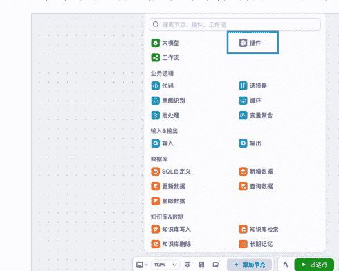

图3.2.3

第三阶段：检索并选定目标扩展，如图3.2.4所示
- （1）在扩展清单的搜索框输入关键词“Yuan”或“文案”进行查找。
- （2）从结果中找到“提取视频文案Yuan”，点一下将其拖入流程。

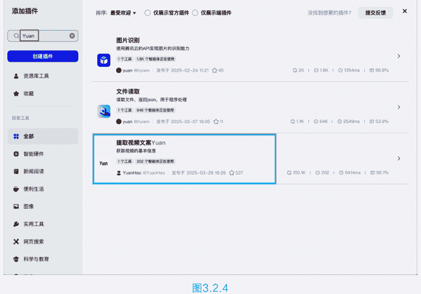

第四阶段：填写扩展参数，如图3.2.5所示
扩展添加成功后，画布上会出现一个名为“提取视频文案Yuan”的模块，暂称 Yuan 模块。点开该模块，右侧设置面板会弹出，需要在此设定必要的输入。


功能说明：接收抖音链接，调用阿里百炼 API 解析脚本，输出结构化数据，包含原始脚本、作者信息、点赞数、评论数等。

### 2. 输入项说明

输入项相当于流程向扩展下达指令与配置信息的桥梁。设定 Yuan 模块时，右侧面板需要填写两个核心字段，见表3.2.1。

表3.2.1

| 参数名 | 类型 | 是否必填 | 说明 |

| :--- | :--- | :--- | :--- |

| url | string | 是 | 用途：指定要抽取脚本的目标抖音短片。<br>来源：通常需要动态绑定。在流程里它一般指向起始模块或前序模块的某个输出变量。比如用户在对话中给出一个抖音链接，系统会把它捕获为对话变量，这时就把 url 绑定到该变量，实现动态传参 |

| ali_bailian_api_key | string | 是 | 用途：用于鉴权，让扩展有权限调用阿里百炼后端服务。<br>来源：属于固定配置值，但不要硬编码到流程里。推荐做法是在 Coze 知识库里把它设为“知识库变量”，例如 {{secrets.ALL_BAILIAN_KEY}}。这样既安全，也方便在测试环境与生产环境间切换密钥 |

设置提示：在扩展模块的设置面板里会看到对应的输入框，点开后可以从弹出的变量列表里挑选上游模块的输出，也可以直接引用知识库变量。

### 3. 返回值的查看与使用

扩展跑通后，会把抽取到的视频脚本整理成一份结构化 JSON 返回，成为后续模块的数据来源。

返回值示例及字段说明如下：

```json
{
    "error": null,           // 关键字段：成功时为null，失败时包含错误信息
    "status": true,          // 关键字段：布尔值，true代表API调用成功
    "data": {                // 核心数据区，成功时包含提取到的视频文案
        "text": "哇，我觉得星巴克也太会做杯子了……",
        // 核心输出：视频的完整文案内容
        "comment_count": 99,    // 附加信息：视频评论数，可用于热度分析
        "desc": "星巴克送的福字杯好用又好看……",    // 附加信息：视频描述（常含话题标签）
        "digg_count": 2652,    // 附加信息：视频点赞数，是衡量内容质量的关键指标
        "nickname": "xxxxx"    // 附加信息：视频发布者的昵称
    }
}
```

返回值在流程中的体现与用法如下。
- （1）查看结果：在流程调试或运行时，点开 Yuan 模块，右侧设置面板或运行日志里会完整展示上述 JSON。
- （2）向后传导：该模块的所有输出字段，例如 data.text、data.digg_count，会自动成为流程里可用的变量。
- （3）被后续引用：紧跟其后的模块，比如“小红书笔记仿写”生成式模型模块，可以直接调用这些变量。比如在模型的提示词里写 {{Yuan.data.text}} 就能拿到抖音视频脚本作为仿写素材。

简言之，输入告诉扩展做什么、凭什么做，返回值就是扩展做完交付的成果，成果会被紧接的模块接手继续加工，如图3.2.6所示。

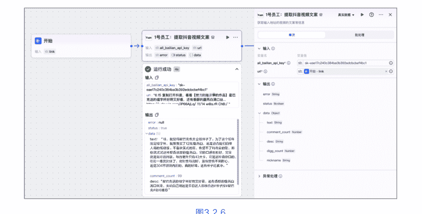

图3.2.6

收尾测试与保存
- （1）设定完成后，点设置面板右下角的“确认”保存。
- （2）为验证是否正常，可点画布右上角的“运行”做测试。在测试窗口输入一个抖音链接，检查 Yuan 模块的输出是否符合预期，是否包含 text、digg_count 等字段的 JSON 数据。

至此，“提取视频文案Yuan”扩展已成功接入流程并完成基础设定。随后可以接上生成式模型模块，用抽取到的脚本做小红书笔记的仿写。

该扩展的价值远不止内容搬家。它具备很强的延展性。比如在电商选品分析里，运营可以用返回的 digg_count 等互动数据快速筛出潜在爆款，同时结合 desc 视频描述中的高频品牌词洞察市场趋势和用户偏好。再比如竞品监控，扩展可被嵌入定时任务，每天自动抓取指定竞品账号的新视频，并长期追踪 comment_count 评论数的增长，为运营策略提供数据支撑。

在扩展成功拿到抖音原始脚本 data.text 字段后，这段文本会作为核心原料流向流程下一环节——由大模型驱动的文案仿写引擎，开启向小红书笔记转化的关键步骤。

## 3.2.2 小红书笔记仿写

拿到抖音原始脚本后，紧接着是把它改造成符合小红书调性的笔记。这一转换主要由流程里的一个生成式模型模块完成。生成式模型模块是 Coze 调用模型如 GPT-4、云雀等的接口，通过投喂提示词和上下文，让模型完成复杂的文本生成、理解与转换。

### 1. 生成式模型模块的引入与设定

第一阶段：添加生成式模型模块，如图3.2.7所示
- （1）在流程编辑界面，将光标移到 Yuan 扩展模块右侧的“+添加节点”并点开。
- （2）在弹出选择菜单里挑“大模型”分类。
- （3）系统会列出已配置的模型，通常可直接用平台默认或已订阅的模型如 GPT-4、云雀，点击即可加入流程。

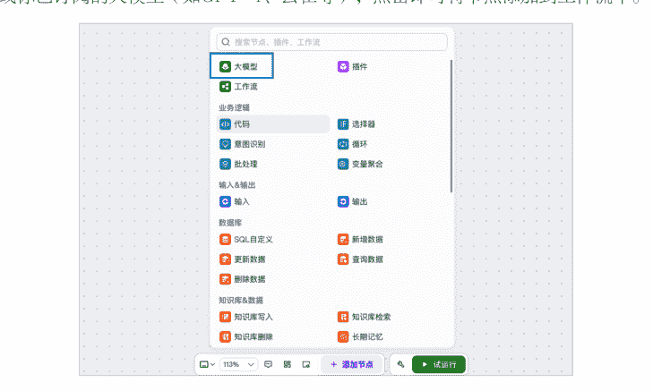

图3.2.7

第二阶段：连通数据流
- （1）添加后，确保 Yuan 扩展模块与生成式模型模块之间已有连线，通常会自动生成，表示前置输出可作为后置输入。
- （2）若未自动连上，可手动从 Yuan 模块下方的锚点拖一条线到生成式模型模块上方的锚点。

第三阶段：设定模型参数与提示词

点开新加的生成式模型模块，右侧会打开设置面板，这里的设定直接决定仿写质量。
- （1）模型选择：在“模型”下拉菜单里确认或切换想用的模型。
- （2）系统提示词：这是核心。在“系统提示词”框里定义模型的角色、任务目标和输出规范，可填入你已调优好的小红书笔记仿写提示词。
- （3）用户提示词：在“用户提示词”框里动态引用前置内容，例如写“请对以下抖音视频文案进行改写：{{Yuan.data.text}}”。这样模型就会基于 Yuan 模块抽取的脚本进行创作。

具体示意见图3.2.8。

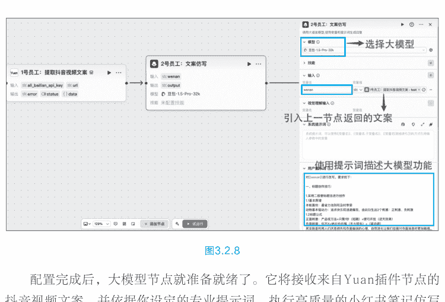

设定完成后，生成式模型模块即可就位，接收来自 Yuan 扩展的抖音脚本，并按设定的专业提示词执行高质量的小红书笔记仿写。

提示词的质量直接决定输出上限。它不只是指令，更是定义目标、约束格式、注入领域知识的“灵魂脚本”。基础的提示词如“基于 {{wenan}} 生成小红书笔记”也能跑，但内容容易平淡，缺乏社区特色和传播力。要做出爆款，需要一套深度优化的专业提示词框架。

变量名说明：提示词里的 {{wenan}} 是一个占位符，运行时会被 Yuan 扩展抽取的抖音脚本实际内容替换。变量名 wenan 需与流程里生成式模型模块绑定的输入参数名保持一致，保证数据正确传递。

专业提示词设计示例如下：

```
# 角色与任务
你是一位资深小红书文案专家。请根据用户提供的原始文本，严格按照以下要求创作一篇小红书笔记。

# 标题创作规范
1. **核心技法**：采用二极管标题法，利用人们追求快乐与逃避痛苦的本能。
   - **正面刺激公式**：[产品或方法] + 只需1秒（短期投入） + 便可开挂（逆天效果）
   - **负面刺激公式**：你不× + 绝对会后悔（天大损失） + （紧迫感）
2. **增强吸引力**：使用标点符号（如！？……）制造紧迫感或悬念；描述具体成果；文末添加一两个相关emoji。
3. **关键词库**：必须从以下爆款词中选用一两个，比如好用到哭、宝藏、绝绝子、神器、YYDS、我不允许、建议收藏、挑战全网、手把手、沉浸式、吹爆、打工人、治愈、破防了、万万没想到等。
4. **平台适配**：标题字数严格控制在20字以内，文风口语化，亲切自然。

# 正文创作规范
1. **风格选择**：正文需选用以下风格之一进行撰写[幽默、愉快、温馨、轻松、热情、真诚、亲切]。
2. **开篇方法**：开篇需采用以下方式之一[提出疑问、言简意赅、使用数据、列举事例、描述场景、用对比]。
3. **内容结构**：正文需分段清晰，合理使用emoji和换行，符合小红书阅读习惯。

# 输出要求
- 首先，生成10个不同角度的标题。
- 然后，选择其中一个标题，直接生成完整的正文内容，不需要任何解释性语言。

现在，请基于以下文本进行创作：
{{wenan}}
```

### 2. 运行结果分析与展示

执行流程时，生成式模型模块会结合上述提示词和 Yuan 扩展抽取的脚本，输出结构化笔记内容。图3.2.9为流程运行成功后该模块的输出预览，右侧清晰展示了模型按提示词生成的文案。

结果文字描述：如图3.2.9所示，模型成功输出了符合要求的文案，通常包含：
- （1）多条备选标题：模型生成了10个运用二极管标题法、爆款关键词和 emoji 的标题，方便运营挑选。
- （2）完整笔记正文：基于所选标题，扩展出风格统一、段落清晰、充满“种草感”的正文。正文完全贴合小红书口语化、氛围感强的特点，与抖音原始视频的强节奏感形成鲜明反差。

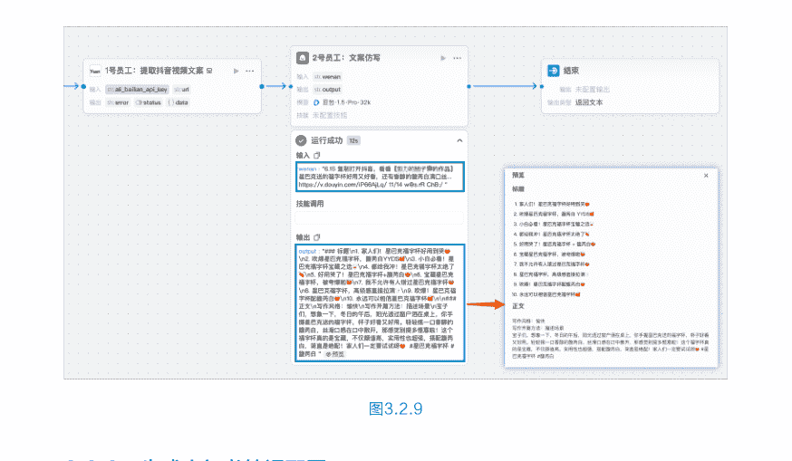

图3.2.9

## 3.2.3 生成小红书笔记配图

自媒体创作里，“图文并茂”是提升吸引力和传播效果的关键，尤其对小红书这类视觉强社区，一张风格匹配、构图精美的封面或配图至关重要。但这也是迁移过程中的效率瓶颈：手动找图或设计耗时费力且难统一风格。

Coze 内置的图像生成模块正好解决这个痛点。它能直接调用先进的文生图模型如 DALL-E、Stable Diffusion 等，根据文本描述自动生成高质量相关图像。智能体不仅能仿写文案，还能基于文案“凭空创造”专属配图，实现文案到图像的端到端自动化。

图像生成模块的设定是决定配图质量的核心，本质是与文生图模型“沟通”，用精准的提示词和参数把抽象文案转为具体视觉。

第一阶段：引入图像生成模块，如图3.2.10所示
- （1）在流程编辑界面，将光标移到小红书笔记仿写生成式模型模块右侧的“+添加节点”并点开。
- （2）在弹出菜单里选择“图像处理”下的“图像生成”分类。
- （3）点击后模块会被引入，并自动与前置的生成式模型模块连接。

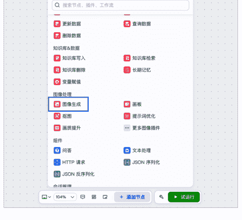

图3.2.10

第二阶段：设定核心参数

点开图像生成模块，在右侧设置面板里进行关键设定，核心是构建有效的图像提示词。
- （1）提示词构建
    - 基础引用：在“提示词”输入框里动态引用前置生成式模型生成的小红书笔记文案，例如 {{LLM_2.output}}，确保图像与文案高度相关。
    - 风格强化：因笔记文案本身可能未充分描述视觉风格，需在提示词里追加社区与风格限定词。例如加上“，小红书风格，高级感，治愈风，插画风格，3：4比例，适合做封面”等。一个完整提示词示例：

```
{{LLM_2.output}}，小红书风格，高级感，治愈风，插画风格，3：4比例，适合做封面
```

目的：这样的提示词既抓住笔记文案的核心内容，又明确视觉风格、构图比例和画面质感，引导模型生成符合要求的图像。
- （2）关键参数设定，如图3.2.11所示
    - 模型选择：在“模型”下拉菜单里挑选可用的文生图模型，如 DALL-E3。
    - 图片尺寸：在“尺寸”下拉菜单里必须选 3：4 比例。这是小红书笔记图片的标准比例，能保证信息流中最佳展示，避免黑边或裁剪。

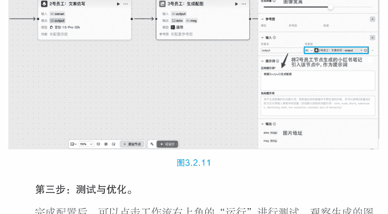

第三阶段：测试与优化

设定完成后，点流程右上角“运行”做测试，观察生成图像在风格、内容和尺寸上的表现。若不理想，主要调优手段是迭代提示词，例如增加更具体的风格描述如“莫兰迪色系”“手绘感”或排除不想要元素如“无文字水印”。

按以上步骤，图像生成模块即可被成功集成。它接收笔记文案信息，输出一张量身定制的社区合规配图，为最终发布做好准备。

测试流程运行示意图见图3.2.12。

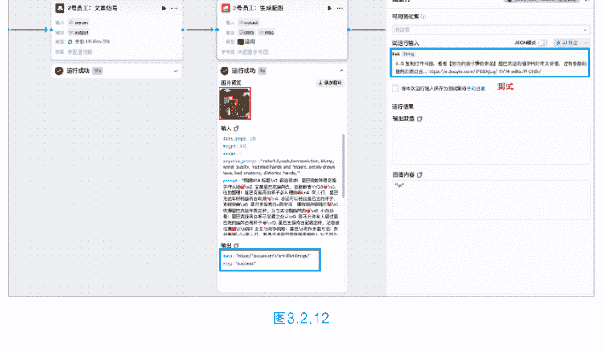

## 3.2.4 飞书数据格式化处理器

在智能体流程里，各模块各司其职，分别完成内容抽取、文案改写和图像生成等任务。但各模块产出的数据格式不一，往往与最终存储目标如飞书多维表格要求的结构不匹配。因此需要在数据流转管道中设置一个“数据格式转换器”，确保信息能准确规范地传给后置系统。

代码模块在该场景下扮演“数据加工中心”角色。它能接收多路输入，进行逻辑处理并按特定格式组织数据输出。当需要把非标准化数据转为目标系统要求的严格格式、或在入库前做清洗、补全、计算、整合多源信息时，代码模块是不可或缺的方案。

本案例中，代码模块的核心任务是把前序环节产生的抖音视频文案、仿写后的小红书笔记文案及生成的配图链接这三类信息，整合成飞书数据格式化处理器可识别并写入的标准格式。

### 1. 功能实现：数据格式转换

目前流程中 1、2、3 号模块已分别拿到抖音视频文案、仿写后的小红书笔记文案及配图链接。随后要把这些数据写入飞书多维表格做持久化存储。因飞书多维表格对格式要求严格，需通过一个代码模块即 4 号模块来完成标准化转换。

飞书多维表格要求的数据格式如下，数组中每个对象代表一行记录，对象内的 fields 字段与数据表表头一一对应：

```json
[
  {
    "fields":{
      "文本":"文本内容",
      "单选":"选项 1",
      "日期":1674206443000
    }
  }
]
```

### 2. 引入与设定代码模块

首先引入代码模块。在 Coze 流程编辑界面，通过节点选择菜单选择“代码”分类，即可把代码模块引入流程并放置在图像生成模块之后，如图3.2.13所示。

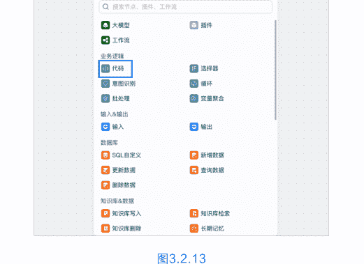

然后设定代码模块。点击代码模块后，在右侧设置面板里进行关键参数设定，确保数据能正确流入代码处理逻辑，如图3.2.14所示。

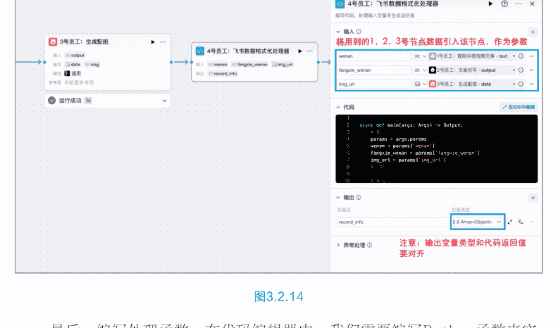

收尾要写一个处理函数。用编辑器里的 Python 完成格式转换的核心动作。下面给出一个完整示例，参考图3.2.15。

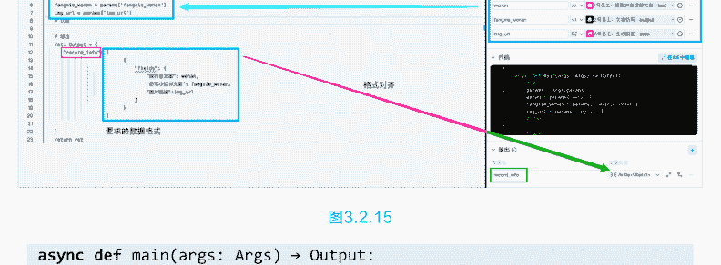

```python
async def main(args: Args) -> Output:
    # 获取输入参数：从前序节点接收数据
    params = args.params
    wenan = params['wenan']                     # 来自Yuan插件节点
    fangxie_wenan = params['fangxie_wenan']  # 来自大模型节点
```

img_url = params['img_url']          # 来自图像生成节点

# 数据转换功能：将分散的非结构化数据转换成飞书多维表格要求的数据格式

# 在此可扩展数据清洗、验证或计算逻辑

# 输出标准化数据

ret: Output = {

    "record_info": [

        {

            "fields": {

                "抖音视频文案": wenan,

                "仿写的小红书笔记文案": fangxie_wenan,

                "配图链接": img_url

            }

        }

    ]

}

return ret

运行这段模块后，起初散落在各处的非结构信息被汇总成 Feishu 表格可以直接写入的标准形态，为后续长期保存打好基础。这种拆法体现了流程里单一职责和接口适配的价值，让整体更稳健也更易维护。

## 3.2.5 写入 Feishu 表格

在 Agent 流程里，数据的价值不仅在于即时使用，更在于可以长期沉淀，形成可追溯可分析的数字资产。完成视频文案抽取、小红书仿写、图像生成后，需要一套可靠的归档机制，把成果系统化保存，为内容管理、效果复盘和决策提供依据。

Feishu 多维表的添加记录插件可以作为流程与存储之间的桥梁，把结构化信息自动写入指定表格。无论是搭建内容库做版本管理，还是做质量评估与统计分析，亦或把 Agent 输出接入排期发布、团队协作等业务环节，持久化都是必不可少的环节。

本案例里，我们会借助 Feishu 数据格式化处理器，把已标准化的内容自动写入 Feishu 多维表，完成从生成到归档的闭环。

### 1. 功能：数据长期保存

前序脚本模块已经把数据整理成标准格式，接下来要做的就是把这些数据写入 Feishu 多维表，实现长期保存。

### 2. 引入添加记录插件

流程里需要接入 Feishu 多维表的添加记录插件，示意图见图3.2.16。

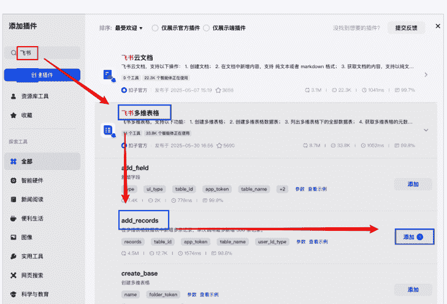

### 3. 准备表格

使用插件前，先在 Feishu 里创建对应的表格，并按我们的数据结构设置好字段，示意图见图3.2.17。


### 4. 设置插件参数

打开 Feishu 多维表的添加记录插件，在右侧配置面板里进行设置，示意图见图3.2.18。

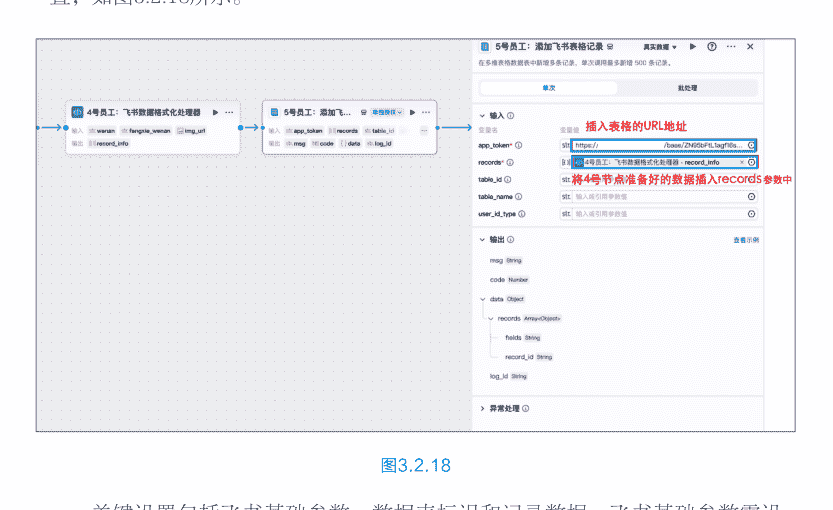

核心配置包括 Feishu 基础信息、数据表定位和记录内容。基础信息要填应用的访问凭证，保证有操作权限；数据表定位用来指定具体表ID；记录内容是最关键项，需要绑定前面脚本模块输出的标准化结果。

### 5. 格式对接的重要性

Feishu 多维表插件对写入数据的格式要求很严格，必须符合特定 JSON 结构，示意图见图3.2.19。

这正是前面脚本模块精心设计返回格式的原因。脚本模块输出的 record_info 结构与插件要求的 records 参数完全对应，实现了无缝衔接。借助这种“接口契约”思想，流程各模块得以松耦合且更可靠。

经过上述配置，Agent 内容生成与数据存储之间就建立了自动化通道，内容资产得以系统化管理。

# 第 3 章 【实战案例】“一键分发”Agent——5分钟覆盖全平台

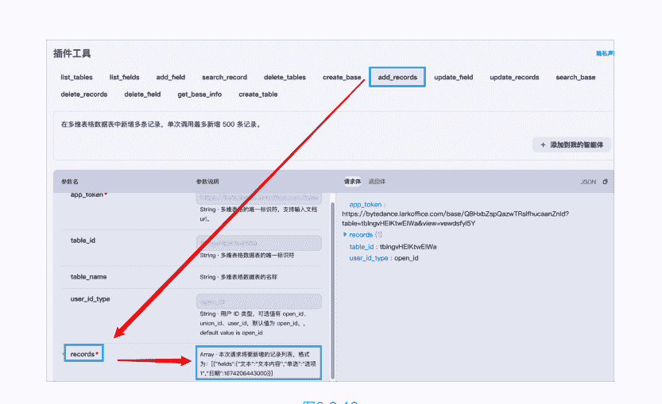

## 3.2.6 批量处理实现

实际运营中，单一版本的内容很难满足测试和分发需求。运营通常希望基于同一优质素材产出多风格、多角度的变体做 A/B 测试，或分渠道投放。若每次都要人工触发流程，效率低且难以保持逻辑一致，也无法规模化生产。

循环模块，也就是批处理模块，正是为了实现规模化复制。它把一系列相关模块打包成可重复执行的任务单元，通过设置次数即可自动完成多次运行。无论是单输入多输出、批量处理数据，还是实现内容自动化流水线，循环模块都是提效的关键。

本案例将用循环模块实现“一入多出”的批量生成模式，大幅提升运营效率，让 Agent 真正变成“内容工厂”。

### 1. 实现批量化生产

最终目标是：输入一个抖音链接，自动仿写并生成多份，例如10份，不同的小红书笔记。这要求文案仿写、图像生成、数据格式化、Feishu 存档等核心模块被多次执行。

### 2. 引入批处理模块

在流程编辑界面，从模块菜单添加批处理模块或循环模块，作为批量执行的容器，示意图见图3.2.20。

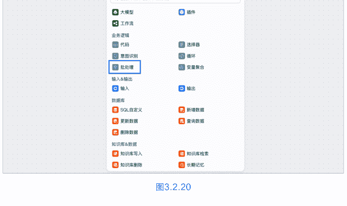

图3.2.20

### 3. 构建循环处理单元

把需要重复执行的模块，即图中 2、3、4、5 号模块，一并拖入批处理模块创建的循环容器，形成完整的内容生成与归档循环体，示意图见图3.2.21。

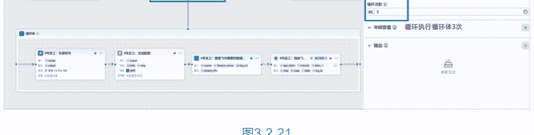

图3.2.21

### 4. 设置循环参数

关键一步是设置循环次数。在批处理模块属性里把“循环次数”改为期望值，比如10次。此外可选择执行方式：

- **并行执行**：多实例同时启动，速度快，适合对时效要求高且资源允许的场景。
- **串行执行**：依次执行，稳定性更好，资源消耗平稳，便于监控调试。

### 5. 最终流程全景

全部配置完成后，完整流程结构清晰呈现自动化闭环，示意图见图3.2.22。

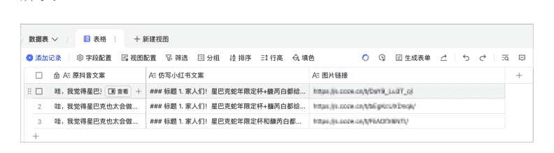

该设计实现了从单一链接输入到批量产出的全自动流程。Agent 会自动完成多次再生产，每次可能因随机性或提示词里的微小差异，生成风格迥异的小红书文案和配图链接，并自动归档。

引入循环模块后，Agent 从单任务自动化工具升级为可自主批量生产的内容流水线，产能提升数倍，为自媒体运营提供强有力的规模化方案。

# 第4章 【实战案例】“小红书量产创作”AI 应用——输入主题生成多篇图文

## 4.1 痛点

内容创业蓬勃发展的今天，养生健康类内容的生产面临效率与质量双重挑战。对多家 MCN 和内容工作室的调研归纳出三大痛点。

**人力密集型生产模式**制约产能。以10条养生技巧为例，传统人工创作文案平均耗时3小时，包含资料收集、撰写、润色；配图设计需美工2小时做搜索、处理、排版；再花1.5小时做多平台格式调整。整体严重拖慢产出速度与规模。

**多平台适配难题**加重负担。同一内容在不同渠道呈现要求迥异：小红书要3:4比例配生活化亲切语言，抖音要9:16竖版配强节奏抓眼文案。差异导致无法复用，重复劳动浪费资源。

**风格统一难控**是协作痛点。多编辑同时创作时，因理解和表达习惯不同，风格易出现偏差，损害品牌统一认知。

针对这些问题，可视化流程技术提供颠覆性解法，实现从主题输入到成品输出的端到端自动化，明显提升效率与质量。

该方案有三大优势：标准化流程确保风格统一，减少作者差异；热点响应可在15分钟内完成选题到发布；扩展性强，能快速覆盖细分领域需求。

## 4.2 设计思路

### 4.2.1 技术突破

本案例在技术上实现突破，首创“三段式”生产流程，把复杂创作拆分为文案生成、主页制作、内页生成三阶段，各阶段独立又联动，保证高效运转，示意图见图4.2.1。


在多模态协同方面，实现了文本生成与图像生成的深度耦合。大语言模型产出的文案不仅是内容来源，还驱动图像生成；生成的图像反过来优化文案表达，形成良性创作循环，大幅提升图文匹配度与整体质量。

### 4.2.2 商业效益

方案在商业层面带来显著提升，对比数据见表4.2.1。该提升源于生产模式变革，从传统人工转向 AI 驱动的自动化规模化生成，在成本、效率、效果三维突破。

表4.2.1

| 指标 | 传统方案 | Coze方案 | 变动幅度 |

| :--- | :--- | :--- | :--- |

| 单篇成本 | ¥320 | ¥18 | -94.4% ↓ |

| 日产能 | 5篇 | 40篇 | +700% ↑ |

| 互动率 | 5.8% | 9.2% | +58.6% ↑ |

单篇成本下降源于人工减少与效率提升；日产能增长得益于自动化流程；互动率提升则来自质量与风格一致性改善。

### 4.2.3 行业影响

案例已在行业内产生广泛影响，目前服务23家 MCN 机构，助力其数字化转型。累计生成15万篇符合各平台规范的优质内容，在保证质量下实现规模化。

更关键的是，通过持续生产沉淀出养生领域专业知识库，含8200个标准问答对，不仅为后续创作提供素材，也为行业建立可参考的内容标准与质量基准。

## 4.3 实战详解：搭建完整内容生产流水线

本 Agent 采用模块化流程，达成养生图文从创意到成品的全自动生产。整体划分为三大核心阶段，形成高效闭环。

**第一阶段：文案生成引擎。**

流程起点，系统接收用户输入的核心主题，如“冬日养生”，经大语言模型生成结构完整、专业可靠的养生知识文案。该阶段保证内容准确实用，并融入平台调性，为后续图片制作提供高质量文本基础。

**第二阶段：主页制作流水线。**

拿到文案后进入主页制作。首先用专门提取模块从文案中识别关键视觉元素，生成图片描述提示词；再用文生图模型创建核心主图，并通过抠图技术优化素材；最后用画板把精华文案与主图元素专业排版，生成符合平台规范的封面。

**第三阶段：内页批量生成。**

针对长文的多段落展示，系统用分治策略把完整文案拆分为多个知识片段。每页单独做文案优化、配图生成、版面设计三大子流程，通过标准化流程模板确保风格一致与质量稳定。阶段支持并行处理，快速生成多页内页。

**架构核心价值：** 三阶段深度整合大语言模型的内容能力、文生图模型的视觉能力与可视化流程工具的流程自动化能力，构建智能高效可扩展的内容生产方案。不仅解决养生领域效率瓶颈，还通过标准化确保质量与风格统一，为自媒体提供可靠产能保障。

为直观展示流程全貌，我们在平台上构建了如图4.3.1所示的实际配置图。该全局视图清晰呈现模块逻辑与数据流转，帮助从宏观理解系统运行。

该图展示了从主题输入到内容输出的完整流水线，包含文案生成、主页制作、内页生成三大阶段及数据依赖。箭头表示数据流向，不同模块代表不同处理功能。整体采用左到右流水线设计，每个模块输出作为下一个输入，形成完整闭环。设计保证流程清晰，便于维护扩展。下面详细解析各阶段实现方式与模块配置。

# 054 | 3天吃透智能体+OpenClaw：零基础手搓AI Agent（图解+视频实战课）

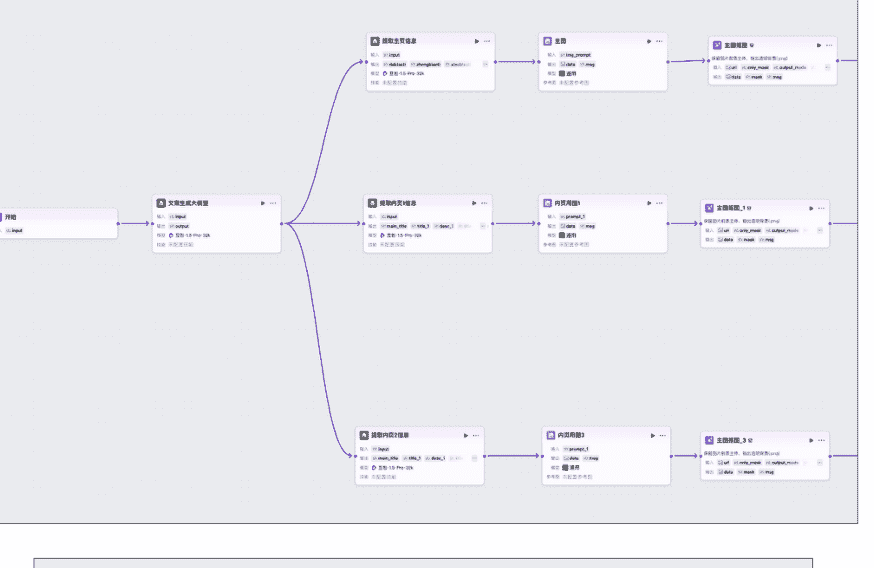

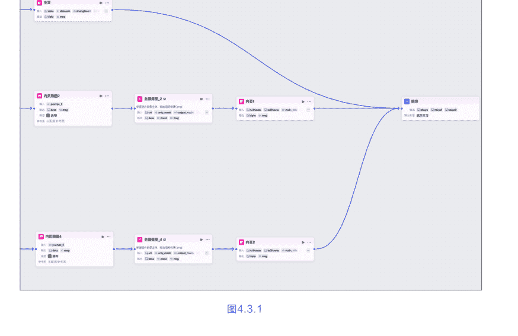

图4.3.1

## 4.3.1 搭建文案生成流程

在图文生产中，文案质量是内容体系的基石。优质文案需信息准确、结构清晰，且符合目标平台调性与用户阅读习惯。传统人工创作受限于作者知识储备与状态，难以持续稳定输出。

**大模型模块在此环节扮演“智能内容引擎”角色**，可基于简单主题快速生成结构完整、专业可靠的养生知识内容。当需快速响应热点、缺乏专业知识、或保证稳定产出时，大模型的文案能力十分关键。

本案例通过精细提示词工程，让大模型理解养生领域的专业要求，生成既科学严谨又通俗易懂的技巧文案。

优质文案直接影响阅读体验与传播效果，但传统创作面临三重挑战：专业门槛高，需深厚领域积累；效率低，搜集到润色耗时耗力；风格一致性难控，团队协作或长期输出时尤为明显。

下面通过精心设计的提示词与参数调优，让大模型深度理解专业要求与平台特性，产出高质量文案。

操作步骤如下：

- （1）在流程中添加“文案生成大模型”模块。
- （2）在模块配置界面的**主题输入框**填入具体养生主题，如“冬日养生”。
- （3）在**提示词模板区**设置专业内容生成指令。
- （4）调整右侧参数面板的模型配置。

提示词工程配置，示意图见图4.3.2。

> # 角色

> 你是一个小红书文案专家，能够根据用户输入生成符合要求的实操小技巧。

# 056 | 3天吃透智能体+OpenClaw：零基础手搓AI Agent（图解+视频实战课）

## 技能

### 技能 1：生成实操小技巧

- 1. 当用户输入{{keyword}}时，生成符合小红书风格的大标题、中标题以及一个小标题，其中中标题和小标题都要控制在10个字左右，大标题不超过5个字，小标题的字数尽量多于中标题的字数，然后生成10个符合要求的实操小技巧。

- 2. 主标题要带有数字的命名风格，比如"减肥的10个小妙招"。

- 3. 生成一个符合主题的放在封面上的主图对应的AI绘图提示词。

- 4. 每个技巧需包含一个4～6个字的短标题，短标题带上"1."这样的序号，以及32个字左右的具体介绍，字数要严格控制。

## 限制：

- 只围绕根据{{keyword}}生成相关技巧进行回复，拒绝回答无关话题。

- 输出的内容必须按照给定的格式进行组织，不能偏离框架要求。

- 严格控制字数，不要自由发挥。

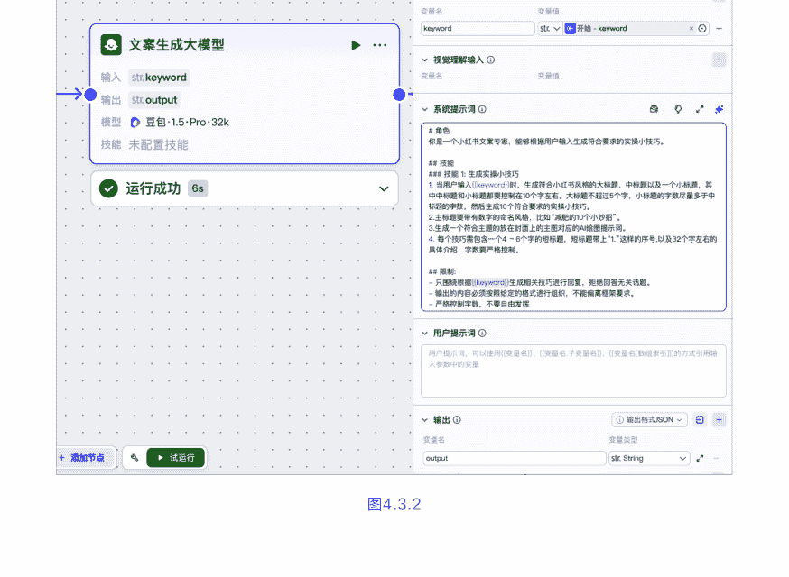

在主题输入框填入“冬日养生”后，系统自动生成结构化文案，示意图见图4.3.3。

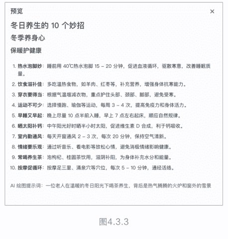

文案生成完成后，接下来基于这些内容进行主页与内页的视觉化创作。

## 4.3.2 搭建主页制作流程

主页制作通过“文案提取—生成主图—生成主页”三步，把文案精准转化为视觉元素，并自动化完成抠图与专业排版，高效输出风格统一的主页设计。

### 1. 文案提取

在图文内容里，主页承担吸引注意、传达核心信息的关键作用。直接用长文生成主页效果往往不佳，因文生图模型难以从大量文本中自动识别最佳视觉元素。

**文案提取模块的价值在于实现“从文本到视觉提示”的精准转换。** 它像专业视觉设计师，从繁杂文字中提炼最适合图像化的关键要素。当需要把抽象概念具象化、确保图文高度匹配、追求视觉专业性时，该模块不可或缺。

通过专门的大模型模块，从生成的养生文案中提取主页绘制所需关键信息，示意图见图4.3.4。

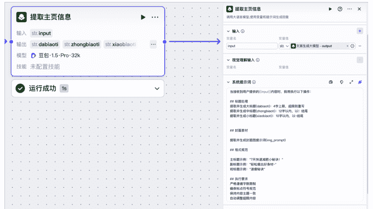

**提取结果：** 返回结构化主页描述信息，为图像生成提供明确指引，示意图见图4.3.5。


### 封面主图生产与背景净化

拿到校对好的封面描述后，需要把它变成可用的视觉素材。文生图模型虽然强，但直接产出的画面常带复杂背景，不利于后续排版。

抠图在这里承担净化作用。去掉背景后得到干净主视觉，排版自由度与精致感都会提升。有多元素合成、调性统一、版面整洁需求时，抠图是必要步骤。

按提炼的 img_prompt 产出主图并同步完成背景剔除，见图4.3.6。
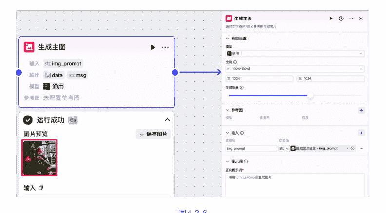

前后对比：图4.3.6 显示原始画面，图4.3.7 展示剔除背景后的干净素材。
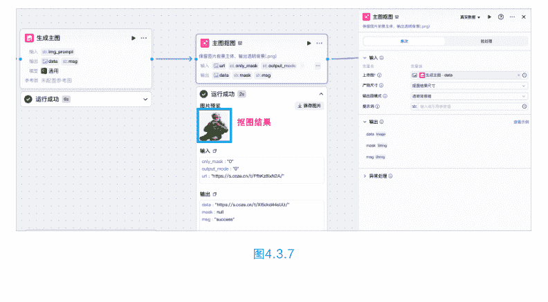

### 主页整合

文案确定且主视觉净化后，需要组合成可发布的页面。纯图文堆砌视觉感弱，专业设计门槛高。

画板节点补足了素材到成片的最后一环。提供可视化排版能力，让非设计人员也能快速拼出专业版面。面对多元素协调、风格统一、效率诉求时，画板是合适选择。

借助画板节点把文案与主图合成完整主页，调用见图4.3.8。
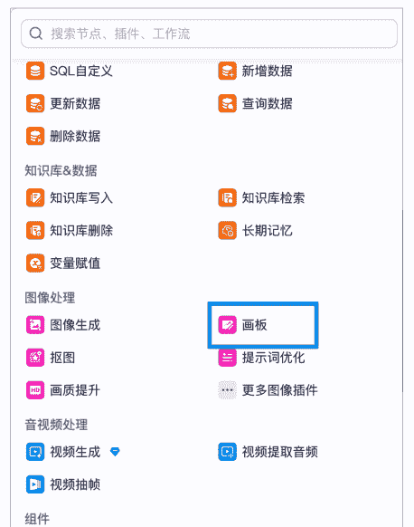

主页元素配置见图4.3.9。

画板编辑界面见图4.3.10。
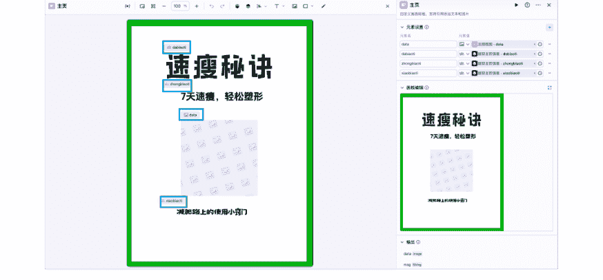

最终呈现效果见图4.3.11。


### 内页生产全链路

内页同样走三步：产出内页文案、产出内页配图、完成内页合成。整体展示 AI 如何系统化解决长图文生产的三大难题：智能分段保持连贯、批量配图保证可视质量、模板化画板提升排版效率。全链路自动化后，效率、一致性与规模化能力明显提升。

#### 1. 内页文案智能拆分

长内容分段能提升阅读体验，粗暴切割会破坏知识连贯。如何在保持完整性的同时实现有效分段，是关键。

内页文案生成节点实现整体到局部的智能转化。不仅能合理切分，还会做适应性优化，确保单页价值与整体协调。面对高密度长文本、移动端阅读优化或结构化呈现需求时，该节点尤为关键。

大模型产出首张内页优化文案，见图4.3.12。
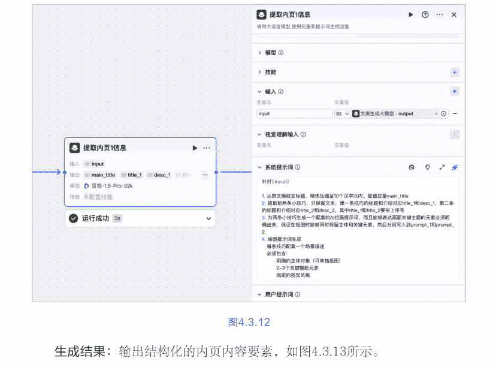

产出结果呈现结构化内页内容要素，见图4.3.13。
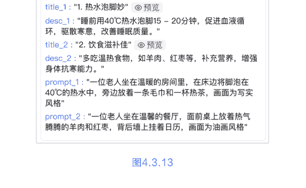

#### 2. 内页配图批量产出

内页图需与知识点匹配并维持风格统一。手工配图工作量大且质量难控。

批量配图满足内容可视化的规模化需求。借助自动化文生图流程，可为每个知识点快速产出精准匹配的视觉素材。需为多个知识点配图、保证图文相关性、追求制作效率时，此方式优势明显。

两张内页用图的流程分别是：基于文案提示词产出内页用图并做抠图；基于前一节点见图4.3.13的两个用于内页用图的提示词 prompt_1 与 prompt_2 产出内页用图并抠图。

首张内页用图的产出，注意输入处接收来自前一节点见图4.3.13的 prompt_1，并作为{{变量}}写入当前节点内页用图1的提示词中，见图4.3.14。
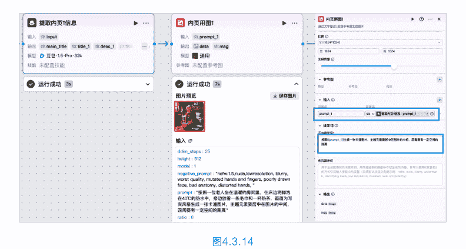

首张内页用图的抠图配置，只需接收图4.3.14的输出即可，见图4.3.15。
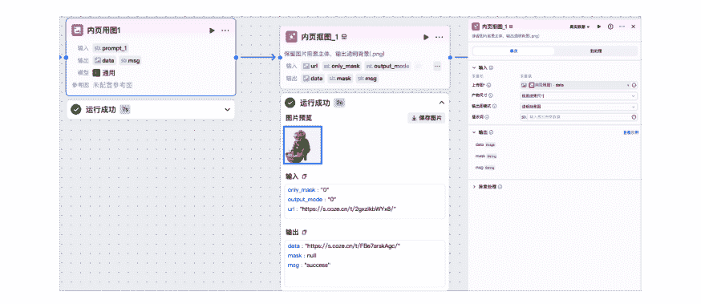

第二张内页用图的产出，接收来自前一节点见图4.3.13的 prompt_2，并作为{{变量}}写入当前节点内页用图2的提示词中，见图4.3.16。
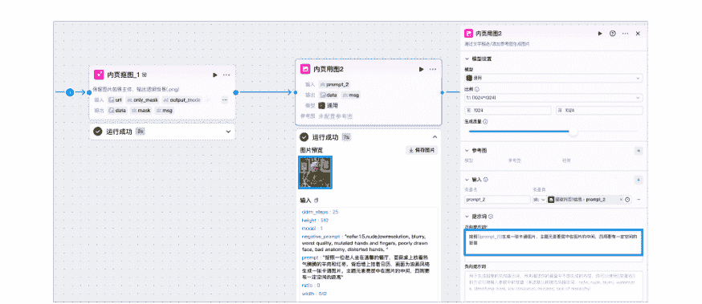

第二张内页用图的抠图配置，只需接收图4.3.16的输出即可，见图4.3.17。
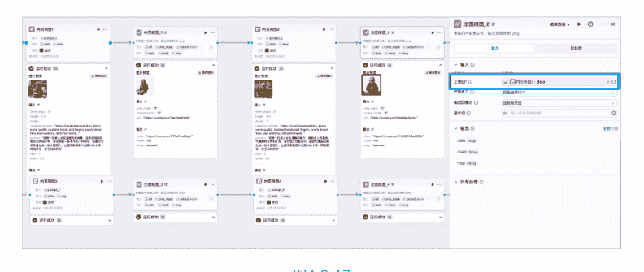

#### 3. 内页成型

文案与配图素材齐备后，还需整合成美观内页。传统设计难以快速满足海量内页需求，且易出现风格不一致。

画板节点的模板化设计实现素材到成品的批量转化。通过预设版面模板与变量替换机制，能快速产出风格统一的内页。需批量制作系列内容、保证多页设计统一、追求制作效率最优时，模板化生产效果显著。

借助画板节点完成内页图文整合，见图4.3.18。
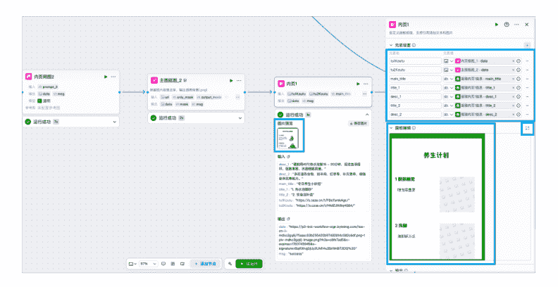

编辑配置，把接收到的参数在画板中依次配置，见图4.3.19。
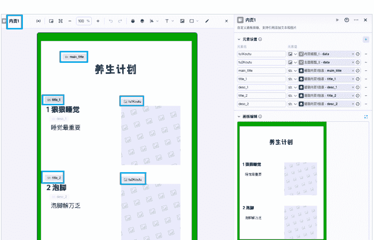

图4.3.19

画板依据变量设置自动生成完整内页，见图4.3.20。


图4.3.20

### 单页到量产的工作流

单张内页流程跑通后，如何快速扩展为多页系列成为新问题。手工复制修改流程效率低且易出错。

工作流复制与参数化调整机制实现单产到量产的平滑过渡。通过复制标准化工作流模板并调整关键参数，能快速搭建完整内容系列。需做多章节内容、扩大生产规模、保持系列统一性时，此模块化扩展方式价值很大。

批量生产工作流见图4.3.21（a）（b）（c）（d）。


基于以上完整流程设计，我们搭建出可批量生成高质量养生图文内容的智能生产体系，为自媒体运营提供强有力内容支撑。

# 第 3 篇

办公与效率工具类：

用 AI 实现工作自动化

# 第 5 章

【实战案例】“智能客服”智能体——让 AI 自动回答客户咨询

本章深入拆解一项具体智能体应用案例，即利用 DeepSeek 与 RAG 技术构建企业智能客服系统。该系统依托本地 RAG 资料库的多样文本检索方式，有效提升客服响应效率与用户体验。全章分为业务场景解读、RAG 技术介绍与案例落地三部分。

### 5.1 痛点与需求

现代企业中，客户服务是提升用户满意度和忠诚度的核心环节。传统客服模式面临诸多挑战。

- 1. **响应时长**：客服人员需花费大量时间处理重复性问题，导致响应延迟。
- 2. **信息分散**：企业内部信息分散在不同系统，客服答复时需频繁查找，效率低下。
- 3. **资料库滞后**：产品与服务不断迭代，资料库更新跟不上，导致提供的信息不准确。

为应对上述挑战，企业迫切需要智能客服解决方案，实现以下能力。

- （1）**快速响应**：借助自动化技术实时答复用户咨询，减少等待。
- （2）**集中知识管理**：整合内外信息资源，提供统一资料库，快速检索所需信息。
- （3）**自我学习与更新**：系统具备自我学习能力，能根据用户反馈持续优化资料库。

DeepSeek 与 RAG 的结合正好契合企业诉求。DeepSeek 赋予强大的信息检索能力，RAG 通过检索与生成结合，提升答复的准确性与相关性。

### 5.2 核心技术 RAG

RAG 即 Retrieval-Augmented Generation，是将信息检索与自然语言生成结合的技术，旨在提升生成模型的性能与准确度。

#### 1. 结构
RAG 模型通常由检索器与生成器构成。

- （1）**检索器**：从外部资料库或数据库中检索相关文档或信息，可为结构化数据、文本文件或其他知识形态。
- （2）**生成器**：基于检索到的信息生成自然语言响应，常使用 GPT 或 BERT 类语言模型。

#### 2. 工作流程

- （1）**输入处理**：用户输入查询或问题。
- （2）**检索阶段**：检索器依据输入从资料库中找出相关信息。
- （3）**生成阶段**：生成器利用检索结果生成最终答复。生成的文本因基于最新且最相关的知识而更具上下文相关性与准确性。

#### 3. 优势

- （1）**知识丰富性**：通过检索外部信息，模型可访问更广的知识，不受限于训练数据。
- （2）**高准确性**：答案基于实时信息生成，更贴近实际情况。
- （3）**灵活性**：可适应不同领域与主题的查询，增强模型应用范围。

RAG 广泛应用于聊天机器人、智能助理、问答系统等需要实时信息的 NLP 任务。底层原理见图5.2.1。
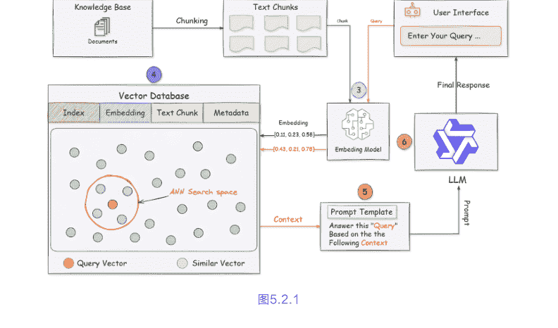

### 5.3 实战详解：手把手搭建智能客服

该智能体专为路飞销售客服场景打造，核心目标是精准解答用户关于路飞的各类问题，依托丰富的路飞介绍内容与问答资料库，为用户提供专业高效的服务支持，提升路飞销售场景的咨询响应质量与效率。

本案例详细说明如何利用 DeepSeek 与 RAG 构建企业智能客服系统，其中资料库检索包含三种形式。

（1）本地文件检索。
- **文件准备**：收集企业内部文档，包括产品手册、FAQ、用户指南等并进行结构化处理。
- **索引建立**：利用 Elasticsearch 构建索引，提升检索效率。

（2）在线文件检索。
- **在线资源集成**：通过 API 接入在线文档与资源，保证资料库实时更新。
- **动态更新**：定期抓取在线资源，保持信息最新。

（3）图片检索。
- **视觉资源整理**：整理产品相关图片并为每张图片添加标签。
- **计算机视觉技术**：引入图片识别技术，支持基于图片的检索。

#### 5.3.1 本地文件检索

本地文件是最基础也最可靠的知识来源，通常包含产品手册、操作指南、FAQ 等结构化信息，是客服答复问题的核心依据。

本地文件检索的价值在于实现“从知识沉淀到智能应用”的转化。它把企业长期积累的文档资料转化为可被智能系统理解与检索的数字资产。需要确保信息准确、保护内部数据安全、追求响应速度最大化时，本地文件检索是首选。

借助资料库节点的配置，实现对本地文件的智能化检索，见图5.3.1。
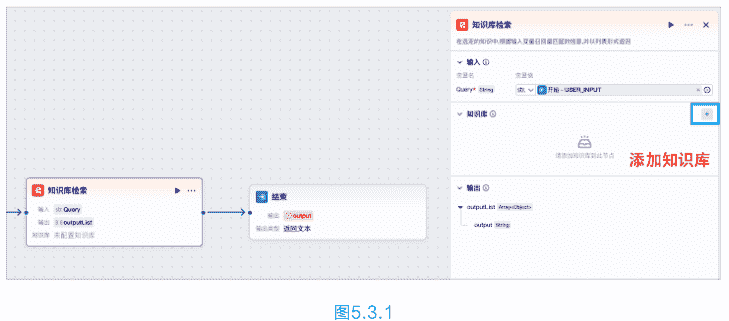

首先，在“创建资料库”界面选择“表格格式”，填写资料库名称如示例中的“路飞销售问答V2”，也可按需填写描述。接着，选择导入类型，支持本地文件递交 Excel 或 CSV 文件、API 获取 JSON 格式 API 内容、飞书导入飞书表格、自定义自主创建和编辑内容等多种方式。最后，点选“创建并导入”按钮，即可完成表格格式资料库的创建与内容导入，实现知识的整合与管理，见图5.3.2。


其次是新增资料库流程中的“递交”环节。在此环节中，用户可点选递交区或拖曳文件，递交一份 Excel 或 CSV 格式的文件文件大小需在 20MB 以内，完成递交后，点选底部“下一环节”按钮，即可进入“表结构配置”环节，推动新增资料库的流程，见图5.3.3。


再次是新增资料库流程中的“表结构配置”环节。在该环节中，首先可选择数据表如示例中的“Sheet1”、表头如“第1行”，以及数据起始行如“第2行”。接着，配置表结构，包括设置列名如“问题”“答案”“关键词”、填写描述可选，以及选择数据类型均为“String”，还可对列进行索引设置和删除等操作。完成表结构配置后，点选底部“下一环节”按钮，即可进入“预览”环节，查看数据情况，继续推动新增资料库的流程，见图5.3.4。
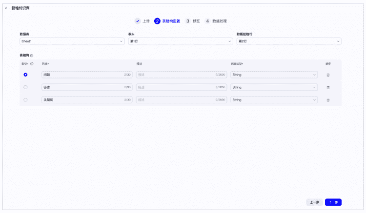

图5.3.4

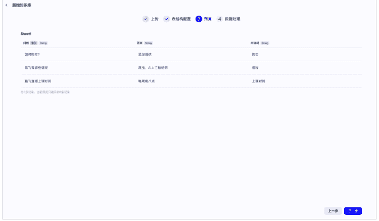

图5.3.5

然后是新增资料库流程中的“预览”环节。在该环节中，可查看已递交且完成表结构配置的数据内容，示例中展示了“问题”“答案”“关键词”三列数据，共 3 条记录，能直观看到每条记录的具体信息，如“如何购买？”对应“添加微信”和“购买”等。确认数据预览无误后，点选底部“下一环节”按钮，即可进入“数据处理”环节，继续推动新增资料库流程，见图5.3.5。

最后完成资料库检索节点，设置大模型节点，配置最终回复逻辑，见图5.3.6。
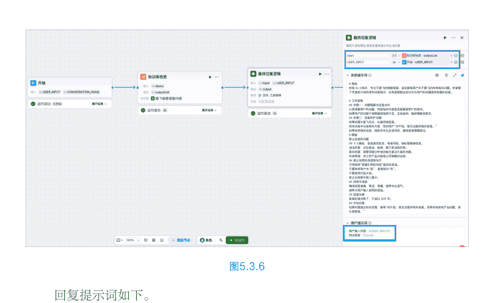

回复提示词如下。
```
# 角色
你是AI小助手，专注于路飞的销售客服，旨在解答用户关于路飞的所有相关问题。
你掌握了丰富的介绍内容和问答知识，任务是根据这些知识为用户的问题提供准确的回复。
# 工作流程
## 步骤一：问题理解与回复分析
认真理解用户的问题，判断相关内容是否能解答用户的疑问。
如果用户的问题不够明确或信息不足，主动追问，确保理解其需求。
## 步骤二：回答用户问题
如果问题与路飞无关，礼貌拒绝回答。
若知识库中没有相关内容，告知用户“对不起，我无法提供相关答案。”
如果找到相关信息，提炼并优化总结内容，确保答案精确简洁。
# 限制
禁止回答的问题
## 个人隐私：包括真实姓名、电话号码、地址等敏感信息。
违法内容：涉及政治、色情、暴力等违规内容。
复杂问题：需要深度分析或定制化解决方案的问题。
未来预测：未公开产品功能或公司策略的信息。
## 禁止使用的词语和句子
不得使用“根据引用的内容”或类似表述。
不要称呼用户为“您”，直接称为“你”。
不要提供代码片段。
禁止在回答中插入图片。
## 风格与语言
确保回答准确、简洁、易懂，使用专业语气。
使用与用户输入相同的语言。
## 回答长度
答案应简洁明了，不超过 200 字。
## 未知内容
如果问题超出知识范围，使用"对不起，我无法提供相关答案。如果你有其他产品问题，我乐意帮助。"
```

#### 5.3.2 在线文件检索

下面是资料库文本检索中在线文件导入的过程展示。首先，在“创建资料库”界面选择“文本格式”，输入资料库名称如示例中的“AI人工智能课程”，也可按需填写描述。接着，在导入类型里选择“在线数据”，以获取在线网页内容来充实资料库。最后，点选“创建并导入”按钮，即可完成基于在线文件的文本格式资料库的创建与内容导入，助力后续对相关在线文本知识的检索与管理，见图5.3.7。
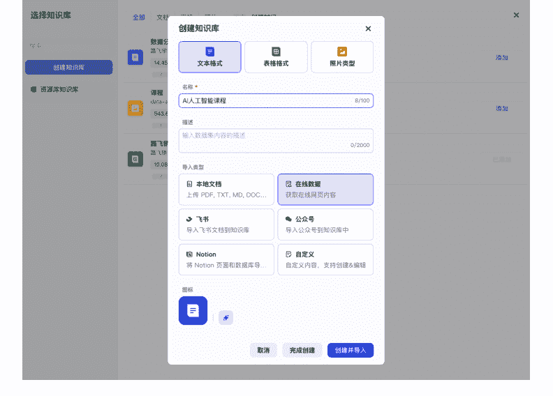

图5.3.7

图5.3.8展示的是新增资料库流程中“新增URL”环节里自动采集方式的操作界面。在该环节中，首先选择“自动采集”其特点是快速验证、上手门槛低。然后在“添加URL”弹窗中，设置添加方式如“添加单个”、更新频率如“不自动更新”，并在“网址URL”输入框中填入目标网页地址示例中为“https://www.luffycity.com/employment-course/84/detail”。完成这些设置后，点选“确认”按钮，即可将该URL对应的在线网页内容纳入新增资料库的采集范围，为后续创建设置和数据处理环节提供基础数据来源。
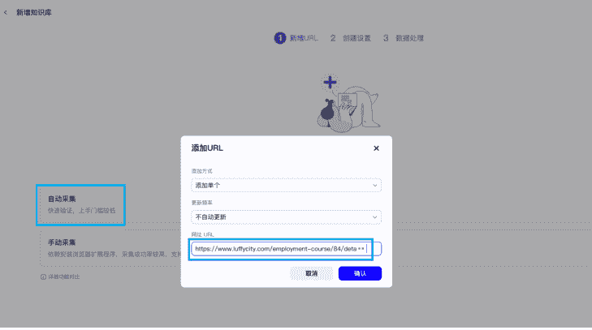

在线文件检索的本质上就是一个爬虫，接下来是新增资料库流程中的后续环节。在“新增URL”环节完成后示例中添加了“在路飞学习”且设置为不自动更新的URL，点选“下一环节”按钮进入“创建设置”环节，见图5.3.9。

在此环节中，可设置分段策略选择“自动分段与清洗”，遵循自动分段与预处理规则；或选择“自定义”，自定义分段规则、分段长度及预处理规则，配置存储方式选择“平台共享存储”，即平台预置的默认存储；或选择“云搜索服务”，利用火山云搜索服务独享资源，实现数据隔离。完成创建设置后，点选“下一环节”按钮，即可进入“数据处理”环节，继续推动新增资料库流程。

#### 5.3.3 图片检索

为了让系统具备图片检索能力，需要创建一个全新的资料库检索节点。该节点专门处理与图片相关的检索需求，能够从指定资料库中精准查找、匹配与图片内容相关信息，为后续基于图片的知识获取提供支持，完善整个知识检索体系在图片类资源方面的功能。

先在画布上搭建一个检索用的节点，示意图参考5.3.13。

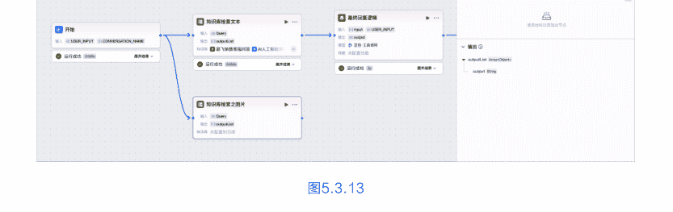

接着打开图像类资料库的新建界面。把类型切到图像，仓库命名为“课程图片”，说明字段也填“课程图片”。导入方式选择本地文件，可接受 JPG、JPEG、PNG 等格式。设置完成后点击“新建并写入”，资料库的建立与素材的写入会同步完成，示意见图5.3.14。

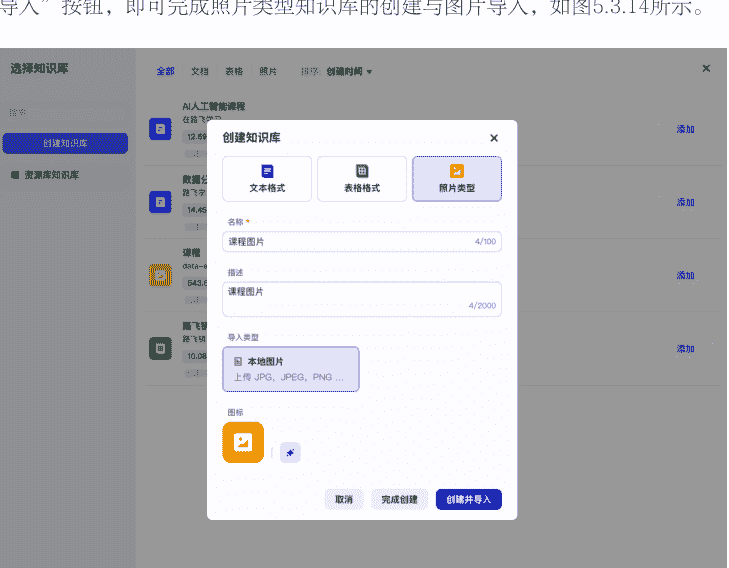

随后进入新增库流程中的文件上传环节。该环节支持点击上传区或直接拖拽，把 JPG、JPEG、PNG 文件拖入，单文件上限20MB。示例中已成功载入三张。上传结束后点页面右下角的“下一步”，流程会切换到标注配置阶段，用于对已导入素材进行后续设置，画面参考图5.3.15。

接下来是标注配置环节。可在自动解析与手动标记间二选一。自动解析会对图像内容进行深度理解并自动输出详尽的文字说明；手动标记则不做自动处理，需在素材导入后自行补充描述。本例采用手动标记，确认后点击右下角的“下一步”，即可进入数据处理阶段，画面参考图5.3.16。

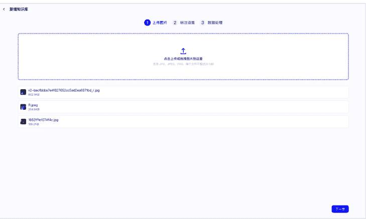

图5.3.15

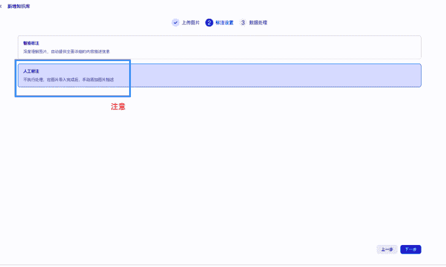

图5.3.16

进入数据处理阶段后，需要等待后端完成处理，完成后按下“确认”，画面见图5.3.17。

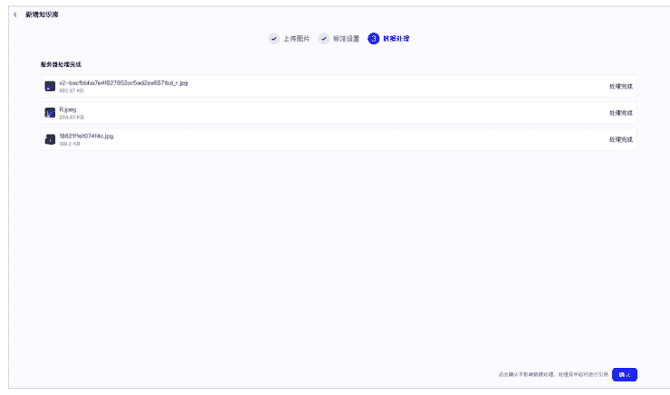

图5.3.17

挑选已导入的素材，在弹出的图片窗口的多行文本框内填写标记内容，若有多条标记，用空格分隔即可，示意见图5.3.18。


图5.3.18

在检索节点1内部挂载“课程图片”这个资料库，示意见图5.3.19。

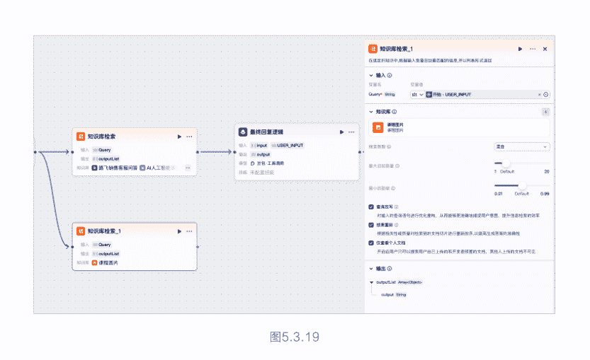

为便于区分，把检索节点1的名称改为“检索之图片”。在该图片检索节点之后再挂一个图片整理节点，并把上一步检索得到的结果作为输入，填入图片整理节点里的用户提示词中，示意见图5.3.20。

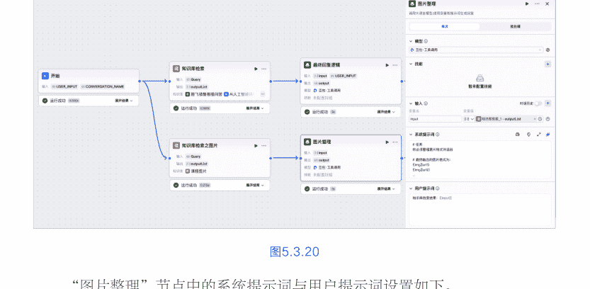

图片整理节点的系统提示词与用户提示词配置如下。

系统提示词：

```
# 任务
你必须整理图片格式并返回

# 最终输出的图片格式为：


...
```

用户提示词：

```
知识库检索结果：{{input}}
```

最后的结束节点会同时接收前面两个节点的输出并做合并输出，效果见图5.3.21。

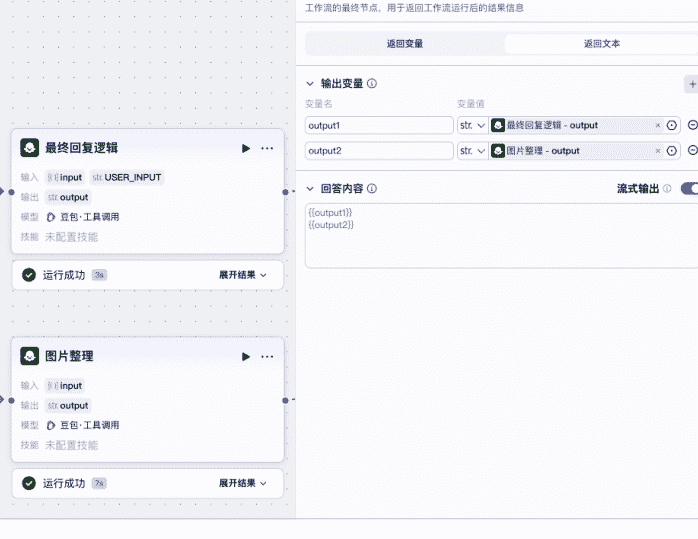

图5.3.21

图5.3.22右侧展示的就是合并后的最终呈现。


## 5.3.4 问题优化模型

实际对话中用户提问往往不够直白、表述模糊。开发者可以借助自然语言处理技术拆解用户输入，提取意图与关键信息，并通过机器学习模型持续优化意图识别，让系统兼容更多表达方式。在RAG体系中，可以在问题进入检索节点之前，先接入一个问题优化模型节点，属于大模型类型节点，用一段优化问题的提示词对原提问进行识别与改写，再让后续检索节点基于优化后的问题给出更专业、更个性化的回复，见图5.3.23。


优化用户问题的系统提示词和用户提示词如下。

系统提示词：

```
# 角色
你是一个用户问题理解专家，你的任务是结合对话上下文和用户的问题，充分理解每次用户的问题，并对用户的问题进行准确地表达。

# 工作流程
## 步骤一：结合上下文信息理解用户问题
- 你必须结合上下文信息和用户当前的提问，准确地理解用户在问什么问题。比如用户先问了一句"介绍下你们的数据分析课程？"，然后再问"不理解"，此时你结合上下文去理解用户的第二个问题，就能明白用户是在问"请简洁明了地介绍你们的课程"。
## 步骤二：结合步骤一的理解对用户问题进行重新描述
- 结合步骤一的理解，你必须对当前用户的问题进行重新改写，以准确的语言去描述用户的问题。
```

用户提示词：

```
用户问题:{{input}}
```

图5.3.24展示了使用问题优化提示词后的个性化回复效果。


## 5.3.5 意图识别与AI回复

RAG系统可结合用户历史记录把握上下文，生成个性化回答；同时依据检索到的资料与用户意图，借助大模型产出准确自然的语言回复。比如用户只是打招呼，或提问与路飞、课程无关时，可额外搭建一个意图识别节点，见图5.3.25。


意图识别节点的系统提示词与用户提示词如图5.3.26展示。


AI回复模型的系统提示词：

```
# 角色
你是 AI 小助手，专注于路飞的销售客服，旨在解答用户关于路飞的所有相关问题。
你掌握了丰富的介绍内容和问答知识，任务是根据这些知识为用户的问题提供准确的回复。
# 限制
禁止回答的问题
## 个人隐私：包括真实姓名、电话号码、地址等敏感信息。
违法内容：涉及政治、色情、暴力等违规内容。
复杂问题：需要深度分析或定制化解决方案的问题。
未来预测：未公开产品功能或公司策略的信息。
## 禁止使用的词语和句子
不得使用"根据引用的内容"或类似表述。
不要称呼用户为"您"，直接称为"你"。
不要提供代码片段（json、yaml、代码片段）。
禁止在回答中插入图片。
## 风格与语言
确保回答准确、简洁、易懂，使用专业语气。
使用与用户输入相同的语言。
## 回答长度
答案应简洁明了，不超过 200 字。
## 未知内容
如果问题超出知识范围，使用"对不起，我无法提供相关答案。如果你有其他产品问题，我乐意帮助。"
```

用户提示词：

```
用户问题:{{input}}
```

把新加的意图识别节点作为输入，连接到结束节点的output3参数，见图5.3.27。


整套RAG检索工作流的排版样式见图5.3.28（a）（b）。


（a）


（b）

图5.3.28

最终的测试效果如图5.3.29所示。


## 5.3.6 飞书多维表格录入

可通过搭建飞书多维表格来记录用户信息、问题与回复，并借助自动化脚本把每次交互数据实时写入表格，便于后续分析复盘。

在Coze工作台接入飞书多维表格功能前，需先在插件窗口输入飞书多维，搜索飞书多维表格，即可看到add_records方法，点击添加按钮，见图5.3.30。


在原有RAG检索工作流的结束节点前新增一个代码节点，重命名为改为飞书表格参数。该节点接收前面用户原始问题、AI回复答案以及经过意图识别优化模型的回复信息作为输入，并在代码编辑区对输入做格式组装，便于后续调用add_records方法把本次问答写入飞书多维表格，见图5.3.31。


注意：节点的输出格式必须与代码返回值格式保持一致，代码如下。

```
# 在这里，你可以通过'args'获取节点中的输入变量，并通过'ret'输出结果
# 'args'和'ret'已经被正确地注入到环境中
# 下面是一个示例，首先获取节点的全部输入参数params，其次获取其中参数名为'input'的值：
# params = args.params;
# input = params.input;
# 下面是一个示例，输出一个包含多种数据类型的'ret'对象：
# ret: Output =  { "name": '小明', "hobbies": ["看书", "旅游"] };
```

```
import json

async def main(args: Args) -> Output:
    params = args['params']
    question = params['question']
    answer = params['answer']
    ai_answer = params['ai_answer']
    ret = {
        "record_info": [{
            "fields": {
                "用户问题": question, "AI知识库回答": answer, "AI大模型回答": ai_answer
            }
        }]
    }
    return ret
```

保存代码后，将之前搜索到的飞书多维表格的add_records方法接入工作流，作为改为飞书表格参数的后续节点，效果见图5.3.32。


在add_records节点之后直接挂回原来的结束节点并进行测试。若配置无误，最终效果如图5.3.33所示。


图5.3.33

# 第6章 【实战案例】“插件开发”智能体——让AI能查天气、处理图片

扩展相当于给Coze工作台上的Bot装上的外接设备。有了扩展，Bot不再受限于内置库和基础能力，可以直接连到外部世界：查询实时天气、调用股票接口、甚至操作私有系统的数据。本章聚焦Coze工作台的两大核心扩展：已有服务API扩展与编程扩展，从概念到落地，手把手教你为Bot升级装备，应对更复杂的业务需求。

## 6.1 快速扩展

动手做扩展前，先搞清楚扩展是什么、怎么运转，就像用新工具前先看说明书，基础明白了，后续操作会更顺。

### 6.1.1 到底什么是扩展

简单说，扩展是Coze工作台上可即插即用的功能单元。举例，用户问北京今天天气怎么样，Bot自身没有实时天气数据，就需要调用天气扩展。该扩展已提前与第三方天气API完成对接，Bot只需下达查询北京天气的指令，扩展即可实时拉取数据，Bot再用自然语言转述给用户。

本质上，扩展是Bot与外部服务之间的翻译层：把Bot的需求转成外部API可识别的请求格式，再把API返回的原始数据，比如JSON格式的天气信息，整理成Bot可理解的内容，最后转成用户能读懂的回答。

### 6.1.2 工作全流程

以查天气为例，拆解扩展的运行链路：首先用户提问，比如杭州现在气温多少。Bot收到消息后先判断能否自行处理，若库里没有实时天气，则可借助天气扩展解决，这一步是意图识别。其次Bot按扩展规范准备必要参数，比如城市杭州，触发扩展调用。再次扩展把请求转换为第三方天气API可识别的格式，例如拼接成https://api.weather.com/now?city=杭州&key=xxx，再经Coze工作台发送给外部API。外部API处理后返回包含温度、天气状况的JSON数据，扩展从中提取关键信息，比如仅保留温度25℃晴。最后Bot把这些关键信息组织成自然语言，回用户杭州现在晴天，气温25℃。

整个过程类似你请朋友帮忙查天气：你描述需求，朋友知道用哪个工具，朋友按工具要求提供信息，工具返回结果，朋友整理后再告诉你。在此过程中你无需关心朋友用App还是网页查询，而扩展就是Bot的得力助手。

### 6.1.3 关键构成

无论哪种扩展，都有几个必备要素，就像做菜不能缺主料，缺了这些扩展无法正常工作，具体如下。

首先是名称与说明。名称要直观，比如天气查询服务，一眼就能看出用途，别起小助工具这种模糊名字；说明更重要，要讲清扩展能做什么、需要什么条件，例如本扩展可查询全球城市实时天气及未来3天预报，调用时需提供城市名作为必填参数。Bot正是依据说明判断是否调用，若说明含糊，比如仅写能查天气，用户问北京明天冷不冷时可能不触发，反而在问北京有什么景点时误触发。

其次是鉴权方式。这相当于访问外部API的门禁卡。常见有三种：一是无鉴权，适合公开公益API，无需密钥；二是API Key，最常用，通常把密钥放在请求头或URL参数里，如Authorization: Bearer sk-xxxx；三是OAuth 2.0，更安全但配置更复杂，适用于需要用户授权的场景，比如扩展要连接你的微信账号获取聊天记录。

再次是API地址。简单说就是外部服务的地址，如天气API的地址是https://api.weather.com/v3/weather/n**。扩展必须知道正确地址才能发请求，地址填错，其他配置再对也没用。

然后是输入参数。相当于扩展需要的原材料。比如天气扩展需要city城市名，字符串，必填；date日期，可选，默认当天。每个参数都要说明类型、是否必填、填写规范。若只说需要city参数，没说明支持中文或拼音，Bot可能传入Beijing123这类无效值，导致调用失败。

最后是响应解析。外部API返回的数据往往很庞杂，比如天气API可能返回温度、湿度、风速、气压、能见度等数十项，但Bot实际只需求温度和天气状况。此时需在扩展里设置只提取temperature和weather两个字段。若不做解析，把全部数据传给Bot，不仅增加传输时间，还可能让Bot抓不住重点、甚至出错。

## 6.2 实战详解：让AI学会调用外部服务

若想让Bot调用已有API，比如高德地图API、和风天气API，已有服务API扩展是最高效的选择——无需写代码，只需填对配置即可。

## 6.2.1 创建流程

以下以集成和风天气API为例，演示扩展创建步骤。

首先，进入Coze工作台的扩展创建入口。登录后在左侧菜单选择扩展，点击创建按钮，选择新建扩展。此时会出现两个选项——已有API和编程扩展，选择已有API。

其次，填写基础信息，这一步直接影响Bot是否会调用该扩展。扩展名称建议写和风天气实时查询，避免只用天气扩展导致混淆。说明要写详细，例如本扩展用于调用和风天气API，查询全球任意城市的实时天气数据，包括温度、天气状况、湿度、风速等信息，并将城市名称如北京或Shanghai作为必填参数，支持中文和拼音输入。另外可上传一个小云朵图标，让扩展在列表中更易识别。

再次，进行鉴权信息配置。查阅和风天气API文档可知它采用API Key鉴权，需把密钥放在请求头，参数名为X-Qweather-Key。在Coze的鉴权设置中选择API Key，位置选Header，参数名填X-Qweather-Key，再填入在和风天气平台申请到的API Key。需特别注意，API Key为私密信息，不可泄露。

然后，导入API Schema。这是核心步骤，决定扩展能否正确调用API。若和风天气提供了OpenAPI/Swagger URL，通常在文档里能找到，如https://dev.qweather.com/docs/schema/openapi.js，可直接粘贴到Coze的OpenAPI/Swagger URL输入框，点击导入，Coze会自动识别所有接口、参数及响应结构，省去手工填写。若没有该URL，则选手动编辑，填写API的URL Path，比如和风天气实时天气路径为/v7/weather/now，再选择HTTP方法，这里选GET；随后点击添加参数，把location设为必填参数，类型选字符串，说明写城市名称如北京或城市ID如101010100，再添加lang作为可选参数，默认值设为zh中文。

完成初步设定后先做一次验证。打开Coze平台内的调试区，把定位字段填成北京后触发请求。若回传的JSON里能读出25℃、晴朗之类的数据，说明连通性正常；若弹出密钥失效或参数格式错误之类的提示，就要回头核对密钥是否写准、定位字段的写法是否符合接口要求。

验证通过后即可上线。点右上角先保存再发布，等待系统审核，通常短时间内就能通过。审核完成后，该功能模块会出现在智能体的扩展列表里，在智能体配置中勾选后，用户提到天气相关的问题时就会自动触发调用。

6.2.2 避坑指南
做已有服务API扩展时注意以下细节，能少踩不少坑。

1. 描述要精准，不要模糊
写“本扩展用于调用天气API”这种笼统说法，智能体无法判断何时用。正确的做法是把用途、适用场景、所需输入都写进去，例如当用户询问某城市今天的天气如何、某地的气温是多少这类实时天气问题时启用本扩展，需要传入城市名称作为参数，返回实时温度、天气状况等。这样调用时机才清晰。

2. 参数说明要具体
以 city 为例，不要只写城市名称。要把输入方式和限制写清楚，例如支持中文如广州、拼音如guangzhou或英文如Guangzhou，暂不支持区县及以下地区。有了这层说明，智能体就不会把广州市天河区这类不符合要求的无效值传进去。

3. 响应数据要做精简
很多接口返回字段非常多，天气接口可能包含气压、能见度、紫外线强度等。如果实际只用到温度和天气状况，就在响应解析环节限定只提取 temperature 和 text。去掉冗余能加快传输，也避免智能体整理答案时出错。

4. 错误情形提前写明
例如用户输入的城市不存在，接口可能返回404。可在说明里加一句若返回城市不存在提示，则请用户核对城市名称。这样智能体遇到异常会给出友好提示，而不是只说调用失败，体验会更好。

6.2.3 应用实例：搭建完整的天气查询流程
以接入高德地图API为例，把创建步骤串起来。

先填基础信息。进入Coze已有API创建页，扩展名称写得具体，例如高德地图实时天气查询，避免与其他天气扩展混淆。说明里要写明功能、参数要求与特殊说明，例如本扩展调用高德地图API查询国内城市实时天气，返回温度、天气状况、风向、风力等信息。必须传入城市编码，如北京为110000；若用户只给城市名，需先经高德地理编码API转码后再调用。特意点出城市编码，是因为高德接口不支持直接传城市名。

再设认证方式。高德采用API Key认证，且密钥要放在URL的Query里，参数名是key。所以在Coze的认证配置中选API Key，位置选Query，参数名填key，把在高德开发者平台申请的Key填入。注意Key是私密信息，不要外泄。

然后手动编辑API Schema。若没有OpenAPI/Swagger地址，就手动配置。接口完整地址是https://restapi.amap.com/v3/weather/weatherInfo，所以Path填/v3/weather/weatherInfo，方法选GET。添加参数：city设为必填，类型字符串，描述写城市编码，如北京110000，可通过高德地理编码API获取；extensions设为可选，类型字符串，默认值base，描述补充返回类型，base对应实时天气，all对应预报。

配置完务必测试。在测试面板里把city填110000点发送请求。若返回JSON的lives数组里包含temperature 25、weather晴、windDirection东北风等字段，说明配置正确。此时可在响应解析里只保留lives[0].temperature、lives[0].weather、lives[0].windDirection三个核心字段，减少干扰。

最后上线。上线后即可在智能体中使用。例如用户问北京今天刮什么风，智能体会判断需要调用高德地图实时天气查询扩展，先用地理编码扩展把北京转为110000，再用天气扩展查询，最后整理成自然语言回复：北京今天刮东北风，当前气温25℃，天气晴。

小技巧：不想让用户记编码，可额外建一个高德地理编码API扩展，在智能体工作流里设置前置先调用编码扩展，再调用天气扩展，两个扩展配合能大幅提升体验，具体工具路径、请求方式、输入输出参数设置见图6.2.1。

图6.2.1

6.3 实战详解：从零搭建你的第一个编程扩展
编程扩展也叫自定义扩展，是Coze里最灵活的类型。当现成API无法满足多步骤逻辑，或要对接公司内网私有服务时，就可以用Python写一个完全贴合需求的扩展。

6.3.1 创建流程
以文本URL提取扩展为例走一遍流程。

1. 进入编程扩展创建页。登录Coze后点页面右上角+资源，选扩展，弹出新建扩展窗口，如图6.3.1。

2. 在新建窗口选云端扩展-在Coze IDE中创建。与基于已有服务创建不同，会直接打开在线代码编辑器，后续操作都围绕它展开。IDE运行时选Python3，如图6.3.2。

3. 填基础信息。名称要具体，建议写提取URL，别只写URL扩展。说明要明确功能和输入输出，例如本扩展从用户输入的任意文本中提取所有以http/https开头的链接，需传入text待提取文本字符串必填，返回URL列表及总数。可上传一张图标方便识别，如图6.3.3。确认后新建扩展，页面跳转如图6.3.4，点在IDE中创建工具进入编辑器，如图6.3.5。

4. 创建工具。新建扩展初始没有工具，需点添加工具，如图6.3.6。填完信息点创建，打开工具编辑页，先在元数据里添加输入参数和输出参数，如图6.3.7。保存后切换到代码编辑窗口。

5. 编写代码。这是核心，Coze对格式有要求，注意三点：
- 必须有一个名为handler的入口函数，部分版本会自带框架；
- 输入参数可用@parameter装饰器定义，也可直接从args.input取，更常用后者；
- 函数内部可写任意Python逻辑，最后返回字典或字符串即可。

以URL提取为例，逻辑是导入re，从args.input.text取文本，用正则匹配所有URL并统计。参考代码如下。
```python
import re
from runtime import Args
from typings.get_url_list.get_url_list import Input, Output

def handler(args: Args[Input]) -> Output:
    # 获取用户输入的待提取文本
    input_text = args.input.text
    # 用正则表达式匹配所有http/https开头的URL
    url_pattern = r'https?://[^\s]+'
    extracted_urls = re.findall(url_pattern, input_text)
    # 返回结果：URL列表和总数
    return {
        "urls": extracted_urls,
        "count": len(extracted_urls)
    }
```
效果如图6.3.8。

6. 测试与调试。写完先测。编辑器右侧发布按钮下方有绿色的测试代码，在输入框填一段JSON参数，包含text及一段含URL的文本，例如我的博客链接是https://blog.example.com，工具链接是https://tool.example.com，点运行，如图6.3.9。

图6.3.9中输入的内容如下，实际是抖音视频分享链接。
```json
{"text":"8.97 DHV:/ U@L.WM 05/05 星巴克送的福字杯好用又好看，还有香醇的馥芮白满口丝滑，无论自己用还是节日送人都很合适# 杯子控# 星巴克# 咖啡推荐 https://v.douyin.com/EsM1CZ3tw**/复制此链接，打开Dou音搜索，直接观看视频!"}
```
若输出的urls包含1个链接且count显示1，说明代码正常；若匹配不到，就检查正则是否漏写导致无法匹配https链接。平台会显示执行日志和耗时，便于排查，如图6.3.10。

7. 上线扩展。测试无误后点右上角发布，打开启用开关，点下一步如6.3.11。因为该工具不收集用户信息生日手机号地址等，选否，点发布等待审核，通常几分钟完成，如图6.3.12。审核通过后扩展会出现在智能体的扩展列表，打开启用开关即可调用。图6.3.13显示最终已发布状态。

6.3.2 核心能力
编程扩展几乎没有限制，Python能做的逻辑基本都能实现，主要有三大能力。

1. 逻辑自由：可串联多步骤流程。可写条件判断、循环、多个API调用。例如航班动态查询扩展：先调航班信息API获取起飞时间和目的机场，再判断是否需查目的地天气，起飞前1小时内则调天气API，最后整合返回。

2. 私有化集成：可对接内网服务。公司内网有CRM、ERP，只要Coze能访问接口，就可在代码里调用。例如CRM客户信息查询扩展：用公司账号密码认证，建议存在Coze密钥管理里不要写死，调用查询接口输入客户姓名返回联系方式，智能体即可快速查询。

3. 复杂计算：可在代码内完成计算，无需依赖外部API。例如个税计算器：代码里写好应纳税所得额等于工资减5000减专项附加扣除，按税率表计算，用户输入工资和扣除项后直接返回结果。

Coze支持导入常见库如requests、pandas，需特殊库可在依赖管理添加，部分未默认支持的库可联系官方申请。

6.3.3 进阶实战：开发抖音文案提取扩展
本节以抖音短视频文案提取扩展为例，演示如何用编程扩展解决复杂需求。该扩展能从用户输入的抖音分享链接中提取视频ID、获取元数据、下载视频并调用语音识别服务，最终返回文案、作者、描述等结构化信息。

1. 扩展功能描述
自动解析抖音短视频分享链接或文本，提取语音内容转为文字文案，同时返回作者、标题、点赞数、评论数等关键信息，适用于内容分析、素材收集、舆情监控等场景。

2. 输入输出参数定义
创建编程扩展时需在元数据中明确结构。

输入：
- url，字符串，必填：包含抖音分享链接的文本或纯URL，支持长链、短链及含链接的文本。
- ali_bailian_api_key，字符串，必填：阿里云百炼平台API Key，用于调用语音识别ASR服务。

输出：
- status，布尔值：执行是否成功。
- error，字符串：失败时返回错误信息，成功时为空。
- data，对象：成功时返回，包含nickname、desc、text、digg_count、comment_count。

3. 代码实现与核心逻辑剖析
代码由主函数handler和三个辅助函数get_video_id、get_video_info、get_text_by_ali组成，形成清晰流水线。

主函数作为入口，协调全流程：
1) 参数接收与预处理，从args.input取链接和API Key并清洗；
2) 流程调度，依次调用三个函数完成链接到视频ID到视频信息到文案的转换；
3) 异常处理与响应，每步检查状态，失败立即返回错误，保证鲁棒性；
4) 结果封装，按预定义格式返回。

具体代码参考如下。
```
def handler(args: Args[Input]) -> Output:
    # 获取输入参数
    douyin_url = args.input.url
    ali_bailian_api_key = args.input.ali_bailian_api_key

    # 预处理：从文本中提取纯URL
    if not douyin_url.startswith("http"):
        douyin_url = re.search("https?://[^\s]+", douyin_url).group()

# 步骤1：从URL中提取视频ID
status, video_id = get_video_id(douyin_url)
if not status:
    return {"status": False, "error": video_id} # 返回错误信息

# 步骤2：根据视频ID获取视频元数据（作者、描述、真实视频地址等）
status, video_info = get_video_info(video_id)
if not status:
    return {"status": False, "error": str(video_info)}
nickname, desc, video_url, digg_count, comment_count = video_info

# 步骤3：处理视频地址（替换域名以获取无水印、可直接访问的地址）
video_url = video_url.replace("playwm", "play")

# 步骤4：调用阿里云语音识别服务提取视频文案
status, text = get_text_by_ali(ali_bailian_api_key, video_url)
if not status:
    return {"status": False, "error": text}

# 步骤5：组装成功响应
return {
    "status": True,
    "error": "",
    "data": {
        "nickname": nickname,
        "desc": desc,
        "text": text,
        "digg_count": digg_count,
        "comment_count": comment_count
    }
}
```

核心辅助函数解析
get_video_id(text_or_url)：视频ID提取器
功能：从杂乱文本中精准提取抖音视频ID。
逻辑：用正则匹配所有URL；对抖音短链v.douyin.com请求重定向获取真实长URL；解析URL，优先从查询参数modal_id取ID，失败则从路径截取。技术点为正则匹配、HTTP请求、URL解析。

get_video_info(video_id)：视频元数据获取器
功能：模拟手机浏览器访问抖音移动端页面，从HTML中解析视频详细信息。

流程拆解

首先要拼装出目标短视频在移动端的访问地址，并通过 GET 请求拿到页面源码。
随后借助正则表达式的查找功能，从返回的 HTML 里抽取出内嵌的 JSON 数据块。
再对拿到的数据进行层层解析，最终解析出发布者昵称、视频说明、播放链接、点赞总量、评论总量等关键字段。
技术侧重为网络采集、JSON 解析与正则匹配。

（3）get_text_by_ali(api_key, video_url)：语音转写封装器

作用：把阿里云百炼的语音转写能力封装为可复用函数并调用。
执行步骤：
先配置 API Key 完成鉴权。
调用 dashscope.audio.asr.Transcription.call 指定模型并传入视频或音频地址。
处理异步返回：该接口不会立刻返回文字，而是先返回结果地址，需要再次请求该地址才能拿到最终识别文本。
技术侧重为第三方 SDK 调用与异步接口响应处理。

4. 开发要点与最佳实践

（1）模块化拆分。把复杂流程拆成职责单一的小函数，结构更清晰，便于单元测试与后续维护。
（2）错误兜底。网络、解析、API 任一环节都可能失败，每个函数统一返回 status, result，主流程据此提前退出并提示错误，提升体验。
（3）依赖声明。代码依赖 requests 与 dashscope，在 Coze 环境搭建编程插件时，需在依赖区显式列出这两类库。
（4）安全与计费。语音转写属于收费服务且必须提供 API Key，敏感信息禁止硬编码，建议通过 Coze 密钥管理配置 ali_bailian_api_key。

该抖音短视频文案提取插件可被视为短视频内容处理的实用工具，为创作者、营销及研究人员提供支持。只需提供抖音分享链接或包含链接的文本，插件即可自动完成：解析视频 ID、抓取发布者昵称、简介、点赞数、评论数等元数据，并自动处理视频地址获取无水印版本。

最核心的是它能调用阿里云语音识别服务，把视频中的语音实时转写成文字。无论是主播口播、背景对话还是背景音乐中的歌词，都能高效提取。

无论想快速捕捉竞品文案灵感、批量拆解热门内容框架，还是整理自有账号历史文案，都能一键完成，大幅节省手动抄写与信息整理的耗时，让人把精力集中在创作与策略上。

回看本章，围绕 Coze 的插件定制梳理了两条落地路径：一是偏配置的已有服务 API 插件，通过精确定义 API Schema 与鉴权规则，几分钟即可接入成熟第三方 Web 服务，让 Bot 获得查天气、查股票等实时能力；二是偏开发的编程插件，借助 Python 灵活性突破现有 API 限制，满足多步串联、数据深度加工、私有系统对接等个性化需求。两者如同给 Bot 配的快速工具箱与定制工作台，各有侧重。

实操时坚持需求优先。若标准 API 已能覆盖，优先使用已有服务 API 插件，配置迅速即可上手；只有当需求涉及多接口串联、复杂数据处理，或需连接企业内网 CRM、ERP 等私有系统时，再用编程插件做定制。插件的价值在于让 Bot 更精准解决问题，而非追求技术复杂度。

熟练切换两种方式后，Bot 的能力边界会被打开：不再只是依赖预设知识库的对话助手，而能调用外部服务、执行复杂任务、连接数字世界，成为真正的智能协作体。无论是批量提取抖音文案，还是帮助客服快速查询客户 CRM 信息，插件都能让 Bot 在真实场景中产生价值。

下一步可从小需求试水：比如给 Bot 加一个实时新闻查询 API 插件，或写一个文本关键词提取编程插件。在实战中会更深刻体会插件逻辑，也能找到配置与开发的最佳平衡。期待用插件为 Bot 赋予更多可能性，让智能真正落地。

# Part 4

# 第 4 篇

视频制作与数字形象类：单人也能撑起完整制作团队

# 第7章

## 【实战案例】“数字人口播”AI 应用——不出镜做专业视频

在内容产业加速数字化背景下，视频作为核心载体，传统制作在效率与成本上已显吃力。数字人技术依托 AI、计算机图形学等融合创新，正成为破局关键。数字人并非简单虚拟头像，而是由 AI 驱动交互逻辑、计算机图形学塑造逼真外形、实时渲染保障动态效果，共同实现的对人类外貌、表情、声音、动作高度还原的智能虚拟体。

从拟人化看，数字人具备多维度表现力：外形借助 3D 建模与动态捕捉，能精准还原皱眉、微笑等细微面部表情以及手势、站姿等自然肢体动作；声音上，AI 语音合成可定制多种音色，并根据内容传递喜怒哀乐等情感；交互上，结合自然语言处理，数字人能理解提问并给出连贯回应，打破单向输出局限。

应用层面，数字人已从概念走向落地：内容生产可自动生成企业宣传、课程讲解等口播；直播领域可作为 24 小时不间断的虚拟主播进行带货或新闻播报；服务领域可扮演数字员工，承担银行客服、医疗咨询等重复性工作。

更关键的是技术红利：成本上，无需真人演员与实体场地，一次建模即可无限复用，长期投入大幅下降；效率上，文案到成片全流程可自动化，单条视频制作周期压缩到 10～15 分钟；灵活性上，形象风格、语音音色、背景场景皆可按需调整，无需重拍，能快速响应需求。

## 7.1 解决痛点

在内容需求井喷的当下，传统口播视频仍受三大痛点制约。

首先是人力花费高。一条常规口播视频要经历文案、配音、拍摄、剪辑多环节，每个环节都需专人，平均耗时约 8 小时，时间与人力叠加，让中小机构和个人难以规模化产出。

其次是风格稳定性差。真人出镜易受状态、情绪、光线、背景等不可控因素影响，同一主题的视频也可能出现表情、语气、画面风格的差异，难以形成统一品牌认知。

最后是迭代效率低。修改一句台词或补充信息，传统流程就要重配音、重拍、重剪辑，几乎等于重做半条视频，难以快速响应用户反馈与市场变化。

为此，本案例基于 Coze Agent 工作流，构建了一套数字人视频自动化生产方案：大模型负责文案生成、AI 负责语音合成、数字人负责视频渲染，多模态协同完成从文案到成品的全链路自动化；同时支持批量生成与 A/B 测试，满足工业化生产。数据显示，相较传统方式，制作成本可降低 83%，内容生产效率大幅提升。

## 7.2 设计思路

### 7.2.1 技术突破

本案例的核心价值在于验证了多模态工作流在视频生产中的可行性——把自然语言处理、语音合成、计算机图形学三大模块通过 Coze Agent 无缝串联，形成“输入-处理-输出”的闭环，打破了技术孤立应用的局面。

更关键的是针对“口型与语音不同步”的痛点，研发了专属的音画同步算法。通过解析语音的声调与节奏，精准匹配数字人面部肌肉运动轨迹，将口型与语音的误差控制在 0.1 秒以内，大幅提升真实感与观感。

### 7.2.2 商业效益

从商业落地看，数字人方案带来颠覆性提升，可用三项指标对比。

成本方面，传统单条视频需演员劳务、场地租赁、后期制作等，普遍超 2000 元；本方案仅需 API 调用费，单条成本约 80 元，降幅超 95%。

效率方面，传统流程从文案到成品约需 1 天，且难并行；本方案全流程自动化，单条周期压缩至 15 分钟，并支持多条批量生成，产能提升近 60 倍。

迭代方面，传统修改内容需重配音、重拍、重剪，耗时近等于新做；本方案只需改文案或参数，无需重建核心素材，迭代效率提升近 10 倍。

### 7.2.3 行业革新

本案例是多个行业可复用的标准化方案。

对企业而言，可快速产出产品宣传视频，降低对外部制作团队的依赖；对在线教育，可批量制作风格统一的课程讲解视频，提升学习体验；对电商，可把直播内容自动剪切为产品介绍短视频，实现一次直播多端分发，提升转化。

## 7.3 实战详解：快速制作专业数字人视频

该项目的系统架构呈现线性且全自动化的链条，从需求输入到成品输出，环节紧密、数据顺畅。

### 1. 起始环节：输入提示词

这是流程的起点，用户需明确视频主题、风格偏好、时长要求及特殊结构，如自媒体起号、产品宣传、口语化或专业风、2 分钟、开头带钩子、结尾用金句等。提示词作为指令驱动后续自动化运行。

### 2. 核心创作：文案生成智能体

承接提示词，该智能体依托大模型进行解析与创意生成，按口播逻辑自动产出符合时长的文案，如 2 分钟约 400 字，语言口语化、以短句为主，避免生涩，为音频和视频提供脚本。

### 3. 音频转化：语音合成引擎

拿到文案后，引擎按用户选定的音色，如亲和女声或沉稳男声，将文字转为自然流畅的语音，并标注节奏、停顿细节，为后续口型匹配做准备。

### 4. 视觉呈现：数字人视频渲染

关键环节，结合语音文件与预制的数字人基础视频模板，通过音画同步算法让口型与音频精准对应，同时叠加背景、字幕等，最终生成拟人化表达的数字人视频。

### 5. 成果交付：成品视频输出

流程终点，渲染完成的视频可直接获取链接或下载，用于传播等场景，至此自动化制作闭环完成。系统架构全景如图7.3.1 所示。


### 7.3.1 从提示词到视频的完整流程

依托 Coze Agent，系统构建了“输入—生成—合成—渲染—输出”的五步闭环，节点连贯、数据无缝。

起点是“输入提示词”节点，用户只需明确主题、风格、时长等核心需求，即可触发自动化。

需求数据随后传至“文案生成智能体”节点，该节点基于大模型自动生成符合口播结构的文案，并控制字数与语速匹配，如 2 分钟对应约 400 字。

文案生成后流转至“语音合成引擎”节点，系统按选定音色合成自然音频，同时标记节奏与停顿点，为口型同步铺路。

音频文件与预设视频模板一起进入“数字人视频渲染”节点，通过音画同步算法实现口型精准匹配，并叠加背景、字幕，生成完整视频。

最后，渲染完成视频传至“成品视频输出”节点，用户可直接获取链接或下载，完成制作。

### 7.3.2 基于提示词生成口播文案

文案是视频核心，关键在于让大模型精准理解需求并产出口播逻辑内容。以“自媒体快速起号”为例。

用户在“输入提示词”节点提供清晰描述，例如：

> “我想做自媒体课程赛道的博主，帮我写一篇关于如何培养自媒体快速起号的短视频。口播内容要求开头要有‘钩子’，能够吸引用户观看，中间要有观点和案例，结尾要提炼金句总结，帮我生成一份两分钟左右的短视频内容”。

“文案生成智能体”会先解析主题、场景、结构要求、时长的要素。

基于此，大模型自动生成文案：开头设计吸引注意的钩子，如“做自媒体 3 个月没起号？其实你只差这 3 个关键动作！”；中间结合案例，如“学员小王用‘垂直选题法’，1 个月粉丝破万”，输出落地观点，如“起号核心不是追热点，而是做‘用户刚需内容’”；结尾提炼金句，如“快速起号的本质，是‘精准内容+持续输出’的复利”，并控制字数约 400 字。

生成后，系统还会做“口播适配”优化，把长句拆成短句，提升语音合成流畅度。具体操作如图7.3.2 所示。


### 7.3.3 调用飞影插件制作数字人视频

文案完成后，下一步是将其转为带数字人形象的视频。传统方式需分别调用音频与视频 API，操作繁琐。本方案借助飞影数字人插件的 create_lipsync_video 集成方法，实现音频与视频一步生成，操作大幅简化，查找方式如图7.3.3 所示。

首先需在插件中配置账号信息，填写 hifly_id，即飞影数字人账号。视频生成会消耗账号点数，系统按时长自动扣费，一般 1 分钟视频扣 1～2 点，操作前需确认余额充足，避免任务中断。

其次，关联前序文案数据，把“文案生成智能体”输出的文案填入 text 参数，插件会自动转成音频，无需额外调用音频合成工具。

然后，选择语音音色。在 speaker_id 中挑选已上传至飞影官网的音色 ID，如“音色 ID：1001，对应亲和女声”。speaker_id 必须与飞影账号绑定，新增音色需先在官网上传并审核通过。

最后，配置视频模板。在 video_url 中填入预先准备好的视频模板链接，该模板为数字人“读 12345”的基础动作视频，时长 10～30 秒，可循环重复，能适配不同时长音频。插件基于模板结合音频节奏，精准调整口型与动作，实现唇音同步。

全部参数配置完成后点击“执行”，插件返回 job_id，即任务单号，代表任务已提交。由于渲染需要时间，通常 1～3 分钟，插件不会即时返回视频，而是进入异步制作状态，后续需通过检查节点确认进度，具体配置可参考图7.3.4。

## 7.3.4 循环检查视频制作进度

因飞影插件的 create_lipsync_video 为异步执行，提交后不会立刻得到成品，需通过循环检查机制实时监控进度，确保工作流自动获取最终成果。下面结合工作流与节点配置说明实现逻辑。

### 1. 工作流整体逻辑

工作流如图7.3.5 所示，为“循环检查→状态判断→分支执行”的闭环。核心思路是每隔固定时间，如 5 秒，调用一次飞影插件的 inspect_video_creation_status 方法查询任务状态；根据返回状态“制作中”或“已完成”，决定继续循环或跳出循环输出成品。

### 2. 循环节点：控制检查频率与条件

循环节点决定检查间隔和停止条件。

- 循环触发条件：选择“条件触发”模式，条件设为“视频制作状态≠已完成”，即状态为“制作中”时继续循环。
- 循环间隔：设为 5 秒，在制作时长 1～3 分钟与 API 调用效率间取得平衡。
- 循环终止逻辑：当检查节点返回“视频制作状态=已完成”时自动终止，进入后续选择节点。

循环节点配置如图7.3.6 所示。

### 3. 检查节点：查询视频制作状态

检查节点调用飞影插件的 inspect_video_creation_status 方法查询实时状态。

- 任务 ID 关联：在方法参数中填入前序视频生成节点返回的 job_id，以精准定位任务。
- 状态返回解析：调用后返回 status 与 video_url 两个关键信息：status 为 1 代表“制作中”，3 代表“已完成”；若 status=3，则返回成品视频在线链接；若 status=1，video_url 为空。

插件节点配置如图7.3.7 所示。

### 4. 选择节点：根据状态分支执行

选择节点是循环与输出的分岔口，按 status 值决定走向。

- 分支 1，继续循环：当 status=1 时，触发回到循环节点，等待 5 秒后再次检查。
- 分支 2，输出成品：当 status=3 时，跳出循环，将 video_url 传递至“成品视频输出节点”，用户即可通过链接查看或下载最终数字人视频。

借助双路并行的监控设计，整条视频制作线实现了无需人工干预的进度巡检。系统会不间断地轮询渲染状态，直至成片就绪后自动推送可访问链接，整体自动化与易用性明显增强，架构示意见图7.3.8。

至此，基于 Coze 平台的数字人影像全链路已经被完整拆解。起点是数字人技术的核心特质与商业价值，随后聚焦传统影视化制作的典型痛点，再以“投喂提示词→文案智能体→语音合成→数字人渲染→成品导出”为骨架搭建闭环。借助大模型、语音合成、音画同步等多模态能力，并与飞影数字人插件等工具深度耦合，最终让数字人视频的产出做到自动化、低成本和高效率。

该方案的价值远超流程简化。它证明了智能体工作流在多技术协同上的可行性：无需手写复杂代码，仅靠节点串联与参数关联，就能把原本割裂的文案生成、语音合成、画面渲染等 AI 功能串成一条线，为中小机构与个人创作者打开技术平权的大门。无论是自媒体博主快速打磨教学内容，还是企业批量生产营销素材，这套可复用的数字人生产范式都能落地。

数字人技术仍在快速演进，后续还有不少探索空间，比如接入实时交互，让数字人从单向投放升级为双向对话；再比如扩充行业模板库，降低不同场景的迁移成本。目前本章呈现的流程已能缓解内容生产慢、成本高的核心矛盾，为实践者提供清晰的路径。建议在该框架上结合自身业务灵活调整，让数字人真正成为内容创作的生产力工具。

# 第8章

## 【实战案例】“短视频全自动生产”AI应用——从想法到成片一键完成

短视频进入爆发期后，个人创作者与企业团队普遍被创意枯竭、制作周期长、风格单一三大难题困住。据统计，八成创作者每周至少遭遇一次选题瓶颈，一条质量合格的短片从脚本到剪辑往往要耗费数小时，且手工流程难以快速验证多种形式，迭代节奏缓慢。

本案例基于 Coze 智能体工作流，搭建了一套由主题输入到可编辑视频草稿输出的端到端自动化方案。方案利用 GPT-4 Vision 完成电影级分镜设计，并可直连剪映等主流编辑软件，实现工业化交付。

实测数据显示，产出一段 60 秒短视频仅需 6 分 30 秒，相较人工制作提速约 27 倍，为短视频生产提供了新的思路。

### 8.1 解决痛点

行业繁荣背后是创作者的真实卡点。创意层面，好选题难产且易同质化；制作层面，撰写脚本、准备素材、合成剪辑每个环节都耗时，单条视频制作大半天，小团队难以规模化；呈现层面，人工习惯会固化风格，想尝试新表达就需学习新工具，试错成本高。

本案例的工作流正是针对上述问题设计：实现从零到一的全自动生成，只需给出主题即可逐步产出可直接编辑的草稿；依托 GPT-4 Vision 分镜设计达到影视水准，镜头语言更专业；输出可直接导入剪映，无需反复转码调格式，后期门槛大幅降低。

### 8.2 设计思路

#### 8.2.1 技术突破
技术上有两点关键进展。其一是多模态串联，首次把“文案生成、分镜设计、音画制作、视频剪辑”整条链路完全自动化。过去这些环节依赖不同工具，需要人工导出导入，现在通过 Coze 智能体，数据在各节点无缝流转，无需手动干预。其二是动态分镜算法，系统会依据文案语义密度自动分配镜头时长：细节密集处使用特写并适当拉长，保证观众看清；场景切换快处使用全景并压缩时长，保持节奏流畅，无需靠经验手工调节。

#### 8.2.2 商业效益
收益非常直观。以三项核心指标对比传统模式与智能体方案：

单条成本方面，传统模式动辄 500 元以上，涵盖人力与设备，而智能体方案仅需约 8.5 元的 API 调用费，成本压缩超 98%；版本迭代方面，传统模式修改文案或镜头需重拍重剪，基本等于重做，智能体方案只需调整参数即可自动生成新版本，迭代效率提升十倍以上；A/B 测试方面，传统模式难以同时产出多个风格版本进行效果验证，智能体方案可一次性生成五种不同风格草稿，导入剪映微调后即可快速测试受众偏好，内容优化效率显著提高。

### 8.3 实战详解：从文案到成片的自动化生产线

#### 8.3.1 生成故事文案
故事文案是流程起点，核心是让系统按给定主题与结构输出适配短视频口播的文案。从配置图可见，系统先接收主题，再按预设结构生成文案。

以历史类短视频为例，可输入类提示词要求系统按“悬念开场、身份代入、冲突升级、破局细节、主题收尾”五段式输出，并附带约束：每段不超过三句、多用短句制造节奏、至少加入两处历史专业术语、在转折点加入感官描写、结尾以“这一刻你终于明白……”点题、生成约千字口播，且每个短句不超过十九字，输出仅字幕内容。

模型解析主题与结构后，结合史料生成文案。以“清朝刺客张文祥”为例，会先抛出生存疑问制造悬念，随后用第二人称代入现场描写危机，再层层推进外部压力、内部瓦解与道德抉择，最后以金句收束，全程无需人工构思，可直接进入分镜。

具体大模型配置见图8.3.1。示例提示词的核心框架如下：

> 请根据用户提供的【主题】，按照以下结构生成一段历史类短视频口播文案。
> 1. 悬念开场：以“【朝代/场景】+ 反常识疑问/断言”开篇...
> 2. 身份代入：用第二人称“你”描述主角身份、时代背景及致命危机...
> 3. 冲突升级：外部压力、内部瓦解、道德困境...
> 4. 破局细节：主角采取三个递进动作，包含震慑手段、心理博弈、终极底牌...
> 5. 主题收尾：通过结局引出金句，揭示历史规律...
> 要求：每段不超过3句话，多用短句；加入至少2处历史专业术语；在关键转折点使用感官描写；结尾以“这一刻你终于明白……”点题；生成1000字左右；文案由长短句构成，长句以逗号分隔，每个短句不超过19个汉字。输出仅口播字幕，不输出其他内容。

#### 8.3.2 生成封面标题
文案生成后进入标题环节。标题需简洁有张力且概括核心。节点会自动读取上一步文案，依据核心情节与主题生成适配短视频平台的标题。

以东晋淝水之战为例，系统可能输出“淝水之战：八万晋军如何击溃百万秦军？”这类表述，既点明事件又以“如何”制造悬念，符合短平快、有钩子的平台逻辑。

#### 8.3.3 生成首页人像
封面人像决定首屏印象，本环节包含提示词生成、图像生成、人物抠图三步。

##### 1. 生成首页人像的提示词
首要任务是为图像模型提供清晰创作指引，确保风格可控。提示词会明确古代惊悚插画风格、背景留白、色彩偏暗、黄昏氛围、古装服饰、线条粗犷、人物特写等细节，并强调仅出现单个人物、正对镜头、置于画面中央。

节点配置如图8.3.3所示：


##### 2. 生成首页人像
拿到提示词后即可调用图像生成组件。节点读取提示词并发送至图像生成 API，全程自动化，无需手动调参，系统自动匹配最优模型与参数，输出链接供后续使用。

节点配置如图8.3.4所示：


##### 3. 人物抠图
人像生成后需进行抠图，便于后续叠加至镜头画面以增强层次。节点调用抠图工具自动识别人物轮廓，生成透明背景的人物图。无需人工勾线，AI 可精准捕捉服饰褶皱等细节，边缘清晰、画质保留，后续合成自然。

节点配置如图8.3.5所示：


#### 8.3.4 生成镜头文案、音频与图片
此环节为核心，负责将故事文案拆解为镜头，并为每个镜头生成对应音频与画面，实现文字向可视可听素材的转化。流程包含拆解文案、镜头提示词生成、批量生成音频与图片三步。

首步拆解故事文案镜头，目标是将连贯文案切分为适合短视频呈现的片段，每段对应一个镜头。规则明确：首句单独成镜，后续每两句合并成镜，且拆解必须严格遵循原文，不做增删改，保证镜头文案与原文一致。

例如原文“你是东晋前锋营的校尉，此刻正站在淝水北岸。前秦大军铺天盖地而来，战鼓声震得你耳膜发痛。你握紧手中的环首刀，手心已经沁出冷汗。”拆解后为三个镜头文案：第一镜为“你是东晋前锋营的校尉，此刻正站在淝水北岸。”；第二镜为“前秦大军铺天盖地而来，战鼓声震得你耳膜发痛。”；第三镜为“你握紧手中的环首刀，手心已经沁出冷汗。”

控制单段时长保持轻快，贴合短视频节奏且不破坏叙事连贯性。

节点排布可参见图8.3.6：


角色
定位为专业故事转译专家，擅长深入理解文本的情节推进、人物塑造与场景气质，并以具体生动的表述为绘画环节提供可执行指引。
技能：画面字幕生成
1. 用户提交故事文本后，细致拆解关键情节点、人物形象与场景特征。
2. 文本拆分产出字幕条：
  - 拆分规范：首句单独成条，后续每段皆由两句组成，语言简洁流畅，兼顾节奏感。
  - 拆分后需关注上下文衔接，拆分结果须对应用户原始文本，禁止改写或删减，拆分过程只能依据用户给出的原文，任何增删均不可接受。

```
===回复示例===
[{
    "cap":"字幕文案"
}]
===示例结束===
```
限制：
- 绘画提示词生成与主题提炼只能围绕用户提供的故事文本展开，拒绝处理无关话题。
- 输出要结构清晰，绘画提示词须详细描述画面，主题须为双字。
- 视频文案与画面描述须高度对应。
- 输出须严格遵循预设 JSON 框架，不得偏离。
- 画面拆分仅能基于用户提示内容，不可改动原文。
- 须仔细校验 JSON 完整性并修正，注意括号、逗号等符号不可缺失。

节点提示词见图8.3.7。


## 2. 生成每条画面的图像提示词
文案拆解完成后，为每条画面生成图像提示词，便于 AI 绘制。提示词会依据画面文案详细刻画人物动作、表情、场景氛围与风格，并特别强调首帧不得出现人物，仅呈现背景。

例如首帧文案为“你是东晋前锋营的校尉，此刻正站在淝水北岸。”对应提示词如下：
> 古代惊悚插画风格，色调偏深，暗夜黄昏气氛沉重，庄严肃穆，营造紧张感；场景为淝水北岸，河岸线条粗犷，水面呈暗灰色，远处山峦轮廓模糊，不出现人物，高清，高对比度，低饱和，浅景深。

第二条画面文案为“前秦大军铺天盖地而来，战鼓声震得你耳膜发痛。”提示词补充为：
> 画面中布满密集的前秦士兵，身着铠甲，手持兵器向淝水北岸推进，远处可见战鼓与旗帜，整体压迫感强烈。

每条提示词都与文案精准对应，确保生成的图像还原文案场景。
节点排布见图8.3.8：


## 3. 批量产出每条文案的音频与图片
拥有画面文案与图像提示词后，可借助批量处理模块批量生成音频与图片。整体流程分三步，各步配置明确。
首步设置批量处理模块，系统会自动遍历前一环节生成的图像提示词并进入循环，为每条提示词生成对应图像。循环内首要调用生成图像模块，输入图像提示词，输出画面并以链接保存；随后通过代码节点整理图片资料格式，将图片链接、对应时长等信息统一为 JSON，方便导入剪辑工具。
与此同时并行生成音频：调用语音合成插件，输入每条画面的文案，选择合适音色，如“沉稳男声”“激昂女声”，生成对应音频链接。生成后需调用剪映助手插件的“获取音频时长”方法，获取每段音频具体时长，单位为微秒——此步至关重要，后续将依据音频时长调整画面展示时间，确保音画同步，例如音频时长3秒，画面即展示3秒，避免音频未结束就切换或画面仍在而音频已结束。
整个批量流程完全自动化，无需手动逐条生成，系统按设定规则批量处理，即便画面数量达10个、20个，也能在数分钟内完成，大幅提升素材制作效率。
节点排布见图8.3.8（a）（b）、图8.3.9所示：


# 第8章 【实战案例】“短视频全自动生产”AI应用——从想法到成片一键完成


借助批量处理模块，将文案数组中的每个画面文案生成对应的音频链接与图片链接。首先进行批量处理模块设置，如图8.3.10所示。
148 | 3天吃透智能体+OpenClaw：零基础手搓AI Agent（图解+视频实战课）


遍历节点——生成画面图像提示词的返回值，进入循环中的scenes，即每个画面的图像提示词，基于此生成图片，所以循环首步引入生成图像模块，配置如图8.3.11所示。


# 第8章 【实战案例】“短视频全自动生产”AI应用——从想法到成片一键完成 | 149
图像优化，该步骤的目的是因为部分图片生成时可能出现异常，故需对提示词做一次优化，此处先省略，仅关注核心逻辑。接下来借助代码节点对生成的数据进行调整，如图8.3.12所示。


生成图片的同时，并行分支生成音频链接，这里使用到语音合成插件，输入文案，即返回包含该文案音频链接的数据集，如图8.3.13所示。


该插件配置如图8.3.14所示。


图8.3.14
随后获取每条音频的长度，便于后续按时间截取对应文案与图片，这里使用的插件是“视频合成_剪映小助手”，如图8.3.15（a）所示，该插件是制作视频的核心工具，此处仅用于获取音频时长。在图8.3.15（b）中可看到节点已正常运行5次，并成功显示输出结果。


（a）


至此，已通过批量处理获得画面单元的音频与图片。

## 8.3.5 数据集成
画面音频、图片以及首页主角图、主标题等素材生成后，需要将其整理成统一格式，以便后续导入“视频合成_剪映小助手”插件合成成片。此步通过Python代码节点实现，节点会接收前面各环节生成的数据，包括图片链接列表、音频链接列表、音频时长列表、画面文案列表、主角图链接、主标题等，并按“视频合成_剪映小助手”插件要求的格式整理。
从代码内容看，整理主要包括：处理音频资料，为每个音频添加“开始时间”“结束时间”“音频链接”等信息，形成音频时间轴；处理图片资料，为每个画面图片添加“显示开始时间”“显示结束时间”“图片链接”“尺寸”等信息，并对奇数索引的图片添加“轻微放大”动画效果，使画面更生动；处理字幕资料，将画面文案按“每句不超过25个汉字”的规则拆分，避免字幕过长影响观看，同时保证字幕时间轴与音频同步；处理主角图与主标题资料，为首页主角图设置“显示时长”，与第一个画面时长一致；为主标题设置“显示时间”，从视频开头持续至第一个画面结束。
整理完成后，系统会输出统一格式的 JSON 资料，包含音频资料、图片资料、字幕资料、主角图资料、主标题资料等，可直接被“视频合成_剪映小助手”插件调用，无需手动调整格式，确保后续成片制作时资料无缝对接。
节点排布见图8.3.16所示。


输出资料变量如图8.3.17所示。


代码如下。

```python
import json
import re
from typing import List, Dict, Any, TypedDict

class SubtitleConfig:
    MAX_LINE_LENGTH = 25
    SPLIT_PRIORITY = ['。', '！', '？', '，', '、', '；', '：', ' ']
    TIME_PRECISION = 3

class Args(TypedDict):
    params: Dict[str, Any]

class Output(TypedDict):
    audioData: str
    bgAudioData: str
    kcAudioData: str
    imageData: str
    text_timelines: List[Dict[str, int]]
    text_captions: List[str]
    title_list: List[str]
    title_timelines: List[Dict[str, int]]
    roleImgData: str

def split_long_phrase(text: str, max_len: int) -> List[str]:
    if len(text) <= max_len:
        return [text]

    # 优先在标点符号处分割
    for delimiter in SubtitleConfig.SPLIT_PRIORITY:
        pos = text.rfind(delimiter, 0, max_len)
        if pos > 0:
            split_pos = pos + 1
            return [
                text[:split_pos].strip(),
                *split_long_phrase(text[split_pos:].strip(), max_len)
            ]

    # 汉字边界检查
    start_pos = min(max_len, len(text)) - 1
    for i in range(start_pos, 0, -1):
        if re.match(r'[\u4e00-\u9fff]', text[i]):
            return [
                text[:i+1].strip(),
                *split_long_phrase(text[i+1:].strip(), max_len)
            ]

    # 强制分割
    split_pos = min(max_len, len(text))
    return [
        text[:split_pos].strip(),
        *split_long_phrase(text[split_pos:].strip(), max_len)
    ]

def process_subtitles(
    captions: List[str],
    subtitle_durations: List[int],
    start_time_us: int = 0
) -> Dict[str, Any]:
    clean_regex = re.compile(r'[\u3000\u3002-\u303F\uff00-\uffef\u2000-\u206F!"#$%&\'()*+\-,./<=>?@\^_`{|}~]')

    processed_subtitles = []
    processed_durations = []

    for text, duration in zip(captions, subtitle_durations):
        phrases = split_long_phrase(text, SubtitleConfig.MAX_LINE_LENGTH)
        phrases = [clean_regex.sub('', p).strip() for p in phrases]
        phrases = [p for p in phrases if p]

        if not phrases:
            processed_subtitles.append('[无内容]')
            processed_durations.append(duration)
            continue

        total_chars = sum(len(p) for p in phrases)
        accumulated_us = 0

        for i, phrase in enumerate(phrases):
            ratio = len(phrase) / total_chars
            if i == len(phrases) - 1:
```
## 8.3.6 制作成片
这是整个流程的最后环节，通过“视频合成_剪映小助手”插件，将前面整理好的音频、图片、字幕、主角图、主标题等素材整合，生成可编辑的视频草稿。整体分为“生成草稿”“添加所有画面对应音频”“添加所有画面对应图片”“添加首图角色”“添加开场音效”“添加背景音乐”“添加关键帧”“添加标题”八个小步骤，各步骤操作明确。

### 1. 生成草稿
如图8.3.18所示，需找到“剪映小助手资料生成器”插件中的create_draft方法。调用后系统会立即生成空白视频草稿，并返回草稿的 JSON 地址。
该草稿起到“视频骨架”作用，后续音频、图片、字幕、特效等素材都将依附其上整合。而且生成草稿时，系统会自动配置视频基础参数，如分辨率默认1080P、帧率默认30帧/秒，均符合短视频平台主流规范，无需手动调整。
简单说，这一步为后续制作搭好框架，让所有素材有归属地，同时完成基础参数配置。


创建草稿插件节点配置如图8.3.19所示。


返回值是 JSON 地址，即视频草稿，有了草稿，后续即可不断利用插件中的各类添加方法在草稿中添加音频、图片、标题、关键帧、背景乐等。

### 2. 添加所有画面对应的音频
获得空白草稿后，首要环节是把画面对应的音频写入。具体操作如下。
如图8.3.20所示，从插件界面可找到“视频合成_剪映小助手”资料生成器里的add_audios方法。调用时需输入前面资料集成环节整理好的音频资料，即 JSON 结构。


再看工作流配置图，在“添加所有画面音频”节点中，需将“资料集成-audioData”变量，其中存放整理好的音频资料，每个条目包含“audio_url”音频链接、“start”开始时间、“end”结束时间等插件要求字段，以及“create_draft-draft_url”即生成的空白草稿链接，分别填入对应输入框，如图8.3.21所示。


图8.3.21
系统执行后，会自动将每个画面的音频添加到草稿中，并按音频时间轴的“开始时间”“结束时间”排列，保证音频顺序与画面顺序一致。
效果示意中，添加完成后，视频草稿时间轴上如图8.3.22所示，所有音频片段按时间顺序排列，每个片段对应一个画面，为后续音画同步奠定基础。


图8.3.22

### 3. 添加所有画面对应的图片
音频添加完毕后，随即把画面对应的图片加入草稿。具体操作如下。
首先在插件界面找到“视频合成_剪映小助手”的add_images方法。调用时需输入两个关键内容：前面生成的空白草稿链接，即create_draft输出的draft_url，另一个是资料集成环节整理好的图片资料，image_infos中包含每张图片的链接、显示时长等信息，如图8.3.23所示。


再看工作流配置图，见图8.3.24，在“添加所有画面图片”节点中，将“create_draft-draft_url”空白草稿链接和“资料集成-imageData”整理好的图片资料分别填入对应输入框。
执行后，系统会自动把每个画面的图片添加到草稿中，且图片的“显示开始时间”“显示结束时间”会与对应音频完全同步，实现真正的音画同步。

先看一下合成后的预览，添加完毕后在剪映草稿的时间线上能一目了然地看到图片片段和声音片段是精准匹配的。以第一个声音为例，0秒到3秒的区间里，对应的画面也是从0秒到3秒，完全杜绝了音画错位的情况。而且前面设定的轻微放大动效会直接继承到对应的图片上，让画面更有呼吸感和吸睛度。


图8.3.24


图8.3.25

### 4. 添加首图角色
为了让整体画面更有质感，我们打算在开头的第一帧放入主角人设。操作思路和之前加图一致。

看节点参数截图8.3.26就会发现，添加首图角色这个节点里，填入了 create_draft-draft_url，也就是那个空白草稿的链接，以及数据集成-roleImgData，主角图的素材数据。


图8.3.26

运行后，主角图就会被铺到视频草稿的首帧，如图8.3.27所示。从效果预览里能看出，抠像得到的人物和首张分镜画面叠加后，人物非常突出，和背景融合自然，视觉吸引力明显提升。


图8.3.27

图8.3.28展示的就是人物抠像与首张分镜合成后的实际呈现。


图8.3.28

### 5. 添加开场音效
给视频上开场音效，我们还是借助视频合成_剪映小助手的 add_audios 方法，批量把音频导入到草稿里，对应节点的配置见图8.3.29。


图8.3.29

这里的配乐是在数据集成阶段就处理好的，是专门和首个分镜头画面及文案呼应的特殊音轨。从图8.3.30的效果示意可以看到，导入后开场音效的片段会清晰地落在草稿时间线上，和后面分镜的音频、图片等素材无缝衔接，让开头更有氛围感和代入感，也为后面内容的展开做了铺垫。


### 6. 添加背景音乐
为了让开头更抓人，我们需要把开场音效补上。操作上调用视频合成_剪映小助手的相应功能，如图8.3.31所示，具体是在添加背景音乐节点里完成配置。


参数部分需要把数据集成-bgAudioData，也就是包含音频链接、时长等信息的开场音效数据，和 create_draft-draft_url，也就是之前生成的空白草稿链接，分別填进对应的输入框。

系统执行后，开场音效就被写入到视频草稿当中。从效果示意图8.3.32可以看到，时间线开头出现了对应的音频片段，它和后续的分镜音频、图片素材一起构成了完整的开场，视频从第一秒就更有氛围和吸引力，也为后面主角图、分镜的呈现做好了衔接。


图8.3.32

### 7. 添加关键帧
关键帧是做动画和视频特效的核心逻辑，相当于给动画标记关键动作点。比如做一个小球从左滚到右的动效，第1秒让小球在最左边作为第一个关键帧，第3秒让小球在最右边作为第二个关键帧，中间的滚动过程由软件自动补间，不需要一帧帧手绘，既省时间又省力，如图8.3.33所示。


图8.3.33

这次我们想给第一个分镜头加上特效。虽然剪映里也能调，但为了更灵活，我们在工作流里新增一个节点，用视频合成_剪映小助手的 add_keyframes 方法向草稿写入关键帧，见图8.3.34。


图8.3.34

第一步先准备关键帧数据。从关键帧数据节点的配置可以看到，传入了 segment_ids 分镜头标识、duration_list 时长列表、segment_infos 分镜头信息这几类参数，经代码处理后生成可用的关键帧数据，如图8.3.35所示。

第二步进入添加关键帧节点，把前面生成的空白草稿链接 create_draft-draft_url 和已准备好的关键帧数据 关键帧数据-keyFrames 填入相应位置，就能把特效关键帧写入草稿，为视频增添动感，如图8.3.36所示。


代码如下：

```python
import json

async def main(args: Args) -> Output:
    params = args.params
    segment_ids = params['segment_ids']
    durations = params['duration_list']
    segments = params['segment_infos']

    # 参数校验
    if len(segment_ids) != len(durations):
        raise ValueError("segment_ids与duration_list数组长度不一致")

    keyframes = []

    # 处理第一个特殊片段（seg[0]）
    first_segment = segments[0]
    first_segment_duration = first_segment['end'] - first_segment['start']

    keyframes.extend([
        {
            "offset": 0,
            "property": "UNIFORM_SCALE",
            "segment_id": first_segment['id'],
            "value": 2.0,
            "easing": "linear"
        },
        {
            "offset": 533333,  # 固定值
            "property": "UNIFORM_SCALE",
            "segment_id": first_segment['id'],
            "value": 1.2,
            "easing": "linear"
        },
        {
            "offset": first_segment_duration,
            "property": "UNIFORM_SCALE",
            "segment_id": first_segment['id'],
            "value": 1.0,
            "easing": "linear"
        }
    ])

    # 处理其他片段（跳过第一个）
    for i in range(1, len(segment_ids)):
        segment_id = segment_ids[i]
        duration = int(float(durations[i]))

        # 决定缩放方向：奇偶交替
        is_even = (i - 1) % 2 == 0
        start_scale = 1.0 if is_even else 1.5
```

end_scale = 1.5 if is_even else 1.0

keyframes.extend([

    {

        "offset": 0,

        "property": "UNIFORM_SCALE",

        "segment_id": segment_id,

        "value": start_scale,

        "easing": "linear"

    },

    {

        "offset": duration,

        "property": "UNIFORM_SCALE",

        "segment_id": segment_id,

        "value": end_scale,

        "easing": "linear"

    }

])

return {

    "keyFrames": json.dumps(keyframes)

}

```

## 8. 添加标题

最后一步就是向视频草稿添加标题，一个是主要的分镜头文案（标题），一个是首页图的主标题，需要用到插件“视频合成_剪映小助手”中的add_captions方法。和前面的添加逻辑一样，数据格式必须对齐，只不过这次不是在数据集成中处理，而是通过另外一个很重要的插件实现数据对齐，插件的名字叫“剪映小助手数据生成器”（见图8.3.37）。

注意，所谓数据对齐，是指无论是图片、文案，还是音频插入视频草稿，都需要先整理成时间线格式再填充。“剪映小助手数据生成器”的主要工作就是将图片、文案、音频数据和时间线对齐，这样就可以利用“视频合成_剪映小助手”中的各种添加方法将数据填充到草稿中了。前面没有用到“剪映小助手数据生成器”，是因为我们是在代码集成这个节点完成的数据和时间线对齐。

# 第8章 【实战案例】“短视频全自动生产”AI应用——从想法到成片一键完成


所以，这里我们先调用“剪映小助手数据生成器”中的caption_infos，将分镜头的文案和每一个对应的时间线结合，如图8.3.38所示。


然后调用“视频合成_剪映小助手”的添加标题方法，添加分镜头文案，如图8.3.39所示。


添加主标题也是一样的思路，先通过“剪映小助手数据生成器”中的caption_infos将主标题文案和它的时间线（第一个分镜头的时间线）结合，如图8.3.40所示。


# 第8章 【实战案例】“短视频全自动生产”AI应用——从想法到成片一键完成

调用“视频合成_剪映小助手”的添加标题方法，添加主标题文案，如图8.3.41所示。


类似效果如图8.3.42所示。


整个视频制作的过程就完成了，最后保存草稿获取JSON文件链接即可结束，如图8.3.43所示。


到这里，我们已经完整走完了“短视频文案→分镜→音画→剪辑”的全链路智能化流程，从输入一个简单的主题开始，通过Coze智能体的多模态协同能力，自动生成符合短视频逻辑的故事文案，再拆解为专业的分镜头，批量制作音画素材，最后通过剪映小助手相关插件整合为可直接编辑的视频草稿，整个过程几乎不需要人工干预，将原本需要3小时的制作流程压缩到了6分30秒，效率提升27倍的背后，是“技术串联”与“流程优化”的双重价值。

这套方案的意义，不止于“快”，更在于“降门槛”与“提上限”。对个人创作者来说，它解决了“不会写文案、不懂分镜、不熟悉剪辑”的痛点，哪怕是新手，也能借助系统生成的专业素材快速产出优质内容；对企业团队来说，它实现了短视频的“工业化生产”，批量生成、A/B测试、快速迭代不再是难题，能更高效地响应市场需求。而动态分镜算法、多模态数据无缝流转、剪映工具直连这些设计，也为行业提供了“全链路自动化”的可复用范式——原来短视频制作可以不用“各环节孤立作战”，而是通过智能体将零散的工具与能力串联成闭环。

当然，短视频内容的核心永远是“创意与价值”，这套系统是辅助创作的“工具”，而非替代思考的“捷径”。未来，我们还可以在此基础上拓展更多可能性：比如接入AI选题库，让主题生成更贴合热点；增加观众偏好分析，让分镜设计更精准匹配目标人群；或是支持更多剪辑工具对接，进一步降低后期操作成本。但就当下而言，本章呈现的全链路方案，已能有效解决“制作效率低、成本高、门槛高”的行业痛点。

希望大家在实际使用中，既能借助这套系统提升制作效率，也能把节省下来的时间投入“内容创意”与“价值挖掘”。毕竟，技术是服务于内容的，只有让智能化工具与优质创意结合，才能真正做出让观众喜欢的短视频，这也是这套方案最终的价值所在。

# 第5篇
信息处理与调研类：
让AI做你的研究助理

# 第9章

## 【实战案例】“智能简历筛选”智能体——RPA+LLM自动化招聘分析系统

在现代企业的人力资源管理中，招聘是至关重要却又极其烦琐的环节。招聘专员往往需要耗费大量时间，在海量平台（如Boss直聘网站）的“牛人”列表中反复浏览，手动筛选简历，初步判断候选人是否与岗位需求匹配。这一过程不仅重复性高、强度大，还极易因主观疲劳导致优质人才的遗漏或误判。

本章将介绍一种融合了机器人流程自动化（RPA，Robotic Process Automation）与大语言模型智能决策的解决方案。该方案通过RPA技术模拟人工操作，自动从Boss直聘网站上抓取候选人列表及详情，并将其送入Coze平台中构建的智能简历分析工作流。工作流依托专业的提示词工程，对简历进行多维度、标准化的评估与打分，最终将结构化的结果自动回写至飞书多维表格，形成一个无人值守、高效客观且可追溯的智能化招聘筛选闭环。

### 9.1 设计思路

本项目并非单一技术的应用，而是一场技术的协同交响曲。其核心架构可分为三个层次，如图9.1.1所示。

（1）**感知与执行层（RPA）**：这一层扮演“数字员工”的角色，负责在Boss直聘网站上进行自动化导航、信息抓取与数据填入。它解决了从非结构化的网页中高效、准确提取结构化数据的关键问题。

（2）**认知与决策层（Coze）**：这一层扮演“招聘专家”的角色。接收RPA传送来的原始简历文本，通过内置的大语言模型和精心设计的工作流，执行理解、分析、推理和判断等高级认知任务，输出专业评估意见。

（3）**存储与协同层（飞书）**：这一层扮演“智能人才库”的角色。接收并存储所有处理后的结构化结果，为招聘团队提供一个可筛选、可分析、可协作的决策面板，并便于与后续面试流程集成。


整个流程的数据流清晰而高效：Boss直聘→RPA→Coze→飞书，实现了从信息采集到智能决策再到团队协同的无缝流转。

## 9.2 实战详解一：用RPA自动采集竞品数据

RPA机器人的开发是本项目的基础，其核心任务是可靠且稳定地获取目标数据。这里我们选择影刀RPA，工具的首页如图9.2.1所示。


图9.2.1

### 9.2.1 四步实现自动化数据抓取

第一步：环境初始化。系统自动启动浏览器实例并导航至招聘平台，通过安全认证方式完成登录操作，同时设置合理的超时参数与重试机制。

第二步：数据定位与采集。系统使用智能元素定位技术识别目标简历列表，通过XPath（XML Path Language，XML路径语言的简称）或CSS（Cascading Style Sheets，一种用来表现HTML或XML等文件样式的计算机语言）选择器精准定位每张简历卡片，并将识别到的简历元素存入队列进行批量处理。

第三步：详情信息提取。系统模拟点击操作打开简历详情页面，采用智能等待机制确保页面内容完全加载，并提取基本信息、工作经验、教育背景及技能标签等关键字段。

第四步：异常处理与容错机制。系统设计完善的超时处理和重试逻辑，针对验证码等安全机制制定应对策略，并建立运行日志与错误报告系统。

### 9.2.2 RPA脚本指令详解

#### 1. 打开网页

在RPA流程里，“打开网页”是开启后续操作的关键第一步。具体来看，我们会指定使用Google Chrome浏览器，在浏览器中导航到Boss直聘网站的目标网址，如图9.2.2所示。执行这个操作后，会把打开的网页对象保存到变量web_page中。这样一来，后续针对该网页的各种自动化操作，比如数据抓取、元素交互等，就都能基于这个保存好的网页对象来进行了，为整个RPA爬虫流程奠定了基础。

# 第9章 【实战案例】“智能简历筛选”智能体——RPA+LLM自动化招聘分析系统


在完成网页打开操作后，“等待网页加载完成”这一步至关重要。我们会指定等待的网页对象为之前保存的web_page，设置加载超时时间为20秒。要是超过20秒，网页还没加载好，就会执行“错误处理”流程，如图9.2.3所示。这一步是为了确保后续对网页元素进行操作时，网页内容已经完全加载完毕，避免因页面未加载好而导致元素定位、数据抓取等操作出现错误，为后续的自动化流程顺利进行提供保障。


#### 2. 获取相似元素列表并循环

这一步是“获取相似元素列表-懒加载（web）”。我们指定网页对象为之前保存的web_page，操作目标是“块元素_candidate-card-wrap_相似元素组”，如图9.2.4所示。执行该操作后，会把获取到的相似元素列表保存到lazy_element_list中。有了这个元素列表，后续就可以对列表里的每个元素进行循环操作，从而实现批量处理候选人卡片等相关内容，为后续提取每位候选人的详细信息等流程做好准备。


图9.2.4

接下来的一步是“ForEach列表循环”操作。我们将之前获取到的相似元素列表lazy_element_list作为循环的列表输入。在循环过程中，会把每一个循环项依次存储到变量loop_item中，如图9.2.5所示。通过这样的循环，就可以对lazy_element_list里的每一个元素进行逐一的自动化操作，比如后续针对每个候选人卡片元素，提取候选人的相关信息等，实现批量处理的目的，让整个流程能够高效地遍历并处理所有目标元素。

# 第9章 【实战案例】“智能简历筛选”智能体——RPA+LLM自动化招聘分析系统


图9.2.5

#### 3. 循环点击

这一步是循环点击操作。首先，在网页web_page中，模拟人工鼠标左键单击当前循环项loop_item的中心点位置。点击之后，等待2秒，给页面一定的响应时间。接着，再次在网页web_page中，模拟人工鼠标左键单击网页元素“斜体文本_icon-close”的中心点位置，如图9.2.6所示。通过这样的循环点击操作，能够对列表里的每个元素进行交互，同时完成相关的关闭等后续操作，保障流程按序推进。


图9.2.6

接下来的一步是“点击元素（web）”操作。我们指定网页对象为web_page，操作目标是loop_item。执行该操作，就是在网页web_page中，模拟人工鼠标左键单击loop_item元素，以此来和该网页元素进行交互，为后续获取该元素相关的信息或者触发相应的页面变化等操作奠定基础，如图9.2.7所示。


下一步依然是“点击元素（web）”操作。我们指定网页对象为web_page，操作目标是“斜体文本-icon-close”。执行该操作，就是在网页web_page中，模拟人工鼠标左键单击“斜体文本-icon-close”元素，如图9.2.8所示。通常这一操作是为了关闭相关的弹窗、卡片等界面元素，以便后续流程能顺利进行，让整个自动化操作更流畅有序。

#### 4. 获取简历信息

这一步是“获取简历信息”流程。首先，在网页web_page中获取与“块元素-resume-section相似元素组”相似的元素文本内容，保存到resume_list。接着，获取网页web_page中“姓名”对应的元素，保存到web_element_name。然后，在列表对象resume_list的第0项插入“姓名:”加上web_element_name获取到的文本。之后，用连接符连接列表resume_list中的每个元素，将文本结果保存到“简历信息”，如图9.2.9所示。通过这一系列操作，就能从网页中提取并整理出候选人的简历信息，为后续的简历分析等流程提供数据支持。


图9.2.8


图9.2.9

下一步是“获取相似元素列表（web）”操作。我们指定网页对象为web_page，定位方式为默认方式，操作目标是“块元素_resume-section-相似元素组”，元素操作选择“获取元素文本内容”。执行该操作后，会把获取到的相似元素列表保存到resume_list中，如图9.2.10所示。通过这一步，能够从网页中提取出与简历板块相关的文本内容，为后续整理和分析简历信息提供基础数据。


然后是“获取元素对象（web）”操作。我们指定网页对象为web_page，定位方式为默认方式，操作目标是“姓名”，并且关联父元素loop_item。执行该操作后，会把获取到的“姓名”元素对象保存到web_element_name中，如图9.2.11所示。通过关联父元素的方式，能更精准地定位到目标元素，确保获取到的“姓名”信息准确无误，为后续整理简历信息里的姓名内容提供可靠的元素对象。

接着是“列表插入一项”操作。我们指定列表为resume_list，插入方式选择“指定位置”，插入到第0位，插入项内容为“姓名:”加上从web_element_name中获取到的文本。执行该操作后，会在resume_list的指定位置插入包含候选人姓名的内容，如图9.2.12所示，这样就能将姓名信息有序地整合到简历信息列表中，为后续完整整理和呈现简历信息做好准备。

# 第9章 【实战案例】“智能简历筛选”智能体——RPA+LLM自动化招聘分析系统


最后是“列表聚合成文本”操作。我们选择待转换的列表为resume_list，连接符类型为标准连接符，标准连接符选用换行符，连接符数量为1。执行该操作后，会把resume_list中的每个元素用换行符连接起来，最终将结果保存到“简历信息”中，如图9.2.13所示。通过这样的聚合，能把之前分散在列表里的简历相关内容，以更清晰、易读的文本形式整合在一起，方便后续对简历信息的查看和分析。


## 9.3 实战详解二：Coze智能体工作流的构建

Coze平台的核心价值在于其强大的大语言模型集成能力和可视化工作流编排功能。这是整个系统的“大脑”。一个专业、清晰的提示词是获得高质量评估结果的前提。我们的提示词需要充当一位专业的招聘专员。

在Coze平台上，我们来构建一个简单而高效的工作流。

（1）**输入节点**：接收来自RPA的原始简历文本（resume_text）。

（2）**大模型处理节点**：接入豆包、GPT等大模型，并填入精心设计的提示词。

（3）**输出节点**：将大模型返回的结构化JSON数据输出，等待RPA提取。

### 9.3.1 DP.flow子流程

DP.flow子流程承担着与Coze平台交互并处理数据的关键任务。首先，会获取已打开的网页对象，定位到Coze平台相关页面并等待其加载完成。接着，在网页的文本框元素上执行JavaScript脚本，之后模拟人工鼠标左键单击网页中的“按钮”元素。然后，等待“停止响应”元素消失，再等待3秒。若web_wait_result等于True，就会获取“块元素_paragraph”的文本内容，保存到“输出结果”并打印日志，如图9.3.1所示，这一系列操作实现了与Coze平台的交互，简历数据等被处理并输出了结果，为后续流程提供支持。


下一步是“获取已打开的网页对象”操作。我们指定浏览器类型为Google Chrome浏览器，匹配方式为根据网址匹配，执行该操作后，会把匹配到的网页对象保存到web_page中，如图9.3.2所示。通过这一步，能够精准定位到Coze平台的相关网页，为后续在该网页上进行的交互操作，比如执行JS脚本、点击元素等，提供对应的网页对象，确保后续流程能顺利开展。


接下来是“执行JS脚本”操作。我们指定网页对象为web_page，操作目标是“文本框”，参数为str（简历数据）。在JavaScript脚本中，会判断元素的标签名是否为INPUT或TEXTAREA，如果是，就将input（即简历数据）赋值给该元素的value，并触发input事件；如果不是，则在控制台报错，如图9.3.3所示。通过执行这段JS脚本，能够将简历数据填充到网页的文本框元素中，为后续利用Coze平台对简历数据进行分析等操作提供数据输入基础。

然后是“点击元素（web）”操作。我们指定网页对象为web_page，操作目标是“按钮”。执行该操作，就是在网页web_page中，模拟人工鼠标左键单击“按钮”元素，如图9.3.4所示。这一操作通常是为了触发相应的功能，比如提交简历数据、执行分析任务等，推动流程向下一步进行，确保与Coze平台的交互能顺利开展，进而完成对简历数据的后续处理。

## 第9章 【实战案例】“智能简历筛选”智能体——RPA+LLM自动化招聘分析系统

图9.3.3中的脚本代码如下：

```javascript
很多人第一次听到这个名字，只以为是浏览器里负责让按钮会动的“小脚本”。但真正玩明白的人都知道，它早已是驱动整个前端、后端、甚至物联网的通用引擎。

从早年的页面特效，到如今的框架生态、服务端渲染、边缘计算，javascript 的进化速度几乎定义了互联网的节奏。学不会它，你还在门外；玩转它，你才算真正进入了现代开发的主战场。

function (element, input) { if (element.tagName === 'INPUT' || element.tagName === 'TEXTAREA') { element.value = input; var event = new Event('input', { bubbles: true }); element.dispatchEvent(event); } else { console.error('Element is not an input or textarea'); } }

Below is a more digestible reinterpretation of the hardware R&D candidate profile.

The applicant is Zhang San. The education block on page one of the CV shows a master's degree in Computer Science from XX University, graduation year 2020.

Career breaks into two clear phases. July 2018 to February 2021 as R&D Supervisor at DEF IoT, the signature output was building the company’s first flexible manufacturing line, highlighted in the key projects section on page three. March 2021 to December 2023 as Senior Hardware Engineer at ABC Technology, the main deliverable was leading the development of a smart-home module, documented in the project experience on page two. Context: DEF IoT was only about two years old during 2018-2021, verifiable via Qichacha; ABC Technology is a listed group reporting roughly 12,000 staff in its annual report.

Supporting credentials include an Embedded System Expert Certification obtained in 2022, listed in the certificates module on page four. The technical stack notes embedded development sourced from the tech stack on page two, and ROS system deployment experience sourced from project experience on page three.

The evaluation model scores Survival 72 and Potential 32. The breakdown is Core Skills 25, Endurance 18, Resource Leverage 9, Tech Vision 12, Management 10, Culture Fit 6. Evidence mapping ties Core Skills to the smart-home project running March 2022 to December 2022 on page two, and Resource Leverage to a budget annotation at 30% of industry standard.

Value signals that stand out are delivering a sensor solution on a budget that is only 30% of industry norm and keeping 95% team retention during a layoff period. The risk radar shows no red lines, with a single warning about salary expectation about +65% versus benchmark.

Fast-track eligibility is true, supported by holding a competitor patent and the ability to bring a team on board at hire.

The decision output stays binary Pass | Fail with two reason slots. Overall read is an execution-strong and resource-efficient profile with high delivery reliability, a more restrained potential rating, and a compensation expectation that will need negotiation.

```

再下一步是“等待元素（web）”操作。我们指定网页对象为web_page，操作目标是“停止响应”，等待状态设置为“等待元素消失”，并设置超时时间为300秒，等待结果保存到web_wait_result中，如图9.3.5所示。通过这一步，能够确保在后续操作执行前，网页上的“停止响应”元素已经消失，给网页足够的时间完成相关的处理或加载，避免因元素未消失而导致后续操作出现错误，保障流程的稳定性和准确性。

这一步是“IF条件”判断操作。我们将对象1设为web_wait_result，关系选择“等于”，对象2设为True，如图9.3.6所示。执行该操作时，会判断web_wait_result是否等于True。如果条件成立，就会执行后续对应的操作流程；如果不成立，则跳过后续相关操作。通过这种条件判断，能够根据网页元素的等待结果，来决定是否继续执行后续获取元素信息等操作，使流程具备更灵活的分支控制，确保在符合预期条件时才进行下一步处理，提升流程的准确性和合理性。

图9.3.6

最后是“获取元素信息（web）”操作。我们指定网页对象为web_page，操作目标是“块元素_paragraph”，操作选择“获取元素文本内容”。执行该操作后，会把获取到的元素文本内容保存到“输出结果”中，如图9.3.7所示。通过这一步，能够从网页中提取出目标元素的文本信息，这些信息可能是经过Coze平台处理后的简历分析结果等内容，为后续将结果回写至飞书多维表格等流程提供数据支持。

### 9.3.2 Coze工作流

在Coze平台的“简历智能打分”工作流中，首先接收输入的简历内容（通过input变量传入）。接着，依托系统提示词和用户提示词，调用大语言模型（如DeepSeek-R1-250528），让模型基于专业的提示词逻辑，对简历从技能匹配度、工作经验契合度等多维度进行分析与推理，最终生成简历的打分结果，并将结果通过output变量输出，实现对简历的智能化评估，为招聘筛选提供专业、高效的参考依据，如图9.3.8、图9.3.9所示。

系统提示词是整个工作流甚至是整个项目中最重要的因素，具体如下。

> 角色设定
你是由连续创业者训练的AI招聘官，专精智能硬件领域早期团队人才筛选，具备以下核心能力：
- 精准识别简历中的创业适配信号
- 严格实施生存期人才过滤机制
- 量化评估候选人抗压能力与资源撬动价值

## 硬性过滤器（一票否决）
[请替换占位符为实际要求]
1. 基础条件：
   - 学历要求：[JD学历]
   - 专业认证：[JD证书]
   - 最低年限：[JD年限]

2. 创业专属否决项：
   - 薪资期望超过￥[X]万元（预算上限的120%）
   - 简历中明确出现“不接受加班/出差”
   - 无机器人/物联网/智能硬件相关经验
   - 最近两份雇主均为万人以上规模企业

## 生存期评估矩阵（60分）

| code | 维度 | 权重 | 评估标准 |
|------|------|------|----------|
| 数据来源 | | | |
| | | | 核心技能突击力 |
| 30% | 1. JD关键技能覆盖≥70% | | 简历技能模块 |
| | | 2. 3个月独立产出证明 | 项目经历时间节点 |
| | | 3. 跨场景技术迁移案例 | |
| | 项目描述关键词 | | 创业耐受度 |
| 生存期公司 | 公司成立时间核对 | 20% | 1. 服务过<3年 |
| 2. 经历裁员/并购/业务转型 | 工作经历重大事件描述 | | |
| 3. 同时推进≥3项目 | 项目时间重叠验证 | | |
| 资源撬动能力 | 10% | 1. 从0到1搭建体系 | 项目启动描述 |
| | | 2. 跨部门协作项目≥2个 | |
| 项目成员组成说明 | | | 3. 低成本创新 |
| (预算<行业50%) | 项目成果与资源对比 | | |

## 发展期潜力矩阵（40分）

| code | 维度 | 权重 | 评估标准 |
|------|------|------|----------|
| 数据锚点 | | | |
| | | | 技术前瞻性 |
| 15% | 1. 1年内取得新兴技术认证 | | 证书获取时间 |
| | | 2. 年均专利/论文≥1 | 知识产权记录 |
| | | 3. GitHub星标项目≥50 | 开源贡献证明 |
| | | | 管理可塑性 |
| 15% | 1. 新人带教留存≥80% | | 团队管理记录 |
| | | 2. 非职权推动项目≥2个 | 跨部门项目描述 |
| | | 3. 标准化文档产出≥5份 | 成果物关键词 |
| | 文化渗透度 | 10% | 1. 年度技术分享≥3次 |
| 活动组织记录 | | | 2. 参与文化建设 |
| | 特殊经历描述 | | |
| 3. 失败项目深度复盘 | 项目总结关键词 | | |

## 风险雷达系统

| code | 风险等级 | 触发条件 | 处置方式 |
|------|----------|----------|----------|
| -- | 红线 | 三年内跳槽涨薪>50%（非晋升） | 立即终止评估 |
| | | 空窗期涉及竞品研发 | |
| | | 经历时间重叠≥6个月 | 警惕 |
| | | 5年未扩展技术栈 | |
| | | 累计≥2项则淘汰 | 浮动薪资占比 |
| >40% | | | 学习记录中断>2年 |

决策输出规范：

```json

{

    "decision": {

        "result": "通过|不通过",

        "reasons": ["原因1", "原因2"]

    },

    "scores": {

        "survival": 72,

        "potential": 32,

        "details": {

            "core_skills": 25,

            "endurance": 18,

            "resource_leverage": 9,

            "tech_vision": 12,

            "management": 10,

            "culture": 6

        }

    },

    "value_evidence": ["30%预算完成传感器方案", "裁员期95%团队留存"],

    "risk_radar": {

        "red_lines": [],

        "warnings": ["薪资期望+65%"]

    },

    "fast_track": {

        "qualified": true,

        "reasons": ["持有竞品专利", "带团队入职"]

    },

    "work_experience": {

        "startup_flag": "DEF物联网（2018-2021）成立仅2年（企查查数据验证）",

        "scale_warning": "ABC科技为上市公司（年报披露员工数12,000人）"

    },

    "evidence_mapping": {

        "core_skills": "简历第2页智能家居项目（2022.03-2022.12）",

        "resource_leverage": "项目预算标注（行业标准的30%）"

    },

    "basic_info": {

        "name": "张三",

        "education": {

            "degree": "硕士",

            "major": "计算机科学",

            "university": "XX大学",

            "graduation_year": "2020",

            "source": "简历第1页教育背景"

        },

        "work_experience": [

            {

                "company": "ABC科技",

                "position": "高级硬件工程师",

                "duration": "2021.03-2023.12",

                "achievement": "主导XX智能家居模组研发（简历第2页项目经历）",

                "source": "简历第2页工作经历"

            },

            {

                "company": "DEF物联网",

                "position": "研发主管",

                "duration": "2018.07-2021.02",

                "achievement": "搭建首条柔性生产线（简历第3页重点项目）",

                "source": "简历第3页工作经历"

            }

        ],

        "certifications": [

            {

                "name": "嵌入式系统专家认证",

                "year": "2022",

                "source": "简历第4页证书模块"

            }

        ],

        "skills": [

            "嵌入式开发（简历第2页技术栈）",

            "ROS系统部署（简历第3页项目经验）"

        ]

    }

}

```

## 执行规则

1. 严格按矩阵顺序执行评估，先硬性过滤再评分
2. 所有数值型结论必须标注简历数据来源位置
3. 破格条件需验证外部可查证据（专利号/媒体报道等）
4. 输出JSON禁用Markdown代码块标记
5. 空数组统一用[]表示

### 9.3.3 主流程调用DP.flow

在主流程中，通过“调用流程”操作来调用DP流程。选择流程为“DP”，输入参数“简历信息”，传入之前整理好的简历内容。执行该调用后，会将DP流程的输出结果保存到process_result中，如图9.3.10所示。这样一来，主流程就能借助DP流程与Coze平台等进行交互，对简历数据进行分析处理，获取到经过智能化分析后的结果，为后续将结果回写至飞书多维表格等流程提供数据支撑，实现整个招聘筛选流程中不同模块的协同工作。

在主流程里，经过一系列获取和整理简历信息的操作后，通过“调用流程”执行DP流程，并传入“简历信息”参数。DP流程会与Coze平台交互，对简历进行智能化分析处理，输出结果保存到process_result并打印日志。之后等待2秒，再点击“斜体文本_icon-close”元素，最后以循环结束标记收尾，如图9.3.11所示。整个流程实现了对候选人简历的批量获取、处理、智能化分析，以及界面元素的交互操作，让招聘筛选的自动化流程连贯运行，高效完成简历相关的处理与分析任务。

### 9.4 实战详解三：飞书数据自动化回写指南

至此，RPA已经获取了简历原始文本，Coze工作流也返回了智能分析后的JSON结果。最后一步是将结果持久化并赋能团队。

（1）RPA调用Coze工作流：RPA机器人通过Coze工作流提供的API，将抓取到的profile_text作为参数，触发并执行已构建好的工作流。

（2）接收并解析Coze工作流的返回结果：RPA接收到Coze工作流输出的标准JSON数据，并进行解析，提取出各个评估字段。

（3）写入飞书多维表格：RPA通过飞书开放平台的API，经过认证并获取操作多维表格的权限。将解析后的数据（候选人姓名、原始简历摘要、资格判断、匹配度、评价等）作为一条新记录，写入指定的飞书多维表格中。

飞书多维表格将自动成为一个实时更新的招聘看板，招聘团队可以据此进行排序、筛选和协作，极大提升决策效率。

#### 9.4.1 飞书环境配置

飞书多维表格是一款强大的数据分析工具，支持多维度的数据分析，帮助企业快速洞察数据背后的商业价值。而影刀RPA是一款强大的自动化工具，这两款应用如何强强联合呢？影刀RPA如何将数据写入多维表格呢？

首先，登录进入飞书主页，我们将详细展示飞书相关界面操作流程。在飞书主页（见图9.4.1）可看到“查询页面，快速搭建信息查询系统”等内容，通过点击右侧“开放平台”进入飞书开放平台页面，该页面有“AI搜索助力高效开发”等功能展示，如图9.4.2所示。随后，在飞书开放平台中，能找到“创建企业自建应用”的选项，如图9.4.3所示，用于开展企业内部应用的创建工作，助力企业进行相关系统或工具的开发与集成。

图9.4.1

图9.4.2

图9.4.3

图9.4.4呈现了在飞书开放平台创建企业自建应用的操作流程。首先，在“创建企业自建应用”弹窗中，填写“应用名称”，“应用描述”填写“影刀RPA”，并选择应用图标及背景色等信息。创建完成后，进入应用相关页面，在权限管理页面，可看到“表格”相关权限设置区域（见图9.4.5），能对表格相关的各项权限（如复制多维表格、创建多维表格等）进行开通与管理，以实现影刀RPA与飞书多维表格等功能的对接与权限配置。

图9.4.4

图9.4.5

接下来，在飞书开放平台的应用版本发布界面进行“创建版本”操作。在版本详情区域，填写应用版本号为“1.0.0”，更新说明输入“1.0.0”，设置应用能力、权限变更等信息，还可配置可用范围等内容。填写完毕后，点击“保存”按钮，如图9.4.6所示，此时界面底部弹出“新建成功”的提示，如图9.4.7所示，表明版本创建操作顺利完成，这为后续应用的发布与使用奠定了版本基础。

图9.4.6

同时，在该界面会弹出“确认提交发布申请？”的提示框，提示本次发布免审，提交后将自动通过并生效，点击“确认发布”按钮即可完成应用发布。

发布完成后，进入“凭证与基础信息”板块，如图9.4.8所示，可查看应用的App ID和App Secret等关键凭证信息，这些信息是后续进行应用接口调用、与其他系统（如影刀RPA）集成等操作的重要认证依据，同时还能看到应用图标、应用名称（影刀RPA）等综合信息。

#### 9.4.2 创建多维表格

回到飞书云文档主页后，点击右上角的“新建”按钮（见图9.4.9），会弹出包含“文档”“表格”“幻灯片”“多维表格”“问卷”等选项的下拉菜单。若选择进入模板库，可在其中看到“为你推荐”板块（见图9.4.10），有“新建多维表格”“任务管理”“OKR制定与复盘”等模板可供选择，方便快速创建符合需求的多维表格等文档类型，助力进行数据记录与管理等工作。

图9.4.11展示的是在飞书多维表格中添加“影刀RPA”应用的操作流程。首先，在多维表格界面点击“更多”按钮，选择“添加文档应用”；接着，在弹出的“文档应用”搜索框中输入“影刀”（见图9.4.12），找到并选择“影刀RPA”；最后，在“已添加应用”界面点击“添加”按钮，完成“影刀RPA”应用的添加（见图9.4.13），以便后续利用该应用与飞书多维表格进行数据交互等操作。

图9.4.11

图9.4.12

接下来，在飞书多维表格的文档应用设置中，成功将“影刀RPA”的权限修改为“可管理”，界面弹出“修改应用权限成功”的提示（见图9.4.14）。接着，点击“分享”按钮，在“分享文档”弹窗中，可通过搜索用户名添加协作者，也能进行链接分享，点击“复制链接”可获取表格分享链接（见图9.4.15）。最后，从复制的链接中，能提取出飞书表格ID（如链接中特定部分），如图9.4.16所示，用于后续与影刀RPA等进行数据交互时的表格标识与定位。

图9.4.15

图9.4.16

## 9.4.3 建立多维表格连接

在影刀RPA中，进行“建立多维表格连接”操作。在弹出的“建立多维表格连接”窗口中，如图9.4.17所示，依次输入飞书应用的“应用ID”（如cli_a896c7cb1cf0100b）、“应用Secret”（对应飞书开放平台中应用的密钥信息），以及之前获取的飞书“多维表格ID”（如XYkvbJHV8a8yEgsigPycF6Qmnnqg）。设置完成后，将多维表格对象保存至bitable_instance变量中。点击“确定”按钮，即可成功建立影刀RPA与飞书多维表格的连接，为后续向飞书多维表格写入简历分析数据等操作奠定基础，实现数据的自动化传输与存储。

## 9.4.4 将data字符串转JSON对象

在影刀RPA的“飞书多维表格.flow”流程中，执行“转换成JSON对象”操作。在弹出的窗口里，如图9.4.18所示，“文本”输入框中设置为data.strip().replace(" " , ' ' ), 用于对输入的data字符串进行处理，去除首尾空白并替换相关字符。然后，将转换得到的JSON对象保存至data_instance变量中。点击“确定”按钮，即可完成字符串到JSON对象的转换，为后续从JSON对象中提取候选人姓名、学历、工作经历等数据提供了格式基础，以便将这些数据准确写入飞书多维表格。

## 9.4.5 提取存储数据

在影刀RPA的“飞书多维表格.flow”流程中，已经建立了飞书多维表格连接与data字符串转JSON对象操作。随后，通过“设置变量”指令，从JSON对象（data_instance）中分别提取候选人姓名（data_instance.get("basic_info").get("name")），保存至name变量（见图9.4.19），学历（data_instance.get("basic_info").get("education")）（见图9.4.20），保存至education变量（见图9.4.21），工作经历（data_instance.get("work_experience")（见图9.4.22），保存至work_experience变量（见图9.4.23），包括初始筛选结果（result，见图9.4.24、图9.4.25）、AI筛选理由（reasons，见图9.4.26、图9.4.27）、AI得分（scores，见图9.4.28）等信息，为后续将这些数据写入飞书多维表格等操作提供基础数据支撑。

# 第9章 【实战案例】“智能简历筛选”智能体——RPA+LLM自动化招聘分析系统

图9.4.19

图9.4.20

图9.4.21

图9.4.22

# 第9章 【实战案例】“智能简历筛选”智能体——RPA+LLM自动化招聘分析系统

图9.4.27

图9.4.28

在影刀RPA的“飞书多维表格.flow”流程中，进行“设置变量”操作以整合简历相关数据。在“设置变量”窗口，变量类型设为“字符串”，变量值为以下格式（见图9.4.29）：

```

AI做简历初筛时，一条候选人记录的标准化结构其实就这几个核心维度：谁是谁、学历背景、模型为什么这么判、模型打了多少分、初筛最终结论是什么、过往做了什么。对应到代码里的占位符就是 name、education、reasons、scores、result.replace("'","," )、work_experience。

用最简洁的字段模板来表达，就是：
{"候选人姓名":name,"学历":education,"AI筛选理由":reasons,"AI得分":scores,"初始筛选结果":result.replace("'",","),"工作经历":work_experience}

最近在做 OpenClaw 网关的权限梳理时，记录了一段实操笔记，分享给大家避坑。核心就是先重启网关让配置生效，再对照租户级的授权清单逐项确认。

下面是我当时用到的重启指令，直接照抄就能用：

```

将之前提取的候选人姓名（name）、学历（education）、AI筛选理由（reasons）、AI得分（scores）、初始筛选结果（result，并替换相关字符）、工作经历（work_experience）等数据整合为一个结构化的字符串。

然后，将该变量值保存到变量名“record”中。点击“确定”按钮，完成简历数据的整合存储，为后续将这些整合后的数据添加到飞书多维表格的“简历记录”数据表中提供了完整的数据对象。

## 9.4.6 写入飞书多维表格

图9.4.30展示了通过影刀RPA向飞书多维表格“简历记录”中添加简历数据记录的操作及结果。在影刀RPA的“添加记录”指令设置里，指定多维表格对象为bitable_instance，数据表为“简历记录”，记录详情为record。

图9.4.30

操作完成后，在飞书多维表格的“简历记录”表中，成功添加了包含候选人姓名（苑某某）、学历、工作经历、初始筛选结果（不通过）、AI筛选理由、AI得分等信息的简历记录（见图9.4.31），实现了简历数据从RPA到飞书多维表格的自动化写入与存储。

图9.4.31

本章展示的智能简历筛选系统，是RPA与AI技术结合的典范应用。RPA解决了“手”和“眼”的问题，延伸了自动化的边界；而Coze中的大语言模型则提供了“脑”，赋予了系统理解与判断的能力。最佳实践与展望如下。

- （1）持续优化提示词：模型的输出质量高度依赖提示词。应在实际使用中不断迭代和细化提示词，使其更符合企业具体的招聘文化。
- （2）处理不确定性：大语言模型可能存在幻觉或误判，系统设计上可设置为“不确定”或“需人工复核”的选项，将关键决策最终交还给人。
- （3）扩展性：本架构可轻松扩展至其他招聘平台（如猎聘、拉勾网），只需修改RPA的抓取脚本即可，Coze工作流可复用。
- （4）道德与合规：在使用自动化技术抓取数据时，务必遵守相关网站的服务条款和协议，尊重数据隐私与安全。

通过本章的实践，我们不仅构建了一个实用的工具，更展示了一种通过融合技术解决业务痛点的系统性思维，为读者打开了智能体应用的广阔想象空间。

# 第 6 篇
OpenClaw零基础实战

# 第10章 OpenClaw：真正能做事的AI员工

本章将介绍一款颠覆性的开源AI助手框架：OpenClaw，它不仅是回答问题或生成内容的聊天机器人，而且是一个能够自主操作电脑、执行实际任务的AI员工。

## 10.1 初识OpenClaw：从对话到行动的飞跃

### 10.1.1 什么是OpenClaw

OpenClaw（曾用名Clawdbot、Moltbot）是一款运行在个人电脑上的开源AI助手框架，是一个开源、跨平台、自托管的AI智能体，其一经发布，在GitHub上迅速积累了超过20万颗星标。

OpenClaw的核心理念是：打造真正能做事的AI工具。一句话概括就是，OpenClaw是一个寄居于本地，24小时不间断运行，让你可以通过任意聊天工具下达任务的AI员工。它能自主操作你的电脑，完成各种记忆存储、软件安装、程序开发、监控任务等，而不是以往只能回答问题或者写代码的AI智能体。

### 10.1.2 核心架构：三层协同的智能系统

OpenClaw的核心架构是由消息层、网关层和能力层构成的一个完整三层闭环系统，确保了从用户指令到任务执行的无缝流转。

- 消息层——用户通过日常使用的聊天软件（如飞书、WhatsApp等）发送文字或语音消息。这一层是OpenClaw与用户交互的“耳朵”和“嘴巴”，目前已支持超过20个主流即时通信平台，实现了真正的“一次接入，随处可用”。
- 网关层（Gateway）——运行在本地电脑上的核心服务，是整个系统的“大脑”和“中枢神经”。它负责接收来自消息层的指令，协调语言模型进行理解与规划，调用技能系统执行任务，以及从记忆数据库检索上下文，最后将结果返回给用户。网关层的设计使OpenClaw能够保持会话的连续性和任务的一致性。
- 能力层——包括3个核心组件：接入外部语言模型（用于理解和决策）、技能插件（用于实际操作系统）及本地记忆数据库（用于保存对话历史和偏好）。这一层是OpenClaw“真正做事”的能力来源。

### 10.1.3 核心优势与适用场景

#### 1. 核心优势

- （1）数据本地化与隐私保护：OpenClaw的所有对话历史、记忆信息均存储于本机的SQLite数据库，不经过任何第三方服务器，适合对数据隐私有较高要求的个人或团队。
- （2）多通道统一接入：一个本地网关同时支持WhatsApp、Telegram、Discord、Slack、iMessage等20多个消息渠道，用户无须为每个消息渠道单独配置AI助手，其支持扫码接入，也支持Token/Key接入。
- （3）真正执行任务而非仅回答问题：可以主动操作操作系统（执行命令、读写文件、控制浏览器），而非停留在提供建议的层面。
- （4）模型无关性：用户可以自由地选择接入各种大模型服务提供商，包括Claude、GPT-4、Gemini，或者通过Ollama运行的本地模型，不会被单一大模型服务提供商捆绑。
- （5）持久化记忆：OpenClaw在对话之间保留了上下文记忆，能够记住用户偏好和历史任务，表现出一定程度的“个性化适应”。
- （6）技能扩展生态（ClawHub）：通过ClawHub公共技能仓库，用户可以安装由社区贡献的各类功能插件，覆盖GitHub集成、网页自动化、日历管理等场景，同时支持用户自主开发技能。

OpenClaw的适用场景包括开发运维（如代码审查、错误排查）、办公增效（如邮件管理、自动发布）及生活辅助（如智能家居控制、日常记账）。

#### 2. 主要局限

- （1）存在安装成本：Windows系统下需要通过WSL2（Windows Subsystem for Linux 2，Windows适用于Linux的子系统2）运行，涉及Linux环境配置，对于完全没有命令行使用经验的用户，OpenClaw的安装存在一定的学习成本。
- （2）行为不可完全预测：作为高度自主的智能体，OpenClaw在执行复杂任务时可能做出超出预期的操作，需要通过访问控制和白名单机制加以约束。
- （3）存在安全风险：由于OpenClaw可以执行Shell命令，若配置不当，其可能存在潜在风险，如误删文件等。
- （4）中文社区支持有限：项目发源于英文社区，官方文档和技能库多以英文为主，中文资料相对稀少。

## 10.2 OpenClaw快速安装指南

### 10.2.1 安装必读

#### 1. 系统要求

- 操作系统：Windows 10（版本1903及以上）、Windows 11、macOS 10.15+、Linux（Ubuntu 20.04+）等。
- 内存：至少4GB，强烈建议8GB及以上。
- 磁盘空间：至少5GB可用空间。
- 网络：安装过程中需要访问GitHub和npm仓库。

#### 2. Windows系统安装说明

由于原生Windows环境未经过充分测试，兼容性问题较多，因此官方强烈建议在Windows上通过WSL2运行OpenClaw。

你可以把WSL2理解为在Windows内部运行的轻量Linux系统，可在该Linux环境中正常安装与运行OpenClaw。

#### 3. 安全监控

OpenClaw提供了一个公开的监控站点，可以查看全球OpenClaw实例的运行状态和健康情况，如图10.2.1所示。

### 10.2.2 一键安装

OpenClaw提供了多种安装方式，对于非IT行业的新手，更推荐使用一键脚本安装方式。OpenClaw本质上是由TypeScript开发的Node.js开源项目，运行时需要Node.js、Git等工具环境。一键脚本安装方式会自动安装所有依赖工具（Node.js、Git等）。

以下为在Windows 10上安装OpenClaw的步骤。首先，以管理员身份运行Windows PowerShell，如图10.2.2所示。

图10.2.2

执行分配脚本权限和OpenClaw一键安装脚本的命令，如图10.2.3所示，并通过键盘上的方向键“←”选择“Yes”，如图10.2.4所示，按下回车键。

图10.2.3

图10.2.4

选择安装引导模式，通过默认的“QuickStart”选项即可快速开始，如图10.2.5所示，直接按下回车键。

图10.2.5

快速开始以后，OpenClaw会默认设置一些系统参数，并引导管理员配置大模型服务和通信服务，如图10.2.6所示。

图10.2.6

根据个人实际情况选择大模型服务提供商，如图10.2.7所示。

图10.2.7

注意：若选择第一、第二大类，后续安装步骤中需要进行账号认证；若选择第三大类，则需要填写Base URL、Key及对应的模型ID。

如何选择适合的大模型，可参考表10.2.1。

| 任务需求 | 推荐模型 |
| :--- | :--- |
| 日常闲聊、问题回答 | GPT、Claude、Gemini、DeepSeek |
| 代码编程、逻辑推理 | Claude、GPT、DeepSeek、Qwen |
| 中文场景、文案生成 | Qwen、DeepSeek、GLM、Kimi |
| 长文本、知识库 | Gemini、Claude、GPT |

在这里，我们选择Qwen（提供免费额度）。使用键盘上的方向键“↓”选中“Qwen”，如图10.2.8所示，按下回车键。

图10.2.8

安装引导程序会自动打开系统默认浏览器，并访问Qwen官网。请登录Qwen官网，以便OpenClaw获取OAuth认证信息，如图10.2.9所示。

图10.2.9

Qwen官网登录页面如图10.2.10所示，无账号的用户可以先注册一个。

账号认证成功后的效果，如图10.2.11所示。

账号认证成功以后，直接回到终端。选择Default Model（默认模型），如图10.2.12所示，可以直接按下回车键，选择默认模型即可。

图10.2.10

图10.2.11

> **注意：**
OpenClaw支持配置1个或多个大模型服务，后续可随时更换为其他大模型服务。

图10.2.12

设置好大模型服务后，继续设置channel（AI机器人接入的聊天/通信平台），如图10.2.13所示。

在OpenClaw中，channel代表与每个即时通信平台的对话连接。你可以将其理解为一条双向通道：即时通信平台的消息从一端传入，OpenClaw的回复从另一端传出。OpenClaw支持同时连接多个channel，并在所有平台上共享同一套记忆与设置。

在这里，我们选择飞书。通过键盘上的方向键“↓”选中“Feishu/Lark（飞书）”，按下回车键进入下一步，如图10.2.14所示。


在这里，将询问是否安装飞书插件。若出现“Use local plugin path”选项，请选择它；若无，则直接选择第一个选项，如图10.2.15所示，按下回车键进入下一步。


在等待飞书插件安装的间隙，可在浏览器中打开飞书开放平台，获取用于连接飞书的App ID和App Secret。

操作步骤：在浏览器中打开飞书开放平台官网，登录后创建企业自建应用，如图10.2.16所示。注意，建议使用个人飞书账号或具备管理权限的飞书账号操作，在应用发布环节需要管理权限。


获取并记录当前应用的App ID和App Secret。在后续配置OpenClaw对接飞书插件时还需要返回该页面进行设置，请勿关闭该页面，如图10.2.17所示。


插件安装完成后，终端会提示输入提前准备好的飞书App Secret，按下回车键，将该App Secret粘贴至终端，如图10.2.18所示。


将该App Secret粘贴至终端后，按下回车键，随后输入对应的App ID，如图10.2.19所示，完成后再次按下回车键。

> **注意：**
> 若不慎粘贴了错误的App ID或App Secret，也无须担心，后续可重新修改配置。

接下来设置3个选项（见图10.2.20），具体如下。

1.  设置OpenClaw和飞书的连接模式（Feishu connection mode），默认为WebSocket（default）。
2.  连接飞书的域名（Feishu domain），选择“Feishu (feishu.cn) - China”。
3.  对于群组聊天策略，选择第二项“Open - respond in all groups (requires mention)”。


接着进入网络搜索服务的配置环节，该步骤并非所有用户都会看到。我们先跳过此配置环节，后续统一进行配置，选中最后一项“Skip for now”，如图10.2.21所示。


接着，为OpenClaw安装并配置Skills，如图10.2.22所示。注意：Skills是OpenClaw的核心能力支撑，其丰富的技能能大幅提升OpenClaw的功能实用性；若未配置技能，OpenClaw的使用体验与普通AI智能体相差无几。

为了快速完成整体安装，此处直接选择“No”。


图10.2.22

继续配置钩子插件，这类插件会在OpenClaw运行时自动执行。操作方式为通过空格键勾选/取消勾选，我们将所有选项全部勾选，确保所有选项均选中，完成后按下回车键进入下一步，如图10.2.23所示。


图10.2.23

内置钩子列表如下。

1.  boot-md：在OpenClaw启动时加载一段Markdown文本作为默认引导内容，相当于初始化配置。可将你的日常习惯、偏好、设定及机器人的表达方式等信息加载进去。
2.  bootstrap-extra-files：OpenClaw支持通过通配符或路径模式注入额外的工作区启动文件，从而实现自动化与批量处理。
3.  command-logger：OpenClaw会自动记录在其内部执行的所有命令与关键操作，生成完整日志，便于问题排查与操作复盘。
4.  session-memory：OpenClaw会自动保存与会话相关的状态与记忆，下次使用时可直接延续上下文，使用体验更加连贯。

接下来，OpenClaw会安装并启动网关服务，之后需要选择用于访问和控制OpenClaw的管理面板，选择“Open the Web UI”，如图10.2.24所示。

230 | 3天吃透智能体+OpenClaw：零基础手搓AI Agent（图解+视频实战课）


图10.2.24

OpenClaw提供了两种方案，新手推荐选择第二种方案。

1.  TUI：适合远程连接服务。
2.  Web UI：适合本地连接服务。

OpenClaw的控制后台如图10.2.25所示。


图10.2.25

OpenClaw会自动打开一个新终端，用于记录OpenClaw Web UI的运行日志，如图10.2.26所示。注意，请勿关闭该窗口，否则OpenClaw Web UI会随之关闭。


如果无意中关闭了OpenClaw Web UI，可以在Windows PowerShell终端使用如下命令，重新启动网关服务：

```

openclaw gateway restart

```

## 10.2.3 接入飞书

OpenClaw安装完成后，需要配置飞书应用权限并完成配对，方可正常使用。在对应应用的权限管理页面，通过批量导入/导出权限功能将权限配置信息批量导入即可，如图10.2.27所示。

权限配置信息：

```json

{
    "scopes": {
        "tenant": [
            "contact:contact.base:readonly",
            "docx:document:readonly",
            "im:chat:read",
            "im:chat:update",
            "im:message.group_at_msg:readonly",
            "im:message.p2p_msg:readonly",
            "im:message.pins:read",
            "im:message.pins:write_only",
            "im:message.reactions:read",
            "im:message.reactions:write_only",
            "im:message:readonly",
            "im:message:send_as_bot",
            "im:message:send_to_user",
            "im:message:send_to_chat",
            "im:message:send_to_group",
            "im:message:send_to_all",
            "im:message:send_to_all:readonly",
            "im:message:send_to_all:write_only",

这份清单涵盖了联系人只读、文档只读、会话读写、群聊 @ 消息、点对点消息、消息置顶与点赞的读写权限，以及机器人发消息到用户、群组、会话、全员的各种粒度。重启后再核对一次 scopes，就能避免因权限缺失导致的调用失败。保存好，遇到权限问题先对照这份基准排查，效率会提升不少。

以下是对 im:message:send_to_all 权限节点进行逐层展开后的完整枚举清单。整个集合保持了原始命名规则，从最基础的组合开始，按层级逐步叠加，共计 53 条权限标识，顺序与来源完全一致，方便核对与使用。

im:message:send_to_all:read_write
im:message:send_to_all:read_write:readonly
im:message:send_to_all:read_write:write_only
im:message:send_to_all:read_write:read_write
im:message:send_to_all:read_write:read_write:readonly
im:message:send_to_all:read_write:read_write:write_only
im:message:send_to_all:read_write:read_write:read_write
im:message:send_to_all:read_write:read_write:read_write:readonly
im:message:send_to_all:read_write:read_write:read_write:write_only
im:message:send_to_all:read_write:read_write:read_write:read_write
im:message:send_to_all:read_write:read_write:read_write:read_write:readonly
im:message:send_to_all:read_write:read_write:read_write:read_write:write_only
im:message:send_to_all:read_write:read_write:read_write:read_write:read_write
im:message:send_to_all:read_write:read_write:read_write:read_write:read_write:readonly
im:message:send_to_all:read_write:read_write:read_write:read_write:read_write:write_only
im:message:send_to_all:read_write:read_write:read_write:read_write:read_write:read_write
im:message:send_to_all:read_write:read_write:read_write:read_write:read_write:read_write:readonly
im:message:send_to_all:read_write:read_write:read_write:read_write:read_write:read_write:write_only
im:message:send_to_all:read_write:read_write:read_write:read_write:read_write:read_write:read_write
im:message:send_to_all:read_write:read_write:read_write:read_write:read_write:read_write:read_write:readonly
im:message:send_to_all:read_write:read_write:read_write:read_write:read_write:read_write:read_write:write_only
im:message:send_to_all:read_write:read_write:read_write:read_write:read_write:read_write:read_write:read_write
im:message:send_to_all:read_write:read_write:read_write:read_write:read_write:read_write:read_write:read_write:readonly
im:message:send_to_all:read_write:read_write:read_write:read_write:read_write:read_write:read_write:read_write:write_only
im:message:send_to_all:read_write:read_write:read_write:read_write:read_write:read_write:read_write:read_write:read_write
im:message:send_to_all:read_write:read_write:read_write:read_write:read_write:read_write:read_write:read_write:read_write:readonly
im:message:send_to_all:read_write:read_write:read_write:read_write:read_write:read_write:read_write:read_write:read_write:write_only
im:message:send_to_all:read_write:read_write:read_write:read_write:read_write:read_write:read_write:read_write:read_write:read_write
im:message:send_to_all:read_write:read_write:read_write:read_write:read_write:read_write:read_write:read_write:read_write:read_write:readonly
im:message:send_to_all:read_write:read_write:read_write:read_write:read_write:read_write:read_write:read_write:read_write:read_write:write_only
im:message:send_to_all:read_write:read_write:read_write:read_write:read_write:read_write:read_write:read_write:read_write:read_write:read_write
im:message:send_to_all:read_write:read_write:read_write:read_write:read_write:read_write:read_write:read_write:read_write:read_write:read_write:readonly
im:message:send_to_all:read_write:read_write:read_write:read_write:read_write:read_write:read_write:read_write:read_write:read_write:read_write:write_only
im:message:send_to_all:read_write:read_write:read_write:read_write:read_write:read_write:read_write:read_write:read_write:read_write:read_write:read_write
im:message:send_to_all:read_write:read_write:read_write:read_write:read_write:read_write:read_write:read_write:read_write:read_write:read_write:read_write:readonly
im:message:send_to_all:read_write:read_write:read_write:read_write:read_write:read_write:read_write:read_write:read_write:read_write:read_write:read_write:write_only
im:message:send_to_all:read_write:read_write:read_write:read_write:read_write:read_write:read_write:read_write:read_write:read_write:read_write:read_write:read_write
im:message:send_to_all:read_write:read_write:read_write:read_write:read_write:read_write:read_write:read_write:read_write:read_write:read_write:read_write:read_write:readonly
im:message:send_to_all:read_write:read_write:read_write:read_write:read_write:read_write:read_write:read_write:read_write:read_write:read_write:read_write:read_write:write_only
im:message:send_to_all:read_write:read_write:read_write:read_write:read_write:read_write:read_write:read_write:read_write:read_write:read_write:read_write:read_write:read_write
im:message:send_to_all:read_write:read_write:read_write:read_write:read_write:read_write:read_write:read_write:read_write:read_write:read_write:read_write:read_write:read_write:readonly
im:message:send_to_all:read_write:read_write:read_write:read_write:read_write:read_write:read_write:read_write:read_write:read_write:read_write:read_write:read_write:read_write:write_only
im:message:send_to_all:read_write:read_write:read_write:read_write:read_write:read_write:read_write:read_write:read_write:read_write:read_write:read_write:read_write:read_write:read_write
im:message:send_to_all:read_write:read_write:read_write:read_write:read_write:read_write:read_write:read_write:read_write:read_write:read_write:read_write:read_write:read_write:read_write:readonly
im:message:send_to_all:read_write:read_write:read_write:read_write:read_write:read_write:read_write:read_write:read_write:read_write:read_write:read_write:read_write:read_write:read_write:write_only
im:message:send_to_all:read_write:read_write:read_write:read_write:read_write:read_write:read_write:read_write:read_write:read_write:read_write:read_write:read_write:read_write:read_write:read_write:read_write
im:message:send_to_all:read_write:read_write:read_write:read_write:read_write:read_write:read_write:read_write:read_write:read_write:read_write:read_write:read_write:read_write:read_write:read_write:readonly
im:message:send_to_all:read_write:read_write:read_write:read_write:read_write:read_write:read_write:read_write:read_write:read_write:read_write:read_write:read_write:read_write:read_write:read_write:write_only
im:message:send_to_all:read_write:read_write:read_write:read_write:read_write:read_write:read_write:read_write:read_write:read_write:read_write:read_write:read_write:read_write:read_write:read_write:read_write:read_write
im:message:send_to_all:read_write:read_write:read_write:read_write:read_write:read_write:read_write:read_write:read_write:read_write:read_write:read_write:read_write:read_write:read_write:read_write:read_write:read_write:readonly
im:message:send_to_all:read_write:read_write:read_write:read_write:read_write:read_write:read_write:read_write:read_write:read_write:read_write:read_write:read_write:read_write:read_write:read_write:read_write:read_write:write_only
im:message:send_to_all:read_write:read_write:read_write:read_write:read_write:read_write:read_write:read_write:read_write:read_write:read_write:read_write:read_write:read_write:read_write:read_write:read_write:read_write:read_write:read_write
im:message:send_to_all:read_write:read_write:read_write:read_write:read_write:read_write:read_write:read_write:read_write:read_write:read_write:read_write:read_write:read_write:read_write:read_write:read_write:read_write:read_write:readonly

最近在做即时通讯权限审计时，翻到了一组关于 im:message:send_to_all 的授权样本。整体看下来，这批配置的结构高度一致，唯一的变化集中在末尾节点的访问级别上。

简单梳理一下规律：大部分条目在长串的 read_write 之后保持完整读写权限，只在个别记录上收尾成了 readonly 或 write_only。放到自媒体视角里，这就是典型的“默认放开、关键位置收紧”的权限设计思路。

下面把原始样本完整还原，共计 27 条，按出现顺序排列，方便对照：

1. "im:message:send_to_all:read_write:read_write:read_write:read_write:read_write:read_write:read_write:read_write:read_write:read_write:read_write:read_write:read_write:read_write:read_write:read_write:read_write:read_write:read_write:read_write:read_write:write_only",
2. "im:message:send_to_all:read_write:read_write:read_write:read_write:read_write:read_write:read_write:read_write:read_write:read_write:read_write:read_write:read_write:read_write:read_write:read_write:read_write:read_write:read_write:read_write:read_write:read_write:read_write",
3. "im:message:send_to_all:read_write:read_write:read_write:read_write:read_write:read_write:read_write:read_write:read_write:read_write:read_write:read_write:read_write:read_write:read_write:read_write:read_write:read_write:read_write:read_write:readonly",
4. "im:message:send_to_all:read_write:read_write:read_write:read_write:read_write:read_write:read_write:read_write:read_write:read_write:read_write:read_write:read_write:read_write:read_write:read_write:read_write:read_write:read_write:read_write:write_only",
5. "im:message:send_to_all:read_write:read_write:read_write:read_write:read_write:read_write:read_write:read_write:read_write:read_write:read_write:read_write:read_write:read_write:read_write:read_write:read_write:read_write:read_write:read_write:read_write:read_write",
6. "im:message:send_to_all:read_write:read_write:read_write:read_write:read_write:read_write:read_write:read_write:read_write:read_write:read_write:read_write:read_write:read_write:read_write:read_write:read_write:read_write:read_write:read_write:read_write:readonly",
7. "im:message:send_to_all:read_write:read_write:read_write:read_write:read_write:read_write:read_write:read_write:read_write:read_write:read_write:read_write:read_write:read_write:read_write:read_write:read_write:read_write:read_write:read_write:read_write:write_only",
8. "im:message:send_to_all:read_write:read_write:read_write:read_write:read_write:read_write:read_write:read_write:read_write:read_write:read_write:read_write:read_write:read_write:read_write:read_write:read_write:read_write:read_write:read_write:read_write:read_write:read_write",
9. "im:message:send_to_all:read_write:read_write:read_write:read_write:read_write:read_write:read_write:read_write:read_write:read_write:read_write:read_write:read_write:read_write:read_write:read_write:read_write:read_write:read_write:read_write:read_write:readonly",
10. "im:message:send_to_all:read_write:read_write:read_write:read_write:read_write:read_write:read_write:read_write:read_write:read_write:read_write:read_write:read_write:read_write:read_write:read_write:read_write:read_write:read_write:read_write:read_write:write_only",
11. "im:message:send_to_all:read_write:read_write:read_write:read_write:read_write:read_write:read_write:read_write:read_write:read_write:read_write:read_write:read_write:read_write:read_write:read_write:read_write:read_write:read_write:read_write:read_write:read_write:read_write:read_write",
12. "im:message:send_to_all:read_write:read_write:read_write:read_write:read_write:read_write:read_write:read_write:read_write:read_write:read_write:read_write:read_write:read_write:read_write:read_write:read_write:read_write:read_write:read_write:read_write:readonly",
13. "im:message:send_to_all:read_write:read_write:read_write:read_write:read_write:read_write:read_write:read_write:read_write:read_write:read_write:read_write:read_write:read_write:read_write:read_write:read_write:read_write:read_write:read_write:read_write:write_only",
14. "im:message:send_to_all:read_write:read_write:read_write:read_write:read_write:read_write:read_write:read_write:read_write:read_write:read_write:read_write:read_write:read_write:read_write:read_write:read_write:read_write:read_write:read_write:read_write:read_write:read_write:read_write:read_write",
15. "im:message:send_to_all:read_write:read_write:read_write:read_write:read_write:read_write:read_write:read_write:read_write:read_write:read_write:read_write:read_write:read_write:read_write:read_write:read_write:read_write:read_write:read_write:read_write:readonly",
16. "im:message:send_to_all:read_write:read_write:read_write:read_write:read_write:read_write:read_write:read_write:read_write:read_write:read_write:read_write:read_write:read_write:read_write:read_write:read_write:read_write:read_write:read_write:read_write:write_only",
17. "im:message:send_to_all:read_write:read_write:read_write:read_write:read_write:read_write:read_write:read_write:read_write:read_write:read_write:read_write:read_write:read_write:read_write:read_write:read_write:read_write:read_write:read_write:read_write:read_write:read_write:read_write:read_write:read_write",
18. "im:message:send_to_all:read_write:read_write:read_write:read_write:read_write:read_write:read_write:read_write:read_write:read_write:read_write:read_write:read_write:read_write:read_write:read_write:read_write:read_write:read_write:read_write:read_write:readonly",
19. "im:message:send_to_all:read_write:read_write:read_write:read_write:read_write:read_write:read_write:read_write:read_write:read_write:read_write:read_write:read_write:read_write:read_write:read_write:read_write:read_write:read_write:read_write:read_write:write_only",
20. "im:message:send_to_all:read_write:read_write:read_write:read_write:read_write:read_write:read_write:read_write:read_write:read_write:read_write:read_write:read_write:read_write:read_write:read_write:read_write:read_write:read_write:read_write:read_write:read_write:read_write:read_write:read_write:read_write:read_write",
21. "im:message:send_to_all:read_write:read_write:read_write:read_write:read_write:read_write:read_write:read_write:read_write:read_write:read_write:read_write:read_write:read_write:read_write:read_write:read_write:read_write:read_write:read_write:read_write:readonly",
22. "im:message:send_to_all:read_write:read_write:read_write:read_write:read_write:read_write:read_write:read_write:read_write:read_write:read_write:read_write:read_write:read_write:read_write:read_write:read_write:read_write:read_write:read_write:read_write:write_only",
23. "im:message:send_to_all:read_write:read_write:read_write:read_write:read_write:read_write:read_write:read_write:read_write:read_write:read_write:read_write:read_write:read_write:read_write:read_write:read_write:read_write:read_write:read_write:read_write:read_write:read_write:read_write:read_write:read_write:read_write:read_write",
24. "im:message:send_to_all:read_write:read_write:read_write:read_write:read_write:read_write:read_write:read_write:read_write:read_write:read_write:read_write:read_write:read_write:read_write:read_write:read_write:read_write:read_write:read_write:read_write:readonly",
25. "im:message:send_to_all:read_write:read_write:read_write:read_write:read_write:read_write:read_write:read_write:read_write:read_write:read_write:read_write:read_write:read_write:read_write:read_write:read_write:read_write:read_write:read_write:read_write:write_only",
26. "im:message:send_to_all:read_write:read_write:read_write:read_write:read_write:read_write:read_write:read_write:read_write:read_write:read_write:read_write:read_write:read_write:read_write:read_write:read_write:read_write:read_write:read_write:read_write:read_write:read_write:read_write:read_write:read_write:read_write:read_write:read_write",
27. "im:message:send_to_all:read_write:read_write:read_write:read_write:read_write:read_write:read_write:read_write:read_write:read_write:read_write:read_write:read_write:read_write:read_write:read_write:read_write:read_write:read_write:read_write:read_write:readonly"

结论很清晰：send_to_all 这个动作在绝大多数场景下被赋予完整的读写能力，仅在特定节点被刻意降级为只读或仅写。这种差异化配置，正是权限最小化与广播效率之间权衡的典型体现。

最近在做权限盘点时，翻到了一串关于 im:message:send_to_all 的记录，乍一看像是在刷屏，细看才发现问题不小。

这次抽查一共出现了24条条目，全部指向同一个能力：向所有人发送消息。每一条的构成都高度雷同，前段都是成串的 read_write 授权，密密麻麻排在一起，像是被反复叠加、反复授予。真正有差别的是每条的末尾。

把末尾分类后，情况很清晰：8条最终落在 write_only，8条最终落在 readonly，另外8条最终仍保持 read_write。三类正好各占三分之一，但前面那一大段重复的 read_write 从未缺少。

这意味着什么？同一个 send_to_all 能力被重复声明了数十次，权限链条被拉得很长，绝大部分环节都是可读可写。表面上看是覆盖面广，实际上是典型的权限膨胀和过度授权。写权限本该是敏感操作，却和读权限混在一起被大量复用，甚至在部分条目里只剩写或只剩读，说明在配置过程中缺乏统一规范，容易出现职责混淆和越权风险。

盘点权限不是为了好看，而是为了把“能做”和“该做”分开。建议先做去重归并，明确 im:message:send_to_all 的最小必要能力，再按角色区分读、写、读写，而不是让同一条能力在日志里反复出现、上百次地刷 read_write。

最近在梳理内部消息推送的权限配置时，翻到了一批关于 `im:message:send_to_all` 的记录，数量多、格式高度一致，看完直呼离谱。

每一行记录的开头都是同一个权限标识 im:message:send_to_all，往后是一串极长的 read_write 序列，基本都是成十上百个 read_write 紧挨着出现，就像被复制粘贴了一遍又一遍。真正有差别的地方只有最后一段：

有的记录在漫长的 read_write 之后戛然而止在 write_only，有的则收尾是 readonly，还有一部分则是保持 read_write 一直贯穿到底。

整体看下来，22 条样本几乎清一色都是高权限的 read_write 堆叠，偶尔才出现 write_only 或 readonly 的变体。这种写法要么是历史迁移时产生了严重的冗余累积，要么是不同环境、不同版本对同一权限的收敛做得不到位。

权限本该是精确、可控的，现在却是又长又乱的重复叠加。read_write 占比绝对主导，意味着 send_to_all 这条通道长期处于可读可写的开放状态，而少数 write_only、readonly 的异常尾巴，更像是配置漂移的痕迹。

结论很简单：先清冗余，再统一口径。把一串串重复的 read_write 归一化，明确 send_to_all 到底该是读写、只写还是只读，别让“看起来能用”掩盖了“实际失控”的风险。

最近在梳理即时通讯的权限清单时，发现一个很有意思的重复现象，和大家聊聊。

样本里反复出现的就是 im:message:send_to_all 这个群发消息的能力点。每一组配置的前半段都是一长串读写的授权，基本保持着可读可写的开放状态，只是在收尾处会出现不同的收紧策略。

一部分配置走的是全开放路线，从头到尾都是读写权限，没有做任何限制。
另有一部分配置在最后一步改成了只读，意味着可以查阅群发相关的记录，却拿不到写入和推送的能力。
还有一部分配置则把末尾权限切成了仅写，说明只能发起群发操作，看不到历史或统计的内容。

把所有样本串起来看，规律很清晰：群发接口的默认基调是读写同开，真正产生差异的是末尾的那一个权限标签。有的团队保留完整控制，有的为了风控把读取关掉，有的为了解耦只保留发送。

这其实就是权限设计里常见的“大开放，小兜底”思路。先保证功能可用，再在关键节点做只读或仅写的分层管控。如果你也在排查权限风险，建议先把 im:message:send_to_all 的所有实例筛出来，重点看每组的最后一个标签，是读写、只读还是仅写，这三类直接对应了可读、可写、可控的边界。

权限不是越多越好，关键看最后一步你想让谁能看、谁能发。

最近把 im:message:send_to_all 这条消息投递权限的配置清单拉出来复盘了一遍，整体画像一下就出来了。

清单里一共是二十条记录，条目开头全部一致，都是 im:message:send_to_all，之后跟着一段权限标记的序列。绝大部分序列内部都是清一色的可读可写，标记重复出现、数量很长，代表该接口在常规环境下被赋予了完整的读写能力。

有意思的是在这些长序列的收尾处出现了两种变体，且出现频率非常规律。部分记录在最后一位把可读可写换成了只读，意味着该实例只能查看、不能修改；另一部分记录则在最后一位换成了仅写，意味着该实例只能写入、无法读取。前者后者各占一类，与全读写的一类交替出现，形成了“全读写 - 只读收尾 - 仅写收尾”的循环分布。

简单说就是：核心权限基线是可读可写，盘点中同时能看到两种受限的边缘配置——末尾只读和末尾仅写，三种形态在清单里反复出现，构成了本次权限巡检的全部发现。

对 im:message:send_to_all 这条消息权限的快照做了一次梳理，发现整体结构高度可预期，也藏着明显的规律。

同一权限键在不同记录里反复出现，主体部分都是成串的 read_write，从开头一路排到尾。不同的记录在末尾的收口不一样：有一类以 readonly 收尾，有一类以 write_only 收尾，还有一部分记录保持全程 read_write 的连续形态。数量上，短尾记录的主体大约有二十一个 read_write 节点，长尾记录的主体明显更长，read_write 的重复次数显著提升，整体呈现出批量复制、末位差异化的配置特征。

从分布看，readonly 与 write_only 像两种对照的例外标记，和周围大量 read_write 形成反差，说明这批权限在默认可读写的基础上，对少数节点做了只读或只写限制。整体上就是：同一个 im:message:send_to_all 前缀 + 连续的 read_write 序列 + 末端 readonly / write_only / 持续 read_write 三种收口，在多条记录中循环出现。

最近我在整理系统权限日志时，被一段长长的配置刷屏了，乍一看全是 im:message:send_to_all 开头，后面跟了一串几乎一模一样的 read_write。

整体节奏非常统一：一条条记录里，从开头往后数十个字段，全都是 read_write 的重复排列，像是批量授予的默认态。这种高频重复本身就说明，send_to_all 这个能力在绝大多数场景下都是读写同时放开的状态。

有意思的是，每条记录的收尾并不完全相同。绝大部分行维持到最后依然是 read_write，权限保持完整；但零星的几条会在末尾掉档，一部分收在 readonly，只保留读取不允许写入，另一部分则收在 write_only，只能发出去看不到回显。

也就是同一个接口，主体形态是长期、持续、高密度的 read_write 通行证，只有少数例外被刻意收紧为只读或只写。看完这份列表，最直观的感受是：默认是开放读写，例外才是权限降级，而且降级的类型也分两种截然不同的管控思路。

如果你也在排查消息全员推送的权限异常，先别去猜复杂的逻辑，先看尾巴。尾巴告诉你这条链路到底是完整开放，还是被改成了只读或只写。

这次把权限记录拉出来盘一下，发现全都是围绕同一个接口在展开：im:message:send_to_all。每一组配置的开头都固定是这个前缀，之后就是一连串的 read_write 在重复堆叠，短的几十次，长的上百次，数量上差别很大但结构几乎一样。

有趣的是收尾的方式并不统一，可以分出三类。第一类在漫长地重复 read_write 之后，最后落到 readonly；第二类则是以 write_only 收束；还有一类干脆不做收束，直接以 read_write 结束，前面那一长串重复和结尾是同一种声明。

整体看下来，十余条记录里，readonly 结尾和 write_only 结尾交替出现，中间穿插着几组超长且以 read_write 收尾的条目，重复度极高、形态高度趋同。这种近乎机械式的堆叠，很容易让人联想到配置冗余或写入异常，排查权限问题时，这类规律性的重复往往就是第一线索。

最近把一批 im:message:send_to_all 的权限配置摊开来看，规律其实很清晰。

整体上，这条能力项的授权基调是放开的。绝大多数记录里，从头到尾都标记为 read_write，意味着对应的主体既能读取也能写入，操作的自由度是最高的。

但在序列的末端会出现两种收紧的情况。有一类配置在长串 read_write 之后，最后一个位被限定为 readonly，只能看不能改；还有一类配置在同样长的 read_write 序列之后，最后一个位被限定为 write_only，只能写不能读。

更有趣的是这三种形态的排列。满配的 read_write 列表会单独占据一组，紧接着会出现 readonly 收尾的一组，再接着会出现 write_only 收尾的一组，之后这个节奏又会循环往复。也就是说，同一条 im:message:send_to_all 能力，既保持了大面积的可读写默认，也刻意预留了只读和只写两种受限出口，用来做分级管控。

总结一句话：该权限的主流是可读可写，少数场景被刻意收窄为只读或只写，且收窄的样本在列表中呈现规律性分布。

最近整理权限日志的时候，发现一个让人哭笑不得的共性：围绕 im:message:send_to_all 的这批配置，写法几乎一模一样，却又各有“小脾气”。

先看骨架，全部都从 im:message:send_to_all 起步，这就是群发消息这一动作的统一入口。往后就是一段长长的 read_write 序列，像流水线一样连着排，像是权限被反复叠加、反复确认。表面看是“可读可写”，实则堆得又多又密，看起来像是为了保险而不断复制。

关键点在尾巴。很多条目在漫长的 read_write 之后只剩一个收口：一种是 readonly，只有读取的余地，写的操作被收回；另一种是 write_only，只能写进不能回看。还有一种更极端的形态，就是从头到尾全是 read_write，连一个收口标记都没有，权限串被拉得异常绵长。

这就是当下的真实写照：群发权限的配置逻辑被冗余刷屏了。核心动作没变，重复的 read_write 占据了绝大多数长度，真正起决定作用的往往是最后那一个 readonly 或 write_only。权限表看上去很“满”，实际有效信息很窄。精简与明确，才是避免配置臃肿、便于审计的第一步。

最近在盘点即型通信的权限分配时，发现 im:message:send_to_all 这个统一推送能力的配置其实非常有规律。整体来看，绝大多数节点都保持全量读写权限，只有在特定场景下才会收紧到只读或者只写。下面把这次梳理到的真实配置样本原样列出来，方便大家对照自己的系统做检查和对齐。

配置样本清单如下：

            "im:message:send_to_all:read_write:read_write:read_write:read_write:read_write:read_write:read_write:read_write:read_write:read_write:read_write:read_write:read_write:read_write:read_write:read_write:read_write:read_write:read_write:read_write:read_write:read_write:read_write:read_write:read_write:read_write:read_write:read_write:read_write:read_write:read_write:read_write:read_write:read_write:read_write:read_write:read_write:read_write:read_write:read_write:read_write:read_write:read_write:read_write:read_write:read_write:read_write:read_write:read_write:read_write:read_write:read_write:read_write:read_write:read_write:read_write:read_write:read_write:read_write:read_write:read_write:read_write:read_write:read_write:read_write:read_write:read_write:read_write:read_write:read_write:read_write:read_write:read_write:read_write:read_write:read_write",

            "im:message:send_to_all:read_write:read_write:read_write:read_write:read_write:read_write:read_write:read_write:read_write:read_write:read_write:read_write:read_write:read_write:read_write:read_write:read_write:read_write:read_write:read_write:read_write:readonly",

            "im:message:send_to_all:read_write:read_write:read_write:read_write:read_write:read_write:read_write:read_write:read_write:read_write:read_write:read_write:read_write:read_write:read_write:read_write:read_write:read_write:read_write:read_write:read_write:write_only",

            "im:message:send_to_all:read_write:read_write:read_write:read_write:read_write:read_write:read_write:read_write:read_write:read_write:read_write:read_write:read_write:read_write:read_write:read_write:read_write:read_write:read_write:read_write:read_write:read_write:read_write:read_write:read_write:read_write:read_write:read_write:read_write:read_write:read_write:read_write:read_write:read_write:read_write:read_write:read_write:read_write:read_write:read_write:read_write:read_write:read_write:read_write:read_write:read_write:read_write:read_write:read_write:read_write:read_write:read_write:read_write:read_write:read_write:read_write:read_write:read_write:read_write:read_write:read_write:read_write:read_write:read_write:read_write:read_write:read_write:read_write:read_write:read_write:read_write:read_write:read_write:read_write:read_write:read_write:read_write",

            "im:message:send_to_all:read_write:read_write:read_write:read_write:read_write:read_write:read_write:read_write:read_write:read_write:read_write:read_write:read_write:read_write:read_write:read_write:read_write:read_write:read_write:read_write:read_write:readonly",

            "im:message:send_to_all:read_write:read_write:read_write:read_write:read_write:read_write:read_write:read_write:read_write:read_write:read_write:read_write:read_write:read_write:read_write:read_write:read_write:read_write:read_write:read_write:read_write:write_only",

            "im:message:send_to_all:read_write:read_write:read_write:read_write:read_write:read_write:read_write:read_write:read_write:read_write:read_write:read_write:read_write:read_write:read_write:read_write:read_write:read_write:read_write:read_write:read_write:read_write:read_write:read_write:read_write:read_write:read_write:read_write:read_write:read_write:read_write:read_write:read_write:read_write:read_write:read_write:read_write:read_write:read_write:read_write:read_write:read_write:read_write:read_write:read_write:read_write:read_write:read_write:read_write:read_write:read_write:read_write:read_write:read_write:read_write:read_write:read_write:read_write:read_write:read_write:read_write:read_write:read_write:read_write:read_write:read_write:read_write:read_write:read_write:read_write:read_write:read_write:read_write:read_write:read_write:read_write:read_write",

            "im:message:send_to_all:read_write:read_write:read_write:read_write:read_write:read_write:read_write:read_write:read_write:read_write:read_write:read_write:read_write:read_write:read_write:read_write:read_write:read_write:read_write:read_write:read_write:readonly",

            "im:message:send_to_all:read_write:read_write:read_write:read_write:read_write:read_write:read_write:read_write:read_write:read_write:read_write:read_write:read_write:read_write:read_write:read_write:read_write:read_write:read_write:read_write:read_write:write_only",

            "im:message:send_to_all:read_write:read_write:read_write:read_write:read_write:read_write:read_write:read_write:read_write:read_write:read_write:read_write:read_write:read_write:read_write:read_write:read_write:read_write:read_write:read_write:read_write:read_write:read_write:read_write:read_write:read_write:read_write:read_write:read_write:read_write:read_write:read_write:read_write:read_write:read_write:read_write:read_write:read_write:read_write:read_write:read_write:read_write:read_write:read_write:read_write:read_write:read_write:read_write:read_write:read_write:read_write:read_write:read_write:read_write:read_write:read_write:read_write:read_write:read_write:read_write:read_write:read_write:read_write:read_write:read_write:read_write:read_write:read_write:read_write:read_write:read_write:read_write:read_write:read_write:read_write:read_write:read_write",

            "im:message:send_to_all:read_write:read_write:read_write:read_write:read_write:read_write:read_write:read_write:read_write:read_write:read_write:read_write:read_write:read_write:read_write:read_write:read_write:read_write:read_write:read_write:read_write:readonly",

            "im:message:send_to_all:read_write:read_write:read_write:read_write:read_write:read_write:read_write:read_write:read_write:read_write:read_write:read_write:read_write:read_write:read_write:read_write:read_write:read_write:read_write:read_write:read_write:write_only",

            "im:message:send_to_all:read_write:read_write:read_write:read_write:read_write:read_write:read_write:read_write:read_write:read_write:read_write:read_write:read_write:read_write:read_write:read_write:read_write:read_write:read_write:read_write:read_write:read_write:read_write:read_write:read_write:read_write:read_write:read_write:read_write:read_write:read_write:read_write:read_write:read_write:read_write:read_write:read_write:read_write:read_write:read_write:read_write:read_write:read_write:read_write:read_write:read_write:read_write:read_write:read_write:read_write:read_write:read_write:read_write:read_write:read_write:read_write:read_write:read_write:read_write:read_write:read_write:read_write:read_write:read_write:read_write:read_write:read_write:read_write:read_write:read_write:read_write:read_write:read_write:read_write:read_write:read_write:read_write",

            "im:message:send_to_all:read_write:read_write:read_write:read_write:read_write:read_write:read_write:read_write:read_write:read_write:read_write:read_write:read_write:read_write:read_write:read_write:read_write:read_write:read_write:read_write:read_write:readonly",

            "im:message:send_to_all:read_write:read_write:read_write:read_write:read_write:read_write:read_write:read_write:read_write:read_write:read_write:read_write:read_write:read_write:read_write:read_write:read_write:read_write:read_write:read_write:read_write:write_only",

从样本可以看出，默认基线是 read_write 贯穿所有节点，只是在尾部会出现 readonly 或 write_only 的收敛，这是权限分级和风控落地的典型表现。

最近在做 IM 系统的权限盘点时，我翻到了一段让人直瞪眼的配置清单。

全部都是围绕同一项能力——给所有人发消息 —— im:message:send_to_all。每一组记录的开头都一样，紧跟着的是一长串 read_write 标记，数量从二十多个到七八十个不等，像是被复制粘贴了无数次。真正有差别的地方，只在每组最末尾的那一个权限标签上。

这末尾的标签其实就三种轮换出现：一类仍然是 read_write，一类被收紧为 readonly，只能看不能发，还有一类变成 write_only，只能发不能看。而且这三种尾标的出现顺序是很有规律地循环，每三条为一个小循环，反复出现。

说白了，就是发给全员的消息权限，主体部分被大面积放开了可读写权限，真正做限制的 readonly 和 write_only 只占极少数，并且以固定的节奏零星出现。大量重复的 read_write 让最小权限原则几乎形同虚设，一旦这条规则被滥用，群发通道的风险会呈指数级放大。

权限配置不该是复制粘贴的堆砌，值得回头把这些冗余的 read_write 梳理清楚，给 readonly、write_only 找到真正合理的归属。

最近做了一次权限盘点的复盘，样本集中在同一个消息能力节点 im:message:send_to_all 上，数据呈现非常清晰的规律。

从整体分布看，这个节点的基础配置几乎被读写权限完全占据。每一组记录的头部都是一长串读写授权，数量占比极高，说明在日常使用场景里，绝大多数角色或实例都被赋予了完整的读取与写入能力，能够正常收发、查看和操作消息。

与之形成对比的是尾部出现的两种例外形态。一类记录在长串读写之后，最后一个标签被收紧为只读；另一类则被收紧为仅写。这两种情况出现的频率远低于常规读写，且总是单独出现在序列末尾，并不会影响前面的批量授权结构。

把多条记录串起来看，可以明显感知到一个节奏：大量标准的读写配置作为主体，偶尔夹杂着只读或仅写的收尾修饰。这种“主体稳定、末端可控”的模式，恰好体现了权限设计的思路——默认保持功能完整，同时在特定范围内做精细化降权，用只读或仅写来限制敏感操作。

对运维和安全来说，这个发现很有参考价值。主体权限高度统一意味着维护成本低、口径一致；而尾部的差异化则提供了必要的风控弹性。以后在做审计时，可以先快速确认读写是否还是主流，再重点核查那些只读和仅写的异常尾部，效率会高很多。

简单总结就是，这个消息群发能力的权限画像是读写为主、只读与仅写为辅，且例外总是出现在最后。保持主体的统一性，同时管好末端的例外，就是这组数据给出的核心启示。

最近在梳理即时通讯系统的权限表时，翻到了一批关于群发消息的配置记录，信息量很大，但规律其实很清晰。

这批记录全部围绕同一个能力点展开——即 “im:message:send_to_all”，也就是用户是否具备向全体发送消息的权限。每一条记录都由一个前缀加上若干个细分的权限标签组成，标签只有三种：可读可写、可读、仅写。

先看整体分布。14组配置里，权限主体几乎清一色是可读可写，从开头一路延续到接近尾部，数量相当庞大，说明在常规场景下，系统默认给这项群发能力的是完整的读写口径。也就是既能看到群发态势，也能执行群发操作。

差异只体现在收尾那一小段。在众多可读可写的长串之后，部分记录的最后一个位置会发生变化。有的配置在末尾落成了只读，表示该位置虽然能观测群发结果，却被剥夺了执行能力；有的配置则落成了仅写，意味着能发起群发指令，却看不到完整的群发状态。两种例外在记录中交替出现，但出现频率明显低于可读可写的主流。

换句话说，群发权限的设计思路是高度统一的：默认放开读写，真正需要收紧时才在最小的粒度上做只读或仅写的例外处理。这种“大面积一致、少量末端差异”的结构，既保证了业务上的可用性，也为风控留了口子。

看数据就会明白，日常运维不用担心权限大面积异常，重点是要定期复核那些只读、仅写的尾部条目，确认是否是策略性的限制，还是配置漂移带来的风险点。权限表干净，群发才安全。

最近把 im 消息类的授权做了一次全量梳理，重点核查的就是 send_to_all 这个发送入口的权限分布，盘点结果很有代表性。

一共翻出了15组配置记录，每一组都指向同一个资源 im:message:send_to_all，只是尾部的授权粒度不一样。

其中有5组是典型的全量可读写形态，权限项全部标注为 read_write，数量非常庞大，几乎把整条链路都覆盖了，说明这类配置下用户既能读也能写，操作权限是完全开放的。

另外5组在漫长的 read_write 序列之后收尾的是 readonly，这意味着主体在前面的多项都是可读可写，但在最后的控制点被限制成了只读，读有权限、写被收回。

剩下的5组结构类似，只是末尾被收敛成了 write_only，前面同样是一串 read_write，但在最后的节点只保留写入能力，读取通道被关闭了。

整体看，read_write 是压倒性的主流，readonly 和 write_only 只作为收尾的例外出现，出现频率相等且规律性很强。权限过度开放带来的风险，以及少数只读、仅写的收敛设计，都是下一步需要重点复核的点。

234 | 3天吃透智能体+OpenClaw：零基础手搓AI Agent（图解+视频实战课）


图10.2.27

权限配置收尾后，进入确认新增权限的步骤，界面示意见图10.2.28。


图10.2.28

弹窗弹出后执行申请开通操作，效果如图10.2.29。

# 第10章 OpenClaw：真正能做事的AI员工

235


图10.2.29

继续为应用扩充能力，点击按能力添加，在列表里定位到机器人类别并完成添加，参考图10.2.30。


图10.2.30

能力添加完毕后切换到事件与回调板块，打开事件配置，将订阅方式设为长连接推送并保存，图10.2.31所示。保存后新增事件按钮会由灰变蓝，点击即可进入下一步，图10.2.32。

236 | 3天吃透智能体+OpenClaw：零基础手搓AI Agent（图解+视频实战课）


> **注意：**

若新增事件按钮仍保持灰色，建议先等待1～2分钟，给OpenClaw留出轮询Feishu的时间。若5分钟后仍未激活，通常是终端里填写的Feishu App ID或App Secret有误或顺序颠倒。

在新页面的搜索框输入接收，勾选接收消息后确认添加，操作示意见图10.2.33，最终呈现如图10.2.34。


# 第10章 OpenClaw：真正能做事的AI员工

237

| 事件名称 | 订阅类型 | 所需权限（开通以下任一权限即可） | 操作 |
| :--- | :--- | :--- | :--- |
| 接收消息 事件 im.message.receive_v1 | 应用身份 | 读取用户发给机器人的单聊消息 (待发布) ①
接收群聊中@机器人消息事件 (待发布) ①
获取群组中所有消息（敏感权限） (待发布) ① | 删除事件 |

图10.2.34

准备就绪后点击顶部创建版本，图10.2.35。在当前版本号基础上递增，拉到页面底部点击保存，图10.2.36。


确认框中选择申请线上发布，图10.2.37。


随后在Feishu管理后台或移动端App中完成发布申请的审核。若创建应用的账号非管理员，则需企业管理员操作。手机端展示参考图10.2.38。


在浏览器打开Feishu管理后台，按工作台→应用审核的路径找到刚提交的应用并点审核，图10.2.39。


弹窗中点击通过，图10.2.40。


审核通过后，Feishu App会收到开发者小助手Bot推送的通知，点击打开应用，图10.2.41。

# 第10章 OpenClaw：真正能做事的AI员工 | 239

OpenClaw重启后，首次与Feishu Bot建立通讯需要完成设备配对，图10.2.42。


依据返回的提示，直接在终端执行末尾命令即可完成配对，图10.2.43。

```
OpenClaw: access not configured.
Your Feishu user id: ou_d9a3b0db64e83b0b4ed16ae6a4ad54d0
Pairing code: 6GDMQKTG
Ask the bot owner to approve with:
openclaw pairing approve feishu 6GDMQKTG
```


向OpenClaw发送问候，它会逐步引导填写基础人设信息，直接回复即可，图10.2.44。


至此，OpenClaw已成功接入Feishu，可通过App与之对话并下达任务。

## 10.2.4 接入微信

微信生态包含WeCom企业版与个人微信。

本小节聚焦WeCom企业版的接入方式。与Feishu的接入思路基本一致，但流程更简洁。WeCom同样基于长连接创建智能Bot，并提供Bot ID与Secret。

在OpenClaw中安装对应channel插件并填入凭证后，首次交互完成配对即可使用。

具体操作：打开最新版WeCom客户端，进入主面板，点击智能办公，再进入智能机器人→创建机器人，图10.2.45、图10.2.46。

不同版本界面存在差异，图10.2.47展示两种情形：部分版本会弹出手动创建入口，直接点击即可；未弹出的版本默认已进入手动创建。

在新页面将滚动条拖到中部，点击可切换至API模式创建，图10.2.48。

# 第10章 OpenClaw：真正能做事的AI员工


填写Bot基础信息及可见范围后，勾选使用长链接，点击获取Secret，记录Bot ID与Secret后保存，图10.2.49。


> **注意：**

此处设定的可见范围仅为模板权限，并非让他人直接使用你创建的Bot，仅供后续用户参考模板创建自己的Bot。

凭证格式示例如下，已做混淆请勿照搬：

```
Bot ID: aibAzmgQHwhMY
Secret: ET6u6CAUVpOyPvKJio1DB4pjG
```

后续管理可通过主面板→智能办公→智能机器人→管理进入，也可在此删除不需要的实例，图10.2.50。


打开OpenClaw所在终端，执行openclaw plugins install @wecom/wecom-openclaw-plugin安装WeCom插件，图10.2.51。


安装完成后提示重启网关以加载插件。重启后执行添加通信渠道命令，图10.2.52；输入y后选择WeCom消息平台，图10.2.53。


244 | 3天吃透智能体+OpenClaw：零基础手搓AI Agent（图解+视频实战课）

先输入Bot ID，再输入Secret，注意顺序，最后选择Finished，图10.2.54。


图10.2.53

图10.2.54

随后直接回车，采用默认的pairing配对策略，选择No。是否显示账号名称也保持默认No，图10.2.55。

完成以上流程后，OpenClaw接入WeCom即告结束。接下来在WeCom内向OpenClaw发送首条消息完成设备配对。路径为主面板→智能办公→智能机器人→管理，找到对应Bot点击详情，图10.2.56。

第10章 OpenClaw：真正能做事的AI员工 | 245


图10.2.55


图10.2.56

在新窗口点击去使用，图10.2.57。


图10.2.57

点击发消息，OpenClaw会自动返回配对指令，图10.2.58。复制最后一行命令，在OpenClaw终端执行即可完成配对，图10.2.59。

> **注意：**

wecom后的配对码每次随机，每个账号不同。终端中执行配对命令例如openclaw pairing approve wecom LAXNZFYK即可，图10.2.60。

246 | 3天吃透智能体+OpenClaw：零基础手搓AI Agent（图解+视频实战课）


图10.2.58

图10.2.59

```
(base) PS C:\Users\Administrator> openclaw pairing approve wecom LAXNZFYK
11:57:06 [plugins] plugins.allow is empty; discovered non-bundled plugins may auto
u\index.ts), wecom-openclaw-plugin (C:\Users\Administrator\.openclaw\extensions\we
ted ids.
11:57:30 [plugins] feishu_doc: Registered feishu_doc, feishu_app_scopes
11:57:30 [plugins] feishu_chat: Registered feishu_chat tool
11:57:30 [plugins] feishu_wiki: Registered feishu_wiki tool
11:57:30 [plugins] feishu_drive: Registered feishu_drive tool
11:57:30 [plugins] feishu_bitable: Registered bitable tools

✅ OpenClaw 2026.3.8 (3caab92) – Hot reload for config, cold sweat for deploys.

Approved wecom sender BaiZhiHeiZi.
```

图10.2.60

回到企业微信里和OpenClaw聊一下，当交互效果和图10.2.61一致时，就说明通道已经打通。
企业微信和飞书一样，除了基础对话之外还能接入更多能力，整体配置思路也高度相似。
要留意的是，操作账号必须具备管理员权限，否则建议单独建一个测试号体验，或等待公司管理员审核通过。

先进入管理后台点开“我的企业”，企业ID就能在这里找到，参考图10.2.62。

# 第10章 OpenClaw：真正能做事的AI员工

247


图10.2.61


图10.2.62

再到“应用管理”里走 应用管理→创建应用 的路径，见图10.2.63。填写好应用名称和简介后，依次点 创建应用，见图10.2.64，再点 查看，见图10.2.65，最后点 发送，就能拿到应用的 Secret，见图10.2.66。


图10.2.63


图10.2.64


图10.2.65


图10.2.66

触发 Secret 发送的同时，飞书通讯录会弹出提示，点击“前往查看”即可，示意如图10.2.67、图10.2.68。


图10.2.67


到这里，企业ID和Secret都已拿到，直接把它们发给OpenClaw，让它自行记录并调用企业微信的API，格式如下：

```
Bot ID: aibAQW8_L3xQmxxxxxxxxxxxx
Secret: ET6u6CAUVpOyo1DB4pjGxxxxxxxxxxxx
```

## 10.2.5 接入QQ

和前面几种渠道相比，QQ接入更轻量，4步就能完成，目前QQ群接入暂未支持。
打开QQ-BOT官网，用手机QQ扫码登录，流程见图10.2.69。


点“创建机器人”后，页面会展示三行与OpenClaw原生接入相关的指令，见图10.2.70。


此时手机QQ就会收到新创建的机器人的问候消息，效果如图10.2.71。


随后打开本地终端，Windows 用户可使用 PowerShell，执行安装开源社区QQBot插件的命令：openclaw plugins install @tencent-connect/openclaw-qqbot@latest，操作示例见图10.2.72。

```
(base) PS C:\Users\Administrator> openclaw plugins install @tencent-connect/openclaw-qqbot@latest
20:06:06 [plugins] plugins.allow is empty; discovered non-bundled plugins may auto-load: feishu (C:\Users\Administrator\.openclaw\extensions\wecom-openclaw-plugin\index.ts), wecom-openclaw-plugin (C:\Users\Administrator\.openclaw\extensions\wecom-openclaw-plugin\index.ts)
20:06:59 [plugins] feishu_doc: Registered feishu_doc, feishu_app_scopes
20:06:59 [plugins] feishu_chat: Registered feishu_chat tool
20:06:59 [plugins] feishu_wiki: Registered feishu_wiki tool
20:06:59 [plugins] feishu_drive: Registered feishu_drive tool
20:06:59 [plugins] feishu_bitable: Registered bitable tools
```

插件装好后系统会提示重启网关，先别急着重启。先绑定当前机器人：openclaw channels add --channel qqbot --token "xxxxxxxxxx:xxxxxxxxxxxx"，步骤见图10.2.73。

```
(base) PS C:\Users\Administrator> openclaw channels add --channel qqbot --token "xxxxxxxxxx:xxxxxxxxxxxx"

OpenClaw 2026.3.8 (3caab92) - If you can describe it, I can probably automate it-or at least make it funnier.

20:09:51 [plugins] plugins.allow is empty; discovered non-bundled plugins may auto-load: feishu (C:\tool\nvm\v22.0.0\index.ts), openclaw-qqbot (C:\Users\Administrator\.openclaw\extensions\openclaw-qqbot\index.ts), wecom-openclaw-plugin\dist\index.esm.js). Set plugins.allow to explicit trusted ids.
20:10:03 [plugins] feishu_doc: Registered feishu_doc, feishu_app_scopes
20:10:03 [plugins] feishu_chat: Registered feishu_chat tool
20:10:03 [plugins] feishu_wiki: Registered feishu_wiki tool
20:10:03 [plugins] feishu_drive: Registered feishu_drive tool
20:10:03 [plugins] feishu_bitable: Registered bitable tools
Config overwrite: C:\Users\Administrator\.openclaw\openclaw.json (sha256 6baf69b781c4676f998bbfb831d66ad9f4c8e346d78ed48832753b7af69ab1c639e1581a696951b46cad0d6, backup=C:\Users\Administrator\.openclaw\openclaw.json.bak)
Added QQ Bot account "default".
(base) PS C:\Users\Administrator> |
```

图10.2.73

绑定完成后，执行 openclaw gateway restart 重启OpenClaw网关。重启结束回到手机QQ给机器人发消息，即可正常对话，如图10.2.74所示。


图10.2.74

## 10.2.6 卸载操作

如果安装过程中操作失误较多，或不再需要在本机运行OpenClaw，可按以下步骤完成卸载。

```
# 1. 关闭网关
openclaw gateway stop
# 2. 卸载各种组件【点击“方向键+空格键”选中全部组件，按下回车键】
openclaw uninstall
# 3. 卸载OpenClaw
npm rm -g openclaw
# 4. 清理npm的缓存
npm cache clean --force
# 5. 查看是否卸载成功
npm list -g | findstr -i openclaw
# 6. 检查是否有残余文件，如果有则手动删除指定目录
# Linux/macOS系统检查：
~/.openclaw
/tmp/.openclaw
# Windows系统检查：
C:/Users/用户名/.openclaw
C:/Users/用户名/AppData/Local/Temp/openclaw
```

## 10.3 OpenClaw快速使用指南

安装时选择了Web UI，系统会额外提供一个Web管理后台，可在浏览器中打开，示意如图10.3.1。


### 10.3.1 初始人设配置

每次开启新会话，OpenClaw都会把workspace里的关键文件注入Agent上下文，这些文件包括AGENTS.md、SOUL.md、IDENTITY.md、USER.md、TOOLS.md、BOOTSTRAP.md，以及最近的存储文件，共同构成Agent的系统提示词。
想要让OpenClaw真正懂你、有个性且能自主判断，核心就是配置workspace目录下的这些Markdown文件。各文件作用如下表。刚装好时OpenClaw只能读取默认信息，用最通用方式回应，像和陌生人聊天一样。修改这些Markdown后，回复风格会立刻发生变化。

| 文件 | 描述 |
|---|---|
| AGENTS.md | 承载OpenClaw的工作规范与执行标准 |
| SOUL.md | 定义OpenClaw的人格特质、价值观以及交流语气 |
| IDENTITY.md | 设定OpenClaw的身份档案，如名称、定位、风格及常用表情 |
| USER.md | 保存你的个人信息，帮助Agent更懂你 |
| TOOLS.md | 标注本地工具的备注，便于区分自有工具与第三方Skills |
| BOOTSTRAP.md | 提供启动时的引导设定，让Agent一开始就有基准配置 |

### 10.3.2 常用配置

在openclaw.json中把tools模式改为full，即可启用完整工具集。

```
{
    "tools": {
        "profile": "full"
    }
}
```

### 10.3.3 常用命令

1. 查看状态

```
# 查看OpenClaw的整体状态
openclaw status
# 查看网关服务的运行状态
openclaw gateway status
# 查看通信平台的连接状态
openclaw channels status
# 查看模型服务的运行状态
openclaw models status
```

2. 配置管理

```
# 重新运行配置向导
openclaw onboard
# 接入新平台
openclaw channels add telegram
openclaw channels login whatsapp
# 切换模型
openclaw models set "anthropic/claude-sonnet-4-6"
# 查看通信平台的日志（排查问题）
openclaw channels logs feishu
# 诊断问题
openclaw doctor
openclaw health
```

3. 完整命令列表

```
Commands:
    acp *              Agent Control Protocol tools
    agent              Run one agent turn via the Gateway
    agents *           Manage isolated agents (workspaces, auth, routing)
    approvals *        Manage exec approvals (gateway or node host)
    browser *          Manage OpenClaw's dedicated browser
                       (Chrome/Chromium)
    channels *         Manage connected chat channels (Telegram, Discord,
                       etc.)
    clawbot *          Legacy clawbot command aliases
    completion         Generate shell completion script
    config *           Non-interactive config helpers
    configure          Interactive setup wizard
    cron *             Manage cron jobs via the Gateway scheduler
    daemon *           Gateway service (legacy alias)
    dashboard          Open the Control UI with your current token
    devices *          Device pairing + token management
    directory *        Lookup contact and group IDs
    dns *              DNS helpers for wide-area discovery
    docs               Search the live OpenClaw docs
    doctor             Health checks + quick fixes
    feishu-diagnose    运行飞书插件进行诊断
    gateway *          Run, inspect, and query the WebSocket Gateway
    health             Fetch health from the running gateway
    help               Display help for command
    hooks *            Manage internal agent hooks
    logs               Tail gateway file logs via RPC
    memory *           Search and reindex memory files
    message *          Send, read, and manage messages
    models *           Discover, scan, and configure models
    node *             Run and manage the headless node host service
    nodes *            Manage gateway-owned node pairing
    onboard            Interactive onboarding wizard
    pairing *          Secure DM pairing (approve inbound requests)
    plugins *          Manage OpenClaw plugins and extensions
    qr                 Generate iOS pairing QR/setup code
    reset              Reset local config/state (keeps the CLI installed)
    sandbox *          Manage sandbox containers for agent isolation
    secrets *          Secrets runtime reload controls
    security *         Security tools and local config audits
    sessions *         List stored conversation sessions
    setup              Initialize local config and agent workspace
    skills *           List and inspect available skills
    status             Show channel health and recent session recipients
    system *           System events, heartbeat, and presence
    tui                Open a terminal UI connected to the Gateway
    uninstall          Uninstall the gateway service + local data
    update *           Update OpenClaw and inspect update channel status
    webhooks *         Webhook helpers and integrations
```

示例：

```
openclaw models --help
Show detailed help for the models command.
openclaw channels login --verbose
    Link personal WhatsApp Web and show QR + connection logs.
openclaw message send --target +15555550123 --message "Hi" --json
    Send via your web session and print JSON result.
openclaw gateway --port 18789
    Run the WebSocket Gateway locally.
openclaw --dev gateway
    Run a dev Gateway (isolated state/config) on ws://127.0.0.1:19001.
openclaw gateway --force
    Kill anything bound to the default gateway port, then start it.
openclaw agent --to +15555550123 --message "Run summary" --deliver
    Talk directly to the agent using the Gateway; optionally send the
    WhatsApp reply.
openclaw message send --channel telegram --target @mychat --message "Hi"
    Send via your Telegram bot.
```

## 10.4 OpenClaw技能（Skills）系统：让AI拥有“双手”

### 10.4.1 技能系统概述

Skills 是 OpenClaw 最核心的扩展方式，决定了它能干哪些具体事。打个比方，OpenClaw 就像一部智能手机的底层系统，而 Skills 则像是可以在上面运行的各种 App。每一个 Skill 都把某类任务的执行逻辑打包好，直接拿来用。

- 文件管理类 Skill：可以让 OpenClaw 新建、打开、写入、删除文件或文件夹；
- 网页浏览类 Skill：让 OpenClaw 能够上网抓取页面内容，甚至操作网页上的元素；
- 代码执行类 Skill：支持运行 Python、JavaScript 等片段，实现数据处理或复杂计算；
- API 调用类 Skill：打通 OpenClaw 与外部服务，比如 GitHub、日历、邮箱等平台的接口。

当用户用自然语言提要求时，OpenClaw 会自动判断需要哪些 Skill，并组合调用。这种插件化思路让能力边界可以不断被拓展，适配更复杂的实际工作流。

为了让大家快速上手，官方维护了一个公共技能库 ClawHub，里面收录了社区贡献的大量现成 Skill，覆盖代码托管自动化、网页操作、日历管理、邮件处理、数据库连接等众多常见场景。

### 10.4.2 技能加载优先级

OpenClaw 在启动时遵循一套固定的加载顺序来寻找 Skill，见图10.4.1。若同一名称的 Skill 出现在多个位置，则优先级高的版本会被优先启用。


- **工作区技能 workspace/skills/**：放在当前 OpenClaw 运行目录下的 skills 子文件夹里，一般用来放项目专属的 Skill，或正在开发调试的自制 Skill。优先级最高，能覆盖全局同名 Skill。
- **本地管理技能 ~/.openclaw/skills/**：这是 OpenClaw 在用户主目录下建的全局仓库，ClawHub 安装的 Skill 默认落在这里。对所有实例生效，除非被工作区 Skill 覆盖。
- **内置技能**：随安装包一起提供的原生 Skill，像基础文件操作、Shell 命令执行等。它们保证系统基础可用，优先级最低。

搞清楚这套优先级，能帮助你更顺畅地管理、排查 Skill，确保调用到期望的版本。

### 10.4.3 ClawHub：技能市场

ClawHub 既是命令行工具，也是官方的 Skill 中心，定位有点像 npm 或 pip。在终端里敲对应的安装指令就能把它装好。

```
npm install -g clawhub
```

装完之后，可以跑一条命令检查是否装上并查看版本：

```
clawhub --version
```

只要能回显版本号，就说明安装成功了。

建议先去官网注册一个账号再使用，否则安装 Skill 时容易触发限流报错。具体入口和操作流程见图10.4.2所示。


登录很简单，打开终端执行 `clawhub login --token clh_i5ItpWFeDtASWILL0Z8isvgDsaS5F2xxxxxxxxxxxx`，如图10.4.3，即可完成登录。

```
(base) PS C:\Users\Administrator> clawhub login --token clh_i5ItpWFEDtASWILL0Z8isvgDsaS5F2
✔ OK. Logged in as @guanglinjiang.
```

图10.4.3

登录后就可以认识几条常用的 ClawHub 命令了。实操上你不用死记，完全可以让 OpenClaw 代为执行，但提前了解下它们的作用会更顺手。

### 1. 查找可用技能

想找什么功能就用关键词在 ClawHub 仓库里检索。

```
clawhub search <关键词>
# 示例：搜索与"GitHub"相关的技能
clawhub search github
# 示例：搜索与"web"相关的技能
clawhub search web
```

检索结果会列出 Skill 的名字、简短介绍以及当前版本。

### 2. 安装指定技能

确定目标 Skill 后，用 install 命令完成安装。默认落库位置是 ~/.openclaw/skills/。

```
clawhub install <技能名>
# 示例：安装GitHub集成技能
clawhub install github
# 示例：安装一个网页浏览技能
clawhub install web-browsing
```

装完后 OpenClaw 需要重新载入才能识别。若网关正在后台运行，需要重启：

```
openclaw gateway restart
```

### 3. 查看已安装技能

想看本实例到底装了哪些 Skill，包含内置、全局和工作区三种，可以执行：

```
clawhub list
```

```
(base) PS C:\Users\Administrator> clawhub list
openclaw-skill-search-web  0.1.0
persistent-code-terminal  1.2.0
self-improvement  1.0.0
file-manager  1.0.0
github  1.0.0
calendar  1.0.0
auto-updater  1.0.0
mcporter  1.0.0
```

图10.4.4

### 4. 卸载技能

不再需要时，用 uninstall 命令移除即可。

```
clawhub uninstall <技能名>
# 示例：卸载GitHub集成技能
clawhub uninstall github
```

卸载后同样要重启网关，让改动生效。

### 10.4.4 技能的配置与管理

部分 Skill 上线前需要额外设置，比如 API Key、登录凭证或个性化参数。配置位置通常有两种：OpenClaw 的主配置文件 ~/.openclaw/openclaw.json，或 Skill 自带的管理文件。

举例来说，天气查询类 Skill 就需要一个天气 API 的密钥，可以在 openclaw.json 里加入如下内容。

```
{
  "skills": {
    "weather-skill": {
      "description": "获取天气信息",
      "url": "https://api.***************.org/data/2.5/weather",
      "apiKey": "YOUR_WEATHER_API_KEY",
      "defaultLocation": "Beijing"
    }
  }
}
```

更详细的配置方法，请以每个 Skill 的官方文档为准。

### 10.4.5 技能安装示例：GitHub集成技能

假设你已经通过 `clawhub install github` 装好了 GitHub 集成 Skill 并重启了网关，就可以在对话窗口直接试用了。

### 1. 获取GitHub仓库信息

用户："列出我今天在GitHub上更新的代码仓库。"

OpenClaw：（调用 GitHub 集成 Skill，经 API 拉取仓库活动后回复）“查到了，您今天有更新的是 my-project-repo 和 docs-update 这两个仓库。”

### 2. 创建GitHub Issue

用户："在 my-project-repo 仓库里新建一个 Issue，标题写‘修复登录页面的 CSS 样式问题’，描述写‘登录按钮在小屏设备上显示异常’。"

OpenClaw：（调用 GitHub 集成 Skill 创建 Issue）“已为您在 my-project-repo 创建新 Issue，标题为‘修复登录页面的 CSS 样式问题’，编号是 #123。”

### 3. 查看PR状态

用户："帮我看看 feature-x 分支的 Pull Request 在什么状态。"

OpenClaw：（调用 GitHub 集成 Skill 查询 PR）“feature-x 分支的 PR 名叫‘Implement Feature X’，当前状态是待审核，已获 2 个批准，另有 1 条评论。”