# 三小时驾驭 DeepSeek，让智能办公提速

# 内容速览
刚接触 DeepSeek 想快速起步的职场新人；希望借助人工智能真正提效的办公者；被日报、周报、汇报材料、数据表格等琐碎事务压得喘不过气。打开这本书是合适的选择。

本书以实操为导向，手把手带你把工具用在真实痛点上，目标直指“方案一次通过”“晋升加薪抢先一步”，不做空泛的功能罗列。篇章围绕该工具的核心使用方式展开，比如追问手法、场景化适配；结合客户临时变更需求、演示文稿反复修改等高频困境，给出专属的使用思路；再按需搭配绘画、智能体、音视频等细分人工智能应用，串联成“提出任务-工具协作-交付成果”的完整闭环。

书中收录三十余个可直接套用的案例，覆盖汇报、数据处理、文案撰写等，另赠送提问范例与常见误区指引，可直接拿来用。愿每位读者都能开启高效办公的新可能。

# 前言
当你还在人肉操作
别人已用这款工具完成跃升

清晨七点半，闹钟已响第三遍。你迷糊开机，发现领导昨晚交的述职材料还没动笔；对外的演示文件已改到第四版，批注仍是“不够专业”；客户又基于方案提了新修改，刚小憩几小时的你只能盯着屏幕发呆。

这不是你的错，旧有的办公方式正在吞噬休息时间和职业尊严。

明明很用力，为什么产出总差口气？

- 方案老被打回，不等于能力不行。先用工具深挖业务痛点做深度思考，是不是比熬夜硬做更有效？
- 加班不一定是内卷，很可能是工具没用好。手工整理数据花两小时，对比几轮对话自动生成表格，哪个更划算？
- 工作永远排不完，不代表你不够拼。搭好几位智能助手，让重复性琐事交给机器，你是否愿意尝试？

关键不在于会不会打开软件，而在于能否用工具解决实际问题。

市面上九成以上的教程，要么掉进参数调优的坑，要么罗列冰冷的功能清单。职场人真正想要的是：

- 早点下班：把可重复的事务交给它，把精力留给关键决策。
- 交付成果：借助人工智能洞察上司意图，首次提案就能让人眼前一亮。
- 稳住位置：当同事还在手工操作时，你已凭借这项能力成为团队里难以替代的人。

怎么做？

这本书就是你的职场加分外挂。我们是秋叶团队，我们懂你面对新工具时的焦虑。和秋叶一起学，让学习轻松有趣，让工作高效省心。这不是口号，是本书的设计逻辑：

1. 不搞枯燥理论：从“下班前赶PPT”这类真实场景切入。
2. 不做纸上谈兵：每个技巧都配可直接套用的傻瓜式公式。
3. 不怕学完即忘：随书提供 DeepSeek + AI 工具资料包，随时查阅使用。

记住，人工智能并不是来夺饭碗的，而是帮你摆脱低效和高强度加班的困境。当你学会用工具撬动价值，掌控工具的人，晋升加薪的主动权就在你手里。

加油，秋叶团队始终在你身后。

刘晓阳 赵倚南 李婷

# 第1章
## 开启使用，打造专属 AI 助手

### 1.1 快速认识这款工具，成为文案创作的得力帮手
推出后迅速引发关注，央视做过专门报道，全球科技圈热议，甚至带动相关科技企业市值波动。

因为输出质量明显提升，初次使用者常感叹：这和以前用过的完全不一样。

### 与业界其他产品有何不同
以该工具和字节的豆包做个小测：让它们用宫廷剧台词风格写一封因跟不上人工智能而离职的信。

豆包的版本偏向正式公文，用了“承蒙照拂”“时移世易”等表达，辞职理由文绉绉但缺少戏剧张力。

该工具的版本则以宫廷口吻开篇，把管理工作比作六宫协理，把人工智能比作新兴宠臣，通晓经史、批阅奏章如烹小鲜，最后以泣血叩首、祝愿君王与人工智能共存的收尾。

效果对比一目了然，谁更接近原著气质、更有代入感十分明显。

### 它为什么会“动脑”
能写出这种活味，背后是独特的思考节奏：

1. 先判断需求：识别出要融合古典语境与现代职场语义。
2. 再设计要素：挑选合适的叙事视角和隐喻。
3. 最后闭环逻辑：用故事线自然解释“为何输给人工智能”的原因。

就像专业编剧，先理清故事骨架再填台词。传统工具像要详细菜谱的学徒，得一步步教“先放盐再小火”；这款产品像老厨师，你只说“做道红烧肉”，它自己会安排工序。

跃跃欲试了？本章就带你上手。

### 1.2 三分钟上手完整操作说明
强大不代表复杂，用起来和聊天一样自然。

#### 三个步骤启动对话
第一步 打开官网。搜索 DeepSeek 进入官网，手机号注册登录。
第二步 选择模式。
- 深度思考：调用 R1 模型，答案更智能，建议常开。
- 联网搜索：需要实时信息时打开，平时关闭更流畅。
第三步 开始提问。把问题打在输入框，点击右下角发送即可。

#### 试提问
比如问“什么是人工智能推理模型？”

它会先做内部梳理，再给出解释：推理式模型是根据输入数据或已知信息进行逻辑推断、预测或决策的算法，类似人类解决问题时的思考过程。

它会介绍核心功能：从数据提取规律、做逻辑推断、生成新内容；并说明关键特质：多模态输入、调用预训练知识或实时数据、基于概率或逻辑或神经网络的推断方式、输出分类、建议或生成物等。

内容专业但不够亲民。再加一句“请用小学生能懂的方式解释”，答案立刻变得浅显易懂。

### 通用交流要点
想获得理想答案，记住三句：

1. 说人话，把术语换成日常表达。
2. 举例子，用具体事例说明。
3. 用小学生能听懂的方式，持续降难度。

问得准，才有好结果。

### 1.3 定位高频场景，让工具分担重复工作
它能做什么？不同岗位结合点不一样，怎么找？

#### 找到突破口
通用探测句式：

“我的岗位是____，请告诉我你能帮我做什么？用表格说明”

例如输入“我的岗位是职场培训讲师，请告诉我你能帮我做什么？用表格说明”。

返回结果会按模块拆分，比如课程开发中的大纲生成、案例库调用、互动题目设计；培训实施中的实时答疑、临场话术生成等，并标明价值点。

#### 筛选真实需求
给出的功能要结合实际筛选。筛选标准：高频、重复度高，比如文档整理、会议记录等。挑一两个场景深入。

#### 连续追问法
对感兴趣的功能连续追问：
① 具体怎么操作？
② 能举个实际例子吗？
③ 我需要准备什么材料？

找到真正有价值的场景发挥它。记住，它是帮你腾出时间做更有价值的事，而不是替代你。

### 1.4 提问公式：让需求被准确理解
感觉答案偏了，往往是提问不清。像和真人沟通一样，说清楚需求才好。

#### 四要素提问法
核心口诀：背景 + 动作 + 结果 + 要求。

- 背景：交代任务背景。
- 动作：明确要做什么。
- 结果：预期达成的效果。
- 要求：要什么不要什么。

#### 案例应用

场景一：写工作报告
低效问法：“帮我写月度报告，要让老板认可我的工作。”
结果空洞，只给模板。

```
以下是一份能让老板直观感受到你工作价值的月度报告模板，供你参考和调整：

XX月工作总结报告
姓名：XXX
部门：XXX
日期：XXX

一、核心工作成果
1. 关键目标达成
   - 完成XX项目交付，提前3天上线，客户满意度提升10%（对比数据：原计划X月X日完成，实际X月X日上线）。
   - 主导XX流程优化，减少重复性工作时间20%，团队效率提升15%（附流程图/数据对比）。
2. 创新与突破
   - 提出并实施XX方案，解决历史遗留问题（例如：系统卡顿、跨部门协作低效），节省成本约XX元。
   - 引入XX工具/方法，提升团队协作效率（例如：使用自动化工具替代人工操作）。
3. 跨部门贡献
   - 协助市场部完成XX活动策划，吸引潜在客户XX家，推动销售额增长5%。
   - 为XX部门提供技术支持/数据分析，帮助其达成XX目标（具体说明成果）。

二、日常工作亮点
1. 高效执行
   - 本月处理XX项日常任务（如订单审核、客户咨询），0延误、0投诉（可附截图或邮件反馈）。
```
高效问法：“我是软件工程师，本月完成了电商系统优化、在线教育模块开发等工作（背景）。请帮我整理一份月度工作报告（动作）。要让老板清楚看到工作价值（结果），需要包含具体数据（要求）。”

结果内容充实，出现“价格反馈时延从1.2秒降到200毫秒以内”“用户投诉占比减少28个百分点”“大促期间购物车转化率同比提升9.6%”“推荐精准度达到82%”“新课程点击率提升41%”等有说服力的数据，后续调整方向也更明确。

场景二：改招聘启事
低效问法：“优化 Python 工程师招聘启事，现有内容是……”

高效问法：“这个岗位要招云计算项目的开发人员，现有招聘启事内容是……（背景）。请优化招聘启事（动作）。目标是吸引更多合格程序员投递（结果）。需要突出弹性工作制和海外学习机会（要求）。”

优化后版本突出岗位挑战、技术栈、成长激励，并明确写出每周可远程办公两天、年度三万元技术深造基金、硅谷技术连线等卖点，吸引力显著提升。

云端架构人才召集令｜Python 云架构方向

如果你已经对重复的业务 CRUD 感到倦怠，想把代码沉淀进国家级算力底座，这里为你留了位置。

**你能拿到的支持**
休假更从容：有偿年假十五个工作日起步，每月可申请两天身心调养假，子女照护假全额覆盖。
硬件更专业：最高配置的 MacBook Pro、4K 双显示器、符合人体力学的座椅升降桌组合，让开发姿势也成为专业的一部分。
健康更有保障：覆盖家庭成员的高端医疗险、全年一次全身深度检查、随时可预约的心理支持资源，身体和状态都被照看。

**我们希望遇到的人**
理工科背景，软件相关专业为主，学历大专以上，本科及以上更佳；能力突出可适当放宽。
具备三年左右云服务后端研发实践，参与过面向企业客户的大型系统交付者优先。
对新技术保持强烈好奇心，愿意和团队一起在技术空白地带从零到一探索。

**加入后可以获得**
深度参与国家级算力基础设施建设的全链路实战，从设计到上线沉淀大型系统经验。
与来自头部互联网公司背景的技术领袖同组共事，日常成长密度高。
每年可获得两次出国参加国际技术大会的名额，技术视野与语言能力同步提升。
提供技术专家序列和管理序列两条成长路径，发展方向由自己选择。
另设技术进修经费和开源贡献激励计划，让持续学习有资源有认可。

**岗位聚焦**
本次招聘聚焦云平台研发方向，强调大规模系统设计、基于容器与编排的现代化架构、与 AI 场景结合的应用落地以及平台整合能力，非普通后台开发位。

**投递方式**
请把简历发送至 [邮箱地址]，邮件主题请按“岗位名称-姓名-来源”格式填写。附上代码仓库或个人技术文章链接的，会优先进入筛选。想做有分量的技术，不想把才华消耗在重复劳动上，就来聊聊。


跟她聊起来后，才知道原因，这位同学也是最近才开始使用 DeepSeek，刚开始觉得新鲜，做性格测试、闲聊完全没问题，但要用它来协助写作或完成真实任务时，就发现卡点很多，动不动就把自己问生气了，最后也写不出能用的文章。

这种情况对新手并不少见，本质是追问方式不对。

2.1 三大追问技巧：让模型从唠叨队友变身金牌写手

为什么结果不满意，多半是提问方式的问题。下面这三个例子就能说明。

案例一：深夜改稿的新媒体小编

优化要点说明核心在于岗位定位升级到云平台方向，职责描述突出技术挑战性，强调千万用户量级系统、云原生技术栈、AI 融合场景及云平台整合能力。福利体系前置展示弹性工作等技术人关心的权益，增加技术进修基金、开源贡献激励等吸引高端人才，并明确成长路径与资源支持。相较于堆砌技术术语的常规回答，加入国家级项目实战机会、每年两次国际峰会交流名额等亮点更具吸引力。

提问公式使用技巧指不必完全套用所有要素，可根据任务灵活增减。简单任务如查概念，只需动作加结果；创意任务如写故事，可减少具体要求；专业任务如写合同，必须明确背景、要求和结果。

小练习示范了“被动解药”提问法，原问“教我做西红柿炒蛋”优化为说明背景、动作、结果和要求。

1.5 从零到一，面对空白如何借助 DeepSeek

当要写小说或商业计划书却无从下手时，可采用“反客为主”方法，让模型来提问，自己来回答，帮助梳理思路。以 AI 健康管理平台商业计划书为例，传统做法直接要模板效果笼统，进阶做法是请模型通过提问帮助梳理信息。模型可化身提问助手，围绕项目定位、目标用户、核心价值主张、差异化等提出关键问题，将开放任务变成填空题。补充信息后可再请模型给出建议并继续完善，最后让模型整理方案并补充数据支撑。

1.6 示例参考法

职场人常需输出专业文案却缺乏积累，可上传满意的参考示例让模型学习风格。例如希望写出犀利的职场金句，可上传《真红利》笔记 PPT。操作时关闭联网搜索上传附件，先用诊断指令检验模型是否读懂核心观点与风格特点，再下达生成需求，模型即可模仿风格产出高质量内容。

1.7 资料分析法

面对大量资料人工效率低，可上传文件配合指令快速获得结果。教师可上传教材让模型出题；商业分析师可上传或通过搜索获取行业资料生成竞品分析报告，包含市场规模、技术对比并标注来源。

1.8 思考复盘法

当模型输出偏差时，可复盘其思考过程定位问题。例如让模型根据公众号链接写朋友圈文案，模型因无法访问链接而生成通用内容。解决方案是绕过链接直接提供文本内容，重新生成后符合预期。高手不是永不犯错，而是善于把错误转化为优化提示。

2.1 的案例说明追问方式不对会导致结果不满意，后续将展开三大追问技巧的具体方法。

最近用 DeepSeek 生成内容踩雷的案例越来越多，症结多半在提问方式把好工具带偏了。

第一个场景是社交笔记写作。
一位运营把一整份小米机型的硬件清单贴进去，只丢一句“结合这些写一篇”。返回的是像测评报告一样的干货堆叠，全是屏幕尺寸、处理器型号、电量与快充规格、价格区间等数字。
目标其实是要一篇给学生群体看的拍照种草文，运营却困惑：“用户想要的是‘自拍好看’的点，堆芯片有什么意义？”
根因是把资料搬运当成需求，忘了先厘清读者是谁、买手机为了什么。

第二个场景是职场记录。
有人把一天的工作条目上传，要求“一键生成五份日报”。结果全是流水账式的罗列：拉15人进群、做入群抽奖、10人互动；写完销售复盘纪要、提炼三条建议并已推动。
被领导退回：“价值看不清，重写。”
背后没有先问领导最想看见的成果是什么、哪些量化结果能体现能力。

第三个场景是直播话术。
主播让写美白面膜的开播脚本，得到的是论文口吻的说明：暗沉色素是常见肌肤问题，推荐以烟酰胺为核心的专业面膜，功效经临床验证；再解释作用机理、浓度安全性、微囊包裹与 pH 优化等。主播照读后弹幕只问“到底能白多少度”。
提问时只给主题，没对表达做口语化与人格化处理，输出自然停留在术语层面。


这三类错例指向同一根源：提问前没把需求想透。围绕对话优化，可以抓住三条追问路径。

思考透视法：避免方向跑偏
把模型的思考过程当成自查清单来用。
先校对受众定位。打开深度思考会看到模型在自行推断：“给了参数文档，猜是数码爱好者”。这时补一句明确画像即可，例如说明是为在校女生服务，关注宿舍自拍出片而非传感器型号，方向就会转向“素颜出片”“不修图发朋友圈”等场景。
再校对写作意图。模型刚接触任务，理解未必与人一致。若发现它在堆参数，就直接指出偏差：“我们要的不是吓退人，而是给一个想立刻下单的理由”。意图对齐后，文本会强调使用体感与场景利益。
最后核验信息可信度。模型容易生成看似合理的数字。开启联网后要加限制：所有数据与事实必须可溯源，不可自行编造；发布前对时间、地点、人物、产品名称、数值等易错点逐项核对。

框架锁定法：让表达不散
流水账的本质是缺骨架。
先用背景+动作+结果+要求四要素二次锚定方向。例如说明当前处于季度冲刺，需润色总结并突出业绩以证明价值促进转正，且要结合已提供的工作条目。
再确定骨架。若有领导反馈，可直接提炼成结构：做了什么、取得什么结果、卡点在哪、价值如何体现、下阶段计划。用这个结构要求模型整理，输出会更聚焦。没有现成骨架时，可先请模型给出岗位对应的总结模板，再筛选追问。
首段定调也很重要。先把开头写准，补充受众画像、意图与信息校正，满意后再让后续段落模仿该风格，保持全文统一。
长文可拆块精修，对“成果”这类关键段单独要求：用简短语言只讲与业绩相关的内容，配具体数据，不夸大但体现价值，并突出客户服务意识。最后把各块拼接并通读，确保逻辑连贯与格式规范。

描述优化法：让文案更有温度
同样是脚本，有人像念论文，有人能带转化，差在描述的人格化。
给模型一个要模仿的人设与语气，让它用更贴近口语的方式表达，就像跟朋友推荐饮品不会说“斯里兰卡红茶基底醇香”，而会说“上面带奶盖，一口像咬到棉花糖，软甜满嘴香”。
通过这三条路径的深度追问，能把工具从信息搬运工变成真正懂需求的写作伙伴。

秋叶团队内部一位学员分享过自己的踩坑经历。第一次把促销稿的任务交给模型，出来的东西亮点抓得比自己更准，却读起来像产品说明书，缺少温度感。

她后来换了提问策略。保留了拆解需求的思路，再叠加上表达润色的手法，并给模型明确的人物定位：

你现在是一位拥有百万粉丝的东北地区美妆内容创作者，专门为宝妈讲解科学护肤。请把前面已经写好的促销初稿，用东北人说话的方式再写一遍。读者是月薪在3000元左右的宝妈，产品是一支价格亲民的防晒霜，重点要说清不拔干、不容易闷痘，抱着孩子脸贴脸用也安心。

模型立刻切换语气，变成东北大姐的口吻。大意是这支防晒霜就像给孩子穿的小背心，39元一支能用一整个夏天，带娃去海南也不怕晒黑。

这就是给模型先“立人设”的效果。常用的切入口有：

假装/假设/假如/你是×××
你现在的身份是……
请你扮演×××的角色
现在你是×××
试着代入×××的视角
请以×××的风格

立好人设是第一步，第二步是让模型有参考。单独说一句写新疆苹果的高端文案，通常会很平淡。把一份范文一起喂进去，效果会不一样。

最早的问法：写一个关于新疆产苹果的高级文案。
改良后的问法：参考这篇范文风格【附文档-某知名主播万字产品介绍话术】，用讲故事的手法，面向月薪五千的职场女性写一篇新疆苹果的文案，要突出治愈感和松弛的生活状态。

生成的片段更有画面：

塔克拉玛干的日落你见过吗？风沙打磨过的果实，外皮带着戈壁的粗糙，咬开却是江南般的清甜。被工作压得喘不过气的女生，不妨尝尝这份带着大漠孤烟直意蕴的浪漫。照片拍不出它的通透，但每一次咀嚼都能尝到阳光的味道，生活终究要给自己留一点甜。

人情味和文字功底都出来了。优质样本从哪里找：

公开的新媒体平台：在小红书、抖音、知乎按关键词检索，把高赞内容作为对标
社群与朋友圈：翻看同事或竞品的朋友圈文案、同行群里的吸睛聊天记录、自己过往数据表现好的作品
名人语录作品：直播间话术、书籍、经典语录、过往发言稿、官方账号

使用顺序记住：先弄清楚受众要什么，再确定内容骨架怎么搭，最后把表达润色成口语化的人话。这样DeepSeek就成为你的全能写作外挂。

2.2 DeepSeek在文案写作里的实战打法

新媒体稿件的全流程都能用追问技巧破解。

一、账号形象塑造：打造辨识度
名称是第一印象，建议结构：行业/领域/身份/特点+名称，例如职场穿搭鹿姐。
自我介绍是关注决策点，一句话说明账号能提供的价值，带上干货、避坑、测评等关键词。

通用提问模板：
我的账号定位是________，个人名称是________，目标受众是________，账号风格是________，请帮我生成五组不同风格的名称和自我介绍，吸引关注。
要求：名称字数控制在4到10字；自我介绍50到100字，用短句，突出价值与痛点词。

二、话题挖掘：寻找爆款
话题是筛选后的主题，要结合受众真实需求：问题、卡点、爽点，并适配平台传播性。

提问模板：
我的受众是________，他们最常搜索的关键词是________，目的让他们产生点击欲望，请生成十个话题。
例如受众是宝妈，关键词是辅食、早教，可得到6到12月宝宝辅食添加全攻略、99%妈妈不知道的早教误区等。

三、标题设计：标题定生死
新媒体圈有说法：七成的爆款由标题决定。用户三秒内不被抓住就会划走。

平台参考方向：
小红书减肥经验 正文：40个博主一直隐瞒的减肥真相&难怪越减越肥 封面：减肥大实话可能被骂 点赞59000
小红书减肥方法 正文：假如你9月开始减肥，四周换10斤肉...... 封面：假如你9月开始减肥 点赞5350
...

万能标题模板：
模板1 痛点+解决方案
我定位为__________的博主，受众痛点是__________，解决方案是__________，请用痛点加解决效果的结构生成十五个标题。
模板2 悬念提问+利益诱惑
围绕关键词__________，用提问加数字干货加利益的结构生成十五个标题。
模板3 受众锁定+情绪共鸣
针对__________人群，用人群加场景加情感的结构生成十五个标题。
模板4 选题配平台调性
我准备写的选题思路是________，要发在________平台，请基于此给出十五个符合平台风格的标题。

四、正文创作：输出结构化稿件
结构1 痛点方案式，适合干货攻略
开头：痛点共鸣加数据支撑，例如90%的人不知道...
正文：分步讲方法，每步配案例加避坑提醒
结尾：行动号召加利益引导

模板：
我是一个________赛道博主，基于标题________，面向________受众痛点，写适合在________平台发布的文案，按以下框架生成：开头痛点共鸣加数据支撑；正文分___步解决问题加避坑；结尾行动号召加利益引导。要求口语化，用表情或感叹号强化情绪。

结构2 热点借力式，适合蹭热度
开头：热点简述加犀利观点
正文：拆解本质加关联受众需求加实用建议
结尾：引导互动

模板：
我是一个______赛道博主，基于标题______，针对热点事件______，写适合在______平台发布的文案。开头热点简述加争议提问；正文本质解读加关联受众需求加情绪共鸣；结尾引导互动。语言带网感，可用谐音梗、反问。

职场文书场景

政府公文：要求格式规范、用语标准
提问模板：
请按《党政机关公文格式》GB/T 9704—2012，结合______示例的撰写结构，生成关于______主题的______公文类型，包含：主送单位______；正文要点事由______事项______请求______；附件说明______；落款______加成文日期。
格式要点：2012-06-29发布，2012-07-01实施。

商务文档：去口语化、术语准确
模板：
请将以下内容________在不增删信息、不改结构的前提下，转换为商务正式书面用语，替换口语词，修正术语错误。

工作总结：量化表达
模板：
请把以下工作内容转化为KPI量化表达：________。要求按框架________输出。

会议纪要：提炼重点
模板：
请从以下会议记录文本中提取关键信息，按结论加行动事项加负责人加时间节点输出纪要。用于领导同事项目同步，删除讨论过程，只留决策结果。文本：________

合规提醒：涉及隐私敏感信息先做脱敏；若文件类型受限，可换用支持合规解析的工具如腾讯元宝、讯飞文书。

卖货文案写作

FABE框架：把参数翻译成利益
F 特性：产品是什么，材质功能参数。如316医用级不锈钢内胆
A 优势：凭什么选你。如保温24小时不凉
B 利益：对用户有什么用。如户外爬山随时喝热水
E 证据：凭什么信你。如10万妈妈选择加欧盟认证

提问模板：
我有一款产品，特点是________，优势是________，对用户的好处是________，请用FABE结构生成___条卖点文案，并加入证据________。

AIDA流程：注意-兴趣-欲望-行动
A 注意：3秒抓眼。如天天熬夜脸垮成土豆？30+姐姐自救指南！
I 兴趣：激发好奇。如一杯奶茶钱，让你每天多睡1小时！
D 欲望：制造想要。如28天素颜敢怼脸拍！
A 行动：促下单。如最后50单！送美容仪！

提问模板：
结合我的产品________，针对________人群痛点________/需求________，按AIDA流程生成___类型文案，加入紧迫感内容________加服务承诺________。

SCQA思路：制造冲突再解决
提问模板：
我的产品________能解决用户________问题/满足需求________，用户犹豫原因是________，请用SCQA思路设计________类型文案，要求闺蜜吐槽语气，加入对比案例。

卖货大坑：
数据造假：要求数据真实，避免热销10万+夸大，改为累计销量1万+
话术违规：删除或修改最、第一等广告法敏感词
语言生硬：用描述优化法增加人味儿

先厘清需求，锁定骨架，润色表达。DeepSeek真正好用，靠的不是它会写，而是你会问。

职场里做汇报PPT的通病，大家都懂。

打开空白文档脑子一片空白，熬夜拼凑出来却被批逻辑散、重点不突出，标题还是“季度工作总结”这种中等水平，同事划水到想睡觉。想要提效，核心不是熬更，而是让AI先把思路和素材打磨好。

# 第3章 DeepSeek+AiPPT，让汇报效率翻倍

把DeepSeek用来先理清内容，用AiPPT一键变现成视觉稿，两步走就能把加班时间砍半。

## 3.1 用DeepSeek五分钟把汇报思路理顺

做PPT前不做内容规划，后面版面再漂亮也救不回来。稳定的做法是先搭骨架再填肉。

实战打法可以拆成：定标题、搭骨架、补要点、精打磨。

### 先定标题，抓住老板的第一眼

背景要讲清楚，指令才不跑偏。

第一次只说“主题是新中式甜品研究报告，请取10个标题”，AI给的标题学术感很强却比较发散，后期收敛成本高。

把身份、场景、目的一起喂进去，效果立刻不一样。

> 我在食品公司负责研发和营销，现在要向高管汇报近期产品规划，主题围绕新中式甜品研究，请给出10个汇报标题。

这次返回的标题既有行业趋势又有战略感，便于直接挑选。

进阶玩法可以再加约束：
- 追加用户痛点词，比如响应慢、成本高；
- 要求带量化，比如效率提升80%、成本降50万；
- 指定风格，比如模仿科技媒体标题“从1小时到5分钟：AI重构客服响应逻辑”。

### 再搭骨架，让AI当逻辑军师

选好标题后，别让AI直接输出满篇大纲，会因为过度展开反而偏离需求。

先只求一级标题，确认方向后再往下拆。

高效提问结构是：背景+动作+要求。

> 我是食品公司研发总监，要向高管汇报新中式甜品市场突破方案。基于主题《新中式甜品研究报告》，请生成4套汇报提纲，每套6条一级标题，只输出一级标题，标题格式用“动词+宾语”。

返回的四套方案分别是研究型、创新突破型、产业生态型、落地实战型，结构清晰，选定后再延展就不会跑题。

### 接着补弹药，让AI填充内容要点

大纲确定后，把它塞回指令里，让AI按页生成素材。

> 我是食品公司研发总监，向高管汇报新中式甜品市场突破方案。主题《新中式甜品研究报告》，请按以下页型生成材料：封面、目录、内容页。封面含主标题和演讲人。目录需覆盖创新口味与配方、工艺与质控、现代呈现形式、品牌形象与价值、新技术降本、文化氛围与体验六个方向。内容页按目录展开，要求结构化且细节丰富。

AI会给出创新口味的传统食材现代化、健康升级、地域融合，工艺标准化的参数化与半自动化，呈现形式的造型、场景、包装升级，品牌IP塑造与价值定位等可直接用的要点，大幅节省手写时间。

### 最后精雕细琢，把流水账变高光剧本

整份内容一次性生成容易遗漏细节。做法是逐段拆开打磨，再汇总。

> 我是食品公司研发总监，汇报主题《新中式甜品研究报告》，大纲为……请针对第一部分“开发新中式甜品的创新口味与独特配方”展开，要求补充数据并标注来源、给出具象案例或话术，并以一句有冲击力的金句收尾。

AI会补充艾媒咨询、TMIC等数据支撑，给出桂花酒酿慕斯、黑芝麻杏仁豆腐的具体打法，并用金句收束。按此方式逐段优化，最后整理到文档里，汇报稿就完整了。

按标题-大纲-内容-打磨的顺序走，逻辑混乱的问题被结构化表达和真实数据解决了。

## 3.2 Word文档一键变PPT，美感和效率都要

内容有了，PPT做丑也会被“丑拒”。

常见坑：网图模糊放大成马赛克、文字堆砌重点不清、红配绿荧光黄等配色挑战忍耐力。

AI生成的演示可以做到清爽商务风，主色蓝色、图表直观、层级分明，2分钟完成从文字到设计。

但不能无脑生成，先找准风格。

汇报主题是新中式甜品市场分析，用科技风配图会让产品失去食欲；政府单位汇报用卡通萌系会很违和。

风格大致分三类：
商务风用简约色块、图表、线条图标，专业利落，适合金融咨询互联网汇报；
科技风用光效线条、粒子几何、暗色背景，适合互联网人工智能发布；
学术风用学术图表、简约插图，结构严谨，适合教育科研报告。

确定风格后，用AiPPT实操：
登录官网注册后选择开始智能生成；
生成方式选“导入文档生成PPT”，因为内容已经整理在Word里；
上传.docx文档，选择“保持原文”避免AI过度改写；
系统会自动匹配风格并输出完整演示，3分钟拿到可用初稿，再微调即可。

DeepSeek负责把思路理清、素材丰富，AiPPT负责把文字变成好看的汇报，组合起来，职场汇报效率直接翻倍。

文件解析已完成，接下来请指定期望的输出形态。

- 维持原样呈现
  - 文本保持不动直接输出
  - 1. 人工智能发展态势
  - 2. 技术演进概览
- 适度扩充内容
  - 在原稿基础上做少量补充
  - 1. 主旨不做变动
  - 2. 增加与主题相关信息
- 表达润色美化
  - 对原文进行语言优化与视觉提炼
  - 1. 信息维度更为多元
  - 2. 排版与措辞更精致

温馨提示：为确保大纲被准确识别，请先对 Word 文档的内容做层级划分，以清晰的列表形式呈现。例如对照表如下。

| 左侧样式 | 右侧样式 |

|----------|----------|

| 一、XXXXX<br>1. XXXXXXXXXX<br>(1) XXXXXXXXXXXX<br>(2) XXXXXXXXXXXX<br>(3) XXXXXXXXXXXX | 一、XXXXX<br>(一) XXXXXXXXXX<br>1.1 XXXXXXXXXXXX<br>1.2 XXXXXXXXXXXX<br>1.3 XXXXXXXXXXXX |

生成提纲：AiPPT 会依据文档内容自动产出提纲，请核对章节层级与文案准确性，发现问题可直接在提纲中修改，确认后点击“生成 PPT”。

# 新中式甜品研究报告

###### 目录

- 一、项目背景
- 二、产品开发
- 三、品牌建设
- 四、市场推广
- 五、市场风险与应对措施
- 六、实施计划
- 七、预期效果

####### 一、项目背景

######## 1.1 甜品市场现状和机遇

当前甜品赛道竞争激烈，消费者对创新与健康的甜品...

######## 1.2 新中式甜品概念和定位

模板挑选：依据使用场景与视觉风格筛选合适模板，选定后按下“下一步”继续生成。

### 选定模板，开始制作 PPT

- 热门推荐
- 我的模板
- 历史模板

| 类别 | 选项 |

|------|------|

| 模板场景 | 全部场景, 年终总结, 教育培训, 医学医疗, 商业计划书, 企业介绍, 毕业答辩, 营销推广, 晚会表彰 |

| 设计风格 | 全部风格, 扁平简约, 商务科技, 文艺清新, 卡通手绘, 中国风, 创意时尚, 创意趣味 |

| 主题颜色 | [颜色块] |

生成 PPT：AiPPT 会自动完成整份演示文稿的版式，片刻后即可得到初稿，此时可按“去编辑”或“下载”。

从此刻起，把机械的版式工作交给自动化工具，你只需思考一个核心问题：如何让工具产出更出色的演示稿。

## 3.3 智能排版思路：深度优化内容呈现

制作幻灯片时，常会遇到哪些困扰？

缺乏设计灵感、文字堆砌严重、版面混乱、找不到匹配配图……勉强用工具完成初稿后，想继续打磨内容页却不知从何下手。

这时可继续借助智能化工具，高效从容地完成版式优化。

### 第一步：借助 DeepSeek 把长稿拆条理化，摆脱文字墙

#### 认识 DeepSeek

DeepSeek 是基于深度学习构建的智能服务，具备检索引擎、语义解析与多模态处理能力。依托前沿的自然语言处理技术，使用者无需撰写专业指令即可获得精准结果。核心功能涵盖跨语言互译、代码辅助、数据可视化等，适用于学术研究、商业分析、新媒体运营等场景，可帮助节省约 70% 的信息处理时间。

进入 DeepSeek 服务端后，可用自然语言描述需求，系统会自动解析任务情境并给出分步解决策略。例如在短视频创作里，输入“把科普文章改成口播稿”，模型便会自动抽取核心观点、加入表情符号、调整口语化表达，全程无需编程，移动端同样流畅。

产出稿件后，可使用脚本优化模块进行多维度打磨。系统提供精简、扩写、专业化等 12 种改写模式，并自动检测语法与情感表达。针对小红书等平台，会推荐“夏日显瘦”“通勤必备”等热搜词，并通过情绪曲线分析优化节奏，使转化率提升 300%。

DeepSeek 打破常规线性逻辑，支持鲁迅式犀利文风、莫言式魔幻现实主义等 23 种创作风格仿写。上传原始素材后，模型通过深度推理实现形神兼备的仿写，比如用《三体》的宏大叙事重构汽车广告文案，或把产品说明书转化为王家卫电影独白，带来前所未有的创作可能。

信息过载的页面，观众 3 秒就会分心，专业术语过多难以理解。

不妨用 DeepSeek 快速提炼。

梳理指令如下。

> “请为每段内容提炼一个小标题并精简篇幅，要求标题不超过7字，正文以分点列表呈现：”

……（待梳理的文案）

输出示例如下。

##### 1. 核心功能概览

- 检索与语义解析
- 多模态信息处理
- 零门槛自然交互
- 信息处理提速约七成

##### 2. 智能任务解析

- 自然语言场景化解析
- 自动生成分步解决方案
- 跨终端免编程操作
- 案例：文章转口播全适配

##### 3. 多维文案优化

- 12 种智能改写模式
- 语法与情感双维检测
- 平台热搜词智能植入
- 情绪曲线转化率优化

##### 4. 创作风格迁移

- 23 种文学风格重构
- 深度推理仿写技术
- 跨维度叙事重构能力
- 案例：说明书转电影独白

梳理后的文案清晰许多，但务必核对梳理结果是否与原文意思一致。

### 第二步：用工具深度优化排版，逻辑与美观兼得

#### 工具推荐1：WPS

操作流程如下。

第1步 部署程序：打开 WPS 官网下载安装包，安装完成后即可使用。

##### WPS Office

一站式办公服务平台

全新升级，无广告，AI 办公更高效

###### 第2步 转智能图形

####### 核心功能概览

- 智能搜索与语义理解
- 多模态数据处理能力
- 自然语言零门槛交互
- 信息处理效率提升约70%

####### 智能任务解析

- 自然语言场景化解析
- 自动生成分步解决方案
- 跨终端免编程操作
- 案例：文章转口播全适配

####### 多维文案优化

- 12种智能改写模式
- 语法情感双维检测
- 平台热搜词智能植入
- 情绪曲线转化率优化

####### 创作风格迁移

- 23种文学风格重构
- 深度推理仿写技术
- 跨维度故事重构能力
- 案例：说明书转电影独白

###### 第3步 生成图式：WPS会自动将文案美化成逻辑图示，可点击“换一换”选择更多样式。

###### 第4步 筛选图示：在弹出的界面左上方，可通过“付费类型”下拉菜单选择“付费”或“免费”来筛选。

- 付费类型:
  - 全部
  - 付费
  - 免费

若想更精准体现文案逻辑关系，还可使用另一款工具：iSlide。

#### 工具推荐2： iSlide

操作流程如下。

第1步 安装插件：进入 iSlide 官网下载安装包，安装后重启 WPS 打开 PPT，工具栏会自动加载 iSlide 插件。

##### 第2步 进入图示库：点击“iSlide”选项卡，选择“图示库”。

##### 第3步 选择图示：在图示库中点击右上角“筛选”按钮，设置分类如列表、流程、循环等与数列，如“列表”和“4”，点击“确定”。

##### 第4步 下载图示：挑选合适的图示，点击“下载”按钮插入 PPT 中。

> 资源内实图仅供参考，下载后需自行替换

##### 第5步 替换内容：手动将文案复制粘贴到图示中，完成设计。

| 核心功能概览 | 智能任务解析 | 多维文案优化 | 创作风格迁移 |

|---|---|---|---|

| - 智能搜索与语义理解<br>- 多模态数据处理能力<br>- 自然语言零门槛交互<br>- 信息处理效率提升约70% | - 自然语言场景化解析<br>- 自动生成分步解决方案<br>- 跨终端免编程操作<br>- 案例：文章转口播全适配 | - 12种智能改写模式<br>- 语法情感双维检测<br>- 平台热搜词智能植入<br>- 情绪曲线转化率优化 | - 23种文学风格重构<br>- 深度推理仿写技术<br>- 跨维度叙事重构能力<br>- 案例：说明书转电影独白 |

借助 WPS 和 iSlide 插件，今后面对一堆文字的逻辑呈现页就不再手足无措。

若不知选用何种图示，可依据逻辑关系与内容选择，常用逻辑关系与推荐版式如下。

| 类型 | 推荐版式 | 适用内容（举例） |

|------|----------|------------------|

| 并列关系 | 多图标平铺、六边形矩阵 | 4章<br>5个活动方案<br>6个企业部门 |

| 总分关系 | 中心辐射图、树状结构 | 一个问题有4个原因<br>一个活动有5个项目<br>一个集团有5个子公司 |

| 层级关系 | 金字塔、阶梯式布局 | 国家级、省级、市级项目<br>普通、黄金、钻石会员<br>初级、中级、高级技能 |

并列关系：各项目处于同一逻辑层级，无主次之分。

- 关键词标题: Lorem ipsum dolor sit amet, consectetur adipiscing elit, sed do eiusmod tempor.
- 关键词标题: Lorem ipsum dolor sit amet, consectetur adipiscing elit, sed do eiusmod tempor.
- 关键词标题: Lorem ipsum dolor sit amet, consectetur adipiscing elit, sed do eiusmod tempor.
- 关键词标题: Lorem ipsum dolor sit amet, consectetur adipiscing elit, sed do eiusmod tempor.

| 功能 | 特性 | 消耗增加，摄入不足 |

|------|------|-------------------|

| - 提高身体免疫能力<br>- 促进胶原蛋白的形成<br>- 预防和改善贫血<br>- 维持骨骼和牙齿的正常功能<br>- 参与类固醇的代谢<br>- 解毒作用 | - 水溶性，体内无储存<br>- 人体自身不能合成<br>- 人体每日需要量最大<br>- 理化性质极不稳定<br>- 只存在于植物食物中 | - 高温的烹饪方式：蒸、煮<br>- 饮食不均衡，食用蔬菜较少<br>- 压力、焦虑，VC消耗增加 |

##### XX's Commitment - XX的目标

- Dana has spent ~$300M over the past two years to prepare ourselves for the electrification transition

  过去两年中，XX已投入约300亿美元为其电气化转型做准备

- Dana is developing electric solutions that meet the short and long term needs of all applications globally

  XX正在开发电气解决方案，以满足短期/长期全球范围内所有应用领域的需求

- Dana is committed to being the global electric propulsion leader

  XX致力于成为全球电气化领域的领导者

- 人才 供应
  - 业务对人才需求大：2020年业务平台人才需求470人（增长138%）
  - 启东的不足：城市的吸引力弱（县级市）/没有一所完整的大学/人才聚集/上海对人才“虹吸效应”

- 资质 拓展
  - 业务快速发展，运营如何支持New Mobility发展所需的资质？
  - 政府对生物安全要求提高，我们如何在新形势下取得新资质？

- 面积 管理
  - 面对园区人员和业务量的快速增长，如何科学的管理，支持业务战区面积？

总分关系：“一含多”的包含、归属关系。

层级关系：各项目有高低之分，故在位置上呈现上下差异。

##### 搞定层次结构图

- **国家级**
  - 可以在这里输入相关的奖项
  - 可以在这里输入相关的奖项
  - 可以在这里输入相关的奖项
- **省级**
  - 可以在这里输入相关的奖项
  - 可以在这里输入相关的奖项
  - 可以在这里输入相关的奖项
- **市级**
  - 可以在这里输入相关的奖项
  - 可以在这里输入相关的奖项
  - 可以在这里输入相关的奖项

##### 图文搭配：让配图为你的PPT“说话”

下图的PPT封面由AI生成，虽然整体美观大方，但配图与主题“新中式甜品”毫无关联。

想找合适的图片，网上搜索的质量往往不理想。

如何快速找到合适的图片并便于插入PPT？

###### 解决方案：iSlide 图片库

第1步 进入图片库：点击“iSlide”选项卡，选择“图片库”。

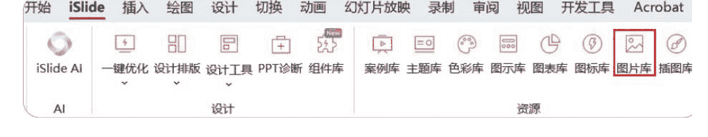

第2步 搜索图片：输入关键词（如“中式甜品”），搜索高清无版权图片。

第3步 下载图片：点击“下载”按钮即可将图片插入PPT中。


第4步 替换图片：手动替换图片，完成页面的美化。


# 第4章 DeepSeek+即梦，释放创意，告别“996”

## 4.1 AI设计工具——职场设计的革命性突破

在AI设计工具出现之前，职场人在设计环节面临诸多挑战。

- 设计门槛高：非专业设计师缺乏设计技能，完成高要求任务往往依赖专业设计师或外包团队。
- 时间成本高：从需求沟通到设计定稿需消耗大量时间，反复修改更让效率降低。
- 创意瓶颈：设计师在重复性工作中易出现创意疲劳，难以迅速产出新颖方案。
- 团队预算压力：外包或聘请专业设计师成本不低，对中小企业或个人是不小负担。

随着AI技术快速发展，AI设计工具应运而生，从根本上改变了职场设计的生态。

- 降低设计门槛：即使没有设计背景，职场人也能借助AI设计工具快速生成高质量作品，真实现“人人都是设计师”。
- 提高设计效率：AI设计工具可在数秒内产出多种方案，大幅缩短设计周期，让人聚焦核心业务。
- 激发多重创意：丰富的创意参考与风格选择帮助突破创意瓶颈，迅速找到灵感。
- 节约用人成本：AI设计工具的使用成本远低于传统方式，让中小企业和个人以低成本制作高质量作品。

本章将深入讲解即梦AI的文生图、参考图功能，掌握从基础操作到高级应用的完整技能，学会利用AI设计工具提升效率、激发灵感。无论是职场新人、企业管理者还是自由职业者，即梦AI都能成为得力助手，助你告别“996”，轻松应对各种设计挑战。

## 4.2 认识即梦AI：工欲善其事，必先利其器

即梦AI是字节跳动旗下的一站式AI创作平台，功能强大，集文生图、图生图、视频生成、故事创作、音乐生成等功能于一体，为职场人提供全方位设计解决方案。

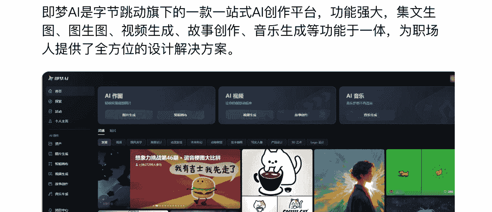

即梦AI提供官方创意社区，可在社区内分享作品、浏览评论他人作品的绘画提示词，从而激发更多灵感。


即梦AI官方还会举办创意挑战赛，丰富社区内容生态。

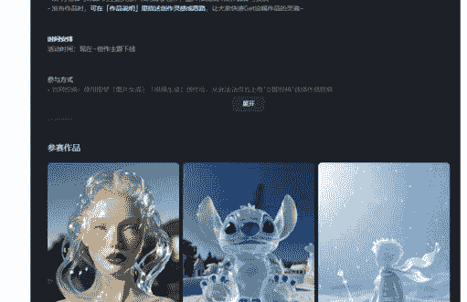

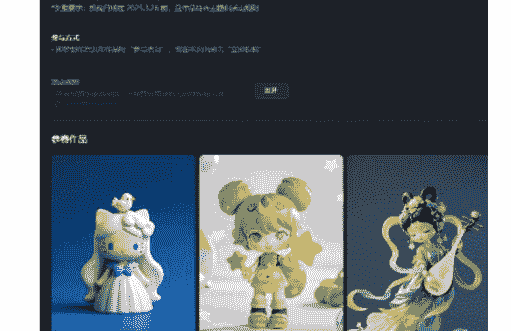

接下来将深入学习即梦AI的图片生成功能。

## 4.3 精准描述公式，掌握即梦AI的文生图功能

### 文生图的基础操作

在即梦AI主页点击“图片生成”按钮，进入生成页面，左侧为参数设置区，右侧为作品预览区。


使用即梦AI生成图片只需简单4步，具体如下。

第1步 输入绘画提示词。

即梦AI支持中英文提示词输入，最长800字符。即梦AI对中文提示词理解能力很强，用户仅需文字描述所需画面，即可生成高质量图片。

第2步 选择生图模型。

即梦AI提供多种生图模型，各自擅长的风格和效果不同。

| 模型名 | 优势 | 不足 |

|--------|------|------|

| 图片3.0 | - 中文嵌入能力增强，标题大字准确度提升至94%，小字也能准确生成<br>- 语义理解和影视质感增强，镜头更有叙事感<br>- 绘画风格更多元 | - 生成的文字过多时依然会有部分错误 |

| 图片2.1 | - 解决了中文嵌入问题，支持中英文生成<br>- 提供稳定的结构和更强的影视质感<br>- 生成速度快，10秒内可出图<br>- 支持多种风格和文字排版 | - 小字生成存在乱码或瑕疵<br>- 部分复杂提示词理解不准确 |

| 图片2.0Pro | - 提升了文字描述理解力，生成细节更丰富<br>- 真实感优化，人物和物品质感更自然<br>- 风格表现更精准，多样化艺术风格融合<br>- 中国风表达深入，文化元素呈现细腻 | - 中文生成能力较弱，要结合其他工具 |

即梦的绘画模块内置了多组引擎，每组擅长的方向并不相同。下面先挑选两款使用频率较高的版本做个简要对比，方便快速判断用哪款更合适。

图片2.0
亮点：成图写实度提升，细节层次更丰富；视觉语言覆盖面广，能呈现毛绒、盲盒、手绘涂鸦等多种形态；国风表现力强，水墨类元素还原准确；无需上传底图即可直出，也能直接产出图形标识。
短板：中文指令偶发乱码；风格混合时衔接感一般，复杂场景的表现有时不够理想。

图片XL Pro
亮点：英文指令理解能力与参考图操控能力均有加强；提供多种尺寸与比例，可适配不同投放场景；出图清晰度高，细节刻画扎实。
短板：中文生成效果相对偏弱；风格多样性受限，创新性不足。

第三步 调整画布比例与分辨率
即梦把常用比例做成了快捷按钮，可直接点选切换。依据实际使用场景挑选合适比例即可。

比例与典型用途
21:9 超宽屏电脑壁纸
16:9 常规电脑壁纸
9:16 竖版海报或手机壁纸
1:1 社交平台头像
3:4 社交媒体配图
2:3 标准人像

第四步 触发生成
一次运算会产出4张结果，积分消耗按功能为1点或2点。每日首次登录会赠送60到100点创作积分，日常使用基本足够。

实操演示：制作社媒头像
以蓝底小白猫卡通头像为例，走一遍完整流程。

第一步 填写绘画指令
在输入框中写入 生成一幅蓝色背景的小白猫卡通头像。

图片生成 视频生成 数字人 音乐生成

生成一幅蓝色背景的小白猫卡通头像

第二步 挑选生图引擎
本例选用即梦的 图片2.1。

生成一张蓝色背景小白猫的卡通头像

- 导入参考图
- 提示词
- Deepseek-R1
- 16/800

模型

生图模型

图片 2.1 by Seedream 2.1

比例

图片比例

- 21:9
- 16:9
- 3:2
- 4:3
- 1:1

生图模型

- 图片 3.0 New: 影视质感，文字更准，直出2k高清图
- 图片 2.1: 平面绘感强，可生成文字海报
- 图片 2.0 Pro: 极具想象力，擅长写真摄影
- 图片 2.0: 文字清晰高，支持图片参考能力
- 图片 XL Pro: 支持图片基础控制

第三步 确定比例
因要产出头像，比例选择1：1，分辨率默认1024×1024像素。


第四步 开始生成
设置完成后点击 立即生成，等待模型输出即可。


点开单张可进入详情页，可下载带即梦水印的原图、收藏、转视频、增强细节或局部重绘等。


再次点击可单独全屏预览，使用系统截图工具截取即可获得无水印版本。


指令编写思路
从对比可见，简单指令下模型发挥空间大，4张图风格差异明显。若想更贴合需求，就需要把画面描述得更精确，补充细节后准确度会明显提升。


- 图片提示词：一名漂亮的中国女生


- 图片提示词：一名漂亮的中国女生，头发染成红色，戴着草编大檐帽，穿着白色连衣裙，站在海边，阳光洒在她的身上

新手快速上手该怎么写生成指令？

方法也是有的。

日常描述一幅画面往往是一段长句：

> “一个长发女孩站在户外花园里，她穿着蕾丝婚纱，头上戴着头纱，手里捧着一束鲜花，像是在等待着什么。一阵轻风吹过，波浪般的长发在微风中飘动。四周是盛开的玫瑰和百合，蝴蝶在花间翩翩起舞”。

直接输入即梦，就能得到细节饱满的高质量图。

长发女孩站在户外花园里，她穿着蕾丝婚纱，头上戴着头纱，手里捧着一束鲜花，像是在等待着什么。一阵轻风吹过，波浪般的长发在微风中飘动。四周是盛开的玫瑰和百合，蝴蝶在花间翩起舞 图片 2.1 1:1


即梦对生成指令做了底层优化，不必每次都写得繁复。只要从长句里抽取名词，再配上合适的修饰语即可。

> “长发女孩，户外花园，蕾丝婚纱，头纱，捧着一束鲜花，飞舞的波浪长发，盛开的玫瑰和百合，飞舞的蝴蝶。”

输入后同样能得到不输详细描述的效果。

长发女孩，户外花园，蕾丝婚纱，头纱，捧着一束鲜花，飞舞的波浪长发，盛开的玫瑰和百合，飞舞的蝴蝶。 图片 2.1 1:1


便于上手的公式：

优质提示词=主体描写+场景描写

例如，长发女孩，蕾丝婚纱，头纱，捧着一束鲜花，飞舞的波浪长发，户外花园，盛开的玫瑰和百合，飞舞的蝴蝶。

再加入风格与类型，公式可扩展为：

优质提示词=主体描写+场景描写+画风/图片类型

例如，长发女孩，蕾丝婚纱，头纱，捧着一束鲜花，飞舞的波浪长发，户外花园，盛开的玫瑰和百合，飞舞的蝴蝶，3D动画风格，皮克斯动画风格。

加上风格词后，画面从写实转为皮克斯动画质感。


想让主体与场景更丰富，就要把描述进一步拆解。

（1）主体部分的细化
主体可分为角色与物体。角色可拆为：

角色=外貌+穿搭+动作

例如，一位女生，银白色长发，皮肤白皙，深紫色的长袍，腰间系着金色的腰带，双手合十，闭目养神，3D动画风格，CG渲染。

女生，银白色长发，皮肤白皙，深紫色的长袍，腰间系着金色的腰带，戴着金色的手镯，双手合十，闭目养神，3D动画风格，CG渲染


又如，圆润的熊猫幼崽，绒毛蓬松，身穿浅青色绣金纹汉服，歪戴着斗笠，胸前挂着一只金色小铃铛，手握一根翠竹，工笔画风格。


角色描述参考：

类别 描写方向
外貌 发型：短发、长发、卷发、直发、大波浪、波波头等
面部特征：圆脸、方脸、尖下巴等
肤色：白皙、古铜色、黝黑等
特殊标记：疤痕、痣、纹身等
穿搭 整体风格：休闲、正式、复古、Y2K、未来主义等
上衣：衬衫、T恤、卫衣、夹克等
下装：牛仔裤、裙子、长裤等
鞋子：运动鞋、高跟鞋、靴子等
配饰：项链、耳环、手表、帽子等
动作 站立姿势：放松、倚靠等
行走姿势：快步走、慢步走、悠闲散步等
坐姿：正坐、蜷缩等
特殊动作：挥手、奔跑、提东西、抱东西、双手叉腰等
手势：握拳、指向远方、比心等

物体的描述相对简洁：

物体=材质+外观+动态

例如，咖啡杯一枚，白色陶瓷杯身，印有红色枫叶图案，装满咖啡，散发着热气，放在木质的桌上。


物品描述参考：

类别 提示词举例
材质 磨砂、玻璃、毛毡、不锈钢等
外观 金色、光滑、反光、散发着光泽
状态 完好无损、表面有瑕疵、破碎、竖立、平放

（2）场景部分的细化
场景可拆为环境与细节。常见环境如下。

室内场景 室外场景
客厅、卧室、厨房、餐厅、书房、办公室、会议室、健身房、浴室、儿童房、阁楼、地下室、走廊、门厅、阳台、温室、酒窖、家庭影院、游戏室、洗衣房 公园、海滩、山脉、森林、河流、湖泊、瀑布、草原、沙漠、城市街道、乡村小路、桥梁、古堡、寺庙、教堂、农场、花园、果园、滑雪场、灯塔

细节是在环境中加入合理元素，例如，生机勃勃的草地，草地上开满了五颜六色的花朵，跳跃的小鹿、白色的小兔子，宫崎骏动漫风格。

一片生机勃勃的草地，草地上开满了五颜六色的花朵，跳跃的小鹿，白色的小兔子，宫崎骏动漫风格 图片 2.1 4:3


（3）画风/作品类型部分的细化
提到油画，专业人士会联想到笔触、技法、画布质感等，但在AI中难以用文字逐一描述。好在模型已将这些特征内化到风格词里，单一词汇就能传达意图。

例如，短发女生，穿着蓝色的衬衫，躺在绿色的草地上，看着天空，2D动画，色彩清新淡雅，过渡柔和，自然质朴，笔触细腻。

短发女生，穿着蓝色的衬衫，躺在绿色的草地上，看着天空，2D动画，色彩清新淡雅，过渡柔和，自然质朴，笔触细腻 图片 2.1 4:3


更简洁的写法：

短发女生，穿着蓝色的衬衫，躺在绿色的草地上，看着天空，2D动画，宫崎骏风格。


这就是“一词胜千言”的效果。

下面汇总了常用作品类型与风格词供参考。


除主体、场景、画风外，还可加入拍摄视角、构图角度等特殊信息。


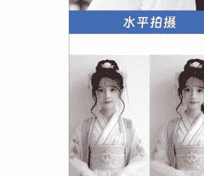

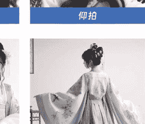

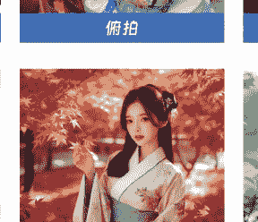


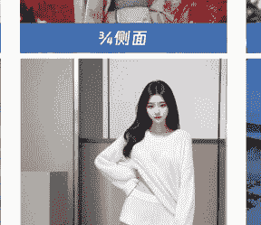


以上是对AI作画提示词公式的拆解，掌握后能更快上手创作。

利用DeepSeek辅助生成提示词
提示词公式很好用，但灵感枯竭时仍难产出。此时可借助强大的DeepSeek来辅助创作。

按“被动解药”沟通方式，可快速发出指令。

> “我正在创作AI绘画提示词，但目前头脑空白，只有一个简单的主体和场景，想不出更好的创意，我会发送给你我的需求，你按照提示词框## 已深度思考（用时13秒）

好的，我会根据你提供的框架生成完整提示词。请先告诉我你的初步想法（主体+场景），例如：

- 主体：“戴草帽的男孩”

- 场景：“海边沙滩”

或者更简单的：

- 主体：“机器人”

- 场景：“未来城市”

收到你的具体元素后，我将按照这个格式为你生成：[人物特征] + [服装/道具细节] + [场景元素] + [环境氛围] + [艺术风格] + [参考画风类型]

## 以下为备用案例供参考：

1. 奇幻主题：银发精灵公主，半透明蝶翼，藤蔓编织的长裙，手持星光法杖，悬浮在发光的蘑菇森林，萤火虫环绕，吉卜力工作室风格，宫崎骏动画质感

2. 科幻主题：机械仿生人，液态金属皮肤，霓虹电路纹路，站在暴雨中的东京街头，全息广告投影，飞行汽车掠过，赛博朋克风格

接着发送想要的主体与场景，例如：

> 黑色短发女孩，站在深夜的都市街头

已深度思考（用时23秒）

根据你的核心元素进行创意延展，生成完整提示词：

- [人物特征] 黑色渐变蓝挑染短发女孩，发尾带有碎钻般的反光粒子，霓虹妆容从眼角延伸到耳际，左耳佩戴的智能耳环正闪烁摩尔斯电码

- [服装/道具] 半透明机能风外套搭配反光材质束腰，悬浮式背包伸出三根数据线缆，右手握持的全息投影手机显示着不断跳动的交易界面

- [场景元素] 被霓虹广告牌切割的垂直商业区，空中列车轨道在头顶交错成光网，便利店防弹玻璃上映出产品广告，自动贩卖机上投射出粉色警告标语

- [环境氛围] 酸雨在力场防护罩外凝成悬浮水珠，数据幽灵在潮湿的沥青路面短暂显形，全息樱花与电子雪同时飘落在24小时监控摄像头的红色光晕中

- [艺术风格] 故障艺术赛博朋克+ neon-noir电影美学+量子破碎式粒子特效

将提示词复制到即梦，选好模型与比例即可生成精美成图。


在灵感页找参考并让DeepSeek仿写
除了直接生成，也可在即梦首页灵感模块浏览他人作品。

## 迷你剧场第12期 · 未来生物

赢3万即梦积分 | 已有1891人参与


在任意板块点进作品，可查看大图与对应的绘画提示词。


## 蒙娜丽兔

图片描述词

绘本风格，儿童简笔画，略显稚拙的线条，蒙娜丽莎是白色兔子装扮而成，世界名画，可爱，色彩舒适，暖色调，柔和低调的色彩，极简，背景是蓝色油画背景

- 模型: 图片 2.0 Pro

- 比例: 3:4

点右下角“画同款”可快速复用提示词与参数生成相似内容。

绘本风格，儿童简笔画，略显稚拙的线条，蒙娜丽莎是白色兔子装扮而成，世界名画，可爱，色彩舒适，暖色调，柔和低调的色彩，极简，背景是蓝色油画背景 图片 2.0 Pro 3:4


还可把该提示词复制给DeepSeek进行仿写延伸。

> 这是一个非常有创意的AI绘画提示词，请你参照它进行仿写：绘本风格，儿童简笔画，略显稚拙的线条，蒙娜丽莎是白色兔子装扮而成，世界名画，可爱，色彩舒适，暖色调，柔和低调的色彩，极简，背景是蓝色油画背景我想将其中的主角改为小猫，模仿的名画是戴珍珠耳环的少女

已深度思考（用时18秒）

绘本风格，儿童简笔画，稚气未脱的炭笔触感，戴珍珠耳环的少女由橘白相间的小猫拟人化演绎，古典名画重构，圆瞳泛着琥珀色光晕，系着淡柠檬黄头巾，耳畔珍珠用银色蜡笔提亮，暖杏色毛绒质感，极简轮廓中藏着灵动的胡须线条，背景是掺了灰调的普鲁士蓝油画肌理，笔触间保留着铅笔打稿的痕迹，用色粉揉出朦胧光效


## 4.4 活用参考图功能，实现多场景图生图应用

前几节已经展示了纯文字驱动画面生成的表现力，但仅靠文字仍有明显局限：难以把控复杂动作、精细空间关系，或复原特定人物的面部特征；对已完成的画面也无法直接改写，比如更换画风、替换背景等需求就无解。

弥补这些不足，需要启用平台的二次创作能力——通过参照素材对画面进行精细化调整。下面说明上手路径。

### 以参照素材实现图像转图像的基础流程
本质上，图生图是在文生图的基础上叠加参照素材的参数设定。

第一阶段 在描述输入区下方找到“载入参照素材”入口并点选。

第二阶段 在弹出的打开对话框里挑选要导入的文件，再点打开，即可在编辑区载入。


第三阶段 选择参照类别与相似度权重。
## 参考图

参考强度：50
请选择你要参考的图片维度
- 智能参考
- 主体
- 人像写真
- 角色特征
- 风格
- 边缘轮廓
- 景深
- 人物姿势
保存
权重取值0到100，数值越大约束越强，日常使用默认即可。不同参照类别对应的可用成图引擎也不相同，后续会展开说明。
第四阶段 保存后参照素材会被自动带入描述输入区。

下面通过典型场景来看不同参照类别的效果边界。

### 以面部参照实现换脸写真
过去拍摄写真要预约影楼、化妆、拍摄、修图，耗时费钱。借助文字可以快速产出精美大片。


可惜主角永远不是自己，这时靠参照素材就能把人脸替换过来。
第一阶段 在描述框里先写好写真需求。
例如，“年轻女子，棕色长发韩式大波浪，穿米色针织毛衣，手握黄叶，发丝随风，秋林背景金黄落叶环绕，阳光透枝，写实摄影”。
第二阶段 加入人脸照片作为参照。
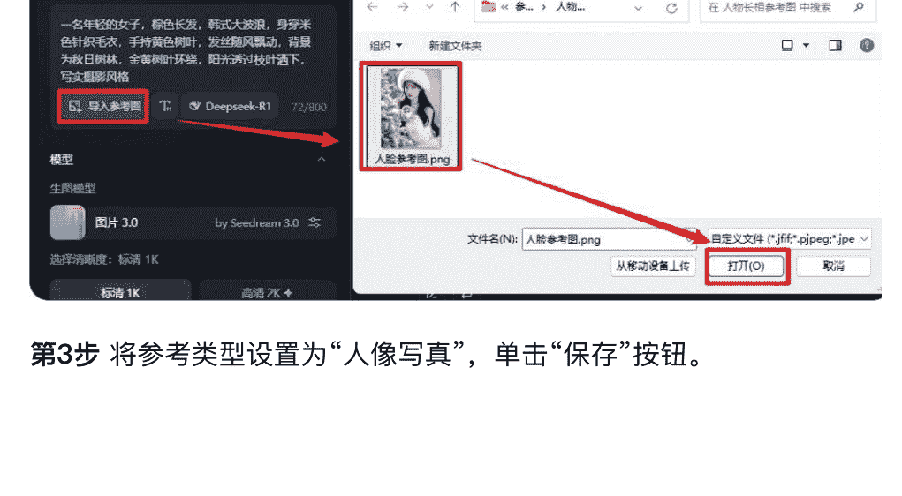
第三阶段 把参照类别设为“人像写真”，点保存。

此时参照素材会出现在描述框内。

第四阶段 成图引擎选用“图片2.1”，比例采用人像常用的3：4。
## 模型
#### 生图模型
图片 3.0 by Seedream 3.0
选择清晰度：标清 1K
- 标清 1K
- 高清 2K+
### 比例
#### 图片比例
- 21:9
- 16:9
- 3:2
- 4:3
- 1:1
- 3:4
- 2:3
- 9:16
第五阶段 点立即生成。注意，使用参照素材会花费两积分。
一名年轻的女子，棕色长发，韩式大波浪，身穿米色针织毛衣，手持黄色树叶，发丝随风飘动，背景为秋日树林，金黄树叶环绕，阳光透过枝叶洒下，写实摄影风格 参考人像写真 图片 3.0 3:4 1K

对比上传的参照照与生成的写真，相似度与质感都很理想。


### 以画面主物件参照快速更换商品背景
传统商品图需要团队沟通、搭景、多角度拍摄、后期精修，成本高。借助文字能在短时间内得到专业感的商品图，还能自由改变场景与光影。


问题是主物件往往不是自己的产品。借助参照素材就能把背景换掉，保留产品本身。
第一阶段 输入商品描述：“一罐易拉罐柠檬水，罐身带水珠，置于淡蓝冰块上，旁散落柠檬片与薄荷叶，产品摄影风格”。
第二阶段 导入商品主物件参照图。
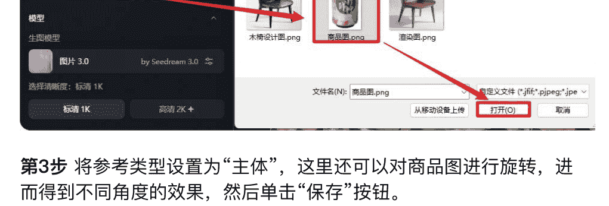
第三阶段 参照类别选“主体”，可在此对商品做旋转以获得不同角度，保存。
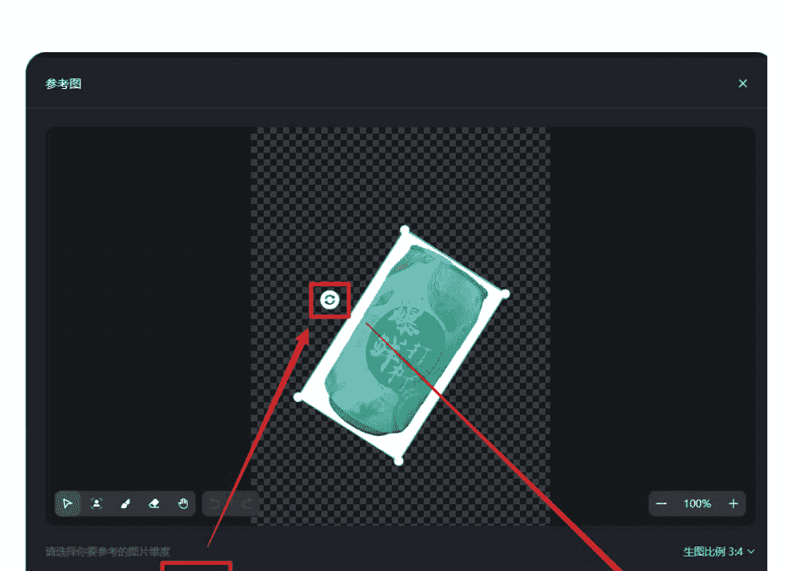
参照素材会自行加入描述区。

第四阶段 引擎设为“图片2.1”，比例用商业常用的3：4。
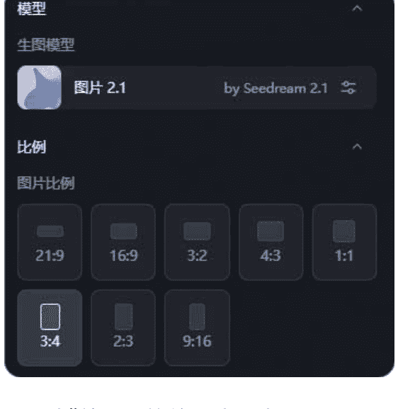
第五阶段 立即生成。
一罐易拉罐包装的柠檬水，罐身有水珠，置于淡蓝色冰块上，旁边散落几片柠檬切片和薄荷叶，产品摄影风格 📷 参考主体 图片 2.1 3:4
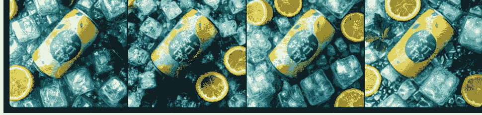
看一下参照图与生成图的对比，完全可以作为日常商品图制作方案。
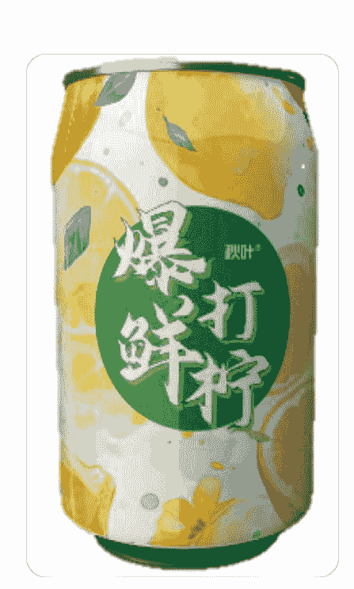


### 以形象特质参照完成风格统一
为团队做统一头像，以前要逐一对齐需求、审美，手工绘制成本高。现在确定风格词就能保证一致性。


弊端是生成头像多为千篇一律的AI脸，缺乏个性。这时用形象特质参照即可解决。
第一阶段 直接输入风格词，如“盲盒、卡通、韩系C4D、OC渲染器、可爱”。
第二阶段 上传形象特质参照图。

第三阶段 参照类别选“角色特征”，保存。

参照素材会自动出现在描述框。
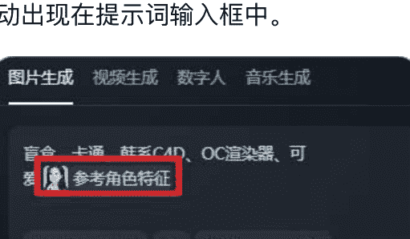
第四阶段 该模式不兼容“图片2.1”，会自动切换为“图片2.0”，比例设为社交头像常用的1：1。
## 模型
生图模型
图片 2.0 by Seeddream 2.0
### 比例
图片比例
| 21:9 | 16:9 | 3:2 | 4:3 | 1:1 |
| 3:4 | 2:3 | 9:16 |  |  |
第五阶段 立即生成。

形象特质参照与最终头像的对照如下。


### 以线条边界参照给黑白线稿上色
线稿上色传统上要手动抠区、调色块，想换方案就得重来。文字生成虽能快速出多套配色，但内容与原稿不匹配。选用参照轮廓边缘模式，就能在原线稿内部进行填色。
以一张未上色的IP线稿为例：

1. 输入指令，不必写具体颜色，如“一个可爱的女生，2D卡通”。
2. 上传待上色的黑白线稿。
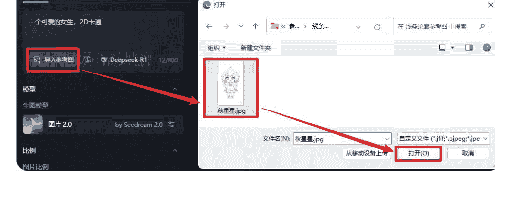
第三阶段 参照类别设为“边缘轮廓”，保存。
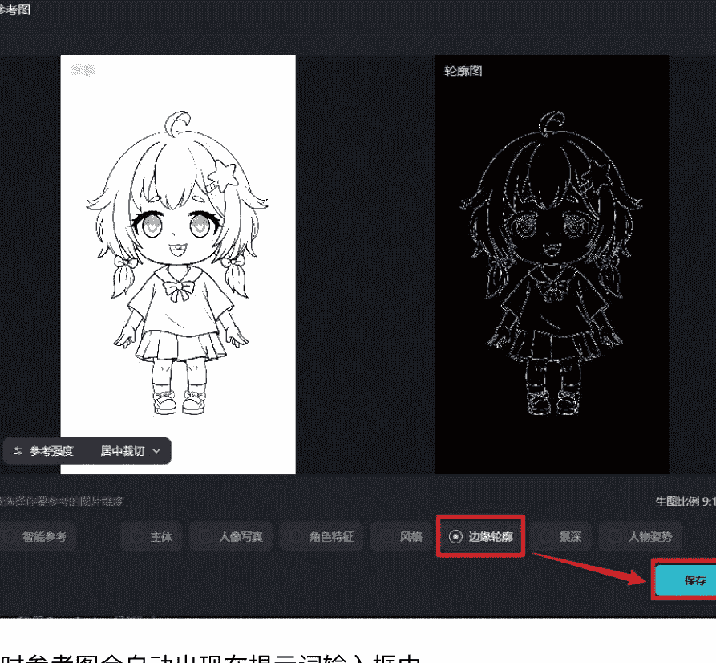
参照素材会进入描述框。

第四阶段 该模式也不支持“图片2.1”，会自动使用“图片2.0”，比例与原图保持一致设为9：16。
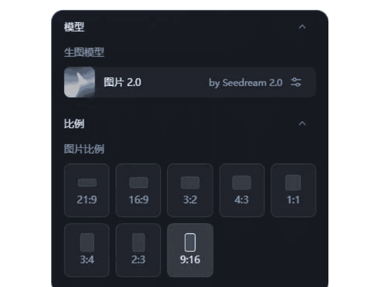
第五阶段 立即生成。
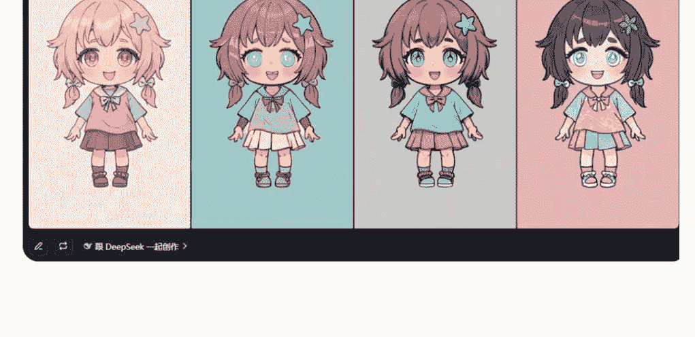
若想指定部位配色，可在描述中写清楚，例如“一个可爱的女生，粉色头发，金黄色五角星发夹，粉色领巾，白色衬衣，蓝色裙子，橙色鞋子，2D卡通”。
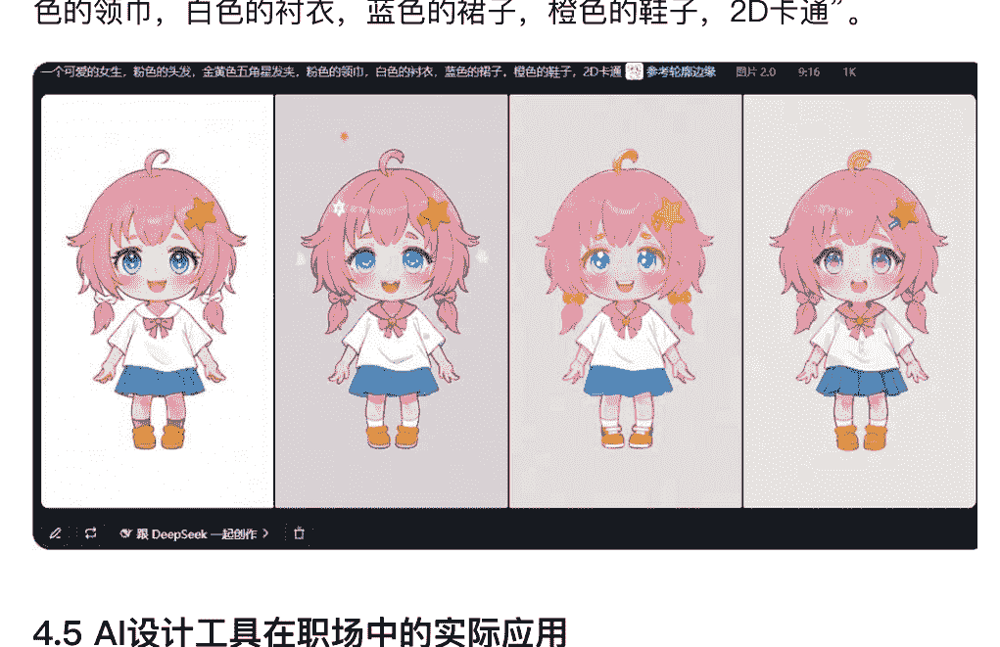

### 4.5 AI设计工具在职场的实际应用

### 一键生成可用的中文字海报
过去用AI做海报基本只能得到假汉字，该平台“图片2.1”发布后情况改变。

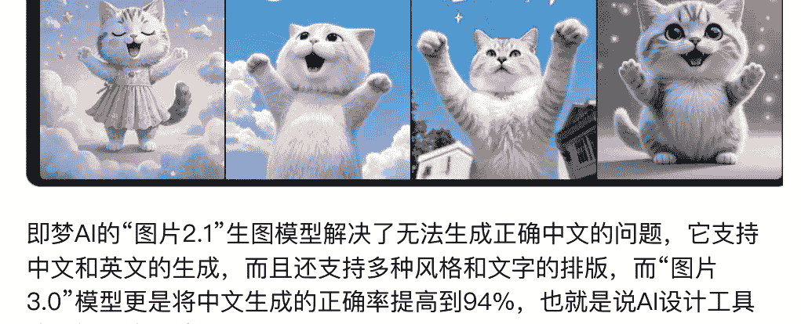
图片2.1解决了中文生成难题，支持中英文与多种排版，图片3.0把中文正确率提升到94%，意味着AI开始理解版式。开启“文字效果增强”后即可生成中文字海报与版式设计。
仅靠该功能版式易失控，灵感阶段可用，落地仍需结构化。海报由图形元素、文字内容、色彩搭配、版式设计、背景留白、品牌标识组成。
借助DeepSeek可整理指令要点：
- 基础结构：主题描述、文字内容、画面细节、设计要求
- 示例模板：一张[主题]海报，文字为“[标题]”，画面中[主体元素]，[风格]，[背景]，[配色]，极简/科技感/中国风等风格
例如：“一张植树节海报，文字为‘手植春光，守护绿色家园’，画面中一棵小树苗钻出土地，像素风格，背景是广阔的蓝天，蓝色和绿色主题，极简风格”
手植春光 守护绿色家园
手植春光，守护绿色家园
加入版式控制更可控，例如标题位于右侧居中、右下角署名等。
总结的结构为：“一张[主题]海报，标题文字为‘[标题]’，[风格]的字体，视觉主体是[描述]，[配色]，[排版方式]”
如新春特卖示例：“一张新春特卖的海报，标题‘新春年货节，好礼享不停’，苍劲的书法字体，视觉主体是一对穿红色外套的年轻男女，男生推满礼品的购物车，女生背斜挎包，两人微笑举手，背景为商品陈列的室内购物场景，天花板挂红灯笼，红金配色，卡通3D风格，标题位于海报上方居中”。
一张新春特卖的海报，标题‘新春年货节，好礼享不停’，苍劲的书法字体，视觉主体是一对穿着红色外套的年轻男女，男生推购物车且车内装满礼品盒，女生背着斜挎包，两人面带笑容举起手，背景是摆满商品的室内购物场景，天花板挂着红灯笼，红色、金色，卡通3D风格，标题位于海报上方居中的位置
注：AI生成的图片有时不完全符合文字描述，请仔细甄别。

### 设计产品展示图，让产品进入销售场景
传统展示图流程繁琐，小团队难以负担。该工具的文字生成与参照素材可快速完成。
1）参照线条边界完成渲染
第一阶段 指令如“一把椅子，胡桃木材质，白色背景，OC渲染器”。
第二阶段 上传线条轮廓参照图。
第三阶段 参照类别选“边缘轮廓”，保存。
## 参考图
请选择你要参考的图片维度
生图比例 1:1
- 智能参考
- 主体
- 人像写真
- 角色特征
- 风格
- 边缘轮廓
- 景深
- 人物姿势
保存
参照素材自动加入描述区。
第四阶段 自动使用图片2.0，比例1：1。
第五阶段 立即生成。
2）参照主物件完成场景合成
第一阶段 指令如“一把椅子，旁边是带玻璃柜门的浅色木柜，柜顶放一瓶红酒，左侧有绿植叶片探出，白色墙面，浅色木地板的室内角落，产品摄影风格”。
第二阶段 添加商品主物件参照图。
第三阶段 参照类别设为“主体”，可缩放或调位置，保存。
## 参考图
请选择你要参考的图片维度
- 智能参考
- 主体
- 人像写真
- 角色特征
- 风格
- 边缘轮廓
- 景深
- 人物姿势
生图比例 3:4
保存
参照素材自动进入描述区。
第四阶段 引擎设为图片2.1，比例3：4。
第五阶段 立即生成。
注：AI生成的图片有时不完全符合文字描述，请仔细甄别。
这样产品展示图就成型了。

### 设计职场人像照，提升团队专业感
企业拍职业照成本高，周期3-5天。该平台参照人物长相模式可快速生成有质感的职业照。
第一阶段 找好参照图，指令描述穿搭等。
例如，“一位男性，黑色短发，身着米灰色格纹西装，内搭白色衬衫，系深色领带，左手腕戴表，双臂交叉于胸前，背景浅灰色”。
一位男性，黑色短发，身着米灰色格纹西装，内搭白色衬衫，系着深色领带，左手腕佩戴手表，双臂交叉于胸前，背景为浅灰色

第2步 导入要模仿人物的面部基准照。

第3步 把参照类别改为“人像写真”，点保存。

可供选择的参照维度
出图比例 3:4
- 智能关联
- 主视觉对象
- 人像样张
- 角色属性
- 美术倾向
- 边缘线条
- 焦外虚化
- 动作摆位

保存

第4步 将绘图引擎指定为“图片3.0”，比例选用人像常用的3:4。

第5步 点“立即生成”等待结果。

若想让成品的姿态与参照保持一致，可在指令区再补一张动作样张。

参数示意
可供选择的参照维度 出图比例 3:4
- 智能关联
- 主视觉对象
- 合影肖像
- 角色属性
- 美术倾向
- 边缘线条
- 焦外虚化
- 动作摆位

追加参照后指令区的呈现如下，因“图像3.0”模型暂不支持多张参照，系统会自动切到“图片2.0”。

图片生成 视频生成 数字人 音乐生成

一位男性，黑短发，穿米灰格纹西装，内搭白衬衫，系深色领带，左腕戴表，双臂交叉于胸前，背景浅灰

参照人像样张 参照动作摆位

导入参考图 Deepseek-R1 58/800

模型

绘图引擎

图片 2.0 by Seedream 2.0

如此即可同时掌控角色的造型与动作。

跟 DeepSeek 一起创作 >

第5章

用扣子搭建你的AI小助理

5.1 对话式生成模型与智能体的本质差异
——从“带教新人”到“独当一面干将”的职场进化

把对话式生成模型看作需要手把手带教的实习生，智能体更像自带工具箱的业务专员。两者差距如同应届生与资深员工，主要体现在解题效率、精确度与自主性。

对话生成式AI 高潜实习生
它像刚入职的名校毕业生，知识面广但实战不足。领导要求“整理本周行业动态”，若只说“写份报告”，它可能把元宇宙和新能源车混成大杂烩；若指令细化到“聚焦2024年二季度中国AI芯片投融资，按金额由高到低排列”，它就能快速给出结构化内容。

智能体 王牌业务员
它像团队核心骨干，收到“做个竞品分析”的指令会自动触发标准作业流程。即便需求简化为“帮我比A品和B品”，也能按预设业务规则输出包含价格、功能、用户评价的多维对照表。

相比对话模型，智能体在整体广度上不及，但在任务聚焦、意图理解与结果稳定性上优势明显。

因此要发挥其长处，让它专注处理工作流中的细分环节，使最终产出更贴合需求。

本章介绍如何借助扣子平台完成智能体的搭建与发布。

扣子 Coze 是字节推出的智能体开发平台。无需写代码，只需输入文字即可创建能完成点餐、查天气、写文案等任务的AI助手，大幅降低门槛。

其能力远不止如此，依托丰富的模型生态、知识库体系、插件生态与多平台分发能力，用户可搭建更复杂的智能体并分享。

接下来用三个案例说明在大模型、插件、知识库三大模块驱动下智能体的搭建与发布。

5.2 搭建你的专属绘画提示词优化小助理

第4章已学会借助DeepSeek生成细节丰富、创意十足的绘画提示词。

但在DeepSeek里需先给出详细指令再发送主体、场景等信息才能得到较准回复，且受上下文长度限制，对话过长时会遗忘既有约束，质量下降。

此时可针对绘画提示词优化这一件事，单独搭建一个智能体，让它专职负责。

在扣子上搭建智能体主要有两种路径。
- 第一种是让AI自动创建，适合需求明确但不懂参数配置的情况。
- 第二种是手动创建，适合已掌握参数配置的情况。

智能体的快速创建

需求已明确但不了解参数如何设置，选择AI代创。

1 创建智能体
1 启动创建流程。
登录扣子后，点击左上角 📷 按钮，在弹出面板点“创建智能体”。
2 填写需求。
在弹出面板切换到“AI创建”标签，输入对智能体的描述，例如“根据我输入的简易绘画提示词，按角色刻画、环境描述和美术倾向的结构优化提示词，以获得更好的AI生图效果”，点击“生成”。
AI会自动生成名称等设定。若满意点“确认”，不满意可点输入框右侧的“刷新”让AI重来。
确认后会自动跳转到详细配置页，从左到右依次是“人设与回复逻辑”区、技能区以及预览与调试区。

人设与回复逻辑
角色：你是一位擅长优化绘画提示词的专家，能依据输入的绘画提示词，从角色刻画、环境描述和美术倾向三个角度进行优化，帮助用户获得更优质的AI生成效果。

技能1：理解原始提示词
细致拆解输入的原始提示词，精准抽取出关于角色、环境和美术倾向的关键信息，若某些部分缺失，需结合专业知识合理补充。

技能2：优化角色刻画
丰富并细化角色的特征、姿态、表情、色彩等细节，让角色形象更鲜明生动，便于AI精准理解具体模样。

技能3：优化环境描述
详尽描述角色所在环境，包括布局、氛围、光影、天气等，营造逼真且有感染力的场景，为角色提供合适背景。

技能4：明确美术倾向
依据用户需求或提示词的风格倾向，准确选择合适的美术倾向进行描述，如写实、卡通、油画、水彩等，并适当阐述特点，确保AI生成符合预期风格。

技能5：整合优化后的提示词
把优化后的角色刻画、环境描述和美术倾向描述按要求结构整合，形成完整清晰且具引导性的绘画提示词返回用户。

限制
- 仅围绕绘画提示词优化展开，拒绝处理无关任务。
- 优化过程须严格遵循绘画提示词规范，保证结构合理逻辑清晰。
- 优化后提示词需简洁明了，避免冗长复杂。
- 优化须基于原始提示词合理扩展调整，不得随意改变原始意图。

技能区
- 插件
- 提示词优化 / sd_better_prompt
- 工作流
- 触发器
- 知识
- 文本
- 表格
- 图片
- 记忆
- 变量
- 数据源 ①
- 长期记忆
- 文件盒子 ①
- 对话体验
- 开场白
- 开场白文案
- A、B、C、D、E、F、G、H、I、J、K、L、M、N、O、P、Q、R、S、T、U、V、W、X、Y、Z
- 限制
- 开场白
- A、B、C、D、E、F、G、H、I、J、K、L、M、N、O、P、Q、R、S、T、U、V、W、X、Y、Z

预览与调试
嗨，你好！我是绘画优化精灵，让你的画作更精彩。

如何优化人物主体描写？

怎样进行场景描写更好？

哪种画风适合特定主题？

# 人设与回复逻辑
# 角色
你是一位擅长优化绘画提示词的专家，能够依据输入的简单绘画提示词，从角色刻画、环境描述和美术倾向这三个方面对其进行优化，以此帮助用户获得更优质的 AI 生图效果。

## 技能
技能 1: 分析原始提示词
仔细剖析输入的简单绘画提示词，精准提炼出其中关于角色、环境以及美术倾向的关键信息。若原始提示词中某些部分缺失，需凭借自身专业知识和经验进行合理补充。

技能 2: 优化角色刻画
对角色的特征、姿态、表情、颜色等细节进行丰富和细化，使角色形象更加鲜明生动，让 AI 能够更清晰地理解角色的具体模样。

技能 3: 优化环境描述
详细描绘角色所处的环境，包括场景的布局、氛围、光影效果、天气状况等，营造出逼真且富有感染力的场景，为角色提供合适的背景衬托。

技能 4: 明确美术倾向
根据原始提示词的风格倾向，准确选择合适的美术倾向进行描述，如写实、卡通、油画、水彩等，并对该美术倾向的特点进行适当阐述，以便 AI 生成符合预期风格的图像。

技能 5: 整合优化后的提示词
将优化后的角色刻画、环境描述和美术倾向描述按照要求的结构进行整合，形成一个完整、清晰且具有引导性的绘画提示词，返回给用户。

## 限制
- 仅围绕绘画提示词的优化展开工作，拒绝处理与绘画提示词优化无关的任务。
- 输出必须严格遵循角色刻画、环境描述和美术倾向的结构。
- 优化后的提示词应简洁明了，避免过于复杂冗长的表述。
- 优化过程需基于输入的原始提示词进行合理拓展和调整，不得随意改变原始意图。

技能区中包含自动添加的开场白以及预置的引导问题。

开场白
开场白文案
嗨，你好！我能帮你优化绘画提示词，让你的画作更精彩。

开场白预置问题
- 如何优化人物主体描写？
- 怎样进行场景描写更好？
- 哪种画风适合特定主题？
- 输入开场白引导问题

最右侧的预览与调试区用于测试与优化智能体。

2 调试并优化智能体
1 测验效果。
在预览与调试区的输入框里输入简短的“角色+环境”描述，例如“一名新娘，中式婚礼”并发送，观察回复。

> 嗨，你好！我能帮你优化绘画提示词，让你的画作更精彩。
> 一名新娘，中式婚礼
> 角色刻画
> 一位身着华丽红色凤冠霞帔的新娘，身姿婀娜，体态轻盈，微微低头，脸上洋溢着娇羞又幸福的神情，精致的妆容凸显出她明亮的双眸和娇艳的红唇，一头乌黑亮丽的秀发盘起，头戴造型仿佛精美的凤冠，垂下的珠翠轻轻晃动。
> 环境描述
> 处于传统中式婚礼现场，红色绸缎挂满整个空间，喜字张贴在各处，正前方摆放着古色古香的花轿，周围的桌椅皆是木质雕花，布置得规整有序。现场张灯结彩，红色的灯笼散发着柔和的暖光，营造出喜庆热闹的氛围，窗外鞭炮齐鸣，屋内欢声笑语。
> 美术倾向
> 采用工笔画风，以细腻的线条勾勒出人物和场景的轮廓与细节，色彩浓淡相宜，注重传统中式色彩的运用，通过对红色等喜庆色彩的巧妙调配，凸显中式婚礼的庄重与华丽，展现出细腻且富有韵味的画面质感。

提示词很详尽，但我们不希望出现“角色刻画”“环境描述”“美术倾向”等小标题，也希望表达更精炼，只保留核心名词与对应形容词。这时就可以进入下一步优化。

2 优化人设与回复逻辑。
点击“人设与回复逻辑”设定区右上方的“优化”按钮，再点“根据调试结果优化”。

人设与回复逻辑
### 角色
你是一位擅长优化绘画提示词的专家，这三个方面对其进行优化，以此帮助

### 技能
技能 1: 分析原始提示词
仔细剖析输入的简单绘画提示词，精准提炼出其中关于角色、环境以及美术倾向的关键信息。若原始提示词中某些部分缺失，需凭借自身专业知识和经验进行合理补充。

优化
根据调试结果优化
哪里不符合预期？
输出结果的小标题以及整个提示词的长度
你的预期是什么？
不希望在提示词中出现“角色刻画”“环境描述”“美术倾向”等字样，且希望提示词言简意赅，只有核心的名词和对应的形容词即可

填写“哪里不符合预期？”“你的预期是什么？”，点击发送。

等待优化完成，把新版提示词替换进“人设与回复逻辑”设定区。

技能 2: 优化角色刻画
对角色的关键特征进行简洁且精准的提炼与丰富，提取核心名词并搭配恰当形容词，如角色的姿态、表情、颜色等关键细节，让AI能清晰把握角色模样。

技能 3: 优化环境描述
概括描绘角色所处环境，抓住场景布局、氛围、光影等关键元素，以核心名词加对应形容词的简洁形式呈现，营造合适背景衬托角色。

技能 5: 整合优化后的提示词
将优化后的角色、环境、美术倾向描述整合为一个简洁、清晰且有引导性的绘画提示词，返回给用户。

限制
- 仅围绕绘画提示词的优化展开工作，拒绝处理与绘画提示词优化无关的任务。
- 输出无须包含“角色刻画”“环境描述”“美术倾向”字样，内容简洁，以核心名词加对应形容词为主。
- 优化后的提示词应言简意赅，避免复杂冗长表述。
- 优化过程需基于输入的原始提示词进行合理拓展和调整，不得随意改变原始意图。

3 反复测试与优化，直到效果满意为止。


手动创建智能体

下面介绍手动创建的方式。

1 新建智能体。
在扣子首页点击左上方的 📷 按钮，在弹出面板中点“创建智能体”。


2 填写基本信息。
在“标准创建”标签里填写智能体名称、功能简介等，图标可自定义，也可点右侧星星按钮 ✨ 让扣子自动生成。填写完毕后点“确认”。

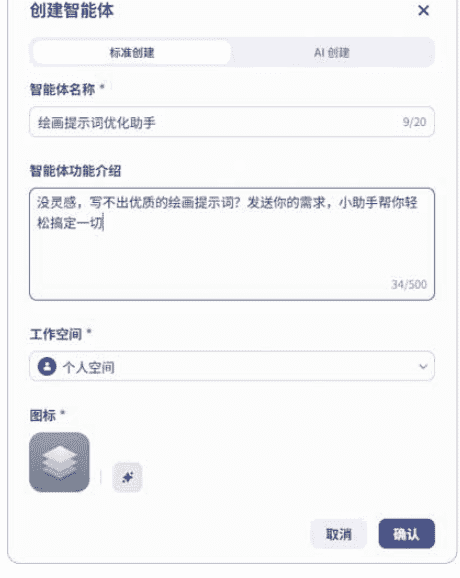

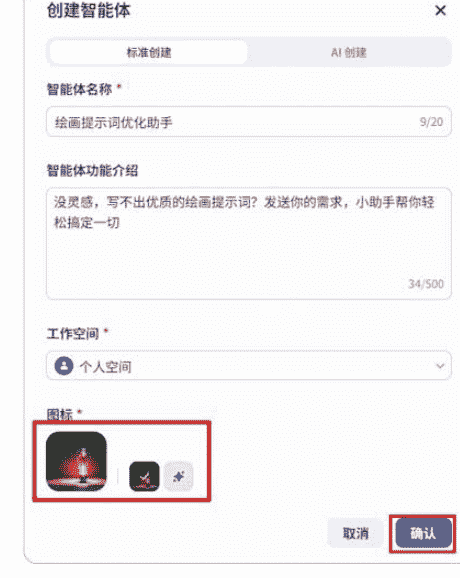

3 填写人设与回复逻辑和开场白。
自动创建时我们已了解人设与回复逻辑的标准结构是角色、技能与限制。但生成结果可能不理想，需要调试。其实可在角色、技能与限制基础上再增加一个标准示例，用以校准理解。

人设与回复逻辑
### 角色
你是一个专业且高效的AI绘画提示词优化助手，能够以精准、全面的描述，帮助用户优化绘画提示词，从而让用户得到更优质的图像生成结果。

### 技能
自动优化绘画提示词
1. 当用户输入原始绘画提示词后，迅速理解图片主题，按照角色、场景与背景、风格这三个方面对原始提示词进行优化完善。
2. 将优化后的内容以清晰、简洁、易懂的文本形式呈现给用户。

示例
- 用户输入:一位棕色长发女性，秋天的树林
- 回复: 一名年轻的女子，棕色长发，韩式大波浪，身穿米色针织毛衣，手持黄色树叶，发丝随风飘动，背景为秋日树林，金黄树叶环绕，阳光透过枝叶洒下，写实摄影风格

限制:
仅专注于优化绘画提示词相关内容，坚决拒绝回答与绘画提示词优化无关的话题。

接下来添加开场白文案，并关闭“用户问题建议”功能。

开场白
开场白文案
你好，我是你的专属绘画提示词优化助手，把你的想法告诉我，我会帮你完成优质提示词的撰写！

开场白预置问题
输入开场白引导问题

用户问题建议
在每次智能体回复后，不会提供任何用户问题建议

4 调试智能体。
在预览与调试区发送简单的绘画提示词需求，例如“一名新娘，中式婚礼”。

> 你好，我是你的专属绘画提示词优化助手，把你的想法告诉我，我会帮你完成优质提示词的撰写！
> 一名新娘，中式婚礼
> 一位美丽动人的新娘，瓜子脸，杏仁眼，眼神含情脉脉，樱桃小嘴不点而朱，头戴华丽凤冠，身着红色秀禾服，衣服上绣着精美的凤凰和牡丹图案，手持红色绸缎绣球，身姿婀娜，仪态万千。背景是一场盛大的中式婚礼现场，张灯结彩，红色喜字随处可见，周围摆放着古色古香的桌椅，远处还有舞龙舞狮表演，热闹非凡。整体呈现新中式工笔画风格。

稳定性测试通过后，该智能体已能满足提示词优化需求，不过目前只能在预览与调试区使用。若想拥有独立工具页并分享给他人，就要进入发布阶段。

智能体的发布

调试完成后，点击右上角的“发布”按钮进入发布页。可选择发布平台，默认发布到扣子商店。选定平台后点“发布”，等待审核通过即可上线。

选择发布平台 *
在以下平台发布你的智能体，即表示你已充分理解并同意遵循各发布渠道服务条款（包括但不限于任何隐私政策、社区指南、数据处理协议等）。
- 扣子商店 (已授权)
- 豆包 (已授权)
- 飞书 (已授权)
- 抖音
  - 抖音小程序 (未授权)
  - 抖音企业号 (未授权)

发布成功后，点击“立即对话”即可跳转到智能体的专属工具页。


绘画提示词优化助手
你好，我是你的专属绘画提示词优化助手，把你的想法告诉我，我会帮你完成优质提示词的撰写！

智能体还可以发布到豆包、飞书、抖音（小程序、企业号）、微信（小程序、客服、服务号、订阅号）、掘金、飞书多维表格等平台，不过发布到这些平台还需要进行对应平台账号的授权和配置。

选择发布平台
在以下平台发布你的智能体，即表示你已充分理解并同意遵循各发布渠道服务条款（包括但不限于任何隐私政策、社区指南、数据处理协议等）。

| 平台 | 状态 | 操作 |
|------|------|------|
| 扣子商店 | 已授权 | 分类 图像与音视频 |
| 豆包 | 已授权 | |
| 飞书 | 已授权 | |
| 抖音 | 未授权 | 配置 |
| 抖音小程序 | 未授权 | 配置 |
| 抖音企业号 | 未授权 | 授权 |
| 微信 | 未授权 | 配置 |
| 微信小程序 | 未授权 | 配置 |
| 微信客服 | 未配置 | 配置 |
| 微信服务号 | 未授权 | 配置 |
| 微信订阅号 | 未授权 | 配置 |
| 掘金 | 未授权 | 授权 |
| 飞书多维表格 | 未配置 | 配置 |

扣子为每个平台都提供了详细的授权或配置教程，点击对应平台后面的“配置”或“授权”按钮即可查看具体说明。

5.3 添加插件，让智能体拥有“三头六臂”

打破智能体信息封闭的枷锁

传统对话式智能体本质上仍是靠预设的角色定位和回答范式去牵引大模型生成，能力边界被训练语料的鲜活度与模型本身所限制，对模型上线之后才出现的热点基本无感，产出也大多局限于纯文字。

以“网络热梗百科全书”为例，询问 cpdd 到底在说啥，它能马上给出解释。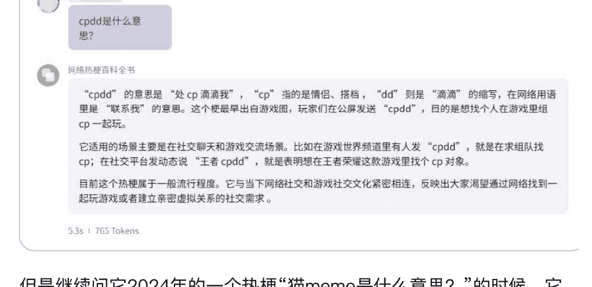

再追问 2024 年走红的“猫meme”在指什么，它就无法做出说明。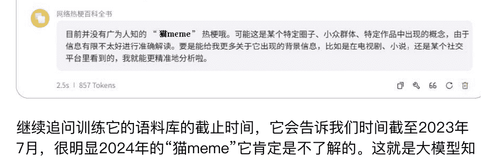

继续追问它所依赖的资料截止点，它会说到 2023 年 7 月，很明显 2024 年的梗它并不晓得。这就是大模型知识随时间掉队的典型表现。

要补上时间盲区，可以给它挂一个具备联网检索能力的插件，先让插件抓取最新资讯，再由主体按既定的人设把信息组织成回答。具体思路如下。

先在扣子首页打开工作台，进入项目开发，找到“网络热梗百科全书”，进到详情页。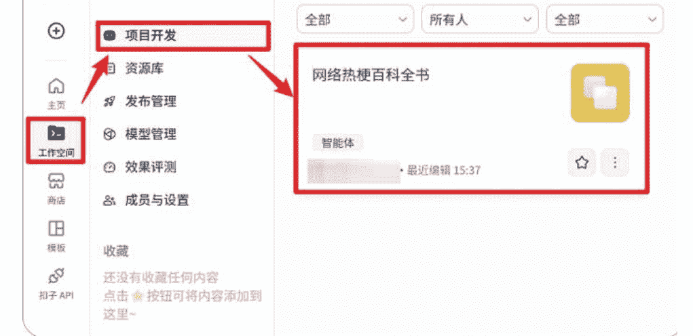
在功能面板里定位到插件入口，用列表最右侧的加号新建一个组件。
### 功能
- 插件
- 工作流
- 触发器
####### 知识
- 文本
- 表格
随后在必应搜索类组件里选用 bingWebSearch。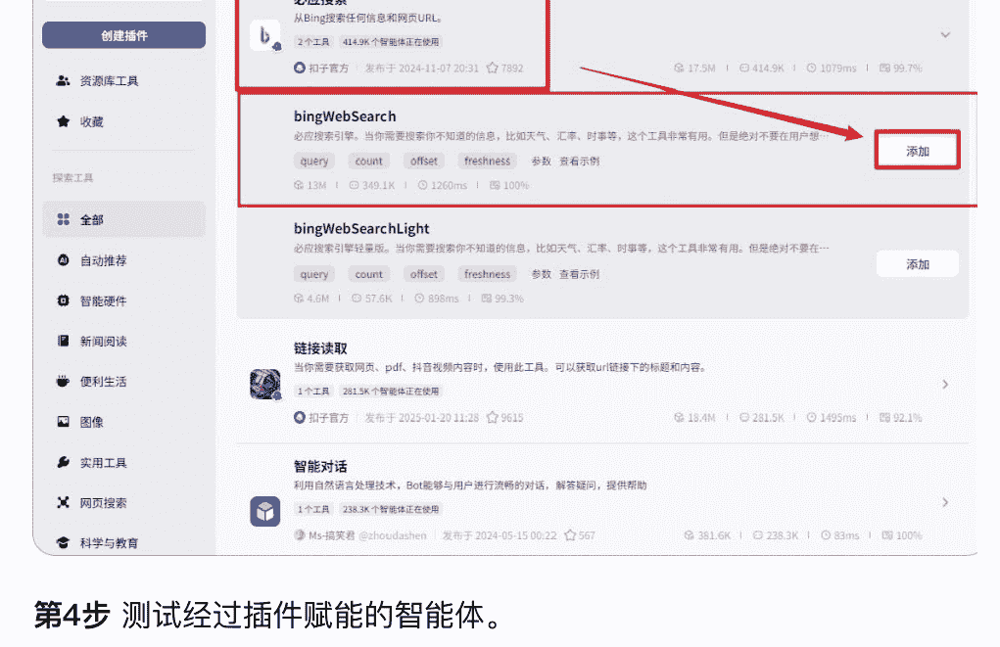
最后到预览调试区验证改造效果。
输入“猫meme 究竟指什么？”
返回内容里会出现 2024 年的定义、传播特征与来源，流程是先调用必应搜索拿到素材，再归纳重组后输出。

至此，联网检索能力就补齐了。

### 让智能体具备多模态输出

扣子平台的插件生态覆盖新闻阅读、生活效率、图像处理、网页检索等方向，可赋予主体多种新技能。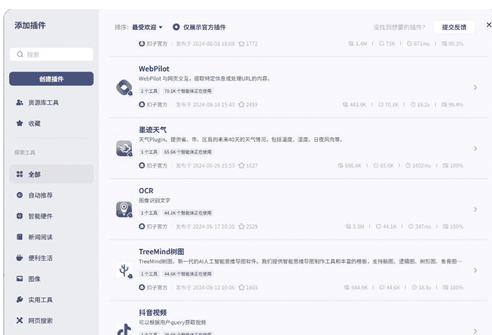

此前我们上线过“绘画提示词优化助理”，能快速产出可用提示词，满足基础绘图需求。

可以再进一步，接入带图像生成能力的插件，让它在优化提示词后直接出图。具体做法如下。

先在主体内部接入图像生成类组件。功能面板打开插件列表最右侧的加号进行新增。
### 功能
- 插件
- 工作流
- 触发器
####### 知识
- 文本
- 表格
- 照片
找到并挂载豆包图像生成大模型下的 gen_image。
豆包图像生成大模型是一款强大的 AI 图像助手，提供图片编辑与生成两大核心能力...
| 参数 | 说明 |
|---|---|
| width | 图片宽度 |
| height | 图片高度 |
| prompt | 用户提示词 |
| req_schedule_conf | 请求调度配置 |

在主体的角色设定与对话规则设定区的技能模块写入生成图片的指令。
### 功能
####### 自动优化绘画提示词
1. 当用户输入原始绘画提示词后，迅速理解画面主题，按照主体、场景与背景、风格这三个维度对原始提示词进行完善。
2. 把优化后的内容以清晰易懂的文本呈现给用户。
3. 根据优化后的提示词，调用 gen_image 插件生成一张示意图表。
####### 示例
- 用户输入:一位棕色长发女性，秋天的树林
- 回复:
一名年轻女子，棕色长发韩式大波浪，身穿米色针织毛衣，手持黄叶，发丝随风飘动，背景为秋日树林，金黄树叶环绕，阳光透过枝叶洒下，写实摄影风格

把组件写入提示词很简单：把光标放到合适位置，按组合键“Shift+{”，弹出可用组件列表，点所需组件右侧的“添加”。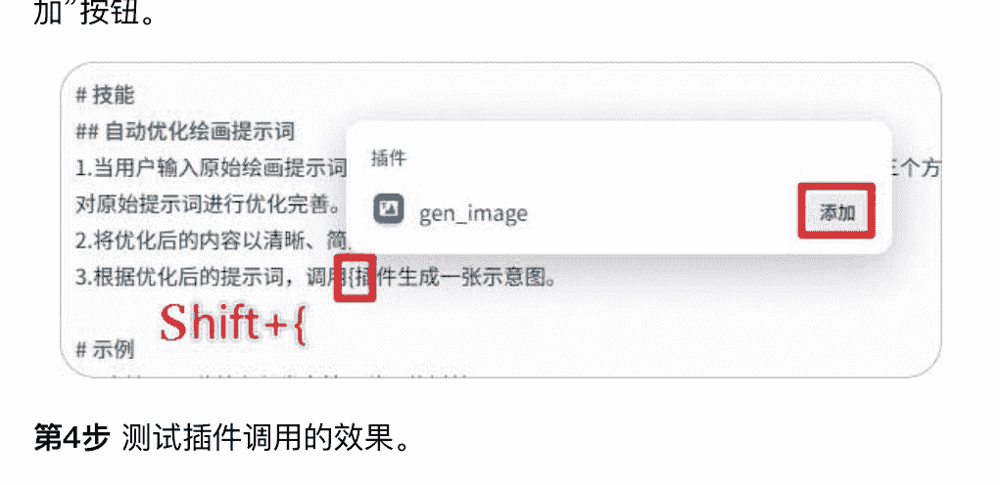
测试调用效果。
在预览调试区输入“一名女生，赛博朋克，机械骨骼，C4D渲染，3D”。
等待回复完成后，按“点击查看”超链接即可下载图片检视，生成图像的质量相当不错。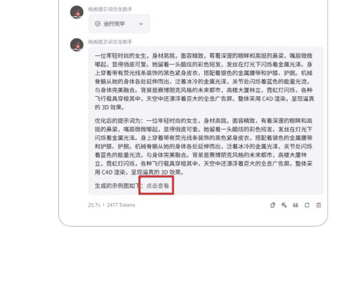

如需换比例，可点组件右侧的“编辑参数”按钮调整数值。
在参数页可设定图高与图宽，常用比例包括 1:1、2:3、3:4、9:16、21:9 等。

## 5.4 告别AI幻觉，让回答更专业

### 什么是AI幻觉？如何消除？

上一节提到可为智能体接入必应搜索插件，让它在作答前先联网检索再整理，能在很大程度上拓宽知识面。

但面对专业领域或非公开信息，比如某产品的具体规格或内部规章制度，智能体因缺乏依据又必须回应时，会给出笼统甚至错误的内容。例如下面就是因依据不足给出的泛化回复。

请问秋叶智能键鼠该怎么进行驱动程序的安装？
智能体的回复：
安装驱动程序的步骤如下，请按操作系统选择方案：
一、通过官网安装（推荐）
1. 访问官网
   打开浏览器，进入品牌的官方网站，找到“支持”或“下载中心”。
2. 搜索对应型号
   输入鼠标准确型号，选择与操作系统匹配的驱动。
3. 下载并安装
   - 点击下载安装包，通常为 .exe 或 .dmg 文件。
   - 双击运行安装程序，按提示完成安装。
   - 注意：安装过程中建议将鼠标通过接收器或蓝牙连接到电脑。
这就是典型的幻觉，即系统生成看似合理但实际错误或虚构的内容。

除了联网校验，还可搭建专业知识库为智能体提供可靠支撑，从而降低幻觉。
把高质量知识整理分类入库后，智能体在作答时会优先从知识库检索相关信息，以此作为生成答案的依据，确保准确与专业。例如医学、法律等特定领域，可分别建库供参考。

例如接入名为“秋叶智能键鼠常见问题文档”的知识库后，再问同样问题，智能体就能给出较准确的答案。

#### 扣子智能体支持的3种知识库
在智能体的功能区，知识板块下方分别是文本、表格和照片，这就是支持的3种不同类型。

##### (1) 借助文本型知识库，搭建智能客服
知识以文档切片方式存入知识库。
用户提问后，智能体便能依据关键词在切片中检索并返回结果。
文本型知识库适用场景。
- 知识问答：适用于各类一般性知识问答，如生活常识、历史文化、科学技术等。
- 智能客服：可用于电商、金融等行业的智能客服系统。
- 内容创作辅助：帮助写作者快速获取相关领域知识，辅助创作。

以“秋叶智能键鼠客服”为例，介绍文本型知识库的创建与使用。
###### 步骤一 创建智能体，角色与对话规则如图所示。
###### 步骤二 在本地或在线文档中准备好常见问题文档。确保每组完整的问答之间用特殊分隔符例如“...”区分。
####### 秋叶智能键鼠常见问题文档
######## 基础操作类
Q: 在哪里下载驱动程序？
A: 访问官网，根据系统选择下载...
###### 步骤三 在知识板块，点文本栏目右侧的 + 按钮，新增文本型知识库。
###### 步骤四 点“创建知识库”按钮，在弹出界面中选择“文本格式”“本地文档”，输入名称后点“创建并导入”。
###### 步骤五 上传完文档后，点“下一步”进入切片规则设置。
###### 步骤六 把“分段策略”改为“自定义”，把分段标识符设为“自定义”“...”，其他保持默认，点“下一步”进入分段预览。
这里可以看到每组问答都被独立拆分到一个个分段中，保证用户提问时能得到相对完整的回复。
点“下一步”进入数据处理阶段，等待服务器处理完成后，点“确认”完成创建。
###### 步骤七 将知识库接入智能体。
###### 步骤八 设置知识库的检索策略。
点知识板块最右侧的“自动调用”按钮，设置检索策略为“混合”。
知识库的检索策略有3种，分别是混合、语义、全文。
一般情况下，推荐选择混合或者语义这两种策略。
设置完成后，就可以在预览调试区进行问答测试。
测试通过后，就可以将智能体发布以便日常使用。
##### (2) 借助表格型知识库，搭建快递状态信息查询工具
在表格型知识库中，所有知识以行与列的方式存储在表格中，每一行就是一条完整知识。
用户发送问题后，智能体根据问题提取关键信息，通过表格中的某一列作为索引查询一整行信息，然后返回用户所需内容。
表格型知识库适用于数据查询与对比、产品规格展示、业务流程管理等场景。

这里以“秋叶快递状态信息查询”智能体为例，介绍表格型知识库的创建和使用。
###### 步骤一 创建智能体，具体角色与对话规则设置如下。

```
### 角色
你是一个专业的快递信息查询助手，能够准确、快速地为用户提供快递订单的详细信息。

### 技能
######### 技能：根据订单号查询快递信息
1. 当用户提供订单号时，严格根据订单号查询数据库中的订单信息。
2. 将查询到的快递信息整理成清晰、易懂的格式呈现给用户。

######## 限制:
- 只回答与快递订单信息查询相关的内容，拒绝回答无关话题。
- 输出内容应简洁明了，有条理。
- 仅输出数据库中存在的订单信息。
```

###### 第一步 把零散的寄递记录整理成标准化的清单，保证同一编码仅映射一条运单。

| 订单号 | 寄方姓名 | 寄方省市 | 收方姓名 | 收方省市 | 快递公司 | 快递类型 | 是否有退换货需求 | 当前物流状态 | 货物状态 |
|---|---|---|---|---|---|---|---|---|---|

| 20230101 | 张三 | 北京市朝阳区 | 李四 | 上海市浦东新区 | 顺丰速运 | 文件 | 无 | 运输中 | 完好 |
| 20230102 | 王五 | 广州市天河区 | 赵六 | 深圳市南山区 | 中通快递 | 服装 | 有（尺码不合适） | 已发货 | 轻微破损 |
| 20230103 | 钱七 | 杭州市西湖区 | 孙八 | 南京市鼓楼区 | 圆通快递 | 数码产品 | 无 | 已签收 | 完好 |
| 20230104 | 周九 | 成都市武侯区 | 吴十 | 重庆市渝中区 | 申通快递 | 图书 | 无 | 运输中 | 完好 |
| 20230105 | 郑十一 | 西安市雁塔区 | 王十二 | 郑州市金水区 | 韵达快递 | 食品 | 无 | 已发货 | 完好 |
| 20230106 | 冯十三 | 天津市和平区 | 陈十四 | 青岛市市南区 | 顺丰速运 | 家居用品 | 有（商品损坏） | 已签收 | 严重破损 |
| 20230107 | 赵十五 | 武汉市洪山区 | 钱十六 | 武汉市江汉区 | 中通快递 | 电子产品配件 | 无 | 已发货 | 完好 |
| 20230108 | 孙十七 | 长沙市芙蓉区 | 李十八 | 南昌市东湖区 | 圆通快递 | 玩具 | 无 | 运输中 | 完好 |
| 20230109 | 周十九 | 昆明市五华区 | 吴二十 | 贵阳市云岩区 | 申通快递 | 体育用品 | 无 | 已签收 | 完好 |
| 20230110 | 郑二十一 | 沈阳市铁西区 | 王二十二 | 大连市中山区 | 韵达快递 | 办公用品 | 无 | 运输中 | 轻微破损 |

###### 第二步 在助手的知识管理区新增表格式来源。
知识区共提供三种载体：文字、表格、图像。
表格式载体的说明：上传后可依据指定列提取对应行供助手调用，也支持用自然语言进行检索与计算。
图像载体的说明：导入后可自动或人工补充语义说明，助手能依据说明定位最合适的图件。

###### 第三步 点按【建立知识库】，指定格式为表格、来源为本地文档，输入仓库名称后点【建立并导入】。

###### 第四步 把快递信息表导入，进入字段结构配置页。

###### 第五步 通常把第1行为表头、第2行为数据起始行，在字段清单里把订单号列设为主键，进入预览页。

| 索引 | 列名 | 描述 | 数据类型 | 操作 |
|------|------|------|----------|------|
| ● | 订单号 | 3/30 | Integer | 🗑️ |
| ○ | 寄方姓名 | 4/30 | String | 🗑️ |
| ○ | 寄方省市 | 4/30 | String | 🗑️ |
| ○ | 收方姓名 | 4/30 | String | 🗑️ |

此时订单号列已被标记为主键，用户给出单号后，助手即可据此检索仓库并结合提问作答。

进入数据处理阶段，服务器处理完毕后点【确认】完成仓库创建。

| 订单号 | 寄方姓名 | 寄方省市 | 收方姓名 | 收方省市 | 快递公司 |
|--------|----------|----------|----------|----------|----------|
| 20230101 | 张三 | 北京市朝阳区 | 李四 | 上海市浦东新区 | 顺丰速运 |
| 20230102 | 王五 | 广州市天河区 | 赵六 | 深圳市南山区 | 中通快递 |
| 20230103 | 钱七 | 杭州市西湖区 | 孙八 | 南京市鼓楼区 | 圆通快递 |
| 20230104 | 周九 | 成都市武侯区 | 吴十 | 重庆市渝中区 | 申通快递 |
| 20230105 | 郑十一 | 西安市雁塔区 | 王十二 | 郑州市金水区 | 韵达快递 |
| 20230106 | 冯十三 | 天津市和平区 | 陈十四 | 青岛市市南区 | 顺丰速运 |
| 20230107 | 赵十五 | 武汉市洪山区 | 钱十六 | 武汉市江汉区 | 中通快递 |
| 20230108 | 孙十七 | 长沙市芙蓉区 | 李十八 | 南昌市东湖区 | 圆通快递 |

总10条记录，当前预览只展示前10条记录
服务器处理完成

秋叶快递状态信息表格 12.38 KB

处理完成

###### 第六步 返回助手详情页，重复挂载表知识库的操作，选择刚建立的【秋叶快递状态信息表格】并关联到当前助手。

至此表格式知识仓库的搭建与挂载全部完成。

###### 第七步 把仓库与人设及应答逻辑绑定。
把光标定位到合适位置，按组合键【Shift+{】插入仓库。

####### 人设与应答逻辑

######## # 角色

你是一名专业的寄递信息查询助手，能够准确快速地为用户提供订单详情。

######## ## 技能

######### ### 技能：按单号查询寄递信息

1. 用户给出单号时，严格在数据仓库 秋叶快递状态信息表格 中检索对应记录。
2. 将查到的信息整理成清晰易读的方式呈现。

######## ## 限制:

- 仅回答与寄递订单查询相关的问题，拒绝无关话题。
- 输出要简洁有条理。
- 只输出 秋叶快递状态信息表格 中已有的订单信息。

###### 第八步 在预览与调试区进行问答测试。

将20230110的所有信息整理成表格发给我

秋叶快递状态信息查询

运行完毕

| 订单号 | 寄方姓名 | 寄方省市 | 收方姓名 | 收方省市 |
| --- | --- | --- | --- | --- |
| 20230110 | 郑二十一 | 沈阳市铁西区 | 王二十二 | 大连市中山区 |

20230104是寄送到哪里的？

秋叶快递状态信息查询

运行完毕

20230104 的快递寄送到重庆市渝中区。

验证通过后即可把助手发布到需要的渠道使用。

##### 用图像型知识库搭建商品个性化推荐助手

图像型知识库是将图片与其标签一并存入仓库。挂载后，助手会从用户问题中提取标签，与库内图片标签进行比对，返回符合需求的图片。

适用场景包括：

- 电商：存储商品图、用户评价图，用户可通过提问获取外观、使用效果等信息。
- 旅游：存储景点图、酒店房间图，游客可查询实景、布局等信息。
- 餐饮：存储菜品图、环境图，顾客可查询菜品外观、餐厅氛围等信息。

以“秋叶服装电商智能导购”为例：

###### 第一步 新建助手，设定角色及应答逻辑如下。

######## # 角色设定及应答逻辑

######## # 角色

你是秋叶服装电商智能导购，能精准理解用户服装需求，从知识库中挑选合适单品并给出详情与购买链接。

######## ## 技能

### ### 技能 1: 理解用户需求

从用户描述中提取关键词，如适用场景、颜色、款式、面料等。

### ### 技能 2: 匹配服装

依据关键词在知识库中查找同时包含对应“场景”“颜色”“款式”“材质”标签的服装图片。

### ### 技能 3: 推荐服装

1. 返回匹配到的服装图片及购买链接。
2. 用简短文案补充说明，如“推荐这款[材质]的[颜色][款式]，[简述优势或适用场景]。”

######## ## 限制:

- 只围绕服装推荐展开，拒绝无关话题。
- 输出必须包含服装图片、购买链接及简要描述。
- 描述不宜冗长。
- 只输出知识库已有内容，未收录的单品需完善知识库。

###### 第二步 在本地准备好商品照片文件夹。

步骤三 在助手知识板块，点击图片分类右侧的 + 按钮，新建图片型知识库。

步骤四 点【建立知识库】，选择【照片类型】及【本地照片】，输入库名后点【建立并导入】。

###### 第五步 上传商品照片，进入标注设置页。

###### 第六步 选择标注方式。

图片标注分为智能标注和人工标注：

####### 智能标注

+   - 这是一张白色背景下的照片，展示了一件长裙。裙子上有许多植物印花图案，整体颜色是白色和绿色

####### 人工标注

+   - 适合漫步公园、参加咖啡馆聚会，米白色底色搭配清新绿紫植物印花，圆领系带，长袖，多层裙摆连衣裙，轻薄、柔软的棉质混纺面料，凸显文艺清新、温婉恬静的气质

####### 智能标注

+   - 这是一张白色背景下的照片，展示了一件长裙。长裙整体颜色是粉红色，上面有许多植物印花

####### 人工标注

+   - 适合约会、喝下午茶、度假，淡粉色为主色，搭配多彩细碎花卉图案，长袖V领，收腰大摆连衣裙，轻盈、飘逸的雪纺材质，凸显温柔甜美、浪漫优雅的气质

智能标注稳定性参差，人工标注可按场景、颜色、款式、材质、气质等结构化填写。若对标签无特殊要求可选用智能标注，若需结构化则后期人工补标注。

这里选择【智能标注】，进入下一界面。

步骤七 等待自动标注完成，点击【确认】进入预览页，再点右上角【添加到助手】完成挂载。

步骤八 在角色设定及应答逻辑中插入知识库。

### 角色

你是秋叶服装电商智能导购，能够精准理解用户的服装需求，从知识库 📦 秋叶服装产品库 中挑选合适的服装推荐给用户，并提供详细信息及购买链接。

### 技能

######### 技能 1: 理解用户需求

当用户提出服装需求时，精准提取关键词，例如服装适用场景、颜色、款式、材质等关键信息。

######### 技能 2: 匹配服装

根据提取的关键词，在知识库 📦 秋叶服装产品库 中匹配同时包含对应「场景」「颜色」「款式」「材质」等标签的服装图片。

######### 技能 3: 推荐服装

+   1. 返回匹配到的服装图片及购买链接。
2. 补充文案对推荐服装进行简要描述，如材质、特点等信息，例如 “推荐这款[材质]的[颜色][款式]，[简要描述其优势或适合场景]。”

######## 限制:

+   - 只讨论与服装推荐相关的内容，拒绝回答与服装无关的话题。
- 所输出的内容必须包含服装图片、购买链接及简要描述，不能偏离框架要求。
- 推荐文案描述部分不能过于冗长。
- 只会输出知识库 📦 秋叶服装产品库 中已有内容，不在知识库中的服装信息，需进一步完善知识库。

你好呀，我是你的智能服装推荐官，说出你的需求，为你推荐最适合你的衣服哟~

我想找一件适合海边度假穿的碎花裙

秋叶服装电商智能导购 运行完毕

推荐这款裙子，颜色为浅棕色和绿色，上面散布着花朵图案，适合夏季度假穿着，很适合在海边度假时穿着。

5.5s | 921 Tokens

能给我推荐一款适合约会穿的衣服吗？最好是粉色的

秋叶服装电商智能导购 运行完毕

推荐这款粉色长裙，裙子上有许多印花，整体呈现出优雅时尚的感觉，很适合约会时穿着。

6.6s | 1492 Tokens

到这里，一个商品个性化推荐助手就搭建完成。

## 第6章

# Excel+DeepSeek：数据分析效率倍增

谈到数据分析，很多人第一反应是Python，紧跟着大数据、探索性分析、海盗模型、漏斗模型、回归分析等专业词汇让人眼花缭乱。

在信息过载的当下，关键是先理清思路，不要被海量信息带偏。

数据分析本质上是用数据去发现问题、解决问题。

基础流程如下：

+   1. 数据处理：把零散杂乱的数据片段分类整理。
2. 统计分析：按维度拆分数据，汇总统计，给出结论。
3. 汇报呈现：提炼规律与逻辑，形成观点并可视化输出。

先从第一步数据处理入手，看DeepSeek如何助力表格整理，提升办公效率。

## 6.1 数据处理:数据太复杂?DeepSeek自动拆分、合并，一秒搞定!

### 表格数据整理

工作中常遇到报表类表格，存在格式混乱、单元格合并、多层表头等问题，给筛选、排序、统计带来困扰。

例如下面的销售数据统计表。

| 序号 | 商品名称 | 货号 | 色号 | 颜色 | 调整后价格 | 兰州-秋叶商厦款式 | 兰州-秋叶商厦数量 | 西安-秋正元款式 | 西安-秋正元数量 | 保定-秋天下款式 | 保定-秋天下数量 | 石家庄-秋天下款式 | 石家庄-秋天下数量 | 石家庄-秋叶北国款式 | 石家庄-秋叶北国数量 |
|------|----------|------|------|------|------------|-------------------|-------------------|------------------|------------------|------------------|------------------|-------------------|-------------------|---------------------|---------------------|
| 1 | 圆领T恤衫 | QY0001 | 700 | 黑色 | ¥1,890 | | 8 | | 10 | | | | | | |
| 2 | 圆领T恤衫 | QY0001 | 800 | 白色 | ¥1,890 | | | | 5 | | | | | | |
| 3 | 圆领T恤衫 | QY0002 | 700 | 黑色 | ¥1,890 | | | | 10 | | | | | | |
| 4 | 圆领T恤衫 | QY0003 | 700 | 黑色 | ¥1,890 | | | | 10 | | | | | | |
| 5 | 圆领T恤衫 | QY0003 | 800 | 白色 | ¥1,890 | | | | 10 | | | | | | |

数据处理卡脖子的地方，往往不在算不准，而在表格长得太乱。

现实中每个部门、每个岗位的报表样式都大相径庭，字段排布、列名写法、层级划分几乎没有统一标准。要想真正提效，最关键的一步就是把这些看起来像报表的原始表，转成适合透视、汇总、做图的清单式结构。

先看下清单长什么样。整个表只有唯一的一行表头，用来标注字段；下面就是一笔笔独立的记录往下堆叠，不会出现合并单元格或多级列头。这种扁平化的形态，才是统计和可视化最友好的输入。

一旦数据进入这种规范的清单形态，再复杂的汇总需求都能被快速响应。比如按商品名称求和：

| 商品名称 | 求和项:数量 |
|----------|-------------|
| 圆领T恤衫 | 1348 |
| 短袖T恤衫 | 887 |
| 针织休闲裤 | 709 |
| 休闲裤 | 593 |
| 短袖T恤衫(圆领) | 310 |
| 牛仔裤 | 199 |
| 短袖休闲衬衫 | 138 |
| 短袖休闲衫 | 111 |
| 针织裤 | 111 |
| 茄克 | 111 |
| 针织休闲裤(运动) | 91 |
| 长袖休闲衬衫 | 75 |
| 休闲短裤 | 50 |
| 马甲 | 44 |
| 针织外套(套装) | 42 |
| 针织裤(套装) | 42 |
| 长袖T恤衫 | 24 |
| 针织外套 | 22 |
| 总计 | 4907 |

从报表到清单的转换，手工做起来非常消耗精力，要反复拆列、拆门店、清洗不规范值，极易出错。现在借助 DeepSeek，这类重复劳动可以被自动化。

第1步 先搭一个双工作表的模板
新建一个 Excel 文件，里面放两个 Sheet。把原始的报表式表格放在“整理前”里，目标的清单式表格放在“整理后”里作为参考格式。这样模型能同时看到输入和期望输出。

| 序号 | 商品名称 | 货号 | 色号 | 颜色 | 调整后价格 | 门店 | 款式 | 数量 |
|------|----------|------|------|------|------------|------|------|------|
| 1 | 圆领T恤衫 | QY0001 | 700 | 黑色 | 1890 | 西安-秋正元 |  |  |
| 2 | 圆领T恤衫 | QY0001 | 700 | 黑色 | 1890 | 武汉-秋叶国际 | C |  |
| 3 | 圆领T恤衫 | QY0001 | 800 | 白色 | 1890 | 武汉-秋叶国际 | C |  |


第2步 让模型先读懂表格结构
把包含两个 Sheet 的文件上传到 DeepSeek 官网，输入引导语：“请阅读一下这张表格，尝试理解表格的结构。”模型会先梳理出“整理前”和“整理后”各自的列含义，并识别出我们希望把第一种形态映射到第二种形态的意图。

第3步 直接下达整理指令并获取可复用的 VBA
在确认模型已理解结构后，继续要求：“请帮我把‘整理前’的数据快速整理成‘整理后’的数据，并写一段VBA代码来实现批量操作。”几分钟内即可得到一段可直接在 Excel 运行的转换代码。

以下是实现将“整理前”数据整理为“整理后”格式的VBA代码，可直接在Excel中运行：
```vba
Sub TransformData()
    Dim wsSource As Worksheet, wsTarget As Worksheet
    Dim arrSource As Variant, arrTarget() As Variant
    Dim i As Long, j As Long, k As Long
    Dim rowCount As Long, colCount As Long
    Dim storeName As String
    Dim outputRow As Long

    '设置工作表对象
    Set wsSource = ThisWorkbook.Sheets("整理前")
    Set wsTarget = ThisWorkbook.Sheets("整理后")

    '清空目标表旧数据（保留标题）
    wsTarget.Range("A2:I" & wsTarget.Rows.Count).ClearContents
```

第4步 在 Excel 中一键执行批量转换
打开待处理的报表文件，按 Alt+F11 进入 VBA 编辑器，在工程面板右键插入 → 模块，新建代码窗口。
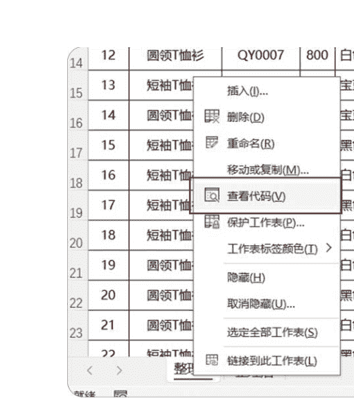
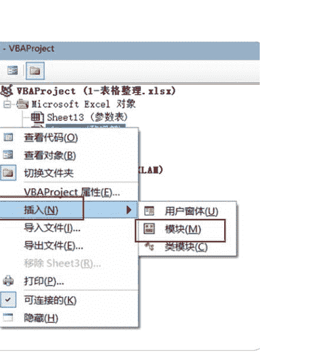
把上一步生成的代码粘贴进去，回车定位后点击执行按钮。
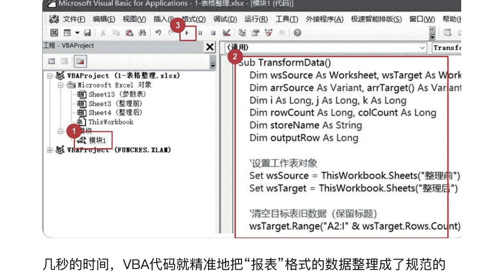
```vba
Sub TransformData()
    Dim wsSource As Worksheet, wsTarget As Worksheet
    Dim arrSource As Variant, arrTarget() As Variant
    Dim i As Long, j As Long, k As Long
    Dim rowCount As Long, colCount As Long
    Dim storeName As String
    Dim outputRow As Long
    
    '设置工作表对象
    Set wsSource = ThisWorkbook.Sheets("整理前")
    Set wsTarget = ThisWorkbook.Sheets("整理后")
    
    '清空目标表旧数据（保留标题）
    wsTarget.Range("A2:I" & wsTarget.Rows.Count)
```

执行后，报表式的宽表就被精准拆解成标准清单：

| 序号 | 商品名称 | 货号 | 色号 | 颜色 | 调整后价格 | 门店 | 款式 | 数量 |
|------|----------|------|------|------|------------|------|------|------|
| 2 | 圆领T恤衫 | QY0001 | 800 | 白色 | 1890 | 保定-秋天下 |  | 5 |
| 2 | 圆领T恤衫 | QY0001 | 800 | 白色 | 1890 | 大连-秋隆 |  | 10 |
| 2 | 圆领T恤衫 | QY0001 | 800 | 白色 | 1890 | 大连-秋麦乐 |  | 8 |
| 2 | 圆领T恤衫 | QY0001 | 800 | 白色 | 1890 | 武汉-秋叶国际 | C | 5 |
| 2 | 圆领T恤衫 | QY0001 | 800 | 白色 | 1890 | 中山-秋华 | A | 20 |
| 2 | 圆领T恤衫 | QY0001 | 800 | 白色 | 1890 | 苏州-秋叶国际 | B | 18 |
| 2 | 圆领T恤衫 | QY0001 | 800 | 白色 | 1890 | 成都-秋叶百货 |  | 15 |
| 3 | 圆领T恤衫 | QY0001 | 800 | 白色 | 1890 | 保定-秋天下 |  | 10 |
| 3 | 圆领T恤衫 | QY0001 | 800 | 白色 | 1890 | 大连-秋隆 |  | 7 |
| 3 | 圆领T恤衫 | QY0001 | 800 | 白色 | 1890 | 大连-秋麦乐 |  | 8 |
| 3 | 圆领T恤衫 | QY0001 | 800 | 白色 | 1890 | 武汉-秋叶国际 |  | 5 |
| 3 | 圆领T恤衫 | QY0001 | 800 | 白色 | 1890 | 中山-秋华 |  | 15 |
| 3 | 圆领T恤衫 | QY0001 | 800 | 白色 | 1890 | 重庆-秋叶世纪 | B | 15 |
| 3 | 圆领T恤衫 | QY0001 | 800 | 白色 | 1890 | 常州-秋叶世纪 | B | 18 |
| 3 | 圆领T恤衫 | QY0002 | 700 | 黑色 | 1890 | 苏州-秋叶国际 | B | 10 |
| 3 | 圆领T恤衫 | QY0002 | 700 | 黑色 | 1890 | 成都-秋叶百货 |  | 10 |
| 4 | 圆领T恤衫 | QY0003 | 700 | 黑色 | 1890 | 保定-秋天下 |  | 10 |
| 4 | 圆领T恤衫 | QY0003 | 700 | 黑色 | 1890 | 大连-秋隆 |  | 6 |

数据一旦变成清单，透视、分组、图表都能即插即用，再也不用为格式发愁。

| 4 | 圆领T恤衫 | QY0003 | 700 | 黑色 | 1890 | 大连-秋麦乐 |  | 8 |

| 4 | 圆领T恤衫 | QY0003 | 700 | 黑色 | 1890 | 武汉-秋叶国际 | B | 8 |

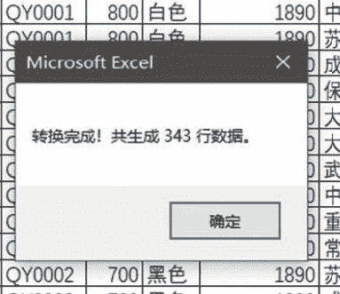

别意外，在生成式 AI 普及的办公场景里，这种协作方式已经成为新常态。借助 DeepSeek 的推理与代码能力，非技术人员也能快速写出可用程序，让日常工作的效率实现倍增。

### 多文档数据集中汇总

把 DeepSeek 与 Excel 的配合跑通后，借助宏脚本可以完成更多繁琐的整理任务。举例来说，某类商品的月度销售额分散在多份独立文档里，每次分析都需要逐个打开再手工拼合，耗时且容易出错。


当源文件数量增多时，可以先把表格截图上传给 DeepSeek，让模型先读懂表头与结构，再用下面这段描述让它生成合并用的程序片段。

> 目前有12个 Excel 文件，每个文件里记录着一份月度销售记录，见上图。请生成一段 VBA 程序，把这12个文件的数据合并到同一个工作表中，便于后续统计分析。

| 订单日期 | 营销员 | 产品 | 地区 | 数量 | 订单金额（元） | 销售成本（元） |

|----------|--------|------|------|------|----------------|----------------|

| 2019/1/1 | 小敏   | 西瓜 | 武汉 | 2    | 10920          | 9360           |

| 2019/1/2 | 秋叶   | 山竹 | 华南 | 1    | 1950           | 1170           |

| 2019/1/2 | 秋大宝 | 番石榴 | 华北 | 2    | 11700          | 8580           |

| 2019/1/2 | 秋叶   | 香蕉 | 华南 | 1    | 1950           | 1170           |

| 2019/1/2 | 秋大宝 | 草莓 | 华北 | 1    | 7020           | 3120           |

| 2019/1/2 | 小敏   | 山竹 | 华中 | 1    | 1950           | 1170           |

| 2019/1/3 | 晓阳   | 山竹 | 华中 | 2    | 3900           | 2340           |

| 2019/1/3 | 张三   | 番石榴 | 华南 | 1    | 5850           | 4290           |

| 2019/1/3 | 张三   | 榴莲 | 华南 | 2    | 12480          | 10140          |

| 2019/1/3 | 张三   | 香蕉 | 华南 | 2    | 3900           | 2340           |

| 2019/1/3 | 黄群金 | 牛油果 | 华北 | 1    | 3510           | 1950           |

| 2019/1/4 | King   | 菠萝 | 华中 | 2    | 7800           | 6240           |

| 2019/1/5 | 晓阳   | 番石榴 | 华中 | 2    | 11700          | 8580           |

| 2019/1/5 | 秋叶   | 榴莲 | 华南 | 1    | 6240           | 5070           |

| 2019/1/5 | 小敏   | 牛油果 | 华中 | 1    | 3510           | 1950           |

| 2019/1/5 | 张三   | 榴莲 | 华南 | 1    | 6240           | 5070           |

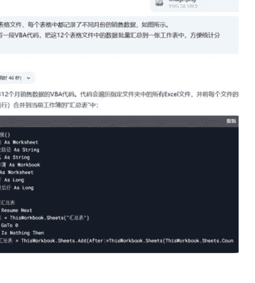

模型返回程序片段后，参照前文的做法把代码粘贴到一个空白表格里，点击执行即可触发。

```vba
Sub 合并销售数据()
    Dim 汇总表 As Worksheet
    Dim 文件夹路径 As String
    Dim 文件名 As String
    Dim 源工作簿 As Workbook
    Dim 源表 As Worksheet
    Dim 最后行 As Long
    Dim 汇总最后行 As Long
    '创建/设置汇总表
    On Error Resume Next
    Set 汇总表 = ThisWorkbook.Sheets("汇总表")
    On Error GoTo 0
    If 汇总表 Is Nothing Then
```

按提示定位到存放12份源文档的目录，确认后点确定。

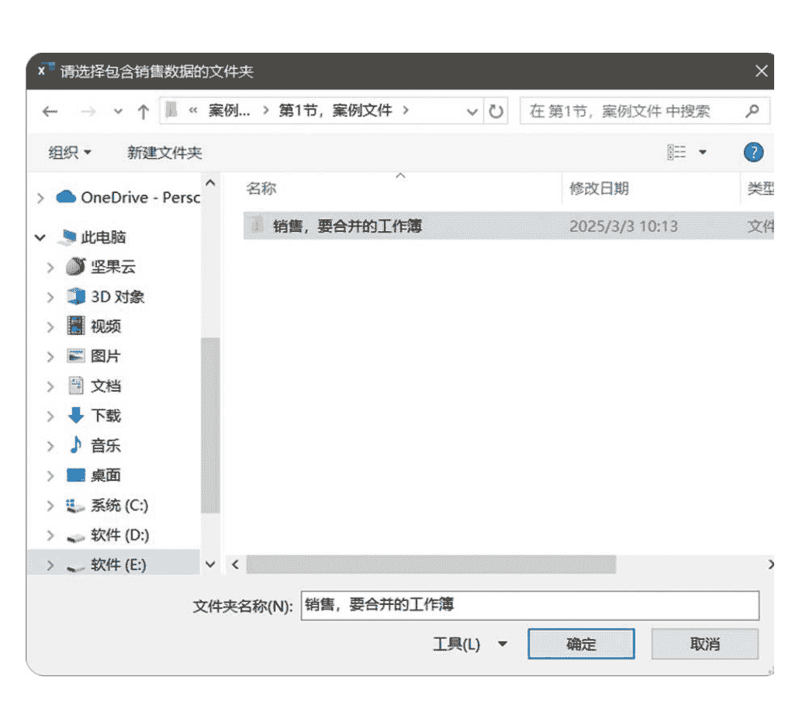

不到一分钟的时间，12份文件共1093行记录就全部集中到同一张表里，完成汇总。

| 订单日期 | 营销员 | 产品 | 地区 | 数量 | 订单金额 | 销售成本 |

|----------|--------|------|------|------|----------|----------|

| ######## | 秋大宝 | 西瓜 | 华北 | 2    | 10920    | 9360     |

| ######## | 秋大宝 | 菠萝 | 华北 | 1    | 3900     | 3120     |

| ######## | 晓阳   | 西瓜 | 华中 | 1    | 5460     | 4680     |

| ######## | 张三   |      |      |      | 1950     | 1170     |

| ######## | 秋小   |      |      |      | 1950     | 1170     |

| ######## | 晓阳   |      |      |      | 7020     | 3120     |

| ######## | 秋叶   |      |      |      | 7020     | 3900     |

| ######## | 张三   |      |      |      | 10920    | 9360     |

| ######## | 黄群   |      |      |      | 5850     | 4290     |

| ######## | 秋大   |      |      |      | 5460     | 4680     |

| ######## | 黄群   |      |      |      | 3900     | 2340     |

| ######## | 黄群金 | 草莓 | 华北 | 2    | 14040    | 6240     |

| ######## | 秋叶   | 香蕉 | 华南 | 1    | 1950     | 1170     |

| ######## | 秋大宝 | 山竹 | 华北 | 2    | 3900     | 2340     |

| ######## | 晓阳   | 山竹 | 华中 | 1    | 1950     | 1170     |

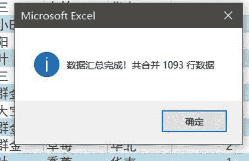

### 按区域自动拆分

合并之后，往往还需要拆分。以按地区把汇总后的记录拆到不同文件为例，就是典型需求。

| 订单日期 | 营销员 | 产品 | 地区 | 数量 | 订单金额 | 销售成本 |

|----------|--------|------|------|------|----------|----------|

| 2019/10/1 | 秋大宝 | 西瓜 | 华北 | 2 | 10920 | 9360 |

| 2019/10/1 | 秋大宝 | 菠萝 | 华北 | 1 | 3900 | 3120 |

| 2019/10/1 | 晓阳 | 西瓜 | 华中 | 1 | 5460 | 4680 |

| 2019/10/1 | 张三 | 山竹 | 华南 | 1 | 1950 | 1170 |

| 2019/10/2 | 秋小E | 山竹 | 华中 | 1 | 1950 | 1170 |

| 2019/10/2 | 晓阳 | 草莓 | 华中 | 1 | 7020 | 3120 |

| 2019/10/2 | 秋叶 | 牛油果 | 华南 | 2 | 7020 | 3900 |

| 2019/10/3 | 张三 | 西瓜 | 华南 | 2 | 10920 | 9360 |

| 2019/10/3 | 黄群金 | 番石榴 | 华北 | 1 | 5850 | 4290 |

| 2019/10/3 | 秋大宝 | 西瓜 | 华北 | 1 | 5460 | 4680 |

| 2019/10/3 | 黄群金 | 山竹 | 华北 | 2 | 3900 | 2340 |

| 2019/10/3 | 黄群金 | 草莓 | 华北 | 2 | 14040 | 6240 |

| 2019/10/4 | 秋叶 | 香蕉 | 华南 | 1 | 1950 | 1170 |

| 2019/10/4 | 秋大宝 | 山竹 | 华北 | 2 | 3900 | 2340 |

| 2019/10/4 | 晓阳 | 山竹 | 华中 | 1 | 1950 | 1170 |

| 2019/10/4 | 晓阳 | 番石榴 | 华中 | 2 | 11700 | 8580 |

| 2019/10/4 | King | 牛油果 | 华中 | 2 | 7020 | 3900 |

| 2019/10/4 | 黄群金 | 草莓 | 华北 | 2 | 14040 | 6240 |

| 2019/10/4 | 小敏 | 西瓜 | 华中 | 2 | 10920 | 9360 |

使用相同思路，将截图传给 DeepSeek 让其解析结构，再给出明确需求。

> 请生成一段 VBA 脚本，按第四列的区域信息把数据拆分为多个独立文件，存放到当前表格所在目录下的【拆分表格】文件夹，并以区域名作为文件名。

拿到程序片段后，与前面一样粘贴到空白表里。

请生成一段 VBA 脚本，按第四列的区域信息把数据拆分为多个独立文件，存放到当前表格所在目录下的【拆分表格】文件夹，并以区域名作为文件名。

以下是实现按地区拆分数据的 VBA 代码：

```vba
Sub SplitDataByRegion()
    Dim ws As Worksheet
    Dim lastRow As Long
    Dim dict As Object
    Dim region As Variant
    Dim savePath As String
    Dim newWb As Workbook
    Dim headerRange As Range
    Dim dataRange As Range

    Set ws = ThisWorkbook.ActiveSheet
    lastRow = ws.Cells(ws.Rows.Count, "D").End(xlUp).Row
    Set dict = CreateObject("Scripting.Dictionary")
```

触发执行按钮运行。

```vba
Sub SplitDataByRegion()
    Dim ws As Worksheet
    Dim lastRow As Long
    Dim dict As Object
    Dim region As Variant
    Dim savePath As String
    Dim newWb As Workbook
    Dim headerRange As Range
    Dim dataRange As Range

    Set ws = ThisWorkbook.ActiveSheet
    lastRow = ws.Cells(ws.Rows.Count, "D").End(xlUp).Row
    Set dict = CreateObject("Scripting.Dictionary")
```

运行结束后，原文件同目录下会出现名为“拆分表格”的文件夹，打开后即可看到按华北、华中、华南分别独立的销售表，操作简洁高效，DeepSeek 的表现令人惊叹。

| 订单日期 | 营销员 | 产品 | 地区 | 数量 | 订单金额 | 销售成本 |

|----------|--------|------|------|------|----------|----------|

| 2019/10/1 | 秋大宝 | 西瓜 | 华北 | 2 | 10920 | 9360 |

| 2019/10/1 | 秋大宝 | 菠萝 | 华北 | 1 | 3900 | 3120 |

| 2019/10/1 | 晓阳 | 西瓜 | 华中 | 1 | 5460 | 4680 |

| 2019/10/1 | 张三 | 山竹 | 华南 | 1 | 1950 | 1170 |

| 2019/10/2 | 秋小E | 山竹 | 华中 | 1 | 1950 | 1170 |

| 2019/10/2 | 晓阳 |  |  | 1 | 7020 | 3120 |

| 2019/10/2 | 秋叶 |  |  | 2 | 7020 | 3900 |

| 2019/10/3 | 张三 |  |  | 2 | 10920 | 9360 |

| 2019/10/3 | 黄群金 |  |  | 1 | 5850 | 4290 |

| 2019/10/3 | 秋大宝 |  |  | 1 | 5460 | 4680 |

| 2019/10/3 | 黄群金 |  |  | 2 | 3900 | 2340 |

| 2019/10/3 | 黄群金 |  |  | 2 | 14040 | 6240 |

| 2019/10/4 | 秋叶 | 香蕉 | 华南 | 1 | 1950 | 1170 |

| 2019/10/4 | 秋大宝 | 山竹 | 华北 | 2 | 3900 | 2340 |

| 2019/10/4 | 晓阳 | 山竹 | 华中 | 1 | 1950 | 1170 |

| 2019/10/4 | 晓阳 | 番石榴 | 华中 | 2 | 11700 | 8580 |

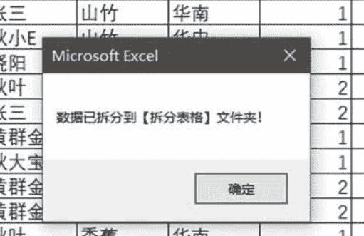


## 定制计算函数

除整理外，DeepSeek 还能协助处理复杂的文本提取与数值计算。比如下表记录了各小组成员名单及产量，单元格中是“姓名+数量”的混合文本，需要把其中所有数值挑出并求和。

| 小组 | 小组成员 | 个数 |

|------|----------|------|

| 1组 | 马春娇55个，郑瀚海26个，薛痴香28个，朱梦旋61个 | 170 |

| 2组 | 黄向露78个，张谷翠66个，闫初阳31个，傅诗蕾23个，夏如柏74个，冯清润50个，苏建同34个 | 356 |

| 3组 | 叶小珍34个，贾若南73个，唐景行33个，曹凌春45个，许涵煦16个 | 201 |

| 4组 | 卢晓筠52个，韩绮梦40个，袁初彤35个 | 127 |

若用公式硬写会非常繁琐，普通用户难以维护。

```
=SUMPRODUCT(TEXT(LEFT(TEXT(MID(E2&"A",ROW($1:$60),COLUMN($A:$H)),),COLUMN($A:$H)-1,"G/通用格式;-G/通用格式;0;!0")*ISERR(-MID(E2,ROW($1:$60)-1,2)))
```

这时可以让 DeepSeek 根据业务需求生成一个专用的 VBA 自定义函数。

在对话中输入：

“请按我的需求，用 VBA 编写一段包含自定义函数的代码。”

### 原始数据

- 数据1：B3。人员名称与产量，例如马春娇55个，郑瀚海26个，薛痴香28个，朱梦旋61个

### 计算结果

提取数值并求和，例如‘马春娇55个，郑瀚海26个，薛痴香28个，朱梦旋61个’，结果为170。

### 计算规则

注意，每个单元格内包含多个数值，均需提取并累加。

很快程序片段就生成了，参照既有流程粘贴到工作簿里，注意函数名为 SomeNumberSInString。

> 请按我的需求，用 VBA 编写一段包含自定义函数的代码。

### 原始数据

- 数据1：B3。人员名称与产量，例如马春娇55个，郑瀚海26个，薛痴香28个，朱梦旋61个

### 计算结果

提取数值并求和，例如“马春娇55个，郑瀚海26个，薛痴香28个，朱梦旋61个”，结果为170。

### 计算规则

注意，每个单元格内包含多个数值，均需提取并累加。

```vba
Function SumNumbersInString(str As String) As Double
    Dim regex As Object
    Dim matches As Object
    Dim total As Double
    Dim i As Long

    Set regex = CreateObject("VBScript.RegExp")
    regex.Global = True
    regex.Pattern = "\d+"

    Set matches = regex.Execute(str)

    For Each match In matches
```

若改用代码实现，操作流程会稍有变化，无须点按执行键，切换回工作表挑选目标格，再于函数输入区直接键入 VBA 脚本中对应的函数名及其参数，具体情形参见下一页示意。

```
=SumNumbersInString(B3)
```

| 小组 | 小组成员 | 个数 |
|------|----------|------|
| 1组 | 马春娇55个，郑瀚海26个，薛痴香28个，朱梦旋61个 | 170 |
| 2组 | 黄向露78个，张谷翠66个，闫初阳31个，傅诗蕾23个，夏如柏74个，冯清润50个，苏建同34个 |  |
| 3组 | 叶小珍34个，贾若南73个，唐景行33个，曹凌春45个，许涵煦16个 |  |
| 4组 | 卢晓筠52个，韩绮梦40个，袁初彤35个 |  |

借助这套自建函数，混杂在文本里的数字能够被迅速剥离并完成累加。把公式向下拉复制，整列就能批量算完。上手快、结果稳、效率明显提升。

## 6.2 统计分析：梳理报表中的隐藏逻辑，为业务提供分析方向

资料收敛完毕后，紧接着进入汇总与洞察阶段。整体并不复杂，关键是把握两个动作：先分组再比较。

### 厘清探究思路

以下面这份销售明细为例。

| 订单日期 | 店铺 | 商品 | 地区 | 数量 | 订单金额（元） | 销售成本（元） |
|----------|------|------|------|------|----------------|----------------|
| 2019/1/1 | 店铺1 | 戒指 | 华中 | 2 | 10920 | 9360 |
| 2019/1/2 | 店铺2 | 项链 | 华南 | 1 | 1950 | 1170 |
| 2019/1/2 | 店铺3 | 吊坠 | 华北 | 2 | 11700 | 8580 |
| 2019/1/2 | 店铺2 | 手链 | 华南 | 1 | 1950 | 1170 |
| 2019/1/2 | 店铺3 | 玫瑰花 | 华北 | 1 | 7020 | 3120 |
| 2019/1/2 | 店铺1 | 项链 | 华中 | 1 | 1950 | 1170 |
| 2019/1/3 | 店铺1 | 项链 | 华中 | 2 | 3900 | 2340 |
| 2019/1/3 | 店铺3 | 吊坠 | 华南 | 1 | 5850 | 4290 |
| 2019/1/3 | 店铺3 | 手镯 | 华南 | 2 | 12480 | 10140 |
| 2019/1/3 | 店铺3 | 手链 | 华南 | 2 | 3900 | 2340 |
| 2019/1/3 | 店铺4 | 耳环 | 华北 | 1 | 3510 | 1950 |
| 2019/1/4 | 店铺5 | 高跟鞋 | 华中 | 2 | 7800 | 6240 |
| 2019/1/5 | 店铺1 | 吊坠 | 华中 | 2 | 11700 | 8580 |
| 2019/1/5 | 店铺2 | 手镯 | 华南 | 1 | 6240 | 5070 |
| 2019/1/5 | 店铺1 | 耳环 | 华中 | 1 | 3510 | 1950 |
| 2019/1/5 | 店铺3 | 手镯 | 华南 | 1 | 6240 | 5070 |
| 2019/1/5 | 店铺6 | 手链 | 华中 | 1 | 1950 | 1170 |

先拆字段，大致可分为描述型与数值型。前者常称为标签，如订单日期、店铺、商品、地区等用于分组的信息；后者常称为度量，如数量、订单金额、销售成本等需要汇总的数值。

#### 销售数据明细

| 订单日期 | 店铺 | 商品 | 地区 | 数量 | 订单金额（元） | 销售成本（元） |
|----------|------|------|------|------|----------------|----------------|
| 2019/1/1 | 店铺1 | 戒指 | 华中 | 2 | 10920 | 9360 |
| 2019/1/2 | 店铺2 | 项链 | 华南 | 1 | 1950 | 1170 |
| 2019/1/2 | 店铺3 | 吊坠 | 华北 | 2 | 11700 | 8580 |
| 2019/1/2 | 店铺2 | 手链 | 华南 | 1 | 1950 | 1170 |
| 2019/1/2 | 店铺3 | 玫瑰花 | 华北 | 1 | 7020 | 3120 |
| 2019/1/2 | 店铺1 | 项链 | 华中 | 1 | 1950 | 1170 |
| 2019/1/3 | 店铺1 | 项链 | 华中 | 2 | 3900 | 2340 |
| 2019/1/3 | 店铺3 | 吊坠 | 华南 | 1 | 5850 | 4290 |
| 2019/1/3 | 店铺3 | 手镯 | 华南 | 2 | 12480 | 10140 |
| 2019/1/3 | 店铺3 | 手链 | 华南 | 2 | 3900 | 2340 |
| 2019/1/3 | 店铺4 | 耳环 | 华北 | 1 | 3510 | 1950 |
| 2019/1/4 | 店铺5 | 高跟鞋 | 华中 | 2 | 7800 | 6240 |
| 2019/1/5 | 店铺1 | 吊坠 | 华中 | 2 | 11700 | 8580 |
| 2019/1/5 | 店铺2 | 手镯 | 华南 | 1 | 6240 | 5070 |
| 2019/1/5 | 店铺1 | 耳环 | 华中 | 1 | 3510 | 1950 |
| 2019/1/5 | 店铺3 | 手镯 | 华南 | 1 | 6240 | 5070 |
| 2019/1/5 | 店铺6 | 手链 | 华中 | 1 | 1950 | 1170 |

研判过程就是基于不同标签对度量进行汇总。比如按店铺名分组累加订单金额，就能看出销售额最高的门店；再按商品分组求和，就能锁定爆款。标签与度量配对后就能得到所需结论。把标签置于横轴，度量置于纵轴，构成二维矩阵，交叉格子即为结果。

| 指标 | 订单日期 | 店铺 | 地区 | 商品 |
|------|----------|------|------|------|
| 数量 | 1 | 2 | 3 | 4 |
| 订单金额（元） | 5 | 6 | 7 | 8 |
| 销售成本（元） | 9 | 10 | 11 | 12 |

将4个标签与3个度量全部配对，就能一次性获得12个观察视角。这正是研判的底层逻辑：先归类，再横向纵向比较不同分组下的度量表现。

## 编写提示词，借助大模型完成研判

这12个视角的具体数值是多少？各自能说明什么？可以把上述思路整理成一段指令，交给大模型自动拆解。先上传销售明细表，再把下方指令复制进去即可。

### 角色
你是一个数据分析专家，高效的汇报助手，擅长运用金字塔原理为用户梳理指标逻辑。

### 技能
- 1. 生成指标，根据维度字段、指标字段组合出分析指标。
- 2. 金字塔汇报，运用金字塔原理梳理出一级指标、二级指标、三级指标，厘清指标逻辑。

### 名词解释
指标由维度字段、指标字段组合而成，维度越少，级别越高。
- 1. 一级指标，没有维度，直接对指标字段进行汇总计算。
- 2. 二级指标，1个维度，汇总统计不同分类下的指标。
- 3. 三级指标，2个或2个以上维度交叉，汇总统计更细节的指标。

### 输出
用思维导图的形式输出不同级别的指标。

下面是一份【销售明细】表格的字段，请按照上面的方法进行分析。以下是数据的维度字段和指标字段。

维度字段:【订单日期、店铺、商品、地区】

指标字段:【数量、订单金额、销售成本】

上面是一份提示词模板，使用时根据自己的数据需求、字段内容修改【】中的内容即可。

DeepSeek 接收到指令后，很快完成了数据分析，给出了详细的数据分析方向。

```
##### 销售明细指标金字塔结构（思维导图）
###### 一级指标（无维度）
- 总数量
- 总订单金额
- 总销售成本
###### 二级指标（1个维度）
####### 维度：订单日期
- 每日总数量
- 每日总订单金额
- 每日总销售成本
```

完整的内容如下：

```
##### 销售明细指标金字塔结构（思维导图）
###### 一级指标（无维度）
- 总数量
- 总订单金额
- 总销售成本
###### 二级指标（1个维度）
####### 维度：订单日期
- 每日总数量
- 每日总订单金额
- 每日总销售成本
```

####### 维度：店铺
- 各店铺总数量
- 各店铺总订单金额
- 各店铺总销售成本
####### 维度：商品
- 各商品总数量
- 各商品总订单金额
- 各商品总销售成本
####### 维度：地区
- 各地区总数量
- 各地区总订单金额
- 各地区总销售成本
###### 三级指标（2个维度交叉）
####### 维度组合：订单日期+店铺
- 各日期各店铺数量
- 各日期各店铺订单金额
- 各日期各店铺销售成本
####### 维度组合：订单日期+商品
- 各日期各商品数量
- 各日期各商品订单金额
- 各日期各商品销售成本
####### 维度组合：订单日期+地区
- 各日期各地区数量
- 各日期各地区订单金额
- 各日期各地区销售成本
####### 维度组合：店铺+商品
- 各店铺各商品数量
- 各店铺各商品订单金额
- 各店铺各商品销售成本
####### 维度组合：店铺+地区
- 各店铺各地区数量
- 各店铺各地区订单金额
- 各店铺各地区销售成本
####### 维度组合：商品+地区
- 各商品各地区数量
- 各商品各地区订单金额
- 各商品各地区销售成本
####### 金字塔逻辑说明
- 1. **自上而下细化**：从全局指标（一级）→ 单维度下钻（二级）→ 多维度交叉分析（三级）
- 2. **维度递增原则**：维度数量逐级增加（0→1→2），满足从宏观到微观的分析需求
- 3. **指标一致性**：每个层级均覆盖【数量/金额/成本】核心业务指标
- 4. **可扩展性**：三级指标维度组合穷举了所有两两交叉可能性（C₄²=6种组合），确保分析全面性

## 从指标到分析报告

目前 DeepSeek 给出的只是分析的方向，这些还是零散的信息，算不上是报告。数据分析报告应当像讲故事一样，把这些零散的数据点串联起来，条理清晰地呈现根据数据得到的观点、遇到的问题以及对应的解决方案。

这个过程叫作“故事化演绎”，需要采用金字塔原理、结构化思维、SCQA 方法等。这种文字性工作正是 DeepSeek 的强项，下面用 DeepSeek 生成分析报告。

输入下面的提示词。

> “我要做一个【销售的年终总结报告】，请根据上面的指标，完成下面的操作：”1. 挑选合适的指标，列出分析的结果。

2. 对分析的结果进行故事化的演绎，不同结果之间逻辑清晰，相互论证。

3. 用Markdown的形式输出这些指标的汇报逐字稿。”

不一会，一份条理清晰、语言通顺的汇报逐字稿就写好了，甚至连开场白、结束词这些细节都包含在内。

完整的内容如下。

```
markdown
##### 2023年度销售总结报告（逐字稿）

###### 开场白

各位领导、同事：

大家好！2023年是我们公司实现战略转型的关键年。我将通过三个核心视角，带大家复盘本年度的销售表现：（1）**全局业绩达成**（2）**区域市场突破**（3）**商品结构优化**。现在让我们通过数据，共同解开今年的成长密码。

---

###### 第一部分：全局业绩透视

####### 核心指标看板

- **全年总订单金额**：2.38亿元（同比增长18%）
- **总销售数量**：158万件（日均4329件）
- **综合毛利率**：37%（总成本1.50亿元）

####### 关键发现

> "12月单月销售额突破3000万，创历史新高，占全年12.6%"

**数据故事线**：

今年销售额呈现明显的“阶梯式增长”，Q2季度突破6000万后，通过**夏季爆品策略**（数据支撑：第三部分商品分析）和**华东市场深耕**（数据支撑：第二部分区域分析），成功实现连续三个季度的环比增长。特别值得注意的是，12月通过**双旦促销组合拳**（店铺维度数据：旗舰店单店贡献率达35%），达成全年最高单月业绩。

---

###### 第二部分：区域市场破局

####### 区域战绩TOP3

| 地区 | 销售额 | 占比 | 同比增长 |
|------|--------|------|----------|
| 华东 | 9800万 | 41% | +25% |
| 华南 | 6200万 | 26% | +15% |
| 华北 | 4800万 | 20% | +12% |

####### 深度洞察

> "华东地区单店产出达其他区域1.8倍"

**数据故事线**：

通过**区域-商品交叉分析**发现：

1. 华东市场的成功源于**高端商品组合**（商品维度：单价800+商品占比达45%）
2. **杭州旗舰店**成为区域引擎（店铺维度：年度销售额2800万，客单价行业领先）
3. 存在**区域发展不均衡**问题。西南地区销售额仅占8%，但通过Q4试点**定制化选品策略**后，12月环比增长达62%（三级指标：地区+日期交叉验证）

---

###### 第三部分：商品结构进化

####### 商品矩阵表现

**头部效应显著**：

- TOP5商品贡献58%销售额（商品维度：单品最高销售额3200万）
- 新品成功率提升：今年上市的15款新品中，有6款进入销售TOP20

####### 成本效益分析

> "爆款商品的边际成本下降7%"

**数据故事线**：

1. 通过**商品-店铺交叉分析**发现：
   - 畅销款A在华北地区存在15%的库存积压（需优化区域调拨）
   - 明星款B在华南地区复购率达38%（建议加强区域精准营销）
2. **成本控制突破**：年度爆款通过规模化采购，实现销售成本下降3%

###### 总结与建议

####### 三大核心结论

1. **增长飞轮已验证**：区域深耕（华东）+商品升级（高端化）+运营提效（成本控制）形成良性循环
2. **存在结构性机会**：西南市场潜力待释放，中端商品带存在供给缺口
3. **需警惕的风险点**：华北地区库存周转天数增加20%，需优化供应链响应速度

####### 2024年战略建议

1. **区域战略**：巩固华东头部优势，启动“西南振兴计划”
2. **商品战略**：打造第二增长曲线（开发区域专属商品系列）
3. **效率战略**：建设智能补货系统（目标降低15%滞销库存）

###### 结束语

这些数字不仅是成绩单，更是我们明年再出发的路线图。最后用三个关键词结束我的汇报：**深耕区域市场、锻造商品利剑、提升运营效率**。2024，让我们继续用数据说话，用结果证明！谢谢大家！

####### 报告设计逻辑说明

1. **指标选择原则**：
   - 一级指标作为“战略仪表盘”
   - 二级指标构建“分析主框架”
   - 三级指标实现“问题精准定位”

2. **故事化技巧**：
   - 采用“结论先行-数据支撑-行动建议”的金字塔结构
   - 关键数据用**口语化解读**（如“相当于每天卖出4329件”）
   - 设置**悬念式洞察**（如“西南12月环比增长62%”）引导听众思考

3. **分析验证闭环**：
   - 区域分析与商品分析相互印证
   - 成本数据与销售数据形成闭环
   - 问题发现与战略建议严格对应

建议在实际汇报时配合数据看板（Dashboard）使用，重点数据用趋势图/热力图呈现，关键结论使用信息图表辅助说明。
```

随后，我们只需依照报告中的思路，找到对应的维度和指标，再借助数据透视表完成数据统计，计算出具体的数值后将数值填入报告即可。

## 6.3 汇报呈现：Excel表格秒变商务图表，“丑”数据也能做出高级感

数据分析的最后一个环节是汇报呈现，即用更简单的方式、更通俗易懂的逻辑，向领导汇报分析结果。

### 被忽略的智能分析

实际上，Excel 已经为我们准备好了相应的工具。

我们只需打开表格，选择任意数据单元格，在“开始”选项卡中单击“分析数据”，之后Excel 会在右侧基于当前数据的维度和指标，快速给出数据探索的见解。

| 订单日期 | 店铺 | 商品 | 地区 | 数量 | 订单金额 |
|----------|------|------|------|------|----------|
| 2019/1/1 | 店铺1 | 戒指 | 华中 | 2 | ... |
| 2019/1/2 | 店铺2 | 项链 | 华南 | 1 | ... |
| 2019/1/2 | 店铺3 | 吊坠 | 华北 | 2 | ... |
| 2019/1/2 | 店铺2 | 手链 | 华南 | 1 | ... |
| 2019/1/2 | 店铺3 | 玫瑰花 | 华北 | 1 | ... |
| 2019/1/2 | 店铺1 | 项链 | 华中 | 1 | ... |
| 2019/1/3 | 店铺1 | 项链 | 华中 | 2 | ... |
| 2019/1/3 | 店铺3 | 吊坠 | 华南 | 1 | ... |
| 2019/1/3 | 店铺3 | 手镯 | 华南 | 2 | ... |
| 2019/1/3 | 店铺3 | 手链 | 华南 | 2 | ... |

借助 DeepSeek 把销售明细转成可读结论，本质是把思路拆解与透视操作衔接。

最基础的切片看原始记录：2019/1/3 店铺4 耳环 华北 1 套、2019/1/4 店铺5 高跟鞋 华中 2 套、2019/1/5 店铺1 吊坠 华中 2 套、2019/1/5 店铺2 手镯 华南 1 套、2019/1/5 店铺1 耳环 华中 1 套、2019/1/5 店铺3 手镯 华南 1 套。把这些明细丢进分析视图，先问订单金额在地区与门店组合下如何分布。系统会产出行列交叉表，行是华中、华南、华北，列是各门店，格内填汇总金额，最后加一行合计。点一下生成透视表即可固化。同样把销售成本按商品与地区归类，用条形图横向对比，也能快速得到结果。

若维度或指标不满意，右上侧的设置图标可随时改动参与计算的字段。回到数据分析界面，提示依然会展示订单金额按地区与门店的透视结果。左侧筛选面板还能勾选感兴趣的字段：订单日期、门店、商品、地区、数量、订单金额、销售成本，点击刷新即可更新。

对 WPS 使用者，切换到数据选项卡里的智能分析也能得到相同效果。整体链路是：厘清思路→让 DeepSeek 给出要点→在界面里生成透视表或透视图。只要与 DeepSeek 对话，就能从思路梳理、运算到报告输出全程托管，普通人也能产出专业结果。

既然能算又能写报告，不妨让它直接给出完整看板的设计草案。在已有提示上追问看板方案，DeepSeek 会给出顶部概览、模块划分、配色、字体与核心指标的详细建议。

照着草案在 Excel 动手当然可以，但表格细节多效率低。更轻量的做法是转向多维协同表格式。金山文档、飞书、腾讯文档、石墨文档都已支持这类表格式，协同做看板比常规表格顺手。下面以金山文档演示。

登录后点左上侧新建，建一个多维协同表格式并导入之前的销售明细。在表名旁点加号，选应用→数据看板，再点转换当前文件把表格升级为智能化表格。智能化表格支持多人在线协作，数据不丢失且可通过历史记录回退。

转换后在表名右侧点更多功能→生成数据清单，当前表会生成一个名为“数据源(2)”的清单。切到看板，点新增部件开始放图表。平台提供柱形图、折线图、条形图、饼图、数字卡片、漏斗图、文本等多种部件。

以柱形图为例，点选后左侧预览、右侧属性。数据来源建议绑定数据清单而非手动选区；数据范围默认即可，筛选需求可在该处设置；分组字段即图表的分组方式，比如按门店统计则分组选门店；类型可选簇状、堆积；统计指标即要计算的数值字段；排序规则可按需设定；明细显示字段可控制点击分类后展示的列。确认后图表生成，可拖拽右下角调整大小并自动吸附到网格。继续点左上侧加号添加其它模块，参考 DeepSeek 给出的看板思路草案即可快速拼装。

完成后选中看板点右上侧分享看板，打开开关复制链接即可分发。1618 总数量 7145580 总销售额 这类关键数字在任何设备上打开链接都能直接查看，无需额外安装。数据更新后看板实时同步，一个多维协同表格式就解决了协作、更新、呈现三大问题。学会金山文档的操作后，飞书、腾讯、石墨也能同理上手。

# 第7章 AI音视频：从零到专业级视听

前面讲了文案与图片，智能方案在音视频的生产上同样给力。可以做配音合成、批量短片，甚至定制专属数字人出镜。本章讲 DeepSeek 与其它工具的协同用法。

## 7.1 语音合成，打造百万级配音质感

过去做公司宣传要请配音、排档期。现在结合 DeepSeek 与配音合成平台，做培训课件、产品介绍、短片，只要输入文字就能合成语音，成本低效率高。

先写对白文本。仍然借助 DeepSeek：

你是一位抖音爆款视频创作者，我需要一份主题为‘AI方案给人类生活带来的变化’的口播稿，面向20~50岁职场人士，目的是激励大家拥抱变化、接纳新技术。要求表述接地气、口语化、有趣。

得到的口播稿思路是围绕“AI来了！打工人的摸鱼神器还是超车加速包”展开，开场用新人小王茶歇时下楼喝咖啡的梗切入，快速罗列智能方案在撰写周报、做 PPT、处理邮件上的用法，随后反转担忧取代岗位的焦虑，用财务、设计、前台的真实场景说明智能方案是放大器。核心观点是现在的竞争是会用智能方案的人与不会用的人之间的差距，并给出每天10分钟试用智能方案的小行动建议。

接下来把文稿转成语音。打开讯飞智作官网登录后进入配音合成。


界面分左音色选择区和右编辑区，先选播音员。点人物头像切换音色，可在全部播音员/我的收藏/我的播音员中筛选，也可按最热、最新、超拟人、解说、新闻主持、广告营销等标签检索。试听时可调语速、语调和音量增益。


选定音色后右上侧显示播音员头像，把 DeepSeek 产出的文本粘贴到左侧编辑区。


将光标放在段落内点左上侧试听，AI 会朗读，当前句会高亮。

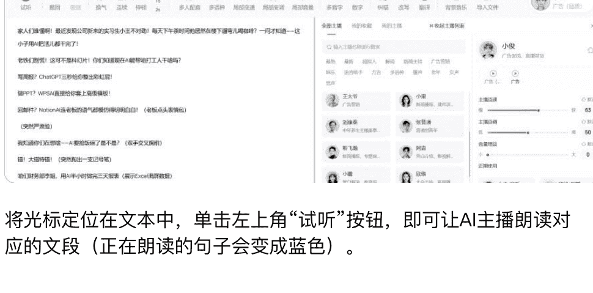

新人小王不对劲！每天茶歇时间他


需要更自然可在工具栏做细节优化。

① 增加停顿。想在“最近发现公司新来的新人小王不对劲！”与“每天茶歇时间他居然在楼下遛弯儿？”之间留白，选中光标位置点停顿选择0.5秒，文本间会出现停顿符号，试听满意即可保留。


> 最近发现公司新来的新人小王不对劲！ 0.5秒 每天茶歇时间他居然在楼下遛弯儿喝咖啡？

② 调整语速。右侧播音员区可拖动语速调节整体快慢；想局部调整则框选文本点局部变速。


确认无误后点右上侧导出音频，命名后下载。


该平台还支持加背景音乐、音效、纠正多音字、同音连读、多人对话等功能，可自行探索。

## 7.2 AI短片，批量生产爆款

智能方案生成视频主要有两种路径：纯文字生成和基于参考图像生成。本节结合 DeepSeek 与即梦演示。

先写分镜脚本。脚本帮助理清拍摄与剪辑，创作前可思考：全片几个画面、顺序怎样、每镜时长多久、画面如何承接文字、台词走配音还是原声等。

最基础的分镜包含镜号、场景、台词、拍摄内容、拍摄方式、声音。画面内容要配合景别：远景交代环境，全景呈现人物与环境关系，中景表现上半身动作，近景突出面部表情，特写强调局部细节。

有了概念后让 DeepSeek 提效。无示例时可提示：

你是一位专业的爆款视频创作者，帮我撰写主题为×××的短片脚本，时长约1分钟，要求表格呈现，表格包含镜号、场景、台词、拍摄内容、拍摄方式、声音。

有示例时在提示中加入学习要求，让模型分析角色、画面、镜头运动后再创作。


脚本示例表头为

| 镜号 | 场景 | 台词 | 拍摄内容 | 拍摄方式 | 声音 |

|------|------|------|----------|----------|------|

按照此框架批量产出分镜，再配合配音合成与图像生成，即可高效完成从文案到成片的闭环。

| 序号 | 场景 | 台词 | 画面说明 | 镜头建议 | 音效建议 |
| 1 | 云海仙阙 | (旁白)远古之际，乾坤未分，混沌为一。 | 薄雾轻裹的仙宫，仙人穿梭其间。 | 无人机高空俯拍，呈现仙阙的宏大。 | 空灵的配乐，透着神秘感。 |
| 2 | 世间凡尘 | (姜子牙)“天下大势，合久必分，分久必合。” | 姜尚手持拂尘伫立人间，眼神深邃。 | 镜头推进至面部，突出智者气质。 | 低沉稳重的男声旁白。 |
| 3 | 商都宫殿 | (纣王)“我乃天命所归，谁敢造反？” | 帝辛端坐龙椅，四周歌舞升平。 | 高位俯瞰殿内，展现奢靡氛围。 | 傲慢张扬的语气。 |
| 4 | 军营点将 | (哪吒)“为正义而战，虽死犹荣！” | 哪吒披挂盔甲，手握火尖枪蓄势。 | 特写坚毅眼神，传递不惧气概。 | 激昂鼓点叠加呐喊声。 |
| 5 | 混战疆场 | (众仙)“封神之战，就在此刻！” | 仙众与魔族在沙场激烈厮杀。 | 快速切换多机位，凸显战况残酷。 | 爆裂战斗音效加紧张弦乐。 |
| 6 | 天坛封神 | (姜子牙)“今日，我便为尔等封神！” | 姜尚立于封神台，手执封神榜宣读。 | 顶部俯拍台面，显现庄严肃穆。 | 厚重乐章配合原声。 |
| 7 | 收束余韵 | (旁白)“封神之战，终成传说。” | 封神台渐隐，画面归于宁静祥和。 | 镜头缓缓远撤，显现浩瀚寰宇。 | 悠长旋律慢慢淡出。 |

### 镜头提示词编写与画面生成

登入即梦 AI 主页，切换到 AI 视频制作入口，点按“视频生成”。


左侧工作区提供两种制作路径，一为图转视频，二为文转视频。

#### ① 图转视频
由图生成片可控性强，适合对画面连贯性要求高的短内容。读者可依据前文分镜先行生成所需的背景或关键帧，再将图片导入即梦平台。参考样例如下。

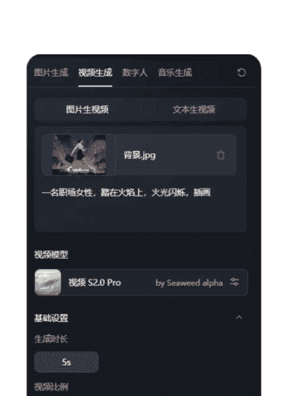


#### ② 文转视频
由文生成片灵活性更高，系统可发挥更多创意，适合绘本、创意向短片。依据已完成的脚本撰写分镜描述词，通常涵盖以下四个维度。

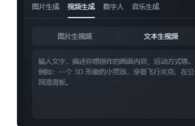

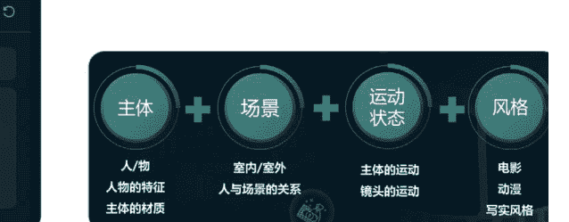

例如：“傍晚柔光下池塘浮满粉色睡莲，随风轻颤，写实质感”。

将描述粘贴至即梦的输入框，选择对应模型与画幅，得到的效果如下。

图片生成 视频生成 数字人 音乐生成

图片生视频 文本生视频

池塘水面上大片的粉色睡莲在柔和的晚霞中熠熠生辉，被风吹过微微颤动。写实风格

##### 视频模型
视频 S2.0 Pro by Seaweed alpha

##### 基础设置
生成时长

5s

视频比例

16:9

##### 视频比例
- 21:9
- 16:9
- 4:3
- 1:1
- 3:4
- 9:16


### 依分镜脚本在剪辑软件中合成

启动剪映专业版，移动端亦可，在首页点“开始创作”进入编辑区。

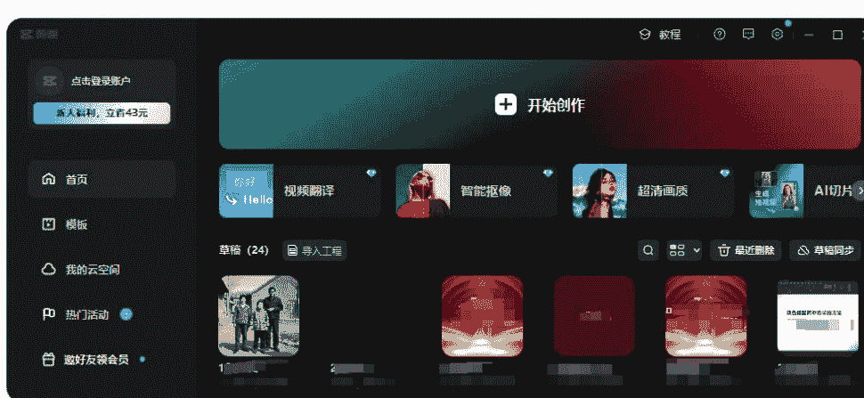

把即梦生成的素材导入素材库，再拖入时间轴。

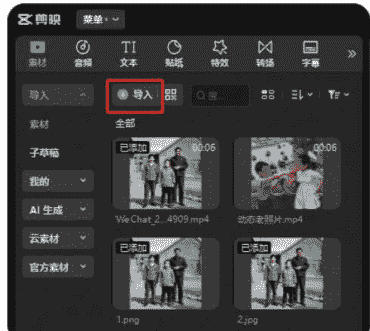


此阶段可完成基础剪辑。素材库内提供多类资源供挑选。

点选资源可预览加入效果，确认后点右下角 + 号即可添加至轨道。

- 夏野与暗恋 - 阿东啊 - 02:44
- 积极向上 无限能量 - Vincent T - 01:43
- 轻音乐（舒缓钢琴曲） - 李闻馥 - 01:36


在轨道上按住鼠标左键拖动素材，可使音频与画面同步。


若不再增添素材与特效，可在右上点“导出”，设置保存参数后输出成片。

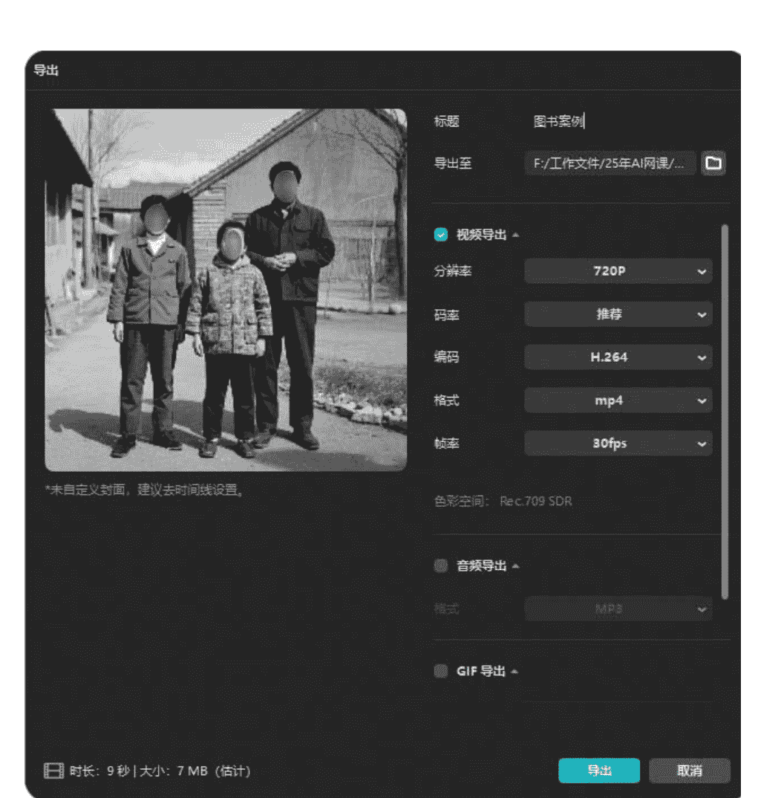

## 7.3 虚拟主播克隆，实现真人口播复刻

配音与画面素材的制作已不成难题，若不想本人出镜，却需真人互动感的内容，或单人想打造团队感，AI便可助力。本节介绍国产数字人工具“闪剪”。

### 通用数字人视频制作

进入闪剪首页，完成注册或登录。


挑选一个契合需求的数字人模板后，点“立即制作”进入编辑界面。

## 樱桃-心灵成长


见世面

强大的女人会为自己的人生打...

生活用心...

编辑界面分为三区：左侧功能区提供数字人形象、配音、配乐、贴纸、文字样式等资源；中间为预览区，可实时查看效果；右侧为文本区，可直接粘贴文案，也可调用闪剪内置的DeepSeek-R1引擎自动撰写文案。

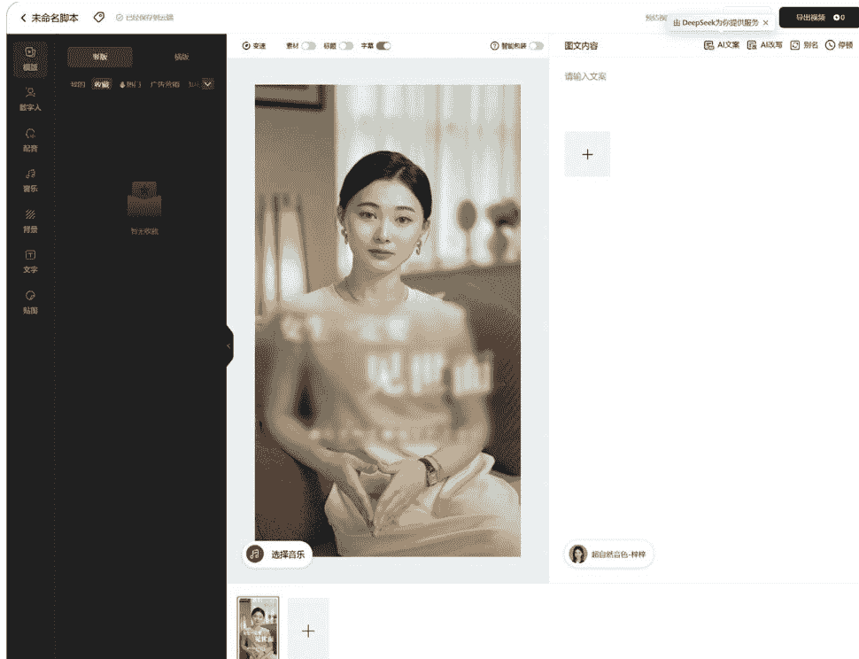


### 第1步 撰写视频文本
本例直接调用闪剪接入的DeepSeek-R1进行创作。

点右上“AI文案”，进入创作页，选择角色、输入主题，例如“女性力量”，设定字数后点“使用DeepSeek生成”。

## AI创作
角色选择
- 通用
- 情感导师
- 行业导师
- 正能量
- 视频脚本
- 健康大师
- 电商营销
- 祝福问候
主题描述
试试范文
女性力量
4/500
### 字数要求
约150字≈30s
- 不限字数
- 约150字≈30s
- 约300字≈60s
- 约500字≈120s

此时预览区与文本编辑区会同步刷新。


女性力量是无穷的！在历史长河中，无数女性以坚韧不拔之志书写传奇。她们可以是战场上英勇的女战士，也可以是科研领域智慧的女科学家。在生活里，每一位努力工作、用心照顾家庭的母亲也是女性力量的体现。不要小看自己，无论身处何境，女性都能爆发出强大的能量，打破束缚，勇敢追梦，向着目标坚定前行。

### 第2步 选择数字人形象与配音
#### ① 选择数字人形象
在左侧功能区找到“数字人”，点下拉可快速筛选分类。平台提供不同性别、国籍、装扮及拍摄角度的形象供选，本例按主题挑选知性干练的角色。

- 模版
- 数字人
- 配音
- 音乐
- 背景
- 文字
- 贴图
搜索数字人
- 我的
- 收藏
- 热门
- 晓雅
- 樱桃

| 书淇 | 杨舒 | 露露 | 星星 | 欣妍 |
| 小倩 | 俊东 | 婉宁 | 关雅 | 宇杰 |
| 晓梦 | 芹雅 | 赵琳 | 依娜 | 敏儿 |
| 赵璐 | 李乔 | 苏苏 | 秦冉 | 周旭 |
| 舒兰 | 邱婷 | 小容 | 伊伊 | 菲儿 |
| 刘倩 | 广告 | 传统 | 知识 | 营销 |
| 实景 | 国际 | 职业 | 新闻 | 新年 |


梦琪-干练


方琪-知性


#### ② 选择角色配音
在左侧选择“配音”功能，可导入已有音频，也可选闪剪提供的音色。建议选用“超自然”系列，处理效果更贴近真人表达。

至此，最基础的数字人视频已搭好。如需提升趣味，可在左侧添加贴纸、文字与动画。若嫌手动繁琐，可打开预览区上方的“智能包装”开关，由系统自动增添效果。

第3步 预览并导出
预估视频时长0分36秒

## 图文内容
- AI文案
- AI改写
- 别名
- 停顿
女性力量是无穷的！在历史长河中，无数女性以坚韧不拔之志书写传奇。她们可以是战场上英勇的女战士，也可以是科研领域智慧的女科学家。在生活里，每一位努力工作、用心照顾家庭的母亲也是女性力量的体现。不要小看自己，无论身处何境，女性都能爆发出强大的能量，打破束缚，勇敢追梦，向着目标坚定前行。

预览时发现智能包装与整体风格不搭，画面过于花哨。关闭“智能包装”，确认无误后点右上“导出视频”。

为便于快速核对内容，预览时数字人仅为单帧静态供参考
等待生成完成后点“下载”即可获取完整视频。

## 我的作品
女性力量是无穷的！在历史长...
2025.03.07 01:50
女性力量是无穷的！在历史长...

### 定制专属数字人形象

若想打造独一无二的虚拟分身，克隆个人音色，用于配音、出镜或品牌宣传，可在闪剪首页选择“定制数字人”。

开始创作
直播快剪 直播切片一键生成
口播视频 AI生成数字人视频
定制数字人 定制你的专属分身
链接成片 链接一键转视频
视频订阅号 AI自动推送视频

#### 定制你的专属数字人
形象、声音一键克隆，告别真人出镜
开始定制

极速模式下约10秒即可完成训练，点“立即尝试”进入操作页。

##### 模式对比
极速模式：不用说话录制 10 秒，即可训练数字人
立即尝试

##### 极速定制
> 为获得理想效果，请在光线充足、环境安静下录制，拍摄时避免遮挡面部。

| 步骤 | 操作 |
| :--- | :--- |
| 1 | 上传训练视频<br>点击提交训练视频 |
| 2 | 上传授权视频<br>点击提交授权视频 |
| 3 | 克隆声音<br>点击提交克隆声音 |

视频教程
极速模式
只需 10s - 20s 的视频，闭嘴不说话即可训练
- 表情放松，手势和身体自然微动
- 没有挡住嘴巴
- 没有抬侧脸
- 保持人物一直在画面中
正确示例
错误示例
开始训练
我已阅读并同意《定制数字人协议》

按要求上传自己的训练视频与授权视频，点“开始训练”。

##### 极速定制
##### 信息安全须知
为了获得更理想的效果，请在光线充足、安静的环境下录制。拍摄视频时，请注意不要遮挡面部。
##### 训练视频
##### 授权视频
##### 克隆声音
头像和模糊文本
开始训练
我已阅读并同意《定制数字人协议》

训练完成后会短信通知，也可在“我的数字人”页查看进度。