# 5小时玩赚 ChatGPT：AI应用从入门到精通

# 内容概览

本书以 5个主题模块+40余个ChatGPT实战案例+50多集教学视频+80余份素材成品+120条实用干货+130多条精选指令为支撑，助你用一本书把ChatGPT从零玩到精通。随书还附赠150多页PPT课件，方便你边学边练、场景化掌握。

全书共分五大篇章：洞察市场、理解原理、实操入门、进阶精通、思维延展。帮助你先弄清ChatGPT的来龙去脉，再掌握自然语言处理的用法，最后能把能力迁移到真实项目中。无论你是零基础小白，还是已有开发经验的从业者，都能在这本书里找到合适的学习路径。

本书提炼精要，由浅入深，理论与实操结合。很适合以下人群：
一是对ChatGPT充满好奇的学生与新手；二是从事AI相关工作的软件工程师、开发者、程序员；三是深耕数据科学与AI研究的科研人员与数据科学家；四是希望提升内容生产效率的自媒体人、短视频创作者、主播、电商运营、媒体编辑、文案策划；五是对NLP与人工智能感兴趣的任何学习者。

# 图书在版编目（CIP）数据

5 小时玩赚 ChatGPT：AI 应用从入门到精通 / AIGC

文画学院编著 .—北京：化学工业出版社，2024.1

ISBN 978-7-122-44383-0

Ⅰ. ①5… Ⅱ. ①A… Ⅲ. ①人工智能 Ⅳ. ①TP18

中国国家版本馆 CIP 数据核字（2023）第 210897 号

责任编辑：李 辰 孙 炜

责任校对：李雨晴

封面设计：异一设计

装帧设计：盟诺文化

出版发行：化学工业出版社（北京市东城区青年湖南街13号 邮政编码100011）

印 装：三河市延风印装有限公司

787mm × 1092mm 1/16 印张12½ 字数240千字 2024年2月北京第1版第1次印刷

购书咨询：010-64518888

网 址：http://www.cip.com.cn

凡购买本书，如有缺损质量问题，本社销售中心负责调换。

售后服务：010-64518899

定 价：68.00元

版权所有 违者必究

# 前言

党的二十大报告提出，“全党全军全国各族人民要紧密团结在党中央周围，牢记空谈误国、实干兴邦，坚定信心、同心同德，埋头苦干、奋勇前进，为全面建设社会主义现代化国家、全面推进中华民族伟大复兴而团结奋斗！”这一精神，为科技发展提供了根本遵循。

在数字化浪潮中，科技创新需要这种实干态度。研发者要坚定信心持续打造AI新技术与新产品，普通人要主动拥抱新事物，锻造不可替代的能力，全国上下共同推动科技进步与时代发展。

随着技术不断深入，ChatGPT作为一项新成果引发广泛关注。有人盲目追捧，有人冷眼旁观，有人担忧未来。观点各异，但与其空谈，不如主动去了解、去实践，迎接ChatGPT带来的学习、工作与生活变化，从认识ChatGPT开始，掌握其用法，并在应用中发现更多机会与可能。

本书定位为零基础入门指南：先拆解市场趋势，再讲清技术原理，继而手把手实操、深度精通，最后拓展应用场景，层层拨开ChatGPT的迷雾，帮助你看到更开阔的前景。

本书有三个特点：

1. 提炼到位。把ChatGPT的脉络浓缩为5个专题：了解市场、知晓原理、操作实战、精通运用、思路拓展，让你快速上手。
2. 学习高效。将内容拆解为5小时学习量，按时间推进，循序渐进掌握核心能力。
3. 附加丰富。视频、PPT课件与指令库全套赠送，支持场景化跟练。

全书由浅入深、理论结合实战，新手与老手都能有所收获。

特别提醒：本书成稿时基于GPT-3.5界面的实操截图，后续AI工具界面与功能或有更新，请以书中思路举一反三。同一提示词，ChatGPT每次回复也可能不同，建议重点放在关键词设计与操作步骤的训练上。

本书由AIGC文画学院主编，朱霞芳等参与编写，特此致谢。因编者水平有限，书中难免有疏漏，欢迎读者批评指正，交流请加微信：2633228153。

编著者

# 第1小时

洞察市场：ChatGPT掀起新一轮AI科技浪潮

ChatGPT是一款基于AI的对话机器人，依托自然语言处理与深度学习等技术的积累，能够进行流畅对话、解答各类提问。它的诞生标志着AI发展的重要突破。本章从市场演进角度切入，帮助你建立对ChatGPT的整体认知。

## 1.1 技术演进：ChatGPT推动生成式AI落地

ChatGPT的核心是GPT，即生成式预训练转换模型，由OpenAI打造的深度学习架构，能够深度理解自然语言。

其最大优势在于能基于上下文实现连贯对话，随着版本迭代，回复愈发高效、精准且具思辨性。以下梳理其技术迭代脉络。

### 1.1.1 ChatGPT的完善源于多轮技术升级

ChatGPT经历了GPT-1到GPT-4的逐步演进，每一代都在机器学习、神经网络与Transformer等技术的基础上升级。分阶段来看：

1. 前深度学习时期
约1950-1970年，AI多采用规则法处理自然语言。先人工制定语法、词汇、语义规则，再用规则匹配问题。优点是流程清晰、擅长专业领域；缺点是自然语言模糊多变，规则维护成本高、难以持续更新。

> ★专家提示★
> 自然语言即人类日常交流的语言，如汉语、英语等。自然语言处理是计算机科学与AI的交叉领域，研究机器如何理解、处理和生成人类语言。

2. 深度学习时期
1970年至今，为摆脱规则局限，AI引入机器学习、神经网络与Transformer。核心模型依次为机器学习、神经网络、Transformer、ChatGPT模型，后者在此前技术之上演进。
- 机器学习：通过海量语料自动归纳语言规律，广泛用于翻译、语音识别等。
- 神经网络：模拟人脑结构处理语言问题，形成前馈与反馈两类结构，学习方式包括监督、无监督与半监督。
- Transformer模型：奠定生成式AI基础，优势在于并行处理与长文本建模。
- GPT模型：基于Transformer构建的大规模预训练语言模型，通过上下文理解实现高效对话。

### 1.1.2 ChatGPT以Transformer为底座

GPT以Transformer为架构基础，理解Transformer即理解ChatGPT的核心逻辑。

1. 迁移学习
Transformer通过预训练先学习共性知识，再迁移到具体任务，实现深度学习与复杂NLP任务的完成。
2. 注意力机制
Transformer用注意力连接编码器与解码器，能自动聚焦关键词。如在“A路过操场被B踢的足球砸伤”中，模型会捕捉“被”来判断受伤主体。
3. 大规模化
算力、显存与吞吐量的提升让模型训练成为可能。Transformer可免去大量人工标注，自行归纳规律，实现举一反三。
4. 核心能力
- 标题与摘要生成：基于词嵌入进行权重计算与重组。
- 段落生成：借助注意力与感知器理解上下文形成结构化文本。
- 情节续写：采用随机遮挡训练，提升模型对未知数据的预测力。
- 风格模仿：分离内容与属性编码，实现文本迁移。

在Transformer技术积累上，GPT经历GPT-1至GPT-4的迭代，愈发接近人脑式生成。

### 1.1.3 GPT-1简化模型，加速理解

GPT-1是2018年发布的首代生成式模型，在Transformer基础上减少标注依赖，采用无监督预训练+有监督微调。仅用12层Transformer解码器即可基于上下文预测结果，实现人机对话。

### 1.1.4 GPT-2优化结构，逼近全能专家

GPT-2在GPT-1基础上全用无监督学习，支持多任务。结构上调整了训练目标与数据策略，并扩充到24/36/48层解码器，生成文本更贴近人类表达，但仍存在幻觉与一致性问题。

### 1.1.5 GPT-3增强能力，提升少样本表现

GPT-3在参数规模与能力上大幅突破，少样本学习效果显著，可生成新闻样例等。但其自创内容易出现失实或误导。为此推出InstructGPT，即GPT-3.5，通过加入监督微调与奖励模型强化学习，使回复更有效、更准确。

训练思路为先对GPT-3增加监督微调，再用奖励模型引导输出。

GPT-4 让对话更有温度的背后，是围绕人类反馈的训练闭环在起作用。模型在 InstructGPT 的基础上补上了聊天属性，通过 ChatGPT 的形态与公众对话，用连续的文本回应问题，并在理解语义意图上实现明显跃升。

训练核心围绕人类偏好展开，共有三条路径在协同。

监督微调路线，先收集带指令的提示样本库，再对符合预期的答案做人工标注，最后让模型学会给出用户会接受的回复。Step 01 收集说明数据，即给出 prompt 的数据集。Step 02 预设输出结果，即对符合期望的数据进行标记。Step 03 输出结果，给出能够让用户满意的回复。

奖励模型路线则是在神经网络之外额外训练一个质量判别器。Step 01 对 prompt 数据集和若干模型的结果进行抽样。Step 02 对输出结果进行优劣排序，让 GPT-4 优先输出优质的结果。Step 03 将训练好的奖励模型来训练反馈模型，不断优化输出结果。

增强学习路线让模型在试错中自我提升。Step 01 从数据集中抽样并组成新的 prompt，“投喂”给 GPT-4 模型。Step 02 GPT-4 模型根据新的 prompt 生成输出结果。Step 03 反馈模型判断输出结果，并给出反馈结果，即判断 GPT-4 给出的回复是否符合人类期待。Step 04 参考反馈结果，不断优化输出结果，让 GPT-4 模型给出最优解。

与此同时，GPT-4 继承了 InstructGPT 的大规模预训练，在自然语言理解、跨信息整合、用户情绪感知上都更稳健。

AIGC，即人工智能生成内容，正把生成式 AI 从实验室推向多场景商用。ChatGPT 作为其中的重要分支，把握其发展脉络就能看清应用方向。

研发经历了萌芽、沉淀、爆发三阶段。1950 到 1990 年，AIGC 只在小范围试验，出现了计算机编曲、雏形人机对话机器人、语音控制打字机等成果。1990 到 2010 年，开始进入实用，AI 首创小说、同声传译中英应用出现。2010 年至今，进入高速发展期，内容多样性和完成度大幅提升，模型不断迭代，典型成果包括 AI 还原逼真内容、AI 首创诗集、智能生成高清图像、智能生成连续视频、文本输入生成图像等。

产业结构可拆为技术层、模型层、应用层。

AIGC 的技术能力集中体现在三大前沿方向。

数字内容孪生，AIGC 能基于现实构建虚拟世界，比如按外貌特征描述就能还原出对应的人像。支撑能力来自智能增强技术和转译技术，前者减少生成失误并弥补信息损失，后者提升理解力，让同一个 prompt 能产出不同形态的内容。

数字编辑能力，让虚拟与现实更紧密连接。模型既能读懂现实世界的自然语言，也能在虚拟世界里生成自然语言并回馈现实，形成孪生反馈闭环。包括智能语义理解，帮助编码解码时快速识别分析归类，以及属性控制，在理解基础上对结果进行编辑修改完善，让输出更符合用户预期。

数据创作能力，基于模态技术实现 AI 创作。既能模仿已有数据生成新内容，也能基于抽象概念理解创造全新内容。早期分析式 AI 只做归类预测，具备创作能力后就能在总结归纳基础上产出原创，这正是 AIGC 的创新点。

ChatGPT 正是 AIGC 数字编辑能力在文字侧的典型落地。生成式 AI 的内容模态分为文本、图像、视频、音频和跨模态五大类，各有细分场景。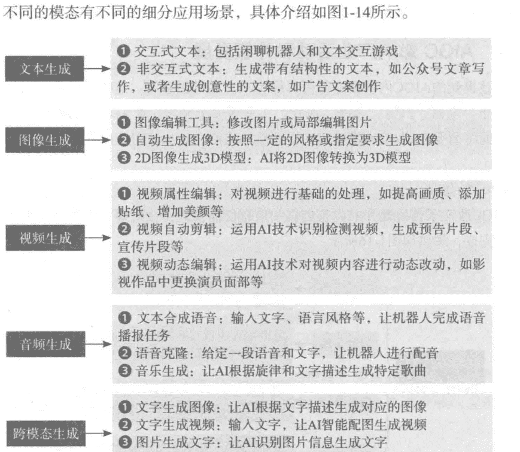

文本生成在商业化上具备先天优势。

技术层面有四项优势，如图1-15所示。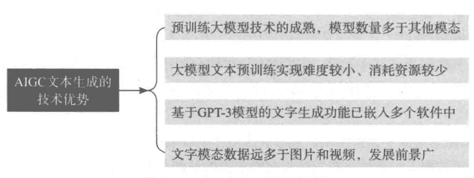
文本特征层面，文本体量庞大获取成本低，能满足大规模预训练的数据需求。相较图像视频语音，文本处理和传输占用内存更小，成为人机交互的首选入口。

AIGC 正在改写多个产业的作业方式。

传媒领域，内容创作和信息传播被数字化重塑，工作流程更高效，举例如图1-16所示。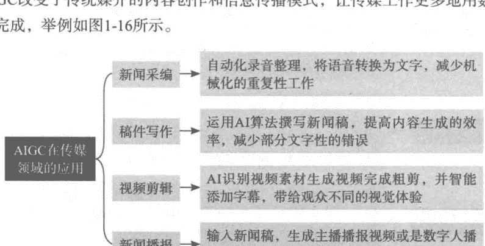
影视领域，多样化的生成内容为创作提供灵感，并能高度还原剧本效果，提升整体质量，在脚本创作、拍摄、后期剪辑均有助益，具体介绍如图1-17所示。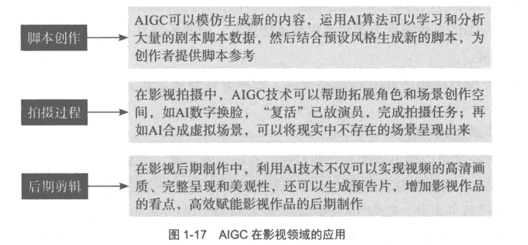
娱乐领域，数字化让娱乐方式更丰富，虚拟空间打破地域文化壁垒，沉浸趣味体验成为主流，应用体现在三个方面，如图1-18所示。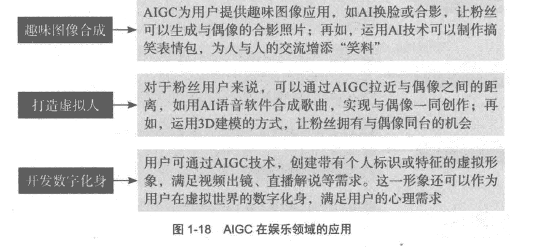
电商领域，核心是增加展示维度、构建虚拟直播场景、生成虚拟主播，实现增收降本。3D 模型展示能多角度呈现商品，缩短选品沟通时间并提升信任，降低退换货率；AI 构建的 3D 直播场景提供接近真实的美观观感，带来沉浸式购物，同时成本低于纯 3D 技术，降低商家门槛；虚拟主播可为不同直播间定制形象，完成推介和咨询，弥补人工在时间和精力上的不足，且可控性强，更易吸引年轻受众。
在教育、金融、医疗、工业等其他领域，AIGC 有助于开拓新业务、提升效率、推动转型升级，具体如图1-19所示。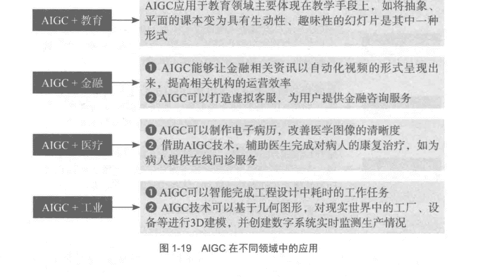

商业化进程在 2023 年 2 月加速，OpenAI 公布 ChatGPT 试点订阅计划，推出 ChatGPT Plus，按需付费享受更稳定体验和优先新功能，标志着商用探索开启。

在传媒写作上，ChatGPT 可提供选题方向，让媒体有可传播的内容，如图1-20所示。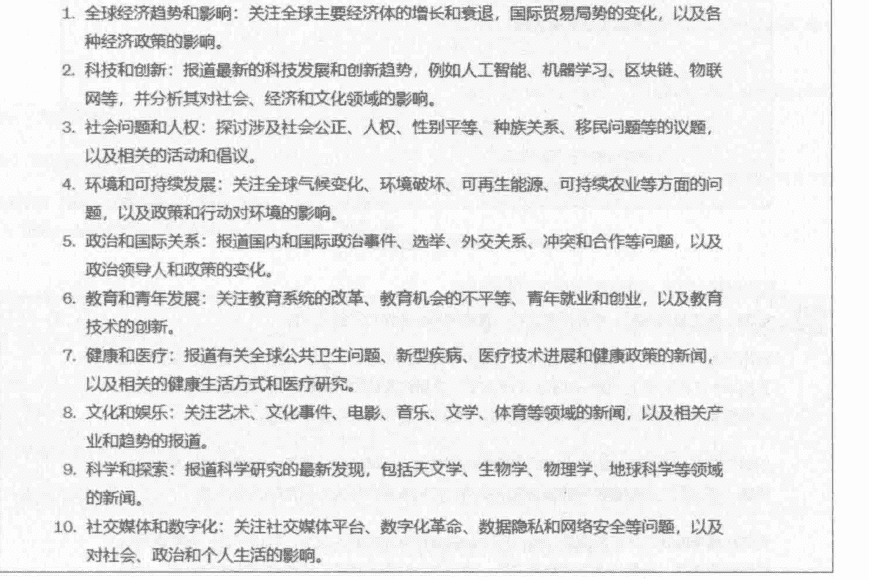
采编环节可把语音转为文字后交给模型整理，形成逻辑清晰、层次分明的素材，人工稍作加工即可使用。图1-21所示为整理示例。
还能依据关键词和特定要求撰写稿件，示例如图1-22所示。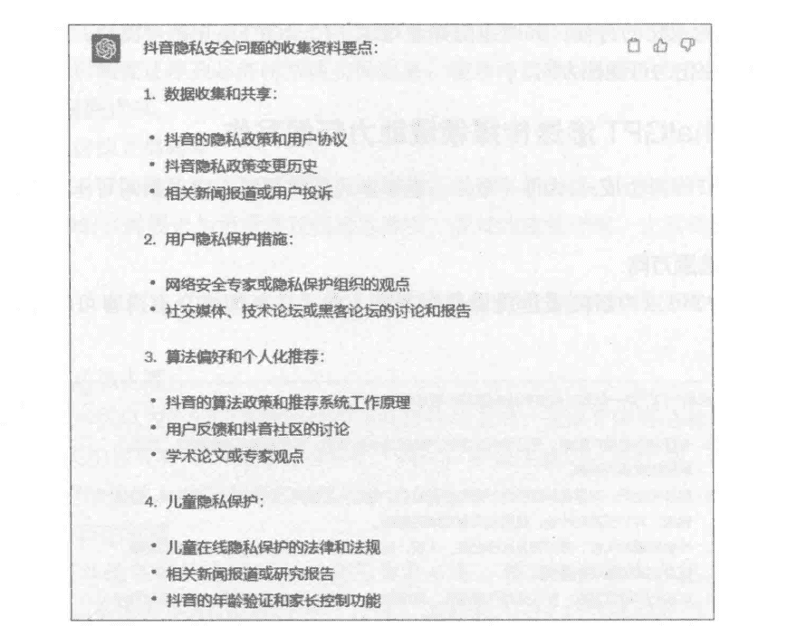
图 1-21 ChatGPT 整理的新闻素材示例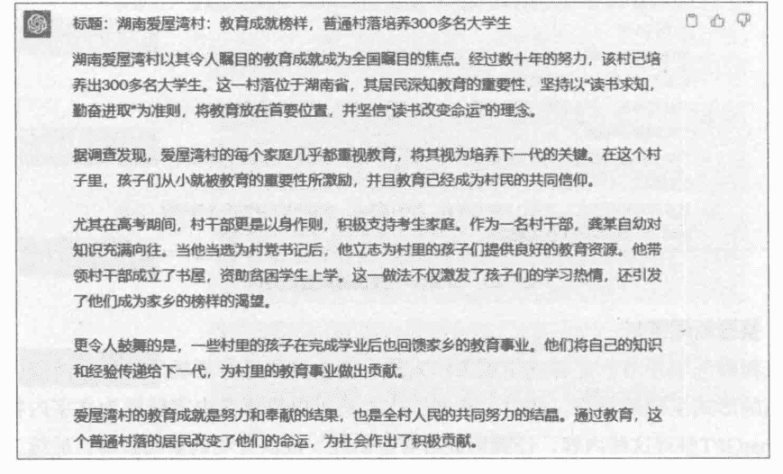
图 1-22 ChatGPT 撰写的新闻稿件示例
应急播报时，工作人员可快速生成稿件，结合视频合成软件制作应急视频，或由虚拟数字人播报。

影视创作边界被拓宽，文本生成能力使其在剧本创作最有效。

可基于预训练机制自创内容撰写影视剧，用户给出指示即可获得作品，如图1-23所示。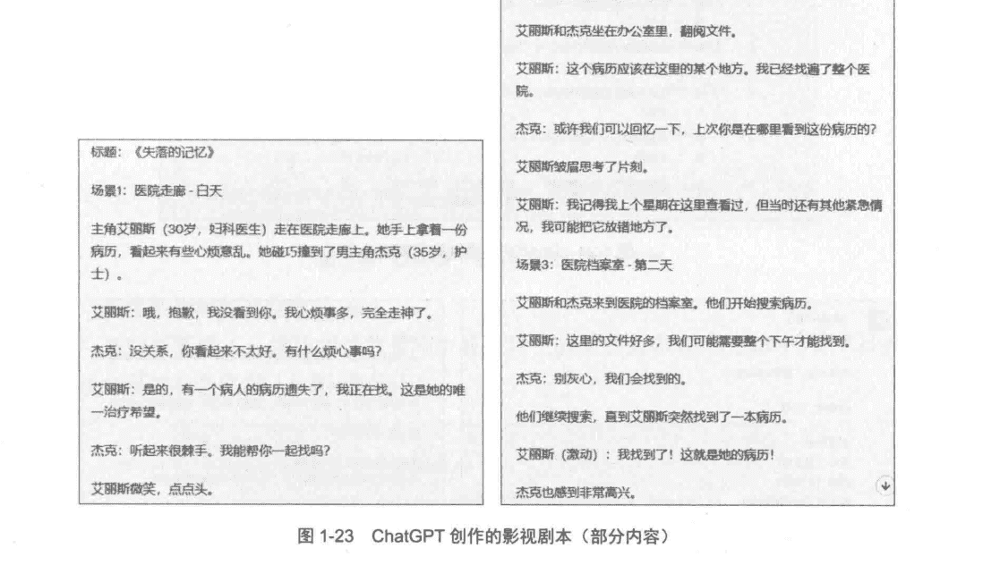
也能提供影视脚本参考，示例如图1-24所示。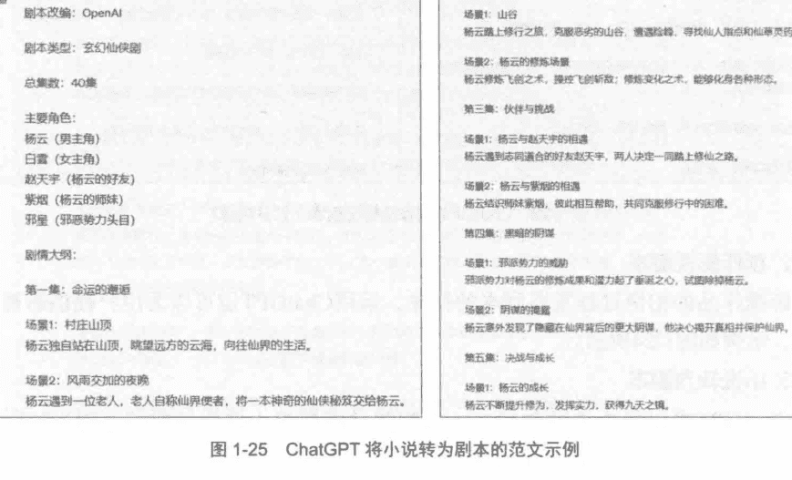
小说转剧本功能为翻拍提供便利，图1-25 为范文示例。
整体来看，模型能为创作者提供灵感提升效率，减少内容创作时间成本，让团队更聚焦拍摄和后期，从而提高作品质量。

营销文案生成同样实用。ChatGPT 的文本生成架构擅长内容创作，可为产品推广、品牌包装、海报提供参考，降低成本提升效率。图1-26所示为产品推广文案示例。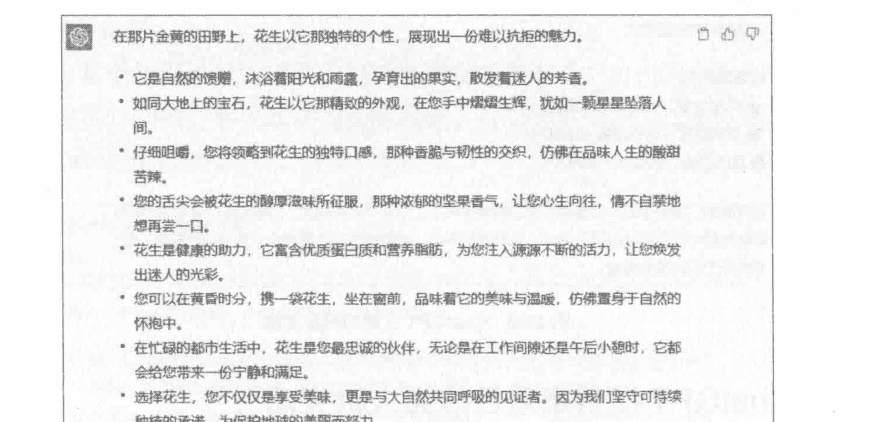
输入品牌信息和要求即可生成包装文案，如图1-27所示。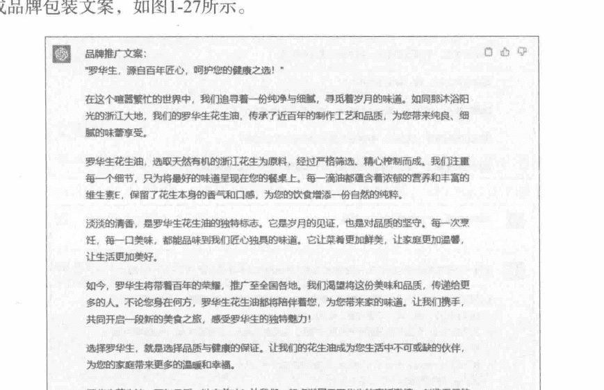
海报文案也能自动生成，提炼卖点吸引受众，如图1-28所示。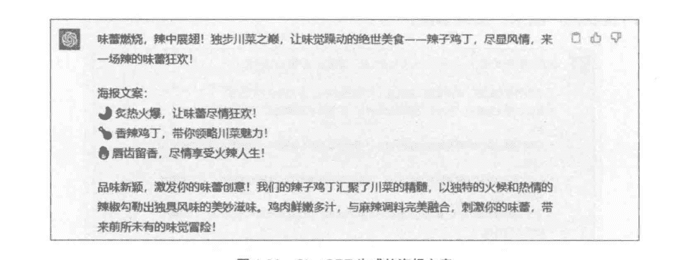
图 1-28 ChatGPT 生成的海报文案

娱乐性人机互动方面，ChatGPT 可提供聊天陪伴，用于解闷、答疑、情感咨询，示例如图1-29所示。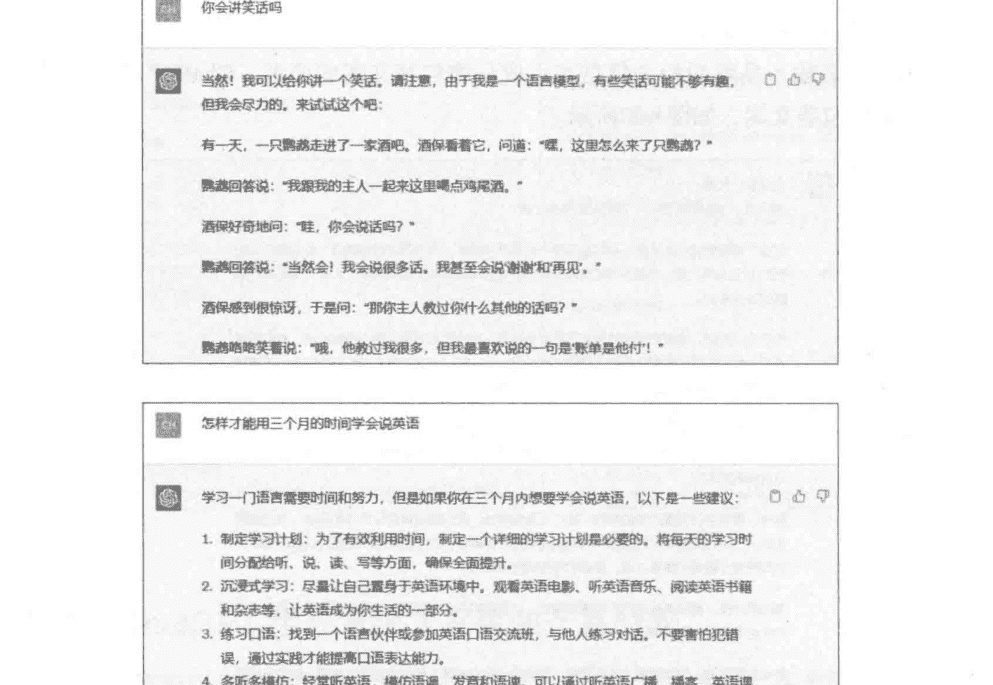
图 1-29 ChatGPT 提供聊天服务示例

教育学习场景中，ChatGPT 能提供学习指导、笔记思路、作文灵感、论文大纲和降重等帮助，支持自主学习。
例如学生对吉他学习有疑问，可询问新手技巧获取指导，如图1-30所示。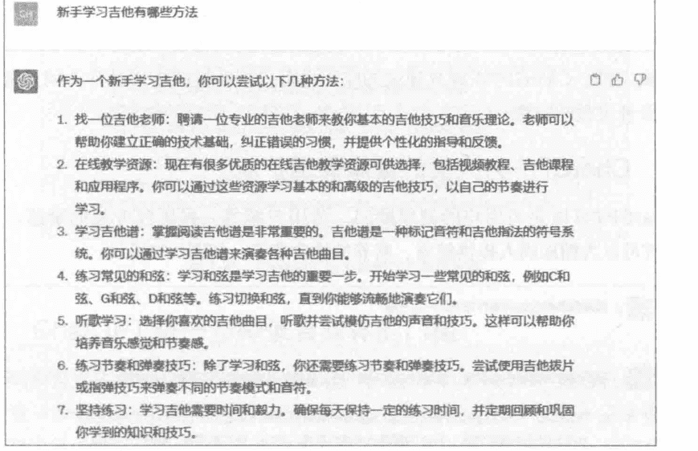
图 1-30 ChatGPT 提供学习指导
作文灵感匮乏时，提供材料让模型解读后给出点子，示例如图1-31所示。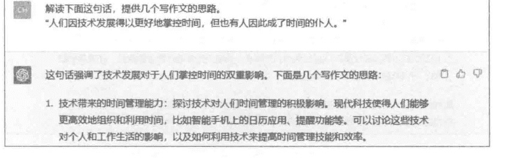
图 1-31
围绕技术与时间管理的讨论也值得关注，比如技术进步加剧时间压力和忙碌感，人们易陷入信息与社交媒体循环导致分配失衡，可探讨限制使用时长、培养专注力的对策；技术依赖可能束缚自由支配时间，可思考如何减少过度依赖、强化独立思考与自主管理；技术的平衡应用在于合理利用提高效率生活质量，同时避免沦为时间奴隶，强调自律与目标导向和健康使用习惯的建立。
除此之外，ChatGPT 在教育领域的应用也可以帮助教师生成教学大纲、梳理教学重难点及开发教学资源。

ChatGPT 为人类的健康保驾护航

在健康资讯检索的使用场景下，对话式AI可作为个人健康信息伙伴，帮助使用者梳理常见的医学疑惑。针对需要控制血糖的群体，能够提供科学均衡的饮食方案，示意图见图1-32。

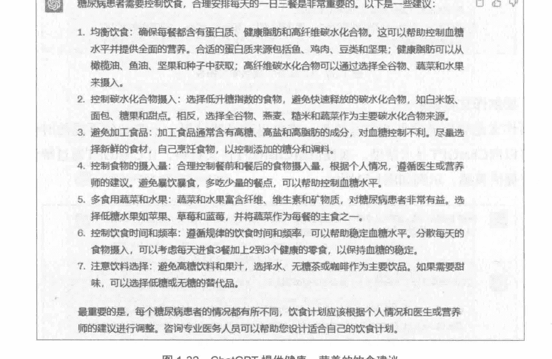


当使用者希望弄清疾病的发生机制时，可直接向系统提问。比如输入“抑郁症是如何形成的”，系统会给出病因层面的说明，缓解医学认知上的困惑，参考图1-33。

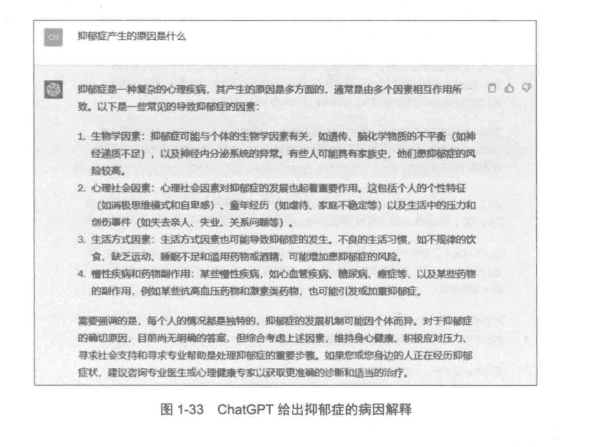

### 1.3.7 对话式生成模型持续拉低新媒体创作准入

当前新媒体生态高速扩张，文本生成能力正深度参与内容生产，明显降低创作门槛。社交平台文案、软性宣传材料、短视频脚本以及标题提炼等需求，均可借助模型完成。以下简要说明其在新媒体领域的落地形态。

- 1. 新媒体短文撰写

新媒体稿件追求简洁直观、形式多样、传播互动性强。智能系统能结合这些特征给出写作思路与参考样稿，示意见图1-34所示。

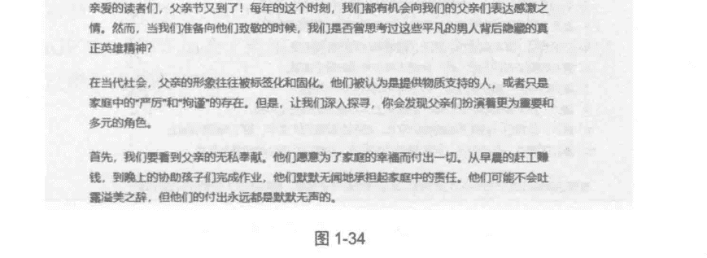
父亲们常常兼具坚韧与勇气，在孩子眼里像是守护者。他们以坚定意志与无畏精神示范如何面对挑战并在其中成长。

同时，父亲也多是知识的引路人。不仅是孩子最早的启蒙者，也是人生经验的传递者。他们借自身经历与教训指引方向，鼓励探索，点燃好奇，并为梦想提供支持。

此外，父亲更像温暖的港湾。物质支持之外，更给予精神上的安慰与鼓励。无论顺境逆境，他们始终在身旁，给予坚定信念与持续关爱。他们的怀抱是最安心的地方，也是人生宝贵的财富。

因此在父亲节，礼物与祝福之外，更应体会父亲的无私与伟大。向他们表达爱意、感激与关心。

将这份敬意延伸到日常，记住他们的辛劳与付出。因为他们的爱恒久不变，付出毫无保留。

读者朋友们，父亲节值得铭记与庆祝。让我们走出表面的仪式，深入认识并赞美这些平凡的英雄。致敬他们，感谢他们，因为他们是生命中最重要的人。

愿每位父亲都能感受到爱，在为人父的旅程中收获幸福与满足。在此特殊日子，共同致敬这些伟大的人。

祝所有父亲节快乐！
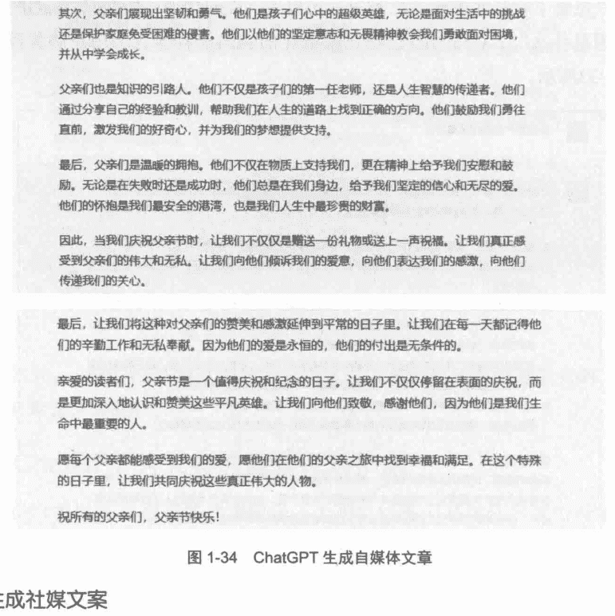

#### 2. 社交平台文案产出

当下人们习惯通过网络维系人际联系，微信朋友圈是最常见渠道之一。家人借此了解在外亲友动态，朋友借此分享生活状态，陌生人也借此寻找共鸣话题，因而朋友圈对多数人不可或缺。

智能系统可为使用者生成朋友圈文案参考，让生活分享更具表达力，示例见图1-35所示。

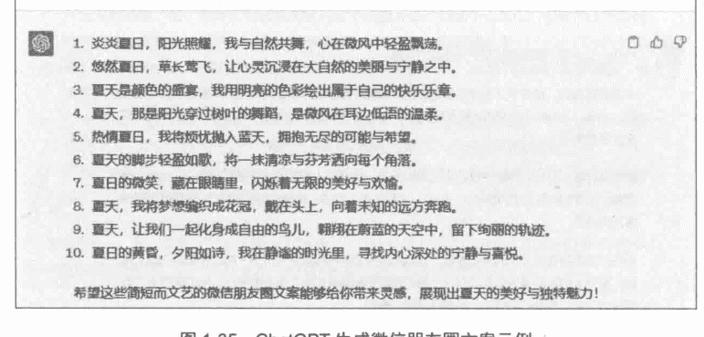

#### 3. 短视频脚本产出

短视频是大众喜爱的娱乐形式，对创作者而言，文案质量直接影响作品受欢迎程度。智能系统能够提供短视频文案参考方案，示例见图1-36所示。

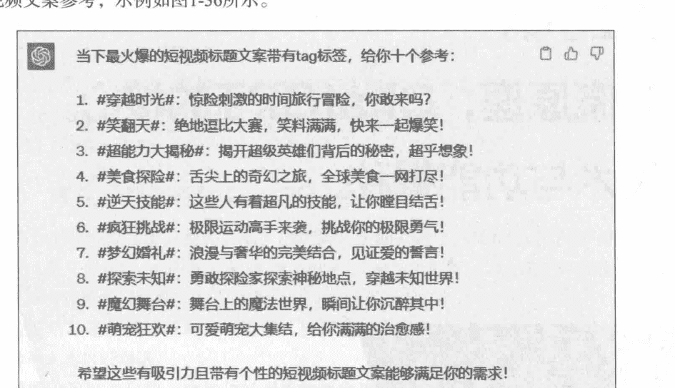

## 本章小结

本章从技术迭代、行业趋势、商业方向三个视角介绍了该模型的市场发展，帮助读者建立初步认知，为后续操作学习奠定基础。

## 课后习题

为巩固本章要点，以下安排两道回顾题。

- 1. 回顾所学，列出 GPT 系列较前代模型在性能方面的核心提升。
- 2. 除传媒、影视、营销、娱乐、教育、医疗、新媒体七大商业领域外，该模型还能拓展至哪些场景？

# 第2小时

认知原理：对话模型的核心技术与功能拆解

本章从底层技术与实现功能切入，揭开运作原理，帮助读者深入理解，为后续应用打下基础。

## 2.1 工作原理：核心技术解析

上一章已对该对话系统有了初步认识。其基于 GPT 架构构建，现已发展至 GPT-4，能给出更精准、更有温度的回复。那么支撑其实现类人对话的关键技术有哪些？本节予以解析。

### 2.1.1 深度学习底座赋予系统学习能力

作为对话机器人，该系统的核心优势在于能基于人类输入给出对应回复。这一能力根植于深度学习。

深度学习是机器学习的进阶形态，通过模拟人脑神经网络来理解人类语言并开展对话。以类人思维生成回复，从而实现自然交互，相关示意如图2-1所示。

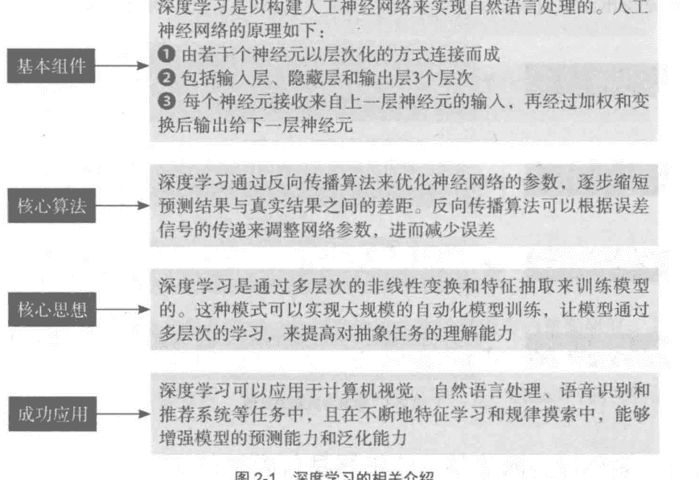

得益于深度学习底座，模型能够承担复杂的自然语言处理任务。

### 2.1.2 注意力机制让模型聚焦重点

注意力机制是深度学习中不可或缺的技术，它帮助模型合理分配关注度，把主要算力投向关键数据或序列，类似人脑在多任务中进行轻重排序。该系统的成功离不开它。

在深度学习里，注意力机制常用于序列到序列的转换任务，如机器翻译、文本摘要等。

其核心思路是依据当前生成位置的需求，对输入序列赋予不同权重，使模型在输出时能动态挑选最相关的对话背景，这在回复生成中体现为依据对话背景进行应答。

注意力机制的基本构成有三个部分，具体示意如图2-2所示。

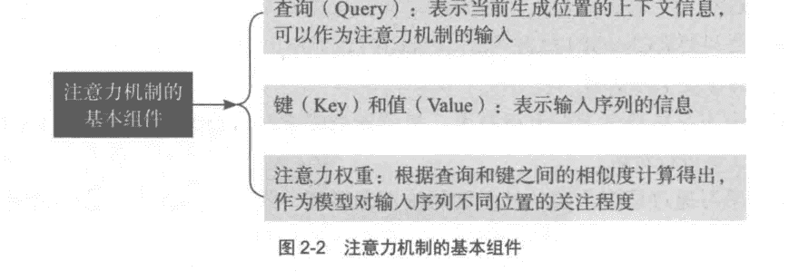

按权重计算方式的不同，注意力机制可分为四类，如图2-3所示。

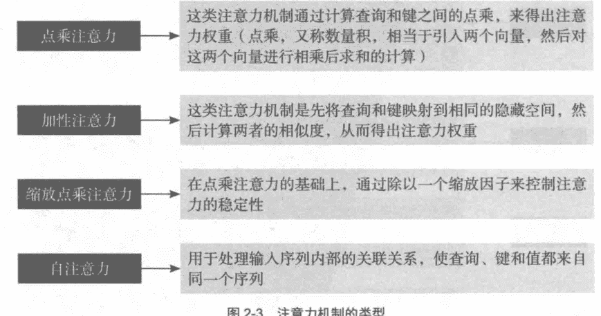

### 2.1.3 循环神经网络赋予机器联想记忆

循环神经网络 RNN 是一种处理序列数据的神经网络模型。它通过循环连接序列信息，让机器产生联想记忆，从而生成连贯对话背景的回复。该系统的原理也包含 RNN 的影子。下面介绍其结构、思想和特点。

#### 1. 网络结构

RNN 通常包含输入层、隐藏层和输出层三层，连接方式如下：

- Step 01 模型接收神经元输入的数据。
- Step 02 根据当前输入和上一时刻的隐藏状态计算当前隐藏状态。
- Step 03 将计算得到的隐藏状态输出并更新，供下一步使用。

#### 2. 核心思想

RNN 在隐藏层之间形成循环，使网络能够接收前一步输出并传递给下一步，从而捕捉序列中的对话背景信息。

#### 3. 模型特色

RNN 在序列处理上具备四项优势，如图2-4所示。

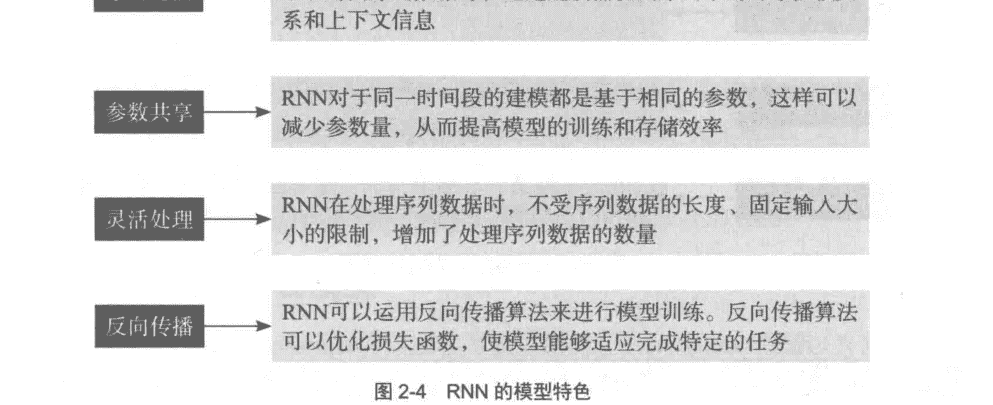

这些特点让该系统在处理自然语言时能够基于前文语境生成回复，相当于具备了类“思维”能力。

### 2.1.4 自然语言处理实现理解与生成

自然语言处理是赋予 AI 理解、处理、生成自然语言能力的关键研究领域。它从词汇、语法、句法、语义等层面建模分析，从而实现翻译、分类、情感分析、问答、续写等任务。该系统 便是该研究的重要成果之一。

自然语言处理常见的九类任务如图2-5所示。

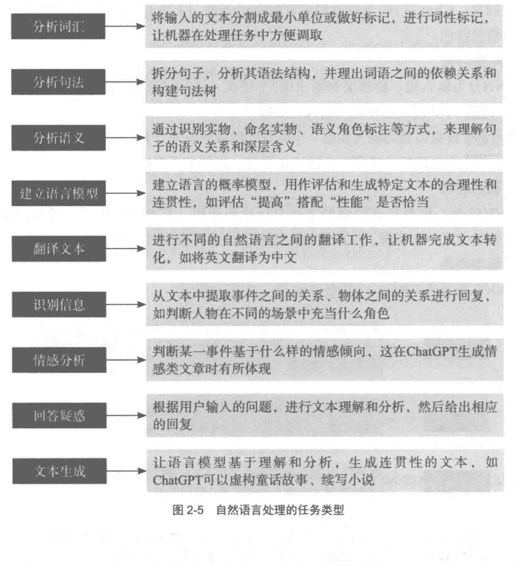

## 2.2 实现方式：训练方法与流程

该系统基于上述核心技术完成连续文本生成，如写文章、续写故事、改写剧本、回邮件等，这些能力都来自模型训练。本节介绍训练流程。

### 2.2.1 步骤一：准备数据

OpenAI 汇集了海量文本作为训练素材，来源包括互联网文章、书籍、时事新闻、维基百科等。数据准备主要分三步。

#### 1. 数据收集

团队从网页、维基百科、书籍、新闻文章等渠道抓取训练语料，覆盖多主题多领域，确保模型在广泛话题上表现稳定。

#### 2. 数据清理

原始语料常含噪声、错误、不规范文本，训练前需清洗，包括去除 HTML 标签、纠正拼写、修复语法等。以知乎文章为例，若想训练出能生成知乎风格的 AI，收集后需执行图2-6所示的清洗操作。

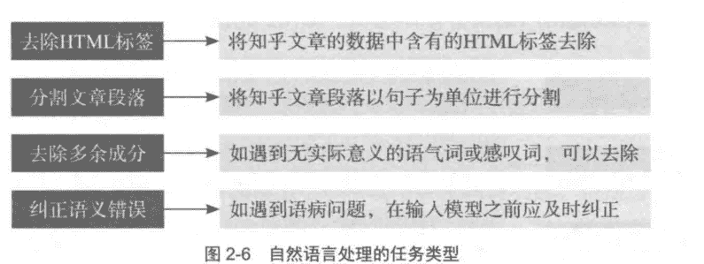

#### 3. 分割和组织

为便于训练，需将文本切分为句子作为样本，并以合理方式组织数据，让模型在对话背景中学习理解。

数据质量决定模型上限，OpenAI 致力于获取高质量语料以提升自然语言任务表现。

### 2.2.2 步骤二：预设模型

该系统采用 Transformer 深度学习架构。该架构以自注意力为核心，能更好捕捉文本对话背景关系，相较传统RNN可并行计算，长序列效率更高。Transformer 由三部分组成，具体如图2-7所示。

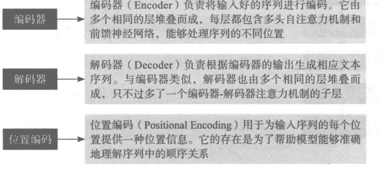

通过大规模数据训练，Transformer 学习输入序列与输出序列的映射关系，在给定输入时生成相应文本。该架构被用于该系统的自然流畅回复生成。

### 2.2.3 步骤三：训练模型

该系统通过反复在大规模文本上训练，学习语言模式、语义表达和语法逻辑。训练方式有三种，如图2-8所示。

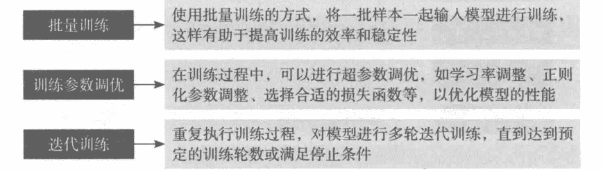

> ★专家提醒★
学习率控制参数更新速度，影响收敛快慢；正则化参数控制模型复杂度；损失函数衡量输出与标签差异，影响准确率。

模型表现取决于数据质量，反复训练后，模型逐渐学会理解语言规律并产出通顺合理的文本。

### 2.2.4 步骤四：部署应用

模型训练调优完成后，进入部署环节。通常包含五个流程，如图2-9所示。

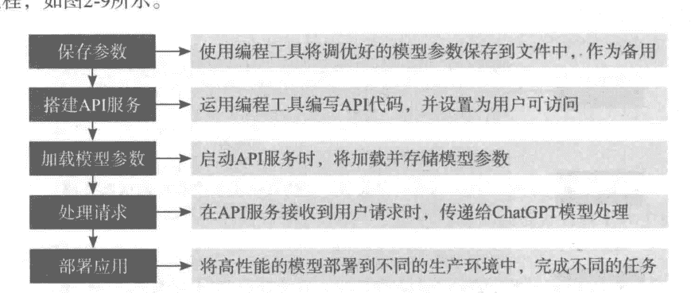

其中 API 指 Application Programming Interface 应用程序接口，用于衔接软件系统各部分。

该系统利用训练好的参数和生成算法，依据使用者输入生成相关文本，会综合语法、语义、对话背景逻辑产出连贯回复。

生成文本需经过评估以保证流畅合理。OpenAI 通过设计训练目标和优化算法，使回复更贴近人类表达。

实际使用时建议人工复核和进一步验证。

## 2.3 展示功能：对话处理技术的应用

基于核心技术与训练模型，该系统能实现内容生成，包括对话聊天、咨询顾问、语音助手、音乐创作、计划制定、方案设计、程序开发、游戏完成、文案撰写、视频脚本创作、论文写作辅助、文章与小说写作等。下面简要介绍其功能。

### 2.3.1 该系统可流畅与人对话

使用者可发起对话，讨论兴趣话题或提出问题。相关用途如下。

#### 1. 提供信息和答案

该系统能回答娱乐、科技、文化、健康等领域问题，使用者无需繁琐搜索即可获取特定主题信息。例如输入“天为什么是蓝色的”，其回答如图2-10所示。

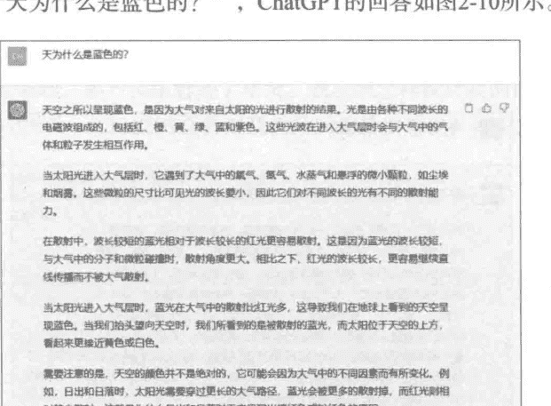

#### 2. 学习语言和文化

模型支持多语言多文化交互，可帮助使用者学习新语言、了解文化差异与相似之处，并可实现跨语言翻译。

#### 3. 关注心理健康

OpenAI 研发了不同语言模式，让该系统具备情感陪伴功能，可作为心理健康辅助工具。使用者可交流情绪与心理困扰，示例对话如图2-11所示。虽然不能替代专业治疗，但能提供精神支持和实操建议，帮助使用者走出情绪低谷。

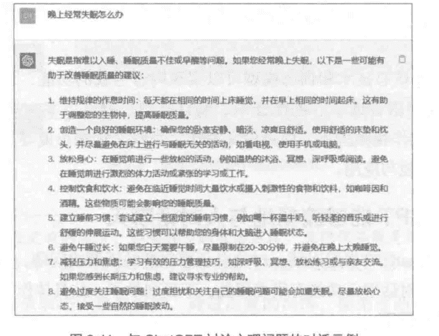

#### 4. 娱乐消遣

与 AI 互动本身是一种新奇娱乐，使用者可进行问答、讲笑话等有趣交流，示例对话如图2-12所示。

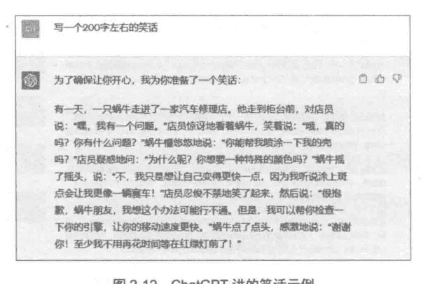

#### 5. 商业和客户服务

企业可利用该系统与客户沟通，解答常见问题、提供支持，降低人力成本，提高服务效率。

#### 6. 聊天游戏

使用者可用非常规语言挑战模型，看其是否能理解并正确回应，示例如图2-13所示。

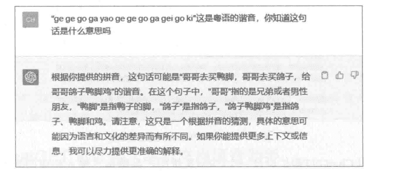

### 2.3.2 该系统扮演咨询顾问给出建议

作为大型语言模型，该系统可提供咨询服务。使用者提出问题或关注点后，模型会给出相关信息与建议。咨询时提供详细的背景描述有助于获得更有价值的建议。以下为案例说明。

向该系统说明身份背景、业务性质并明确任务需求，例如“我是互联网产品经理，需为大型企业设计 CRM 系统，应如何设计产品功能提升一线销售效率”，模型会针对性给出建议，如图2-14所示。

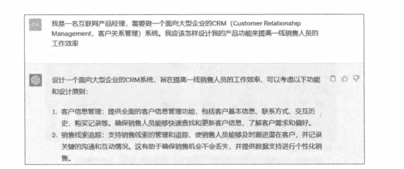
5小时玩赚ChatGPT：AI应用从入门到精通

- 3. 销售机会管理：为销售人员提供一个集中管理销售机会的功能，包括机会创建、状态跟踪、销售阶段管理等。通过清晰的销售流程和可视化的销售漏斗，销售人员可以更好地了解和推动销售进程。

- 4. 智能分析和报告：整合数据分析和报告功能，为销售人员提供关键指标和业绩分析，帮助他们评估销售进展、识别潜在机会和问题，并做出相应的决策。智能预测和推荐功能可以帮助销售人员更好地了解客户需求，提供个性化建议。

- 5. 协作与团队合作：提供协作和团队合作功能，使销售人员能够与团队成员共享信息、任务和进展情况。协作工具、即时通讯和共享文档等功能有助于团队协同工作，提高工作效率和协作效果。

- 6. 移动端支持：设计一个移动端应用，使销售人员能够随时随地访问CRM系统，查看客户信息、更新销售进展、添加备注等。移动端应用应提供简洁、易用的界面，并与主系统实时同步数据。

- 7. 整合其他工具和系统：将CRM系统与其他常用工具和系统（如电子邮件、日历、在线会议等）进行集成，简化销售人员的工作流程，减少重复操作和信息碎片化，提高工作效率。

- 8. 用户界面和用户体验：注重用户界面的友好性和用户体验的设计，确保系统操作简单直观，功能布局合理，信息展示清晰。提供个性化设置选项，允许销售人员根据自己的偏好进行定制，提高工作效率和用户满意度。

要想让客户关系管理平台真正落地见效，人的投入是核心变量。先为销售队伍搭建成体系的培训体系并持续跟进，保证每个人都能熟练驾驭并把功能用足；同时打通意见回流路径，让使用中出现的卡点迅速得到处理，并不断优化功能体验。

更重要的是与一线执行者维持紧密配合，深入体察其工作现场和实际痛点，持续打磨系统，使工具真正适配业务现实，进而推动工作效率与销售成果的提升。

图 2-14 ChatGPT 对此问题的回应建议

利用大语言模型做架构推演也是实用思路。把业务需求描述交给模型，就能得到一份可执行的客户关系管理平台结构设想，如图 2-15。

```
请帮我设计一个CRM系统的产品架构
```
以下是一个基本的CRM系统产品架构设计，涵盖了主要的组件和功能模块：

1. 用户界面层：

   - Web界面：提供用户登录、导航、数据展示和操作等功能。

   - 移动端应用：提供与系统的交互和访问，支持移动设备上的功能和操作。

2. 身份认证与权限管理：

   - 用户认证：处理用户身份验证和登录过程，确保只有授权用户可以访问系统。

   - 权限管理：管理不同用户角色的权限，控制其对系统各个功能模块和数据的访问权限。

3. 客户信息管理：

   - 客户资料：管理客户基本信息、联系方式、购买记录等数据。

   - 客户分组：支持按照不同标准对客户进行分组和分类，方便销售人员进行针对性的管理和营销活动。

   - 交互历史：记录客户与销售人员的沟通、互动历史，包括电话、邮件、会议等，为个性化销售和客户服务提供参考。

4. 销售线索与机会管理：

   - 销售线索：管理潜在客户的信息和来源，追踪线索的状态和进展。

   - 销售机会：跟踪和管理销售机会，包括机会阶段、预测金额、预计成交日期等，帮助销售人员识别和推进潜在销售。

5. 销售活动和任务管理：

   - 日程管理：提供日历功能，安排销售人员的工作日程、会议和活动等。

   - 任务管理：分配、跟踪和管理销售人员的任务，确保工作按时完成。

6. 数据分析与报告：

   - 数据统计和分析：对客户数据、销售机会、销售活动等进行统计和分析，生成关键指标和业绩报表。

   - 可视化报告：提供图表、仪表盘等可视化报告工具，呈现数据和分析结果，帮助销售人员理解和评估销售情况。

7. 协作与团队合作：

   - 团队协作：支持销售团队成员之间的协作和信息共享，例如讨论、评论、文件共享等功能。

   - 内部沟通：提供即时通讯工具，方便销售团队成员之间的沟通和协作。

8. 第三方集成：

   - 邮件和日历：与常用的邮件和日历系统集成，方便销售人员将沟通和日程安排同步到CRM系统中。

   - 电子表格和文档：支持与电子表格和文档编辑工具的集成，方便销售人员在CRM系统中查看和编辑相关文档。

9. 系统管理与配置：

   - 系统设置：提供管理员角色的配置选项，包括用户管理、权限设置、数据字段自定义等。

   - 数据备份和恢复：确保数据的安全性和可靠性，支持定期备份和恢复操作。

该产品架构可以作为一个基础设计，具体实现时可以根据企业的需求和规模进行定制化开发和部署，以适应不同的业务场景和用户需求。

图 2-15 ChatGPT 关于 CRM 系统产品架构的设计方案

> ★ 专业提示 ★
> 同一问题在不同时刻可能得到不同回答，也不必然完全契合使用者的具体情况，仅作参考。是否采纳及后续责任由使用者自行决定。

### 2.3.3 ChatGPT 可接入手机担任语音助手
将大模型的语言理解能力与移动端语音交互融合，自然语言指令即可被映射为具体操作，比如打开应用、查天气、放音乐等。把模型接入Siri就能实现语音对话，如图 2-16，从而明显增强手机语音助手的能力。

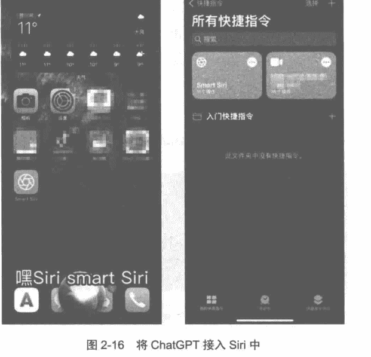
5小时玩赚ChatGPT：AI应用从入门到精通

### 2.3.4 ChatGPT 也能参与音乐创作
模型可根据主题或标题自动生成歌词，输入毕业等主题便能得到对应的歌词文本，如图 2-17。

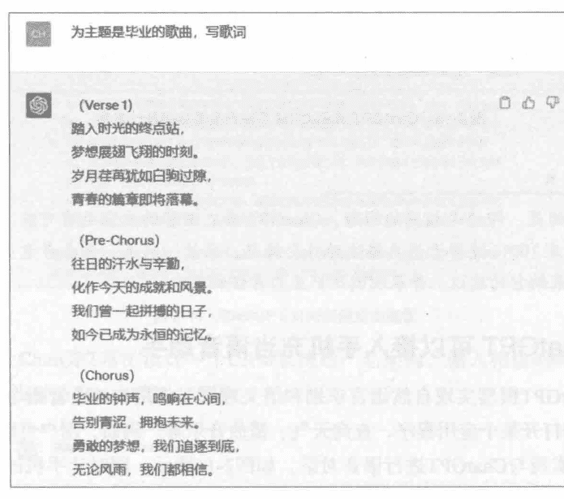
图 2-17 ChatGPT 生成的歌词内容

除了歌词，还能基于风格、乐器、节奏等参数生成旋律和和声。图 2-18 展示的就是一段在五声音阶中创作的旋律示例。

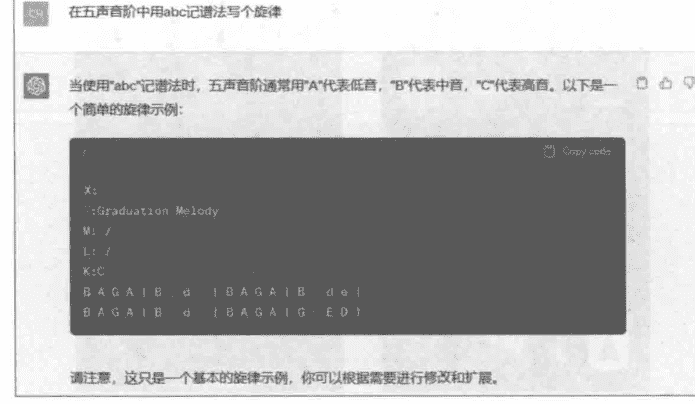
图 2-18 ChatGPT 生成的旋律

### 2.3.5 ChatGPT 能为使用者制定学习计划
模型能给出规划方案的思路和方法，帮助使用者安排时间。以‘每周学习烘焙’为例，生成的周计划如图 2-19。

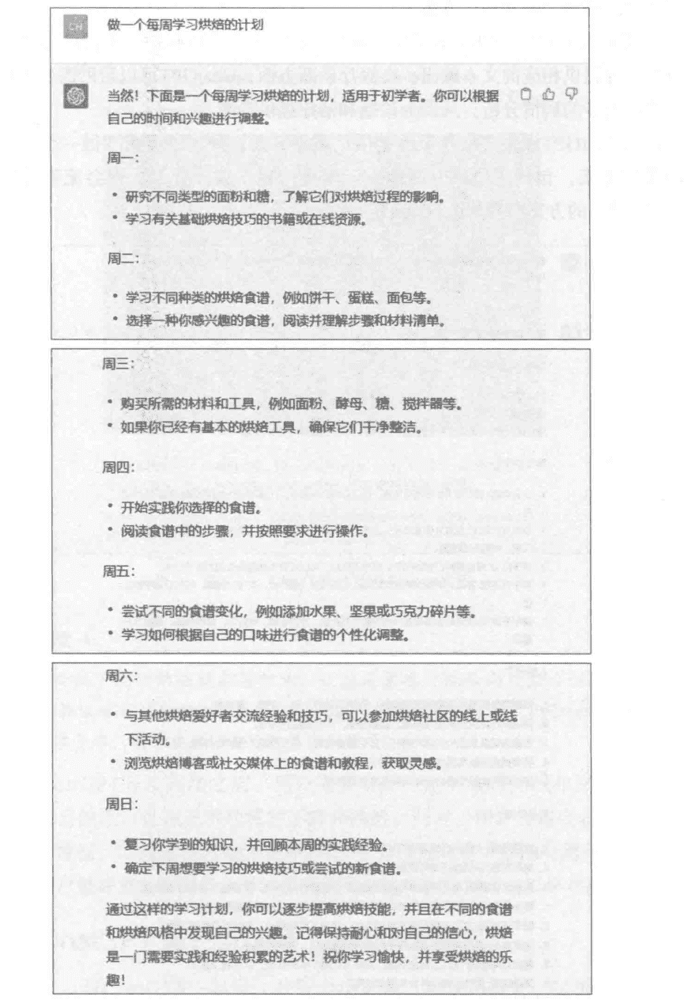
图 2-19 ChatGPT 制订的学习计划内容

### 2.3.6 ChatGPT 可按主题制定活动方案
它可以通过对话帮助整理思路、汇总信息、权衡不同选项并形成具体结果。训练好的模型还能提供领域背景知识，支持理解与判断。

在商业场景可以辅助探讨市场策略或产品方案；在医疗场景可以协助整理病历、进行初步分析，为诊疗提供参考。

以‘策划端午节促销活动，包含主题、时间地点、活动内容、人员分工、流程等’为例，输出方案如图 2-20。

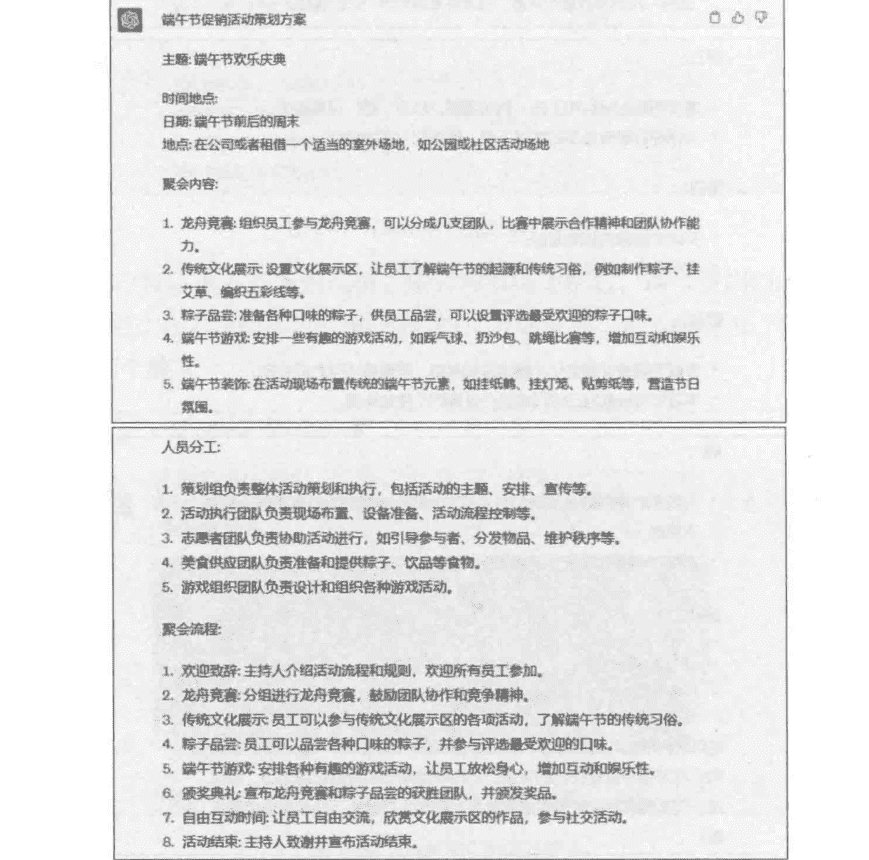

### 2.3.7 ChatGPT 能用编程语言开发程序
借助Python配合主流深度学习框架，可加载预训练模型进行自然语言任务。例如提示“请用 Python 编写一个可用于制作图表的小程序”，即可自动生成代码，如图 2-21。

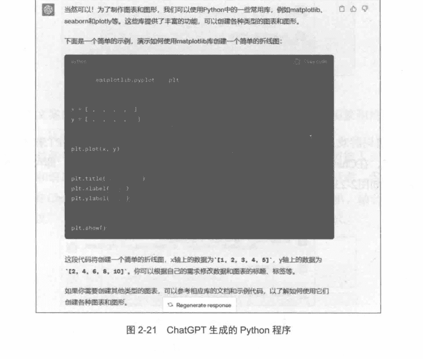
★ 专业提示 ★
Python 拥有高效的高级数据结构，并支持简洁的对象导向编程方式。TensorFlow 是依托数据流编程的符号数学系统。PyTorch 是开源的 Python 机器学习库，适用于自然语言处理等应用。

使用模型开发程序前，需要具备一定的编程与深度学习基础，对自然语言处理有一定了解。同时需要收集与处理大量语料以构建训练，这会耗费大量时间与资源，建议做好准备并按需选择工具与框架。

### 2.3.8 ChatGPT 能当玩伴玩智力游戏
可以和模型一起玩成语接龙、猜词、字谜、双关语等游戏，有助锻炼思维。

1）成语接龙：轮流说成语，下一个成语的首字需承接上一个成语的尾字。例如提示模型‘玩一次成语接龙’，即可开始互动，如图 2-22。

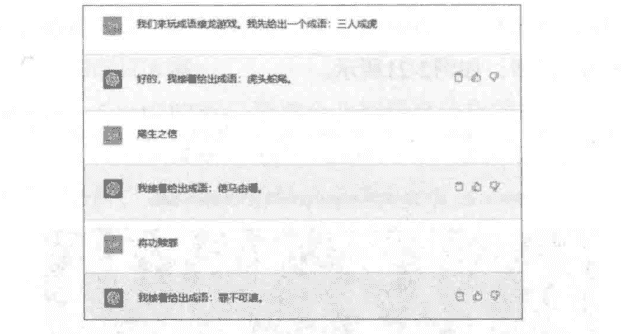
图2-22 与ChatGPT一起玩成语接龙游戏

2）猜词：给出谜面让模型猜测词义。例如输入‘三横一竖不是王，请猜字’，即可展开互动，如图 2-23。

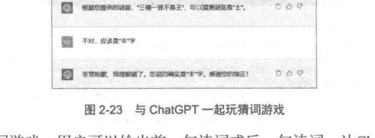
图2-23 与ChatGPT一起玩猜词游戏

3）接诗词：给出上句或下句，让模型完成诗句。
4）双关语：模型给出含有多义的句子，使用者猜出两种含义。

### 2.3.9 ChatGPT 能创作各类文案
可作为灵感来源，以下列出几种典型用途。

#### 1. 销售文案
模型能读懂销售提问，以对话方式给出文案和应对思路，让销售更顺畅。例如提示‘写一篇200字以内的滑板宣传文案’，即可得到示例，如图 2-24。

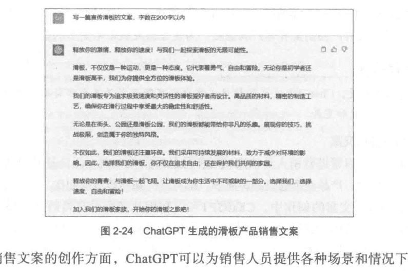
在创作时还能给出不同场景的应对技巧。例如询问‘滑板店店员如何快速促成下单，请结合对话给出建议’，即可获得场景化建议，如图 2-25。

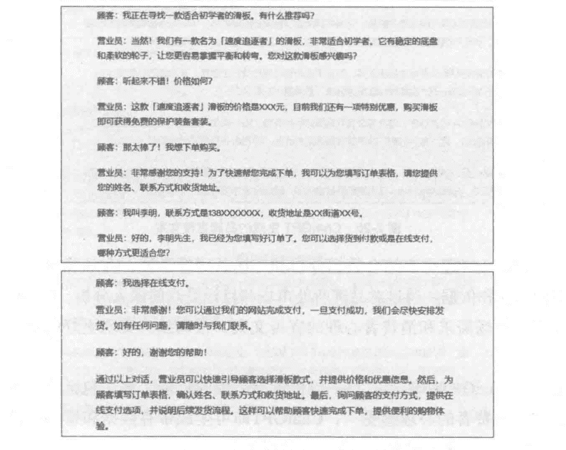
总体而言，模型可作为智能销售助手，提供即时答复和方案，帮助促成交易并提升满意度。

★ 专业提示 ★
模型生成的销售文案可能存在偏差或与预期不符，需人工校对完善。

#### 2. 品牌宣传文案
可以快速生成品牌名、口号、广告语、产品介绍、品牌故事等。结合品牌定位与目标群体，输出更具吸引力的内容，并可加入情感要素增强感染力。

例如提示‘VitaGlow是护肤品牌，请写一段面向目标群体且有吸引力的宣传文案’，即可得到结果，如图 2-26。

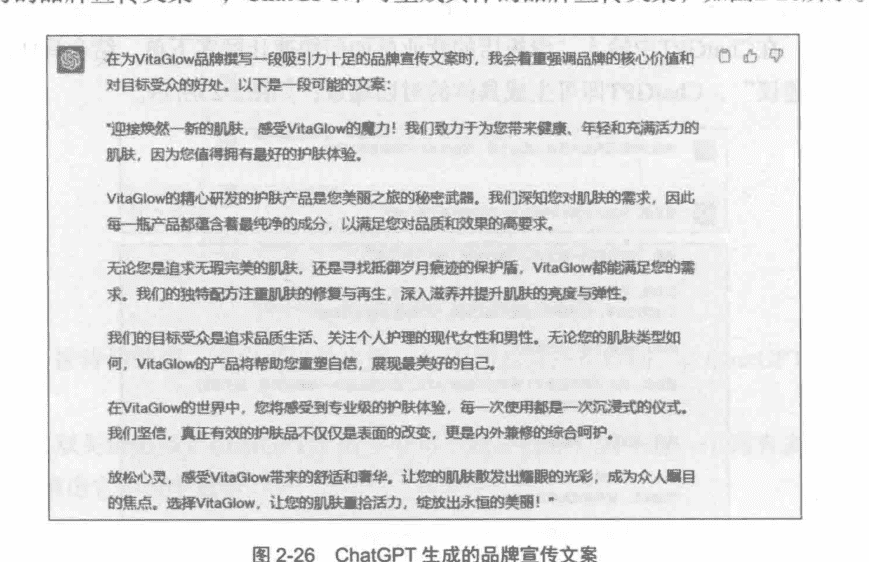
结合数据与市场调研可增强说服力。例如提示‘为蛋黄酥品牌写一段宣传文案，加入市场销售数据并体现消费者感受’，即可得到数据加情感的文案，如图 2-27。

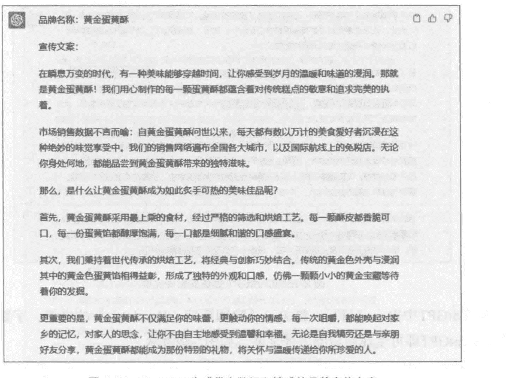
图 2-27 ChatGPT 生成带有数据和情感的品牌宣传文案

#### 3. 评论文案
可为电影、书籍、音乐等作品撰写评论。例如提示‘写一篇关于《盗梦空间》的影评，要求有主题，约500字’，即可得到结果，如图 2-28。

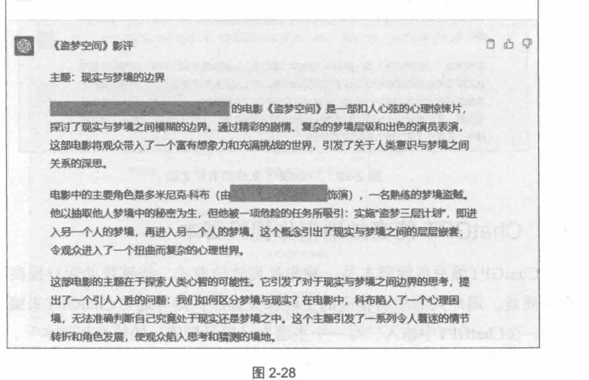
图 2-28


再如提示‘写一篇关于《哈姆雷特》的书评，约300字’，即可生成对应内容，如图 2-29。


### 2.3.10 ChatGPT 能高效创作视频脚本
只需给出主题和要点，就能迅速生成脚本。例如提示‘为主题探蛋糕店创作短视频脚本’，即可得到完整脚本，如图 2-30。


图 2-30 ChatGPT 生成的视频脚本内容

若需更详细的拍摄脚本，可补充分镜、台词、景别、运镜、配乐、音效、后期等描述。例如提示‘为公园游玩创作短视频脚本，以表格列出分镜头、画面内容、对话台词’，即可得到结构化脚本，如图 2-31。


图 2-31

> 注意事项：
> - 可依据实际情况进行调整和增删。
> - 对话台词可根据需要进行适当修改或添加。
> - 分镜头可以是简短的描述，也可以是具体的拍摄角度。
> - 画面内容可以简要描述，或者具体描述需要展示的元素。
> - 可根据需要增加适当的背景音效或配乐。
> - 片尾可以包括公园的宣传标语或口号。
> - 需要制作成短视频时，可以参考该表格进行拍摄和剪辑。

图 2-31 添加描述词后 ChatGPT 生成的短视频脚本内容

在创意、脚本构思、台词设计等方面，模型能提供新角度与灵感，帮助提升视频制作效率与质量。

### 2.3.11 ChatGPT 在学术领域助力论文写作
可提供写作建议并快速生成初稿。例如提示‘写一篇题为城乡旅游开发与用地规划的论文，需含标题、摘要、关键词、正文、注释、参考文献、致谢’，即可得到内容，如图 2-32。


3. 城乡旅游开发中的用地规划原则

    3.1 可持续发展原则

    3.2 生态环境保护原则

    3.3 社会经济发展原则

4. 城乡旅游开发与用地规划的挑战

    4.1 土地利用冲突

    4.2 生态环境保护

    4.3 社会经济可持续发展

5. 推进城乡旅游开发与用地规划一体化的建议

    5.1 加强政策指导和规划协调

    5.2 提高环境管理和监管能力

    5.3 加强公众参与和社会责任意识

6. 结论

注释：（如果需要）

参考文献：

1. Author A, Author B. Title of Article. Journal Name. Year; Volume(Issue): Page numbers.

2. Author C, Author D. Title of Book. Publisher. Year.

3. ...

谢辞：

在本文的撰写过程中，我要感谢导师对我的指导和支持。同时，也要感谢家人和朋友们对我的理解与鼓励。他们的支持使得本研究得以顺利完成。

希望本研究对城乡旅游开发与用地规划的相关研究和实践有所启发，并对促进城乡旅游的可持续发展提供一定的参考和借鉴。


使用者也可把原文交给模型改写以降低重复率，例如提示‘请扮演论文导师，把以下内容改写，使语言更学术’，模型会通过改写句子和替换词来实现，如图 2-33。


### 2.3.12 ChatGPT 能撰写文章、创作小说
文本生成能力使其能迅速产出原创内容，满足自媒体需求。例如提示‘写一篇关于供应链管理技巧的知识文章，约500字’，即可得到文章，如图 2-34。


图 2-34 ChatGPT 生成的文章内容

ChatGPT的实用价值体现在它能依据读者的偏好和需求进行内容再造，让阅读体验更贴合个人。拿微信公众号来说，把“公众号文章需要个性化定制、互动感强、语言简洁好懂”等特征告诉它，让它按这些标准起一篇软文，它就能直接产出符合平台调性的稿件。

从结果来看，ChatGPT抓住了我们给出的公众号写作要点，生成了一篇教做爆款公众号的文章，表述通俗、语气亲切，对运营者而言有一定参考意义。

#### 2. 协同创作小说
和ChatGPT一起编故事，可以在互动中训练想象力和创造力。它会给出情节建议和灵感提示，让文本更鲜活。比如要求它写一篇约800字的科幻短篇，它就能按要求输出完整故事。

图 2-36 ChatGPT 生成的故事内容

和专业作家相比，ChatGPT在小说创作上仍有明显短板。更合理的做法是把它当作辅助伙伴，先拿它的初稿再做润色和重构，才能产出更优质的作品。

### 2.3.13 ChatGPT 可以提炼文章重点和主旨
当写出的文章条理混乱、抓不住核心时，可以让它帮忙提炼主旨。例如把整篇文章贴上并指令它“提取能体现主旨的关键词”，它会迅速给出结果。

图 2-37 ChatGPT 提炼文章的关键词

### 2.3.14 ChatGPT 还能生成 AI 绘画代码
它能快速产出绘画所需的代码与关键词，为创意提供启动点。比如让它用关键词形式描述一个以“梦境与幻觉”为主题的50字画面，它就能给出可用的词组。

图 2-38 ChatGPT 生成的绘画关键词

把这些词组导入AI绘画工具，就能得到类似图2-39的效果。用ChatGPT输出的提示词生成的作品具备一定的艺术观赏度。

图 2-39 通过 ChatGPT 给的关键词生成的 AI 绘画作品

## 本章小结
本章围绕ChatGPT的核心技术、实现路径和功能展示展开，帮助读者理解文本生成的原理与延伸应用，为后续操作打下理论基础。

## 课后习题
为巩固本章内容，请完成以下回顾：
1. 回顾所学，ChatGPT模型包含哪些训练流程？
2. ChatGPT的文本生成功能具体能落地哪些应用？

# 第3小时 操作实战：ChatGPT平台的登录与应用指南
学完理论后进入实操。本章将指导如何注册登录ChatGPT、熟悉页面布局、编写指令并熟练使用。

## 3.1 准备工作：访问和认识ChatGPT平台
使用ChatGPT功能需要先访问其平台。该平台是模型API化落地的载体，也是商业化基础。下面介绍访问登录与基本用法。

### 3.1.1 ChatGPT 提供服务的产品模式
ChatGPT本质是语言模型，产品形态聚焦自然语言生成与理解。产品模式包含两大方向，如图3-1所示，平台本身即是提供API接口服务的实践。

> ★ 专家提醒 ★
API服务是让其他应用调用的软件接口。在AI领域，开发者可通过API把自然语言处理、计算机视觉等能力嵌入自家产品，提升智能化水平。
无论是提供API还是自研产品，都需要在数据预处理、模型训练、服务部署、性能优化上持续打磨，才能提供更高效、更准确、更智能的服务，赢得信任。

### 3.1.2 ChatGPT 平台的访问与登录方法
使用前需先完成注册登录。要用ChatGPT，必须先注册OpenAI账号，注册对网络环境要求严格，国内用户无法直接访问官网，且仅支持国外手机号。
注册登录流程如下：

步骤01 打开OpenAI官网，点击底部“Learn more about ChatGPT”进入相关页面，如图3-2所示。

### 3.1.3 ChatGPT 平台的使用环境介绍
平台提供Free Plan免费版和Upgrade to Plus付费版两种环境。免费版即可无成本体验。登录后进入主页面，如图3-8所示，对话通过页面对话框完成。
主页面元素自左至右、自上而下介绍如下：
（1）“+New chat”新建对话按钮。点击可开启新话题，首次使用系统会自动创建记录，如图3-9所示。
（2）侧边栏隐藏按钮。将鼠标移上去显示“Hide sidebar”，点击后聊天窗口进入全屏模式，如图3-10所示，便于专注对话。
（3）“Upgrade to Plus”按钮。点击可升级，付费版优势包括：高峰期仍能稳定使用；生成速度更快；优先体验新功能。升级路径为点击Upgrade to Plus→在弹窗中点“Upgrade plan”→按要求填写付款信息→点“Continue”完成，进入Plus模式，如图3-11所示。
（4）……账户信息按钮。点击弹出选项框，可进行更多账号操作，如图3-12所示。
（5）右侧居中为官方介绍区，含“Examples”提问示例、“Capabilities”能力说明、“Limitations”局限性，感兴趣可自阅。
（6）右下角为输入框，提示“Send a message”，输入后发送，ChatGPT会回复。下方附有OpenAI关于生成回复的说明，如图3-14所示。

### 3.1.4 ChatGPT 初次生成文本的方法
登录后打开聊天窗口即可对话。操作方法如下：
步骤01 打开聊天窗口，点击底部输入框，如图3-15所示。
步骤02 ① 输入指令，例如“对比牧羊犬和哈士奇的不同，并制成表格”；② 点击发送▶或按Enter，如图3-16所示。
步骤03 等待片刻，系统会按要求生成表格，如图3-17所示。

### 3.1.5 ChatGPT 生成有效文本的方法
收到回复后可先评估价值，有效则点右侧复制按钮复制文本，该按钮仅支持文本，不支持表格格式。若价值不高，可点输入框上方的“Regenerate response”重新生成。示例操作：
步骤 01 点“+New chat”新建窗口，如图3-18所示。
步骤 02 ① 在输入框输入“请描述一下秋天”；② 发送，如图3-19所示。
步骤03 片刻后ChatGPT会按总分总结构输出描述，如图3-20所示。
步骤04 点“Regenerate response”，如图3-21所示，触发重新生成。
步骤05 稍等后得到新的秋天描述，如图3-22所示，可见风格与表述均有变化。
同一次问题的二次回复会标注“2/2”，三次为“3/3”。反复点击“Regenerate response”可让模型多次产出不同版本，相当于持续优化。
生成二次回复后下方会出现评价提示，可选择评价或关闭×。无论初稿还是重写稿，文本右侧均有👍👎评价按钮。

### 3.1.6 ChatGPT 对话窗口的管理方法
每次登录默认进入新窗口，旧窗口保存在左侧导航，可新建、删除、重命名。操作如下：
步骤01 打开ChatGPT，点击任意历史窗口，如图3-24所示。
步骤02 点击窗口名右侧✏️按钮，如图3-25所示。
步骤 03 出现编辑框，① 修改名称；② 点击确认完成重命名，如图3-26所示。
步骤 04 点击窗口名右侧🗑按钮，如图3-27所示。
步骤 05 弹出确认框，① 确认删除点✔；② 取消点✖，如图3-28所示。
> ★ 专家提醒 ★
🔗按钮可将当前窗口内容生成链接分享到社群。

## 3.2 问题优化：使用ChatGPT的注意事项
ChatGPT是基于数据分析做序列选择的对话模型，并非人类思维。需树立它并非万能、答案不唯一的意识。

### 3.2.1 ChatGPT 平台的官方申明
登录后主页面可见官方简要声明，如图3-29所示。
（1）“Examples”示例提问，如“用简洁语言解释量子计算”“10岁生日创意庆祝方式”“如何在JavaScript中发出HTTP请求”。
（2）“Capabilities”能力：能记住对话上下文，如图3-30所示；允许用户指出错误并更正，如图3-31所示；接受拒绝不当请求的训练，识别不恰当时会拒绝回复，如图3-32所示。
（3）“Limitations”局限：偶尔会生成错误信息；偶尔产生偏见或有害说明；对2021年后事件和知识理解有限，提问涉及该时段会提示受限，如图3-33所示。
了解这些说明有助于更理性使用。

### 3.2.2 ChatGPT 不能作为万能精油
“尽信书不如无书”，对待ChatGPT亦然。若认定它所有输出都正确，就难以发挥其价值。应树立两点认知：
1. **可能回答出错**。回复源于文本数据训练，看似懂上下文实为算法结果。超出训练库的问题，它可能随意生成逻辑不自洽或不符事实的答案，如图3-34所示。《呼兰河传》是萧红对故乡的描绘而非自传，因缺乏准确理解，ChatGPT曾杜撰情节输出错误信息。
2. **理解语言有限**。使用倒装、复杂句或古文提问时，它可能理解受限并给出图3-35所示的提示。

### 3.2.3 ChatGPT 生成的答案不唯一
同一问题多次提问会得到不同回复，示例如图3-36所示。提问“苏州有哪些好吃的美食”会得到多套答案。此特性可用于答案优化，与“Regenerate response”用法一致。

### 3.2.4 ChatGPT 会因字数受限而中断
模型有字数限制，使用时易出现中断，如图3-37所示。遇到时可发出“继续写”指令或点击“Continue generating”按钮续写，如图3-38所示。

### 3.2.5 ChatGPT 存在不稳定的状况
使用中可能出现：免费版高峰期限制提问次数，如图3-39所示，需等待一小时以上或升级Plus；偶尔无法完全理解提问而跑题，如图3-40所示，此时可刷新页面或改写提问词另开窗口；系统无法登录时可尝试刷新网络或更换网络配置。
尽管存在上述问题，ChatGPT仍是生成式AI的重要进步，未来会愈加完善。

## 3.3 提问技巧：编写ChatGPT指令的技巧
能否拿到有效回复，关键在Prompt。掌握指令编写技巧才能熟练使用。下面介绍编写原则。

### 3.3.1 遵循 3 个原则来编写指令
ChatGPT是对话式AI，沟通清晰是前提。指令的准确性决定输出有效性。编写原则包括：
#### 1. 语言明晰原则
沟通第一要义是表达清楚。与ChatGPT交流时应准确传达词意、句意、语意，避免歧义。下面通过对比说明该原则，如图3-41所示。


图3-41 所例举的“标王”，本质上承载着两种解读。一类是招标流程里价值排序最高的标的，另一类是指最终出价最高的投标主体。提问的表述方式直接影响返回质量：若上来就要求对“标王”做说明，模型给出的内容往往宽泛模糊；若改成“标王指的是什么”这种指向明确的问法，解释就会更聚焦、参考价值也更高。

#### 简洁明了原则
这里强调的不是字数压缩，而是表达干净利落，只要模型能够准确理解并做出回应即可。提示本身最好保持精简，少用标点符号或分隔符，以免割裂语义。例如在输入框里写“要一篇关于环境保护的文章”，返回结果就会紧扣环保主题，具体呈现见图3-42。


#### 需求聚焦原则
模型虽然可以维持多轮对话，底层仍是一问一答的线性逻辑。写提示时要紧扣真实意图，避免带入无关话题分散注意力。举例来说，要求“围绕垃圾分类创作公益广告文案，表述要清晰不过于直白，不要写成‘保护环境，人人有责’这类口号”，得到的回复如图3-43所示。


图 3-43 输入体现关联需求原则指令的回复

### 3.3.2 三种思路提升指令提炼效率
想让模型发挥得更好，关键在于把模糊想法转成可执行的指令。下面三点有助于实现这一点。

#### 1. 选用匹配的检索词
提示词大致可分宽泛与精准两种。宽泛比如“写十条美食相关的文案”，结果见图3-44。


图 3-44 输入较为宽泛的关键词得到的回复

精准比如“写十条关于北京炸酱面的文案”，结果见图3-45。


对比可以看出，宽泛词会让模型给出概念化、覆盖面广的信息；精准词则让模型聚焦在色香味、地域特色等细节上。两种用法各有场景，选择取决于实际需求。

#### 2. 明确指令的核心议题
提炼指令的本质是给模型一个清晰指引。宽泛词多用来获取事实概念类结果，比如“世界上最大的湖是哪一个”；精准词更适合获取观点灵活性强的结果，比如“用诗意的笔触描摹武功山”。

宽泛词相对好掌握，难点在于把精准词界定清楚。核心在于先锁定议题，且议题本身也要足够具体。

例如想让模型生成一份呼吁关爱留守儿童的提纲，那么“呼吁关爱留守儿童”就是议题，“一份文章提纲”是任务需求，组合后输入“请提供一篇关于呼吁关爱留守儿童的文章大纲”，模型会按要求给出结构，见图3-46。

简言之，若希望得到灵活性、观念性的产出，就必须在提示里点明具体到领域、行业或话题的议题。


#### 3. 进一步细化议题描述
议题已明确仍不满意时，可继续加限定。

1）加入限定性修饰
在提示里加上副词、形容词等限定，能让结果更贴近预期。比如需要端午节贺词，先加上“突出美好祝愿和欢快情绪”，整理成“提供端午节的贺词，要突出美好的祝福和欢快的心情”，结果见图3-47。

还可以叠加受众维度，改成“重新提供端午节的贺词，针对不同的年龄层”，在同一对话窗口继续提问，回复见图3-48。


图 3-47 加入限定语言的指令得到的回复


图 3-48 加入不同受众需求的指令得到的回复

2）设置限定性场景
常见做法是让模型扮演角色，先给身份再描述任务或困境。比如让它担任辩论选手，在对话框写“你是一名辩论选手，请针对正方观点‘人与自然可以和谐相处’，提出五个论点，每个论点都要有实例佐证”，返回结果见图3-49。


### 3.3.3 七种常用的指令撰写套路
日常使用中，大多数需求都离不开具体提示词。下面这七个套路能让提示更顺手。

#### 1. 提供样例参考
直接给模型一个范例，它就能沿着思路产出。比如“‘山朗润起来了，水涨起来了，太阳的脸红起来了’是描写春天万物复苏的画面，请参照这种写法写一段描写冬天的文字”，回复见图3-50。

同理也可以要求修改建议，例如“请针对我写的文章开头，提供更有画面感和诗意的修改意见。以下是开头：寒冷的冬天悄然降临，大地被白雪覆盖，寂静而宁谧。这个季节散发着独特的魅力，每一刻都仿佛是一幅美丽的画卷，让人陶醉其中。”输入后反馈见图3-51。


提供实例参考的用法，还有一种是让模型提出修改建议。


#### 2. 模仿语言风格
不确定怎么下提示时，可让模型模仿喜爱的风格。比如“以奥诺雷·德·巴尔扎克的语言风格，写一篇现实主义小说，字数在500字以内”，生成的片段见图3-52。需要控制篇幅就直接在提示里加字数限制。

再比如“模仿《无人生还》的写法，创作一篇悬疑虚构小说，字数在300字以内”，模型会按要求创作，部分内容见图3-53。


图 3-52 模仿语言风格后 ChatGPT 生成的回复


图 3-53 ChatGPT 模仿小说写法创作的小说（部分内容）

#### 3. 赋予特定身份
模型可以扮演多种角色，先定身份，后续内容会更对路。比如让它当法律顾问给出建议，或当老师出教案。

假设让它充当语文老师，“你现在是一位语文老师，请生成一份面向高中生的语文知识点教案，包括教学重难点、课前导入、教学设计和课后小结。”，得到的回复见图3-54。身份到位后，结构完整、针对性更强，虽然不会太细，但参考价值很高。同样的方法也能用来做情感陪伴。


图 3-54 ChatGPT 拥有身份后的回复


例如赋予关怀、同理心的身份进行情感疏导：

**步骤01** 在对话框里输入“假设你现在是一个温暖的人格，你能够理解每句话背后所隐藏的信息，并针对这些信息作出回应。你还可以基于你所察觉到的隐藏信息，运用逻辑推理出我的处境，并对我进行情感安慰。”提示，赋予模型能进行情感疏导的身份，见图3-55。


**步骤02** 在同一对话里继续描述“我今天感到很难过，因为我最好的朋友要去国外留学了”，模型给出的回应见图3-56。


**步骤03** 继续追问“因为舍不得她离开，所以我赌气没有去送她，但是现在我又很后悔怎么办”，模型会持续做情绪安抚，见图3-57。


可以看到，模型始终按提示保持温暖安慰，对情绪疏导和心理减压很有帮助。

#### 4. 指定表格输出
要点提炼、数据整理、脚本拆解时，表格很管用。比如“用中文解释以下英文单词：pajamas、dolphin、melody。请用表格的方式呈现，并且表格内必须包含单词、词性、解释与例句。”，生成的表格见图3-58。


#### 5. 指定特殊形式输出
也可以要求特定表现形式，比如 ASCII 艺术。用“用 ASCII 艺术形式生成一只小猫”就能得到字符画，见图3-59。


这种艺术多以单色或灰度呈现，只靠字符本身的排列来成形。

#### 6. 指定受众群体
通过上下文和明确问题间接锁定读者。只要点清受众，回答会更贴合。例如“针对家长群体写一篇关于教育学龄前儿童的文章，字数为200字左右”，生成的内容见图3-60。


提供清晰的问题和背景，能提升模型对特定群体的理解度。

#### 7. 切换视角
在不同段落用不同视角，能让故事更立体。比如“以第三人称视角写一篇丛林探险的故事”，生成的内容见图3-61。


视角切换可以引入不同人物和观点，增加深度和广度。

### 3.3.4 六种模板优化生成结果
受网络、系统或数据限制，模型首次输出难免有瑕疵。这时用模板去优化，能把答案拉满。

#### 1. 生成专业答案的提示
随着应用场景扩大，对专业度的要求也在提升。“问题背景+任务需求+行业专家模板或方法论”这个组合很有效。比如“根据《金字塔原理》书中的理论，生成10个关于雨伞的广告文案”，答案见图3-62。按这个结构提问，专业性明显提升。


可以继续追问，让模型对生成结果做原理性解释，见图3-63。


#### 2. 调试风格的固定提示
需要指定语气和属性时，可用“你的角色【专业领域】+你的能力【成果期待】+我希望你【任务需求】”的固定句式。

例如“你的角色是演员，你拥有十年的演艺经验，能够饰演各种不同类型的角色。现在你需要饰演一个靠卖煎饼为生来养活儿子的单亲妈妈，你将做哪些努力让自己更快地进入角色呢？”的提示，生成的建议见图3-64。


模型能准确识别需求，给出有启发的建议。

#### 3. 提供种子词提示的用法
种子词是指生成文章中需要包含的字词。在提示中加入种子词，可以帮助模型更快地提取到恰当的文本数据，从而生成更为有效的答案。例如，在对话框里输入“请根据以下种子词生成软文：阴雨天、红色、火焰，字数在500字以内”，模型生成的答案见图3-65。

请根据以下种子词生成软文：阴雨天、红色、火焰，字数在500字以内

热情绽放，雨中的红色火焰

阴雨天，漫天细雨轻轻飘洒，如同一场深情的告白。这是那个季节，人们纷纷躲在遮雨的地方，期待阳光的归来。然而，在这阴霾的天空下，有一种红色的火焰，正燃烧着生命的激情与希望。

红色，是一种鲜艳热烈的颜色，代表着生命的活力与热情。在这灰暗的天气中，红色如同一颗明亮的明星，照亮了整个城市的角落。街头巷尾，你会看到一抹抹红色的身影，它们是勇敢前行的人们，他们的激情与决心燃烧不息，仿佛一团火焰在心中跳动。

红色的雨伞，在雨中闪耀着独特的光芒。它们宛如一片片火焰，将寒冷的空气点亮。雨伞下，有情侣们相依相伴，共同面对着风雨。他们手牵手，一同迎接挑战，用爱与坚定点燃生命的火焰。红色雨伞也见证了许多人们的坚持与奋斗，他们披荆斩棘，永不言败，因为他们知道，只有付出才能收获。

雨天常不止是天色，更多时候是情绪的印记。部分人把阴郁当作牢骚的由头，部分人任由低落把自己困住。奇怪的是，正是这种绵延的压抑，反而更容易逼出内在不肯罢休的劲道。

情绪下滑时，我喜欢把目光移向远方云层的缝隙，去找寻那抹不易发现的赭色。它像胸口忽然冒起的小星火，拨开脑中笼罩的薄雾，重新让人与生活靠近的愿望变得清晰。

火向来被视作力量与希望的象征。它不分季节，总能把隐藏的渴望点燃。即便寒冬最冷，它依旧悄然持续，把温暖传递到身侧。雨中透出的红，正是这一意象的显现。它为前行添上可感的亮度，也在暗处递来对抗困难的勇气。

说到底，雨里那一点红，是内心信念的投射。外界天色如何变换，云层如何堆叠，都撼动不了心底那团恒定的暖。只要它存在，脚步就能继续。把热情当作日常的迎接态度，让这抹红点亮生命的激情，使它在潮湿的时光里，绽放只属于自己的光彩。


#### 4. 生成逻辑性答案的指令

如果用户想要ChatGPT更加理解所提出的问题，可以尝试在向其提问时，加入“Let’s think step by step”（让我们一步一步思考）这个指令，即可让ChatGPT学会逻辑思考，生成更令用户满意的答案。下面举例介绍具体的操作方法。


步骤01 在不添加指令的情形下，向ChatGPT提问“描述衡山的景点特征”，生成的答案如图3-66所示。

步骤02 添加指令，在ChatGPT中输入“描述衡山的景点特征，Let’s think step by step”，生成的答案如图3-67所示。可以看出，在添加指令之后，ChatGPT生成的答案带有一定的逻辑性，层次分明。

5小时玩赚ChatGPT：AI应用从入门到精通


图 3-66 不加任何指令时 ChatGPT 生成的答案


图 3-67 加入指令后 ChatGPT 生成的答案

#### 5. 拓宽模型思维的指令

如果用户需要用ChatGPT来做创意、项目及策划类的方案，可以在提问时加上如下指令：“What are some alternative perspectives?”（有哪些可以考虑的角度），可以拓宽ChatGPT模型的思维广度。

例如，在ChatGPT中输入“描述夏天雨水的特征”，ChatGPT的回答如图3-68所示，整体内容比较平铺直叙。再次提问“描述夏天雨水的特征，What are some alternative perspectives? ”，ChatGPT会从不同的观点和角度来回答该问题，给用户提供更多的思路和帮助，如图3-69所示。


图 3-68 未加入指令时 ChatGPT 给出的答案


图 3-69 加入指令后 ChatGPT 给出的答案

#### 6. 生成灵活性回复的指令

一般情况下，ChatGPT生成的文案虽然非常严谨，但略显死板、单调。想让ChatGPT的回答更灵活，用户可以在关键词的结尾加上如下指令：

Please generate the answer at x或use a temperature of x（请用x的温度生成答案），下面通过实操对比一下。

步骤01 在ChatGPT中输入“请写一段关于企鹅的描述”，没有添加温度指令，生成的答案如图3-70所示。

5小时玩赚ChatGPT：AI应用从入门到精通


图 3-70 没有添加温度指令生成的答案

★ 专家提醒 ★

x 为一个数值，一般设置在 0.1 ~ 1。低温度可以让 ChatGPT 的回答变得稳重且有保障，高温度则可以让 ChatGPT 充满创意与想象力。

步骤02 加上温度指令，在ChatGPT中输入“请写一段关于企鹅的描述，use a temperature of 0.7”，生成的答案如图3-71所示。


图 3-71 添加温度指令后生成的答案

可以看到，两个回答的对比非常明显，没有温度指令生成的回答比较机械化，而添加温度指令后生成的回答则犹如小说情节一样，更有吸引力。

### 3.3.5 掌握 ChatGPT 生成图表的指令

ChatGPT可以与其他画图软件或网页协作生成图表或图文并茂的文章，只需在指令中加入特殊说明即可。下面将具体介绍ChatGPT生成图表的指令，以及加入指令后ChatGPT的回复。

#### 1. 生成图片的指令

在ChatGPT中输入“描述一下荷花，并附带荷花的图片”，生成的内容如图3-72所示。可以看到，虽然ChatGPT尝试去调用网络中符合要求的图片，但图片无法显示出来。


其实，用户可以在关键词的后面添加一条指令“发送图片时候请用markdown语言生成，不要反斜线，不要代码框，不要文字介绍，图片链接”，即可让ChatGPT自动进行配图。

> ★专家提醒★

markdown 是一种轻量级的标记语言，它允许用户使用易读易写的纯文本格式编写文档，并通过一些简单的标记语法来实现文本的格式化。markdown 语言的语法简洁明了，学习成本低，因此被广泛应用于写作、博客、笔记、文档等领域。

接下来加入这个指令再生成一次，将上面的提示修改为“描述一下荷花，并附带荷花的图片，发送图片时请用markdown语言生成，不要反斜线，不要代码框，不要文字介绍，×××（此处为图片链接）”，ChatGPT即可利用markdown语言生成图片，如图3-73所示。

5小时玩赚ChatGPT：AI应用从入门到精通


图 3-73 ChatGPT 借助特殊语言生成图片

#### 2. 生成图表的指令

ChatGPT作为一个聊天机器模型，虽然主要以语言文字著名，但基于其智能数据库也能够生成图表，以帮助用户提高办公效率。ChatGPT不能直接生成图表，但可以通过生成代码，再复制到Mermaid.live在线编辑器中，以此实现图表的制作。下面举例介绍具体的操作方法。

步骤01 在ChatGPT中输入“用Mermaid.js语言生成《三国演义》的人物关系图”，得到相应的回复，如图3-74所示。


上述代码中，每一行代表一个人物，箭头表示人物之间的关系，例如“-- 同盟 -->”表示同盟关系，“-- 敌对 -->”表示敌对关系，“-- 助手 -->”表示助手关系，“-- 兄弟 -->”表示兄弟关系。

请注意，这只是一个简单的示例，仅包含了一些主要人物之间的关系，实际的人物关系图可能更加复杂和庞大。你可以根据自己的需求和喜好进行进一步的修改和扩展。

图 3-74 ChatGPT 生成的回复

步骤 02 单击 “Copy code” （复制代码）按钮，如图3-75所示。


图 3-75 单击 Copy code（复制代码）按钮

步骤 03 在浏览器中找到并打开Mermaid.live线上编辑器，❶将复制出来的代码粘贴进去；❷可以查看《三国演义》中的人物关系简图，如图3-76所示。


图 3-76 查看《三国演义》中的人物关系简图

# ★ 专家提醒 ★

ChatGPT 生成图表只是作为一个提供代码的“帮手”，具体的任务还需要借助 Mermaid.live 线上编辑器来完成，这是 ChatGPT 的局限性，也是其发展机遇。需要注意的是，ChatGPT 生成的 Mermaid.js 代码可能会存在事实错误，但不可否认它能够实现制作图表的功能。

#### 3. 生成思维导图的指令

思维导图是一种能够帮助我们厘清思路、表达思想的思维工具。它具有图文并茂、简单实用、突出重点的特点，旨在帮助用户在日常生活和工作学习中做出高效的决策。


用户可以运用ChatGPT生成制作思维导图的代码，然后将代码复制到可以生成思维导图的网站中，便能够得到所需的思维导图，具体操作方法如下：

**步骤01** 让ChatGPT生成相应主题的大纲，如输入“提供一个重庆五天游的旅游规划”指令，ChatGPT便生成完整的旅游规划，部分内容展示如图3-77所示。


**步骤02** 让ChatGPT将旅游规划转换为OPML代码，如输入“将上述旅游规划转换为OPML代码”指令，ChatGPT会生成可以制作思维导图的代码，部分代码如图3-78所示。

# 第3小时 操作实战：ChatGPT平台的登录与应用指南


图 3-78 ChatGPT 生成相应的部分代码

步骤 03 将ChatGPT生成的代码复制并粘贴至记事本中，保存并修改记事本的文件扩展名为.opml。在浏览器中搜索“幕布在线编辑”，选择“幕布”官方网站进入，在“幕布编辑”页面中单击●按钮，如图3-79所示。


图 3-79 单击相应按钮

步骤 04 执行操作后，依次选择“导入”选项和“导入OPML”选项，会弹出“导入OPML”对话框，如图3-80所示。


图 3-80 弹出“导入 OPML”对话框

5小时玩赚ChatGPT：AI应用从入门到精通

步骤05 单击“导入OPML（.opml）文件”按钮，找到前面保存好的代码文件并打开，便可以将文件导入到“幕布编辑”页面中，如图3-81所示。


图3-81 导入OPML（.opml）文件

步骤06 单击“幕布编辑”页面右上角的“思维导图”按钮，如图3-82所示，即可生成以旅游规划为内容的思维导图，如图3-83所示。


图3-82 单击“思维导图”按钮


图3-83 生成以旅游规划为内容的思维导图

> ★专家提醒★

OPML（Outline Processor Markup Language，大纲处理标记语言）是一种文件保存格式。“幕布”是一款可以线上编辑的思维概要整理工具，能够快速生成不同图形组合的思维导图。

## 3.4 提问案例：与ChatGPT进行对话示例

运用ChatGPT的文本生成功能可以帮助用户解决生活和工作中的大部分问题。本节将讲解一些提问案例，让大家更加熟练地运用ChatGPT。

### 3.4.1 提问 ChatGPT 知识科普类问题

运用ChatGPT可以帮助我们答疑解惑，如让ChatGPT为我们进行知识科普，具体操作方法如下：

步骤01 打开ChatGPT，在其输入框中输入指令，如“鱼的记忆真的只有七秒吗？”，如图3-84所示。


步骤02 单击输入框右侧的发送按钮或按【Enter】键，如图3-85所示。


5小时玩赚ChatGPT：AI应用从入门到精通

**步骤03** ChatGPT会识别指令，给出相应的答案，如图3-86所示。可以看出，ChatGPT从专业角度给出了回复，向我们科普了鱼的记忆能力因鱼的种类而异。


图 3-86 ChatGPT 给出科普答案

> ★专家提醒★

用户向 ChatGPT 提问知识科普类的问题时，可以直接提出疑惑，无须在意指令的编写是否明确、清晰或简洁。结合 ChatGPT 给出的答案，还可以进一步提问，以了解更多知识。

### 3.4.2 提问 ChatGPT 生活常识类问题

用户在生活中遇到一些家务清洁、健康养生、美容护肤、购物诀窍等疑惑，都可以向ChatGPT提问，直接清晰地表达诉求即可。下面举例介绍操作方法。


扫码看教学视频

**步骤01** 打开ChatGPT，新建一个聊天窗口，在其输入框中输入指令，如“如何挑选西瓜？”，如图3-87所示。


图 3-87 在 ChatGPT 的输入框中输入指令

步骤 02 单击输入框右侧的发送按钮▶或按【Enter】键，如图3-88所示。


图 3-88 单击输入框右侧的发送按钮▶

步骤 03 ChatGPT给出挑选西瓜的技巧，如图3-89所示。


图 3-89 ChatGPT 给出挑选西瓜的技巧

### 3.4.3 提问 ChatGPT 安全应用类问题

用户可以把ChatGPT当作安全领域的专家，无论现实生活中遇到的威胁身心安全的问题，还是在网络世界中遇到的泄露隐私问题，都可以询问ChatGPT的建议或帮助。下面举例介绍具体的操作方法。


扫码看教学视频

5小时玩赚ChatGPT：AI应用从入门到精通

**步骤01** 打开ChatGPT，在其输入框中输入指令，如“遇到地震时，应该怎么逃生？”，如图3-90所示，向ChatGPT提问遇到自然灾害的逃生技巧。


图 3-90 在 ChatGPT 的输入框中输入指令

**步骤02** 单击输入框右侧的发送按钮▶或按【Enter】键，如图3-91所示。


图 3-91 单击输入框右侧的发送按钮▶

**步骤03** ChatGPT给出应对地震的逃生指导，如图3-92所示。

# 第3小时 操作实战：ChatGPT平台的登录与应用指南


### 3.4.4 提问 ChatGPT 逻辑推理类问题

ChatGPT可以为用户解答逻辑推理类问题。在剧本杀这项娱乐活动盛行的当下，用户可以通过与ChatGPT对话来学习ChatGPT思考问题的思路与角度，以此培养自己的逻辑推理能力。下面介绍提问ChatGPT逻辑推理类问题的操作方法。

**步骤01** 打开ChatGPT，在其输入框中输入指令，如“有口井7米深，有只蜗牛从井底往上爬，白天爬3米，晚上往下坠2米，问蜗牛几天能从井里爬出来？Let’s think step by step”，如图3-93所示。


步骤 02 单击输入框右侧的发送按钮▶或按【Enter】键，如图3-94所示。


图 3-94 单击输入框右侧的发送按钮▶

步骤 03 ChatGPT给出逻辑推理问题的答案，如图3-95所示。可以看出，ChatGPT并未进行深入思考，陷入了思维定式中，因此，给出了错误的答案。


图 3-95 ChatGPT 给出逻辑推理问题的答案

步骤 04 纠正ChatGPT的答案，❶继续输入指令，如“蜗牛每天净爬升1米，意味着第4天的时候已经爬到4米的高度了，剩余的3米利用白天的时间就可以爬完，也无须再下降了。因此，蜗牛应该是花费5天从井里出来。”；❷单击输入框右侧的发送按钮▶，如图3-96所示。

### 3.4.5 提问 ChatGPT 数学计算类问题

用户可以尝试向ChatGPT询问数学问题，如几何运算、解函数方程等，查看ChatGPT是否能够生成正确的答案。下面举例介绍操作方法。

步骤 01 打开ChatGPT，❶ 在其输入框中输入指令，如“商店里原来有一些饺子粉，每袋5千克，卖出4袋以后，还剩40千克。请问这个商店原来有多少千克饺子粉？”；❷ 单击输入框右侧的发送按钮，如图3-98所示。


扫码看教学视频


图 3-98 单击输入框右侧的发送按钮▶

步骤 02 ChatGPT根据指令给出答案，如图3-99所示。


图 3-99 系统依据指令作出的回应

从配图可见，这回它借助方程方面的知识完成了应用题求解，且结果无误。只是面对逻辑推理型奥数题时，表现仍显吃力，此方向未来可作为重点改进点。

### 3.4.6 让其产出编程代码

撰写代码、编程开发属于常见用途。只要在对话区发出清晰明确的提示，它就能交付相应的代码实现。下面演示操作流程。


扫码看教学视频

第一阶段 启动对话界面，❶于提示区键入明确指示，例如“请帮我写一段程序，每天固定时间播报天气”；❷点一下提示区右侧的发送图标▶，见图3-100。


图 3-100 发送图标位于提示区右侧

第二阶段 系统会返回一段示例代码并附带使用提示，见图3-101。


图 3-101 返回的示例代码及使用提示

提示撰写代码时，最好把需求描述得更细，譬如此代码的主题、用途等，帮助模型更快理解意图。

### 3.4.7 让其完成文本互译

文本互译是核心能力之一。可通过提示让它输出任意语言的译文，下面以案例说明操作路径。

第一步 启动对话界面，❶在提示区键入带背景的提问，例如“你知道‘莫听穿林打叶声，何妨吟啸且徐行’是什么意思吗？”；❷点一下右侧发送图标，见图3-102，用来检验它是否理解这句词。


图 3-102 发送图标的位置示意

第二步 它会返回词句出处与释义，见图3-103。这里可见出处判断有误，该句出自苏轼《定风波》，但整体含义解读基本准确，你可以自行更正或继续追问。


图 3-103 词句出处与解释的返回

第三步 提出真实需求，比如发送“把这句词译成英文”的提示，见图3-104，让它执行翻译。


图 3-104 键入具体的翻译要求

第四步 点击右侧发送图标▶或按下回车，系统给出英文译文，见图3-105。


图 3-105 返回的英文译文展示

译文之外还附带说明：Note that this translation aims to convey the meaning and essence of the original phrase while maintaining the poetic quality。请注意，此种译法的目标是传达原文含义与精髓，同时保留诗意。若在翻译古文时因识别失误导致产出受阻，可尝试刷新页面、点击“Regenerate response”或另开会话复问。

### 3.4.8 文学创作体验

该模型支持文学创作，涵盖诗歌、小说、剧本、歌曲等。下面以生成剧本为例说明要点。

第一步 先为模型设定角色与能力，在提示区键入指引，例如“假设你是一位编剧，擅长创作影视剧本，习惯以吸引人的开头和出人意料的结尾来构建故事。现在请创作一部以瑞士为背景的励志电影，先写第一章。”，见图3-106。


图 3-106 在对话区填写角色设定指令

第二步 点一下右侧发送图标▶或按回车，模型会返回首章的部分剧本内容，见图3-107。


图 3-107 首章剧本片段的返回效果

第三步 点按 “Continue generating” 按钮，见图3-108，让它继续补全。


图 3-108 继续生成的按钮位置

第四步 模型继续输出完整剧本文本，见图3-109。可看出，它遵循剧本写作范式产出了有参考价值的内容，包含情节推进、人物对白、内心独白等要素。


图 3-109 完整的剧本输出示例

### 3.4.9 文本归纳与分类

该工具能依据关键词或种子词对文本做归纳归类，比如把文章归类。此功能可帮助快速提取关键词或定位文章类型。


扫码看教学视频

下面以提炼文章主题和关键词为例说明。

第一步 启动对话界面，在提示区键入指引，例如“请对以下文章做主题概括并提取关键词。文章如下：×××”，见图3-110。


图 3-110 在对话区键入归纳指令

第二步 点击右侧发送图标▶或按回车，模型给出文章的主题与关键词，见图3-111。


图 3-111 主题与关键词的提取结果

执行归纳分类任务时，提示里需提供具体的文章内容。若涉及分类，也可在提示中加入示例，帮助模型更高效完成。

### 3.4.10 办公事务协作

该模型可配合PPT、Excel等办公软件处理日常事务，例如提供Excel公式、快捷键等。下面举例说明。


扫码看教学视频

第一步 启动对话界面，在提示区键入指引，例如“Excel里计算平均值的公式是什么？”，见图3-112。

第二步 按回车发出，模型会给出公式并说明平均值公式的使用方式，见图3-113。


图 3-112 键入Excel公式查询指令


图 3-113 公式及使用说明的返回

### 3.4.11 情感分析顾问角色

当用户在生活中遇到情绪困扰时，可把该工具当作知心朋友或心理健康顾问，获取缓解压力、调控情绪的方法。下面介绍做法。

第一步 让模型扮演心理咨询师，在提示区键入指引，例如“假设你是一位心理咨询师，擅长分析各类心理问题并提供指导，现在请根据我的问题给出建议。我的问题是经常感到焦虑怎么办？”，见图3-114。

第二步 按回车发出，模型会从专业角度给出比较中肯的建议，见图3-115。


图 3-114 键入心理咨询角色设定


图 3-115 返回的专业建议示例

第三步 若文字出现中断，可点按“Continue generating”按钮，让模型生成完整建议，见图3-116。


图 3-116 完整建议的生成效果

实践中，当提问涉及心理问题时，它会反复提示寻求专业帮助，提醒用户理性对待。该功能可为相关心理疾病的治疗研究提供辅助。

## 本章小结

本章围绕该平台的登录及应用展开，从准备工作、问题打磨、提问技巧和案例四个维度进行讲解。希望读者学完后能真正掌握使用方法。

## 课后习题

为助读者回顾与巩固，本节提供以下练习。

- 1. 编写指令时应遵循哪些原则？
- 2. 尝试编写指令让模型创作一首主题选端午节的小诗，示例见图3-117。


图 3-117 端午主题小诗的创作示例

# 第4小时 精通运用：ChatGPT在各行业的应用实例

该工具的应用场景覆盖媒体、信息技术、金融、学术等多个行业。本章将系统讲解它在不同行业的实例，为大家提供撰写指令的参考，帮助熟练精通运用。

## 4.1 媒体行业：用ChatGPT实现内容创作

在媒体行业，该模型可实现个性化、有创意的成果输出，对传统媒体和新媒体都是助力。本节详细介绍其应用及作用。

### 4.1.1 新闻采编辅助

在传统媒体中，新闻采编是写作报道的重要环节，主要指线索收集和整理。采编人员需撰稿、策划、栏目制作等，大量依赖脑力输出，使用该模型能降低工作量并激发灵感。


用户借助它产出新闻稿可采用以下模板提问：

> 请写一篇新闻稿，新闻内容为×××，要求包括标题、导语、主体和结尾等结构，其他特殊要求（如字数限制、添加背景材料）。

下面介绍具体操作。

第一步 启动对话界面，在提示区键入指引，例如“请写一篇新闻稿，新闻内容为‘端午节期间一位男子请2000名环卫工人吃粽子’，要求包括标题、导语、主体和结尾等结构”，见图4-1。


图 4-1 键入新闻稿生成指令

第二步 按回车发出，稍等片刻，它会产出新闻稿参考，见图4-2。结果显示，模型按指引产出了固定格式的新闻稿，并对内容进行了发散性扩写。要提醒的是，新闻稿需客观反映现实，此处为示例，它对内容的扩写可能存在虚构，因此提供新闻内容时应写得详实具体，以确保内容真实可信。


图 4-2 新闻稿参考的产出效果

第三步 点击“Continue generating”按钮，见图4-3，它即可输出完整的新闻稿内容，见图4-4。


图 4-3 继续生成按钮


图 4-4 完整新闻稿的输出

### 4.1.2 自媒体文章写作

自媒体文章形式灵活、内容开放、交互性强，与创作者创意密切相关。它能助力写作，让文思更活跃。


扫码看教学视频

可采用以下模板提问：

- 1. 询问选题：我是一位新媒体编辑，专门负责微信公众号文章的写作，我需要撰写×××领域的文章，关于这个方面内容可以进行哪些选题？
- 2. 写作文章：请根据种子词生成一篇×××（主题）的公众号文章，具体要求（与受众有互动、字数限制等）。种子词：×××、×××。

操作步骤如下。

第一步 启动对话界面，在提示区键入指引，例如“我是一位新媒体编辑，专门负责微信公众号文章的写作，我需要撰写摄影领域的文章，关于这个方面的内容可以进行哪些选题？”，见图4-5。


图4-5 选题查询指令示例

第二步 按回车发出，稍等片刻，它会产出公众号选题参考，见图4-6。


图4-6 选题列表的返回效果

第三步 让它写作公众号文章，例如键入“请根据种子词生成一篇以人文纪实摄影为主题的公众号文章，要求和受众有互动，字数在500字以内。种子词：街拍、特写、逆光。”，见图4-7。


图 4-7 文章生成指令示例

第四步 按回车发出，稍等片刻，它会根据种子词产出特定主题的公众号文章，见图4-8。


图 4-8 主题文章的产出效果

第五步 点按 “Continue generating” 按钮，产出完整文章，见图4-9。


实际效果显示，文末进行了字数统计，并说明未达要求，但文章结构内容完整。若遇到同类问题，可进一步追加要求，如加入街拍作品示例，让模型扩展内容。

### 4.1.3 短视频脚本创作

短视频脚本是制作拍摄的核心，起统领作用。它可生成脚本，提升创作效率和质量。


用户创作短视频脚本可采用以下模板提问：

> 假设你是一位专业的 × × ×（领域）博主，正在写一个关于 × × ×（主题）的脚本，场景是 × × ×（地点），脚本中需包括当下短视频热门元素，开篇5s迅速吸引人的眼球，中间有反转，结尾有惊喜，文案侧重于情绪表达。脚本用表格的形式呈现以下内容：分镜序号、景别（中近远特写等镜头）、画面描述、对话台词（包括人物对话时的动作、语言、神态等，越详细越好）、背景音乐（给出具体的歌曲名称）。

操作示例。

第一步 启动对话界面，在提示区键入指引，例如“假设你是一位专业的美妆博主，正在写一个关于秋冬换季如何护肤的脚本，场景是室内，脚本中需包括当下短视频热门元素，开篇5s迅速吸引人的眼球，中间有反转，结尾有惊喜，文案侧重于情绪表达。脚本用表格的形式呈现以下内容：分镜序号、景别（中近远特写等镜头）、画面描述、对话台词（包括人物对话时的动作、语言、神态等，越详细越好）、背景音乐（给出具体的歌曲名称）。”，见图4-10。

### 4.1.4 标题生成工具

它可以为文章、物品或短视频取标题，例如通过概括主体内容为短视频提供标题参考。

用户取短视频标题可以采用以下模板提问：

在各个短片平台，标题撰写多遵循相似套路。若想让模型学习某个平台的语言习惯来产出指定主题的标题，可采用下面的提问思路。

下面给出可直接复用的指令框架，并演示分步获取标题的方法。

第一环节，打开对话界面，把指令粘贴进去，例如“抖音的短片标题经常是‘如果只能推荐一本，那么我会推荐这本’‘20岁以后，这几个道理越早知道越好’，请依据抖音的写法给出美食主题的标题”。如图4-13所示。

图 4-13 在助手输入区粘贴指令

第二环节，按回车发送，稍等后平台会返回一批标题，如图4-14所示。虽然达标，但语感偏硬，吸引度不足。

图 4-14 助手给出的短片标题示例

第三环节，追加优化指令，在输入框补充改进说明，比如“标题要点：1. 直指观众痛处；2. 迅速抓住目光并激发点击欲望；3. 携带话题标签。请按此规范重新给出标题”，如图4-15所示。

图 4-15 在助手输入区补充指令

第四环节，重复发送，片刻后得到新一批标题，如图4-16所示。明确优化方向后，输出更贴合抖音的表达风格，语言也更灵活。实际运用时，还可把主题细化到某种零食或一道菜品。


另外，这种带示例的指令写法，也能用来拟写文章标题、为事物命名，比如依据中心思想拟定标题、为新生儿取名等。

### 4.1.5 模型辅助广告文案构思

广告推广文字用于商品推介与品牌传播，具有传递信息、呈现创意、加深印象的作用。

这类内容线上线下都大量存在，对创意要求很高。借助模型能明显提升营销与广告策划人员的构思效率。

让模型构思广告文案时，可采用下面这套提问模板：

一家/个×××店/商品有×××推广诉求，请结合专业的广告学理论，提供×××条推广文案。

下面演示如何用指令模板让模型产出广告推广文案。

第一步 打开对话界面，在输入框里输入指令，比如“一家拥有百年历史的面馆，想要拓宽市场，面向海外。请结合广告学专业理论，为该面馆提供10条推广文案”，如图4-17所示。


第二步 按回车发送，稍等片刻，模型就会输出广告文案，如图4-18所示。

图 4-18 助手输出的广告推广文案

第三步 点一下“Continue generating”按钮，模型会把文案补全，如图4-19所示。

图 4-19 助手输出的完整广告推广文案

> ★专家提醒★
模型对同一问题每次回复可能不同，所以并非每次都会出现生成中断。遇到文字截断时，只要熟练点击“Continue generating”按钮就能继续生成。

### 4.1.6 模型生成直播卖货文案

直播卖货是当下很火的商品推介形式。直播卖货文案包含直播脚本、直播标题、直播封面文案、预热文案等。


借助模型能快速产出直播卖货文案，提升销售效率并降低成本。提问时可采用以下模板：

策划一场×××主题的直播活动，要求详细说明流程安排、商品信息、优惠信息和推广方式。

下面演示如何用指令模板让模型生成直播卖货文案。

第一步 打开对话界面，在输入框里输入指令，比如“策划一场双11购物狂欢节电商直播活动，要求详细说明流程安排、商品信息、优惠信息和推广方式”，如图4-20所示。

图 4-20 在助手输入区粘贴指令

第二步 按回车发送，稍等片刻，模型就会生成直播脚本文案，如图 4-21 所示。出现生成中断时，可以点“Continue generating”按钮获取完整脚本。

图 4-21 助手生成的直播脚本文案

第三步 让模型基于脚本再生成预热文案，比如在输入框里输入“为上述直播活动，提供10个适合在抖音上宣传的文案”，如图4-22所示。

图4-22 在助手输入区粘贴指令

第四步 回车发送，片刻后就能得到直播预热文案，如图4-23所示。

图4-23 助手生成的直播预热文案

### 4.1.7 模型助力网购商品推广

在电商繁荣的背景下，商品包装成为制胜关键。网购包装可用文字、图片、视频等形式，文字是核心。借助模型的文本优势，可以实现商品的创意包装。


扫码看教学视频

用模型生成电商推广文案时，可采用以下指令模板：

针对不同受众的需求，为×××商品提供推广文案，包括主图文案、详情页文案、海报文案、品牌文案等，要求突出商品卖点、有吸引力、语言简洁。商品的卖点：×××。

下面演示操作方法。

第一步 打开对话界面，在输入框里输入指令，比如“针对女生的需求，为女装提供详情页文案，要求突出商品卖点、有吸引力、语言简洁等。商品的卖点：设计小众、简约清新、百搭。”，如图4-24所示。

图 4-24 在助手输入区粘贴指令

第二步 按回车发送，稍等片刻，模型就会生成女装的详情页文案，如图4-25所示。

图 4-25 助手生成的女装详情页文案

可以看出，模型按指令生成了连贯且突出卖点的详情页文案。如果想更具创意和个性，可以在指令里补充更详细的信息和更明确的要求。

### 4.1.8 模型助力影视作品创作

模型在媒体领域可用于创作电影、电视剧、纪录片、动漫等剧本，为创作者提供灵感。


让模型生成影视剧本可采用以下提问模板：

你的角色是一名编剧，擅长×××。现在需要你创作一部×××剧本，主题为×××，要求：1. ×××；2. ×××。

下面演示操作方法。

第一步 打开对话界面，在输入框里输入指令，比如“你的角色是一名编剧，擅长创作脑洞大开且引人入胜的故事。现在需要你创作一部科幻电影，主题为‘外太空可能存在人类以外的生物’，要求：1. 逻辑自洽；2. 带有科学元素；3. 有一定的人文思考。请先提供电影的大纲”，如图4-26所示。

图 4-26 在助手输入区粘贴指令（1）

第二步 回车发送，稍等片刻，模型就会创作科幻电影的大纲，如图4-27所示。出现中断时，可点“Continue generating”按钮获取完整大纲。


图 4-27 助手生成的科幻电影剧本大纲

第三步 尝试让模型写第一章，在输入框里输入指令，比如“请尝试写出第一章”，如图4-28所示。


第四步 回车发送，片刻后模型就会生成科幻电影的第一章内容，如图4-29所示。

图 4-29 助手生成的科幻电影第一章内容

> ★专家提醒★
用户还可以让模型模仿知名编剧的创作手法来写剧本，以获得灵感。总之，模型能在影视创作全流程中提供助力，前期主要是剧本创作与修改，后期可为上映提供推广文案。

## 4.2 信息技术领域：用模型构建智能IT系统

模型在IT领域可提供编写代码、编写测试用例、改写代码、生成正则表达式等支持。下面详细介绍其在IT领域的应用方法。

### 4.2.1 模型编写完整的软件程序

当你需要设计应用或开发网页时，可以向模型求助代码。模型能按指令生成对应代码，大幅提升效率。提问模板如下：

假设你是一个×××程序语言专家，请生成一个×××功能的程序，并给出完整代码。

下面演示操作方法。

第一步 打开助手，在输入区输入指令，比如“假设你是一个资深的 Java 开发工程师，请生成一个‘找不同’的游戏，并给出完整的代码”，如图 4-30 所示。

图 4-30 在助手输入区粘贴指令

第二步 按回车发送，稍等片刻，模型就会生成游戏代码，如图4-31所示。可以看出，模型给出了Java示例并附带简要说明。

图 4-31

```
&& mouseY >= DIFFERENCE_Y && mouseY <= DIFFERENCE_Y
    foundDifference = true;
    repaint();
}
});
}

// ... (Graphics g) {
    .paintComponent(g);
    g.setColor(Color.BLACK);
    g.fillRect( , , getWidth(), getHeight());

    g.setColor(Color.RED);
    g.fillRect( , , IMAGE_WIDTH, IMAGE_HEIGHT);

    g.setColor(Color.GREEN);
    g.fillRect( , , IMAGE_WIDTH, IMAGE_HEIGHT);

    (!foundDifference) {
        g.setColor(Color.WHITE);
        g.fillRect(DIFFERENCE_X, DIFFERENCE_Y, DIFFERENCE_SIZE, DIFFEREN
    }
}

(String[] args) {
    // ... ( );
    // ... ();
    frame.add(game);
    frame.setSize( , );
    frame.setDefaultCloseOperation(JFrame.EXIT_ON_CLOSE);
    frame.setLocationRelativeTo( );
    frame.setVisible( );
}
}
```

示例中定义了自定义面板类 FindTheDifferenceGame，面板内放置两张不同色块的矩形，玩家需找出差异并点击，差异区域会高亮。运行后会弹出窗口展示游戏。

图 4-31 助手生成的游戏代码

第三步 点击“Copy code”按钮，如图4-32所示，即可复制代码粘贴到运行环境中继续操作。

图 4-32 单击“Copy code”按钮

### 4.2.2 模型按要求编写测试用例

测试用例是对特定软件产品测试任务的描述，目的是验证功能是否可行。借助模型可以帮助测试人员全面高效地完成测试，避免漏测错测。

提问模板如下：

假设你是一名测试工程师，请针对×××软件或功能，从性能、安全性、兼容性等方面设计测试用例。

下面演示操作方法。

第一步 打开对话界面，在输入框里输入指令，比如“假设你是一名测试工程师，请针对小红书的点赞功能，从性能、安全性、兼容性等方面设计测试用例。”，如图4-33所示。


第二步 回车发送，稍等片刻，模型就会生成符合需求的测试用例，如图4-34所示。


图 4-34 助手生成的满足需求的测试用例

### 4.2.3 模型使用指定语言改写代码

你可以请模型帮忙改写代码，把复杂程序改写成更简洁的表达，或检查代码错误并重写。

提问模板如下：

你现在是一个×××程序语言专家，我有以下的程序代码，请用更干净简洁的方式改写，让我的同事们可以更容易维护程序代码。同时，解释为什么你要这样重构。（附上程序代码）

下面演示操作方法。

第一步 打开对话界面，在输入框里输入指令，比如“你现在是一个python专家，我有以下的程序代码，请用更干净简洁的方式改写，让我的同事们可以更容易维护程序代码。同时，解释为什么你要这样重构。（附上程序代码）”，如图4-35所示。

图 4-35 在助手输入区粘贴指令

第二步按下 Enter 键发出请求，稍作停顿后模型会按照指令完成代码改写，示例见图4-36。


### 4.2.4 用 ChatGPT 产出合规的正则式

正则表达式也就是规则表达式，在程序里常简写为 Regex、Regexp 或 RE，本质上是用来描述或组合特定字符模式的规则。借助大模型，用户能写出符合规范的正则。

向模型索要正则时，可套用下面的提问框架：

> 请以正则达人身份，生成一个能够实现×××功能或完成×××任务的正则。

下面演示按此框架让模型输出正则的方式。

第一步 启动对话界面，在文本框里填入指令，例如“请以正则达人身份，生成一个用于自动回复评论的正则”，画面见图4-37。


图 4-37 在对话输入区填写指令的情形

第二步 回车提交请求，等待片刻后模型会依要求输出正则，效果见图4-38。


图 4-38 模型按要求给出 Regex 的示例

提问时若补充更多背景，输出的正则会更贴合、更精确。

### 4.2.5 借助 ChatGPT 排查程序异常

大模型可以帮忙定位各种程序异常，比如逻辑不够严谨、变量未初始化、格式化参数出错等。

常用的提问框架是：

> 请以计算机领域专业人士身份，分析×××问题并给出有效的解决办法。

具体操作示范如下。

第一步 打开对话窗口，在输入区里填入指令，例如“请以计算机领域专业人士身份，分析电脑总是自动重启的成因并给出有效对策”，见图4-39。


第二步 回车发出请求，稍作等候，模型就会给出回应，见图4-40。


图 4-40 模型给出的回应

## 4.3 金融领域：借助 ChatGPT 获取专业建议

在金融场景里，大模型既能为营销人员提供宣传推广思路，也能让普通用户了解金融信息或熟悉金融产品。下面介绍在金融行业的使用方法。

### 4.3.1 批量产出营销短信

营销短信是金融营销的常见手段，用短信形式向目标人群推送产品或服务的优惠信息，从而获得关注。常规排版是 企业或品牌名称＋营销信息＋链接入口＋“回T取消接收”，把需求交给模型即可批量产出，无须人工逐条撰写。


提问可采用以下模板：

> 营销短信的编辑形式通常是企业或品牌名称+营销信息+链接传送门+“回T退订”，请结合这类形式，编辑×××产品或服务的推广信息营销短信。

具体操作：

第一步 打开对话界面，在输入区里填入指令，例如“营销短信的编辑形式通常是企业或品牌名称+营销信息+链接传送门+‘回T退订’，请结合这类形式，编辑一条‘×××银行推出定活期账户灵动互转，自动理财业务，欢迎用户办理’的营销短信。”，见图4-41。


图 4-41 在输入区填写指令的画面

第二步 回车发出请求，稍等片刻，模型就会产出短信，见图4-42。


由此可见，模型按格式要求输出了短信模板，复制后填入银行名称、参与链接等具体信息即可发送。若希望一次拿到可直接使用的短信，可在指令里提供明确具体的营销内容。

### 4.3.2 设计可行的营销方案

营销方案是金融销售的规划工具，完整方案一般涵盖核心问题、项目市场优劣势、解决思路这三类内容。输入恰当指令，模型就能据此设计方案。


常用的提问模板：

请生成一份×××项目名称的营销方案。

操作步骤：

第一步 打开对话界面，先输入背景指令，如“一份完整的营销方案包括哪些内容？”，见图4-43，用以确认模型是否理解营销方案。


第二步 回车发出请求，等一会儿，模型就会给出背景回应，见图4-44。由此可见模型对营销方案有一定认知，给出了大致包含的10个方面。

第三步 在输入区里输入真正的需求，如“请生成一份关于优惠购买车辆综合保险的营销方案。”，见图4-45。也可以补充产品特点、优势、优惠等细节，让输出更具参考价值。


图 4-44 模型生成的对话背景


图 4-45 在输入区填写指令的画面

第四步 回车发出请求，稍作等候，模型就会产出营销方案，见图4-46。由此可见方案结合了前述要点。若生成过程中出现文字中断，点击“Continue generating”按钮即可补全。


图 4-46 模型生成的营销方案

### 4.3.3 分析金融数据

金融数据分析常涉及公司账务数据、第三方统计数据、交易数据等，均可交给模型处理。提问模板示例：


请设定角色为数据分析师，擅长数据统计和处理工作。请根据以下数据分析、总结出×××信息，以表格形式呈现。数据如下：×××。

操作示范：

第一步 打开对话界面，在输入区里填入指令，例如“请设定角色为数据分析师，擅长数据统计和处理工作。请根据以下数据分析该公司财务存在哪些风险，以表格形式呈现。数据如下：（提供具体的公司财务数据）”，见图4-47。


图 4-47 在输入区填写指令的画面

第二步 回车发出请求，稍等片刻，模型就会给出数据分析结果，见图4-48。


### 4.3.4 提供借贷合同模板

企事业单位拟定借贷合同时可向模型求助获取模板。提问模板：

> 请提供一份关于×××详细劳务、业务信息的借贷合同示例。

操作步骤：

第一步 打开对话界面，输入背景指令，如“一份完整的借贷合同包括哪些内容？”，见图4-49，以确认模型是否了解借贷合同。


第二步 回车发出请求，稍等片刻，模型就会给出相应回应，见图4-50。


第三步 在输入区里输入真实需求，如“请提供一份关于汽车公司出租一批货车给建材公司的借贷合同示例。”，见图4-51。


第四步 回车发出请求，稍等片刻，模型就会产出借贷合同模板，见图4-52。如遇文字中断，点击“Continue generating”按钮即可生成完整内容。


图 4-52 模型生成的借贷合同模板

### ★ 专家提醒 ★

借贷合同通常由公司法务或法律专业人员依据具体法律要求、地区规定及交易双方实际情况编写，因此模型只能提供模板参考。

### 4.3.5 扮演金融行家解答疑惑


面对股权、股份、债券、基金等方面的问题，可以向模型请教。它可扮演金融行家，调动专业知识解答。提问模板：

请设定角色为×××金融方面行家，擅长×××能力。现在需要你帮我解答金融方面的疑惑，我的问题是×××具体疑惑。

操作示范：

第一步 打开对话界面，在输入区里填入指令，如“请设定角色为理财顾问，擅长资产配置和理财分析。现在需要你帮我解答金融方面的疑惑，我的问题是普通个人应当如何配置资产来达到最大效益？”，见图4-53。


图 4-53 在输入区填写指令的画面

第二步 回车发出请求，稍等片刻，模型就会为使用者提供理财建议，见图4-54。


图 4-54 模型为使用者提供的理财建议

### 4.3.6 提供反欺诈风控建议

大模型还能给出反欺诈风控建议，例如防网贷诈骗、电信诈骗等。提问模板：


我正在经历×××事件描述，有什么好的建议吗？

操作示范：

第一步 打开对话界面，在输入区里填入指令，如“我正在经历网贷被风控的情况，有什么好的建议吗？”，见图4-55。


图 4-55 在输入区填写指令的画面

第二步 回车发出请求，稍等片刻，模型就会给出解除风控的建议，见图4-56。


图 4-56 模型为使用者提供的解除风控建议

## 4.4 学术领域：借助 ChatGPT 辅助研究

大模型可用于学术场景。通过文本生成能力，能提高学习效率、拓展思路、获取学习资源等。下面介绍在学术研究中的使用方法。

### 4.4.1 生成论文大纲

论文大纲相当于论文的整体框架，好大纲决定内容填充的顺利程度。对有学术需求的用户来说，拟大纲是最关键的一步。借助文本生成能力，可获得拟写大纲的灵感，提高撰写效率。


提问模板：

请提供×××论文选题或论文标题的论文大纲。

操作步骤：

第一步 打开对话界面，先输入前提指令，如“论文大纲一般包含哪些要素？”，见图4-57，确认模型是否了解大纲。


图 4-57 在输入区填写指令的画面

第二步 回车发出请求，稍等片刻，模型就会给出前提回应，见图4-58。由此可见模型对论文要素做了简要概括。


图 4-58 模型给出的前提回应

第三步 在输入区里输入真正需求，如“请提供中医药诊治慢性疾病研究的论文大纲。”，见图4-59。

第四步 回车发出请求，稍等片刻，模型就会提供论文大纲参考，部分展示见图4-60。文字中断时，点击“Continue generating”按钮即可获取完整大纲。

# 第4小时 精通运用：ChatGPT在各行业的应用实例


图 4-59 在输入区填写指令的画面


图 4-60 模型提供论文大纲参考（部分内容）

除此之外，撰写论文时还可让模型帮忙降重。把重复率高的内容粘贴到对话框，让模型充当论文导师进行改写，模型会通过替换同义词实现降重，可减轻压力并提升效率。

### 4.4.2 创建学习笔记

语言交互功能可以帮助创建学习笔记，提高学习效率。先让模型生成笔记，再要求其转为 OPML 代码，导入思维导图工具即可得到清晰有序的笔记。

提问模板：

请设定角色为正在学习/阅读×××课程、书籍的人，请写下关于×××课程、书籍的学习笔记。

操作步骤：

第一步 打开对话界面，在输入区里填入指令，如“请设定角色为正在阅读《百年孤独》的人，请写下关于这本书的读书笔记。”，见图4-61。


图 4-61 在输入区填写指令的画面

第二步 回车发出请求，稍等片刻，模型就会生成《百年孤独》的读书笔记，见图4-62。


图 4-62 模型生成的《百年孤独》读书笔记

第三步 在输入区里继续填入指令，如“将上述内容转化为OPML代码”，见图4-63，让模型生成可制作思维导图的代码。


图 4-63 在输入区填写指令的画面

第四步 回车发出请求，稍等片刻，模型就会产出制作思维导图的代码，见图4-64。


图 4-64 模型生成的制作思维导图的代码

步骤05 将 ChatGPT 生成的文本整段复制到记事本保存，之后把文件名后缀修改为.opml。随后在浏览器里查找“幕布在线编辑”，进入官方站点，在编辑页面按下圆点图标，见图4-65。


图4-65 单击相应按钮

步骤06 先打开导入菜单，再选择导入OPML，系统会弹出导入OPML的对话框，见图4-66。


步骤07 点按“导入OPML（.opml）文件”按钮，定位到之前保存的代码文件并打开，就能把内容载入幕布编辑区，见图4-67。

图4-66 弹出“导入OPML”对话框


图4-67 导入OPML（.opml）文件

步骤08 在幕布编辑页右上角找到思维导图按钮并点击，见图4-68，即可基于读书笔记自动生成导图，效果见图4-69。


生成完成后页面会出现类似调色盘的图标，移入光标后可切换不同配色与主题的导图样式。

### 4.4.3 ChatGPT 解答专业疑惑

依托庞大的知识库，模型能够在各领域提供专业解答，可把它当作老师或学者来请教。常用的提问框架如下：


× × ×（专业知识点）是× × ×？请详细说明× × ×（知识点中的某个内容）。（理科类问题可额外加上“并给我一份练习”。）

下面演示如何用该框架获取专业解答。

第一步，打开对话窗口，在输入区填写提示，例如“希腊神话在世界文学史上的地位是什么？”，见图4-70，用于请教文学史相关内容。


图 4-70 在 ChatGPT 的输入框中输入指令（1）

第二步，按回车发送后稍等，系统会返回比较中肯的回答，见图4-71。


图 4-71 ChatGPT 给出较为中肯的回复

第三步，保持在同一对话中继续追问，例如“请详细说明希腊神话带来的文化意义和思想启示。”，见图4-72。


图 4-72 在 ChatGPT 的输入框中输入指令

第四步，再次回车，模型会就该知识点作进一步拓展，见图4-73。


图 4-73 ChatGPT 对知识点进行拓展

### 4.4.4 ChatGPT 提供择校帮助

每年毕业季都有同学考虑深造，选校是关键。可参考模型给出的参考意见。提问框架是：

我是×××（身份），正面临着×××（困难），你有什么好的建议吗？

操作演示：

第一步，打开对话窗口，输入类似“我是一名刚结束高考的毕业生，想申请去瑞士留学，有什么好的建议吗？”，见图4-74。


图 4-74 在 ChatGPT 的输入框中输入指令

第二步，发送后等待片刻，系统会给出择校建议，见图4-75。


图 4-75 ChatGPT 给出相应的择校建议

### 4.4.5 ChatGPT 提供计划建议

在学术场景里，模型还能帮忙制定学习规划，比如安排外语学习进度。常用框架为：

> 请提供一个在×××（时间期限）学习×××（学习任务）的规划。

演示：

第一步，在输入区写“请提供一个每天花两个小时学习弹吉他的规划。”，见图4-76。


第二步，回车后系统会结合吉他学习要点给出时间安排，见图4-77。可看出模型融合了知识与技巧输出计划。


## 4.5 其他行业：用ChatGPT满足个性化需求

除媒体、IT、金融和学术领域外，模型还能跨行业解决各种个人化问题。以下列举若干典型应用。

### 4.5.1 ChatGPT 为求职者提供指导

求职者常因面试的不确定性感到紧张，提前预想问题或模拟情境能缓解。 

模型可按指令扮演面试官给予指导。常用框架有：

- 预想问题：请你以×××（职位）面试官身份，列出面试时最常问的××（数字）个问题。
- 预演情境：请你以×××（职位）面试官身份，我是应征×××（职位）的面试者。需遵守以下规则：1. 仅围绕×××（职位）的面试问题提问。2. 不需要写解释。3. 像面试官一样等我回答后再问下一题。我的第一句话是，你好。

演示：

第一步，启动对话，输入“请你以婚纱摄影师面试官身份，列出婚纱摄影师面试时最常问的10个问题。”，见图4-78，让模型列出常见问题做准备。


第二步，发送后模型会返回问题清单。

第三步，在同一对话继续输入“请你以婚纱摄影师面试官身份，我是应征婚纱摄影师的面试者。需遵守以下规则：1. 仅围绕婚纱摄影师的面试问题提问。2. 不需要写解释。3. 像面试官一样等我回答后再问下一题。我的第一句话是，你好。”，见图4-80。


图 4-79 ChatGPT 给出面试问题参考


图 4-80 在 ChatGPT 的输入框中输入指令

第四步，回车后模型会以面试官身份与用户对话，见图4-81，可通过互动感受真实面试氛围。


图 4-81 ChatGPT 充当面试官与用户对话

此外，可把个人简历粘进提示，让模型给出修改建议，提升成功率。

### 4.5.2 ChatGPT 为旅行者制定攻略

出游前可请模型帮忙规划行程。常用框架是：

我要在×××（时间）去×××（地点）旅游，为期×（数字）天。请你作为一名资深导游，帮我制定一份旅游攻略，我希望1. ×××（具体要求）；2. ×××（具体要求）。

演示：


第一步，输入“我要在5月1日去欧洲旅游，为期5天。请你作为资深导游，帮我制定一份旅游攻略，我希望1. 时间宽裕，不要太奔波；2. 请写出乘车方式。”，见图4-82。


图 4-82 在 ChatGPT 的输入框中输入指令

第二步，回车后模型会给出欧洲游方案，部分内容见图4-83。


图 4-83 ChatGPT 给出欧洲游的攻略（部分内容）

### 4.5.3 ChatGPT 为歌手提供灵感

歌手可借助模型生成歌词或旋律激发灵感。生成歌词的框架为：

> 我要创作一首×××（主题）的歌曲，请生成歌词参考。歌中要包含×××（关键词……）。

演示：

第一步，输入“我要创作一首回忆青春的歌曲，请生成歌词参考。歌中要包含数学题、桂花树和篮球。”，见图4-84。


第二步，回车后模型即可输出歌词参考，见图4-85。


### 4.5.4 ChatGPT 为厨师提供食谱

模型能生成菜谱，帮助厨师尝试各地美食。框架为：

请提供给我一个食谱，食材包含×××（食材1）、×××（食材2）、×××（食材……）。

演示：

第一步，输入“请提供给我一个食谱，食材包含玉米、排骨和香菇。”，见图4-86。


图4-86 在 ChatGPT 的输入框中输入指令

第二步，回车后模型会生成食谱，见图4-87。


图4-87 ChatGPT 生成食谱

### 4.5.5 ChatGPT 为 AI 绘画提供指令

在AI绘画平台创作时提示词可由模型生成。框架为：

请以AI绘画师身份，写××（数字）个描述×××（画作主题）的关键词，××（数字）字。

演示：

第一步，输入“请以AI绘画师身份，写5个描述欧式建筑特征的关键词，20字。”，见图4-88。


第二步，回车后模型会输出可用关键词，见图4-89。


### 4.5.6 ChatGPT 协助翻译官的工作

模型可辅助翻译。框架为：

请将以下文字翻译为××（语言）。文字如下：×××。

演示：

第一步，输入“请将以下文字翻译为西班牙语。文字如下：‘一川烟草，满城风絮，梅子黄时雨’。”，见图4-90。


第二步，回车后模型按要求完成翻译，见图4-91。


### 4.5.7 ChatGPT 协助秘书处理事务

模型能与PPT、Word、Excel等办公软件配合，帮助秘书处理工作。框架为：

在×××（办公软件）中，×××（问题描述），请帮我生成一个×××（快捷键/计算公式）。

演示：

第一步，输入“在Excel工作表中，需要在E2单元格中计算B2:D2单元格的平均值，请帮我编写一个计算公式”，见图4-92，让模型提供公式。


图4-92 在 ChatGPT 的输入框中输入指令

第二步，回车后模型生成公式并附使用说明，见图4-93。


图4-93 ChatGPT 生成计算公式

### 4.5.8 ChatGPT 充当客服提供服务

输入指令可让模型扮演客服，生成常用话术，降低培训成本。框架为：


扫码看教学视频

请以×××（直播/课程/淘宝）客服身份，针对网友的评论/问题给出回复。网友的评论如下：×××（网友的评论内容）。

演示：

第一步，打开对话，输入“请以直播客服身份，针对网友的评论给出回复。网友的评论如下：‘盲盒的魅力在于它的神秘性，每次都不知道会得到什么，但这种惊喜和未知感让人上瘾，我已经完全沉迷其中了！’”，见图4-94。


第二步，回车后模型会以客服身份回复评论，见图4-95。首次回复略显生硬，缺少温度。


第三步，在同一对话继续输入“请重新生成回复，Please generate the answer at 1”，见图4-96，让模型生成更亲切有温度的回复。


第四步，回车后模型重新输出，见图4-97。可看出新回复更有人情味，更易拉近距离。


图 4-97 ChatGPT 重新生成回复

### 4.5.9 ChatGPT 充当作家创作诗歌

模型可模仿作家风格创作诗歌。框架为：

请设想经历了×××（事件），模仿×××的写作风格创作一首×××（诗的类型）诗。

演示：

第一步，打开对话，输入“请设想第一次登上了泰山，在山顶时思如泉涌，想要吟诗一首。模仿李白的写作风格创作一首五言诗。”，见图4-98。


图 4-98 在 ChatGPT 的输入框中输入指令

**第二步** 指令发出后稍作等待，模型即可完成诗歌创作，见图4-99。输出结果为五言诗范例，并且明显采用了李白惯用的夸张表现手法。


图 4-99 ChatGPT 创作诗歌

### 4.5.10 让 ChatGPT 担任交际破冰助手

现阶段不少人对人际互动感到生疏，被戏称为“社恐”。人类本质上是群居生物，社交需求难以避免。被迫需要主动开口时，可向模型寻求支持，比如请其示范如何与陌生人开启话题才不尴尬，如何更快融入群体氛围等。

利用模型提升交际能力时，常用的提问模板为：

给出×个针对×××问题的解决办法。

下文以该模板演示获取社交建议的具体操作。

**第一步** 启动 ChatGPT，在输入区写清需求，例如“列出10条与陌生人聊天不知道如何开场的具体方法。”，如图4-100所示。


图 4-100 在 ChatGPT 的输入框中输入指令

**第二步** 按回车键提交，稍等片刻即可获得关于主动交流的实用建议，如图4-101所示。


图 4-101 ChatGPT 提供主动社交的建议

## 本章小结

本章系统梳理了对话式生成模型在各行业的落地实践，重点展开了传媒、信息技术、金融、学术等领域的实操路径。另补充了模型对求职、旅行、演唱、烹饪、绘画生成、翻译、行政助理、客户服务、文学创作等职业的赋能方式。希望读者学完后能熟练调用模型提升工作效率。

## 课后习题

为巩固知识，安排两项练习：

1. 设计一条提示词，让模型生成一段完整的英语学习程序代码，参考效果如图4-102所示。


图 4-102 ChatGPT 生成完整的提供英语学习的程序代码

2. 设计一条提示词，让模型整理一份为期4天的厦门旅行方案，参考效果如图4-103所示。


图 4-103 ChatGPT 生成旅游攻略

# 第5小时 思路拓展：模型接入平台实现商业化

随着开放程度提升，基于生成式对话的应用场景不断增多，例如嵌入办公套件提升效率、接入检索系统满足个性化需求、进入社交赛道推出智能聊天伙伴等。其商业前景十分广阔。本章将介绍模型嵌入办公工具、检索系统、社交软件、营销推广及家庭生活的典型落地。

## 5.1 办公场景：对话模型 + Office 提效

模型可作为插件嵌入 Word、PPT、Excel 等常用办公软件，实现更智能的协作；同时也能为代码辅助工具提供支持，让程序员编写代码更高效。本节聚焦模型接入办公软件与工具的应用。

### 5.1.1 发布人工智能版 Office 全家桶——Microsoft 365 Copilot

对话模型与办公平台协同，可自动生成文档与幻灯片。微软推出的智能办公套件 Microsoft 365 Copilot 便是典型代表。

其原理是将大语言模型、企业数据与 Microsoft 365 应用结合，自动化产出文档、邮件、幻灯片等，从而大幅提升效率。Copilot 的核心能力如图5-1所示。


另外，Copilot 还能与 Power Platform 协同，帮助程序员简化代码开发。

用户只需输入指令或描述需求，Copilot 即可自动编辑文档、完成任务。随后多家互联网巨头跟进：

- （1）阿里巴巴：将通义千问接入钉钉，实现群聊要点自动归纳、会议纪要自动汇总等功能。
- （2）百度：宣布文心一言将落地智能工作平台“如流”，提升方案策划、代码编写、协作沟通等效率。
- （3）金山办公：推出“WPS AI”，把语言模型嵌入 WPS，实现对话式文本生成与办公功能的融合，推动高效智能办公。

这些智能协同办公平台目前多处于研发与测试阶段，但规模化应用已不远。对话模型赋能办公无疑是生成式人工智能商业化的主战场之一。

### 5.1.2 基于对话模型的智能办公工具实现文本润色

“人工智能+办公”是重要赛道，不少轻量办公厂商推出基于 ChatGPT 的工具，为企业转型创造机会。典型产品包括 Notion AI、GrammarlyGo 和 ChatPDF。

#### 1. Notion AI

Notion 推出的基于 GPT-3 的问答软件，智能程度高、界面清晰、适配性强、隐私保障好。共具备 6 大功能，如图5-2所示。最受欢迎的是改写功能，可一键重写并优化文本质量。


#### 2. GrammarlyGO

英语写作工具 Grammarly 基于生成式人工智能推出的服务，可按用户需求提供不同语气的文本。快速生成能力突出，能按要求产出内容；同时支持文本缩写、调节长度；还能分析邮件并给出回复建议。

#### 3. ChatPDF

基于 GPT 模型对 PDF 进行处理的对话式应用。用户可通过对话让其扫描文件，提炼中心思想或生成摘要。主要功能有3项，如图5-3所示。


### 5.1.3 接入类 ChatGPT 技术代码辅助工具生成代码

模型可与代码助手配合，帮助程序员撰写程序。国内外代表案例如下。

#### 1. 国内华为云 CodeArts Snap

华为云智能编程助手 CodeArts Snap 面世后，支持多场景智能代码生成，具体能力如图5-4所示。


#### 2. 海外 Copilot X 辅助编程工具

微软旗下 GitHub 推出的 Copilot X 接入 GPT-4，支持用户输入指令提出编程需求。其能力包括：

- （1）语音识别生成代码。支持语音输入需求，提升效率。
- （2）智能提示与补全。生成代码时提供编写提示与优化建议。
- （3）智能搜索与人机交互。提供内置智能搜索，无需另开搜索引擎即可获取答案，减轻负担。
- （4）智能调试。自动识别程序错误并分析原因，协助解决问题。

## 5.2 网络场景：对话模型+检索系统延伸功能

大模型接入浏览器，开启了“对话模型+检索”模式。各大检索厂商纷纷尝试，推出了微软 Bing Chat、谷歌 Bard、Opera 的 Shorten、百度的文心一言和 360 的 MasterYoda 等。本节简要盘点。

### 5.2.1 微软开放接入 GPT-4 的 Bing Chat

微软在 Bing 搜索引擎中接入 GPT-4，重塑搜索体验并推出 Bing Chat。全面开放后为用户提供更清晰便捷、信息更丰富的检索方式。

相比传统搜索引擎，Bing Chat 具备4项优势，如图5-5所示。


### 5.2.2 谷歌发布类 ChatGPT 聊天机器人——Bard

谷歌推出聊天机器人 Bard，升级搜索引擎使其更可视化、个性化、人性化，以迎合年轻用户。当前仍在研发迭代中，目标是更好解决逻辑性数学问题并提升逻辑推理生成能力。

### 5.2.3 Opera 浏览器接入驱动工具——Shorten

Opera 计划接入驱动工具 Shorten，整合浏览器与 ChatGPT，一键获取文章摘要。

在 Opera 中，用户可在右上方看到 Shorten 按钮，点击后左侧边栏弹出 ChatGPT 对话框，可输入指令让模型生成摘要、关键词、中心思想等，帮助提炼信息、提升效率。

接入 Shorten 只是浏览器端扩展的第一步，未来接入后可实现更多功能。

### 5.2.4 百度推出类似 ChatGPT 产品——文心一言

百度依托飞桨深度学习平台与文心知识增强大模型推出文心一言。是一款与 ChatGPT 类似的聊天机器人，可辅助文学创作。

平台上用户能利用人工智能生成与主题相关的文案，包括句子、段落、故事情节、人物描写等，帮助把握主题与构思。还提供情感分析、词汇推荐、排名对比等写作辅助工具，便于全面了解与优化作品。同时设有创作交流社区，供作家分享作品、交流心得并获取反馈。

图5-6 为文心一言生成的作文示例。可以看出其话术模式与生成形式与 ChatGPT 接近，属于生成式人工智能的扩展应用。


### 5.2.5 360 推出类似 ChatGPT 机器人助手——MasterYoda

MasterYoda 是 360 内部推出的机器人助手，可与 ChatGPT、文心一言媲美，目前仅支持文本回复，不生成图片。

其基于 GLM-130B 语言模型，拥有 1300 亿参数训练数据，性能优于 GPT-3，能提供更有力的帮助。

### 5.2.6 知乎联合面壁智能推出中文模型——“知海图 AI”

“知海图 AI”是知乎联合面壁智能推出的中文文本生成模型，内置于知乎平台，将以“热榜摘要”功能上线。

它可抓取整合知乎热门提问并清晰呈现问答，便于用户跟进回答。在知乎场景下，其语言理解能力接近 GPT-4。

目前处于内测阶段，如图5-7，近期有望向公众开放。


“知海图 AI”具备一定的应用优势，如图5-8所示。


## 5.3 社交文娱：对话模型+机器人实现人机互动

模型接入社交文娱主要体现为人与机器的互动，联合人工智能机器人为用户答疑解惑、提供娱乐。本节举例说明。

### 5.3.1 Snapchat 推出基于 ChatGPT 的聊天机器人——My AI

Snapchat 推出了基于 ChatGPT 的聊天机器人 My AI。内置于应用中作为聊天标签，位置类似微信置顶，可为用户答疑解惑、充当知心好友。训练时规避粗俗、色情、暴力等有害回复，既具搜索引擎功能，又能提供情感陪伴。

### 5.3.2 弥知科技接入 ChatGPT 推出机器人——AIKiviGPT

AIKiviGPT 是人工智能机器人与人语音交互的实践。弥知科技通过把 ChatGPT 接入 Kivi 机器人实现人机互动。用户可通过微信小程序体验，入口如图5-9所示。


### 5.3.3 苹果推出类似 ChatGPT 功能机器人——“轻松鲨”

“轻松鲨”是一款人工智能聊天文案写作机器人，功能接近 ChatGPT，主要提供内容创作与文本生成服务，具体介绍如图5-10所示。


图5-11 为“轻松鲨”生成的文案与选题示例。


图 5-11 “轻松鲨”生成的文案和选题示例

### 5.3.4 Discord 推出基于 ChatGPT 的聊天机器人——Clyde

游戏聊天社区 Discord 推出了基于 ChatGPT 的聊天机器人 Clyde，可多轮回答问题，满足用户通过游戏交友的需求。

## 5.4 商业营销：对话模型引领人工智能数字员工

模型的出现影响了智能客服、商品推荐、直播带货、客户管理等多个营销环节。各企业抓住机遇推动销售与生产。

### 5.4.1 Shopify 将 ChatGPT 集成到电商软件服务

Shopify 是全球影响力较大的电商服务商。其在升级服务中把 ChatGPT 集成进电商软件，充当平台客服，解决商家问题、提升效率。

这一举动开启了 ChatGPT 接入跨境电商的应用，主要功能如图5-12所示。


接入后对商家带来的机会如图5-13所示。


### 5.4.2 基于 ChatGPT 推出定制化商品和服务

模型加入营销可更精准锁定受众，满足目标人群需求。典型案例：

- 1. Intacart 的“食物推荐”服务
海外生鲜电商 Intacart 基于 ChatGPT 推出食物推荐服务，帮助用户发现隐性购物需求、激发购物灵感。

- 2. Expedia 内置聊天机器人
国外旅游公司 Expedia 在平台软件中内置基于 ChatGPT 的聊天机器人，可提供行程规划，包括出行方式、酒店定制等。相比纯模型规划，其准确性更高。

### 5.4.3 将 ChatGPT 技术接入数字人进行直播活动

模型接入电商直播多以数字人形式呈现。例如国外合成数据平台 Synthesis AI 引入 ChatGPT 技术创建逼真虚拟数字人。

这类数字人结合生成式人工智能与视觉技术，具备类人思维与视觉能力，可用于虚拟现实、影视、游戏等场景。

国内天娱数科也将 ChatGPT 接入虚拟数字人用于电商直播。图5-14 显示天娱数科虚拟数字人“朏朏”接入模型后进行直播，可见其掌握直播常用话术并在直播间进行才艺表演。


### 5.4.4 CRM 龙头企业接入 ChatGPT 辅助客户管理

ChatGPT的边界正在被不断拓宽，从云端走向实务，从线上渗透到线下生活。把大模型嵌入到现有的软件、硬件和服务体系里，才是它真正产生商业价值的关键路径。

客户关系管理领域率先吃到螃蟹。CRM巨头Salesforce推出的Einstein GPT，被定位为面向客户管理的首个生成式AI产品。在客户服务、营销投放、代码编写等环节都能看见它的身影，如图5-15所示。


除了上述功能，Einstein GPT还能和Slack办公协作平台联动，把CRM内部数据与实时市场信息融合起来，为团队挖掘出更精准的商机线索。

### 把ChatGPT搬进实体场景，实现线上线下联动

ChatGPT的主战场长期在线上，国内服务机器人团队则做了第一次线下延展，推出了接入ChatGPT的“Timo小鱼”。这款机器人整合了大模型的语言能力和海量数据，支持140多种语言切换，可覆盖100多种使用场景。

“Timo小鱼”常见于医院导诊、新零售导购、酒店营销等迎宾场景，负责迎接引导、业务咨询和现场办理。外观上配备丰富的动态表情，让交互体验更有温度。接入大模型后，这类服务机器人带来了两大明显提升：

- 服务更细致。服务业机器人需要耐心与细心，接入ChatGPT后，“Timo小鱼”能给出更完整、更周到的回复，拉近与用户的距离。
- 场景更专属。通过针对特定环境的数据训练，机器人能更贴合实际需求。比如在医院场景，会针对科室位置、专家信息等进行专项训练。

图5-16所示为机器人“Timo小鱼”。


图 5-16 机器人“Timo小鱼”

## 5.5 家庭助手：ChatGPT走进客厅，成为智慧管家

ChatGPT正以语音助手的形态切入智慧家庭，提供智能音箱服务、智能家教服务和虚拟车载助手服务，让生活更省心、更顺手。下面举几个典型应用。

### 5.5.1 给家电装上会说话的大脑

不少智能家居厂商开始把ChatGPT植入电器。智能家居服务商Josh.ai的尝试就把ChatGPT带进了智能烤箱、智能冰箱，语音助手具备了大模型语言能力，可以监督用户健康饮食，比如在冰箱里提醒处理临期食材。

接入大模型的家电更灵动，可以按设定在饭点自动完成预热等准备工作，比如到用餐时间自动预热烤箱。

阿里方面则发布了基于自研AI大模型的智能音箱，能够随时解答疑问、讲段子解闷。搭载语言大模型的音箱拥有更多优势，如图5-17所示。


图 5-17 接入了 AI 语言模型的智能音箱的优势

### 5.5.2 家教和学习助手全面上岗

海外教育应用Quizlet率先推出基于ChatGPT的家教软件Q-Chat，能实现家长与孩子的一对一辅导。

Q-Chat提供语言教学、模拟测验、问题研讨等功能，具体如图5-18所示。


除此之外，Q-Chat还能为教师提供智能作业批改，为学生养成良好学习习惯提供支持。

基于GPT-4的Khanmigo学习助手则面向Khan Academy实验学校，能根据学生的个性化需求进行针对性辅导。

国内厂商也在发力：

- （1）学而思自研数学大模型MathGPT，聚焦教育教学场景。
- （2）网易有道基于“子曰”大模型推出AI口语老师，通过角色扮演让学习更有趣。除此之外，AI口语老师还能提供如图5-19所示的功能。


- （3）科大讯飞把大模型接入AI学习机，可模拟老师进行口头对话、批改作文、解答数字逻辑题等。

### 5.5.3 车载助手变身数字管家

汽车领域，通用汽车率先引入ChatGPT模型打造虚拟汽车助手。接入后可实现：

- （1）资讯供给：提供车辆信息和汽车行业动态，让车主及时掌握新资讯。
- （2）日程提醒：整合日历数据，对车主行程进行提醒，助力按时完成计划。
- （3）故障建议：遇到车辆异常时给出维修建议，例如仪表盘出现故障灯时提供行动指引。
- （4）语音操控：通过语音指令完成任务，比如说“规划一条去××餐厅的路线”，即可自动导航。

百度也在智能座舱里尝试类ChatGPT方案，升级车载语音助手“小度”，让服务更人性化、更便捷。

总体来看，ChatGPT的应用场景会随着技术演进持续扩容，生成式AI的商业化想象空间也在不断打开。

## 本章小结

本章梳理了ChatGPT接入各类软件与平台的实践，涵盖办公应用、网络应用、社交文娱、商业营销和家庭助手等方向，帮助读者更清晰地认识ChatGPT的商业落地路径，从而把握未来的应用机会。

## 课后习题

为帮助读者巩固本章内容，请回顾以下问题：

- 1. ChatGPT接入办公领域进行办公应用，有哪些实践？
- 2. ChatGPT接入跨境电商可以为商家带来哪些机遇？

# # 5小时玩赚 ChatGPT AI应用 从入门到精通

加入本书读者群，获取更多素材

方法1：扫描二维码加入QQ群：868481901，获取书中配套资源；

方法2：登录https://cip.com.cn/Service/Download（化学工业出版社有限公司官网）

搜索书名下载书中配套资源


“手机摄影构图大全”

微信公众号


“构图君（龙飞）”

个人微信号

销售分类建议：计算机/人工智能

ISBN 978-7-122-44383-0


定价：68.00元