# AI+人力资源管理：HR进阶实践

## 内容提要

在数字化浪潮持续翻涌的今天，人工智能正以颠覆性的力量重塑各行各业的运行逻辑与管理方式。人力资源管理领域同样被深度改写，AI的加持不仅让管理更高效、更精准，也为企业打开了创新与增长的新空间。

本书围绕AI在人力资源管理中的落地应用展开，共分趋势篇、实战篇和赋能篇。趋势篇聚焦HR如何把AI融入日常工作场景；实战篇从选人、育人、用人和留人四个维度，呈现AI驱动的人才全生命周期管理；赋能篇则以组织效能倍增为目标，阐释AI在制度优化、业务协同、文化建设和服务体验四个层面如何发挥作用，帮助HR更懂业务、提升员工归属感。

案例丰富、脉络清晰，适合企业管理者、HR从业者以及对人才管理话题感兴趣的读者阅读。

## 作者简介

### 梁咏峰

海南咏峰投资有限公司与曌恩智能科技山东有限公司创始人兼董事长，天使投资人。通用航空低空经济智库首批专家、中国信息协会理事、中国交通运输协会通用航空与无人机发展促进分会理事，国际项目管理师PMP、企业人力资源管理师二级。

曾在锐捷网络、华为、新华三、中兴通讯、每日优鲜等企业担任高管，拥有十余年大型企业管理经验和深厚的人力资源实践积淀，长期关注人力资源数字化转型，对AI等前沿技术在人才管理中的融合应用有独到见解并形成了一套特色理论体系。

20世纪50年代，计算机科学家约翰·麦卡锡首次提出“人工智能”概念，AI进入公众视野。60年代，AI开始在计算机领域萌芽并衍生出多个技术分支。经历低谷与回暖后，21世纪AI迎来高速发展，全面融入工作与生活。

早期人力资源管理高度依赖手工处理员工数据和流程，耗时耗力且易出错。计算机和信息技术普及后，人力资源流程被简化、效率提升。数据库与软件系统的出现让员工信息管理更高效，人力资源信息系统让薪酬、绩效等管理更规范。

随着AI技术成熟，其应用版图不断扩展，人力资源管理成为重要落点。HR与AI结合已成为现代企业管理的核心趋势，助力企业实现数据驱动的精准选人、流程化的科学育人、智慧化的高效用人。

本书深入探讨人力资源管理与人工智能融合的新动向与实操路径，为新时代HR提供系统指导，帮助其应对企业管理新挑战。

全书三篇，系统阐述HR如何借助AI提升管理能力，打造更高效、更灵活、更具竞争力的用人模式，助推企业成长。

趋势篇：剖析人力资源管理与AI碰撞带来的影响与未来走向，揭示AI的价值所在，指导新时代HR最大化释放AI潜力，推动人力资源管理向更智能、更高效迈进。

实战篇：深度研究AI如何重塑人才吸引、培养、应用和保留全流程，展示AI在真实场景中如何实现人才管理的精准化与高效化，引领人力资源管理进入新阶段。

赋能篇：探讨AI如何推动组织效能倍增，聚焦AI在HR管理员工、贴近业务、文化传播与工作体验优化方面的落地实践。

AI在人力资源管理领域潜力巨大，是组织发展的强劲引擎。企业借助AI可实现组织效能倍增，开启商业增长与创新新篇章。

HR应积极拥抱AI与人力资源管理融合的新时代，持续探索创新，顺应变革，开启进阶之路，引领企业迈向智能化、高效化的人力资源管理新阶段。

## 趋势篇
当人力资源管理遇见AI

## 第1章 AI战略：人力资源管理与AI“牵手”

数字时代的浪潮席卷各行各业，AI技术凭借独特魅力和强劲潜力，成为推动产业升级的核心动力。在人力资源管理领域，AI的引入带来全新机遇，也促使传统模式加速向AI化转型升级。越来越多的企业正布局AI战略，力求在变革中抢占先机。

### 1.1 传统人力资源管理亟待转型

传统HR模式在复杂多变的商业环境中暴露出明显短板。AI技术恰好能弥补这些不足，越来越多企业以全新思维借助AI等先进手段推动人力资源转型升级，实现人才优化配置、提升管理效率、降低运营成本，为长远发展注入动能。

#### 1.1.1 技术升级，AI时代已经到来

ChatGPT的爆火、文心一言、通义千问等大模型的迭代，宣告AI时代正式到来。AI通过模拟人类思维，依托深度学习、机器学习等技术处理和分析海量数据，为企业提供智能决策支持。

AI正在深刻影响多个层面，如图1-1所示。

1. 工作方式的重塑
AI可替代部分重复性手工操作，推动工作向自动化、智能化演进，从而大幅提升效率与产能。例如HR可用AI自动筛选简历、自动汇总考勤。

2. 日常生活的改变
AI广泛渗透智能家居、智能健康、智能安防等生活场景，随着技术深化，其影响将更深远、更全面。

3. 商业模式的革新
AI让企业更精准洞察用户需求，提供定制化服务。通过分析消费行为、偏好等数据，为市场预测、产品设计提供依据，同时在生产优化与供应链管理中提升运转效率与竞争力。

4. 人机交互方式的转变
在AI助力下，人可通过动作、表情、语言等更自然便捷地与机器交互，提升操作效率与互动体验。

总体而言，AI的大规模应用正深度改写生活与工作，人力资源从业者需及时调整心态积极应对，深入掌握AI技术以适应时代。

#### 1.1.2 核心变革：管理人VS管理AI

AI持续演进，深刻改变思维模式与行为习惯。在人力资源领域，一场从管理人到管理AI的变革正在展开。

传统HR需处理招聘、培训、考核、档案等繁琐事务，且数据分散难以实现精细化管理，造成大量重复劳动和资源浪费。

AI在招聘、培训、绩效、福利等环节深度参与，HR的工作重心从直接管理人转向管理AI，AI分担了大量重复性工作，显著减轻负担。

与此同时，AI发展也带来挑战。部分岗位可能被替代，从业者需持续学习新技能；部分员工对职业前景感到不安，HR需加强沟通引导，帮助员工明确发展方向。

面对不可逆的AI浪潮，HR需调整心态，从以下方面学习管理AI，如图1-2所示。

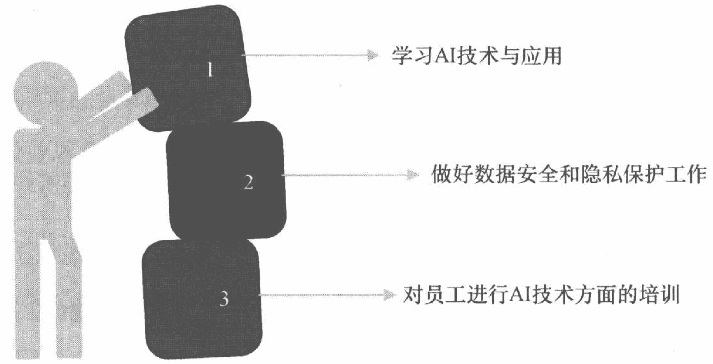

## 1. 学习 AI 技术与应用
HR需理解AI技术原理与应用场景，才能在实践中更好地运用工具。

## 2. 做好数据安全和隐私保护工作
为防止数据泄露或滥用，HR应树立安全与隐私保护意识，完善相关机制。

## 3. 对员工进行 AI 技术方面的培训
不仅HR自身要懂AI，企业其他员工也需接受培训，深化认知，提升实际应用能力。

总之，AI正重塑人力资源管理版图。HR要主动自我革新，从会管理人升级为会管理AI，跟上技术节奏，才能在未来竞争中占据主动。

#### 1.1.3 AI是实现降本增效的“秘密武器”

AI已渗透各行业，推动全面变革。人力资源部门应积极探索，将AI应用于实务，成为降本增效的关键抓手。

HR可在以下方面应用AI以减轻负担，如图1-3所示。

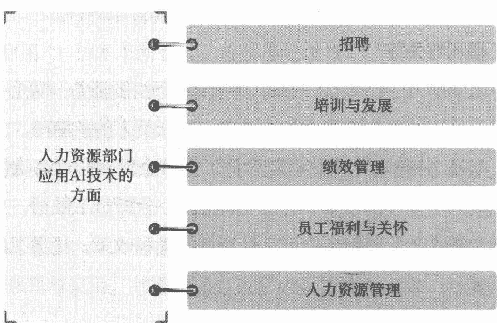

## 1. 招聘
AI可应用于招聘全流程，提升效率并降低人力成本。HR可通过招聘系统设置筛选规则提高简历匹配度，利用AI评估候选人能力，加速招聘进度。

## 2. 培训与发展
AI能让员工培训更高效、更个性化。例如借助AR、VR技术构建沉浸式虚拟训练场，员工在仿真环境中学习并通过实操巩固技能。AI助教还能根据个人学习进度提供定制化建议，推动成长。

## 3. 绩效管理
AI让绩效记录更客观、更科学。AI自动采集工作数据并生成可视化报告，直观呈现成果，减少人为偏差，提升绩效管理的公平性与准确性。

## 4. 员工福利与关怀
AI可提供精细化、个性化服务，满足多元需求，提升满意度与忠诚度，降低流失率。例如提供7×24小时心理咨询，基于数据洞察员工真实需求，设计更具针对性的福利方案，让员工感受到关怀。

## 5. 人力资源管理
AI推动办公自动化，规范管理流程，缓解工作压力。可高效处理入职、调动、离职等事务，并预测人力资本需求，实现合理配置，节约资源，提升整体运营效率。

总体来看，AI驱动的人力资源管理能有效实现降本增效。但在应用过程中需保持审慎，防范数据安全、隐私保护等风险，确保技术红利的同时维护员工合法权益。

### 1.2 逐渐AI化的人力资源管理

AI应用推动人力资源管理从信息化迈向智能化。企业需把握不同转型阶段的关键要素，制定适配战略，实现数字化、智能化升级。

#### 1.2.1 从信息化到智能化的过渡

人力资源转型大致经历信息化、数字化、智能化三个阶段。

信息化是指将现实世界映射到虚拟世界，企业层面表现为借助IT技术革新管理、支撑业务。HR领域聚焦构建管理框架、梳理优化流程、打造系统工具，实现基础模块线上化、规范化运营。例如人事系统录入员工信息即是典型。

数字化在此基础上更进一步，强调对流程数据、行为数据等关键信息的采集与应用，并以数据反馈优化决策。在此阶段，HR可通过信息系统为员工提供空中服务大厅、自助终端等多元服务，提升便捷性，更注重员工体验与人文关怀。例如员工线上完成入职，AI自动处理审批与信息采集。

智能化则基于用户经验构建模型，通过算法实现精准计算。模型在大规模数据训练中持续优化迭代，融合人类经验，成为智慧载体。智能化阶段企业可借助大数据和AI制定招聘方案、定制成长计划、实现智能排班、提供智能问答等。

当前人力资源管理正处从信息化向智能化过渡的关键期，体系尚不完善，需强化流程优化与数据整合，推进升级。

#### 1.2.2 关键要素在不同转型阶段的特征

企业转型依赖流程、数据、组织三大要素驱动，各要素在不同阶段表现各异，如表1-1所示。

表1-1 关键要素在企业不同转型阶段的驱动特征对比

| 特征 | 信息化 | 数字化 | 智能化 |
| :--- | :--- | :--- | :--- |
| 流程要素驱动特征 | 由基础职能活动与流程驱动，实现高效规范的过程管控 | 由数据与场景驱动，实现人力资源管理的全局优化，提升组织效能 | 由预测与智慧驱动，实现价值共创与生态资源合理运用 |
| 数据要素驱动特征 | 按业务需求建系统但整合不足，数据质量偏低，需按需治理；应用以单项分析为主，多靠线下 | 按战略规划建设并整合各模块系统，定期治理维护，建立标准化分析指标 | 构建高维决策与反馈闭环的技术架构，持续优化治理体系，集成前沿算法 |
| 组织要素驱动特征 | 职责边界清晰，具备流程管理能力，建立流程驱动机制 | 拥有数字化转型目标，驱动运营重构，持续迭代标准化流程与方法论，建立数据驱动管控机制 | 愿景统一推动变革，流程创新相互促进，打造业务生态价值导向的智能分析能力，建立智能驱动管控机制 |

企业在转型时应结合自身情况判断所处阶段，抓住关键要素，实现快速成长。

#### 1.2.3 转型战略：重塑定位+搭建支柱+优化体系+技术赋能

过去HR多聚焦薪酬计算、档案管理、入离职手续等日常事务。如今HR需从激发人才潜能、构建人才梯队入手，推动企业整体发展。

当前企业人力资源管理存在四大痛点，如图1-4所示。

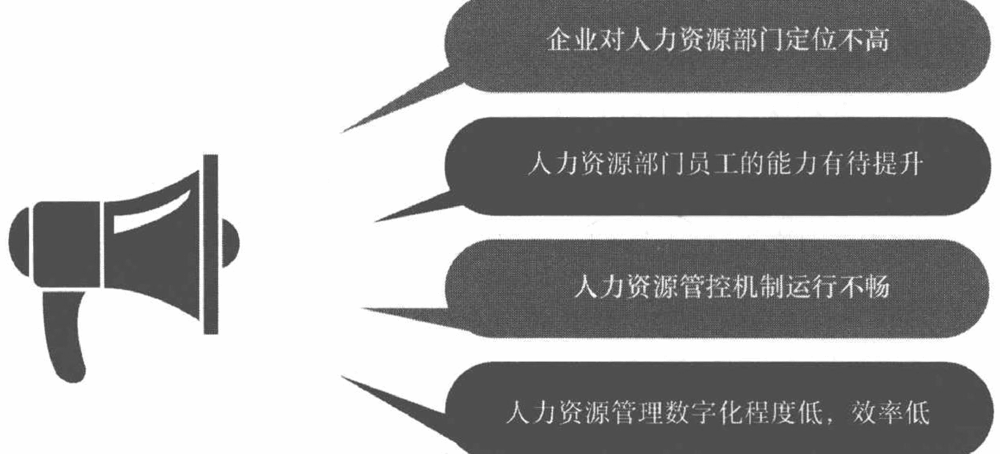

图1-4 企业在人力资源管理方面存在的痛点

1. 人力资源部门定位不足。企业关注度与资源投入不够，导致基础薄弱。如岗位说明书、考核规范缺失，岗位定位模糊、绩效依据不清，HR价值有限，对战略支撑不足。

2. HR团队能力待提升。长期忙于事务性工作，缺乏精力参与优化；受长期忽视影响，团队专业能力与技能提升滞后。

3. 管控机制不畅。常见问题：一是总部对子公司管控弱，各自为政，协同不足；二是总部“一刀切”，忽视子公司差异，不利于长远发展。

4. 数字化程度低、效率低。信息化多停留在考勤、审批等基础事务，招聘、绩效、培训等核心领域应用不足，且数据挖掘能力有限。

针对上述痛点，可从四个方面推进转型。

## 1. 重塑人力资源部门的定位
企业应提升对HR的重视，推行战略性人力资源管理。HR需承担四类角色：战略推动者，制定人才发展战略；业务合作伙伴，深入业务提出解决方案；员工关怀者，维护良好氛围；专业专家，提供专业支撑。

## 2. 搭建人力资源管理三大支柱
大型企业难以单靠一个部门承担四重角色，需构建COE、HRBP、HRSSC三支柱。

COE掌握专业知识，制定战略；HRBP贴近基层需求，落地战略；HRSSC承担事务性工作，如入离职、档案管理等。

在此架构下，HR管理更具用户中心特性。用户涵盖员工、退休人员及上级单位等，HRBP关注需求，COE定制服务，HRSSC执行交付。

在人力资源组织建设上，当前主流的思路正在向更贴近业务、更强调协同的方向演进。

第一，强化业务牵引力。人力部门要从后台支持切换到前线驱动，与业务线深度绑定，把人力策略真正变成业务增长的助力，缩短策略从设计到落地的周期。

第二，强化资源整合力。COE 作为专业能力中心，需要把企业内部乃至外部的优质资源汇聚起来，结合 HRBP 反馈的真实需求，输出可执行、可复制的方案，而不是停留在标准输出。

### 三、理顺集团型企业的人力管控边界

拥有多家子公司的集团，长期面临总部集权与子公司灵活之间的平衡难题。人资管理权责的松紧度不同，会形成截然不同的运作形态，目前常见有三种。

**表1-2 常见的人力资源管理模式**

| 模式 | 定义 | 特点 |
| :--- | :--- | :--- |
| 行政管理模式 | 总部对子公司人资事项进行强管控，子公司基本没有自主决策空间 | 协同效率高、信息反馈快，但总部管理负担重，过度集权容易压制子公司独立性 |
| 自主管理模式 | 总部基本不介入子公司人资，子公司拥有高度自主权 | 总部管控成本低，子公司反应迅速，能快速适应自身环境变化，但总部与子公司信息同步慢，易出现协同偏差 |
| 治理型模式 | 总部适度参与、子公司保留独立决策权 | 参与度适中、整体效率较高，对总部与子公司的治理能力要求也更高 |

### 四、推动人资管理的数智化升级

AI 的成熟让人力管理从经验驱动转向数据驱动成为可能。

一方面，AI 可以加速人力三大支柱的建设，让人力与业务的联动更紧密；另一方面，AI 能在招聘、培养、绩效等多个环节提效降本。

以 IBM 推出的基于 AI 的求职者助理 WCA 为例，它重塑了企业与求职者的沟通方式。传统流程里，求职者拿到职位信息后，第一次接触 HR 通常在现场面试。WCA 通过聊天机器人实现线上互动，给候选人带来更个性化的求职体验，且机器人越用越聪明，交互能力随使用次数提升。此外，企业还可将视频植入求职流程，直接展示真实的工作场景与文化氛围。

自 WCA 上线以来，企业获得的高质量候选人数明显上升，招聘周期被显著压缩，岗位匹配度大幅提高。

### 1.3 产业实践：AI 在人力管理中的落地探索

AI 从概念走向落地，头部企业已在不同场景中展开试验。

IBM 把 AI 与人力深度融合提升运营效能；联合利华借助 AI 打造内部人才市场，推动员工个性化成长与发展；沃尔玛中国联合海纳 AI 搭建智能招聘体系，优化人才筛选与匹配精度。这些案例共同说明，AI 正成为人力管理创新的核心引擎。

#### 1.3.1 IBM：将 AI 融入人力全流程

移动互联网与技术迭代加剧，员工期待也在变化，传统人力模式已难以匹配新环境。

IBM 为客户提供端到端的解决方案，在人力领域推出 IBM Talent & Transformation 套件，以 AI 辅助人才挖掘与招聘。核心为 Watson Talent Suite，融合行为科学、AI 与心理学，主要包含：

- Watson Recruitment：基于历史招聘数据归纳录用者的共性特征，形成人才画像。
- Watson Candidate Assistant：自动解析简历并匹配适配岗位。
- Watson Career Coach：为员工提供职业发展路径建议。
- Watson Talent Frameworks：构建能力模型，保障人才发展闭环。
- Adverse Impact Analysis：识别组织中的系统性偏见。

该套件最初服务于 IBM 内部人力团队，提升工作效率与员工满意度。

IBM 同时与安永合作推出 EY.ai Workforce，将 IBM Watsonx Orchestrate 的自动化能力与安永在人力转型方面的专业经验结合，帮助企业重塑人力流程。该平台可自动完成岗位描述撰写、报表生成等重复性工作，界面简洁，让员工把时间集中在高价值事务上。

作为大型企业，IBM 持续以技术强化决策与执行能力，未来将不断深化 AI 对人力的赋能。

#### 1.3.2 联合利华：用 AI 激活员工成长

联合利华致力于让员工能力不断进化。公司搭建线上人才市场，靠 AI 为员工推荐岗位机会和能力培训项目。

公司希望实现机会透明与公平。内部市场让员工自主选择项目提升技能，平台实时播报机会，保持信息公开。一位品牌经理就通过该平台参与创新项目，积累了运营经验。

平台的初衷是激发学习意愿，使用完全自愿。领导层高度重视并主动推广。联合利华认为，员工若不学习，能力会很快落后于业务需求，岗位淘汰与新岗位涌现并存，持续学习是转型前提。

意外收获是，平台收集到员工对项目与技能的偏好反馈，帮助公司判断品牌与市场的方向。若一线员工对某项目无兴趣，也提示项目价值可能不足。

联合利华还与埃森哲合作研究生成式 AI 应用，以联合利华 AI 实验室 Horizon3 Labs 为起点，扩大生成式 AI 在人力领域的规模化应用。埃森哲表示，基于长期合作，实验室能帮助联合利华更快实现 AI 创新。

#### 1.3.3 沃尔玛中国 + 海纳 AI：智能招聘的规模化尝试

零售、餐饮、物流等劳动密集型企业常面临旺季大规模招聘压力。沃尔玛中国在全球拥有数百家门店与配送中心，招聘需求旺盛。HR 单次面试耗时十几到几十分钟，导致周期长、效率低；不同门店标准不一，人才质量参差。

为此，2022 年沃尔玛中国与成立于 2019 年的 AI 面试测评企业海纳 AI 合作，在基础岗位招聘中引入 AI。

海纳 AI 的大规模招聘方案分为四步：

1. AI 线上面试：候选人扫码进入系统，由 AI 面试官提问并记录回答。
2. 系统自动评估：生成 AI 面试报告，并随入职表现迭代模型，提升评估准确性。
3. 统一招聘标准：形成统一筛选标准，同时允许门店个性化定制。
4. 视频化人才库：为每个候选人生成分析报告并沉淀视频资料，便于检索。

AI 的精准与快速特性与沃尔玛的招聘需求高度契合。借助胜任力模型、人脸识别与语义识别，系统可实现精准筛选并建立可查询、可追溯的视频人才库，已在 100 多个城市数百家门店落地，主要解决三大痛点：

- 招聘耗时长：AI 面试官线上作业，候选人用手机录制短视频作答，支持万人同时面试，大幅缩短周期。
- 标准不统一：与沃尔玛共建 AI 面试模型，以精神面貌、个人素质、沟通表达等维度量化评价，实现跨门店统一。
- 资料难留存：系统提供文本简历与视频简历，HR 可在旺季快速调取人才库填补缺口。

落地过程中沃尔玛做了三件事：召集山姆会员店、卖场、支持中心等部门进行多轮培训；先在部分门店试点再分批推广；提供持续的技术支持与数据复盘。

招聘是企业获取人才的关键环节，借助 AI 构建智能招聘体系，才能在速度与质量上双赢。

## 第2章 决胜未来：AI 时代 HR 的转型路径

AI 时代的到来重塑了各行业的工作方式。人力领域也不例外，重复性工作正被智能化替代。HR 需要拥抱变化，掌握 AI 使用方法，提升专业素养，开拓新角色。

### 2.1 AI 会不会取代 HR

AI 已能承担简历筛选、排班等机械性任务，效率提升明显。但团队建设、员工关怀、人际沟通等依赖情感与判断的工作，仍是 AI 难以完全替代的领域。HR 的经验与人文素养使其能够理解员工需求、营造组织氛围，推动企业长期发展。

因此，HR 不必恐慌被取代，而应借助 AI 释放精力，把重心转向更具价值的关怀与管理。

#### 2.1.1 AI 取代的是工作，不是角色

AI 既能提效，也会冲击就业。劳动力市场正经历速度与范围都超预期的变化，从体力岗位到白领岗位均受影响。

李开复曾指出，AI 与自动化可能取代约一半工作，主要集中在简单重复、无需复杂情感交流、依赖体力的三类岗位。现实中，AI 客服、工业机器人、智能清洁设备的应用已成常态，无人银行也在出现。

清醒认识是，AI 取代的是重复性、繁重的工作，而人类在创造力与灵活性上仍有不可替代优势。未来应走向人机协作。

对 HR 来说，AI 会分担招聘筛选、人才评估等事务性工作，但战略性决策如招聘规划、培训设计等仍需 HR 专业判断。把繁琐环节交给 AI，HR 才能成为更高效的战略伙伴。

#### 2.1.2 决策权仍在人手中

AI 推动人力降本增效，能减少招聘偏见，但它只能作为工具。AI 擅长海量数据处理与模式识别，却缺乏创造性、应变能力与复杂情感，这是 HR 工作不可或缺的要素。

AI 的“思考”本质是基于数据的模式匹配，无法进行裁员等涉及价值判断的决策。人才选拔、聘用决定等需要对人、对企业实际情况的深刻理解，仍是 HR 的核心职责。

AI 可提供建议、预测趋势，但最终决策权始终掌握在人类手中。HR 的未来不仅是管理人，更是管理 AI。

#### 2.1.3 思维升级：用技术思维构建智能人力

新时代 HR 需要具备 AI 思维，善于用预测模型打造柔性人力系统。

共享经济与众包模式的发展改变了用工需求。过去人力规划依赖专家判断，现在可借助 AI 预测业务需求，实现更科学的资源配置与动态调整。

拥抱技术思维，才能让人力管理真正智能化。

数据规模持续扩张的当下，智能化手段已走出事后复盘的舒适区。系统能够拆解离职背后的真实动因，提前勾勒流失轨迹，并给出留住核心人才的具体建议。初创团队 Hi-Q Labs 就只用公开的外部信息就构建了团队保留率的推算模型，其预测精度反倒超过了只依赖企业内部数据的传统做法。

把这类智能化思路摊开到人才运营全景，覆盖面很广。即便当前技术离完全自主的智能还有距离，市场上已经出现不少辨识度很高的实践方案，为企业的用工难题打开新思路。可以判断，随着技术迭代，智能化会渗入人才管理的更深层次。

数字浪潮里，人才决策也必须跟上数字化的节奏。通俗讲，就是依托内部与外部数据，用自动化分析洞察当下的人才现状，提前预判未来挑战，据此制定更科学合理的方案。

新一代技术能够打通海量信息、完成整合与分析，并自动产出人才分析报告，为管理者的科学判断提供支撑。伴随技术成熟，越来越多的人把数字化判断视作职业进阶的关键方向。

一位资深人才管理专家直言，“我希望用技术与智能设备来替代人工撰写管理报告”。换句话说，在他的设想里，人才管理工作将由算法承载，并借助智能设备优化流程。

一旦设想落地，工作效率会明显跃升，工作压力随之下降，相关人力成本降低，企业整体成本也会跟着下降。只是技术带来了便利，人才管理者绝不能停滞不前，必须持续补强自身能力，尤其是流程资讯素养与平台数据管理素养。

### 流程资讯素养
在技术与智能设备的加持下，人才管理者可以借助数据合成、数据分析等手段，提升日常操作中能够由自己主导判断的比例。到了这个阶段，不仅要重新设计操作流程，还要重塑自身的专业能力，为技术落地提供支撑，同时去应对更复杂棘手的问题。

当前技术正以人才管理者尚未完全掌握的方式，悄然改写传统以员工为中心的内部运作模式，这本质上是技术与机器人流程自动化融合的结果。还有诸如语音识别身份验证系统应用于考勤记录，大幅降低考勤管理复杂性，这类案例比比皆是。

### 平台及数据管理素养
平台及数据管理素养已成为人才管理者不可或缺的核心素养，能帮助承载更多信息、驾驭更多平台。通常，利用机器学习方法生成的预测模型，其质量高度依赖输入数据的质量。因此，提升组织效能与数据质量始终是企业的核心课题。

若缺乏平台及数据管理素养，数字化转型的进程很可能受阻。随着技术持续演进，企业都在积极引入先进技术。作为组织的关键角色，人才管理者亟需掌握平台及数据管理素养，让自己成为真正的数字化达人。

就当下而言，人才管理者还有不少功课要做。第一，把注意力集中在那些能高效完成人力管理的智能产品上，包括智能软件、智能机器、智能机器人；第二，关注这些产品背后的数据和算法；第三，着力提升自身的判断力与领导力。

把以上三件事做好，就能更好地应用智能技术，为企业发展创造更大价值。

### 现代人才管理者：学会驾驭智能工具，释放更大价值
科技浪潮席卷之下，智能技术已深入各行各业，为企业带来前所未有的便利。在人才领域，智能同样扮演着重要角色。现代人才管理者应当熟练掌握智能工具的使用方法，将其融入日常，变成提升工作效率的得力助手。

#### 深入理解智能，才能更好地使用
智能的效果并非一成不变，它在不同使用者手里呈现的价值差距很大，根源在于使用者对智能的理解程度不同。对人才管理者来说，只有深入理解并熟练驾驭，才能释放最大效用。2022年11月，OpenAI 发布名为 ChatGPT 的智能应用，一经推出便引发全网热议。

伴随智能技术不断深入，应用产品层出不穷。ChatGPT作为新一代智能对话模型的代表，在文本处理上实现突破性进展，引领了内容生成领域的新趋势。各大企业纷纷布局，抢占发展制高点。

作为先进的语言模型，ChatGPT拥有强大的自然语言处理能力，能够轻松理解并回答各类问题，与用户进行自然流畅的交互。用户不仅可以获取信息、休闲娱乐，还能解决实际问题。海量的知识储备和强大的语义理解能力，使其能够承担语言生成、情感分析、语义理解等多种复杂任务。

此外，ChatGPT的开放性让普通用户得以接触智能技术，进而思考其对社会的深远影响。它的出现拓展了人们对智能技术的想象空间，也为审视人与智能技术的关系提供了新视角。

AI是当下全球热门话题，是引领未来科技发展的风向标。它已成为研究、开发用于模拟、延伸和扩展人类智能的理论、方法、技术及应用系统的一门新科学技术。

AI是计算机科学的一个分支，致力于探索人类智能的本质，并研制出能够以类似人类智能方式处理问题的智能机器。

自AI诞生以来，随着理论和技术日益成熟，其应用领域不断扩大。人们在日常生活中已经接触到很多应用，如ChatGPT对话生成模型、音乐网站的个性化推荐机制、智能医疗影像等。可以设想，未来的科技产品将成为人类智慧的“容器”，机器可以模拟人的意识、思维，像人那样思考，甚至在某些方面超越人类。

AI共有四大技术分支，如图2-1所示。

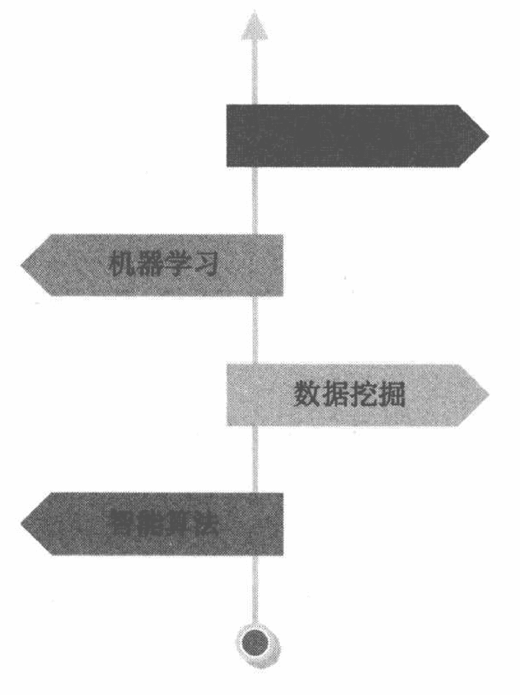

图2-1 智能的四大技术分支

模式识别是对表征事物各种形式如数值、文字、逻辑关系等的信息进行处理，例如汽车车牌号识别、图像处理等。

机器学习是计算机通过重组已有知识结构，不断完善自身性能，获取新知识或技能，来模拟或实现人类行为，例如网站个性化推送消息、汽车导航等。

数据挖掘是通过算法从知识库中挖掘出有价值的信息，例如市场分析、疾病预测等。

智能算法是针对某类问题的特定模式算法，例如工程预算、规划最短路径等。

AI的发展经历了三个阶段，如图2-2所示。

弱智能是指擅长某一方面工作的智能。例如战胜围棋世界冠军柯洁的AlphaGo就被归为弱智能，它只会下棋，如果问它“怎么炒菜”，它就不知如何回答了。

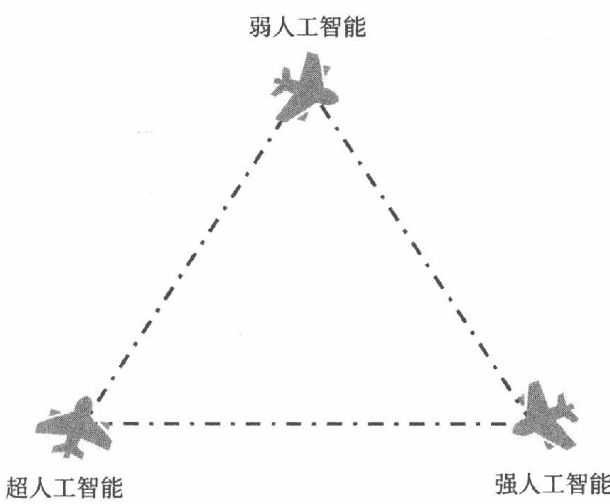
强智能是指人类级别的智能。它在各方面都能与人类比肩，人类能完成的绝大部分脑力工作它都能完成。强智能比弱智能复杂得多，现阶段的技术还无法实现强智能。

超智能是指在各方面都超过人类的智能，可以承担人类无法完成的工作。AI思想家 Nick Bostrom 将超智能定义为：“在几乎所有领域都比最聪明的人类大脑聪明很多，包括科技创新、通识和社交技能。”

虽然目前AI仍处于弱智能阶段，但在许多领域已有较为成熟的应用。下面介绍几个人工智能的主要应用领域。

机器人领域。智能机器人，如 PET 聊天机器人，可以理解人类语言，并用特定传感器采集、分析出现的情况，从而调整自己的动作和语言，实现与人类对话。例如，人才管理者可以利用智能机器人调查员工满意度，收集反馈和意见。

语音识别领域。在语音识别领域，智能可以将语言和声音转换成可处理的信息，从而实现人与机器的语音交互。例如，语音开锁、语音输入等都是智能在语音识别领域的应用。在面试时，系统能够利用语音识别技术记录候选人的回答，帮助人才管理者快速收集大量信息，为决策提供依据。

图像识别领域。在图像识别领域，智能可以进行更精确的图像处理、分析和理解，以识别各种不同的目标和对象，如人脸识别、商品识别等。例如，系统可以利用人脸识别技术辅助人才管理者进行工作考勤，提升工作效率。

专家系统。智能可以助力构建具有专门知识和经验的计算机智能程序系统，采用数据库中的知识数据和知识推理技术来模拟专家解决复杂问题。

#### 提问技巧：解锁智能超能力
许多人才管理者在与智能系统对话时常有疑惑：“当我把系统当作聊天工具或搜索引擎时，能得到相对准确的回答，但当我把系统当作解决问题的工具时，为什么常常出现文不对题的情况呢？”这多半是因为他们没有掌握提问技巧。

在与系统对话时，人才管理者可以使用高质量的提示词，以提高回答准确度。提示词是指用户与系统对话时，能够引导系统回答特定答案的文字或者关键词。用户可以借助提示词，引导系统给出想要的回答。准确、清晰的提示词如同解锁智能超能力的钥匙，使其能够精准做出回答。

要全面理解提示词的重要性，首先需要理解大语言模型的运行机制。

大语言模型实现内容输出的基础是“学习”。这里的“学习”是指模型按照一定方法，从海量文本和图像中提取信息，并将其纳入自身数据库，从而积累丰富的“知识”。

然而，仅有“知识”不足以发挥大语言模型的全部潜能。模型还需要具备理解和思考的能力，以便准确分析用户意图并给出恰当回答。这种理解和思考能力主要依赖模型内部的神经网络算法，这些算法共同构成模型的“大脑”，使其能够处理复杂任务。

尽管大语言模型具备丰富的“知识”和强大的“大脑”，但潜能的发挥仍需依赖用户的引导。在这方面，准确的提示词就显得尤为重要。智能系统能够作为辅助工作的工具，根据用户下达的指令执行任务。只有正确运用提示词，才能充分激发潜能，获得满意结果。

尽管不同问题问法不同，但基本逻辑是相通的。下面通过具体案例讲解如何运用万能的提示词公式更高效地与系统沟通。

例如，某用户在“文心一言”上提出“如何成为一名优秀的人才管理者”的提示词，系统回答了一些策略与方法。虽然回答看起来正确，但只是空洞理论，缺乏实用建议和实际落地路径，如图2-3所示。

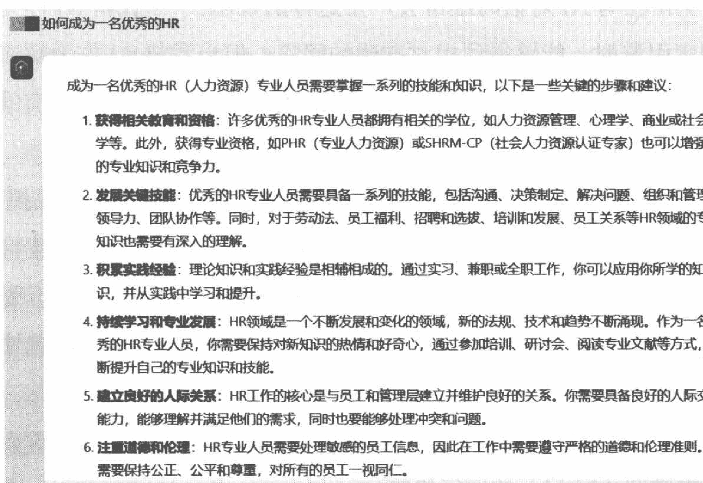

图2-3 使用文心一言进行交互（1）

该用户进一步优化提示词后，系统给出了更为详细和有针对性的回答，如图2-4所示。

通过对比两次回答不难发现，优化、修改提示词后，回答更清晰、更详细，能够按照时间顺序从学习和工作两个方面提出建议，这才是提问者想要的回答。

## 第2章 决胜未来：智能时代人才管理转型之道
假如你是一位拥有三十余载从业阅历的人才管理者，对人力管理领域具有独到见解，我是一位人力专业毕业的新人，目前在一家企业从事人力的工作，我在未来三年把自己打造成经验丰富的从业者，请按年度拆分，罗列清楚学习和工作方面该怎么做

在未来三年把自己打造成经验丰富的从业者，需要不断学习、实践和反思。以下是一个为期三年的学习和发展规划，按年度拆分，详细列出学习和工作方面的要点：

### 第一年：基础建设与技能打磨
学习：
深化人力基础知识，阅读经典书籍如《人力管理》《组织行为学》等，巩固和拓展理论知识。
了解行业最佳实践和法规，关注专业期刊、网站和社交媒体，了解最新趋势、最佳实践和法规变化。
参与专业培训课程，如招聘与选拔、员工关系管理、薪酬福利设计等，提升专业技能。

工作：
积极参与实际工作，在招聘、培训、员工关系管理等项目中积累实践经验。
建立良好的人际关系，与同事、上级和下属建立良好关系，了解需求和期望，提升沟通协调能力。
定期进行工作总结和反思，每季度进行一次工作总结，分析优点和不足，制定改进计划。

### 第二年：专业深化与领域拓展
学习：
深入研究某一专业领域，如员工关系、招聘与选拔、薪酬福利等，进行深入研究和实践。
拓展相关领域知识，了解心理学、社会学、经济学等，拓宽知识视野。
参与行业交流活动，参加学术会议、研讨会和交流活动，与同行交流经验，拓展人脉。

工作：
担任关键项目角色，在重要的人力项目中担任重要角色，如负责某个部门的招聘计划或员工培训计划，锻炼项目管理能力。
推动流程优化，关注公司内部的人力管理流程，提出改进建议并推动实施，提升解决问题的能力。
参与跨部门合作，加强与其他部门的合作，了解需求和痛点，为公司提供更全面的人力支持。

### 第三年：领导力提升与战略规划
学习：
提升领导力，学习《领导力21法则》《从优秀到卓越》等书籍和课程，提升领导力。
学习战略规划，了解企业战略规划和人力管理的关系，学习如何制定和执行人力战略规划。
关注全球人力趋势，为职业发展做好准备。

工作：
担任团队领导角色，在人力部门中担任团队领导角色，带领团队成员完成各项工作任务。
制定并执行人力战略规划，结合公司战略目标和业务需求，制定规划并推动实施。
参与公司高层决策，积极参与高层决策过程，为公司发展提供人力方面的专业建议和支持。

通过以上三年的学习和工作计划，将逐渐积累丰富的实践经验、拓宽知识视野、提升专业技能和领导力，最终成长为一名有丰富经验的人才管理专业人士。同时保持持续学习和自我反思的态度，不断提升专业素养和竞争力。

图2-4 使用文心一言进行交互（2）

那么，第二次的提示词进行了哪些优化，从而使回答更符合提问者的要求呢？可以对提示词进行拆解。首先，该用户为系统塑造了一个人设——“一位拥有三十余载从业阅历的人才管理者，对于人力管理领域具有独到的见解”。这样的人设使得系统能够站在人才管理者的角度思考问题，给出更贴近实际的答案。

其次，该用户详细描述了自己的背景——“一位人力专业毕业的新人，目前在一家企业从事人力的工作”。这样的背景介绍有助于系统更好地理解该用户的处境和需求。

最后，该用户明确了自身诉求，并给出了具体要求——“我在未来三年把自己打造成经验丰富的从业者，请按年度拆分，罗列清楚学习和工作方面该怎么做”。

通过对提示词的拆解，可以得到一个通用的提问模板：提示词 = 角色设置 + 背景陈述 + 主要任务 + 具体细节。

其中，角色设置是指为系统设定一个具体角色，使其能够从该角色的视角回答问题；背景陈述是指说明自身情况；主要任务是指系统需要回答哪些问题；具体细节是指问题的具体要求。这一模板能够帮助给出有效的提示词，从而引导系统给出更精准、更有针对性的回答。

初次使用系统的用户，只要掌握上述提示词模板，便可快速上手，提升自身对系统的驾驭能力。在使用提示词模板的同时，还需要掌握一些技巧，以进一步提升提示词的有效性与准确性。

有逻辑地详细描述。如果用户仅输入一句提示语便让系统回答其问题，很难得到想要的回答。例如，用户仅输入“请帮我写一个岗位招聘文案”，系统并不清楚具体的岗位要求，输出内容很难符合预期。因此，用户应该尽量详细地描述要求，并补充更多细节，使系统能够深入了解需求，给出更有针对性的回答。

提前约定输出格式。用户可以提前明确具体的输出格式，以便系统更精准地生成期望内容。例如，用户需要系统帮其总结一篇文章的内容，可以给出这样的提示词：“你需要理解以下文章，并总结文章的内容，请按照以下格式生成内容：标题；摘要；人物；事情的起因、经过和结果”。这样，系统便能够按照这一格式输出想要的内容。

关注强调词和提示词的顺序。在输入提示词时，用户可以使用强调词突出重点要求，如非常、特别、务必等。这样，系统在输出内容时会特别关注这些方面。提示词的前后顺序也会对回答产生影响。例如，用户要求系统写一篇文章，并且提出了许多要求。这些要求中有许多提示词，这些提示词的前后顺序将会影响系统对相关内容的重视程度。提示词的权重与排序有关，排序越靠前，权重越高，越能引起系统的重视。因此，用户在输入要求时，一定要将重要的要求放在前面。

提供一些逻辑提示。当用户难以准确描述自己想要的回答时，可以为系统提供一些逻辑提示和案例，以便其能够准确回答。

表达对答案的期望。用户可以向系统表达自己对答案的期望和要求，包括答案的详尽程度、准确性和解决方案的可行性等，以便系统能够输出更符合要求的内容。

具体的行动步骤。如果用户询问一些专业性较强的问题，可以告知系统具体的步骤，以便确保输出的内容符合要求，不会出现太大偏差。

输入相关知识。用户可以向系统提供其所需输出的内容所涉及的专业知识及相关理论，以帮助系统提前进行针对性学习。有了这些知识，系统便能基于用户提供的信息，更加精准地执行任务，确保输出内容的准确性和专业性。

在熟练掌握提示词模板的同时，结合上述七大提问技巧，用户能够更加游刃有余地运用系统，解决生活工作中的各种难题。

#### 关键词激发提问灵感
在利用系统进行创作时，用户可能会因为缺乏话题导致交互陷入僵局。在这种情况下，用户可以利用关键词激发提问灵感，更好地与系统交互，获得自己想要的内容。合适的关键词可以使系统更好地理解用户提问意图，生成更加准确、有深度的内容。以下是一些建议，可以帮助用户更好地运用关键词。

明确提问目的和受众

和 AI 沟通，提问方式直接决定了结果的质量。先把要干什么、给谁看想透了，AI 才不会跑偏。比如一位 HR 想写一篇关于未来人力发展趋势的稿子，就得围绕读者关心的点，用精准且有画面感的词去锚定方向，这样生成的文本才有针对性和吸引力。

### 关键词怎么用才好用

**先挑对的词，再讲清楚意图**
拿到话题后，先在网上搜一搜相关讨论，从中筛出能准确概括主题和观点的词。描述性强的词更管用，因为它能把你的真实意图翻译给 AI，降低理解偏差。

**长尾词适当加一点**
长尾词是组合型搜索词，能更细地反映用户的真实搜索意图。跟 AI 交流时适度加入，会让输出更贴合、更具体。

**别放宽泛的大词**
关键词太宽，AI 就会泛泛而谈，缺乏深度和针对性。对话时尽量用具体、有边界的表达。

**边聊边调，直到满意**
AI 的一次输出不一定到位，发现不够用就及时修正词。这样反复打磨，答案会越来越接近预期。

归纳下来，驾驭 AI 的提问技巧就是：目标受众先明确、关键词挑得准、长尾词适度用、大词坚决避、关键词持续优。通过这几步，才能让 AI 产出真正好用的高质量内容。

#### HR 必须学会用 AI

企业越来越把 AI 用到人力管理里，但门槛不低。HR 掌握方法，才能发挥价值。

**1. 数据先聚拢**
系统性地收集员工多维度信息：个人简历、学历、经历等。来源可以是第三方工具、背景调查机构，也可以是员工自填。关键是汇总到一个统一平台，形成分析的基础。

**2. 需求要洞察**
借助自然语言处理和机器学习，深入解析员工在日常工作中的表现和痛点，为培训设计提供依据。AI 还能收集工作满意度数据，帮助找到改进的方向。

**3. 培训内容要定制**
基于需求洞察，AI 能为不同员工制定个性化方案，推荐课程、书籍、文章等学习资源。学习过程中，AI 会根据进度和反馈动态调整安排，保证效果最大化。

**4. 效果要评估**
AI 可以实时追踪学习轨迹，通过学习频次、观看进度、作业质量等指标综合判断成效。对比培训前后的工作完成度与效率，就能看清培训是否真正带来改变。

**5. 资源要优化**
依托评估结果，AI 能识别出哪些课程真正提升能力，指导 HR 把资源向优质内容倾斜，减少低效投入。还能按部门岗位需求，打造更精准的培训组合。

**6. 计划要弹性**
当数据揭示出某部门在某领域短板明显时，AI 能迅速追加相关内容。对于进度慢的员工，则提供个性化辅导，帮助突破瓶颈，让方案始终贴合实际需求。

**7. 成果要看得见**
AI 能把结果做成图表呈现：学习进度图、能力提升曲线、投入产出比等。可视化报告让决策更直观。

总体看，AI 在人力资源的应用场景很广。HR 学会用好它，才能更好地满足员工成长需求，培养人才，推动企业发展。

### AI 时代 HR 怎么不被替代

AI 既是机会也是挑战。HR 要主动拥抱工具，同时提升自身不可替代的能力，主要集中在四方面：专业度要体现、人脉要沉淀、业务要跨界、情商要在线。

#### 专业能力：有战略支撑的专业

做好工作，专业能力是底座。HR 要掌握人力管理核心知识，结合业务实际给出方案支持；要持续学习夯实理论，并不断在实践中提炼方法；还要关注行业前沿，保持知识更新。

真正的专业，不是处理日常事务，而是具备战略思维的系统能力，并能把专业与业务融合，在管理中发挥战略支撑作用。

基于战略的专业能力，就是跳出传统人力框架，从长期全局出发给出可行方案。它和传统能力的区别在于：传统更侧重选育用留、关系协调、薪酬管理；战略型则从全局和战略高度来设计人力。

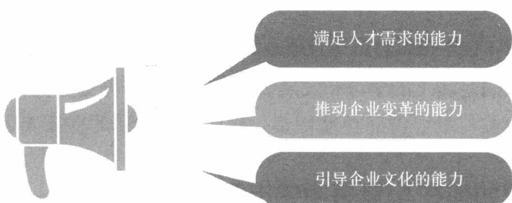
图2-5 基于战略的专业能力细分为三项能力

**一是满足人才需求的能力**
HR 要深度解读公司战略和规划，制定对应的人才计划，让配置与目标一致。人才到位后，快速匹配岗位并设计个性化培养路径，助力成长为骨干。同时，对比竞品的人力现状，制定科学的激励制度，激发热情、增强归属感。

**二是推动企业变革的能力**
企业发展需要不断调整架构。战略落地过程中常伴随分歧，HR 要扮演沟通桥梁，促进员工、业务经理、管理者之间达成共识，确保执行顺畅。此外，还要搭建支撑变革的机制体系。

**三是引导企业文化的能力**
文化影响思想和行为。HR 作为文化的传播者和塑造者，要提炼核心价值观，通过多种渠道宣贯，让文化在团队中生根。同时关注落地，通过优化环境和流程提升文化执行力。

总之，HR 要与时俱进，摆脱传统思维，建立全局观，提升战略型专业能力。

#### 社交资源：人脉是重要资产

人脉能拓宽视野、获取行业经验，为招聘加分。HR 拓展人脉可以从手上现有资源盘点开始，明确自己的“底牌”。

线下培训会和展会是高效平台，锻炼沟通的同时结识同行和潜在合作者。招聘网站、微博、微信公众号等线上渠道也能帮助发现行业精英，通过私信建立联系。

人脉需要长期经营。HR 要持续提升专业素养，内外兼修，同时主动出击，把握每一次结识机会，扩大交际圈，为招揽目标人才做好准备。

#### 业务跨界：广泛涉猎，理解业务

只有懂业务，才能制定合理的人才规划。路径有两条：广学业务和深懂业务。如图 2-6 所示。

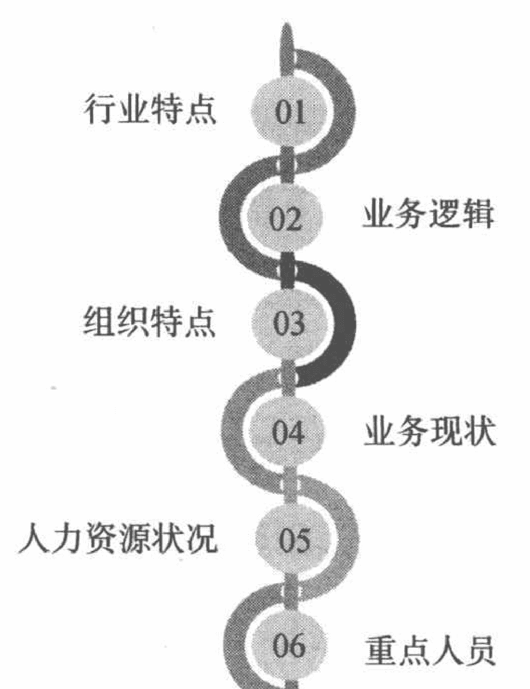
**1. 行业特点**
深入行业有助于建立全局观，也为业务发展提供参考。关注点包括产业链与商业模式、竞争格局与标杆企业、发展前景与市场结构、人才地图与薪资跳槽动因等。还需思考企业提供什么产品服务、上下游关系、利润率、标杆优势、发展阶段、竞争策略等。

**2. 业务逻辑**
从用户是谁开始思考，明确价值主张、价值交付方式，梳理资源与能力、业务流程、合作伙伴、盈利模式等。

**3. 组织特点**
从组织视角解决持续发展问题，关注战略、业务、环境、人才的互动。

**4. 业务现状**
了解战略、瓶颈、机会与挑战，弄清业务模式、目标用户需求、渠道、盈利方式和关键资源。

**5. 人力资源状况**
掌握人员结构、任职水平、人岗差距、成长规律，合理配置人力。

**6. 重点人员**
依靠业务部门经理、意见领袖、业务专家快速了解业务细节，获取信任与支持。

业务语言的学习分三个层次。

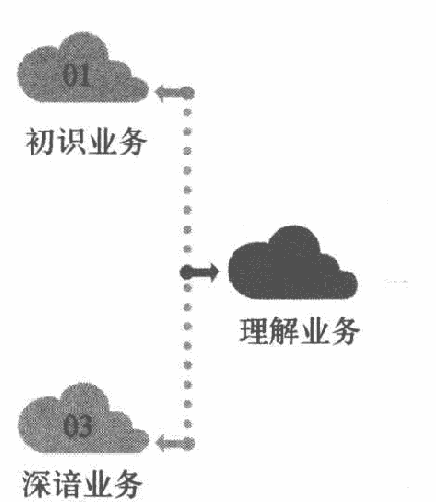
**1. 初识业务**
参加会议、阅读行业报告，了解行业大势和业务部门风格，初步判断。

**2. 理解业务**
丰富业务词汇，结合企业实际，绘制流程图、用户画像，分析资源与交互场景，给出升级建议。

**3. 深谙业务**
从全链条出发，理解商业模式框架，具备财务分析能力，看清各流程节点的支撑关系，解释价值创造、传递与获取的原理。

业务语言可能枯燥，但以实际问题为导向持续学习，并根据市场反馈修正理解，才能真正为业务提供帮助。

#### 沟通情商：用用户思维优化体验

HR 需要频繁沟通，这要求情商在线。某服装公司 HR 木棉工作很努力，但业务经理始终不买账。沟通时，木棉总拿公司政策当挡箭牌，说“这是规定不行”“必须按要求”，从未站在业务角度思考问题，让对方感觉被阻隔。

很多企业都有类似困境，根源是 HR 还停留在管控思维：制定目标、分配资源、用领导驱动、用控制纠偏，强调合规与成本，导致预算被压、培训被砍、绩效被扣。

要破局，就要认识到 HR 和业务共同面对用户。要和业务并肩作战，为用户创造价值。用户看重品质，HR 就围绕选育用留做品质工作；用户在意性价比，HR 就以降本增效为导向考核；用户重视体验，HR 就围绕场景和流程优化服务。这样才能真正服务业务，帮助业务达成目标。

在组织的日常运转里，人力职能正经历定位的迁移，由过去侧重管控的角色向以服务创造价值的角色靠拢。所谓用户思维，实质上是以主动创造价值为导向的服务意识，其核心可拆解为三个层面，如图 2-8 所示。

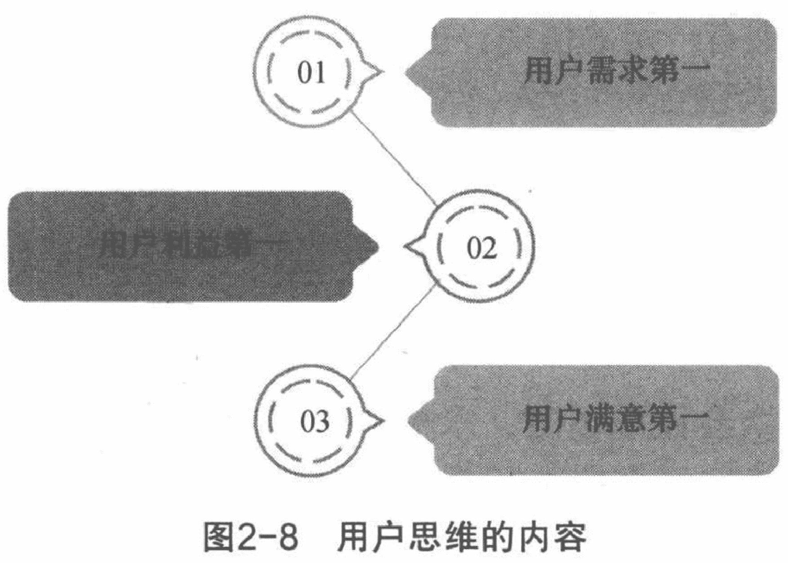

### 1. 用户需求第一
各项工作都要紧扣使用者真实诉求，让投入产生实际意义。一旦既有做法难以回应诉求，就要及时变换做法，重新调配人力与资源。服务同样需要边界感，避免超出使用者理解范围或承受限度，做到需求匹配且不过载。

### 2. 用户利益第一
把使用者利益放在核心位置。要换位思考，敏锐捕捉使用者最关心的利益点，并以此作为行动出发点。同时定期复盘自身流程，确保没有偏离服务初衷。

### 3. 用户满意第一
以满意度作为最终衡量标尺。追求简便高效的体验，用反馈来迭代流程与服务品质。个人专业素养的持续打磨，是构筑高质量服务的根基，最终会回馈为更高的满意度。

完成这场思维切换，人力部门才能真正以需求为起点，协同调度业务线，为其提供更有针对性、更科学的支撑。由此人力与业务的关系更亲近、沟通更顺畅，共同推动企业向前。

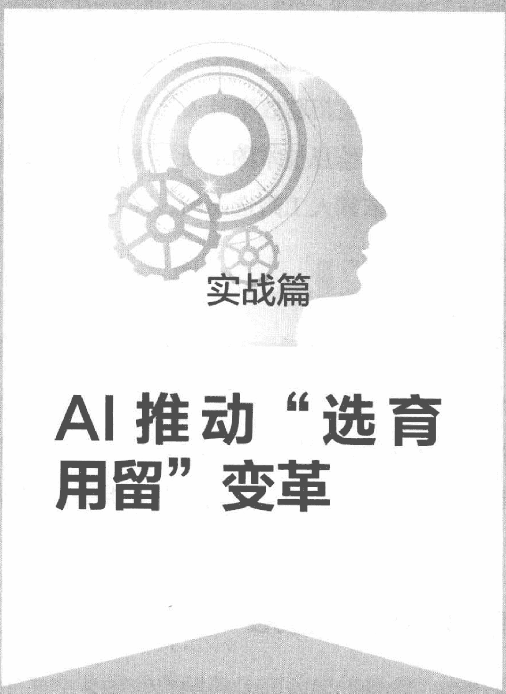

# 实战篇

## 智能化驱动“选育用留”升级

# 第3章 智能选人：招聘管理迈向新阶段

人力资源场景中智能化的渗透正在重塑招聘全链路。智能选拔的融合，使招聘进入全新阶段。无论是准备期、执行期还是跟进期，智能化系统都能介入其中，精简流程、加快节奏，同时提升人岗契合度。

“智能+选拔”不仅意味着技术层面的升级，更意味着管理方式的转变。人事团队不再手工翻阅海量简历，而是借助算法与数据分析，迅速锁定符合岗位画像的人选。

## 3.1 招聘焕发新面貌

智能化正为招聘带来全新样貌，让选人变得更智能、更精准。它能介入职位描述撰写、应聘者电话触达、简历筛查等多个环节，直接拉升招聘效能。

### 3.1.1 智能生成：精准撰写职位描述

智能化在招聘中的首个落地场景是内容生成。借助生成式系统撰写职位说明，能把岗位要求说得更清楚明白，也让人力团队脱离重复劳动，更聚焦关键决策。

应用要点主要体现在：

- 可按预设模板和岗位基础信息自动生成初稿，大幅压缩撰写周期。
- 结合历史岗位数据与应聘者反馈反向优化说明，让关键词更精准，进而吸引更匹配的人才。
- 具备关键词智能推荐能力，通过横向对比相似岗位，提炼出更贴切有吸引力的表达。

例如，Beamery 是一家聚焦人工智能赋能招聘的科技公司，其自研的生成式工具 TalentGPT 功能全面，能够检索优秀人才、智能匹配、自动推荐，并在整条招聘链路中提供分析与管理服务。

VMware 是一家知名的云服务提供商，在人才招聘方面主要存在四个痛点，如图 3-1 所示。

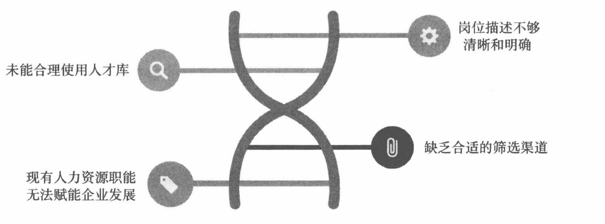

### 1. 职位说明不够清晰和明确
招聘的首要任务是厘清岗位对人才的具体要求。若描述模糊，应聘者期望与实际需求就会出现偏差，找到合适人选的概率下降，不仅增加成本，也会制约发展。

### 2. 未能合理使用人才储备池
企业内部事务繁多，人才储备资料往往内容庞杂、分散，缺乏系统归纳整理，导致使用率低，进而错失潜在优秀人才，影响整体储备与竞争力。

### 3. 缺乏合适的筛查渠道
现有招聘渠道在信息传递效率上存在不足，难以将岗位需求精准触达目标应聘者，降低效率并可能错失接触优秀人才的机会。

### 4. 人力职能无法赋能企业发展
人力被大量传统事务性工作牵绊，难以对人才数据做深入有效分析，影响自身效率，也可能导致企业无法把握人才市场动态，进而影响战略制定与执行。

为解决上述问题，VMware 与 Beamery 携手，在招聘标准与策略上进行优化，具体方案包括：

（1）深入了解 VMware 的招聘需求后，Beamery 从企业背景、技能需求及应聘者特质等多维度进行细致分析，精准梳理招聘需求并筛出最合适的人选。职位说明的精准性直接决定匹配效率，在后续专项招聘会中，VMware 凭借清晰的职位说明成功锁定上百名优质应聘者，牢牢掌握主动权。

（2）Beamery Recipes 会在接收到指令后对新应聘者进行标记，为企业提供初步筛查与沟通支持。企业可根据招聘计划下达更复杂的指令，也能按既定标准对应聘者进行优先级排序，大幅提升筛查效率。VMware 利用该功能的自动沟通与筛查能力，快速触达应聘者，并管理十几万份应聘者资料，确保不遗漏任何人。

（3）搭建应聘者社群。VMware 建立了应聘者社群以便与储备人才保持交流。Beamery 可自动向新成员发送邮件，并根据学历、学校、技能等进行分类入库。企业可通过社群推送空缺职位，维护与储备人才的关系，经过长期运营，社群已汇聚上万人，并实现有效转化。

（4）招聘数据看板可视化。VMware 可随时查看招聘数据，对不同区域进行比较分析，从而优化策略、提升效果。经过全方位数据分析，VMware 有效提升了招聘效率与人才转化率，并使招聘策略与企业整体发展战略保持一致，为长远发展奠定基础。

智能化系统以强大的文本输出能力对职位说明进行精准编辑，减少重复性工作，帮助人力团队将精力投入到更有价值的环节，为企业创造更多效益。

### 3.1.2 智能外拨：自动批量拨打应聘者电话

人力通知面试往往依赖电话，机械重复且耗费人力。智能外拨可替代人工操作，实现自动批量拨打，提升效率并降低成本。

操作流程包括：

（1）数据导入。人事先将应聘者信息批量导入智能外拨系统，确定拨打范围。
（2）拨号设置。对外呼时间段、重复拨打次数、间隔时长、号码显示等进行配置。
（3）录音留言。若接通，系统自动录音存档并管理分析；若长期无法接通，则自动留言至语音信箱。
（4）数据整合。系统可整合通话结果与应聘者需求，持续优化话术。

优势主要体现在：

### 1. 提升人力团队的工作效率
智能外拨分担重复劳动，让人力专注于更核心的业务，提升整体效能。

### 2. 提升应聘者满意度
信息实时处理，及时回应应聘者问题并追踪反馈，提升体验感。

### 3. 提升拨号效果
自动化、快速不间断拨号，提升呼出率，确保每位应聘者都能及时收到通知。

作为智能化招聘工具，智能外拨具备高效、自动化等特点，帮助人力创造更大价值。

### 3.1.3 智能筛查：筛选应聘者

将智能化技术用于人力资源管理已是行业热点。激烈竞争下，科技创新是企业获取优势的关键。创新的核心是人，企业管理也应以人为本，做好人力资源升级至关重要。

例如，李某创办了一家线上房地产经纪企业，起初仅十余人，随着扩张，短期内需招聘大量新人，海量简历让他无所适从。

借助智能化技术问题得以缓解。系统可对应聘者入职首日的工作表现进行线上模拟，大幅简化简历筛查流程。更重要的是，系统能深入分析个人特质，利用自然语言处理、机器学习等技术为每位应聘者构建详尽的心理画像，判断其是否契合企业文化氛围。

例如，系统可通过分析应聘者日常沟通中使用的礼貌用语来评估同理心和客户接待能力。这种分析方式帮助李某更全面了解候选人，也为面试表现提供客观衡量标准。在智能化协助下，李某能快速从众多应聘者中筛出适配人选。

智能化不仅可用于招聘，还能帮助企业分析员工与岗位的契合度，进一步促进人岗匹配。相较于纯人力筛查，智能化带来了更高效精准的解决方案。

## 3.2 智能化助力面试，面试效率持续提升

智能化已深度渗透面试全流程，从面试前的通知编辑、提醒发送，到面试中的问题设计、流程安排，再到面试后的打分与反馈，智能化都发挥关键作用。智能化面试极大解放了人力，使效率显著提升。

### 3.2.1 面试通知模板及发送提醒

发送面试邀请是人力日常工作的重要环节，优质通知能提升应聘者参与意愿，降低沟通成本。

例如，方便面 AI 面试是一个智能化招聘管理系统，不仅具备 AI 面试功能，还提供智能邀约服务，实现人力与应聘者高效匹配。手动发送邀请耗时耗力，该系统提供手动与自动两种邀约模式，大幅提升效率。

（1）批量直接邀约，简化流程。在确定人选后，人力可在系统内批量邀约，只需设定面试时间、地点等关键信息，系统即可通过短信、电话、邮件等多种渠道自动发送通知，且内容可根据岗位需求个性化定制。

（2）智能预约，自主选择面试时间。人力设定空闲时段，应聘者可自行选择合适时间，提升灵活性与招聘效率。

除系统外，人力还可借助 ChatGPT、文心一言等智能化工具编辑通知模板，使用时注意：

（1）内容简洁明了。时间、地点、职位等关键信息清晰呈现，避免冗长复杂句式，便于应聘者快速理解。
（2）语言专业友好。保持规范专业的表达，同时用亲切语气传递企业关怀。

发送面试邀约的质量与效率直接影响招聘推进，利用智能化编辑模板并优化提醒，人力能更高效完成招聘工作。

### 3.2.2 面试问题设计：专业问题+价值观问题

人力可借助智能化设计更精准的面试问题，确保招聘到具备专业能力与价值观契合的优秀员工。

#### 1. 如何运用智能化设计专业问题
（1）基于数据分析生成问题。利用系统分析应聘者过往表现、技能掌握、项目经验等数据，生成与背景高度相关的专业问题。
（2）模拟实际情境。系统可模拟真实工作场景，设计情境题以评估应聘者解决复杂问题的能力。
（3）智能推荐面试问题。根据既有面试数据与应聘者资料，系统可推荐覆盖所需知识与技能的问题清单。
（4）自动化问题反馈。系统可实时分析回答质量、深度与逻辑，帮助人力更准确评估专业能力。

#### 2. 如何运用智能化设计价值观问题
（1）情感分析和语气识别。借助系统情感分析技术，在面试中捕捉语速、语气等细微变化，洞察应聘者心理状态。
（2）价值观匹配分析。系统可依据岗位需求、企业文化与核心价值观自动生成相关问题，并将应聘者价值观与企业进行匹配。
（3）智能回答系统。系统可对回答进行反馈，指出哪些与企业价值观相符、哪些偏离，帮助人力做出判断。

例如，联合利华将智能化面试纳入招聘流程，应聘者需回答关于背景、经验、技能、价值观等一系列问题，系统根据回答与表现自动评分并生成评估报告。人力可利用系统分析大量数据与岗位需求，设计出更具针对性和开放性的问题，高效筛出符合企业文化的人才。

运用智能化设计面试问题，不仅提升招聘管理效率，也确保入选者具备相应专业能力且价值观与企业高度契合，有助于提升员工满意度与留任率，促进长期发展。

### 3.2.3 面试打分及面试反馈

智能化正以独特优势改变传统面试模式，不仅能按预设标准客观打分，还能提供全面深入的反馈。

智能化面试打分的核心是采用统一标准确保公平性，主要从以下维度综合考量，如图 3-2 所示。

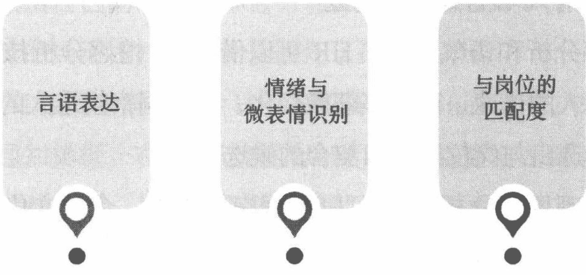

#### 1. 言语表达
借助自然语言处理技术，系统可实时分析回答的词汇选择、语法正确性、语义连贯性，并关注专业术语使用、流畅度与逻辑性，给出相应分数。

#### 2. 情绪与微表情识别
系统具备情绪与微表情识别能力，可捕捉音调、语速及面部表情变化，判断应聘者是否紧张、自信或诚实，为人力提供心理状态参考。

#### 3. 与岗位的匹配度
系统会将应聘者现场表现与岗位要求进行对比，评估适配程度。例如对责任心要求高的岗位，会重点分析相关回答与表现。

基于综合分析，系统会给出涵盖语言表达、基础知识、团队协作等多方面的分数，帮助人力快速筛出符合要求的人选。

在反馈方面，系统运用语音识别、文本分析等技术，可完整记录对话并逐句分析，从沟通表达、逻辑思维到职位相关性提供有效反馈，并生成结构化报告，帮助人力直观了解优缺点，为决策提供支持。

与传统方式相比，智能化在打分与反馈方面具有以下优势，如图 3-3 所示。

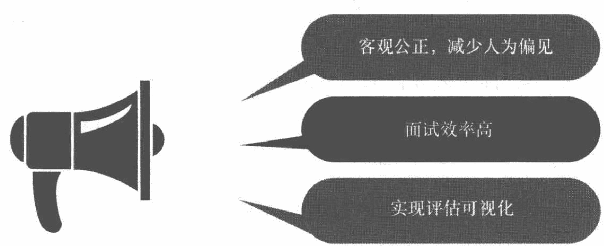

- 1. 客观公正，减少人为偏见
系统按设定算法打分，减少个人喜好与主观印象干扰，能更客观公正地评估应聘者。

- 2. 面试效率高
系统打分帮助人力快速了解各应聘者优缺点，缩短筛查与评估时间。

- 3. 实现评估可视化
系统可将应聘者表现可视化，直观展示各方面情况，便于人力全面了解。

总之，智能化面试打分与反馈为人力提供了高效评估手段。尽管仍存在一定局限，随着技术进步，其成熟度与公正性将持续提升。

### 3.2.4 AI机器人成为面试官

招聘和入职正在被AI悄悄改写，很多人第一轮对话的对象已经不是HR，而是机器面试官。

小米、百度、腾讯等头部公司把AI面试官写进招聘策略，亚马逊更早用自研的AAE自动求职者评估技术后大幅压缩了HR团队。这背后是企业对降本增效的刚需：传统招聘成本高、效率慢，优秀候选人常在人工疏漏中流失，AI于是被推上前台。

AI在初筛环节的表现相当亮眼。相比人工翻简历，机器面试官能瞬间处理海量简历，处理速度往往是人工的3倍以上，迅速完成第一轮筛选，为后续环节争取时间。

以近屿智能的“AI得贤招聘官”为例，这是一款AI视频面试SaaS系统，已服务三星中国、阿卡索外教网、中原银行等客户，覆盖校园招聘和社会招聘。系统底层是基于深度学习与行业知识图谱Talent DNA的AI评分模型，配合自然语言处理会话管理模型，让判定更精准。近屿智能把技术优势与HR实战理解结合，把面试行为量化，模型质量与数据积累领先行业。

产品打通了从岗位发布到评估录用的全链路，支持岗位一键发布、简历筛选、AI视频面试、AI机器人面试、线上考试等多种场景，企业可按需组合实现个性化招聘，整体缩短招聘周期，把精力用在更有价值的事上。

AI得贤招聘官的核心价值体现在三点：面试结果更可信，系统为每位候选人生成多模态全息报告，包含简历、面试视频、评判内容与成绩，全方位呈现能力与潜力；满意度更高，HR可通过系统发出线上面试邀请，并以短信邮件确认时间，简化多轮邀约流程；实现降本增效，同时提升人岗匹配度。系统沉淀的数据全面且可量化，已落地快消、电子、银行、软件等多个行业。

并非只有近屿智能在行动。同道猎聘的智能招聘管理系统“多面”单日可完成上千人面试，海纳AI的系统可同时承载数十万候选人并发。先行者联合利华在2016年引入AI面试后，首年招聘周期压缩75%，节省超100万英镑成本。

除了效率，企业更在意识别准确率和评分体系的可靠性。AI面试的本质是基于岗位需求搭建筛选模型，对面试表现进行量化打分。HireVue自2004年起深耕该领域，其系统可在面试中从超1.5万个维度进行评估，涵盖精神状态、肢体语言、面部表情、情绪管理、沟通能力等，并持续迭代以规避机器学习的隐性偏见。

AI面试已从快消品牌专属工具扩散到中小企业。选型时可参考四点：优先选择在头部企业验证过、工程化能力强的可靠产品；根据规模选择计费方式，大型企业适合套餐收费，中小型可按次数或时长灵活付费；流程上建议AI大范围初筛+真人终选，并设置线下体验提升员工信任度；关注服务商的识别能力，是关键词识别还是篇章级语义理解，前者只抓关键词，后者能深度理解整体表述。无论选哪款，初衷应是减少人为干扰，让招聘更聚焦岗位需求并实现降本增效。

### AI与入职环节的化学反应

入职是AI变革效果最明显的环节。

Offer创作正在被ChatGPT重塑。HR输入主题、对象和内容要点，就能快速得到一份专业清晰的Offer，工作时间大幅压缩。ChatGPT语言质量高，可按需求调整语气风格，英文Offer也能优化语法用词，并按企业格式调整版式结构，使其规范得体。

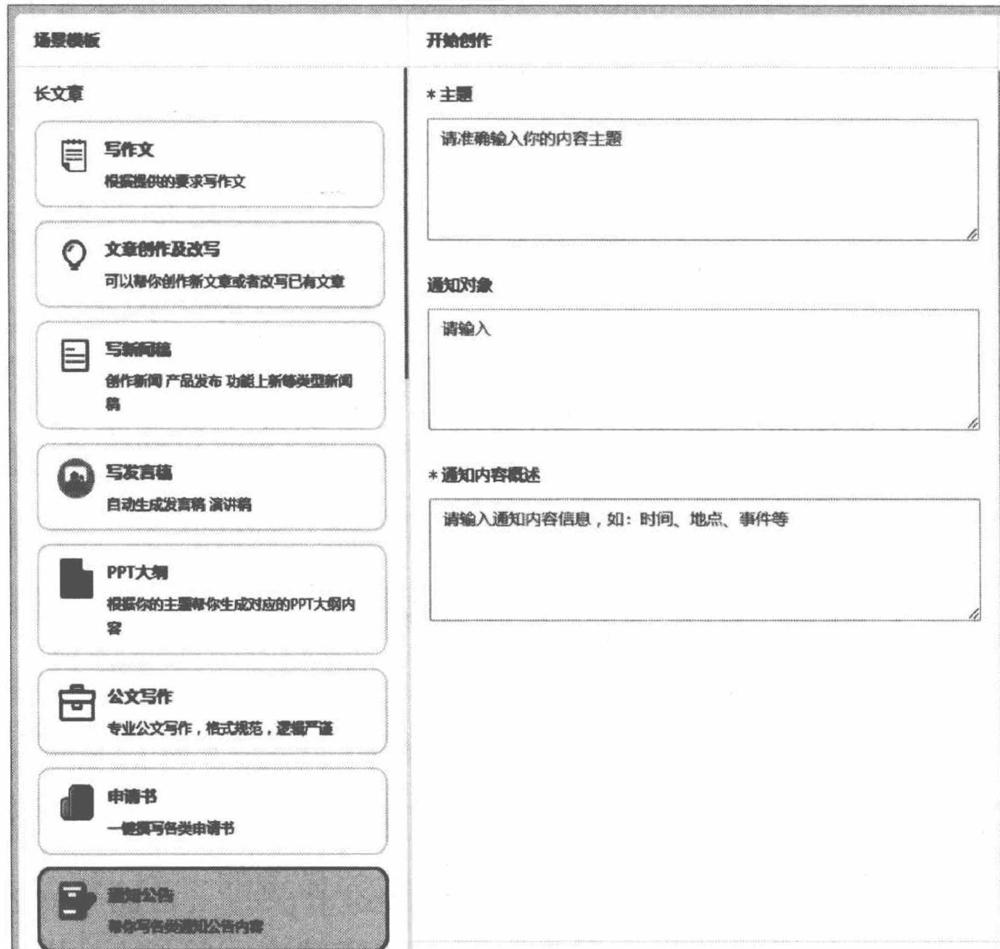
ChatGPT在Offer创作与发送上价值显著，使用时需注意三点。主题要清晰明确，避免模糊指令，例如“写一篇Offer”会产生歧义，改为“写一篇约500字的Offer，突出入职时间、地址、岗位等要项”更有效。语气需正式，例如用“请为我创作一篇约500字的Offer，主要介绍入职相关情况，感谢帮助”而非口语化表达。语言要中性，避免性别、种族等偏见表述，如将“雇用年轻精通技术的男员工”改为“雇用技术员工”。生成后务必人工校对错字、不当用语和信息完整性，再发送，并可借助带提醒功能的软件按时触达，避免遗忘影响到岗。

智能入职指导让“手机扫码10分钟到岗”成为现实。北森、喔趣科技等EHR系统提供扫码入职服务，员工扫码填写信息即可完成办理，HR线上采集和审核，极大缩短等待时间。部分系统支持自定义关键字段，并引入OCR技术自动识别身份证、职业资格证、毕业证等证件并归档到档案，降低手工录入错误。入职后还能推送欢迎信、入职地图等人性化功能，提升第一印象和流程清晰度。

电子劳动合同的普及提升了签署效率。过去纸质合同需现场签章备案，后续管理不便。AI加持下，合同可在线签署、远程操作，无需打印快递。按法规，依托合法可靠电子签名的电子合同与纸质合同效力等同。签署时需通过实名认证、数字证书等核验身份，保证内容完整合法且不可篡改。电子签名云平台基于数字证书、时间戳、区块链和加密技术，确保真实完整并可随时查阅下载。

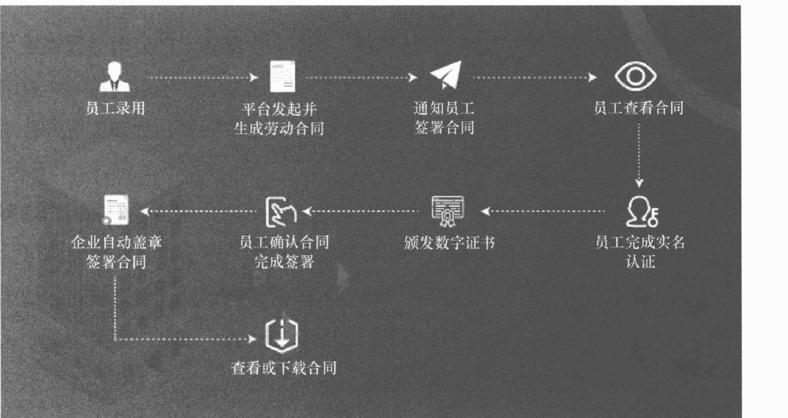
HR需注意使用法律认可的签署形式，并可在签署前咨询专业法务，确保合规安全。

办公用品领取流程也能被AI定制化。传统模式易出现发放不及时、重复领取浪费、流向不明等问题。AI可自动管理从申请到账目生成的全流程，钉钉、得帆云办公用品管理应用等工具实现全流程可视化。员工在系统内发起申请并填写理由，部门或HR审批后状态同步，审批通过后领取，系统自动扣减库存并生成明细账，包含名称、规格、品牌、数量、库存等信息，方便随时查询。流程更智能便捷，资产更安全，整体更环保。

## AI+育才：从培训到成长

AI正成为人才培养引擎，帮助企业为员工定制培训体验并制定发展战略。

自定义培训课程大纲即可大幅提效。传统大纲设计繁琐耗时，企业开始借助AI来规划目标、内容和方式。

- 1. 确定培训主题和目标
企业先用AI分析数据，了解员工培训需求与期望，从而锁定主题和目标。
- 2. 输入关键词或短句
输入与课程相关的关键词或短句，为AI提供生成基础。
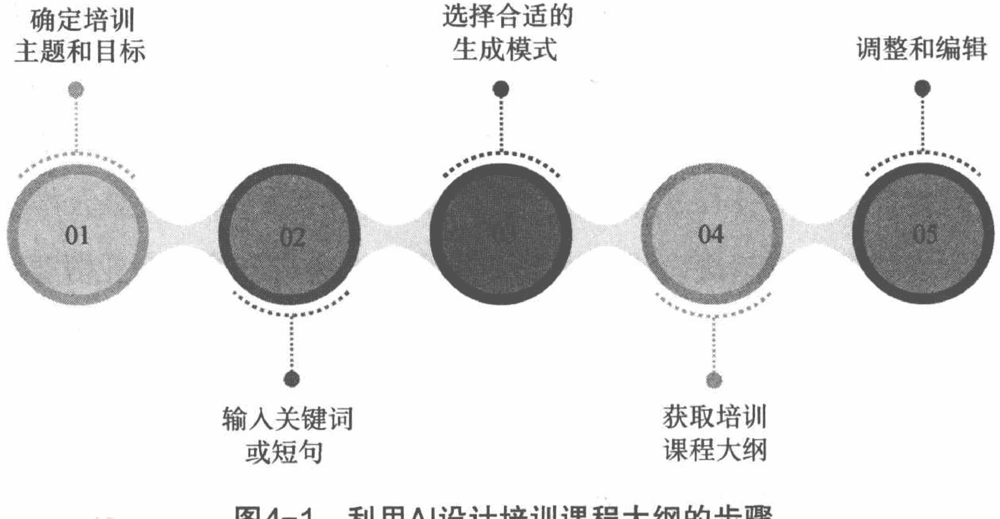
- 3. 选择合适的生成模式
以文心一言为例，可选问答、摘要等模式，按需求选择。
- 4. 获取培训课程大纲
AI据此生成定制化大纲。
- 5. 调整和编辑
企业根据实际需求对大纲进行判断、分析与精准调整，确保高度契合。

AI 正把企业培训从粗放式交付推向智能化运营，从大纲生成到实战演练，从任务追踪到机器人带教，每一环都被重塑。

**一、用 AI 搭大纲，企业省心又提效**

让 AI 来生成培训课程大纲，能给业务带来可感知的五个价值。

先是提速降本。模型依托深度学习和神经网络快速研读海量资料，分钟级产出符合企业规范的文本框架，把原来耗时的梳理工作压缩到极致。

再是高度定制化。可以把行业特征、岗位要求喂给模型，训练后的系统会产出贴合业务语境的专属内容，而不是千篇一律的通用模板。

表达质量也得到优化。AI 能自动纠偏语法、消除重复表述，并用自然语言处理手段提升逻辑与流畅度，输出更专业。

同时具备辅导属性。除了写文本，AI 还能从逻辑架构、语言风格等维度给出建议，帮助厘清设计思路；还能从大数据里筛出高价值资料，提升大纲的针对性与含金量。

最后是多语种覆盖。全球化团队需要多语言材料，AI 可一键切换中英或其他语言，满足跨区域交付需求。

**二、内容设计更精准，培训真正对症下药**

AI 在内容侧的核心作用是把培训做“准”。系统能解析资料库，自动识别员工必须掌握的知识点，并结合工龄与能力画像生成个性化学习路径。

新人会收到基础融入类课程，快速上手业务；老员工则被匹配能力进阶方案，拓宽专业边界。系统同时能批量生成讲义、练习题等配套材料，巩固学习成果。

中国广核集团就是典型案例。中广核是一家以核能为特色的清洁能源龙头，随着业务扩张和队伍扩大，传统培训难以覆盖，旗下分公司水平不一、内容参差，企业急需标准化的流程与平台。

E-learning 线上学习平台不受时空束缚、成本可控，能实现培训全场景覆盖。随后中广核对原有架构进行优化，目标是低成本、高效、可持续。AI 驱动的知识智能企业知学云为其打造全新平台。

平台支撑6万多名员工同时在线，集成学习、作业、问答、评估等模块，化解了地域分散难题，显著降低成本并提升效率。培训管理、师资管理、技术授权、网络学习、网络考试五大环节实现信息化闭环。

更重要的是场景落地。课程被嵌入多重业务场景：员工自助提升技能；AI 通过数据分析为每个岗位拆解工作内容与所需能力，生成岗位培训大纲，完成大纲才能申请晋升，有效激发学习意愿；贯穿“白鹭计划”等重点岗位培养项目；并能快速响应社会热点，如安全事故后即时上线专项课。最终实现知识快速传播与高效学习。

**三、智能对练让演练更真实、员工更投入**

培训要理论结合实操，但一对一带教受师资限制。AI 智能对练工具正好补位。以销售团队为例，效率直接决定业绩。

系统会深度分析行业特性、个人能力与具体诉求，制定个性化训练内容与节奏，并即时反馈效果。对话模块在客户沟通时实时提示，为卡点快速给出解决方案。

核心能力分四块呈现。

1. 个性化训练计划制定
把员工个体情况和行业需求结合，提供量身定制课程，精准提升销售技能与工作效率。

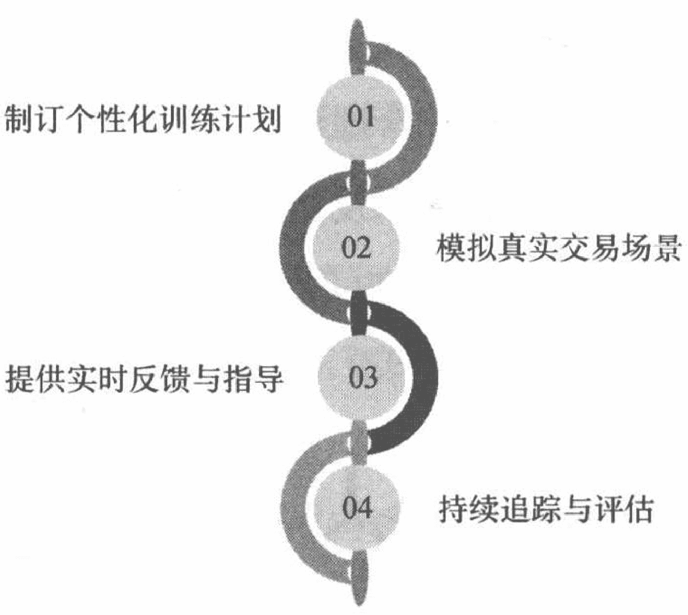

图4-2 AI智能对练系统的四个功能

2. 真实交易场景模拟
构建高仿真演练环境，让学员在多样化销售情境中练手，把握用户心理，提升服务与成交能力。

3. 实时反馈与指导
全程监控模拟表现，定位不足并给出改进方向，遇到问题即时给予针对性支持。

4. 持续追踪与评估
培训后提供详尽数据，帮助企业根据表现制定下一阶段计划，实现效果最大化。

**四、学习任务设计、追踪一体化**

学习任务是检验成果的抓手。AI 能依据课程性质、目标和员工实际需求设计任务，帮助巩固知识。

设计需坚持三大原则。

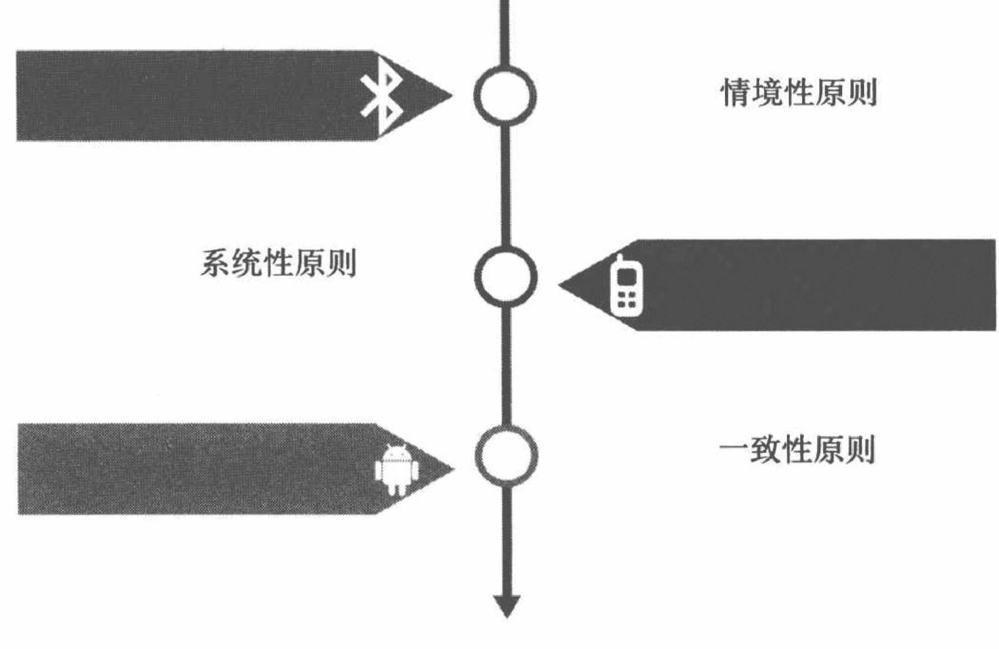

图4-3 企业使用AI设计学习任务需要遵循的三大原则

情境性原则：以真实工作场景为基础，让员工经历找问题、寻方法、沉淀知识、优化工作的闭环。

系统性原则：注重任务间的内在关联，形成完整知识体系，锻炼思维与自主学习能力。

一致性原则：学习目标与任务保持统一，增强自主学习意识。

培训后的效果反馈同样关键。AI 通过数据分析评估成效，洞察哪些策略有效、哪些需改进，比如哪些课程受欢迎、完成率偏低、哪些技能提升明显，为优化投入产出比提供依据。

实践中常使用 AI 智能学习监督系统。它能自动化监督学习进度，并据此提供个性化建议。

主要功能包括：学习数据收集与分析，记录学习时长、内容、行为等，描绘学习模式；学习目标设定与追踪，基于数据制定计划并提醒任务与时间；学习反馈与评估，分析表现给出成绩与改进方案。

使用时需注意灵活调整策略、保持内容多样化、鼓励积极互动与主动学习，系统才能真正成为效率放大器。

**五、机器人带教，解决师资缺口**

招聘高峰后，企业面临培训承接难题。AI 机器人擅长处理文本、图像和重复标准化训练，是降本增效的利器。

传统培训存在四个痛点。

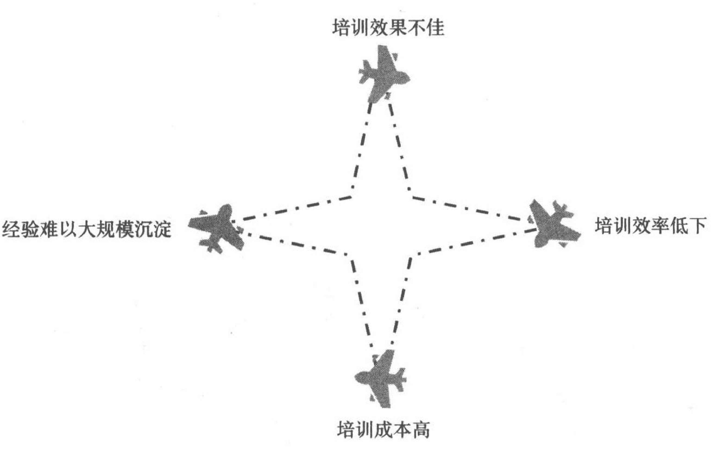

### 1. 培训效果不佳
线下集合与线上资料结合，缺乏有效监督，上手慢、针对性弱，难以满足个性化需求。

### 2. 培训效率低下
重理论轻实操，新人周期长、师资不足，效率受限。

### 3. 培训成本高
老员工兼任培训师产生隐性成本，外请专家费用高，分散师资导致协调困难与重复浪费。

### 4. 经验难以大规模沉淀
实战经验与技巧难以复制，新人成长慢，制约组织发展。

AI 机器人为此提供全新解法。

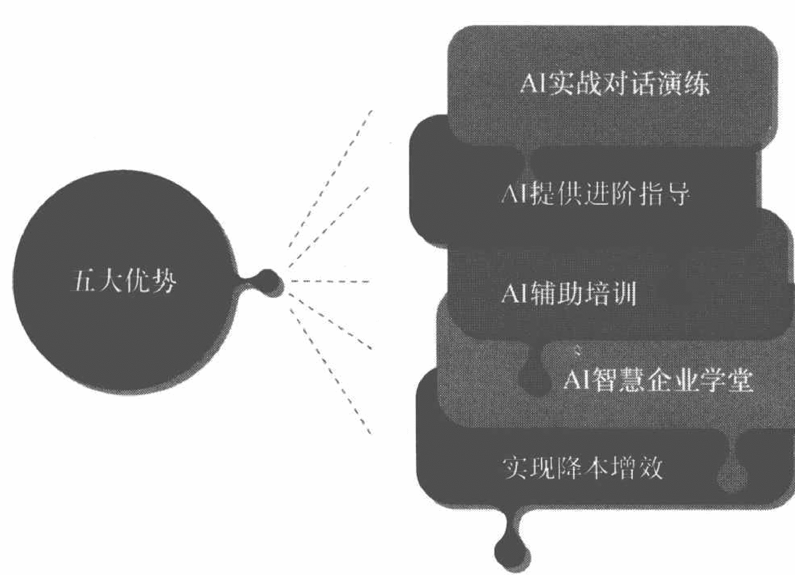

图4-5 使用AI机器人进行员工培训的五大优势

实战对话演练：构建逼真线上模拟，解决开口难、执行不到位等问题，提升场景解决能力。

进阶指导：自动记录分析训练过程，识别问题后生成个性化方案，对共性问题推出专项课程。

随时随地辅助培训：线上陪练打破时间地域限制，解决异地培训成本高的问题。

智慧企业学堂：依托深度学习与语义理解，持续完善学习机制，提供个性化智能体验。

降本增效：加快培训节奏、降低成本，缓解人员流动带来的培训压力。

腾讯云 AI 培训机器人是代表案例。融合 ASR、TTS、NLP 与深度学习，可扮演客户进行一对一演练。

对比传统培训的优势在于：人机对练实现一对一精准教学，并提炼优秀话术匹配不同场景；灵活学习支持电脑、小程序、App 多端接入；全面监督采用“学—练—考—评”闭环，绘制能力画像并推荐个性化课程；学习效果评估全程记录并追踪薄弱点；试卷考核可自动生成单选、多选、判断等题型并设定考试规则。

应用场景覆盖金融新员工与合规培训、电销话术强化、健康医疗的患者答疑与康复指导、零售销售与客户服务、制造操作与安全培训、酒店旅游服务标准培训等。

从大纲生成到机器人带教，AI 正让培训更合理、更个性、更可持续，为员工成长与组织竞争力提供双向赋能。

在AI已经成为组织的标配的今天，人才该怎么养、怎么用，已经成为决定企业能否持续跑赢的关键命题。借助AI对海量员工数据的洞察，企业正在把“千人一面”的人才培养，变成真正的一人一策。经验萃取自动化、能力模型自动生成，让每位员工的成长轨迹既清晰可见又可实时调优，最终让个人价值与组织目标同频共振。

#### 4.2.1 用AI定制专属成长路线，让人才加速成长

员工选择和留下，都看公司能否提供成长可见度。学不到东西、看不到晋升阶梯，就很容易流失。企业主动关心成长、持续提供学习机会，既能增强归属感与忠诚度，也能塑造好雇主品牌，帮助业务稳健扩张。

要把成长落到实处，就必须给每人做一份个性化、差异化的个人发展计划IDP。IDP的本质是一套系统化的成长蓝图，根据潜能、兴趣和职业方向，引导员工自我驱动提升。

手工制定IDP耗时耗力，现在AI可以接管这件事。企业用AI为员工量身打造IDP的路径大致如下。

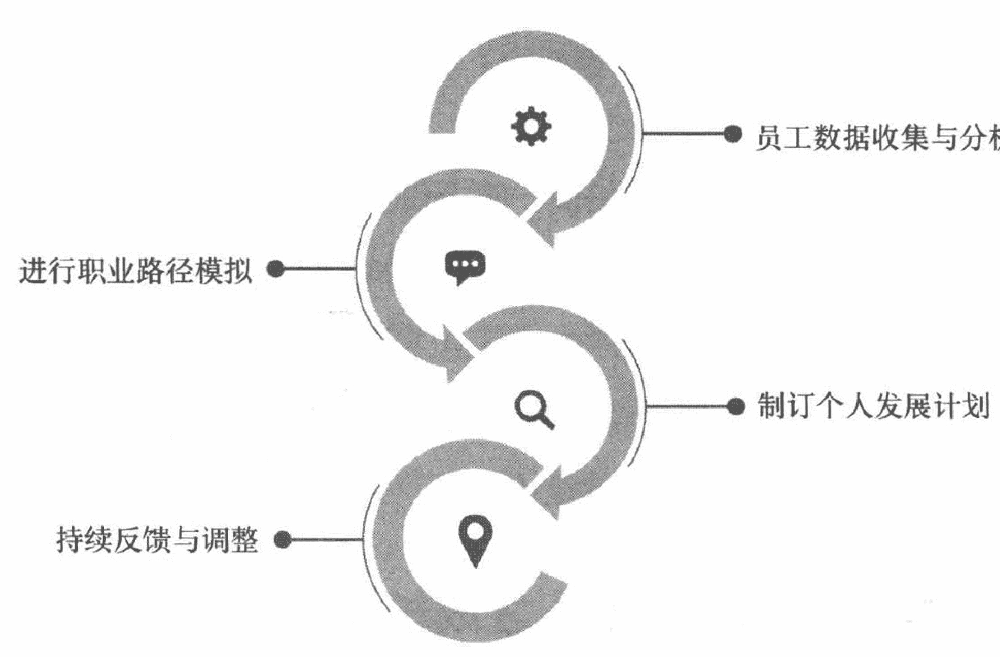

### 1. 员工数据收集与分析
AI能自动汇聚教育背景、履历、技能标签、兴趣偏好等全维度数据，并进行建模分析，快速定位每个人的强项与短板。比如某位员工在技术攻坚上表现突出，但在跨部门沟通上偏弱，系统就会建议其优先纵深技术线而非转向管理线。

### 2. 进行职业路径模拟
结合当前岗位状态与个人职业期望，AI可以推演多条可行的发展分支，让员工提前看到未来的可能，并据此预判需要补足的能力清单。像一名想从软件开发工程师成长为项目经理的人，系统会参照他本人的技能画像，以及相似背景同事的成长轨迹，生成一条可落地的发展路线。

### 3. 制订个人发展计划
在路径明确后，员工与HR共同协作，把计划细化为涵盖团队协作、沟通表达、领导力、专业技能等多个维度的行动方案。AI还会补充实操建议，比如人际沟通、压力管理等软技能的训练方向。

### 4. 持续反馈与调整
AI会持续追踪工作表现，对IDP的执行效果进行评估。若进展缓慢或出现偏差，系统会即时给出反馈，提示调整节奏和内容。比如某人模拟路径表现优异，却在真实工作中频出问题，AI就会重新校准其能力评估，并生成新一版发展方案。

把AI用于IDP定制，带来的价值主要体现在五个方面，如图 4-7 所示。

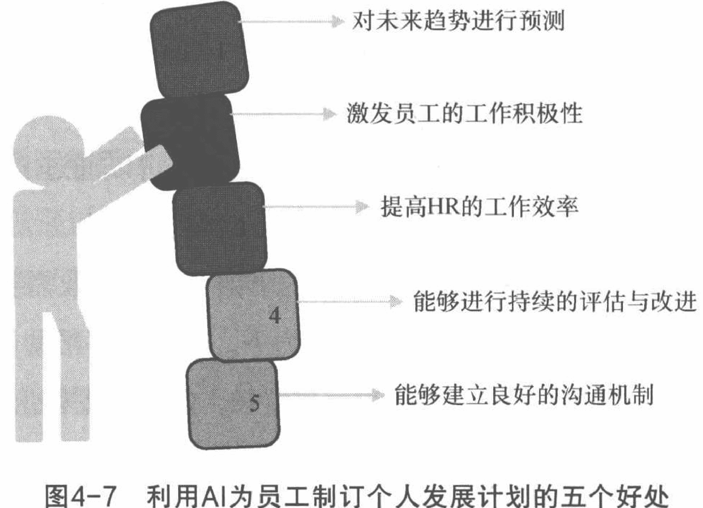

### 1. 对未来趋势进行预测
AI通过分析行业历史数据，能够提前捕捉技能与经验的变化趋势，为个人发展提供前瞻参考。比如数据预测类技能持续升温，企业就可以据此开设相关课程让员工提前布局。

### 2. 激发员工的工作积极性
当员工感受到组织在为其量身规划成长路径，会产生被重视感，内在驱动力随之提升。清晰的目标感让人更有干劲，HR也能借此更深入理解员工需求，提供更精准的支持。

### 3. 提高 HR 的工作效率
AI帮助HR批量处理数据、自动生成方案，大幅节省人工成本。实践表明，明确IDP和培训计划后，员工留存率明显上升，工作热情提升，企业整体运转效率也随之提高。

### 4. 能够进行持续的评估与改进
发展是动态的，计划需要随环境变化迭代。AI能持续监控进度、评估成效，发现问题就及时优化，并收集员工反馈，让个人目标始终与企业战略保持一致。

### 5. 能够建立良好的沟通机制
HR精力有限，难以面面俱到。通过AI生成的数据画像，HR能快速锁定重点沟通对象，高效解决痛点，沟通变得更主动、更有效。

员工的成长既是个人诉求，也是企业必须经营的战略议题。在AI助力下，个人发展计划的制定与执行变得更高效，员工潜能得以释放，双方实现共成长。

#### 4.2.2 用AI设计工作坊全流程

工作坊以动手实操为主，融合理论讲解、小组研讨、案例拆解等形式，是提升技能与经验积累的高效载体。借助AI，企业可以把工作坊从“统一授课”升级为“精准赋能”。

### 1. 进行员工需求与技能评估
利用AI工具，企业可以全景采集员工的背景信息与当前能力，对比职业目标，精准测算能力落差，从而识别最紧迫的培训需求，为定制化成长做准备。

### 2. 策划工作坊的主题与内容
在需求画像的基础上，AI智能推荐合适的主题和内容模块，确保课程既贴合业务实战，又照顾到个体差异化学习需求。

### 3. 个性化学习路径设计
依据技能水平与学习习惯，AI为每个人生成专属学习顺序，让知识吸收更高效，成长更快。

### 4. 建立学习反馈机制
工作坊期间，AI实时采集学习行为和反馈数据，对培训效果进行即时评估，为后续改进提供依据。

### 5. 持续追踪与后续支持
培训结束后，AI持续跟进学习转化情况，识别薄弱环节并推送针对性资源与辅导，保证所学能在实战中落地。

### 6. 持续优化与迭代
定期复盘参与度与成果数据，分析流程有效性，据此调整主题、内容与形式，让工作坊始终贴合员工变化需求。

通过AI重塑工作坊流程，企业能更精准把握成长诉求，提升满意度，并构建更有竞争力的高潜人才体系。

#### 4.2.3 一键萃取经验，持续丰富知识库

工作中遇到问题时，反复打扰同事或在搜索引擎里大海捞针，既耗时又容易拿到错误信息。建立内部知识库，让经验沉淀为可复用的资产，是更优解。

一家深耕留学领域的在线语言培训企业就是典型案例。多年的真人在线授课积累了大量用户，业务高速扩张，销售团队规模迅速放大。为帮助新人快速上手，公司设置了多套培训与成长方案，但在执行中出现沟通不透明、复盘录音效率低、导师难以及时发现新人短板等问题，成长速度受阻。

为此，企业与会话智能领域的深维智信展开合作，共建AI销售培训系统，主要在三方面发力。

### 1. 实现销售过程的可视化
销售是连接企业与用户的桥梁。过去依赖人工回听录音来找问题，效率低下且难以规模化。引入销售会话智能平台后，企业整理出完整销售流程与各阶段关键话术，通话录音自动转文字，关键信息一键定位。借助关键信息检索功能，管理者能快速了解话术运用是否到位、需求挖掘是否深入、产品要点是否准确传达。对有问题的员工，导师无需面谈即可线上点对点辅导。

### 2. 打造高效的销售人员学习闭环
培训后缺乏巩固工具、实战机会不足，是新人成长慢的根因。深维智信为其搭建了剪辑库与智能陪练两大工具。

剪辑库将团队优秀话术剪辑存档，形成专属知识库供新人学习。知识点挖掘引擎则从海量对话中提炼客户高频问题与标杆话术。导师可把优质音频推送给需要提升的员工，并在后续工作中观察进步。员工遇到难题时，可在剪辑库中快速检索答案，持续打磨沟通技巧。

智能陪练系统支持上传课程并分配练习任务，包含跟读、背诵、智能陪练、AI客户四种模式。跟读帮助熟悉话术，背诵检验掌握程度，智能陪练模拟对话锻炼应变，AI客户则提供高度拟真的角色演练。每轮练习后系统自动点评，指出问题并给出改进建议。

通过课程学习、剪辑库检索、陪练实战，销售人员实现多维度能力提升，形成对新人老员工都适用的学习闭环。

## 3. 打造销售培训闭环
培训目的在于让技能在工作中真正应用。过去缺乏有效的能力评估手段，合作后企业借助平台的关键事件智能提取功能，对新人需求挖掘、执行落地等维度进行量化评估。培训后导师可据此判断能力变化，对薄弱环节进行二次辅导，若经多次针对性培养仍无明显改善则进行淘汰。同时企业还结合客户画像与执行力数据，从多维度优化团队绩效。

作为首批受益方，该企业持续与深维智信合作，以AI为底座不断提升销售效能。

#### 4.2.4 用AI搭建人才梯队，保障长远发展

企业竞争本质是人才竞争，搭建稳健的人才梯队是长效发展的基石。AI正在重塑这一过程。

- 数据的收集与整理。AI需要足够的数据输入，企业应系统采集个人信息、学历、履历等多维度资料。
- 人才画像。在此基础上，AI综合分析能力、潜力、职业倾向等要素，绘制立体画像。
- 搭建人才梯队模型。基于画像构建多层次结构，涵盖新员工、潜力人才、核心骨干、领导梯队等不同阶段。
- 选拔人才。招聘时，AI凭借自然语言处理与机器学习，完成简历初筛、初步面试、能力测评等工作。
- 个性化培训与未来发展计划。结合画像与梯队定位，为员工匹配培训课程与发展机会，提升满意度与忠诚度。
- 搭建持续追踪与反馈机制。对培训成果持续分析，动态调整内容与方式，并收集员工反馈优化模型与计划。
- 预测分析与战略规划。AI可预测行业人才需求与市场变化，辅助进行人力成本、离职率等统计，帮助HR提前调整策略。

一家全球化制造企业就面临招聘精准度的挑战。投递简历量巨大，传统筛选工具容易漏掉优质候选人。它们与专注于行为科学的人才识别公司LeapIn合作，打造行业通用胜任力模型。模型基于行为科学理论与百万级制造业数据，能根据面试表现预测实际工作表现，实现自动化识别。系统接口与企业端无缝对接，面试邀约实现自动化，大幅降低HR操作成本，也让候选人体验更公平高效。

借助AI，企业能更精准选人、养人、用好人，构建起可持续的人才梯队。

### 4.3 智能培训：成功经验学习与借鉴

AI与培训的深度融合催生了智能培训。它不仅改变学习形式，更在效果提升、资源优化、效率增益上展现出明显优势。众多企业的实践为行业提供了可复制的参考。

#### 4.3.1 VR技术在培训领域的创新应用

在汽车行业，专业技能培训成本高、风险大，VR带来了全新可能。

大众汽车为不同部门打造了约30个VR模拟程序，并上线数字现实中心这一VR门户，集成虚拟会议、培训计划与知识库。员工戴上HTC Vive头显即可进入虚拟场景反复练习，系统化获取知识并进行实操演练。

奥迪则用VR解决物流培训难题。物流体系复杂，对准确度要求极高。VR让员工在虚拟空间中掌握人体工学动作，避免失误，无需搭建实体训练场地，大幅降低成本。奥迪还搭建了“物流中心工作站”虚拟空间，通过头显与控制器训练手部操作。经销商端员工也能参与游戏化互动培训，系统实时计分并指出错误，提升参与感与效果。

宝马将VR贯穿培训、生产与营销多个环节，并用于三维模型投产前的原型验证。实体模型成本高达25万至100万美元，新车开发需50至70个中间原型，VR能大幅压缩成本。宝马认为，虚拟原型的核心价值在于跨团队协同建模与可视化分析，从而优化人机体验与用户交互。

VR正在让培训更沉浸、更安全、更经济，也为智能育才提供了强有力的技术支撑。

宝马的研发与设计团队现已把虚拟现实作为检验车型迭代的首选手段，实体样车的制造需求因此明显收敛。实物原型的制约在于耗时费力且花费高昂，而虚拟样机在创建与验证环节更为轻快，恰好化解了这一瓶颈。

转向虚拟原型后，宝马在开发效率上获得明显提升，迭代节奏被压缩，整体花费下降，新车推向市场的速度也随之加快。在汽车市场竞争白热化的背景下，研发周期的长短往往决定成败，能够缩短周期的做法为车企争取先机。

虚拟现实对汽车行业的改变既深且广。它推动设计从线下走向线上，加快产品落地速度，同时节省大量资源投入。把虚拟现实应用到装配线端，还能帮助公司优化生产流程，兼顾产线与整车的人机工学设计，进而提升制造效率与产品品质。

#### 4.3.2 人工智能推动个性化培养
智能技术凭借高效便捷的特性赢得公司青睐，越来越多组织借助智能手段强化人力资本建设，其中把智能用在学习发展场景已成为提升人才质量的常用做法。

以一家大型零售公司为例，为拉升团队业务水平，公司在学习体系中引入智能化方案来制定专属培养计划。具体落地集中在四个层面。

- 数据采集与洞察。人力部门先把销售业绩、客户评价、个体绩效等工作数据汇总，再由智能系统深入剖析成员的能力短板与学习需求。
- 制定个性化方案。在数据洞察的基础上，人力与成员共同定制培养计划。对产品知识薄弱的成员安排基础课程补强，对客户沟通存在困难的成员则匹配专项沟通训练。
- 实时反馈与动态调整。学习进行期间，系统会持续追踪学习进度与成效，及时把结果回传给人力，以便快速修正计划，保证培养始终保持针对性。
- 成效评估与复盘。学习结束后，系统基于收集到的数据输出分析报告，对结果进行评价并总结经验，为后续方案优化提供依据。

对销售群体而言，智能化学习的价值主要体现在四个方面。

- 量身定制学习路径。借助智能算法与大数据，系统能实时掌握销售人员的学习进度和成绩，生成个性化方案。成员可按自身需要挑选内容、调控节奏，实现精准的能力提升。
- 陪练系统强化技巧。系统可以模拟真实的销售情境，提供大量实训机会。在虚拟场景中，销售人员能反复练习应对话术和突发状况。
- 智能反馈优化策略。系统通过算法采集学习数据并解析，销售人员能够清楚看到自己的学习表现并据此调整方法。及时的评估有助于提高学习效率，提升市场竞争力。
- 高效学习捕捉商机。智能化学习突破时空限制，支持随时随地学习。利用碎片时间即可了解市场动向与客户需求，及时调整销售策略，提高成交率与竞争力。

智能化学习系统是提升团队能力的理想工具。个性化方案、实战模拟与智能反馈相结合，为销售人员带来全新的学习体验，有助于优化学习策略、强化销售技巧，实现更好的职业发展。

把智能用于个性化培养已成为公司学习发展的方向。借助智能，成员能获得更优质的学习体验与更显著的能力成长。

#### 4.3.3 在线学习平台：公司培养新趋势
随着智能技术成熟，公司开始把智能与在线教育结合。比如许多互联网公司打造在线学习平台来持续提升成员能力，获取竞争优势。

人才已成为衡量公司综合实力的重要维度，公司不断探索人才创新以推动科技创新。在此背景下，通过学习提升成员能力成为常态。但传统培养常存在体系不全、课程质量参差、效果难以评估等问题。互联网公司蓝凌据此推出蓝凌在线学习平台。

蓝凌在线学习平台覆盖在线学习、在线直播、考核管理、移动学习、学习地图、答题竞赛等六大场景，能够满足多元需求。

平台具备五大亮点。

- 体系化。平台可依据职位要求与业务实践为公司制定学习计划，支撑业务体系建设，并让优秀成员的经验快速沉淀供他人借鉴。
- 在线化。平台实现培养、学习、考试、评分、归档的全流程线上化。线下培养内容也可通过直播或录播保存到线上，反复学习。
- 移动化。成员可随时随地参加考试检验成果，通过App接收学习推送，利用碎片时间完成学习与考核。
- 游戏化。问答竞赛、闯关学习等趣味小游戏提升参与感，寓教于乐。
- 个性化。平台可为不同职位设计差异化的学习内容，有针对性地提升个人能力。

## 第5章 智能+用才：人尽其才不再是梦
公司选拔人才的目的是满足自身发展需要，只有实现人岗适配，才能真正释放人才潜能，提升组织效能。因此需要把智能与用才结合起来，实现人才精准定位。

### 5.1 用才关键点：分工与授权
为更好发挥人才价值，公司可借助智能明确成员分工，提升组织运行效率。具体可通过职位适配、排班自动化等手段合理安排工作。

#### 5.1.1 智能助力，实现职位适配
职位适配是检验招聘成效的重要标准，对成员价值挖掘与双方发展都意义重大。传统适配需要人力手工比对职位描述与候选人能力，耗时且易出错。智能可对成员特质进行智能解析，促进人岗协调。

例如，人力资源服务商金柚网深耕行业十余年，推出智能工具“梧桐数字成员”。该工具具备职位适配功能，可依据职位描述快速审阅简历，进行预适配打分，提升招聘精准度。

- 快速适配提效。人力只需上传职位描述与候选人简历，梧桐数字成员即可自动深度分析，迅速判断契合度，大幅缩短简历筛选时间，让人力更聚焦面试与深度评估。
- 多维度适配增准。依托大模型的自然语言理解与思维链能力，梧桐数字成员能挖掘职位描述的关键信息，从多个维度评估候选人并打分，精准定位最匹配人选，为决策提供支持。
- 智能追问生成个性化面试题。工具具备追问能力，可根据人力问题给出解答，如“该职位需具备哪些能力”“基于简历生成面试提纲”等。

#### 5.1.2 排班自动化，任务分配更合理
为进一步提升效率与合理性，部分公司开始使用排班自动化软件。智能排班可让任务分配更科学，优化人力管理流程，节省人力时间。

传统排班流程繁琐，易出现冲突与错误。智能排班系统依托强劲的数据分析能力，基于历史数据与成员需求制定更合理的排班计划，减少失误，提升工作效率与成员满意度。

系统能挖掘海量数据，兼顾成员时间偏好、技能水平与个人需求，实现班次安排的合理化与最优化。同时，通过统计工作量数据推动流程持续改进。

在数据处理环节，系统会清洗历史数据剔除噪声与异常值，再运用决策树、神经网络等算法识别模式并预测，最终结合个人诉求与公司规则生成科学人性化的排班方案。

系统还采用遗传算法、模拟退火算法等优化手段持续改进排班效果。排班过程中系统会明确目标函数与约束条件，在满足成员需求与公司规定前提下迭代计算，寻找最优解。

智能排班不仅能生成排班表，还支持人工修改，使方案更贴合实际。人力可随时查看排班情况，发现异常并修正。实时监控与成员反馈联动，可快速调整方案，降低排班错误带来的影响。系统尊重成员意愿，成员可在一定范围内灵活调班，应对突发情况。

新式茶饮品牌百分茶在全国运营上百家门店，人力管理存在三大痛点，如图 5-1 所示。

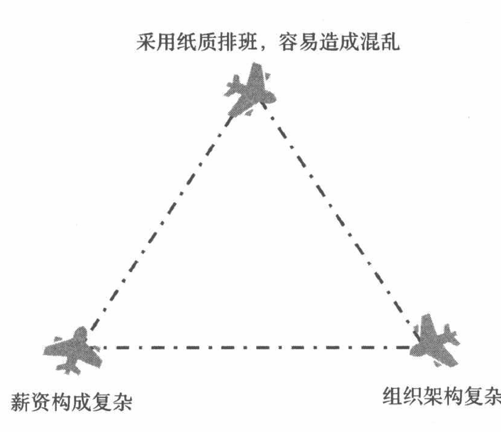

### 1. 采用纸质排班，容易造成混乱
门店排班由店长全权负责，每周排班后通过微信发送或张贴店内。排班数据停留在门店层面，总部无法掌握实际情况，难以及时干预，导致兼职薪资高于全职等不合理现象时有发生。

### 2. 组织架构复杂
品牌同时存在直营门店与加盟店，管理层与成员均通过钉钉进行管理，架构复杂。

### 3. 薪资构成复杂
职级从兼职到店长共分七级，薪资与职级、区域挂钩，还涉及节假日补贴、晋升调薪等多种因素，核算工作重复耗时。

为破解上述难题，百分茶与 i 人事展开合作，秉持以人为本、注重用户体验的理念推进智能人力转型。

排班方面，i 人事可依据成员需求与总部要求自动排班并进行数据留存，总部随时掌握门店排班状态。

组织架构方面，i 人事提供组织架构与花名册系统，可区分直营与加盟，配合钉钉实现对内外部成员的差异化管理。

薪资核算方面，i 人事提供薪资核算模块，依据人力设置的参数自动计算，提升效率与准确性。

在 i 人事助力下，百分茶实现降本增效，仅排班一项，直营门店年均节省上百万元工资支出。双方持续合作解决门店绩效核算与发放问题，进一步释放资源。

基于智能的排班自动化能够高效解决排班难题。通过数据分析、算法优化、实时监控与人性化设计，系统提升排班准确性与效率，减少冲突与错误。未来该类系统将在各行业普及，为公司与成员带来更多便利。

### 5.2 打造基于智能的绩效管理体系
智能绩效管理体系是有效的人力管理工具，借助信息技术对公司绩效进行全面科学分析与管理，提升管理效率与准确度。随着智能应用普及，越来越多的公司倾向于构建智能绩效管理体系，激活人才潜能，提升组织效能，实现降本增效。

#### 5.2.1 自定义绩效考核方案
智能可助力公司高效制定绩效考核方案，主要分为以下步骤，如图 5-2 所示。

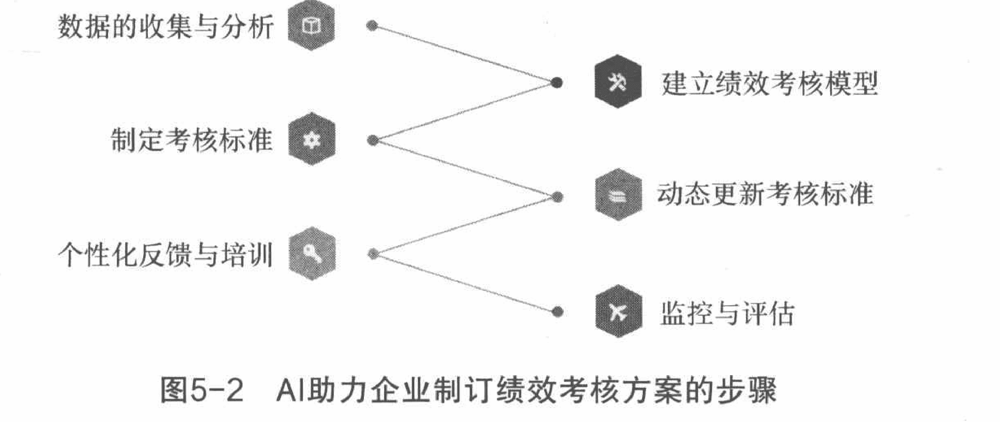

### 1. 数据的收集与分析
制定方案前，公司需全面收集成员的工作表现、技能水平、工作态度等数据，来源包括成员本人、同事、上级等。智能对这些数据进行深度分析，找出影响绩效的关键因素及相互关系。

### 2. 建立绩效考核模型
基于分析结果构建精准的考核模型。可借鉴机器学习预测模型，也可融合专家规则模型，用以预测成员未来表现，为制定考核标准提供科学依据，从而更准确评估绩效。

### 3. 制定考核标准
建立模型后需制定具体标准。标准应多维度覆盖工作量、工作能力、工作态度等，并具备区分度，能辨别普通成员与优秀成员。

### 4. 动态更新考核标准
考虑到绩效波动，公司需定期更新标准。通过收集新数据、重训模型等方式保证标准时效与准确，维持考核公平性与有效性。

### 5. 个性化反馈与培养
基于智能的考核标准可为成员提供个性化反馈与建议，帮助其认识优势与不足，制定个人发展计划。同时，智能可提供定制化学习课程，针对实际需求与技能差距实现精准提升。

### 6. 监控与评估
为确保智能在绩效考核与培养中发挥作用，公司需定期监控与评估效果。通过对比实际表现与预测结果、收集成员反馈等方式全面评估，若发现培养效果不佳或方案不合理则及时调整优化。

例如，上海小荧星集团是一家专业儿童艺术教育机构。随着业务扩张与团队壮大，公司面临两大问题：传统绩效体系无法满足多元化职位的考核需求，且追踪考核进度困难；各部门评分规则差异大，人力汇总耗时，拉长薪资核算周期，引发不满。

为此，小荧星集团与昇鹏人效云合作，建立高效可靠的绩效考核体系。

- 利用智慧绩效实现降本增效与运营效率提升。昇鹏人效云采集考勤、业绩等基础数据并与绩效挂钩，构建公平高效的考核体系，提升成员积极性与满意度。同时，借助算法预测成员学习与晋升机会，为其提供职业发展方向与培养路径。
- 实现薪酬管理精细化，缩短算薪流程。平台解决业务绩效数据不准问题，提高薪资核算准确度。构建数字化绩效框架拆解核算流程，简化操作。采用 SaaS+PaaS 方案降低发放差错，实现正向激励，提升运营效率。
- 实现成员效能提升，推动公司高质量发展。小荧星集团在巩固市场同时谋求区域扩张，需要储备人才。平台以年为单位测算人才成本并根据市场变化规划。每年调整人才结构，实施优胜劣汰，控制成本。在昇鹏人效云支持下，公司构建起高效可靠的绩效体系，激发动力，全面掌控预算执行。新成员入职时系统自动推送预算执行情况，为成本管控提供支持，并在人才激励方面取得明显成效。

随着公司发展，昇鹏人效云持续迭代，提供更优质的技术支持。

#### 5.2.2 绩效结果评估和未来潜力预测
绩效管理是公司管理的核心环节，通过评估与激励推动发展。其中绩效结果评估与未来潜力预测尤为重要。

绩效结果评估是对成员一段时间内工作表现的综合评价，用以衡量工作成效。未来潜力预测则是基于过往表现、能力与素质等多因素，对成员未来发展潜力进行预判。

为高效开展这两项工作，众多公司引入智能辅助人力，具体步骤如下。

- 明确绩效分析目标。先明确分析目标，有助于提升智能分析的准确性与有效性。
- 数据收集与整合。智能依赖大量数据进行挖掘，人力需广泛收集与绩效相关的打卡记录、工作成果、工作量等数据，并进行整合，确保完整与准确。
- 数据预处理与清洗。原始数据可能存在重复、缺失、异常值等问题，会影响分析质量，需清洗处理以提高可用性。
- 选择合适的智能算法。不同问题适配不同算法，如预测成员离职适用决策树与随机森林，评估绩效得分适用线性回归与逻辑回归。
- 模型训练与评估。

在确定好合适的算法模型之后，人力资源侧要进入模型的训调与校验环节。持续地喂养数据、不断微调参数，能够让模型的判别力变得更准、更稳。

### 模型上线与应用
当模型通过训练和评测后，就能投入实际使用。HR 可以借助模型对员工的当期绩效表现做出预判，也能对个人的成长潜力进行前瞻性研判。

### 持续迭代优化
AI 模型的搭建不是一次性工程，必须保持动态优化。随业务变化和数据积累，模型需要重新校准；同时结合使用者在使用中的反馈进行针对性调整，才能维持效果。

借助 AI 的算力，企业可以把绩效评估做得更精准，把人才潜力预测做得更科学，从而筛选出关键人才，为长期发展提供动能。

#### 绩效反馈话术的智能推荐
绩效反馈是评估闭环的收尾动作，是基于客观事实与员工展开的沟通，对员工意味着：

- 及时知晓一段周期内的表现优劣，有助于调整工作节奏、改进方法，提升效率与质量。
- 增强工作动力与归属感，提升对工作的认可度。
- 明确自身长处与短板，获得成长方向与发展指引，助力职业晋升。

对企业而言，好的反馈有助于掌握员工日常状态、早发现问题、推动自我提升，最终服务于组织战略的实现与长期基建。

要让反馈更有效，HR 可以调用 AI 生成话术。AI 在这块的价值主要体现在：

### 个性化定制
AI 会综合绩效数据、行为表现、个人特质以及团队文化，为 HR 生成定制化的反馈建议。对标杆员工，系统会提示突出贡献与成果的表达方式；对需改进员工，则给出具体、可操作性的建设性表达。

### 情感感知
依托情感分析技术，AI 可以捕捉员工在沟通中的情绪波动，并据此推荐更暖心、更得体的表达，确保反馈兼顾结果与感受，提升沟通顺畅度。

### 实时陪跑
在真实的绩效面谈过程中，AI 可以监听对话流、感知进展节奏，即时推送应对话术提示，帮助 HR 灵活应对突发情境，保证反馈及时且到位。

### 案例库支撑
AI 会沉淀大量绩效反馈场景的样例库，HR 遇到相似情境时可快速检索参考，并在此基础上做本地化微调，大幅降低准备成本。

### 数据驱动优化
AI 会回溯历史反馈记录，分析哪些表达更有效、哪些需要改进，并持续优化推荐策略，让话术建议越用越贴合实际需求。

#### 精准推送绩效改进方案
绩效改进是管理循环的核心，想要持续提升，就必须有清晰可行的改进方案。AI 能帮助 HR 高效制定，关键步骤包括：

- 回顾与拆解考核结果。AI 可以量化呈现员工的优势与待提升点，HR 在此基础上与员工逐条对齐，形成共识并共同拟定改进路径。
- 明确改进目标。与员工一起深挖问题根源，设定可量化、可衡量的改进指标。
- 匹配具体举措。依据个人现状，AI 会建议多元化提升手段，如专项培训、跨部门交流、轮岗锻炼、固定小组研讨等，形成立体能力提升方案。
- 盘点所需资源。为落地提供保障，AI 可罗列所需培训课程、学习资源、设备支持等清单。
- 设定评估节点。能力养成需要时间，评估周期过短会失真，过长会脱节，需合理设定复核时间点。

在以上共识达成后，双方需形成正式的改进方案并确认执行计划，可签署改进协议明确责任。AI 在全程起到数据支撑与个性化建议的作用，同时可对执行过程进行实时追踪与反馈提示，支持动态调整。

北大荒集团作为大型农业企业，为适应新形势与 i 人事展开合作，引入其绩效管理系统并搭建专属考核方案，覆盖考核主体、考核内容与评定规则，以保障公平。

相较于市面同类系统，i 人事的差异化体现为，如图 5-3 所示。

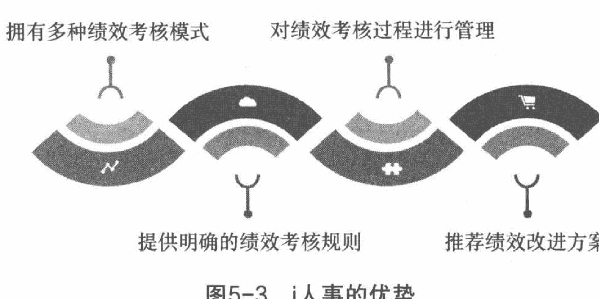
### 多元考核模式
多数系统仅支持单一模式，i 人事可依据企业所处阶段与实际需求，提供多种考核模式组合，满足全周期管理需求。

### 考核规则透明
系统提供模板化流程、评分细则和考核规范，形成清晰易用的管理框架。

### 过程可视化管理
通过绩效模块，企业可实时掌握考核进展并动态调整方案，HR 也能便捷查看员工考核状态，加深对团队的认知。

### 改进方案推荐
企业可借助模块设定考核计划并实时追踪，系统还能基于企业特征推荐针对性改进建议，助力员工成长。

#### Meta 因 AI 算法裁员引发争议
2022 年，Meta 基于 AI 生成的绩效结果裁撤约 60 名员工引发热议。该轮裁员并非人工决策，而是由算法驱动。据报道，若电脑连续 8 分钟无操作，系统即判定为休息并报警，累计超出阈值则扣减绩效分。

这种做法与外卖平台对骑手的算法考核类似，平台通过最优路线与时效判定，超时即扣薪。

尽管规则化裁员看似客观，却暴露出明显风险，如图 5-4 所示。

- 算法公平性质疑。被裁送货员认为系统将不可抗力归咎于个人，交通拥堵、意外事故等客观情况本不应被判定为履职不达标。

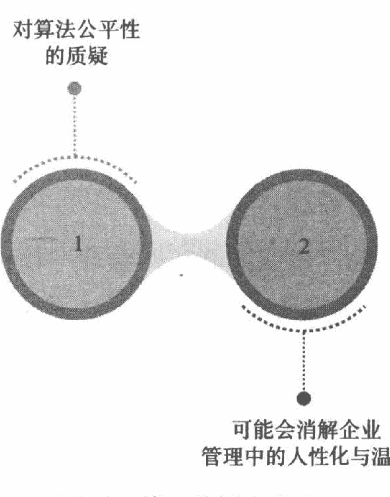
出现此类误判，根源在于算法缺乏人性化判断能力。企业在使用算法考核时，应保留人工复核机制，对明显偏差进行纠偏，保证规则透明以弥补算法局限。

- 管理温度流失。算法裁员把解雇责任从管理者转移到系统，劳动关系趋于冷漠。过度依赖算法会削弱文化互动，降低凝聚力与协作精神。

虽然真正落地的企业不多，但 AI 评估工作状态已成趋势。企业需把握边界，在提升效率的同时保留人文关怀。

### “AI+薪酬”激活执行力
员工动力不足往往与薪酬感知脱钩。将 AI 与薪酬体系融合，能更精准激励，提升执行力。

#### 从宽带薪酬到积分薪酬
宽带薪酬打破传统层级，将多个等级合并为宽带区间，在同一带内允许较大浮动，增强灵活性，为员工提供更顺畅的成长通道，也为管理者提供更大分配空间。

实施前提包括清晰的岗位职责与层级划分，以及企业发展阶段匹配。初创或扩张期组织结构变动大，宽带实施成本高；成熟企业则更适配。

宽带薪酬也有局限：部分员工更看重职位晋升带来的身份感，而宽带下薪酬增长不完全依赖职级；同时对绩效管理要求极高，若绩效失真，激励效果会打折。

积分薪酬则是强绩效导向，按工作表现、目标达成与贡献度动态定薪。核心在于公正客观的绩效评估体系，避免主观干预。

配套激励机制需与组织战略和个人发展目标对齐。但积分数据量大、统计繁琐，且易引发内部过度竞争，影响协作体验。

融合思路为：以宽带薪酬为基础保障，叠加积分薪酬作为弹性激励。基本薪资在宽带内浮动，结合绩效、技能提升等因素调整；积分则作为额外奖励，员工通过优质表现或完成关键任务获取，用以兑换奖励或福利，让薪酬更真实反映贡献。

例如某地产企业在宽带体系上叠加积分制，部门经理月度评分发放积分，积分达标可兑现奖励，既激发积极性又促进文化建设。

#### 智能工资核算与结算
发薪日对员工意义重大，但薪酬核算涉及基本薪资、五险一金、个税、绩效奖金等多项计算，易耗时出错。

“轻流”平台利用 AI 构建智能薪酬系统，实现：

简化五险一金计算并一键导入。系统自动读取个人数据，核算应扣项目与实发金额；对多分公司企业可配置不同社保方案，实现自动适配。

自动生成并推送工资条。导入明细后自动生成工资条，通过短信邮件发送，若员工发现异常可在线反馈并流转至财务确认，提升协同效率。

自动生成薪资报表。系统可实时呈现各部门薪资状况，支持自定义展示维度，为人力成本管控与决策提供依据。

亚虹医药作为国际制药企业，面临人事管理混乱、薪酬计算复杂、项目工时审批繁琐、研发成本分摊手工操作等问题。携手 i 人事后：

搭建数字化人事系统，实现全球员工扫码线上入职，告别纸质邮寄，入职纪念日、生日等节点自动关怀，提升归属感。

提供薪资核算能力，覆盖复杂场景与外籍员工，社保数据自动更新，减少人工干预，提升准确性。

借助“智搭云”低代码平台实现研发工时自动采集与成本分摊，生成线上报表，实现数据留痕与透明。

#### 社保自动扣缴与缴纳
AI 已渗透税务与社保领域。广东省税务局“粤税通”小程序提供语音办税、智能导税与预约服务，实现业务自动化，减少等待。

平台上线社保停保、实名认证等功能，简化流程。提供车船办税、房屋交易等个性化套餐，合并办理；“新办企业”套餐在核验信用代码与法人信息后，可完成财务制度备案、账户报告等事项，实现线上闭环。灵活就业人员也可线上办理参保、核定、缴费、退费。

博为小帮软件机器人将 RPA 与 AI 融合，为社保业务提供自动化方案。例如增减参保缴费核定需经历 5 个环节 35 步，机器人实现流程自动化，缩短处理时长、提高准确率、减轻人员压力。

#### 设计福利方案，满足多元需求
员工是企业核心资产，吸引与保留人才需提供有竞争力的福利与薪酬。AI 可助力福利精细化运营。

某大型服装厂员工规模大、需求差异化严重，引入 AI 进行智能化福利管理：

搭建员工福利数据库
通过内部系统与问卷收集基础信息、历史福利满意度与期望福利，借助数据分析洞察需求画像，为精准制福利提供依据。

对需求进行分析
AI 梳理出共性与差异，如年轻员工更重视职业发展课程，年长员工更关注医疗保障等，为分层设计提供支撑。

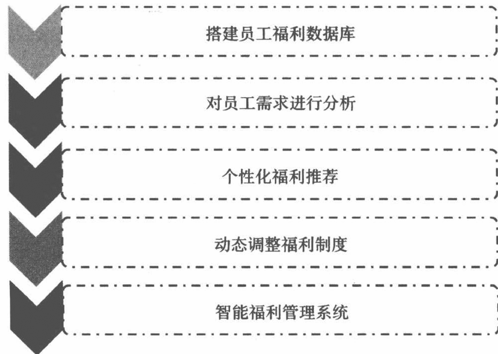
个性化福利推荐
基于画像为不同人群定制方案：对家庭困难员工增加补贴，对年长员工推送体检套餐，对年轻员工提供培训资源。精准匹配显著提升满意度与归属感。

### 用AI让福利真正“活”起来

这几年很多企业已经意识到，福利不能一刀切、年年照搬。某家服装企业就把AI用在了福利执行的监测上，系统实时追踪各项福利落地后的员工反馈，一旦发现某项福利上线的满意度没起色，就立刻启动调整。这种即时校准的思路，让福利从静态配置变成了动态服务。

同家企业还上线了智能福利管理平台。平台会根据职级、司龄等要素自动核算应享权益并完成派发，省去了手工核算和人工审核的出错空间。借助这两套打法，企业在福利感知、满意度与忠诚度上都出现了明显改善。

与此同时，外部服务商也在加速把福利数字化。福禄福喜作为国内领先的福利数字化与云服务运营商，围绕“智能关爱、全场景、高质量体验”三个抓手，将数字福利与AI深度融合，打造出员工智能关爱福利方案。方案覆盖节假日关怀、生日关爱、日常慰问等多个触点，全方位传递企业温度。

**福利体验的迭代逻辑**：在AI推动下，企业福利正经历两次跃迁——从统一发放的传统福利，到按需供给的弹性福利，再升级为千人千面的定制福利。这一演进折射出对员工需求洞察的加深。

福禄福喜的方案提供模块化管理后台，并打通商品供给、员工自选到售后服务的全链路，既满足了员工的个性化选择，也大幅减轻了HR的操作负担。依托AI实现弹性化、个性化关爱，贯穿员工职场全生命周期，提升参与感与仪式感。HR后台还能动态查看领取数据，洞察偏好，持续优化福利组合。

**社交价值被重新激活**。职场社交已成日常刚需，尤其在高压环境下，良好的人际关系能调节氛围、提升效率。该方案还搭建了一个职场社交的“第三空间”，让员工在生日、司龄日等节点深度互动，缩短彼此距离。

**降本增效同时兼顾体验**。管理平台可通过标准API打通微信、钉钉、公众号等渠道，并借助丰富的供应链资源提供海量商品，满足多元需求，在保证满意度的同时实现成本优化。

**形象与文化的对外表达**。发放福利的过程本身就是企业文化的外化，员工在体验中感受到关怀与温暖，归属感随之增强，企业价值观也得到自然传递。

AI、大数据、5G、云计算等新技术正在普及，企业应主动拥抱这些工具，为员工创造更多实惠，推动员工与组织一起成长，共同面向未来。

## AI+留才：让组织更健康地运转

人才是企业持续发展的关键，选、用、育、留始终是人力管理的核心命题。当下大模型快速成熟，AI正重塑人力运营。尤其在留才环节，AI带来了从人才盘点到离职管理的系统性增效——更精准地盘点人才、优化离职管理、科学规划职业路径，持续释放人才潜能。

### 智能盘点：为人才画像、为配置赋能

人才盘点像整理书架，把合适的人放到合适的位子上。越来越多的企业借助科技手段完成智能化盘点，通过绘制高潜、高敬业、高风险三类人才画像，更清晰地识别特质与潜力，制定针对性策略，实现人才价值的最大化。

#### 高潜人才画像：提前发现未来的领导者

在快速变化的市场中，高潜人才往往具备更强的领导力、商业敏感度与进取心，是企业未来的中坚。传统识别多靠HR主观判断，误差较大。AI可以通过多维度评估，绘制更客观的人才画像。

e成科技作为人力资本数字化平台，沉淀了大量行业经验，推出AI人才画像功能，实现员工数据的整合与可视化，并对过往成绩与未来发展作出总结与预测。基于盘点技术，企业可筛出高潜人群，快速组建强队伍。

**画像如何构建**。这是项系统工程，需要挖掘基础信息、项目经历、自我评价等数据并做精细化提炼。e成科技将画像拆成三部分：

- 员工简历：完整记录过往成就，包括院校、学历、海外经历、工作经历等12个核心指标，为综合素质评估提供数据底座；
- 在职档案：聚焦工作表现，综合绩效、出勤、项目表现等，揭示实际能力与工作态度；
- 综合测评报告：从主动性、严谨度、成就动机等25个维度评估发展潜力，既看当下能力，也看成长空间。

借助知识图谱与数据分析，企业能穿透学历、技能等表面信息，评估人才质量，并可根据自身标准灵活调整各指标权重。例如某企业把发展潜力权重提到50%，过往成就与工作表现各占25%，让画像更贴合实际用人需求。

**以画像为基础的盘点优势**：

- 自动生成，省心省力。九宫格中横轴为潜力、纵轴为绩效，高潜高绩被定义为高潜人才。盘点拆分为能力项、潜力项、绩效项。能力项依据个人信息、潜力项来自测评、绩效项为工作成果。AI自动计算并生成表格，大幅提升效率。
- 实时动态，随时可点。传统盘点往往一年一次，节奏慢于业务变化。基于画像的盘点是实时更新的，成长会即时转化为能力、潜力、绩效三项数据。
- 高效对比，输出建议。传统九宫格只能识别，难以安排。AI可对绩优者画像进行聚类，提炼共性特征，形成统一画像，再与新人画像对比，指出差距并生成针对性培养计划。同时指标可视化提供宏观与微观视角，并给出团队优势、短板与发展建议，让盘点更具战略性。

#### 高敬业人才画像：业绩的内在驱动

工作难度提升，敬业度的重要性愈发凸显。敬业员工效率更高、贡献更大，是企业发展的中坚。敬业度通常体现在三种行为：认同——乐于对外宣传企业与团队；发展——有归属感，愿与团队共成长；投入——为企业发展全力付出，主动承担责任。

敬业度与业绩高度相关，也是预测未来业务走向的重要参考。绘制高敬业人才画像并重点培养，是提升业绩的关键。AI可从四个维度全面分析员工敬业度，如图6-1所示。

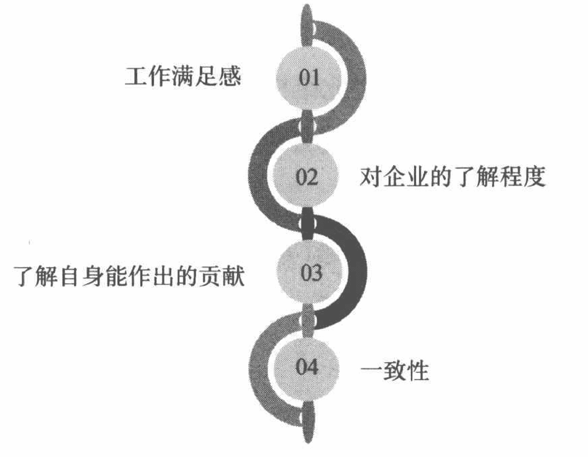

图6-1 员工敬业度分析维度

1. 工作满足感。AI判断员工是否在追求目标的过程中保持积极心态、精神饱满地完成工作。
2. 对企业的了解程度。高敬业者会主动关注战略方向、目标与文化价值观，更好融入。
3. 了解自身能作出的贡献。能清晰认识自身工作对企业发展的价值，定位明确。
4. 一致性。个人价值与企业价值融合，工作方向与发展目标高度一致。

依托这四个维度，企业可绘制高敬业画像并加以培养。以LTIMindtree为例，这家提供数字化解决方案的企业与微软合作，推出基于AI的员工敬业度软件，作为Canvas.AI套件的一部分，具备内容摘要、问答助手等功能，用于提升组织效能。

在画像完成后，企业可重点培养高敬业人群；对普通员工则可从以下方向入手，如图6-2所示。

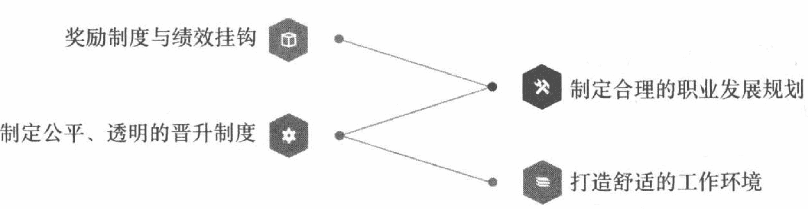

1. 奖励与绩效联动。薪酬高低并非唯一驱动，关键是让员工感受到价值被认可。归属感是敬业的基础，企业要用心理层面的激励激发主人翁意识。
2. 制定合理的职业发展规划。量身定制成长路径，增加HR与主管的沟通频次，了解学习需求与发展愿望，让规划与个人目标契合。
3. 建立公平透明的晋升机制。提供平等的成长平台，让优秀者获得匹配的回报与机会，避免付出与回报失衡引发不满。
4. 打造舒适的工作环境。研究表明，环境舒适度与敬业度正相关，让员工能全身心投入。

借助AI识别与培养高敬业人才，能更有效地激发潜能，为持续发展提供动力。

#### 高风险人才画像：把离职风险提前看到

留住人才是企业成功的关键。随着AI在人力领域的渗透，HR能够更精准地预判人才流动趋势，通过高风险人才画像深入分析离职动因。

通过收集绩效、行为特征、职业背景等信息，HR可绘制风险画像，锁定潜在流失人群，并制定管理策略，例如提供发展机会、改善环境、优化福利。AI还能帮助拆解离职原因，如薪酬、环境等，指导制定挽留方案。

某大型金融服务公司在技术开发部门流失率偏高时引入AI预测模型，精准识别高离职风险员工，随后进行一对一沟通、职业发展咨询并定期评估干预效果。结果整体离职率下降，关键岗位流失明显降低，员工忠诚度与满意度提升，同时节省了大量招聘与培训成本。

持续收集数据能让人才管理策略动态优化，AI帮助HR更懂员工需求与价值观，构建更具吸引力的组织文化，增强归属感与凝聚力。跨部门协同也因信息流通加速而更高效，共同应对离职挑战，保证组织健康。

### 离职管理：用AI把风险降下来

员工离职不可避免，但业务中断、人才流失的代价需要提前防范。离职管理的核心在于预测与留存，通过AI实现更精准的离职概率判断，提前布局对策。

#### 离职预测，锁定高风险人群

科学的员工管理能提升凝聚力与效率，降低流失风险。参考马斯洛需求层次：

生理需求要保障基本生活薪资福利；安全需求要提供安全培训与劳动保护，营造稳定环境；社交需求要通过团队活动、聚餐等促进沟通；尊重需求要平等对待，及时认可与赞赏；自我实现需求要提供培训与晋升机会，支持成长。

随着员工诉求升级，成长空间与文化氛围成为选择企业的关键。薪资已不是唯一标准，开放文化与个性化成长机会更受关注。若需求未被满足，流失风险就会上升。

彼得·德鲁克提出，企业唯一的真正资源是人才。核心人才流失会带来连锁冲击。德勤调研显示，普通员工流失会造成当年薪150%的损失，关键岗位优秀员工流失则高达当年薪400%的损失。

过去HR多依赖直觉与经验决策，易产生偏差。事实与数据驱动的决策更可靠。谷歌首席人才官也强调，内部数据分析而非最佳实践才是决策依据。

借助科技手段做科学的离职预测，能把模糊判断转化为量化分析，更精准评估离职风险与流失成本，从而采取合理、有针对性的挽留措施。

当AI开始读懂员工的离职信号，人才保留的游戏规则已经被改写。越来越多知名公司正把预测性人力分析放到核心用人策略里，提前出手把人留住。

IBM的掌门人曾公开点明：留人关键在于行动要早于离职决心。公司据此打造了一套离职预警系统，用AI对离职倾向进行精算。一旦模型捕捉到异常信号，薪酬、奖金、福利等挽留组合拳就会迅速启动。据披露，该系统命中率高达95%，帮助公司在人才保留上省下近3亿美元的成本。

谷歌内部则运行着自研的人才保留模型，能够提前揪出流失高风险人群。HR拿到预警后可以定制一对一的挽留方案，在员工递交辞呈前就完成干预，留存效果肉眼可见。

腾讯通过大数据深挖离职规律，发现一个明显拐点：毕业入职满三年的员工离职率显著高于平均水平，主要是婚育、购房等生活重压集中爆发。针对这一群体，腾讯推出“安居计划”，用实际住房支持缓解压力，从而守住一批核心骨干。

印度公司inFeedo走的是一条情绪感知路线。它会不定期推送匿名问卷收集情绪体征，并投放聊天机器人与员工闲聊并生成情绪画像。一旦识别到情绪波动或离职风险升高，机器人会即时报警给HR或直属主管。很多员工不愿正面跟领导开口，但借助这类工具，管理层得以看见真实情绪并及时介入。

为了让中小企业也能玩转科学留人，数字化人力平台用友人力云上线了员工离职风险预测模块。整个能力建立在AI之上，核心目标是提前识别高危人群并减少人才流失。

## 1. 基于事实的科学预警
离职从来不是单一原因，可能是压力过大、成长路径模糊、薪酬不匹配等任一导火索。用友人力云从基础信息、工作态度、成长诉求、薪酬水平、敬业度、考勤变化等多维视角监测风险，并把风险划分为高、中、低三档，辅助HR做更精准的人才判断。

平台还支持HR自建预测模型。针对关键岗位，可自由调权影响因子，比如上调薪酬权重、降低加班时长、强化福利等，模拟最优挽留组合。不同行业对流失容忍度差异很大，比如互联网10%的流失可能只是常态，对传统制造却已是警戒。用友人力云允许企业自行设定高、中、低风险的阈值，适配自身情况。

## 2. 组织级风险全景
除了个体预警，HR更需要全局盘面。用友人力云提供环状图、九宫格等可视化看板，直观展示不同风险等级的人数占比和分布。平台还能拆解影响因素排行榜，列出Top15的关键驱动因子，帮助HR找到系统性改进点。

## 3. 高稳定画像，反向赋能招聘
新员工早期流失多源于画像偏差。用友人力云可以在离职预测场景中反向提取高稳定员工画像，涵盖工龄、常驻地、技能标签等特征。将这些画像沉淀到招聘环节，能提高筛选的稳定性，降低试用期流失，夯实队伍根基。

## 4. 越用越准的持续进化
对预测工具的准确度，HR常有疑虑。用友人力云提供预测效果回看功能，让HR实时感知模型表现。平台支持持续学习，通过不断喂入在职与离职样本优化算法。历史数据越多，边界越清晰，预测越可靠。

### 人才存量层面的AI增效
企业竞争本质是人才竞争，留不住人再招也难长远。AI正成为留人的战略资产。

AI可以持续解析员工日常表现与敬业信号，推算流失概率，让HR锁定重点人群并提前沟通疏导。同时，AI也在改善体验层面发力。通过洞察工作偏好、学习习惯与职业规划，AI能为每个人定制培养路线，让员工感受到被看见，动力自然提升。

以Audo为例，该工具能解析个人技能、兴趣与能力画像，给出职业方向建议；结合绩效与技能组合，还能规划清晰的晋升阶梯。AI还能监测工作负荷，动态调整任务分配，帮助员工维持工作与生活的平衡，避免倦怠驱动离职。部分系统具备即时认可能力，能捕捉优秀表现并给出正向反馈，增强归属感和自信心。

### 职业生涯规划与管理
职业规划是激发潜能的指南针，既关乎员工自我认知，也需要企业支持设计。

#### 制订个性化规划方案
AI让规划从模板化走向千人千面。HR借助智能助手能全景把握员工特质与潜力，输出定制化发展方案。

AIAJX作为AI助理，既是员工的职场导师，也是HR的规划搭档。它对职业路径有深度理解，能回答员工在成长路上遇到的困惑。HR可基于其智能分析，为员工绘制清晰的职业蓝图。

依托海量行业与岗位数据，AIAJX能结合趋势、岗位需求与晋升通道，生成个性化发展建议。方案以大数据为底座，可前瞻研判所在行业走向，提供具备前瞻性的路径设计。工具还能给出针对性的方向选择、学习计划与技能提升清单，帮助员工挖掘潜能。面试技巧、职场人际、领导力培养等实操支持，也能一并提供，让员工在成长中持续为企业创造价值。

#### 精准推荐内部晋升机会
中高层空缺时，企业通常在外部招聘与内部晋升间权衡。内部晋升既是激励手段，也是留才关键，但选人常陷入主观与经验误区。

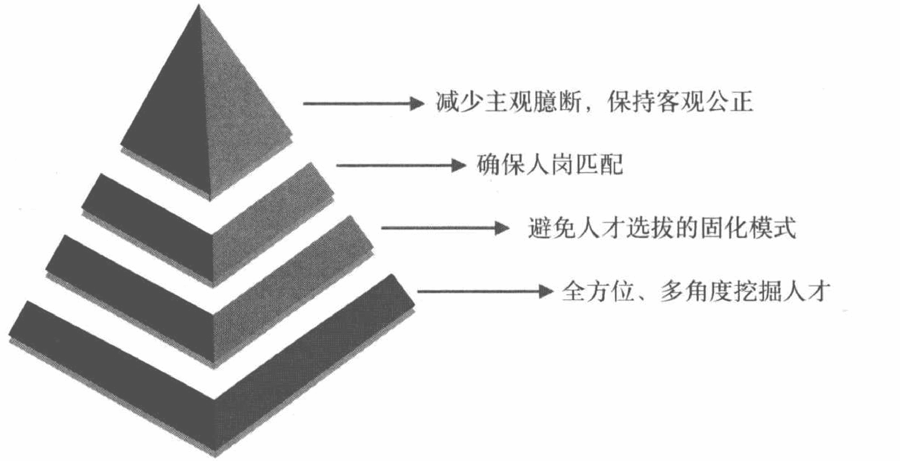

图6-3 选择晋升对象的要点

- 1. 减少主观臆断，保持客观公正
HR 在选拔内部人才时，应避免受个人情感或偏见的影响，从整体和全局出发，全面、客观地评估每位员工的潜力与能力。
- 2. 确保人岗匹配
从企业内部选拔人才，HR 应该注重人岗匹配，充分发挥员工的特长和优势，而不是过分追求完美，对员工过分挑剔。
- 3. 避免人才选拔的固化模式
HR 不应拘泥于固定的人才选拔模式，而应秉持唯才是举的原则。只要员工能够在岗位上发挥积极作用，HR 就应将其纳入考虑范围。
- 4. 全方位、多角度挖掘人才
HR 应深入了解员工的个人信息、工作经历、过往成绩以及工作表现等多个方面，以便更全面地评估员工的综合素质和发展潜力。

选拔内部晋升人选耗时耗力，容易引发争议。AI可帮助建立更高效的晋升机制。

1. 数据收集与整合
从内部系统抽取个人信息、工作轨迹、日常表现等数据，确保完整准确。
2. 数据挖掘与分析
AI对数据进行归纳，总结工作习惯、技术水平与成长潜力，形成立体画像。
3. 制定晋升标准
基于分析结果明确晋升门槛，覆盖个人技能、经验与绩效，并与企业战略与人才规划保持一致。
4. 设计合理的自动晋升流程
包括自动筛选、推荐名单、评估与决策、通知与反馈四个环节。AI按标准初筛并生成候选名单，HR复核把关，确定后由系统通知并收集反馈以持续优化。
5. 实施与监督
持续跟踪晋升机制运行效果，定期校验公平性与有效性，并随环境变化动态调整。
6. 培训与发展
晋升是对过去的肯定，也是对未来的投资。HR需为高潜人群提供相应培养，确保其胜任新角色。AI可据个人特点推荐精准学习资源。

IBM在晋升决策上探索了Watson。传统流程要求述职报告与PPT汇报，Watson则能自动梳理过往业绩并预测未来潜力，被判定为高潜力的员工才进入晋升通道。

负责薪酬福利的副总监指出，晋升评估不应只看历史结果，工作复杂度提升后，过去表现与未来潜力相关性在减弱，需要识别持续学习能力强的员工。Watson通过个人资料、项目经验、日常表现与培训数据综合评估学习与适应能力。

据人力资源部门统计，Watson的评估准确率达到96%，与人工判断高度一致。

将AI引入考核晋升的企业已不在少数。Willis Towers Watson的调研显示，超过40%的受访企业正计划把发展潜力纳入评估体系，调整考核重点。

在技术迭代的背景下，用AI评估潜力有助于精准培养并保证公平。但AI只能是HR的助手，不能替代专业判断，保持独立思考才能让晋升既科学又有人情味。

#### 自定义继任者人才地图
继任者地图是为关键岗位提前锁定备选人，以应对突发离职带来的运营风险。做好继任规划能稳住组织、提升竞争力。

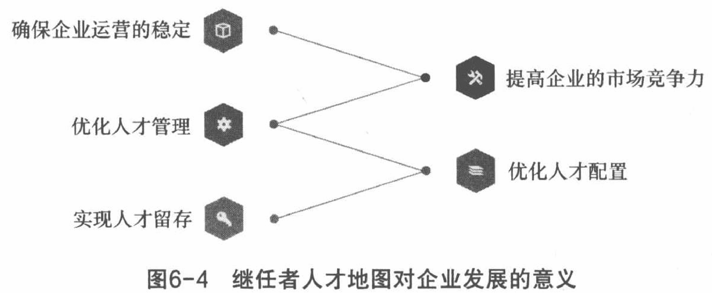

#### 1. 确保企业运营的稳定
关键员工突然离职会扰乱业务，继任地图可在空缺时迅速找到接棒人，保持运转。
#### 2. 提高企业的市场竞争力
人才储备让企业从容应对变动，持续培训提升专业水准，为长期发展打底。
#### 3. 优化人才管理
地图提供全景视角，帮助企业掌握员工能力与经验，实现更精准的人岗安排与潜力挖掘。
#### 4. 优化人才配置
通过深入评估技能与潜力，确保岗位匹配最合适的人选。
#### 5. 实现人才留存
绘制地图的过程也是了解员工需求与职业规划的机会，精准培养能提升满意度与忠诚度，降低流失，同时吸引外部优秀人才。

人才管理公司北森推出的“北森继任云”就是典型实践。该系统以组织架构为底座，绘制继任者地图，帮助HR审视部门健康与人才储备。

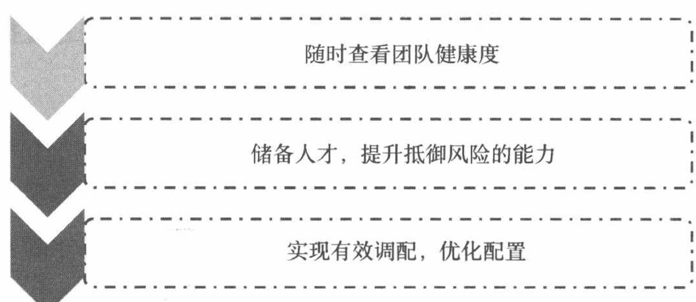

图6-5 北森继任云的三个特点

#### 1. 随时查看团队健康度
系统呈现各部门负责人与储备情况，用颜色标记健康度，一目了然。
#### 2. 储备人才，提升抵御风险的能力
人事变动或晋升时，可从系统快速调动储备人才，同时构建人才梯队，增强抗风险能力。
#### 3. 实现有效调配，优化配置
可洞察团队短板、查阅人力档案、统筹团队配置、推动内部流动，必要时提前启动外部招聘。

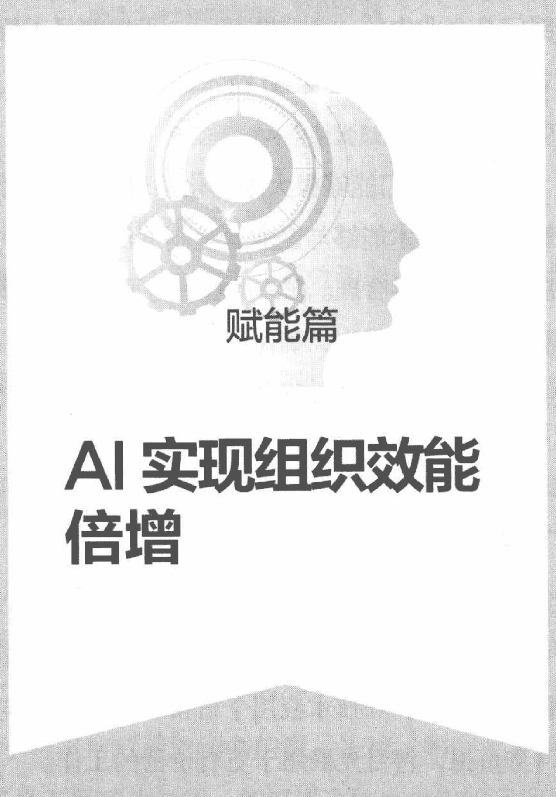

# 赋能篇

## AI 实现组织效能倍增

# 第7章 管理赋能：AI助力HR管理员工

人力资源部门承担着员工管理与团队协同的重任，挑战日益增多。随着AI技术的加速渗透，人力资源正迎来变革性的升级窗口。

当 AI 进入人力资源的日常，人事部门处理的重复性、繁琐性工作会被大幅压缩，员工管理也随之变得更高效、更精准。AI 能与企业管理制度深度绑定，通过数据采集、分析和预测，让管理决策更科学合理。考勤端可以做到智能识别并自动留痕，对异常行为即时预警提醒，确保数据的真实性；舆情端则能实时监测员工动态，提前识别潜在风险，为组织的稳定运行提供保障。

### 7.1 AI+制度，让管理更科学

管理学之父彼得·德鲁克曾指出，我们正处在一个意义深远的转型期，此时的变革力度远超往昔。AI 带来的正是这样一次彻底的改变。HR 需要及时调整思维，把 AI 融进工作流程，在实现更科学的员工管理之余卸载自身负担，把精力投向更高价值的事务。

#### 7.1.1 用员工手册统一规则，每个人都在同一张图谱上

员工手册是记载组织架构、制度规范、岗位职责、薪酬福利等核心内容的载体，既帮助员工全面认知公司，也为企业管理提供抓手。

员工手册对公司发展的作用主要体现在三方面，如图 7-1 所示。

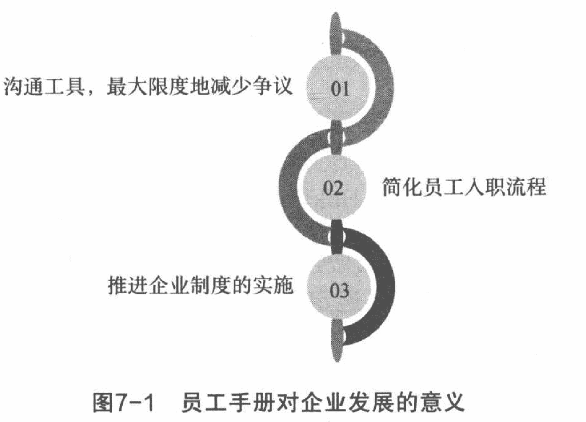

**沟通桥梁，减少争议**
手册为员工与公司搭建有效对话渠道，帮助其深入理解岗位要求。对政策、架构、福利进行全景式解读，员工可自助查询、自行找到解决方案。手册是全体员工认可的书面沟通载体，也是制度的物化体现，明确了违规的后果，从源头上压低了争议概率。

**简化入职，提升体验**
入职环节的许多基础问题，手册都已给出详细说明，如公司简介、组织架构、薪酬体系、假期政策、福利内容等。员工可自行获取信息快速熟悉规则，HR 与主管无需反复解答，整体运转效率随之提升。

**推动制度落地**
手册对各项制度做了清晰交代，员工违规时企业可依据手册采取相应处理措施，为制度执行提供坚实保障，维护正常秩序。

编写手册耗费人力物力，可以借助 AI 文本生成高效完成。例如借助在线文档协作工具 Baklib 搭建线上员工手册。Baklib 以知识库形式呈现，员工有疑问即可在线检索答案。

传统纸质手册内容庞杂，查阅效率低。基于 Baklib 的线上手册界面简洁、层级清晰，配备全文检索能力，员工能迅速定位所需内容，信息获取效率大幅提升。

#### 7.1.2 设计日常办公管理制度，懒惰行为自然减少

员工偷懒是普遍存在的管理难题，直接影响效率与协作。企业可通过制度设计对行为进行约束，而 AI 能显著提升制度的科学性与执行力。

核心目标是打造高效、公平、积极的工作氛围。借助传感器与摄像头，AI 可监测出勤与工作状态。例如员工监控软件“洞察眼”能记录电脑使用情况并分析行为模式，从而评估工作效率。

AI 还能依据预设绩效指标自动追踪、评估产出。员工通过实时反馈了解自身表现，形成自我驱动。以明途目标绩效管理系统为例，它根据企业战略与年度计划构建指标库，确保考核维度与战略同频，实现考核的动态化与高效化。

依托算法，AI 可对任务完成进度进行追踪并自动提醒逾期或未完成项，保证按期交付。传统方式依赖日报周报与主管抽查，效率低易出错；引入 AI 后追踪更高效、更准确。

某大型科技公司引入 AI 辅助 HR 追踪任务。AI 的追踪与提醒让员工更清晰进度，AI 的预测功能帮助 HR 提前发现问题并提供支持，对整体运营效率与员工绩效提升意义明显。

在排班方面，AI 能结合工作负荷、能力与个人偏好智能调班，保证安排合理有效，同时预测疲劳度与饱和度，防止过度劳累。例如 i 人事一体化人力资源系统可精准获取班次信息并灵活调整排班，避免因排班不当导致热情下降。

#### 7.1.3 设计报销制度，让财务更规范

“凭证不全请补充”“内容不具体请完善”……繁琐的报销事务让财务部门苦不堪言。传统模式下员工需手工填报明细，财务耗费大量时间审核录入，导致周期长、流程复杂、票据审核难。

AI 时代的解决路径是智能报销。许多企业上线智能报销软件，例如新一代智能工作平台百度如流的智能报销系统，主要体现两大优势：

一是无纸化报销与自动审核。员工可随时记录支出，收到发票后扫码或拍照上传，系统通过 OCR 自动识别主体、费用项目、金额并填充。还支持多票识别与语音填报，减少手工录入。提交时勾选消费记录即可生成报销单，部分费用可实现全流程免审批，资金更快到账。

二是差旅全流程对公结算。系统覆盖机票预订、接送、当地用车等全链路，员工通过平台安排行程无需垫付，实现便捷出行。

系统用 AI 替代大量人工，财务审核自动化，部门负担明显减轻。线上化无纸化降低成本、提升效率，市场认可度高。未来 AI 将持续赋能企业发展。

数字化费控管理平台齐业成也将 AI 融入报销流程，提供全天候智能助手：

发票智能收集方面，助手可从短信、邮箱、微信等渠道自动归集到票夹，纸质发票可 OCR 转电子单据，并智能解析票面、查验真伪、控风险、自动价税分离。

语音报销方面，员工可用语音发起差旅预订与报销申请，系统自动归纳电子发票到票夹，依据事前申请自动生成报销单，员工仅补充关键信息即可提报，减少填单量并自动关联申请与费用。

智能审批方面，内置风险审核与费用控制规则，高亮不合规信息。RPA 财务机器人可自动校验业务真实性、票据合规性、金额准确性，1 秒完成合规检查，日审千张发票，应对月末高峰。异常单自动推送复核，审批时高亮异常并展示费用、部门、项目等全景信息。

智能票审方面，支持扫码收单，自动匹配线下单据与线上流程，加快报销速度。

付款方面，银企直联实现实时追踪，审批通过后可一键批量付款。

智能核算方面，自动记凭证、可追溯，生成预制凭证后录入核算系统并生成记账凭证，数据可溯源。还能自动归档存证、智能分类、快速定位，按预设规则设置权限与保管期。

数据分析方面，自动统计报表，管理者可在报表中心查看费用，随时掌握产出投入并动态调整预算。

#### 7.1.4 设计领导管理战略，迈向管理大师

AI 在领导力战略设计上潜力巨大，可通过大数据分析、情境模拟与决策支持，帮助管理者制定更科学有效的战略，提升组织效能。

AI 能快速收集分析海量数据，帮助管理者洞悉运营状况、市场动向与竞争态势，为更明智决策与资源优化提供依据。

AI 可模拟不同情境下的组织表现，预测未来挑战与机遇，使管理者提前备战，降低不确定性风险。

AI 能持续追踪运营数据，发现潜在问题并提出改进建议，通过不断学习自我优化，推动管理策略持续改进，提升竞争力与适应力。

谷歌是典型案例。管理层认识到 AI 不仅改变产品服务，也重塑企业运作方式。

谷歌以 AI 实现数据驱动决策，收集员工绩效、客户满意度、市场趋势等数据，用算法分析提供深度洞察，支撑更理性决策。

人才管理上，AI 分析工作表现、沟通模式与职业路径，帮助 HR 识别高潜人才并提供个性化培养计划，提升人才保留与整体竞争力。

流程优化上，AI 分析工作流，识别瓶颈与低效环节并提出改进建议，提升效率并降低运营成本。

### 7.2 智能考勤管理，迅速捕捉异常行为

进入 AI 时代，企业管理全面升级。传统考勤已难以满足需求，智能考勤系统成为识别异常、推动管理现代化的关键。考勤是日常运营的基础，智能化是降本增效的必由之路。

#### 7.2.1 自动记录考勤
考勤是 HR 的基础工作，手工统计效率低且耗时。构建高效智能考勤系统迫在眉睫，尤其对排班复杂、人数众多、出勤不固定的企业需求更强。系统可自动记录考勤，大幅减轻 HR 负担。

易新速科技有限公司推出的但眼考勤云智能考勤管理系统是典型代表，融合 AI 与行业场景，基于训练好的深度学习模型与丰富数据库解决考勤难题。系统具备出入人员管理、考勤、排班、离岗预警等功能，HR 可实时掌握员工动向，自动上传打卡记录，简化流程、提高效率。

为解决忘打卡、迟到早退等问题，AI 人脸识别摄像机应运而生。摄像机可精准识别人脸并与数据库比对，员工进入时自动记录时间，忘记打卡时可作为佐证，兼顾企业与员工利益。

同时提升管理精度，减少人为错误，并发挥安全防护作用。对特种岗位可自动检测安全帽佩戴情况，未佩戴则报警提示；陌生人入内时自动提醒并记录影像，防止安全事故。应用场景覆盖写字楼、工厂、实验室，甚至电梯人数识别与超载提醒。

#### 7.2.2 加班统计与分析
传统加班统计效率低且准确性差。AI 可更精准掌握加班情况，提升效率并节约成本。

核心在于数据采集、处理与分析。AI 收集打卡记录、工作日志、项目进展等，经清洗分类后分析加班趋势、规律与影响因素，最后以可视化方式呈现给管理者。

某知名互联网公司引入智能考勤系统实时监测加班时长与频率，并预测未来趋势，帮助管理者合理调整安排、制定科学补偿方案，加班成本明显下降，员工满意度与效率提升。

相比传统方式，AI 能实时监控状态、及时发现问题，通过历史数据预测趋势并提供决策支持，还可借助调研反馈了解员工诉求，改善管理方式。

某金融机构因处理交易数据加班普遍。引入系统后系统化分析加班原因，成功优化工作流程；横向比较部门加班情况，制定针对性改进措施；系统提前预警系统故障、交易高峰等诱因，减少过度加班，保持健康工作状态，提升整体效率。

#### 7.2.3 请假申请与审批
请假管理关乎员工积极性与企业效益。传统流程繁琐、不透明、审批周期长，易出错。企业借助 AI 搭建请假系统，优化全流程。

AI 请假系统通常包括申请、审批、登记、通知等模块：

在线申请：员工线上填写天数、原因、类别后提交；
自动审批：依据企业规则自动审批，减轻上级与 HR 负担；
自动登记：审批后自动录入数据库，降低差错；
实时通知：推送审批进度，提升透明度；
数据统计分析：保存请假数据，便于随时查看部门与个人请假情况，及时发现异常。

此外，系统严格执行统一制度，减少因规则模糊产生的冲突；提高流程透明度；实现申请到登记全自动化，节省时间与成本。

#### 7.2.4 出差与外勤申请与审批
当下大量企业用 AI 管理出差与外勤审批，确保合规。美国通运公司报告指出，近 70% 的企业已使用 AI 进行差旅管理。

AI 系统正逐步成为企业内部各大平台的连接枢纽，与财务、CRM 等管理系统打通后，实现信息共通和流程顺滑衔接。围绕员工出差与外勤，从申请到审批再到报销，差旅管理涉及面很广，AI 的介入让这套链路变得更高效、更安全。以下就是 AI 在差旅与外勤审批场景里的典型作用。

#### 1. 流程自动化
日常的出差、外勤审批中很多是规则清晰的重复事项。AI 可以接过这些标准化判断，少了人工干预也降低了失误率。比如申请符合公司政策、费用在预算范围内时，系统即可直接放行，审批速度明显提升。

#### 2. 数据驱动决策
历史行程和外勤记录经 AI 梳理后，能结合个人偏好、企业预算和制度要求，自动给出交通、住宿的优选方案。系统还能自动产出差旅态势报表，让管理者一眼看清花费构成、频次分布等关键点，并实时监控每笔开支是否超标。

#### 3. 发票智能识别
员工把出差期间的票据拍照或扫描上传到接入 AI 的财务平台后，系统即刻完成信息抓取。依托 OCR 技术，票据号码、开票时间、金额等字段被快速转为可编辑、可检索的文本，报销环节因此大幅简化。

#### 4. 个性化服务体验
基于出行频率、常去城市、个人习惯等画像，AI 会主动推送更贴合的酒店、交通建议，让差旅安排更省心，也更符合个人喜好。

#### 5. 事前风险预判
AI 会结合目的地安全等级、天气变化等外部信息，对出差过程可能的风险进行评估，并及时给出提醒或备选建议。

以一家快速扩张的科技公司为例，外勤与出差人员激增，传统手工审批已难以招架，员工常被繁琐流程拖慢。引入 AI 自动化审批系统后，员工提交计划即可被自动解析、按制度预审；同时系统进行费用超支、安全隐患等风险筛查并给出建议。审批提速的同时，体验感和员工满意度也同步上升。

总体来看，用 AI 管控差旅与外勤申请审批，不仅能提速降本，还能帮助企业更了解员工出行习惯，实现更有温度的支持。

## 7.3 舆情监控：降低管理风险
舆情感知是企业维护声誉、把握员工心声的重要手段。随着社交平台 proliferate，舆情环境愈发复杂，AI 正成为降本增效的关键工具。

### 7.3.1 精准识别与分析舆情事件
舆情监测为决策提供依据，也能帮助企业优化战略布局，强化应急能力，在重大事件发生时做出更冷静的判断。

舆情监测正向智能化演进，借助 AI 企业可以更精准地捕捉舆情信号，提前规避风险，保持平稳发展。

目前已有不少企业将 AI 融入舆情监测。例如五节数据是一家定制化舆情商情大数据服务商，其打造的 AI 驱动舆情商情监测平台，可对企业相关舆情进行全网追踪。其技术栈包括：

- 自然语言处理技术
自然语言处理能把人类表达转化为机器可理解的形式，应用于舆情场景可对海量文本进行解读，完成情感倾向判断、关键词提炼等，快速锁定热点。

#### 2. 机器学习技术
机器学习在舆情中的应用集中在情感分析、话题挖掘和预警。模型可从信息中识别情感倾向，归纳核心话题，并基于历史舆情学习潜在风险信号，实现自动预警。

#### 3. 图像识别技术
图像识别通过学习大量图片数据完成分类和理解。社交平台上的图文视频往往蕴含关键情绪与信息，图像识别能够提取其中隐含的舆情价值，为企业研判提供依据。

将 AI 用于舆情监测，企业可获得以下收益。

#### 1. 有效提高舆情监测的精度和效率
机器学习与自然语言处理可批量处理海量文本，降低人工采集整理的成本，提升筛查效率与准确度。

#### 2. 快速对舆情进行定位和分析
多平台信息需要大量人力追踪，AI 可自动定位舆情源头、梳理传播路径，帮助企业快速掌握全貌。

#### 3. 为舆情分析提供数据支持和决策支持
AI 将非结构化舆情转化为结构化数据，直观呈现舆情走向，为市场与品牌决策提供依据。

#### 4. 有效实现舆情预警和风险控制
虚假信息、负面评价、投诉等都可能冲击品牌形象。AI 可提前识别风险点并发出预警，让企业及时干预，把负面影响控制在最小范围。

不过 AI 舆情应用也面临挑战。

#### 1. 数据质量问题
模型依赖海量数据训练，而舆情来源庞杂、真伪参差，如何保证数据干净可靠是首要难题。

#### 2. 语言和文化差异问题
不同区域的表达习惯和文化语境差异大，模型需要针对性训练和调优才能适用本地舆情环境。

#### 3. 隐私安全问题
舆情监测难免触及个人隐私，企业必须合规采集使用数据，加强内控与技术防护，避免泄露和滥用。

#### 4. AI 技术的可解释性问题
复杂模型决策过程不透明，容易让使用者产生信任焦虑。加强模型解释与沟通，有助于提升采纳度。

随着内外部环境持续变化，舆情监测已成为运营管理常态。AI 的助力让企业对内外环境感知更全面、判断更迅速，未来舆情系统将更智能，成为发展的重要保障。

### 7.3.2 员工健康管理
AI 不仅能监控工作表现，也能延伸到员工身心健康与危机处置。快节奏下员工压力攀升，健康管理成为管理重点，企业正开展多项创新实践，如图 7-2 所示。

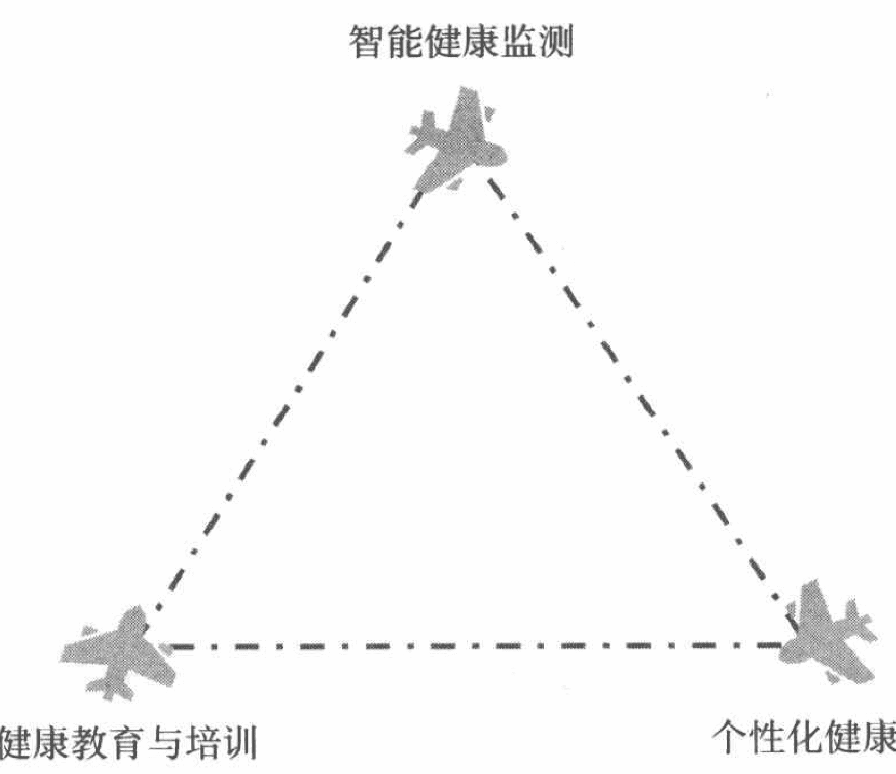

#### 1. 智能健康监测
结合AI 算法与可穿戴设备，企业可实时采集心率、血压、睡眠等生理指标。通过数据建模评估健康状态，针对心血管等高风险人群提前预警，促进行为干预。

#### 2. 个性化健康管理
基于健康数据、生活习惯、职业特点等信息，AI 能为每个人定制管理方案，涵盖饮食、运动、心理疏导以及体检、疫苗等服务，提升整体健康水平并降低医疗支出。

#### 3. 健康教育与培训
AI 可提供在线课程、智能问答等健康学习资源，覆盖疾病预防、急救、职场减压等内容，提升员工健康素养，助力身心平衡。

在危机预警与应急方面，AI 的作用体现在：

#### 1. 心理健康危机预警
系统通过日常情绪、行为、社交线索捕捉心理异常信号，一旦出现低落、焦虑等倾向即触发预警并启动干预。

#### 2. 职业伤害与事故预防
AI 可对设备、流程和作业环境进行持续监测，识别安全隐患并预警；同时监督作息合规，避免疲劳作业。紧急情况下自动启动应急预案，指导自救，减少损失。

#### 3. 疾病传播防控
员工通过 AI 系统完成健康打卡，异常情况可被及时发现并阻断传播链，守住企业内部安全边界。

在 AI 支持下，企业正不断完善健康管理与危机预警机制，构建安心工作环境，提升归属感与创造力。

### 7.3.3 员工申诉处理
薪酬、福利、政策、管理决策等方面的不满可能引发员工申诉，及时高效处理对稳定和满意度至关重要。许多企业已引入 AI 来提升响应速度。

某拥有上千名员工的大型企业，HR 在处理申诉时面临类型繁多、流程跨部门、人力不足等问题。为此企业采取了以下举措。

#### 1. 建立员工申诉数据库
系统化收集申诉人信息、诉求内容及处理进度，实现全流程可视化，HR 可快速定位问题并对症处理。

#### 2. 打造员工申诉处理系统
系统具备自然语言解析能力，能读懂申诉文本、提取关键词并匹配制度依据给出初步建议，提升沟通效率。

#### 3. 与人力资源管理系统相结合
通过 API 接口打通申诉系统与 HR 系统，实现信息即时同步，加快闭环速度。

#### 4. 对 HR 进行培训
开展 AI 基础与系统操作培训，提升团队使用熟练度，确保落地效果。

该申诉处理系统带来以下价值，如图 7-3 所示。

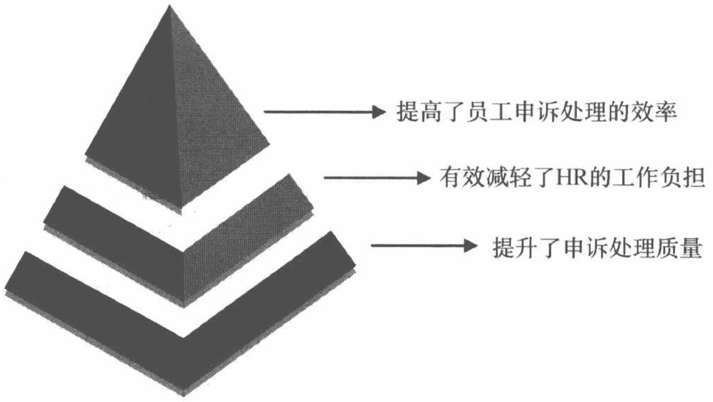

## 1. 提高了员工申诉处理的效率
过去处理一例申诉可能耗时数天甚至数周，如今在 AI 辅助下多数诉求可快速响应，员工体验显著改善。

## 2. 有效减轻了 HR 的工作负担
AI 自动分拣与初判大量重复性事务，让 HR 把精力集中在复杂、敏感的人事议题上。

## 3. 提升了申诉处理质量
系统持续学习优化，判断更准确；HR 在 AI 支持下能更精准把握焦点，提升处理专业度。

# 第8章 业务赋能：AI让HR更贴近业务
AI 在人力领域的深度应用让 HR 更懂业务，成为各部门发展的助力。

## 8.1 懂业务才能与领导同频
HR 的核心价值在于选人、沟通与平衡利益。要从合格到优秀，就必须懂业务、懂经营。AI 为 HR 提供了洞察业务的放大镜。

### 8.1.1 精准识别市场机会
市场瞬息万变，抓住机会是企业制胜的关键。市场机会与用户需求变化、技术演进、竞争格局变动密切相关。

用户需求随社会与技术进步而迁移，例如健康意识提升带动健康产品需求；技术创新重塑商业模式，带来新赛道；竞争对手的短板也可能成为企业的突破口。

要精准捕捉机会，企业可借助 AI 进行商业分析，具体路径如图 8-1 所示。

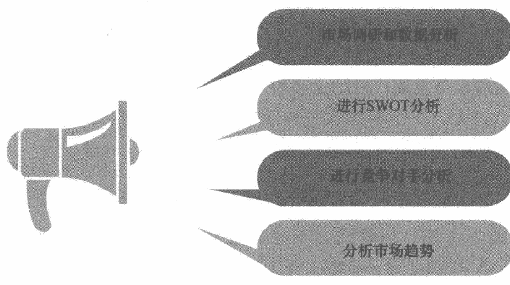

图8-1 利用AI进行商业分析的步骤

1. 市场调研和数据分析
基于市场数据、用户行为、竞品信息，AI 可深度挖掘潜在机会点。

2. 进行 SWOT 分析
AI 辅助下的 SWOT 能更客观评估优势、劣势、机会与威胁，明确核心竞争力。

3. 进行竞争对手分析
系统化收集竞品在产品、定价、营销等维度的表现，帮助找到差异化切入点。

4. 分析市场趋势
AI 可追踪技术创新、行业演变和用户偏好变化，判断高潜力领域。

### 8.1.2 企业经营情况及发展方案分析
经营分析是对财务、市场、产品等运营活动的综合评估，是制定发展策略的基础。

其价值主要体现在：

- 1. 有利于了解自身财务情况。通过收入、支出、成本、利润等指标，洞察盈利与偿债能力，及时发现经营异常。
- 2. 有利于了解市场需求和竞争状况。把握需求趋势与竞品动态，为产品迭代提供依据。
- 3. 有利于制定有效的经营策略。结合内外部环境选择合适的模式和方法，实现资源最优配置。
- 4. 有利于降低经营风险，提高决策准确度。提前识别风险点，提升决策质量。

借助 AI 进行经营分析，可显著提升判断精度。

例如深耕商业智能的帆软推出智能 BI 工具，支持探索式数据分析。企业通过数据看板挖掘异常、发现增长点；还能对表格进行筛选、拆分、排序等灵活操作，快速得到所需结论。

深圳市艾比森光电股份有限公司在经营中遇到统计效率低、数据不及时易出错两大痛点。经营分析会前需要手工汇总各市场签单、收入、费用等，工作量巨大；数据收集滞后且易遗漏大额订单，导致分析失真，不利于决策。

财务端先迈出数字化第一步，艾比森携手帆软，把帆软的系统直接嵌进利润表核算的场景里。利润表既是上一期工作的复盘，也为下一期业务定调，企业在核算时要把各种明细导出来再手工加工，数据线非常长，容易出错，财务同事经常要反复校对，效率被拖得很低。

帆软把利润表的计算逻辑沉到系统里，财务只需要把基础数据上传，系统就能自动跑出结果，省掉大量重复手工。面对数据反馈慢的问题，帆软依托报表平台把签单数据做实时抓取和呈现，避免了人工整理带来的滞后。用端到端的思路，数据基本能做到实时、干净，真实性更高，也减少了造假空间。

上系统后，经营者不用再困在电脑前一个个业务区去查。过去看报表很不方便，现在无论是电脑还是手机，都可以随时随地打开看经营动态，整体情况一目了然。

8.2 HR助力各部门业务发展

HR不能单打独斗，得走进各业务线，了解真实需求，以服务部门为出发点，和大家一起把公司目标落地。

8.2.1 营销部门：设计宣传推广方案

现在的市场已经不是酒香不怕巷子深的年代，不做传播产品很难被看见和信任。做宣传推广能带来什么好处，业内总结出了几条关键点。

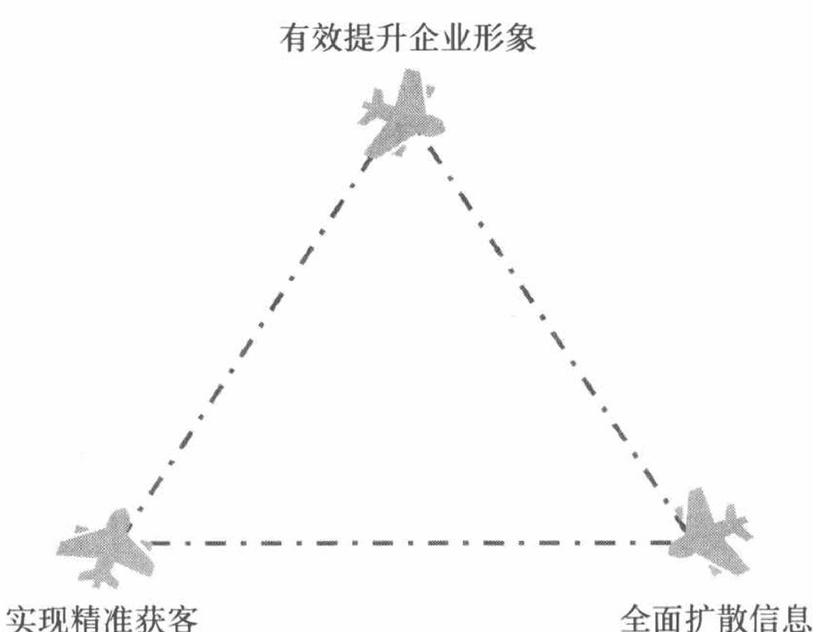
1. 有效提升企业形象
大部分用户是先被宣传触达才认识品牌，企业可以通过持续输出建立好感度，知名度上去以后成交更容易。
2. 全面扩散信息
线上线下渠道一起上，商场大屏、微信、微博、小红书、小程序都能用，形成大范围覆盖和持续曝光，品牌声量自然放大。
3. 实现精准获客
以内容为核心的传播能把用户需求和产品特性对上号，带来更精准的获客。

营销部门现在可以用AI快速搭出完整的推广方案，已经有不少落地案例可参考。比如希腊巧克力品牌Lacta用ChatGPT做了一波智能情书 campaign。

他们上线了一个叫“AI Love You”的小程序，用户输入关键词和想表白的对象，ChatGPT就会自动生成一封情书。生成后会得到一个链接，可以转发给对象，对方扫码任意一款Lacta巧克力就能读到这封信。在信息极度碎片化的当下，很多人说不清心里话，这个把前沿技术和情感结合的小程序帮助用户表达爱意，迅速出圈。

在上线前Lacta做过调研，超过1/3的用户表示希望品牌推出这类小程序。毕竟不是每个人文笔都好，AI输出往往更打动人。上线第一天就生成了超过4万封情书。

网易也玩了一把AI内容。网易严选七周年时和网易云音乐合作推出了歌曲《如期》，作词作曲编曲演唱全是AI完成。歌里讲的是严选和用户七年来的点滴，灵感来自真实用户评论，既有产品亮点又有用户故事，共鸣感很强。

支付宝的广告《中国支付往事》则是另一种打法，AI负责视觉呈现，讲述支付从过去到当下再到未来的变化，展现了AI的创作力。

这些案例给营销团队打开了想象空间，AI可以成为内容创作的得力搭档。

8.2.2 市场部门：精准预测用户需求与偏好

市场变化快，只有提前读懂用户才能留住用户。AI让需求预测变得更可操作，市场部门可以借助AI分析偏好，制定更合理的产品策略，提升占有率。

百度营销推出的“商家智能体”就是典型。它像一个有智商也有情商的AI客服，能7×24小时和用户对话，给出专业解答，帮助商家提供线上线下一体化的消费体验，同时把用户反馈沉淀下来用于产品和服务优化。

以家装行业为例，这是一场长期战役，从选公司到落地完工，选材、安装、价格等环节问题不断。用户行为也分层明显，70后多追求性价比，爱货比三家亲力亲为；90后更习惯线上买材料，搜索获取信息是主要方式。

随着互联网透明化，家装企业的难题是如何真正理解用户并吸引他们。这时商家智能体就派上用场了。用户一搜索相关内容，智能体就启动，像一位数字家装顾问随时待命。通过识别关键词提供相关产品，还能多轮对话引导用户厘清真实需求，把有效线索沉进池子里。

三棵树和商家智能体合作打造专属数字员工后，用户搜索油漆相关内容就能即时被接住。系统做全流程意图识别，不仅推荐产品，还在对话中科普墙面刷漆的优势，激发购买兴趣。用户表现出进一步咨询意愿时，智能体会深入解答、提供方案，并主动要联系方式做画像，为成交铺路。

家居链条长、人力投入大、信息不对称严重。即便用户满意度高，若规划效果不理想也下不了单。像像素菲亚这样的全屋定制品牌，因场地和建模成本限制，产品展示不充分，用户只能靠平面图和样板间想象，不利于转化。

企业需要的是让用户信得过的规划方案。商家智能体可以先摸清需求偏好，再给出个性化家装规划，还能提供虚拟人服务。用深厚的行业知识和良好的沟通力，结合不同场景给用户专属服务。

索菲亚是行业头部，研发供应体系成熟，但原来总部投放后把线索分给门店，转化率低成本难降。于是他们和商家智能体合作上线“虚拟人家居空间规划师”。虚拟人形象亲切声音温柔，能即时答疑、推优惠、引导留资，成交概率明显提升。

了解产品后用户意愿会增强，但售后顾虑仍会卡住决策。商家智能体持续打磨信息收集能力，深挖需求来推动转化，还能扩大线索搜索面，提高转化效率。

一站式家装品牌爱空间主打装修省心，与商家智能体在爱粉节期间升级活动页，界面更贴合品牌调性。用户体验变好后更愿意说真话，企业拿到更多有效线索。接入后咨询率明显上升，线下成交大量来自和智能体沟通过的用户，线上接待加线下跟进让单量稳步提升。

消费回暖、年轻群体崛起，家居行业品牌分散、触达误差大。商家智能体提供从线索到转化的全链路经营，帮助不同品牌解决经营痛点，加速发展。整体来看，AI工具已成为市场部门日常工作的标配，提升效率、满足用户。

8.2.3 销售部门：编辑销售话术

对销售来说，话术直接决定业绩。好的表达能引导对话、建立信任。销售部门现在可以用AI批量生产优质话术，减轻负担、提升通话质量。

线上销售占比越来越高，手机端调用话术不像电脑那么顺手。百度输入法推出的“口袋资料库”就解决了这个问题，基于AI自动编辑话术，让沟通更流畅。

口袋资料库内容很全，有销售话术、企业通知、朋友圈模板等，适配多种场景，销售在聊天的过程中可以随时调用，提升成功率。上手快不需要培训，覆盖销售全流程，能提高和客户沟通效率从而提升成交率。

它学习成本低、适配性强，支持多款App，一键发出朋友圈也很方便，避免话术千篇一律。销售不用再为创新发愁，直接调模板应对不同场景。

资料库还有培训功能，和多位销售导师合作沉淀了大量对话模板和文案，企业不再为缺乏成熟话术头疼，团队专业度明显提升。用它做内部培训能缩短周期，摆脱老带新，降低人工成本，流程更规范，策略更清晰，新人培养也更系统。

它同样帮客服解决了多平台话术维护的麻烦，一个地方输入就能多平台使用。对销售部门来说，它相当于一个统一发声的助手，一键把话术和朋友圈模板推送给全员，保证信息同步。

在私域场景里，口袋资料库能统一代理人的话术和成交流程，像中央厨房一样集中运营，降低学习成本，提升技巧，推动业绩。

百度输入法还推出了AI纸上造字，用户手写30个字拍照上传，AI就能识别并生成专属字体，满足个性化表达。随着技术演进，企业需求在变化，百度用一系列AI运营工具跟上节奏，让销售人员工作更轻松，也带来更多商业机会。

8.2.4 公关部门：设计公关方案

做一个公关方案从构思到成稿，通常要经历10到20轮修改，非常耗时。资料收集、筛选、市场调研都要做，一旦甲方需求变动，周期还会拉长。

为此出现了不少AI辅助产品。五彩传媒基于大数据和算法推出的“五彩大脑”就是其中之一，能分担公关人员的工作量。

它用网页数据抓取、结构化、机器学习把海量方案汇总到一个平台。用户按问答选择和填空，系统就能生成初稿草案。虽然最终仍需人工润色，但前期人力和时间成本大幅下降。

平台的数据从哪里来？CEO介绍他们用分布式爬取技术在网上大规模收集公关方案。覆盖快消、科技、美食等多个行业，能给创作者提供灵感。为了保证质量，团队只收录知名品牌和有影响力的经典案例，严格筛选。

五彩大脑还能提供近年的行业分析，从市场、用户、竞品三个维度帮助判断方向，并按目标人群、行业痛点、产品卖点给出具体策略，还能连接行业自媒体。

操作上，用户新建项目，选择推广媒体、产品特点、策略等维度，一键生成方案并导出PPT。方案本质是基于过往案例的框架，需要人工填充才能个性化。若数据量不足或模板化严重，容易出现同质化。

公关方案分为策划和交付两阶段，策划重风格和创意点，交付才需要细节打磨，所以除风格相似外，同质化风险可控。

五彩大脑能否持续运转关键看数据量，细分行业数据不足时匹配度会偏差，需要不断拓客。技术上视频图片的非结构化处理仍是挑战，商业化上验证后按项目收费。

除了五彩大脑，汽车企业也常用智能写作工具“小新AI写作”做公关文案，一般按五步走：
1. 明确目标受众与品牌定位。年轻人更看重安全和舒适，商务人群关注性能和性价比，品牌定位要能突出核心价值。
2. 设定公关目标与KPI。AI可据受众和定位制定口碑、形象等目标，KPI用来衡量关注度、参与度等效果。
3. 选择合适的媒体与渠道。线上线下、自媒体、新闻媒体都要评估，建立媒体关系为后续合作铺路。
4. 制订公关策略与创意方案。确定目标后制定传播方法、危机应对计划，例如办改装车赛吸引年轻用户，或准备危机预案维护品牌形象。
5. 执行与检测评估。方案运行时AI实时收集数据指标，让公关团队及时调整。

有AI分担重复工作，公关人员能把更多精力放在创意上，方案质量自然提升。

8.2.5 客服部门：节日祝福模板与发送提醒

节假日给用户送祝福是客服的常规工作，用AI生成模板能提高效率和质量。现在市面上有不少工具可参考：
1. Fun AI
基于AI识别，有实时录音撰写、翻译、文字识别等功能，能智能聊天答疑，并设有节日祝福专区，快速生成文案减轻工作量。
2. 迅捷PDF转换器
功能丰富的格式转换软件，支持PDF转Word、PPT、TXT等，也能AI写作，输入祝福要求即可生成一段祝福语，操作便捷。
3. 文心一言
百度的通用大模型，能互动问答、文本创作，客服可用它撰写节日祝福，提升效率。
4. Alexa
亚马逊的AI语音助手，可自动生成祝福语，支持生日、节日等多种场景定制，输出自然流畅。
5. QuillBot

AI 已经悄悄渗入了最细微的服务触点。像 QuillBot 这样的智能写作助手，把写祝福这件事变得极轻：只要把收件人的名字、时间、关系等基础信息填进去，挑一个合适的模板，系统就能迅速拼出一条有温度的个性化祝福。生成稿件后还能自行润色，让语气更贴自己的风格。

与 QuillBot 类似的祝福语生成工具市面上并不少见。客服团队完全可以根据服务场景和沟通调性挑选适配的软件，用技术把重复性文案工作变成高效复用。更实用的是，AI 还能帮忙设置定时提醒，避免节庆节点忘记向用户发送问候，让好感度保持在线。

## 8.3 业务进度分析与追踪

在企业日常运转里，能否按时保质交付，关键就看业务进度是否被持续审视。进入 AI 时代，人力资源的工作边界也在扩张：除了招人、绩效、培训这些传统板块，HR 越来越需要拥抱 AI，用更科学的方式去设计业务目标、解读员工行为、预测目标达成情况，并把业务问题和知识笔记有序管理起来。

### 8.3.1 业务目标设计与建立

AI 在人力资源管理中的价值正被快速释放，HR 可以借助它把业务目标设计得更快更准。

HR 层面的目标必须与公司整体战略同频，为业务成长提供支撑。常见切口包括提升组织满意度、降低离职率、打磨招聘流程、提高招聘质量等。目标明确后，还要配套 AI 落地的策略，比如选用哪类技术、在哪些场景先行试点，确保技术真正服务于目标。

AI 在目标设计上的作用主要体现在以下几个方向。

数据驱动决策。AI 能批量采集绩效、招聘周期、离职率等多维度人力数据，通过深度挖掘让 HR 对组织现状看得更透，从而制定更精准的目标。

自动化与智能预测。基于历史数据和模型，AI 可提前推演人力需求与风险，比如预判离职高峰以便前置招聘与培养，也能捕捉行业走势，帮助 HR 制定更具前瞻性的目标。

个性化建议与流程优化。AI 结合员工的技能、兴趣与成长潜力，给出职业发展与培训建议，让目标更贴合个体。同时还能优化招聘环节，提升效率与质量，实现引才留才。

提效增准。简历筛选、面试排期、绩效评估等重复性工作交给 AI 处理后，HR 的精力负担下降，工作准确度也随之提升，更能聚焦核心目标的落地。

优化人才管理。借助 AI 搭建统一的人才信息台账，实现集中管控与分析，让人才结构与分布一目了然，为更合理的人才策略提供依据。

### 8.3.2 员工行为表现分析

AI 能高速处理海量数据并给出分析结果，助力 HR 更懂员工行为、预判流失、提升培训效果。

员工行为分析是 HR 数字化的重要应用，通过工作表现、学习进度等数据挖掘，获得更有深度的管理洞察。某科技公司 HR 就用 AI 对员工行为进行全景分析，主要在以下环节发力。

数据收集与整合。自动抓取绩效记录、项目进度、沟通轨迹、考勤等来源信息，打通系统壁垒，形成统一的行为数据库。

数据预处理。对缺失、异常、噪声进行清洗、补全、转换，让数据更规范可信。

特征工程。将原始信息转化为模型可用的特征，如效率、质量、协作度、沟通能力等，并做特征筛选与提取，确保模型抓准关键信号。

模型选择与训练。依据目标问题如绩效评估、离职风险预测等挑选合适模型，用清洗后的数据训练并持续优化拟合度。

模型评估与优化。通过交叉验证、准确率、召回率等指标检验效果，迭代提升泛化能力。

员工行为分析。利用训练好模型洞察效率变化、协作状态、沟通模式等，为个性化管理提供依据。

实时监控与预警。一旦出现效率骤降、沟通减少等异常信号，系统立即推送预警，便于 HR 及时介入。

可视化与报告。用图表、仪表盘呈现核心指标与趋势，并自动生成分析报告，支撑管理层决策。

应用与反馈。模型可延伸至离职预测、培训需求识别、职业路径规划等，HR 需持续收集反馈以迭代优化。

### 8.3.3 业务目标完成度预测

AI 能实时监测员工工作节奏，对业务目标的完成情况做前瞻性判断。它让 HR 摆脱主观干扰，以数据视角洞察状态，并为公司决策提供客观依据。

借助 AI，HR 可持续跟踪工作进度，捕捉绩效细微波动并动态调整策略。数据驱动的评估更公正，同时强大的分析能力能挖掘潜在规律，提前预判风险，把握市场机会。自动化处理海量数据也大幅解放 HR，让其更专注战略规划。

HR 用 AI 预测业务目标完成度的流程如下：

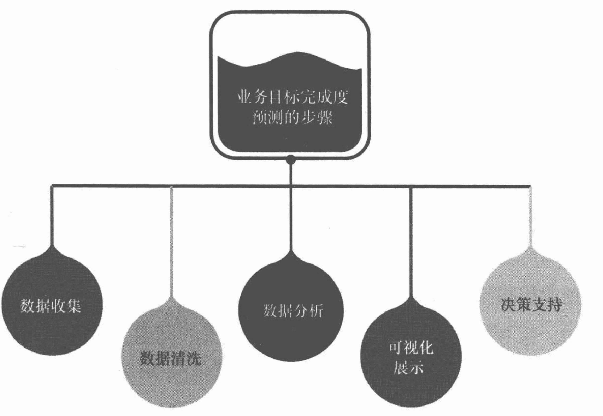
1. 数据收集
从 ERP、CRM、满意度调研、员工反馈等渠道汇总工时、工作量、成果等数据。
2. 数据清洗
去除冗余与错误信息，确保数据可靠。
3. 数据分析
对清洗后数据做深度分析，提炼预测关键信息。
4. 可视化展示
把结果以图表、报告等直观形式呈现，方便快速掌握进度。
5. 决策支持
基于分析给出针对性建议，助力优化技术布局与业务规划。

使用过程中要始终关注员工隐私与数据安全，合规使用是底线。

### 8.3.4 业务问题与笔记管理

AI 通过大数据与机器学习快速定位业务痛点。例如分析绩效结果预测潜在离职人群，助力HR提前干预；分析招聘数据发现流程短板，为招聘策略优化提供依据。

某互联网公司曾面临高绩效人才流失，引入 AI 绩效管理平台后，系统自动解析工作数据，给出个性化反馈与建议，并根据日常表现动态调整激励与福利。实施后满意度提升，核心人才流失率明显下降。

日常工作中 HR 要处理会议纪要、员工反馈、培训资料等海量信息，传统方式效率低易出错。AI 依托自然语言处理可自动归类、整理笔记，方便检索；深度学习还能挖掘笔记中的关键信息与规律，为决策提供启发。AI 在业务问题诊断与笔记管理上具备高效精准优势，但数据安全与用户信任仍是应用时需审慎考量的风险点。

# 第9章 文化赋能：员工忠诚度持续提升

企业文化是核心竞争力的重要来源，对健康发展与员工忠诚度起着决定性作用。AI 能让文化设计与传播更高效，让员工真正认同价值观与使命，增强归属感。

## 9.1 AI 时代的文化建设

优秀文化带来凝聚力与竞争力。AI 时代，企业可以借助智能手段制定更精准的文化方案，策划更丰富的文化活动，让文化从口号变为指引前行的灯塔。

### 9.1.1 设计文化建设方案，打造强团队

AI 在文化方案设计中的价值集中在以下方面。

深入洞察员工需求。文化建设的起点是理解员工。AI 能系统采集并分析员工数据，解读在线行为与社交互动，洞察对企业、岗位的满意度及偏好工作方式，为招聘策略与关系管理提供依据。

确立清晰的价值导向与行为规范。在员工洞察基础上制定价值观与行为准则，AI 可辅助分析市场趋势与行业最佳实践，确保规范与外部环境契合，同时通过内网、培训等多渠道传播保证落地。

员工个性化培训。AI 能依据技能与经验为员工定制专属学习计划，并通过智能评估给出针对性改进建议。例如某企业推出的 AI 导师系统，按技能与兴趣匹配学习资源与职业规划，帮助员工清晰自我画像并获得成长建议。

员工关系管理。AI 通过深度分析员工信息预测离职倾向，支持前置干预；同时可搭建智能沟通平台，收集日常沟通数据了解团队氛围与关系，帮助员工反馈问题并持续优化管理。

激发参与与创新热情。AI 收集员工意见建议，确保声音被听见；智能激励与在线评价平台则能及时表彰创新行为，进一步点燃工作热情。

营造积极向上的氛围。AI 监测互动与协作情况，及时发现潜在问题；结合智能福利与在线健康管理，提升员工满意度与幸福感，让潜力在轻松环境中释放。

### 9.1.2 设计文化活动，创意不枯竭

文化活动是品牌形象与凝聚力的关键载体，创意的持续性是最大挑战。AI 为活动策划提供了源源不断的灵感。

AI 可挖掘历史活动、古籍、艺术作品等大数据，为策划者提供新颖创意并结合市场需求生成方案。在内容层面，AI 能推荐贴合企业调性的个性化内容，并自动生成有创意美感的图文素材。

策划阶段，AI 可输出多套方案并通过仿真模拟效果，快速锁定最优解，同时自动分配任务、实时跟进进度保障执行。在活动结束后，AI 对参与度、互动行为等数据进行深度分析，为下一轮策划提供数据支撑。

例如某科技公司希望增强员工互动，HR 用 AI 分析兴趣与文化背景，生成多元主题并设计定制化体验形式，显著提升参与感与满意度。AI 让创意不再枯竭，成为文化建设的有力引擎。

## 9.2 AI 助力企业文化宣传

文化宣传是展示精神风貌与核心价值的重要窗口。AI 以设计、创作、分析能力重塑宣传方式，实现更精准触达与更生动的呈现。

### 9.2.1 设计文化宣传海报，颜值有保证

海报凭借强视觉冲击力能迅速抓住注意力，并通过图文组合传递可信信息，强化宣传主旨。设计精良的海报能有效塑造品牌形象。

并非所有团队都配备专业设计师，此时 AI 海报工具成为利器。如创客贴等在线平台提供 AI 海报制作功能，输入关键词与风格即可生成适配作品，并提供丰富模板与素材，满足多样化需求。

### 9.2.2 创作文化宣传视频，打造电影既视感

视频是文化宣传的高效载体，传统制作成本高、周期长。AI 视频生成软件正让高质量视频触手可及。

D-ID 是常用的 AI 视频生成平台，可制作数字人视频。上传人物照片与文案即可生成视频，支持音频合成与多语言，适用于企业宣传、虚拟教学、短视频等场景。制作高品质视频的技巧包括：选用面部清晰的照片、尝试多种语音风格、注意语速自然、与其他 AI 工具结合发挥各自长处。

Pictory 则擅长把文本转为视频，界面简洁，零经验用户也能快速完成制作与编辑。

借助 AI，企业文化宣传既能保证颜值又能讲好故事，为品牌建设注入新动能。

把脚本、文章丢给 Pictory，它就能很快把它变成让人想点开的视频。平台自带视频个性化设置，可以自己调字体、滤镜，也能手动修改字幕，让画面信息更清晰。亮点在于可以自动剪辑视频高光片段，用户还能自行拼一个预告片，用来在社交媒体上拉流量、扩曝光。

- 3. 来画
来画是主打 AI 数字人的内容制作平台，能把输入的文本直接转成数字人出镜视频，替代真人完成讲解、播报等多种场景的工作。操作时可以按喜好挑数字人形象，再用内置的数字人编辑器对形象做二次定制。编辑器里模板丰富，支持打造专属数字人并生成动画。背景、模板等元素也能按需调整，覆盖不同使用场景，帮助省下制作时间和成本。

- 4. WOXO VidGPT
WOXO VidGPT 是一款面向企业宣传、个人品牌打造的 AI 视频生成工具。除了智能生成视频，工具还集成 AI 旁白、讲故事等能力。入门门槛很低，只需输入一段描述性文字就能得到对应视频，如果效果不满意还能从音频、文字、视觉效果等维度回溯修改。为方便分发，平台还提供视频主题标签和描述撰写功能。

WOXO VidGPT 主要有五个优势，如图 9-1 所示。

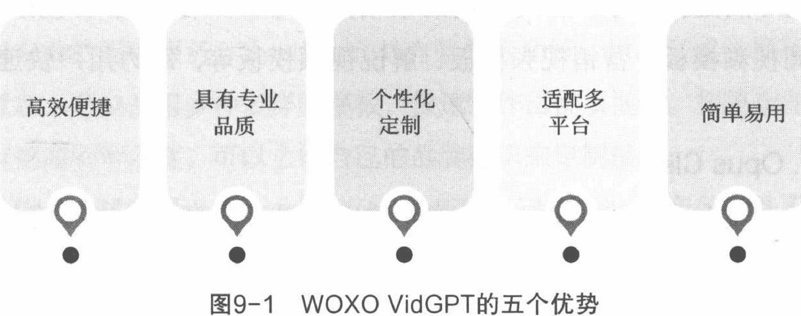

- （1）高效便捷。生成能力强，视频剪辑、合成、特效添加等制作环节都能自动完成，大幅减轻人工负担。
- （2）具有专业品质。素材库丰富，编辑功能多样，使用者能够快速产出达到专业水准的成片。
- （3）个性化定制。支持对视频风格、文案、配乐等要素进行个性化设置，方便打造独一无二的专属内容。
- （4）适配多平台。提供多种格式与分辨率，适配不同渠道，满足多元投放需求。
- （5）简单易用。界面简洁，操作直观，零基础用户也能迅速上手。

产品提供免费版、专业版、企业版三种形态，收费方式不同。免费版包含基础制作功能，适合个人或小团队试用；专业版面向中型公司和资深创作者，提供更丰富的素材库和进阶编辑能力；企业版面向大型机构，提供端到端解决方案和定制化服务。按自身需求选择即可。

- 5. DeepBrain
DeepBrain 是一个 AI 视频生成平台。上手后准备好脚本，约五分钟内就能拿到专属 AI 视频，极大压缩了拍摄、剪辑、后期的人力和时间成本。平台内置超过 100 个 AI 虚拟形象，支持 55 种以上语言，覆盖不同人群需求。还提供定制化虚拟形象服务，明星、主播等可以拥有自己的专属数字分身。不同行业可选用新闻、营销、解说等现成模板，快速完成视频生产。

- 6. Opus Clip
Opus Clip 的核心亮点是把长视频压缩成短视频。它能自动解析上传的长片，抽取吸睛片段剪成短内容，并对成片打分，预估传播潜力。功能上支持自动转场，让画面和音频切换更顺滑；自带自动字幕；输出支持 1080p 高清。模板风格多样时尚，帮助用户快速做出专业感强的短视频。

- 7. 万兴播爆
万兴播爆是万兴科技推出的 AI 视频创意软件。打开软件输入关键词，就能迅速生成真人风格的营销视频，省去拍摄剪辑环节。数字人库种类丰富，可按性别、年龄、肤色、国籍等维度挑选，满足个性化制作需求。平台提供多套专业级模板，覆盖不同营销场景。文字转语音模块支持多种风格、多种语言配音，提升成片质量。新手可直接套用官方营销脚本，只需替换关键词即可生成自己的文案；内置 AI 智能写稿功能，输入关键词就能获得多语言营销稿件。

- 8. Synthesia
Synthesia 专注于生成带 AI 头像的企业视频。功能覆盖多语言、多模板、屏幕录制、媒体库等。使用者只需提供写好的脚本，就能得到成品视频。平台提供 70 多个现成 AI 头像，也支持创建品牌专属头像，若默认形象不合适，还能自建头像。语音方面提供 AI 配音服务，操作简单即可获得专业级旁白。配合画外音设置和多样模板，能快速产出高质量视频。如需更强辨识度，可上传品牌 LOGO 对模板进行定制。

除上述产品外，Sora、Runway、Pika、FlexClip 等也是值得关注的选择。这些 AI 视频工具都在不断迭代，功能持续升级，为用户带来更高效便捷的制作体验。随着技术成熟，视频创作门槛将继续降低，无基础用户也能产出高质量内容。

### 9.2.3 自动分析宣传数据，设计并调整宣传方案
在数字化环境下，数据驱动已成为企业持续增长的关键。AI 在宣传效果评估环节发挥重要作用，提供更全面高效的分析手段。

AI 可从社交媒体互动、访问量、点击率等多个渠道自动抓取宣传数据，并汇总到统一平台进行集中管理。

基于分析结果，AI 能帮助企业更精准描准目标人群，制定更具针对性的投放策略。它可以识别哪些内容类型、话题在目标人群中更受欢迎，进而指导内容优化；也能依据各渠道的实际表现，判断最优渠道组合。

借助实时分析，企业可以即时掌握活动反馈并快速调整策略。AI 支持 A/B 测试，对比不同方案的效果，帮助筛选出最优解。持续学习能力让企业依托长期数据不断优化投放方案，提升整体效果。

例如某服装品牌长期在线上线下做推广。随着业务深入，品牌面临数据分散、难以整合分析，以及如何据此调整策略的难题。引入 AI 工具后，企业自动采集并整合各类宣传数据，搭建集中数据平台，对数据进行深度挖掘和分析，从而支撑决策。

尽管 AI 在数据分析与方案设计上优势明显，也带来数据安全、隐私泄露等挑战。企业在使用过程中需确保数据安全存储，防止泄露，同时要对员工开展 AI 与数据分析培训，提升使用能力。

通过 AI 自动分析宣传数据并动态调整方案，企业文化宣传获得新动力。数据驱动让受众洞察更精准、内容更优化、渠道更合适、策略更敏捷。

# 第10章 服务赋能：AI终极目标是优化体验
在商业环境快速变化的今天，AI 正以其独特优势重塑企业办公方式。它渗透到运营的各个环节，为员工体验和团队协作带来全新改变。从智能关怀到智能机器人，AI 以不同形式激发企业活力，推动组织向更高效率、更人性化的方向发展。

## 10.1 AI实现极致工作体验
AI 在办公场景的广泛应用，为员工带来全新体验。它能自动处理繁琐重复的事务，让员工把精力放在更有价值的工作上；通过深度数据分析提供精准决策支持，帮助员工做出更明智判断。整体工作体验因此大幅提升，为企业发展注入动力。

### 10.1.1 数字化系统，随时随地办公
越来越多企业引入数字化办公系统，传统工作模式被打破，随时随地办公成为现实，工作效率和体验同步提升。

传统模式下，员工花费大量时间处理文件、邮件、表格，且依赖面对面沟通，易出现信息不畅、误解、沟通成本高等问题。数字化系统能有效解决这些痛点。通过多样化系统，员工可实现远程协作、在线共享文件、高效沟通，时间空间限制被打破。

在数字化支持下，员工可轻松完成各类任务。例如智能语音助手可将语音转为文字，让移动办公或无法手动输入时仍能高效作业。

AI 还促进跨区域协作，例如自然语言处理技术可实现多语言实时翻译，提升远程协作效率。

在数字化办公领域，腾讯走在前列，构建了覆盖智能会议室预约、空调照明、员工考勤门禁的系统。办公设备和软件工具均支持智能化，员工可通过手机或平板远程访问系统，无论身处何地都能处理事务。这种模式提升效率的同时增强灵活性，有助于平衡工作与生活。

数字化办公已成为企业高效运作的必选项。它提升效率、带来便利，激发创新与创造力。未来随着数字技术普及，数字化办公将在提升生产力、优化流程、激发创新等方面发挥更核心作用，成为工作模式变革的主驱动力。

### 10.1.2 自动处理基础任务，提高工作效率
AI 热度持续升温，企业纷纷关注其在基础任务自动化方面的潜力。AI 处理信息速度快、准确性高且可 24 小时运行，是释放员工潜能、提升效率的有力抓手。

大量企业引入 RPA 技术，利用软件机器人实现办公和业务流程自动化。机器人可模拟人工电脑操作，完成规则性强、重复度高、可量化的任务。

借助 RPA，企业可实现数据录入、整合、分析的高效化，提升速度和准确性。以财务为例，RPA 可自动完成数据录入、报表生成，减少人为错误并节省时间。

在客户服务方面，RPA 可自动化客户信息管理、订单处理、投诉处理等流程，提升服务效率和客户体验，帮助企业更精准满足需求。

财务管理流程也得到优化，报表生成、账单核对等繁琐工作可交给机器人高效执行。某跨国企业引入 RPA 后，常规财务流程实现自动化，节省成本的同时让员工聚焦创造性工作。

人力资源管理同样受益。员工入职时，HR 需整合多系统数据并完成邮箱、权限、设备等设置。RPA 可自动激活账户，提升流程效率，并依据权限和入职信息智能执行决策。

用 AI 实现基础任务自动化已成为提升效率、释放潜能的关键。但在应用中需关注技术挑战与数据安全，确保合规使用并持续发展，充分发挥 AI 优势，帮助企业在竞争中占据有利位置。

### 10.1.3 利用智能知识图谱，满足工作成长需求
知识图谱是一种语义网络式知识库，具有有向图结构。通俗地说，它由实体、关系、属性构成的数据结构，可视为 2.0 版数据库。

知识图谱分为通用型和行业型。通用型侧重行业通用常识，常用于搜索引擎或推荐；行业型面向企业用户，按特定行业构建知识库，提供高质量知识服务。

知识图谱是人工智能的重要分支，最初由谷歌提出，广泛应用于搜索、自然语言处理、电商等领域。如“百度一下”即是典型应用。通过数据采集、信息处理、知识计量、图形绘制等手段，知识图谱把复杂隐性知识变得清晰简约，并能揭示知识动态变化，为员工学习提供参考。

在办公场景中，员工可借助知识图谱制定科学学习计划，提升效率，满足成长需求。知识图谱能从三个层面优化搜索效果，如图 10-1 所示。

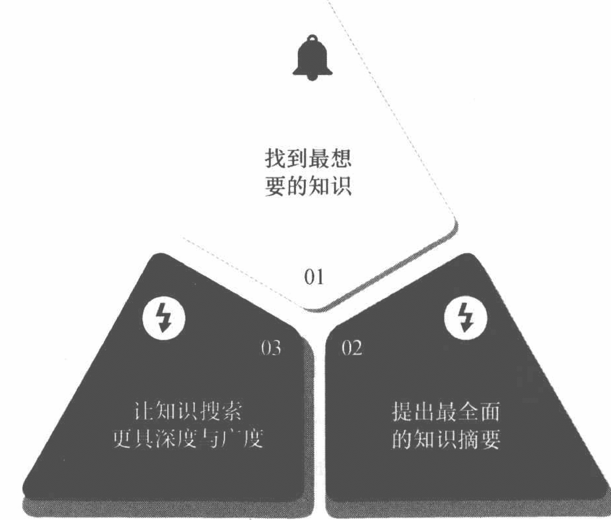

- 1. 找到最想要的知识
知识图谱以搜索引擎为基础，智能检索可精准锁定核心知识点，快速帮助员工获取所需信息。
- 2. 提供最全面的知识摘要
知识图谱能给出系统性摘要。例如搜索人名时，不仅能看到大事年表，还能关联相关人物脉络，帮助建立层次与逻辑。
- 3. 让知识搜索更具深度与广度
知识图谱可拓展搜索边界，对行业趋势、技术动态等进行综合呈现，构建相对完整的知识体系，让员工掌握更牢固。

知识图谱不仅帮助员工实现个性化学习，还能帮助企业了解员工知识掌握情况。

## 10.2 AI背景下的协作体验变革
AI 的深度应用不仅提升效率，还重塑团队协作方式和体验。从智能助手助力沟通，到数据分析工具洞察趋势，AI 正渗透协作各环节，让员工在更智能便捷的环境中高效配合。未来协作将更智能，为创新发展提供持续动力。

### 10.2.1 打通“部门墙”，拒绝信息差
“部门墙”指阻碍部门间信息传递与交流的无形壁垒，表现为结构混乱、效率低下。要打通它，企业需引入现代化沟通协作工具，实现高效协同，形成开放文化。

#### 1. 故事墙
故事墙通常划分为计划、开发、测试、完成四区，适合研发部门。每项需求以卡片展示，位置越高优先级越高，整体研发进度一目了然。

卡片常按颜色区分需求内容和执行进度，如图 10-2 所示。

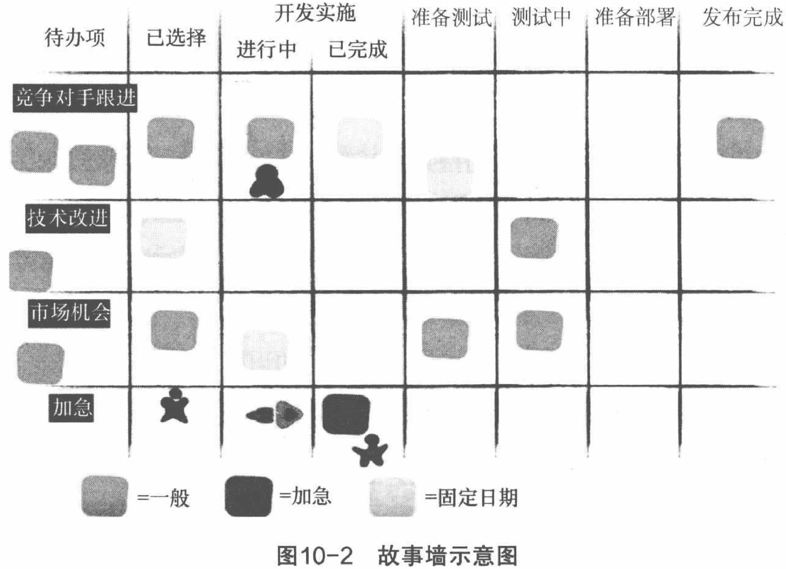

除进度外，故事墙还能反映隐性信息。例如计划区卡片稀少，说明需求不足或更新慢，需产品策划补充；某需求长期未解决，可能存在技术瓶颈，需跨部门沟通决定投入或放弃。

#### 2. 数据墙
数据墙适用于运营部门，用于展示日新增、日活跃等运营指标。参数类型可按产品类型或阶段调整。

以参数和日期为维度绘制折线图展示趋势，并标注目标值，便于观察完成情况。数据墙培养员工关注数据的习惯，提升分析能力。运营过程中，新发现的关键指标应及时上墙，并对比改版前后的表现，找准改进突破点。

#### 3. 协同工作的工具平台
传统平台不支持多人同时编辑，往往需逐人传递，流程繁琐。现代协同平台如 Worktile、会议桌、腾讯文档、印象笔记等支持多人在线协作，显著提升效率。目前主流工具覆盖 PC 与移动端，支持多人同时编辑，方便协作撰稿、方案讨论、会议记录、资料共享。

#### 4. 共享文件夹
共享文件夹适合存放占用空间大、不便在线修改的文件。这类文件使用频率低但取用时需快速传输，可集中存档。注意访问范围通常限制在局域网内。

线下共享工具如白板、公告板可视化强、位置醒目，但需专人维护且单次共享量小；线上工具共享量大、免维护，但可视化较弱，需员工主动查找。综合使用可降低共享成本，加速数字化进程，提升跨部门协作效率。

### 10.2.2 协作办公软件，身处异地也能沟通
在 AI 时代，自上而下的沟通效率偏低，不利于盈利。许多企业强化线上数字化协同，提升管理效率。线上协同将改变办公认知，推动企业自动化、智能化、数字化转型。

以“飞书”为例，作为协同办公领域的后起之秀，飞书持续整合资源完善生态，已成为企业端协同平台的代表，为信息沟通带来便利。

在云服务生态建设上，飞书早早布局，经过多次升级，已具备强大的云处理能力，可高效处理多人上传的海量数据，实现多人同步交流。

和钉钉、企业微信这些偏向于平台整合的办公工具不同，飞书的核心打法是把内部沟通和协同效率放第一位，进而撬动团队创造力的提升。它走的是一条轻量化路线，尽可能复刻线下同事面对面实时交流的临场感，也在持续强化与各类工作系统的联动能力。对一家公司来说，人和信息是最根本的生产要素，飞书就让内部信息流动脱离了过去那种单线串联的模式，支持多人同时在线协作，真正把线上协同落到实处。

### 社交型办公，让幸福感有了物理载体

办公室不只是美观问题，更关乎员工的心理感受和行为习惯。社交型办公从服务配套、资源配置到企业文化演进全方位发力，打破空间隔阂，鼓励互动交流，直接作用于幸福感的提升。

想象一下，没有了格子间带来的压抑，员工可以自由走动、随时碰撞灵感，靠在沙发上也能高效工作，这样的场景让人印象更舒服。美国一家医学类期刊曾追踪500多名职场人，发现开放式空间里的人压力指标更低、活跃度更高，随后美国不少企业掀起了改造开放办公的潮流。

谷歌就是这方面的标杆。不同分部的办公区都充满实验感，滑梯、单车、篮球场、乒乓球桌、游戏区都是标配，每个空间都有自己的情绪设计，让人不会觉得无聊。改进还在持续，2021年Googleplex里出现了Team Pods工作舱，里面配备桌椅、白板和储物柜；针对不需要固定工位的同事，则提供了带圆弧挡板的灵活站位；还会用机器人充气球墙来吸音降噪。

会议形式也在进化，他们推出了“篝火”新会议室，参会者围坐在一个带背板的圆形区域里，背板大屏可实时呈现远程同事的身影，仿佛围着篝火聊天。谷歌的方案未必是唯一答案，但随着个人意识觉醒，开放式空间更受欢迎的趋势很明显，它让沟通更顺畅，协作效率自然上去。

## 智能关怀：用技术把温暖送到每个员工

在数字化浪潮下，智能关怀已经成为提升满意度的关键手段。借助AI、大数据等技术，企业能更精准地读懂员工真实需求，提供定制化支持，营造舒适和谐的氛围，让每位员工感受到被在乎，从而点燃工作热情和创造力。

### 祝福自动达，不掉链子更显心意

给员工送上节日或生日祝福，正在成为一种重要的组织关怀。及时的问候能拉近距离，增强凝聚力，也能稳定满意度和忠诚度，AI正好能把这件事做得又准又暖。

通过自动化发送，企业可以确保祝福在正确的时间点抵达，避免人为疏漏带来的尴尬。效率提升的同时人力成本下降，员工也能从细节中感受到公司的细心。节日祝福已成为企业文化表达的一部分，当员工收到来自组织的问候，会更有归属感和被认可感，进而提升积极性和满意度，为公司创造更多价值。

以能自动推送定时短信的SMS平台为例，它能帮助HR在节假日或员工生日时自动发出祝福。主要价值体现在四点：一是全自动投递，按预设时间和员工信息发送，减轻HR负担；二是定时提醒，确保当天不漏发；三是个性化生成，结合姓名生日自动撰写专属祝福，提升心理满足感；四是数据统计，可以记录发送量、成功率并做效果分析，帮助HR了解反馈。引入这类智能工具，能让关怀更高效、更精准。

### 自助福利商城，让选择权交给员工

在人才竞争白热化的环境里，员工满意度和忠诚度直接决定企业韧性。传统福利天花板明显，不少公司开始用AI搭建自助式关怀福利商城，为员工提供更便捷、更个性化的福利体验。

商城背后是大数据在做需求画像，为智能推荐提供依据；自然语言处理技术能理解员工的提问和反馈，实现更人性化的互动；机器学习则持续优化推荐模型，让匹配度越来越高。员工登录后就能浏览、下单，界面简洁、上手快。

这种模式强化了归属感，也提升了忠诚度。很多商城会设置积分体系，员工通过完成工作任务、参与学习培训获得积分，再兑换心仪商品，动力自然被调动。管理层面，企业可以集中管控各类福利计划，解决弹性福利、补贴发放等难题，流程更简洁、效率更高，人才流失率下降，队伍更稳定，对长期发展大有裨益。

### 员工援助计划，用AI做情绪雷达

随着管理精细化，员工援助计划已成为维系满意度和忠诚度的重要抓手。AI的加入让计划更主动、更精准，既能分析需求期望，也能输出个体化方案。

通过采集和分析工作时长、休息节奏、工作效率等数据，AI可以提前预警可能出现的压力信号并给出调整建议。7×24小时在线的智能咨询机器人能提供心理疏导和情绪支持，还能就职业规划、学习成长给出建议，帮助提升技能和竞争力。

数据驱动也让决策更贴近员工实际，职业规划与学习建议的精准推送，让企业培养更有效，员工能力与效率提升，职业满意度随之提高。有大厂已用AI监测员工心理健康，及早干预潜在风险，心理健康水平和工作满意度都明显改善。未来AI与人力管理将更深度融合，实现需求洞察和问题解决的高效闭环。

## 智能机器人：员工身边的新搭档

智能机器人拥有处理多样化任务的能力，已在多个场景成为员工的得力助手，减轻负担，推动业务更顺畅。

### 虚拟数字员工快速崛起

AI时代虚拟数字员工发展迅猛，能分担工作、解答用户问题，提升服务质量与效率。金融咨询就是典型场景。

AI金融客服让服务更人性化、更智能、更高效。人性化体现在，它借助语音识别、视觉识别、大数据、云计算等技术，表现得更像真人，且态度更稳、更礼貌。传统窗口排队易引发情绪冲突，而AI客服始终保持平稳语调，能理解各种金融提问，通过视觉识别捕捉面部表情，必要时转接专业人工，形成电话、短信、微信、App等多渠道融合服务，自然语言处理让它能真正“听懂”用户意图。

智能化源于专家系统与深度学习的结合，系统能自主学习常见问题，留存率和转化率因此提升。高效化则依赖大数据处理能力，金融数据庞杂且交织，人工筛选成本高，算法能从海量交易、客户信息、市场评估、风控数据中提炼关键价值点，为客户提供更优质咨询，效率大幅提升。

### 聊天机器人解放一线

为了提升产出，越来越多企业引入聊天机器人。阿里巴巴的“店小蜜”就是代表，它帮助商家降低人力成本、提高运营效率。前身“阿里小蜜”仅能做文字回复，而店小蜜搭载深度学习与自然语言处理，可根据店铺专属信息自动答疑，还能基于用户画像做个性化推荐，处理退货、退款、改单等服务。

在大量人工客服对话的训练下，店小蜜交流更自然，甚至能发合适表情包，极大分担了选品和售后环节的工作。如今苹果、森马、小米、华为、荣耀等品牌的线上店都能看到它，森马约60%的用户咨询已由它承接。全天候响应让用户体验更好，留存和转化随之提高，同时实时反馈用户数据，助力商家快速调整营销策略。

### 语音转写，让会议和培训更轻

语音识别与转写系统正成为办公场景的标配，帮助员工减负提效。它涵盖自然语言处理、语音识别、前端信号处理、语音合成等，能实现人机语言交互。

得益于深度神经网络，识别准确率已接近甚至超过人类，随着远场唤醒、全双工对话的普及，应用场景持续扩大。NLP模型和知识图谱的成熟也让对话能力更强。在互联网、医疗、教育、司法、公安等领域，语音转写和合成的渗透正在加深。

科大讯飞在自然语言处理领域持续深耕，语音识别、语义理解等方面拥有多项核心专利和产品。借助这些能力，员工可以用语音记录会议内容，省去整理时间，提升会议效率；培训时也能自动生成纪要，方便回看复习，学习效率显著提升。

### AI助手：提醒与推送的隐形管家

为让工作更从容，企业开始引入AI助手，专注于事项提醒和信息推送，助力时间管理和任务安排。

以Lyrebird为例，它打造的智能语音系统能分析录音与文本关联，模仿收集到的人声进行对话。文字转语音的最大挑战是自然度，Siri、Alexa等虽已普及但仍有机器腔，长期使用易疲劳。Lyrebird提供的“人声”在细微处仍有差别，但明显更温暖。

系统基于语音合成技术，从预录样本中提取核心词汇和发音特征，用类脑算法在深度学习加持下，仅需1分钟的讲话样本就能高度还原语调和情感。学会几个声音后，再模仿新对象会更快，质量更高。这让个人AI助手、音频书、视障阅读服务等场景都更友好，最具想象力的还是娱乐互动：模仿韩雪、郭德纲、李健或初音未来，用喜欢的声音提醒安排、讲段子、陪入睡，甚至在异乡模拟父母声音交流，带来家的感觉。

# 第10章 服务赋能：AI终极目标是优化体验

如果喜欢收集不同声音，类似的智能语音系统会带来很多乐趣。它改变了传统人机交互方式，让生活更有温度与情趣，也不断提升生活质量。

本书系统探讨了AI在人力资源管理中的广泛应用。趋势篇从宏观视角描绘变革蓝图，实战篇围绕选育用留细解落地方法，赋能篇则展现AI在管理、业务、文化建设中的作用，从宏观到微观再到综合应用，帮助读者建立完整知识体系。随着技术进步，AI正深刻重塑招聘、培训、绩效、薪酬等每个环节，掌握这些趋势，才能在竞争中保持领先。人力资源管理是企业管理的核心，本书提供了大量实用方案与案例，从操作步骤到落地技巧，帮助AI真正融入各个环节，提升招聘效率、培训效果、绩效水平，以及员工满意度和忠诚度，给出切实可行的解决方案。

在人工智能全面渗透商业生态的当下，企业之间的真正较量，早已演变为对人才的争夺与激活。

这本书提供了一条可操作的人才升级路径：以AI为抓手重塑人力资源管理，点燃员工的潜能与创新力，进而带动成本下降、运营效率提升，最终支撑起企业的持续成长与创新能力。

无论是希望以AI赋能管理的企业决策者，还是正在探索数字化转型实践的HR从业者，都能从中获得一套直接可用的实战方法。

—— 北京慧辰资道资讯股份有限公司战略投资部总经理 秦毅

出版方为清华大学出版社，上架建议归类于企业管理，相关资讯可关注官方微信公众号，定价69.00元。