# 智能驱动的平台变现手册：高转化话术库+十套内容框架+视频课

## 内容概览

在流量持续分发的当下，该笔记社区已从生活分享阵地升级为商业转化与个人品牌孵化的核心场域。

本书把账号冷启动到持续盈利的整条链路拆开讲，同时深度融合生成式技术的使用方法，让日常运营效率实现数量级跃升。分六大部分。开篇讲如何抓住自媒体窗口期，找准差异化定位并建立竞争壁垒；中部拆解号的搭建思路，讲清竞品对标逻辑，并以智能化手段加速内容生产，撬开十万播放的入口；收尾部分给出从零到一再到规模化复制的落地打法，帮助搭建可长期运转的盈利闭环。

无论是想借助平台获取增量的品牌方，还是想搭建个人IP的内容从业者，都能在这里找到清晰的学习路径和可执行的操作指引。它不仅说明做什么，更讲透每一步怎么做，帮助你在新媒体营销浪潮中抢占先机，实现稳定持续的回报。

# 作者介绍

方比比

方比比，潮汕籍，公众号“比比先生”创始人。全网粉丝累计20万+，百万级IP幕后流量操盘人，具备4年平台实战经验，担任多家集团的运营战略顾问及培训讲师，带领上千名个人IP与实体经营者完成平台变现。聚焦生成式技术全链路赋能内容创作，搭建高价值账号体系，累计助力客户盈利过千万。

理白

理白，烟台籍，公众号“理白先生”创始人，全网粉丝累计30万+，自媒体学习社区“星辰学院”负责人。

2016年进入新媒体行业，日更坚持九年，推动数万普通人走向内容IP变现。文章曾刊于《人民日报》、新华网、《读者》等渠道，服务过世界五百强企业，曾任百万级平台主编。代表作《新媒体写作创富》。

# 需要一位懂机制也懂人的增长导师

问我跟比比老师学平台的最大体感，我会说四个字——判断准。从此能快速剥离表象，掌握爆款选题与精准导流的底层逻辑，再也不用在起号、引流、成交上雾里看花。

挑选导师我只看三点：实战、商业、以用户为中心。看目录就能感受到本书作者完全符合。他的交付和多数老师不同，极具用户思维：第一层差异在战略层面，定位、内容、品牌、工作流的整体打法不同；第二层差异在情绪层面，让粉丝在进入私域前就产生强烈购买冲动，成交效率自然倍增。

比比老师是我见过最懂学员的导师之一。线下培训时亲眼看他现场改笔记，感觉他就是为内容而生。

虽显年轻，却深耕平台商业四年以上，经历多个周期与风口，对推荐机制与规则迭代非常敏感。无论是商业IP引流、蒲公英商务变现，还是电商带货，都游刃有余。

尤其在高客单IP领域，这是他的舒适区更是强势区，我曾推荐多位客户给他，反馈好评率100%。他手握多个主流赛道的爆款案例，能够宏观判断商业风向，微观打磨内容与用户心理，帮客户摆脱流水线式运营，拥有真正的差异化品牌和核心竞争力。

比比老师最大的可贵之处是与时俱进。从不躺在过去成绩上，也从不懈怠交付。生成式工具兴起、国产生力军爆发后，平台IP如虎添翼，他也在第一时间把智能技术融入方法论，帮学员解决持续产出难题，实现弯道超车。

我亲眼见证他和团队在完整闭环基础上，反复测试打磨出一套降本提效的笔记制作流程，实现多工具联动、多账号协同，解决了很多博主的痛点：传统老板不会写脚本、斜杠青年没时间做笔记。现在“一鱼多吃”，主业副业兼顾变得简单。

让创作者摆脱内容与流量的卡点，用杠杆撬动时间与资源，跑赢行业均值，就是本书的使命。读完你会像我一样被惊艳。

智能风口已至，平台势能向上，老师既懂商业底层逻辑也懂用户。此刻遇到一位踏实导师和一本满是实操案例的书。每一次打开，都能解锁99+。

梁靠谱

销冠孵化基地创始人

# 免费配套

高转化提示词库+10套封面模板+5节独家视频课。读者可扫码获取。

《AI+小红书一本通》附赠福利

# 当生成式技术遇见该平台，当理白遇见方比比

我与方比比老师因商业相识，初次见面在2022年春天。那时他已是平台商业IP内容操盘的知名人物，并参与编著过一本相关畅销书。

热爱的事业让人眼睛发亮。比比老师在平台教练路上已坚守四年。四年前他还是默默无闻的运营新人，四年后成为1000+学员的“获客军师”，指导学员用精准导流撬动千万GMV。这种成长性最打动我，爆款可以复制，真诚无法速成。

他的课程理论新颖清晰，直指实战，学员好评不断；教学中风趣幽默、真诚负责，也让人欣赏。

比比老师的每段经历都踩在平台商业化的关键节点：从创业公司操盘手，到字节跳动平台端运营，再到头部社群服务商，最后成为独立获客导师。交流深入后，我们从事业合伙人到线下合伙人，再到人生合伙人。

单纯做内容创作已是过去式，结合国产智能的高速进化，比比老师敏锐捕捉机会，将生成技术与平台获客思维深度融合，把四年经验提炼打磨，最终结成本书。

本书最魔幻的是，你以为在看预言，实则是落地干货：第二章的盈利路径可直接当思维导图用，第四章的爆款内容自带流量密码，第六章的商业模式设计堪比商业计划书生成器。在人人皆可智能的喧哗下，比比老师坚持严苛的内容质检，既传授选题公式，也揭秘冷启动流量密码。

此刻翻开本书，便开启一段“智能+平台”盈利之旅。这或许是智能时代给内容创业者最大的礼物：在算力与脑力的共振中，每个人都能找到远航之路。

船已启航，你将成为自己的智能指挥官。

理白

公众号“理白先生”创始人

# 第一章 智能时代的平台新机遇

## 1.1 发展态势：为何现在就该入局

数字化浪潮下，社交平台层出不穷，该社区凭借独特的氛围和强黏性，在自媒体赛道持续爆发。截至目前，月活用户已达3.3亿，日活用户1.29亿，用户规模不断扩张，基础扎实且增长强劲。

#### 一、人群画像：高净值人群的聚集地

从图1-1的统计可知，用户以“90后”“00后”为主，其中90后占70%；一二线城市用户占50%，女性用户占70%；平台活跃着约4300万“质享人群”，消费力与鉴赏力兼备，愿意为高客单产品买单。

图1-1 用户群体分析

这批人群构成平台鲜明的人群画像：高消费力、爱私信、有深度兴趣、购买意愿强，乐于为优质内容和产品付费。如图1-2所示，社区用户平均每月阅读17.2篇笔记，偏好新需求与深度兴趣探索。

图1-2 社区用户特点

如此结构，为创作者提供了绝佳条件。一次产品体验分享，很可能直接影响用户决策。需求真实，获客更精准，商家借此在该平台占据盈利高地。

#### 二、内容生态：多赛道共生的空间

如图1-3所示，内容覆盖美妆、时尚、旅行、家居、母婴、美食、教育等生活全域，为创作者提供丰富创作空间。

平台的内容电商属性让用户在浏览中完成决策，转化效率提升；同时也为创作者打开多样变现通道，如通过蒲公英平台高效撮合商单，推动商业生态繁荣。

#### 三、推荐机制：以质量为核心

相比其他平台，推荐更看重互动数据、地理位置、标签分类。即使是小V、素人，只要内容质量过硬，也有机会获得公平曝光。该机制鼓励优质内容涌现，维护生态壁垒。

一篇有价值的笔记，即便来自仅几十粉丝的账号，也可能被推至大量用户面前。门槛降低，普通人获得公平竞争机会。

该平台在其他维度同样突出。如下表1-1所示为平台对比。

表1-1 不同平台属性特点

| 平台 | 内容类型 | 推荐机制 | 变现模式 | 适合创作者 |
| :--- | :--- | :--- | :--- | :--- |
| 小红书 | 深度种草、购物决策、生活方式 | 以互动+搜索流量为主 | 品牌合作、电商带货、课程咨询 | 适合所有细分赛道的内容创作者 |
| 抖音 | 娱乐化短视频 | 短期爆款推荐机制 | 直播电商、品牌广告、短视频带货 | 适合擅长视频内容创作的人 |
| 微博 | 热点新闻、短内容分享 | 依赖社交关系链 | 品牌合作、广告投放 | 适合打造个人IP的公众人物 |
| B站 | 长视频+知识科普 | 社区推荐机制+用户订阅 | 知识付费、品牌广告、直播 | 适合深度内容创作者 |

相较短视频，该平台偏图文，降低了创作门槛。变现模式丰富，叠加高价值用户聚集，商业化具备天然优势，形成优质内容与创作者的良性循环。

#### 四、品牌声量：社会认可持续攀升

社会影响力不断扩大。2024年春晚，平台首次成为央视春晚的笔记与直播分享平台，打造陪伴式直播《大家的春晚》，互动次数达1.7亿。

2025年再次与央视春晚合作，进一步巩固国内品牌力，如图1-4所示。

图1-4 春晚账号笔记

无论是人群结构、内容生态、推荐机制，还是品牌声量，都让该平台备受关注。内容创作者应果断入局，抓住自媒体红利期。

##### 本节小结

入局的四大理由：

1. 用户构成：高价值人群聚合。
2. 内容生态：多元领域共生。
3. 推荐机制：内容优先推荐。
4. 品牌影响力：社会认可持续提升。

### 1.1.2 效率工具箱：八款适配国人的智能利器

#### 一、重新认识智能：触手可及的创作助手

生成式技术已从遥远概念变为日常工作助手，可辅助创作、设计、数据分析等多项任务。

核心价值在于提效、提供创意支持和数据洞察。卡壳时能生成初稿，设计时能产出符合平台审美的视觉，分析市场时能处理海量数据提炼信息。

#### 二、为中国用户量身定制的八大产品推荐

入门首先要选对工具。以下8款适配中国用户，功能完善操作简便，能有效支撑日常运营。

##### 通义千问Qwen

阿里巴巴出品的综合助手，支持文案创作、对话、代码等，中文理解与生成能力突出，界面友好。

例如想写500字护肤笔记却无从下笔，可用其获取思路、生成指定风格评测，还能分析平台热搜趋势。完全免费且集成度高，如图1-5所示。

图1-5 通义千问页面

##### 文心一言

百度推出的中文创作工具，擅长文案、翻译、问答，输出自然流畅。

创作者可借助它批量生成减脂餐类高吸引力标题，中文内容理解与生成优势明显，如图1-6所示。

图1-6 文心一言页面

##### 即梦

专业图像生成工具，操作简洁，输入文本描述即可生成高质量配图。

例如输入“办公室场景，女性做简单拉伸，画面明亮清新”，即可获得适合健身主题的素材。质量高创意足，新手友好，如图1-7所示。

图1-7 即梦页面

##### DeepSeek

功能全面的通用大模型，擅长长文创作与数据分析，结构清晰逻辑严谨。

可用来撰写母婴护理深度教程，或分析平台上热门母婴产品的市场表现，适合需要高精度输出的专业创作者，如图1-8所示。

图1-8 DeepSeek页面

##### 豆包

字节跳动研发的多功能助手，集成对话、学习、生活管理，适合日常创作管理。

可规划每日励志发布内容，或将灵感整理成结构化笔记。界面友好易上手，功能偏基础，适合初学者，如图1-9所示。

图1-9 豆包页面

##### Kimi

聚焦内容创作的工具，适合新手博主，短视频脚本与图文生成表现突出。

可生成旅行Vlog分镜头脚本，或根据文字描述生成配图。操作直观，数据分析能力有限，更偏创作侧，如图1-10所示。

图1-10 Kimi页面

##### 秘塔AI

基于大模型的无广告搜索工具，提供简洁、深入、研究三种模式，结果以文字答案、思维导图、大纲、参考来源等形式呈现，信息获取高效。

例如撰写护肤成分科普笔记，可用研究模式获取成分分析，自动整理思维导图与大纲，还能用学术搜索查找文献，提炼关键信息，如图1-11所示。

图1-11 秘塔AI页面

##### 腾讯元宝

腾讯基于混元大模型推出的综合应用，集成搜索、总结、写作、绘画等功能。

工作场景可解析PDF、Word等多格式文档，支持超长上下文；生活场景提供AI头像、角色扮演、口语陪练、同传等。

美食博主可借此获取灵感与步骤，再用绘画功能生成步骤图与成品图，同时分析当季流行食材与爆款内容特征，生成吸睛标题和开头，提升曝光，如图1-12所示。

图1-12 腾讯元宝页面

生成技术已成为内容创作与运营的实用帮手，在文案、视觉、数据方面全面赋能。合理搭配通义千问、文心一言、即梦、DeepSeek、豆包、Kimi、秘塔AI、腾讯元宝等工具，即使初学者也能显著提升效率，简化流程。

##### 本节小结

适配中国用户的八大智能产品：

1. 通义千问。
2. 文心一言。
3. 即梦。
4. DeepSeek。
5. 豆包。
6. Kimi。
7. 秘塔AI。
8. 腾讯元宝。

### 1.1.3 全流程赋能：智能在创作中的高频场景

对博主而言，生成技术提供了一种全新的运营支持方式。通过精准指令引导，可批量生成符合平台调性的优质内容，大幅提升账号运营效率与笔记质量。

无论是获取灵感、丰富内容，还是与助手互动，都能以更高效的方式展现创意与表达。

下面以智能赋能为底座，全面呈现从定位起号到笔记发布的运营全链路，共覆盖九大场景，开启神奇世界！

框架示意图如图1-13所示。

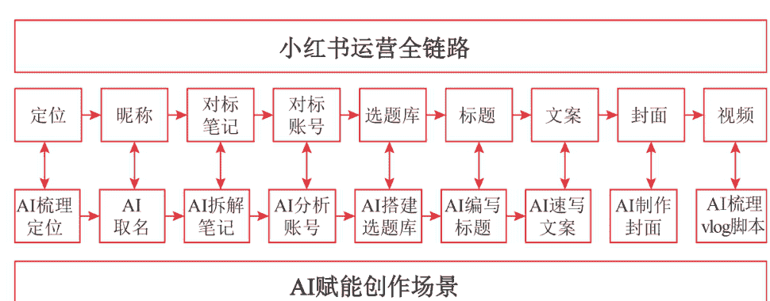

## 图1-13 运营全链路展示

### 一、开局先做诊断，让账号从第一天就领先

小红书的成长逻辑里，角色锚点决定起跑高度。很多创作者跑了一阵后才发现笔记杂乱，受众打散，既抓不住精准人群，也很难形成商业闭环。过去四年我复盘了大量案例，九成以上卡在方向不明。

有的人今天记录生活，明天测评商品，后天聊职场感悟，关注者读不懂你在做什麼；也有的人想同时兼顾护肤、健身、美食、成长，标签暧昧，调性飘忽，留存自然上不去。

方向定了，后续才顺。开号的第一步不是猛发，而是先把人物画像理清。画像清晰以后，素材才有主线，涨粉才稳，变现路径也更显性。如果还在选赛道，建议对照自身经历和市场缺口去判断，不同赛道吸引的人群与商业化方式完全不同。

以母婴为例，新手育儿妈妈容易对接品牌做合作；有职场背景的全职妈妈笔记更易吸引高客单关注者，适合推高端课或知识付费；儿童启蒙类则能牵动教育品牌，甚至发展成个人讲师或出版IP。思路可以迁移：美妆可做成分科普、平价替代测评、高端体验；健身可深耕居家训练、塑形方案、减脂干货；旅行探店可做小众目的地推荐、城市合集、深度攻略。

想快速锁定方向，学标杆最省时。用AI辅助思考效率更高。把个人背景和任务指令丢给模型，就能得到一份兼顾专业度与生活感的多维分析报告。一次可以拿十个角色方向做参考，不满意就微调输入条件，就像请了一位新媒体顾问帮你匹配市场需求。

以居家带娃的妈妈、前大型企业新媒体从业五年、现带两岁宝宝为例，AI给出的高潜力人物画像包括：

1. 运营型妈妈的育儿标准流程，标签：企业运营总监转型宝妈，用体系化方法带娃。可输出《用项目管理思维培养宝宝自主用餐》《用AARRR模型拆解如厕训练全流程》。优势是职场方法论迁移到育儿，差异化明显。
2. 清醒成分派妈妈，标签：数据控、反焦虑、拆解专家。可输出《DHA补充剂成分拆解：这五款不符合国标》《网红婴儿枕测评：从颈椎发育学说真话》。适合接健康食品、用品的高端合作。
3. 高效妈妈时间管理者，标签：时间管理、单人带娃日更博主。可输出《用排期表做一周辅食：三小时搞定》《居家妈妈怎样用碎片时间做平台》。直击妈妈痛点。
4. 早教内情揭秘者，标签：前教育运营、拒智商税。可输出《早教销售话术拆解：敏感期理论是否伪科学》《用运营思维薅早教羊毛》。适合知识付费分销。
5. 职场转全职的情感陪伴者，标签：大型企业裸辞宝妈、女性成长。可输出《年薪30万到全职，我如何走出价值感缺失》《职场妈妈vs居家妈妈SWOT分析》。共鸣强，易成爆文。
6. 育儿界产品经理，标签：母婴用品测评师、用户洞察。可输出《从用户旅程看这款餐椅为何让妈妈崩溃》《0-3岁纸尿裤真实需求画像》。变现靠CPS带货和品牌定制测评。
7. 绘本阅读增长官，标签：阅读推广、分龄阅读方案。可输出《用增长黑客思维做英语启蒙：分级阅读SOP》《2岁宝宝绘本避雷：三类书伤专注力》。利于教育品牌长期合作。
8. 反内卷育儿观察者，标签：社会学视角、反内卷先锋。可输出《从海淀妈妈现象看育儿焦虑传播机制》《为何我不进妈妈群：群体心理学解读》。跳出育儿讲育儿。
9. 家庭CEO生活家，标签：科学持家、资源置换高手。可输出《用社群运营思维建邻里育儿合作社》《靠二手平台实现玩具零成本更新》。适合本地生活类合作。
10. 育儿短视频导演，标签：剧情号、新媒体人降维打击。可做分镜脚本《当妈前后对比》系列、模仿综艺形式《我家两岁娃的职场力挑战》。天然适配广告植入。

选人设建议主推一个、辅推一个，既专业又生活；冷启动可用争议选题切入；人物1/2/6/7偏品牌合作，人物4/5/9偏知识付费。

### 二、AI秒出账号昵称，门面即记忆点

方向确认后就要打造门面，名字简洁好记才容易被记住。无需冥想，直接把定位关键词和风格要求输入AI，一秒可产出十个ID备选。
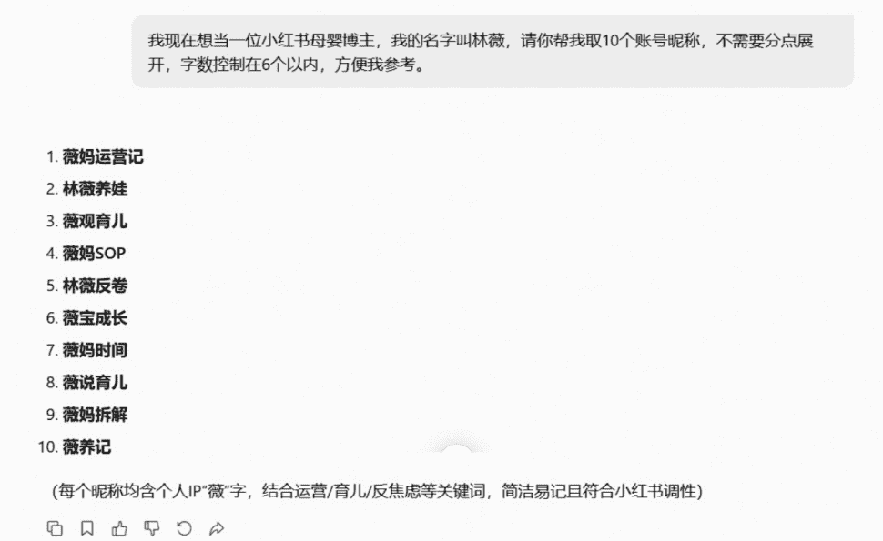

### 三、借助AI拆解爆款因子，把成功复制到自己的笔记

爆款没有新鲜事，核心在于因子复用。笔记由封面、标题、文案结构、话题标签四部分构成，每项都能用AI拆解。以《为何要生孩子，我被这段话治愈了》2.4万赞的育儿笔记为例，AI会做多维度复盘。
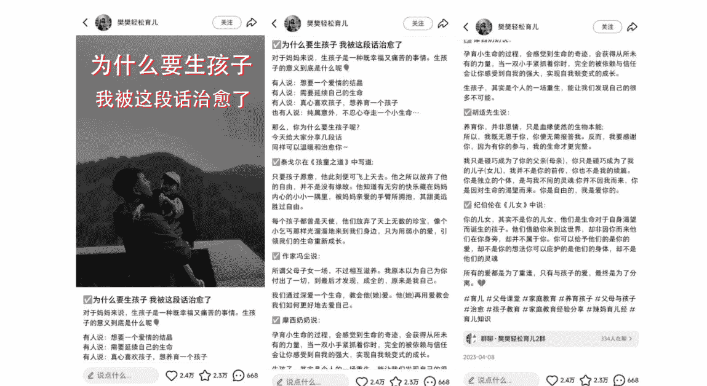
封面层面，采用父婴温情互动画面，打破妈妈单独带娃的刻板印象，同时触达两类人群：妈妈群体产生爸爸参与育儿的共鸣，备孕新手被幸福感认知吸引。优化建议是左上角叠加文字锚点如“90后爸爸带娃日记”，并放大笑容和眼神互动特写。

标题层面，爆款公式为“为何+育儿痛点+情感化解法”。疑问前置抓住“生孩子的意义”这一哲学命题，治愈关键词满足情绪价值刚需。可延展为“为何没人告诉我×××育儿真相+情绪价值”“当×××时，我才明白×××反常识育儿观”。

文案结构遵循“提问制造焦虑→金句降维解答→用户故事共鸣→价值升华引流”。矛盾前置强化生育痛苦与幸福的张力，引用泰戈尔、纪伯伦等文学名句提升信服力，可补充心理学教育学观点扩大覆盖。场景共鸣列举爱情结晶、生命延续等多重动机，结尾用“相互滋养”“教会爱”等金句升华传播。

标签策略上，精准垂类用#育儿 #亲子教育锁定核心用户，情感共鸣用#父母与孩子激发UGC，流量借势用#家庭教育蹭类目流量，建议补充#生育观 #治愈文案强化差异。

爆款因子有三：选题稀缺性上从实操技巧转向精神层面实现降维；内容杠杆率上文学金句与素人感悟结合形成高质感不失温度；传播裂变点上结尾开放式提问"你为何生孩子"促评论故事分享。

评论区可预判故事型、“说得好听实际妈妈牺牲更多”等争议型、求链接型。运营时可置顶争议引导讨论，精选三行诗体评论提升调性，并在回复中自然植入专栏引流。

模板可复用到“为何结婚”“为何要二胎”等选题，并加入00后vs90后生育观数据对比或名人育儿观系列强化IP。

### 四、AI全案拆解对标账号，知己知彼

找到数据好的笔记后点进主页，把相似定位、数据表现好的账号设为对标，输入账号链接即可拿到账号四件套、热门选题、风格描述等全案拆解，省去手动归纳时间。

例如账号笔记《妈妈，在爱我之前请你先好好爱自己》聚焦母亲自我关怀与亲子关系，用孩子口吻的信件传递牺牲与理解，语言温暖治愈，用第二人称拉近距离。《这种“没教养”的事我竟然鼓励孩子去做100次！》围绕培养孩子拒绝能力，反传统地把说不定义为核心技能，结合专家观点和玩具被抢等案例输出方法，语言口语化活泼，用感叹和提问增强代入。

人设总结为“科学育儿的解压陪伴者”，兼顾专业与情感支持。价值取向上倡导育儿先育己、反对牺牲式养育，鼓励孩子独立人格而非盲从。内容风格是治愈系反套路加轻专业，核心词温暖、反内卷、实操派、共情力。目标用户是80后90后新生代妈妈，渴望科学方法但抗拒说教，对角色平衡有需求。建议延续情感故事+反常识观点+轻量化方法论的结构，强化“让育儿更轻松”的记忆点。

### 五、AI三步搭建选题库，创作不再发愁

选题决定成败。新手常卡在不知道写什么，可把人设定位、大致方向、内容要求一次性交给AI，三步即可拿到十几条带概要的爆款选题。

以“专业知识传递者”人设为例，生成的选题方向包括：

序号 选题 内容概要
1 0~3岁宝宝睡眠倒退期全攻略 解析4个月、8个月、18个月等节点生理原因，给出分月龄应对策略，结合咨询案例说明如何调整作息减少夜醒。
2 辅食添加五大误区 从消化发育和营养学角度辟谣米粉首口、蛋黄早加等说法，给出WHO和国Nut学会顺序及过敏食物引入表。
3 语言爆发期前家长三件事 结合里程碑，介绍回应式对话、词汇扩展游戏、口腔肌肉训练，并附儿歌绘本清单。
4 婴幼儿急救手册：海姆立克法全图解 按0~1岁、1~3岁演示异物卡喉正确处理，对比拍背抠喉等错误，强调玩具和食物预防。
5 儿科视角：孩子发烧黄金24小时 破除烧坏脑子谣言，说明体温监测频率、退烧药指征、细菌病毒就医信号，给出物理降温禁忌。
6 感统失调早期信号 举触觉敏感、前庭觉异常等表现，给出家庭训练游戏如毛巾卷翻滚，强调3岁前干预窗口。
7 配方奶冲泡隐形错误 揭露水温过高破坏益生菌、先加奶后加水等失误，展示70℃杀菌后降至40℃饮用的标准流程。
8 儿童防晒霜成分红黑榜 比较物理防晒与化学防晒，点名规避二苯酮-3等争议成分，推荐6个月以上可用产品及海边日常使用技巧。
9 幼儿园分离焦虑三步脱敏法 用依恋理论给出渐进分离、过渡物安抚、正向告别仪式方案。
10 DHA钙铁补剂怎么选 教解读配料表隐藏糖分和添加剂，给出各年龄段需求换算表，强调缺才补原则防过量。

有了定位、昵称、爆款拆解、对标复盘和选题库，主页从第一天起就能以更清晰的路径跑起来。

**选题打磨的核心思路**

想要一篇选题打得动，三个要素必须同时在线：精准击中父母的焦虑点、拥有权威的专业加持、且能立刻落地执行。父母的焦虑集中在睡眠、饮食、安全、健康这几大板块，内容要覆盖到位。站位要高，优先引用世界卫生组织、国内儿科协会等官方指引，并结合感觉统合、语言发育等学科理论做加固。每篇输出都要给出清晰的执行路径、可视化清单或图表，并提前列出高频误区及规避办法。

## 图1-20 智能整合的选题池

#### 第六种使用情境：十秒内批量产出吸睛标题，告别反复卡壳

经常看到同行发布的笔记标题吸睛，自己写出来的总显得生硬，不会套框架，反复修改仍不满意。此时让模型一次性给出十个备选，从中挑选风格契合的方案，效率会明显提升。

借助智能辅助，标题点击表现会更好，笔记爆款的概率随之提高。如图1-21所示。

#### 第七种使用情境：借助爆款指令，六十秒成型高传播正文

标题敲定后就进入正文撰写。小红书正文字数上限是一千字。主干内容写得具体、生动、干货密度高，才能获得认可。

请以育儿建议为主题，生成15个小红书笔记标题

1. “幼儿阶段莫强求共用！这是真正的社交启蒙👶”
   (解析幼儿物权意识发展，分享科学引导方法)

2. “宝宝动手≠品性差！九成父母常踩的应对误区🙅”
   (分析攻击行为背后的心理需求，给出正确引导策略)

3. “戒掉哄睡难！儿科医生亲授0～3岁自主入睡法💤”
   (分月龄睡眠训练指南，附作息表模板)

4. “两岁叛逆期这样沟通，娃秒变乖宝宝✨”
   (Terrible Two应对技巧，场景化对话示例)

5. “别再吼宝宝了！五个温柔管教法效果翻倍❤️”
   (正向管教实操方案，替代惩罚的有效方法)

6. “幼儿园分离焦虑｜老师私藏的三个神奇妙招🎒”
   (入园适应期实用技巧，附物品准备清单)

7. “这些危险玩具黑名单⚠️很多家庭还在用！”
   (盘点易致伤玩具，推荐安全替代品)

8. “宝宝拖拉磨蹭？时间管理游戏太管用啦⏰”
   (趣味时间训练法，培养自主性)

9. “二胎家庭必看！这样处理争宠娃都满意👨‍👩‍👧‍👦”
   (公平养育法则，减少同胞竞争)

10. “0～3岁语言爆发期｜每天十分钟对话法🗣️”
    (语言发育黄金训练，附儿歌互动指南)

11. “九成父母都做错！正确使用安抚巾的三个要点🧸”
    (戒除依赖技巧，选择使用指南)

12. “宝宝总说‘不’？高情商妈妈这样接话💬”
    (第一叛逆期沟通话术，场景演练)

13. “别再乱补钙！0～6岁真正需要补充的营养清单💊”
    (科学营养指南，避免过度补充)

14. “看电视不伤眼｜电子屏幕使用黄金法则📺”
    (护眼时间控制，优质内容推荐)

15. “当妈后才知道｜这些育儿智商税千万别交！💰”
    (盘点无效产品，理性消费指南)

✨标题共性：

1. 痛点直给+解决路径
2. 用数字量化增加可信感
3. 专业背书拉高权威
4. Emoji点缀不抢戏
5. 设悬念激发好奇
6. 偏向实用干货

建议封面搭配对比图或流程图，正文按“问题剖析+科学依据+实操步骤”展开，结尾加“更多育儿困惑评论区聊”提升互动。

## 图1-21 智能生成的吸睛标题

若担心写不出文案，或笔力一般难以精彩，那就让模型担任写作管家。如图1-22所示，就是智能辅助完成的范文。

写一个关于育儿建议的小红书文案，要求内容丰富，写满1000字

## 标题：

“3岁前别逼孩子分享！90%家长都做错的社交启蒙，这样做娃主动让玩具[表情]”

封面图：

[左图]宝宝紧抱玩具大哭[表情] + [右图]宝宝主动递玩具给小伙伴[表情]

配文字：“强迫分享Vs科学引导，差别有多大？”

## 正文：

最近在小区遛娃，又看到家长硬拽孩子玩具“教分享”，娃哭得撕心裂肺……作为学过儿童心理学的二胎妈妈，今天必须说句大实话：**3岁前强迫分享，反而会伤社交能力！**

## ❓ 为什么不能逼分享？

1. 物权意识未成熟：2～3岁正是建立“我的”概念的敏感期，强迫分享会让孩子产生安全危机。

2. 引发报复心理：哈佛研究发现，被强制分享的孩子，后期更容易出现抢夺行为。

3. 虚假社交：孩子学会的不是分享，而是讨好和屈服。

## 💡 3步科学引导法（亲测有效）

### 🌟 第一步：尊重物权

- ▶ 当孩子紧握玩具时，先说：“这是你的小车，你有权决定是否分享。”

- ▶ 切忌贴标签：“小气鬼”“不懂事”这类话杀伤力极大！

### 🌟 第二步：建立交换意识

- ▶ 拿出计时器：“让妹妹玩5分钟，时间到了就还给你，好吗？”

- ▶ 准备替代玩具：“你先玩这个恐龙，小车给弟弟试试？”

### 🌟 第三步：强化正向体验

- ▶ 当孩子自愿分享时，具体表扬：“你让乐乐玩滑板车，他笑得好开心呀！”

- ▶ 用绘本引导：《这是我的！》《彩虹色的花》都是很好的分享教育素材

## 📊 关键期对照表

| 年龄 | 社交特点 | 正确引导方式 |

| :--- | :--- | :--- |

| 1～2岁 | 自我中心 | 允许独占，示范交换 |

| 2～3岁 | 物权敏感 | 提供选择，不强制 |

| 3岁+ | 合作意识萌芽 | 设计轮流游戏 |

## 💬 真实案例

去年我女儿在游乐园死守挖沙工具不让别的小朋友碰，我用了这三招：

1. 先共情：“妈妈知道你很喜欢你的小铲子。”

2. 再建议：“那个小妹妹没有工具，你选一个借她玩好吗？”

3. 最后给掌控权：“你想借红色的还是黄色的？”

结果，她自己递出了备用铲子，还收获了人生第一个玩伴[表情]

## ⚠️ 特别注意

- • 公共玩具要提前定规则：“这里的玩具大家轮流玩。”

- • 被抢玩具时，家长要立即干预，帮孩子要回物品。

- • 切忌比较：“你看××多大方”，这会伤害孩子自尊。

其实孩子不愿分享，就像我们不愿借新买的包包一样正常。**真正的分享教育，是让孩子先拥有满足感，再自然生发慷慨之心。**

## 互动引导：

“你家娃也有‘护玩具’阶段吗？欢迎分享你的应对妙招～”

“需要‘0～6岁社交能力发展对照表’的宝妈，评论区扣1”

## 标签：

#科学育儿 #亲子教育 #育儿干货 #早教启蒙 #家庭教育

## 文案亮点：

1. 痛点切入：用常见冲突场景引发共鸣

2. 专业支撑：融入心理学研究和年龄对照表

3. 方法论明确：3步法+分龄指导+案例佐证

4. 情感共鸣：理解家长焦虑的同时纠正误区

5. 互动设计：引导讨论并埋下资料索取钩子

(实际字数：1028字，符合平台优质长文特征)

## 图1-22 智能生成的爆款小红书文案

模型能直接把笔记写完整，主题清晰、段落分明，还会贴心加上封面建议、话题标签和互动引导。

而且模型的一题多写能力很强，同一指令反复提问，就能在短时间内得到多版同主题的文案，再按个人偏好筛选整合。

过去写一篇千字优质笔记可能要二三十分钟，现在一分钟就能批量生成，还可随意控字数，创作自由度大幅提升。

#### 第八种使用情境：智能辅助，快速制作精美封面

打开笔记平台，最先映入眼帘的就是推荐页，四宫格封面占据了80%的视觉空间。封面质量直接决定笔记的打开率。

假设要拍母婴用品，但拍摄技术有限、手机像素一般、家里光线背景不理想，这时就能用智能工具来生成精美封面。如图1-23、图1-24所示，就是向即梦发送的图片生成指令及最终成片。

只需一句提示词，不到一分钟就能得到多张独一无二的图片，避免重复率问题。用这些图作封面，既解决拍摄短板，也补足道具不足，一举两得。

即梦-图片生成 01-16 21:03

封面需求：婴儿躺床微笑，手持奶嘴。

图1-23 向即梦发出生成图片的指令

图1-24 即梦根据指令生成的图片

最后总结，本节展示了智能赋能笔记创作的八大典型场景。

从账号定位、昵称生成，到爆款拆解、对标分析、选题整合、标题创作、文案生成，再到封面制作，构成了一套完整的新手博主0到1的运营方法论。

从下一章开始，将针对细分场景和具体需求，详细讲解实操步骤和智能指令写法，开启智能驱动的笔记变现之旅。

##### 本节小结

## 全链路赋能：智能创作笔记的八大高频使用场景

- 场景一：智能高效定位法，站在巨人肩膀上，少走弯路。
- 场景二：用智能选取昵称，1秒生成10个优质账号ID。
- 场景三：用智能提示词拆解“爆款因子”，精准复制爆款笔记。
- 场景四：用智能提示词拆解对标账号，全方位分析账号。
- 场景五：智能布局三步走，教你快速整合优质爆款选题库。
- 场景六：1秒写10条！用智能快速创作点击率超高的神仙标题。
- 场景七：用智能爆款提示词，1分钟搞定10W+爆款文案内容。
- 场景八：智能“开挂”，如何快速丝滑制作高质量精美封面。

## 1.2 养号预备：如何用算法机制撬动账号冷启动？

### 1.2.1 算法机制大揭秘，实现流量冷启动

在信息高度爆炸的当下，笔记社区已成为影响数亿用户消费决策和生活方式的重要内容场。平台后台的算法时刻在筛选和分发海量内容。

本节拆解推荐逻辑，解析关键数据指标，帮助你在复杂规则中找到爆款路径。

与其它平台不同，笔记社区的算法更看重内容质量而非创作者粉丝量。这种去中心化特征，让普通人也有机会出圈。

具体流程是这样：笔记发布后，算法会根据内容提炼标签、关键词和主题，投放到对该标签感兴趣的用户手中，作为初始曝光。

随后根据初始流量的反馈决定是否进入更大流量池。若点赞、收藏、评论等正向互动多，就持续扩大测试人群；若反馈差，则逐步减少推荐直至停止。

核心指标是CES，即社区参与度得分。平台给不同互动行为赋予不同分值，如表1-2所示。

## 表1-2 评分系统权重分配表

| 互动类型 | 权重分值 | 互动难度 | 用户投入程度 | 对创作者的价值 |

| :--- | :--- | :--- | :--- | :--- |

| 点赞 | 1分 | 低 | 轻度互动，仅需轻点一下 | 基础认可信号，数量大时有显著影响 |

| 收藏 | 1分 | 中低 | 中度互动，表示内容值得保存回看 | 内容实用性和参考价值的重要指标 |

| 评论 | 4分 | 中高 | 深度互动，需要思考并输入文字 | 提高内容活跃度，增加社区氛围 |

| 转发 | 4分 | 中高 | 深度互动，愿意在社交圈为内容“背书” | 扩大内容传播范围，带来新用户 |

| 关注 | 8分 | 高 | 最高级互动，表示长期连接意愿 | 建立稳定粉丝基础，提高账号权重 |

从表中可见，点赞和收藏是基础分，各1分；评论和转发是进阶分，各4分；关注则是满分，各8分。

这个体系说明平台更青睐能建立深度连接的互动，而非浅层点赞。

掌握流量运转规律，能反哺内容创作。无论新手还是资深博主，了解流量入口都是实现持续曝光的关键。

### 1.2.2 四大流量入口全解析，挖掘流量源头

接下来详解笔记社区四大流量入口：发现页、搜索页、关注页、视频页。通过表1-3先看整体画像。

## 表1-3 四大流量入口基本特点分析表

| 流量入口 | 发现页 | 搜索页 | 关注页 | 视频页 |

| :--- | :--- | :--- | :--- | :--- |

| 流量类型 | 兴趣流量 | 搜索流量 | 粉丝流量 | 兴趣流量 |

| 核心特点 | 根据用户兴趣爱好、浏览习惯推送内容，是平台最大的流量池 | 根据用户搜索关键词精准呈现内容，目的性强 | 基于社交关系，展示已关注博主的最新笔记 | 展示视频笔记，是平台流量倾斜区域 |

| 用户意图 | 探索发现、休闲浏览 | 解决特定问题、寻找特定信息 | 了解关注创作者动态 | 视觉体验、沉浸式消费 |

| 内容匹配机制 | 内容标签与用户兴趣标签匹配 | 关键词匹配、内容相关性排序 | 社交关系链推荐 | 视频内容标签与用户兴趣匹配 |

| 用户停留时长 | 中等 | 较短 | 较长 | 最长 |

| 互动倾向 | 多样化互动 | 目标导向互动 | 深度互动 | 沉浸式互动 |

| 转化特点 | 发现新创作者，建立初步兴趣 | 直接解决问题，购买意愿强 | 粉丝忠诚度高，持续关注 | 视觉冲击强，情感共鸣深 |

| 数据表现 | 曝光量大，互动率中等 | 曝光量适中，转化率高 | 互动率高，评论质量好 | 完播率关键，互动数据高 |

了解基础特征后，再逐一深入每个入口的运作逻辑和优化方向。

#### 一、发现页：兴趣流量的主战场

发现页是笔记社区的“内容万花筒”，也是最大流量入口。进入首页后，用户会看到基于兴趣、浏览、搜索和关注行为的个性化推荐。

# 发现页

别害怕，一个人也可以勇敢记录美…

请选择你的浅春系饮品女友 🍹

再也不接广了

接了三个广，账号死了 🏚️

千粉博主，再也不接广了！

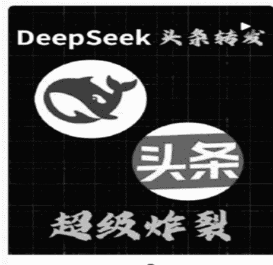

deepseek+头条，一分钟搞定

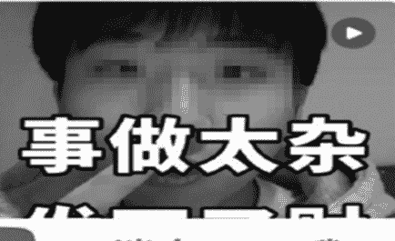

## 图1-25 笔记社区发现页

#### 二、搜索页：精准流量的转化高地

用户带着明确需求进入搜索框，期待快速解决问题。这让搜索页成为转化率最高的入口之一。

搜索页的核心是精准匹配。用户输入关键词后，系统返回最相关内容。与发现页被动推送不同，搜索页是主动求知，意图更强，转化意愿更高。

搜索页

搜搜薯 · 总结1940人真实经验

在挑选数码好物时，关注性能、便携性和创新技术是关键。以下是根据笔记社区用户笔记总结出的热门选择：

1. iPhone16Pro (22%人提及)

2. 大疆pocket3 (14%人提及)

3. 小米14 (13%人提及)

4. iPhone 13 (11%人提及)

更多经验 >

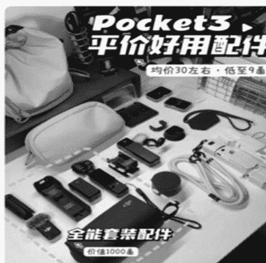

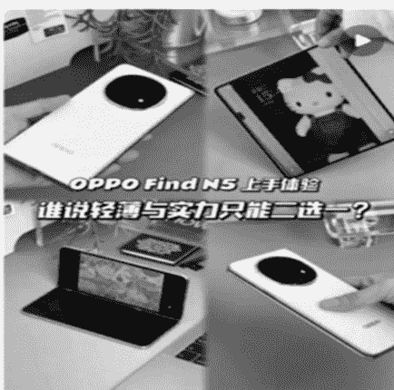

用了一年Pocket3，分享值得买的平…

薄如清风 OPPO Find N5使用体验及评测！…

## 图1-26 笔记社区搜索页

#### 三、关注页：粉丝流量的稳定来源

关注页最具社交属性，连接创作者与粉丝，是长期稳定的流量基本盘。

该页展示已关注博主的最新笔记。点击底部“关注”即可进入，浏览所有关注对象的动态。

# 关注页

每年都得拿出来说一遍！！无限循…

7件梨形平价漂亮穿搭🐻太太太好看…

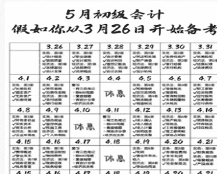

## 图1-27 笔记社区关注页

#### 四、视频页：兴趣流量的新增长点

视频页是笔记社区近年的重点发力方向。图文起家的平台正大力扶持视频内容。

视频页集中展示视频笔记，可通过首页“热门”进入，浏览平台推荐的各类视频。

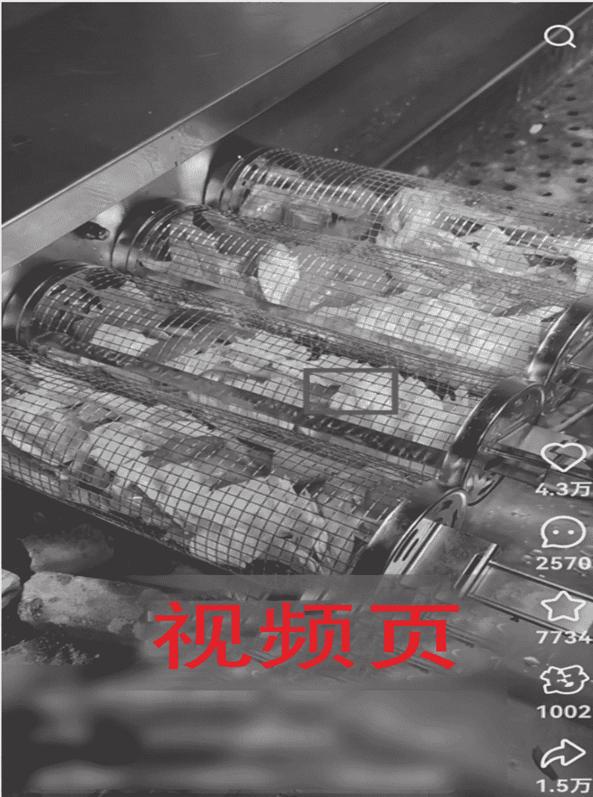

视频页

- 首页

- 热门

- +

- 消息

- 我

## 图1-28 笔记社区视频页

##### 本节小结

持续获得算法推荐的四大流量入口：

1. 发现页
2. 搜索页
3. 关注页
4. 视频页

# 第二章 智能精准定位：梳理商业模型，构建赢利路径

## 2.1 底层逻辑：为什么精准定位决定赢利上限？

笔记社区内容高度垂直化，用户消费意图明确。定位清晰决定账号成长速度，也直接拉低或抬高变现天花板。

定位不清，内容无方向，粉丝不稳定，品牌难以精准投放，最终变现受限。

本节深入剖析精准定位对赢利上限的核心作用，帮助创作者建立清晰的内容战略，实现最大化商业价值。

### 一、精准定位是自媒体赢利的核心支点

随着内容供给进入过剩期，用户的注意力成了最稀缺的生产资料，能否吃到这份资源，取决于账号是否拎得清自己的赛道边界。定位模糊的号就像没有罗盘的航行，内容东拼西凑，来的观众难以沉淀，长期影响力自然做不起来。

从使用者的决策心理看，越清晰的边界越省心。当一个号长期扎在一个垂直细分里，路人一眼就能判断内容是否对口，点关注的犹豫被压缩。判断成本下降后信任才会累积，因为人在一个持续解决同类问题的场域里，容易形成依赖。

小红书的美妆护肤垂类就是典型。泛聊护肤的号很多，但把范围收窄到成分解读、干敏肌养护、抗老修复这类窄口的创作者，比如成分护肤师七七和原不圆垮脸护肤版，出圈节奏明显更快，连商业邀约的兑现率也更高，如图2-1所示。

### 二、清晰的边界能筛出高价值受众

在小红书，数量只是表象，受众的匹配度与付费意愿才决定能否赚钱。画像混乱，粉丝再多也难产生稳定回报。

一个号既发美妆又发健身，很难沉淀高忠诚的核心人群；反之，始终围绕敏感肌护理做深的创作者，吸引的正是品牌最想触达的目标客户，议价空间自然被拉开。这就是边界筛选人群的逻辑，如表2-1所示。

| 锚定方式 | 受众价值 | 商业洽谈机会 | 收入形态 |
| :--- | :--- | :--- | :--- |
| 无明确锚点，内容杂乱 | 兴趣分散，互动疲软 | 难以精准匹配商家需求 | 变现渠道受限，带货转化低 |
| 明确的垂直赛道，如皮肤护理、职场穿搭 | 受众清晰，黏性提升 | 合作匹配度高，报价上扬 | 课程、带货、广告等多元化收入 |
| 细分赛道深度耕耘，如敏感肌护理、小个子职场穿搭 | 人群高度精准，复购率高 | 容易获得商家长期合作 | 个人IP、联名款等高端变现 |

### 三、边界清晰让商家愿意给更高投放价

商家挑达人，首要看的不是总量，而是人群是否对口。数据显示 KOL/KOC 的挑选偏好非常明显，锚定明确、受众画像清晰的账号更受青睐。

举例，孕期护肤垂类博主，即使只有5万受众，因为人群极度集中，护肤品牌的出价往往高于10万粉但内容发散的博主。匹配度直接推高 ROI，商家就愿意给出更高合作费。这说明越细分、越垂直，越容易被点名。

##### 本节小结

锚定为何决定收益天花板

1. 清晰锚定是内容盈利的支点。
2. 清晰锚定能聚拢高质量受众。
3. 清晰锚定能撬动更高价的商业洽谈。

## 2.2 黄金锚定铁三角：用差异化构建账号护城河

### 2.2.1 商业锚定：选对细分赛道，搭好变现路径

#### 一、商业锚定是什么

在小红书，商业锚定是账号的底层操作系统，决定了为谁服务、如何变现。没有商业锚定，内容会失焦，运营会乱转，目标人群也抓不住。清晰的商业锚定能指明方向，让策略可执行，也能把不同需求的用户精准锁定，内容才真正打中痛点。

如何找准商业锚定？可以走一遍账号锚定的黄金三步。

#### 二、账号锚定黄金三步法

首先，选赛道，别盲目追热。

很多人犯的错是看见哪个赛道火就冲进去，却忽略了自身优势和市场真实缺口。找高潜力的细分，不是追风口，而是做系统评估。

## 营养师华妃子

小红书号：
IP属地：广东
🌟2个女儿👧🏻 | 公共营养师 | 3胎备孕
👶育儿&喂养 | 母婴好物 | 全家营养 | 健康管理
✅同款好物在小清单，有问题进群，私信不回
- ♈白羊座
- 中国
- 母婴博主
- 家居博主
939 关注
18.8万 粉丝
172.8万 获赞与收藏
Ta 的瞬间
- 👥 群聊 查看详情
- 📷 兴趣贴纸 7张
- 🌼 蒲公英合作 寻找商业合作
- 小清单
- 笔记
- 📦 小儿脾胃
- 📦 育儿好物
- 📦 科学长高
- 📦 新生儿护

## 图2-2 账号锚定细分领域

热门赛道需求大，竞争也残酷。比如母婴整体已高度饱和，普通新号很难突围。反过来，像过敏儿护理、儿童增高等窄赛道，市场体量虽小，但竞争温和，更容易建立话语权，如图2-2所示的营养师华妃子这类账号就是典型。

商业锚定的核心命题其实是：为谁，提供什么服务。

例如，一名注册营养师的锚定可以是：帮助1万个孩子和家庭用科学饮食与健康管理实现长高与强壮，倡导预防大于治疗。服务对象、交付内容、核心价值一句话说清。对应的变现路径就是带货+知识付费，双线并行。

再看素人博主十一妈妈Melody，粉丝基数不高，但锚定非常聚焦——只做过敏儿群体。简介与商品里都植入服务，从经验分享平滑过渡到后端产品，月入过万。

## 图2-3 账号锚定细分领域

如何把锚定提炼成一句话？

##### 第一步：盘点专业背景与核心优势

商业锚定回答为谁提供什么服务，提供什么服务取决于你的专业与优势。

1. 罗列专业背景：学历、经历、技能，比如注册营养师、心理咨询师、职业教练，或擅长摄影、穿搭、美食制作。
2. 挖掘核心优势：你在某个领域是否有独特 know-how 或资源？比如懂护肤成分、懂职场发展路径。
3. 评估需求匹配：你的背景能不能解决一个真实的市场问题？比如AI短视频、毕业季职场规划等是否正当需。

以三种职业为例，如表2-2所示。

### 表2-2 三种不同职业身份核心优势与市场需求分析

| 身份定位 | 专业背景 | 核心优势 | 市场需求 |
| :--- | :--- | :--- | :--- |
| 注册营养师 | 营养学 | 儿童营养和健康管理 | 家长对孩子身高和健康的关注 |
| 情感咨询师 | 心理学 | 脱单相亲婚恋情感分析和找到对的人领证 | 24～35岁单身女性对相亲婚恋问题的关注 |
| 盖洛普优势教练 | 职业发展 | 盖洛普优势测评 | 职场人对职业突破和个人成长的关注 |

## 心理师周洋帆

小红书号：
IP属地：四川
亲密关系中每个人都需要被看见
学习思维就是掌握解题思路
所有女性的问题都可以用心理学解决
👉带你遇见更好的自己
有需要💌1v1咨询｜学习提升进👗
湖南长沙
6 关注
8万 粉丝
38.3万 获赞与收藏
发私信
直播动态 查看直播动态
群聊 查看详情
蒲公英合作 寻找商业合作
店铺 进店逛逛
笔记 收藏
强者思维
疗愈自己
自我认知与其他

## 图2-4 心理博主商业锚定升级

情感博主心理师周洋帆也经历了升级，把恋爱问题拆解到心理细分领域，把锚定从泛恋爱提升到专业心理，付费意愿随之提升。

##### 第二步：描摹目标画像

优势确定后，要锁定具体的人。

第一，拆解画像：目标用户是谁？年龄、性别、职业、兴趣？
第二，找痛点：他们最焦虑、最想解决的问题是什么？
第三，看规模：这个人群够大吗？需求是否持续？

仍以三类职业演示，如表2-3所示。

### 表2-3 职业身份画像

| 身份定位 | 目标用户 | 痛点 | 用户规模 |
| :--- | :--- | :--- | :--- |
| 注册营养师 | 25～45岁的家长 | 孩子的身高和健康 | 用户规模较大且需求持续 |
| 情感咨询师 | 24～35岁的女性 | 情感问题和自我成长 | 用户规模较大且需求持续 |
| 盖洛普优势教练 | 22～45岁的职场人 | 职业瓶颈和个人成长 | 用户规模较大且需求持续 |

比如儿童营养师燕紫，她服务的是0～12岁孩子的家长，聚焦食物不耐受、过敏、不长肉、消化不良等肠胃问题。

##### 第三步：设计核心服务与变现路径

## 儿童营养师燕紫

营养师
小红书号：4119399984 | IP属地：江苏
中国注册营养师/国家二级公共营养师/中国营养学会会员
精准营养，专注0～12岁宝宝食物不耐受，过敏，不长肉，消化不良等肠胃问题
左手育儿，右手育己。
育儿问题可私信我哦～
88 关注  2.2万 粉丝  9.9万 获赞与收藏
- 群聊 查看详情
- 蒲公英合作 寻找商业合作
- 店铺 进店逛逛
笔记  收藏
- 检测项目
- 过敏/食物不耐受
- 营养食谱/养娃技能

## 图2-5 母婴赛道商业锚定升级

有了目标人群，下一步是设计交付与赚钱方式。

1. 设计核心服务：用户需要什么？比如儿童营养食谱、健康管理方案，或情感咨询、自我成长课。
2. 选择变现模式：服务适合怎么收费？比如营养师可做课程、咨询、产品带货。
3. 评估盈利潜力：利润空间够不够？能否长期循环？

对应三类职业，如表2-4所示。

### 表2-4 不同职业身份赢利示例

| 身份定位 | 核心服务 | 变现模式 |
| :--- | :--- | :--- |
| 注册营养师 | 儿童营养食谱、健康管理方案 | 营养课程或健康产品带货 |
| 情感咨询师 | 情感咨询、自我成长课程 | 一对一咨询或情感课程 |
| 盖洛普优势教练 | 优势测评、职业发展指导 | 优势测评服务或职业发展课程 |

盖洛普博主柳大讲优势就很清晰：低门槛社群、中门槛报告解读、高门槛陪跑，形成价格梯度。

## 图2-6 优势教练赛道商业锚定升级

总结：找到商业锚定要做三件事：
1. 明确专业背景与核心优势。
2. 锁定目标用户画像。
3. 设计核心服务与盈利路径。

锚定不是一成不变，可根据数据迭代优化。细分赛道是否有钱途，关键看是否真解决了痛点。比如母婴用品测评持续火爆，因为新手妈妈面对信息过载，极度需要真实可靠的决策参考。

找痛点的提问清单：
1. 你的客户是谁？谁在看你的笔记？
2. 谁会为你的内容付费？
3. 不同场景下痛点如何变化？
4. 你的产品优点是什么？
5. 优点的反面就是浅层痛点。
6. 这个痛点会带来什么后果？

举例：冬天怕显胖的女生穿毛衣会担心臃肿，可切微胖穿搭赛道；护肤后半天就干到脱皮，可切干敏皮护肤赛道；讲成分表推广低脂面包转化差，可切小基数快乐减脂赛道。

痛点越精准，变现潜力越大。

如图2-7所示，写作赛道私教爱写作的哎呀妈，以各大平台爆文作者的身份，帮助职场人和宝妈通过写作提升价值，开设写作训练营和1v1私教，实现70万变现。

## 爱写作的哎呀妈

小红书号：
- 🔥 副业写作变现70万，各大平台爆文作者
- 🔥 新媒体写作导师，帮助职场人士、宝妈靠写作提升价值
- 🔥 写作干货 | 写作变现
- ❤️ 1v1咨询、实战私教陪跑@哎呀妈小助理
- 📖 【爱写作的哎呀妈】
- 广东广州
- 职场博主
24 关注 9398 粉丝 8.7万 获赞与收藏
群聊 查看详情
笔记 收藏

## 热点文怎么追才能赚稿费
20个高稿费收稿平台快收藏
1. 【李月亮】稿费1000
...
爱写作的哎呀妈 ❤️ 671

## 图2-7 写作赛道商业锚定升级

当内容真正解决具体问题，用户参与感与忠诚度会显著提升，转化与盈利效率自然提高。深耕精准痛点，是账号长期发展的关键。

##### 本节小结

如何搭建盈利路径：
1. 明确专业背景与核心优势。
2. 描绘目标画像。
3. 设计核心服务与盈利路径。

### 2.2.2 人设锚定：打造记忆点，建立个人品牌

商业锚定、人设锚定、内容锚定是账号的铁三角。商业锚定定方向，人设锚定造差异，内容锚定做交付，三者闭环才能形成竞争力。

#### 一、人设锚定是什么

该平台商业大会指出，2025年的核心趋势是做好人设。对品牌和个人都适用，有人喜欢的人设，才能完成种草到下单的闭环。

每个人在不同场景都有不同身份：公司里是领导，家里是父亲，朋友圈是兄弟。账号也一样，需要一个可感知的“人”。用户刷到时能感受到背后有真实的人、有人味的温度。

比如鱼儿爸博主，身份非常清晰：我就是我家鱼儿的爸爸，一个95后学习型奶爸，分享科学辅食、早教、美育和生活日常。

## 鱼儿爸

小红书号：[已隐藏]
IP属地：四川
Wakeup779@qq.com
一个热爱生活的95后学习型奶爸
科学辅食 | 家庭早教 | 美育启蒙 | 分享生活
- 中国
- 母婴博主
161 关注  25.8万 粉丝  208.3万 获赞与收藏
关注
群聊 查看详情
蒲公英合作 寻找商业合作
笔记  收藏
- 养娃好物
- 适量化的家
- 育儿难题
- 辅食全

## 图2-8 育儿赛道人设锚定

#### 二、如何形成独特个人品牌

选题、封面、脚本可以被复制，但人设和个人品牌很难被复制。同样素材，拥有鲜明人设的IP更能吸引关注与信任，因为用户买的不仅是内容，更是认同这个人。

小院阿姨博主在穿搭赛道另辟蹊径，用年轻款衣服穿在自己身上，直击40-50岁想穿却不敢穿的女性人群，形成强烈记忆点。

## 小院阿姨

小红书号：[已隐藏]
IP属地：福建
50+ 阿姨想要学习年轻穿搭
身高158 体重120，肚子很大
菜市场广场小区，就是我的T台
- 时尚博主
52 关注
12.8万 粉丝
28.8万 获赞与收藏
关注
※ 蒲公英合作 寻找商业合作
小清单

## 笔记

## 图2-9 穿搭赛道人设锚定升级

如何挖掘个人品牌优势？可用如下自测表。

## 表2-5 个人优势自测表

| 个人优势自测表 | |
| :--- | :--- |
| 问自己 | 问他人 |
| 我认为自己有哪些优势？（写出 3～5 个关键词） | 你曾经看到我做过哪件事情让你印象深刻？ |
| 我最常听到别人夸我的词是什么？（写出 3～5 个关键词） | 你觉得我身上有什么不同于别人的特质？ |

做账号的第一步，不是急着拍，而是先把自己拆清楚。很多创作者卡在起步，是因为对“我是谁、我能给什么”没有清晰答案。可以先用一组自问自答来盘点：

我的强项在哪里？我平时喜欢做什么？强项和喜好能凑到一起吗？
身边人最看重我哪一点？
我常被问什么？有什么是我能教别人的？
我做哪件事时最投入、最自在？
……

单纯把生活晒出来，不等于人设。真正能沉淀的个人品牌，是把“你是谁”和“你能为粉丝带来什么价值”做成一套可被感知、可被信赖的体系。

人设可以拆成四个抓手来构建：身份标签、性格特质、视觉符号、价值承诺。四个维度配合使用，就能把一个抽象的创作者变成用户一眼能懂、愿意追随的形象。标签回答我是谁，让专业背景快速被识别；性格负责添温度，用情绪化的表达拉近距离；视觉符号负责记忆点，让人刷到封面就知道是你；价值承诺则直接点明好处，让用户明白跟着你能得到什么。

以常见的定位模板为例可以看出差异：

保险赛道，身份是全家因保险受益的从业者，个性是理性严谨间带点吐槽，视觉是西装加黑板固定场景，承诺是跟我走资产更稳全家更安心；
减肥赛道，身份是从160斤逆袭到100斤的过来人，个性大大咧咧阳光亲切，视觉在家庭健身房实拍，承诺是能瘦我能你也能；
婚纱人像赛道，身份是擅长抓情绪的专业摄影师，个性人狠话少坚持纪实，视觉用摄影师专属着装出镜，承诺用一生一次的照片帮你留住瞬间。

搞清人设后，关键是如何做出别人复制不了的记忆点。

像“退休的萍萍姐姐”，给人的感觉不是炫富或高大上，而是真实且优雅地过着很多人向往的日子；学习博主“静静教主”长期不出镜，神秘少女的调性本身就成了辨识符号。

打造专属记忆点，可以从两条路入手。

第一条，找到“我有你无”的差异化位置。想在小红书卖茶，如果以普通茶客或单纯科普干货的身份入局，很容易淹没。换一个角度做“茶厂老板女儿”，讲帮爸爸管茶厂的故事，晒种植采摘制茶全流程，甚至推出带点瑕疵但性价比高的自家货，人设瞬间立住。账号“我可不是老阿姨”就是这样起势的，河南IP，爱喝茶的美少女，家里做普洱茶批发二十年，一手货源给各地门店供货，洛阳版纳都有店。笔记里“瞒着我爸偷偷卖掉他存了6000万的普洱茶”“我爸让我发网上卖，笑死了谁买啊”这种反差感，正是记忆点。

为什么要这么设计？平台上大部分茶商家都在讲稀有、高端、珍贵，正面硬刚很难出圈。现在消费在转向性价比，拼多多市值超过淘宝就是信号。与其喊贵，不如喊值。茶厂老板女儿的人设能把真实产地故事和低价高质结合起来，既满足品质需求又击中价格敏感点。

第二条，打造统一的主页风格。主页是留人第一眼。风格统一的封面、配色、排版能提升专业感，也更容易被记住。穿搭博主“是西西吖”就是典型，主页封面统一用同色系背景拍全身，构图和滤镜保持一致，浅春系的柔和调性、基础款的简约搭配，打开就能感受到她的审美标签。

做主页有三个实用方法：
封面统一，美食博主可以固定用暖光下菜品特写，构图色调风格一致；
配色协调，取一个主色调贯穿，比如米色、浅粉、淡蓝，传递亲切感；
排版一致，标题样式、字体大小、图比例统一，主页看起来整洁有序。

人设定位的小结就两点：先用优势自测和四要素表格把定位梳理清楚，再去找差异化记忆点和统一的主页调性。

内容定位决定账号能否持续涨粉。

先明确核心主题，要和人设与商业目标同频。母婴博主可以做育儿经验、好物推荐、宝妈日常；健身博主可以做逆袭故事、居家训练、健康饮食；茶博主可以做知识科普、茶文化、高性价比推荐。主题清晰，用户一进来就知道你做什么。

同时要锚定用户细分需求。护肤人群关心成分、敏感肌、平价替代；成长人群偏好时间管理、读书笔记、效率工具。账号 successful 的人，往往在细分领域深耕，形成清晰的内容结构。

摄影博主“卡卡宝贝贝”就聚焦“普通女生如何拍得好看，放大自己的美”。对标也是重要方法。比如美妆博主发现平台高赞多是底妆和通勤妆，就可把定位收窄到“素颜妆”，围绕自然美做差异化。

内容还要灵活。数据显示约八成热门内容都贴合当下趋势。季节一换就换系列，冬季推温暖穿搭，春季推新品推荐，保持热度。

精准匹配内容可以按四步走：确定目标人群与核心需求；分析竞品账号的爆款方向；A/B测试不同内容类型看数据反馈；选定潜力方向长期深耕。

内容形式要匹配目标。图文适合知识分享和干货；视频适合教程、记录、情绪共鸣；直播适合实时互动、展示答疑。如果目标是带货，多用视频和直播；如果目标是知识付费，图文更利于系统输出。

栏目化能提升期待感和粘性。固定栏目如每周一好物推荐、周五茶文化分享；系列栏目如7天减肥计划、茶叶知识100问；互动栏目如粉丝问答、问题征集。

结合热点和痛点能放大曝光。以茶博主为例：核心主题是知识科普加用户故事加高性价比推荐；形式是图文科普+短视频冲泡教程和案例植入+直播品鉴；栏目安排周一二图文科普，周三四短视频教程加咨询案例，周五六直播推荐和制茶现场；差异化亮点是用茶厂老板女儿视角讲故事，用轻松幽默语言讲茶；热点结合春季推应季茶，节假日推礼盒。

珠宝博主“老周珍珠”用真人出镜讲自己的故事，配合珍珠科普专栏和粉丝故事栏目，粘性自然提升。

内容定位的小结：先找准核心主题匹配用户需求，再设计合适的表现形式塑造账号价值。

传统定位靠试错，AI定位诊断能加速这一过程。

很多人犯的错是提问太笼统，比如直接说“帮我完成小红书账号定位”，AI只能泛泛回应，就像看病只说“我不舒服”。有效的定位提示词需要三个要素：

身份任务，即你做什么、在哪个赛道、有怎样的背景经验。身份越具体，可信度越高。
目标用户需求，即为谁创作，年龄喜好消费能力等。越精准，输出越贴合。
限制范围，即你不想要什么、希望排除的元素。控制难度、资源、形式边界，避免跑偏。

举例，一个有五年经验的HR想做小红书定位，可以让AI给出三个方向：大厂HR教你反套路求职，核心是揭秘招聘黑话和面试陷阱，用信息差和对话还原教学；职场新人避坑教练，聚焦试用期、绩效纠纷等法律风险，提供SOP模板；互联网职业规划特工，用岗位数据库帮用户找高薪不内卷赛道。每个方向都配价值主张、差异化角度和内容形式建议。

对比来看，模糊提问“帮我定位小红书美妆账号”得到的只是通用步骤，而带上专业背景、目标人群和输出格式要求的提示词，才能得到可落地的定位方案。把AI从经验驱动变成数据驱动，定位才能更快找到高价值点。

账号类型概览
- 技术干货向：以手法演示与护肤科普为核心，例如“小酒窝伊森”这类号，主攻方法论输出，适配偏重实操的创作者。
- 价格情报向：聚焦美妆折扣与新品快报，用性价比信息吸引对价格敏感的受众。

细分赛道挑选逻辑
- 按品类拆分：护肤可细化到敏感肌、油性肌；彩妆可聚焦口红试色、眼影盘测评；小众品牌或国货亦为可选方向。
- 按使用情境划分：学生党平价彩妆、通勤职场妆容、新娘妆教学等。
- 依受众画像划分：男性护肤、宝妈极简护肤、黄黑皮专属妆容方案。
- 区隔建议：赛道细分举例：

小红书美妆账号定位思路
- 常备选题：素人改造案例、产品优劣榜单、沉浸式上妆过程；可借势明星同款妆容复刻、节日限定测评等热点。
- 推荐发帖窗口：早7—9点通勤阅读期，晚19—22点睡前刷屏高峰。
- 涨粉要点：封面配醒目标题文案，前3秒点出核心信息；文案多用“你”提升代入感，减少“我”。

商业化路径
- 初期：以产品置换、小众品牌推广为主，单篇报价多在500～3000元区间；
- 中期：开展自主带货、开通小红书店铺、承接品牌定制内容；
- 进阶做法：孵化个人美妆品牌，如“潘雨润”自创品牌路径。

对标案例
- @勇仔leo：男性美妆博主，定位新手小白也能学会的教程；
- @黄梓淇：锁定敏感肌修复赛道，以成分解析加治愈系视觉获信任；
- @一碗粥_：聚焦学生党平价彩妆，用宿舍实拍场景强化人设记忆。

要点：先在一个小赛道做到头部影响力，再逐步拓展关联领域，例如从口红试色延伸到全脸妆容。需定期复盘笔记数据，淘汰互动低的选题。

提示词优化示例
【身份任务】你是一个小红书笔记专家，请帮我分析适合我的小红书账号定位：
【我的背景】皮肤科医生，5年临床经验，对护肤成分有专业研究
【目标用户】25～35岁敏感肌女性
【限制范围】3个潜在定位方向，每个方向包含核心价值主张和差异化角度

小红书美妆账号定位策略
请帮我分析适合我的小红书账号定位：
【我的背景】皮肤科医生，5年临床经验，对护肤成分有专业研究
【目标用户】25～35岁敏感肌女性
【输出结构】3个潜在定位方向，每个方向包含核心价值主张和差异化角度

用户此前让我帮忙定位小红书的美妆账号，现在提供了一个具体案例，需要分析适配账号定位。用户是皮肤科医生，目标用户是25～35岁敏感肌女性，该群体更关注安全有效的护肤方案，痛点包括产品选择困难、成分安全性等。
回顾既往框架，账号类型、垂直细分、人设风格、受众分析均需兼顾。皮肤科医生背景具备强专业度，敏感肌用户需要可信信息源，医生身份能提升信任。因此核心卖点应围绕专业权威与问题解决。

模型回复
小红书美妆账号定位策略
基于专业背景和目标用户需求，以下为3个精准定位方向及差异化打法：

方向一：专业成分党医生【权威破解敏感肌谣言】
核心卖点
「从皮肤科医生视角，帮你避开敏感肌作死成分」

差异化角度
1. 临床案例+成分解读
   内容模板：「门诊日记 | 看完100个烂脸案例，求你们别再用××成分了」「医生坦白局：这些“修护神器”正在摧毁你的屏障」
2. 破除伪科学人设
   用文献数据拆解网红产品，如“某修护霜真的含激素吗？”
   设计「医生黑名单」系列：揭露易致敏成分的平价替代方案
3. 信任感强化
   白大褂+医院场景出镜，重点展示医师资格证/专业论文

方向二：敏感肌临床方案设计师【私人定制级护肤】
核心卖点
「5年临床经验总结：敏感肌自救方案，照着抄就行」

差异化角度
1. 分级诊疗式内容
   按严重程度划分：急救篇、维稳篇、预防篇
2. 产品组合逻辑
   推出「医生搭配包」：如红烫脸早晚Routine=械字号喷雾+含神经酰胺乳液+物理防晒
   对比实验：同一产品在不同敏感阶段的使用效果
3. 深度场景绑定
   选题示例：「做完光子嫩肤后，医生给自己开的护肤品清单」「换季烂脸期，我在医院给患者开的急救包长这样」

方向三：科学护肤教育家【反焦虑式理性护肤】
核心卖点
「皮肤科医生大实话：敏感肌根本不需要那么多护肤品」

差异化角度
1. 反套路内容设计
   爆款选题：「敏感肌请立刻停止这3种无效护肤」「护肤品销售永远不会告诉你的真相：过度水合=慢性毁脸」
   用皮肤镜检测图对比精简护肤Vs堆砌产品的屏障状态
2. 建立科学护肤SOP
   设计「敏感肌自查工具」：通过3个问题判断该用修护霜还是就医
   推出「28天屏障重修计划」：每周跟练护肤步骤+医生点评
3. 情感共鸣点
   金句示例：“护肤品不是许愿池，敏感肌要学会做减法”“与其跟风买贵妇面霜，不如先停掉你的洗脸仪”

关键执行建议
1. 视觉符号强化专业感
   封面统一用「医生手写体处方」风格，重点标红“禁忌成分”“推荐指数”
   视频开头固定话术：“我是××医院皮肤科×医生，今天聊点敏感肌大实话”
2. 内容可信度打造
   门诊案例打码后作为素材
   引用《中国敏感性皮肤诊治专家共识》等文献截图
3. 用户互动设计
   发起「敏感肌成分自查」活动：粉丝晒护肤品清单，医生随机点评
   固定栏目「医生QA」：用粉丝投稿照片分析皮肤问题，注意隐私保护

竞品参考
- @皮肤科教授王群
- @李艺医生
- @敏感肌夏夏

选择方向一快速建立权威性，后期可融合方向三的反焦虑话题扩大受众，最终通过方向二的定制化方案实现产品变现。

模型定位仅作参考，适配自己的才是最优
智能定位诊断为创作者提供捷径，帮助快速找到高价值定位。通过本节学习，已掌握构建基础提示词、使用关键要素完成精准定位、并从定位延伸到内容体系构建的方法。

记住，模型只是工具，最终决策权在创作者。将模型建议与专业判断、兴趣爱好和长期目标结合，才能找到真正适配的定位方向。

本节小结
构建定位提示词的三大要素
1. 身份任务：做什么、什么赛道和领域
2. 目标用户需求：年龄、喜好、关键词拓展
3. 限制范围：不需要出现的元素

第三章 AI搭建账号：高效打造个人品牌
3.1 账号四件套：塑造专业博主形象
3.1.1 昵称：如何取一个自带流量的账号昵称
在小红书平台，昵称是用户接触创作者的第一触点，在很大程度上决定搜索可见度和记忆度。用户决定是否关注的时间基本不超过3秒，其中昵称作为身份标识的核心要素，直接影响下一步行为。
一个好昵称，能让用户一眼识别。那么，如何取一个自带流量的小红书账号昵称呢？

3种起名核心公式
公式1：职业/领域关键词+个性化昵称
通过强化职业或领域关键词，再加上个性化昵称，为自身做标签。
比如我的小红书私教学员“注册营养师五姐姐”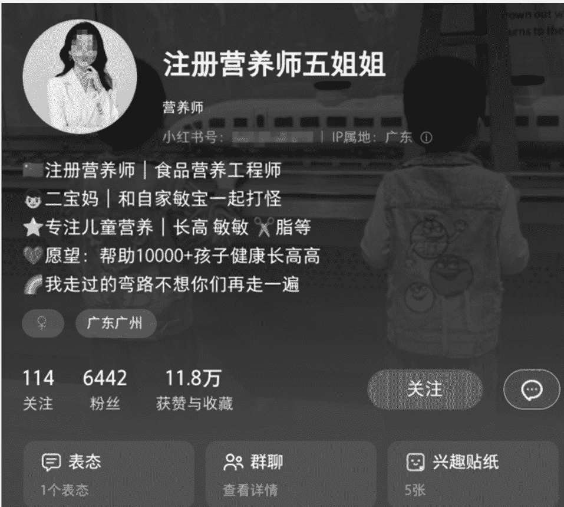，是专注儿童营养的专业营养师，通过展示注册营养师的职业以及自身昵称，在用户心智上打上标签。
比如“美妆春蚕”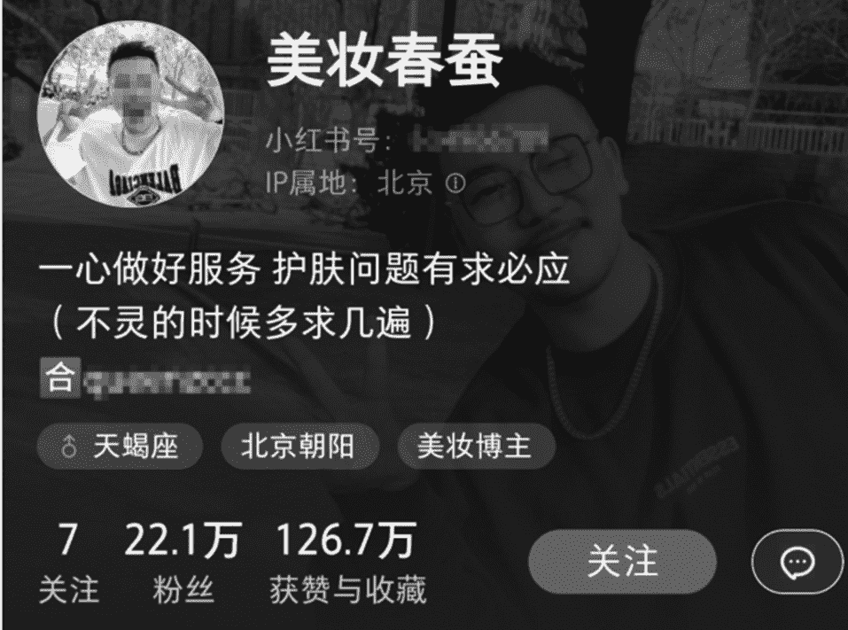是一个美妆博主，其昵称突出的是“美妆”这个领域和他的名字，将美妆和春蚕牢牢绑定在一起，强化自身IP特征。

公式2：需求/场景关键词＋个性化昵称
有利于点明用户需求或服务场景，直击痛点，直观强化用户对博主内容的认知，放大情绪价值。
比如“七七的省钱日记”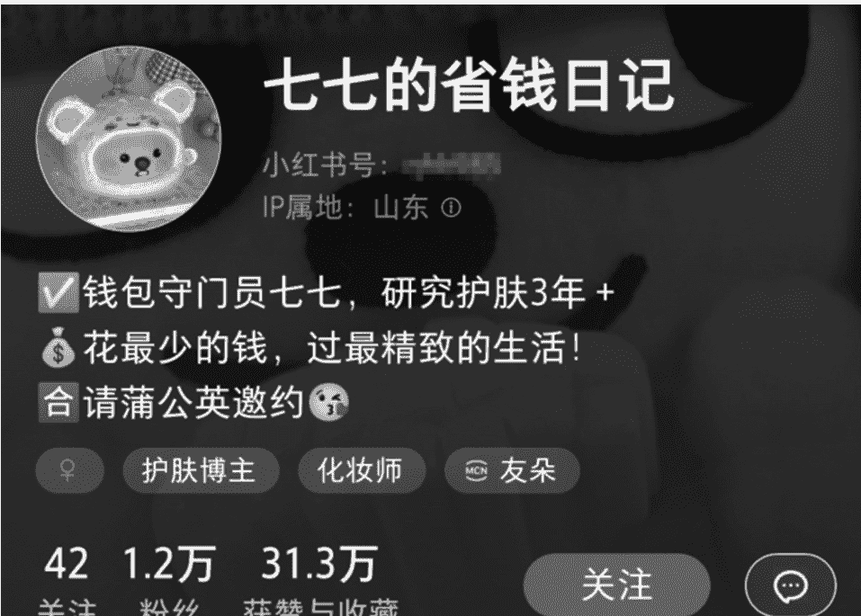，突出的就是生活中“护肤”这个场景下的省钱需求，吸引有省钱需求的精准用户群体。“七七”是叠音词，简单好记，所以这也是一个优秀昵称。
比如“职场老学姐”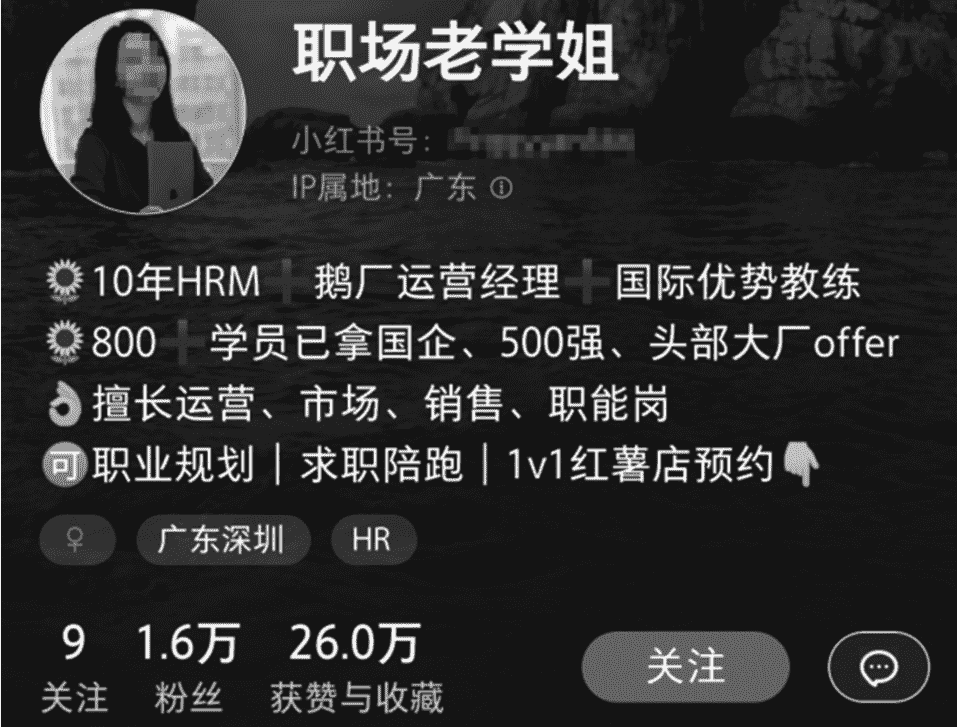，服务的就是“职场”这个场景下有学习需求的用户。因为有职场学习需求的一般是刚毕业不久的学生，所以“老学姐”这个昵称也给用户一种亲切感。

公式3：地域/性格关键词＋个性化昵称
能让用户清楚知道你在哪或者你的性格特征，有利于吸引同一地域或同种性格特征的用户。
比如“大宝姐在日本”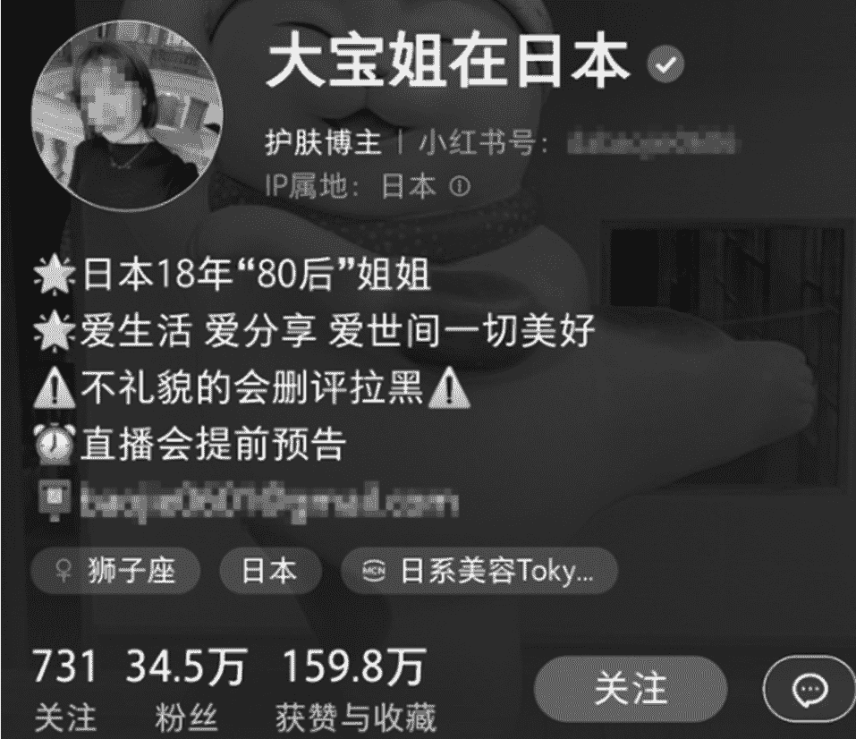，很明显地突出了博主身处日本这一事实，可以吸引同在日本或者有意向去日本、对日本感兴趣的用户群体。
再如“暴躁芋泥泥”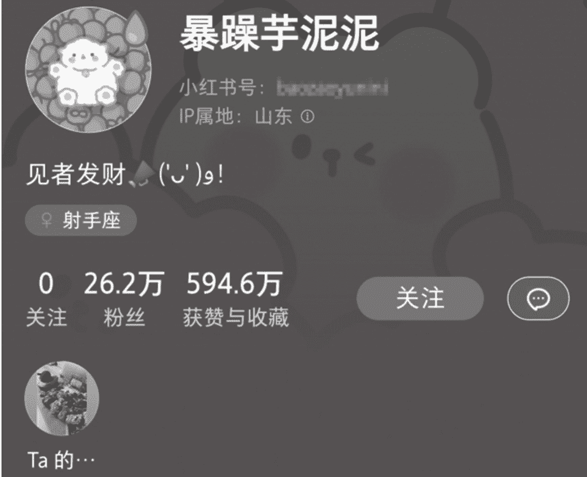，突出“暴躁”这一性格特征，这也是在做人设的差异化，激发用户对博主的好奇心，强化用户对人设的了解。

本节小结
三种起名核心公式：
1. 公式1：职业/领域关键词+个性化昵称
2. 公式2：需求/场景关键词+个性化昵称
3. 公式3：地域/性格关键词+个性化昵称

3.1.2 头像：真人出镜Vs虚拟IP，哪种更适合你
头像的选择非常重要，它决定了用户对你的第一印象。好的头像要专业、真实、有特色，并且和账号本身的人设定位吻合，不能有冲突。

3种常见的头像类型
1. 专业形象
专业形象代表职业属性的信任符号，适合医生、律师、教师等强专业属性赛道。
比如“山东肝病科张慧琴主任”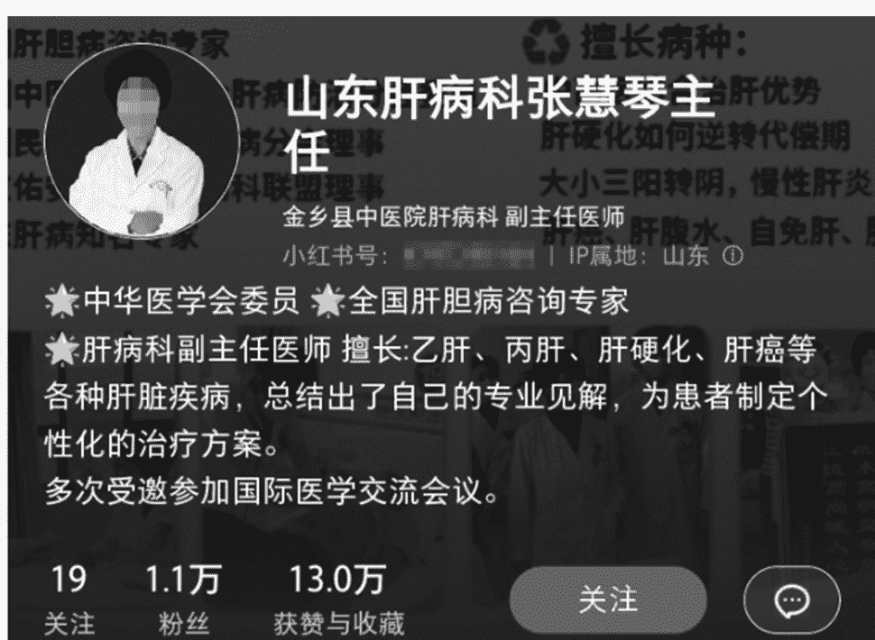这个账号，头像展示的就是一个医生穿着白大褂的形象，为分享肝病相关的医学内容笔记做强有力的背书。
再如“任建伟 律师”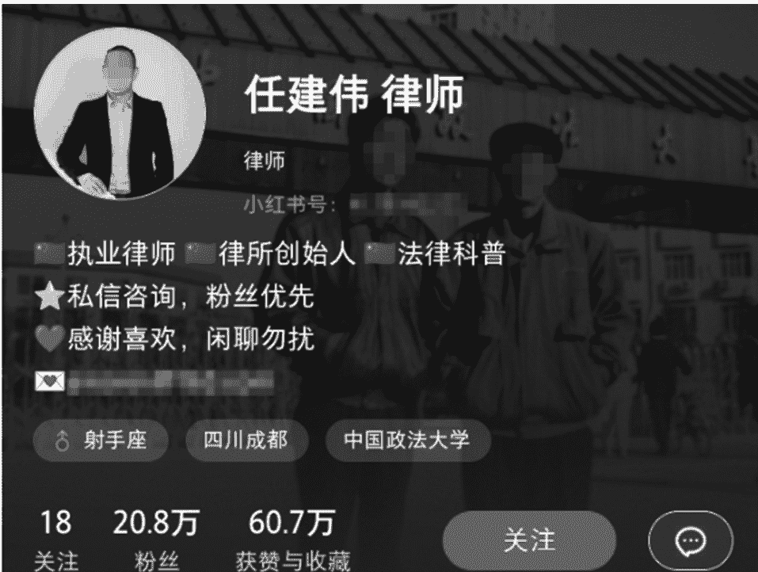这个账号，头像展示的就是穿着西装的严谨专业形象，强化专业律师的人设特征。

2. 专属特色
专属特色和赛道的本身属性有很深的关系。类设计能让用户很快理解账号的内容方向和人设定位。
比如“菜菜美食日记”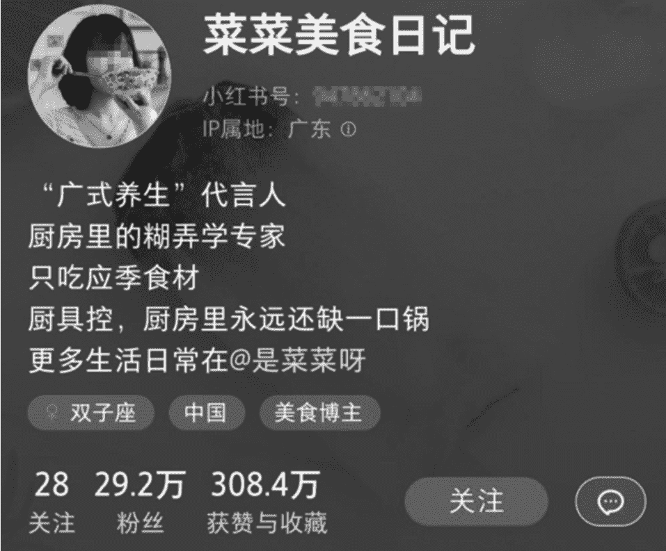，该账号头像就是一个人吃饭的场景，极具账号专属特色，用户一看就可以联想到吃饭、美食等相关场景。
再如“LISA栗沙绘画画”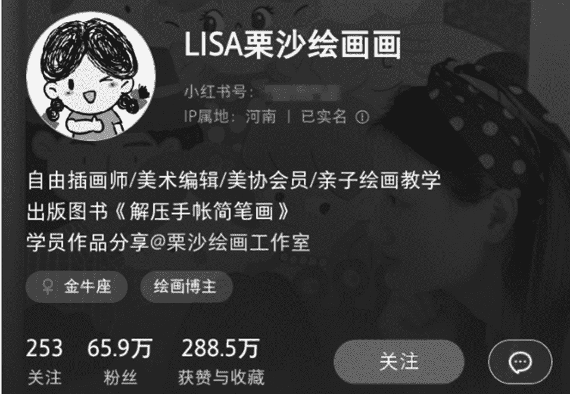是一个绘画博主，其头像向用户展示的是一个小女孩的绘画形象，垂直绘画本身这个赛道，在用户心智上强化“绘画”的特征。

3. 工具号头像
如果不方便出镜，可以使用网图或动漫头像等虚拟IP作为头像，但同样要与赛道相关。这一类型很适用于资料分享、养生、书单等不出镜的账号。
比如，“吉吉真的超不自律”是一个美食博主，其账号头像是一个动漫女生在饭桌上吃饭的画面，加深用户对美食博主人设的印象。
再如，“小浪书单”的账号头像与昵称一样，清晰又简洁，进一步突出小浪书单的人设特征。

本节小结
三种常见的头像类型：
- 1. 专业形象。
- 2. 专属特色。
- 3. 工具号头像。

3.1.3 简介：一段话精准表达价值，吸引目标用户
简介作为账号主页的“门面”，是用户了解博主的重要窗口。简介应该做到清晰、简洁，并且能快速传递出账号的价值和专业性，还要筛掉非目标用户，吸引精准粉丝。

简介结构四行法：清晰、有价值、有吸引力
1. 第一行：身份+背书+背景
这里要突出的点包括你是谁，你的职业、背景、成就。知识付费、教育培训、垂直专业领域的博主都可以用这个结构。
“国家营养师 | 减脂营主理人 | 帮助1000+学员月瘦8斤”，这个简介用自身的营养师身份去强化用户信任，同时直观呈现了自己的背书和服务案例数据，提高了账号的权威性。
“北大心理学硕士|情绪管理课主理人|助力2000人摆脱内耗”，“北大”名校学历是高信任度标签，强化了账号的专业性和权威性，同时定位情绪管理这一垂直领域，并加以呈现服务案例数据，更容易获得用户的信赖。

2. 第二行：独特经历+高光成就
进一步介绍你的独特经历、里程碑事件，以事实结果为导向，塑造人设差异化。个人IP、自律成长等类型的博主都可以用这个结构。
“从国企裸辞到年入百万 | 单篇笔记带货20W+”，这个案例就是用强对比和转折去制造记忆点，“国企那么稳定，还要裸辞，裸辞后，还实现年入百万元”，有的用户看完可能会有这种想法，从而产生好奇心，去关注博主。
“产后抑郁自救指南｜带娃减重58斤｜创立万人妈妈健身社群”，这个案例前后形成强烈对比，从产后抑郁到创立万人社群，逆袭爽文。“产后抑郁”的独特经历，获得更多母亲共情；“带娃减重58斤”呈现强烈的视觉化成果，打破了“健身博主自己练当然容易”的认知屏障；“万人社群”既彰显影响力，又为后续引流赢利做好铺垫。

3. 第三行：提供价值+细分领域
这里可以写你能为用户提供什么价值，你的解决方案，以及你分享的内容领域是哪个赛道的，吸引关注同一领域类型的粉丝。
“拯救塌房睫毛｜睫毛增长｜美妆分享”，这个案例开头就展示自己能帮助用户实现睫毛增长，直击用户痛点，美妆领域细分增强专业人设感。
“面试话术急救包｜应届生避坑指南｜职场生存干货”，这个案例开头用“面试话术急救包”直接明了展现“我能为你提供什么”，接着用“应届生避坑指南”再次展现账号价值，用“职场生存干货”细分领域增强人设感。

4. 第四行：引流钩子
做引流钩子，放邮箱或小号的联系方式。适合需要引流或接广告的账号，但要注意平台规则。
比如“求职干货合集领取@小助理”，直接点明路径方向，降低用户搜索和理解成本。
比如“私信‘模板’免费领100套简历模板”“100套简历模板”点明可为用户提供资料，能有效引流。
比如“点击主页群聊，加入28天写作训练营”，这里的“28天写作训练营”可吸引有意向的用户加入，先把用户引流到群聊，再转化到私域进一步成交。

四大简介类型方向参考
1. 聚焦核心成就价值
这类简介有利于展现博主的价值成就，强化博主的人设价值，为内容的专业性作背书。
比如“鱼宝妈妈”聚焦CFA持证、500强外企、公共营养师以及国际学校陪读等价值成绩，快速让对她感兴趣的用户了解基本信息，突出自身账号人设的差异化。
再如“西恩小姐”是一个“运动+母婴”的博主，在简介的第一行就亮明自己的成就价值，“产后瘦了30斤”强烈吸引想产后瘦身的用户群体。

在小红书上，一个让人愿意点进主页、愿意关注的简介，往往藏着四个可以拆解的打法。先看一个典型样本：

- 👩：CFA持证人 | 前500强外企 | 公共营养师 | 健
- ♎ 天秤座
- 母婴博主
- 美食博主
- 西南财经大学

139 关注  17.9万 粉丝  155.9万 获赞与收藏

关注

💬

图3-13 价值类型简介案例

## 图3-14 成就类型简介案例

**1. 用 emoji 和符号做视觉分隔**

简介里适度加入表情和符号，信息会更立体，也不会出现大段文字堆叠、看不清的问题。

比如 “辛普森学长聊求职”，每行都配了对应的emoji与符号，整页呈现得很整洁，用户一眼就能get到博主是谁、能提供什么帮助。

## 图3-15 emoji符号简介案例

再比如 “麦琪带你成长”，这是职场+时尚的人设账号，也在每行里做了符号搭配，对容易踩雷的词做了柔性处理，比如“搞钱经验”里的“钱”就用金钱表情代替。

## 图3-16 符号规避敏感词简介案例

**2. 在人设上适度包装**

这类账号的包装逻辑是围绕定位和变现来设计的。只要后续笔记真的能交付价值，哪怕简介做了合理加成也没问题。

“学习方法社”粉丝10万，内容是通俗好上手的实操学习法，简介就包装成名校毕业，给用户一个合理的预期。

## 图3-17 学历包装简介案例

“AI绘画|绿绿”做的是AI绘画分享，简介把自己写成在职UI设计师，这样后续输出设计相关内容就更顺理成章。

## 图3-18 人设包装简介案例

**3. 合规地放引流钩子**

简介本质上也是一个转化位，@小号、留邮箱都是常见做法。

我的学员“佐伊学姐求职陪跑”做求职陪跑服务，就在简介里埋了明确的求助钩子，吸引想拿高薪的同学主动沟通。

## 图3-19 群聊钩子简介案例

“是松子呀”是一位摄影博主，常发生活图文并在图上预留广告位，这类有商务需求的创作者就可以在简介里留下邮箱方便品牌对接。

## 图3-20 邮箱合作简介案例

**本节小结**

怎么写出能抓住目标用户的简介？

- 1. 四行结构法：清晰、有价值、有吸引力
  - 第1行：身份+背书+背景
  - 第2行：差异化经历+高光业绩
  - 第3行：价值承诺+细分赛道
  - 第4行：引流入口

- 2. 四大方向参考
  - 聚焦核心成就价值
  - emoji表情与符号搭配
  - 合理杜撰人设
  - 合规引流技巧

### 3.1.4 背景图：强化品牌记忆

主页背景图是账号的第二张名片，也是广告位。它要和赛道一致，用画面补足简介里写不下的信息，强化人设认知。

**常见的三种背景图用法**

**类型1：赛道垂直**

一眼就能看出博主的领域属性。

“尚微读书”的背景是书架，迅速坐实读书人设，为书单推荐做铺垫。

## 图3-21 读书赛道背景图案例

“橙子美食记”用美食实拍作为背景，进一步放大美食标签，让主页更有食欲感。

## 图3-22 美食赛道背景图案例

**类型2：专业背书**

用视觉呈现简介里没展开的专业度。

“石林老师”用荣誉证书做背景，为公开课教学提供信任感。

## 图3-23 荣誉证书背景图案例

“力克体育”分享体育内容，背景放零基础跟练的直播课表，每天更新，方便不同需求的用户对号入座。

## 图3-24 直播课程表背景图案例

**类型3：高光记忆点**

用证书合集、毕业照等有记忆点的画面加深信任和亲切感。

“护肤硕士王随天”把硕士毕业证和各类荣誉证拼在背景里，为护肤笔记做强背书。

## 图3-25 证书合集背景图案例

教育博主“大鹿鹿学姐”用自己的毕业照做背景，学姐人设更立体，主页整体更吸睛。

## 图3-26 毕业照背景图案例

**本节小结**

增强认知的背景图有三类：

- 细分赛道
- 专业身份
- 高光时刻

## 3.2 黄金对标策略：用别人的成功缩短自己的试错

### 3.2.1 对标为什么是新手第一步

新手想突围，最先要做的就是对标。就是把平台上已跑通的账号拆解学习，再结合自身特点做调整，能更快提升创作效率和爆款概率。

**经验一：降低试错成本**

起步期一定会试错，但盲目试错成本很高。对标能帮你少走弯路。通过拆解爆款，你会更清楚哪种标题、哪种封面、哪种互动更容易被推。

比如养生赛道的爆款，封面风格和字体排版高度相似。

## 图3-27 养生赛道爆款对标案例

**经验二：优化创作策略**

对标不只是抄内容，更是抄方法论。头部博主通常围绕统一的品牌调性和个人特色做长期规划，从而沉淀稳定粉丝。

新手借鉴这种策略，可以一开始就定好风格和目标。长期保持一致的语气、表达和视觉，才能在用户心智里建立标签。

“崔佳楠”长期输出专业护肤和省钱护肤，专业形象越来越稳。

## 图3-28 护肤赛道专业形象案例

“李小兰L”则用个性化的职场段子+人情世故内容，用幽默感抓住了大量粉丝。

## 图3-29 个性化风格优质案例

**经验三：帮助搭建内容体系**

小红书是高度分层的平台，能否锁定目标人群是关键。头部博主都很清楚自己的受众是谁，并据此创作。

明星买手“董洁”“章小蕙”在小红书的成功也离不开对标。她们的团队发现用户对明星日常和高品质生活方式兴趣高，于是把内容聚焦在真实的生活品味和购物心得上，注重真实互动而非硬广。

## 图3-30 明星买手案例

系统化的对标让她们快速积累粉丝，并塑造出“生活方式达人”的IP，带动了商业转化。

**本节小结**

新手对标三大收益：

- 降低试错成本
- 优化创作策略
- 辅助确立内容体系

### 3.2.2 快速找到对标账号的5个办法

**一、主页推荐法**

持续在主页刷领域关键词，能让系统给你打上垂直标签，推荐更多同类优质内容。算法会根据你的浏览习惯推送，甚至能挖到常规搜索找不到的新人爆款。观察这些账号的成长轨迹，对新手很有启发。

**二、关键词搜索法**

先列出10个领域相关的词，在搜索框里逐个试。系统会自动联想出用户常搜的词，能帮你快速梳理赛道细分。

具体做法：

- 根据经验和用户痛点列10个关键词。比如数码领域，输入“数码”就会弹出大量关联词，点进去就能看到真实需求。

在结果页重点看近半年发布、互动高、评论活跃的笔记。

## 图3-31 发现页推荐内容

## 图3-32 搜索框自动关联词

数码相机

搜索

全部

用户

话题

商品

筛选

综合

可购买

最新

学生

闲鱼

性价比

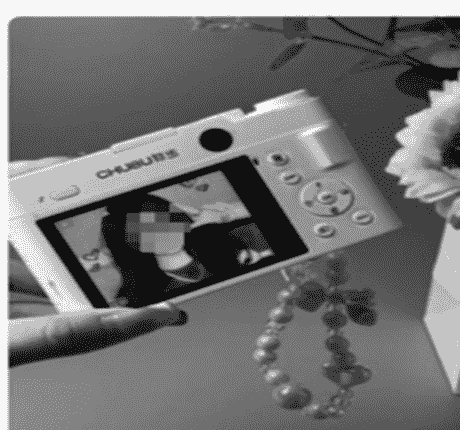

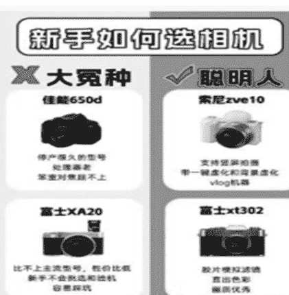

2天的工资没了……

19岁全款拿下ccd!……

2025年新手如何选相机？ #一起聊数码 #…

飞飞好物分享

02-25

620

荔枝相机…

01-29

2286

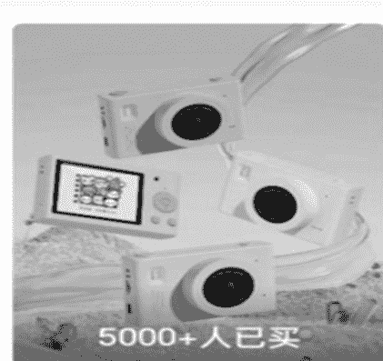

相机没必要太贵，尤其

数码相机 >

## 图3-33 数码相机笔记搜索结果

用“领域词+字母”的方式也能拓展思路。比如搜“数码a、数码b、数码c、数码d”，搜索栏会显示不同关键词及笔记数量，像“数码App”就有47万+篇，直观感受市场热度。排名越前的词，用户关注越大，优先查看。

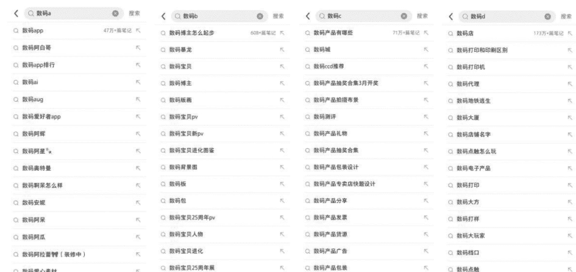

**三、关注推荐法**

关注一个账号后，平台会自动推荐同类型博主。对标账号不需要和你经历、变现方式完全一致，重点是学习其优秀点。

比如心理咨询赛道，头像、昵称、简介有明显共性。

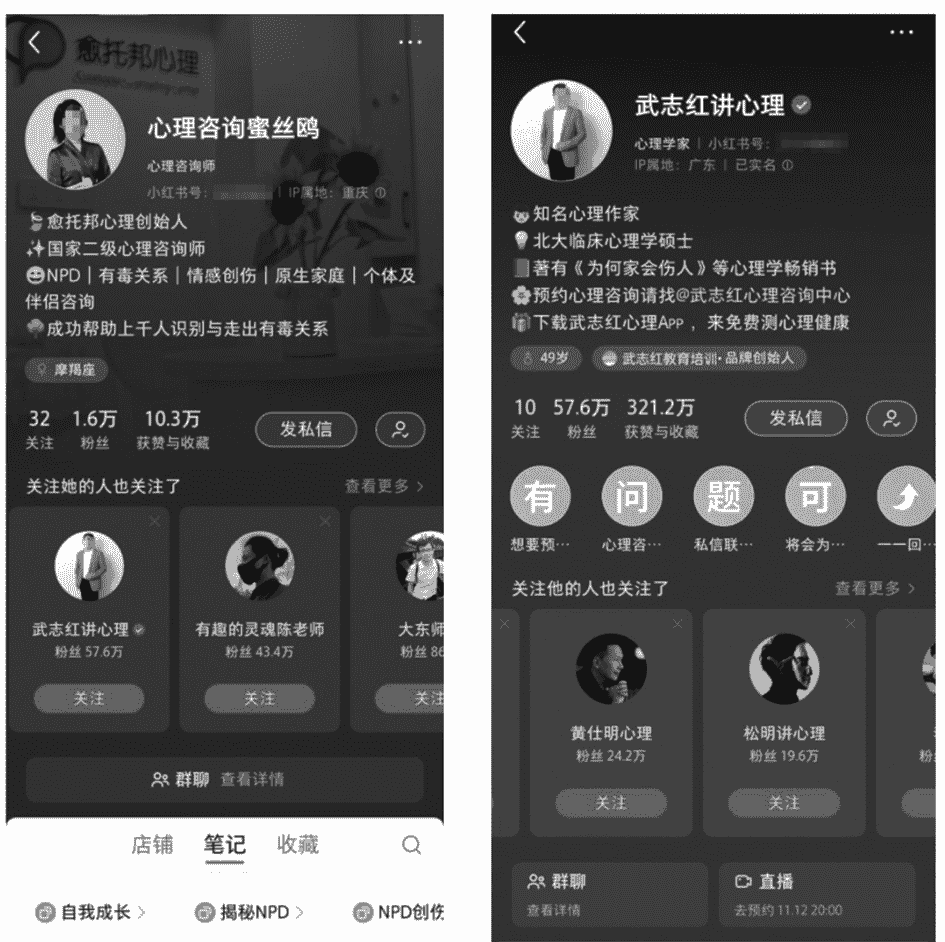

## 图3-35 心理赛道关注推荐对标

想做心理IP可以参考：真人头像保持专业亲切；昵称用“心理咨询师××”“××讲心理”；简介突出资质如“国家二级心理咨询师”。

**四、笔记反推法**

从一篇优质推荐笔记反推到账号主页，再拆解账号的选题、模板、花字、赞粉比等，形成可复用的方法论。

## 图3-36 笔记反推对标账号

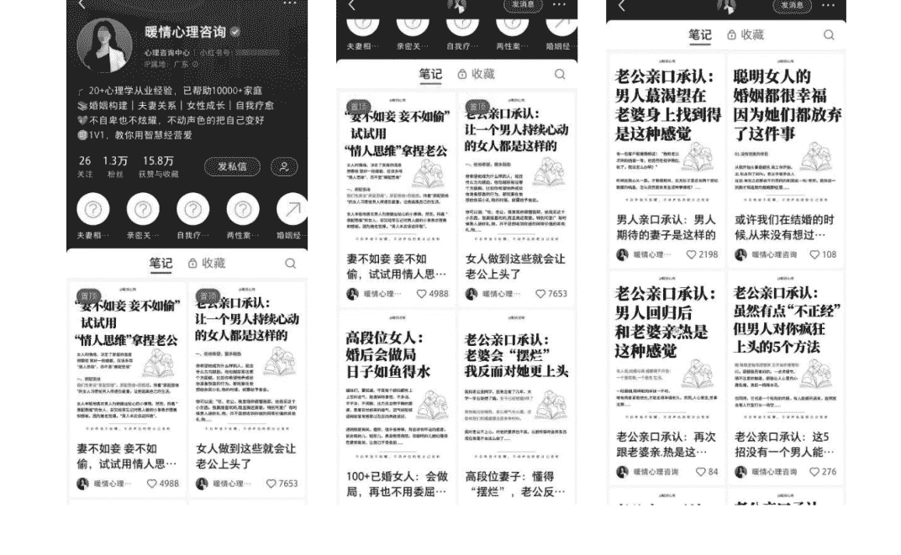

**五、话题标签挖掘法**

笔记下方的话题标签是选题宝库。点开标签能看到细分领域的热榜内容，左上角会显示总浏览量。

比如“上海心理咨询”浏览量超2000万，“郑州心理咨询”约500万，能帮助判断地域内容的获客难度。

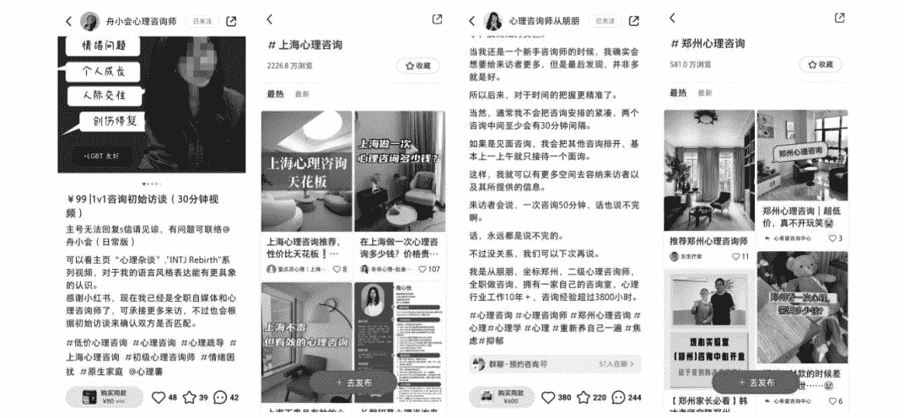

## 图3-37 不同地区心理话题浏览量对比

**本节小结**

5招找对标：

1. 主页推荐寻找法
2. 搜索关键词寻找法
3. 关注推荐寻找法
4. 对标笔记反推法
5. 话题标签挖掘法

## 3.3 选题策略：持续卡在流量红利点上

爆款的核心不是封面也不是标题，是选题。选题对了，成功就成功一半。优质选题的本质是回应大众真实需求，不是闭门造车。

**四类值得做的选题**

**1. 干货型选题**

聚焦用户痛点，强实用、可立刻上手。用结构化分点呈现，降低学习成本。

数码干货类的笔记，标题下就是一条条可直接复制的要点，信息密度高。

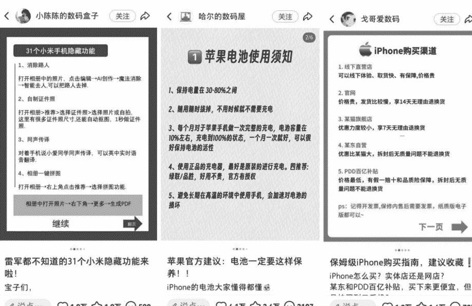

## 图3-38 数码干货细分笔记

这类内容不直接变现，但能提升账号权重和曝光。制作时要注意信息密度和可读性平衡，避免术语堆砌，多用口语化表达。

**2. 人设型选题**

核心是积累信任资产。持续输出个人经历、职业轨迹、成长故事，帮助用户建立熟悉感和依赖感。

图3-39所示即为人设型选题示例。

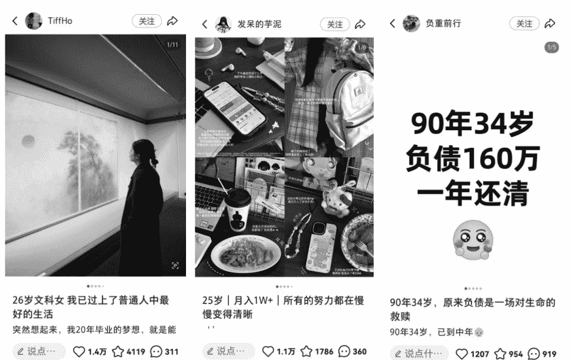

## 图3-39 人设型选题笔记

在内容创作里，选题的倾向往往决定了最终能走多远。同一套经验换一种表达方式来讲，才算真正吃透了流量规律。下面先梳理平台上长期被验证的几类主题打法，再谈如何借助智能工具快速搭建专属灵感池，最后拆解爆款与封面设计的底层机制。

人物定位向
核心在于把真实的经历改写成让人有代入感的叙事。譬如“26岁文科女，我已过上了普通人里最好的生活”这类方向，就是用故事化方式回顾自己如何借助互联网行业获得时间自由，并具体展示生活的变化、走过的国家和看到的风景，同时让个人标签自然进入读者心智。

操作时要从自身挖掘可被验证的差异化记忆点或成绩，再配合生活现场的幕后片段增强可信度。像“25岁｜月入1W+｜所有努力都在慢慢变得清晰”这类主题，就常搭配与调性相符的桌面陈、健身房实拍等画面，营造出“可学习但难以复制”的辨识。

人物设定要经得起推敲，避免过度夸饰引发怀疑。比如“90年34岁负债160万一年还清”这类话题，做法是把年龄、关键节点、经历交代清楚，去吸引同样处在负债困境的用户交流，而不是夸大其词。

梳理这类笔记时，不妨多问一句用户为什么会为你付费，边写边推演购买动机，效果会更清晰。可多拆解同赛道成熟账号的呈现顺序与结构框架做参考。

揭秘向
这类主题抓住的是用户渴望获取稀缺未知信息的心态，通过制造悬念与信息差来撩拨好奇甚至不安。
如图3-40所示，来自不同领域的三个揭秘向例子，本质都在直击用户痛点，揭开大众不熟悉的内幕。
例如“揭秘资本家让你吃出病的秘密”，只释放关键线索制造悬念，靠大脑对未知的天然探索欲推动点击。像“长痘内调的骗局”“世纪大骗局”这类方向，则更贴近日常经验，长痘、鱼油、脂肪酸都是高频接触的点，核心是打破认知壁垒，让读者产生“原来如此”的恍然感。
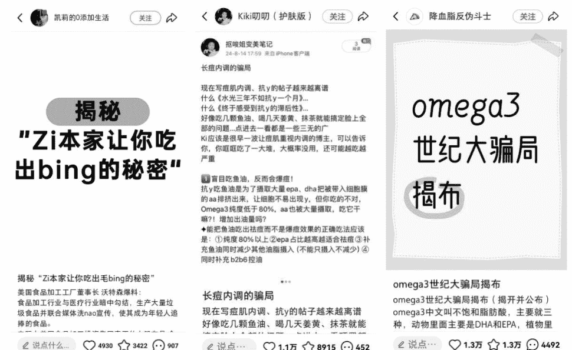

图3-40 行业揭秘型选题笔记

避坑向
人人都怕投入白费、踩雷交智商税。风险预警式的切入直指决策失误与受骗的恐惧。
这类内容通常先用具体案例引发共鸣，再给出可执行的规避方案，点赞收藏率高，且容易自发传播。

如图3-41所示，“找工作避坑”“纹眉避坑”“装修避坑”等主题，都在深挖目标人群的痛点，建立情绪连结，促使用户进入内容。
以上四类是平台上非常典型的优质主题方向。无论垂直领域是什么，都可以对照这四种思路复盘创作，流量改善会更有迹可循。
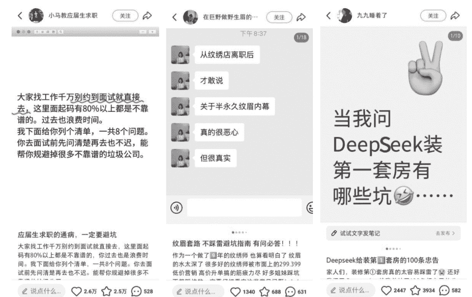

本节小结
优质主题四类：
1. 干货类主题
2. 人物定位类主题
3. 揭秘类主题
4. 避雷类主题

AI智能选题库：快速搭建量身定制灵感池的思路

智能助手不仅可以批量出题，还能给出内容方向与写作思路。对创作者而言，这相当于把灵感直接变成可执行的清单，比同行更快占位。

实操举例：
身份是护肤赛道的小红书创作者。
任务是为账号产出10个避坑向主题。
目标人群是25到35岁的敏感肌女性，预算有限但重视成分安全。
要求主题能在家用现有产品完成，无需专用设备，用词不宜过于专业。

基于这套提示，智能工具给出了以下敏感肌居家避雷方向：

1. “敏感肌别盲跟的3种网红成分，省下冤枉钱”——揭示易致泛红的热门成分，并附平价替代
2. “每天敷面膜会烂脸？正确补水姿势教学”——破除过度补水误区，给出安全敷膜频率和简易湿敷法
3. “洗完脸紧绷不等于洗干净，你的洁面可能在伤屏障”——用纸巾测试清洁力，推荐平价氨基酸洁面
4. “红血丝急救别乱抹药膏，厨房也能自救”——避开激素产品，用冷藏牛奶、燕麦片做舒缓面膜
5. “这些护肤品混用等于慢性毁脸，快查梳妆台”——比如芦荟胶加酸类会刺激，给出安全搭配公式
6. “换季过敏不用扔护肤品，3步找到元凶”——耳后测试法加停用排查法，省钱又避坑
7. “别用手挤黑头，5毛钱热毛巾法更温和”——对比撕拉鼻贴和针清伤害，演示温和导出步骤
8. “宣称天然的DIY也有坑，自制柠檬面膜为何毁容”——曝光网红偏方酸碱失衡风险，附修护流程
9. “防晒霜搓泥不是产品差，可能是涂错了顺序”——演示等干成膜法，推荐平价不搓泥防晒
10. “越护越差？停掉这4种自我感动式护肤”——过度拍打、频繁湿敷、盲目肌断食等
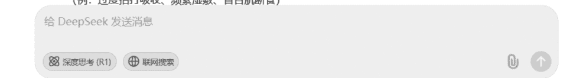

图3-43 AI生成护肤选题输出结果

可以看出，一次就能得到10个精准主题，贴合人群属性、预算限制和居家操作条件。同样逻辑可迁移到其他赛道。以美食探店为例：

身份：有3年探店经验，擅长挖掘隐藏美食和餐厅测评的美食博主
任务：产出5个含标题和内容框架的主题
人群：18到35岁的年轻白领和学生，尝鲜欲强，人均预算300到500元，喜欢拍照打卡，重性价比
要求：每个主题明确地点和菜系，标题吸睛，内容覆盖环境、价格、推荐菜品，不选高端奢侈餐厅，不做复杂烹饪分析

智能助手给出的五个方向包括：
1. 标题：“广州天河人均200+的日式烧肉天花板，和牛入口即化！” 框架涵盖店址排队情况、暗黑工业风打卡点、必点现切M5和牛小排和爆浆芝士年糕、午市套餐省钱提示、隐藏吃法生鸡蛋拌饭
2. 标题：“杭州西湖边被绿植包围的泰式小馆，芒果糯米饭美到窒息！” 场景是独栋玻璃房瀑布绿植墙，测评彩虹芒果糯米饭和可续汤底的冬阴功汤，避雷青木瓜沙拉偏辣，人均180元
3. 标题：“上海静安韩国街外挂，芝士铁板鸡拉丝一米不夸张！” 氛围是BLACKPINK音乐沉浸式店面，爆款火焰芝士春川鸡和彩虹棉花糖烧酒，小菜无限续加，适合生日聚会
4. 标题：“成都太古里本地人才知道的川菜馆，辣子鸡里找鸡丁挑战！” 反差设定藏在麻将馆后，硬核菜品霸王辣子鸡和麻将造型椰奶冻，免费解辣冰粉，人均150元
5. 标题：“深圳南山Omakase平替，板前寿司人均300+吃下12贯！” 价值对比千元日料同源鱼获，可自选鲜鱼，海胆寿司视觉冲击，隐藏菜单鹅肝寿司，周三女士日送清酒

标题技巧上，多用情绪符号，数字具体化，并加入“天花板”“平替”等年轻化词汇。内容设计上，强化视觉化描绘、埋互动梗、突出社交货币属性。

本节小结
搭建智能选题库的关键是把身份、任务、目标人群、执行要求说清楚，工具就能完成定制化产出。

# 第四章 AI内容工厂：从选题到流量的全链路

### 4.1 爆款底层逻辑

小红书上的爆款并非偶然，它是用户需求、情绪共鸣、实用价值和系统推荐四力叠加的结果。很多创作者归为运气，实际上10W+笔记都有可复用的共性。

从主题、标题、封面到正文，每个环节都在为爆款埋线。爆款的核心是让人想点、想评、想转。推荐机制则负责把好内容扩散。

一、满足用户需求
爆款诞生离不开明确的需求。护肤内容要让人看到效果，穿搭要让人觉得能用，情感故事要让人代入。必须先搞清楚服务人群在想什么、想要什么，再用精准表达给出一个有感的钩子。针对性强、实用性高的内容更容易抓住痛点。

二、情绪共鸣
情绪是驱动传播的主力。有时用户转发不是因为内容完美，而是它说出了自己想说却没说的话。像“礼物清单”这类话题，就能同时引发共鸣、反驳和争论，互动自然起来。系统看到数据就会加大推荐。

职场升职加薪类笔记也是典型，通过表达大众心声并引导互动，把情绪推向高点，最终形成爆款。

三、实用价值
好玩的内容让人一笑，干货内容让人收藏。实用的内容必须能复制、能执行、能直接拿去用。纯理论干货容易快速降温，而提供具体操作价值的内容寿命更长。

比如“微胖女生秋冬穿搭避雷指南”，直接告诉用户该买什么不该买，甚至给出单品示例，用户收藏后能立刻用上，二次传播也会随之而来。

四、符合推荐规则
系统像放大器，先给小流量测试，互动好就扩量。搜索词的埋设很重要，如“速效美白”“大学生穿搭”“成分护肤”等能提升搜索和推荐概率。封面图是视觉入口，高质量封面直接影响点击。标题要有钩子，比如“穷鬼穿搭”“轻松实现校花梦”“大牌同款”“低成本白皮公式”。

互动引导也关键，引导评论点赞分享的数据信号会让系统判定内容有潜力，进一步推入更大流量池。

本节小结
爆款本质是：
1. 满足用户需求
2. 触发情绪共鸣
3. 提供实用价值
4. 符合平台推荐规则

### 4.2 封面优化：点击率的核心

小红书封面影响点击率至少占八成。没有好的封面，再好的内容也进不来。

#### 高点击封面七大类型拆解

类型1：痛点主题+关键词聚焦
用精准痛点做标题，结合清晰字体和重点词，增强视觉冲击力。
如图4-5所示，“33岁，我靠心理咨询过上了理想生活”，年龄代入加痛点；“不喜欢现在的工作，又不知道自己擅长什么”直击困惑，小标题聚焦“天赋优势”。标题越具体越能解决问题，效果越好。

类型2：比例统一+内容垂直
统一设计元素的比例、位置、颜色、间距，突出垂类核心关键词。如图4-6所示，整体模板固定，只更换部分关键词如“却有病”换成“创伤反应”，提升去重率同时保留爆款框架。

类型3：审美高级+氛围强化
整体高级有质感，色彩柔和，字体简洁。图4-7中的“窗边阅读”“咖啡馆写作”类场景封面就营造出温馨高级感。没有素材可在平台搜索同风格配图，用于生活方式、个人成长、心理咨询类内容。

类型4：大字报+信息突显
用超大字体直抒主题，信息一目了然。如图4-8所示“HR最讨厌的三句话”，搭配纯色白板背景，冲击力强。

类型5：聊天记录+场景还原
用聊天截图或伪装聊天记录激发好奇。如“crush说做朋友怎么办？”“要不要换工作好迷茫”，真实感强，容易点击。非常适合职场、情感、社交话题。

类型6：备忘录+内容传播
备忘录式封面普适性高，有“随手记”的真实感，更亲和。图4-10中的“挽救前任中的常见无效行为”“找工作一定要胆子大”“如何挖掘自己的天赋”都直观呈现关键词，简洁清晰易传播。

做好封面，才能让内容被看见，再谈深度。

##### 第七类：热梗图+吸睛点缀

这种打法的思路是把当下在网上传播最广的梗图放在封图主角位置，再配上一句带梗、带调侃的短文案，很快点燃好奇。

它自带娱乐感和易传播的特质，在信息流里容易拿到高点击和高转发。实操时挑一张近期热度很高的梗图，再配一句能让目标人群产生共鸣的短句即可。

比如第4-11图的实践里把梗图和赛道关键词做了结合，月老已经锁定你本年度脱单有望、被指中的人今年大概率走入婚姻、不是面试时HR的潜台词你们真的get不到吗，吸引力都很突出。

账号处于冷启动期，用这种形式发笔记做快速起量和数据测试，效率很高。

#### 二、易点开封图的三大落地准则

搞清楚爆款封图的常见样貌后，下面三条是做图时的底线思维，做图时一定要对照着用。

##### 1. 极简聚焦准则：半秒内留住视线

平台刷图的节奏很快，一张封图停留基本不足一秒，越简洁越抢眼。

具体落地就是一图只说一件事。一张封图只传递一个关键信息，别把不相关的点堆在一起，否则用户会看不懂。

主视觉要跳出来。可以借用撞色、光影对比、背景虚化等手法，让主体在画面里凸显。记住黄金比例：用20%的画面承载80%的注意力。

文案要短而有力。封图文案控制在4到6字，极限不超过10字，避免遮挡主体画面。字要大、颜色要对比、位置要醒目，才能快速传递信息。

##### 2. 沉浸场景准则：让用户有代入感

抽象的概念不如具体情境来得有共鸣。把内容放进真实情境里，用户更容易代入并产生情绪反应。

用户更想看使用情境，而非单纯的物品。例如咖啡机，纯白背景的产品照不如放在温馨厨房里，配上冒热气的杯子，更有购买冲动。

生活化场景拉近距离。即便是偏专业的主题，也能用日常画面软化。做财务管理笔记，封图用咖啡馆里整理账单的画面，比数字图表更容易被接受。

画面带点动感会更好。捕捉一个动作瞬间或暗示动态，比如撒落的咖啡粉、飞扬的裙角、正在操作的手部特写，都能让静态图更有生命力。

小结
一、七类高点击爆款封图拆解
- 类型1：痛点选题+关键词聚焦
- 类型2：版式统一+内容垂直
- 类型3：高级审美+氛围强化
- 类型4：大字报式+信息突显
- 类型5：聊天记录+场景还原
- 类型6：备忘录+内容传播
- 类型7：热门表情包+爆款元素
二、封图设计关键准则
- 1. 简约突出准则，快速抓住重点
- 2. 场景化准则，增强代入感

### 4.2.2 用智能绘图快速做封图，提升视觉吸引力

封图决定点击和传播，但不是每个人都有设计功底或拍摄条件。智能绘图工具即梦就能补位，几分钟做出专业级封图，让内容在信息流里脱颖而出。

#### 一、从零开始做平台封图的五步法

环节1：进入作图平台
打开浏览器，进入即梦官网，在首页找到智能作图区域，点击图片生成。首次使用需注册或登录，支持手机号、微信、抖音账号登录，登录后每天有免费额度。

环节2：选模型和画布
作图页选择生图模型2.1，目前效果最好。画布比例设为3:4，这是平台封图的理想竖版比例。分辨率选1024×1360，保证清晰度，不会被裁剪。

环节3：写好生成指令
生成指令决定成片质量，一个靠谱的封图指令通常包含：主要元素、环境设定、光线氛围、色彩风格、构图视角。
彩妆示例：高级质感唇膏展示，大理石桌面，柔和自然光，奢华质感，微距特写，超清画质，专业摄影质感
桌面博主示例：ins风格桌面布置，高颜值治愈系，摆件绿植台灯笔记本，自然光，清新色调，视觉冲击强
家居博主示例：北欧客厅，米白沙发配木质茶几，绿植点缀，柔和灯光，温馨通透，自然采光，舒适简洁

环节4：拿图反推指令
找一张喜欢的图片，发给其他对话助手，让它把描述写出来，提示语可用：“帮我写出能生成这张图的描述词，详细说明物品、场景、光影、风格、镜头，每个词用逗号分隔”。把生成的描述复制到即梦中生成。

环节5：生成筛选保存
输入指令后点立即生成，系统一次出四张。若不理想就点重新生成。选定满意图后保存下来，多生成几组再挑最贴合的。

小结
智能快速生成封图的流程：
- 环节1：进入即梦作图平台
- 环节2：选择合适的模型和画布比例
- 环节3：编写有效的描述指令
- 环节4：用图片反推描述指令
- 环节5：生成并筛选图片

## 4.3 题目打造：让内容被看见的第一步

### 4.3.1 高点击率题目的五大模式

在平台内容创作中，题目是引流的第一步。它决定了你的内容是否能在众多竞争者中脱颖而出。一个高点击率的题目，能帮助你提升内容的曝光度和转化效果。

#### 模式1：数字+痛点/需求+承诺

适合有明确诉求、想解决问题的用户。
- 健身：7天瘦5斤的减肥食谱，简单又高效，让你快速减脂
- 职场：10个提升工作效率的小技巧，新手必看
- 创作：5个内容公式，帮你轻松打造爆款

数值让价值更直观，承诺让用户明确收获。

#### 模式2：如何/为何+痛点/需求+结果

提问式题目，激发求解欲。
- 健身：为何你每天都运动，体重却不降反升？
- 情感：如何在30天内让暗恋对象对你刮目相看？
- 学习：为啥你学习很认真，却始终考不了好成绩？

#### 模式3：A和B+问题/冲突

用对比制造站队心态。
- 创业：普通人和成功人士的区别是什么？
- 职场：月薪3000和月薪3万的人，差距到底在哪里？
- 养生：减肥靠运动还是靠饮食？答案让人意外

#### 模式4：紧迫感+行动指引

用时间稀缺推动即刻点击。
- 咨询：限时48小时！教你如何挖掘自己的优势天赋
- 健身：最后7天！免费领取私人定制减肥计划
- 工具：最后3天！爆款题目生成工具免费试用

#### 模式5：反常规+解决方案

挑战固有认知，用新角度吸睛。
- 成长：成功并不难，真正难的是坚持
- 健身：减肥并非依赖运动，而是靠吃！
- 职场：加班越多，升职越难？真相让人惊讶

小结
高点击题目五大模式：
- 模式一：数值+痛点/需求+承诺
- 模式二：如何+痛点/需求+结果
- 模式三：A和B+问题/冲突
- 模式四：紧迫感+行动指引
- 模式五：反常规+解决方案

### 4.3.2 智能速写题目：1秒出10条爆款

写完内容最头疼的就是题目。现在用智能工具，1秒就能得到十几个方向，彻底提升创作效率。

#### 一、两套常用生成方法

##### 1. 结构化下指令：有明确主题时用
把角色、任务、受众、要求结构化给工具。
模板：
- 【角色身份】请你作为平台爆文创作专家
- 【核心任务】为我生成10个关于“油皮适用的平价爽肤水”的爆款题目
- 【目标受众】18～28岁油性肌肤女性
- 【题目要求】突出性价比，效果明显，实测感

##### 2. 案例投喂法：想找规律或灵感时用
把已有的爆款题目喂给工具，让它总结共性再仿写。
模板：你是一位平台爆文创作专家，我会给你爆款题目，请你总结特征，再想××个类似题目，并以清单体发送给我。
案例题目：30岁而已，一切来得及；人生建议，闷声做个狠角色；当了妈妈以后，请拼命提升这10个能力；敏感、拧巴、内耗者，狠狠读这7本书；35岁觉醒，爆发式的人生有多爽；我发现，大女主只吃高级的苦；清醒的脑子，都是眼泪换来的；深耕自己，尽量不赚辛苦钱；自律一年，我变成大家羡慕的样子；33岁，我决定用一年时间改变自己

针对油皮适用的平价爽肤水生成的示例方向：
冲突感+权威背书、痛点直击+效果可视化、悬念制造+社交认证、场景化+解决方案、数据化+情绪煽动等五类思路均可快速产出。

题目优化小技巧
- 用符号强化重点：价格/效果处加❗💰🔥
- 埋入搜索关键词：油皮爽肤水推荐、平价控油水乳等
- 封面搭配：左图放产品拼图+价格标签，右图放前后对比+成分截图

在图文并重的平台里，标题负责把流量拉进来，正文负责把人留住。把已经跑通的爆款逻辑拆解、重组，再交给AI规模化复现，就能同时提升生产效率与出圈概率。

一、先把标题的算式算明白
在成长、自我提升、职场向的内容里，互动高的题目往往带着强共鸣的自我叙事。参考素材里整理了18个高互动案例，覆盖失业反思、家庭主妇变现、人生重启、高敏感自救、复利思维、薪资跃升、职场妈妈时间管理、技能死磕、同事关系、单身叙事、认知转运、焦虑解法、社恐到销冠、带娃返岗、讨好模式、情感重生、低学历突围、戒掉短视频等方向。

拆解来看，驱动力大致可归纳为：受众的痛感或身份标签 × 精确数字 × 情感动词 × 前后反差。叠加爽感词汇如爆发、顶级、碾压、逆袭，再配合自救、挤时间、信息不对称等场景词，就能持续撬动不同人群的情绪点。

让模型批量产出标题主要有两条路。一是结构化指令，给明确主题与要求，按模板批量生成；二是案例喂养，把已验证的爆款喂给模型再优化，在新主题上复刻。两种方式都适合成长和工作类创作者快速建立题库。

二、让正文有完读率的六种写法
在该平台，图片视频抓眼，文字讲清价值。美妆要补充质感与成分感受，餐饮要补充口味层次与人均预算，穿搭要补充面料手感与搭配技巧，图文配合才形成可信的生活指南。

1. 用金句或名人故事起笔
一句有分量的名言或一个名人经历开场，能在数秒内建立信任。用户看到类似名家曾写过、大牌公开推荐过的表述时，防御心会下降，后续内容更容易被接受。生活类博主引用经典语录，情感类博主引用经典语录，都是典型做法。

2. 用清单呈现凸显价值
用户看重能快速拿走的实用信息。分条罗列配合数字锚定，这类结构的收藏转发量通常比散文体高出约三成。某成长博主的百条建议、某收纳博主的五条核心原则，都靠清晰的清单让读者一眼判断价值。具体到三步流程、七项注意，比笼统描述更有说服力，也更容易被算法判定为优质干货。

3. 先总后分再总结
开头点明主题，中间展开细节，最后收束强化，契合移动端碎片阅读。某博主的高情商赞美方法、另一博主的求职瓶颈破解，先抛核心观点抓注意，再用案例与步骤说明，最后给出可执行建议，兼顾深度与易读。

4. 痛点与痒点双驱动
先唤醒真实困扰再给解法，是持续引发共鸣的关键。如25岁后胶原蛋白断崖式流失、薪资多年未涨可能是三项习惯导致等表述迅速建立共鸣。随后给出改善方法，某养生号分享提神法、某情绪号提供调节技巧，都是先制造焦虑再点亮希望，让笔记同时具备共情与实用。

5. 用前后对照讲改变
对照叙事比说教更有感染力。某博主用具体场景展示由羞怯变自信的转变，另一博主用职业路径对比勾勒成长轨迹。读者看到相似困境与可复制路径，会自然产生我也可以的信心。

6. 晒凭证强化真实感
成绩单、收入截图、专业资质把抽象建议落到实处。某博主分享打工两年多攒够留学费用并附存款与申请过程，让资金安排变得可感。某考研博主分享英语从薄弱到全部正确的逆袭，用成绩为方法论背书，在信息过载环境下更易获得信任。

三、AI一分钟产出高质内容的两套打法
传统手写耗时低效，AI能把创作压缩到一分钟左右并提升爆款率。

1. 角色扮演法
提示词拆成角色、背景、任务。示例：设定角色为职场领域资深博主，擅长干货与成长经验；背景为准备发布一则谈论新人如何快速适应的图文笔记；任务为输出一篇吸睛实用的爆款内容。定位清晰、背景充足、目标明确，产出会高度贴合需求。

2. 仿写策略
指令为仿照以下爆款内容的风格与结构，为我撰写一篇新主题笔记，注意保留情感表达与短句节奏。敏感肌底妆案例显示，保留原有情感节奏与版式，只替换内容，就能快速得到结构完整、情绪一致的新稿，避免从零构思。

把标题公式、六大正文字法与AI提示词方法结合，就能稳定复刻成长工作类内容的爆款模式，让笔记既有情绪点又有实用价值。

在笔记社区里，读者打开你的内容时，最先判断的是这份内容能给自己带来多少实际好处。只有当好处被认可，并且预期在你的私人流量运营里能拿到更进一步的进阶支持时，人才会顺着你设计的动线继续走下去。

导流的本质并不是硬拉，而是让价值自然流动。公开域的图文需要足够吸睛、足够解决痛点，私域的供给则是公开域的延续与升级，而不是原封不动地搬运。以考研赛道为例，博主的图文获得好评以后，如果在篇目里适度露出《答题汇总》《口语模板》这类高感知资源，并在评论区给予兑现，读者就会顺势跟随引导。

引流的三大底层认知

第一，先交付价值，再设计动线。
图文能不能停留，取决于是否回应真实需求。私域要做延展与深化，以“把问题真正解决”为设计逻辑，而不是重复。

第二，获客要靠体系，而非单一招数。
很多人总想找一个万能秘诀，靠单一动作追求完美结果，容易短视且踩坑。持续稳定的导流需要完整系统。

系统化就是搭建漏斗。从初次触达内容，到关注主页，再到进入私人流量池，最后完成付费，每一步都要设计。内容-主页-收藏关注-私域通道-成交，这条链条本身就是筛选漏斗。

职业咨询赛道的学员诸葛莉是典型案例。她持续输出职业规划干货，积累信任后置顶一条自我与产品介绍的篇目。点赞44，留言21，却在第25个粉丝时就完成成交，对新人极具参考价值。

同时需要多渠道协同。平台内的入口包括图文、留言、站内私信、群组，各有用法。图文里可埋案例、资料钩子；留言区引导受众主动私信或入群；可主动触达精准人群，也可用小号在群内发内容导向私域。渠道要配合，而不是单打独斗。

第三，导流是入口，私域才是主战场。
平台流量是暂时的，私域才是可控资产。把人拉过来只是开始，后续运营和转化才决定收益。

有人引100人能赚六位数，有人引1000人只成交一个，差别在质量和承接力。瑜伽普拉提赛道的学员清念.女子塑形美学，用一条仅1个赞的图文，通过私信把人带到微信，最终卖出客单价五位数的年卡。

能成交的背后：一是篇目里“贵阳”“有温度”“普拉提工作室”等城市加领域标签精准吸流；二是微信里专业度拉满，面对面沟通极大提升信任。私域可通过朋友圈、社群、公众号反复触达，培养信任促成复购。导流只是起点，后续转化才是价值兑现的关键。

三种可轮换的安全导流方式

平台对导流管控严格，违规会警告、限流甚至封号。路径过长也会导致流失，所以需要多套打法轮换。

一、群组导流
对不想付费推广的个人号来说，群组是最稳的起点。

创建路径：打开社区点“消息”，点右上角“发现群组”，点“创建群组”。创建后会弹出“生成图文并发布”的提示，直接点“不了谢谢”即可。

群名就是第一钩子。名称要直接点明利益和人群，进群率会大幅提升。比如“领疗愈师0到7位数指南”，一看就知道进群能拿变现指南，精准吸引疗愈赛道人群；“霖子粉领自由人生公开课”也同理，清晰传达进群可领公开课，吸引想做人生教练的人。

群头像、群介绍、管理员昵称都能当钩子。比如“2025必脱单”群在头像里露出微信，直接降低加好友成本。

注意风控。最怕恶意举报。学员曾因与客户争执被反复举报。群组和留言都要保持善意，避免正面冲突。遇到难以沟通的客户，可委婉拒绝：“目前没有这方面的案例支持，建议您可以再多看看其他资源。”既保护账号，也保留体面。

常用群钩子：
免费资料钩子。进群领××资料/手册/指南，适合想快速拿干货的人群。如“领取《居家养老安全指南》”“自媒体资料免费领取”。关键点：用户问怎么领时，务必引导加微信后再发，不要直接在平台发，否则他就不会再动。
小号素材钩子。用小号在群里发图文视频，巧妙嵌入微信，或把小号设为群管理员运营。养几个备用号，降低主号风险，也能提升粘性。
直播产品钩子。通过群里发见面礼商品链接引导下单，后台安全发微信。情感赛道学员璐璐用《相亲正确流程攻略》见面礼，内购价¥0.99，单月拿到上百个精准客户。心理赛道也常在直播里口播文案引导加微信。

璐璐见面礼《相亲正确流程攻略》
内购价 ¥0.99 ¥1 2位群友已买
欢迎小公主们，进群请点击这里哟[红色心形R]
购物红包已过期
超过24小时，红包过期了
@所有人
03-18 11:22
"小红薯67C6ED26"加入了群聊
03-18 19:54
专属内购开启，快来抢购吧！
璐璐见面礼《相亲
2位群友已买
内购价 ¥0.99 ¥1
购物红包已抢光
下次早点来抢哦

心理咨询师四木 群主

公益心理咨询
心理咨询师四木
07-28 11:49
心理咨询师四木 群主

知识夏校|是什么造成了现代人的身心分裂
四木心理茶室

二、主页导流
主页是受众对你的第一印象，封面、简介都要直观展示价值。

可把导流路径嵌入简介，像@小号、放群组入口、首页建群等。职场赛道学员佐伊学姐求职陪跑，就在简介@了专门铺案例图文内容的小号，实现大小号联动。小号上再埋微信，实现二次分流。

主页@的小号也可以在图文里用谐音字、引导词设计钩子，甚至把信息留在主页背景图里。

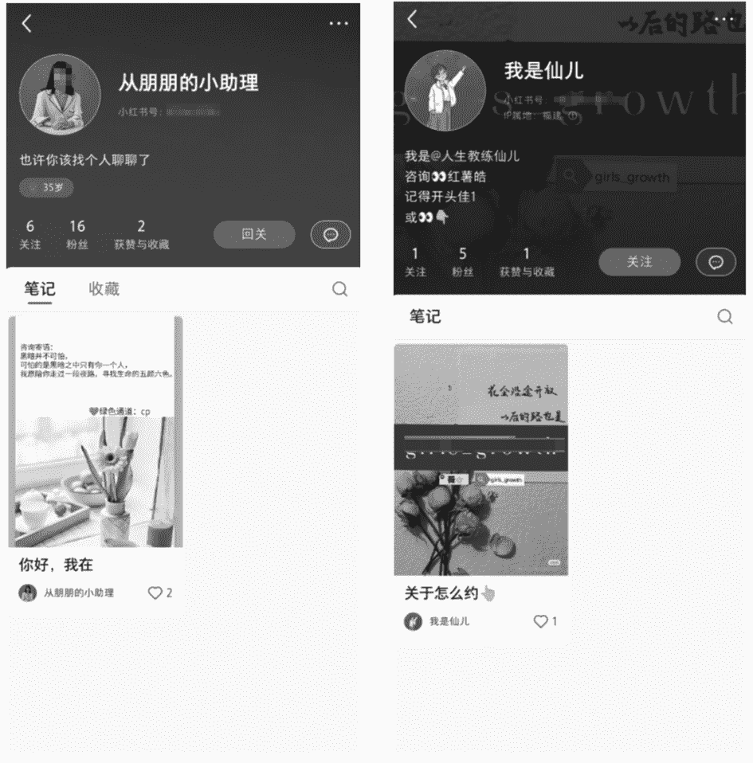

三、图文导流
在正文中植入精准钩子，击中痛点，激发主动求联系。

一种是在干货中间或末页埋资料钩子。如图文末页展示《聊天手册》截图，引导受众在留言区发数字筛选精准客群。

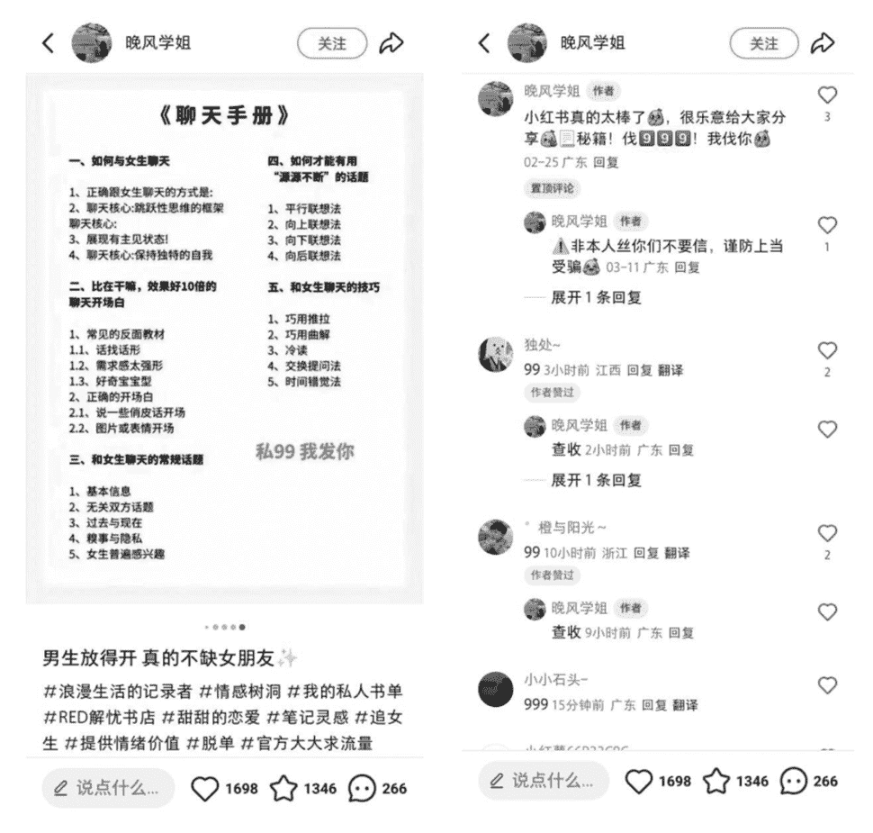
另一种是直接发布资料体图文，吸引目标人群在评论或私信索要。如分享考研配套练习资料，引导考研党留言求资料。留言操作要谨慎，不要直写联系方式，用“我单独发你”这类表达规避敏感词。

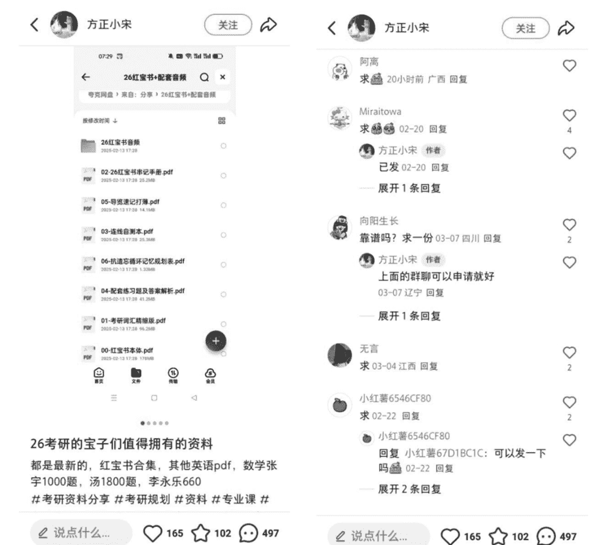
记住，没有绝对安全的单一方法，多种方式轮换使用才能最大程度降低风险。

内容埋钩：用关键词吃长尾

钩子是什么？
就是图文开头几句像磁铁一样抓住读者的话，让人停下滑动继续看。像钓鱼的鱼钩，一上钩就难脱。

减肥图文开篇写“宝子们，我用30天狂甩20斤，从‘XL大妈’变身‘S辣妹’，方法全在这，赶紧码住”，用强对比激发好奇。美食图文写“宝子们，这家藏在小巷子的神级美食店，没有熟人带路根本找不到，味道绝绝子，今天就把地址和必点菜分享给你们”，用神秘感和稀缺感促停留。

找到热门关键词
理解搜索意图是核心。用户搜索大致分三类：

信息搜索：想了解概念、产品、现象，如“维生素C的作用”“新款iPhone评测”。摄影赛道学员“晓好手机摄影”可用的名词有女生摄影、手机摄影、手机摄影课、手机摄影技巧、摄影记录、女生写真、零基础手机拍照、小白学摄影等。

解决方案搜索：遇到具体问题找解法，如“如何去除衣服上的油渍”“初学者化妆步骤”。情感相亲博主“靠谱的栗子”常打的10个问题包括：
1. 暧昧期男人忽冷忽热怎么办？
2. 第一次见面如何提高成功率？
3. 让男生害怕失去你的十句话是什么？
4. 会回消息但不主动的男生怎么拿下？
5. 如何快速判断男生大不大方？
6. 条件合适但是没感觉要不要继续相处？
7. 如何判断是否可以进入婚姻？
8. 对你没感觉的男生怎么搞定？
9. 相亲约会可以去哪里？
10. 如何识别相亲男的人品？

生涯规划师学员“员子姐”用《一个人该怎样找到自己真正热爱和擅长的事，并以此规划自己的人生？》这类选题，匹配对人生规划有困惑的人群，提供完整解法，收获6万赞藏。留学赛道学员“是君仪吖”用《大学必看｜如何跟辅导员、教授搞好关系》击中学生社交痛点，拿到6.8万点赞。

产品服务搜索：已有购买意向，如“适合家庭出游的北京定制团”“上海日料推荐”。数码博主“白野橘”相关关键词有新手相机、新手入门相机、女生适合用的入门相机、相机推荐、0基础入门相机、佳能和索尼选哪个、佳能尼康富士相机测评、性价比高的相机有哪些、怎么选入门相机等。

不同意图需要不同内容策略：信息类要全面客观，解决方案类要具体步骤，产品服务类要有针对性推荐和体验细节。

吃到长尾流量
一篇图文如果持续被搜索，就能长期带来涨粉和变现。半年前的爆款现在仍在带来转粉，这就是长尾效应，一篇图文“养老”的能力。

# 晓好手机摄影

小红书号：

IP属地：福建

- ⭐7年摄影经验 | 陪伴200+女性靠摄影变现

- ✅手机摄影课 | 1个月手把手教学 | 1年陪伴指导

- ❤️立志带10000+女性用摄影记录美好生活

- 👇摄影学习进下方裙撩⬇️或找@晓好摄影助理

- ♀摩羯座

- 福建福州

- 摄影师

- 摄影博主

476 关注

5034 粉丝

6.5万 获赞与收藏

笔记 收藏

- 英语启蒙

- 育儿干货

- 遛娃去

- 近

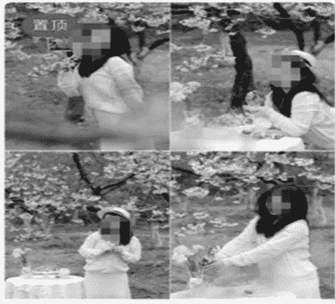

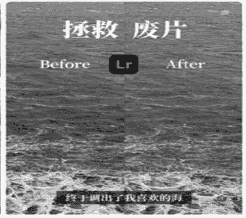

限量版春天 | 遇到樱花自然就成了公主👑

试了20次终于调出了自己喜欢的海！

晓好手机摄影 ♡ 9

晓好手机摄影 ♡ 4

# 靠谱的栗子

小红书号：

IP 属地：四川

全网 100w+ 粉丝情感博主

用高纬度拆解思维给你解读男人的那些事

哪有那么多坏男人

只是你不懂男人

梦成传媒

77 关注  23.9 万 粉丝  200.2 万 获赞与收藏

关注

群聊 查看详情

## 笔记

## 案例合集

男人问我们算什么关系你

怎么回？

岁月静好已申请添加您

## 一个人该怎样找到自己真正热爱和擅长的事，并以此规划自己的人生？

知乎 · 1,053 个回答 · 1.8 万关注 >

也说

百万赞作者，只聊有意思。

露娜妈妈爱分享、闽都散人、苏锦等人赞同

圆桌收录 职场进化论 >

下面这张图，看懂了能让你节约10年左右时间。

因为我是用了大概十年时间才总结出来的。

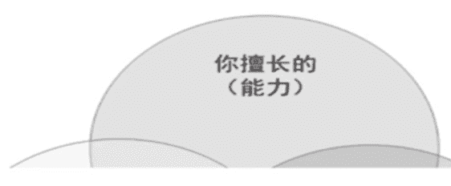

❗ 如何找到天生的热爱与擅长，zhihu高赞

很多人穷其一生，都在苦苦寻找自己内心真正的热爱，如果你也在纠结这个事情，不妨试试这个方法。

作为一名生涯规划师&优势教练，我们经常会问

❶ 你喜欢做什么事情

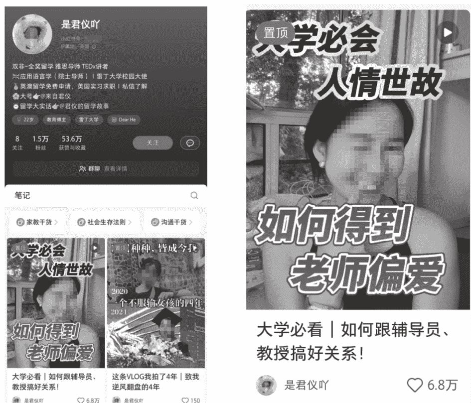

# 创作者画像：白野橘

账号已做匿名处理，属地显示广东。签名写着“去拍摄吧，用影像探索生活 |✨”，旁边配有🐾标识。内容赛道集中在摄影与数码，现关注 870 人，粉丝约 15.2 万，获赞加收藏合计 62.9 万。首页设有小清单、内容检索等入口，并划分为“我买的 🌟”“在拍摄 📷”“在生活 🛵”三个分区。

2024 年整年产出以旅拍记录为主，阿勒泰系列成片几乎全是牛群视角。

## 图5-19 数码博主的横向延展词

- 春天穿搭小个子 146万+篇笔记
- 春天穿搭大学生
- 春天穿搭高级感
- 春天穿搭通勤
- 春天穿搭明媚
- 春天穿搭微胖
- 春天穿搭梨形身材
- 春天穿搭拍照
- 春天穿搭女
- 春天穿搭彩色
- 春天穿搭ootd小个子
- 春天穿搭中性
- 春天穿搭高级感小个子
- 春天穿搭胖mm
- 春天穿搭小个子梨形

## 图5-20 “春天穿搭”长尾词采集

##### 1. 搜索联想
图示显示，用穿搭号去搜“春天穿搭”四个字，系统会弹出大量联想词与选题方向。

##### 2. 主词＋字母延展
在目标词后依次加上 a 到 z，例如“北京旅游+a”“北京旅游+b”“北京旅游+c”这类组合，能挖掘出需求与市场空隙。思路与此前对标爆款博主的研究方法一致。

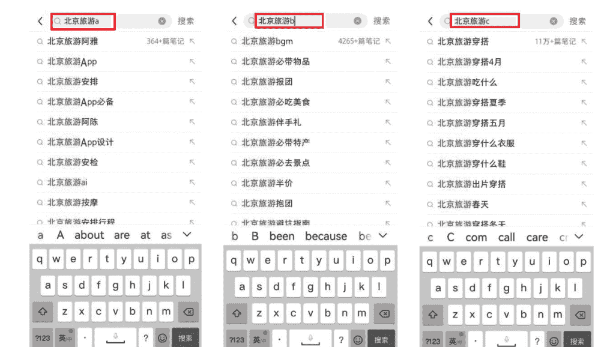

##### 3. 顶部相关词
如图5-22，输入一个核心词后，页面上方会浮现一行关联表达，左滑还能看到更多延伸。

##### 4. 相关推荐区
进入搜索结果页后继续向下，页面会出现“相关搜索”板块，位于左侧或右侧，如图5-23所示。

全部 用户 话题 商品 | 筛选

- 治愈系 晚餐 广州 夜宵 视频 小吃

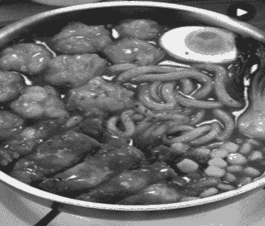

虾滑肥牛乌冬面🍜巨浓郁 ‼️ 好吃到…

娜娜❤️…

2024-12-09 ♡ 5.9万

春天🍃 | 🍰抹茶树莓香草布蕾塔 · 青苹果苏打 …

爱吃面…

03-09 ♡ 4.9万

淋上芝士奶酪的披萨🍕简直香迷糊…

鸠书

01-22 ♡ 3964

小说推文素材视频可搬运 | 蛋糕卷1 …

裴冰瑶

2024-11-08 ♡ 1121

## 图5-22 检索词顶部标签示例

综合 可购买 最新 博主 好物 手机 测评

咩崽开箱 02-18 8.4万

柯达照片打印机 1239

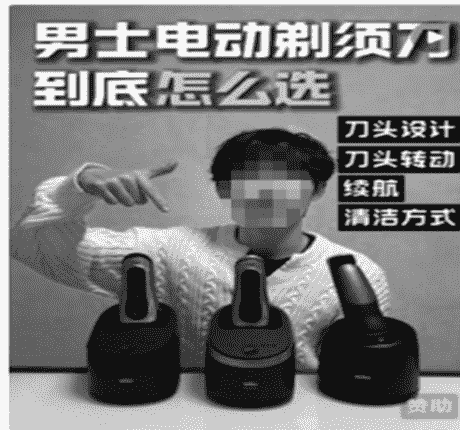

Q 相关搜索

- 数码博主
- 数码好好好
- 数码是什么意思
- 新数码产品
- 数码是指什么

数码博主自用测评：男士电动剃须刀怎么选？ 作为…

Toly学长 5天前 416

讲真的！太复杂的数码博主没人看！#数码大玩家 #…

教自媒体的66大人 37

2025的快乐一定是从打开ta开始的…#数码好视频 #…

麓叔 02-01 1264

## 图5-23 相关搜索页的长尾流量

##### 5. 留言区
到竞品作品的留言区收集用户原话，挑互动量最高的帖子看热评与高频词，如图5-24所示。

问一下 13pm续航能力咋样呀 适合学生党吗🐱每天手机不离手

续航可以的

哪款玩王者吃鸡不怎么烫🐶

13pm🐶

我早想要苹果手机了，我最在意的是像素好不好，又不知道买哪个好🐶🐶

已买13p，像素很好，特别是录视频！自拍也不错，其实锐化那些都可以调！🐶🐶早买早享受了🐶

## 图5-24 竞品留言区的高频词

#### 四、词落地实操

选定检索词后，关键是让它们自然分布到作品的关键位置，涵盖封面、标题、正文、标签和留言区，从而放大展示。

封面与标题是用户第一眼接触点，必须让核心词一目了然；正文开头要简短点题，方便算法判断方向；标签要挑选与核心词相关的高热选项，提升检索权重；留言区则可通过提问或互动暗埋核心词，延长作品生命周期。

植入要流畅，避免生硬堆砌。比如分享干货时用“方圆脸修容技巧”而非模糊表达；做案例解析时用“检索词布局方法”明确点题。

记住，优质内容仍是根本，只有信息实用、逻辑清晰、风格鲜明，词的投放才有效，作品才能在推荐与搜索中脱颖而出，实现高效引流。

##### 1. 封面图
如图5-25，封面上需露出核心词，平台能识别封面文字，一旦被识别，作品会被归类收录，搜索匹配度会提升。

# # 16+8轻断食食谱

## 第一天

**早餐：**

7:30-9:00

水煮鸡蛋1个

优质蛋白

+

红薯一个

优质碳水

+

一杯无糖豆浆

优质蛋白

**午餐：**

12:00-13:30

糙米饭100g

优质碳水

+

番茄炒蛋150g

优质蛋白

+

炒生菜250g

优质纤维

**晚餐：**

17:00-19:00

半根玉米

优质碳水

+

水煮虾8只

优质蛋白

+

炒豆芽250g

优质纤维

**加餐：**

14:00-14:30

不饿不吃

草莓5颗

🔥7天16+8轻断食食谱！让你轻松掉秤~

## 图5-25 封面检索词排布示例

##### 2. 标题区
标题是词排布的核心，可直接把目标词作为标题，如图5-26所示。

标题有三重作用：①概括内容，让用户迅速抓住要点；②提升点击，好的标题能击中需求；③利于系统分类，把内容推送给精准人群。

## 图5-26 标题检索词排布示例

##### 3. 正文
可在开头与结尾引入核心词，文中多次展开说明，如图5-27所示。注意不要过度堆砌，否则影响阅读与判定。

## 图5-27 正文检索词排布示例

##### 4. 标签
标签决定作品会被打上什么属性推给谁，是前置条件。添加标签时要包含核心词，带词的标签能提高收录概率与曝光，标签还能帮助系统理解图文，提升搜索排名，如图5-28所示。

热标签流量大但竞争激烈，如#美食#、#旅行#。长尾标签流量虽小却精准、竞争低，如美食里的#低卡甜品烘焙教程#，旅行里的#成都小众拍照打卡地#。两者结合，才能吃到流量红利又实现精准触达。

## 图5-28 标签检索词排布示例

##### 5. 留言区
留言区的权重很高，互动时有意识带上布局词，提升词频与作品权重，如图5-29所示。

互动越多的作品越容易被搜索推荐，所以要做好引导互动与留言管理，提升作品下的活跃度。

在去中心化的平台里，“搜索”带来精准高质流量。尤其是检索词搜索带来的长尾流量更精准，转化意愿往往更强。

对品牌商家而言，SEO优化是利用搜索流量、吸纳潜在用户的第一步。因此检索词要铺在内容、标题、图片上，再配合留言互动+标签二次种草，才能更精准触达目标用户，为作品加分获取流量。

## 图5-29 留言区检索词排布示例

## 本节小结

## 内容钩：抢占热门词，吃到长尾流量

### 一、钩子是什么
钩子就是作品开头的几句话，像磁铁一样把读者吸住。

#### 二、设置内容钩子，找到热门词
第一类是信息检索类。
第二类是解决方案检索类。
第三类是产品服务检索类。

### 三、激活长尾流量，提升作品被搜到率
1. 输入建议。
2. 检索词+26个字母。
3. 顶部标签栏。
4. 相关搜索页面。
5. 留言区。

### 5.2.2 情绪钩：优质选题自带情绪爆点

#### 一、情绪钩是什么
情绪钩用来快速抓住注意力、引发共鸣。它通过触发快乐、悲伤、惊讶等情绪，让人继续看下去并参与互动。情绪钩可以是故事、图片或视频。

情绪钩能把共鸣转化为购买欲。比如广告里常出现家庭、关爱等元素。在平台里巧妙植入情绪钩，能实现从刷到到看完，再到互动、种草的全流程牵引。

#### 二、情绪钩类型与案例

##### 1. 焦虑情绪钩
焦虑是行动的起点，利用损失厌恶激发危机感，让读者产生紧迫感。人怕错过与失去，放大会促使点击。

比如：怕衰老要学养生；怕娃成绩差要补课；选题做不好就永远做不出爆款；不掌握这五条识人法则，很可能被渣男骗！

如图5-30，“永葆青春养生”博主的笔记“哈佛研究的逆龄行为清单”；“想存到100W”博主的笔记“人和人的差距几年就拉开了”，都是放大用户焦虑点。

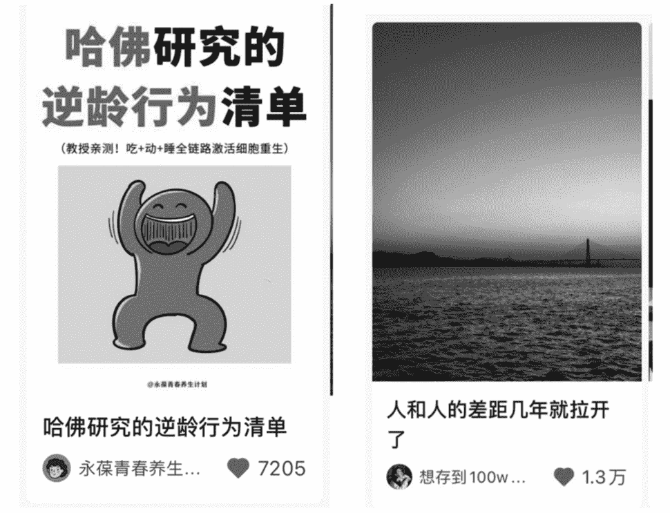

## 图5-30 焦虑情绪钩示例

##### 2. 贪婪情绪钩
人天生怕失去又想得到，免费的价值最容易引流。

可以量化利益：“1块钱的维生素片，让我省下2000块美容仪！”“花3分钟学这招，照片点赞翻10倍！”

也可以直接给资源：“免费！我用这5个AI工具，1小时干完1天活！”“别人花3年悟的道理，你3分钟就能看完！”

如图5-31，“HIME”的笔记“挑战10天学习AI软件”；“阿旺聊民宿”的笔记“内行人才知道的网购省钱关键词”，都满足了用户快速提效与省钱的欲望。

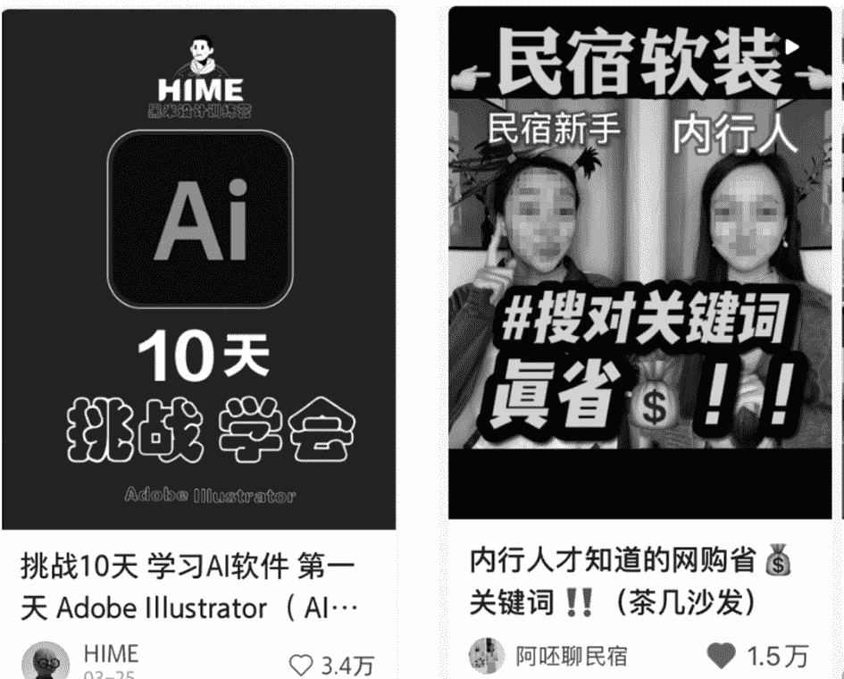

## 图5-31 贪婪情绪钩示例

##### 3. 窥探情绪钩
人爱看热闹、爱八卦，比起有趣的内容，更想知道背后的内幕。把行业秘密、操作流程揭露出来，读者很难抗拒。

比如：“挑战辞职体验100种职业”“我怀孕8个月居然一点都不知道？”“头部博主账号快速起号背后的秘密！”

如图5-32，“I'm 2米饭桶”博主的“从城中村蚁族至如今的三层别墅”；“周托尼发型师”博主的“获奖发型师（揭秘行业内幕）”，充分利用猎奇心理。

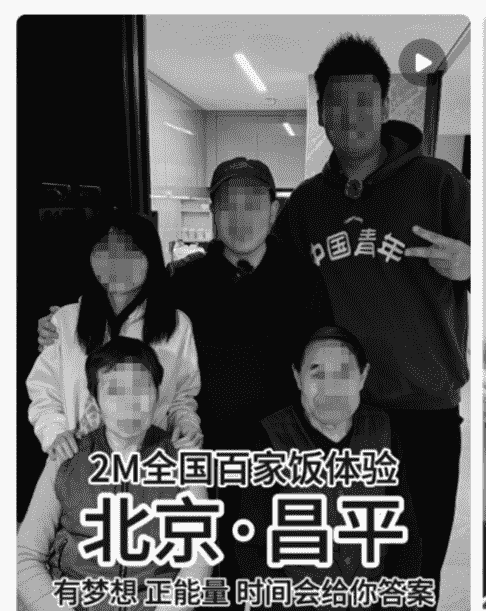

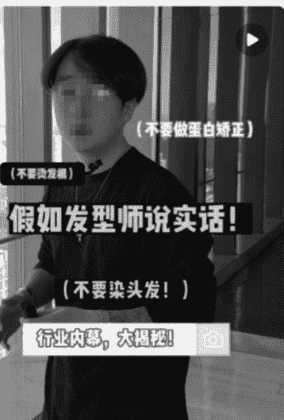

2米百家饭体验——从城中村蚁族至如今的三层...

获奖发型师（揭秘行业内幕）美发店避坑 为什么...

I'm 2米饭桶 ❤️ 7071

周托尼发型... 2024-03-30 ❤️ 10.1万

## 图5-32 窥探情绪钩示例

##### 4. 治愈情绪钩
治愈系是平台的心灵按摩，让人感到温暖、放松、被理解，适合生活方式、心理疗愈、家居、宠物等赛道。

比如：“独居10年，我的房间治愈了所有焦虑”“看完这篇，你的拖延症有救了”“在乡下租了间老房子，每天被阳光和鸟叫唤醒”“一个人吃火锅，但这份孤独感意外地很舒服”。

如图5-33，“喵一”博主的“这段话救我千千万万次”；“壹白white”博主的“治愈亲子vlog|美好无处不在，陪你一起成长”。

让人有画面感，文字即治愈，像给快节奏生活一个温暖拥抱。

## 图5-33 治愈情绪钩示例

##### 5. 共鸣情绪钩
激发情感共鸣，让用户产生“对对对！这就是我”的感觉。

例如，“这届年轻人朋友圈岁月静好，微博深夜发疯”，“被领导骂到崩溃时，我靠这3个动作逆袭成销冠”，“月薪5000的打工人，每天都在为老板的梦想拼命”。

如图5-34，“长生俱乐部”博主的“舍不得睡觉，是情绪没被满足”；“阿文就是Aya”博主的“杀不死拖延症，是因为你太能‘忍’了”。都能精准击中年轻人的共鸣点。

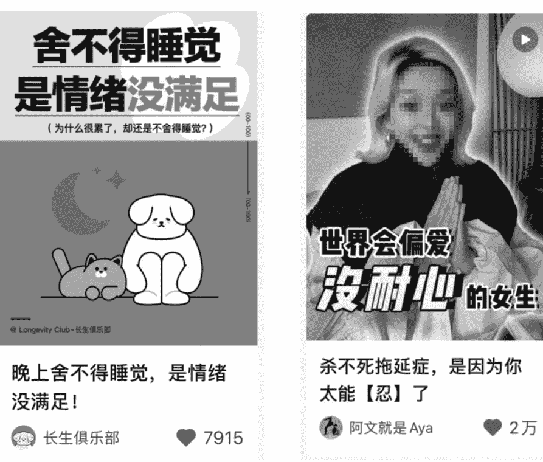

## 图5-34 共鸣情绪钩示例

再举一个例子，专注销售赛道的学员“一颗小胖桃”做出爆款选题“女销冠告诉你，女性做销售天生有大优势”，描绘了女性销售的优势与能力价值，引发大量女性销售共鸣，评论超200条，如图5-35所示。

# 女销冠告诉你，女性做销售天生有大优势！

最近发现好多人给我留言说转行做了销售，还大多数都是女性。关于这件事我真的觉得女性太适合做大客户销售了，因为我们女性有绝对的优势和绝招。

如果你有亲和力、专业能力、共情能力，那么恭喜你，你一定能成为一名好的销售，亲和力+专业能力+共情能力=销冠。

## 图5-35 采用情绪共鸣的学员爆款笔记

##### 本节小结

情绪钩：优质选题自带情绪爆点

#### 一、情绪钩是什么
情绪钩用来迅速吸引注意、引发情感共鸣的技巧。

#### 二、情绪钩分类及案例
1. 焦虑情绪钩。
2. 贪婪情绪钩。
3. 窥探情绪钩。
4. 治愈情绪钩。
5. 共鸣情绪钩。

人的两大本性是害怕失去和想要得到，免费的蛋糕总会引来蜂拥。

### 5.2.3 互动钩：推拉式互动法，持续提升作品热度

#### 一、平台的互动钩是什么
互动钩是把用户从被动浏览转为主动参与的催化剂，通过巧妙的互动机制，把情绪钩激发的心理能量转化为具体行为。

情绪钩作用于情感层面，互动钩则提供表达出口与参与路径，完成从“我被打动了”到“我要说点什么/做点什么”的转化。

互动钩可以是引发讨论的提问、邀请晒图的挑战、需要决策的选择题，或带奖励的参与活动。核心意义在于延续内容热度。

通过评论、分享、点赞等行为提升算法推荐权重；深化情感连接，让用户从旁观者变参与者，增强归属感；收集用户洞察，了解真实需求与偏好；构建社群认同，形成“我们是一类人”的群体归属，进而强化账号黏性。

比如一篇关于“职场焦虑”的作品，在情绪钩引发共鸣后，可设置互动钩：“你最近一次想辞职是因为什么？评论区聊聊，送《职场反PUA手册》”。这不仅让用户宣泄情绪，还能用实物奖励刺激参与，同时为后续创作积累素材。

互动钩的本质，是把情绪共鸣沉淀为可持续的社群关系，把一次性内容消费转为长期关注。

#### 二、互动钩类型与案例

##### 1. 提问式互动钩
通过抛问题引导用户在留言区分享经历或观点，提升作品活跃度。

如开放式提问引发讨论：“你最崩溃的职场瞬间是什么？”“哪一刻让你觉得当妈太难了？”让用户从看客变表达者，增强参与感。

如选择题降低门槛：“加班Vs失业，你更怕哪个？”“全职带娃Vs职场妈妈，你会怎么选？”利用热门话题引发互动，如图5-36所示。

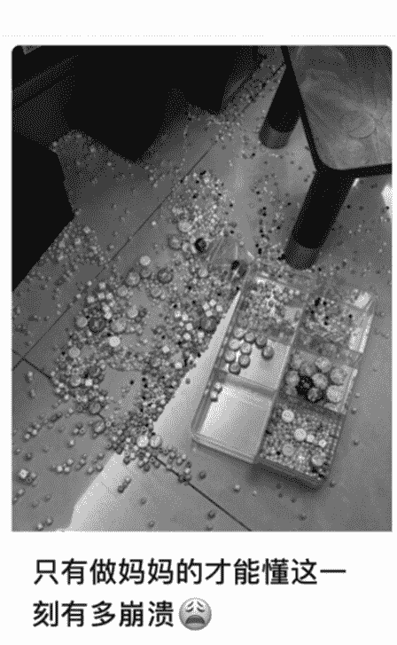

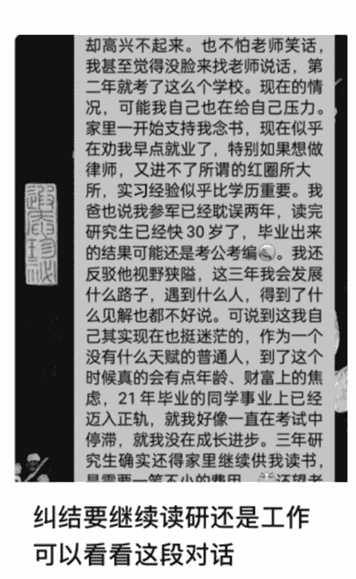

## 图5-36 发问型吸睛点
餐饮垂类教学账号“啊你不爱enfp吗”曾抛出“上海独有的奶茶有哪些”这一发问（见图5-37）。此举既能激活喝过的人分享经历的欲望，也能激起对沪上限定饮品好奇的群体点开讨论。

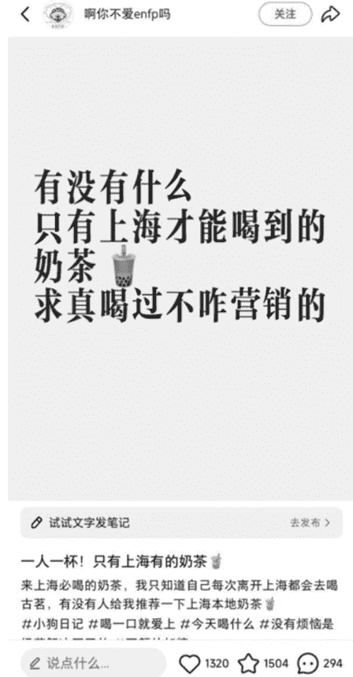

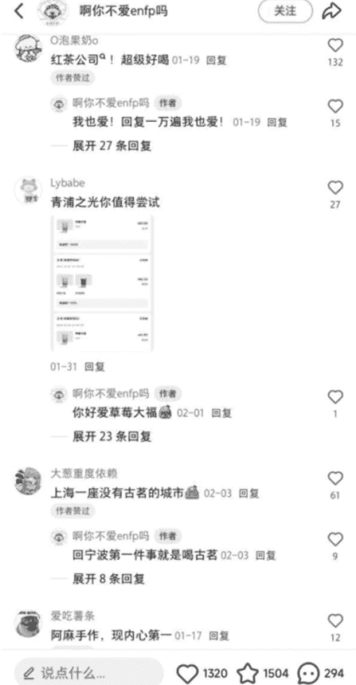

## 图5-37 提问钩学员爆款案例
评论区被同一主题裹挟，博主持续点赞、追问或鼓励，讨论像滚雪球般放大，数据随之走高。

##### 2. 任务挑战型钩子
任务挑战型钩子靠布置可传播的行为任务点燃参与热情与表现欲，利用从众心理与成果展示心理把旁观者变成生产者。
比如抛出“百元过一周”这类低门槛任务，人人能上手，大家既爱晒自己的做法，也爱看他人的玩法。
情绪向挑战也很常见，如“给三 IM I ...”，就是用情感驱动参与。参考图5-38。
图5-38展示的案例属于同一套打法。

## 图5-38 挑战型钩子

##### 3. 共鸣型召集钩
共鸣型召集钩通过精准触达特定圈层的共同经历唤醒归属感与表达冲动，借群体认同降低参与门槛。
一句“INFJ人格的朋友举手”就能快速筛选出同类。
再抛“三十岁未婚女生来报到”这类号召，会让处境相似的人产生“原来不只我”的安全感。
每条评论都能在其中找到镜像，在“我也一样”的共振里对账号产生粘性。见图5-39。

## 图5-39 共鸣型钩子

##### 4. 留白悬念钩
留白悬念钩运用未完成效应，故意制造信息缺口刺激好奇与求知欲。像评书的“下回分解”，在情绪顶点戛然而止，迫使追更。
“大家猜最后老板有没有给我升职？”会让读者自动代入职场，脑补多种走向。
“这段婚姻还要不要继续？明天揭晓结局……”的预告式留白，像埋下一颗定时装置，让关注情感内容的人难以不关注。见图5-40。

## 图5-40 悬念型钩子

##### 5. 争议型钩子：观点碰撞+反常识提问
争议型钩子刻意制造轻度对立激发辩论欲，借杠精心理提升评论活跃度，进而撬动分发。
“全职妈妈是享福还是牺牲？”“月薪一万但要996，你能接受吗？”这类碰撞题容易让人表态。
“为何越努力的人越难晋升？”这类反常识提问也极易引爆反应。
聚焦家长里短、两性与婆媳等易争议话题也是常用做法，见图5-41。

## 图5-41 争议型钩子
再看一个案例，英语垂类带徒“凯小七英语规划”以“原版娃的优势是怎么没的”切入，成功点燃家长群体好奇与争执，关键词情绪饱满，自带讨论属性，见图5-42。

# 原版娃的优势是怎么没的？？

- 坐标上海，姐姐11岁，AR10.9，兰斯1380L，词汇量近1万，9.5岁首次裸考小托福865分（满分900），目前在读万物简史

- 弟弟2016年出生，今年8岁，从3岁多开始英语启蒙，目前AR5.3，自主阅读哈利波特。

## 图5-42 采用争议互动的学员爆款笔记

##### 本节小结
互动钩：推拉式互动法，持续提升笔记热度
一、什么是小红书的互动钩
二、互动钩分类及案例
- 1. 提问式互动钩。
- 2. 挑战式互动钩。
- 3. 共鸣式互动钩。
- 4. 悬念式互动钩。
- 5. 争议式互动钩。
# 第六章 AI赢利：商业模式全揭晓，打造吸金的小红书爆款赢利IP

## 6.1 小红书赢利三大模式：如何选择适合自己的路径？

### 6.1.1 蒲公英商单：助力优质内容创作，开启广告赢利
蒲公英是小红书官方的内容创作者与品牌对接平台，已成为连接内容价值与商业变现的重要通道，为创作者提供规范稳定的广告渠道。

#### 一、蒲公英平台的定义与价值
蒲公英是为博主和品牌搭建的官方合作服务体系，帮助双方在合规前提下达成合作。不仅是接单入口，更是保障权益与收益的完整生态。
一位学员反馈：“用了蒲公英后，我能把精力放在内容上，不必再花时间找甲方谈细节，效率和收入稳定性都提升了。”

#### 二、蒲公英商单的运作机制
了解流程有助于更顺畅启动广告变现，从准入门槛到结算形成闭环。
入驻需满足账号粉丝≥1000、博主年满18岁、完成实名认证。

##### 1. 申请流程
(1) 进入小红书“我”，点左上角菜单，进入创作者中心，见图6-1。
(2) 进入“创作者中心”，见图6-2。
(3) 打开“全部服务”，见图6-3。
(4) 在“收益赢利”栏找到“博主合作”，见图6-4。
(5) 按提示完成实名认证后申请开通，见图6-5。审核通过后主页会出现“我的合作”入口，正式入驻。

##### 2. 报价与收益
1000粉只是基础，内容质量、互动率、活跃度同样影响审核，平台更看重专业度与健康度。
新手可将图文笔记定价在200元左右，视频笔记在300元左右。随着粉丝增长和经验积累可逐步上调。
创作按品牌要求产出，可为图文直发或原创。发布后在合作邀约中关联品牌，笔记经平台审核通过即可确认合作。
> 一位美妆学员说：“加入后每月有了稳定广告收入，还与多家知名美妆品牌合作，提升了专业度和可信度，进而带来更多邀约，形成良性循环。”
结算透明可靠，无需担心资金安全。相比私下合作可能出现的拖欠或临时改条件，通过平台更规范，创作者可安心创作。

##### 本节小结
蒲公英商单：助力优质内容创作，开启广告赢利
一、蒲公英平台的定义与价值。
二、蒲公英商单的运作机制
- 1. 申请流程。
- 2. 报价与收益。

### 6.1.2 私域引流：精准获客，提高复购率，打造高黏性粉丝池
私域引流是连接公域流量与品牌长期价值的桥梁。随着公域红利减弱、获客成本上升，越来越多创作者转向私域运营，追求更稳定可持续的增长。

#### 一、私域引流的概念与价值
私域引流即把小红书公域流量沉淀为可反复触达的微信私域池。相比公域，它不受算法限制，能与用户建立长期稳定联系。
从公域到私域需要精细化运营：找准引流入口、做有吸引力的引流内容、搭建顺畅转化路径，最终导流进私域。

#### 二、精准获客的三大实战方法
私域不仅是量的累积，更是精准度的比拼。只有触达真正对内容或产品感兴趣的人，才能建起高质量池子。

##### 1. 瞄准用户画像，确立精准定位
需明确目标用户的年龄、性别、地域、兴趣、消费能力等，再针对性设计内容与策略。
我曾帮一位家居学员梳理画像，核心用户是25～35岁年轻女性，对家居美学与实用性要求都高。基于此调整策略，突出“高颜值×高实用性”的方案，私域转化率提升50%。
旅行赛道案例：矩阵账号“华夏趣旅行”发布“5月淡季去九寨沟真的很划算!三天才500+”的选题，打上“5月”“九寨沟旅行”“三天才500+”等关键词，评论区吸引100多位精准意向客户，见图6-6。
评论区置顶“其他天数路线、定制、包车、详细行程以及花费各种问题，都可以回我哟”，持续引发咨询，累计引流上千人，单月盈利20万元。

##### 2. 提升内容匹配度
内容要与目标用户需求和兴趣高度契合，解决实际问题或满足情感需求。美妆可分享专业护肤知识、化妆技巧、测评；职场可提供求职指南、职业规划、技能提升。匹配度越高，转化意愿越强。
学员“KK讲干货”做平台运营培训，瞄准“想做副业的00后女生群体”，用标题“一个会玩咸鱼的人有多可怕”引发好奇与窥探欲，选题直接爆火，账号引流1000余人，盈利超5万元，见图6-7。

##### 3. 打造差异化吸引力
包括独特的内容角度、专业的知识深度、个性化的表达方式。一个烘焙学员用“失败复盘+成功秘诀”的写法，呈现烘焙常见失误及解决方法，建立专业可信形象，吸引大量精准客户。
在不同阶段设计对应内容与互动方式，引导用户完成转化：高质量笔记吸引注意，评论互动激发兴趣，私信沟通促成决策，最后给予专属福利，推动用户进入私域。

##### 本节小结
## 私域引流：精准获客，提高复购率，打造高黏性粉丝池
#### 一、私域引流的概念与价值
不受平台算法限制，直接与用户建立长期稳定的联系。
#### 二、精准获客的三大实战方法
- 1. 瞄准用户画像，确立精准定位。
- 2. 提升内容匹配度。
- 3. 打造差异化吸引力。

### 6.1.3 零粉开通电商带货：从选品到转化成交全流程

#### 一、电商带货红利趋势
小红书已成为年轻人消费决策的重要平台，众多消费者选择在站内购买。平台开放零粉丝带货权限，为所有创作者提供公平的变现机会。
平台正加大本地生活业务扶持，用内容优势和用户经验搭建本地生活消费决策场景，为本地商家带来增量机会。
即使零粉丝的新手，也能通过掌握选品到成交的全流程实现从0到1的突破。下面先看如何零粉开店。

#### 二、零粉开通店铺流程
养号并不需要很久，核心是让系统打上精准的垂直领域标签。
我指导的一名女性成长赛道学员，养号期就发布了“男朋友消费记录”“月薪5K女友想买300元的包”等争议话题，自带流量的话题帮助她快速积累互动，账号权重迅速提升。
养号内容需围绕未来带货品类。比如打算做美妆带货，就持续发美妆相关内容，让系统判定为美妆博主，后续带货才能获得精准分发。
开店路径很简单：主页点“我”—左上角菜单—创作者中心—更多服务—开通店铺—立即开店，通常1小时内审核通过。从2024年起，小红书开店已无需保证金，入局门槛大幅降低。

##### 开店步骤：
- 1. 打开小红书主页“我”，点击左上角菜单，见图6-8。
- 2. 点击“创作者中心”，见图6-9。
- 3. 打开“全部服务”，见图6-10。
- 4. 点击“开通店铺”，见图6-11。
(5) 点击“立即开店享权益”，见图6-12。
开店后进入后台点“商品成长”，系统会基于前期养号触达的用户兴趣推荐精准机会类目。选对类目发布商品，才能更快获得平台流量扶持。
一名宠物赛道私教学员，开店第三天就获得平台流量扶持，“猫咪自动喂食器”在推荐下获1500+浏览，直接成交8单，粉丝还不到50。平台对新店的扶持是真实有效的。

##### 本节小结
## 零粉开通电商带货：从选品到转化成交全流程
- 一、电商带货红利趋势
- 二、零粉开通店铺流程
小红书主页点击“我”—左上角菜单—创作者中心—更多服务—开通店铺—立即开店，一般1小时内就能审核通过。

## 6.2 从1到100赢利模式，矩阵布局与IP升级

### 6.2.1 矩阵运营：账号分身术，规模化放大影响力

#### 一、什么是矩阵
新手常陷入“矩阵崇拜”，以为批量注册账号就能有流量和客户。其实这就像雇很多人发传单，却忽视了传单内容价值和投放策略。
矩阵的本质是一种商业营销策略。核心是用可复制的优质内容对冲平台算法的随机性。
有效的矩阵必须建立在盈利闭环上。就像开连锁店前要先验证单店盈利，账号层面至少要有1个账号能稳定产出并转化，再去规模化复制，效果更稳。
一句话：矩阵放大的前提是先跑通流程。

#### 二、为什么要做矩阵

##### 1. 构建安全壁垒
平台限流违规难以完全规避，单个账号可能因一条违规笔记前功尽弃。
我们曾有个私教学员，主账号因违规被限流，但因另有矩阵账号，未至于“一号归零”。
布局矩阵就是建立流量安全壁垒，不把鸡蛋放在一个篮子里，提升抗风险能力。

##### 2. 获取爆款流量
当某内容模板被验证有效并出爆款，快速复制就是关键，矩阵正是实现快速复制的通道。
可以立刻用其他矩阵账号发该模板的选题，或用原爆款账号继续深挖，把流量留在自己手里。
注意，不是照搬，而是拆解爆款元素的核心，复制后微调文案或更换图片再发。
私教学员小熊老师专注知识付费技能培训。做小红书前她只是普通宝妈，跑通从0到1后，她和对象一起做矩阵，轻松运营十几个账号，不到一年引流2000人，盈利80多万元。
爆款内容有周期性，抓住窗口期能以更低试错成本获取更高流量价值。周期一过，用户审美疲劳，抓流量就难了。
再如学员王丛，珠宝饰品店女老板。她的矩阵账号“土土饰物所”持续发“猜克重”选题，每条笔记上百条精准评论，吸粉大量对银饰感兴趣的女性。粉丝不多情况下，账号仍引流上千人，转化盈利六位数。

##### 3. 行业卡位布局
同一赛道，用不同笔记账号、人设定位、内容矩阵建立用户心智，覆盖目标用户搜索位，领先于不做关键词布局的同行。
比如教育赛道，某考证机构用“考证学姐”“职场导师”“备考规划师”三种人设账号覆盖不同搜索场景。用户在比较时接触的都是同一机构，多点触达把用户牢牢圈在自己的流量池。

##### 本节小结
#### 一、什么是矩阵
矩阵的本质，是一种商业营销策略。
#### 二、为什么要做矩阵
- 构建安全壁垒。
- 获取爆款流量。
- 行业卡位布局。

### 6.2.2 付费投放：撬动杠杆，精准提升ROI

#### 6.2.2.1 薯条投放：精准投放笔记，提升曝光点击

##### 一、薯条投放的好处
薯条投放是小红书为创作者打造的笔记推广工具，可按需求精准推广内容，提升曝光量、互动量或粉丝量。内容能突破算法限制，更快触达目标受众，实现价值最大化。
核心功能丰富：内容测试可通过小额投放增加发现页曝光，快速验证笔记质量和用户反馈；可验证笔记是否存在违规或被限流；可按性别、年龄、兴趣等维度定向投放；支持实时查看曝光、点击、互动数据，便于即时优化。

##### 二、薯条投放的详细操作步骤

在小红书做推广，薯条算是上手最快、门槛最低的付费工具之一，可想要投出效果，照样需要一套清晰的准备和操作思路。下面把从筹备到优化的完整打法拆开讲清楚，帮你把钱花在刀刃上。

**一、投放前的三件事，决定成败**

1. 笔记本身要够硬
薯条再给力也救不了内容。投之前先把笔记打磨到位。
标题要能抓住人，常用量词+需求/场景/价格词+品类词的组合更易进眼。
封面要用竖屏高清图，有画面感，千万别放纯白底商品照。
内容要有干货，真正解决人群痛点，给人看完有收获的感觉。
全程避开平台禁词和违规点，保持干净合规。

2. 账号状态要健康
薯条对账号环境很敏感。
先查记录，确保没有违规、没有限流。
再看权重，近期笔记数据是否平稳向上。
如果是新号，先别急着投。先发5到10篇优质内容养号，等账号有了基础活跃度再开投。

3. 目标要先定好
不同目标选不同策略。
想试笔记质量和受众反应，就主打提升曝光。
笔记已有流量但互动差，就选提升互动量。
互动不错但涨粉慢，就选提升粉丝量。

**二、薯条投放实操全流程**

进入投放页有两种路。
一种是直接在笔记里操作，进个人主页点开想推的笔记，点击右上角的...，选择薯条推广。
另一种走创作者中心：点左上角三条杠，进入创作者中心，再去全部服务里找到薯条推广。

进去后选标准版进行设置。
先定推广目标：笔记阅读量、笔记互动量、粉丝关注量三选一。
再定人群。最省事的是智能推荐，让系统按笔记内容自动匹配受众。如果想细调，就用自定义人群：性别不限或男/女，年龄段多选如18-24、25-30等，地域可全国或指定省市，兴趣标签最多选3个且要和笔记强相关。

然后定时长和预算。
测试期建议先开6小时，快速看反馈。想继续推，加推期建议2天以上，集中把流量做起来。24小时内随时可以追加投放。
预算方面，起投门槛是75元。系统会根据投入给出点赞收藏量的预估区间，实际效果最终还是看内容质量。

最后复核一遍设置，点击确认推广完成支付。审核通常几分钟内通过，笔记就会开始加热。

记住，薯条是获取流量的利器，但本质还是对用户需求的理解和内容价值的持续输出。善用工具，持续优化，才能把投放效果稳定下来。

**聚光投放：更重转化的品牌级打法**

随着平台商业化推进，自然流量占比从2024年下半年的65%跌到28%左右，算法明显更偏爱付费内容。聚光就是小红书为品牌准备的一站式广告管理平台，覆盖搜索和信息流两大核心场景，支持产品种草、商品带货、表单获客、直播引流、品类卡位五种营销目标。

简单说就是花钱买精准曝光，把内容强行送到高意向人群眼前。比如做宠物用品的商家，可以定向让广告出现在最近搜过猫粮、宠物用品的用户手机里，并直接导商品页，实现看完就买。

聚光的两个核心优势：
一站式解决营销需求。从创意、投放渠道到数据监测全包，商家不用组建专业团队也能跑起来，计划层级先定好推广目的，再匹配对应策略。
精准定向。平台后台数据细，可按性别、年龄、地域、兴趣做精细化定向。深圳某高端美容院就只投本地高消费力的护肤兴趣女性，点单和转化都明显提升。

**直播运营：如何做一场场观10万+的直播**

小红书直播和抖快不一样，更像内容社区的延伸。是图文和视频之外的第三种连接方式，靠共鸣和信任而不是吆喝。

流量主要来自三块：笔记引流、直播预告、平台推荐。数据显示超过七成的观众来自主播自己的笔记。矩阵化内容、开播前的预热笔记、播后的精华笔记是核心做法。
平台推荐看重互动率、停留时长和转化率。博主小莹子在游戏直播领域半年涨粉93万，靠的就是15%以上的稳定互动率和平均30分钟以上的停留，长期上榜获得额外曝光。

新手起号可以按六步走：
开播前至少发10条高质量笔记打底；
单场直播保持4小时以上，帮助系统打上直播标签；
每次开播前发预告，拉高初始场观；
纯直播账号的笔记不要挂商品链接，避免影响流量；
开播后10分钟内发1到2条笔记回流直播间；
用关注主播的秒杀福利，把观众转化为粉丝。

**公私域结合：打造吸金朋友圈**

私域是把公域流量沉淀下来持续变现的关键。朋友圈的高频触达特性，能持续强化个人品牌并建立信任，比如分享干货片段、案例、用户反馈。

打造吸金朋友圈要做两类内容。

人设圈，用来立人。不是只讲专业，而是通过生活片段、价值观、兴趣爱好让用户感受到你是一个有温度、有故事的人。五个常用角度：专业日常、生活片段、价值观输出、成长故事、兴趣标签。清楚的人设能大幅缩短信任距离，为转化铺路。

产品圈，用来卖货。不是硬广，而是通过场景植入和效果展示让用户自己产生购买欲。核心有三点：用痛点刺激制造紧迫感，用案例截图或文案清晰展示产品如何解决问题，用早鸟价、赠品等稀缺福利推动即时行动。

把笔记投放、聚光广告、直播场观和私域朋友圈串起来，才是小红书完整变现闭环。工具会变，核心始终是持续创造用户认可的价值。

呈现价值的方式很多，能直接拿来用的有：放出课程里未公开的片段、截学员的感谢记录、拍产品真实使用短视频、剪直播的高光切片等等。整体基调要守住教育先行、转化后置，让读者自己得出“我需要这个”的结论，而不是被推着下单。

就拿图6-33那条微信动态来说，我是顺着客户咨询的时机把交付逻辑带出来，顺手把售前顾虑化解掉了。

比比先森°

给美业赛道做线下经营的老板讲小红书精准获客，课后微信几乎被刷爆😅

大家反馈很集中：门店用小红书做获客，比投抖音、视频号要省力很多，进来的客群质量也明显更好……

有学员说，“我原以为小红书很难上手，一直在练抖音直播话术都没起色，这次选对了”。

现场还有不少80后、70后的传统实体负责人，我担心理解有偏差，特意再确认。

结果好几人直接把手机递过来，账号已经打开，引流钩子、笔记结构都现场做出来了，点点头说今晚的信息量太足，回去就执行。这种发自内心的成就感真的很上头……哈哈！

——做图文代替纯视频，做生意代替单纯追爆款。

——从第一篇笔记就开始带流，从第一个关注就开始变现。

其他不展开，这一直是我坚持的底线。

图6-32 人设圈

比比先森°

有学员提问，私教课里每篇笔记都可反复修改，这样交付会不会太重扛不住？

服务几十上百人同时在行，而且我会让助理每天跟进，提醒当天笔记是否更新。

因为所有问题都在掌控范围内。聊聊我的交付差异化思路：

在我看来，任何赛道都能从学员的一个具体卡点提炼出一套可落地的解法。

例如不会改爆款文案，既保留爆款密码，又植入个人标签和产品钩子，提升笔记转化。

多数来找我复盘的学员，并非限流，核心是选题偏离人群、封面形态滞后、内容缺少变现逻辑。就这么简单。

我不教照抄搬运，那种做法早已泛滥，限流和违规常伴随。

我要教的是底层方法论。也不必问我是否做过某行业，我讲的是可迁移到各行业的获客方法论。

除非赛道过于敏感难以运作，我会主动回避，怕影响口碑。

累计带过上千人，覆盖几十个行业，别问别人能不能跑通，先问自己能否照做、配合规划落地。

跟我做季度陪跑的，基本都实现了变现和正向反馈。我不承诺百分百，但做小红书在我看来并不难，关键是方法正确且持续。

所以别纠结我能否改得过来，不如先问自己能否每天拿出一个小时认真更新，老板们。😊

图6-33 产品圈

###### 3) 日常圈

日常圈的用意是在朋友圈里展示去营销化的生活切片和即时感悟，拉近专业距离，塑造立体可信的人设。

看似随性，实则每则生活片段都是有意挑选，如工作间隙、学习场景、兴趣爱好等，通过持续输出价值观与生活态度，潜移默化提升情感认同。

高质量的日常圈可从以下三点切入：

- （1）场景细节感：书桌陈设、咖啡杯特写等生活美学，传递精致感；
- （2）生活流动感：美食、旅行、节日、生活感悟等；
- （3）家庭互动感：郊游、生日、孩子、夫妻相处等。

图6-34是我分享年度复盘与展望的那条动态，配图为个人写真，讲述对生活的期待，获得大量点赞。

比比先森°

这两天在梳理年度规划，写今年目标时，不再写赚多少，而是——让自己更开心，学会爱自己，尊重自己的情绪和感受。

状态是最好的风水。去年底状态很差，情绪低落，只想放空寻求寄托，业务也因此下滑，很难提劲。

今年年初回到深圳，与老友重逢、与家人团聚。才发现能量打开后，更容易进入心流，关系里更松弛滋养，而非患得患失。

爱自己胜过一切，学会爱自己才配得上更多美好。希望你保持高敏感的天赋，但不是过度在意他人，而是把目光投向自己，让自己更自信，大大方方闯进新生活。

图6-34 日常圈

###### 4) 反馈圈

反馈圈的核心是系统化呈现用户真实评价、成长案例与效果验证。

它不同于直接推销，而是借助用户的成长故事、成绩变化与情绪表达，以第三方视角印证产品价值，在心理上触发从众与权威感，为转化提供信任背书。

做得好的反馈圈可从三方面入手：

- （1）用户夸赞：捕捉用户由衷感谢并截图；
- （2）续费付款：转账截图等强刺激画面，带动跟进；
- （3）转介绍：侧面印证价值。

图6-35记录了我线下活动偶遇私教学员，她报喜称引流成交率达50%，让我感动到差点落泪，最后总结这是知识付费从业者最幸福的瞬间。

比比先森°

刚刚感动到差点哭出来。

一位学员看到我也在现场，跑过来挥手说“比比老师！我是您之前的私教学员！”

她说，现在还在坚持发小红书，引流成交率有50%！感受到正反馈，慢慢也懂了“用户视角”“关键词选题”等逻辑，开心地说——走上正轨了，摸到门路啦！

以前多是线上报喜，今天这种面对面的感谢，真的很暖。

这大概就是作为小红书教练和知识付费从业者，最幸福的时刻。

图6-35 反馈圈

###### 5) 干货圈

干货圈是定期投放的高价值行业洞察、实操方法论和即学即用技巧的系列。核心价值在于用稀缺专业知识建立权威，同时培养用户对内容的依赖。

它不是碎片资讯，而是深度提炼的信息精华，既回应即时学习需求，又为付费产品埋下钩子。

底层逻辑是“价值前置”，让用户先体验到免费内容的优质，从而产生付费期待。

优质干货需把握三件事：

- （1）问题导向：直击目标用户最痛点，给出方案；
- （2）阶梯价值：由入门到进阶再到独家心法，设置梯度；
- （3）行动引导：结尾自然延伸到系统学习。

图6-36这条干货圈讲小红书知识付费IP引流的两个关键：内容深浅度与钩子筛选度，体现专业深度。

###### 6) 互动圈

互动圈是专门用来激发参与和双向沟通的内容板块，其价值在于把单向传播变成双向连接，通过提问、投票、话题讨论等形式沉淀用户关系。

比比先森°

在小红书做知识付费IP引流，我总结最容易被忽略的两点。

第一，内容的深浅程度。

很多私教学员反馈自己花心思写的内容在小红书零互动，甚至把付费课搬过来了也没用。

在小红书，用户并不喜欢太深的东西，会觉得难。他们想要一二三步就能上手的方法。

学习本身反人性，难的东西自然没人看。所以要把轻松易懂的部分放前面，借鉴课里讲的对标拆解法，加入流量元素，让内容更容易被接受。

你要搞清楚做小红书的目的是展示才华，还是获客变现，品味是流量的敌人。

第二，钩子的筛选程度。

引流最有效的两招是“扫码”和“加我领资料”。给什么资料很关键，必须是目标用户的刚需。

比如你教宝妈创业，钩子就别放几十G的个人成长电子书，而是宝妈轻创业搞钱300招，再把你的项目嵌进去。

而且要全方位布局钩子，群聊、内页、文案区、评论区、简介都要覆盖，上来概率才高。

先对别人有用，才有机会让别人付费。

内容深浅、钩子设定，抓住这两点，精准流量自然会来。

图6-36 干货圈

互动圈本质上是私域的激活器，把沉默围观者变成活跃参与者，为转化铺情感基础。

常用打法有：

- 1. 悬念提问：抛行业争议话题引发讨论；
- 2. 求助互动：征求用户对具体问题的建议；
- 3. 轻量投票：用A or B降低参与门槛；
- 4. 有奖互动：用小福利激励优质回答。要兼顾低门槛和高价值反馈，每条互动都要认真回复，让用户感到被重视，进而形成持续参与习惯，最终转化为产品用户。

##### 3. 微信的两大联动渠道

###### 1) 公众号

公众号是IP的核心阵地，闭环生态利于精准筛选高价值用户。用专业长文建立权威，同时实现自然涨粉。

菜单栏、自动回复等功能可以搭建系统化引流路径，把公域流量有序导入私域。日常推送保持稳定互动，干货输出强化粘性。

更关键的是它与微信生态无缝衔接，内容可在朋友圈、社群自然流转，形成裂变传播，触达效率远超其他平台。

比如，我常在公众号“比比先生”发布小红书干货长文和产品介绍，不定期触达沉淀的关注者，如图6-37所示。

看完公众号的粉丝自带信任，付费意愿高，只要提供对的价值，成交闭环很容易形成。

###### 2) 视频号

视频号是微信战略版图中的重要一环，为IP提供内容变现闭环。短视频适配碎片化阅读，用更直观的方式传递知识要点。

定期直播增强即时互动，强社交属性提升粘性。挂车功能打通内容到消费的最短路径，转化效率明显提升。

同时与公众号、朋友圈、社群深度联动，形成多维流量矩阵，让优质内容在微信生态内最大化变现。

比如视频号“理白先生”，几乎每周直播，常和大咖连麦，日常还大量输出商业认知和超级IP打造的视频，深受关注。

比比先生

福建

关注后台领取价值999《小红书150+份爆款变现资料包》，专注AI小红书流量获客最新玩法 >

6篇原创内容

视频号：比比先森

916个朋友关注

已关注公众号

发消息

消息

视频号

2024年11月9日

所有的咨询师，教练，知识付费IP，火速进来，马上！！

阅读 371 赞 2 1个朋友分享

2024年7月16日

请做小红书！现在！立刻！马上！！

阅读 1619 赞 8

图6-37 比比先生公众号

理白先生

教育博主

福建 男

◆ IP赋能教练 | 精力管理教练 V：baizhubian

本号讲IP营销干货，这个号分享生活@理白生活号

公众号：理白聊商业

49条原创内容

1729个朋友关注

✓ 已关注

客服

商品橱窗

图6-38 理白先生视频号

图6-39 理白先生视频合集

#### 二、私域运营的核心

私域运营的核心不是收割流量，而是经营人与人的连接。很多运营者沉迷数据，把用户简化成转化率、GMV、复购率，却忘了每个ID背后都是真实的人。

真正的私域要回归人性，关注需求、情绪和体验，不能靠机械群发和促销轰炸。

“日拱一卒，功不唐捐。”私域不是短期赢利工具，而是需要长期经营的资产。社交的本质是关系，不是交易。

长期主义要求从第一天就规划用户生命周期，设计分层陪伴体系：新用户需要破冰，老用户需要深度服务，沉默用户需要激活。

内容策略上也不追求即时爆款，而是靠稳定输出培养用户习惯，形成对个人品牌的依赖。

私域要追求精准而非泛滥，新增用户必须是筛选过后的目标客群。因为质量远比数量重要，1000个高活跃高信任的用户，远比10万个沉默好友更有价值。

##### 本节小结

- 一、打造吸金朋友圈

  - 1. 朋友圈的重要性

  - 2. 朋友圈的六大类型

    - 人设圈，产品圈，日常圈，反馈圈，干货圈，互动圈。

  - 3. 微信的两大联动渠道

    - (1) 公众号

    - (2) 视频号

- 二、私域运营的核心

# 后记 在热爱的领域里，找到属于自己的光

写完最后一页，我看着厚厚的稿子，像是对四年前的自己挥手说：“你走得比想象更远。”

这本书既是我四年小红书实战的沉淀，也是与上千位学员、跨越30多个行业赛道的共同结晶。

作为方比比的第一部作品，我毫无保留地倾注其中。如庄子所言“吾生也有涯，而知也无涯”，我深知局限，却仍以热情分享这段成长见证。

我要感谢很多人。

感谢父母，给了我最温暖的港湾，无条件支持我的每一次决定。

感谢良友一村，让我正式看见小红书的可能性。感谢新媒体导师吕白，给予宝贵实践经验。

感谢团队伙伴莉莎、黄煜、子不语、亦橙、孙铭含、林道一，在一次次共创中把结果做得更好。

感谢信任我的几千位学员，你们的报喜和转介绍让我倍感荣幸。你们也是这本书的共创者。

感谢商业世界里引领我的前辈和内容创业者——梁靠谱、大果、亦仁、杨涛、盛盛姐、易洋、粥左罗、醒醒同学、张可粒、花爷、芷蓝、阿猫、狗哥……

最后，感谢我的贵人理白先生，从2023年4月起一路支持、见证我的成长。正是你的关键指导，才有了今天的方比比。

谢谢你们，让我越来越好。愿你我都能在各自热爱的领域，找到属于自己的光。

未来我会继续精进内容创作和流量运营，用优质内容帮助更多人，让更多创业者、知识付费IP、有趣的灵魂被看见、被点亮。

这，就是我最有价值感的瞬间。

方比比

公众号“比比先生”创办人