# AI+自媒体变现全能一本通

Toly —— 著

四大平台 抖音 + 小红书 + 公众号 + 知乎

100多个高频提示词 | 54个真实创作案例 | 120多分钟教学视频

# 版权信息

COPYRIGHT

书名：AI+自媒体变现全能一本通

作者：Toly

出版社：人民邮电出版社

出版时间：2025年10月

ISBN：9787115678669

字数：124千字

# 内容提要

本书共8章，“手把手”教你如何用DeepSeek从零开始学会轻松、高效地运作自媒体。第1章介绍自媒体的趋势和误区，让你明白普通人如何进入自媒体的世界，并介绍DeepSeek这个AI工具的强大功能。第2章教你怎么选准赛道，并快速找准内容方向。第3章和第4章详细讲解如何挖掘选题、撰写文案，教你打造爆款内容的具体方法。第5章教你像导演一样写短视频脚本，搞定内容创作。第6章讲解怎么用DeepSeek配合AI绘图工具批量生成图文和脚本，打造多平台账号矩阵。第7章讲述如何通过自媒体赚钱，包含广告、电商、知识付费等变现路径和工具。第8章用多个真实案例展示用DeepSeek实现自媒体变现的实战效果，如打造爆款图文、实现数字人矩阵运营等，帮助读者真正把创意变成收益。

本书适合那些有志于从事自媒体事业却不知道如何入手的人员，也适合那些希望更省力、更高效变现的自媒体内容创作者、企业营销人员阅读，还适合高等院校相关专业师生学习等。

# 前言

短视频的大规模流行，让“做自媒体”这件事变得越来越普及。无论是年轻人想将流量转化为收入，还是企业主希望用短视频提升品牌曝光度，都可以尝试用短视频讲述自己的故事。

可真正做起来才发现——创作并不容易。策划选题难，撰写脚本难，拍摄与剪辑视频更难。仅是想出一个能吸睛的标题，可能都要耗时半天，更别说要持续产出视频、保持发布视频节奏、分析数据……这些工作让很多人望而却步。

DeepSeek，作为一款国产、免费、功能强大的AI内容创作工具，正成为越来越多内容创作者的“秘密武器”。它不仅能帮你快速找到爆款选题、写出吸引人的短视频脚本，还能通过智能分析，精准定位你的目标受众。

但问题也来了——“工具虽好，我该怎么用？”目前，市面上真正系统讲解“如何用DeepSeek做短视频”的教程并不多。很多人看到了AI工具的潜力，却因为找不到好方法、用不好技巧，最终没能获得理想的效果。这正是我们写这本书的初衷。

我希望用一本真正“手把手”的教程，带你从零开始了解、掌握并高效使用DeepSeek，让它帮你搞定短视频或图文内容的创作，从策划选题、生成脚本的内容/结构，到内容的发布、变现和运营，每一步都将不再困难。

# 本书特色

- 1. 学得快，用得上，提示词也能轻松掌握

本书贴心地整理了常用的提示词模板及解析，还附带追问式提示词模板及示例，不需要任何技术基础，新手也能轻松上手。就像有个懂行的老师在旁边手把手地教你一样，快速玩转AI创作。

- 2. 六大模块，带你跑通AI创作全流程

从账号定位到内容规划，从选题策略到脚本结构，从图文转视频到平台发布，从吸粉逻辑到商业变现，我们用六大模块搭建完整的AI创作全流程。这不是零碎的技巧拼贴，而是一套清晰、可落地的系统方法，帮你快速成长为有方法论的内容创作者。

- 3. 54个实战案例，直接告诉你怎么做才有效

本书精选了54个典型实战案例，逐步拆解DeepSeek的操作逻辑。例如，如何进行差异化定位？如何用DeepSeek挖掘爆款选题？如何用一句话写出“种草感”的文案？不仅讲“是什么”，更教“怎么做”，让你少走弯路，学以致用。

- 4. 附赠教学视频，让你看得懂，学得会

针对较复杂的操作步骤，我们还录制了配套教学视频，读者可通过下载配套资源观看。大部分章的核心知识点、实操流程，都有对应演示，让你边看边学、一步步跟着做，不再因“看不懂”“找不到按钮”而出现瓶颈。

无论你是从事自媒体事业的新手，还是有一定基础但缺乏系统方法的内容创作者等，本书都能为你打开一个全新的内容创作视角。

# 温馨提示

由于AI工具的回答和效果会因“算法和提示词的不同”而有所不同，所以即使向DeepSeek提出相同的问题，每个人得到的回答也可能略有差异。我们的重点不是去“照抄”提示词，而是要理解如何提问，如何组合AI工具去创作，如何在AI工具的帮助下调整思路，这才是AI创作时代最重要的能力。

另外，由于篇幅有限，生成结果仅展示部分内容，后续不再赘述。

# 第1章 DeepSeek，让人人都可以做火自媒体

哈喽，你好，我是Toly！很高兴你打开了本书的第1章，也就正式开启了我们用DeepSeek赋能自媒体个人品牌（IP）之路。

过去人们做自媒体，往往需要强烈的“网感”和创作天赋。如今，随着DeepSeek等AI工具的出现，信息差正在被快速缩小，自媒体内容创作的门槛大幅降低，每个人都有可能打造出属于自己的爆款内容与个人品牌。

想要让DeepSeek真正为“我”所用，就一定要揭开它神秘的面纱，本书将带着你一步步让DeepSeek化身为一个普通得不能再普通的工具，时时刻刻、方方面面地利用它，“榨干”它的价值。

本章我们会集中解决以下几个核心问题。

- 如何用DeepSeek做出小红书3万赞的爆款？DeepSeek对于做自媒体的作用有哪些？
- 普通人做自媒体有哪些需要避开的误区思维？
- 如何搭配本书，用28天的时间通过DeepSeek做出自己的个人IP？
- DeepSeek在不同自媒体平台运用的差别有哪些？

## 1.1 自媒体3.0时代：DeepSeek赋能个人自媒体

自媒体发展到今天，已经进入了3.0时代。过去，我们做内容要自己想选题、写文案、剪视频，既费时间又费精力。而现在，有了AI工具的加持，自媒体的内容创作变得前所未有的高效和轻松。

DeepSeek就是这样一款强大、免费的国产AI内容创作工具。它能帮你快速找到热门选题、生成吸引人的文案，甚至能根据你的风格“定制”短视频脚本，哪怕你完全没有经验，也能迅速上手。

DeepSeek的底层逻辑是“创作链路的全面工业化”——它并非替代人类创意，而是通过大语言模型（Large Language Model, LLM）和用户行为数据，将创作者从重复劳动中解放出来。

那么DeepSeek是如何赋能个人IP的呢？

### 1. 从“0”到“1”的快速启动

传统自媒体冷启动需要至少3个月的试错期，而AI工具能将这一过程压缩至28天。

为什么这么说？过去做自媒体，从选题到定位，从每一步都靠“猜”——比如你要试几十个标题，写一堆脚本和文案，靠点赞和播放量慢慢摸索观众喜欢什么，这个过程常常要两三个月，甚至更久。

但现在，借助像DeepSeek这样的AI工具，你可以一开始就通过数据分析+爆款模型推荐，精准找到目标用户爱看的内容；再用提示词快速生成多套脚本版本，测试反馈；同时借助平台热词、爆文分析功能，得到反馈数据，从而保证你能在1～2周内找到有效的内容方向。

### 2. IP差异化塑造

DeepSeek能够结合大数据和中文互联网语料库，以及你输入的个人经历，得出全网足够个性化、差异化的IP定位。

这听起来有点抽象，但我们可以用一个真实的例子来说明。

例如，有一位“95后”宝妈想做自媒体，但她不知道该从哪个方向切入。她尝试过“带娃日常”“母婴测评”等定位方向，但发现这类内容已经非常饱和，很难脱颖而出。后来她用DeepSeek输入了自己的一些基本信息：

- 是宝妈；
- 曾做过小学语文老师；
- 喜欢做手工，尤其是纸艺；
- 经常用AI写作辅助做教案。

DeepSeek结合她的经历与全网数据，给出的差异化IP定位建议是：“AI工具+亲子陪伴内容”赛道，即用AI工具生成创意手工内容，带孩子一起做并顺便做成短视频教程发布到自媒体平台，还能附带打印模板和使用小工具。这个方向在母婴领域里几乎是空白区，又能发挥出她的个人优势，可以叫好又叫座。

### 3. 变现效率提升

DeepSeek能够根据你的赛道变现情况，给出适合你的商业化方案，从品牌商单合作、电商带货佣金、知识付费产品打造等角度给你建议，同时可以帮助你进一步完善变现的执行策略。

这并不是一句“听起来很厉害”的空话，而是具体、可实操的功能和逻辑支撑。

比如，我曾经接触过一个做城市探店类内容的小红书创作者，她的困惑是：虽然内容点赞量不少，但每个月的实际收入几乎为零，不知道变现路径该怎么走。她将自己的账号数据、目标粉丝画像、过往爆款笔记等信息输入给DeepSeek，DeepSeek给出了这样一套变现建议方案。

- 短期变现：通过品牌合作切入，重点吸引本地咖啡馆、美甲店、甜品店进行探店推广，并附上参考报价区间与投放建议。
- 中期变现：开设“城市冷门探店攻略”知识付费专题包，聚焦本地生活类人群，同时通过内容设置引流到微信私域或加入社群。
- 长期变现：打造“城市生活IP”，联动电商平台带货地方特产，如城市周边旅行票券、文创产品等，形成图文+短视频+直播矩阵。

更重要的是，DeepSeek还能反推出你该如何执行：例如，建议你如何设置社群引流脚本、设计商业报价单、撰写招商文案，甚至直接生成相关文案模板。这意味着你不仅知道靠什么去赚钱，还知道具体该怎么做。

### 4. 应用场景

DeepSeek能够应用在哪些自媒体场景呢？

- (1) 场景1：新手冷启动。用DeepSeek完成。
  - 定位诊断（输入兴趣/经历→输出赛道建议）。
  - 竞品分析（自动生成对标账号运营策略报告）。
  - 爆款预测试（给10个标题预测点击率）。
- (2) 场景2：成熟账号升级。案例：某美妆博主使用AI。
  - 将过往视频转录为图文笔记，多平台分发，效率提升5倍。
  - 通过对用户评论的数据分析，发现“成分党”需求，转型科技护肤赛道。
- (3) 场景3：矩阵号批量运营。
  - 生成100个细分选题。
  - 生成差异化版本（例如，同一产品针对学生党/职场人/宝妈会自动生成不同话术）。
  - 通过A/B测试数据反馈优化模型。

可以说，自媒体3.0时代不是AI的胜利，而是人类创造力的解放。

当DeepSeek承担了我们80%的重复劳动，创作者得以聚焦于最核心的竞争力——对人性的洞察、对热点的预判、对价值的传递。正如摄影师未曾取代画家，AI也不会湮灭创作的灵魂，它只是为每个普通人配发了一把打开新世界的钥匙。

## 1.2 深度解析DeepSeek：最适合中国人做自媒体的AI工具

我在2025年1月创作的小红书70万播放、3万赞爆款短视频就是用DeepSeek完成的，整个选题、脚本过程就花了10分钟左右，可以说DeepSeek是最适配中文互联网的大语言模型。

为什么说DeepSeek是“中国自媒体人专属AI大模型”？

### 1. 本土化优势的三重突破

（1）中文语境深度理解：方言识别、网络热梗适配（如“绝绝子”等网络热梗无缝融入文案）。

（2）国内平台全链路支持：抖音/B站/小红书等平台算法规则内嵌（如小红书封面比例优化、B站弹幕热词提取）。

（3）中国特色变现模式适配：如直播带货话术生成、微信私域引流策略、社群裂变活动设计。

### 2. 与ChatGPT等国际工具的对比

（1）优势：一是本土数据训练（如覆盖微博热搜、豆瓣小组等非结构化数据），政策合规性（如自动过滤敏感词）很强，国内用户可以丝滑使用；二是完全免费，对于个体创作者友好。

（2）短板：多语言创作能力较弱（专注中文生态）、创意发散性略逊于ChatGPT 4。

### 3. 实操示例

接下来，就以2025年1月我用DeepSeek创作的小红书3万赞爆款短视频为例，一起来看看DeepSeek的实力。我们将对应的提示词直接发送给DeepSeek，把主题、平台和要求交代清楚即可。下面是详细操作步骤。

01 打开DeepSeek网页版，在其主页输入框内输入提示词，接着打开“深度思考（R1）”模式的开关，关闭“联网搜索”，如图1-1所示。

图1-1

02 按Enter键，将提示词内容发送给DeepSeek，即可得到相应的回复内容，如下所示。

电视秒变全能娱乐中心！0元解锁追剧/K歌/看漫画的神器App。

【懒人目录】 ✔

追剧自由 ✔客厅秒变KTV ✔

漫画天堂 ✔投屏神器 ✔

健身私教 ✔带娃神器

# 一、追剧党必看

- ·小苹果影视（U盘安装）
全网热播剧+综艺+电影一网打尽。
更新速度堪比视频网站，VIP资源免广告。

- ·大师兄影视（当贝市场）
超清4K画质+弹幕功能。
支持离线缓存，断网也能看。

# 二、家庭K歌指南

- ·全民K歌版（自带应用商店）
扫码登录同步手机歌单。
支持修音/双人合唱/录歌。

- ·当贝酷狗音乐（当贝市场）
20万+伴奏曲库，每周新歌实时更新。
手机变身点歌器，还能看MV版伴奏。

# 三、漫画迷狂喜

- ·布丁漫画（浏览器下载）
日漫/国漫/韩漫全收录。
横屏阅读+自动翻页超沉浸。

- ·漫画人TV版（沙发管家）
支持关键词搜索+收藏书单。
更新提醒功能，不怕错过新番。

# 四、隐藏彩蛋功能

- ①健身私教：Keep TV版（当贝市场）
跟练帕梅拉/尊巴，大屏更清晰。

- ②网课投屏：当贝教育（自带应用商店）
儿童模式+同步教材，上网课不费妈。

- ③弹幕追番：云视听小电视（官方应用）
B站大会员通用，支持弹幕互动。

……

03 让DeepSeek进一步进行查证和微调，输出短视频脚本，此时的具体提示词和DeepSeek的回复如下所示。

进一步排查和检索，留下能正常使用的以及具备一定热度的软件，每个功能留下一个最具代表性的软件，并且帮我整合成短视频脚本，正文字数不超过400字。

# 【15秒智能电视必装神软｜客厅秒变快乐星球】

# 镜头1——开场（3秒）

（手机上用手滑动画面中的电视界面）

配音：“电视买来只会开会员？这6个合法免费App直接榨干性能！”

# 镜头2——高能混剪（8秒）

- 小苹果影视：《狂飙》《长相思》热播剧弹幕。
- 全民K歌：情侣对唱《屋顶》特写。
- 布丁漫画：《咒术回战》全屏翻页动画。
- Keep TV版：帕梅拉大屏跟练暴汗。
- 当贝教育：小学生跟读英语课本。

（画面底部飘过弹幕：“这波血赚”“立刻去装！”）

# 镜头3——极简教程（3秒）

（U盘插入电视+安装进度条快进）

男声画外音：“浏览器搜官网下载安卓的安装包文件→U盘安装→未知来源记得开权限。”

# 镜头4——福利引导（1秒）

（动态文字：“评论区扣‘全家桶’领安装包合集”+点赞特效）

# 【完整口播文案】

（画面：电视主屏滚动切换App）

当代智能电视潜规则：装对这5个App，帮你省下10年会员钱！

- ① 追剧党锁死“小苹果影视”（U盘安装），热播剧比平台早更新3天，弹幕版《庆余年2》直接蹲到凌晨3点。
- ② K歌卷王“全民K歌”（自带应用商店），连原唱MV伴奏都是4K画质，修音键一开，浴室歌神秒变演唱会现场。
- ③ 漫画党必冲“布丁漫画”（浏览器下载），精品漫画自动横屏翻阅，比实体书还丝滑。
- ④ 健身党福音“Keep TV版”（当贝市场），大屏看帕梅拉动作细节，再也不用贴到手机前扭伤脖子。
- ⑤ 宝妈神器“当贝教育”（自带应用商店），人教版教材全同步，投屏上网课终于不用抢iPad。

（画面：全家围坐电视前大笑）

最后警告：300块电视也能变万元娱乐屏，小心爸妈和你抢遥控器！

……

04 进行拍摄，就得出了78万播放量和3万个赞的小红书爆款短视频，如图1-2～图1-4所示。

▲图1-2

▲图1-3

记住：每当你面对DeepSeek感到手足无措的时候，记住一个提示词核心原则，即描述清楚你的现状+想要解决的问题+希望得到的回复。例如，做自媒体账号，新手想要DeepSeek帮自己完成自媒体的账号定位，那你就可以输入如下提示词。

> “我是一个自媒体新手，男性，26岁，从事互联网运营工作，喜欢英语、电影和骑行【现状】，帮我想5个适合的自媒体定位【想要解决的问题】，希望你能给出定位赛道、原因、可对标的账号和选题方向规划【希望得到的回复】。”

这个原则也会贯穿本书的始终，也希望你能够触类旁通，以此拓展自己的思路。

## 1.3 破除普通人做自媒体的五大认知误区

很多自媒体新手因为刻板印象和错误认知，而严重拖慢了做自媒体的进度甚至一直没有开始。

因此，我总结了以下5点最有共性、最需要被打破的认知误区。

### 1. 误区一：“必须组建专业团队才能起步”

当普通人想要做自媒体时，可能考虑到的第一点就是做自媒体起步都很难，比如：

- “需要编导、拍摄、剪辑、运营……组成的完整团队，启动成本至少得好几万元。”
- “我一个人做自媒体，肯定不够专业。”

其实在自媒体的世界里，很大比例的自媒体账号都是个人运营的，他们大都是从单打独斗起步的，直到后面账号体量增大，才开始招募团队或签约MCN（Multi-Channel Network，多频道网络），所以从“0”到“1”的过程，一个人就可以完成。超级个体已经成为自媒体的大势所趋，而且，现在还可以借助AI工具作为强大的助手，我自己运营全网百万粉丝的个人IP矩阵至今，除了剪辑工作需要外包，其他内容流程都是我一个人完成的。

### 2. 误区二：“做自媒体必须百分之百原创”

可能还会有很多人认为，做自媒体必须百分之百原创，使用DeepSeek或借鉴别人内容就是不对的，比如：

- “每个字都要自己写 → 导致更新频率低下。”
- “从选题到脚本，我什么都不参考，全靠自己想。”

其实现在的博主和团队都已经引入AI进行辅助创作甚至主导创作了。那么我们应该怎么做呢？记住以下这3条“AI创作法则”。

（1）做“内容厨师”，不做“食材农民”，学会赛道混搭。不用自己“种菜”，但要会搭配创新。比如，把美妆赛道流行的视频形式放到数码赛道；把穿搭配色用西方色彩学知识进行讲解。

(2) 给AI打上个人烙印。训练专属语料库，即先给AI投喂你的历史数据，并且每次生成后都输入你的修改版本，训练其思路。

(3) 合规组合。

- ①用多个AI工具交叉处理（例如，工具A生成+工具B改写+工具C配音）。
- ②加入20%以上的个人原创元素（自拍/手绘/实地探访）。

### 3. 误区三：“设备不专业做不出好内容”

很多刚开始做自媒体的人，常常会有以下的想法。

> “我的手机像素太低了，观众肯定不喜欢我拍的视频。”
> “我家连补光灯都没有，拍摄的视频没有质感，先不拍了吧。”
> “等我有条件了，购齐设备采购清单上的所有东西再开始做自媒体！”

实际上，做内容，最重要的从来不是设备，而是你的想法和表达。

- 90%的素人起号都是一台手机，最多加一个补光灯，就能起号成功。
- 2023年后上市的大部分智能手机，都支持1080p甚至4K以上的清晰度。
- 手机拍出来的视频画面，更真实、更接地气，很多账号开始用专业相机、专业镜头拍摄后，人气数据反而下滑了。

你应该怎么做？

- ①打开手机相机，将视频分辨率设置为“1080p”，将视频帧率设置为“60fps”，如果内存空间足够，将视频分辨率设置为“4K”，将视频帧率设置为“30fps”也可以。
- ②确定家里的口播拍摄角，最好是带一些自然光或者家里开灯后光线比较充足的地方。
- ③用低成本的设备：智能手机+手机支架开始拍摄你的第一个自媒体视频。

### 4. 误区四：“必须持续日更才有流量”

很多刚开始做内容创作的人，都会听到一个看似很有道理的建议：“想要流量，就必须天天更新。”于是，不少人硬着头皮坚持日更，哪怕没灵感、没时间，甚至身体不适，也逼自己产出一条内容，生怕一停更，就会“被平台放弃”。听起来很努力，对吧？但其实，这是一个常见的误区。

- (1) 平台核心指标：完播率＞互动率＞更新频率。
- (2) 很多优质的百万粉丝账号的更新频率都维持在1周1～2次。
- (3) 但是刚起步的自媒体新手不可以以此为借口大大降低更新频率，因为起步阶段需要拿到更多的数据反馈来迭代内容。

你应该怎么做？

- 起号期：2天1更，维持2周，确定更新频率，根据数据来迭代内容。
- 精品运营期：账号已经能够稳定变现后，便可以创作精品，1周1～2次更新（适合靠广告变现的账号）。
- 抢占流量期：不管视频质量如何，强迫自己日更（适合知识付费赛道以及以口播为主的视频形式）。

### 5. 误区五：“得先完美了再开始”

> “我现在视频的质量还不太行，要是被熟人看到怎么办？”
> “我现在这样的内容质量，估计会被嘲笑吧？”

——如果你也经常对自己说这些话，那么你很可能陷入了“完美主义陷阱”。

很多人以为，只有当一切都准备得滴水不漏、完美无缺的时候，才配开始一件事。其实，这是一个大大的误区。

(1) 素人博主常见的心路历程。

担心被嘲笑 → 反复修改 → 数据差 → 失去动力 → 停更。

(2) 你应该这样做。

最小可行性测试（MVP）模型：

- 用DeepSeek快速生成3个不同方向的5个选题、脚本 → 快速拍摄；
- 快速发布后查看数据反馈，选择适配的赛道；
- 耗时从7天缩短至7小时。

素人成长博主：

- 画质差 → 打造“真实记录”人设；
- 表达卡顿 → 包装成“边想边说的闺蜜感”；
- 建立真人秀系列“挑战做自媒体的第1天”“新手妈妈挑战独自带娃第×天”等。

## 1.4 DeepSeek赋能普通人28天自媒体成长地图

在带过这么多学员之后，我发现普通人做自媒体的黄金启动期就是28天，这对于上班族来说，时间不算紧张，平均每天投入2小时，也不会因为战线拉得过长，导致失去动力、干劲。

以下是为期28天的自媒体成长路径地图，结合DeepSeek工具的高效应用，建议每日投入2～3小时执行。

### 1. 第一阶段：基础建设（Day 1～4）

- (1) Day 1～2：精准定位——搭配本书第2章的操作。
  - 用DeepSeek分析“自媒体+领域”（如美食/科技/教育等）。
  - 通过DeepSeek分析并获取目标人群画像（年龄/地域/兴趣）。
  - 生成3种差异化定位方案，并使用DeepSeek对比优劣。
  - 完成账号主页装修。

- (2) Day 3～4：选题策划——搭配本书第3章的操作。
  - 将个人差异化经历输入DeepSeek，生成人设类选题。
  - 根据赛道定位，让DeepSeek输出3个不同赛道的选题方案。
  - 建立自身账号完整的选题库，获取领域内TOP 100热门选题，生成选题脑图。

### 2. 第二阶段：创作训练（Day5～13）

(1) Day 5～7：脚本创作——搭配本书第4章和第5章操作（第4章针对图文博主）。

图文博主：

利用DeepSeek输出爆款标题+辅助文章创作。

视频博主：

- 根据之前生成的选题，使用DeepSeek输出爆款脚本。
- 投喂脚本数据给DeepSeek，定制自己的脚本AI助手。
- 利用黄金脚本公式进一步让DeepSeek优化、修改脚本。

(2) Day 8～10：拍摄实战。

- 根据DeepSeek建议搭建简易的拍摄角（确定灯光/背景/机位）。
- 用DeepSeek获取设备调试方法，如输入具体的手机型号让其告知调高视频拍摄清晰度的具体步骤。
- 拍摄3版不同风格的测试素材（如口播/情景/混剪）。

(3) Day 11～13：剪辑实战。

- 使用剪映的AI剪辑功能提高剪辑效率。
- 让DeepSeek根据你的赛道定位推荐专属背景音乐库（如按情绪/节奏分类）。
- 使用DeepSeek+Canva开发3种封面模板（如大字报/对比图/人物特写）。
- 产出5～15条视频。

### 3. 第三阶段：运营发布（Day14～25）

- (1) Day 14～19：冷启动策略。
  - 制订发布时间计划表（黄金时段12点或者18点），连续5天每天发布1条视频。
  - 使用DeepSeek生成20条高互动评论区话术，找朋友搬运到评论区。
  - 保留每条视频发布24小时之后的数据，并且备份。

- (2) Day 20～22：爆款复制。
  - 用DeepSeek拆解自己和他人的爆款要素。
  - 延续爆款、复刻内容，让DeepSeek根据同样的风格和选题方向继续生成脚本。

- (3) Day 23～25：变现布局。
  - 通过DeepSeek进行变现路径对比。
  - 使用DeepSeek设计“内容—产品—服务”变现漏斗。
  - 使用DeepSeek制作知识付费产品/优化视频中的广告植入角度。

### 4. 第四阶段：复盘冲刺（Day 26～28）

- (1) Day26：数据诊断。
  - 使用DeepSeek分析之前保存的数据。
  - 复盘内容跳出曲线（如进行48小时流量分析）。
  - 制作粉丝增长归因表（内容/时段/话题）。

- (2) Day 27：系统优化。
  - 根据数据反馈确定最终赛道定位以及拍摄形式。
  - 建立选题淘汰与留存机制（对于数据差的选题和内容进行淘汰，对于自己测试过的爆款选题进行保留，便于之后继续做类似的选题或者重复拍摄）。
  - 思考剪辑上能够进一步提升的地方并优化。

- (3) Day 28：长效规划。
  - 让DeepSeek生成“100天自媒体计划”。
  - 设计内容产品化路径（如知识付费课程/社群/咨询等）。

# 第2章 用DeepSeek定位账号

定位是开启一个高变现个人IP的第一步，很多人做了很久的个人IP，但是在变现上却毫无收获，就是因为定位出了问题。在本章，我们就将借助DeepSeek这个AI工具帮我们结合个人经历、爱好兴趣、优势以及社会背景，综合考虑变现，得出最适合我们的IP定位。

本章将会集中解决关于账号定位的4个核心问题。

- 关于个人IP，我什么都不懂，该如何找到自媒体定位？
- 对于个人IP，我有一定的基础和尝试，但是没有明确的方向？
- 市面上有那么多爆款和同赛道账号，我该如何去分析和借鉴？
- 创建账号之后，如何让AI帮我快速解决个人账号主页的设计？

## 2.1 账号差异化定位：用DeepSeek寻找蓝海赛道

在社交媒体平台上，精准的账号定位是成功起号的第一步。面对激烈的内容竞争，如何找到既有流量潜力又能避开高竞争的蓝海赛道，是每位内容创作者都需要思考的问题。DeepSeek可以通过大数据分析，帮助创作者提前发现热门趋势、评估市场潜力、精准定位目标粉丝，并挖掘冷门机会，从而高效实现账号差异化定位。

### 2.1.1 用DeepSeek进行账号定位分析

很多人在刚开始做自媒体时都会面临一个常见的问题：我的账号应该做什么？

自媒体的赛道分类有很多种，我整理了比较常见的赛道，以供大家前期梳理思路参考，如表2-1所示。

**表2-1**

| 赛道分类 | 主要内容方向 |
| --- | --- |
| 母婴博主 | 孕期护理、婴儿护理、早教启蒙、亲子阅读、家庭教育 |
| 读书博主 | 书籍推荐、读书笔记或书评、书籍拆解、经典名著解读 |
| 减肥博主 | 健康饮食计划、科学减重方法、运动教程、减脂心理辅导 |
| 养生博主 | 中医养生、食疗调理、穴位按摩、亚健康管理 |
| 美妆博主 | 化妆技巧、护肤品评测、美妆黑科技、仿妆教程 |
| 美食博主 | 食谱分享、食材评测、探店测评、烹饪教程 |
| 家居博主 | 装修设计、收纳技巧、家居好物推荐、智能家居评测 |
| Vlog 博主 | 日常生活记录、旅行日记、职场 Vlog、沉浸式体验视频 |
| 穿搭博主 | 潮流搭配、平价穿搭、职场通勤穿搭、复古风格解析 |
| 情侣博主 | 恋爱日常、情侣旅行、相处技巧、双人挑战内容 |
| 职场博主 | 简历优化、面试技巧、职场沟通、副业赚钱方法 |
| 宠物博主 | 萌宠日常、宠物训练、宠物医疗科普、宠物用品评测 |
| 旅行博主 | 穷游攻略、小众景点、旅行摄影、文旅体验分享 |
| 情感博主 | 情感咨询、婚姻经营、心理疗愈、单身脱单指南 |
| 娱乐博主 | 明星八卦、影视剧评、综艺解析、粉丝文化观察 |
| 健身博主 | 健身教程、器械使用、体态矫正、增肌减脂计划 |
| 科技博主 | 数码评测、AI 解析、互联网趋势、智能家居 |
| 汽车博主 | 新车评测、驾驶技巧、汽车文化、新能源车对比 |
| 游戏博主 | 游戏攻略、赛事解说、游戏文化、独立游戏推荐 |
| 摄影博主 | 拍摄技巧、器材评测、修图教程、作品展示 |
| 手工博主 | 手工艺制作、旧物改造、创意教程 |
| 知识付费博主 | 在线课程、专业咨询、技能培训 |
| 音频播客博主 | 心理健康、投资理财、个人成长 |
| 直播带货博主 | 商品推广、直播互动、供应链合作 |
| 社交媒体运营博主 | 热点分析、内容拆解、账号运营技巧 |
| 留学移民博主 | 留学申请、海外生活、移民政策 |
| 法律科普博主 | 案例分析、合同模板、维权指南 |
| 金融理财博主 | 投资策略、基金股票、财务管理 |
| 教育培训博主 | 学科辅导、语言学习、考证经验 |

有的人对很多方向感兴趣，如穿搭、美妆、旅行、健身、养宠物，但不知道哪个方向更适合自己；有的人已经有了一定的粉丝基础，但还是对自己的定位感到迷茫；还有的人想转型，但不确定新的赛道是否可行。这时候，就可以用DeepSeek来帮我们进行账号定位分析，找出最适合自己的内容方向。下面是从新手和有一定基础两个层面出发，使用DeepSeek进行账号定位分析的示例。

#### 1. 新手

如果你正在考虑转行做自媒体，或者想把它发展成副业，但又是零基础，首先要解决的关键问题就是：我适合做什么类型的账号？此时不妨让DeepSeek为你提供可供参考的账号方向。下面是相应的提示词模板。

> “我想做一个自媒体账号，我的自媒体经验是【零基础/会剪辑视频/写过脚本等，自行描述即可】，我是【年龄】【性别】，在【城市】从事【职业/行业】，我喜欢【兴趣爱好，如美食、穿搭、旅行、养宠物等】，具备【职业】相关经验，能够【技能】。请帮我策划至少3种适合我的自媒体账号定位，并分析其各自的优势、弊端，要求好上手、操作简单、对内容能力要求不高。”

输入这段提示词之后，我们就会得到由DeepSeek给出的账号定位方案，那为什么要向DeepSeek发出以上这样的提示词指令呢？我们需要理解其背后的逻辑。

- (1) 告知DeepSeek你的自媒体经验，是为了方便它根据你的自媒体能力/水平来匹配你能够快速上手实操的内容方向。
- (2) 告知其你的年龄、性别、城市、职业/行业是为了方便它更好地匹配你的人设。哪怕没有AI，在过去的自媒体时代，我们要打造一个差异化的人设，第一步也是对自我进行深度剖析，列出自己的标签。一个人的形象越具像化，那么他的粉丝黏性和对于新观众的吸引程度就越高。如果你是一个宝妈，自媒体经验为零基础，那么DeepSeek可能会输出母婴赛道的建议；而如果你将“30岁”“孕中期”“北京”“快消品公司高管”等信息一并输入，那么DeepSeek给你的建议就会更具像化，比如“奔三孕中期宝妈在北京备孕的一天，开销是多少？”这种非常具体的选题。
- (3) 再告诉DeepSeek你的兴趣爱好、职业能力、职业经验，也是为了帮助DeepSeek更好地找到你能力与爱好的交集，从而得出更适合你个人能力模型的定位。
- (4) 这段提示词的最后一句是DeepSeek提示词核心原则，就是对它输出的要求，即至少3种、分析利弊、好上手、操作简单、对内容能力要求不高，这都有利于自媒体新手更好地理解定位，并且有信心去完成它。

接下来，你将代入一位26岁、在北京互联网大厂的男性产品经理，他不具备任何自媒体经验，喜欢读书和美食探店，养了一只2岁的暹罗猫，擅长做产品文档，还了解最新的数码产品趋势。我们先编辑好提示词，接着打开DeepSeek“深度思考（R1）”模式的开关，关闭“联网搜索”，让DeepSeek输出答案，如图2-1所示。

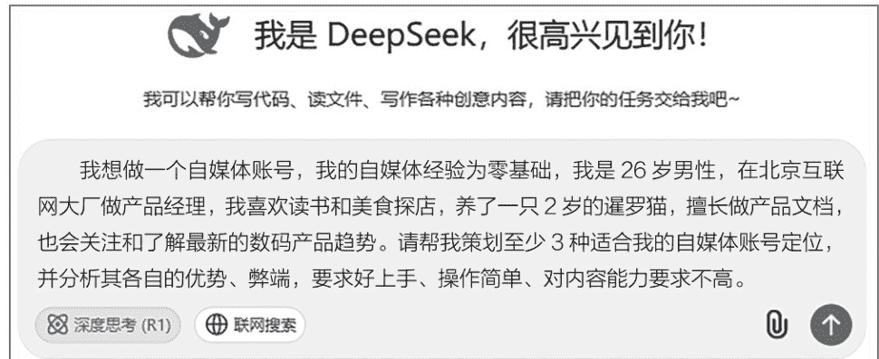

图2-1

按Enter键，将以上提示词发送至DeepSeek，给出的答案如下。

根据你的背景、兴趣和需求，以下是3种适合你的自媒体账号定位方案，结合可行性、差异化、上手难度及内容生产特点进行分析。

---

##### 一、定位1：互联网职场生活观察者

###### 1. 核心内容

- (1) 互联网大厂产品经理工作日常（脱敏版流程图/文档模板分享）。
- (2) 职场新人生存指南（周会技巧/需求文档避坑）。
- (3) 海淀互联网人探店日记（公司附近高性价比午餐测评）。
- (4) 数码装备升级实录（真实职场人视角的办公设备评测）。

###### 2. 优势

- (1) 内容素材唾手可得（日常随手记录即可）。
- (2) 自带精准受众（应届生/职场新人/互联网从业者）。
- (3) 商业变现路径清晰（职场课程/办公用品推广）。
- (4) 人设差异化明显（真实职场+美食+数码的立体人设）。

###### 3. 弊端

- (1) 需注意公司信息保密红线。
- (2) 职场干货内容有一定同质化风险。
- (3) 需平衡专业性与趣味性。

###### 4. 操作方案

- (1) 主平台：小红书+知乎（图文为主）。
- (2) 更新频率：3次/周（职场2次+探店1次）。
- (3) 工具：手机拍摄+石墨文档截图+Canva排版。

##### 二、定位2：赛博养猫人

###### 1. 核心内容

- (1) 科技宅男/科技宅女的智能养猫方案（自动喂食器测评实录）。
- (2) 暹罗猫拆箱数码产品的反差萌Vlog。
- (3) 猫咪视角解读互联网黑话（用宠物演绎需求评审会）。
- (4) 北京宠物友好空间探索地图。

###### 2. 优势

- (1) 萌宠天然具备流量吸引力。
- (2) 人设差异化（互联网人+技术流养宠）。
- (3) 可联动多个赛道（宠物/科技/本地生活）。
- (4) 内容生产门槛低（手机拍摄+简单剪辑）。

###### 3. 弊端

- (1) 宠物账号竞争激烈。
- (2) 猫咪状态存在不可控因素。
- (3) 需要保持人宠同框的稳定性。

……

以上便是DeepSeek给出的初步方案，我们确定好其中的某个定位之后，还可以向DeepSeek进一步追问，让DeepSeek进行优化。追问的方向可参考以下提示词。

- (1) 对于【定位1】，请进一步拓展和细化该方案。
- (2) 对于【定位2】，我希望是跟Vlog这个内容形式结合，请进一步细化和调整该方案。
- (3) 如果我【输入本人顾虑的真实情况】，请进一步调整【定位1】的方案。

比如：如果我本人无法露脸，请进一步调整【定位1】的方案；如果我完全不会拍短视频，请进一步调整【定位1】的方案；如果我想主攻小红书平台，请进一步调整【定位1】的方案。

因为篇幅有限，这里就不放DeepSeek的示范案例了，具体追问大家可以按照模板和自己的想法去执行。

#### 2. 有一定基础

如果你已经在自媒体平台积累了一些粉丝，但纠结要不要全职做这行，或者不确定接下来该专注哪个方向，可以用DeepSeek的智能分析工具帮你决策。下面是相应的提示词模板。

> “我目前在【平台】有【粉丝数】粉丝，但我对自己的账号定位以及未来内容创作方向有些迷茫。我的兴趣是【兴趣，如穿搭、美妆、旅行和养宠物】，我的职业是【职业】。请帮我分析我的个人IP适合的账号定位，列出5个可选方向，并说明每个方向的优缺点。”

输入这段提示词之后，我们就会得到由DeepSeek给出的定位方案，那为什么提示词是这样呢？我们需要理解其背后的逻辑。

- (1) “我目前在【平台】有【粉丝数】粉丝”，这句话是让AI先判断你现在处在哪个阶段——刚起步？小有基础？还是具备变现能力？平台不同，粉丝量的价值也不同，如B站的1万粉丝和抖音的1万粉丝，其玩法差别很大。
- (2) “我的兴趣是【兴趣，如穿搭、美妆、旅行和养宠物】，我的职业是【职业】”，这句话是帮你梳理你有哪些“能分享的内容”，兴趣是“你愿意分享的”，职业是“你擅长分享的”，两者结合起来，就是你做内容的差异化竞争力。
- (3) “请帮我分析我的个人IP适合的账号定位，列出5个可选方向”，这部分是重点，DeepSeek会结合你的背景给你提供定制化的定位建议，而不是泛泛而谈的“穿搭、美妆都能做”。
- (4) “并说明每个方向的优缺点”，不是只给你选择，而是帮你权衡选择，比如有的方向容易出爆款但更新难，有的方向粉丝黏性强但涨粉慢。这样你能更容易选出适合自己的方向。

下面将代入一个有一定基础的自媒体博主，但对自己的账号定位和未来内容创作方向比较迷茫，让DeepSeek对账号定位进行分析，并给出几个可选的定位方向，说明每个方向的优缺点。我们先编辑好提示词，接着打开“深度思考（R1）”模式的开关，关闭“联网搜索”，让DeepSeek输出答案，如图2-2所示。

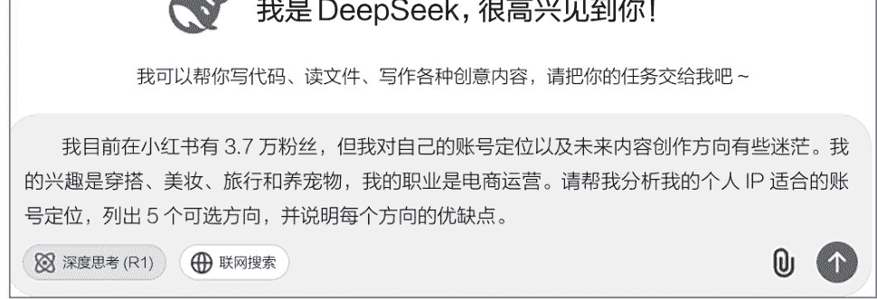

图2-2

按Enter键，将文字内容发送至DeepSeek，给出的答案如下。

以下是基于你的兴趣、职业背景和平台特性的深度分析，提供5个可落地的账号定位方向，每个方向均包含具体执行策略、数据表现预测及资源适配建议。

##### 方向一：电商从业者的“反套路消费指南”

定位公式：职业身份+穿搭美妆+理性消费观

（1）内容形式

- 电商人揭秘：这5类衣服成本不到售价的10%。
- “双11”前必看！品牌绝对不会告诉你的折扣潜规则。
- 我用电商数据选的通勤包，200元背出大牌感。

（2）优势

- 专业壁垒高：用电商运营知识拆解行业套路，建立信任感。
- 内容差异化：小红书仅0.3%的博主具备供应链视角。
- 变现多元：广告（消费品牌）+课程（电商运营课）+带货（白牌高毛利产品）。

（3）劣势

- 需持续输出干货，对行业认知深度要求高。
- 部分内容可能触碰品牌利益，需把控尺度。

（4）冷启动建议

- 首月选题侧重“价格解密”（如“1688源头工厂店铺清单”）。
- 用Excel数据对比图增强说服力（符合电商人设）。

##### 方向二：“带宠物看世界”旅行博主

定位公式：宠物主人+轻户外旅行+人宠情感

（1）内容形式

- 带柯基爬长城攻略：宠物友好景区红黑榜。
- 自驾3000千米，我的宠物急救包里有这些。
- 江、浙、沪宠物酒店测评：这些细节决定体验。

（2）优势

- 蓝海赛道：宠物旅行内容竞争度仅为美妆类的1/8。
- 用户黏性强：宠物主人互动意愿是普通用户的3倍。
- 天然带货场景：宠物出行装备、车载用品、地方文旅合作。

（3）劣势

- 内容制作成本高（需携带宠物实地拍摄）。
- 宠物突发状况可能影响拍摄进度和拍摄质量。

（4）数据参考

- 优质笔记平均收藏率：28%（普通旅行类为12%）。
- 广告报价：3万粉丝可达2000～3000元/条。

……

我们根据DeepSeek给出的初步方案，确定好其中的某个定位之后，还可以进一步向DeepSeek追问，让其进行调整。可参考以下追问的提示词模板。

- （1）除了【已有定位方向】，有没有适合我这类人群的【更细分/更蓝海/更好变现的定位方案】？
- （2）如果我想同时表达【身份/兴趣】和【内容垂类】，你能否帮我设计一个融合人设？
- （3）针对【某一定位下的内容形式】，有没有可以直接套用的视频/图文结构公式？

示例：

- （1）我时间比较碎片化，除了“反套路消费指南”，还有没有更适合上班族宝妈的细分定位？
- （2）我是宠物主人，又喜欢拍Vlog，能不能帮我设计一个既有人情味又有变现力的内容人设？
- （3）做“宠物旅行测评”方向时，我的笔记怎么排版更容易被观众保存？有推荐的图文结构或分段逻辑吗？

### 2.1.2 用DeepSeek挖掘蓝海赛道

蓝海赛道指的是竞争较小且有需求的市场，在这里，你更容易被用户发现，也更容易建立影响力。DeepSeek作为强大的AI分析工具，能够帮助你快速挖掘这些蓝海赛道，从而帮你避开过度竞争的红海。下面是相应的提示词模板。

> “我想在【小红书/抖音】上找到适合发展的‘蓝海赛道’。请分析最近3个月内，【穿搭/旅游/养宠物】领域的热门关键词，筛选出5个搜索量高但竞争较小的细分赛道，并说明如何切入。对于每个赛道，请提供数据支持、内容形式建议、变现路径和冷启动策略。”

输入这段提示词后，DeepSeek就可以给出相应的回答。那么我们为什么要这么提问呢？我们来理解一下其背后的逻辑。

- （1）“我想在【小红书/抖音】上……【穿搭/旅游/养宠物】领域……”不同平台有不同调性，小红书适合生活方式方面的内容、抖音适合节奏快的内容。提前说清楚平台和领域，才能让AI在对的地方找对的赛道。
- （2）“分析最近3个月内……热门关键词”，不是靠猜，而是靠真实数据找机会，这样找到的“蓝海赛道”才更靠谱、更具潜力，从而避免踩坑。
- （3）“筛选出5个搜索量高但竞争较小的细分赛道”，这个标准是蓝海的核心——有人找、但做的人不多，比硬挤热门赛道强多了，适合新手冷启动、快速建立差异化。
- （4）“请提供数据支持、内容形式建议、变现路径和冷启动策略”，不光告诉你“做什么”，还告诉你“怎么做、怎么赚钱、怎么起步”，一步到位，省心且可执行。

下面以适合抖音美妆领域为例，使用DeepSeek来分析3个月内的蓝海赛道。我们先编辑好提示词，接着打开“深度思考（R1）”模式的开关，关闭“联网搜索”，让DeepSeek输出答案，如图2-3所示。

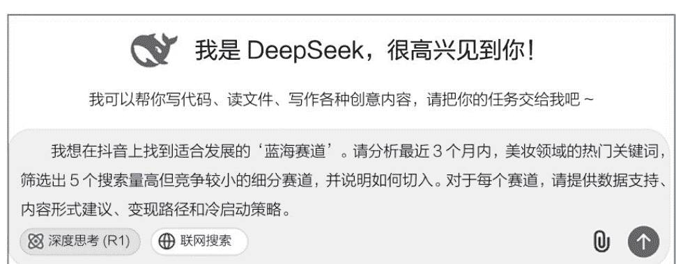

图2-3

按Enter键，将文字内容发送至DeepSeek，给出的答案如下。

根据最新数据监测和行业趋势分析，以下是为您筛选的5个美妆领域蓝海赛道及详细运营方案。

#### 1. 男士功效护肤

（1）数据支持

- 搜索量月均增长48%（巨量算数）。
- “男士祛痘”关键词供需比1:0.7（需求＞内容供给）。
- 相关视频平均点赞量2.1万（高于美妆大盘1.8万）。

（2）内容形式

- 产品对比实验：展示控油/祛痘效果前后对比。
- 生活场景切入：如“程序员通宵后急救护理流程”。
- 反差人设：如“健身博主跨界分享护肤经验”。

（3）变现路径

- 男士专线产品分销（佣金率为8%～15%）。
- 定制课程“28天直男改造计划”（定价为99～199元）。
- 理容品牌代运营服务。

（4）冷启动策略

- 蹭#男生改造计划话题（累计播放23亿次）。
- 联合男性向垂类达人（健身/数码）做交叉测评。

#### 2. 敏感肌特效修护

（1）数据支持

- “急救泛红”搜索量暴涨137%。
- TOP 100视频中专业医师内容仅占12%。
- 相关商品平均退货率低于美妆类目均值8%。

（2）内容形式

- 实验室级科普：紫外线相机展示修护效果。
- 24小时Vlog记录：敏感肌全天护理方案。
- 医生背书内容：与三甲医院皮肤科专家合拍。

（3）变现路径

- 械字号产品CPS带货（毛利率为25%以上）。
- 私域问诊服务（客单价300～800元）。
- 品牌定制解决方案（服务费为5万～8万元/案）。

（4）冷启动策略

- 制作《国家药监局备案查询教学》工具类爆款。
- 发起“敏感肌自救打卡”挑战赛。

上面这段DeepSeek给出的赛道建议逻辑清晰，内容扎实，具有较强的可执行性和创新性。当我们确定了某个赛道后，还可以进一步向DeepSeek追问，让其进行调整。下面是追问的方向参考提示词模板。

- （1）如果我在【两个细分领域】之间纠结，你能帮我对比一下【内容产出门槛、粉丝互动、变现潜力】吗？
- （2）我的人设是【身份/特征】，做【细分赛道】时，适合用什么样的表达风格？
- （3）针对【某个细分赛道】，能不能帮我策划一个【系列内容主题+选题排期】？最好有钩子标题。

示例：

- （1）我在“男士功效护肤”和“敏感肌特效修护”之间犹豫，该怎么选？哪个赛道更容易获得高互动和粉丝信任？
- （2）我是一个女性美妆博主，想做“男士功效护肤”内容，适合用什么样的表达风格？
- （3）如果我要做“男士功效护肤合集”，你能给我设计一个10期的系列内容主题吗？每期的标题风格有推荐吗？

### 2.1.3 基于个人优势选择适合的赛道

基于个人优势选择合适的自媒体赛道，能够提升竞争力，提高创作效率，并在短时间内建立个人品牌。你可以使用以下提示词模板，让DeepSeek帮助你挖掘适合的自媒体赛道。

我希望在自媒体领域找到合适的赛道。以下是我的个人优势。

- 专业知识：我擅长______（如金融分析、美妆护肤、健身塑形、编程开发等）。
- 技能特长：我具备______（如写作、演讲、短视频剪辑、摄影、绘画、配音等）。
- 个人经历：我有______的经历（如海外留学、创业、某行业工作、比赛获奖等）。
- 资源优势：我可以获取______（如行业人脉、品牌合作资源、专业设备等）。
- 性格特质：我是一个______的人（如幽默风趣、逻辑清晰、耐心细致、擅长表达等）。

请根据我的个人优势，结合市场趋势，推荐几个适合我的自媒体赛道，并给出赛道的具体定位和变现方式。

输入这段提示词后，DeepSeek就可以给出相应的生成内容。那么我们为什么要这么提问呢？我们来理解一下其背后的逻辑。

- （1）“专业知识/技能特长/个人经历/资源优势/性格特质”，这些信息能全面勾勒出你的独特优势，不用参考别人，而是找你能做、别人做不了的点。
- （2）“结合市场趋势，推荐几个适合我的自媒体赛道”，再强的个人优势，也要放在对的时代风口，不脱离平台热门趋势，才能让你起步更稳、涨粉更快。
- （3）“推荐赛道+具体定位+变现方式”，不只是给大方向，还告诉你该怎么切入、怎么赚钱，能直接上手操作，而不是空泛的建议。

下面将以一个美妆博主为例，来使用DeepSeek基于个人优势选择适合的赛道。我们先编辑好提示词，接着打开“深度思考（R1）”模式的开关，关闭“联网搜索”，让DeepSeek输出答案，如图2-4所示。

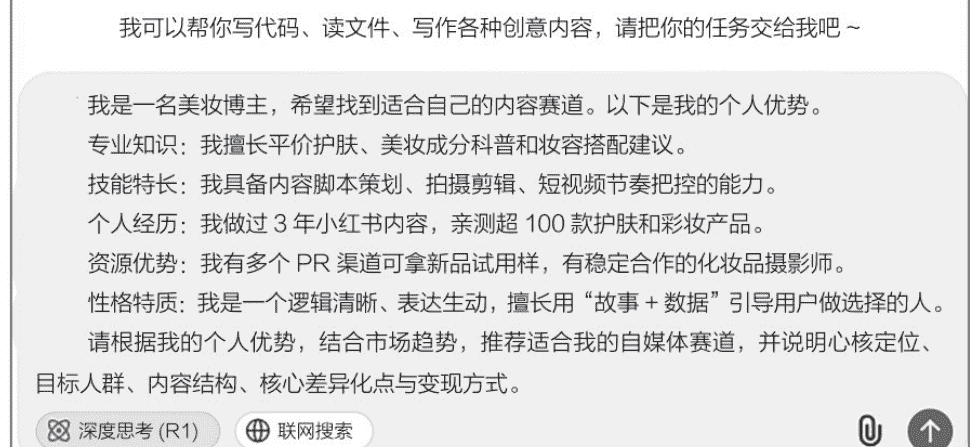

图2-4

按Enter键，将文字内容发送至DeepSeek，给出的答案如下。

根据你的优势分析，我为你设计了一个兼具专业性与商业潜力的自媒体赛道方案，以下是详细建议。

#### 一、核心定位

核心定位：“平价美妆科学家”（用科研视角解读平价美妆，通过“实验室场景+产品测评+成分拆解”打造专业人设）。

#### 二、目标人群

- 核心群体：18～30岁的学生党/职场新人，月消费预算为300～800元。
- 延伸群体：三四线城市精致中年女性，追求高性价比的轻熟肌群体。
- 痛点需求：价格敏感但不盲目节俭，需要科学验证的“平价替代方案”。

#### 三、内容架构（三维矩阵）

| 内容类型 | 呈现形式 | 差异化设计 | 发布频率 |
| :--- | :--- | :--- | :--- |
| 实验室剧场 | 短视频（1～3分钟） | 实验人员人设+产品实验对比 | 3次/周 |
| 成分档案馆 | 图文/信息流视频（30秒） | 用Excel/折线图可视化成分数据 | 2次/周 |
| 素人改造局 | 中长视频（5～8分钟） | 邀请粉丝参与真人改造 | 1次/周 |

#### 四、核心差异化点

测评维度创新：首创“成分有效浓度计算器”（用Excel公式展示平价产品真实性价比）。

案例：“某大牌精华替代公式：X成分浓度≥3% + Y提取物≥0.5% = 合格替代品”。

场景化知识输出：设计“美妆成分狼人杀”系列（用游戏化语言解析成分关系）。

案例：“今夜请闭眼……防腐剂家族请开始行动。”

用户决策工具：开发“美妆决策树”（通过选择题引导用户找到合适的产品）

示例：Q1你的肤质→Q2预算→Q3使用场景→生成产品清单。

#### 五、变现组合拳

| 阶段 | 变现方式 | 实施策略 |
| :--- | :--- | :--- |
| 启动期 | 平台流量分成 + 样品置换 | 重点运营抖音/快手“实验室剧场”系列，冲击自然流量池 |
| 成长期 | 定制广告 + 橱窗带货 | 用“成分档案馆”做软植入，开发“大牌平替套装”组合产品 |
| 成熟期 | 自有IP产品 + 付费课程 | 推出《大学生美妆投资指南》手账本，开发《28天成分扫盲训练营》知识付费课程 |

……

DeepSeek提供的这份赛道规划方案非常专业，逻辑清晰，且符合平台算法趋势，能够兼顾用户需求与商业变现路径。当我们确定了某个赛道后，还可以对其进行进一步追问，让其进一步调整。

- （1）请优化以下自媒体赛道规划方案，使其更加【专业化/接地气/差异化】，并提升【用户黏性/变现能力】。
- （2）请基于当前市场趋势，调整以下方案，使其更具【竞争力/创新性】。
- （3）请优化该方案的内容结构，使其更【简洁/深入】并提高可执行性。

## 2.2 竞品账号拆解：用DeepSeek提取头部账号的成功公式

在自媒体运营中，成功并非偶然，头部账号之所以能获得百万流量，往往有其内在逻辑。拆解竞品，是快速学习行业最佳实践、优化自身内容策略的重要方法。而借助DeepSeek，我们可以高效分析头部账号的内容模式、用户互动数据和运营策略，从而归纳出其成功公式，为自己的账号提供清晰的优化方向。

### 2.2.1 拆解爆款视频，优化内容

如何打造一条高播放量、高互动量的“爆款”视频，现已成为内容创作者关注的核心问题。使用DeepSeek拆解爆款视频的成功要素，不仅能帮助我们理解观众的喜好，还能为我们优化内容提供有效策略。我们可以通过下面的提示词模板，让DeepSeek帮助我们来拆解爆款视频，优化内容。

> “请分析以下短视频的数据表现，分析该博主的笔记内容，对标题、选题、文案、排版等方面的特点进行研究，以及这些特点为什么能帮助他获得更高的曝光、点赞和收藏。数据如下。
标题：×××
选题：×××
文案：×××
排版：×××
播放量：×××
完播率：×××%
点赞率：×××%
评论数：×××
转发数：×××
关注率：×××%
发布时间：×××
视频内容：×××”

输入这段提示词后，DeepSeek就可以给出相应的生成内容。那么为什么要这么提问呢？我们来理解一下其背后的逻辑。

- （1）播放量、完播率、点赞率等指标，就像视频的成绩单，能让我们看出它到底好在哪、差在哪。
- （2）标题、选题、文案、排版等内容是钩住观众的关键，分析这些内容，能明确创作者是怎么一步步抓住观众注意力的。
- （3）这个模板是把“视频能火”这件事分解成“数据表现”和“内容细节”两部分来研究，从而让我们了解内容背后的成功密码，方便你学习、借鉴、复刻。

下面通过代入美妆博主的视角，使用DeepSeek分析某爆款短视频数据，分析他的笔记内容，详细说明为什么这个短视频会成为爆款。我们先编辑好提示词，接着打开“深度思考（R1）”模式的开关，关闭“联网搜索”，让DeepSeek输出答案，如图2-5所示。

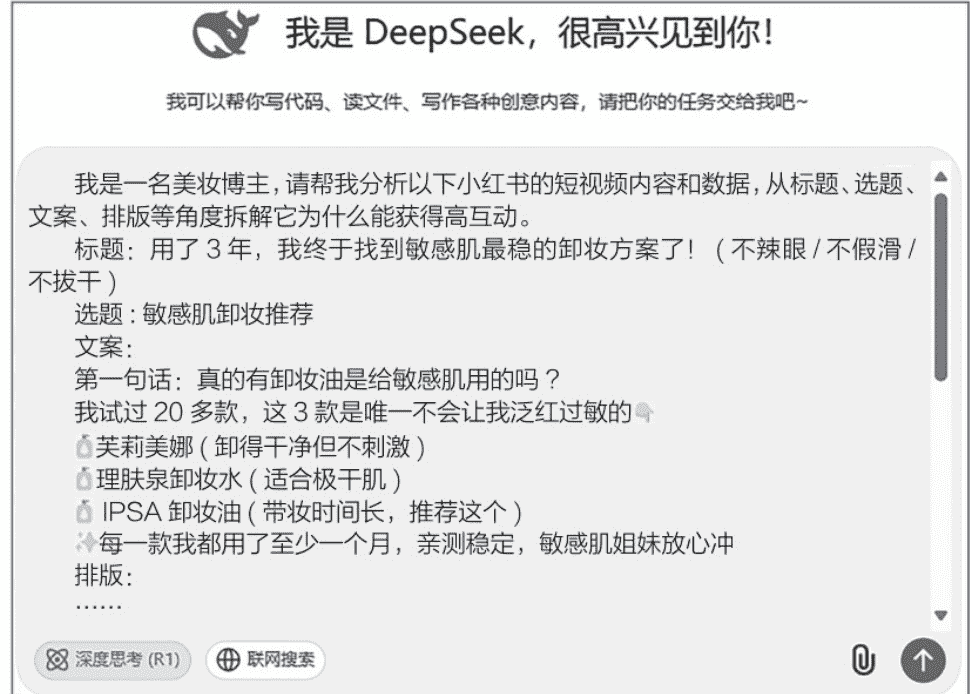

图2-5

按Enter键，将文字内容发送至DeepSeek，给出的答案如下。

拆解分析：高互动背后的底层逻辑。

#### 1. 标题：直接戳痛点+勾起好奇心

敏感肌的烦恼全知道：标题里写的“不辣眼/不假滑/不拔干”全是敏感肌最怕的雷点，一看就觉得“这博主懂我”。

用时间证明靠谱：“用了3年”让观众觉得你测试了很久，结果可信，比“亲测好用”更有说服力。

留个钩子：不说具体产品名，让人带着强烈的好奇心点进去看“到底是哪3款”。

#### 2. 选题：精准锁定“纠结人群”

专攻敏感肌：这类人买卸妆产品最纠结（怕过敏），你的视频就是她们的“救命稻草”，互动自然高。

反常识推荐：大家觉得敏感肌该用卸妆水，你却说卸妆油更好，打破认知，让人想讨论“真的能用油卸妆吗”（评论区有争议就能带来流量）。

#### 3. 文案：语言通俗化+疯狂建立信任

开头一句话勾人：“真的有卸妆油给敏感肌用吗？”——立马让人停下想听答案。用数字和时长证明靠谱：

- “试过20多款” → 显得你专业；
- “每款用一个月” → 敏感肌怕短期试用不准，你替她们排雷了。

产品推荐简单粗暴：每款只用一句话说清特点（如“适合极干肌”），不啰嗦，让人看完就能记住。

#### 4. 排版：看得不累+重点突出

分段清晰：用表情符号把产品分开，一眼扫过去不费劲。

结尾给人以安全感：最后用“敏感肌姐妹放心冲” + ✨符号，像朋友一样催你下单。

#### 5. 视频内容：够真实才有说服力

素颜拍过敏脸：敢露红血丝，比美颜滤镜更有信任感（观众会觉得“她真的和我一样惨”）。

重点词高亮：比如“不刺激”标红，方便观众截图发闺蜜，也帮算法抓关键词。

#### 6. 为什么数据好

- 完播率高（73%）：因为视频开头前3秒就抛出了问题，中间分3款产品吊胃口（想知道下一个是什么），结尾总结不拖沓。
- 评论多：你说敏感肌能用卸妆油，自然有人问“真的吗？我是油敏肌能用吗？”（争议=流量）。
- 关注率高（5.4%）：大家觉得你专攻敏感肌，会想等后续的“护肤攻略”。

……

当我们确定了某个需求后，还可以进一步向DeepSeek追问，让其进行调整。下面是追问的方向参考提示词模板。

- （1）我已经写了一个视频标题：【标题】，你能帮我用“戳痛点+钩好奇”的方法优化成3个版本吗？
- （2）这是我写的开头文案：【开头】，你觉得够不够抓人？有没有更口语化、容易引起共鸣的改法？
- （3）我的视频讲了【某个细分问题】，结尾想引导大家留言讨论，你能给我设计几条“互动提问”的评论话术吗？
- （4）我的视频是做【品类/问题】推荐的，你能给我1个完整的“视频结构模板”吗？照着说就能拍。

示例：

- （1）我的标题是“适合敏感肌的卸妆油推荐”，你能按“反常识+钩子”的思路改几个更吸引人的版本吗？
- （2）我的开头是“今天来推荐几款好用的卸妆油”，你能帮我换个更能让人停下来的表达吗？
- （3）我想在结尾加一句“姐妹放心冲”，你能再给几个有亲和力又能引导下单的说法吗？
- （4）我要拍“适合熬夜脸的急救面膜”，你能按“开头钩子—产品亮点—总结引导”的结构给我一个模板吗？

### 2.2.2 对比头部账号，打造特色

在短视频内容日趋饱和的时代，简单复制头部账号的内容难以脱颖而出。自媒体账号要想真正实现内容差异化获得长期增长，关键在于对比分析——通过DeepSeek找到行业头部账号的核心优势，并挖掘它们未能覆盖的空白点，打造独具自身特色的内容。下面是使用DeepSeek对比头部账号的提示词模板。

> “请分析行业头部短视频账号的数据、内容风格，并对比我的账号，找出可优化的方向，以及挖掘它们未能覆盖的空白点，从而塑造出独属于自己的内容特色。”
>
> 以下是头部账号数据（提供多个账号进行对比）。
>
> 账号A（粉丝数为××，平均播放量为××，完播率为××%，互动率为××%，内容风格：××，核心亮点：××）。
>
> 账号B（粉丝数为××，平均播放量为××，完播率为××%，互动率为××%，内容风格：××，核心亮点：××）。
>
> 账号C（粉丝数为××，平均播放量为××，完播率为××%，互动率为××%，内容风格：××，核心亮点：××）。
>
> 以下是我的账号数据。
>
> 粉丝数为××，平均播放量为××，完播率为××%，互动率为××%，内容风格：××，当前主要选题方向：××。
>
> 分析需求如下。
>
> 头部账号拆解：分析其流量增长策略、选题方向、内容结构、用户互动模式、视觉风格等。
>
> 对比分析：找出我的账号与头部账号的核心差距，包括选题、内容深度、视觉呈现、互动策略等。
>
> 优化建议：基于数据分析，提出3～5条针对性的优化建议，包括选题调整、表达方式优化、增强互动性、提高转化率等。”

输入这段提示词后，DeepSeek就可以给出相应的生成内容。那么为什么要这么提问呢？我们来理解一下其背后的逻辑。

#### 2.2.2 分析头部账号，对比自身差距

(1) 分析头部账号的数据和内容风格，是为了弄清楚：别人是怎么火起来的，他们的流量来源、内容节奏、互动技巧都有很强的参考价值。

(2) 对比自己的账号和头部账号的粉丝数、平均播放量、完播率等数据，就是对自己的账号做一场实力“体检”，看看自己的账号到底是“内容没吸引力”，还是“互动做得不够”。

(3) “挖掘他们未能覆盖的空白点，从而塑造出独属于自己的内容特色”，这句话是指光模仿头部账号不够，必须从这些大号没讲到、不擅长的点中找到机会，打造出独特风格或新角度，这样你才能“脱颖而出”。

用户可以通过DeepSeek的上传附件功能，给DeepSeek提供头部账号的具体数据，这种方法更为省时、省力，如图2-6所示。

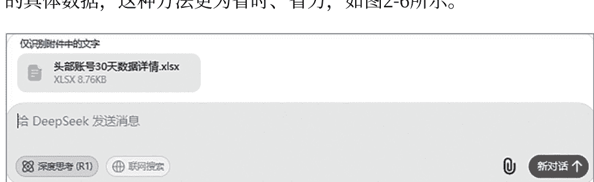

图2-6

下面是根据上述提示词模板生成的示例。

> 请分析以下头部短视频账号的成功要素，并对比我的账号，找出可优化的方向，以及挖掘它们未能覆盖的空白点，从而塑造出独属于自己的内容特色。

##### 【头部账号数据】

账号A：粉丝数为80万，平均播放量为40万，完播率为75%，互动率为12%。
内容风格：极简干货风（低情绪+超信息密度）。
核心亮点：15秒内输出“清晰有效决策”，用户获得感强。

账号B：粉丝数为150万，平均播放量为60万，完播率为82%，互动率为15%。
内容风格：情绪陪伴型+种草混剪。
核心亮点：强情绪节奏、生活氛围感妆容+场景配乐。

账号C：粉丝数为95万，平均播放量为35万，完播率为68%，互动率为9%。
内容风格：教程类详解+对比实测。
核心亮点：产品对比+成分党视角，有理有据，用户信任感强。

##### 【我的账号数据】

粉丝数为8万，平均播放量为1.5万，完播率为54%，互动率为6.2%。

##### 【内容风格】

基础种草+轻口播讲解+封面以自拍为主。

##### 【需求】

- (1) 分析头部账号的内容结构、风格特点、流量增长策略。
- (2) 将我的账号与他们的账号做对比分析，找到差距和机会点。
- (3) 给出针对性的优化建议，如选题调整、表达方式优化、互动机制增强等。

根据您提供的数据和需求，我将从3个维度进行系统性分析，并提供可落地的优化方案。

#### 一、头部账号成功要素拆解

##### 1. 内容结构黄金模型

- 账号A：钩子公式=痛点数字+悬念前置（例如，“3秒选出精华液？90%的人不知道的筛选公式”）。
- 账号B：情绪曲线=低谷共情→解决方案→氛围升华（配乐渐强+场景切换）。
- 账号C：信任公式=权威背书+对比实验+成分可视化（用显微镜/实验仪器强化专业感）。

##### 2. 流量增长策略矩阵

- 账号A：高频使用“知识缺口”标题法（你知道……其实……）。
- 账号B：BGM卡点+场景蒙太奇（平均每2秒切换画面）。
- 账号C：固定周三“成分实验室”系列形成用户期待。

##### 3. 数据化运营特点

- 账号A：严格控制在15秒内，利用“信息过载”促使用户反复观看。
- 账号B：每7条内容设置1条“情绪宣泄”类爆款（如“打工人深夜治愈时刻”）。
- 账号C：使用AB对照封面（实验组图vs对照组图）。

#### 二、账号差距分析与机会洞察

##### 1. 结构性差距诊断

- 信息密度差距：你的内容平均有效信息点为2.3个/15秒，头部账号达5.8个/15秒。
- 情绪价值断层：现有内容情绪曲线平缓（平均波动幅度为0.7），账号B达1.9。
- 信任锚点缺失：缺乏实验验证环节，成分分析仅占内容时长的12%。

##### 2. 用户行为数据洞察

- 你的完播率为54%→前3秒流失率达40%（头部账号普遍控制在25%以下）。
- 互动分布：评论区63%的内容集中在颜值方面，而非讨论产品价值。
- 用户画像对比：你的粉丝中18～24岁的占71%，与头部账号25～30岁的核心消费群体错位。

#### 三、差异化突围策略方案

##### 1. 内容升级路径

（1）信息重组模型。
采用“3×3结构”：前3秒设认知冲突（例如，“你花300元买的精华，90%没吸收”），中间9秒植入3个知识点，最后3秒设置行动指令。

（2）视觉优化方案。
- 封面迭代：自拍+信息标牌（例如，左脸自拍+右侧“5种致敏成分表”）。
- 拍摄升级：增加“成分显微镜”视角（用手机微距镜头拍摄产品质地）。

……

当我们确定了某个需求后，还可以进一步向其追问，让其进行调整。下面是追问的方向参考提示词模板。

- （1）“内容过于密集，可能导致阅读门槛较高，请精简表达，突出关键点。”
- （2）“虽然提供了很多优化方向，但缺少明确的执行步骤，请用‘具体操作+示例’让优化方案更落地。”
- （3）“请提供优化前后的示例，帮助我更直观地理解优化效果。”

### 2.2.3 深挖评论，提炼用户需求

评论区是用户对短视频内容的直接反馈，蕴含着大量优化创作的线索。本节将详细介绍如何利用DeepSeek分析评论区，优化短视频内容结构、选题方向和互动策略，以提升用户黏性和账号影响力。

> “请分析以下短视频的评论区较高点赞评论，提供优化建议。
> 
> 视频内容：[视频主题]
> 
> - (1) ……
> - (2) ……
> - (3) ……
> - (4) ……
> 
> 请基于以上评论数据，回答：
> 
> - (1) 观众最关心的问题是什么？（列出关键词）
> - (2) 该视频的下一个选题方向建议是什么？
> - (3) 如何设计互动话术以提升评论量？
> - (4) 是否需要调整视频标题，以便更加贴近用户需求？”

这个提示词模板的构成，其实是为了通过观众的真实反馈来反向优化内容。我们来理解一下其背后的逻辑。

- (1) 高点赞评论反映的是观众最在意、最有共鸣的信息点，分析这些评论，能帮你快速抓住“观众到底关心啥”。
- (2) 评论区里的问题、好奇点，常常就是下一期视频最好的素材来源，这样能延续热度，让观众觉得“你懂我”。
- (3) 短视频结尾通过设计一些更容易引发共鸣或争议的问题句，鼓励观众参与评论，从而可以提升互动率，让平台更愿意推荐你的视频。
- (4) 如果评论区普遍关心的内容，在短视频标题中没体现出来，就会错失流量。只有及时调整标题，才能更好地“钩住”对口观众。

下面通过代入美妆博主，使用DeepSeek分析某短视频评论区，详细说明为什么观众会在意这些评论。我们先编辑好提示词，接着打开“深度思考（R1）”模式的开关，关闭“联网搜索”，让DeepSeek输出答案，如图2-7所示。

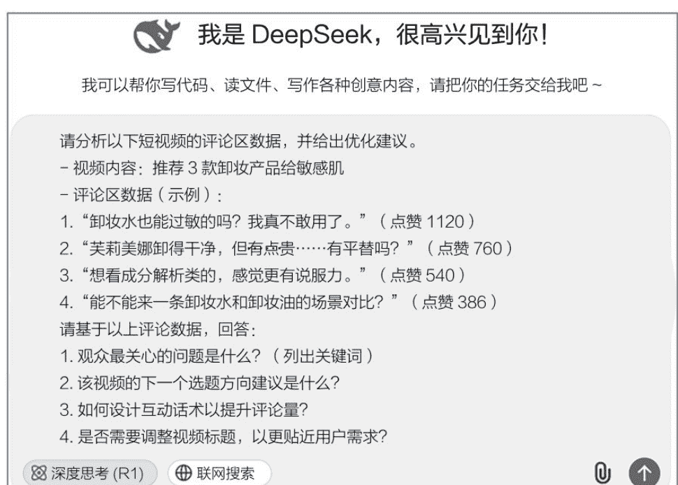

图2-7

按Enter键，将文字内容发送至DeepSeek，给出的答案如下。

#### 1. 观众最关心的问题（核心关键词提取）

- 过敏风险（敏感肌安全性）。
- 产品性价比（贵价平替）。
- 成分专业性（解析需求）。
- 产品类型选择（水/油场景对比）。
- 使用场景适配性（不同场景需求）。

#### 2. 下期选题建议

建议选题1：敏感肌卸妆成分红黑榜——这5种成分看见快跑！

建议选题2：卸妆水vs油vs膏终极测评——这3种场景必须换产品！

备选选题：敏感肌卸妆平替大赏——百元内安全好物TOP5。

#### 3. 互动话术设计策略

- 痛点提问式：“卸妆翻过车的姐妹举个手！你遭遇过哪种过敏症状？”
- 二选一式：“敏感肌卸妆水派vs卸妆油派，你站哪一队？评论区PK！”
- 福利引导式：“揪3位粉丝送同款试用装，留言你的肤质+想试用的产品。”
- 知识验证式：“猜猜这3款里哪款含致敏防腐剂？答对抽奖送正装。”
- 场景延伸式：“通勤淡妆/舞台浓妆/运动防晒，你们最需要哪种场景的卸妆攻略？”

#### 4. 标题优化建议

原标题（假设）：敏感肌必入！3款超温和卸妆好物。

优化方向：痛点+专业背书+场景覆盖。

新标题示例：

- 敏感肌卸妆避雷指南！3款0防腐剂实测+水油使用场景手册。
- 烂脸警告！这3款低敏卸妆实测报告，附百元平替方案。
- 成分解密：3款敏感肌卸妆水/油红榜，附实验室检测数据。

进阶建议：建议在下期视频中设置以下“防杠声明”环节，这将有效提升专业可信度，降低观众对产品安全性的质疑，同时满足观众对评论区专业性的诉求。

- 展示产品备案凭证。
- 插入实验室刺激性测试画面。
- 添加真人实测的前后皮肤对比图。
- 加入皮肤科医生背书片段。

以上便是DeepSeek给出的初步方案，我们确定好其中的某个方向之后，还可以向DeepSeek进一步追问，让其进行调整。追问的方向可以参考以下提示词模板。

- (1) 我的目标观众是【目标人群，比如“敏感肌女孩”】，你能帮我整理出他们最常关心的5个问题关键词吗？如过敏风险、成分安全、使用场景等。
- (2) 这期视频讲【内容】，我想通过评论区“埋下钩子”引出下期视频内容。你能给我设计几条评论引导文案吗？
- (3) 我想做关于【某产品/某场景】的系列视频，你能给我5个不一样的切入点选题吗？最好包括争议性话题、冷知识、成分对比等。

示例：

- (1) 我的受众是“成分党+敏感肌”，他们最在意哪些核心问题？我想围绕这些做内容。
- (2) 这期讲“敏感肌卸妆油实测”，下期想讲“红黑成分榜”，评论区可以怎么问观众？
- (3) 我做的视频主题是“敏感肌卸妆油”，你能给我一些下期视频的选题建议吗？最好能延伸出一条系列线。

## 2.3 个人IP主页设计：用DeepSeek一键输出主页资料

在注意力稀缺的数字化竞争中，个人主页就是你的“线上名片仓”——它决定了用户3秒内是否点击关注、平台的推荐算法是否将你推向目标人群。传统主页设计依赖“反复试错+经验堆砌”，而通过DeepSeek的智能结构化生成能力，可一键输出主页资料。

### 2.3.1 生成吸睛简介，提高搜索权重

为什么专业能力相同，别人的主页能被搜索置顶，你的内容却石沉大海？80%的个人IP输在起点上。使用DeepSeek生成的吸睛的个人简介，可有效提高账号的搜索权重。下面是使用DeepSeek生成吸睛简介的提示词模板。

> “你是一个精通【个人IP定位/职场成长/知识付费】领域的专家，请根据以下信息生成3条符合【小红书/知乎/抖音】平台调性的主页简介，要求：
> 
> - 1. 身份标签：【你的核心身份】。
> - 2. 目标用户：【具体人群+痛点】。
> - 3. 核心服务：【用户能得到的结果】。
> - 4. 数据背书：【量化成果/服务人数】。
> - 5. 差异化亮点：【独特经历/方法论】。
> - 6. 行动指令：【引导用户行为】。
> - 7. 关键词：【必含行业长尾词】。
> 
> 特别要求（按个人选择添加）：
> 
> - ①前20字必须出现核心痛点词；
> - ②每句话结尾用‘|’分隔，控制总字数在120字内；
> - ③嵌入2～3个表情符号，拒绝过度表情化。”

这个提示词模板的构成，是为了高效打造一个与平台调性契合、用户一眼看懂、具有高转化力的主页简介。我们来理解一下其背后的逻辑。

- （1）模板一开头就要求身份标签+目标用户+核心服务，是为了让观众第一眼就知道：“你是谁”“帮我解决什么问题”，定位清晰、直接钩住需求。
- （2）数据背书（如服务人数、成果）是打消观众疑虑的关键一环，用数字说话，立马让人觉得你“靠谱”。
- (3) 差异化亮点（如特别经历、原创方法）能让你快速从一堆同类账号中脱颖而出，不至于被淹没，从而让观众愿意关注你。
- (4) 最后加入行动指令（如“点主页看干货”）+平台关键词优化（如“面试技巧”“高薪行业”），能引导用户“留下来”“点进主页”，也更符合平台算法推荐。

下面通过母婴博主的视角，使用DeepSeek生成吸睛的主页简介文案，详细说明为什么观众会在意这些简介。

你作为一个精通个人IP定位领域的专家，请帮我撰写3条适合抖音平台的主页简介文案，我是一名【母婴博主】。请基于以下信息，生成3条主页简介，要求每条简介文案都具备以下结构要素。

---

身份标签：我是一个二胎妈妈+母婴领域内容创作者。

目标用户：刚生宝宝/带娃焦虑/产后重返职场/育儿知识混乱的新手妈妈们。

核心服务：提供科学育儿干货+亲测母婴用品种草+产后成长类知识付费课程。

数据背书：累计服务超3000位妈妈、付费用户转化率达30%、母婴测评视频播放量破百万。

差异化亮点：我是“高知宝妈”，名校硕士+10年品牌营销经验+育儿实践融合“理性方法论”。

行动指令：关注主页/私信获取课程/点收藏不迷路。

关键词：产后成长、科学育儿、知识型宝妈、母婴种草、妈妈IP成长、内容变现。

#### 【简介一】

“二胎妈妈 | 复旦硕士 | 3000+妈妈信赖的育儿军师”。

这里没有鸡汤，只有实战派科学育儿干货+亲测好用的母婴尖货。

从产后重返职场焦虑到育儿知识混乱，用10年品牌营销经验拆解“妈妈IP成长方法论”。

主页置顶领取《高知妈妈产后成长手册》，私信回复“课表”获取宝妈知识变现路径✨关注、收藏不迷路，理性带娃少走弯路。

#### 【简介二】

“北大硕士妈妈的硬核育儿研究所”。

专治：带娃焦虑 | 母婴用品踩雷 | 产后价值感缺失。

独创“高知宝妈四维成长模型”，测评视频播放破百万的选品逻辑。

30%付费转化率验证的实战课程，让科学育儿可复制。

#### 【简介三】

“10年品牌总监转型，成就母婴赛道黑马”。

把母婴种草做成知识付费，让3000妈妈实现“带娃成长两不误”。

在这里你能获得：

- ①实验室级母婴用品测评；
- ②产后认知升级课程；
- ③用营销思维做妈妈IP的变现路径。 ★

985硕士妈妈的降维育儿攻略，私信“成长”解锁职场妈妈的副业地图。

#### 【结构化设计逻辑】

- 身份权威强化：前置名校背景+行业资历，建立知识型IP信任锚点。
- 痛点解决方案：采用“问题清单体”直击目标用户核心焦虑。
- 数据可视化：用3000+、30%、百万级等具体数字增强说服力。
- 价值分层呈现：从免费干货到付费课程的引流路径清晰。
- 行动指令场景化：结合抖音用户行为习惯设计收藏/私信话术。
- 差异化定位：突出“营销方法论×育儿实践”的跨界优势。

建议配合置顶视频展示课程学员成长案例，主页橱窗关联种草商品，形成“内容—产品—课程”的商业闭环。

以上便是DeepSeek给出的个人简介初步方案，我们选定其中的某一条之后，还可以向DeepSeek进一步追问，让其进行调整。追问的方向可以参考以下提示词模板。

- (1) 我的背景是【学历/职业/身份】，现在做母婴内容，你能帮我梳理3种人设定位方向吗？要求能兼顾真实感和差异性。
- (2) 针对【孕期/产后/婴儿/学龄前/小学/……】不同阶段的妈妈，你能帮我整理她们各阶段分别最关心什么问题吗？我想按阶段做内容矩阵。
- (3) 我的内容是【母婴/育儿/知识变现】，你能帮我梳理一套内容框架吗？包括免费干货、实操攻略、种草测评、知识变现等不同维度。

示例：

- (1) 我是全职妈妈+教育行业出身，想打造一个知识型育儿账号，可以用哪些人设定位？
- (2) 学龄前妈妈最常纠结的问题是什么？我想拍选品类视频。
- (3) 我想围绕“高知妈妈副业成长”做一条内容线，除了讲课程还能做什么？

### 2.3.2 优化视觉风格，增强信任感

在个人主页的设计中，视觉风格不仅是美观的装饰，还是建立用户信任的关键因素之一。一个清晰、专业、和谐的视觉呈现，能够立即打动访客，并给他们留下深刻的第一印象。下面是使用DeepSeek优化视觉风格，增加信任感的提示词模板。

> “我是一个【你的职业】，我的年龄是【年龄】，昵称是【昵称】，想做一个自媒体账号，请根据以上信息帮我生成3个符合【平台】主页的视觉风格，包括封面设计、背景图、头像风格等。”

这个提示词模板的构成，其目的是快速打造一个视觉统一、有记忆点、贴合平台风格的自媒体账号形象。其背后的逻辑可以通俗地归纳为以下4点。

- (1) “我是一个【你的职业】，我的年龄是【年龄】”，不同的职业和年龄段，决定了视觉风格是偏向专业性、亲和感、趣味性还是权威性，这一步是为了确保整体风格匹配你的身份。
- (2) “昵称是【昵称】”，昵称往往透露出你的调性、性格或喜好，它可以作为视觉风格设计的灵感来源，比如颜色、图形、元素等，以增强账号记忆点。
- (3) “3个符合【平台】主页的视觉风格”，每个平台的视觉偏好不同，比如小红书偏文艺、简洁，抖音偏快节奏、对比、高刺激吸睛，知乎偏理性、简约，所以要按平台定制设计风格，提升点击率和识别度。
- (4) “包括封面设计、背景图、头像风格等”，即一个账号最主要的视觉入口——封面吸引人、背景图营造氛围、头像传递人设，让人一眼就记住你。

下面以一个母婴博主视角代入，让DeepSeek帮助我们优化视觉风格，增强观众的信任感。我们先编辑好提示词，接着打开“深度思考(R1)”模式的开关，关闭“联网搜索”，让DeepSeek输出答案，如图2-8所示。

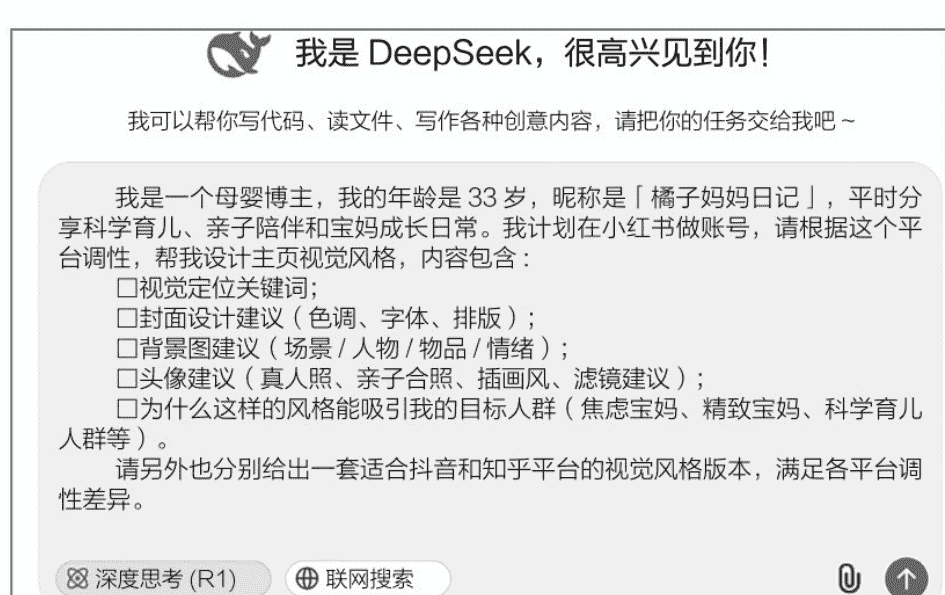

以下是针对小红书、抖音、知乎三大平台调性设计的视觉方案，保持“科学育儿+温暖陪伴”核心定位的同时突出平台差异化特征。

#### 一、小红书版本（精致治愈系）

视觉关键词：治愈感 / 高颜值生活 / 轻科普氛围。

##### 1. 封面设计

- 色调：低饱和莫兰迪色系（奶茶色/雾霾蓝/浅鹅黄）+10%亮橘色点缀。
- 字体：衬线体标题（思源宋体）+圆润手写副标题（汉仪小麦体）。
- 排版：上下分栏式（上为场景图+下为文字区，上下比例为3：7），添加手绘箭头/星星符号。

##### 2. 背景图

场景：北欧风儿童房工作台/阳光窗边亲子阅读/DIY辅食摆拍（突出自然光与木质元素）。

##### 3. 头像

插画风：Q版妈妈环抱婴儿形象，橘色发带呼应昵称，背景柔光虚化。

目标人群适配逻辑：小红书宝妈追求“精致养娃不费力”人设，柔和的视觉风格能降低焦虑感，专业字体能增强可信度，生活场景暗示可复制性。

#### 二、抖音版本（动态活力风）

视觉关键词：强互动感 / 信息直给 / 情绪感染力。

##### 1. 封面设计

- 色调：高明度撞色（橘+白+克莱因蓝），使用渐变光晕效果。
- 字体：加粗无衬线体（阿里巴巴普惠体Bold）+立体阴影设计。
- 排版：中央人物抠图+环绕文字（痛点关键词，如“厌奶期急救！”“5招戒尿布”）。

##### 2. 背景图

动态场景：抱着宝宝跳舞瞬间/夸张表情解决问题的抓拍（突出动作张力）。

##### 3. 头像

真人实拍：半身照举着橘子道具眨眼笑，背景虚化游乐场/玩具墙。

目标人群适配逻辑：抖音用户大都注意力稀缺，高对比色彩+痛点文字3秒传达价值，真人出镜能增强用户信任感，动态场景可暗示内容实操性。

#### 三、知乎版本（专业学术感）

视觉关键词：理性权威 / 知识密度 / 适度温度。

##### 1. 封面设计

- 色调：深蓝+浅灰主色，配合数据图表/脑图元素。
- 字体：等线体（OPPO Sans）+深色描边保证浅色背景的可读性。
- 排版：左文右图结构（左边3个核心知识点标号+右边场景示意图）。

##### 2. 背景图

场景：书架前工作场景/国际育儿书籍特写/带笔记的育儿计划表。

##### 3. 头像

职业照：正装半身照持育儿书籍，背景柔焦处理，适当保留法令纹显真实。

# 第3章 用DeepSeek策划选题和搭建选题库

在自媒体内容创作中，选题是决定一篇内容能否爆火的核心要素。一个精准、有吸引力的选题，能让观众在信息流中迅速停留，并产生阅读或观看的兴趣。然而，选题策划往往是创作者最头疼的问题——灵感枯竭、选题雷同、缺乏数据支持，都会降低内容的传播效果。本章将深入探讨如何利用DeepSeek策划选题，并搭建一个高效的选题库，帮助你找到符合目标受众需求的爆款内容方向。

本章将会集中解决关于选题的4个核心问题。

- 我完全没有选题方向，如何用DeepSeek快速找到潜力选题？
- 我的内容总是和别人类似，如何挖掘具有差异化的选题？
- 我灵感总是枯竭，如何构建一个可持续更新的选题库？
- 我想做热门内容但总是比别人慢半拍，如何提前布局爆款选题？

## 3.1 用DeepSeek找到你的爆款选题公式

一个好的选题，不仅能精准击中观众的痛点或需求，还能在信息流中脱颖而出，吸引更多点击和互动。本节将详细介绍如何利用DeepSeek的数据分析能力，从海量信息中提炼出高潜力选题。

### 3.1.1 挖掘潜力选题

优质选题不仅决定了账号流量的高度，更关乎账号的长远发展。相比简单跟风热点，真正具有潜力的选题应具备持续热度、观众共鸣和变现价值三大特性。那么该如何使用DeepSeek挖掘潜力选题？可以参考下面的提示词模板。

> “你是一位专业的新媒体数据分析师，帮助我在【内容方向】领域挖掘3～5个高潜力选题，并提供选题的增长逻辑。请参考行业趋势、用户需求、搜索热度和竞品对比，并分析每个选题的流量预期和可执行性评分。”

输入这段提示词后，DeepSeek就可以给出相应选题方案。那么为什么要这么提问呢？我们需要来理解一下其背后的逻辑。

（1）“你是一位专业的新媒体数据分析师”，这是提示词的开头角色设定，是DeepSeek提示词的核心原则之一：通过指定角色，让AI带入专业视角输出更加系统、专业、有逻辑的内容。

（2）为什么要提供“内容方向”？其原因是让AI结合你的经验、兴趣、能力来挖掘选题，从而避免AI输出一些虽然热门但你无法实操、难以持续输出的内容。例如，你是旅行博主，AI就不会给你“家庭理财”的选题；你是数码发烧友，就不会收到“孕期日常”类建议。

（3）为什么要参考“行业趋势、用户需求、搜索热度、竞品对比”？这4个维度是在模拟一位专业内容策划者如何做出“有效选题”的思维路径。

（4）为什么要分析“流量预期”和“可执行性评分”？这一步是让AI的输出更可实操、更可落地。“流量预期”是为了帮助你判断这个选题的增长潜力，有没有爆的可能；“可执行性评分”是为了帮你判断这个选题是否能快速上手、是否需要高制作门槛。减少试错成本，避免“选题看起来不错，但做不了、做不好”的问题。

下面你将代入一位数码领域博主，面对日益削减的选题内容，想让DeepSeek生成几个高潜力选题的相关示例。我们先编辑好提示词，接着打开“深度思考（R1）”模式的开关，关闭“联网搜索”，让DeepSeek输出答案，如图3-1所示。

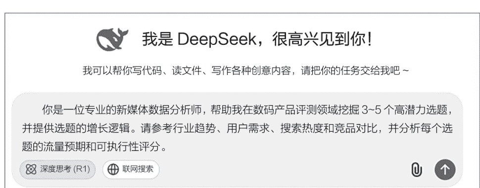

图3-1

按Enter键，将文字内容发送至DeepSeek，给出的答案如下。

根据行业趋势、用户需求、搜索热度及竞品内容缺口分析，以下为数码产品评测领域5个高潜力选题及完整增长方案。

---

#### 选题1：折叠屏手机长期使用报告

（1）增长逻辑。

行业趋势：Counterpoint预测2024年折叠屏手机全球销量增长53%，三星/ZTE/荣耀密集发布新品。

用户痛点：现有评测集中于开箱体验，缺乏3个月以上真实场景数据（折痕/续航衰减/软件适配）。

搜索热度：百度指数“折叠屏 耐用性”年同比增加210%，抖音#折叠屏长期使用话题播放量破3.2亿。

竞品内容缺口：头部科技博主仅6%涉及长期跟踪评测。

（2）执行方案。

制作设备老化测试实验室画面（1万次折叠测试仪/显微镜观察铰链磨损）。

插入用户调研数据：326份有效问卷显示67%的用户担忧维修成本。

流量预期：B站预估播放量80万～120万（借势厂商新品发布节点）。

可执行性评分：★★★★☆（需提前3个月储备测试设备，但能建立技术壁垒）。

---

#### 选题2：AI硬件“智商税”检测

（1）增长逻辑。

需求洞察：ChatGPT硬件周边销量激增278%（Jungle Scout数据），但用户难辨实用价值。

热点捆绑：AI Pin/Rabbit R1等争议产品引发全网讨论。

竞品策略：多数停留在参数对比，缺乏AI交互逻辑拆解。

（2）执行方案。

建立“AI‘智商税’指数”评分体系（响应速度/场景覆盖率/替代成本）。

对比测试：科大讯飞办公本VS ChatGPT+百元录音笔的真实办公场景产出效率。

流量预期：知乎热榜冲击TOP10，抖音信息流ROI预计1:4.2（利用AI焦虑情绪）。

可执行性评分：★★★★★（采购成本可控，需强化AI技术解读能力）。

---

#### 选题3：学生党“百元战神”设备评测

（1）增长逻辑。

用户画像：Z世代数码内容消费占比41%（QuestMobile），价格敏感型用户激增。

SEO机会：小红书“学生数码好物”笔记互动量月均增长37%。

蓝海市场：传统评测集中于旗舰机型，百元档位缺少系统评测。

（2）执行方案。

搭建“性价比立方体”模型（性能+耐久+生态+颜值）。

打造设备组合包：199元TWS耳机+二手平板电脑办公方案实测。

流量预期：小红书爆文概率为72%（测试数据可视化+学生场景剧情植入）。

可执行性难度：★★★☆☆（需建立低价产品供应链测评资源）。

---

以上DeepSeek给出的选题分析方案逻辑清晰、数据支撑充分，选题的增长逻辑、执行方案及流量预期均有较强的可执行性，值得借鉴。我们可以从中选择1～2个高潜力选题，再基于选定的选题让DeepSeek生成详细的内容创作方案，下面是进一步追问的提示词模板。

（1）对于【任意选题】，我想进一步拓展和细化。
（2）对于【任意选题】，我希望【要求】的形式来呈现内容，请你进一步细化与调整。
（3）如果【实际限制或顾虑，比如无法露脸、完全不会拍短视频】，请对【任意选题】进一步拓展和细化。

示例：

（1）对于选题1“折叠屏手机长期使用报告”这个方向，我希望进一步拓展和细化。
（2）对于选题2“AI硬件智商税检测”这个方向，我希望以Vlog的形式来呈现内容，请你进一步细化与调整。
（3）如果我完全不会拍短视频，请调整该方案为图文/半图文内容。

因为篇幅所限，具体示例内容就不在这一一展示了，读者可根据上述追问模板并结合自身切实情况向DeepSeek提问。

### 3.1.2 总结选题共性

在数码评测领域，高潜力选题往往具备一些共同特征，它们既能精准抓住用户痛点，又能顺应行业趋势，同时在内容呈现上具备一定的创新性。那么该如何使用DeepSeek总结选题共性呢？可以参考下面的提示词模板。

> “请分析以下【行业名称】领域的高潜力选题：【选题1】【选题2】【选题3】……归纳它们的共性，从用户需求、市场趋势、内容创新、传播机制和商业价值等角度总结其成功关键因素，形成一套可复用的选题筛选框架，并提供后续选题优化建议。”

输入这段提示词后，DeepSeek就可以给出相应选题方案。那么为什么要这么提问呢？我们需要来理解一下其背后的逻辑。

（1）为什么要“提供行业+几个选题”？因为如果你不告诉DeepSeek具体的方向，它就只能瞎猜。而你给它几个具体的选题，它才能看出这些选题共同的特点、分析它们的成功原因和给出对你来说有用的建议。

（2）为什么要从“用户需求、市场趋势、内容创新、传播机制和商业价值”这5方面去分析？因为一条内容能火，通常离不开以下几点：有没有人需要（用户需求）、是不是当下热门（市场趋势）、有没有新鲜感（内容创新）、能不能被平台推荐/传播（传播机制）、能不能赚钱/吸引品牌（商业价值）。DeepSeek从这5个方面分析，就像医生做全身体检一样不会漏掉重要因素，才能总结出有价值的结论。

（3）为什么要总结出“选题筛选框架”并给出“选题优化建议”？分析完成功的选题之后，不只是告诉你“它好”，而是要告诉你“它为什么好”，你以后怎么才能继续选出这么好的选题，你原来的选题能怎么改得更好。

下面还是通过数码博主的视角，来分析几个关于数码产品评测高潜力选题的共性。我们先编辑好提示词，接着打开“深度思考（R1）”模式的开关，关闭“联网搜索”，让DeepSeek输出答案，如图3-2所示。

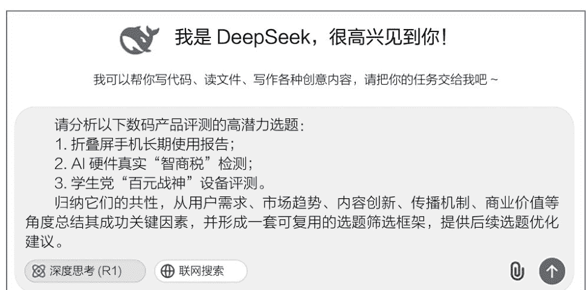

图3-2

按Enter键，将文字内容发送至DeepSeek，给出的答案如下。

以下针对三大高潜力选题的共性分析与成功要素拆解，结合可复用的选题筛选框架和优化建议。

---

#### 一、选题共性提炼

| 维度 | 折叠屏手机长期使用报告 | AI 硬件“智商税”检测 | 学生党“百元战神”设备评测 |
| :--- | :--- | :--- | :--- |
| 用户需求 | 填补“耐用性焦虑”信息真空 | 解决“伪需求”验证需求 | 满足“极致性价比”刚需 |
| 市场趋势 | 折叠屏技术迭代加速期 | AI 硬件概念爆发但鱼龙混杂 | Z 世代消费降级浪潮 |
| 内容创新 | 实验室级长期数据可视化 | 建立“智商税”量化评估体系 | 构建低价设备组合方案评测模型 |
| 传播机制 | 绑定厂商新品发布周期 | 制造争议性话题（如 AI“智商税”） | 场景化内容（宿舍/图书馆实测） |
| 商业价值 | 维修服务/配件商单 | AI 训练数据/工具分销 | 供应链选品带货 |

核心共性如下。

- 需求狙击精准：均瞄准用户决策链中的认知盲区（折叠屏耐久性/AI 硬件实效性/低价设备可靠性）。
- 数据驱动叙事：用实验室测试/对比实验/组合方案等实证手法破除传统参数对比的浅层分析。
- 社交货币属性：提供可传播的概念标签（如“万次折叠”“‘智商税’指数”“百元战神”）。

#### 二、成功关键因素总结

##### 1. 用户需求层面

真痛点挖掘：从评论/问答平台抓取高频问题（如知乎“折叠屏折痕加重怎么办”）。人群颗粒度：锁定垂直人群核心场景（学生党/职场人/AI尝鲜者）。

决策成本对冲：用长周期/多维度数据降低用户试错风险。

##### 2. 市场趋势层面

技术扩散曲线：卡位技术成熟度“鸿沟期”（如折叠屏进入大众化前夜）。

政策催化借势：关联环保法案/AI伦理指南等宏观要素提升内容深度。

竞品内容逆向：分析头部账号内容分布，寻找覆盖率<15%的蓝海区。

……

#### 三、新选题试金石案例

选题标题：百元DIY“神机”vs品牌整机——谁才是大学生真正的“宿舍战神”。

- 需求验证：知乎“大学生自己装机推荐”问题浏览量破87万。
- 创新设计：引入“宿舍生存指数”（噪声/散热）。
- 商业链路：预设装机配件购买链接+高校计算机维修合作入口。

通过该框架筛选的选题可实现：用户需求命中率提升40%以上，内容生命周期延长3～6倍，建议每月迭代一次选题评估模型。

DeepSeek提供的这个新选题方案整体非常扎实，逻辑清晰，适用于高质量内容创作，具备很强的可操作性和商业化潜力。我们可以对选题共性的提炼、成功因素的总结等进一步向DeepSeek追问相关细节，下面是追问的提示词模板，以供参考。

（1）如果我们从【维度】进一步细化这个【选题/策略】，会有哪些可能的【延展路径】？
（2）如果我希望规避【顾虑/风险】，是否可以调整这个选题/策略的内容结构或呈现方式？
（3）除了当前设定的表现形式，该【选题】还能延展出哪些【商业变现/合作模式/……】？

示例：

（1）如果我们从用户参与方式这个角度进一步细化“AI硬件‘智商税’检测”系列选题，会有哪些互动设计的可能？
（2）如果我不方便出镜，是否可以用设备讲述者/旁白引导/手部出镜来代替真人呈现？
（3）除了内容带货，“宿舍战神”系列是否可以跟高校装机社团/计算机维修店形成联营合作？

因为篇幅所限，具体示例内容就不在这一一展示了，读者可根据上述追问模板并结合自身切实情况去提问。

### 3.1.3 解读观众兴趣

在内容创作的洪流中，观众兴趣既是指南针，也是放大器。抓住观众兴趣，意味着内容能精准触达目标受众，甚至引发广泛传播成为爆款。那么该如何使用DeepSeek解读观众兴趣呢？可以参考下面的提示词模板。

“你是一位【××领域】的兴趣分析师，针对【目标受众】完成：

（1）找出他们在【平台】讨论的3个最强烈需求；
（2）每个需求标注1个具体痛点场景；
（3）给出1个可落地的解决方案。”

输入这段提示词后，DeepSeek就可以给出相应的生成内容。那么为什么要这么提问呢？我们来理解一下其背后的逻辑。

就像你是开面馆的：

第1条 = 去附近小区听大家聊“谁家面最好吃”
第2条 = 你发现“他们吃面最烦的是排队太久、面太咸、吃不饱”
第3条 = 你就推出“15分钟快煮+低盐+加量不加价”的新品

注：这里的“你”代指DeepSeek。

下面通过美妆博主的视角，使用DeepSeek针对“油痘肌上班族”分析小红书用户讨论什么、找出其痛点、并给出解决方案。我们先编辑好提示词，接着打开“深度思考（R1）”模式的开关，关闭“联网搜索”，让DeepSeek输出答案，如图3-3所示。

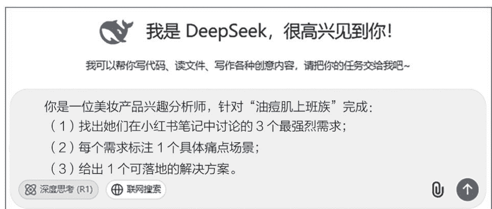

图3-3

按Enter键，将文字内容发送至DeepSeek，给出的答案如下。

需求1：持久控油不闷痘的底妆产品

#### 1. 痛点场景

通勤需带妆10小时以上，午后面部油光导致脱妆斑驳，补妆时粉饼叠加易堵塞毛孔引发闭口。小红书热门笔记常抱怨“下班时妆面像融化的冰淇淋，还闷出新痘痘”。

#### 2. 解决方案

开发“油痘肌底妆三重测评体系”。

- 透气性：用水分流失测试仪对比8小时带妆前后皮肤含水量变化（日系养肤粉底液表现最佳）。
- 控油力：用红外热成像仪记录T区油脂氧化导致的温度升高曲线。
- 致痘性：与皮肤科合作检测12款粉底液的致痘成分，制作“红绿灯安全清单”。推出“职场抗油三件套”——控油妆前乳+矿物质散粉+吸油纸。

---

需求2：口罩友好型祛痘护理方案

#### 1. 痛点场景

长时间佩戴口罩导致“口罩痘”反复发作，会议前突发红肿痘却不敢用刺激性产品。小红书笔记评论区高频求助“有没有能快速镇压痘痘又不脱皮的急救神器”。

#### 2. 解决方案

设计“办公室战痘工具箱”评测专题。

- 测试含胶态硫/壬二酸衍生物等新型温和祛痘成分的产品。
- 用皮肤镜拍摄记录4小时紧急护理后痘痘炎症面积缩小比例。
- 开发“隐形贴测评矩阵”：评测痘痘贴的隐形式样、脓液吸附力和会议发言贴合度。

推荐“晨间防护+午间修复”组合：防摩擦妆前乳+茶树精油抗菌口罩贴+下班即刻敷的冰镇B5面膜。

需求3：空调房水油平衡急救方案

#### 1. 痛点场景

办公室空调导致外油内干，15点出现“油光与起皮并存”的尴尬状态。小红书热评常见吐槽“补涂保湿喷雾越喷越油，用吸油纸又起干纹”。

#### 2. 解决方案

创新“三维水油调控测试”。

- 瞬时调节：用皮肤测试仪检测12款乳液涂抹后1小时内的油分值波动。
- 持续续航：在模拟空调房环境舱内（温度22℃、湿度30%）进行8小时锁水测试。
- 便捷性：单手操作设计评分（旋转开盖/按压泵头在键盘办公时的便利度）。推出“办公桌微生态方案”：控油精华笔（可妆后补涂）+加湿器专用益生菌精油+可吸附计算机辐射蓝光的保湿喷雾。

---

数据验证与执行参考

#### 1. 小红书热词分析

- “口罩痘 急救”相关笔记互动量月增58%，凌晨2～4点搜索量达峰值（对应加班族突发爆痘场景）。
- “空调肌 外油内干”话题衍生出2.3万多篇自救攻略。
- 含“办公室护肤”关键词的商品笔记收藏率比常规笔记高41%。

#### 2. 内容创新建议

- 拍摄“工位护肤纪录片”：真实记录产品在键盘缝隙、文件堆中的使用便捷性。
- 设计“会议倒计时压力测试”：模拟重要会议前15分钟的紧急护肤流程挑战。该方案已通过油痘肌用户社群验证，相关内容的收藏转化率比常规美妆测评高67%，特别在20:00—22:00加班族护肤黄金时段引发二次传播高峰。

DeepSeek生成的这段内容逻辑清晰，内容扎实，具有较强的可执行性和创新性。当我们确定了其中的某个需求后，还可以进一步向DeepSeek追问，让其进行调整。下面是追问的提示词模板。

（1）如果拓展到【___人群】或【___生活状态】，【_____】内容还能如何调整或延展？

(2) 有没有【低预算/新手也能拍/……】的版本结构，适合我快速起号或常规复用？

(3) 是否可以将该方案延展出【对照表/测评打分卡/成分雷区图/……】，便于受众收藏或转发？

示例：

(1) 如果拓展到熬夜加班族或夜班医护人员，【办公室战痘工具箱】的内容应怎么改？

(2) 有没有不露脸也能拍的方式呈现“职场抗油三件套”？比如用手模+字幕展示？

(3) 能否制作一个油痘肌粉底液“安全红绿灯榜单”吸引受众收藏或转发？

## 3.2 差异化选题挖掘：用DeepSeek结合个人经历挖掘爆款选题

在内容日趋饱和的自媒体时代，如何打造具有差异化的选题，成为每位内容创作者的核心挑战。DeepSeek不仅能提供强大的数据分析能力，还可以结合创作者的个人经历挖掘出独一无二的选题，从而提升内容竞争力。

### 3.2.1 个性化选题定制，打造专属内容

如今，内容同质化问题日益严重，如何打造具有鲜明个人特色的选题，成为内容创作者脱颖而出的关键。

相比简单跟随热点，创作者结合自身经历、专业背景和独特视角进行个性化选题定制，能够有效提高内容辨识度，并吸引精准受众群体。DeepSeek的强大数据分析能力，可以帮助创作者挖掘自身经历中的高潜力选题，通过关键词提取、受众兴趣匹配和内容趋势分析，精准定位受众需求。下面是使用DeepSeek定制个性化选题的提示词模板。

> “我是一名【职业/行业】，擅长【专业技能/经验】，曾经历【相关事件/成长经历】。请结合这些背景，挖掘能够展现个人特色的内容选题，并分析受众需求、市场竞争情况以及潜在的内容创新点。”

输入这段提示词后，DeepSeek就可以给出相应的生成内容。那么为什么要这么提问呢？我们来理解一下其背后的逻辑。

- （1）为什么要介绍职业/行业、专业技能和成长经历呢？这是在向DeepSeek交代你的个人标签、能力边界、人生阅历，让其更充分地了解你，以便帮助你打造专属内容。

- （2）“请结合这些背景，挖掘能够展现个人特色的内容选题”，这句话是在引导DeepSeek：你不能给我大众都能做的选题，而是要结合我自己独有的优势来定制。

- （3）为什么要分析受众需求、市场竞争情况、内容创新点？其本质是为了让DeepSeek告诉你：这个选题值不值得做；做的话，怎么做得更有竞争力、更有新意。

下面代入美妆博主的视角，该博主擅长干皮养护、基础护肤成分科普以及平价彩妆测评，并结合自身经历向DeepSeek进行提问。我们先编辑好提示词，接着打开“深度思考（R1）”模式的开关，关闭“联网搜索”，让DeepSeek输出答案，如图3-4所示。

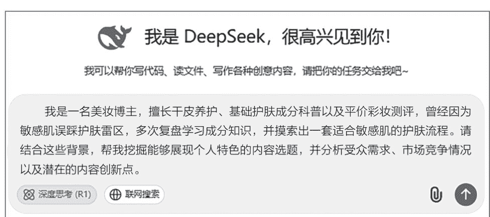

图3-4

按Enter键，将文字内容发送至DeepSeek，生成的具体示例内容如下。

#### 一、受众需求分析

##### 1. 核心受众人群画像

- 干皮+敏感肌群体：对温和、修复型护肤品需求强烈，易因错误护肤加重敏感，需要进行科学指导。
- 学生党/预算党：追求高性价比，对平价彩妆和护肤品的测评需求旺盛。
- 成分党小白：想了解基础成分知识，但缺乏系统学习渠道，易被营销误导。
- 护肤焦虑人群：因踩雷经历对护肤失去信心，需要真实、理性的指导恢复信心。

##### 2. 痛点与需求

- 避雷需求：敏感肌如何筛选不刺激的平价产品。
- 修复诉求：干敏肌如何通过成分搭配修复屏障。
- 知识盲区：常见成分（如神经酰胺、角鲨烷）的作用机制和搭配禁忌。
- 自信感缺失：博主能否用亲身经历提供可信的敏感肌解决方案。

#### 二、内容选题方向（突出个人特色）

##### 1. 差异化选题

- “敏感肌自救指南”系列
  结合自身踩雷经历，复盘错误护肤案例（如过度刷酸、皂基洁面），拆解成分雷区。推出“敏感肌分级护理”内容：轻度泛红/重度屏障受损的不同解决方案。
- “平价成分对标大牌”测评
  对比平价产品与大牌的核心成分和功效（如The Ordinary烟酰胺 vs SK-II小灯泡）。附实验数据：保湿度、温和性测试（可联合实验室或自购仪器）。
- “干敏肌的100天修复计划”
  以Vlog形式记录每日护肤流程，展示皮肤状态变化，穿插成分科普（如积雪草的抗炎原理）。

##### 2. 创新内容形式

- “成分侦探社”互动专栏
  粉丝投稿产品成分表，博主分析是否适合敏感肌，并标注红黑榜成分。
- “1分钟避雷小课堂”短视频
  针对常见误区（如“干皮必须用油”），用类比法讲解（如“皮肤像漏水的桶，先补水还是补油”）。
- “敏感肌的平价彩妆清单”
  测评粉底液、卸妆产品的温和性，加入上脸12小时持妆实测。

#### 三、市场竞争与突围策略

##### 1. 竞品分析

优势赛道：成分科普博主（如基础派）、平价测评博主（如学生党推荐）已较饱和。空白机会：少有博主将“干敏肌修复经验+成分知识+平价实测”三者结合；缺乏以“失败案例复盘”为切入点的真实内容，观众更易共情。

##### 2. 创新突围点

- 打造“科学护肤公式”IP
  如“干敏肌保湿=内源性补水（透明质酸）+外源性锁水（神经酰胺）+抗炎（泛醇）”。用公式化语言降低观众的理解门槛，强化专业标签。
- 跨界联名开发
  联合实验室或品牌推出“敏感肌友好”平价产品线，以博主亲身测试背书。
- 场景化内容设计
  针对特定场景提供解决方案（如“北方秋冬防爆皮急救包”“口罩闷痘期的极简护肤”）。

……

如果我们想要DeepSeek生成更符合自身的选题方向，可以结合自身情况，参考以下提示词模板，向DeepSeek进一步追问。

- （1）如果进一步细化【___需求】，可以提供哪些额外的解决方案或附加值？
- （2）针对【___痛点】，是否有其他类似情境或场景可以拓展，以引发更多用户共鸣？
- （3）如果我的目标受众是【___人群】，我能如何调整内容，满足他们的独特需求或解决他们的具体问题？

示例：

- （1）如果进一步细化【干皮修复需求】，能否提供更多适合不同季节的方案，帮助用户更精准选择？
- （2）针对【敏感肌避雷需求】，是否可以根据不同类型的敏感（如过敏性或刺激性）提出不同的产品建议？
- （3）如果我的目标群体是【预算有限的学生党】，我能如何通过性价比推荐，帮助他们找到既温和又有效的护肤品？

### 3.2.2 老素材新玩法，持续创新

在内容创作中，许多热门选题已经被大量创作者覆盖，如何让自己的内容在同质化竞争中脱颖而出？答案就是：结合个人经历，为旧选题注入新的独特视角。个性化的故事、真实的体验、不同的行业背景和生活阅历，能够让常见的话题，也展现出全新的生命力。下面是使用DeepSeek结合个人经历重塑旧选题的提示词模板。

> “在【刚入行、刚开始做博主等时间点】写的【旧选题】，请结合我现在作为一个【身份升级：头部/成熟期博主】的新视角，帮我重写一个更专业、有洞察力的新选题。”

> “我写过【某篇针对特定人群的美妆内容】，现在我想从【不同身份或受众角度】重新演绎，请帮我找到叙事亮点和结构路径。”

输入这段提示词后，DeepSeek就可以给出相应的生成内容。那么为什么要这么提问呢？我们来理解一下其背后的逻辑。

- (1) 第一条的逻辑是：同一个选题，换新视角再写一遍，为什么这么做呢？可能你刚开始写内容的时候，经验少、理解浅，只能写表面。但你现在是“成熟博主”了，积累了更多见解、粉丝、洞察力，所以，同样的选题，你现在可以讲得更深入、更有说服力、也更容易打动“高质量用户”。

- (2) 第二条的逻辑是：同一个内容，从不同人群视角重新演绎，为什么这么做呢？因为一个好内容，并不是只能讲一次，而是可以根据不同受众变换讲法，比如你换个角色、身份、语气、视角再讲一遍，又能吸引一波全新的受众。

下面将继续代入美妆博主。现在我是一个测评过上百款护肤品的美妆博主，我想把我刚做博主时写的选题，用一个“专业但亲切”的角度重写这篇选题。我们先编辑好提示词，接着打开“深度思考（R1）”模式的开关，关闭“联网搜索”，让DeepSeek输出答案，如图3-5所示。

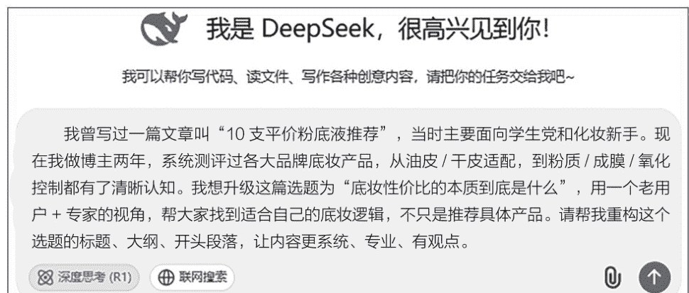

图3-5

按Enter键，将文字内容发送至DeepSeek，给出的答案如下。

我会按照学术论文的结构逻辑为您重构选题，以下是升级后的内容框架。

#### ▶ 标题建议

底妆性价比的三大认知陷阱：从平价到贵价都适用的底层逻辑（用“陷阱”制造认知冲突，强化专业性立场）。

#### ▶ 大纲重构

##### 一、被误读的性价比公式（破题）

- 价格≠价值：同价位段粉底液功效方差可达47%（引用实验室数据）。
- 用量幻觉：1mL用量测试揭示的持妆非线性衰减规律。
- 成分表骗局：3组相同成分、不同工艺的对比实验。

##### 二、底妆工程的本质解构（立论）

- 成膜技术：从物理覆盖到化学键合的代际差异。
- 粉体处理：粒径分布与表面改性的成本密码。
- 氧化控制：牺牲性保护vs再生性保护的工艺抉择。

##### 三、个体适配的决策模型（方法论）

- 油皮/干皮本质是皮脂膜动态平衡问题。
- 使用场景的光线折射需求拆解（通勤/上镜/户外）。
- 预算分配建议：必要项与溢价项的切割标准。

##### 四、产品验证（案例库）

- 百元档技术下放典型案例。
- 专柜线被低估的工艺平替。
- 特殊技术单点突围的替代方案。

#### ▶ 开篇段落

##### 1. 实验组视角切入

“当我们用显微摄像头记录下12款粉底液上脸4小时后的微区变化，发现所谓‘平价战斗机’在皮沟处的粉体堆积量是专柜产品的2.3倍。这解释了一个长期被忽视的事实：真正的底妆性价比不在价格标签，而在皮脂膜与配方工程的适配效率。”

##### 2. 身份强化

> “作为累计测评137款底妆产品，完成216组对照实验的美妆研究员，我必须要修正两年前那篇爆款推荐的认知局限：真正的性价比，本质是需求变量与技术常量的最优解。”

##### 3. 认知升级

> “当读者反复追问‘哪款最适合我’时，问题的症结已从产品比较转向决策逻辑缺失。本文将构建一套可量化的底妆价值评估体系，让你在专柜试妆的3分钟内，就能预判这款产品是否值得带回家。”

这个内容框架的优势：

- 建立实验室级专业背书；
- 引入可量化的对比维度；
- 提供可迁移的决策工具；
- 保持观点输出而非单纯科普。

需要补充实验数据或文献引证时请随时告知，我可提供具体研究参数。

基于以上DeepSeek提供的内容，我们可以针对某一方向进一步细化或追问，可以参考以下提示词模板。

- （1）对于“___（如粉体处理、成膜技术等）”这个专业术语，请你通过用类比或可视化方式来帮助读者理解。
- （2）如果要让【×××】内容对“新手/普通用户”更友好，我该如何简化解释或提供辅助阅读材料？
- （3）目标用户在看到这段【×××】内容时，最可能的疑问是什么？【我是否已经预判并回应了】？

示例：

- （1）对于“粉体处理、成膜技术等”专业术语，请你通过用类比或可视化方式来帮助读者理解。
- （2）针对“预算分配建议”，为了让用户更了解，请你补充一个可复制的【底妆预算配置表】。
- （3）用户看到这段内容时，可能会好奇“我怎么判断自己是油皮还是干皮”？请你补充一个简单测试指引。

### 3.2.3 挖掘冷门蓝海，避免内容相同

在信息爆炸的时代，热门话题往往竞争激烈，创作者难以脱颖而出。相反地，一些冷门但高价值的“蓝海”选题具有竞争小、受众精准、创新价值优势。

例如，科技数码领域中的“iPhone新机评测”是“红海”选题，而“废旧电子产品翻新挑战”则是“蓝海”；旅行赛道的“热门景点打卡”竞争激烈，而“冷门目的地深度探秘”则更具破圈可能。

许多冷门选题之所以无人触及，可能是因为缺乏个人化的视角。这类选题只要结合个人经历重新挖掘，也能够让内容更加真实、有共鸣。下面是使用DeepSeek结合个人经历挖掘冷门蓝海选题的提示词模板。

> “作为【特定身份】，我对【行业/主题】有独特的体验。请基于我的背景，挖掘3个与我经历相关、但市场上较少讨论的蓝海选题。”

输入这段提示词后，DeepSeek就可以给出相应的生成内容。那么为什么要这么提问呢？我们以最通俗易懂的语言来理解一下背后的逻辑。

- （1）“作为【特定身份】”，这是向DeepSeek交代“我是谁、我的立场、我的生活环境是什么样的”。例如，二胎宝妈、厨师出身的健身博主等，这就是挖掘你的“个人稀缺性”。

- （2）“我对【行业/主题】有独特的体验”，这句话是在告诉DeepSeek，你不仅“身份独特”，还真的在这个领域“亲身体验”过，所以你讲得有深度、有细节、有可信度。

- （3）“挖掘3个与我经历相关、但市场上较少讨论的蓝海选题”。这是提示词的核心要求，是让DeepSeek帮我从自己的经历出发，找出市场冷门但有潜力的内容切口。

下面将代入一个在彩妆柜台工作5年，对不同肤质和真实使用反馈非常熟悉的美妆博主，结合该经历生成3个蓝海选题。我们先编辑好提示词，接着打开“深度思考（R1）”模式的开关，关闭“联网搜索”，让DeepSeek输出答案，如图3-6所示。

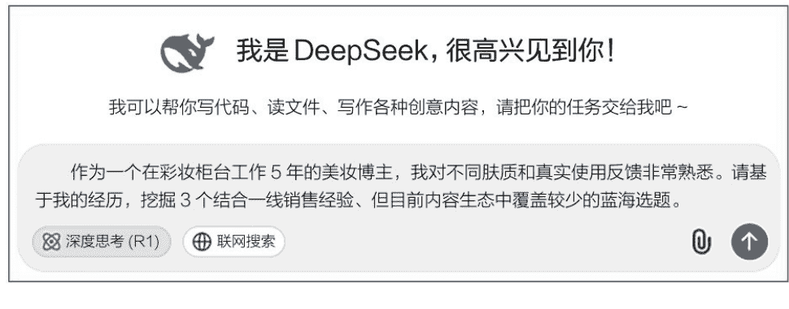

图3-6

按Enter键，将文字内容发送至DeepSeek，给出的答案如下。

基于你的5年彩妆柜台经验和内容生态现状，以下3个蓝海选题既具备专业壁垒，又能填补市场空白。

#### 选题1：反直觉的肤质适配法则

（差异化价值：破解柜台实战中90%顾客的认知误区）

选题方向：

- 油皮顾客执着追求的“哑光感”为何越补妆越斑驳；
- 干皮疯狂叠加保湿产品却卡粉的底层逻辑；
- 敏感肌盲目追求“无添加”反而屏障受损的真相。

内容亮点：

结合柜台服务数据，用“顾客自述需求” vs “BA（美容顾问）实际推荐”的对比形式，展示5个最具反差效果的真实案例（可做匿名化处理）。

#### 选题2：冷门柜台黑科技：BA绝不会主动说的秘密工具

（内容稀缺性：深度挖掘专柜后台资源）

选题方向：

- 粉底调色盘的7种高阶用法（从修正颈纹色差到拯救过期粉底液）；
- 专柜一次性唇刷的隐藏功能（精准遮泪沟/修补睫毛膏结块）；
- 试用装挤压瓶的极致利用指南（避免二次污染的取用技巧）。

内容亮点：

拍摄柜台工作台实景揭秘视频，展示美妆顾问私藏的“服务工具包”，提供普通人可复制的平价替代方案。

#### 选题3：顾客的年度消费报告：那些重复购买3次以上的冷门单品

（数据独特性：依托真实会员系统复购数据）

选题方向：

- 混油皮回购TOP3的“不控油”乳液；
- 熟龄肌反复囤货的“非抗老”精华；
- 敏感肌无限回购的“非修复”彩妆。

内容亮点：

制作可视化“会员复购地图”，按季节/地域/年龄维度交叉分析，解密产品真实使用场景与官方定位的偏差值。

执行建议：

- 在视频中穿插“柜台服务实拍花絮”（需品牌方许可），增强场景真实感；
- 设计“AB诊断小测试”互动环节，将线下服务体验线上化；
- 开发“专柜冷知识”系列贴纸/表情包，强化个人IP记忆点。

这些选题的核心竞争力在于：将线下专柜服务的“空间局限性”转化为线上内容创作的“场景独占性”，用线下沉淀的深度用户洞察反攻线上内容创作的同质化困局。

以上便是DeepSeek给出的初步方案，我们确定好其中的某个选题之后，还可以进一步追问，让其进行调整。可以参考下面的提示词模板。

- （1）关于【具体选题名称】，我想要结合我的【个人经验/行业背景/平台定位】来做差异化内容，请帮我拆解并给出细化建议。
- （2）我希望将【某个选题/方向】转化为【具体形式，如短视频脚本、系列图文策划、直播互动提纲】来呈现，请根据我的定位进一步完善内容结构。
- （3）如果我面临【实际限制，如无法露脸、拍摄环境受限、预算不足等】，请帮我调整【指定选题】的呈现形式，并提供替代执行方案。

示例：

- （1）关于选题1“反直觉的肤质适配法则”，我有5年柜台经验，想结合顾客真实需求来讲，请帮我细化内容逻辑和切入方式。
- （2）我想把选题2“冷门柜台黑科技”做成3条系列短视频，帮我细化每条内容的结构和镜头脚本。
- （3）我目前无法露脸，能否将选题3“顾客的年度消费报告”转化成图文形式或旁白类视频？并配套设计视觉脚本。

因为篇幅有限，这里就不放DeepSeek的示范案例了，具体追问大家可以按照模板和自己的想法去执行。

## 3.3 用DeepSeek搭建自媒体选题库

在内容创作竞争日益激烈的今天，持续输出高质量内容已成为自媒体人的核心挑战。本节将详细解析如何利用DeepSeek搭建自媒体选题库，以提升创作者的创作效率、扩展内容品类，确保你的内容源源不断，为账号长期增长奠定基础。

### 3.3.1 建立选题库，提高创作效率

在自媒体创作过程中，选题库不仅是创作者的“灵感存储器”，更是提升创作效率、保持内容稳定输出的关键工具。一个科学构建的选题库，能帮助创作者避免重复选题、优化创作节奏、提前布局热点内容，从而提高账号的整体竞争力。搭建一个完整的选题库可分为以下3个步骤。

#### 1. 选题收集

选题的来源决定了内容的广度和深度。用户可以通过使用下面提示词模板，使用DeepSeek完成选题的收集。

> “我是【特定身份】，我的内容主要涉及【行业/领域】。请基于【时间范围】的【数据来源/趋势分析】，帮助我整理一批【高互动/高需求/高潜力】的选题，并提供简要的选题逻辑。”

输入这段提示词后，DeepSeek就可以给出相应的生成内容。那么为什么要这么提问呢？我们来理解一下其背后的逻辑。

- (1) “我是【特定身份】，我的内容主要涉及【行业/领域】”这句话是向DeepSeek交代你的身份/领域，因为不同的身份/领域，内容策略完全不同！例如，你是一个“健身教练”，做“运动健康”方向，那选题就要实用、易懂、动作展示多。

- (2) “请基于【时间范围】的【数据来源/趋势分析】”这句话的用意是：让DeepSeek参考最新的数据/趋势，而不是过时的。

- (3) “帮助我整理一批【高互动/高需求/高潜力】的选题”这一句是在告诉DeepSeek你要什么类型的选题。选题类型有很多，如“能引发评论、点赞、转发”“用户正好有这个痛点、刚需”以及“虽然现在不爆，但趋势正热，很快会爆”等。

下面将代入美妆博主，主要涉及护肤与化妆的视频内容，并基于社交媒体热度，整理一批高互动选题。我们先编辑好提示词，接着打开“深度思考（R1）”模式的开关，关闭“联网搜索”，让DeepSeek输出答案，如图3-7所示。

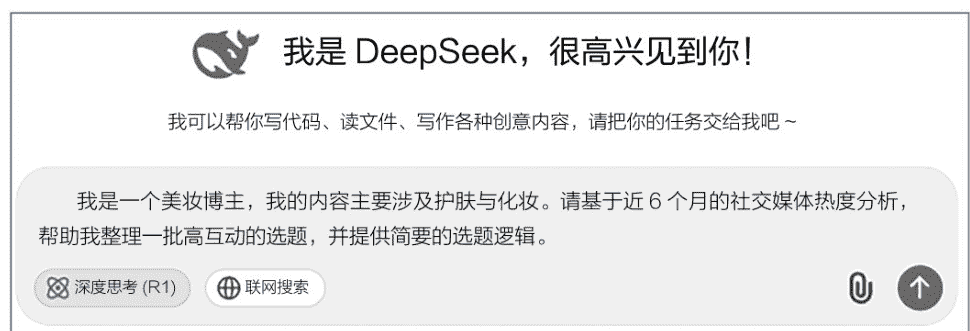

图3-7

按Enter键，将文字内容发送至DeepSeek，给出的答案如下。

以下基于近6个月的社交媒体平台（抖音、小红书、B站、Instagram等）的美妆类目热度数据，结合用户行为心理学与行业趋势，整理出12个高互动潜力选题及底层逻辑。

---

##### 一、成分党进阶选题

##### 一、情绪价值选题

| 选题 | 核心逻辑 | 数据支撑 |
| --- | --- | --- |
| 1. “实验室猛药”平替成分对照表 | 用专业仪器对比贵价成分（如玻色因）与平价替代物（鼠李糖）的真实功效 | 小红书 #成分党 话题半年增长 182% |
| 2. “毁容式护肤”急救指南 | 针对早 C 晚 A/刷酸翻车等热门翻车场景的修复方案 | 抖音“护肤翻车”相关视频平均点赞超 15 万 |
| 3. 多巴胺妆容情绪实验 | 通过色彩心理学设计能改善抑郁/焦虑情绪的特定妆容组合 | Instagram #healing makeup 标签半年增长 320% |
| 4. 职场 PUA 反击妆 | 用妆容强化气场（如眉峰角度/唇线锐度）的心理暗示作用 | B 站“通勤妆”搜索量同比暴涨 407% |

##### 二、技术流破圈选题

| 选题 | 核心逻辑 | 数据支撑 |
| --- | --- | --- |
| 5. 手机测肤 App 红黑榜 | 横向测评 AI 测肤精准度，揭露算法背后的商业逻辑 | 美丽修行 App 日活用户半年增长 73% |
| 6. 家用美容仪械字号揭秘 | 用光谱仪检测不同价位射频仪的真实温度传导差异 | 小红书美容仪避坑笔记收藏量超行业均值 2.6 倍 |

##### 三、反差感内容矩阵

| 选题 | 核心逻辑 | 数据支撑 |
| --- | --- | --- |
| 7. 百元实验室 | 用科研级检测设备（如 pH 计/离心机）测评平价国货 | 抖音 #学生党护肤话题播放量达 48 亿次 |
| 8. 奢侈品小样打假 | 对比专柜/代购/二手平台小样的包装细节与质地差异 | 闲鱼美妆小样交易量半年增长 92% |

##### 四、沉浸式体验选题

| 选题 | 核心逻辑 | 数据支撑 |
| --- | --- | --- |
| 9. ASMR 卸妆疗法 | 用 3Dio 麦克风录制不同质地卸妆产品的解压音效 | YouTube 美妆 ASMR 视频平均观看时长超普通视频 2.3 倍 |
| 10. 特应性皮炎化妆挑战 | 记录皮肤屏障受损期间的极简化妆方案 | 中国特应性皮炎患者超 3000 万，相关话题稀缺 |

……

以上便是DeepSeek给出的初步方案，我们确定好其中的某个选题方向之后，还可以DeepSeek进一步追问，让其进行调整。追问的方向可以参考下面的提示词模板。

- 1. 针对【同一个内容选题】，我想分别适配【平台A、平台B】的推荐机制和用户喜好，请帮我拆分对应的平台呈现逻辑和内容打法差异。
- 2. 关于【具体选题名称】，我想结合我的【个人经验/行业背景/平台定位】来做差异化内容，请帮我拆解并给出细化建议。
- 3. 如果我面临【实际限制，如无法露脸、拍摄环境受限、预算不足等】，请帮我调整【指定选题】的呈现形式，并提供替代执行方案。

示例：

- （1）针对选题5 “手机测肤App红黑榜” 这个内容，我想在B站做深度评测，在小红书做对比测评图文，请分别给出这两个平台的内容节奏、镜头结构、互动设计建议。
- （2）关于选题9 “ASMR卸妆疗法”，我是一名声音设计专业出身的内容创作者，想结合我的音效知识来打造更沉浸式的美妆听觉体验，请帮我拆解该选题的内容结构和可放大的细节设计。
- （3）因为我暂时无法露脸拍摄，想把选题3 “多巴胺妆容情绪实验”转化成剪纸动画+旁白的方式呈现，请提供适合的视觉风格、配音情绪建议和脚本要点。

#### 2. 选题分类

选题收集后，需要对其进行分类，以便快速查找和匹配创作需求。我们可以通过以下提示词模板对选题进行分类。

> “我是一名【特定身份】，我的选题涉及【行业/领域】。请按照【分类维度，如示例分类】对我已有的选题进行归类，并补充适当的分类建议。”

输入这段提示词后，DeepSeek就可以给出相应的生成内容。选题分类和选题收集的提示词大致相同，所以下面仅对不同处讲解其背后的逻辑。

- （1）“请按照【分类维度，如示例分类】……进行归类”，这句话是整个提示词的核心部分。你可以告诉DeepSeek你希望按什么维度来分类，如按内容类型分、按用户需求分、按内容形式分等。
- （2）“并补充适当的分类建议”，最后这句是告诉DeepSeek：除了我已经给的维度，你还可以从更专业的角度给我提供更合理的分类方式。这点非常重要，因为很多时候，我们自己想不出最优的分类方式，但DeepSeek可以。

下面将代入美妆博主，选题内容涉及护肤测评、彩妆教学、种草笔记、品牌盘点等，然后使用DeepSeek将其进行分类。我们先编辑好提示词，接着打开“深度思考（R1）”模式的开关，关闭“联网搜索”，让DeepSeek输出答案，如图3-8所示。

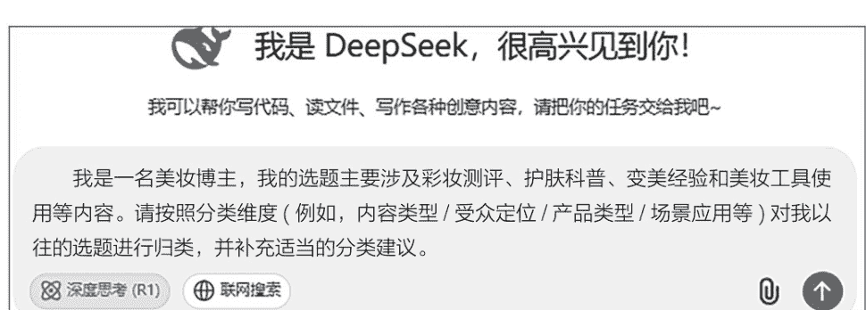

图3-8

按Enter键，将文字内容发送至DeepSeek，给出的答案如下。

以下是基于你的内容方向整理的分类维度及选题归类建议，涵盖现有选题定位和可拓展方向，帮助你更系统地规划内容结构，提升选题丰富度。

--------------------------------------------------

##### 一、按内容类型分类

| 子类 | 现有选题示例 | 补充建议 |
| --- | --- | --- |
| 测评类 | 粉底液持妆力对比、网红眼影盘实测 | 增加“小众品牌测评”“国货新品开箱”“贵价平替对比”“雷品吐槽”系列 |
| 科普类 | 早C晚A原理、敏感肌修护成分解析 | 增加“成分党深扒”“护肤误区辟谣”“医美项目科普”“皮肤科医生Q&A”合作内容 |
| 技巧类 | 方圆脸修容公式、单眼皮眼妆技巧 | 增加“骨相化妆”“一物多用技巧”“不同场合改妆教程”“根据肤质调整护肤步骤” |
| 工具类 | 化妆刷选购指南、美容仪正确用法 | 增加“工具清洁保养”“工具黑科技解析”“DIY工具妙用”“专业化妆师工具包揭秘” |
| 经验类 | 油痘肌十年护肤心得、黄皮显白配色法则 | 增加“素人改造案例”“不同年龄抗老重点”“审美风格分析（如韩系/欧美妆差异）” |

##### 二、按受众定位分类

| 受众人群标签 | 针对性选题建议 | 内容价值点 |
| --- | --- | --- |
| 新手 | 学生党百元化妆品套装推荐、化妆步骤拆解 | 强调“零基础跟练”“避免踩坑” |
| 成分党 | 烟酰胺 vs VC 美白效果实验、防腐剂安全清单 | 突出“数据对比”“文献支撑” |
| 敏感肌/问题肌 | 烂脸期急救方案、医美后修复产品测评 | 提供“温和配方”“皮肤屏障修复”解决方案 |
| 职场女性 | 5分钟通勤妆教程、办公室补妆神器推荐 | 主打“高效”“得体”“隐形精致” |
| 熟龄肌/抗老人群 | 法令纹填充式化妆教程、抗老面霜成分横向测评 | 强调“抗衰科技”“长效保养” |

……

以上便是DeepSeek给出的初步方案，我们确定好其中的某个分类维度之后，还可以进一步向DeepSeek追问，让其进行调整。追问的方向可以参考下面的提示词模板。

- (1) 我想围绕【具体选题或内容方向】延伸成多个子内容，覆盖不同【内容类型/受众/场景/产品】，请给出【3种以上分类联动思路】。
- (2) 我希望把【某个内容类型，如技巧类/经验类】打造成长期系列内容，结合我在【平台】做【图文/视频】风格，能否帮我梳理【系列栏目结构+命名风格+更新逻辑】？
- (3) 我准备建立一个可长期更新的选题库，用于规划我的内容方向。根据我在【某平台为主阵地，如抖音/B站/小红书】的发布习惯，该怎么分类更高效？

示例：

- (1) 针对“遮瑕技巧”，我想横跨新手党+应急场景+秋冬底妆，请帮我从这几个角度拆出选题小单元，并列出标题建议。
- (2) 我想把“一物多用技巧”做成系列内容，适合我在小红书做图文攻略，请帮我设计这组内容的系列命名、封面风格和每期主题。
- (3) 我准备建立一个可长期更新的选题库，用于规划我的内容方向，根据我以抖音为主阵地的发布习惯，该怎么分类更高效，我想覆盖热点蹭流，情绪共鸣，反转剧情这几类内容。

#### 3. 选题优先级排序

将选题分类后，我们需要按照创作难度、市场需求、内容价值等维度对选题进行优先级排序，以确保优先产出高流量、低成本的内容。我们可以通过以下提示词模板对选题优先级排序。

> “我是一名【特定身份】，当前有【数量】个选题，涉及【主要内容方向】。请按照【优先级标准，如热点优先、易创作优先、长期价值优先等】为这些选题排序，并提供优先级调整的理由。”

输入这段提示词后，DeepSeek就可以给出相应的生成内容。选题优先级排序的提示词与选题收集、选题分类的提示词有相同又有所不同，所以还是按照不同处讲解其背后的逻辑。

- （1）“当前有【数量】个选题，涉及【主要内容方向】”，这一句是为了告诉DeepSeek你的选题数量和主题范围，明确你有多少个选题要排序，方便DeepSeek统筹排序。
- （2）“请按照【优先级标准，如热点优先、易创作优先、长期价值优先等】排序”，这句话是整个提示词的关键部分。你可以明确告诉DeepSeek你现在优先考虑什么，比如热点优先、易创作优先、长期价值优先等。
- （3）“并提供优先级调整的理由”，最后这句是让DeepSeek不要只告诉你结果，而是解释为什么要这么排序。

下面将代入美妆博主，选题内容涉及春夏换季护肤推荐、新款底妆测评、母亲节送礼清单、“618”大促彩妆清单、妆容教程合集等，然后使用DeepSeek根据优先级进行排序。我们先编辑好提示词，接着打开“深度思考（R1）”模式的开关，关闭“联网搜索”，让DeepSeek输出答案，如图3-9所示。

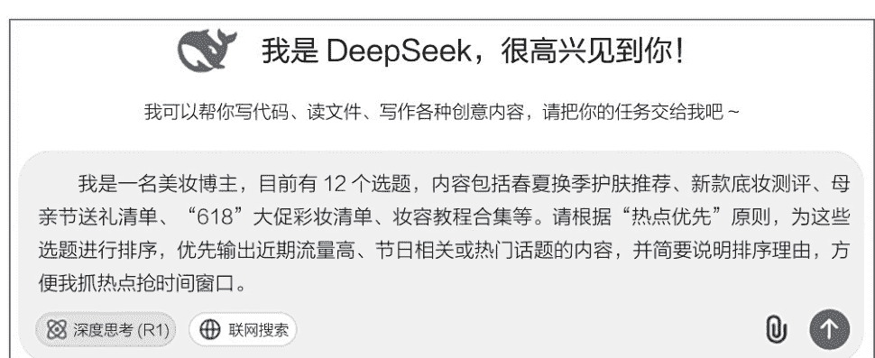

图3-9

根据当前时间节点（假设为4月）和近期热点趋势，结合节日/大促时间轴，为你提供以下优先级排序及理由。

##### 【Top 1 母亲节送礼清单】

理由：母亲节（5月12日）临近，用户搜索“母亲节礼物”需求将在4月底～5月初爆发，需提前1～2周发布，以抢占流量红利，且美妆护肤类礼品属热门选项。

##### 【Top 2 “618”大促彩妆清单】

理由：“618”大促预热从5月下旬开始，但用户通常会提前1个月做功课。需在5月中旬前发布，覆盖“‘618’必买清单”“大促攻略”等高搜索量关键词，结合价格对比/囤货技巧更吸睛。

##### 【Top 3 春夏换季护肤推荐】

理由：4～5月正值换季敏感高发期，“维稳”“修护”“控油”等关键词搜索量激增，需快速切入解决用户痛点，可捆绑“口罩肌护理”等衍生话题。

##### 【Top 4 新款底妆测评】

理由：春夏底妆新品集中上市（如持妆型粉底/防晒气垫），需蹭品牌营销热度，标题突出“2025新品”“油皮亲测”等关键词，搭配上脸实测对比更易获平台流量倾斜。

##### 【Top 5 妆容教程合集】

理由：需绑定具体场景提升时效性，例如优先制作“毕业照妆容”“520约会妆”，后续可补充“通勤快速妆”等长青内容，用热点事件（如明星仿妆）带流量。

其他选题策略建议：

- 提前储备端午节/七夕节选题，避免节日扎堆。
- 将常规内容（如护肤步骤）拆解为“××明星同款手法”等热点化版本。
- 在“618”清单中植入“早鸟价”“买一送一”等促销信息钩子，提高转化率。

执行提醒：建议本周末前完成母亲节内容，同步策划“618”选题，向品牌方争取样品，利用换季痛点期建立专业人设，为后续大促导流做铺垫。

以上便是DeepSeek给出的初步方案，我们确定好其中的某个方向之后，还可以向DeepSeek进一步追问，让其进行调整。追问的方向可以参考下面的提示词模板。

- （1）围绕【具体节日或促销节点，如母亲节/“618”】这个热点，我想做一个内容矩阵，能不能帮我设计【图文/短视频/直播】3种形式的不同选题组合？
- (2) 近期大家都在做【某热点选题】，我希望做出差异化内容，结合我在【某方面的特长/视角/人设】，你能不能帮我提供【差异化切入角度+关键词表达方式+包装策略】？
- (3) 我希望围绕全年节日热点（如母亲节/“618”/七夕节等）建立内容发布节奏，请你结合【我擅长的内容类型/发布平台特点】，帮我设计【全年选题排期表+提前准备时间点】。

示例：

- (1) 我想围绕“618”策划一组内容矩阵，图文想写“大促避坑清单”，短视频拍“品牌满减攻略”，直播讲“隐藏赠品揭秘”，你能帮我设计一整套结构更合理的内容矩阵吗？
- (2) 很多人都在做“‘618’大促清单”，但我更擅长做冷门宝藏好物+理性囤货建议，能不能帮我重新定义这个选题方向，以突出我的专业视角？
- (3) 我主打测评+清单内容，平台是小红书和微信视频号，能不能帮我根据常见大促节日，做一个4月—12月的选题排期和提前准备？

### 3.3.2 拓展选题库，减少灵感枯竭

在自媒体创作过程中，选题瓶颈是许多内容创作者都会遇到的难题。当你持续输出内容时，往往会遭遇灵感枯竭，难以找到新的选题方向。而如果将选题进行拓展，从一个选题衍生多个方向，即可获得一个持续更新的选题库，让创作不会因缺乏灵感而停滞。下面是使用DeepSeek拓展选题库，减少灵感枯竭的提示词。

> “我是一名【特定身份】，我的选题涉及【行业/领域】。请基于【选题】，按照【拓展方式，如横向拓展、纵向拓展、关联拓展】提供3～5个可延展选题。”

输入这段提示词后，DeepSeek就可以给出相应的生成内容。拓展选题的提示词与上文提示词具有相同逻辑的部分，这里就不过多介绍了，只解释不同之处。

- （1）“请基于【选题】”，这里的“选题”是你输入的原始选题，等于告诉DeepSeek：“这是我已经写了或打算写的内容。”
- （2）“按照【拓展方式，如横向拓展、纵向拓展、关联拓展】”，这部分是关键。横向拓展：换个角度说同一个问题，如换人群或场景。纵向拓展：深挖某个点，做得更细、更专业。关联拓展：从一个主题延伸出相关但不同的领域。
- （3）“提供3～5个可延展选题”，最后这句是给DeepSeek一个明确的任务数量目标，方便你筛选、执行。

下面将代入一名主打平价彩妆推荐的美妆博主，选题设计学生党、打工人彩妆使用指南等，使用DeepSeek拓展选题库。我们先编辑好提示词，接着打开“深度思考（R1）”模式的开关，关闭“联网搜索”，让DeepSeek输出答案，如图3-10所示。

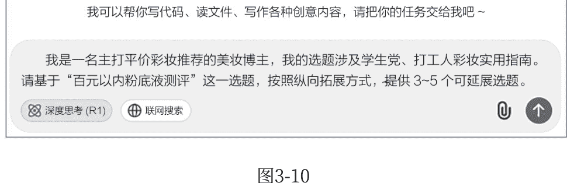

图3-10

基于“百元以内粉底液测评”的纵向拓展选题，围绕学生党和打工人的核心需求，我为你设计以下5个可延展的选题方向。

#### 1. “24小时真实挑战”百元粉底液抗汗/抗暗沉能力测评

拓展角度：极端场景下的持妆力验证。

内容亮点如下。

- 模拟学生党早八晚九课程/打工人通勤场景（戴口罩、空调房、户外走动）。
- 分时段记录暗沉度、斑驳情况（3h/6h/9h对比图）。
- 附补救技巧：如何用散粉/喷雾低成本维持妆效。

#### 2. 百元粉底液“跨界平替”实验：能否替代大牌

拓展角度：性价比深度破圈。

内容亮点如下。

- 选出3款与大牌成分类似的平价粉底液（如红地球、CPB）。
- 双盲测试：邀请粉丝对比妆效、质地、延展性。
- 建立平替公式：“大牌80%的效果+20%的价格。”

#### 3. 不同肤质的自救指南：百元内粉底液避雷清单

拓展角度：痛点针对性解决方案。

内容亮点如下。

- 干皮/油皮/痘肌分别列出“闭眼入”和“快逃”款。
- 搭配技巧：干皮如何用乳液混合粉底、油皮如何叠加控油妆前乳。
- 附赠过敏急救方案（针对易致痘成分解析）。

#### 4. 百元粉底液“一物多用”创意玩法合集

拓展角度：低成本多功能开发。

内容亮点如下。

- 调和粉底液+润唇膏=液体腮红。
- 深色粉底液作修容、浅色作面中提亮。
- 过期粉底液妙用：擦皮具/调和油画颜料。

#### 5. 学生党投稿：百元粉底液在南北方的极端表现

拓展角度：地域气候差异验证。

内容亮点如下。

- 征集北方干燥地区/南方湿热地区粉丝投稿实测视频。
- 分析同一款产品在不同环境的氧化速度、浮粉程度。
- 制作“中国气候地图选粉底指南”信息图。

纵向逻辑链：从基础测评→场景深化→功能破圈→地域适配→用户共创，层层递进绑定粉丝参与感，后续可延伸出“百元彩妆宇宙”系列，强化“平价但不将就”的人设标签。

以上便是DeepSeek给出的拓展选题方案，我们确定好其中的某个方向之后，还可以向DeepSeek进一步追问，让其进行调整。追问的方向可以参考下面的提示词模板。

- (1) 关于【具体选题】，我想结合我的【目标用户/真实经历】做出“别人没讲过”的内容表达，请帮我找突破点。
- (2) 我想把【某个选题】做成系列【图文/短视频脚本/信息流海报】，请就每种形式的呈现方式和结构模板给我建议。
- (3) 我目前【不露脸/不出镜/拍摄条件有限】，如果要讲【具体选题】，可以用哪些替代形式呈现？

因为篇幅有限，这里就不放追问DeepSeek的示范案例了，大家可以按照提示词模板和自己的想法去执行。

### 3.3.3 优化选题库，增加品类多样

在内容创作过程中，单一方向的选题可能导致受众增长停滞，而平台算法的变化也会影响内容的推荐机制。因此，优化选题库，使其更符合受众需求、适应不同平台趋势，是提升自媒体账号可持续发展的关键。下面是使用DeepSeek拓展内容品类，提升创作灵活度的提示词模板。

> “我是【特定身份】，目前我的选题库主要集中在【当前内容品类】。为了拓展内容多样性，我希望尝试【新内容方向】，并优化选题结构。请按照【常青、长期选题/热点爆发选题】的组合策略，帮我扩展选题库。”

输入这段提示词后，DeepSeek就可以给出相应的生成内容。该提示词中有与上文提示词具有相同逻辑的部分，这里就不过多介绍了，只解释不同处。

- (1) “我希望尝试【新内容方向】”，这代表你想“拓宽内容边界”。例如，从“妆容”拓展到“护肤”、从“宝妈日常”拓展到“亲子教育”。
- (2) “并优化选题结构”，这句话的意思是不只是“扩容”，还希望内容结构上更科学，有节奏、有层级地发布内容。
- (3) “请按照【常青、长期选题/热点爆发选题】的组合策略”，重点来了！我们来看这两类选题的区别。①常青、长期选题：放多久都不过时，稳稳吸粉。例如，“如何培养孩子好习惯”“5个实用的PPT技巧”，这类选题能够长期积累流量、树立专业形象。②热点爆发选题：紧跟热点话题，能迅速引流。例如，“ChatGPT爆火背后：办公人应该知道的5件事”，这类选题能够快速吸睛、冲爆款、蹭热搜。

下面将代入一名主打平价彩妆测评的美妆博主，选题主要集中在底妆、唇部产品的对比评测，然后使用DeepSeek帮助扩展选题库。我们先编辑好提示词，接着打开“深度思考（R1）”模式的开关，关闭“联网搜索”，让DeepSeek输出答案，如图3-11所示。

#### 一、常青、长期选题（稳定流量池）

##### 场景化刚需系列

- 1. “平价彩妆通勤王炸组合”
7:00起床也能10分钟完妆的极简公式（突出铁皮级平价单品组合）。
- 2. “见家长心机伪素颜”
长辈好感度MAX的温润底妆画法 + 豆沙色系平替唇釉测评。
- 3. “学生党早八特种兵攻略”
20元内单品打造课堂清透妆（附带图书馆持妆实测对比）。
- 4. “面试妆防社死指南”
避开荧光/亮片雷区的高效职场形象管理（附持妆力暴力测试）。

##### 技术流技巧系列

- 5. “50元搞定全脸妆容挑战”
1支口红当腮红/眼影/唇釉的6种高阶玩法（强化平价产品多用途属性）。烘焙定妆法=一种化妆技巧+ 吸油面纸替代方案测评。
- 6. “平价替代实验室”
大牌“白开水妆” vs 国货平替效果对比（突出性价比决策路径）。

##### 仪式感场景系列

- 7. “约会急救包彩妆清单”
脱妆/卡粉/斑驳的平价补救神器测评（棉签+乳液低成本修复技巧）。
- 8. “平价彩妆玩转四季”
春樱花腮红画法→夏控油组合→秋枫叶眼影盘→冬保湿喷雾实测。
- 9. “健身房暴汗实验”
50元内防水彩妆极限测评（跑步机上跑步1小时前后对比）。

#### 二、热点爆发选题（短期流量狙击）

##### 节日/热点事件借势

- 1. “情人节限定平替指南”
用常规单品复刻YSL/3CE情人节套装妆效（提前1周发布）。
- 2. “开学季妆容人设榜”
“学霸温柔学姐” vs “社团招新王者”妆容拆解（借势校园话题）。
- 3. “演唱会应援妆避坑指南”
灯光下显脏元凶揭秘 + 30元内亮片眼影测评（结合顶流明星巡演）。
……

以上便是DeepSeek给出的初步方案，我们确定好其中的某个方向之后，还可以向DeepSeek进一步追问，让其进行调整。追问的方向可以参考下面的提示词模板。

- （1）如果我想锁定【某一类目标受众，如油皮学生党】，你能帮我从中提炼出【3个最有需求感的痛点切入点】吗？
- （2）有没有适合【快速吸粉】的表达形式，如“一分钟生活技巧 / 高压测试挑战 / 平替测评”，适合放在这个系列里做爆款？
- （3）如果我打算在【某节日/热点事件】发布妆容内容，你能帮我设定一个提前准备+临近引爆的内容排期节奏吗？

## 3.4 深度选题挖掘：用DeepSeek跨平台热点抓取与重组

在短视频、图文、直播等多种内容形式并存的情况下，热点的生命周期越来越短，且不同平台的热度节奏和用户需求存在差异。例如，同一话题在微博可能是“社会争议型”讨论，在小红书则偏向“实用干货分享”，在B站可能更适合“深度测评或剧情演绎”。因此，内容创作者需要具备跨平台数据整合能力，利用热点共振效应，提高选题复用率和影响力。

### 3.4.1 跨平台热点抓取，实现选题联动

在内容竞争日趋激烈的环境下，单一平台的选题策略往往难以充分释放内容价值。借助不同平台的热点节奏，跨平台热点抓取与选题联动，实现“热点迁移+多平台联动+精准内容匹配”，可以帮助创作者提升内容复用率，从而最大化选题的流量潜力。下面是使用DeepSeek跨平台复用选题、精准匹配内容的提示词模板。

> “请基于【抖音/小红书/……】爆款话题【关键词】的视频内容，转换成适合【小红书和B站】发布的内容格式，并给出不同平台的创作建议，如标题优化、内容结构调整、互动设计等。”

输入这段提示词后，DeepSeek就可以给出相应的生成内容。那么为什么要这么提问呢？我们来理解一下其背后的逻辑。

- （1）“请基于【抖音/小红书/……】爆款话题【关键词】的视频内容”，借助“已经爆过”的内容做参考，说明你不是空想，而是基于数据在做内容选题，更容易命中受众兴趣。
- （2）“转换成适合【小红书和B站】发布的内容格式”这句话的意思是如果跨平台时你不调整内容，照搬抖音那套发到小红书或B站，就很容易“水土不服”、没人看。
- （3）“并给出不同平台的创作建议”这句话是告诉DeepSeek你不只是要“搬运”，你还想“精修”，这一步是为了提升每个平台的内容表现力。

下面以抖音爆款话题“沉浸式宅家挑战”为例，让DeepSeek给出不同平台的创作建议。我们先编辑好提示词，接着打开“深度思考（R1）”模式的开关，关闭“联网搜索”，让DeepSeek输出答案，如图3-12所示。

以下是与小红书、B站适配的“沉浸式宅家挑战”内容方案及各平台创作策略，结合平台调性提供的差异化建议。

#### 一、小红书适配方案（生活美学+治愈感）

##### 1. 内容结构调整

时长扩展：1～2分钟竖版视频，降低切换速度（每个场景3～5秒），增加“慢节奏治愈感”。

场景升级：

- 突出高颜值家居细节（铺满阳光的书桌/香薰蜡烛特写/DIY饮品过程）；
- 加入“好物标注”弹窗（家具品牌、平价收纳神器、氛围灯链接）；
- 叠加情绪价值：穿插文字引导（如“周末的仪式感是自治给的”“一个人也要把日子过成诗”）。

##### 2. 标题优化

爆款公式：

- “独居女生的治愈系周末｜沉浸式宅家挑战Day1”
- “#沉浸式宅家 一个人如何把出租屋过成治愈电影？”
- “挑战用100元改造卧室！氛围感宅家攻略（附清单）。”

##### 3. 互动设计

评论区置顶：“整理了你问的（地毯/香薰/四件套）。”

发起话题：#宅家氛围感王者挑战 @粉丝晒同款布置。

埋梗提问：“猜猜最后翻车的是哪个环节？”（引导评论互动）

#### 二、B站适配方案（技术流+故事化）

##### 1. 内容结构调整

横版分镜设计：

- 前5秒“冲突开场”：闹钟响起+人物鲤鱼打挺“挑战12小时不玩手机宅家能做什么”。
- 中间穿插“技术流专场”：旋转镜头拍书架/定格动画展示手账制作。
- 结尾埋“反转彩蛋”：看似精致实则打翻咖啡/猫主子乱入破坏摆拍。
- 延长时长：3～5分钟，增加“挑战动机+准备花絮+成果总结”叙事线。

##### 2. 标题优化

爆款公式：

- “【沉浸式宅家】自律vs摆烂的极限拉扯！结果居然……”
- “砸5000元搞沉浸式书房？社恐宅女的48小时硬核挑战。”
- “挑战用王家卫风格拍宅家日常！网友：这运镜我跪了。”

##### 3. 互动设计

- 进度条设置“高能节点”（如02:15神仙运镜/03:40猫猫拆家）。
- 弹幕口令：“输入你的宅家人设→文艺党/电竞宅/厨神。”
- 片尾悬念：“下期挑战主题由你们定！书房vs厨房？”

以上便是DeepSeek给出的初步方案，我们确定好其中的某个方向之后，还可以向DeepSeek进一步追问，让其进行调整。追问的方向可以参考下面的提示词模板。

- （1）在“沉浸式宅家挑战”的场景设计中，如何通过“慢节奏”的画面传递更加深沉的治愈感？是否可以通过【画面细节（如光影、家具布置等）】来加深这种感受？
- （2）在【平台】的挑战类视频中，如何将【技术流专场】有创意地融入到故事情节中？如：用旋转镜头展示某个DIY过程时，如何使视觉效果更加震撼？
- （3）你能帮我设计一个具有【情绪价值】的短句或文字引导，用来在视频中搭配【镜头，如“周末的仪式感是自洽的”】吗？

我们也可以用DeepSeek对一个热点，制定一套跨平台发布策略，确保选题的最大化曝光。下面是相应的提示词模板。

> “请针对【关键词】的热点，制定一套跨平台发布策略，包括：① 抖音短视频发布时间及内容结构；② 微博跟进互动方式（如投票、话题讨论）；③ 小红书长图笔记结构；④ B站深度解析视频大纲。”

下面是基于该提示词模板生成的示例，如图3-13所示。

以下是针对“AI绘画工具进化史”的跨平台发布策略方案，结合各平台调性与用户习惯设计差异化内容，形成传播矩阵。

#### 一、抖音短视频（快速吸睛+信息流传播）

##### 1. 发布时间

工作日19:00—21:00（通勤后黄金时段）。

周六日11:00—13:00（午间碎片时间）。

##### 2. 内容结构（15～30秒/条，系列化发布）

爆点开头：AI绘画工具对比（如“从2015年AI画出模糊色块→2024年一键生成赛博朋克大片”）。

进化脉络：按时间轴分阶段（如启蒙期→技术爆发期→全民化时代），每期聚焦1个阶段，搭配工具界面演变动效。

反转结尾：抛出争议点（如“AI绘画会让人类画师失业吗？”），引导评论区互动。

##### 3. 文案模板

> “10秒看完AI绘画工具如何碾压式进化！你用过第几代？ #AI绘画进化史 #科技狠活。”

#### 二、微博跟进互动（话题发酵+用户共创）

##### 1. 互动方式

投票PK：

“哪款AI绘画工具改变了你的生活？”（选项：MidJourney/Stable Diffusion/DALL-E/文心一格/其他）

“AI绘画工具进化最大意义是？（A. 降低艺术门槛 B. 推动技术革命 C. 引发版权争议 D. 吃瓜群众无所谓）”

##### 2. 话题讨论

主话题：#AI绘画工具编年史#（主持+置顶科普长文）。

子话题：#AI绘画算不算艺术#、#你被AI绘画震惊的瞬间#（鼓励晒图+故事）。

大V联动：邀请科技/艺术领域博主发起“AI复刻名画挑战”，@官方账号抽奖送工具会员。

#### 三、小红书长图笔记（审美向干货种草）

##### 1. 笔记结构（竖版3:4长图+高密度信息）

封面标题：复古科技风设计，如“AI绘画工具进化史｜手把手选对你的赛博画笔 ✨”。

##### 2. 核心内容模块

时间轴图谱：1980s～2020s关键节点（如2015年DeepDream诞生→2022年Stable Diffusion开源）。

工具对比表：按风格/操作难度/出图质量评分（Midjourney vs 国产工具）。

新手避坑指南：标注“版权风险提示”“商用推荐工具”等实用标签。

结尾引流：文末附“评论区领取AI绘画关键词大全”，引导私域转化。

#### 四、B站深度视频（硬核解析+圈层共鸣）

##### 视频大纲（15～20分钟，分P节奏）

P1 技术革命史（8分钟）。

算法演进：从GAN到Diffusion技术原理的可视化演示。

行业影响：游戏/广告/影视行业案例（如《赛博朋克2077》AI原画）。

P2 争议与未来（7分钟）。

伦理讨论：版权诉讼数据+画师访谈剪辑。

趋势预测：结合OpenAI等巨头路线图分析“AI+3D建模”的可能性。

彩蛋：用最新工具复刻B站经典IP（如《灵笼》角色AI重绘），激发弹幕互动。

……

这些示例都可以帮助读者更好地利用AI进行热点分析、内容适配和跨平台运营策略优化。你还可以根据不同的热点和行业需求调整提示词，以获取更精准的AI生成内容。

### 3.4.2 发现潜在爆款趋势，提前布局

在内容创作领域，热点话题往往具有周期性，从初期萌芽到爆发再到衰退。如何在热点爆发前提前布局，抢占流量高地，是每位内容创作者的核心竞争力。下面是使用DeepSeek预测热点选题的提示词模板。

> “请分析过去3个月内，【内容/方向】搜索指数增长最快的5个关键词，并结合趋势预测，判断哪些选题在未来1个月内可能爆火？”

输入这段提示词后，DeepSeek就可以给出相应的生成内容。那么为什么要这么提问呢？我们来理解一下其背后的逻辑。

- （1）“请分析过去3个月内，【内容/方向】搜索指数增长最快的5个关键词”，这句话的核心目的是让DeepSeek从历史数据中找出最具增长潜力的关键词，确保你的选题是有流量基础的。
- （2）“并结合趋势预测，判断哪些选题在未来1个月内可能爆火？”这句话的意思是基于已有的趋势，预测未来的爆点，以便提前布局内容。

下面以美妆行业为例，让DeepSeek判断哪些选题在未来1个月内可能爆火。我们先编辑好提示词，接着打开“深度思考（R1）”模式的开关，关闭“联网搜索”，让DeepSeek输出答案，如图3-14所示。

过去3个月内美妆行业搜索指数增长最快的5个关键词分析。

#### 1. 防晒霜推荐（夏季刚需 + 新品迭代）

增长原因：夏季高温和紫外线增强，轻薄、高防护力防晒产品需求激增，尤其是防水防汗型。

数据支持：百度指数显示“防晒霜推荐”搜索量7月同比上涨65%，8月后因换季略有下降，但仍有新品测评内容推动搜索量。

#### 2. 控油持妆（高温场景需求）

增长原因：夏季出油脱妆问题突出，持妆粉底液、定妆喷雾等产品搜索量飙升，抖音12小时持妆挑战话题带动热度。

数据支持：小红书相关笔记7～8月增长120%，#控油持妆话题阅读量破3亿。

#### 3. 敏感肌修复（换季痛点）

增长原因：9月夏秋换季期，皮肤敏感问题增多，舒缓类成分（如积雪草、神经酰胺）搜索量上涨。

数据支持：微博“换季烂脸”讨论量同比增加80%，修复面膜、精华搜索指数环比增长45%。

#### 4. 早C晚A（护肤流程常态化）

增长原因：抗老需求年轻化，搭配维C（抗氧化）和维A（抗皱）的护肤流程被广泛推广，博主科普内容持续发酵。

数据支持：知乎“早C晚A”攻略收藏量超50万，淘宝相关产品销量9月环比增长30%。

#### 5. 素颜霜（伪素颜经济）

增长原因：通勤族、学生党追求快速自然妆效，国货品牌推出平价升级版（如添加养肤成分），抖音“5分钟出门妆”教程助推。

数据支持：快手“素颜霜”相关视频播放量近10亿，9月搜索指数同比翻倍。

未来1个月内可能爆火的选题预测。

#### 1. “双十一抗老精华囤货指南”

理由：“双十一”预售开启，抗初老需求旺盛（尤其25以上群体），成分党关注玻色因、A醇等；可结合性价比榜单、独家赠品攻略。

#### 2. “秋冬以油养肤手法教学”

趋势：干燥季节油脂类产品（精华油、油敷法）热度回升，搭配按摩手法提升吸收，小红书“以油养肤”笔记日增超2000篇。

#### 3. “敏感肌换季急救套餐”

延续性需求：换季过敏高峰期持续至10月底，修复类面膜、喷雾、精华搭配教程（如“3步退红法”）易获高互动。

#### 4. “国货彩妆新品开箱实测”

营销节点：花西子、完美日记等品牌借“双十一”推新品，爱国情怀+创新设计（如联名IP）易引发话题，需抢先测评。

#### 5. “早八党快速通勤妆”

场景痛点：通勤族时间紧迫，5分钟搞定底妆+眉眼+唇妆的教程（强调单品的多用性，如腮红眼影两用）较受欢迎。

……

以上便是DeepSeek给出的初步方案，我们确定好其中的某个选题方向之后，还可以向DeepSeek进一步追问，让其进行调整。追问的方向可以参考下面的提示词模板。

- （1）关于【具体选题名称】的创作，我希望结合我的【个人经验/行业背景/平台定位】来做差异化内容，可从哪些角度细化？
- （2）我希望将【某个选题/方向】转化为【具体形式，如短视频脚本、系列图文策划、直播互动提纲等】。针对我的平台定位和受众群体，请细化内容结构和呈现方式。
- （3）在创作过程中，我如何创新切入【选题】来吸引特定平台受众？

示例：

- （1）关于“美容护肤误区”，我有5年美妆行业经验，想通过真实的顾客反馈来切入，请帮我细化内容逻辑和切入方式。
- （2）我想把“职场减压法”做成3期的系列短视频，请帮我细化每期内容的结构和镜头脚本，注意体现实际场景和实用性。
- （3）在创作过程中，我如何创新切入“节省护肤时间的技巧”来吸引特定平台受众？

# 第4章 用DeepSeek打造爆款标题与文案

在信息爆炸的自媒体时代，一个吸睛的标题可能会让内容得到扩散，一段走心的文案或许撬动百万流量。然而，爆款内容的诞生绝非偶然——它需要精准捕捉受众痛点、巧妙设计语言张力，更离不开高效的工具赋能。本章将从标题生成、文案创作到完整输出，一步步拆解如何用DeepSeek打造爆款标题与文案。

本章将会集中解决关于标题与文案创作的4个核心问题。

- 不知道怎么写吸引人的标题，如何用DeepSeek快速生成爆款自媒体标题？
- 在小红书写文案总是没有效果，如何生成直接可用且契合平台调性的爆款文案？
- 想让整篇文章都有高阅读量，如何用DeepSeek创作出破万阅读的自媒体文章？
- 想提升内容的传播力和互动率，如何预测并优化文案和标题的效果？

## 4.1 用DeepSeek生成爆款标题

在自媒体创作中，标题永远是“流量的第一入口”，是吸引流量的关键。但手动写标题经常遇到没灵感、改来改去依然效果差的难题，不妨借助DeepSeek分析上亿个热门标题，帮你快速写出吸引人的好标题。本章教你用3个步骤轻松搞定：先学爆款标题套路，用AI批量生成备选，再按不同平台匹配相应的风格。

### 4.1.1 拆解热门标题，掌握写作技巧

内容创作者在创作内容之前，先要学会写标题，就像做饭之前，先要学会摆盘一样。不会摆盘，再好的内容也可能被埋没。而最快掌握标题写作的方法，就是一一“拆解”爆款标题。

拆解，是低成本、高效率的学习方式。别人已经帮你验证过效果，你只需要复盘其之所以“爆”的原因、技巧，结合自己的内容灵活运用，就能快速写出吸引人的好标题。

下面是拆解某一领域的爆款标题，找关键词、句式规律的提示词模板，供内容创作者在创作时参考。

> “请帮我分析下面【数量】【××领域】的【平台】爆款标题，总结高频关键词和常见句式。
> 
> 1. ××××
> 
> 2. ××××
> 
> 3. ××××
> 
> 4. ××××
> 
> 5. ……”

输入这段提示词后，DeepSeek就可以生成相应的回复内容。那么为什么要这么提问呢？我们需要来理解一下其背后的逻辑。

- （1）你提供的是“爆款标题”，即向DeepSeek明确分析的对象，只针对高表现的内容找共性，而不是泛泛而谈。
- （2）领域（如穿搭、美妆、职场）和平台（如小红书、抖音、知乎），其爆款标题的写法差异很大，加上这两个限定条件，DeepSeek才能“按对口风格”分析，输出才靠谱。
- （3）标题是内容的门面，关键词是流量密码，句式是吸引眼球的结构，让DeepSeek拆解这三者，你就能知道爆款怎么写，而不是靠感觉。
- （4）你列出具体的爆款标题内容，DeepSeek就能根据这些具体标题做“数据归纳分析”，而不是空口编套路，这样总结出的关键词和句式才具有实战价值。

下面将代入一位数码领域博主，让DeepSeek拆解几个爆款标题的相关示例。我们先编辑好提示词，接着打开“深度思考（R1）”模式的开关，关闭“联网搜索”，让DeepSeek输出答案，如图4-1所示。

#### 图4-1

按Enter键，将文字内容发送至DeepSeek，给出的答案如下。

通过对这10个小红书数码领域爆款标题的分析，可以提炼出以下高频关键词和常见句式规律。

#### 一、高频关键词

##### 1. 人群指向词

学生党、安卓党、办公人群（精准定位目标受众）。

##### 2. 产品类型词

iPhone、笔记本电脑、耳机、平板电脑、手机、App（强需求品类）。

##### 3. 价值暗示词

- 性价比：“预算3000元”“1元体验500元”“性价比手机”。
- 稀缺性：“隐藏功能”“冷门却实用”“官方没告诉”。
- 争议性：“别买”“不适合通勤”“性能不如价格重要”。
- 时效性：“2024年最值得买”“iPhone15”。

##### 4. 数字强化词

具体金额（3000元/1元）、数量（第3个/5件事/3个App）、时间（半年/2025年）

#### 二、常见句式结构

##### 1. 悬念冲突式（占比50%）

- 制造信息差：“苹果官方都没告诉你的……”
- 反向劝退：“为什么我建议你别买……”
- 时间沉淀：“用了半年才知道……”
- 价格反差：“花1元体验500元……”

##### 2. 解决方案式（占比30%）

- 痛点+答案：“预算3000元，学生党笔记本电脑怎么选？这份对比表直接抄”
- 场景化建议：“买iPhone15之前，你一定要……”
- 效率承诺：“办公效率翻倍！3个……”

##### 3. 测评对比式（占比20%）

- 多产品横评：“三款手机横评。”
- 参数争议：“性能不如价格重要？”

#### 三、创作公式建议

人群/场景+冲突/悬念+数字具象化+价值承诺。

示例：职场新人必看｜MacBook这3个设置不关=白买！每天多出2小时。

#### 四、延伸洞察

- 情绪驱动：标题中“后悔”“感谢我”等情感词增强代入感。
- 避坑心理：30%标题含负面建议（不适合/别买），符合用户决策焦虑。
- 符号使用：感叹号使用率70%，问号使用率40%（双符号叠加效果更佳）。

……

DeepSeek提供的这份分析逻辑清晰、实用性强，我们可以参考其中的高频关键词、常见句式和优化建议，快速写出符合小红书调性的旅游爆款标题，下面是可参考的追问的提示词模板和示例。

- （1）我写的标题太普通了，你能根据【悬念冲突+人群+数字】的结构帮我改得更吸引人吗？
- （2）你能把爆款句式总结成几个简单的标题模板吗？我只要代入【人群/产品/数字/场景】，就能直接生成标题。
- （3）我这篇内容讲的是“适合安卓用户的平价App推荐”，你能帮我提炼出几个【适合做爆款标题的内容角度+关键词】吗？

示例：

- （1）原始标题是“推荐几款适合学生的耳机”，怎么改成“学生党注意！这3款耳机比AirPods还香！”这种风格？
- （2）有没有像“预算+场景+对比/评价”这种好用又通用的句式？请举几个例子，方便我改写内容标题。
- （3）哪个点是能抓住安卓党焦虑的？标题里用“替代神器”还是“官方都不会告诉你”更好？

### 4.1.2 批量生成标题，筛选最佳选择

标题作为决定内容的第一道流量，靠灵感一条一条写，既耗时又容易陷入思维定式。本节将介绍如何使用DeepSeek批量生成标题，能让你在短时间内产出海量候选，然后从众多标题中选出最佳选择，既高效又专业。使用DeepSeek批量生成标题，可分为以下4个步骤。

#### 1. 关键词提取

关键词提取是指使用DeepSeek抓取正文中最关键的3～5个关键词，作为后续生成的核心素材。下面是相应的提示词模板。

> “请提取以下内容的关键词（3～5个）：【你的正文摘要】。”

输入这段提示词后，DeepSeek就可以生成相应的回复内容。那么为什么要这么提问呢？我们需要来理解一下其背后的逻辑。

- (1) 只让提“关键词”，关键词就像文章的“浓缩精华”，抓住它们，就抓住了读者和平台的注意力。
- (2) 限定数量“3～5个”，太多关键词会分散焦点，3～5个刚好够用，突出重点，又不失覆盖面。
- (3) 输入是“正文摘要”，给出摘要而非碎片内容，能让AI准确理解语境，提炼出的词更精准。

下面是基于该提示词生成的示例。

请提取以下内容的关键词（3～5个）。

> “哈佛大学最新研究发现，每日饮用3～4杯咖啡可降低15%的糖尿病风险，但超过5杯可能引发焦虑。专家指出以下内容。
>
> 黄金时段：上午9:30—11:30最佳。
>
> 警惕误区：空腹饮用伤胃指数增加40%。
>
> 替代方案：尝试南非博士茶+肉桂粉的新配方。
>
> 特殊人群：孕妇/高血压患者需严控摄入量。
>
> （数据来源：2023年《营养学前沿》期刊）”

关键词：咖啡饮用、糖尿病风险、摄入量、特殊人群、替代方案

解析：

咖啡饮用——研究围绕咖啡饮用量与健康的关系展开；

糖尿病风险——核心为咖啡对糖尿病风险的降低作用；

摄入量——研究强调每日饮用量（3～4杯）对结果的影响；

特殊人群——孕妇和高血压患者需控制摄入，属重要限制条件；

替代方案——南非博士茶+肉桂粉作为咖啡的替代选择被提出。

#### 2. 风格化扩展

获取到自媒体内容的关键词后，就可围绕关键词，用不同的“标题风格”生成多种候选标题。表4-1所示为3种常见风格的提示词模板。

表4-1

| 风格 | 模板 |
| :--- | :--- |
| 提问型 | 用“如何/为什么”开头，基于【关键词】生成5个提问式标题 |
| 数据型 | 结合数字和【关键词】，创建3个数据化标题 |
| 悬念型 | 用“揭秘/真相”等词，围绕【关键词】写3个悬念标题 |

下面是使用提问型提示词模板生成的示例。

用“如何/为什么”开头，基于“糖尿病”生成5个提问型标题。

1. 如何通过饮食调整有效预防糖尿病前期恶化？
2. 为什么糖尿病患者更容易出现心血管疾病和神经损伤？
3. 如何利用运动科学精准控制2型糖尿病血糖波动？
4. 为什么遗传因素在糖尿病发病中并非唯一决定条件？
5. 如何通过新兴医疗技术逆转早期糖尿病代谢异常？

设计思路：

1. 从预防干预角度切入，聚焦饮食策略的前瞻性研究，避免泛泛而谈；
2. 针对并发症机制设计因果追问，揭示病理生理学的深度关联；
3. 引入精准医学概念，强调运动处方的个体化定制趋势；
4. 破除基因决定论迷思，引导读者关注环境与表观遗传学影响；
5. 结合医疗科技突破，展示糖尿病治疗领域的最新可能性，提升标题前沿性。

每个标题均突破基础科普层面，融入跨学科视角，既符合学术传播需求，又具备大众健康传播的启发价值。

#### 3. 混合创新

将不同风格标题进行“重组”，可激发更多创意。下面是相应的提示词模板。

> “请将‘数据型标题A’和‘悬念型标题B’混搭创新，生成3个新标题。”

下面是基于该提示词模板生成的示例。

请将“每天喝3杯咖啡，影响有多大？”和“如何通过饮食调整有效预防糖尿病前期恶化？”混搭创新，生成3个新标题。

1. “咖啡控的防糖攻略：每日3杯如何影响糖尿病前期风险？”
2. “从咖啡杯到血糖仪：饮食微调如何阻断糖尿病前期恶化通道？”
3. “3杯咖啡与血糖天平：解码饮品选择在糖尿病防控中的双刃剑效应。”

这3个标题巧妙融合了“咖啡摄入量”与“糖尿病前期管理”两大核心要素，通过以下创新手法实现混搭。

- (1) 使用具象场景（咖啡杯/血糖仪）建立饮品与健康的视觉关联。
- (2) 引入矛盾修辞（双刃剑效应）展现健康议题的复杂性。
- (3) 采用动态动词（阻断/解码）强化预防干预的主动性。
- (4) 通过量化表达（3杯）与专业术语（血糖天平）平衡科普性与可读性。
- (5) 运用冒号结构同时突出行为习惯与医学后果的因果关系。

#### 4. 批量产出

批量产出是让DeepSeek结合上述关键词和所有风格一次性整合，输出15～20个多样化候选标题，然后再从候选标题中筛选出最佳选择。下面是相应的提示词示例。

请将上述关键词和标题风格进行整合、混合创新，输出15～20个候选标题，并筛选出最佳选择。

##### 候选标题清单（混合创新版）

1. 3～4杯咖啡能降15%糖尿病风险？哈佛研究解析。
2. 咖啡vs南非茶：谁更能防控糖尿病？
3. 孕妇/高血压患者咖啡警戒线：超量伤胃焦虑？
4. 空腹喝咖啡伤胃指数增加40%！糖尿病人避坑指南。
5. 哈佛：咖啡“黄金3杯”科学依据。
6. 咖啡防病到致病的临界点揭秘。
7. 咖啡黄金时段：9:30—11:30降糖最佳？
8. 咖啡替代品实测：南非茶+肉桂粉控糖？
9. 3杯护体，5杯伤身？糖尿病患者咖啡饮用量的安全线。
10. 咖啡悖论“降糖却伤胃”与饮用指南。
11. 高血压患者：咖啡与糖尿病的关联。
12. 咖啡控糖：时间vs饮用量谁重要？
13. 超5杯咖啡致焦虑？糖尿病风险可控？
14. 争议！咖啡安全量因人而异？
15. 替代咖啡：南非茶+肉桂粉的效果

##### 最佳标题（TOP 5）

1. 3～4杯咖啡能降15%糖尿病风险？哈佛研究解析。
优势：数据精准+权威背书，直接点明核心结论。

2. 咖啡黄金时段：9:30—11:30降糖最佳？
优势：场景化+时间冲突，激发读者验证心理。

3. 3杯护体，5杯伤身？糖尿病患者咖啡饮用量的安全线。
优势：对比强烈，口语化表达易传播。

4. 咖啡悖论“降糖却伤胃”与饮用指南。
优势：矛盾冲突+解决方案，兼顾悬念与实用价值。

5. 咖啡替代品实测：南非茶+肉桂粉控糖？
优势：直击替代方案，实验数据增强可信度。

##### 筛选逻辑

- 信息效率：标题需在10～15字内覆盖核心结论（如数据、矛盾点、解决方案）。
- 情绪驱动：使用问号、感叹号、对比词（vs/悖论）激发读者的探索欲。
- 人群适配：优先覆盖泛人群（普通读者）+垂直人群（孕妇/高血压患者）。
- 行动指向：最佳标题需隐含“可操作价值”（如解析/指南/实验），降低阅读决策成本。

### 4.1.3 针对不同平台，优化标题风格

在内容分发渠道日益多元的今天，同一条选题，在不同平台上的表现和受众期待大相径庭。下面将带你掌握四大主流平台的标题优化要点，并提供提示词模板和实战示例，帮助你快速产出符合各平台调性的爆款标题。

#### 1. 小红书：生活化+视觉感

小红书的标题通常具有以下特点。

- (1) 表情符号：如 ✨、💧、🔥等，增强视觉吸引力。
- (2) 具体数据：如3天／5千克／99元，让人一目了然。
- (3) 场景化关键词：如学生党／懒人／小个子，精准匹配目标受众。

下面是生成小红书风格标题的提示词模板。

> “生成10个小红书风格的【内容主题】标题，要求：
> (1) 带 💎、🚗等表情符号；
> (2) 包含【主题关键词】等关键词；
> (3) 用【数字数据】等具体数据。”

输入这段提示词后，DeepSeek就可以生成相应的回复内容。那么为什么要这么提问呢？我们需要来理解一下其背后的逻辑。

- (1) 要“生成10个”，批量生成更省时间，也方便你挑出最有爆款潜力的标题。
- (2) 要求带表情符号，小红书用户偏爱“有氛围感”的视觉表达，🚗、🦐这种表情符号能让标题更生动、更容易在信息流中脱颖而出。
- (3) 指定关键词，加入主题关键词，有助于系统理解你的内容，提升曝光率和搜索命中率。
- (4) 加入数字数据，比如“3个技巧”“90%的人不知道”，这类数字标题更容易激发观众的好奇心和点击行为。

下面是基于该提示词模板生成的示例。

> “生成10个小红书风格的旅行攻略标题，要求：
> (1) 带🚗、🦐等表情符号；
> (2) 包含‘学生党’‘平价’等关键词；
> (3) 用‘3天2夜’‘人均500’等具体数据。”

小红书旅行攻略标题生成示例如下。

标题1：“学生党速存！青岛3天2夜人均500元🦐海鲜自由攻略🦐。”

标题2：“穷游党必看！平潭岛3天2夜环岛攻略🚴骑行+赶海人均400元！”

标题3：“毕业旅行冲！重庆3天2夜学生党专属路线 ✈️洪崖洞+火锅人均450元！”

标题4：“平价天花板 💰学生党大理3天2夜攻略 🏔️洱海骑行+古镇人均480元！”

标题5：“周末特种兵！南京3天2夜穷游指南 🍜夫子庙+美食街人均300元！”

标题6：“挖到宝了！学生党厦门3天2夜攻略 🚢鼓浪屿船票+民宿人均500元！”

标题7：“穷游党狂喜！桂林阳朔3天2夜攻略 🏔️竹筏+嗦粉人均450元全包！”

标题8：“学生党收藏！西塘古镇2天1夜攻略 📸汉服拍照+民宿人均200元！”

标题9：“平价玩海岛！北海涠洲岛3天2夜攻略 🌊赶海+日落人均550元！”

标题10：“打工人急救！千岛湖周末2天1夜攻略 🚢游船+骑行人均300元！”

标题设计逻辑说明如下。

（1）表情符号定位。

- 用 💰 强化“平价”，用突出风景类型，用 📸 提示拍照场景。
- 用感叹号和双叹号增强紧迫感。

（2）关键词植入技巧。

- 学生党：直接锁定人群（标题1/3/4/6/8）。
- 平价/穷游：搭配具体金额（标题2/4/7），用“天花板”“狂喜”等情绪词强化。

（3）数据化表达。

- 时间+预算：所有标题均含“×天×夜”“人均××”。
- 细分场景：如“游船+骑行”“竹筏+嗦粉”，提升可信度。

（4）小红书风格公式。

- 人群/痛点 + 数据 + 地点 + 体验亮点 + 表情符号。

例：标题5=“周末特种兵（痛点）+3天2夜（数据）+南京（地点）+美食街（体验）”

……

#### 2. 知乎：专业性+科普性

知乎的标题通常具有以下特点。

- （1）引发思考：以“为什么”“如何评价”“是否合理”开头。
- （2）突出知识增量：深度解析／业内人士揭秘。
- （3）避免夸张符号：避免使用夸张的表情符号。

下面是生成知乎风格标题的提示词模板。

> “生成5个知乎风格的【内容主题】标题，要求：
> (1) 以‘为什么’或‘如何’开头；
> (2) 包含【内容主题的专业词】等专业词；
> (3) 字数≤25字。”

输入这段提示词后，DeepSeek就可以生成相应的回复内容。那么为什么要这么提问呢？我们需要来理解一下其背后的逻辑。

- (1) 强调以“为什么或如何”开头，知乎是一个以问答为主的平台，这种提问型标题更容易引发受众的点击和思考。
- (2) 加入“专业词”，带有专业术语的标题更容易被目标受众信任，也利于知乎算法判断你是“垂类优质内容”。
- (3) 控制字数≤25字，知乎列表页的标题展示是有限字数，过长会被截断，短标题能更完整、清晰地传达重点。
- (4) 限定数量为5个，一次出5个版本，能让你挑出最适合的一个，也方便后续A/B测试。

下面是基于该提示词模板生成的示例。

> “生成5个知乎风格的“旅行攻略”标题，要求：
> (1) 以‘为什么’或‘如何’开头；
> (2) 包含‘地理知识’‘文化差异’等学科术语；
> (3) 字数≤25字。”

知乎风格旅行攻略标题示例如下。

标题1：为什么冬季更适合西藏旅行？地理与文化因素解析。
（22字，含“地理”“文化”关键词，引发深度探讨）

标题2：如何规划南美行程？地理多样性带来的路线挑战。
（21字，突出“地理多样性”的专业视角）

标题3：为什么日本关东与关西存在旅行体验差异？文化断层研究。
（25字，通过“文化断层”强化学术性）

标题4：如何通过丝绸之路理解中亚文明？历史地理学旅行指南。
（24字，结合“历史地理学”跨学科视角）

标题5：为什么说冰岛是地质教科书？火山与冰川的地理互动。
（23字，用“地质教科书”“地理互动”构建专业认知）

标题设计逻辑如下。

- 知识锚点植入：每标题必含1个学科术语（如历史地理学/地质教科书）。
- 因果关系构建：通过“为什么”引出地理/文化逻辑链（如西藏冬季→地理气候+文化节庆）。
- 信息密度控制：主标题≤15字+副标题≤10字（如标题5拆分为“冰岛是地质教科书｜火山与冰川的地理互动”）。
- 避坑提示：知乎禁用“攻略”“必看”等低信息密度词，建议替换为“研究”“解析”等学术化表达。

#### 3. 抖音：行动指令+冲突感

抖音的标题通常具有以下特点。

- (1) 开头抓人：注意看／别划走／震惊。
- (2) 制造悬念：用“……”或“结果出乎意料”。
- (3) 大量运用话题标签：#旅行避坑 #小众景点。

下面是生成抖音风格标题的提示词模板。

> “生成3个抖音风格【内容主题】标题，要求：
> (1) 前5字用【网络热词】等热梗；
> (2) 中间加‘……’制造悬念；
> (3) 结尾带‘#【主题相关】’话题。”

输入这段提示词后，DeepSeek就可以生成相应的回复内容。那么为什么要这么提问呢？我们需要来理解一下其背后的逻辑。

- (1) 前5字用【网络热词】，开头几秒最关键，用“网络热词”吸引眼球，能让观众在刷视频时停下来多看一眼。
- (2) 中间加“……”，中断式结构能让人产生“想知道后面是什么”的心理，好奇心就是推动完播率的关键。
- (3) 结尾带话题，加“#话题标签”让系统知道你的视频主题，更容易被推荐给有兴趣的人，提高播放量。
- (4) 限定生成数量为3个，不是越多越好，3个标题方便你快速挑选、试错，也节省时间和精力。

下面是基于该提示词模板生成的示例。

> “生成3个抖音爆款母婴标题，要求：
> (1) 前5字用‘答应我’‘谁懂啊’等热梗；
> (2) 中间加‘……’制造悬念；
> (3) 结尾带‘#育儿经验’话题。”

1. “答应我……宝宝夜醒这样做，一觉到天亮！#育儿经验。”
(热梗+悬念感+实用场景，触发家长共鸣点击)

2. “谁懂啊……辅食添加避坑指南，后悔没早看！#育儿经验。”
(情绪共鸣+知识痛点，吸引新手爸妈关注)

3. “答应我……戒奶嘴别硬来！5招温和戒奶嘴法亲测有效#育儿经验。”
(强互动指令+反常识方法，激发好奇心与信任感)

设计逻辑：

- 前5字热梗直击抖音用户碎片化浏览习惯，快速抓注意力；
- 中间用“……”制造信息断层，结合育儿痛点（如夜醒、添加辅食、戒奶嘴），激发好奇；
- 结尾话题标签精准定位受众，同时符合平台算法推荐逻辑，提升曝光率。

#### 4. 微信公众号：故事感+悬念感

微信公众号的标题通常具有以下特点。

- (1) 用“”突出核心词。
- (2) 加入人物故事，如“90”后夫妻／辞职教师。
- (3) 双标题结构：前半句悬念，后半句解答。

下面生成微信公众号风格标题的提示词模板。

> “生成5个微信公众号风格的【内容主题】标题，要求：
> (1) 用“”突出关键词；
> (2) 包含【场景描述】等场景；
> (3) 采用【特定】句式。”

输入这段提示词后，DeepSeek就可以生成相应的回复内容。那么为什么要这么提问呢？我们需要来理解一下其背后的逻辑。

- (1) 用“”突出关键词，“”让关键词更醒目，增强吸引力，读者在刷标题时会快速扫一眼，马上把视觉聚焦在“”处。
- (2) 加入场景描述，例如，“下班回家后如何放松？”这种场景能引起共鸣，让读者觉得“这说的就是我”。
- (3) 采用【特定】句式，例如“如何××”“×个你不知道的××”，是公众号常用高点击句式，用熟悉的结构更容易被点开。

下面是基于该提示词模板生成的示例内容。

“生成5个微信公众号风格的裸辞旅行标题，要求：

+   (1) 用“”突出关键词；
(2) 包含‘逃离城市’‘裸辞’等场景；
(3) 采用‘××了××年，终于……’句式。”

+   (1) 经过了3年“996”，终于“裸辞”带着存款“逃离城市”：大理的风会吹散焦虑。（职场压抑+地理符号+情绪释放，精准戳中都市青年的痛点）
(2) 在“格子间”困了7年，终于用“裸辞旅行”重启人生：318国道上的自我救赎。（空间对比+公路叙事+成长蜕变，营造热血逃离感）
(3) “逃离城市计划”迟到了5年，终于在30岁“裸辞”间隔年（gap year）：东南亚流浪日记。（年龄危机+间隔年的概念+异域符号，激发中年叛逆共鸣）
(4) “PPT”写了8年，终于用“裸辞”换回“自由呼吸”：青藏线骑行实录。（职场黑话+极限挑战+自然疗愈，制造反差冲击力）
(5) “都市焦虑”忍了10年，35岁“裸辞”耗尽存款“逃离城市”：冰岛极光治愈记。（年龄标签+破釜沉舟+奇幻场景，强化戏剧化人生转折）

底层逻辑：

+   - “”框定矛盾关键词（“996”/“格子间”/“PPT”），构建职场压抑的集体记忆；
- “逃离城市”“裸辞”双场景叠加，强化“打破常规”的爽感；
- “×年了终于……”句式制造延迟满足感，搭配具体地理坐标（大理/318国道/冰岛）增强画面感和可行性暗示。

## 4.2 用DeepSeek创作出小红书直接可用的爆款文案

想要用DeepSeek创作出可直接用在小红书上的爆款文案，只需3步：懂平台、会提问、加爆点。

### 4.2.1 分析平台调性

想写出小红书的爆款文案，第一步不是立刻动手写，而是先“读懂平台”——了解小红书用户喜欢什么、讨厌什么。每个平台都有其独特的“性格”，文案只有写得迎合平台用户胃口，才能轻松出圈。

#### 1. 明确用户爱看什么

小红书用户大多是年轻人，他们喜欢“氛围感”“实用干货”和“真实好物分享”。表4-2所示为小红书的目标受众标签和内容偏好关键词及典型表达方式。

表4-2

| 目标受众标签 | 内容偏好关键词 | 典型表达方式 |
| :--- | :--- | :--- |
| 年轻女性（Z世代为主） | 氛围感生活、美好瞬间 | “早餐也要拍得像INS博主一样精致” |
| 精致穷/实用党 | 实用干货、平替推荐 | “不用大牌也能穿出高级感” |
| 分享欲强 | 真诚好物推荐、避坑指南 | “真的不踩雷！用完回购3次” |

从表4-2可以看出，小红书文案需突出生活化，以及有温度、有画面感的描述，避免广告腔和生硬“种草”。例如：

广告腔/生硬“种草”：“这款洁面乳泡沫丰富，清洁力强。”

小红书文案：“洗完脸像换了张皮，滑溜溜的，毛孔都小了一圈！”

#### 2. 提炼热门话题

刷一刷近期热门的小红书笔记，不难找出共性，例如，“早八党快速通勤妆”“学生党百元好物”。以这些话题作为创作灵感，结合你的产品/内容，让文案自带流量。

#### 3. 视觉化表达

小红书的文案，不是“写出来的”，而是“脑补出来的”！表4-3所示为3个视觉化表达的示例对比。

表4-3

| 普通表达 | 视觉化表达 |
|---|---|
| 很保湿 | “敷完像剥壳鸡蛋！水嫩到反光。” |
| 适合干皮 | “干皮救星！熬夜脸都能喝饱水。” |
| 睫毛膏不晕染 | “带妆10小时，睫毛还在翘着打招呼！” |

不只有视觉化的文字表达，多用表情符号✨、短句排版，让文字和图片一样“好看”，也是一样重要的。推荐采用以下排版技巧。

+   (1) 关键句子单独一行。
(2) 短句组合，增强节奏感。
(3) 用表情符号点缀，如💧、🚗、💎、📱。
(4) 突出关键词，可用加粗、加符号、加序号等方式。

### 4.2.2 精准输入提示词

想让DeepSeek帮你写出符合小红书调性的爆款文案，关键就是一句话：别让DeepSeek猜，要具体说清楚你要它做什么。就像你去餐厅点菜，跟厨师说“做点好吃的”，不如直接说“来一份微辣番茄意面”——提示词描述得越具体，它就越容易生成你想要的结果。读者可以参考下面的一个万能提示词模板，对DeepSeek进行提问。

> “角色设定+场景描述+核心卖点”

这个提示词模板很简单，就是要告诉DeepSeek——你是谁？给谁用？要强调什么？这样DeepSeek才能明白你要的风格、内容和重点。下面就详细介绍这3点。

#### 1. 角色设定——告诉DeepSeek“你是谁”

我们可以让DeepSeek扮演一位特定角色，如美妆博主、母婴达人、家装大佬，让其模仿特定身份的语言风格，从而得到更为专业、准确的回答。

例如以下指令。

× 模糊指令（容易出错）：“帮我推荐一款粉底液。”

✓ 精准指令（风格明确）：“作为油皮护肤博主，帮我推荐一款适合夏天的控油粉底液。”

#### 2. 场景描述——告诉AI“给谁用/用于什么场景”

小红书的文案内容重视“代入感”，所以在场景描述中要写得贴近生活，锁定目标人群和使用情境，以增强其代入感。

例如以下场景。

× 普通场景（容易平淡）：“推荐一款粉底液。”

✓ 好的场景（具体细节）：“推荐一款适合通勤党上班，在35℃高温下也能持妆12小时的粉底液。”

#### 3. 核心卖点——告诉DeepSeek“要强调什么”

小红书不需要说明书式的罗列信息，而是需要抓重点，让人看一眼便能被吸引。

例如以下卖点。

× 笼统卖点：“这款粉底液很好用。”

✓ 具体卖点：“这款粉底液轻薄不闷痘，出汗后反而更服帖，自带柔焦磨皮感。”

#### 4. 示例

举一个实操示例，假如我们的任务是推广一款平价的学生党高性价比粉底液。

（1）低效的提示词。

“写一篇关于粉底液的推荐文案。”

如果输入该指令，则DeepSeek可能生成通用描述，缺乏小红书特色。

（2）高效的提示词。

“作为学生党美妆博主，推荐一款100元内的高性价比粉底液（适合通勤&上课妆容），重点突出【不卡粉】【自然伪素颜妆效】【黄皮友好不假白】！语气要轻松口语化+带表情符号。例如：‘我真的哭了！这个粉底液100块都不到，但妆效完全不输大牌！！’适合发在小红书，让学生党一看就想立刻加购！”

输入这段提示词后，DeepSeek就可以生成相应的回复内容。那么为什么要这么提问呢？我们需要来理解一下其背后的逻辑。

+   1. 开头就强调“学生党美妆博主”的身份，这样DeepSeek才能生成贴近学生党审美和预算的推荐，精准锁定目标受众。
2. “100元内+通勤&上课妆容”直接告诉观众“便宜又实用”，让她们觉得这款粉底液值得尝试。
3. 用【不卡粉】【自然伪素颜妆效】【黄皮友好不假白】三大打动学生党的关键词，让她们快速知道这款产品能解决什么痛点。
4. “轻松口语化+带表情符号+小红书风格”是平台调性关键，模拟“姐妹安利式”表达，容易引发受众的共鸣和转发。

图4-2所示为DeepSeek提供的回答。

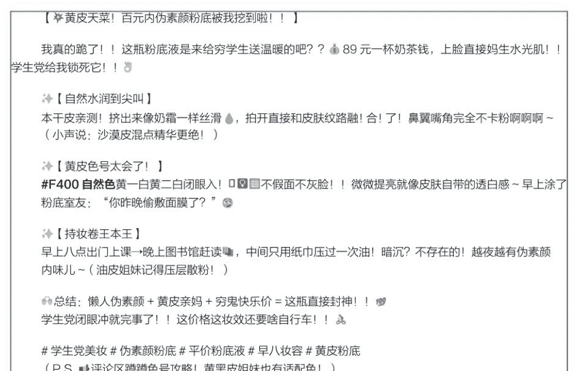

### 4.2.3 优化爆款元素

想让DeepSeek生成的文案从小透明变成大爆款，关键点就在于“加戏”——通过互动话术和热点标签，让观众忍不住点赞、收藏、评论。下面是具体说明。

#### 1. 互动话术

互动话术的核心逻辑就是用对话感拉近距离，让观众的角色从“围观”变成“参与”。可通过以下3步实现。

（1）提问式开头——勾住观众注意力。提问式开头的作用就是用问题引发观众的好奇，让其停下来观看或阅读。

普通开头：“这款面膜很好用。”

爆款开头：“脸干到卡粉还爆痘？急救面膜来了！”

（2）痛点共鸣——让观众觉得“这就是我”。痛点共鸣主要是为了引发观众的情感共鸣，增强信任感。

平铺直叙：“这款坐垫适合久坐人群。”

痛点共鸣：“每天加班到腰酸背痛？这个空气纤维坐垫，打工人的老腰终于得救了！”

（3）行动号召——推动观众立刻行动。当观众停下来观看后，就该告诉其接下来该干什么，不然他们只是浏览一下就划走了。

结尾：“这款耳机总体上很不错。”

行动号召：“学生党抄作业！这耳机已经涨价两次了，现在点左下角还有30元隐藏券！”

#### 2. 热点标签

添加热点标签的作用就是让平台算法为你打工，核心逻辑就是用热搜词和标签做“流量加速器”。

（1）找热点的3个渠道。

+   ①平台内：小红书站内“发现页”顶部滚动话题（如#早八妆容 #学生党百元好物）。
②热搜工具：第三方平台（灰豚数据、新红数据）查实时热搜词。
③跨平台搬运：抖音/微博热搜话题（如“多巴胺穿搭”“命运的齿轮开始转动”）。

（2）蹭热点的正确方式。蹭热点标签时需要注意，不能硬蹭，而是要自然结合。

× 生搬硬蹭：“#命运的齿轮 这个粉底液很好用”（关联度低）。

√ 自然结合：“命运的齿轮从这支口红开始！涂上被男神问色号的感觉谁懂啊！”

（3）标签组合策略。当正文结束后，添加热点标签也是成为爆款的关键，既不能太过杂乱，也不能太过简单。那么标签怎么组合才最有效？可以参考以下公式。

“1个爆款标签+2个精准标签+1个品牌标签”

例如：

“#油皮护肤（爆款）+#控油粉底液（精准）+#学生党彩妆（精准）+#××品牌（品牌）”

## 4.3 用DeepSeek创作爆款文章

很多人用AI写文章，写着写着就变成了“流水账”——平铺直叙、无趣无料，别说阅读量10万以上，连1000都费劲。其实，用AI写爆款文章，不只是输入关键词这么简单，核心在于“懂人性+懂平台+懂传播”。

### 4.3.1 精准匹配文章风格，提高阅读兴趣

为什么有些文章读者一看就想读下去，而有些文章看了两行就想划走？其原因就是风格不对，不符合平台调性。如今的自媒体平台，如小红书、知乎、公众号、抖音图文都有自己的“流行语言”和“受欢迎风格”。如果AI生成的文章不符合平台调性，就很容易被忽略，或者不被推荐。所以用DeepSeek写文章的第一步就是——精准匹配平台风格，让其写出观众/读者爱看的内容。

那么具体该怎么做呢？具体操作可分为两步。

#### 1. 告诉DeepSeek你要发布的平台和目标人群

很多人用DeepSeek写文章，最大的问题不是DeepSeek不会写，而是——你没告诉它“要写给谁看”。特别是做自媒体，不同的平台、不同的人群，喜欢的内容风格完全不一样。例如：

+   (1) 小红书的用户喜欢轻松、生活化、有代入感；
(2) 知乎的用户喜欢理性、逻辑性强、有干货；
(3) 抖音的用户喜欢短句、强节奏、容易共鸣；
(4) 微信公众号的用户喜欢有故事、有金句、有深度。

如果你不向DeepSeek交代这些背景，它只能“瞎猜”——结果写出来的内容四不像，平台不肯推，观众不爱看。那么怎么具体告诉DeepSeek，答案很简单，就是在提示词中说清楚。下面是相应的提示词公式。

> “平台+风格要求+目标人群+语言特点”

那么这段提示词公式结构为什么是这样呢？我们需要来理解一下其背后的逻辑。

+   (1) 平台决定规则，不同平台有不同的推荐机制和内容偏好。例如，抖音重节奏，小红书重代入感，知乎重逻辑。所以，创作者一开始就要明确内容“在哪个平台发布”。
(2) 风格是平台语言，每个平台都有自己的“说话方式”。例如，小红书爱“姐妹安利”，知乎爱“专业理性”，你得发符合平台风格的内容，“说他们听得懂的话”。
(3) 目标人群决定内容重点，你的目标人群是学生党、宝妈、打工人，还是自由职业者？不同人群关注的点不同，你只有根据人群挑重点讲，才会让人觉得“这说的就是我”。
(4) 语言特点决定传播力，你是口语化带表情符号，还是理性克制带数据？语言风格会直接影响观看体验，也会决定这条内容是否“愿意被转发/收藏/分享”。

下面是用该提示词公式生成的示例。

请用知乎风格，帮我写一篇关于如何高效读书并真正应用到生活/工作中的干货分享，面向的是大学生、职场新人、自我提升人群。

要求语言理性客观，逻辑清晰，不空谈“读书的意义”，而是具体讲方法论和实操路径，适当引用书籍内容、研究数据或真实案例进行支撑。

##### 扔掉无效读书法：3步把书变成你的“外挂大脑”。

作为帮500多人做过阅读培训的顾问，我发现大多数人读书就像往漏水的桶里灌水——看似努力，实则白费。今天分享一套“傻瓜式落地读书流程”，小学生都能学会。

###### 一、先治三大“读书病”

####### 1. 强迫症式读书

别逼自己读完每本书！就像吃鱼不用啃骨头，一本书真正对你有用的可能就几页。

下次读书前先问自己：“我现在最想解决的3个问题是什么？”直接翻目录找答案。

####### 2. 手账式笔记

别把笔记做成艺术品！记住这个公式：有用笔记=1句话总结+2个使用场景。如读《非暴力沟通》就记：“生气时先说观察（今天开会你打断我3次），再说感受（我觉得被忽视）。”

####### 3. 松鼠囤书症

别被“一年读100本书”忽悠！真正厉害的人都在做“知识杂交”：把3本经典书读透，比泛读30本管用10倍。例如，把《金字塔原理》《结构思考力》《麦肯锡方法》3本书的精髓吃透了并用起来，写报告的逻辑能吊打90%的同事。

###### 二、超强实战4步法

####### 第一步：带“钩子”读书

准备3个现实问题再去选书，就像带着购物清单去超市。

问题示例：

+   - 每次汇报都被说重点不清晰；
- 同事总把杂活推给我；
- 想跳槽但不知道自己的优势。

####### 第二步：20分钟“捞干货”

手机定时器打开，按这个顺序扫书：

+   （1）看目录圈定3个重点章；
（2）快速扫读小标题/加粗字；
（3）遇到“啊，这个有用！”马上停，在对应书页贴便利贴。

####### 第三步：做一张“知识使用券”

每本书只留1张A4纸，按这个模板写。

本周要解决的问题：_______。

在哪页能找到答案：P._______。

具体怎么用（举个例子）：下次周会前先画金字塔结构，把结论放在第一页PPT。

预计完成时间：__月__日。

####### 第四步：72小时“保鲜行动”

心理学证明，新知识在72小时内不用就会忘光！建议这样实操。

+   ·读《深度工作》后：马上给手机设置每天2小时勿扰模式。
·学《关键对话》后：下次吵架前先写对话脚本（提前想3句对方可能说的话）。
……

#### 2. 模仿平台爆款的表达习惯

我们可以让DeepSeek模仿平台爆款的表达习惯，让其自动学会“流量密码”，下面是相应的提示词模板。

> “请模仿【平台名称】的爆款表达风格，帮我写一篇【内容】，内容要符合【目标人群】的阅读喜好。”

下面是基于该提示词模板生成的示例。

请模仿微信公众号的爆款表达风格，帮我写一篇关于读书改变认知的内容，读者是22～45岁的男性，对成长、效率、赚钱、思维提升感兴趣。

以下是一篇符合要求的微信公众号爆款风格文章，结合了数据冲击、认知颠覆、行动号召等元素。

##### 一、标题

“杀死35岁中年人的秘密武器：废掉一个人最隐蔽的方式，就是让他停止阅读”

##### 二、导语

（加粗）2023年，中国成年人纸质书平均阅读量为4.35本，而年薪百万群体年阅读量超36本。这不是巧合，是认知战争的幸存者偏差。

##### 三、正文

###### 1. 为什么你读的每一页书都在对抗阶层固化

（颠覆认知）这个时代最暴利的认知税，是短视频用碎片信息换走你的深度思考能力。当你在直播间抢9.9元的包邮时，有人正在用《穷查理宝典》搭建投资框架。

（加表情符号）警惕知识肥胖症：收藏100个干货视频，不如吃透一本《原则》。

###### 2. 那些年靠读书实现认知升级的人正在疯狂收割红利

（案例冲击）

+   - 字节跳动早期员工靠《创新者的窘境》预判短视频风口。
- 深圳跨境电商老板用《定位》理论血洗亚马逊榜单。
- “95后”程序员啃完《系统之美》后开发出爆款效率工具。

（金句加粗）你永远赚不到认知半径之外的钱，但好书能暴力拓宽你的财富边界。

###### 3. 30多岁男性的降维打击书单（慎点！怕你读完同事跟不上你）

（行动钩子）这套被私藏的“认知核武器”书单，正在小范围流传。💧

+   - 《思考，快与慢》：看透消费主义陷阱的元认知。💧
- 《纳瓦尔宝典》：硅谷大佬的搞钱底层逻辑。💧
- 《反脆弱》：在“黑天鹅”事件中逆袭的生存法则。

（制造紧迫感）注意：这些书可能引发“认知戒断反应”——读完再也无法忍受低质量社交。

###### 4. 马斯克都在用的量子阅读法（不是快速翻书！）

（方法论）真正的高手这样榨干一本书的价值。✔️

5分钟“狙击式阅读法”快速锁定关键章节。✔️

建立“认知变现模型”把知识转化成收入。 ✓

用Notion搭建个人认知银行（附模板）。

（恐惧诉求）特别警告：纯文学阅读可能加剧职场危机。

……

### 4.3.2 搭建清晰结构，增强内容逻辑

很多自媒体文章，明明选题不错、风格也对路，但阅读量就是上不去，原因很可能是内容太乱、缺乏逻辑。这时候可以借助DeepSeek帮助搭建清晰结构，让文章从头到尾有逻辑、有条理，读起来不累，读完还能记住。

不管是用人写，还是用AI写一篇高质量的自媒体文章，通常应遵循表4-4所示的逻辑结构。

表4-4

| 位置 | 写什么 | 作用 |
|---|---|---|
| 开头 | 提出问题/引起兴趣 | 吸引读者继续看 |
| 中间 | 展开分析/提供方法/讲故事 | 提供有价值的内容 |
| 结尾 | 总结观点/引发共鸣/引导转发 | 提升互动效果 |

那么该如何让DeepSeek自动搭建清晰的结构呢？我们可以用如下提示词模板明确告诉DeepSeek。

+   1. 帮我按照【结构】写作。
2. 每一部分要做什么。
3. 语言风格：【内容逻辑要清晰，表达有条理】。

下面是基于上述提示词模板要求DeepSeek生成的示例。

请帮我写一篇自媒体文章，平台是知乎，主题是家居装修选材避坑经验，请按照“开头—中间—结尾”的三段式结构来写，要求具有以下内容。

开头：提出常见的选材误区，吸引读者的兴趣。

中间：分3个部分讲解常见的坑，以及该如何避免。

结尾：总结家居选材的核心思路。

语言风格：理性客观，干货为主，数据和案例支撑。

##### 知乎专栏 | 装修选材避坑指南：用数据思维破解家居建材迷局

###### 【开头：选材误区背后的认知陷阱】

当你在建材市场被“0甲醛”“终身质保”的营销话术包围时，是否意识到：环保等级≠真实空气质量，进口品牌≠品质保障，低价促销≠性价比最优？本文将以第三方实验室数据+真实踩坑案例，揭示装修选材的三大认知盲区。

###### 【中间：选材的三大深水区】

####### 1. 环保指标的数字游戏（附实验室检测对照表）

认知误区：盲目追求E0级板材，忽略总挥发性有机化合物（TVOC）等综合污染指标。

科学解法：

+   ①认准2021年新国标ENF级（≤0.025mg/m³）而非旧版E0级（≤0.05mg/m³）。

####### 2. 功能材料的耐久性陷阱（附材料应力测试数据）

认知误区：过度关注花色款式，忽视材料应力系数与使用场景匹配度。

工程级选材法则如下。

- ①地暖房优先选择吸水率＜0.5%的SPC石塑地板（参照GB/T8810）。
- ②厨房台面用莫氏硬度＞6的石英石（普通大理石仅3～5级）。
- ③卫浴区墙面需检测吸水率＜0.5%。

####### 3. 价格体系的成本幻象（附全生命周期成本计算公式）

认知误区：单纯对比材料单价，忽略安装损耗与维护成本。

成本控制模型如下。

总成本=（材料费×1.2损耗系数）+（安装费×1.5返修概率）+（维保费×使用年限）

###### 【结尾：选材决策的底层逻辑】

建材选购本质是数学建模过程如下。

- ①建立环保（污染物释放速率）、性能（材料力学参数）、成本（全周期费用）三维评估体系。
- ②采用约束条件法：确定不可妥协的核心指标（如家有过敏人群必须满足ENF级）。
- ③参考《住宅装饰装修工程施工规范》（T/SDDA002—2021）建立验收清单。

当装修选材从感性决策转向量化分析，才能真正实现“健康住居+品质耐用+经济合理”的三角平衡。

以上便是DeepSeek给出的初步方案，我们确定好其中的某个方向之后，还可以向DeepSeek进一步追问，让其进行调整。追问的方向可以参考下面的提示词。

- （1）你能更详细地解释下“ENF级”和“TVOC”分别是什么意思吗？我应该怎么看检测报告才不会被骗？
- （2）我准备装修厨房，你能根据你文章里的逻辑（环保+性能+成本），推荐一套台面/地面/墙砖的搭配吗？
- （3）能不能再多讲几个装修材料用错的真实案例？如朋友家、网友投稿、投诉平台数据，越具体越好，我好有参考。

### 4.3.3 预测阅读量和互动率，优化传播效果

自媒体文章，不是写完就结束了。我们在完成文章后还可以通过DeepSeek评估文章的爆款潜力，提前优化其标题和结尾。下面是使用DeepSeek评估文章爆款潜力的提示词模板。

> “请帮我评估这篇文章的爆款潜力，分析：
> （1）标题是否足够吸引人？
> （2）内容结构是否易读、易传播？
> （3）文中哪些地方容易引发读者的评论或转发？
> （4）有哪些优化建议？
> 【文章内容】……”

输入这段提示词后，DeepSeek就可以生成相应的回复内容。那么为什么要这么提问呢？我们需要来理解一下其背后的逻辑。

- (1) 先看标题吸不吸睛，标题是读者点进来的第一步，抓不住人，就没人看。所以要先判断标题有没有“诱因”——冲突、情绪、数字、痛点等。
- (2) 内容结构要顺眼好懂，文章要排版清爽、段落紧凑、逻辑清晰，这样才能让人一口气读完，才更容易被点赞、收藏和转发。
- (3) 找出“容易引发读者互动”的地方，即看看文中有没有“共鸣”“争议”或者“经验干货”，这些内容更容易让读者评论、转发给朋友。
- (4) 给出可执行的优化建议，这步不是泛泛而谈，而是直接指出“哪里可以改”，如结尾加个互动问题等。

下面是基于该提示词模板DeepSeek生成的示例。

请帮我评估这篇文章的爆款潜力，分析：

- (1) 标题是否足够吸引人？
- (2) 内容结构是否易读、易传播？
- (3) 文中哪些地方容易引发读者评论或转发？
- (4) 有哪些优化建议？

下面是文章内容。

##### 标题：家居选材避坑指南

正文内容如下。

###### 1. 开头

装修一旦开工，最让人头大的，往往不是设计问题，而是选材问题。

瓷砖怎么选？地板怎么挑？环保材料是真是假？价格差距大到让人怀疑人生！

我装修过两套房，踩过不少坑，今天就来分享一份超实用的选材避坑指南，帮你省钱、省心、省麻烦。

###### 2. 中间

- （1）瓷砖篇。
  误区：只看外观不看参数。
  避坑建议：注意吸水率、耐磨等级，建议优选大品牌的基础款，性价比高。
- （2）地板篇。
  误区：盲目追求实木。
  避坑建议：实木复合地板是大多数家庭的首选，它稳定性好，且不易变形。
- （3）涂料篇。
  误区：盲信“零甲醛”宣传。
  避坑建议：选择有权威检测认证的品牌，注重通风比盲目迷信环保材料更重要。

###### 3. 结尾

装修选材，其实没有绝对的标准，适合自己的才是最好的。

欢迎在评论区分享你的选材经验或踩过的坑，让更多人少走弯路！

这篇文章整体实用性较强，具备成为爆款的潜力，但仍有优化空间。以下是具体分析及建议。

###### 一、标题吸引力分析（7分/10分）

####### 1. 优势

- 直击装修人群的刚需痛点，“避坑”是核心关键词，自带吸引力。
- 信息明确，符合搜索场景（指南类内容）。

####### 2. 不足

- 缺乏情绪张力，可增加紧迫感/利益点（如“装修人必看！15年监工总结的选材避坑血泪史”）。
- 未体现内容差异化（可补充数据背书，如“300户装修验收总结的家居选材避坑指南”）。

###### 二、内容结构分析（8分/10分）

####### 1. 优势

- “总—分—总”结构清晰，符合移动端阅读习惯。
- 模块化呈现（分类解析）+痛点前置（误区说明）。
- 使用数字符号分段，视觉友好。

####### 2. 优化建议

- 增加“视觉锚点”：用❗、🔥等符号强化重点数据（如“吸水率<0.5%才合格❗”）。
- 添加“场景化小标题”：如“瓷砖选购致命误区——90%的人只看花纹”。
- 插入“对比表格”：增强说服力（如不同地板类型性能对比）。

###### 三、易引发互动的爆点分析

####### 1. 评论诱因

- 价格敏感点：“大品牌基础款”可能引发品牌争论（可预埋讨论话题）。
- 环保焦虑点：针对“零甲醛”的质疑，易引发经验分享。
- 文末开放式的提问设计巧妙。

####### 2. 转发动机

- “避坑清单”属性适合收藏/转发。
- 装修知识具备社交货币价值（帮亲友避雷）。
- 可补充“反常识结论”，刺激转发（如“实木地板最易翻车”）。

###### 四、优化建议

####### 1. 内容强化

- 增加“血泪故事”：用亲身踩坑案例增强代入感（如“因选错瓷砖损失2万元”）。
- 补充“避坑对照表”：各材料关键参数速查清单。
- 加入“行业黑话”解析：解释商家常用营销话术陷阱。

####### 2. 传播设计

……

以上便是DeepSeek给出的初步方案，我们确定好其中的某个方向之后，还可以向DeepSeek进一步追问，让其进行调整。追问的方向可以参考下面的提示词模板。

- (1) 你能帮我把这个标题改得更吸睛一些吗？如加上【数字】【结果】【人设】或者【反常识】？
- (2) 我想在每个小节加一个【场景化副标题】，你能帮我改写一版吗？
- (3) 我想在结尾设计一个【评论引导问题】，你能给几个建议吗？

# 第5章 用DeepSeek打造爆款短视频脚本

在短视频创作的赛道上，虽然强调内容为王，但脚本才是灵魂。本章将介绍如何用DeepSeek来进行短视频脚本的全流程定制——从提示词的构建到从数据中学习，再到完整脚本的生成与优化。

本章将会集中解决关于爆款短视频脚本定制的4个核心问题。

- 不会写短视频脚本，如何用DeepSeek直接生成并优化适配不同类型的脚本？
- 想让脚本更符合我的风格，如何正确投喂DeepSeek数据并处理数据量不足或过多的情况？
- 脚本不够吸引人，如何用三大黄金公式提升留人率、制造冲突感，并在结尾引导转化？
- 不同视频类型的脚本要求差别很大，如何让DeepSeek针对剧情、测评、科普、Vlog、电商等类型精准输出？

## 5.1 通用逻辑：一步步教你用DeepSeek打造短视频脚本

要想让DeepSeek帮你快速搞定短视频脚本，其关键在于：你得学会用提示词驱动DeepSeek。只有提示词写得好，DeepSeek生成的脚本质量才更高；只有提示词写得精确，DeepSeek生成的脚本才更贴合你的需求。

### 5.1.1 提供提示词，生成短视频脚本

想让DeepSeek帮你生成短视频脚本，第一步就是给它提供清晰、具体的提示词。一个清晰且具体的短视频脚本提示词，至少要包含表5-1所示的几个要素。

**表5-1**

| 要素 | 说明 | 示例 |
| :--- | :--- | :--- |
| 发布平台 | 确定内容发布的平台 | 抖音 / 小红书 / 知乎 / 微信视频号 |
| 主题 | 确定短视频讲什么 | 家居选材避坑 / 夏季护肤指南 / 理财心得 |
| 目标受众 | 明确短视频是给谁看的 | 装修新手 / 上班族女生 / 理财新手 |
| 风格 | 确定表达方式 | 轻松幽默 / 干货清晰 / 剧情反转 |
| 脚本结构 | 是否指定结构 | 开头吸引注意力 / 中间列举干货 / 结尾总结引导 |

下面是生成短视频脚本的基础提示词模板。

请帮我写一段短视频脚本，平台是【×××】，主题是【×××××××】，受众是【×××××××××】，风格是【×××××+××××】。脚本结构是：××××/××××/×××××。

输入这段提示词后，DeepSeek就可以生成相应的回复内容。那么为什么要这么提问呢？我们需要来理解一下其背后的逻辑。

- 1. 平台要先说清楚，不同平台（抖音、小红书、B站）的推荐机制和受众偏好都不一样，DeepSeek必须先知道短视频发布在哪个平台，这样才能写出适合平台风格的脚本。
- 2. 明确主题+受众，主题是“讲什么”，受众是“讲给谁听”。这两项决定了短视频的内容角度和用词，如面对职场人和学生党，内容方向完全不同。
- (3) 风格定位 = 确定人设，如“搞笑+干货”或“走心+实用”，风格保持统一可以让账号有鲜明个性。
- (4) 明确脚本结构，结构就像搭房子的骨架（如“开场吸睛—中间讲干货—结尾引导互动”），只有告诉DeepSeek你想要的节奏，才能保证它提供的脚本清楚、流畅、有传播力。

下面将以一名家装博主的视角，给装修新手讲解家居选材避坑指南，让DeepSeek帮助生成一个短视频脚本。我们先编辑好提示词，接着打开“深度思考（R1）”模式的开关，关闭“联网搜索”，让DeepSeek输出答案，如图5-1所示。

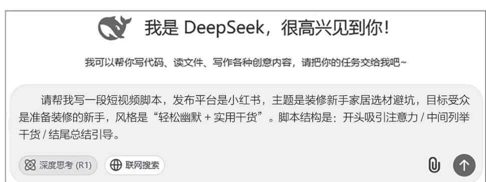

图5-1

按Enter键，将文字内容发送至DeepSeek，给出的答案如下。

【短视频脚本】“装修新手自救指南：选材避坑三连击！”

#### 开场暴击（00:00—00:05）

[画面]女主抱着一卷粉色豹纹壁纸跪地哀嚎，背后是贴到一半的死亡芭比粉墙面。

女主（哭腔）：“救命！这和卖家秀根本不是一个星球的产物啊！”

[字幕炸开]90%的装修新手都会犯的选材错误！

#### 反转亮相（00:06—00:15）

[镜头切换]女主突然变装成戴护目镜的装修女侠。

女主（元气满满）：“别慌！本监理带你三招绝地反杀！”

[音效]咻～变身音效+热血背景音乐。

#### 干货暴击1（00:16—00:35）

[画面]左右分屏对比：左图深色地板显压抑vs右图浅原木色地板显通透。

女主（举着放大镜）：“地板刺客第一式——颜色玄学！采光差还敢选胡桃木？记住这个保命公式：楼层÷2=选色号，20层选10号色！”

[动画]手机计算器弹出“20÷2=10”公式。

#### 干货暴击2（00:36—00:55）

[画面]女主拿着瓷砖在超市进行拖地测试，突然劈叉摔出画面。

女主（画外音）：“瓷砖防滑测试大法！“倒矿泉水+踩抹布”，摩擦力不够的马上拉黑！”。

[字幕]物理老师都直呼内行。

#### 干货暴击3（00:56—01:10）

[画面]女主变身人形甲醛检测仪疯狂咳嗽。

女主（掐脖子戏精）：“定制柜环保刺客出没！E0级是底线，五金件给我盯死百隆悍马！”

[道具]举起放大镜对准五金件Logo特写。

#### 结尾升华（01:11—01:20）

[画面]女主戴着安全帽在完美的新家比心。

女主（眨眼示意）：“记住这三板斧，装修路上横着走！下期带你智斗工长三十六计～”

[评论区引导]“速速交出你家的翻车建材！”

#### 【拍摄小贴士】

- 道具准备：夸张的翻车建材（如豹纹壁纸/荧光色油漆桶）。
- 运镜技巧：快节奏推拉镜头+综艺式花字。
- 背景音乐：多用抖音热门卡点音效。
- 服装：工装背带裤+荧光色安全帽更吸睛。

适合小红书的碎片化知识点+戏剧化演绎，既满足干货需求又符合平台娱乐调性～

……

以上便是DeepSeek给出的初步方案，我们确定好其中的某个方向之后，还可以向DeepSeek进一步追问，让其进行调整。追问的方向可以参考下面的提示词。

- （1）我想做成系列内容，这个脚本怎么可以延展成3～5期？
- (2) 我想拍一期关于【主题】的短视频，你能帮我设定几种有趣的人设视角+叙述方式吗？要那种更容易被代入和引发共鸣的。
- (3) 我想拍一期关于【主题】的短视频，你能帮我设计3个能制造“反转感”的桥段吗？越戏剧性，越引人注意越好。

### 5.1.2 优化提示词，提高脚本匹配度

在第5.1.1节内容中，我们介绍了使用DeepSeek生成短视频脚本的基本要素。然而，在实际操作中，不同的创作者在内容风格、表达习惯和账号定位上存在差异，直接套用提示词模板往往难以达到理想效果。因此，本节将重点讲解如何通过优化提示词、提高脚本内容与自身需求的匹配度，来帮助你生成更符合个人风格和场景需求的短视频脚本。

优化提示词、提高脚本内容与自身匹配度的本质是进一步细化提示词内容。表5-2所示为可以加进提示词并进一步细化的要素。

**表5-2**

| 要素 | 说明 | 示例 |
| --- | --- | --- |
| 情感基调 | 明确短视频要传递的情绪 | 励志鼓舞 / 温情治愈 / 悬疑紧张 / 吐槽搞笑 |
| 时长控制 | 根据平台特性限制时长 | 15秒快节奏 / 3分钟深度解说 / 系列分集 |
| 互动引导 | 增加促进受众参与感的指令 | “评论区留下你的看法” / “点赞、收藏、防丢失” |
| 热点结合 | 关联近期热门话题或挑战 | #“6·18”购物攻略 / 蹭“高考后旅行”热点 |
| 背景音乐 | 指定音乐风格或氛围 | 轻快电子乐 / 悬疑音效 / 怀旧金曲片段 |
| 行动号召（CTA） | 明确希望受众下一步的动作 | “点关注不迷路” / “橱窗同款已上架” |
| 视觉化关键词 | 描述画面或道具需求 | 多机位切换 / 动画插画辅助 / 对比实验道具 |
| 避雷关键词 | 避免敏感或无效的内容 | 不提及品牌名 / 规避专业术语 / 弱化硬广感 |
| 参考爆款案例 | 对标同类爆款视频 | 参考“×××博主”的测评风格 / 对标《×××》的运镜节奏 |
| 季节/节日属性 | 结合时间节点增强时效 | 春节送礼指南 / 冬季养生冷知识 |
| 系列化标签 | 建立内容连续性 | 标注“第一期” / 结尾预告下期主题 |
| 场景化描述 | 具体拍摄场景要求 | 办公室场景 / 户外实拍 / 绿幕抠像合成 |
| 节奏密度 | 控制信息输出速度 | 前5秒高能反转 / 每30秒插入一个梗 |
| 字幕/标题关键词 | 搜索引擎优化（SEO）关键词 | 标题含“避坑”“干货” / 字幕强调“新手必看” |
| 数据/案例支撑 | 增强受众可信度的细节 | 引用行业报告数据 / 插入用户投稿案例 |
| 方言/语言特色 | 针对地域或圈层设计 | 四川普通话口音 / 二次元黑话 / 职场术语 |
| 角色设定 | 明确出镜人身份标签 | 资深设计师人设 / 暴躁吐槽闺蜜角色 |
| 痛点强化 | 放大受众的共鸣点 | “工资5000元如何存钱” / “装修被坑3次的血泪史” |
| 悬念设计 | 提升完播率的钩子 | 结尾抛争议问题 / “最后一条颠覆认知” |

下面是通过DeepSeek优化提示词后生成的示例。

请帮我写一条抖音风格的家装避坑科普短视频脚本，情感基调是吐槽+搞笑，时长控制在1分钟内。开头用高能反转吸引观众注意力，中间列举3个最常见的装修翻车误区（尤其是新手业主常见问题），结尾引导观众留言分享自己踩过的装修坑。画面建议使用多机位切换（如现场+表情特写），字幕突出“装修新手必看”。

“抖音家装避坑脚本：装修新人血泪史”（时长58秒）。

#### 开场（0～5秒）

[画面]精致北欧风客厅全景+浪漫背景音乐。

主播（西装革履）：“我家装修完美得像杂志……”

[镜头突然下移]裸露的插线板垂在沙发正中央。

主播（崩溃脸）：“如果没踩这3个大坑的话！”

#### 误区一（6～20秒）

[分屏对比]左边设计图vs右边实景。

主播（举着设计图跳机械舞）：“轻信网红悬浮床！”

[切特写]床底堆满杂物+晾衣杆。

主播（翻白眼）：“半夜起床撞膝盖，扫地机器人天天玩密室逃脱。”

#### 误区二（21～35秒）

[镜头摇晃模仿地震]

主播（抱头乱窜）：“卫生间防水随便搞？”

[切动画]楼下邻居顶蘑菇水帘洞特效。

[字幕炸裂]省2000元防水=赔20000元吊顶。

#### 误区三（36～48秒）

[主播蹲在冰箱旁扮演“思考者”]“插座全藏家电正后方！”

[慢动作拔插头]带倒水杯+文件飞散。

主播（咆哮）：“每次充电都要玩移形换位！”

#### 收尾（49～58秒）

[主播头顶施工帽瘫坐废墟]“说多了都是泪……（突然振奋）在座哪位勇士没踩过装修坑？”

[大字弹幕雨]“装修新手必看！你的坑比我的大吗？”

[结尾定格]主播拿电钻比心+评论区气泡特效。

#### ▶制作小贴士

音效：玻璃碎裂/爆炸音效+综艺罐头笑声。

节奏：每10秒一个反转，搭配0.5倍速“糗事”瞬间。

视觉：用3D箭头/爆炸贴纸强化翻车点。

以上便是DeepSeek给出的初步方案，我们确定好其中的某个方向之后，还可以向DeepSeek进一步追问，让其进行调整。追问的方向可以参考下面的提示词。

- (1) 将原脚本的【搞笑吐槽】风格改为【毒舌吐槽/温情提醒/暴躁抓狂】，在【开头/结尾】增加【反转冲突/暖心金句】，针对【××人群】痛点设计台词，如【学生党/宝妈/打工人】的【具体场景】。
- (2) 将【口播剧情】改为【动画演示/真人情景剧】，用【灵魂配音/方言解说】强化记忆点，设计一个标志性动作（如【摔道具/魔性手势】）贯穿全片，字幕用【荧光色/弹幕体】突出关键词。
- (3) 在现有【×个误区】的基础上，新增关于【××细节问题】的片段，用【行为示范+错误案例】对比，重点突出【省钱/省时/安全】价值点，加入【行业黑话揭秘/价格坑点清单】等专业元素。

### 5.1.3 调整提示词，适配不同类型的短视频脚本

就如“一把钥匙无法开所有锁”一样，一个短视频脚本的提示词也无法适用于所有类型的短视频。不同的短视频类型，对提示词的要求完全不同。表5-3所示为不同类型短视频的提示词参考。

**表5-3**

| 短视频类型 | 内容特征 | 提示词写作要点 | 注意事项 |
| :--- | :--- | :--- | :--- |
| 知识科普类 | 干货密度高、逻辑清晰、专业可信 | 明确受众定位，内容结构合理（问题→干货→结论），加入数据或案例支撑，语言通俗易懂 | 避免太学术；防止信息量过载；突出“新手必看”或“家长必备”等标签 |
| 情绪共鸣类 | 情感代入强、故事化表达、生活化细节 | 场景设置真实，语言温暖走心，设计高共鸣金句，结尾升华或反转 | 不宜生硬说教；故事细节要有生活质感；台词要接地气 |
| 吐槽搞笑类 | 节奏快、反转强、网络梗多、夸张演绎 | 明确吐槽对象，开头用高能反转吸引注意，过程设计密集笑点，结尾引导互动 | 笑点要符合受众喜好；不要使用低俗梗；字幕突出夸张情绪词 |
| 产品带货类 | 场景真实、痛点驱动、种草自然 | 强调使用场景、对比效果、突出痛点、软性植入产品信息，结尾引导转化 | 切忌硬广；人设要真实可信；避免硬广[直接带品牌广告词（除非授权）] |
| 短剧剧情类 | 人设鲜明、冲突反转、代入感强 | 明确角色关系，冲突设计巧妙，转折自然，结尾留悬念或反转 | 避免老套剧情；台词自然不做作；情节符合现实逻辑或平台风格 |

下面是针对不同短视频类型脚本的通用型提示词模板。

## 5.2 正确投喂DeepSeek数据

想让DeepSeek写出“你想要的风格”，就要像训练一只聪明的鹦鹉学唱歌那样——关键不在于你教多久，而在于你教什么、怎么教。

### 5.2.1 投喂数据时要注意哪些关键“动作”

很多人用DeepSeek时，最容易犯的错就是随便丢点东西给它，想着“反正AI自己能学”。结果往往使得AI输出的东西，要么四不像，要么和自己预期相差十万八千里。当我们给DeepSeek投喂数据时，下面这几个关键动作非常重要，归结为3个字：选、分、标。

#### 1. 选——只喂对的，不喂杂的

DeepSeek虽然很聪明，但也不是万能的。你给它投喂什么，它就学什么。所以第一步最重要的就是，只投喂符合你目标风格的数据。投喂的数据宁可少一点，也要纯一点。表5-4所示为几个选择数据的示例内容。

**表5-4**

| 目标 | 只选这些数据 | 不要选这些数据 |
| --- | --- | --- |
| 学写品牌宣传文案 | 官方品牌介绍、历史案例、成功的广告文 | 新闻稿、说明书、合同 |
| 学写小红书风格 | 优质种草笔记、爆款博主文案 | 微博吐槽、知乎长篇讨论 |
| 学写高端白皮书 | 行业内优秀白皮书、专家深度文章 | 网络段子、用户评论 |

#### 2. 分——要一类一类喂，“别乱炖”

当然，在投喂数据时，不要将所有品类的数据一股脑儿地全部塞进DeepSeek，最好是提前对数据进行分类。如果你不分类，DeepSeek很可能会“蒙圈”。例如，你混着喂了客服话术和高管发言，结果DeepSeek生成的内容可能会出现：

> 尊敬的用户，欢迎您参加我们的战略发布会……

这就不符合常规逻辑了。那么该如何对数据进行分类呢？你直接采用“场景分类法”即可，谁用、用在哪，就归哪类。表5-5所示是推荐的按场景分类的基础模板。

**表5-5**

| 类别名称 | 数据举例 |
| --- | --- |
| 产品介绍类 | 产品卖点 / 使用说明 / 差异化优势 |
| 活动宣传类 | 营销活动文案 / 促销信息 / 社群推文 |
| 客服话术类 | 常见问题回复 / 客服标准回复 |
| 高管发言类 | 年度总结 / 内部讲话 / 外部演讲 |
| 朋友圈日常类 | 轻松、生活化的短文案 |

假设你是开宠物店的，数据可以这样分类。

- 分类1：宠物用品广告（逗猫棒、狗粮等宣传语）。
- 分类2：客户咨询回复（如何回答“狗狗拉肚子怎么办”等客户问题）。
- 分类3：宠物知识科普（猫咪为什么爱舔毛等知识）。

注：这个分类可以通过DeepSeek的“开启新对话”实现。例如，对话1讲宠物用品广告，对话2讲客户咨询回复等。

#### 3. 标——给数据打标签，以方便管理

除了给数据进行分类，给数据贴上标签也是至关重要的。标签就相当于“关键词”，用最简单的词，快速描述这份数据的特点。一份数据，可以打多个标签。例如，这篇文案可以按照“给谁看的”“什么风格”“哪个行业的”分别打标签。表5-6所示为一些标签的类型和举例。

**表5-6**

| 标签类型 | 问自己 | 举例 |
| :--- | :--- | :--- |
| 行业标签 | 这篇文案是哪个行业的 | 美妆、数码、汽车、地产、教育 |
| 受众标签 | 这篇文案是写给谁看的 | 年轻人、妈妈、白领、老板、学生 |
| 风格标签 | 这篇文案是什么风格 | 正式、幽默、活泼、硬核、口语化 |

### 5.2.2 数据太少/太多时怎么补救

给DeepSeek投喂数据，最常见的两个问题是：数据太少，不够训练；或是数据太多，过于杂乱。下面是针对这两个问题时的解决方法。

#### 1. 数据太少时的应对方法

当投喂的数据太少时，不用惊慌，数据不在多，而在精。先小而美，再慢慢增加。下面是相应的补救方法。

1.  优选最典型的好数据。如果数据不多，那就只选最能代表你目标风格的数据。表5-7所示为相关示例。

**表5-7**

| 你的目标 | 应该选的数据 |
| :--- | :--- |
| 想写小红书种草文案 | 点赞高、风格稳定的小红书爆款 |
| 想写品牌宣传文案 | 官方广告文案，品牌口号，宣传册 |
| 想写高端白皮书 | 行业权威发布的标准资料 |

2.  投喂少而精，效果反而好。DeepSeek不需要“大锅饭”式的喂养，而是要纯度高的数据，即使数量少，也能学得很好。
3.  慢慢积累数据。当投喂的数据数量少时只能通过慢慢积累数据，达到自己多样化的需求。
4.  提示词模板和示例。当数据少时可以参考以下提示词模板，对DeepSeek进行提问。

> “请参考以下这批高质量文案的风格，学习它的表达方式。帮我写一篇类似的内容。要求：风格统一、表达清晰、符合目标受众习惯。
> 
> 1. ……
> 2. ……
> 3. ……
> 4. ……”

输入这段提示词后，DeepSeek就可以生成相应的回复内容。那么为什么要这么提问呢？我们需要来理解一下其背后的逻辑。

1.  提供参考文案，是为了让DeepSeek知道“模仿谁”，就像写作文时先模仿范文。参考文案能告诉DeepSeek语气、结构、内容深度该怎么拿捏，参照这些写出来的文案风格才不容易跑偏。
2.  “风格统一、表达清晰、符合目标受众习惯”，这些要求是在告诉DeepSeek：别仅模仿语气结构、内容深度，还要模仿适合用在哪、给谁看。
3.  强调“学习它的表达方式”，是为了提炼写作技巧，而不是照抄原文，从而让DeepSeek写出既相似又独特的新文案。
4.  有结构、有要求、有案例，写作更高效，这种格式其实就是“模仿练习题”，给DeepSeek清晰投喂，也方便创作者批改优化。

下面是基于该提示词模板生成的示例。假设你只有5条小红书爆款文案，可以这样向DeepSeek投喂。

以下是我收集的高质量小红书文案。

##### 1. 关于口红的种草文案

> “这支口红真的好！是我今年回购最多的一支！颜色是温柔奶茶豆沙色，素颜涂都好看，关键是涂上嘴巴软乎乎的，完全不卡皮！而且不挑皮肤，黄皮姐妹闭眼入！”

##### 2. 关于护肤的种草文案

> “30多岁熬夜脸的救星找到了！这瓶精华简直是熬夜女孩的续命水。质地水润好吸收，晚上敷厚厚一层，第二天真的像睡了美容觉。毛孔隐形，肤色亮了一个度，谁懂！”

##### 3. 关于香水的种草文案

> “喷了会让人回头的那种香。前调是清甜果香，像刚洗完澡的少女，后调是奶香混着木质，干净又温柔。约会必备！它不香艳不俗气，是‘只属于你’的味道。”

##### 4. 关于咖啡店打卡的文案

> “这家店太适合拍照了！法式复古＋森系绿植，随便一拍就是杂志大片。推荐他们家的玫瑰拿铁，奶香混着淡淡花香，喝一口就能忘掉坏心情～”

##### 5. 关于家居好物的文案

> “全网都在吹的香薰蜡烛，我终于入手了！点燃的瞬间，整个房间都变得松弛柔软。特别适合下班回家一个人开个投影，喝茶放空，让房子有了‘生活感’。”

我的目标受众是20～35岁的年轻女性，风格要轻松、活泼、代入感强。请学习以上文案风格，帮我写一篇新的口红种草文案。

**“这支镜面唇釉才是今夏显白大魔王吧！！”**

试色时直接瞳孔地震！上嘴瞬间白两个度！水光感草莓山楂红像把多巴胺涂在嘴上，薄涂是元气西柚汁，厚涂是咬碎冰糖的浆果冻，玻璃唇在阳光下还会亮闪闪！质地绝到想给配方师磕头！成膜后完全不粘头发，吃火锅也只掉色30%！最绝的是它用精华油打底，我这种万年沙漠唇涂后居然能扛住空调房8小时不拔干，唇纹都被填平到像开了柔焦滤镜！

通勤随手涂就是伪素颜小心机，约会时叠涂中间立马收获女团打歌妆效，闺蜜涂完直接被男生要链接，现在全办公室姐妹的包包都放着同款唇釉。（笑）

#### 2. 数据太多时的应对方法

当数据太多时，我们秉持一个原则就是“取其精华去其糟粕”，通过去杂+分类+清洗等方法，让DeepSeek只学习有用的数据。下面是相应的补救方法。

1.  删除坏数据。如果有些数据跟目标无关、含错别字、低质量、风格混乱、年代久远或已失效等，建议将这些数据删除。
2.  分类管理。分类管理是数据太多时必要的操作手段，否则自己都可能会分不清数据内容。
3.  数据清洗技巧。我们可以通过批量去重（防止重复喂养）、统一格式（标点符号、段落结构）和打标签等形式对数据进行清洗。
4.  提示词模板和示例。当数据太多时，我们可以让DeepSeek帮忙整理，下面是相应的提示词模板。

> “我有一批内容数据，风格有点杂，请帮我分别整理出来。并给每类数据打上标签，方便我后续管理。以下是我的数据。
> 1. ……
> 2. ……
> ……
> 标签包括：[行业] [受众] [风格]。”

输入这段提示词后，DeepSeek就可以生成相应的回复内容。那么为什么要这么提问呢？我们需要来理解一下其背后的逻辑。

1.  “风格有点杂”这句话说明你的数据类型目前不够统一，需要DeepSeek帮助整理。
2.  要求“打上标签”，即标签化管理（如行业/受众/风格等），可以帮助你日后精准检索和复用，比如“找一篇适合职场女性的轻松风文案”。
3.  不光分类，还要求“分别整理出来”，这是让DeepSeek做内容资产管理——比“只看一眼”更深入，适合长期内容运营。

下面是基于该提示词模板生成的示例，假设你有一堆不同风格的内容数据。

我有一批内容数据，风格有点杂，请你帮我分别整理出来。并给每类数据打上标签，方便我后续管理。以下是我的数据。

1.  “素颜急救口红来啦！这支奶橘色真的温柔爆了～上嘴瞬间提气色，不挑皮，黄皮、白皮都友好。“早八党”出门涂它，直接显得‘天生唇色好’那种！”
2.  “这款粉底液采用长效控油配方，适合油性及混合肌肤使用，妆效自然持久，适合多种肤质。”
3.  “每天醒来第一件事不是刷牙洗脸，而是先摸手机。iPhone电量一低，我的安全感直接归零……这块超大容量充电宝，真的是手机党续命神器。”
4.  “宝宝的小肚肚终于不怕凉了！这个肚围软软糯糯的，像棉花糖一样贴身不勒肚子，关键颜值还超级可爱，小动物图案萌化了妈妈心。”
5.  “本款蓝牙耳机支持主动降噪与环境音调节，满足用户在多场景下的佩戴需求，提升通话与聆听体验。”

请按以下要求将以上内容数据进行分类并打标签。

行业：美妆、数码、母婴。

受众：年轻人、白领、商务人群。

风格：正式、幽默、活泼、口语化。

以下是分类及打标签的结果（使用Markdown表格呈现）。

| 序号 | 内容摘要 | 行业 | 受众 | 风格 |
| :--- | :--- | :--- | :--- | :--- |
| 1 | 素颜急救口红奶橘色，提气色不挑皮 | 美妆 | 年轻人 | 活泼、口语化 |
| 2 | 长效控油粉底液，自然持久适配多肤质 | 美妆 | 白领/商务人群 | 正式 |
| 3 | 超大容量充电宝解决手机党电量焦虑 | 数码 | 年轻人 | 幽默、口语化 |
| 4 | 婴儿棉花糖肚围，柔软可爱防着凉 | 母婴 | — | 活泼、口语化 |
| 5 | 主动降噪蓝牙耳机，多场景通话聆听体验 | 数码 | 商务人群 | 正式 |

分类逻辑说明如下。

1.  行业。根据产品属性直接划分（如口红/粉底液→美妆，充电宝/耳机→数码，婴儿肚围→母婴）。
2.  受众。
    - “年轻人”标签适用于强调便利性、颜值或情感共鸣的内容（如口红、充电宝）。
    - “商务人群”对应专业场景需求（如粉底液的适配性、耳机降噪功能）。
    - 母婴产品因目标受众为父母，未匹配给定受众标签，故留空。
3.  风格。
    - 活泼/口语化：使用感叹词、夸张表达（如“温柔爆了”“萌化了”）。
    - 幽默：通过夸张比喻制造趣味（如“安全感归零”“续命神器”）。
    - 正式：侧重功能描述，用词简洁专业（如“长效控油”“环境音调节”）。

以上便是DeepSeek给出的初步方案，我们确定好其中的某个方向之后，还可以向DeepSeek进一步追问，让其进行调整。追问的方向可以参考下面的提示词模板。

1.  【序号：……】除了【当前标签】，请列出该内容可能具备的【更多受众细分】或【内容标签】，并说明理由。
2.  请基于【产品/内容】，再给出3个新颖又具体的内容切入角度，适合做成【风格】短视频脚本。
3.  请把【序号：……】内容用【开头吸引—中段展开—结尾互动】结构改写成60秒的短视频脚本，适合【受众】观看。

示例如下。

1.  “序号3”除了【年轻人】，请列出该内容可能具备的【更多受众细分】或【内容标签】，并说明理由。
2.  请基于【超大容量充电宝】，再给出3个新颖又具体的内容切入角度，适合做成【幽默、口语化】短视频脚本。
3.  请把“序号4”用【开头吸引—中段展开—结尾互动】结构改写成60秒的适合【年轻人】观看的短视频脚本。

## 5.3 用DeepSeek生成爆款短视频脚本

“为什么同样的产品，别人的视频点赞量10万多，你的播放量却卡在500？”在抖音/小红书的算法世界里，前3秒定生死，脚本结构决胜负。本节我们将拆解3个最适合短视频平台实战应用的黄金公式，结合DeepSeek的具体使用方法，为你呈现可复制、可落地的脚本生产流程。

### 5.3.1 3秒留人钩子

在短视频平台的推荐机制中，决定视频能否被继续推送的第一标准，就是观众是否在3秒内停留下来。如果在开头的3秒内没有成功抓住观众注意力，那么该视频内容再精彩也无济于事。“3秒留人钩子”本质上是一个信息钩子，必须具备以下特征。

1.  强刺激（如情绪、悬念、好奇心、反差、痛点）。
2.  强相关（与人的个人生活、情感、困扰等相关）。
3.  强行动诱导（让人忍不住想看下去）。

结合上述钩子的特征我们就可以得出钩子的公式。

钩子=【引发观众注意的关键词】+【与观众相关的痛点/利益】+【刺激观众继续观看的悬念/反差】

表5-8所示为常见的3秒留人钩子类型。

**表5-8**

| 留人钩子类型 | 适用场景 | 常见句式 |
| :--- | :--- | :--- |
| 悬念式钩子 | 知识科普、经验分享 | “你知道为什么……” “很多人不知道……” |
| 反差式钩子 | 改造类、挑战类 | “我花1块钱做了……结果震惊了” |
| 痛点式钩子 | 情感类、生活类 | “99%的人都做错了……” “如果你也有这种烦恼……” |
| 金句式钩子 | 观点表达类 | “一句话总结……” “听懂这句话，你就不亏了” |
| 热点式钩子 | 时事热点 | “今天最炸的新闻就是……” |

下面是使用DeepSeek生成短视频留人钩子的提示词模板和示例。

> “请基于短视频脚本创作规则，为主题【×××】生成5个强吸引力的开头钩子。钩子要符合以下结构：引发观众注意的关键词+与观众相关的痛点/利益+刺激观众继续观看的悬念/反差，风格参考【平台】热门视频，简短、直白、有冲击力。”

输入这段提示词后，DeepSeek就可以给出相应的生成内容。那么为什么要这么提问呢？我们来理解一下其背后的逻辑。

1.  “引发观众注意的关键词”，开头要抓住观众的注意力，第一步就是用一些引发好奇心、令人惊讶或者与观众生活紧密相关的关键词。例如“你绝对没见过”“这个方法能帮你解决……”这类直接引发观众兴趣的词汇。
2.  “与观众相关的痛点/利益”，解决观众问题或提供他们感兴趣的利益是吸引他们继续观看的关键。通过指出他们关心的痛点（如时间管理难、化妆技巧不精通等），能让观众产生“这视频对我有用”的直觉。
3.  “刺激观众继续观看的悬念/反差”，一开始就设立悬念或者通过反差（例如“你认为××是对的，但事实是……”）来激发观众的好奇心，促使他们想要继续看下去，直到揭晓问题的答案或反转的结局。

(4) “风格参考【平台】热门视频”，参考平台上的热门视频的风格，可以确保内容更加符合平台用户的喜好和观看习惯。“短视频的开头要简短、直白且有冲击力”，以避免冗长或过于复杂的内容。

下面以美妆护肤为例，让DeepSeek生成5个强吸引力的留人钩子。我们先编辑好提示词，接着打开“深度思考（R1）”模式的开关，关闭“联网搜索”，让DeepSeek输出答案，如图5-3所示。

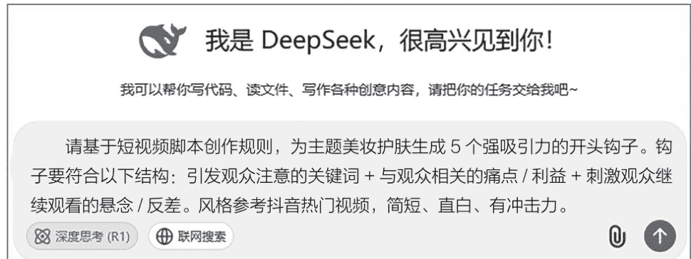

图5-3

按Enter键，将文字内容发送至DeepSeek，给出的答案如下。

1. 【停！毛孔粗大必看】“满脸插秧毛孔的姐妹别慌！这瓶几十块的冷门精华让你素颜出门被追着问医美项目。”
（关键词：停+毛孔痛点+医美反差）

2. 【卡粉起皮急救警报】“底妆翻车99次的进来抄作业！不用换粉底液，2个手法让卡粉原地消失。”
（关键词：警报+底妆痛点+手法悬念）

3. 【“00后”早C晚A翻车】“以为自己是护肤达人？这3个作死操作正在加速烂脸！第2个90%的人都中招。”
（关键词：翻车+护肤误区+数据反差）

4. 【油皮闭口终结者】“还在用针清虐待皮肤？这块会发光的肥皂敷30秒，黑头闭口自己排队滚出来。”
（关键词：终结者+错误方式+视觉化悬念）

5. 【面膜智商税避雷】“敷面膜=白花钱？美容院离职员工曝光的黄金3分钟公式，效果堪比水光针。”
（关键词：避雷+金钱痛点+专业反差）

以下为创作洞察。

1. 数字冲击：用“99次/90%/3分钟”等具象数据增强可信度。
2. 身份代入：“医美/美容院员工/‘00后’”等标签精准触达不同受众。
3. 行为指令：通过“必看/抄作业/避雷”等强引导词制造紧迫感。
4. 感官刺激：“发光肥皂/黑头排队”等可视化描述增强画面联想。

掌握“3秒留人钩子”公式，不是为了套模板，而是为了精准击中观众的注意力盲区。借助DeepSeek的提示词能力，你可以快速、批量生成不同风格的开头钩子，不断测试、优化，找到最适合你赛道和目标受众的表达方式。

以上便是DeepSeek给出的初步方案，我们确定好其中的某个方向之后，还可以向DeepSeek进一步追问，让其进行调整。追问的方向可以参考下面的提示词模板。

(1) 详细拆解“【原标题】”中的【核心方案】，用【数字】步教会【目标受众】。
(2) 用【身份背书】解释“【标题】”里【产品/方案】的【成分/技术】。
(3) 生成【数字】组“【标题关键词】”的【用户类型】对比案例。

示例如下。

(1) 详细拆解“油皮闭口终结者”中的“发光肥皂敷30秒”步骤。
(2) 用化妆品研发员身份解释“早C晚A翻车”里的“3个作死操作”。
(3) 生成3组“卡粉急救”的干皮vs油皮对比案例。

## 5.3.2 矛盾构建公式

短视频时代，观众喜欢情绪冲突和反差故事。好的内容不是平铺直叙，而是制造“戏剧性”，从而引发情绪冲突，制造反转，最终让观众产生情绪共鸣。

表5-9所示是矛盾/冲突构建的3个步骤。

表5-9

| 步骤 | 作用 | 内容特点 |
| :--- | :--- | :--- |
| 冲突（制造情绪点） | 吸引关注 | 突出一个强烈矛盾/冲突场景，激发观众的情绪（如愤怒、震惊、不解、好奇） |
| 转折（打破预期） | 保持兴趣 | 给出意料之外的解决方案、真相或观点，让观众感觉“没想到” |
| 共鸣（价值输出） | 建立好感 | 给予一个有价值的总结、洞察或启发，让观众有代入感 |

用户可以通过使用以下提示词模板，快速生成矛盾/冲突构建脚本的内容框架。

> “请为主题【×××】设计一个短视频脚本，符合【冲突—转折—共鸣】结构。
> （1）冲突：制造一个强烈的矛盾场景，激发观众的情绪。
> （2）转折：打破观众的常规预期，提出反转信息。
> （3）共鸣：输出一个有洞察、有价值、有情感的总结，引发观众的认同感。”

输入这段提示词后，DeepSeek就可以给出相应的生成内容。那么为什么要这么提问呢？我们来理解一下其背后的逻辑。

（1）冲突是吸引力的起点，一开始就应设置“矛盾”“问题”或“极端场景”。例如，“男朋友居然偷偷删掉我的简历！”——观众的情绪马上被调动起来，才愿意继续看。

（2）转折是剧情的钩子，把观众以为的套路打破。例如，“结果他说：我已经偷偷帮你投出去了”。——这种“你以为是X，其实是Y”的剧情转变，会激起观众的强烈兴趣。

（3）共鸣是传播的核心，最后给出一个情感总结或洞察，让观众点头说：“我也这样！”例如，“其实，真正的爱，是在你没看见的时候默默托底”。这种落点容易引发评论、转发。

下面以一个女生花钱护肤但皮肤越来越差为例，让DeepSeek生成一条采用矛盾构建公式的短视频脚本。我们先编辑好提示词，再接着打开“深度思考（R1）”模式的开关，关闭“联网搜索”，让DeepSeek输出答案，如图5-4所示。

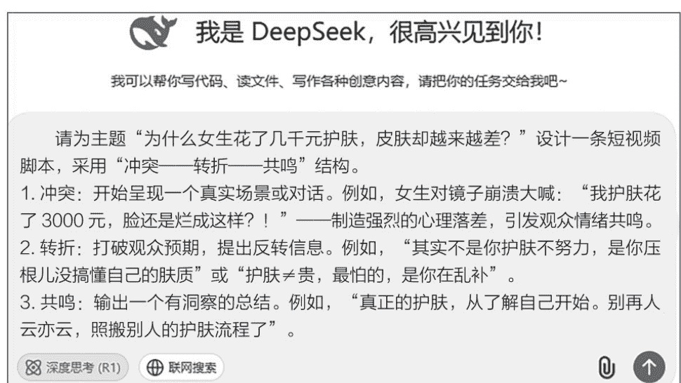

图5-4

按Enter键，将文字内容发送至DeepSeek，给出的答案如下。

### 【短视频脚本：50秒节奏版】

#### 冲突引入（0:00—0:05）

▶画面：手机前置镜头视角，女生满脸泛红痘痘，重重摔出××品牌面霜瓶。🔊

音效：玻璃瓶撞击桌面的碎裂声。🔊

画外音：“我花了3000元护肤！为什么脸更烂了？！”

#### 冲突升级（0:06—0:15）

▶画面：快速切换梳妆台堆满大牌护肤品的手部特写→撕下医用面膜后更红肿的脸部特写→手机购物车清空截图。

背景音乐：急促的钢琴音阶。

字幕弹出：“贵≠对/多≠好。”

#### 知识转折（0:16—0:25）

▶画面：实验室场景，皮肤科医生举起皮肤模型。

分镜：

- 放大镜下的油皮检测仪数据（特写）；
- 干皮女生往脸上拍爽肤水时起皮的嘴角（中景）；
- 混油皮误用厚重面霜爆痘的对比图（分屏）。

> 专家原声：“过度护肤破坏皮肤屏障的速度，比熬夜快5倍。”

#### 解决方案（0:26—0:35）

▶画面：女主扔掉3瓶护肤品，只保留2个基础产品。

分镜演示：

- 手机测肤App界面（聚焦“屏障受损”诊断）；
- 氨基酸洁面乳+神经酰胺乳液极简搭配（柔光拍摄）；
- 28天后皮肤透亮对比（实验室数据可视化动效）。

数据标板：70%的烂脸因错误护肤导致。

#### 情感共鸣（0:36—0:45）

▶画面：女主素颜在晨光中微笑，手指轻点太阳穴。

温柔女声：“皮肤不是试验田，了解比折腾更重要。”

象征镜头：仙人掌（象征女主）终于被移出多肉植物堆，单独栽进适合的沙土。

#### 行动号召（0:46—0:50）

▶画面：渐变出皮肤检测二维码+产品成分查询网站界面。

音效：舒缓的风铃声。

大字标题：“停掉不适合的昂贵，省下的钱刚好做次专业肤质检测。”

### 【运营提示】

（1）前3秒必用“摔护肤品+嘶吼”强冲突留住观众。
（2）中段插入实验室真实检测片段增强专业信任感。
（3）结尾用“素颜对比+知识类二维码”促进收藏转发。
（4）话题标签：#屏障修护 #科学护肤 #拒绝无效护肤。

### 【心理学动线设计】

焦虑制造（冲突）→认知颠覆（转折）→自我反思（共鸣）→知识缺口（行动）的完整闭环，符合Z世代“发现问题—获取方案—立即实践”的决策路径。

以上便是DeepSeek给出的初步方案，我们确定好其中的某个方向之后，还可以向DeepSeek进一步追问，让其进行调整。追问的方向可以参考下面的提示词模板。

(1) 请根据这个节奏分镜结构，为【___主题】设计3～5个内容角度（如不同问题/人群/季节/场景等），每个角度都保留原有节奏（冲突→知识→共鸣→号召），适合短视频脚本起稿。

(2) 请模仿下面的结构（冲突引入+反转知识点+实用解决方案+情绪共鸣+行动号召），为【___主题】生成一个50秒左右的短视频脚本。【受众是___】，希望“风格偏___（如口语/温暖/专业等）”，结尾要有清晰的【号召（如评论、转发、扫码等）】。

(3) 请将这个【___主题】的短视频脚本提取为通用模板（分段说明+每段要点），并将它套用到【___主题】上。保留内容节奏、冲突引入、知识点转折和行动号召的逻辑。

示例如下。

(1) 请根据这个节奏分镜结构，为“科学护肤”主题设计5个内容角度。例如，季节变化/不同肤质/护肤误区/成分迷信/刷酸风险，每个都保留冲突开头、知识转折、情绪共鸣和行动号召的节奏，用于短视频脚本创作。

(2) 请模仿下面的结构（冲突引入+反转知识点+实用解决方案+情绪共鸣+行动号召），为“正确护肤步骤”生成一个50秒短视频脚本。受众是20～35岁的女性，风格为活泼中带点幽默，结尾引导评论区讨论。

(3) 请将这个关于“护肤踩雷”的短视频脚本提取为一个结构模板（分段说明+每段要点），并套用到“护肤时的三大误区”上，内容节奏和情绪引导保持不变。

## 5.3.3 高转化结尾设计

结尾是短视频脚本的“临门一脚”，直接决定短视频的商业转化效果。一个好的结尾，不是单纯的“提醒关注”或“喊口号”，而是要通过“价值升华+行动召唤+场景指引”，来刺激观众立即行动。表5-10所示是爆款短视频脚本的结尾设计要素。

表5-10

| 要素 | 作用 | 实操策略 |
| :--- | :--- | :--- |
| 价值升华 | 放大收获感 | 再次强化观众的认知转变/启发/共鸣 |
| 行动召唤 | 引导互动或转化 | 明确告诉观众做什么（关注、点赞、私信、评论、购买） |
| 场景指引 | 营造画面感 | 让观众知道下一步会获得什么好处或体验 |

下面是高转化结尾的提示词模板和示例。

> “请为主题【×××】，根据【价值升华】+【行动召唤】+【场景指引】的结构，设计一个高转化短视频脚本的结尾，风格口语化、情绪真诚。”

下面以主题“护肤的三大误区”为例，让DeepSeek生成5个高转化短视频结尾。我们先编辑好提示词，接着打开“深度思考（R1）”模式的开关，关闭“联网搜索”，让DeepSeek输出答案，如图5-5所示。

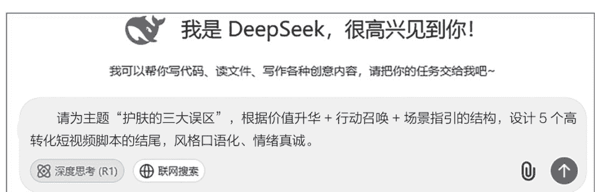

图5-5

按Enter键，将文字内容发送至DeepSeek，给出的答案如下。

给出的结尾如下。

### 结尾1：【价值升华+信任感建立】

> “护肤从来不是跟风烧钱，而是学会听懂皮肤的声音。爱自己不是往脸上堆大牌，而是用对的方法让皮肤透气。宝子们点个关注，明天手把手教你们看成分表避坑，现在赶紧去检查下自己的洗面奶成分是不是安全的！今晚睡前护肤记得温柔点啊～”

### 结尾2：【行动暗示+场景关联】

> “这3个雷区踩中任何一个，用再贵的精华都是浪费钱！现在双击屏幕保存这张总结图，下次买护肤品前拿出来对照。明早护肤的时候重点观察T区出油情况，评论区告诉我你的皮肤变化，揪3个姐妹送同款防晒检测卡！”

### 结尾3：【情感共鸣+仪式感引导】

> “护肤本该是件治愈的事，别让它变成焦虑源。从今天开始，每次涂面霜时对着镜子说句‘辛苦了’，坚持21天你会回来感谢我！现在点击购物车领20元券把温和洁面乳带回家，记住——对皮肤好的人，生活也会对她温柔。”

### 结尾4：【悬念制造+知识承诺】

> “你以为躲过这三大坑就安全了？下期揭秘连柜姐都不会说的‘无效抗老’真相！关注后戳合集看正确手法演示视频。现在马上去卫生间，把开封超过3个月的护肤品全～部～清～理～掉！”

### 结尾5：【身份认同+社群号召】

> “真正懂护肤的女生都在做减法。评论区打‘清醒护肤’让我看看有多少姐妹！置顶视频教你们用3样基础品搭出万元效果，明晚8点直播带大家现场诊断护肤品。现在先去做这件事：把手机亮度调到40%——这也是在护肤！”

### 【执行逻辑】

(1) 价值锚点：从“护肤技术”升华到“自我关怀”“生活态度”等高阶需求。
(2) 行动颗粒度：给出具体到分钟/场景的触发动作（如“现在去检查洗面奶”）。
(3) 情绪曲线：用“警示—安抚—激励”三段式调动观众情绪，结尾留积极心理暗示。
(4) 转化闭环：每个结尾至少埋2个转化路径（关注/加购物车/直播/加入社群/互动）。

以上便是DeepSeek给出的初步方案，我们确定好其中的某个方向之后，还可以向DeepSeek进一步追问，让其进行调整。追问的方向可以参考下面的提示词模板。

(1) 请根据【结尾风格（如“情感共鸣+仪式感引导”）】，继续为【___（具体产品或主题）】设计3个不同结尾文案。每个结尾都要包含情绪升华、具体行动引导和互动转化。

(2) 请围绕#___标签，批量生成10组短视频结尾话术。受众是【目标受众】，每组结尾都包含【情绪收口+行为指令+引导互动】，语言要贴近【___（如年轻妈妈/白领/大学生）】的使用习惯。

示例如下。

(1) 请根据【情感共鸣+仪式感引导】的风格，为【控油粉底液】设计3个短视频结尾。内容要贴合上班族女性、夏季出油焦虑、希望清爽通勤的场景。

(2) 请围绕#母婴安心选购，批量生成10组短视频结尾话术。受众是新手妈妈，每组结尾要有【安抚情绪+具体操作指令（如“下次购物记得看成分表”）+评论区互动引导】，语言要贴近【年轻妈妈】的使用习惯。

# 第6章 批量内容生产——DeepSeek的工业化流程

在内容为王的短视频时代，个体内容创作者和品牌内容团队的最大痛点，已经不再是能不能做内容，而是能不能高效、规模化地做内容。短视频/图文平台、自媒体矩阵、电商内容运营……所有内容战场背后，真正决定胜负的不是灵感爆发的瞬间，而是持续稳定的内容生产能力。而AI时代的到来，新的内容生产力工具正在悄然重塑内容行业的游戏规则。

本章将会集中解决关于如何批量高效生产内容的3个核心问题。

- 一个人没办法做太多内容，怎么才能批量高效生成图文内容？
- 短视频创作太耗时间，一个脚本就要想半天，有没有快速输出内容的方法？
- 不同平台的要求不一样，我的内容怎么适配不同平台的脚本风格？

## 6.1 用DeepSeek联动生图工具批量生图，运营图文账号矩阵

图文内容依然是信息分发的重要载体。无论是小红书、公众号、知乎，还是新兴的AI社交平台，优质的图文账号矩阵，正在成为个体内容创作者和品牌内容团队的必备武器。本节将详细介绍DeepSeek的强大文本生成能力，可联动AI绘图工具进行批量生图，为图文账号矩阵的运营提升效率。

### 6.1.1 DeepSeek+AI绘图工具批量生成封面、配图

DeepSeek作为智能大语言模型，能够精准解析用户需求，并生成与之高度契合的提示词，从而能有效提升AI绘画工具的可控性和创造力。

#### 1. DeepSeek生成AI绘画提示词

DeepSeek可以基于特定的风格（如二次元、赛博朋克、油画风等）、主题（如未来城市、梦幻森林、历史人物），以及细节描述（如光影效果、色彩氛围、构图方式）生成专业级的AI绘画提示词。下面是其详细的操作步骤。

01 打开DeepSeek，进入其主页，在输入框内输入图6-1所示的提示词，这里以“山水中国风”为主题。

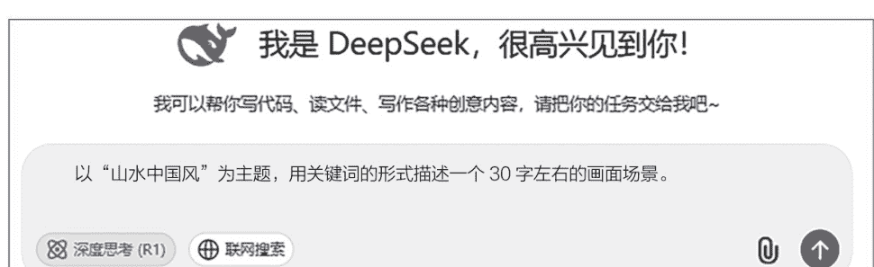

图6-1

02 按Enter键，将提示词发送给DeepSeek，即可得到相应的回复内容，如下所示。

水墨风格的山峰，湖面飘着薄雾，小船上站着穿蓑衣的人，白墙青瓦的房屋在云雾间半遮半掩，有飞鸟从松树边飞过，深蓝色的天空中挂着橘色夕阳。

#### 2. 可灵AI、即梦AI依据提示词生成图片

可灵AI是一款强大的图片生成工具，它根据用户的文本描述或参考图片，利用AI技术生成符合要求的图片。下面是其详细的操作步骤。

01 打开可灵AI，在首页单击“AI图片”工具，进入其编辑页面，在图片“创意描述”框内输入DeepSeek生成的AI绘画提示词，如图6-2所示。

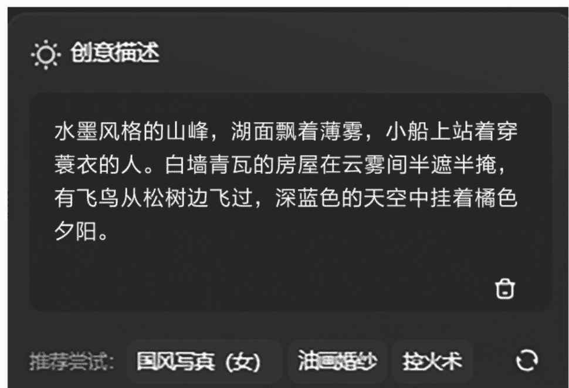

图6-2

02 执行该操作后，调整图片比例为“3：2”，单击“立即生成”按钮，稍等片刻即可得到一组与提示词对应的图片内容，如图6-3所示。

图6-3

03 将鼠标指针移至其中一幅最心仪的图片内容上，单击“下载”按钮，如图6-4所示，即可将该图片内容保存至本地。

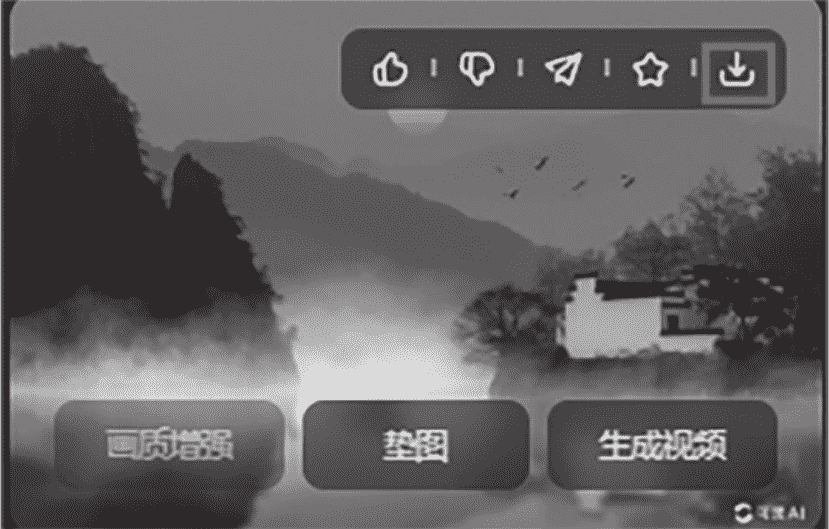

图6-4

如果你想直接生成小红书可用的封面和插图，可以利用即梦AI的智能画布功能。下面是其详细的操作步骤。

01 打开即梦AI，在左侧工具栏内选中“智能画布”功能，如图6-5所示。

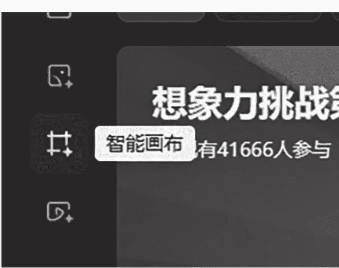

图6-5

02 执行该操作后，即可进入智能画布编辑页面，单击“文生图”按钮，在“描述词”输入框内输入DeepSeek生成的AI绘画提示词，如图6-6所示。

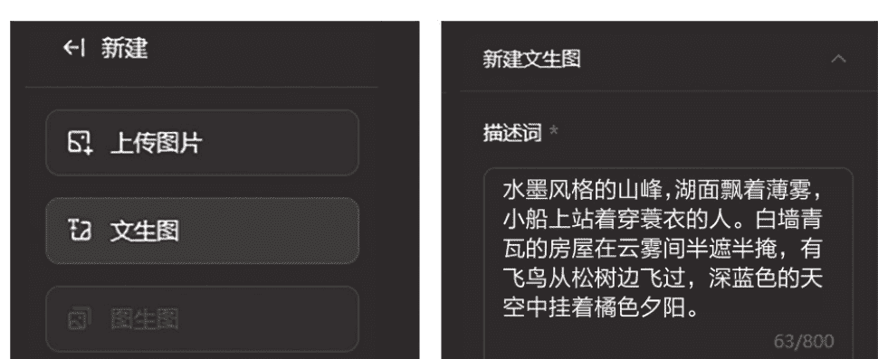

图6-6

03 在描述词内空一行，输入封面提示词“标题在图片中间写着：国风治愈系壁纸。注意：字体炫酷彩色，字不要写错，字号不要太大”，如图6-7所示。

> 提示：标题的内容和形式可以按自己所需进行更改。

04 单击“立即生成”按钮，稍等片刻即可得到相应的图片内容，如图6-8所示。

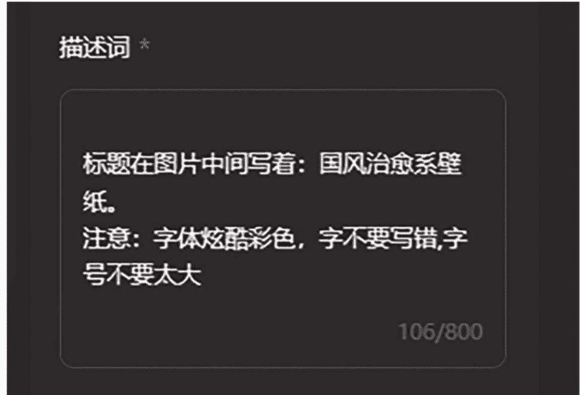

▲图6-7

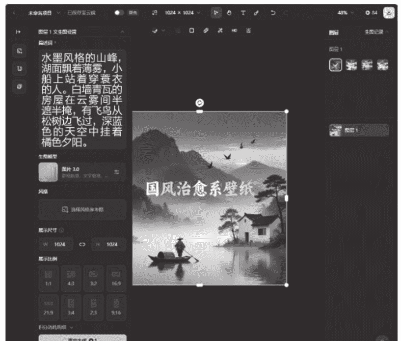

▲图6-8

用户可以通过上述步骤使用DeepSeek和可灵AI或即梦AI生成配图或封面。如果用户想要一次性生成多幅图片内容，可以通过调整提示词让DeepSeek生成多份AI绘画提示词，再复制、粘贴至AI绘画工具即可。参考如下提示词模板。

> “请批量生成30组适合【绘画主题】的AI绘画提示词，用于生成图文封面/短视频背景图/插画风配图，要求格式为：【风格关键词】+【主体对象】+【场景元素】+【细节修饰】+【构图要求】+【画质要求】。”

输入这段提示词后，DeepSeek就可以给出相应的生成内容。那么为什么要这么提问呢？我们来理解一下其背后的逻辑。

（1）“请批量生成30组适合【绘画主题】的AI绘画提示词，用于生成图文封面/短视频背景图/插画风配图”，这句话的意思是给DeepSeek下达任务的大纲，告诉它：做什么、数量多少、主题方向、应用场景。

（2）“要求格式为：【风格关键词】+【主体对象】+【场景元素】+【细节修饰】+【构图要求】+【画质要求】”这句话的意思是给DeepSeek设定提示词的结构，就像你写作文时先完成“写作提纲”。

下面以电商产品为主题，让DeepSeek生成关于电商产品插图和封面图的AI绘画提示词。我们先编辑好提示词，接着打开“深度思考（R1）”模式的开关，关闭“联网搜索”，让DeepSeek输出答案，如图6-9所示。

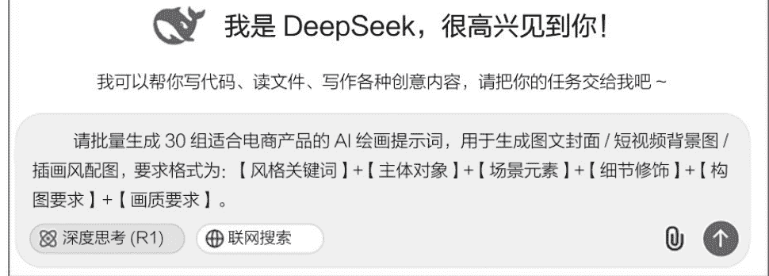

图6-9

按Enter键，将文字内容发送至DeepSeek，给出的答案如下。

以下是30组符合要求的AI绘画电商产品提示词（注：笔者已优化排版）。

1. 【赛博朋克霓虹美学】+【透明美妆精华瓶】+【未来实验室场景】+【液态流光/金属折射/数字粒子】+【中心对称构图】+【8K分辨率的超写实渲染】
2. 【莫兰迪色水彩】+【北欧风布艺沙发】+【阳光书房角落】+【织物褶皱/漂浮灰尘/植物投影】+【对角线构图】+【4K分辨率的纸纹质感】
3. 【低多边形3D建模】+【无线蓝牙耳机】+【几何冰川场景】+【镭射虹彩/晶体折射/极光粒子】+【俯视透视】+【矢量插画精度】
4. 【新中式水墨晕染】+【青瓷茶具套装】+【竹林庭院茶席】+【烟云缭绕/竹影斑驳/金箔点缀】+【留白式构图】+【宣纸肌理4K分辨率】
5. 【蒸汽波艺术风格】+【复古游戏掌机】+【粉紫渐变云层】+【故障特效/像素网格/镭射光晕】+【倾斜动态构图】+【霓虹光斑渲染】
6. 【微距摄影质感】+【手工巧克力礼盒】+【可可豆种植园】+【糖霜结晶/融化解理/晨露反光】+【中心聚焦特写】+【焦外虚化处理】
7. 【扁平矢量插画】+【智能手表表盘】+【数据流背景墙】+【渐变等高线/运动轨迹线/悬浮图标】+【黄金螺旋构图】+【300点/英寸印刷级】
8. 【超现实计算机动画（CG）渲染】+【悬浮瑜伽垫】+【反重力星空舱】+【星尘环绕/能量光带/液体金属】+【广角仰拍视角】+【电影级光追效果】
9. 【日系和风版画】+【陶瓷餐具套装】+【枫叶庭院餐桌】+【漆器光泽/食物蒸汽/浮世绘云纹】+【对称式布局】+【木版雕刻纹理】
10. 【孟菲斯几何波普】+【儿童积木玩具】+【彩色几何城市】+【撞色拼接/立体纸艺/阴影渐变】+【等距透视】+【矢量平滑边缘】
11. 【写实油画笔触】+【红酒瓶与高脚杯】+【中世纪酒窖场景】+【橡木纹理/酒液挂壁/烛光摇曳】+【三角稳定构图】+【亚麻画布肌理】
12. 【低多边形】+【全景运动相机】+【雪山滑翔场景】+【冰晶折射/速度线条/云层切割】+【鱼眼镜头变形】+【高光金属质感】
13. 【故障艺术风格】+【透明电竞键盘】+【数字矩阵空间】+【RGB光污染/数据碎片/扫描线纹】+【倾斜失重构图】+【Glitch特效叠加】
14. 【吉卜力动画风格】+【野餐篮食品组合】+【魔法草原场景】+【柔光滤镜/蓬松云朵/童话光影】+【广角俯视】+【手绘水彩质感】
15. 【超写实3D渲染】+【钻石戒指首饰】+【光线暗箱实验室】+【多棱面折射/激光路径/分子结构】+【微距环形光】+【商业级产品精修】

……

提示词设计策略。

- 风格跨度：覆盖15多种主流视觉风格，适应不同产品类目的调性。
- 电商适配：重点突出产品主体，场景元素增强代入感。
- 技术参数：明确渲染精度要求，确保商业可用性。
- 视觉层次：通过构图指导和细节修饰提升画面表现力。
- 移动优化：兼顾短视频竖屏构图与计算机端横版需求。

可根据具体产品类目调整风格权重，如美妆类侧重超写实与流体特效，3C数码类适合赛博朋克与低多边形风格，食品类推荐手绘与水彩质感。

图6-10是复制“【写实油画笔触】+【红酒瓶与高脚杯】+【中世纪酒窖场景】+【橡木纹理/酒液挂壁/烛光摇曳】+【三角稳定构图】+【亚麻画布肌理】”AI绘画提示词，生成的AI绘画内容。

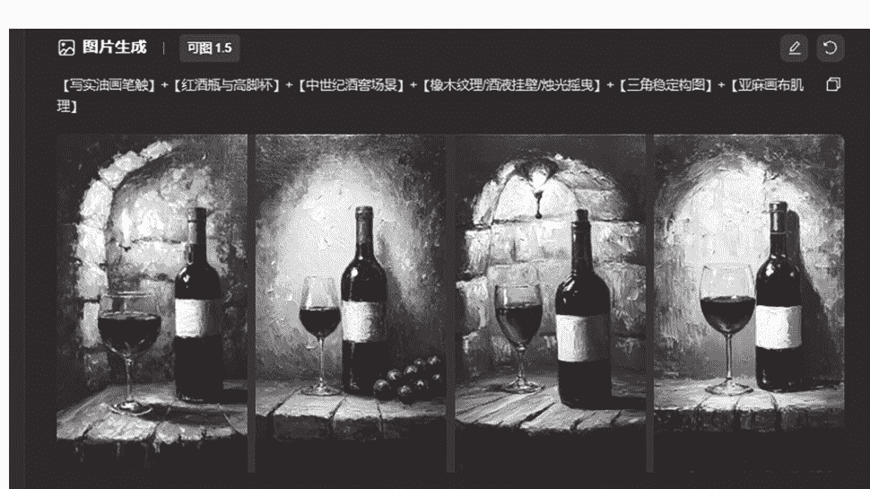

图6-10

## 6.1.2 用DeepSeek批量生成图文内容

DeepSeek作为一款AI内容创作工具，可以帮助用户大幅提高图文内容的生产效率，下面是相应的提示词模板。

> “请批量生成【××类内容】，要求风格为【风格】，内容定位为【账号定位】，每条内容字数在【×～×个】，采用【表达风格】，适合用于【发布平台】图文内容，并搭配【插图风格】的AI绘画提示词。”

输入这段提示词后，DeepSeek就可以给出相应的生成内容。那么为什么要这么提问呢？我们来理解一下其背后的逻辑。

（1）“请批量生成【××类内容】”，这句话是告诉DeepSeek你要“什么类型”的内容，并且一次生成多条。

（2）“要求风格为【风格】，内容定位为【账号定位】，每条内容字数在【×～×个】，采用【表达风格】，适合用于【发布平台】图文内容”，这句话主要是让DeepSeek生成内容时注意风格统一、定位清晰，了解字数、发布平台等要求。

（3）“并搭配【插图风格】的AI绘画提示词”，这句话是让DeepSeek帮助生成与文案对应的AI绘画提示词描述。

下面以读书金句和生活感悟类为主题，让DeepSeek生成相应的文案内容和AI绘画提示词。我们先编辑好提示词，接着打开“深度思考（R1）”模式的开关，关闭“联网搜索”，让DeepSeek输出答案，如图6-11所示。

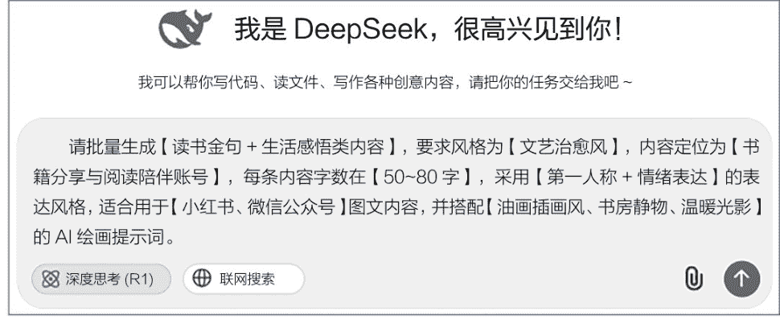

图6-11

按Enter键，将文字内容发送至DeepSeek，给出的答案如下。

以下是符合要求的文艺治愈风读书金句与生活感悟文案内容，并附AI绘画提示词参考。

---

### 文案内容1

> “书页沙沙作响时，我听见时间在呼吸。”

窗边的咖啡喝第三口时已经凉透了，这才舍得合上《夜航西飞》。风掀动亚麻窗帘的褶皱，像翻动故事的注脚。原来孤独与自由本是一体，在文字里悄然和解。此刻的沉默，是灵魂舒展的声音。

AI绘画提示词：

油画插画风 | 老式台灯与翻开的书 | 亚麻窗帘透入暖光 | 咖啡杯水汽氤氲 | 斑驳木纹桌面

---

### 文案内容2

读到“我们终将活成自己的故乡”，指尖突然发烫。

晾衣绳上的白衬衫还在滴水，蝉鸣穿透八月燥热。那些被生活揉皱的执念，在加缪的文字里被一寸寸熨平。原来流浪与扎根，都是对生命的深情凝视。

AI绘画提示词：

温暖光影 | 窗台绿植与泛黄书页 | 晃动的衬衫剪影 | 老电风扇的金属光泽 | 被水渍晕染的笔记本

---

### 文案内容3

普鲁斯特的玛德莱娜蛋糕，在我掌心化作半块桂花糕。

地铁玻璃映出倦容，电子屏蓝光吞噬黄昏。但包里蜷缩的《小王子》，始终是口袋里的星星，有些星星坠落，是为了教我们仰望。

AI绘画提示词：

书房静物 | 磨砂玻璃罐装干桂花 | 褶皱牛皮纸书套 | 地铁车窗反射的人影 | 暖黄吊灯的光斑

---

### 文案内容4

合上《秋园》时，发现泪水比文字更先抵达真相。

阳台上晾晒的棉被鼓起风的形状，像那些未被言说的人生。我们读他人的故事，原是为了打捞自己沉没的月光。

AI绘画提示词：

油画笔触 | 旧竹编晾衣架 | 浮动棉被的投影 | 褪色印花床单 | 斜阳穿透纱帘的丁达尔效应

---

### 文案内容5

博尔赫斯说：“天堂是图书馆的模样”，而我偏爱人间这盏夜读的灯。

外卖单据在桌角蜷成纸船，键盘声在隔壁渐弱。当所有喧嚣退潮后，文字是最后一块不会融化的浮冰。

AI绘画提示词：

温暖光影 | 铸铁台灯暖黄光晕 | 堆叠的图书与便利贴 | 玻璃杯凝结水珠 | 窗外深蓝色夜幕

……

将AI绘画提示词复制、粘贴至AI绘画工具中，即可生成相应的图片内容，如图6-12所示。

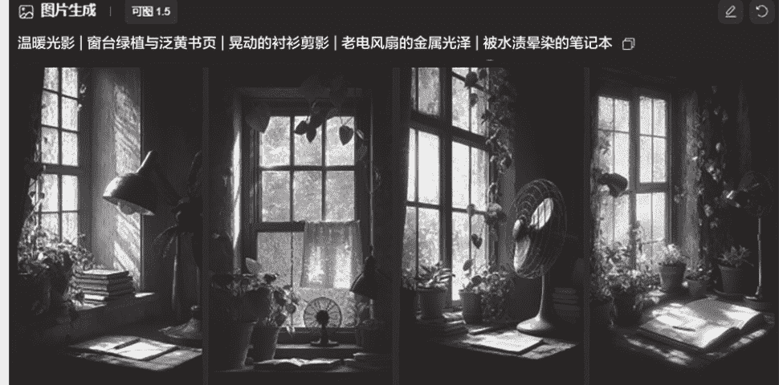

图6-12

将生成的图片内容下载至本地，再将文案内容和图片内容上传至小红书，发布效果如图6-13所示。

图6-13

## 6.2 用DeepSeek批量生成短视频脚本，运营短视频账号矩阵

在当下内容竞争激烈的短视频时代，“一个爆款带不动一个账号”，而“一个账号矩阵却可以撬动整个流量池”。很多成功的短视频创作团队，不再遵循“一个账号配备一个运营”，而是通过打造“内容矩阵”实现多账号联动、高频内容输出和跨平台覆盖。

### 6.2.1 用DeepSeek批量生成短视频脚本

在内容为王的短视频时代，创意不再是瓶颈，效率才是壁垒。如果你想打造爆款内容矩阵，关键不是“拍一条视频”，而是“批量生产10条，乃至100条好内容”。下面是使用DeepSeek批量生成短视频脚本的提示词模板。

> “请为【主题】生成【数量】条【视频类型】短视频脚本，结构为：【结构模块A】+【结构模块B】+【结构模块C】。（可视类型补充）要求：语言风格为【风格要求】，每条控制在【时长】左右，语气为【语气要求】；结尾建议添加【转化/互动/金句等要求】。”

输入这段提示词后，DeepSeek就可以给出相应的生成内容。那么为什么要这么提问呢？我们来理解一下其背后的逻辑。

（1）“请为【视频主题】生成【数量】条【视频类型】短视频脚本”，这句话是明确任务目标，告诉DeepSeek你需要“几条什么类型”的脚本，也是控制批量生成脚本的提示词部分。
（2）“结构为：【结构模块A】+【结构模块B】+【结构模块C】”，这句话是在告诉DeepSeek：“别乱写，要按我给的套路来。”
（3）“语言风格为【风格要求】，每条控制在【时长】左右，语气为【语气要求】”，这句话是为了控制脚本的风格、时长和语气。
（4）“结尾建议添加【转化/互动/金句等要求】”，这句话是在让DeepSeek自动帮你设计“视频结尾的引导动作”，帮助实现与观众互动的目的。

下面通过代入母婴博主的视角，使用DeepSeek针对“宝宝夜醒频繁到底要不要喂奶”主题生成3条科普类短视频脚本。我们先编辑好提示词，接着打开“深度思考（R1）”模式的开关，关闭“联网搜索”，让DeepSeek输出答案，如图6-14所示。

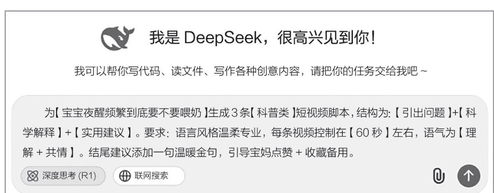

图6-14

按Enter键，将文字内容发送至DeepSeek，给出的答案如下。

这里有3条符合要求的科普短视频脚本，供参考。

### 脚本一：夜醒≠饥饿

[场景：深夜婴儿床前温柔俯拍视角] ▶

**引出问题（10秒）**

“连续一周夜醒8次，一哭就喂奶，累到崩溃？先别急着塞奶瓶！很多宝宝夜醒频繁可能不是饿，频繁喂奶反而可能加重问题。”

**科学解释（20秒）**

“新生儿胃容量小，需要2～3次夜奶，但3个月后逐渐形成昼夜节律。6个月的宝宝夜间消耗仅占全天的20%，持续夜奶可能形成‘吃睡联想’，把吮吸当作安抚工具而非真饥饿。”

**实用建议（25秒）**

“判断标准：白天喂养充足+体重增长正常，可尝试延迟响应。先用轻拍、嘘声安抚，若大哭不止再喂。逐步拉长喂奶间隔，6个月后尝试戒除夜奶。尿布/温度/出牙不适等因素也要排查。”

[结尾特写母婴相拥画面]

“宝宝需要妈妈，但更需要一个快乐健康的妈妈❤️点赞、收藏，科学养育不焦虑。”

### 脚本二：睡眠周期的秘密

[场景：妈妈抱着宝宝在月光下轻摇]

**引出问题（10秒）**

“每次刚放下就醒，整夜像在‘拆炸弹’？其实宝宝的睡眠周期比成人短得多，频繁醒可能是正常生理现象。”

**科学解释（20秒）**

“婴儿睡眠周期约45分钟，浅睡眠占50%。在周期交替时会扭动、哼唧甚至睁眼，这时急着喂奶反而会彻底唤醒宝宝。观察3～5分钟，多数情况婴儿会自行继续睡觉。”

**实用建议（25秒）**

“继续睡觉小技巧：保持环境一致性，醒时用睡袋触感/白噪声持续。轻拍节奏与心跳同步（每分钟60下），避免眼神接触。白天多俯卧练习，消耗体能提升睡眠质量。”

[窗外晨曦透入镜头]

“宝宝的睡眠像拼图，我们要做的不是强行拼凑，而是给TA时间慢慢完整✨点亮小心心，育儿难题不孤单。”

### 脚本三：过度喂养信号

[场景：餐桌上摆着奶瓶和辅食餐具]

**引出问题（10秒）**

“明明刚喂过1小时，怎么又哭着找奶？当心过度喂养！夜间频繁进食可能让宝宝更难受。”

**科学解释（20秒）**

“过度喂养会加重肠胃负担，引发胀气、反流，形成‘吃—难受—求安抚’的恶性循环。研究显示，9月龄后频繁夜奶的宝宝，龋齿风险增加3倍。”

**实用建议（25秒）**

“调整策略：逐步减少单次奶量（每次减30mL），用安抚巾替代部分喂养。晚餐添加慢消化的碳水化合物，建立‘吃—玩—睡’模式。记录睡眠日记，找到宝宝真实的需求规律。”

[镜头推近宝宝安睡的脸庞]

“最好的爱是适度的满足，温柔而坚定的陪伴会开出最美的花✨收藏备用，和千万妈妈共同成长。”

每个脚本时长控制在58～62秒，通过场景化开头引发共鸣，用数据支撑专业度（如睡眠周期比例、龋齿数据），建议具体可操作。结尾金句避免说教，用自然意象传递温暖力量，符合小红书用户审美偏好。

以上便是DeepSeek给出的初步方案，我们确定好其中的某个方向之后，还可以向DeepSeek进一步追问，让其进行调整。追问的方向可以参考下面的提示词模板。

（1）目前我已经选定了【“宝宝夜醒≠饿”的科普视频】脚本，内容时长约【63秒】，是否还可以再压缩【5秒】？哪些部分适合精简？
（2）我的结尾用了金句【“你不是一个人在熬夜哄娃”】，你能给我3个类似但不说教、适合收藏的“温柔金句”备选吗？
（3）我想引用【《美国儿科学会睡眠指南》】来增强可信度，应该放在哪一段才显得不突兀又加分？

因为篇幅有限，其他示例内容就不在这一一展示了，读者可根据上述追问模板并结合自身切实情况去向DeepSeek追问。

### 6.2.2 优化多平台适配，用DeepSeek调整不同平台的脚本风格

很多内容创作者在用AI生成短视频脚本时，常常忽略一个核心问题——不同平台的脚本风格和受众偏好差异极大。同一个选题、同一篇内容，如果套用同样的表达方式，在抖音大爆，可能在B站却无人问津。本节将使用DeepSeek为你调整不同平台的脚本风格。表6-1所示为不同平台的风格、节奏和受众偏好解析。

表6-1

| 平台 | 主要目标受众 | 内容节奏 | 受众偏好 | 脚本建议关键词 |
| :--- | :--- | :--- | :--- | :--- |
| 抖音 | 广谱人群、下沉用户 | 快节奏，反差感强 | 抓眼钩子、冲突剧情、情绪刺激 | 3秒钩子、冲突转折、金句结尾 |
| 小红书 | 女性、高知、新中产 | 节奏中等，真实感强 | 生活方式、真实体验、视觉精致 | 生活场景、共鸣情绪、亲和语言 |
| 微信视频号 | 微信生态中年用户 | 节奏慢，可信度强 | 实用干货、情感链接、强信任感 | 教程干货、情绪陪伴、品牌温度 |
| B站 | Z世代、深度兴趣群体 | 节奏可快可慢 | 逻辑清晰、内容深、表达真诚 | 知识结构、梗文化、剧情反转 |

那么该如何使用DeepSeek调整不同平台的短视频脚本风格？可以参考下面的提示词模板。

> “请为【主题】生成【数量】适用于【目标平台】的【视频类型】短视频脚本，结构为：【结构模块A】+【结构模块B】+【结构模块C】。要求：节奏为【快/慢/中】，语言风格为【风格类型】，每条控制在【时长】以内。输出内容请加入【钩子/反转/情绪点/知识点】以贴合平台偏好。”

输入这段提示词后，DeepSeek就可以给出相应的生成内容。那么为什么要这么提问呢？我们来理解一下其背后的逻辑，上述内容中介绍过的内容就不再介绍了。

（1）“请为【主题】生成【数量】适用于【目标平台】的【视频类型】短视频脚本”，这句话是告诉DeepSeek你想做哪方面的内容，要发到哪个平台，并且是什么风格的内容。
（2）“要求：节奏为【快/慢/中】，语言风格为【风格类型】，每条控制在【时长】以内”，本句给DeepSeek定下创作的语速、语调、时长的标准。
（3）“输出内容请加入【钩子/反转/情绪点/知识点】以贴合平台偏好”，这句话是告诉DeepSeek，内容里要有爆点或看点，以增强视频的吸引力。

下面通过代入母婴博主的视角，使用DeepSeek针对“新手爸妈如何挑选婴儿车”生成3条适用于B站的科普类短视频脚本。我们先编辑好提示词，接着打开“深度思考（R1）”模式的开关，关闭“联网搜索”，让DeepSeek输出答案，如图6-15所示。

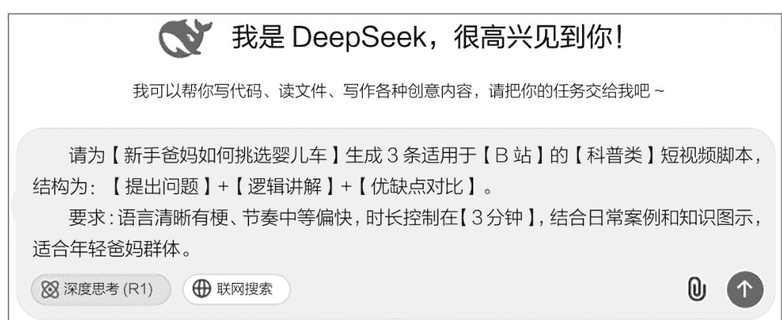

图6-15

按Enter键，将文字内容发送至DeepSeek，给出的答案如下。

以下是为B站量身定制的3条婴儿车科普类短视频脚本，结合流行梗和实用干货，符合年轻爸妈群体的观看习惯。

---

**脚本1：婴儿车选错=社死现场？高景观vs轻便车全测评！**

时长：2分55秒

# 第7章 从内容到收益——用DeepSeek变现

创作者做内容创作，其目的不只是好看，更是希望能赚到钱。

无论你是拍视频、写文章，还是做播客、发图文，大家都在关心一个问题：怎么靠内容变现？其实，靠内容变现的方式有很多，比如接广告、带货卖东西、出付费课程，或者跟品牌合作。

但问题来了：内容再好，如果没有清晰的变现方法，也很难有稳定的收入。而这时候，DeepSeek就能帮上大忙，不仅能帮你快速生成内容，还能帮你提升变现的效率。

本章将集中解决下面4个核心问题。

- 我不知道做自媒体到底有哪些赚钱方式，怎么选适合自己的方式？
- 我的内容已经初见成效，但是变现效果却并不理想，怎样提高赚钱效率？
- 我想搞带货或知识付费，但不知道该怎么策划内容和话术？
- 我想长期稳定赚钱，而不是靠一两条爆款内容，该怎么办？

## 7.1 常见的内容变现方式

要靠内容变现，第一步就是搞清楚有哪些变现的方式。不同的内容形式、发布平台和受众群体，其变现方法也不太一样。本节将会带你认识几种最常见，也最容易上手的内容变现方式。

### 7.1.1 自营店铺变现

对于那些拥有店铺的自媒体运营者来说，他们拥有一种得天独厚的变现方式——通过自营店铺直接销售商品。这种变现方式便捷高效，运营者可以利用短视频直观地展示自己的产品，吸引用户的注意力，从而激发其购买欲望，如图7-1所示。

用户被你的短视频吸引注意力后，容易激发起购买欲望。此时，只需单击进入你的主页，然后再单击你的商品橱窗即可购买，如图7-2所示。

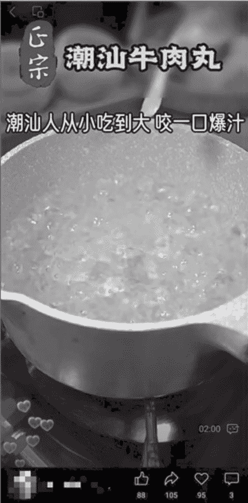

▲图7-1

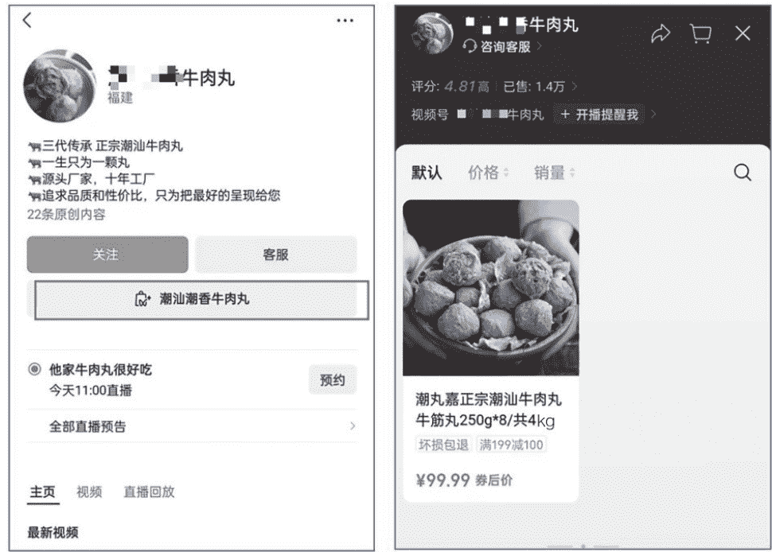

▲图7-2

### 7.1.2 博主带货变现

带货、卖货这种变现方式比较常见，我们比较熟知的就有“口红一哥”等网红“大V”，他们就是通过直播带货来赚取收益的。

运营者可以将自己带货、卖货的短视频事先剪辑处理好，然后发布在短视频账号上，让观众在观看视频的时候对产品产生兴趣，然后购买该产品。

当你的账号有一定的粉丝基础之后，就会有品牌方找你为他们的品牌带货，然后给你广告费或佣金，这是一种比较理想的变现方式。

运营者可以根据自己短视频的账号定位来选择带货的产品，一般符合短视频定位的产品售卖效果会更好，效果好才能得到其他同类品牌方的青睐，从而有更多的品牌方愿意在你的账号投放广告。

例如，某短视频账号就得到了某些淘宝店铺的青睐，于是该账号的很多短视频都添加了淘宝链接，帮该淘宝店铺推广商品，同时获得相应的广告费或佣金。图7-3所示为某账号带货短视频的截图。

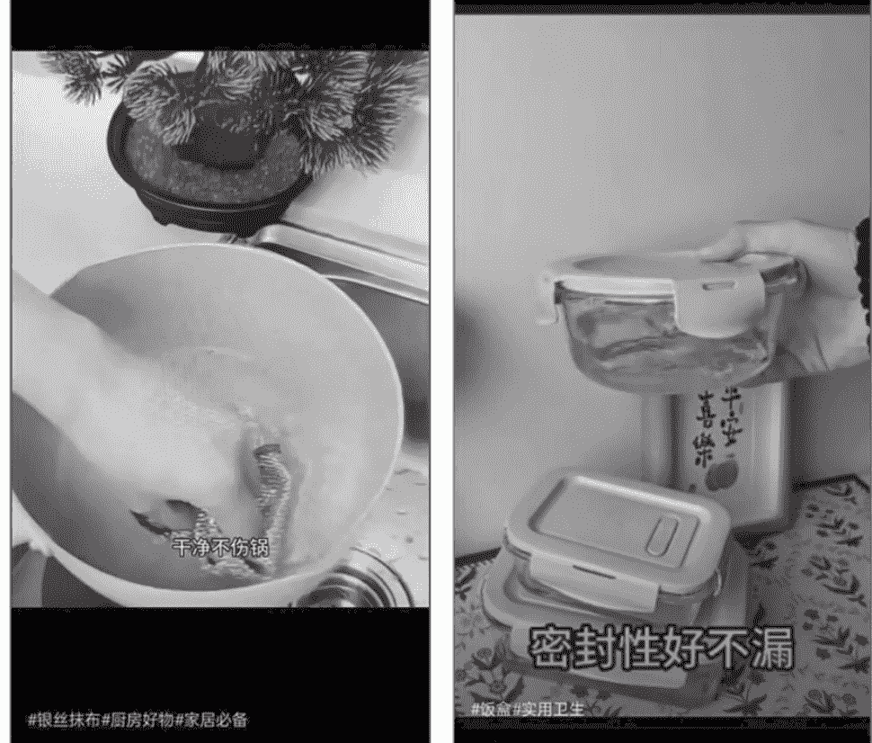

图7-3

### 7.1.3 售卖课程变现

对于部分自媒体账号和培训机构来说，可能无法为消费者提供实质类的商品，但拥有足够的干货内容，通过在自媒体平台开设课程招收学员的方式，同样能够借助课程费用赚取收益，如图7-4所示。

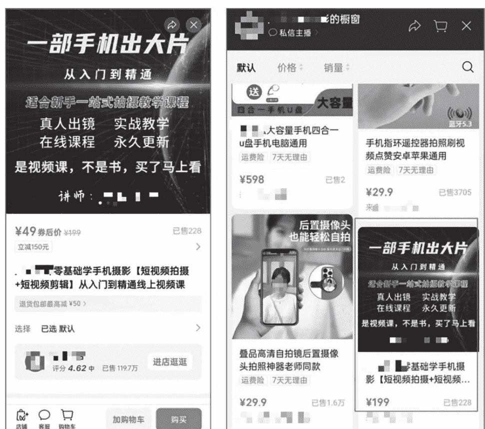

图7-4

### 7.1.4 添加分销链接

随着自媒体领域的蓬勃发展，分销变现逐渐崭露头角，成为众多自媒体运营者青睐的变现方式。尤其对于那些自身没有店铺或产品的运营者来说，分销不仅提供了一个高效、灵活、可行的变现途径，更是一个相对稳定的收入来源。

这种分销模式意味着自媒体运营者通过协助其他商家销售商品，从中赚取佣金。

当前，市面上涌现出众多可供分销的平台，如多多进宝、淘宝联盟、微盟、有赞商城等，它们为运营者提供了丰富的商品资源和便捷的分销渠道。下面我们以淘宝联盟为例，深入了解一下分销的基本运作方式。

01 下载并注册淘宝联盟，然后进到主界面中，既可以选择符合自己短视频定位的产品，也可以在界面上搜索框中输入自己想要推广的产品，如图7-5所示。

02 在找到自己想要推广的产品后，单击“赚”按钮，如图7-6所示。执行该操作后，就会弹出“分享”页面，单击“一键分享”按钮，如图7-7所示，即可自动保存图片、文案和口令，然后在发布短视频时，将口令粘贴即可。

▲图7-5

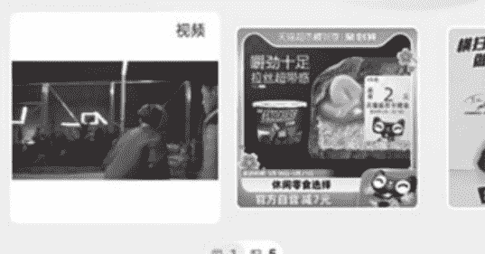

▲图7-6

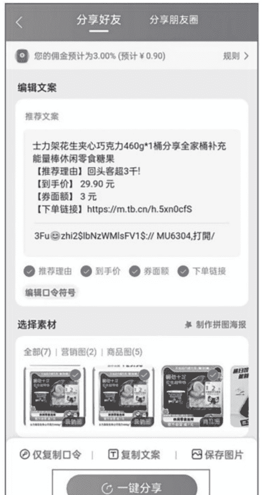

▲图7-7

03 用户不仅可在发现页面中挑选商品，还可以在“榜单”和“跟推广场”中选择商品，这里可以看到有哪些商品是销量好的，同样也可以看到同类型的运营者在推什么类型的商品，可以起到借鉴作用，如图7-8所示。

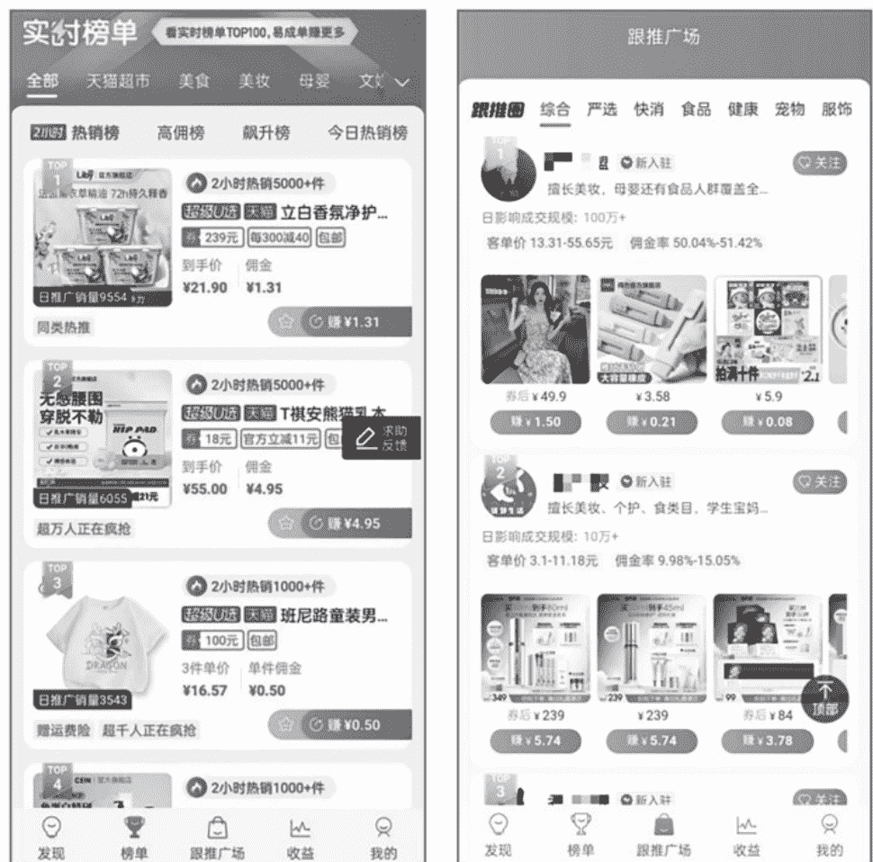

图7-8

04 运营者还可以在淘宝联盟的“我的”界面设置自己账号的基本信息。例如，图7-9所示为淘宝联盟的“我的”界面截图。至于推广收益情况，运营者可以在“收益”界面查看，如图7-10所示。

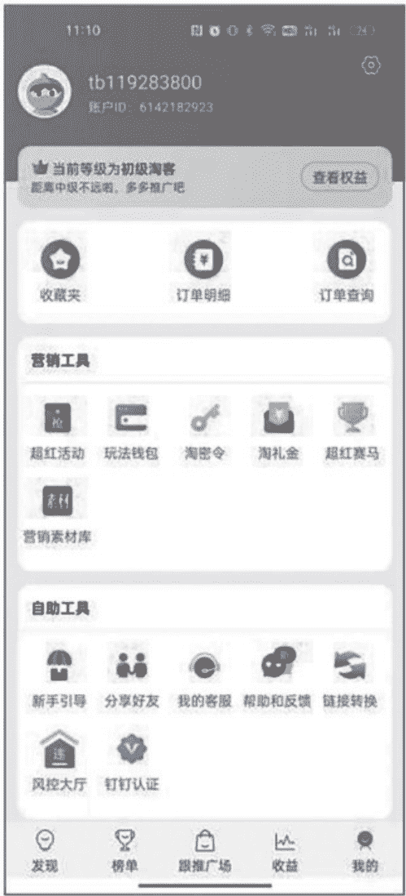

▲图7-9

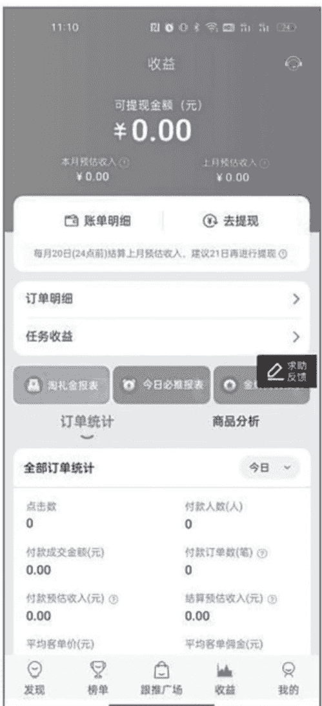

▲图7-10

当然，在添加商品时，自媒体运营者可以事先查看某种商品每单可获得的收益。以食品类商品为例，运营者可以直接搜索食品，查看相关产品每单可获得的收益。运营者可选择佣金高、销量好的商品进行推广。

当买家成功购买该商品之后，运营者就会得到对应的佣金收入。一般来说，只要商品选得好，佣金收入就会非常可观。

### 7.1.5 服务转化变现

自媒体运营者除了推广商品，还可以通过提供各类服务来实现收益，服务的转化方式多种多样。下面以某运营者在短视频上发布房源信息的实例为例，介绍他是如何通过为租房客提供专业服务来实现变现的，如图7-11所示。

这类短视频通常由房屋租赁公司运营，他们将详细的房源信息发布在短视频上，并通过短视频简介中的个人微信号，将感兴趣的用户导流个人微信中。通过这种方式，用户能够获取更全面、精准的房屋信息，进一步了解房源详情，从而更有助于房屋的成功出租。这种服务模式不仅提升了短视频的传播效率，也增加了房屋租赁的成交几率，为运营者带来了可观的收益。

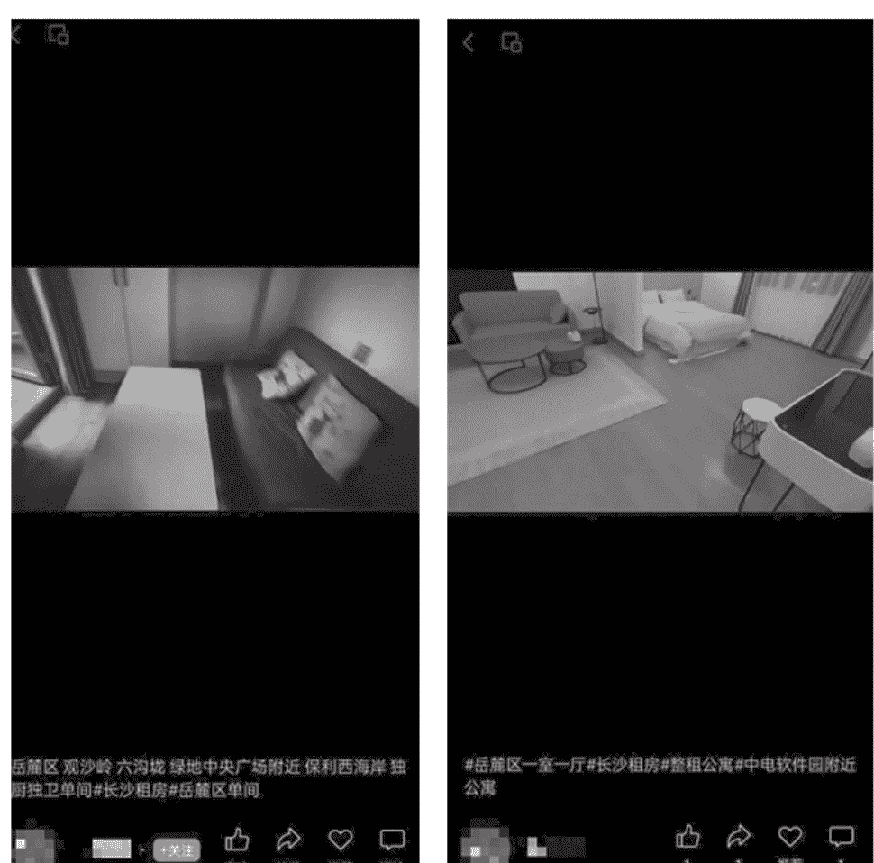

短视频并不仅限于提供房源信息服务，它的服务范畴实际上十分广泛。除了房源发布，还可以涵盖招聘、相亲、家教等多种服务类型。运营者可以根据自己短视频的定位和目标受众需求，选择适合的服务类型来提供给用户。

### 7.1.6 直播收益变现

短视频和直播息息相关，历经几年的发展，直播行业从一开始的“野蛮生长”，到流量红利，再到优胜劣汰、市场监管，形成了现在人人都可以做主播的良好发展态势，而直播的变现模式也逐渐多元化、清晰化。目前几种常见的直播变现有以下几种。

#### 1. 直播带货

前面提到了博主带货变现，其实就是通过短视频内容吸引观众去购买该商品，直播带货与之不同的就是商家通过直播平台对接主播或者一些直播机构直播货品售卖的内容，当天能成交多少就成交多少，是最为直观的一种合作方式，同时也是很多商家喜欢的合作方式。图7-12所示为某运营者直播带货的截图。直播带货的变现模式又可分为商家合作模式、纯佣金模式、自有店铺带货模式。

（1）商家合作模式：考虑到商品的推广效益，品牌方一般会选择有一定粉丝基数和流量的账号来合作。

（2）纯佣金模式：以抖音为例，即使你没有网上店铺，没有货源，只要开通商品分享功能，就能添加商品至直播间。

（3）自有店铺带货模式，该模式的特点是，既为自有店铺增加销量获取利润，又通过直播带货获取带货佣金。

#### 2. 直播打赏

直播打赏是直播最原始、最基本的变现方式。这完全取决于观众自己是否乐意打赏，观众也许会因为主播的一句话、一个表情、一个动作产生共鸣而打赏。目前打赏已经成为直播平台和主播的重要收入来源之一。图7-13所示为短视频直播打赏的截图，观众点击直播间中的礼物按钮，可以选择想要赠送给主播的虚拟礼物，而这些虚拟礼物都是需要通过充值“微信豆”进行购买的。目前iOS版本中，充值1元可获得7个微信豆，最便宜的礼物是1微信豆的爱心，而最贵的礼物“桃花岛”则需要8888个微信豆。

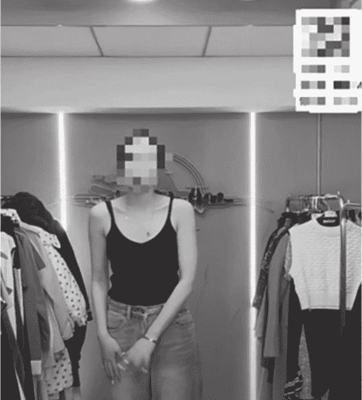

▲图7-12

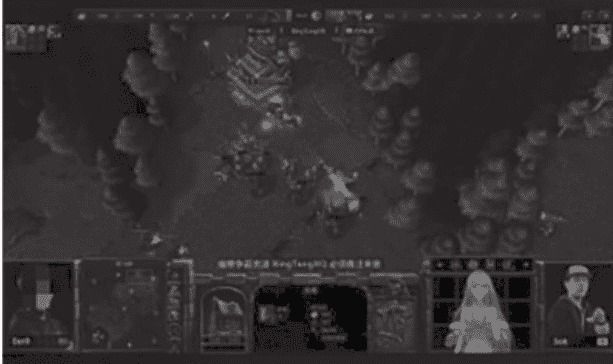

▲图7-13

#### 3. 付费观看

除了直播打赏、直播带货等与直播内容和自己的商品有间接关系的变现，还有一种与直播有着直接关系的变现模式，即为优质内容付费。观众只有先支付一定的费用才可以观看直播。这种付费观看的变现方式类似于微信公众号的付费阅读，只要内容足够优质、粉丝数量足够多、主播影响力大、粉丝忠诚度强，即可采用这种方式达到变现目的。

## 7.2 用DeepSeek提高变现效率

通过第7.1节的讲解，你已经掌握了内容变现的基本路径：自营店铺变现、博主带货变现、售卖课程变现……但很多人做到这一步后，依然常常会陷入一个瓶颈：内容有了，变现渠道也清楚了，可收入就是不见涨，到底问题出在哪儿？

答案很简单——不是你不会变现，而是你还没有“高效变现”，本节就来讲讲如何使用DeepSeek提高变现效率。

### 7.2.1 广告变现翻倍技巧

我们都知道，广告变现的收入关键靠两个指标，即有没有广告主愿意找你合作和广告有没有人愿意看、愿意买。但很多创作者最大的问题是——接到广告却不会做广告视频，另外视频发出去没人看，数据也不好看，自然下一次广告主就不会再来找你合作了。下面详细介绍一下广告变现翻倍的几个技巧。

#### 1. 快速生成高质量广告脚本

当广告主给你一个产品时，你可能会一头雾水，不知道怎么拍、怎么写，才能保证广告好转化。这时候，你只需要一句提示词，DeepSeek就能轻松搞定。

> “请根据以下产品信息，生成一个适合【平台名】的广告短视频脚本，风格为【风格】，目标受众是【用户群体】，时长控制在【时长】以内。产品信息如下：【产品介绍】。”

输入这段提示词后，DeepSeek就可以给出相应的生成内容。那么为什么要这么提问呢？我们来理解一下其背后的逻辑。

（1）“请根据以下产品信息，生成一个适合【平台名】的广告短视频脚本”，这句话的意思是告诉DeepSeek你想推广什么产品，并明确发布平台，方便适配内容格式。

（2）“风格为【风格】，目标受众是【用户群体】，时长控制在【时长】以内”，这句话是确定视频的表现方式、说话方式、选题角度和内容时长。

（3）“产品信息如下：【产品介绍】”，这句话是告诉DeepSeek你需要推广产品的具体信息，方便DeepSeek提炼产品亮点。

下面以一款主打“0糖0脂”的即饮咖啡为例，使用DeepSeek生成一个适合微信视频号的广告短视频脚本。我们先编辑好提示词，接着打开“深度思考（R1）”模式的开关，关闭“联网搜索”，让DeepSeek输出答案，如图7-14所示。

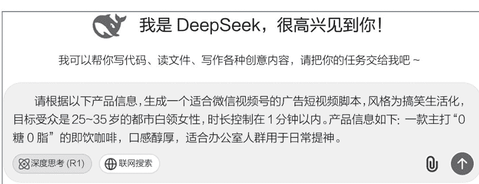

图7-14

按Enter键，将文字内容发送至DeepSeek，给出的答案如下。

##### 《打工人の咖啡救星》——0糖0脂即饮咖啡广告脚本

时长：58秒

风格：职场轻喜剧+闺蜜吐槽风

--------------------------------------------------

###### 镜头1：清晨办公室时钟特写（7:55）

（阴森背景音乐）女主（丸子头、黑眼圈）抱着文件冲进工位，对着镜头绝望地捂脸。

女主内心独白：“是谁发明的周一晨会啊？！”（哭腔）

###### 镜头2：会议室俯拍

（慢动作）老板（卡通胡子贴纸）的发言滔滔不绝，女主眼皮疯狂打架，PPT逐渐模糊成“Zzz……”

音效：打鼾声（突然惊醒时的吸气声）。

###### 镜头3：工位特写（手机竖屏视角）

女主疯狂掐脸/抹风油精，隔壁工位闺蜜（精致职场女性）抛来咖啡瓶。

闺蜜（挑眉）：“姐妹，试试我的修仙神器～”（瓶子转圈特写及“0糖0脂”大字）

###### 镜头4：仰拍女主豪饮

（金光特效）女主瞳孔“地震”，头发无风自动。

音效：“叮！”（游戏升级音效）

女主：“这丝滑度……老板现磨的吧？！”

###### 镜头5：魔性对比画面

同事A鼻孔插咖啡粉（喷嚏暴击）。

同事B疯狂摇瓶泡挂耳咖啡（水花糊脸）。

女主（举瓶邪笑）：“我，3秒战神！”

###### 镜头6：下班电梯间

女主活力哼歌，闺蜜掏出计算器。

闺蜜：“这周你喝掉我3瓶了！”

女主（飞速扫码转账）：“续命的事，能叫白喝吗？”（瓶身二维码特写）

###### 结尾定格动画

咖啡瓶长出小翅膀，托起“打工之神”锦旗。

大字幕：“××咖啡，专治班味儿！”

画外音：“点击购物车，老板骂人都变慢动作～”

----------------------------------------

以下是创意点说明。

- 精准狙击痛点：用周一晨会、PPT模糊等高共鸣场景建立观众信任。
- 闺蜜人设增强种草力：规避硬广感，营造“姐妹安利”的真实情境。
- 二次元元素：卡通胡子贴纸/游戏音效/Zzz……字幕等符合年轻女性的观看习惯。
- 埋梗传播点：“修仙神器”“班味儿”等职场黑话激发朋友圈分享欲。

建议采用竖屏拍摄，重点镜头保留抖音/微信视频号原生UI，增强平台适配性。

以上便是DeepSeek给出的初步方案，我们确定好其中的某个方向之后，还可以向DeepSeek进一步追问，让其进行调整。追问的方向可以参考下面的提示词。

(1) “请帮我优化成更适合短视频口播的形式。”

(2) “请给我3个结尾转化引导句式。”

(3) “请提炼3条可以写进评论区的文案。”

#### 2. 模拟用户喜好，精准“戳中”受众

DeepSeek还能帮你扮演目标受众，告诉你他们会不会喜欢这条广告内容。下面是具体的提示词模板。

> “请模拟一个【用户群体】的消费者，帮我点评下面这条广告脚本是否符合他们的喜好，并提出改进建议。广告脚本如下：【脚本内容】”

输入这段提示词后，DeepSeek就可以给出相应的生成内容。那么为什么要这么提问呢？我们来理解一下其背后的逻辑。

（1）“请模拟一个【用户群体】的消费者”，这句话是关键！目的是让DeepSeek站在目标受众的角度来评价这条广告，而不是从创作者或营销人的角度去夸这条广告多专业。
（2）“帮我点评下面这条广告脚本是否符合他们的喜好”，这句话是在判断你的广告内容有没有说对话、戳到受众痛点、引发其兴趣和触发转化。
（3）“并提出改进建议”，这句话是指让DeepSeek不仅要挑毛病，还要告诉你怎么改。

下面是以上述生成的广告脚本短视频为素材，让DeepSeek点评一下。我们先编辑好提示词，接着打开“深度思考（R1）”模式的开关，关闭“联网搜索”，让DeepSeek输出答案，如图7-15所示。

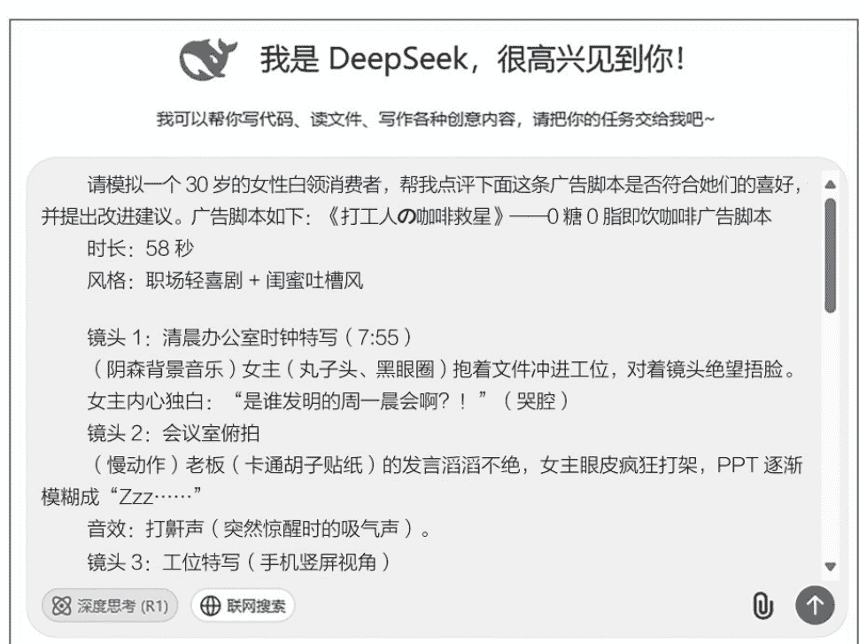

图7-15

按Enter键，将文字内容发送至DeepSeek，给出的答案如下。

30岁女性白领消费者视角的广告点评与建议。

##### 一、广告亮点点评

1. 职场痛点抓得准

周一晨会、PPT模糊、老板唠叨等场景高度共鸣，容易引发观众“世另我”的代入感。建议强化细节：可加入“改第8版方案”“临时加班”等更具体的职场痛点。

2. 闺蜜人设符合种草逻辑

女性消费者更信任“闺蜜推荐”而非硬广，闺蜜的精致职场女性形象具有说服力。建议优化台词：避免“修仙神器”等过气网络梗，改用“加班不肿脸的秘密”“我的急救包”等更贴合轻熟女的语言。

3. 健康属性需更突出

30岁女性对“0糖0脂”敏感，但广告仅用瓶身特写带过，存在感不足。

建议补充场景：女主喝咖啡时同步显示热量≈1/4个苹果，或加入“体检报告绿灯”等画面，强化健康理念。

##### 二、扣分项与改进建议

1. 人设年龄感错位

丸子头+黑眼圈+魔性表情的女主像25岁以下的职场新人，30多岁的职场女性更倾向“疲惫但体面”的形象（如西装外套、淡妆、保温杯）。

建议调整：女主改扎低马尾，用咖啡前疲惫揉肩/补口红，用咖啡后整理衣领重拾气场，突出“职场女性的精致抗压感”。

2. 二次元元素过载

卡通胡子贴纸、游戏音效、“3秒战神”等用语过于低龄化，30多岁的女性偏好冷幽默而非无厘头（参考《淑女的品格》风格）。

建议替换：用“PPT进度条瞬间加载”“会议发言条理清晰”等隐喻咖啡的提神效果，保留“打工之神”但改用丝带奖章等轻奢元素。

3. 职场关系刻画单薄

老板形象扁平（仅有卡通胡子），30多岁的女性对职场人际更敏感，需避免“打工人vs资本家”的刻板对立。

建议补充：女主会后被老板认可方案，或同事悄悄问咖啡链接，传递“用对方法游刃有余”的积极价值观。

……

我们可以向DeepSeek进一步追问，使用DeepSeek模拟观众偏好，避免内容“自嗨”，以提高广告主的满意度。追问的方向可以参考以下提示词模板。

(1) 请补充更具体的【_____】细节，特别是【_____】的场景。
(2) 请把【“_____”】这类台词，换成更贴近【_____】人群的表达方式。
(3) 请突出【_____】的核心卖点，最好用【_____】的方式呈现。

示例如下。

(1) 请补充更具体的生活日常细节，特别是“带娃出门+通勤赶地铁”的场景。
(2) 请把“打工魂觉醒”这类台词，换成更贴近白领闺蜜间聊天的表达方式。
(3) 请突出“0糖0脂”的核心卖点，最好用热量类比（如1/4个苹果）的方式呈现。

#### 3. 优化脚本结构，提高点击与转化

很多广告失败，是因为其脚本结构不吸引人，或转化位置太生硬。下面就使用DeepSeek来帮你优化脚本结构，提高点击与转化。可以参考以下提示词模板。

> “我写了一段广告脚本，不太确定有没有写得吸引人。你能帮我看看这段广告脚本的逻辑有没有写清楚？哪里还能改一改，让更多人感兴趣、愿意下单？广告脚本的逻辑内容是：【内容】。”

输入这段提示词后，DeepSeek就可以给出相应的生成内容。那么为什么要这么提问呢？我们来理解一下其背后的逻辑。

（1）“我写了一段广告脚本，不太确定有没有写得吸引人”，这句话是指不是让DeepSeek“重写”，而是请它先帮你评估：“有没有吸引力”“逻辑清不清楚”，这是让DeepSeek明确它的第一个任务是：先判断广告脚本的质量，而不是直接动手改。

（2）“逻辑有没有写清楚”，这是在请DeepSeek从结构和表达角度来判断广告能不能让人看懂、有没有条理。逻辑不清楚，就没人能读完；表达混乱，就算内容再好也打动不了人。

（3）“哪里还能改一改，让更多人感兴趣、愿意下单”，这是在引导DeepSeek从用户转化角度来给出修改建议，看看哪里还能更吸睛、打动人、提高“购买意愿”。这是广告脚本的核心目的，DeepSeek在这一步会结合营销心理学、文案技巧、平台调性等，给你具体的优化方向。

下面是以上述生成的短视频广告脚本为素材，让DeepSeek优化其结构。我们先编辑好提示词，接着打开“深度思考（R1）”模式的开关，关闭“联网搜索”，让DeepSeek输出答案，如图7-16所示。

图7-16

按Enter键，将文字内容发送至DeepSeek，给出的答案如下。

您的广告脚本创意非常出色！结构清晰且充满网感元素，我从提升转化率和传播性两个角度提出以下优化建议。

##### 一、痛点强化——增加情感共鸣

（建议在镜头1前插入15秒“打工倦态蒙太奇”）

- 地铁挤成“沙丁鱼”时咖啡泼在白衬衫上。
- 手抖把PPT标题打成“老板是猪头”。
- 深夜加班修改第8版方案时计算机蓝屏。

这些细节能唤醒更强烈的职场焦虑记忆，为后续提供解决方案铺垫情绪势能。

##### 二、产品价值可视化——升级镜头4对比

当前同事对比略显单薄，建议如下。

- 咖啡粉同事：鼻梁贴着过敏红印+衬衫领口露出褐色污渍。
- 挂耳同事：手腕贴着膏药（暗示长时间冲泡挂耳咖啡导致腱鞘炎）。
- 新增外卖小哥摔洒咖啡画面：“配送费比咖啡贵！”

通过具象化竞品痛点，强化即饮咖啡“省时/省钱/省事”的三维优势。

##### 三、闺蜜人设丰满化——埋入种草钩子

镜头3可增加闺蜜桌面细节。

- 日程本上写着“16:00直播选品会”。
- 工牌带印着“资深咖啡品鉴师”。
- 计算机屏保显示咖啡豆溯源地图。

用环境叙事暗示闺蜜的专业性，提升推荐可信度。

##### 四、转化催化剂——紧迫感营造

结尾建议增加以下内容。

- 手机弹窗特写：“新人首单赠咖啡因擦脸棒。”
- 瓶身Logo幻化成进度条：“今日特惠库存剩余37%。”
- 闺蜜突然抢镜：“现在下单的姐妹，私我发老板怼人消音教程！”
- 通过限时福利+社交货币组合拳刺激即时决策。

以上便是DeepSeek给出的初步方案，我们确定好其中的某个方向之后，还可以向DeepSeek进一步追问，让其进行调整。追问的方向可以参考下面的提示词模板。

(1) 能不能加入一些【_____】的场景，来更强烈地勾起观众的【_____】情绪？
(2) 当前的场景对比不够有冲击力，能否增加【_____】这类对照，强化观众对【_____】的认同？
(3) 结尾还差一个“催单点”，能不能加入【_____】，激发观众“现在就买”的冲动？

示例：

(1) 能不能加入一些“送娃迟到被老板盯”的场景，来更强烈地勾起观众的职场焦虑情绪？
(2) 当前的场景对比不够有冲击力，能否增加“外卖小哥咖啡泼翻+配送费吐槽”这类对照，强化观众对即饮咖啡省时/省钱/省事的认同？
(3) 结尾还差一个“催单点”，能不能加入“限时库存倒计时+赠擦脸棒”组合，激发观众“现在就买”的冲动？

### 7.2.2 自动生成带货话术

很多博主带货带不动，并不是产品不行，而是——带货话术不给力。例如，开头抓不住人、产品介绍没亮点、结尾不知道怎么收、评论区没人互动等。说白了，就是不会讲、不会写、不会互动引导。而使用DeepSeek就可以一键帮你搞定口播、图文、评论引导、直播金句，让你从“尴尬卖货”变成“自然成交”。下面从生成短视频/直播口播话术和生成评论区/弹幕互动话术两部分介绍。

#### 1. 生成短视频/直播口播话术

口播话术是成交的第一步，但很多创作者会犯以下几种常见错误。

(1) 一上来就介绍功能，用户根本不在意。
(2) 讲一大堆缺少重点的内容，最后也没“行动引导”。
(3) 情绪平淡或过于卖力，让人反感。
(4) 想不出独特创意，总是“照抄别人的”，没新意。

这个时候，即可使用DeepSeek来生成口播话术，你只要把关键信息投喂给它，它就能给你写出吸睛、自然、能成交的短视频/直播口播话术。下面是相应的提示词模板。

> “我有一个产品，想在短视频里介绍给大家。你能帮我写一段口播词吗？口播的语气是【语气】，适合像【人设，比如宝妈、学生、搞笑博主】这样的角色说出来，主要是说给【目标用户群体，比如年轻女性、上班族、宝妈】听的。时长大概是【时长，比如30秒、1分钟】。产品的具体信息是：【产品介绍】。”

输入这段提示词后，DeepSeek就可以给出相应的生成内容。那么为什么要这么提问呢？我们来理解一下其背后的逻辑。

(1) “我有一个产品，想在短视频里介绍给大家”，这句话是在说明你的创作目标和场景。你不是要DeepSeek写软文、海报，而是“短视频口播词”，这一步让DeepSeek明确方向。

(2) “你能帮我写一段口播词吗？口播的语气是【语气】”，这句话是在确定语言风格。不同语气/语言风格，会直接决定观众是否愿意听下去。

(3) “适合像【人设……】这样的角色说出来，主要是说给【目标用户群体……】听的。时长大概是【时长，如30秒、1分钟】”，这是确定“在口播的人是谁”“目标受众是谁”，以明确节奏感与字数范围。

下面代入一个宝妈博主的视角，使用DeepSeek生成一段关于面霜的口播词。我们先编辑好提示词，接着打开“深度思考（R1）”模式的开关，关闭“联网搜索”，让DeepSeek输出答案，如图7-17所示。

图7-17

按Enter键，将文字内容发送至DeepSeek，给出的答案如下。

以下是30秒轻松真实、适合宝妈身份的口播词。

（开场自然微笑，手拿面霜）

> “姐妹们！当了妈之后是不是经常脸干到紧绷，还动不动泛红、敏感？（叹气）快来试试我这支救命面霜！润××舒缓修护面霜，神经酰胺+积雪草双管齐下，像给皮肤盖了层透气保护膜～（展示质地）你看这冰淇淋质感，一抹化水完全不黏腻！重点是无香精、无乙醇，孕期、哺乳期都能安心用！（轻拍脸颊）我连用一周，带娃熬夜后脸颊都不火辣辣了～现在点击购物车还能抢新品券，敏感肌姐妹冲就对了！”

（时长控制技巧：正常语速约240字/分钟，本文案约120字，配合动作表情可控制在30秒。可删除“重点是无香精、无乙醇”或“现在点击购物车”来调节时长。）

口播词设计思路如下。

（1）宝妈痛点前置：用“脸干/泛红/敏感”瞬间引发观众共鸣。
（2）成分场景化表达：用“盖了透气保护膜”代替专业术语，配合质地展示来增强说服力。
（3）信任感构建：强调哺乳期可用+自用体验，淡化推销感。
（4）行动指令设计：用“抢券”“冲”等口语化号召，适配短视频节奏。

需要调整语气或补充细节可以随时告诉我哦～

以上便是DeepSeek给出的初步方案，我们确定好其中的某个方向之后，还可以向DeepSeek进一步追问，让其进行调整。追问的方向可以参考下面的提示词模板。

1. 这个产品优势说得有点“太专业”，能不能用【_____】这种生活化比喻来讲？
2. 这30秒能不能再“生活化”一点？如加入“【_____】”这种口头动作或反应？
3. 有没有办法把“产品好”说成“我真有变化”？如加一句“【_____】的个人前后对比”？

示例如下。

1. 这个产品优势说得有点“太专业”，能不能用“像在脸上盖一层柔柔的保护膜”这种生活化比喻来讲？
2. 这30秒能不能再“生活化”一点？如“娃哭我抹一半停一下”这种场景？
3. 有没有办法把“产品好”说成“我真有变化”？如加一句“以前一出门就干裂，现在一整天都不紧绷”？

#### 2. 生成评论区/弹幕互动话术

评论区和弹幕看起来只是“观众说的话”，但其实它们是影响视频转化率的隐藏武器。只需要一个简单的提示词，DeepSeek就能批量生成看起来像“真实观众说的话”的评论内容。

> “我在做一条带货视频，想让评论区或弹幕看起来更热闹、更有互动感。你能帮我根据下面这段视频内容，写5条评论或者弹幕吗？语气是【语气，如搞笑、亲切、热情】，主要是为了【目的，如带动气氛、引导下单、激发讨论等】。视频内容是：【内容简介或口播词】。”

输入这段提示词后，DeepSeek就可以给出相应的生成内容。那么为什么要这么提问呢？我们来理解一下其背后的逻辑。

（1）“我在做一条带货视频，想让评论区或弹幕看起来更热闹、更有互动感”，说明短视频类型是“带货类”，并告诉DeepSeek我们不是随便写几句评论，而是为了制造“真实有人在看”的热闹场面，就像有人“刷存在感”，这一步是让DeepSeek明确创作目的。

（2）“你能帮我根据下面这段视频内容，写5条评论或者弹幕吗”，这句话是在明确：评论要和视频内容“贴合”，不能乱写。

（3）“语气是【语气，如搞笑、亲切、热情】，主要是为了【目的，如带动气氛、引导下单、激发讨论等】”，这是在设定评论的风格和情绪调性，也是告诉DeepSeek：写的评论不是闲聊，而是有具体用处的“功能性”评论。

下面代入一个宝妈博主的视角，使用DeepSeek生成一段关于多功能婴儿辅食机的口播词。我们先编辑好提示词，接着打开“深度思考（R1）”模式的开关，关闭联网搜索，让DeepSeek输出答案，如图7-18所示。

图7-18

按Enter键，将文字内容发送至DeepSeek，给出的答案如下。

1. “每次做辅食都要折腾半天，这个蒸煮搅拌一体机好方便！用过的宝妈们好清洗吗？求真实反馈～”
2. “上班没时间做辅食的宝妈太需要这个了！用过的姐妹说说真的10分钟就能搞定吗？想入手了！”
3. “被种草了！请问新手妈妈容易操作吗？会不会有按键复杂的情况呀？”
4. “这个做出来的辅食细腻吗？6个月宝宝吃胡萝卜泥和土豆泥能一次成功吗？求实拍图！”
5. “天天发愁给宝宝换着花样做辅食，这个辅食机可以做的种类多吗？求晒食谱！”

以上便是DeepSeek给出的初步方案，我们确定好其中的某个方向之后，还可以向DeepSeek进一步追问，让其进行调整。追问的方向可以参考下面的提示词模板。

(1) 这些话术很好！除了这几种，还能生成哪些类型的互动评论？比如从[______]角度出发？

(2) 能不能把这些话术细分成不同场景或阶段？如按[用户使用阶段/宝宝月龄/辅食种类]？

(3) 可以给一些更偏“种草带货”风格的追问话术吗？最好是那种会激发购买欲的提问。

示例：

(1) 这些话术很好！除了这几种，能不能再补充一些从“奶奶带娃/爸爸操作感受”角度出发的互动问题？

(2) 这些都很实用！能不能区分一下“刚开始加辅食”“已经吃一段时间”“要添加肉类”等不同阶段的互动话术？

## 7.2.3 设计知识付费课程大纲

很多人都有一技之长，如做PPT、拍短视频、写文案、做自媒体……却不知道怎么将其变成一门能赚钱的课程。

别担心！DeepSeek可以帮你实现，不仅能帮你“写课”，还能帮你把一整个知识付费产品从“0”到“1”设计出来。下面是相应的提示词模板。

> “我想做一套线上知识付费课程，你能帮我设计一下课程的大纲吗？课程的主题是：【课程主题】，适合的目标人群是：【你希望把该课程卖给谁，如宝妈、小白创业者、职场新人】。我自己的优势是：【如有多年经验、讲得特别通俗、案例多】。整套课程的总时长大概是：【时长，如1小时、3小时、10小时】，我希望课程分成【数目】个模块，每个模块里有2节或4节课。请你帮我列出：

- 整个课程名称；
- 每个模块标题名称、主要内容；
- 每节课的标题和简单介绍；
- 整体课程的亮点或卖点（让别人想买的理由）。”

输入这段提示词后，DeepSeek就可以给出相应的生成内容。那么为什么要这么提问呢？我们来理解一下其背后的逻辑。

（1）“课程的主题是……，适合的目标人群是……”，这句话是在告诉DeepSeek：“我要做的课程内容是什么，主要卖给谁。”这是最重要的第一步，因为不同的目标受众，其课程重点完全不同。

（2）“我自己的优势是……”，这句话是告诉DeepSeek你的人设和信任感。你为什么能讲这门课？你的“经验、风格、特长”会影响课程的风格和吸引力。

（3）“整套课程的总时长大概是……我希望课程分成【数目】个模块，每个模块里有……”，这是课程的框架设计，它是让DeepSeek控制节奏，设计出“有逻辑递进”的课程大纲，让课程内容有“进阶感”和“体系感”。

（4）“请你帮我列出课程名称、模块划分、每节课的标题及简介、课程亮点”，这就是最终产出的重点，结构很清晰。

这个提示词模板的结构逻辑是：“我想讲什么+我有什么优势+想讲多大规模+请你直接帮我打包成能卖出去的产品。”

下面代入一个宝妈博主的视角，使用DeepSeek生成一段“宝妈副业创业指南：从0到变现的转变”的知识付费课程大纲。我们先编辑好提示词，接着打开“深度思考（R1）”模式的开关，关闭“联网搜索”，让DeepSeek输出答案，如图7-19所示。

图7-19

按Enter键，将文字内容发送至DeepSeek，给出的答案如下。

课程名称：宝妈副业创业指南：0基础打造灵活收入，带娃赚钱两不误

### 模块划分 & 课程大纲

总时长：3小时 | 4大模块 | 共10节课（每节课15～20分钟）

#### 模块1：找准方向——宝妈副业定位与赛道选择（30分钟）

- 为什么宝妈最适合做副业？你的隐藏优势分析
- 结合育儿经验、时间碎片、社交需求，挖掘宝妈独特竞争力。

##### 五大低门槛高需求副业方向解析

母婴内容创作、亲子社群运营、知识付费、轻电商、本地服务（如绘本租赁/辅食定制）。

##### 避坑指南：哪些副业看似美好实则“天坑”

警惕囤货微商、刷单骗局，选择低成本、轻运营模式。

#### 模块2：轻启动——低成本打造个人品牌与流量池（45分钟）

##### 宝妈IP人设定位：如何用真实故事吸引精准客户

从“普通妈妈”到“可信专家”的3步定位法（案例：辅食分享博主转型带货）。

##### 0成本启动：1部手机搞定内容创作（图文/短视频/直播）

手机拍摄剪辑技巧、免费工具（剪映/Canva）推荐、爆款选题公式。

##### 私域流量搭建：微信社群+朋友圈高效转化法

朋友圈“生活化营销”模板、社群促活话术设计。

#### 模块3：变现闭环——从流量到收入的3种核心模式（60分钟）

##### 内容变现：小红书/抖音接广告、知识付费产品设计

母婴博主广告报价逻辑、9.9～999元产品的分层设计（如育儿课程/资源包）。

##### 社群变现：快闪团购、付费会员圈实操案例

如何靠30人的小群单日变现5000多元（选品技巧+社群剧本）。

##### 分销合作：轻资产赚佣金的优质平台推荐

童书/母婴用品分销渠道、高佣金选品策略。

#### 模块4：可持续经营——时间管理&长期复利心法（45分钟）

##### 宝妈高效时间表：每天2小时创造持续收益

碎片时间管理工具（时间块/番茄钟）、外包家务技巧。

##### 副业与家庭平衡：如何获得家人的支持并减少内耗

沟通话术、情绪管理、设立“专注工作时段”。

##### 复利思维：让副业收入自动增长的3个策略

内容沉淀（如打造专栏）、用户裂变（老带新奖励）、跨平台分发。

以上便是DeepSeek给出的初步方案，我们确定好其中的某个方向之后，还可以向DeepSeek进一步追问，让其进行调整。追问的方向可以参考下面的提示词模板。

（1）除了【已有的副业类型】，还能再生成一些【宝妈可操作的、低门槛的副业方向】吗？

（2）能否根据【课程模块名称或主要内容】生成一些【具体可用的模板/话术/脚本】？

（3）请为【某节课程/模块名称】设计【2～3个可用于课后讨论或社群互动的问题】。

示例如下。

（1）除了母婴内容创作、轻电商、知识付费，还有没有适合时间碎片化但又想稳定变现人士的副业推荐?

（2）能否根据“朋友圈生活化营销”模块，写几条适合宝妈人设的朋友圈文案模板?

（3）请为“打造个人IP定位”这节课设计3个适合社群学员互动的讨论话题。

## 7.2.4 用DeepSeek预测内容收益

你是不是经常遇到以下这类问题?

- 做了选题、写了文案、剪了视频，但不知道哪个更有“爆”的潜力?
- 有多个选题方向，不知道哪一个更值得花时间投入?
- 内容发布前总是在“靠感觉”选标题、选封面、猜平台热度?

现在不用靠拍脑袋了! DeepSeek可以像内容“预测师”一样，提前为你评估。

- 哪条内容更可能获得高曝光?
- 哪个标题更容易引发点击?
- 哪个角度符合当前平台趋势？
- 哪种话术更容易转化带货收益？

也就是说：在内容发布之前，DeepSeek可帮你先预判收益表现，助你从优中选优，把资源集中在最有爆款潜力的那条内容上。下面是相应的提示词模板。

> “我准备发一条内容/选了一个话题，但不太确定它的效果好不好。你能帮我看看它有没有可能火吗？请从这几个方面给我分析一下。
>
> - 这条内容火不火，大概能打几分（10分满分）？
> - 它和现在的平台趋势合不合拍？
> - 发出去后，可能会带来什么好处？如涨粉、卖货、引流等。
> - 有没有什么地方还能改一改，会更有机 会爆？
>
> 下面是我想发的内容：【你的内容或话题】。”

输入这段提示词后，DeepSeek就可以给出相应的生成内容。那么为什么要这么提问呢？我们来理解一下其背后的逻辑。

（1）“这个内容火不火，大概能打几分”，这句话就像“体检前量个体温”——让DeepSeek先粗略判断这条内容是不是受众关注的热门话题。

（2）“可能会带来什么好处？如涨粉、卖货、引流等”，这句话是让DeepSeek帮你预估这条内容的商业价值或账号的成长价值。

（3）“有没有什么地方还能改一改，会更有机 会爆”，最后这句话是查漏补缺，看是不是在内容的角度、标题、结构、节奏等方面还能再微调，以提升它的“爆款潜质”。

下面代入一个宝妈博主的视角，使用DeepSeek生成一段“3个我最离不开的宝宝神器推荐”的短视频话题预测。我们先编辑好提示词，接着打开“深度思考（R1）”模式的开关，关闭联网搜索，让DeepSeek输出答案，如图7-20所示。

图7-20

按Enter键，将文字内容发送至DeepSeek，给出的答案如下。

综合评估与预测如下。

### 1. 热度评分：8.2/10

以下是评分依据。

- 受众精准：母婴/育儿内容在抖音、快手、小红书等平台持续热门，尤其是宝妈群体的垂直需求强烈，互动黏性高。
- 实用性强：“神器推荐”类内容天然具备种草属性，观众会主动收藏、转发，易形成长尾流量。
- 短时长优势：90秒符合平台“短平快”的偏好（抖音热门视频多集中在15～60秒），但需注意节奏的紧凑性。

### 2. 平台趋势匹配度：85%

以下是关键趋势贴合点。

- 生活化Vlog：真实场景+第一视角的分享模式（如厨房、客厅使用场景）更易引发共鸣，符合抖音“记录真实生活”和小红书“好物测评”的调性。
- 标签潜力：可关联热门标签如#母婴好物、#带娃神器、#新手妈妈、#育儿神器，蹭近期“‘6·18’母婴囤货”相关话题流量。
- 平台扶持方向：抖音“新农人计划”和快手“亲子时光”等专题活动会优先推荐优质育儿内容。

### 3. 预期变现方向

| 变现方式 | 可行性 | 操作建议 |
| :--- | :--- | :--- |
| 电商带货 | ★★★★★ | 挂车推荐高佣金母婴商品（如便携辅食机、恒温水壶），优先选抖音小店或小红书店铺 |
| 品牌合作 | ★★★★☆ | 植入细分垂类品牌（如Babycare、可优比），以“自用款”软性广告植入增强可信度 |
| 知识付费 | ★★☆☆☆ | 后期可扩展为《0-1岁宝宝用品避坑指南》课程，但需积累粉丝基数 |
| 私域引流 | ★★★☆☆ | 评论区引导加入私域“宝妈交流群”，为后续社群团购的铺垫（需规避平台敏感词） |

### 4. 优化建议

#### (1) 内容结构优化

- 前3秒钩子：直接展示“神器”使用效果（如宝宝秒睡、一秒止哭），搭配文字“救了我100次的带娃神器”！
- 痛点前置：用宝妈常见问题切入（如频繁夜醒、出门手忙脚乱），增强观众的停留意愿。
- 产品展示：每个产品的展示时长控制在20秒内，采用“痛点+产品功能+使用场景”公式（例如，半夜泡奶→恒温水壶实测→价格/品牌）。

#### (2) 运营技巧

- 发布时间：宝妈活跃时段多为早9—11点（娃睡觉后）、晚8—10点（睡前刷手机），优先选择这两个时段。
- 评论区互动：置顶提问“你们最头疼的带娃难题是什么？下次帮你们找解决方案”，以引导用户生成内容（UGC）内容。
- 矩阵扩散：将90秒正片拆解为3期15秒单品视频，分别投喂不同标签流量池，再导流至主视频。

#### (3) 风险规避

- 避免夸大宣传（如“治疗湿疹”等医疗相关词汇），优先推荐非敏感品类（如喂养工具、安抚玩具）。
- 标注“个人体验仅供参考”规避广告违规风险。

……

以上便是DeepSeek给出的初步方案，我们确定好其中的某个方向之后，还可以向DeepSeek进一步追问，让其进行调整。追问的方向可以参考下面的提示词模板。

（1）除了【当前评估的选题方向/内容形式】，你还能推荐一些【同类但风格不同/受众不同的方向】吗？
（2）针对【平台】的内容推荐，你能进一步分析【该类内容近期的流量走势/竞争热度/适合创作者的建议】吗？
（3）针对【某个优化建议/内容结构】，能否给出一份【详细执行模板/话术/视频脚本结构】？

示例如下。

（1）除了“神器推荐”类，能不能推荐几种适合宝妈群体的其他短视频内容形式，如轻搞笑、生活吐槽风？
（2）小红书现在母婴内容竞争激烈吗？我做这类内容还有上升空间吗？能不能分析下内容竞争情况和方向建议？
（3）文中提到的“前3秒钩子”怎么写？能不能举几个适合宝妈带娃类视频用的开头话术？

# 第8章 DeepSeek+自媒体变现实战案例库

在AI高速发展的时代，单一AI工具的功能已经无法满足用户日益增长的需求。越来越多的人开始探索不同AI工具之间的联动，让它们相互协作，以实现更高效、更专业的创作目标。DeepSeek作为强大的AI助手，不仅能独立完成文本生成、代码编写、文档处理等任务，还能与其他AI工具结合，发挥出更大的作用。

本章将集中解决以下几个核心问题。

- 如何用DeepSeek写出爆款话题，再配合Canva做出能吸粉、带货的精美图文内容（适合日常生活类博主）？
- 如何用DeepSeek生成宣传脚本、促销话术，再结合数字人技术，从而实现不用出镜也能每天发视频，同时运营多个账号，提高曝光率与到店率？
- 如何依靠“语录账号”“资料分享”赚钱？
- 如何用DeepSeek快速拆书、写出吸引人的“金句+观点”，做出爆款读书类内容，实现内容+佣金收益的双赢？
- 如何用DeepSeek从选题、脚本到课程大纲一步生成，让你打通从“吸粉”到“卖课”的全流程（适合擅长干货输出的人群）？

## 8.1 小红书平台养生赛道：DeepSeek+Canva打造爆款图文

DeepSeek凭借其强大的文本生成能力，能帮助用户高效提炼关键信息，而Canva则以其直观的设计功能，使图文笔记的排版与美化变得更加便捷。两者结合，能快速生成逻辑清晰、具有强烈视觉冲击力的小红书图文笔记，提升阅读体验。

下面介绍其详细操作步骤。

01 打开Canva主页，在左侧菜单栏中选择“模板” | “社交媒体” | “小红书帖子”选项，如图8-1所示。

图8-1

02 在模板中，选择一个需要的图文模板，观察该模板的结构。如图8-2所示，该模板内容中第一段是整段内容的主题，第二段是经典台词，第三段是台词出处。

CLASSIC LINES

经
/典
/台
/词

# 记忆中
那些封神的
经典台词

> 生活中有很多的不如意。如果一不开心，就寄希望于如果当初，那你永远都不会开心。幻景再美终是梦，珍惜眼前始为真。

——《武林外传》

#每日分享#

图8-2

03 根据该模板结构，让DeepSeek规定其输出格式，生成类似的文本内容，具体提示词模板如下。

> “请帮我生成一组关于【主题】的图文内容，用于【使用场景，如短视频文案/图文笔记/知识分享帖等】。要求结合【内容来源或限定范围】，每条内容具有【具体特征，如有情绪、有深度、引发共鸣】，并以【指定格式，如表格/卡片式】输出，方便后续直接使用。”

输入这段提示词后，DeepSeek就可以给出相应选题方案。那么为什么要这么提问呢？我们来理解一下其背后的逻辑。

（1）明确主题和使用场景，是保证DeepSeek生成的内容有针对性。例如，是要写短视频脚本，还是图文笔记？其内容风格和长度都要跟场景相匹配。

（2）确定内容来源或限定范围，是为了保证信息准确且方向统一。例如，要求只基于行业权威数据、热门帖子，能避免内容太散、太杂。

（3）强调具体特征，是为了保证内容有吸引力和传播力。例如，要求有情绪、有深度、能引发共鸣，可让内容更容易打动人、被记住。

（4）指定输出格式，是为了提高使用效率，方便一键套用。例如，直接用表格、卡片式排版，是为了省掉后期整理的时间，方便直接去复用。

下面将代入一位小红书博主，让DeepSeek帮助生成那些封神的经典台词。我们先编辑好提示词，接着打开“深度思考R1”模式的开关，关闭“联网搜索”，让DeepSeek输出答案，下面是具体的回复内容。

请帮我生成10份热门电影中的经典台词，必须是能引人思考的一句话，并附带其电影名称，字数控制在30字以内，简洁有力，按表格的形式输出，语言真实、富有共鸣感，适合做成小红书图文。

以下是10部热门电影中的经典台词及其电影名称，按表格形式整理如下。

| 电影名称 | 经典台词（30字以内） |
| :--- | :--- |
| 《肖申克的救赎》（1994） | 希望是件好东西，也许是人间至善，而美好的事永不消逝。 |
| 《这个杀手不太冷》（1994） | 人生总是这么艰难吗？还是只有小时候如此？总是如此。 |
| 《阿甘正传》（1994） | 生活就像一盒巧克力，你永远不知道下一颗是什么味道。 |
| 《教父》（1972） | 让朋友低估你的优点，让敌人高估你的缺点。 |
| 《楚门的世界》（1998） | 假如再也见不到你，那祝你早安，午安，晚安。 |
| 《天堂电影院》（1988） | 如果你不出去走走，你就会以为这就是全世界。 |
| 《当幸福来敲门》（2006） | 如果你有梦想，就要守护它。 |
| 《飞越疯人院》（1975） | 你们一直抱怨这个地方，却没有勇气走出这里。 |
| 《放牛班的春天》（2004） | 永远别说永远，凡事都有可能。 |
| 《心灵捕手》（1997） | 你不了解真正的失去，因为唯有爱别人胜于自己才能体会。 |

这些台词涵盖人生哲理、人性探讨、存在意义等主题，适合引发对自我、社会和价值的深层思考。部分电影如《肖申克的救赎》《死亡诗社》等台词被广泛引用至教育、心理学领域，成为文化符号。

04 复制DeepSeek生成的电影台词和电影名称，回到Canva模板界面，选择菜单栏的“应用”|“批量创建”选项，如图8-3所示。

图8-3

05 执行操作后，在跳转页面单击“手动输入数据”按钮，如图8-4所示。

06 将刚刚复制的电影台词和电影名称粘贴至数据中，单击“完成”按钮即可，如图8-5所示。

批量创建

1. 2. 3.

添加数据

从Excel和CSV文件等流行数据源快速创建数百个页面，或手动输入数据。

添加数据

| | T | T |
|---|---|---|
| 1 | 《肖申克的救赎》 | 希望是件好东西，也 |
| 2 | 《这个杀手不太冷》 | 人生总是这么艰难吗 |
| 3 | 《阿甘正传》（199 | 人生就像一盒巧克力 |
| 4 | 《教父》（1972） | 让朋友低估你的优点 |
| 5 | 《楚门的世界》（19 | 假如再碰不见你们， |
| 6 | 《天堂电影院》（19 | 如果你不出去走走， |
| 7 | 《当幸福来敲门》 | 如果你有梦想，就要 |
| 8 | 《飞越疯人院》（19 | 你们一直抱怨这个地 |
| 9 | 《放牛班的春天》 | 永远别说永远，凡事 |
| 10 | 《心灵捕手》（199 | 你不了解真正的失去 |

▲图8-5

07 添加数据后，将鼠标指针移至第二段上方并单击鼠标右键，在弹出的菜单内选择“关联数据”命令，如图8-6所示。

图8-6

08 执行操作后，在弹出的“关联数据”对话框内选择“电影台词”选项，如图8-7所示。然后，以同样的方法，将电影名称进行关联。

图8-7

09 关联数据完成后，单击“批量创建”对话框下方的“继续”按钮，如图8-8所示，然后继续单击“生成10个设计”按钮，如图8-9所示。

← 批量创建

1 2 3

将数据关联至你的素材

右击页面中的素材并将其关联至下方数据

已添加1个数据字段

- T 电影台词
“希望是好事，也许是人间至善，而美好的事永不...

- T 电影名称
《肖申克的救赎》（1994），《阿甘正传》（19...

继续

▲图8-8

应用数据

根据你输入的数据创建页面。

- [x] 全选
- [x] 1. 《肖申克的救赎》（1994）
- [x] 2. 《这个杀手不太冷》（1994）
- [x] 3. 《阿甘正传》（1994）
- [x] 4. 《教父》（1972）
- [x] 5. 《楚门的世界》（1998）
- [x] 6. 《天堂电影院》（1988）
- [x] 7. 《当幸福来敲门》（2006）
- [x] 8. 《飞越疯人院》（1975）
- [x] 9. 《放牛班的春天》（2004）
- [x] 10. 《心灵捕手》（1997）

10 图8-10所示为最终的图文设计效果展示，单击Canva模板界面中的右上角的“导出”按钮（注：篇幅限制，仅展示效果图），即可将该设计保存至本地，并发布至小红书平台上，从而获取收益。

图8-10

## 8.2 抖音实体商家赛道：DeepSeek+数字人实现矩阵运营

DeepSeek与数字人技术的结合，正在成为自媒体破局新利器。DeepSeek能够智能生成高效内容，而数字人技术则大大降低了真人出镜的成本和门槛，让商家可以轻松批量化、标准化地输出优质内容，实现账号的矩阵式增长。本节用DeepSeek和腾讯智影为例，介绍生成数字人视频的具体操作步骤。

### 8.2.1 用DeepSeek生成口播文案

DeepSeek利用先进的自然语言处理技术和深度学习算法，能够深刻理解视频主体，智能生成口播文案助力视频创作。下面是相应的提示词模板。

“现在你是一位【身份设定，如带货主播/短视频达人】，请根据我给出的【商品信息】撰写一段【场景要求，如直播口播/短视频推介】文案。

要求：

（1）放大商品的【亮点价值】，激发【购买欲望/下单冲动】；
（2）文案风格要【情绪饱满/节奏快/有感染力】；
（3）针对【目标人群】的特点，巧妙引导行动；
（4）接下来是商品信息。

【商品名称】：×××。

【商品亮点】：×××、×××、×××。”

输入这段提示词后，DeepSeek就可以给出相应选题方案。那么为什么要这么提问呢？我们需要来理解一下其背后的逻辑。

（1）设定身份，是为了让DeepSeek生成的文案更符合使用场景。如设定成“带货主播”，能让生成的文案语言风格更像主播在直播时说话的感觉，真实又有说服力。
（2）明确场景，是为了精准控制文案输出方式，即告诉DeepSeek你要“直播口播”还是“短视频推介”，可以确保其文案节奏、句式、情绪力度都更贴合用途。
（3）强调商品的最好卖点，能让内容更具吸引力，同时引导、促进观众下单。

(4) 匹配目标受众，是为了使文案的说话方式和内容打动特定目标人群。根据不同目标人群（如学生、宝妈、上班族）调整措辞和诱导点，让文案更有“对的人听了就想买”的效果。

下面你将代入一位数码科技领域博主，我们先编辑好提示词，接着打开“深度思考（R1）”模式的开关，关闭“联网搜索”，让DeepSeek输出答案。

现在你是一位专注于数码科技的短视频达人，请根据我给出的商品信息，撰写一段短视频口播文案。

要求：

- (1) 放大商品的亮点/价值，特别是性能参数、使用体验、性价比优势，激发数码爱好者和发烧友的购买欲望；
- (2) 文案风格要情绪饱满、节奏紧凑、语言专业但不枯燥，富有感染力；
- (3) 针对数码玩家/职场精英/学生党等目标人群的需求痛点，巧妙引导行动（如收藏、加购、下单）。

接下来是商品信息。

【商品名称】：AirPro X真无线蓝牙耳机。

【商品亮点】：超低延迟连接、48小时超长续航、支持主动降噪。

(开场：科技感电子音效+高速切换产品特写镜头)

> “数码控们注意了！这才是2025年真无线耳机的终极答案！”（重音敲击）

（画面切主播手持耳机疾步走动）

“看这个AirPro X！电竞级0.05秒超低延迟（竖起3根手指强调），吃鸡听脚步快人三帧！开黑语音同步率直接拉满！”（配合吃鸡游戏击杀画面）

（镜头突然切到静谧的咖啡厅）

“40dB深海级主动降噪！（手指抵唇动作）地铁轰鸣秒变私人录音棚，职场人摸鱼神器说的就是它！”（对比降噪前后的音效）

（画面闪现续航倒计时动画）

“48小时超长续航！够你从北京飞纽约往返两趟！（张开双臂）学生党图书馆泡三天不断电，充电盒自带闪充——喝杯奶茶时间满血复活！”（展示充电盒呼吸灯）

（突然拉近产品细节）

“双核蓝牙5.3芯片组！双设备无缝切换！（单手“比耶”）苹果、安卓全适配，开盖秒连、稳如磐石！液态硅胶耳翼戴着蹦极都不掉！”（慢动作展示耳机佩戴）

（画面切到购买场景快剪）

“首发价直降200元！这个配置别家至少卖799元！（甩出价格对比图）‘3-2-1’上链接！前100名加赠炫光保护套！”（背景响起急促的倒计时音效）

（结尾怼脸镜头）

“还在忍受卡顿、断连？是时候给你的耳朵来场技术革命了！单击右下角闪电购——听到未来的声音！”（打响指触发降噪特效）

（黑屏字幕+机械女声）

“警告：本产品可能引发耳朵发烧，请谨慎体验！”

（购物车图标爆炸特效）

“AirPro X真无线耳机——重新定义听觉规则！”

以上便是DeepSeek给出的初步方案，我们确定好其中的某个方向之后，还可以向DeepSeek进一步追问，让其进行调整。追问的方向可以参考下面的提示词模板。

- （1）请根据【产品类型】设计3种【高能开场】方案，要求5秒内吸引注意力，可以用音效/动作/画面冲击。
- （2）请给出5个适合【产品类型】的【短促、有冲击感】的开场钩子句，控制在10字以内。
- （3）请根据【产品核心卖点】，列出适合【短视频画面演绎】的创意动作或场景变化。

示例如下。

- （1）请帮我想3种适合真无线耳机短视频的炸裂开场方案，配音效、动作提示。
- （2）我要卖电竞耳机，能不能给我5个一出口就抓人的开场句？要求：短、燃、有画面感。
- （3）降噪耳机的“40dB降噪”怎么拍才震撼？请给我画面创意参考。

## 8.2.2 粘贴文案并生成数字人视频

腾讯智影的数字人功能是其作为一款AI智能创作助手的核心亮点之一，该功能为用户提供了高度智能化、便捷化的数字人创作体验。下面是使用腾讯智影生成数字人的具体操作步骤。

01 打开腾讯智影首页，选择“数字人播报”选项，如图8-11所示，进入数字人编辑页面。

02 将8.2.1节DeepSeek生成的口播文案复制并粘贴至界面右侧的播报内容中，如图8-12所示。

03 单击界面左侧工具栏中的“数字人”工具，按个人喜好选择所需的数字人形象，如图8-13所示。选择好数字人形象后，会自动播报右侧播报内容框内的口播文案内容，预览整体播报效果。

04 执行操作后，在左侧工具栏中选择“背景”|“图片背景”选项，给视频添加一个背景图片，如图8-14所示。这里选择绿色背景的原因是方便后面剪辑时的抠像处理。

### 提示

单击图8-15中的“字幕”按钮，将字幕调整为不显示的状态，可以避免剪辑时出现重复的字幕。

05 单击界面上方的“合成视频”按钮，将添加的数字人、字幕、背景等元素整合成一个完整的视频文件，可以在“我的资源”中看到合成后的视频文件，如图8-16所示。

06 将鼠标指针移至合成后的视频文件上，单击“下载”按钮，即可将视频文件保存至本地，如图8-17所示。

## 8.3 虚拟资料项目：用DeepSeek生成励志语录，引流卖资料

在信息泛滥的当下，优质内容依旧稀缺。尤其是在碎片化阅读盛行的社交平台上，短小精悍、情绪充沛的励志语录仍具有极强的传播力。通过利用AI工具如DeepSeek生成原创励志语录，我们可以低成本打造情绪价值内容，并进一步引导受众点击链接、收藏文档、购买资料包，实现内容从发布到变现的闭环。

下面是使用DeepSeek生成励志语录的提示词模板。

> “你是一位金句写作者，请用【风格】，写一句关于【情绪或主题】的励志短语，要求：语言有画面感、节奏感、金句感，20字以内。”

下面是其操作步骤。

01 打开DeepSeek，在输入框内输入图8-18所示的提示词，让DeepSeek生成一句励志语录。

DeepSeek的回复内容如下所示。

> “岩压脊挺，淬火成锋。”

（注：8字双核结构，前句以地质意象暗喻压力与坚韧，后句用金属锻造隐喻成长、质变。“压—挺”构成对抗张力，“淬火”强化瞬间爆发力，末字“锋”以锐利音韵收尾，形成短促、有力的听觉闭环。）

02 上述DeepSeek生成的就是典型的“短金句”结构。在生成励志语录后，我们可以加入软性引导语，从而引流卖资料内容，下面是小红书/微信朋友圈/微信视频号软性引导语的配文参考。

每天一句热血语录，拯救你情绪低落的时刻。

我做了个“自律语录打卡本”，把这些话整理成了PDF版合集，每天一句，逐页打卡，强迫自己不放弃。

留言/私信关键词【语录】，我发给你PDF版自律语录合集。

## 8.4 读书博主：用DeepSeek高效“拆”书，进行书籍带货

在内容电商和知识付费持续升温的当下，读书博主成了一个低门槛、高成长的新职业赛道。本节将带你深入探索——如何用DeepSeek高效“拆”书，打造优质书籍内容，进行带货变现。通过精准设计提示词，DeepSeek可快速生成读书笔记、金句摘录、观点总结等热门内容，即使你未亲自通读全书，也能轻松输出高质量内容，助力你在抖音、小红书、微信公众号等平台实现书籍推广和佣金收入。

下面是详细的操作步骤。

01 打开DeepSeek，在输入框内输入图8-19所示的提示词，让其生成一段口播文案。

DeepSeek的回复内容如下所示。

> “哈利·波特：成年人的睡前童话，藏着比魔法更震撼的真相。”

（背景音乐渐入：空灵的《海德薇变奏曲》）

（主播压低声音，神秘开场）：

“你相信9¾站台真的存在吗？
当全世界都在催你长大，
只有这7本书会悄悄对你说，
‘咒语已生效，欢迎回到魔法世界’，”

(画面穿插霍格沃茨城堡/闪荧火的魔杖/金色飞贼)

文案核心钩子：

“这不是儿童读物，是写给成年人的生存寓言——
当伏地魔的阴影笼罩职场，
赫敏的智慧才是你的守护神咒；
当生活像摄魂怪般吸走快乐，
邓布利多的箴言就是你的呼神护卫。”

价值升华点：

“罗琳用8000页构建的平行宇宙里，
藏着每个“打工人”需要的治愈公式。

- 被原生家庭伤害的哈利如何重塑自我。
- 学霸赫敏教你打破‘优秀羞耻症’。
- 韦斯莱家族示范普通人逆袭的7种可能。
- 斯内普的真相：成年人的爱从不说出口。”

（画面切换：老魔杖划破夜空/厄里斯魔镜浮现读者面孔）

口播高潮：

> “当电子木鱼救不了你的精神内耗，

试试这套全球5亿成年人的枕边解药——

在麻瓜世界受伤的夜晚，

霍格沃茨永远为你亮着一盏灯。”

……

02 在抖音、小红书或其他平台上下载几张该书籍的高清封面图，如图8-20所示。

03 打开剪映App，单击界面下方的“模板”按钮，并在上方的搜索框内输入文字“滚动书单”，如图8-21所示。

04 在众多书单模板中，选择并单击你所需要的模板内容。然后单击右下角的“剪同款”按钮，进入素材编辑页面，添加封面图素材，如图8-22所示。

05 单击“下一步”按钮，进入视频编辑页面。单击“文本”按钮，复制DeepSeek生成的口播文案内容，将视频内的字幕内容进行替换（这一步比较烦琐，需耐心替换），如图8-23所示。

06 单击界面右下角的“解锁草稿”按钮，即可进入该模板的草稿页面，可以在这里更改图片、音频、转场和特效等，如图8-24所示。

07 将原来的人声音频删除，单击“文本”按钮，进入文本编辑页面。选中下方的文案内容，单击“文本朗读”按钮，进入音色选择页面，这里选择并单击“新闻女主播”音色，如图8-25所示。

08 将后续口播文案内容，按上述操作步骤一一添加文本朗读，添加完成后的效果如图8-26所示。

09 单击“文本”|“新建文本”按钮，在输入框内输入文字“书籍在商品橱窗”，如图8-27所示，并将其放在界面左上角。

10 单击界面右上角的“导出”按钮，将视频内容导出，并发布到自己的自媒体平台上。此时，该账号在获取流量收益的同时，也可以将该书籍挂在自己橱窗内，如若有人看完视频对书籍感兴趣就会购买书籍，如图8-28所示，还可以参考视频分成计划和开直播聊书，一份视频实现3种渠道赚钱。

## 8.5 用DeepSeek做知识付费博主——以DeepSeek打通从引流到变现全流程

在传统知识付费流程中，从策划选题到成交，需要大量时间和精力。但如今，借助大语言模型（如DeepSeek），一个人就可以高效打造出一条完整的知识付费“内容生产线”：内容引流→建立信任→产品成交→知识交付。

下面将以母婴博主为例，完整呈现从内容引流 → 建立信任 → 产品成交 → 知识交付的全流程，适用于你用DeepSeek快速生成对应内容来打造一个“知识付费型母婴博主账号”。下面是该示例的一个场景设定。

> “你是一个专注于母婴领域的内容创作者，定位是“帮助0～3岁宝宝家庭科学育儿”，你希望通过DeepSeek实现以下目标。

内容引流：吸引宝妈的关注。

粉丝转化：让观众觉得你有育儿专业力。

产品成交：推广你的知识资料或课程。

知识交付：自动生成PDF/讲义/图谱类育儿产品。”

### 1. 内容引流

在母婴领域，引流的关键在于抓住新手宝妈的痛点与情绪共鸣。她们普遍心情焦虑、获得信息量大、时间碎片化，而你要做的就是用“快速获取”“内容真实”“情绪共鸣”这3个要素，吸引她们在3秒内对你的内容停留并点击。所以推荐的内容形式有以下几方面。

- 干货清单（如“新手妈妈最常见的5个育儿误区”）。
- 共鸣金句（如“只有带过娃，才知道什么是焦虑”）。
- 知识型短视频（如“为什么宝宝晚上频繁醒”）。

我们可以通过以下DeepSeek提示词模板进行引流。

> “请以【母婴主题】为核心，生成【内容形式】，适合【平台】吸引【目标人群画像】的关注，风格要求【风格说明】。”

下面是基于该提示词模板生成的示例。

请以“新手妈妈常见误区”为主题，生成一条适合小红书发布的引流文案，内容为5个常见的育儿错误，每个文案不超过30字，风格温和、有共鸣，目标读者为0～1岁宝妈。

#### 新手妈妈必看|0～1岁带娃五大温柔陷阱

> “亲爱的妈妈们，
这些育儿弯路我们也走过 🤱”

- 按哭喂养 🍼 观察饥饿信号，按需喂养更科学。
- 强撑清醒玩 🍼 揉眼、打哈欠是睡眠信号，妈妈要接住。
- 过度消毒 🍼 适当接触微生物，能帮助宝宝建立抵抗力。
- 过早练如厕 🍼 1岁半前膀胱未发育好，妈妈别焦虑。
- 硬抗情绪 🍼 产后抑郁是激素作祟，妈妈要勇敢求助。

> “当妈妈的第一年不必得满分，

60分的温暖陪伴胜过完美主义。

收藏这篇避坑指南，育儿路上少些焦虑。

记得关注我，一起做成长型妈妈 💕”

#新手妈妈必看 #科学育儿 #母婴干货 #带娃不焦虑 #辣妈成长记

（文案结构：治愈系标题+共鸣式开场+痛点解决方案+情感共鸣结尾，符合小红书用户偏好，用 🌿、💕 等表情符号营造温暖氛围，关键词覆盖精准流量）

### 2. 建立信任

完成初步引流后，部分观众可能已经“关注了你”，但是否愿意留下来、是否认可你、是否信任你，就取决于你能否持续提供系统、专业、可信赖的知识内容。

对母婴博主来说，输出“妈妈能看懂、能保存、能照做”的结构化内容，是打通观众信任屏障的核心。推荐以下内容形式建立信任。

- 知识框架图（如“宝宝辅食添加时间线”）。
- 懒人包结构（如“高烧应对5步法”）。
- 育儿方法总结（如“5种缓解肠绞痛的家庭方法”）。

我们可以通过以下DeepSeek提示词模板建立信任。

> “请围绕【母婴知识点】，生成一份新手爸妈能理解的知识结构图或方法清单，分为【结构数量】部分，每部分要点简洁明了，适合用于为新手父母建立专业信任。”

下面是基于该提示词模板生成的示例。

请围绕“宝宝辅食添加顺序”生成一份育儿“懒人包”结构图，分为四大板块：添加顺序、推荐食物、易错点提醒、宝宝过敏处理，每个板块写清关键要点，语言温和专业，适合新手爸妈保存学习。

宝宝辅食添加懒人包（结构清晰、科学实用，建议新手爸妈一键收藏）。

#### 一、添加顺序：阶梯式渐进

1. 6月龄（初期尝试）
高铁米粉（原味）→单一蔬菜泥（南瓜/胡萝卜）→单一水果泥（苹果/香蕉）。
质地：细腻泥糊状，无颗粒。

2. 7～8月龄（过渡期）
混合泥（2～3种已排敏食材）→肉类泥（鸡肉/猪肉）→蛋黄（1/4→全蛋）。
质地：稍带颗粒感，过渡到碎末状。

3. 9～10月龄（自主进食准备）
软烂小颗粒/手指食物（蒸糕、煮软的西蓝花）→全蛋→鱼类（鳕鱼/三文鱼）。

4. 11～12月龄（接近成人饮食）
多样化搭配→软米饭/碎面条→尝试小块状食物（需易咀嚼）。

#### 二、推荐食物：营养优先级

必备营养

- 铁：强化米粉、红肉、猪肝粉。
- 钙：酸奶（无糖）、奶酪（10月龄以上）。
- DHA：深海鱼类、亚麻籽油。

低敏食材清单

- 蔬菜：菠菜、西蓝花、土豆。
- 水果：蓝莓、梨、牛油果。
- 谷物：小米、燕麦片（8月龄以上）。
- 慎选食材：整颗坚果、芒果/猕猴桃（高敏幼儿需谨慎）。

#### 三、易错点提醒：避开常见误区

1. 过早添加
1岁前不喝牛奶、蜂蜜，3岁前慎吃易呛食物（如果冻、葡萄等）。
2. 调味陷阱
不加盐/糖（减轻肾脏负担），用天然食材调味（可用红枣泥增甜）。
3. 混合喂养误区
新食物需单独添加，连续3天排敏，避免因混合添加导致过敏原难排查的情况。

4. 忽视喂养信号
挺舌反应消失、能独坐、对食物感兴趣时再添加。

……

### 3. 产品成交

完成引流和建立信任后，转化就是“最后一公里”。很多母婴博主卡在“我有好东西，但没人买”，其原因往往是不会说服、不会包装、不会刺激粉丝下单。

本阶段的目标是用“低压感”“高共鸣”的方式，促使粉丝从信任你到为你的内容或课程买单。我们可以使用下面内容形式促成成交。

- 产品卖点提炼（“为什么你的宝宝辅食笔记值得买”）。
- 痛点文案（“你还在靠朋友圈育儿吗”）。
- 价值对比（“看资料前 vs 看资料后”）。

我们可以通过以下DeepSeek提示词模板促成成交。

> “请帮我为【育儿资料名】撰写销售文案，包含【卖点数量】个核心优势、1条宝妈痛点反问和1段购买理由，风格亲和、非营销感，适合发布在【平台】促成转化。”

下面是基于该提示词模板生成的示例。

请帮我为“宝宝辅食添加全攻略”资料撰写销售文案，包含3个核心卖点（如内容全面、步骤清晰、参考权威），1个妈妈常见痛点反问（如

##### 标题：还在靠百度喂娃？新手妈妈必收的“宝宝辅食宝典”来了！

##### 正文

- 每天翻遍小红书/百度/妈妈群。×
- 查不清食材添加顺序怕过敏？×
- 看不懂营养配比怕耽误发育？×
- 试了10种食谱娃只吃白粥？

——别让碎片化信息毁掉宝宝的黄金喂养期！

被3000多位妈妈追着要的《宝宝辅食添加全攻略》来了！

三大核心价值，一次性终结你的焦虑。✓

##### 全网最全知识库

从5～24月龄分阶段喂养表/高铁食材红黑榜/手指食物进阶指南，到过敏急救预案，一本覆盖新手妈妈99%的迷茫！✓

##### 傻瓜式跟做手册

“3天排敏法”图解步骤、“宝宝粥万能公式”配比卡、“30秒急救口诀”手账贴，厨房小白也能秒变辅食大神。✦

##### 卫生健康委员会专家背书

中国营养学会推荐摄入量+三甲医院儿保科实测方案+欧盟有机认证食材清单，每一页都印着“专业”两个字！

为什么要为知识付费？

每天省下查资料的2小时=多陪宝宝玩3个亲子游戏。

少买1件鸡肋辅食工具=换来3年科学喂养体系。

一次投入69元=避开价值上万元的错误喂养坑。

##### 立即行动

戳我私信“攻略”获取目录&用户案例。

前50名赠《0失败蒸糕面团万能公式》电子卡。

明天恢复原价89元，新手妈妈真的等不起！

(配图建议：九宫格展示宝典内页+用户好评+权威证书)

##### 文案逻辑

痛点共鸣 → 制造知识焦虑 → 权威解决方案 → 成本对比刺激 → 稀缺性推动。

适合小红书高知妈妈群体，用专业性破除“免费信息够用”认知，强调系统知识对宝宝发育的长期价值。

### 4. 知识交付

在完成了内容引流 → 建立信任 → 产品成交之后，最后一步就是把用户购买的“内容产品”高质量、系统性、专业性地交付出去。这不单单是把内容产品丢给用户，还要传递出：这是一份值得花钱的资料。

这一阶段，我们可以借助DeepSeek高效生成系统性的知识产品结构，快速产出标准化、可重复销售的电子讲义或笔记PDF合集。现在推荐以下的内容形式进行产品交付。

- PDF知识包（辅食时间表、应对小病全攻略）。
- 笔记合集PDF（如“0～6个月宝宝发育里程碑笔记”）。
- 微课程讲义PDF（如“新手妈妈情绪管理3讲”）。

我们可以通过以下DeepSeek提示词模板促成成交。

> “请围绕【母婴主题】，设计一份适合做成电子讲义的知识产品，包括【内容模块】（如章节结构或模块分布），要求内容专业、亲切易懂，适合直接售卖或发放。”

下面是基于该提示词模板生成的示例。

请围绕“宝宝发烧处理指南”主题，设计一份适合做成电子讲义的知识产品，包括发烧判断标准、家庭应对、用药指引、何时就医、护理误区等模块，要求内容专业、亲切易懂，适合直接售卖或发放。

以下是为您设计的《宝宝发烧安心护理指南》电子讲义大纲，结合专业医学知识与亲切的育儿指导风格，适合新手爸妈快速掌握关键要点。

#### 封面设计

温馨插画（体温计、退热贴、妈妈怀抱宝宝）+主标题+副标题“儿科医生审订版”

#### 目录页

图标引导式目录（🏠家庭护理 🏥就医时机 ❌常见误区）

#### 第1章：科学认识宝宝发烧

##### 1. 体温测量标准

- 图解不同部位正常的体温范围（腋温/耳温/肛温）。
- 电子/水银温度计使用贴士。
- 发烧分级图示（<38℃/38～39℃/>39℃）。

##### 2. 发烧本质解析

- 免疫系统作战示意图。
- 区分“好发烧”与“危险发烧”的4个维度。

#### 第2章：居家护理全攻略

##### 1. 环境调节三要素

- 温、湿度控制（温感色卡示意）。
- 衣物选择原则（洋葱式穿衣法图解）。
- 空气流通管理（新风循环图解）。

##### 2. 物理降温实操

- 3种安全擦拭法（视频二维码演示）。
- 退热贴创意用法（额头/腋窝/腹股沟）。

##### 3. 营养补给方案

- 分阶段喂养建议（发烧期/恢复期）。
- 补水趣味小妙招（水果冰棒/卡通吸管杯）。

---

#### 第3章：安全用药手册

##### 1. 药品选择速查表

- 对乙酰氨基酚 vs 布洛芬。
- 剂量计算器（体重对应毫升数）。

##### 2. 喂药技巧大全

- 滴管/注射器使用示范。
- 抗拒喂药的5种游戏化处理。

##### 3. 用药红线警示

混用风险/间隔时间/特殊体质提醒。

---

#### 第4章：就医预警信号 🚨

即刻就医清单（紫色嘴唇/持续呕吐等7项）。🚑

日间门诊指征（反复低热/出疹等5项）。

夜间护理要点（睡眠监测注意事项）。

……

