# AI+自媒体变现全能一本通

# 内容总览

本书共分8个篇章，围绕用 DeepSeek 系统化打通自媒体路径展开。第1章先盘点自媒体当下走势与常见误区，同时对 DeepSeek 的能力边界做通俗拆解。第2章聚焦赛道筛选与内容方向锁定。第3章、第4章详解选题挖掘与文案撰写的方法论，讲透爆款打磨的逻辑。第5章以导演视角拆解短视频脚本写法。第6章介绍如何借助 DeepSeek 联动 AI 绘图工具，实现图文与脚本的批量生产，并搭建多平台矩阵。第7章覆盖变现闭环，包括广告合作、电商带货、知识付费等多种盈利方式及配套工具。第8章通过多组真实案例复盘 DeepSeek 落地效果，例如爆款图文的打造、数字人矩阵的运营等，帮助读者把创意真正转化为可执行的收益。

本书面向三类人群：想入局自媒体却不知从何下手的新人；希望降本增效、加速变现的现役创作者与企业营销从业者；以及高校相关专业的学习者。

# 开篇说

短视频的爆发让“做自媒体”成为大众化的选择。年轻人想把关注度换成收入，企业主想借短视频放大品牌声量，似乎人人都想用短视频讲自己的故事。

现实却很骨感。选题很难想，脚本很难写，拍摄剪辑更让人头疼。光是想一个够吸引眼球的标题，就可能折腾半天，更别提保持稳定更新、追踪数据反馈了。大量人卡在起步阶段望而却步。

DeepSeek 是一款国产、免费且功能扎实的 AI 内容创作工具，正在成为越来越多创作者的隐形助手。它能快速探矿爆款选题、生成有梗的短视频脚本，还能基于数据分析帮助定位受众。

工具好用是一回事，怎么用才算好用是另一回事。现在市面上系统讲“如何用 DeepSeek 做短视频”的成体系内容很少。很多人能感知到 AI 的潜力，却因方法不对、技巧不熟而收效甚微。这本书的出发点正是解决这个断层。

目标是用一本真正可操作的陪跑教程，从零带你认识 DeepSeek、掌握 DeepSeek、活用 DeepSeek，让它帮你把短视频或图文的整个链路跑通：从选题策划、脚本结构生成，到发布推广、变现运营，每一步都有抓手。

# 本书亮点

**1. 拿来即用的提示词体系**
把高频提示词模板及其使用思路整理清楚，并附上追问式提问的示范。零技术背景也能上手，像有位老师在旁指导，快速进入 AI 创作节奏。

**2. 六大模块贯通创作全流程**
从账号定位、内容规划，到选题策略、脚本拆解，再到图文转视频、跨平台分发，直至吸粉机制与商业化变现。六大模块串联成一条清晰可复制的方法链，而非零散技巧堆砌。

**3. 54 个实战拆解**
精选 54 个典型案例，逐层拆解 DeepSeek 的使用逻辑。比如如何做差异化定位、如何借助 DeepSeek 捕捉爆款选题、如何用一句话写出种草感文案。讲清楚“是什么”，更示范“怎么做”，减少试错成本。

**4. 视频配套，边看边做**
针对操作复杂的环节，额外录制了配套教学视频，可下载观看。大部分章节的核心知识点与实操步骤都有演示，跟着一步步走，不怕找不到入口、看不懂流程。

无论你是自媒体素人，还是已有基础却缺系统方法的创作者，本书都能为你打开新的内容生产视角。

# 使用须知

AI 的输出会受算法与提示词影响而有所差异，同一问题在不同人手中得到的结果未必完全一致。重点不在于死记硬背某个提示词，而是学会如何提问、如何组合工具、如何在 AI 的初稿基础上做判断与迭代，这才是 AI 创作时代的核心能力。

另外，受篇幅限制，部分生成结果仅展示片段，后续不再展开。

# 第1章 DeepSeek，让普通人也能做火自媒体

大家好，我是 Toly。打开这一章，意味着我们正式开启用 DeepSeek 赋能个人 IP 的旅程。

过去做自媒体，很多人觉得必须具备强网感和创作天赋。如今在 DeepSeek 等工具加持下，信息差被迅速抹平，自媒体的门槛大幅下探，普通人同样有机会做出爆款并塑造个人品牌。

想把 DeepSeek 真正变成自己的生产力，就要先拨开神秘感，把它当成一个随手可用的日常工具去“榨干”价值。

本章主要回答：

- 如何借助 DeepSeek 打出像小红书 3 万赞那样的爆款？DeepSeek 在自媒体环节里能做什么？
- 普通人入局常踩哪些思维误区？
- 如何结合本书，在 28 天内用 DeepSeek 跑通自己的个人 IP？
- DeepSeek 在不同平台的用法有何差别？

## 1.1 自媒体 3.0 时代，DeepSeek 如何赋能个人 IP

自媒体已经迈入 3.0 阶段。过去靠自己想选题、写文案、剪视频，耗时耗力。现在有了 AI 助力，内容生产变得高效而轻盈。

DeepSeek 是一款免费的国产 AI 内容创作工具，可以迅速定位热门话题、生成吸睛文案，甚至按你的风格定制短视频脚本，即使是零基础也能快速上手。

它的底层思路是“创作链路的工业化”：不替代人的创意，而是借助大语言模型与用户行为数据，把创作者从重复劳动中解放出来。

DeepSeek 对个人 IP 的赋能体现在三个层面。

**从 0 到 1 的加速启动**
传统冷启动往往需要 3 个月试错，而 AI 可把周期压到 28 天。以前做自媒体，选题、定位、标题都要靠猜，几十个标题、成堆脚本靠点赞慢慢筛选，耗时两三个月很常见。现在借助 DeepSeek，可以先用数据分析加爆款模型锁定目标人群喜欢的内容，再用提示词批量生成多版脚本做 A/B 测试，并结合平台热词与爆文分析快速获得反馈，1 到 2 周内就能找到有效方向。

**差异化 IP 的塑造**
DeepSeek 能融合大数据、中文互联网语料以及你提供的个人经历，输出具备差异性的定位建议。比如一位 95 后宝妈想入局，曾尝试“带娃日常”“母婴测评”，但赛道拥挤。输入关键信息：宝妈、曾任小学语文老师、热爱纸艺手工、习惯用 AI 辅助备课后，系统建议“AI 工具+亲子陪伴”赛道：用 AI 生成创意手工内容，带着孩子实操并拍摄成教程，还可附赠打印模板与小工具。这个切口在母婴领域相对空白，又能发挥个人优势。

**变现效率的提升**
DeepSeek 可依据赛道特性给出商业化建议，涵盖品牌合作、电商佣金、知识付费等，并辅助细化执行策略。例如一位做城市探店的小红书创作者，内容有播放却几乎无收入。把账号数据、粉丝画像、过往爆款笔记丢给 DeepSeek 后，得到三段式方案：短期通过本地咖啡馆、美甲店、甜品店的探店合作切入，并给出报价参考；中期推出“城市冷门探店攻略”付费专题包，并导流至私域社群；长期打造城市生活 IP，与电商联动带货地方特产、旅行票券、文创产品，形成图文、短视频、直播的矩阵。更进一步，系统还能反推执行细节，如社群引流话术、报价单设计、招商文案模板，让“怎么赚”与“怎么落地”同时清晰。

**典型应用场景**
新手冷启动：定位诊断、竞品分析报告自动生成、标题点击率预估等。
账号升级：把历史视频转成图文做多平台分发，借助评论数据洞察需求并完成赛道迁移。
矩阵批量运营：批量生成细分选题、为同一产品生成针对学生、职场人、宝妈等不同话术版本，并通过 A/B 测试数据迭代模型。

自媒体 3.0 的本质不是 AI 取代人，而是释放人的创造力。当重复工作被 AI 承担 80%，创作者可以聚焦人性洞察、热点判断与价值表达。AI 就像一把钥匙，为每个普通人打开新世界。

## 1.2 DeepSeek 为何更适配中国自媒体人

我在 2025 年 1 月用 DeepSeek 完成了一条小红书 70 万播放、3 万赞的短视频，从选题到脚本仅用了约 10 分钟。DeepSeek 在中文互联网生态中最为顺手。

**本土化优势**
中文语境理解深度高，能识别方言与网络热梗，自然融入文案。国内平台链路完整，抖音、B站、小红书的算法规则与格式要求被内建，例如小红书封面比例优化、B站弹幕热词提取。中国特色变现模式也得到适配，如直播带货话术、微信私域引流、社群裂变设计。

**与国际工具的对比**
优势在于本土数据训练覆盖微博热搜、豆瓣小组等非结构化内容，合规性强，自动过滤敏感词，使用体验顺滑且完全免费。短板是多语言创作能力偏弱，创意发散性略逊于 ChatGPT 4。

**实操回顾**
以那条小红书爆款为例。打开网页版，输入任务说明后开启深度思考 R1 模式并关闭联网搜索，发送提示词后即得初稿，主题围绕“电视秒变全能娱乐中心，0 元解锁追剧 K 歌看漫画的神器 App”。随后让模型筛选可用且热度较高的软件、精简到每个功能一个代表，并整合成不超过 400 字的短视频脚本，包含开场钩子、高能混剪、极简教程、福利引导四个镜头与完整口播文案。拍摄后获得 78 万播放与 3 万赞。

提示词的核心原则是“现状+问题+期望输出”。例如做账号定位，可以这样问：“我是一个 26 岁男性自媒体新手，从事互联网运营，爱好英语、电影、骑行，请给我 5 个适合的定位方向，并给出赛道理由、可对标账号和选题规划。”这一原则贯穿全书。

## 1.3 破除五大常见认知误区

**误区一：必须组建专业团队才能起步**
很多人认为要导演、拍摄、剪辑、运营齐全，启动成本几万元。其实绝大多数账号都是个人起步，0 到 1 阶段一个人完全可行。超级个体是当下主流，我运营的全网百万粉丝 IP 矩阵，除了剪辑外包，其余流程几乎都是单人完成。

**误区二：自媒体必须百分百原创**
现在主流创作者都引入 AI 辅助甚至主导创作。关键是做“内容厨师”而非“食材农夫”：学会赛道混搭，不必自己种菜，会搭配创新即可；给 AI 打上个人烙印，通过投喂历史数据与持续修正训练思路；合规组合，多个工具交叉使用并加入至少 20% 的个人原创元素，如自拍、手绘、实地探访。

**误区三：设备不专业就做不出好内容**
内容核心是想法与表达，而非设备。90% 的素人起号只用手机加一个补光灯。2023 年后主流手机均支持 1080p 甚至 4K 拍摄，手机影像更真实接地气。建议把分辨率设为 1080p 60fps，或内存允许时用 4K 30fps，选择光线充足的角落拍摄即可。

起步不需要堆砌器材，一部手机加一个简易支架，就能拍出第一条内容。

### 第四类误判：非得每天发才不会被遗忘
很多刚入门的人常听见“想有流量就得天天更”的说法，于是硬撑着每天产出，哪怕没灵感、时间紧、身体吃不消，也怕停更就被算法丢掉。看起来很拼，其实是典型的认知误区。

平台更看重观众看完的比例，其次是互动表现，最后才是发布规律。市面上不少百万量级的头部频道，实际节奏多是每周一次到两次。新手不能因此就大幅放慢，起步阶段需要足够的数据回流来校准方向。

怎么把握节奏？
- 起号期：前两周保持隔日发布，用数据摸清相对稳定的频率并持续迭代。
- 精品运营期：频道已能稳定变现后，可转做精做细，每周一到两更，适合靠广告变现的类型。
- 抢占流量期：在知识付费赛道或以口播为主的形式里，为换取更大曝光而选择不计质量的每天发布。

### 第五类误判：非要等完美才敢开拍
> “现在成片不够好，被熟人看到怎么办？”
> “现在这个水平，会不会被笑话？”

如果你常这样问自己，很可能被完美主义卡住。很多人以为必须准备到无懈可击才配开始，这其实是最大的拦路虎。

素人创作者常见的心路历程是：担心被嘲→反复打磨→数据不佳→失去动力→停止更新。

可行的打法是小范围试错：
- 让模型迅速列出三个方向各五个选题并配好脚本，马上开拍；
- 上线后快速看数据反馈，锁定适配的赛道；
- 把原来需要一周的流程压缩到几小时内完成。

素人成长思路可以这样转：
- 画质一般→打造“真实记录”人设；
- 表达卡顿→包装成“边想边说的闺蜜感”；
- 做成真人秀连载，比如“挑战做自媒体第1天”“新手妈妈独自带娃第×天”等。

## 1.4 用该模型助推普通人28天自媒体成长路径
带过大量学员后可以发现，普通人的黄金启动窗口大约是28天。对上班族而言，每天投入2到3小时即可，不会因战线过长而丧失动力。以下是一套结合该模型的高效执行路径。

### 1. 第一阶段：基础搭建 第1～4天
- （1）第1-2天 精准定位，配合本书第2章操作
  - 借助该模型拆析“自媒体+细分领域”，比如美食、科技、教育；
  - 通过该模型拿到目标人群画像，年龄、地域、兴趣偏好；
  - 产出三套差异化定位方案并请模型做优劣对比；
  - 完成频道主页的装修。
- （2）第3-4天 选题策划，配合本书第3章操作
  - 把个人差异化经历喂给模型，得到人设类选题；
  - 按赛道定位让模型给出三套不同赛道的选题方案；
  - 建立完整的选题库，抓取领域TOP100热门选题并整理成脑图。

### 2. 第二阶段：创作训练 第5-13天
（1）第5-7天 脚本创作，配合本书第4、5章操作
图文作者：借助模型产出吸睛标题并辅助文章撰写。
视频作者：
- 基于已有选题让模型给出爆款脚本；
- 把脚本数据喂给模型，定制专属脚本助理；
- 用黄金脚本公式让模型进一步优化修改。
（2）第8-10天 拍摄实操
- 按模型建议搭建简易拍摄角，确定光线、背景、机位；
- 让模型提供设备调试方法，比如输入手机型号获取提升画质的具体步骤；
- 拍摄三版不同风格的测试素材：口播、情景、混剪。
（3）第11-13天 剪辑实操
- 使用剪映的智能剪辑功能提升效率；
- 让模型按赛道推荐专属配乐库，按情绪或节奏分类；
- 用模型+Canva开发三种封面模板：大字报、对比图、人物特写；
- 产出5到15条成片。

### 3. 第三阶段：运营发布 第14-25天
- （1）第14-19天 冷启动策略
  - 制定发布时间表，黄金时段12点或18点，连续五天每天发一条；
  - 让模型生成20条高互动评论区话术，请朋友搬运到评论区；
  - 保留每条视频发布24小时后的数据并备份。
- （2）第20-22天 爆款复制
  - 让模型拆解自己与他人的爆款要素；
  - 在同一风格和选题方向上，让模型继续产出脚本实现复刻。
- （3）第23-25天 变现布局
  - 通过模型对比变现路径；
  - 设计“内容—产品—服务”变现漏斗；
  - 用模型制作知识付费产品或优化视频中的广告植入角度。

### 4. 第四阶段：复盘冲刺 第26-28天
- （1）第26天 数据诊断
  - 用模型解读已保存的数据；
  - 复盘内容跳出曲线，进行48小时流量分析；
  - 制作粉丝增长归因表，维度为内容、时段、话题。
- （2）第27天 系统优化
  - 根据反馈确定最终赛道定位与拍摄形式；
  - 建立选题淘汰与留存机制，淘汰数据差选题，保留爆款选题便于复拍；
  - 思考剪辑上的提升空间并优化。
- （3）第28天 长效规划
  - 让模型产出“100天自媒体计划”；
  - 设计内容产品化路径，如知识付费课程、社群、咨询等。

# 第2章 用DeepSeek定位频道
定位是开启高变现个人IP的第一步。很多人做了很久IP却变现无果，根源多在定位上。本章借助DeepSeek，结合个人经历、爱好、优势与社会背景，综合考虑变现，找出最适合的IP定位。

本章解决4个核心问题：
- 个人IP零基础如何找到定位？
- 已有尝试但方向不清晰该怎么办？
- 如何分析借鉴市面爆款与同赛道频道？
- 频道主页如何让AI快速设计？

## 2.1 频道差异化定位：用DeepSeek寻找蓝海赛道
社交媒体上，精准定位是起号第一步。面对激烈竞争，如何找到既有流量潜力又避开高竞争的蓝海赛道是关键。DeepSeek可通过大数据分析提前发现趋势、评估市场、锁定目标粉丝、挖掘冷门机会，实现差异化定位。

### 2.1.1 用DeepSeek进行频道定位分析
新手常见困惑：频道到底做哪类内容？自媒体赛道众多，表2-1整理了常见方向供参考。

**表2-1**
赛道分类｜主要内容方向
母婴博主｜孕期护理、婴儿护理、早教启蒙、亲子阅读、家庭教育
读书博主｜书籍推荐、读书笔记、书评、书籍拆解、经典名著解读
减肥博主｜健康饮食计划、科学减重、运动教程、减脂心理辅导
养生博主｜中医养生、食疗调理、穴位按摩、亚健康管理
美妆博主｜化妆技巧、护肤品评测、美妆黑科技、仿妆教程
美食博主｜食谱分享、食材评测、探店测评、烹饪教程
家居博主｜装修设计、收纳技巧、家居好物推荐、智能家居评测
Vlog 博主｜日常生活记录、旅行日记、职场 Vlog、沉浸式体验
穿搭博主｜潮流搭配、平价穿搭、职场通勤穿搭、复古风格解析
情侣博主｜恋爱日常、情侣旅行、相处技巧、双人挑战
职场博主｜简历优化、面试技巧、职场沟通、副业赚钱方法
宠物博主｜萌宠日常、宠物训练、宠物医疗科普、用品评测
旅行博主｜穷游攻略、小众景点、旅行摄影、文旅体验分享
情感博主｜情感咨询、婚姻经营、心理疗愈、单身脱单指南
娱乐博主｜明星八卦、影视剧评、综艺解析、粉丝文化观察
健身博主｜健身教程、器械使用、体态矫正、增肌减脂计划
科技博主｜数码评测、AI 解析、互联网趋势、智能家居
汽车博主｜新车评测、驾驶技巧、汽车文化、新能源车对比
游戏博主｜游戏攻略、赛事解说、游戏文化、独立游戏推荐
摄影博主｜拍摄技巧、器材评测、修图教程、作品展示
手工博主｜手工艺制作、旧物改造、创意教程
知识付费博主｜在线课程、专业咨询、技能培训
音频播客博主｜心理健康、投资理财、个人成长
直播带货博主｜商品推广、直播互动、供应链合作
社交媒体运营博主｜热点分析、内容拆解、账号运营技巧
留学移民博主｜留学申请、海外生活、移民政策
法律科普博主｜案例分析、合同模板、维权指南
金融理财博主｜投资策略、基金股票、财务管理
教育培训博主｜学科辅导、语言学习、考证经验

有人对多个方向感兴趣却不知选哪个，有人已有粉丝仍迷茫，有人想转型却不确定可行性，这时可用DeepSeek分析定位。

#### 1. 新手
零基础或想做副业时，核心问题是“我适合做什么类型”。可让DeepSeek给出参考方向。提示词模板：
>“我想开启一个内容频道，我目前的创作经验是【零基础/会剪辑/写过脚本等】，本人【年龄】【性别】，生活在【城市】从事【职业/行业】，偏好【兴趣爱好】，拥有【职业】背景并擅长【技能】。请给出至少三种契合我的频道方向建议，并分别说明各自的好处和风险，优先考虑上手快、操作轻、对表达要求低的方案。”

逻辑：告知经验便于匹配上手难度；告知年龄性别城市职业便于匹配人设；告知兴趣爱好与职业能力便于找到能力与爱好的交集；最后的要求是控制输出标准。

示例：26岁北京互联网大厂男性产品经理，零经验，喜欢读书和美食探店，养2岁暹罗猫，擅长产品文档，懂数码趋势。开启DeepSeek深度思考R1模式，关闭联网搜索，输出如下：

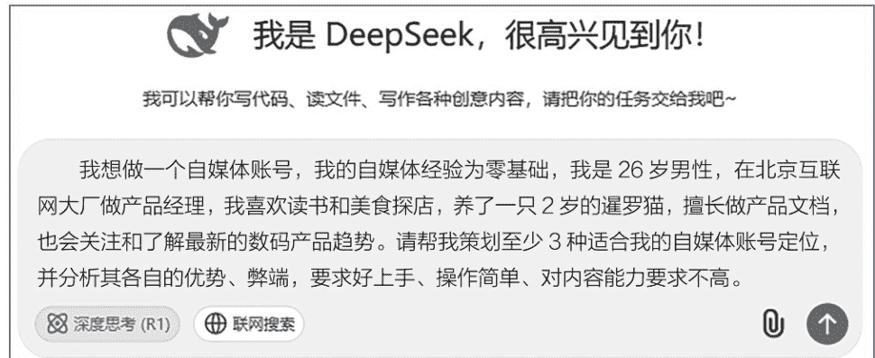

图2-1

##### 一、定位1：互联网职场生活观察者
1. 核心内容
- 互联网大厂产品经理工作日常脱敏版流程图与文档模板分享；
- 职场新人生存指南，周会技巧、需求文档避坑；
- 海淀互联网人探店日记，公司附近高性价比午餐测评；
- 数码装备升级实录，真实职场人视角的办公设备评测。
2. 优势
- 素材随手可得；
- 自带精准受众，应届生、职场新人、互联网从业者；
- 变现路径清晰，职场课程、办公用品推广；
- 人设立体，真实职场＋美食＋数码。
3. 弊端
- 需注意公司信息保密红线；
- 职场干货同质化风险；
- 需平衡专业性与趣味性。
4. 操作方案
- 主平台小红书＋知乎，图文为主；
- 更新频率每周3次，职场2次＋探店1次；
- 工具手机拍摄＋石墨文档截图＋Canva排版。

##### 二、定位2：赛博养猫人
1. 核心内容
- 科技宅的智能养猫方案，自动喂食器测评实录；
- 暹罗猫拆箱数码产品的反差萌Vlog；
- 猫咪视角解读互联网黑话，用宠物演绎需求评审会；
- 北京宠物友好空间探索地图。
2. 优势
- 萌宠自带流量；
- 人设差异化，互联网人＋技术流养宠；
- 可联动宠物、科技、本地生活多个赛道；
- 生产门槛低，手机拍摄＋简单剪辑。
3. 弊端
- 宠物账号竞争激烈；
- 猫咪状态不可控；
- 需保持人宠同框稳定性。

确定方向后可进一步追问优化，例如：
- 对于【定位1】请细化拓展该方案；
- 对于【定位2】希望结合Vlog形式请调整；
- 如果【输入本人真实顾虑】请据此调整【定位1】。

#### 2. 有一定基础
已有粉丝但方向迷茫时，可用智能分析决策。提示词模板：
>“我目前在【平台】有【粉丝数】粉丝，但对频道定位和未来创作方向迷茫。我的兴趣是【穿搭、美妆、旅行、养宠物等】，我的职业是【职业】。请帮我分析个人IP适合的内容方向，列出5个可选方向，并说明每个方向的优缺点。”

逻辑：说明平台与粉丝量判断阶段；兴趣与职业梳理可分享内容；要求列出方向与优缺点便于权衡。

示例输出：

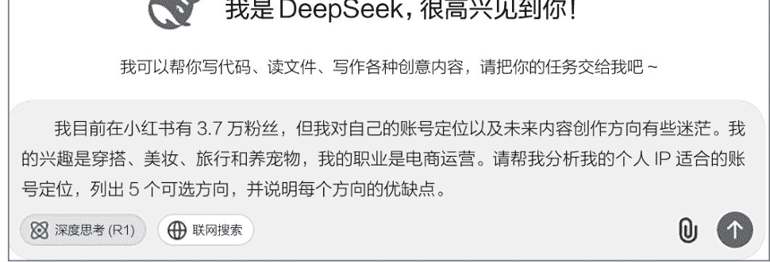

图2-2

##### 方向一：电商从业者的“反套路消费指南”
定位公式：职业身份＋穿搭美妆＋理性消费观
（1）内容形式
- 电商人揭秘：这5类衣服成本不到售价的10%；
- “双11”前必看！品牌不会告诉你的折扣潜规则；
- 我用电商数据选的通勤包，200元背出大牌感。
（2）优势
- 专业壁垒高，用电商运营知识拆解套路，建立信任；
- 内容差异化，小红书仅0.3%博主具备供应链视角；
- 变现多元，广告、课程、带货白牌高毛利产品。
（3）劣势
- 需持续输出干货，对行业认知深度要求高；
- 部分内容可能触碰品牌利益，需把控尺度。

（四）开篇内容侧重

第一个月的选题最好围绕“价格揭秘”做发力，例如整理《1688源头工厂店铺清单》这类实用干货。把数据整理成表格或电子表格的可视化图表呈现，能迅速让电商人群感受到专业可信度。

方向二：人宠同游的旅行记录
人设组合公式：养宠身份+轻度户外+人与宠物的情感联结

（1）可操作的垂类选题
- 携柯基同行登长城的实操笔记，并附上宠物友好景区的优劣榜。
- 自驾三千公里途中所带的宠物急救包清单。
- 江浙沪地区宠物友好住宿的体验测评，重点拆解影响入住感受的细节。

（2）赛道价值
- 供给稀少：宠物旅行的内容竞争强度约相当于美妆赛道的八分之一。
- 互动深度高：养宠人群的参与意愿约为普通用户的三倍。
- 带货自然：宠物出行装备、车载用品、目的地文旅联动都能顺势植入。

（3）需要警惕的短板
- 实拍成本偏高，必须带着宠物到场拍摄。
- 宠物状态不可控，突发状况易导致进度和成片质量受损。

（4）参考数据
- 优质笔记的平均收藏率可达28%，普通旅行类约12%。
- 商单报价方面，3万粉丝的账号单条广告在2000至3000元区间。

方向敲定后可继续追问让模型微调。常用追问话术有：

- 在已有方向之外，针对我这类人群有没有更细分、更冷门、变现更顺畅的定位思路？
- 如果我想要同时体现身份标签、兴趣点和内容垂类，能否设计一个融合度更高的人设？
- 针对某个定位下的内容形式，有没有可直接套用的视频或图文结构公式？

示例：
- 我的时间很碎，除了反套路消费指南，有没有更适合上班族宝妈的细分赛道？
- 我是铲屎官，也喜欢拍Vlog，能否设计一个既有温度又有商业价值的人设？
- 做宠物旅行测评时，笔记如何排版更容易被收藏？有没有推荐的图文框架或分段逻辑？

### 2.1.2 用DeepSeek寻找长尾机会

长尾机会指需求存在但竞争不多的市场，更容易获得曝光并建立壁垒。DeepSeek具备较强的分析能力，可快速筛出这些机会，帮助避开红海。常用提问如下。

> 我想在小红书/抖音上寻找可成长的蓝海赛道。请拆解最近3个月内穿搭/旅游/养宠物的热搜关键词，挑出5个搜索热度高但供给少的细分赛道，并说明切入方法。对每个赛道请给出数据佐证、内容建议、变现路径和起步方案。

这样问的用意在于：
- 平台和领域不同，调性不同，小红书偏生活化，抖音偏快节奏，先锁定范围，AI才不会跑偏。
- 分析最近3个月内的热门关键词，用真实数据找机会，比凭感觉靠谱，也能降低踩坑概率。
- 筛选出5个搜索量高但竞争较小的细分赛道，这正是蓝海的本质，有需求、做的人少，比挤进大盘更有新手优势。
- 请提供数据支持、内容形式建议、变现路径和冷启动策略，不仅告诉做什么，还给出怎么做、怎么赚钱、如何起步。

以抖音美妆赛道为例，用上述提问。下面先把问题整理好，然后打开深度推理模式，关闭联网搜索，让模型输出结果，如图2-3所示。

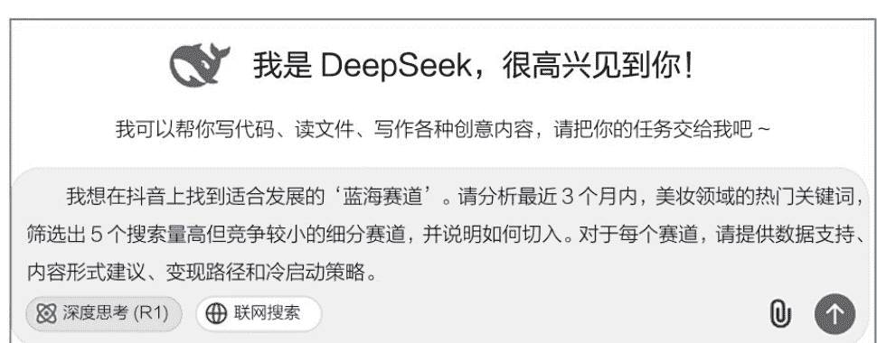

图2-3

回车发送后，模型给出的答案如下。

据最新监测与趋势判断，以下是5个美妆长尾赛道及可执行方案。

#### 1. 男士功能性护肤

数据支撑
- 搜索热度月环比增长48%，数据来源巨量算数。
- 男士祛痘关键词供需比为1:0.7，需求大于供给。
- 相关视频平均点赞约2.1万，高于美妆整体大盘的1.8万。

内容形式
- 产品横向对比实验，直观展示控油/祛痘前后的变化。
- 结合生活场景，比如程序员熬夜后的急救护肤流程。
- 反差人设，例如健身博主跨界讲护肤。

变现路径
- 分销男士专线产品，佣金比例在8%～15%。
- 开发付费课程28天直男改造计划，定价99～199元。
- 为理容品牌提供代运营服务。

冷启动打法
- 借势#男生改造计划话题，该话题累计播放约23亿次。
- 与男性垂类达人如健身、数码博主进行联动测评。

#### 2. 敏感肌修复与特效护理

数据支撑
- 急救泛红搜索量环比激增137%。
- TOP100相关视频里，持证医师出镜的仅占12%。
- 相关商品平均退货率低于美妆类目均值8%。

内容形式
- 实验室风格科普，用紫外线相机展示修复效果。
- 24小时Vlog记录敏感肌全天护理流程。
- 与三甲医院皮肤科专家合作，增强专业背书。

变现路径
- 推械字号产品做CPS带货，毛利率通常在25%以上。
- 私域问诊服务，客单价300～800元。
- 为品牌定制解决方案，服务费约5万～8万元/个案。

冷启动打法
- 制作《如何查询国家药监局备案》这类工具型爆款。
- 发起敏感肌自救打卡挑战活动。

上述赛道建议条理清晰、落地性强。当方向确定后，还能继续追问做优化。参考追问模板如下。

- 如果我在两个细分领域间犹豫，能否对比内容制作门槛、粉丝互动、变现潜力？
- 我的人设是身份/特征，做细分赛道时适合怎样的表达风格？
- 针对某个细分赛道，能否策划一个系列主题+选题排期？最好带钩子标题。

### 2.1.3 基于个人禀赋选赛道

结合自身优势挑选赛道，能提升竞争力、提高产出效率、加速个人品牌建立。可使用以下提示词让DeepSeek匹配。

我希望在自媒体找到合适赛道。我的个人优势如下。
- 专业知识：我擅长______。
- 技能特长：我具备______。
- 个人经历：我有______经历。
- 资源优势：我能获取______。
- 性格特质：我是一个______的人。

请结合我的优势与市场趋势，推荐几个适配的自媒体赛道，并给出具体的定位和变现方式。

提问逻辑：
- 专业知识/技能特长/个人经历/资源优势/性格特质，这些信息能完整勾勒你的差异化，不跟风找别人做不了的事。
- 结合市场趋势，推荐几个适合我的自媒体赛道，强优势要放在当下风口，才能起步更快、涨粉更稳。
- 推荐赛道+具体定位+变现方式，不仅给方向，还给出切入点和赚钱路径，可直接执行。

下面以美妆博主为例演示。我们先编辑好提示词，打开深度推理模式，关闭联网搜索，让DeepSeek输出，如图2-4所示。

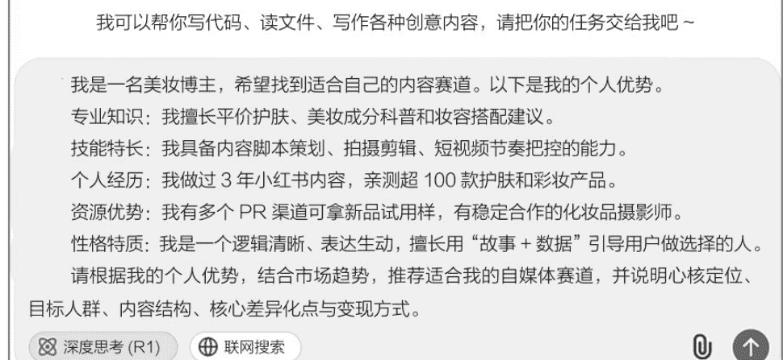

图2-4

发送后得到的建议如下。

基于你的优势，为你设计了一个兼顾专业与商业的方案。

一、核心定位
平价美妆科学家，用科研视角解读平价护肤品，通过实验室场景+产品测评+成分拆解塑造专业形象。

二、目标用户
- 核心人群：18～30岁学生党/职场新人，月度美妆预算300～800元。
- 延伸人群：三四线城市精致中年女性，追求高性价比的轻熟肌。
- 核心痛点：价格敏感但不盲目，需要科学验证的平价替代方案。

三、内容矩阵
实验室剧场：短视频1～3分钟，实验员人设+产品对比实验，3次/周
成分档案馆：图文/信息流视频30秒，用Excel/折线图可视化成分数据，2次/周
素人改造局：中长视频5～8分钟，邀请粉丝参与真实改造，1次/周

四、差异化亮点
测评维度创新：首创成分有效浓度计算器，用Excel公式展示平价产品的真实性价比。
案例：某大牌精华平替公式：X成分浓度≥3% + Y提取物≥0.5% = 合格替代。

场景化知识输出：打造美妆成分狼人杀系列，用游戏化语言解析成分关联。
案例：今晚请闭眼……防腐剂家族开始行动。

用户决策工具：开发美妆决策树，通过选择题引导用户匹配产品。
示例：Q1肤质→Q2预算→Q3使用场景→生成清单。

五、变现组合
启动期：平台流量分成 + 样品置换，深耕抖音/快手实验室剧场，冲击自然流量池
成长期：定制广告 + 橱窗带货，用成分档案馆做软植入，推出大牌平替套装
成熟期：自有IP产品 + 付费课程，出大学生美妆投资指南手账，开发28天成分扫盲训练营

该规划专业度高、贴合平台机制，能同时满足用户需求与商业诉求。确定后还可进一步追问优化。

- 请优化以下规划，使其更专业化/接地气/差异化，并提升用户黏性/变现能力。
- 请基于当下市场趋势调整方案，使其更有竞争力/创新性。
- 请优化内容结构，使其更简洁/深入并提高可执行性。

## 2.2 拆解竞品账号提炼成功公式

头部账号能拿到百万播放并非偶然，背后都有可复制的逻辑。通过DeepSeek拆解竞品，能快速学习行业最佳实践并优化自己的策略。

### 2.2.1 拆解爆款，优化内容

打造高播放高互动的爆款是创作者核心诉求。用DeepSeek拆解爆款要素，能帮你理解观众偏好并改进内容。可用的提示词模板如下。

> 请分析以下短视频的数据表现，并研究博主笔记在标题、选题、文案、排版上的特点，以及这些特点如何带来更高曝光、点赞与收藏。数据如下。
标题：×××
选题：×××
文案：×××
排版：×××
播放量：×××
完播率：×××%
点赞率：×××%
评论数：×××
转发数：×××
关注率：×××%
发布时间：×××
视频内容：×××

提问逻辑：
- 播放量、完播率、点赞率等指标像成绩单，能看出内容强弱项。
- 标题、选题、文案、排版是抓注意力的关键，分析它们可明确创作者如何一步步留住观众。
- 把为什么能火拆成数据+细节两部分研究，便于学习复刻。

下面以美妆博主视角分析某条爆款。我们先编辑提示词，打开深度推理模式，关闭联网搜索，让DeepSeek输出，如图2-5所示。

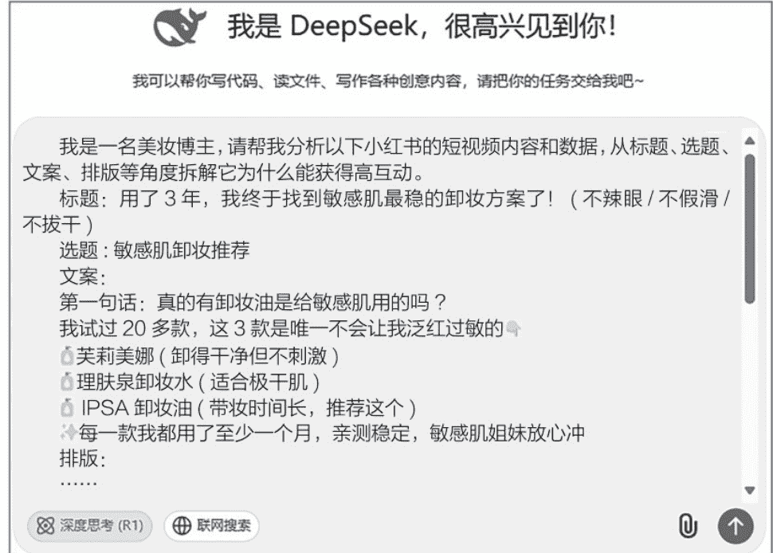

图2-5

回车后得到分析如下。

拆解：高互动背后的底层逻辑。

1. 标题：直戳痛点+制造好奇
敏感肌的烦恼全知道：标题里的不辣眼/不假滑/不拔干全是敏感肌的雷区，一眼共情。
用时间背书：用了3年比亲测好用更有说服力。
留钩子：不点名具体产品，让人带着好奇点进来。

2. 选题：精准锁定纠结人群
聚焦敏感肌：这类人群选卸妆产品最怕过敏，视频正好是救命稻草。
反常识推荐：大众认为敏感肌该用卸妆水，视频却主张卸妆油更好，打破认知，引发讨论。

3. 文案：口语化+强信任
开头一句话抛问：真的有卸妆油给敏感肌用吗？立刻停留。
用数字和时长建立信任：
- 试过20多款→显得专业；
- 每款用一个月→替观众排雷。
产品点评简洁：每款一句话说清适用人群，不拖沓。

4. 排版：易读+重点突出
分段清晰，用表情符号分隔产品，一目了然。
结尾给安全感：敏感肌姐妹放心冲+✨，像朋友催单。

5. 视频内容：真实感强
素颜展示过敏肌肤，敢露红血丝，比滤镜更有信任。
重点词高亮，如不刺激标红，方便截图分享，也利于算法抓取。

6. 数据表现好原因
- 完播率高73%：前3秒抛问题，中间3款产品逐一吊胃口，结尾总结不啰嗦。
- 评论多：提出反常识观点，自然引发真的能用吗的追问。
- 关注率高5.4%：观众认为博主专攻敏感肌，会期待后续攻略。

确定需求后，可继续追问做调整。方向参考：
- 我已写标题【标题】，能否用戳痛点+勾好奇的方法优化成3个版本？
- 这是我的开头文案【开头】，是否足够抓人？有没有更口语化、共鸣更强的改法？
- 我的视频讲【细分问题】，结尾想引导留言，能否设计几条互动提问话术？
- 我的视频是【品类/问题】推荐，能否给1个完整的视频结构模板？照着就能拍。

### 2.2.2 横向对比头部账号，打造差异化

内容同质化严重时，照搬头部很难突围。关键是对比分析头部账号的核心优势，找它们没覆盖的空白，塑造自己的特色。提示词模板如下。

> 请分析行业头部短视频账号的数据与内容风格，并对比我的账号，指出可优化方向，以及它们未覆盖的空白点，从而形成独属我的内容特色。
> 以下是头部账号数据。
> 账号A...
> 账号B...
> 账号C...
> 以下是我的账号数据...
> 分析需求：头部账号拆解、对比分析、优化建议。

提问逻辑：
分析头部账号的数据和内容风格，是为了弄清楚：别人是怎么火起来的，他们的流量来源、内容节奏、互动技巧都有很强参考价值。
对比自己的账号和头部账号的粉丝数、平均播放量、完播率等数据，就是对自己的账号做一场实力体检，看看自己的账号到底是内容没吸引力，还是互动做得不够。

做内容最容易掉进的坑，就是只会学头部账号的表面套路。真正能让你跑出来的，是去找那些大号没讲透、没做好的缝隙，把自己的差异化特长卡进去，形成别人抄不走的内容印记。

这一步用DeepSeek就能提效。把竞品账号的关键数据直接通过附件上传进去，省去手工整理的时间成本，如图2-6所示。

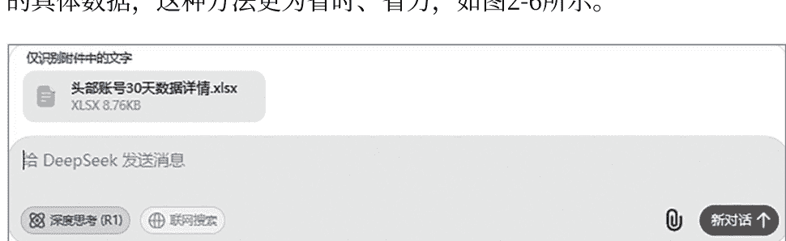

图2-6

下面示范一个可直接复用的提问框架。

> 麻烦拆解下面这些头部短视频号的爆款逻辑，再对照我的号给出可执行的改进方向，以及它们没覆盖的空白区怎么变成我的特色。

##### 【头部账号数据】
账号A：粉丝80万，平均播放40万，完播75%，互动12%。
内容调性：极简干货，低情绪高信息。
核心卖点：15秒内给一个清晰可用的决策，用户感知价值强。

账号B：粉丝150万，平均播放60万，完播82%，互动15%。
内容调性：情绪陪伴+种草混剪。
核心卖点：情绪节奏强，生活氛围妆容搭配场景音乐。

账号C：粉丝95万，平均播放35万，完播68%，互动9%。
内容调性：教程拆解+实测对比。
核心卖点：产品横评+成分视角，有据可查，信任度高。

##### 【我的账号数据】
粉丝8万，平均播放1.5万，完播54%，互动6.2%。

##### 【内容现状】
走基础种草+轻口播，封面多用自拍。

##### 【希望得到的】
- 1）梳理头部号的内容架构、风格特征与涨粉打法
- 2）把我的号和它们横向对比，指出短板与机会
- 3）给出可落地的优化建议，涵盖选题、表达、互动

基于提供的信息，系统从以下三方面给出方案。

#### 一、头部号成功要素拆解
##### 1. 内容骨架
- 账号A：钩子=痛点数字+悬念前置，例如“3秒挑精华？90%人忽略的筛选公式”。
- 账号B：情绪曲线=低谷共情→给出解法→氛围收束，配乐递进配合场景快切。
- 账号C：信任模型=权威背书+对比实验+成分可视化，用显微/仪器画面强化专业感。

##### 2. 流量打法
- 账号A：高频用“知识盲区”标题，你知道...其实...。
- 账号B：BGM卡点+蒙太奇，平均约2秒一个画面切换。
- 账号C：固定周三开“成分实验室”栏目，培养用户期待。

##### 3. 数据化运营
- 账号A：严格15秒内收尾，用信息密度逼用户重看。
- 账号B：每7条投放1条情绪宣泄型内容，如“打工人深夜治愈时刻”。
- 账号C：封面做AB对照，实验组vs对照组直观呈现。

#### 二、差距与机会
##### 1. 结构性差距
- 信息密度：你的15秒平均有效信息点2.3个，头部约5.8个。
- 情绪价值：你的情绪曲线平缓，波动约0.7；账号B约1.9。
- 信任支撑：缺少实测环节，成分解读仅占时长12%左右。

##### 2. 用户行为
- 完播54%意味着前3秒流失约40%，头部普遍控制在25%以内。
- 评论区63%在聊颜值，产品价值讨论少。
- 粉丝画像18-24岁占71%，头部核心消费群多在25-30岁，出现错位。

#### 三、差异化突围
##### 1. 内容升级
（1）信息重组
采用“3×3”：前3秒放认知冲突，如“你花300买的精华，90%没被吸收”；中间9秒塞3个知识点；最后3秒给行动指令。
（2）视觉补强
- 封面：自拍+信息牌，如左脸自拍+右侧“5种致敏成分清单”。
- 拍摄：加入微距成分质地视角。

后续可追问DeepSeek进行精细化调整，例如：
- 内容偏密门槛高，请压缩表达只留核心。
- 方案方向多但缺乏步骤，请给具体操作+示范。
- 请给出优化前后对比案例，直观看效果。

### 2.2.3 用评论区反向找需求
评论区的高赞留言是用户真实诉求的集合，能反向指引选题、结构和互动设计。借助DeepSeek解析评论，能快速定位观众关注点。

> 请基于下面短视频的热门高赞评论做诊断并给优化建议。
> 视频主题：[视频主题]
> - (1)……
> - (2)……
> - (3)……
> - (4)……
> 请回答：
> - (1) 观众最在意的问题关键词有哪些？
> - (2) 下期选题怎么延展？
> - (3) 如何设计结尾互动话术提升评论？
> - (4) 标题是否需要调整以贴合需求？

该框架的底层逻辑是：
- 高赞评论=共鸣点，抓住就能找准观众痛点。
- 评论里的疑问=下期素材库，承接热度。
- 结尾设争议/二选一问题，能撬动互动与推荐。
- 标题若没覆盖评论区核心诉求，会浪费流量。

以美妆博主为例，打开深度思考模式关闭联网搜索后得到的结果如图2-7。

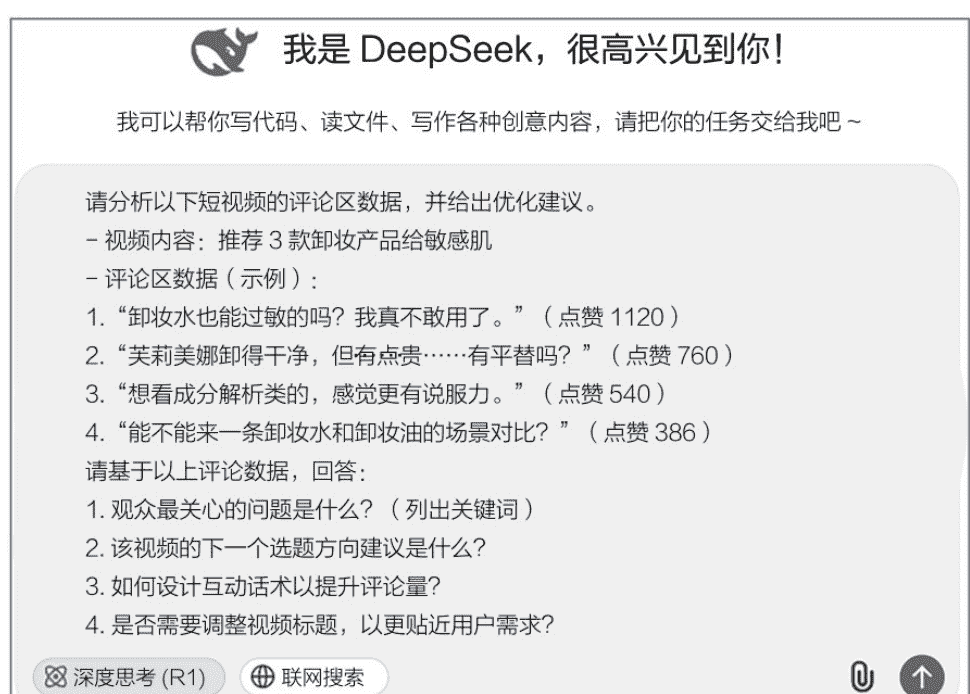

图2-7

#### 1. 核心关注词
过敏风险、性价比、成分专业度、产品形态选择、水油场景、场景适配。

#### 2. 下期选题
敏感肌卸妆成分红黑榜：这5种要避开！
卸妆水vs油vs膏场景终测：这3种情况必须换产品！
备选：百元内敏感肌卸妆平替TOP5。

#### 3. 互动话术
痛点提问：“卸妆翻车的姐妹举手，你遇到过哪种过敏？”
二选一：“敏感肌站水派还是油派？评论区开PK。”
福利引导：“抽3位送试用装，留言肤质+想试的产品。”
知识验证：“猜猜这3款里哪款含致敏防腐剂？答中抽奖。”
场景延伸：“通勤淡妆/舞台浓妆/运动防晒，你最需要哪种卸妆攻略？”

#### 4. 标题优化
原标题：敏感肌必入！3款超温和卸妆好物。
优化方向：痛点+专业背书+场景。
示例：
敏感肌卸妆避雷指南！3款0防腐剂实测+水油使用手册
烂脸预警！3款低敏卸妆实测报告，附平替方案
成分解密：3款敏感肌卸妆红榜，附实验室数据

进阶可在视频里加“防杠声明”：出示备案凭证、插入刺激性测试画面、真人前后对比、皮肤科医生点评，提升可信度。

追问示例：
- 我的目标人群是【敏感肌女孩】，请提炼她们最关心的5个关键词。
- 本期讲【敏感肌卸妆油实测】，下期想做【红黑成分榜】，评论区怎么埋钩子？
- 我要做【敏感肌卸妆油】系列，给5个不同切入点的选题。

## 2.3 个人主页设计：用DeepSeek批量生成资料

主页是3秒内决定是否关注的线上名片。通过结构化指令，可快速生成高转化文案。

### 2.3.1 生成吸睛简介
别人的账号能被搜索到，往往赢在简介。让DeepSeek按平台调性输出简介，能提升搜索权重。

> 你是【个人IP定位/职场成长/知识付费】专家，请按以下信息生成3条适配【小红书/知乎/抖音】的主页简介：
> - 身份标签：【核心身份】
> - 目标用户：【人群+痛点】
> - 核心服务：【用户获得感】
> - 数据背书：【量化成果】
> - 差异化亮点：【独特方法论/经历】
> - 行动指令：【引导关注/私信】
> - 关键词：【行业长尾词】
> 要求：前20字出现核心痛点，每句以‘|’分隔，总字数≤120字，嵌入2-3个表情。

设计逻辑：
- 身份+用户+服务三件套，让观众秒懂你在干嘛。
- 数据背书打破怀疑。
- 差异化亮点避免同质化。
- 行动指令+关键词引导点击并利于算法。

母婴博主示例输出三条简介与结构化拆解，强调权威前置、痛点清单、数据可视化、价值分层与场景化指令。

追问方向：
- 按【学历/职业】梳理3种人设定位。
- 按【孕期/产后/学龄前】梳理各阶段妈妈关注点做内容矩阵。
- 为【母婴/育儿/知识变现】搭建免费干货到付费课程的内容框架。

### 2.3.2 视觉风格优化
视觉是信任感的第一信号。明确职业、年龄、昵称与平台后，可快速生成统一的视觉方案。

> 我是【职业】，年龄【年龄】，昵称【昵称】，想做自媒体，请给出3套适配【平台】的主页视觉方案，含封面、背景、头像风格。

逻辑：
- 职业与年龄决定专业/亲和/趣味基调。
- 昵称提供调性灵感。
- 平台决定视觉偏好：小红书偏文艺简洁，抖音偏高能对比，知乎偏理性。
- 封面、背景、头像构成记忆点。

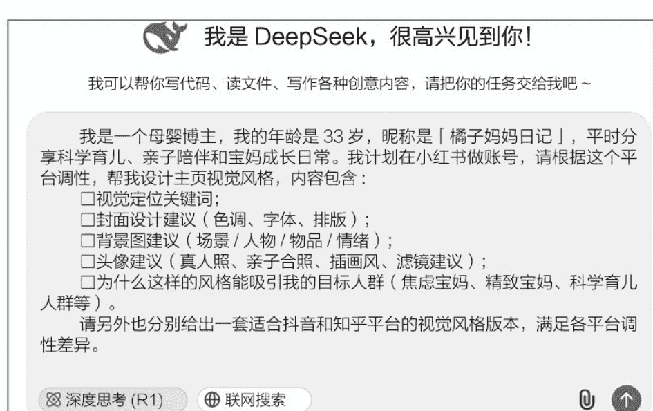

以母婴博主为例，给出小红书精致治愈系方案：莫兰迪色调+衬线标题+手写副标题，北欧风拍摄场景，Q版插画头像等。抖音版本则为高饱和撞色、加粗字体、中央抠图+痛点关键词环绕，动态抓拍背景与强互动头像设计，保持“科学育儿+温暖陪伴”的核心定位同时实现平台差异化。

真实拍摄示范：上半身取景，人物手握橙子道具眨眼带笑，后景做虚化营造游乐设施或玩具墙的氛围。

受众匹配逻辑：抖音用户注意力时长很短，高饱和配色结合痛点标题能在三秒内完成价值传递，素人出镜提升信任感，动态画面能暗示可实操。

#### 三、知乎版本 专业学术感

视觉指向：理性权威、信息密度高、温度适中。

##### 1. 封面设计
- 配色：以深蓝为主搭配浅灰，点缀数据图或思维导图元素。
- 字型：OPPO Sans 等线，配暗色外轮廓保证在浅底上清晰。
- 版式：左侧文字右侧图形，左列以序号呈现三条要点，右置示意场景图。

##### 2. 背景图
选用书架前的工作状态、国外育儿书籍特写或手写标注的育儿规划表。

##### 3. 头像
职业照风格：商务上装，手持育儿类书籍，后景虚化，适度保留面部纹理以显真实。

# 第3章 借助DeepSeek完成话题规划与话题库搭建

在自媒体生产里，话题决定一篇稿件能否走红。精准且有吸引力的话题，能让用户在信息流里快速停留并产生观看欲。但话题策划往往是创作者的痛点，灵感枯竭、同质化严重、缺乏数据支撑都会拉低传播效果。本章聚焦如何借助DeepSeek完成话题策划并搭建高效话题池，找到契合目标受众的爆款方向。

本章围绕话题的四个核心困惑展开。
- 毫无方向时，如何借助DeepSeek快速挖掘潜力方向？
- 稿件总与他人相似，如何挖掘差异化议题？
- 灵感易断，如何搭建可持续更新的话题池？
- 想做热点却总慢半拍，如何提前布局爆款？

## 3.1 用DeepSeek归纳爆款话题模型

优质话题既能精准击中痛点，又能在信息流中突出。本节介绍如何依赖DeepSeek的数据分析能力，从海量信息中提炼高潜力主题。

### 3.1.1 发掘潜力主题

好的话题关乎账号的流量高度与长期发展。相较于简单跟风，真正有潜力的方向应同时具备持续热度、受众共鸣与变现价值。以下是借助DeepSeek发掘潜力主题的提问参考。

> “请扮演资深新媒体数据分析专家，在【内容赛道】内筛选3～5个具备爆发潜力的主题，并说明每个主题的成长路径。请结合行业走向、受众诉求、检索热度及同行对标，并给出每个主题的播放预期与落地难度评级。”

发出该指令后，DeepSeek会给出相应方案。其提问逻辑如下。

（1）“请扮演资深新媒体数据分析专家”，属于角色设定，是提示词的核心原则之一，通过指定角色让模型以专业视角输出系统化内容。

（2）为何要给出“内容赛道”？目的是让模型结合你的经验、兴趣与能力挖掘主题，避免输出虽热但难以实操的方向。比如旅行博主不会收到家庭理财建议。

（3）为何要参考“行业走向、受众诉求、检索热度、同行对标”？这四个维度模拟了专业内容策划的思维路径。

（4）为何要给出“播放预期”和“落地难度评级”？便于判断主题的成长潜力与执行难度，降低试错成本。

以下以数码领域博主为例，演示如何生成高潜力主题。请先编辑提示词，开启“深度思考”模式，关闭网络检索，如图3-1所示。

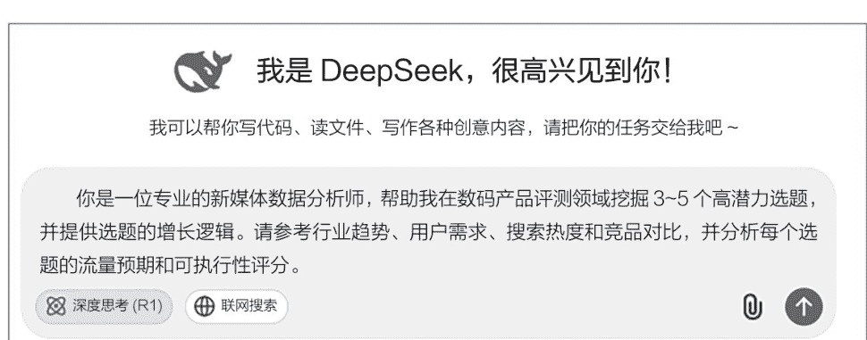

图3-1

按下回车发送后，得到如下答案。

根据行业走向、受众诉求、检索热度及同行内容缺口分析，以下为数码产品测评领域5个高潜力主题及完整成长方案。

---

#### 主题1：折叠屏手机长期使用报告
（1）增长依据。
行业走向：Counterpoint研究机构估算2024年折叠屏手机全球出货量将同比提升53%，三星/ZTE/荣耀密集发布新品。
受众痛点：现有测评多集中于开箱体验，缺乏三个月以上真实场景数据 折痕/续航衰减/软件适配。
检索热度：百度指数“折叠屏 耐用性”年同比增加210%，抖音#折叠屏长期使用话题播放量破3.2亿。
同行内容缺口：头部科技博主仅6%涉及长期跟踪测评。
（2）执行方案。
制作设备老化测试实验室画面 1万次折叠测试仪/显微镜观察铰链磨损。
插入用户调研数据：326份有效问卷显示67%的用户担忧维修成本。
播放预期：B站预估播放量80万～120万 借势厂商新品发布节点。
操作难度评级：★★★★☆ 需提前三个月储备测试设备，但能建立技术壁垒。

---

#### 主题2：AI外设“智商税”检测
（1）增长依据。
需求洞察：ChatGPT关联硬件周边销售额同比暴涨278%，但用户难辨实用价值。
热点捆绑：AI Pin/Rabbit R1等争议产品引发全网讨论。
同行打法：多数停留在参数对比，缺乏AI交互逻辑拆解。
（2）执行方案。
建立“AI智商税指数”评分体系 响应速度/场景覆盖率/替代成本。
对比测试：科大讯飞办公本 VS ChatGPT+百元录音笔的真实办公场景产出效率。
播放预期：知乎热榜冲击TOP10，抖音信息流ROI预计1:4.2 利用AI焦虑情绪。
操作难度评级：★★★★★ 采购成本可控，需强化AI技术解读能力。

---

#### 主题3：在校生“百元战神”设备测评
（1）增长依据。
受众画像：新生代数码内容消费占比41%，价格敏感型用户激增。
SEO机会：小红书“学生数码好物”笔记互动量月均增长37%。
蓝海市场：传统测评集中于旗舰机型，百元档位缺少系统测评。
（2）执行方案。
搭建“性价比立方体”模型 性能+耐久+生态+颜值。
打造设备组合包：199元TWS耳机+二手平板电脑办公方案实测。
播放预期：小红书爆文概率为72% 测试数据可视化+学生场景剧情植入。
操作难度评级：★★★☆☆ 需建立低价产品供应链测评资源。

以上方案逻辑清晰、数据充分，增长依据、执行方案与播放预期具备可操作性，可择1～2个方向深入，并让DeepSeek生成详细创作方案。进一步追问模板如下。

（1）对于【任意主题】，我想进一步拓展和细化。
（2）对于【任意主题】，我希望【要求】的形式来呈现稿件，请你进一步细化与调整。
（3）如果【实际限制或顾虑，比如无法露脸、完全不会拍短视频】，请对【任意主题】进一步拓展和细化。

示例：
（1）对于主题1“折叠屏手机长期使用报告”这个方向，我希望进一步拓展和细化。
（2）对于主题2“AI外设智商税检测”这个方向，我希望以Vlog的形式来呈现稿件，请你进一步细化与调整。
（3）如果我完全不会拍短视频，请调整该方案为图文/半图文形式。

### 3.1.2 归纳主题共性

在数码测评领域，高潜力主题通常具备共同特征：精准抓痛点、顺应动向、呈现新意。总结共性的提问如下。

> “请分析以下【行业名称】领域的高潜力主题：【主题1】【主题2】【主题3】……归纳它们的共性，从受众诉求、行业动向、呈现新意、扩散路径和变现潜力等角度总结其成功关键因素，形成一套可复用的主题筛选框架，并提供后续主题优化建议。”

提问逻辑解析：
（1）提供行业与具体主题，才能让模型归纳共性而非空猜。
（2）从受众诉求、行业动向、呈现新意、扩散路径、变现潜力五维度分析，相当于做全面体检，不遗漏关键要素。
（3）形成筛选框架与优化建议，才能指导后续持续选题与迭代。

仍以数码博主视角演示，开启深度思考模式关闭网络检索，输出如图3-2所示。

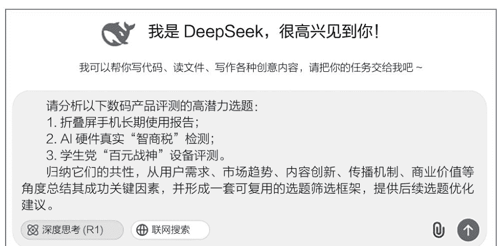

图3-2

回车后答案如下。

以下针对三大高潜力主题的共性分析与成功要素拆解，结合可复用的主题筛选框架和优化建议。

---

#### 一、主题共性提炼

| 维度 | 折叠屏手机长期使用报告 | AI外设“智商税”检测 | 在校生“百元战神”设备测评 |
| :--- | :--- | :--- | :--- |
| 受众诉求 | 填补“耐用性焦虑”信息真空 | 解决“伪需求”验证需求 | 满足“极致性价比”刚需 |
| 行业动向 | 折叠屏技术迭代加速期 | AI外设概念爆发但鱼龙混杂 | 新生代消费降级浪潮 |
| 呈现新意 | 实验室级长期数据可视化 | 建立“智商税”量化评估体系 | 构建低价设备组合方案测评模型 |
| 扩散路径 | 绑定厂商新品发布周期 | 制造争议性话题 如AI“智商税” | 场景化内容 宿舍/图书馆实测 |
| 变现潜力 | 维修服务/配件商单 | AI训练数据/工具分销 | 供应链选品带货 |

核心共性：
- 需求狙击精准：均瞄准决策链中的认知盲区。
- 数据驱动叙事：以实证手法破除浅层参数对比。
- 社交货币属性：提供可传播的概念标签。

#### 二、成功关键因素总结

##### 1. 受众诉求层面
真痛点挖掘：从评论/问答平台抓取高频问题。人群颗粒度：锁定垂直人群核心场景。决策成本对冲：用长周期多维度数据降低试错风险。

##### 2. 行业动向层面
技术扩散曲线：卡位技术成熟度“鸿沟期”。政策催化借势：关联宏观要素提升深度。同行内容逆向：寻找覆盖率<15%的蓝海区。

……

#### 三、新主题试金石案例
主题标题：百元DIY“神机”vs品牌整机——谁才是大学生真正的“宿舍战神”。
- 需求验证：知乎“大学生自己装机推荐”问题浏览量破87万。
- 创新设计：引入“宿舍生存指数” 噪声/散热。
- 商业链路：预设装机配件购买链接+高校计算机维修合作入口。

通过该框架筛选的主题可实现受众命中率提升40%以上，稿件生命周期延长3～6倍，建议每月迭代一次主题评估模型。

可进一步追问的模板：
（1）如果我们从【维度】进一步细化这个【主题/策略】，会有哪些可能的【延展路径】？
（2）如果我希望规避【顾虑/风险】，是否可以调整这个主题/策略的稿件结构或呈现方式？
（3）除了当前设定的表现形式，该【主题】还能延展出哪些【商业变现/合作模式/……】？

示例：
（1）如果我们从用户参与方式这个角度进一步细化“AI外设‘智商税’检测”系列主题，会有哪些互动设计的可能？
（2）如果我不方便出镜，是否可以用设备讲述者/旁白引导/手部出镜来代替真人呈现？
（3）除了稿件带货，“宿舍战神”系列是否可以跟高校装机社团/计算机维修店形成联营合作？

### 3.1.3 解读受众兴趣

受众兴趣既是方向盘也是放大器。解读兴趣的提问模板为：

“请担任【××领域】的兴趣分析师，针对【目标受众】完成：
（1）找出他们在【平台】讨论的3个最强烈需求；
（2）每个需求标注1个具体痛点场景；
（3）给出1个可落地的解决方案。”

逻辑类比：如同开面馆，先听小区讨论、再总结痛点、最后推出新品。

以下以美妆博主视角，针对“油痘肌上班族”分析小红书用户，开启深度思考关闭网络检索，如图3-3所示。

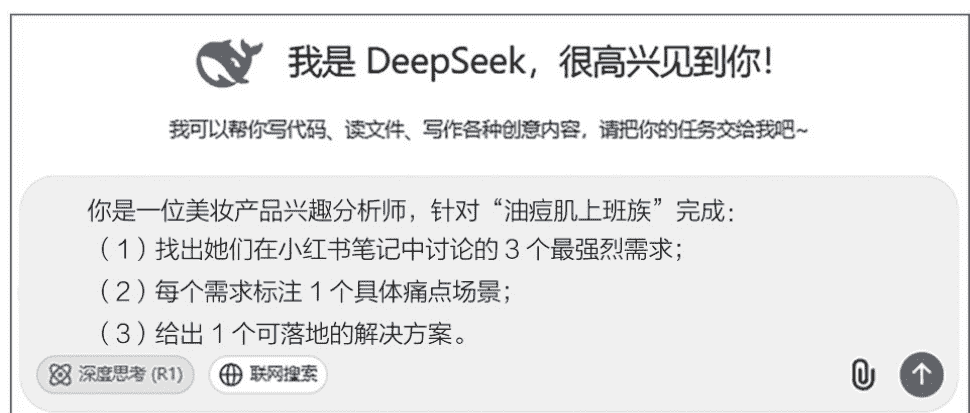

图3-3

回车后输出如下。

需求1：持久控油不闷痘的底妆产品
#### 1. 痛点场景
通勤需带妆10小时以上，午后面部油光导致脱妆斑驳，补妆时粉饼叠加易堵塞毛孔引发闭口。
#### 2. 解决方案
开发“油痘肌底妆三重测评体系”。
- 透气性：用水分流失测试仪对比8小时带妆前后皮肤含水量变化。
- 控油力：用红外热成像仪记录T区油脂氧化导致的温度升高曲线。
- 致痘性：与皮肤科合作检测12款粉底液致痘成分，制作“红绿灯安全清单”。

需求2：口罩友好型祛痘护理方案
#### 1. 痛点场景
长时间佩戴口罩导致“口罩痘”反复，会议前突发红肿不敢用刺激产品。
#### 2. 解决方案
设计“办公室战痘工具箱”测评专题。测试含胶态硫/壬二酸衍生物等温和成分，用皮肤镜记录4小时护理后炎症面积缩小比例。开发“隐形贴测评矩阵”。

需求3：空调房水油平衡急救方案
#### 1. 痛点场景
办公室空调导致外油内干，15点出现“油光与起皮并存”。
#### 2. 解决方案
创新“三维水油调控测试”。瞬时调节、持续续航、便捷性三维度评估，推出“办公桌微生态方案”。

数据验证与执行参考包含热词分析与稿件创新建议，相关内容的收藏转化率比常规测评高67%。

确定需求后可进一步追问：
（1）如果拓展到【___人群】或【___生活状态】，【_____】稿件还能如何调整或延展？
(2) 有没有【低预算/新手也能拍/……】的版本结构，适合我快速起号或常规复用？
(3) 是否可以将该方案延展出【对照表/测评打分卡/成分雷区图/……】，便于受众收藏或转发？

示例：
(1) 如果拓展到熬夜加班族或夜班医护人员，【办公室战痘工具箱】的内容应怎么改？
(2) 有没有不露脸也能拍的方式呈现“职场抗油三件套”？比如用手模+字幕展示？
(3) 能否制作一个油痘肌粉底液“安全红绿灯榜单”吸引受众收藏或转发？

## 3.2 差异化主题挖掘：用DeepSeek结合个人经历挖掘爆款主题

在内容饱和时代，打造差异化主题是核心挑战。DeepSeek既能提供数据分析，也能结合创作者个人经历挖掘独特主题，提升竞争力。

### 3.2.1 个性化主题定制，打造专属内容
稿件同质化日益严重，打造鲜明个人特色的主题是脱颖而出的关键。

只追热点的做法容易让作品很快消失在信息洪流里。当创作者把自我履历、职业积累和独家观察角度融入到主题策划中去打磨，作品的辨识感才会明显提升，也更容易锁定真正感兴趣的观众。DeepSeek在信息拆解方面的能力，可以把散落在过往经历里的潜在点子系统化地梳理出来，通过核心词汇归纳、用户偏好对齐和趋势研判，把方向对准真实痛点。下面是一段可直接套用的定制化主题指令。

> “我现在从事【职业/行业】，在【专业专长】上有些积累，过去经历过【相关事件/成长故事】。请据此找出能体现我个人印记的主题创意，并拆解观众期待、赛道对标以及可能的创意突破。”

发送这段指令后，模型会给出对应的产出。提问这样设计有三层考虑。

第一，先交代职业、专长和成长故事，是在向模型说明你的标签、能力边界和人生阅历，让它更立体地理解你，从而给出口碑方案。

第二，“请结合这些背景，挖掘能够展现个人特色的内容选题”，强调不要给通用模板，而是基于你独有的优势来生成。

第三，追加观众期待、竞争格局和创新点的分析，本质是让模型回答这个题是否值得投入，以及如何做出差异和新意。

举例换到美妆博主的场景。这位创作者擅长干燥肌肤养护、基础护肤成分科普和亲民价位彩妆测评。把上述指令填好后，启动深度推理模式R1，关闭网络检索功能，让模型输出结果。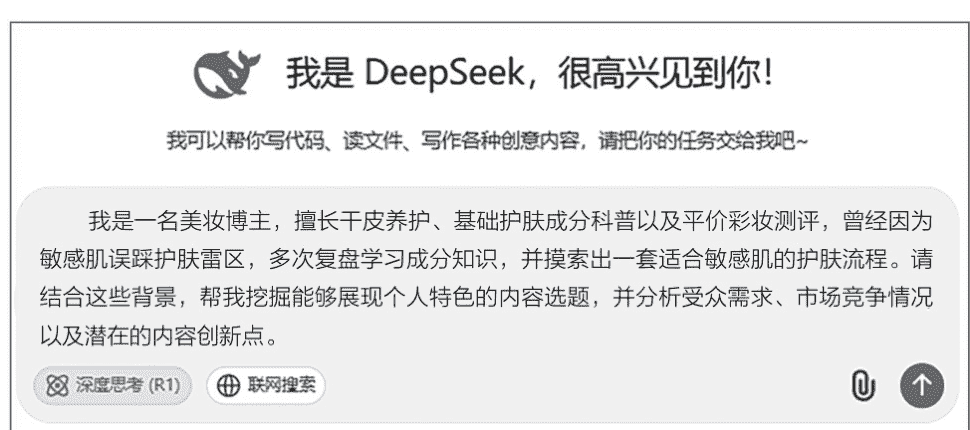

图3-4

按回车发送后，得到的结构化建议大致如下。

一、观众期待拆解
核心人群包括：对温和修复有强需求的干敏肤质；追求高性价比的学生和预算控制者；想入门成分知识却易被营销误导的新手成分爱好者；因踩雷而对护肤失去信心的焦虑用户。
痛点集中在：如何筛选不刺激的亲民价位单品；干敏肌如何借助成分搭配修复屏障；神经酰胺、角鲨烷等常见成分的作用机理与搭配禁忌；创作者能否用亲身经历给出可信的敏感肌解法。

二、内容方向，突出个人印记
差异化方向有三条：以自身踩雷经历为线索的“敏感肌自救指南”系列，复盘过度刷酸、皂基洁面等误区，并做轻重度分级护理方案；“亲民成分对标大牌”测评，用实验室保湿度、温和性数据对比The Ordinary烟酰胺与SK-II小灯泡等；以记录形式呈现“干敏肌100天修复计划”，日常流程加成分原理穿插讲解。
形式创新方面：开设“成分侦探社”互动专栏，粉丝投稿成分表创作者点评；做“1分钟避雷小课堂”短视频，用“皮肤像漏水的桶”这类类比讲清误区；整理“敏感肌亲民彩妆清单”，做12小时上脸持妆实测。

三、竞争与突围
赛道现状是成分科普和纯亲民测评已比较拥挤。机会点在于把“干敏修复经验+成分知识+亲民实测”三合一，并以失败案例复盘做切入，更易产生共情。
突围路径包括：打造“科学护肤公式”IP，例如“干敏肌保湿=内源性补水+外源性锁水+抗炎”，用公式化表达降低理解成本；与实验室或品牌联合推出敏感肌友好亲民线，用创作者亲测背书；做场景化内容，如北方秋冬防爆皮急救包、口罩期极简护肤。

需要再细化时，可以用三类追问模板继续深挖：
如果进一步细化【___需求】，可以提供哪些额外解决方案或附加值？
针对【___痛点】，能否拓展其他相似情境以引发更多共鸣？
如果目标受众是【___人群】，内容该如何调整以满足其独特需求？

### 让旧题焕新
热门话题被反复做烂时，做法不是抛弃，而是把个人经历注入旧题，给它新的生命力。下面是重塑旧题的两条指令模板。

> “在【刚入行、刚开始做博主等时间点】写的【旧选题】，请结合我现在作为一个【身份升级：头部/成熟期博主】的新视角，帮我重写一个更专业、有洞察力的新选题。”

> “我写过【某篇针对特定人群的美妆内容】，现在我想从【不同身份或受众角度】重新演绎，请帮我找到叙事亮点和结构路径。”

逻辑也很清晰。第一条是同题换视角，早期经验浅只能讲表面，现在积累了数据、案例和洞察，同一题可以讲得更深、更有说服力。第二条是换受众讲同题，通过身份、语气和视角的转换，让一次内容产生第二次传播力。

继续以美妆博主为例，假设他已测评上百款护肤品，想用“专业但亲切”的角度重写刚入行时的选题。同样启动R1模式、关闭网络检索后，模型给出如下重构思路。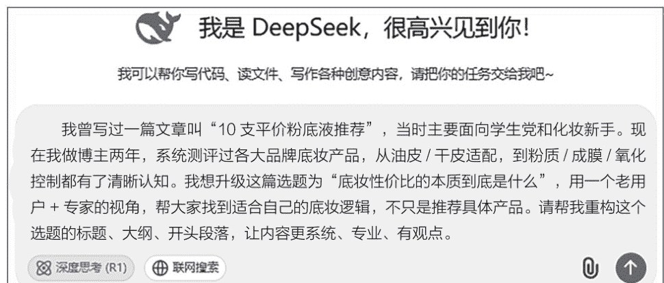

图3-5

标题建议：《底妆性价比的三大认知陷阱：从平价到贵价都适用的底层逻辑》。

大纲重塑包含：被误读的性价比公式，价格不等于价值、用量的非线性衰减、成分表背后的工艺差异；底妆工程本质，成膜技术、粉体处理、氧化控制的代际差异；个体适配决策模型，油皮干皮的皮脂膜平衡、不同光线场景需求、预算分配的必要项与溢价项；产品验证案例库。

开篇设计三段式：先以显微摄像头记录粉底液上脸四小时微区变化切入，打破“平价战斗机”神话；再强化身份背书，累计测评137款、完成216组对照实验的研究员视角；最后提出价值主张，构建可量化评估体系，3分钟试妆就能预判是否值得带回家。

优势在于建立实验室级专业背书、引入可量化对比、提供迁移性决策工具，而非单纯科普。若需补充数据或文献可继续追问。

进一步细化可用的提示词：
对于“___专业术语”，请用类比或可视化方式帮助读者理解；
如果要让【×××】内容对新手更友好，该如何简化或提供辅助阅读材料？
目标用户看到这段【×××】时最可能的疑问是什么，是否已预判并回应？

### 挖掘冷门蓝海
当红海厮杀激烈时，冷门但高价值的蓝海方向反而更容易建立壁垒。许多冷门题之所以没人做，是因为缺了个人化的视角。下面是挖掘蓝海的指令模板。

> “作为【特定身份】，我对【行业/主题】有独特的体验。请基于我的背景，挖掘3个与我经历相关、但市场上较少讨论的蓝海选题。”

提问逻辑分为三点：交代特定身份是呈现稀缺性；强调独特体验是提供可信度和细节厚度；要求挖掘有关联但市场少谈的蓝海，是锁定内容切口。

以在彩妆柜台工作5年、熟悉真实使用反馈的美妆博主为例，模型给出三个方向。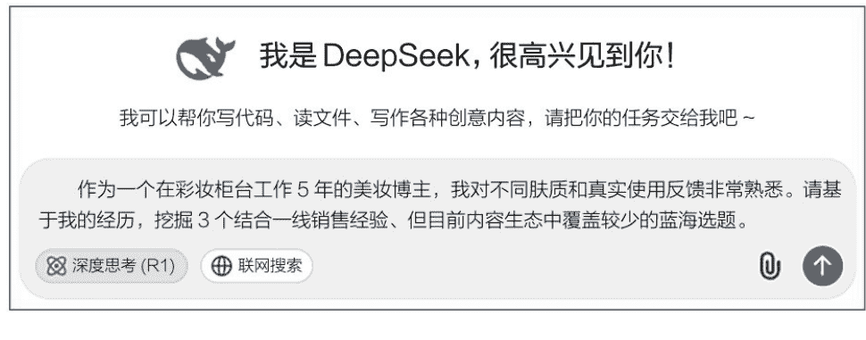

图3-6

方向一，反直觉的肤质适配法则。破解柜台里常见认知误区，例如油皮追求哑光越补越花、干皮叠加保湿却卡粉、敏感肌盲目求无添加反而受损等。用顾客自述需求与顾问实际建议的对比案例呈现。

方向二，柜台后台黑科技。揭秘粉底调色盘的七种进阶用法、一次性唇刷的隐藏功能、试用装挤压瓶的取用技巧等，拍摄工作台实景并给出亲民替代方案。

方向三，年度复购报告。从会员系统里筛选反复购买3次以上的冷门单品，如混油皮回购的非控油乳液、熟龄肌囤货的非抗老精华等，做可视化复购地图，按季节、地域、年龄拆解真实使用场景。

执行建议包括穿插柜台服务花絮、设计AB诊断小测试、开发专柜冷知识贴纸强化IP记忆点。

确定方向后仍可追问：结合个人经验如何拆解差异化逻辑；如何转化为短视频脚本或系列图文；受限于无法露脸或拍摄条件受限时如何调整呈现形式。

### 用DeepSeek搭建选题库
持续输出的关键是建立选题库。搭建可分为收集、整理和储备三个动作。

选题收集可用以下模板：

> “我是【特定身份】，我的内容主要涉及【行业/领域】。请基于【时间范围】的【数据来源/趋势分析】，帮助我整理一批【高互动/高需求/高潜力】的选题，并提供简要的选题逻辑。”

提问背后是三层意图：说明身份和领域让模型对准策略；限定时间范围和数据来源确保信息新鲜；明确要高互动、高需求或高潜力的类型，避免泛泛而谈。

以美妆博主、护肤与彩妆内容、近半年社交媒体热度数据为例，启动R1模式、关闭网络检索后，模型整理出12条高互动选题及底层逻辑。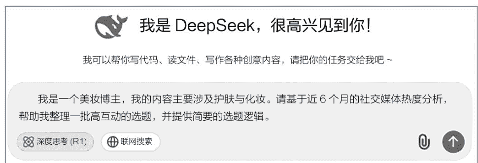

图3-7

示例包括“实验室猛药平替成分对照表”，用仪器对比贵价成分与亲民替代物的真实效果，对应小红书成分党话题半年涨幅182%；“毁容式护肤急救指南”，针对早C晚A、刷酸翻车等场景提供修复方案，相关抖音视频平均点赞超15万。

通过上述方法，创作者既能保持个性化，又能系统化储备内容，实现长期稳定增长。

美妆赛道同质化会直接吞噬流量，把 DeepSeek 当作内容试验田来做方向挖掘、拆解、排期与扩容，能明显提升产出效率。下面这套做法保留了原方案的判断和数字，只是表述做了重塑。

先看模型首次返回的方向池，洞察点和量化依据完全保留。

情绪疗愈类
3. 用色彩心理学搭建提神妆面，以特定配色缓解抑郁焦虑情绪｜Instagram #healing makeup 标签半年涨幅 320%
4. 职场气场增强妆，以眉峰轮廓、唇线锐度等细节形成心理暗示｜哔哩哔哩平台“通勤妆”搜索量同比攀升 407%

技术破圈类
5. 手机肤质 App 横评榜，横向检验 AI 测肤准确度并拆解背后的商业逻辑｜美丽修行 App 日活跃用户半年增长 73%
6. 家用射频美容仪械字号拆解，用光谱仪对比各价位产品的真实温升差异｜小红书上美容仪避坑笔记的收藏量达到行业均值 2.6 倍

反差矩阵类
7. 百元实验室，用 pH 计、离心机等科研级仪器测评平价国货｜抖音 #学生党护肤 话题播放总量达 48 亿次
8. 奢侈品小样真伪比对，横向比对专柜、代购、二手平台小样的包装细节与质感差异｜闲鱼美妆小样交易量半年增长 92%

沉浸体验类
9. 氛围音卸妆疗法，用 3Dio 麦克风收录不同质地卸妆产品的解压声效｜YouTube 上美妆 ASMR 视频的平均观看时长是普通视频的 2.3 倍
10. 特应性皮炎期间的极简上妆记录，皮肤屏障受损时的可执行方案｜中国特应性皮炎患者超过 3000 万，相关内容仍属稀缺

方向确定后可通过追问让方案更贴合自身。常用的追问有三类：
1. 让同一话题适配不同平台。拆分平台推荐逻辑和用户偏好，输出差异化呈现打法。
2. 让话题结合个人背景做差异化。把个人经验、行业视角、账号定位融进去，得到更细的可执行建议。
3. 在受限条件下做形式替换。比如无法出镜、场地受限、预算不足时，提供替代呈现方案与执行路径。

示例
1. 话题 5“手机肤质 App 横评榜”，在哔哩哔哩做深度评测，在小红书发布图文对比，分别给出节奏、镜头结构与互动设计。
2. 话题 9“氛围音卸妆疗法”，创作者是声音设计出身，想用音效知识做沉浸式听觉体验，拆解内容结构与可放大的细节。
3. 无法出镜想做话题 3“色彩心理学提神妆”，改用剪纸动画加旁白，给出视觉风格、配音情绪与脚本要点。

2. 主题归类

收集完主题后要归类，方便快速调用。可用指令框架：
“我是一位【特定身份】，我的内容覆盖【行业/领域】。请按【分类维度】归类，并补充更专业的分类建议。”

关键点在于明确分类维度，并让模型补充更合理的归类方式。

以美妆博主为例，内容涉及护肤测评、彩妆教学、种草笔记、品牌盘点，分类结果如下。

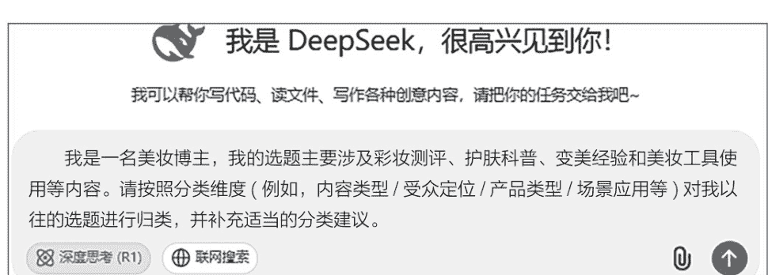

以下是基于你的内容方向整理的分类维度及主题归类建议，涵盖现有定位和可拓展方向，帮助你更系统地规划内容结构，提升丰富度。

一、按内容类型归类
测评类 现有示例：粉底液持妆力对比、网红眼影盘实测 补充建议：小众品牌测评、国货新品开箱、贵价平替对比、雷品吐槽
科普类 现有示例：早 C 晚 A 原理、敏感肌修护成分解析 补充建议：成分深挖、护肤误区辟谣、医美项目科普、皮肤科医生 Q&A 合作
技巧类 现有示例：方圆脸修容公式、单眼皮眼妆技巧 补充建议：骨相化妆、一物多用技巧、不同场合适配改妆、按肤质调整护肤步骤
工具类 现有示例：化妆刷选购指南、美容仪正确用法 补充建议：工具清洁保养、黑科技解析、DIY 工具妙用、专业化妆师工具包揭秘
经验类 现有示例：油痘肌十年护肤心得、黄皮显白配色法则 补充建议：素人改造案例、不同年龄抗老重点、审美风格分析

二、按人群定位归类
新手 主题示例：在校生百元化妆品套装推荐、化妆步骤拆解 价值点：零基础跟练、避坑
成分党 主题示例：烟酰胺 vs VC 美白效果实验、防腐剂安全清单 价值点：数据对比、文献支撑
敏感肌/问题肌 主题示例：烂脸期急救方案、医美后修复产品测评 价值点：温和配方、屏障修复
职场女性 主题示例：5 分钟通勤妆教程、办公室补妆神器推荐 价值点：高效、得体、隐形精致
熟龄肌/抗老人群 主题示例：法令纹填充式化妆教程、抗老面霜成分横向测评 价值点：抗衰科技、长效保养

确定维度后可继续追问，例如围绕具体话题做子内容延伸、把某类内容打造成系列栏目、或按主阵地平台优化话题库的分类效率。

3. 主题优先级排序

归类后需要排序，按创作难度、市场需求、内容价值排优先级。指令框架：
“我是一位【特定身份】，当前有【数量】个话题，涉及【主要内容方向】。请按【优先级标准，如热点优先、易创作优先、长期价值优先】排序，并说明调整理由。”

以美妆博主为例，话题涉及春夏换季护肤推荐、新款底妆测评、母亲节送礼清单、618 大促彩妆清单、妆容教程合集，假设时间节点为 4 月，排序如下。

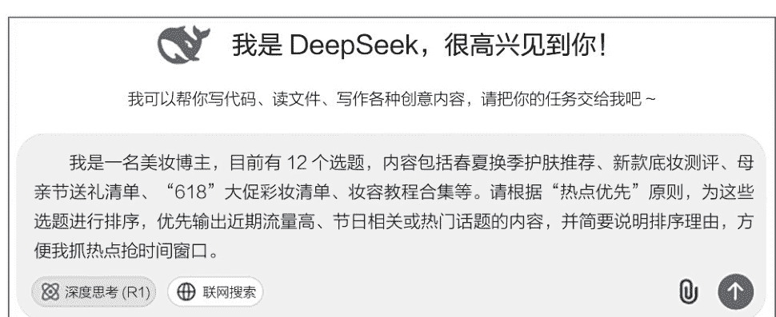

根据当前时间节点和近期热点趋势，结合节日大促时间轴，给出优先级及理由。

第一名 母亲节送礼清单 理由：母亲节 5 月 12 日临近，4 月底至 5 月初搜索需求爆发，需提前 1-2 周发布抢占流量，美妆护肤礼品是热门品类。
第二名 618 大促彩妆清单 理由：618 预热 5 月下旬启动，用户通常提前 1 个月做功课，5 月中旬前发布可覆盖必买清单、大促攻略等高搜词。
第三名 春夏换季护肤推荐 理由：4-5 月换季敏感高发，维稳修护控油检索词搜索上涨，可结合口罩肌护理等衍生话题。
第四名 新款底妆测评 理由：春夏底妆新品集中上市，蹭品牌营销热度，标题突出 2025 新品、油皮亲测，搭配上脸实测易获推荐。
第五名 妆容教程合集 理由：需绑定具体场景提升时效，如毕业照妆、520 约会妆，后续补充通勤快速妆等长青内容，用明星仿妆带流量。

执行建议：周末前完成母亲节内容并同步策划 618 话题，向品牌方争取样品，利用换季痛点期建立专业人设，为大促导流。

追问方向可包括围绕节日做图文短视频直播矩阵、结合自身特长做差异化表达、或制定全年节日排期表及提前准备时间点。

3.3.2 拓展话题库，减少灵感枯竭

话题枯竭时可做横向、纵向、关联拓展。指令框架：
“我是一位【特定身份】，我的话题涉及【行业/领域】。请基于【话题】，按【拓展方式】提供 3-5 个可延展话题。”

以主打低价彩妆推荐的美妆博主，原始话题为在校生、打工人彩妆使用指南为例，基于“百元以内粉底液测评”做纵向拓展：

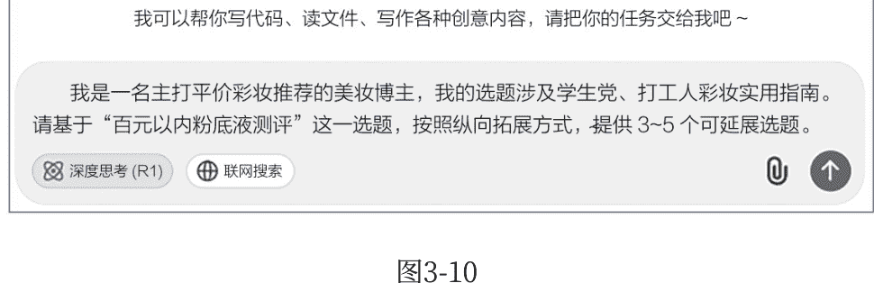

1. 24 小时真实挑战：百元粉底液抗汗抗暗沉能力测评。模拟早八晚九课程和通勤场景，分时段记录暗沉斑驳情况，并给出补救技巧。
2. 百元粉底液跨界平替实验：能否替代大牌。通过成分类似的平价款与大牌对比，双盲测试妆效质地，建立“大牌 80% 效果 +20% 价格”公式。
3. 不同肤质自救指南：百元内粉底液避雷清单。分干皮油皮痘肌列出闭眼入和快逃款，并配使用技巧和过敏急救方案。
4. 百元粉底液单品多用途创意玩法合集。粉底液调和润唇膏做液体腮红，深色做修容浅色做提亮，过期粉底液的妙用等。
5. 在校生投稿：百元粉底液在南北方的极端表现。征集地域实测，分析氧化速度和浮粉程度，制作中国气候地图选粉底指南。

逻辑链从基础测评到场景深化再到功能破圈、地域适配和用户共创，后续可延展为“百元彩妆宇宙”系列。

3.3.3 优化话题库，增加品类多样

单一品类易导致涨粉停滞。指令框架：
“我是【特定身份】，目前话题库集中在【当前品类】。希望尝试【新方向】，优化结构。请按常青长期话题与热点爆发话题组合策略扩展话题库。”

以主打低价彩妆测评、集中在底妆唇部对比的博主为例，常青与热点组合是保持稳定流量与快速引流的关键。

一、常青长期话题
场景化刚需系列
1. “低价彩妆通勤王炸组合”

通过这套方法，话题从单点到矩阵，从热点到长青，形成可持续生产的内容体系。

借助 DeepSeek 做选题孵化的思路，是先让它把特定人群的妆容痛点拆解成可落地的选题雏形，再结合热点与渠道特性做二次拆解。整理后的完整方案如下。

一、经济妆效打法系列
- 早七点起床也能在十余分钟内完成清透底妆的极简路径，核心在于几支经久耐用且价效比高的基础单品组合。
- “拜访长辈的隐形自然妆”——打造长辈易产生好感的温润底妆手法，搭配豆沙色调替代唇釉的测评。
- “校园群体晨课特种兵打法”——二十元以内能拼出课堂清透感的方案，并附上自习室环境下的持久度对比。
- “求职妆容防尴尬指南”——规避高饱和与闪片等职场雷区的高效形象管理，附带持妆力极限测试。

技术向技巧系列
- “五十元预算完成全脸”挑战，单支唇膏在脸颊、眼部、唇部的六种进阶用法，强化高价效比产品多用途属性；另附烘焙定妆法的详细说明与吸油纸替代方案的测试。
- “高价效比替代品测试室”——高端品牌淡妆与国产替代的实拍对比，突出价效比决策逻辑。

场景感系列
- “约会补救彩妆清单”——应对妆面花掉、浮粉、色块的经济补救神器测评，带棉签加乳液的低成本修复技巧。
- “四季主题的经济妆容方案”——春季樱花腮红画法、夏季控油组合、秋季枫叶眼影盘、冬季保湿喷雾实测。
- “运动出汗耐力测试”——五十元内防水彩妆的极限验证，跑步机一小时前后对比。

二、热点狙击选题
节日事件借势
- “情侣节限定款经济复刻建议”——用常备单品复刻 YSL/3CE 情侣节套装妆效，建议提前一周投放。
- “开学季校园角色妆容拆解”——“学霸温柔学姐”对比“社团招新王者”的妆容拆解，借势校园话题。
- “现场演出灯光下妆容避坑提示”——揭秘灯光下易显脏的元凶，附三十元内亮片眼影测评，结合当季顶流巡演。

以上只是 DeepSeek 的第一版抛盘，确定方向后可继续追问细化。常用追问模板：
- 若想锁定某一类目标人群，如油性肌肤的在校生，能否从中提炼出三个痛点最强的切入点？
- 有没有适合快速吸粉的表现形式，如“六十秒生活技巧/高压测试挑战/替代测评”，适合放进系列做爆款？
- 如果要在某个节日/热点发布妆容稿件，能否给出提前预热加临近引爆的稿件排期节奏？

3.4 深度选题挖掘：多渠道热点抓取与重组
竖屏短片、图文、直播并存，热点的生命周期越来越短，不同渠道的节奏和用户诉求也存在差异。同一话题在微博偏社会讨论，在小红书则偏实用干货，在哔哩哔哩适合深度测评或剧情演绎。因此需要多渠道数据整合，用热点共振提升选题复用率。

3.4.1 多渠道抓取，实现选题联动
单一渠道很难吃尽稿件价值。借助渠道差异做“热点迁移+多渠道联动+精准匹配”，能最大化流量。
常用指令模板：
“请基于短视频平台爆款话题检索词的视频稿件，转换成适合小红书和哔哩哔哩发布的稿件格式，并给出不同渠道的创作建议，如标题优化、稿件结构调整、互动设计等。”
提问逻辑：
- 基于已经爆过的内容做参考，选题更贴近受众兴趣；
- 多渠道必须改格式，直接搬运会水土不服；
- 不只是搬运，还要精修，提升各渠道表现力。

以短视频爆款“居家沉醉挑战”为例的多渠道方案：
小红书适配，生活美学加治愈感
稿件结构：1-2分钟竖版，节奏放慢，每场景3-5秒，增加慢疗愈感。突出高颜值家居细节、好物标注弹窗、情绪价值文字如“周末的环境氛围是自己给的”。
标题示例：“独居女生的治愈周末｜居家沉醉 Day1”、“#居家沉醉 一个人把出租屋过成治愈电影？”、“用一百元改造卧室！环境氛围居家攻略附清单”。
互动：置顶评论整理地毯/香薰/四件套，发起#居家环境氛围王者挑战#，提问“最后翻车的是哪个环节？”

哔哩哔哩适配，技术派加故事化
稿件结构：横版分镜，前5秒冲突开场“闹钟响起，挑战十二小时不碰手机能干嘛”，中间技术特写如旋转镜头拍书架、手账定格动画，结尾反转彩蛋如打翻咖啡、猫咪乱入。时长3-5分钟，增加动机、准备、总结叙事线。
标题示例：“【居家沉醉】自律vs摆烂的极限拉扯！结果居然……”、“砸五千元搞沉醉书房？社恐宅女48小时硬核挑战”、“挑战王家卫风格拍居家日常！网友：这运镜我跪了”。
互动：进度条标注高能点，弹幕口令“你的居家人设→文艺党/电竞宅/厨神”，片尾悬念“下期书房vs厨房由你们定”。

继续追问可细化：
- 在“居家沉醉挑战”中，如何用慢节奏画面传递更深的治愈感？能否通过光影、家具布置等画面细节加强？
- 在某渠道的挑战类视频里，如何把技术派专场创意融入故事？比如旋转镜头展示 DIY 时如何让视觉更震撼？
- 能否设计一句情绪价值短句，配合镜头如“周末的环境氛围是自洽的”？

还可让 DeepSeek 制定一套多渠道发布策略，模板：
“请针对检索词的热点，制定一套多渠道发布策略，包括：① 短视频平台发布时间及稿件结构；② 微博跟进互动方式（如投票、话题讨论）；③ 小红书长图笔记结构；④ 哔哩哔哩深度解析视频大纲。”

示例“AI 绘图工具进化史”：
短视频平台：工作日19:00-21:00，周末11:00-13:00发布。15-30秒系列化，爆点开头对比2015模糊色块到2024赛博朋克大片，按时间轴分阶段，每期一阶段，结尾抛争议“AI绘图会让人类画师失业吗？”，文案“十秒看完AI绘图如何碾压式进化！你用过第几代？”
微博：投票“哪款 AI 绘图工具改变了你的生活？”，话题#AI绘图工具编年史#、#AI绘图算不算艺术#，联动大V做“AI复刻名画挑战”。
小红书：竖版长图，封面“AI绘图工具进化史｜手把手选你的赛博画笔”。时间轴图谱、工具对比表、避坑指南，文末引导评论区领检索词大全。
哔哩哔哩：15-20分钟，P1技术革命史8分钟，GAN 到 Diffusion 原理可视化，行业案例；P2争议与未来7分钟，版权诉讼数据、画师访谈、趋势预测，彩蛋用最新工具复刻哔哩哔哩经典 IP。

3.4.2 发现潜在爆款趋势，提前布局
热点有周期，提前布局才能抢占高地。指令模板：
“请分析过去三个月内，内容/方向检索指数增长最快的五个检索词，并结合趋势预测，判断哪些选题在未来一个月内可能爆火？”
以美妆为例：
过去三个月增长最快的五个检索词
1. 防晒霜推荐——夏季刚需加新品迭代，百度指数七月同比涨65%。
2. 控油持妆——高温脱妆痛点，小红书#控油持妆#阅读破三亿。
3. 脆弱肌修复——夏秋换季，积雪草、神经酰胺检索上涨，微博“换季烂脸”讨论同比+80%。
4. 早C晚A——抗老年轻化，知乎攻略收藏超五十万。
5. 素颜霜——通勤学生追求快速自然，抖音“五分钟出门妆”推高检索。

未来一个月可能爆火的选题
1. “十一购物节抗老精华囤货指南”——预售期加成分党关注玻色因、A醇。
2. “秋冬以油养肤手法教学”——干燥季油脂类产品热度回升。
3. “脆弱肌换季急救套餐”——十月底前过敏高峰，“三步退红法”易互动。
4. “国货彩妆新品开箱实测”——品牌借十一购物节推新，联名 IP 易引发话题。
5. “晨课党快速通勤妆”——五分钟完成底妆加眉眼加唇，强调单品多用。

后续追问模板：
- 关于具体选题创作，希望结合我的个人经验/行业背景/渠道定位做差异化，可从哪些角度细化？
- 想把某选题转为短视频脚本/系列图文/直播提纲，请按渠道定位和受众细化结构和呈现？
- 如何创新切入选题吸引特定渠道受众？

4 用 DeepSeek 打造爆款标题与稿件
信息过载时代，标题是流量入口，稿件是转化关键。本章解决四个问题：如何快速生成爆款标题、如何写出契合渠道的稿件、如何做出破万阅读的文章、如何预测优化效果。

4.1 用 DeepSeek 生成爆款标题
标题是第一入口。手动写易卡壳，可让 AI 拆解上亿热门标题批量生产。

4.1.1 拆解热门标题，掌握写作技巧
最快方法是拆解。指令模板：
“请帮我分析下面数量××领域的渠道爆款标题，总结高频检索词和常见句式。
1. ××××
2. ××××
3. ××××
…”
逻辑：提供真实爆款、限定领域和渠道、要求拆解检索词句式、给出具体标题做数据归纳。

数码领域小红书标题拆解示例：
高频检索词
人群指向词：在校生、安卓用户、办公人群
产品类型词：iPhone、笔记本电脑、耳机、平板电脑、手机、App
价值暗示词：…

在内容分发里能让用户停下的切口，归纳起来主要集中在四个抓点。

第一类是价格感知。说辞围绕门槛低、体验超出价钱、物超所值展开，常见表达是三千左右就能拿下、一分钱换来百元级体验、主打实惠取向。

第二类是独家感。强调信息没被大众扩散、冷门却好使，典型话术是官方未主动披露的功能、极少人提及的实用做法。

第三类是反向劝说。用劝退姿态制造反差，比如提醒别急着下单、通勤用途并不匹配、参数不是唯一衡量标准。

第四类是时效锚定。把文案绑定当下时间点，比如年度最值得关注的机型、当前热议的 iPhone15 等话题。

量化描写能让信息更可信。常见的写法会带入具体金额、件数、时间节点，如三千块、1元、第3个、5件事、3款App、半年、2025年等，阅读时信任感明显提升。

从句式分布看有清晰规律。

反差留白类占比约一半。做法包括制造信息差，例如苹果内部也没公开的……；用反向建议，例如我为什么不建议你入手……；用时间沉淀感，例如用了半年才明白的……；用价差对比，例如花小钱得到大价值……

答疑型约占三成。通常先点出困扰再给出答案，例如预算三千的学生笔记本该怎么挑？这份对照表可直接套用；带有情境提醒，例如入手 iPhone15 前需要留意的……；给出效率承诺，例如办公效率翻倍的 3 个技巧……

横向比较类约占两成。多机同台看，例如三款手机一起看；对参数提出质疑，例如性能是否比价格更重要？

整体组合逻辑可归纳为：受众定位或使用情境 + 反差或留白 + 量化具象 + 收益暗示。示例：职场新人必看｜MacBook 这三个设置不改等于白买，每天多出两小时。

延伸观察方面，情绪词会加强代入，比如后悔、感谢等；约三成的封面文案会带负面建议，不适合、别买，契合决策时的焦虑；标点使用上惊叹号出现频率较高，问号次之，双符号叠加更吸睛。

基于这些规律，用 DeepSeek 快速复用高频词、常用句式和优化建议，很容易产出符合生活方式社区调性的旅行爆款封面文案，常见的追问框架和示例如下。

我写的封面文案太平淡，能否按反差留白加受众加数值的框架帮我改写更抓人？
能否把爆款句式提炼成几个可套用的模板？我只要填入受众、产品、数值、情境就能直接生成。
这篇内容讲的是适合安卓用户的平价 App 推荐，能帮我梳理几个可做爆款的角度和核心要点吗？

示例
原始文案“推荐几款适合学生的耳机”，改写为“学生党注意！这3款耳机比AirPods还香！”这类风格。
有没有像预算加情境加对比评价这样通用好用的句式？请举例。
哪个点能抓住安卓党焦虑？文案里用替代神器还是官方都不会告诉你更好？

批量产出文案并筛选最优解
文案是流量的第一道关，靠灵感一条条写既耗时又易陷入定式。利用模型批量产出候选再筛选，能做到高效且专业。流程分四步。

第一步，核心要素抓取
先让模型从正文中抓出 3～5 个核心要素，作为后续生成的素材。提问框架：
请提炼以下内容的要点 3～5 个：【你的正文摘要】。
逻辑是，只提要点等于抓取浓缩精华；限定数量避免发散；输入摘要而非碎片，才能让模型理解语境提炼更准。

示例
请提炼以下内容的要点 3～5 个。
哈佛大学最新研究发现，每日饮用 3～4 杯咖啡可降低 15%的糖尿病风险，但超过 5 杯可能引发焦虑。专家指出以下内容。
黄金时段：上午 9:30—11:30 最佳。
警惕误区：空腹饮用伤胃指数增加 40%。
替代方案：尝试南非博士茶加肉桂粉的新配方。
特殊人群：孕妇、高血压患者需严控摄入量。
（数据来源：2023 年《营养学前沿》期刊）
输出要点：咖啡饮用、糖尿病风险、摄入量、特殊人群、替代方案
解析：咖啡饮用是研究主线；糖尿病风险是核心结论；摄入量体现剂量效应；特殊人群为限制条件；替代方案为延伸建议。

第二步，多语气演绎
拿到要点后，围绕不同语气生成多组候选。三种常见语气框架：
提问型：用“如何、缘何”开头，基于【要点】生成 5 个提问式文案
数据型：结合量化数据和【要点】，创建 3 个数据化文案
留白型：用“揭秘、真相”等词，围绕【要点】写 3 个留白文案

提问型示例：用“如何、缘何”开头，基于“糖尿病”生成 5 个提问式文案。
如何通过饮食调整有效预防糖尿病前期恶化？
缘何糖尿病患者更容易出现心血管疾病和神经损伤？
如何利用运动科学精准控制 2 型糖尿病血糖波动？
缘何遗传因素在糖尿病发病中并非唯一决定条件？
如何通过新兴医疗技术逆转早期糖尿病代谢异常？
设计思路在于从预防、并发症机制、精准运动、基因迷思、医疗科技等角度切入，提升专业度与前瞻性。

第三步，跨语气组合
把不同语气文案重组，碰撞出新创意。提问框架：
请将‘数据型文案A’和‘留白型文案B’混搭创新，生成 3 个新文案。
示例
请将“每天喝 3 杯咖啡，影响有多大？”和“如何通过饮食调整有效预防糖尿病前期恶化？”混搭创新，生成 3 个新文案。
咖啡控的防糖攻略：每日 3 杯如何影响糖尿病前期风险？
从咖啡杯到血糖仪：饮食微调如何阻断糖尿病前期恶化通道？
3 杯咖啡与血糖天平：解码饮品选择在糖尿病防控中的双刃剑效应。
创新手法包括具象情境建立关联、矛盾修辞呈现复杂性、动态动词强化主动性、量化与专业术语平衡可读性、冒号结构突出因果。

第四步，集中产出
把要点与语气整合，一次输出 15～20 个候选，再筛选最优。提问示例：
请将上述要点和文案语气进行整合、混合创新，输出 15～20 个候选文案，并筛选出最佳选择。
候选清单节选
3～4 杯咖啡能降 15%糖尿病风险？哈佛研究解析。
咖啡 vs 南非茶：谁更能防控糖尿病？
孕妇、高血压患者咖啡警戒线：超量伤胃焦虑？
空腹喝咖啡伤胃指数增加 40%！糖尿病人避坑指南。
哈佛：咖啡“黄金 3 杯”科学依据。
咖啡防病到致病的临界点揭秘。
咖啡黄金时段：9:30—11:30 降糖最佳？
咖啡替代品实测：南非茶加肉桂粉控糖？
3 杯护体，5 杯伤身？糖尿病患者咖啡饮用量的安全线。
咖啡悖论“降糖却伤胃”与饮用指南。

最佳文案 TOP5
3～4 杯咖啡能降 15%糖尿病风险？哈佛研究解析。优势：数据精准加权威背书。
咖啡黄金时段：9:30—11:30 降糖最佳？优势：情境化加时间冲突。
3 杯护体，5 杯伤身？糖尿病患者咖啡饮用量的安全线。优势：对比强烈、口语化。
咖啡悖论“降糖却伤胃”与饮用指南。优势：矛盾冲突加解决方案。
咖啡替代品实测：南非茶加肉桂粉控糖？优势：直击替代方案，实验感增强信任。

筛选逻辑
信息效率：10～15 字内覆盖核心结论。
情绪驱动：问号、惊叹号、vs、悖论等激发探索欲。
受众适配：兼顾泛受众和垂直受众。
行动指向：隐含可操作价值如解析、指南、实测，降低阅读决策成本。

分阵地优化文案语气
同一选题在不同阵地的表达期待不同，需针对性调整。

生活方式社区：生活化加视觉感
特点：爱用 ✨、💧、🔥 等表情符号；偏好具体数据如 3 天、5 千克、99 元；强调情境关键词如学生党、懒人、小个子。
提问框架
生成 10 个生活方式社区风格的【内容主题】文案，要求：带 💎、🚗 等表情符号；包含【主题关键词】等关键词；用【量化数据】等具体数据。
示例
生成 10 个生活方式社区风格的旅行攻略文案，要求带 🚗、🦐 等表情符号；包含‘学生党’‘平价’等关键词；用‘3 天 2 夜’‘人均 500’等具体数据。
学生党速存！青岛 3 天 2 夜人均 500 元🦐海鲜自由攻略🦐。
穷游党必看！平潭岛 3 天 2 夜环岛攻略🚴骑行加赶海人均 400 元！
设计逻辑：表情符号强化氛围；关键词锁定人群；数据化表达增强可信；公式为受众、痛点加数据加地点加体验亮点加表情。

知乎：专业性加科普性
特点：常用缘何、如何评价、是否合理开头；突出知识增量如深度解析、业内人士揭秘；避免夸张表情。
提问框架
生成 5 个知乎风格的【内容主题】文案，要求：以‘缘何’或‘如何’开头；包含【内容主题的专业词】等专业词；字数≤25 字。
示例
生成 5 个知乎风格的“旅行攻略”文案，要求以‘缘何’或‘如何’开头；包含‘地理知识’‘文化差异’等学科术语；字数≤25 字。
缘何冬季更适合西藏旅行？地理与文化因素解析。
如何规划南美行程？地理多样性带来的路线挑战。
设计逻辑：植入学科术语做知识锚点；构建因果关系链；控制信息密度；用研究、解析替代攻略、必看等低信息密度词。

短视频阵地：行动指令加反差感
特点：开头抓人如注意看、别划走、震惊；制造留白用……或结果出乎意料；大量加话题标签。
提问框架
生成 3 个短视频风格【内容主题】文案，要求：前 5 字用【网络热词】等热梗；中间加‘……’制造留白；结尾带‘#【主题相关】’话题。
示例
生成 3 个爆款母婴文案，要求前 5 字用‘答应我’‘谁懂啊’等热梗；中间加‘……’制造留白；结尾带‘#育儿经验’话题。
答应我……宝宝夜醒这样做，一觉到天亮！#育儿经验。
设计逻辑：热梗快速抓注意；信息断层激发好奇；话题标签提升推荐。

微信公众号：故事感加留白感
特点：常用“”突出核心词；加入人物故事如 90 后夫妻、辞职教师；双文案结构，前半句留白后半句解答。
提问框架
生成 5 个微信公众号风格的【内容主题】文案，要求：用“”突出关键词；包含【情境描述】等情境；采用【特定】句式。
要点：引号让关键词更醒目；情境描述增强共鸣；留白前置提升打开率。

微信公号标题里高打开率的写法，常依托读者对固定框架的条件反射来降低点击成本。如“如何××”“×个你不知道的××”这类熟练句式，就能快速获得信任感。

可直接套用的提问示范
“请为微信公号创作五条裸辞旅行的标题，约束如下：1. 用“”把核心词标出；2. 文中出现‘远离都市’‘裸辞’等情境词；3. 统一使用‘××多年，最后……’的叙事节奏。”

生成效果示例

1. 持续三年“996”，最后“裸辞”带存款“远离都市”：大理风声抚平焦虑。职场压抑共识+地标意象+情绪释放，直击都市年轻人的痛点。
2. 在“格子间”耗费七年，最后用“裸辞旅行”重启人生：318国道上的自我救赎。空间对比+公路叙事+成长蜕变，营造热血逃离感。
3. “远离都市计划”推迟五年，最后在三十岁“裸辞”间隔年：东南亚流浪日记。年纪焦虑+Gap Year概念+异域符号，激发中年叛逆共鸣。
4. “PPT”写了八年，最后用“裸辞”换回“自由呼吸”：青藏线骑行实录。职场黑话+极限挑战+自然疗愈，制造反差冲击。
5. “都市焦虑”忍了十年，三十五岁“裸辞”耗尽存款“远离都市”：冰岛极光治愈记。年纪标签+破釜沉舟+奇幻场景，强化戏剧化转折。

底层逻辑可提炼为三点。第一，用引号框定矛盾关键词如“996”“格子间”“PPT”，把职场压抑的集体记忆具象化。第二，“远离都市”“裸辞”双场景叠加，放大打破常规的爽感。第三，“×年后最后……”的句式制造延迟满足，搭配大理、318国道、冰岛等具体坐标，增强画面与可行暗示。

4.2 用大模型批量产出可直接发布在笔记类社区的热门稿件，关键在先读懂渠道、会提问题、后加爆点。

4.2.1 渠道气质先吃透
写作前先搞清受众喜欢什么、排斥什么。渠道自带性格，写对了才容易出圈。

受众偏好大致分三类。后浪女性偏爱氛围感生活与美好瞬间，典型说法是“早餐摆盘要像杂志大片一样精致”；会过日子与省钱派要干货与平替，典型说法是“不用大牌也能穿出高级感”；分享欲强的人喜欢真诚种草与避坑，常说“真的不踩雷！用完回购三次”。由此可见笔记社区要生活化、有温度、有画面，拒绝广告腔与生硬安利。例如“这款洁面乳泡沫丰富，清洁力强”是推销腔，改写成渠道说法就是“洗后脸滑到像换了肤质，毛孔都小了一圈”。

热门话题要常刷。站内发现页的滚动话题，如“早八党快速通勤妆”“在校生百元好物”，都是现成流量入口，依托这些话题创作自带热度。

稿件要做成“脑补型”。普通说法“很保湿”，画面化说法是“敷完像剥壳鸡蛋！水嫩到反光”。“契合干皮”改成“干皮救星！熬夜脸都能喝饱水”。“睫毛膏不晕染”改成“带妆十小时，睫毛还在翘着打招呼”。排版建议关键句单独成行，短句组合增强节奏，用💧🚗💎📱等表情点缀，重点词可加粗或加符号、序号突出。

4.2.2 提问模板要写清楚，别让模型猜
让大模型产出笔记社区调性，记住万能公式：身份设定+情境说明+主打优势。

身份设定要明确人物定位。模糊指令“帮我推荐一款粉底液”容易跑偏，精准指令是“扮演油皮护肤博主，推荐一款适合夏天的控油粉底液”，风格立刻锁定。

情境说明要贴近生活。普通情境“推荐一款粉底液”太泛，好的情境是“推荐一款适合通勤族上班，在三十五度高温下也能持妆十二小时的粉底液”，沉浸感直接拉满。

主打优势要点名。笼统说“这款粉底液很好用”没用，具体优势是“这款粉底液轻薄不闷痘，出汗后反而更服帖，自带柔焦磨皮感”。

实操示例：推广百元内在校生粉底液。
低效提问：“写一篇关于粉底液的推荐稿件。” 得到的内容通常平淡无特色。
高效提问：“扮演学生美妆博主，推荐一款一百元内的高性价比粉底液，适合通勤与上课妆容，重点突出【不显粉痕】【自然伪素颜妆效】【黄皮友好不假白】！语气轻松口语化+带表情符号。例如：‘我真的哭了！这个粉底液一百块都不到，但妆效完全不输大牌！！’适合发在笔记社区，让在校群体一看就想加购！”

这样提问的逻辑是：身份锁定受众审美和预算；价格区间+使用情境点明便宜又实用；三大关键词直击痛点；口语化+表情符号是渠道语言，模拟姐妹安利更容易引发共鸣转发。
图4-2所示为大模型提供的回答。
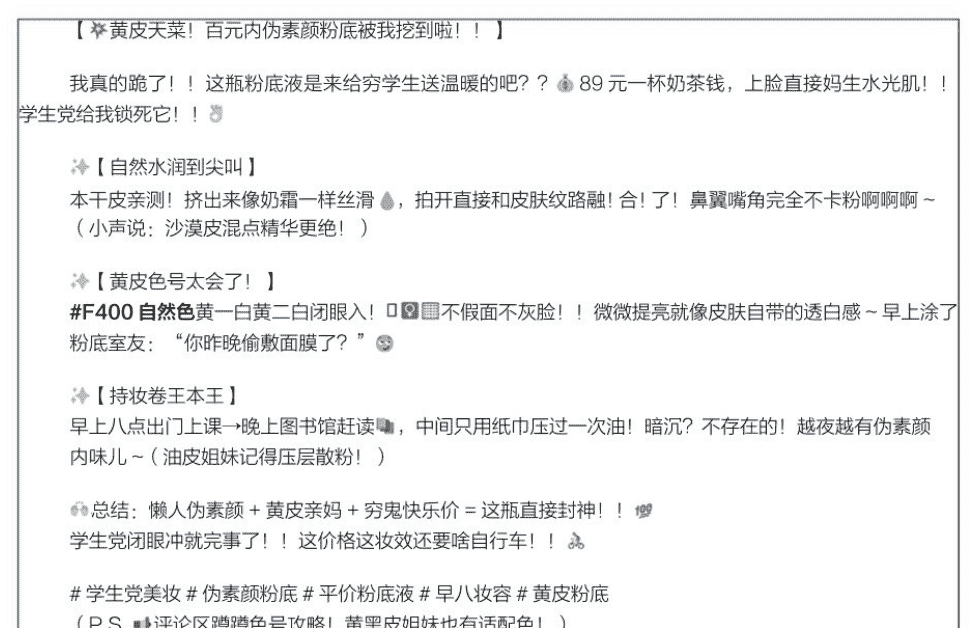

4.2.3 给热门再加戏
想从小透明变热门，需要对话引导和热门话题。

对话引导分三步。提问式开头勾住注意力，比如把“这款面膜很好用”改成“脸干到卡粉还爆痘？急救面膜来了！”；痛点共鸣让受众觉得“说的就是我”，比如“每天加班到腰酸背痛？这个空气纤维坐垫，打工人的老腰终于得救了！”；行动号召推动即时行为，结尾从“这款耳机总体上很不错”升级为“在校生抄作业！这耳机已经涨价两次了，现在点左下角还有三十元隐藏券！”。

热门话题要会蹭。找热点的渠道有站内发现页顶部话题、第三方热搜工具如灰豚数据、新红数据、以及抖音微博的跨平台热词。蹭热点要自然，不能生搬硬套。错误示范：#命运的齿轮 这个粉底液很好用；正确示范：命运的齿轮从这支口红开始！涂上被男神问色号的感觉谁懂啊！话题组合建议用“一个爆款话题+两个精准话题+一个品牌话题”，例如：#油皮护肤+#控油粉底液+#在校生彩妆+#××品牌。

4.3 用大模型写热门文章
AI写文章容易变成流水账，关键在于懂人性+懂渠道+懂传播。

4.3.1 精准匹配文章风格
不同渠道语言不一样，微信公号要故事金句有深度，笔记社区要轻松生活有沉浸，知乎要理性逻辑有干货，图文内容要短句强节奏。给AI的提问公式是：渠道+风格要求+目标人群+语言特点。

渠道决定规则，风格是渠道语言，人群决定内容侧重点，语言特点决定传播力。示例指令：“请用知乎风格写一篇关于如何高效读书并真正应用到生活工作的干货分享，面向大学生、职场新人、自我提升人群，要求语言理性客观、逻辑清晰，不空谈意义，而是讲方法论和实操路径，适当引用书籍、研究数据或真实案例。”

生成的文章可以是《扔掉无效读书法：三步把书变成你的外挂大脑》，先指出三大读书病：强迫症式读书、做手账式笔记、松鼠囤书症，再给出四步实操：带钩子读书、二十分钟捞干货、做知识使用券、七十二小时保鲜行动。

模仿热门表达习惯的通用模板是：请模仿【渠道名称】的热门表达风格，帮我写一篇【内容】，内容要符合【目标人群】的阅读喜好。示例：模仿微信公号热门风格写一篇关于读书改变认知的文章，读者二十二到四十五岁男性，关注成长效率赚钱思维提升。文章结构包含标题《杀死三十五岁中年人的秘密武器：废掉一个人最隐蔽的方式，就是让他停止阅读》，导语用数据对比，主体用认知颠覆+案例冲击+金句加粗+书单钩子+方法论，马斯克式阅读法，制造恐惧诉求等元素。

4.3.2 搭建清晰结构
选题好但逻辑乱，阅读量一样上不去。可以让AI按位置分工：开头提出问题引起兴趣，中间展开分析提供方法讲故事，结尾总结观点引发共鸣引导转发。

提问模板：帮我按照【结构】写作，每一部分要做什么，语言风格要求内容逻辑清晰表达有条理。

示例：请为知乎写一篇家居装修选材避坑经验，按首中尾三段结构，开头提出常见选材误区吸引兴趣，中间分三部分讲常见坑及避坑方法，结尾总结核心思路，语言理性客观以数据案例支撑。

生成的开篇即是《装修选材避坑指南：用数据思维破解家居建材迷局》，开头点出环保等级≠真实空气质量、进口品牌≠品质保障、低价促销≠性价比最优的认知陷阱，承诺用第三方实验室数据+真实踩坑案例拆解三大盲区。

###### 【选材容易失误的三大焦点】

####### 1. 环保数据好看却易被误导【附实验室对比资料】
多数人只死磕E0等级的标签，却把TVOC等综合性释放量这类关键指标忽略掉。
更稳妥的判断方式：
+ ① 以2021年起实施的新国标ENF为准，允许值是≤0.025mg/m³，旧版E0的≤0.05mg/m³已不算严格。

####### 2. 表面质感掩盖了耐用性【附带受力实验数据】
普遍偏好只看花色美观，缺少对性能参数与使用环境的匹配考量。
落地方案参考：
- ① 有地暖的空间，SPC石塑地板的吸水表现建议控制在0.5%以内，参考GB/T8810。
- ② 厨房台面建议选择莫氏硬度大于6的石英石，普通大理石多在3～5级区间，抗划能力偏弱。
- ③ 卫浴墙面需要核验吸水表现低于0.5%。

####### 3. 单价便宜掩盖了总花费【附带全周期测算公式】
很多人只对比材料单价，施工损耗和后期维护费用被遗漏掉。
总花费估算公式：
总成本 = 材料费 ×1.2 损耗系数 + 安装费 ×1.5 返修概率 + 维保费 ×使用年限

###### 【结语：选材的决策框架】

选材料本质上是在做数据建模。

- ① 建立三维评估坐标：环保看污染物释放速率、性能看材料力学参数、成本看全周期费用。
- ② 用约束条件法锁定不可妥协的底线：比如家里有过敏人群，ENF等级必须作为硬性门槛。
- ③ 参考《住宅装饰装修工程施工规范》T/SDDA002—2021来搭建验收清单。

当选材从感性拍板转向数据分析，健康、耐用、经济才能真正形成平衡。

确认方向后可以继续追问细化。参考提问方式：
- （1）ENF等级和TVOC具体指什么？读检测报告时怎么避免被误导？
- （2）我要装厨房，能否按环保+性能+成本的逻辑给出台面/地面/墙砖的组合建议？
- （3）能否多举几个材料用错的真实案例？最好有身边经历、网友投稿或投诉平台数据，具体一点。

### 4.3.3 用数据预判传播效果，提前优化标题与收尾

自媒体文章写完不是结束，还能用DeepSeek预判爆款潜力并优化。下面是评估爆款潜力的提问模板。

> “请帮我评估这篇文章的爆款潜力，分析：（1）标题是否足够吸引人？（2）内容结构是否易读、易传播？（3）文中哪些地方容易引发读者评论或转发？（4）有哪些优化建议？【文章内容】……”

这套提问的底层思路是：
- （1）先审标题钩子，标题是点击的第一关，要有冲突、情绪、数字、痛点等吸引元素。
- （2）再看结构是否顺滑，排版清爽、段落紧凑、逻辑清楚才利于一口气读完并收藏转发。
- （3）定位互动引爆点，看哪里有共鸣、争议或干货，便于评论和转发。
- （4）给出可落地的改动建议，如结尾增加互动提问等，而不是空泛点评。

以下是以此模板生成的示例。

请帮我评估这篇文章的爆款潜力，分析：（1）标题是否足够吸引人？（2）内容结构是否易读、易传播？（3）文中哪些地方容易引发读者评论或转发？（4）有哪些优化建议？下面是文章内容。##### 标题：家居选材避坑指南 正文内容如下。###### 1. 开头 装修一旦开工，最让人头大的，往往不是设计问题，而是选材问题。 瓷砖怎么选？地板怎么挑？环保材料是真是假？价格差距大到让人怀疑人生！ 我装修过两套房，踩过不少坑，今天就来分享一份超实用的选材避坑指南，帮你省钱、省心、省麻烦。###### 2. 中间 - （1）瓷砖篇。 误区：只看外观不看参数。 避坑建议：注意吸水率、耐磨等级，建议优选大品牌的基础款，性价比高。 - （2）地板篇。 误区：盲目追求实木。 避坑建议：实木复合地板是大多数家庭的首选，它稳定性好，且不易变形。 - （3）涂料篇。 误区：盲信“零甲醛”宣传。 避坑建议：选择有权威检测认证的品牌，注重通风比盲目迷信环保材料更重要。###### 3. 结尾 装修选材，其实没有绝对的标准，适合自己的才是最好的。 欢迎在评论区分享你的选材经验或踩过的坑，让更多人少走弯路！ 这篇文章整体实用性较强，具备成为爆款的潜力，但仍有优化空间。以下是具体分析及建议。###### 一、标题吸引力分析（7分/10分） ####### 1. 优势 - 直击装修人群的刚需痛点，“避坑”是核心关键词，自带吸引力。 - 信息明确，符合搜索场景（指南类内容）。 ####### 2. 不足 - 缺乏情绪张力，可增加紧迫感/利益点（如“装修人必看！15年监工总结的选材避坑血泪史”）。 - 未体现内容差异化（可补充数据背书，如“300户装修验收总结的家居选材避坑指南”）。 ###### 二、内容结构分析（8分/10分） ####### 1. 优势 - “总—分—总”结构清晰，符合移动端阅读习惯。 - 模块化呈现（分类解析）+痛点前置（误区说明）。 - 使用数字符号分段，视觉友好。 ####### 2. 优化建议 - 增加“视觉锚点”：用❗、🔥等符号强化重点数据（如“吸水率<0.5%才合格❗”）。 - 添加“场景化小标题”：如“瓷砖选购致命误区——90%的人只看花纹”。 - 插入“对比表格”：增强说服力（如不同地板类型性能对比）。 ###### 三、易引发互动的爆点分析 ####### 1. 评论诱因 - 价格敏感点：“大品牌基础款”可能引发品牌争论（可预埋讨论话题）。 - 环保焦虑点：针对“零甲醛”的质疑，易引发经验分享。 - 文末开放式的提问设计巧妙。 ####### 2. 转发动机 - “避坑清单”属性适合收藏/转发。 - 装修知识具备社交货币价值（帮亲友避雷）。 - 可补充“反常识结论”，刺激转发（如“实木地板最易翻车”）。 ###### 四、优化建议 ####### 1. 内容强化 - 增加“血泪故事”：用亲身踩坑案例增强代入感（如“因选错瓷砖损失2万元”）。 - 补充“避坑对照表”：各材料关键参数速查清单。 - 加入“行业黑话”解析：解释商家常用营销话术陷阱。 ####### 2. 传播设计…… 以上是 DeepSeek 给出的初步方案，确定方向后可继续追问调整。追问参考如下。 - (1) 你能帮我把这个标题改得更吸睛一些吗？如加上【数字】【结果】【人设】或者【反常识】？ - (2) 我想在每个小节加一个【场景化副标题】，你能帮我改写一版吗？ - (3) 我想在结尾设计一个【评论引导问题】，你能给几个建议吗？ # 第5章 用 DeepSeek 打造爆款短视频脚本 在短视频赛道，脚本是灵魂。本章介绍如何用 DeepSeek 完成短视频脚本的全流程定制，从提示词构建到数据学习再到脚本生成与优化。本章解决4个核心问题。 - 不会写脚本，如何让 DeepSeek 直接生成并优化适配不同类型的脚本？ - 想让脚本更贴合个人风格，如何正确投喂数据并处理数据量不足或过多？ - 脚本吸引力不足，如何用三大黄金公式提升完播、制造冲突并引导转化？ - 不同视频类型要求不同，如何让 DeepSeek 针对剧情、测评、科普、Vlog、电商等精准输出？ ## 5.1 通用逻辑：一步步教你用 DeepSeek 打造短视频脚本 要让 DeepSeek 快速搞定脚本，关键在提示词驱动。提示词越清晰，输出质量越高。 ### 5.1.1 提供提示词，生成短视频脚本 生成脚本的第一步是给出清晰具体的提示词。一个合格的提示词至少包含表5-1的要素。 **表5-1**| 要素 | 说明 | 示例 | | :--- | :--- | :--- | | 发布平台 | 确定内容发布的平台 | 抖音 / 小红书 / 知乎 / 微信视频号 | | 主题 | 确定短视频讲什么 | 家居选材避坑 / 夏季护肤指南 / 理财心得 | | 目标受众 | 明确短视频是给谁看的 | 装修新手 / 上班族女生 / 理财新手 | | 风格 | 确定表达方式 | 轻松幽默 / 干货清晰 / 剧情反转 | | 脚本结构 | 是否指定结构 | 开头吸引注意力 / 中间列举干货 / 结尾总结引导 | 基础提示词模板。请帮我写一段短视频脚本，平台是【×××】，主题是【×××××××】，受众是【×××××××××】，风格是【×××××+××××】。脚本结构是：××××/××××/×××××。 提问逻辑如下。 - 1. 先明确平台，不同平台推荐机制与受众偏好不同。 - 2. 主题+受众决定内容角度与用词。 - (3) 风格定位决定人设，如“搞笑+干货”。 - (4) 明确脚本结构，如“开场吸睛—中间干货—结尾互动”。 下面以家装博主视角，给装修新手讲家居选材避坑指南为例，先编辑提示词，打开“深度思考（R1）”，关闭“联网搜索”，让 DeepSeek 输出答案，如图5-1所示。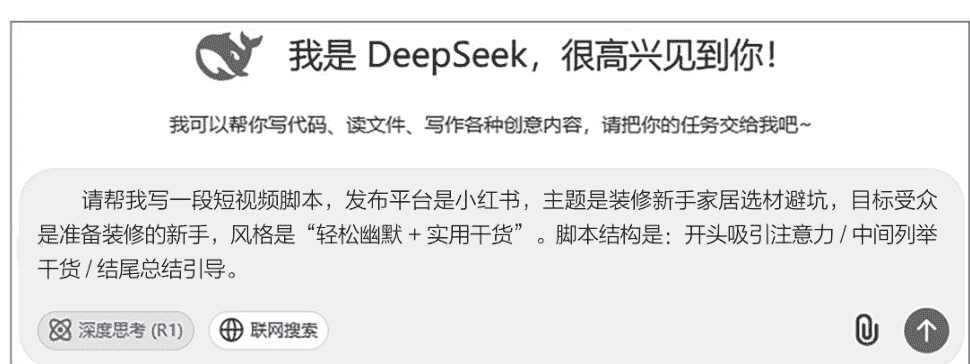 图5-1 按Enter键发送后，给出的答案如下。【短视频脚本】“装修新手自救指南：选材避坑三连击！” #### 开场暴击（00:00—00:05） [画面]女主抱着一卷粉色豹纹壁纸跪地哀嚎，背后是贴到一半的死亡芭比粉墙面。 女主（哭腔）：“救命！这和卖家秀根本不是一个星球的产物啊！” [字幕炸开]90%的装修新手都会犯的选材错误！ #### 反转亮相（00:06—00:15） [镜头切换]女主突然变装成戴护目镜的装修女侠。 女主（元气满满）：“别慌！本监理带你三招绝地反杀！” [音效]咻～变身音效+热血背景音乐。 #### 干货暴击1（00:16—00:35） [画面]左右分屏对比：左图深色地板显压抑vs右图浅原木色地板显通透。 女主（举着放大镜）：“地板刺客第一式——颜色玄学！采光差还敢选胡桃木？记住这个保命公式：楼层÷2=选色号，20层选10号色！” [动画]手机计算器弹出“20÷2=10”公式。 #### 干货暴击2（00:36—00:55） [画面]女主拿着瓷砖在超市进行拖地测试，突然劈叉摔出画面。 女主（画外音）：“瓷砖防滑测试大法！‘倒矿泉水+踩抹布’，摩擦力不够的马上拉黑！”。 [字幕]物理老师都直呼内行。 #### 干货暴击3（00:56—01:10） [画面]女主变身人形甲醛检测仪疯狂咳嗽。 女主（掐脖子戏精）：“定制柜环保刺客出没！E0级是底线，五金件给我盯死百隆悍马！” [道具]举起放大镜对准五金件Logo特写。 #### 结尾升华（01:11—01:20） [画面]女主戴着安全帽在完美的新家比心。 女主（眨眼示意）：“记住这三板斧，装修路上横着走！下期带你智斗工长三十六计～” [评论区引导]“速速交出你家的翻车建材！” #### 【拍摄小贴士】 - 道具准备：夸张的翻车建材（如豹纹壁纸/荧光色油漆桶）。 - 运镜技巧：快节奏推拉镜头+综艺式花字。 - 背景音乐：多用抖音热门卡点音效。 - 服装：工装背带裤+荧光色安全帽更吸睛。 适合小红书的碎片化知识点+戏剧化演绎，既满足干货需求又符合平台娱乐调性～…… 确定方向后可继续追问。 - （1）我想做成系列内容，这个脚本怎么可以延展成3～5期？ - (2) 我想拍一期关于【主题】的短视频，你能帮我设定几种有趣的人设视角+叙述方式吗？要那种更容易被代入和引发共鸣的。 - (3) 我想拍一期关于【主题】的短视频，你能帮我设计3个能制造“反转感”的桥段吗？越戏剧性，越引人注意越好。 ### 5.1.2 优化提示词，提高脚本匹配度 上一节介绍了基础要素。实际操作中，不同创作者风格、表达习惯和账号定位不同，直接套用模板难以达到理想效果。本节讲解如何细化提示词提升匹配度。 优化的本质是进一步细化提示词内容。表5-2为可加入的要素。 **表5-2**| 要素 | 说明 | 示例 | | --- | --- | --- | | 情感基调 | 明确短视频要传递的情绪 | 励志鼓舞 / 温情治愈 / 悬疑紧张 / 吐槽搞笑 | | 时长控制 | 根据平台特性限制时长 | 15秒快节奏 / 3分钟深度解说 / 系列分集 | | 互动引导 | 增加促进受众参与感的指令 | “评论区留下你的看法” / “点赞、收藏、防丢失” | | 热点结合 | 关联近期热门话题或挑战 | #“6·18”购物攻略 / 蹭“高考后旅行”热点 | | 背景音乐 | 指定音乐风格或氛围 | 轻快电子乐 / 悬疑音效 / 怀旧金曲片段 | | 行动号召（CTA） | 明确希望受众下一步的动作 | “点关注不迷路” / “橱窗同款已上架” | | 视觉化关键词 | 描述画面或道具需求 | 多机位切换 / 动画插画辅助 / 对比实验道具 | | 避雷关键词 | 避免敏感或无效的内容 | 不提及品牌名 / 规避专业术语 / 弱化硬广感 | | 参考爆款案例 | 对标同类爆款视频 | 参考“×××博主”的测评风格 / 对标《×××》的运镜节奏 | | 季节/节日属性 | 结合时间节点增强时效 | 春节送礼指南 / 冬季养生冷知识 | | 系列化标签 | 建立内容连续性 | 标注“第一期” / 结尾预告下期主题 | | 场景化描述 | 具体拍摄场景要求 | 办公室场景 / 户外实拍 / 绿幕抠像合成 | | 节奏密度 | 控制信息输出速度 | 前5秒高能反转 / 每30秒插入一个梗 | | 字幕/标题关键词 | 搜索引擎优化（SEO）关键词 | 标题含“避坑”“干货” / 字幕强调“新手必看” | | 数据/案例支撑 | 增强受众可信度的细节 | 引用行业报告数据 / 插入用户投稿案例 | | 方言/语言特色 | 针对地域或圈层设计 | 四川普通话口音 / 二次元黑话 / 职场术语 | | 角色设定 | 明确出镜人身份标签 | 资深设计师人设 / 暴躁吐槽闺蜜角色 | | 痛点强化 | 放大受众的共鸣点 | “工资5000元如何存钱” / “装修被坑3次的血泪史” | | 悬念设计 | 提升完播率的钩子 | 结尾抛争议问题 / “最后一条颠覆认知” 下面是通过优化提示词后生成的示例。 请帮我写一条抖音风格的家装避坑科普短视频脚本，情感基调是吐槽+搞笑，时长控制在1分钟内。开头用高能反转吸引观众注意力，中间列举3个最常见的装修翻车误区（尤其是新手业主常见问题），结尾引导观众留言分享自己踩过的装修坑。画面建议使用多机位切换（如现场+表情特写），字幕突出“装修新手必看”。 “抖音家装避坑脚本：装修新人血泪史”（时长58秒）。 #### 开场（0～5秒） [画面]精致北欧风客厅全景+浪漫背景音乐。 主播（西装革履）：“我家装修完美得像杂志……” [镜头突然下移]裸露的插线板垂在沙发正中央。 主播（崩溃脸）：“如果没踩这3个大坑的话！” #### 误区一（6～20秒） [分屏对比]左边设计图vs右边实景。 主播（举着设计图跳机械舞）：“轻信网红悬浮床！” [切特写]床底堆满杂物+晾衣杆。 主播（翻白眼）：“半夜起床撞膝盖，扫地机器人天天玩密室逃脱。” #### 误区二（21～35秒） [镜头摇晃模仿地震] 主播（抱头乱窜）：“卫生间防水随便搞？” [切动画]楼下邻居顶蘑菇水帘洞特效。 [字幕炸裂]省2000元防水=赔20000元吊顶。 #### 误区三（36～48秒） [主播蹲在冰箱旁扮演“思考者”]“插座全藏家电正后方！” [慢动作拔插头]带倒水杯+文件飞散。 主播（咆哮）：“每次充电都要玩移形换位！” #### 收尾（49～58秒） [主播头顶施工帽瘫坐废墟]“说多了都是泪……（突然振奋）在座哪位勇士没踩过装修坑？” [大字弹幕雨]“装修新手必看！你的坑比我的大吗？” [结尾定格]主播拿电钻比心+评论区气泡特效。 #### ▶制作小贴士 音效：玻璃碎裂/爆炸音效+综艺罐头笑声。 节奏：每10秒一个反转，搭配0.5倍速“糗事”瞬间。 视觉：用3D箭头/爆炸贴纸强化翻车点。 以上是 DeepSeek 给出的初步方案，确定方向后可继续追问调整。追问参考如下。 - (1) 将原脚本的【搞笑吐槽】风格改为【毒舌吐槽/温情提醒/暴躁抓狂】，在【开头/结尾】增加【反转冲突/暖心金句】，针对【××人群】痛点设计台词，如【学生党/宝妈/打工人】的【具体场景】。

- (2) 将原先的口播剧情改成动画演示或真人情景剧呈现，配合灵魂配音或方言解说来强化记忆点，设定一个贯穿全片的标志动作，例如摔道具或魔性手势；字幕采用荧光色与弹幕体，把关键信息提亮。

- (3) 在已有×个误区的基础上，新增关于××细节问题的片段，用行为示范加错误案例做对比，重点突出省钱、省时、安全层面的实际收益，并加入行业黑话揭秘、价格坑点清单等专业元素。

### 5.1.3 调整提示词，适配不同类型的微短片脚本

“一把钥匙打不开所有锁”，短视频脚本的提示词也不能一概而用。不同品类的短视频对提示词的要求差异明显。表5-3所示为各类型短视频的提示词参考。

**表5-3**

| 短视频类型 | 内容特征 | 提示词写作要点 | 注意事项 |

| :--- | :--- | :--- | :--- |

| 知识科普类 | 干货密度高、逻辑清晰、专业可信 | 明确受众定位，内容结构合理（问题→干货→结论），加入数据或案例支撑，语言通俗易懂 | 避免太学术；防止信息量过载；突出“新手必看”或“家长必备”等标签 |

| 情绪共鸣类 | 情感代入强、故事化表达、生活化细节 | 场景设置真实，语言温暖走心，设计高共鸣金句，结尾升华或反转 | 不宜生硬说教；故事细节要有生活质感；台词要接地气 |

| 吐槽搞笑类 | 节奏快、反转强、网络梗多、夸张演绎 | 明确吐槽对象，开头用高能反转吸引注意，过程设计密集笑点，结尾引导互动 | 笑点要符合受众喜好；不要使用低俗梗；字幕突出夸张情绪词 |

| 产品带货类 | 场景真实、痛点驱动、种草自然 | 强调使用场景、对比效果、突出痛点、软性植入产品信息，结尾引导转化 | 切忌硬广；人设要真实可信；避免硬广[直接带品牌广告词（除非授权）] |

| 短剧剧情类 | 人设鲜明、冲突反转、代入感强 | 明确角色关系，冲突设计巧妙，转折自然，结尾留悬念或反转 | 避免老套剧情；台词自然不做作；情节符合现实逻辑或平台风格 |

下面是针对不同短视频类型脚本的通用型提示词模板。

## 5.2 正确投喂DeepSeek数据

想让DeepSeek写出“想要的风格”，就要像训练一只聪明的鹦鹉学唱歌那样——关键不在于教多久，而在于教什么、怎么教。

### 5.2.1 投喂数据时要注意哪些关键“动作”

很多人用DeepSeek时，最容易犯的错就是随便丢点东西给它，想着“反正AI自己能学”。结果往往使得AI输出的东西，要么四不像，要么和自己预期相差十万八千里。当我们给DeepSeek投喂数据时，下面这几个关键动作非常重要，归结为3个字：选、分、标。

#### 1. 选——只喂对的，不喂杂的

DeepSeek虽然很聪明，但也不是万能的。你给它投喂什么，它就学什么。所以第一步最重要的就是，只投喂符合你目标风格的数据。投喂的数据宁可少一点，也要纯一点。表5-4所示为几个选择数据的示例内容。

**表5-4**

| 目标 | 只选这些数据 | 不要选这些数据 |

| --- | --- | --- |

| 学写品牌宣传文案 | 官方品牌介绍、历史案例、成功的广告文 | 新闻稿、说明书、合同 |

| 学写小红书风格 | 优质种草笔记、爆款博主文案 | 微博吐槽、知乎长篇讨论 |

| 学写高端白皮书 | 行业内优秀白皮书、专家深度文章 | 网络段子、用户评论 |

#### 2. 分——要一类一类喂，“别乱炖”

当然，在投喂数据时，不要将所有品类的数据一股脑儿地全部塞进DeepSeek，最好是提前对数据进行分类。如果你不分类，DeepSeek很可能会“蒙圈”。例如，你混着喂了客服话术和高管发言，结果DeepSeek生成的内容可能会出现：

> 尊敬的用户，欢迎您参加我们的战略发布会……

这就不符合常规逻辑了。那么该如何对数据进行分类呢？你直接采用“场景分类法”即可，谁用、用在哪，就归哪类。表5-5所示是推荐的按场景分类的基础模板。

**表5-5**

| 类别名称 | 数据举例 |

| --- | --- |

| 产品介绍类 | 产品卖点 / 使用说明 / 差异化优势 |

| 活动宣传类 | 营销活动文案 / 促销信息 / 社群推文 |

| 客服话术类 | 常见问题回复 / 客服标准回复 |

| 高管发言类 | 年度总结 / 内部讲话 / 外部演讲 |

| 朋友圈日常类 | 轻松、生活化的短文案 |

假设你是开宠物店的，数据可以这样分类。

- 分类1：宠物用品广告（逗猫棒、狗粮等宣传语）。

- 分类2：客户咨询回复（如何回答“狗狗拉肚子怎么办”等客户问题）。

- 分类3：宠物知识科普（猫咪为什么爱舔毛等知识）。

注：这个分类可以通过DeepSeek的“开启新对话”实现。例如，对话1讲宠物用品广告，对话2讲客户咨询回复等。

#### 3. 标——给数据打标签，以方便管理

除了给数据进行分类，给数据贴上标签也是至关重要的。标签就相当于“关键词”，用最简单的词，快速描述这份数据的特点。一份数据，可以打多个标签。例如，这篇文案可以按照“给谁看的”“什么风格”“哪个行业的”分别打标签。表5-6所示为一些标签的类型和举例。

**表5-6**

| 标签类型 | 问自己 | 举例 |

| :--- | :--- | :--- |

| 行业标签 | 这篇文案是哪个行业的 | 美妆、数码、汽车、地产、教育 |

| 受众标签 | 这篇文案是写给谁看的 | 年轻人、妈妈、白领、老板、学生 |

| 风格标签 | 这篇文案是什么风格 | 正式、幽默、活泼、硬核、口语化 |

### 5.2.2 数据太少/太多时怎么补救

给DeepSeek投喂数据，最常见的两个问题是：数据太少，不够训练；或是数据太多，过于杂乱。下面是针对这两个问题时的解决方法。

#### 1. 数据太少时的应对方法

当投喂的数据太少时，不用惊慌，数据不在多，而在精。先小而美，再慢慢增加。下面是相应的补救方法。

1. 优选最典型的好数据。如果数据不多，那就只选最能代表你目标风格的数据。表5-7所示为相关示例。

**表5-7**

| 你的目标 | 应该选的数据 |

| :--- | :--- |

| 想写小红书种草文案 | 点赞高、风格稳定的小红书爆款 |

| 想写品牌宣传文案 | 官方广告文案，品牌口号，宣传册 |

| 想写高端白皮书 | 行业权威发布的标准资料 |

2. 投喂少而精，效果反而好。DeepSeek不需要“大锅饭”式的喂养，而是要纯度高的数据，即使数量少，也能学得很好。

3. 慢慢积累数据。当投喂的数据数量少时只能通过慢慢积累数据，达到自己多样化的需求。

4. 提示词模板和示例。当数据少时可以参考以下提示词模板，对DeepSeek进行提问。

> “请参考以下这批高质量文案的风格，学习它的表达方式。帮我写一篇类似的内容。要求：风格统一、表达清晰、符合目标受众习惯。

> 

> 1. ……

> 2. ……

> 3. ……

> 4. ……”

输入这段提示词后，DeepSeek就可以生成相应的回复内容。那么为什么要这么提问呢？我们需要来理解一下其背后的逻辑。

1. 提供参考文案，是为了让DeepSeek知道“模仿谁”，就像写作文时先模仿范文。参考文案能告诉DeepSeek语气、结构、内容深度该怎么拿捏，参照这些写出来的文案风格才不容易跑偏。

2. “风格统一、表达清晰、符合目标受众习惯”，这些要求是在告诉DeepSeek：别仅模仿语气结构、内容深度，还要模仿适合用在哪、给谁看。

3. 强调“学习它的表达方式”，是为了提炼写作技巧，而不是照抄原文，从而让DeepSeek写出既相似又独特的新文案。

4. 有结构、有要求、有案例，写作更高效，这种格式其实就是“模仿练习题”，给DeepSeek清晰投喂，也方便创作者批改优化。

下面是基于该提示词模板生成的示例。假设你只有5条小红书爆款文案，可以这样向DeepSeek投喂。

以下是我收集的高质量小红书文案。

##### 1. 关于口红的种草文案

> “这支口红真的好！是我今年回购最多的一支！颜色是温柔奶茶豆沙色，素颜涂都好看，关键是涂上嘴巴软乎乎的，完全不卡皮！而且不挑皮肤，黄皮姐妹闭眼入！”

##### 2. 关于护肤的种草文案

> “30多岁熬夜脸的救星找到了！这瓶精华简直是熬夜女孩的续命水。质地水润好吸收，晚上敷厚厚一层，第二天真的像睡了美容觉。毛孔隐形，肤色亮了一个度，谁懂！”

##### 3. 关于香水的种草文案

> “喷了会让人回头的那种香。前调是清甜果香，像刚洗完澡的少女，后调是奶香混着木质，干净又温柔。约会必备！它不香艳不俗气，是‘只属于你’的味道。”

##### 4. 关于咖啡店打卡的文案

> “这家店太适合拍照了！法式复古＋森系绿植，随便一拍就是杂志大片。推荐他们家的玫瑰拿铁，奶香混着淡淡花香，喝一口就能忘掉坏心情～”

##### 5. 关于家居好物的文案

> “全网都在吹的香薰蜡烛，我终于入手了！点燃的瞬间，整个房间都变得松弛柔软。特别适合下班回家一个人开个投影，喝茶放空，让房子有了‘生活感’。”

我的目标受众是20～35岁的年轻女性，风格要轻松、活泼、代入感强。请学习以上文案风格，帮我写一篇新的口红种草文案。

**“这支镜面唇釉才是今夏显白大魔王吧！！”**

试色时直接瞳孔地震！上嘴瞬间白两个度！水光感草莓山楂红像把多巴胺涂在嘴上，薄涂是元气西柚汁，厚涂是咬碎冰糖的浆果冻，玻璃唇在阳光下还会亮闪闪！质地绝到想给配方师磕头！成膜后完全不粘头发，吃火锅也只掉色30%！最绝的是它用精华油打底，我这种万年沙漠唇涂后居然能扛住空调房8小时不拔干，唇纹都被填平到像开了柔焦滤镜！

通勤随手涂就是伪素颜小心机，约会时叠涂中间立马收获女团打歌妆效，闺蜜涂完直接被男生要链接，现在全办公室姐妹的包包都放着同款唇釉。（笑）

#### 2. 数据太多时的应对方法

当数据太多时，我们秉持一个原则就是“取其精华去其糟粕”，通过去杂+分类+清洗等方法，让DeepSeek只学习有用的数据。下面是相应的补救方法。

1. 删除坏数据。如果有些数据跟目标无关、含错别字、低质量、风格混乱、年代久远或已失效等，建议将这些数据删除。

2. 分类管理。分类管理是数据太多时必要的操作手段，否则自己都可能会分不清数据内容。

3. 数据清洗技巧。我们可以通过批量去重（防止重复喂养）、统一格式（标点符号、段落结构）和打标签等形式对数据进行清洗。

4. 提示词模板和示例。当数据太多时，我们可以让DeepSeek帮忙整理，下面是相应的提示词模板。

> “我有一批内容数据，风格有点杂，请帮我分别整理出来。并给每类数据打上标签，方便我后续管理。以下是我的数据。

> 1. ……

> 2. ……

> ……

> 标签包括：[行业] [受众] [风格]。”

输入这段提示词后，DeepSeek就可以生成相应的回复内容。那么为什么要这么提问呢？我们需要来理解一下其背后的逻辑。

1. “风格有点杂”这句话说明你的数据类型目前不够统一，需要DeepSeek帮助整理。

2. 要求“打上标签”，即标签化管理（如行业/受众/风格等），可以帮助你日后精准检索和复用，比如“找一篇适合职场女性的轻松风文案”。

3. 不光分类，还要求“分别整理出来”，这是让DeepSeek做内容资产管理——比“只看一眼”更深入，适合长期内容运营。

下面是基于该提示词模板生成的示例，假设你有一堆不同风格的内容数据。

我有一批内容数据，风格有点杂，请你帮我分别整理出来。并给每类数据打上标签，方便我后续管理。以下是我的数据。

1. “素颜急救口红来啦！这支奶橘色真的温柔爆了～上嘴瞬间提气色，不挑皮，黄皮、白皮都友好。“早八党”出门涂它，直接显得‘天生唇色好’那种！”

2. “这款粉底液采用长效控油配方，适合油性及混合肌肤使用，妆效自然持久，适合多种肤质。”

3. “每天醒来第一件事不是刷牙洗脸，而是先摸手机。iPhone电量一低，我的安全感直接归零……这块超大容量充电宝，真的是手机党续命神器。”

4. “宝宝的小肚肚终于不怕凉了！这个肚围软软糯糯的，像棉花糖一样贴身不勒肚子，关键颜值还超级可爱，小动物图案萌化了妈妈心。”

5. “本款蓝牙耳机支持主动降噪与环境音调节，满足用户在多场景下的佩戴需求，提升通话与聆听体验。”

请按以下要求将以上内容数据进行分类并打标签。

行业：美妆、数码、母婴。

受众：年轻人、白领、商务人群。

风格：正式、幽默、活泼、口语化。

以下是分类及打标签的结果（使用Markdown表格呈现）。

| 序号 | 内容摘要 | 行业 | 受众 | 风格 |

| :--- | :--- | :--- | :--- | :--- |

| 1 | 素颜急救口红奶橘色，提气色不挑皮 | 美妆 | 年轻人 | 活泼、口语化 |

| 2 | 长效控油粉底液，自然持久适配多肤质 | 美妆 | 白领/商务人群 | 正式 |

| 3 | 超大容量充电宝解决手机党电量焦虑 | 数码 | 年轻人 | 幽默、口语化 |

| 4 | 婴儿棉花糖肚围，柔软可爱防着凉 | 母婴 | — | 活泼、口语化 |

| 5 | 主动降噪蓝牙耳机，多场景通话聆听体验 | 数码 | 商务人群 | 正式 |

分类逻辑说明如下。

1. 行业。根据产品属性直接划分（如口红/粉底液→美妆，充电宝/耳机→数码，婴儿肚围→母婴）。

2. 受众。

 - “年轻人”标签适用于强调便利性、颜值或情感共鸣的内容（如口红、充电宝）。

 - “商务人群”对应专业场景需求（如粉底液的适配性、耳机降噪功能）。

 - 母婴产品因目标受众为父母，未匹配给定受众标签，故留空。

3. 风格。

 - 活泼/口语化：使用感叹词、夸张表达（如“温柔爆了”“萌化了”）。

 - 幽默：通过夸张比喻制造趣味（如“安全感归零”“续命神器”）。

 - 正式：侧重功能描述，用词简洁专业（如“长效控油”“环境音调节”）。

以上便是DeepSeek给出的初步方案，我们确定好其中的某个方向之后，还可以向DeepSeek进一步追问，让其进行调整。追问的方向可以参考下面的提示词模板。

1. 【序号：……】除了【当前标签】，请列出该内容可能具备的【更多受众细分】或【内容标签】，并说明理由。

2. 请基于【产品/内容】，再给出3个新颖又具体的内容切入角度，适合做成【风格】短视频脚本。

3. 请把【序号：……】内容用【开头吸引—中段展开—结尾互动】结构改写成60秒的短视频脚本，适合【受众】观看。

示例如下。

1. “序号3”除了【年轻人】，请列出该内容可能具备的【更多受众细分】或【内容标签】，并说明理由。

2. 请基于【超大容量充电宝】，再给出3个新颖又具体的内容切入角度，适合做成【幽默、口语化】短视频脚本。

3. 请把“序号4”用【开头吸引—中段展开—结尾互动】结构改写成60秒的适合【年轻人】观看的短视频脚本。

## 5.3 用DeepSeek生成爆款短视频脚本

“为什么同样的产品，别人的视频点赞量10万多，你的播放量却卡在500？”在抖音/小红书的算法世界里，前3秒定生死，脚本结构决胜负。本节我们将拆解3个最适合短视频平台实战应用的黄金公式，结合DeepSeek的具体使用方法，为你呈现可复制、可落地的脚本生产流程。

### 5.3.1 3秒留人钩子

在短视频平台的推荐机制中，决定视频能否被继续推送的第一标准，就是观众是否在3秒内停留下来。如果在开头的3秒内没有成功抓住观众注意力，那么该视频内容再精彩也无济于事。“3秒留人钩子”本质上是一个信息钩子，必须具备以下特征。

1. 强刺激（如情绪、悬念、好奇心、反差、痛点）。

2. 强相关（与人的个人生活、情感、困扰等相关）。

3. 强行动诱导（让人忍不住想看下去）。

结合上述钩子的特征我们就可以得出钩子的公式。

钩子=【引发观众注意的关键词】+【与观众相关的痛点/利益】+【刺激观众继续观看的悬念/反差】

表5-8所示为常见的3秒留人钩子类型。

**表5-8**

| 留人钩子类型 | 适用场景 | 常见句式 |

| :--- | :--- | :--- |

| 悬念式钩子 | 知识科普、经验分享 | “你知道为什么……” “很多人不知道……” |

| 反差式钩子 | 改造类、挑战类 | “我花1块钱做了……结果震惊了” |

| 痛点式钩子 | 情感类、生活类 | “99%的人都做错了……” “如果你也有这种烦恼……” |

| 金句式钩子 | 观点表达类 | “一句话总结……” “听懂这句话，你就不亏了” |

| 热点式钩子 | 时事热点 | “今天最炸的新闻就是……” |

下面是使用DeepSeek生成短视频留人钩子的提示词模板和示例。

> “请基于短视频脚本创作规则，为主题【×××】生成5个强吸引力的开头钩子。钩子要符合以下结构：引发观众注意的关键词+与观众相关的痛点/利益+刺激观众继续观看的悬念/反差，风格参考【平台】热门视频，简短、直白、有冲击力。”

输入这段提示词后，DeepSeek就可以给出相应的生成内容。那么为什么要这么提问呢？我们来理解一下其背后的逻辑。

1. “引发观众注意的关键词”，开头要抓住观众的注意力，第一步就是用一些引发好奇心、令人惊讶或者与观众生活紧密相关的关键词。例如“你绝对没见过”“这个方法能帮你解决……”这类直接引发观众兴趣的词汇。

2. “与观众相关的痛点/利益”，解决观众问题或提供他们感兴趣的利益是吸引他们继续观看的关键。通过指出他们关心的痛点（如时间管理难、化妆技巧不精通等），能让观众产生“这视频对我有用”的直觉。

3. “刺激观众继续观看的悬念/反差”，一开始就设立悬念或者通过反差（例如“你认为××是对的，但事实是……”）来激发观众的好奇心，促使他们想要继续看下去，直到揭晓问题的答案或反转的结局。

(4) “风格参考【平台】热门视频”，参考平台上的热门视频的风格，可以确保内容更加符合平台用户的喜好和观看习惯。“短视频的开头要简短、直白且有冲击力”，以避免冗长或过于复杂的内容。

下面以美妆护肤为例，让DeepSeek生成5个强吸引力的留人钩子。我们先编辑好提示词，接着打开“深度思考（R1）”模式的开关，关闭“联网搜索”，让DeepSeek输出答案，如图5-3所示。

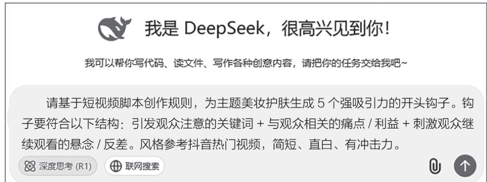

图5-3

按Enter键，将文字内容发送至DeepSeek，给出的答案如下。

1. 【停！毛孔粗大必看】“满脸插秧毛孔的姐妹别慌！这瓶几十块的冷门精华让你素颜出门被追着问医美项目。”

（关键词：停+毛孔痛点+医美反差）

## 钩子开场参考

【底妆翻车急救】“上百次卡粉的姐妹进来对号入座！不换粉底液，两种手法让浮粉瞬间消失。”

【Z世代VC VA踩雷】“自认护肤老手？这三类自毁打法正在拖垮肤况，第二条踩中率超高。”

【油皮闭口克星】“还用针挑折磨皮肤？这块有光泽感的洁面皂敷半分钟，黑头闭口自行脱落。”

【面膜智商税自查】“敷面膜等于白烧钱？离职美容顾问透露的3分钟黄金公式，效果媲美水光。”

创作洞察
数据冲击：用“上百次、九成、三分钟”等具体数值提升可信度。
身份锚点：用“医美从业者、离职美容顾问、Z世代”等标签精准触达群体。
强引导词：用“必看、学笔记、避坑”等指令制造紧迫感。
画面感：用“发光皂体、黑头排队”等视觉化描写强化联想。

掌握3秒留人开场公式，不是套模板，而是精准打中用户注意力盲区。借助DeepSeek的提示词能力，能快速批量产出不同风格的前话，再通过测试迭代找到最适配赛道与人群的表达。

锁定方向后可继续追问，优化模板可参考：
（1）拆解【原标题】中【核心打法】，用【数字】步教会【目标人群】。
（2）以【身份背书】视角解读【标题】中【方案】的原理。
（3）产出【数字】组围绕【关键词】的【用户类型】对比案例。

示例
（1）拆解“油皮闭口终结者”中“发光皂体敷30秒”的操作流程。
（2）以化妆品研发工程师身份解释“早C晚A翻车”里的“三个自毁操作”。
（3）产出三组“卡粉急救”在干皮与油皮上的差异化案例。

## 矛盾构建公式

竖屏内容更偏好冲突与反差叙事。好内容不是平铺，而是制造戏剧张力，引发情绪波动，进而产生共振。

构建环节
冲突点：拉注意力，突出强烈矛盾画面，激起愤怒、震惊、困惑、好奇等情绪。
反转点：保兴趣，抛出出人意料的解法、真相或观点，让人觉得“没想到”。
收束点：输价值，给出有洞察的总结或启发，增强代入感与好感。

提示词框架
“请为【×××】设计一条短片脚本，要求遵循【矛盾—反转—共振】结构。
（1）矛盾：搭建一个强烈矛盾的场景，点燃情绪。
（2）反转：打破常规认知，给出反转信息。
（3）共振：输出有价值的洞察或情感收束，引发认同。”

逻辑要点
冲突是吸引起点，开头即设置矛盾、问题或极端画面。
反转是留存钩子，把观众预期的套路掀翻，形成“以为是A，其实是B”的反差。
共振是传播关键，结尾给出情感落点或洞察，让人产生“我也是”。

以“花钱养肤却越用越差”为例，开启深度研判模式，关闭联网搜索，输出结果图示如下。

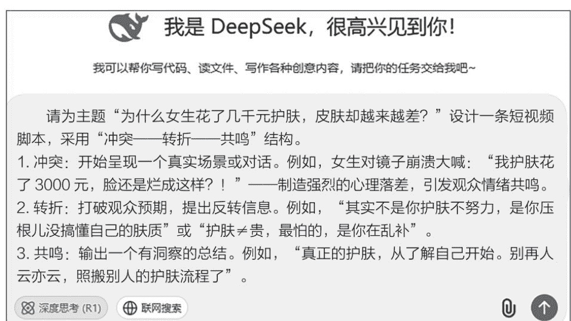

按回车发送后得到答案如下。

### 【短片脚本：约50秒节奏】

#### 矛盾开场 0:00—0:05
▶画面：前置自拍镜头，女生面颊泛红长痘，猛地摔出××品牌面霜瓶。🔊
音效：瓶体撞击桌面的碎裂声。🔊
画外音：“我砸了3000块养肤！脸怎么更烂了？！”

#### 矛盾加码 0:06—0:15
▶画面：快速剪辑梳妆台堆满大牌→撕下面膜后更肿的特写→手机购物车清空截图。
背景音乐：急促钢琴音。
字幕：“贵不等于对，多不等于好。”

#### 知识反转 0:16—0:25
▶画面：实验室场景，皮肤科医生举起皮肤模型。
分镜：
- 放大镜下油皮检测数据特写；
- 干皮女生拍水时起皮的嘴角中景；
- 混油皮用厚重面霜爆痘的分屏对比。
> 专家原声：“过度养肤破坏屏障的速度，比熬夜快5倍。”

#### 解决方案 0:26—0:35
▶画面：女主丢掉三瓶产品，只留两个基础单品。
演示：
- 手机测肤App显示“屏障受损”；
- 氨基酸洁面+神经酰胺乳液极简组合柔光拍摄；
- 28天后皮肤透亮对比与数据可视化。
数据牌：70%的烂脸源于错误养肤。

#### 情感共鸣 0:36—0:45
▶画面：女主素颜在晨光中微笑，指尖轻点太阳穴。
温柔女声：“皮肤不是试验田，理解比折腾更重要。”
象征镜头：仙人掌被移出多肉堆，单独种进合适的沙土。

#### 行动指引 0:46—0:50
▶画面：渐显肤质检测扫码入口+成分查询网站界面。
音效：舒缓风铃。
大字：“停掉不合适的昂贵，省下的钱刚好做一次专业检测。”

运营要点
（1）前三秒用“摔养肤品+怒吼”强矛盾锁人。
（2）中段加入实验室检测画面增强专业信任。
（3）结尾以“素颜对比+知识扫码入口”促收藏转发。
（4）话题标签：#屏障修复 #科学养肤 #拒绝无效养肤。

心理动线
焦虑制造→认知颠覆→自我反思→知识缺口→行动，完整闭环契合年轻受众“发现问题—找方案—立刻执行”的决策路径。

追问模板
（1）参照此节奏分镜，为【___议题】设计3～5个切入角度，如各问题／人群／季节／场景，每个都保留矛盾→知识→共振→号召节奏，便于起稿。
（2）模仿结构【矛盾引入+反转知识点+实用解法+情绪共振+行动指引】，为【___议题】写约50秒脚本。【受众是___】，风格偏___，结尾需明确号召【留言／转发／扫码等】。
（3）将该【___议题】脚本提炼为通用模板，并套用到【___议题】上，保持节奏与情绪引导。

## 高转化收尾设计

结尾是脚本的临门一脚，直接决定转化效果。好收尾靠“价值拔高+促动指令+场景提示”推动即时行动。

要素
价值拔高：放大收获感，重申认知转变／启发／共振。
促动指令：促互动或转化，明确告知观众具体做什么。
场景提示：具画面感，让观众预见下一步的好处或体验。

提示词模板
“请为【×××】，按【价值拔高】+【促动指令】+【场景提示】结构，设计高转化短片收尾，口语化、情绪真诚。”

以“养肤三大误区”为例，开启深度研判模式，关闭联网搜索，输出结果图示如下。

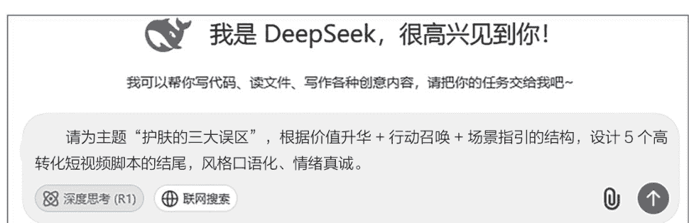

发送后得到五个收尾如下。

### 收尾1：【价值拔高+信任感】
> “养肤不是跟风花钱，而是学会读懂皮肤的信号。爱自己不是往脸上堆大牌，而是用对方法让肌肤呼吸。宝子们点下关注，明天手把手教你看成分避坑，现在快去查查你的洗面奶成分安不安全！今晚养肤记得温柔点～”

### 收尾2：【行动暗示+场景联想】
> “踩中这三个雷区，再贵的精华都是白费！现在双击保存这张总结图，下次买养肤品前对照一下。明早养肤时重点看T区出油，留言区说说你的变化，抽三个姐妹送防晒检测卡！”

### 收尾3：【情感共振+仪式感】
> “养肤本该治愈，不是焦虑源。从今天起，每次涂面霜时对着镜子说句‘辛苦了’，坚持21天你会回来感谢我！现在领20元券把温和洁面带回家，记住——对皮肤好，生活也会对你温柔。”

### 收尾4：【悬念制造+知识承诺】
> “你以为避开这三大坑就安全了？下期揭秘连柜姐都不会说的‘无效抗老’真相！关注后点进合集看正确手法演示。现在去卫生间，把开封超三个月的养肤品全部清理掉！”

### 收尾5：【身份认同+社群号召】
> “真正懂养肤的女生都在做减法。留言区打‘清醒养肤’让我看看有多少姐妹！置顶视频教你用三样基础品打出万元效果，明晚八点直播带大家现场诊断产品。现在先做这件事：把手机亮度调到40%，这也是在养肤！”

执行逻辑
价值锚点：从技术层面升华到自我关怀、生活态度等高阶需求。
行动颗粒度：给出可执行的分钟级／场景级触发动作。
情绪曲线：以“警示—安抚—激励”三段走，结尾留积极暗示。
转化闭环：每个收尾至少埋两条转化路径。

## 批量内容生产

在短片时代，最大痛点已非能否产出内容，而是能否稳定高效地规模化生产。图文矩阵、短片脚本、跨平台适配，胜负手在于持续供给能力。

### DeepSeek联动作图工具批量运营图文矩阵

图文仍是信息分发关键载体。DeepSeek可产出精准提示词，联动AI作图工具实现封面、配图批量化。

#### DeepSeek+AI作图工具批量生成封面与配图

DeepSeek能解析需求并产出专业绘画提示词，提升作图工具的可控性与创造力。

1. DeepSeek产出AI作画提示词
可基于风格、主题、细节生成专业提示词。操作步骤如下。
01 打开DeepSeek，在输入框输入图6-1所示提示词，以“山水中国风”为议题。

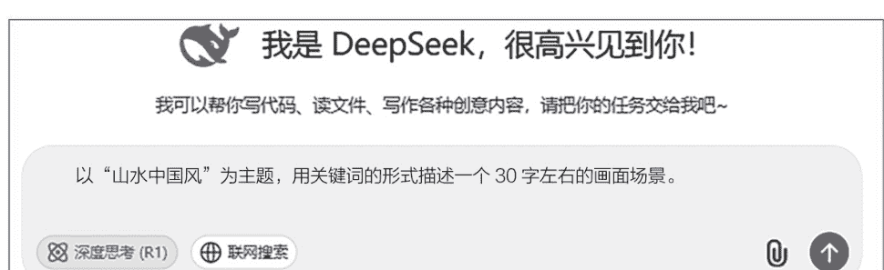

图6-1

02 回车后得到回复如下。
水墨风格的山峰，湖面飘着薄雾，小船上站着穿蓑衣的人，白墙青瓦的房屋在云雾间半遮半掩，有飞鸟从松树边飞过，深蓝色的天空中挂着橘色夕阳。

2. 可灵AI、即梦AI按提示词生成图片
可灵AI依据文本描述生成图片。操作步骤如下。
01 打开可灵AI，点击“AI图片”，在“创意描述”框输入DeepSeek产出的提示词，图示如下。

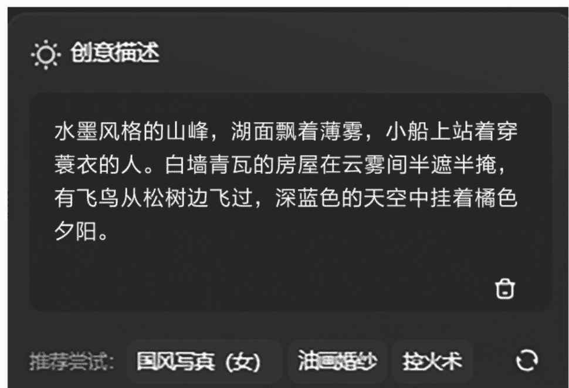

图6-2

02 设置比例为“3：2”，点击“立即生成”，片刻后得到一组图，图示如下。

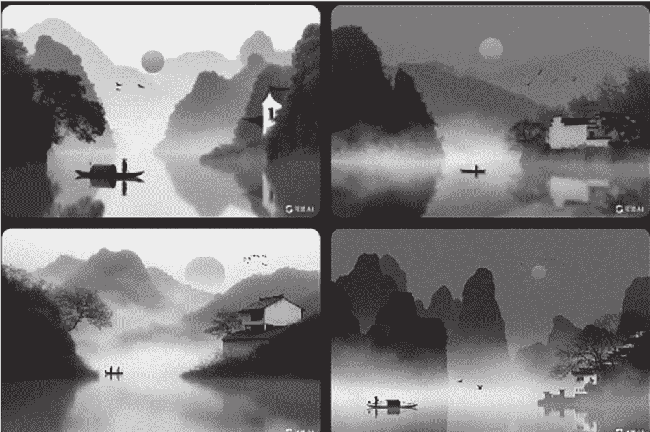

图6-3

03 将鼠标移至心仪图片，点击“下载”，图示如下，保存至本地。

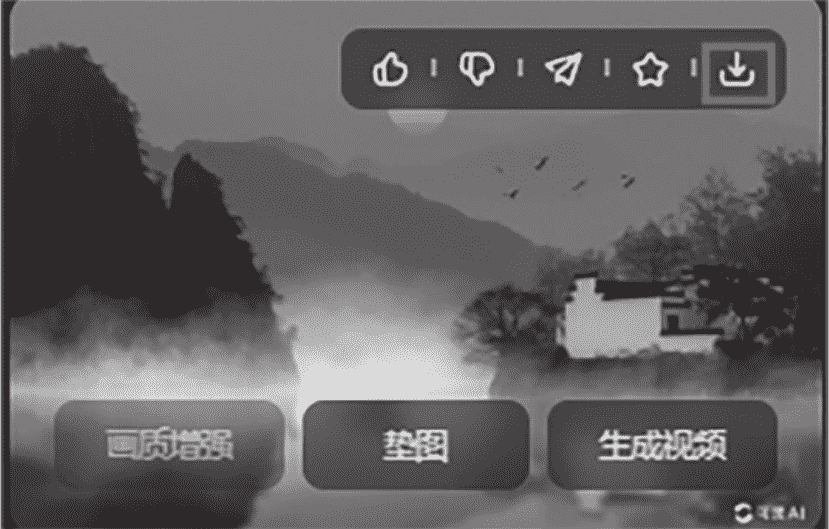

图6-4

若要直接生成小红书封面与插图，可用即梦AI智能画布。操作步骤如下。
01 打开即梦AI，左侧工具栏选择“智能画布”，图示如下。

图6-5

02 进入编辑页，点击“文生图”，在“描述词”输入DeepSeek产出的提示词，图示如下。

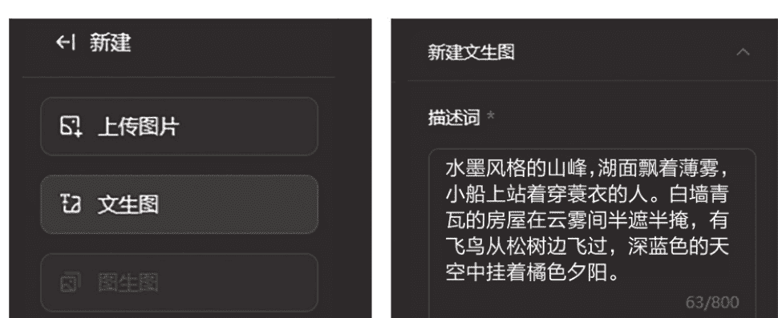

图6-6

03 在描述词后空一行，输入封面指令“标题在图片中间写着：国风治愈系壁纸。注意：字体炫酷彩色，字不要写错，字号不要太大”，图示如下。

> 提示：标题内容与形式可按需调整。

04 点击“立即生成”，片刻后得到图片，图示如下。

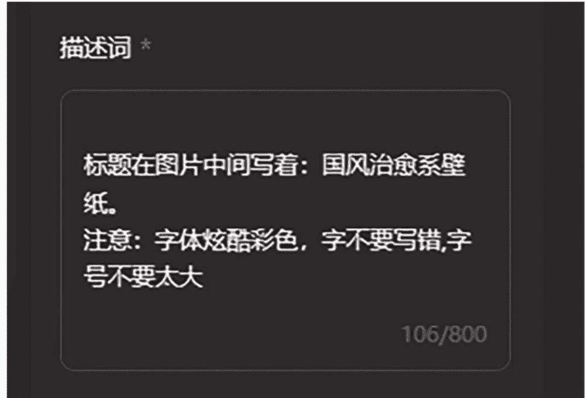

▲图6-7

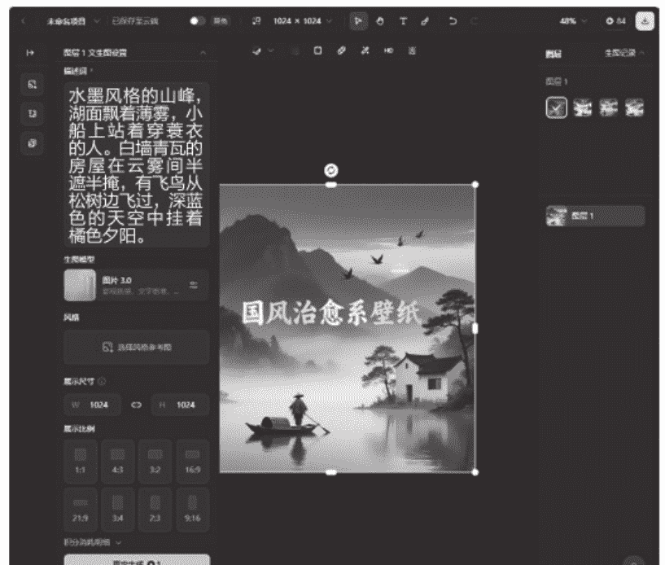

▲图6-8

通过上述流程可用DeepSeek配合可灵AI或即梦AI批量生成配图封面。若需一次性产出多张，可让DeepSeek批量产出多份提示词，再复制粘贴至绘图工具。参考提示词模板。

> “请批量生成30组适合【绘画议题】的AI作画提示词，用于封面／短片背景／插画配图，要求格式为：【风格关键词】+【主体对象】+【场景元素】+【细节修饰】+【构图要求】+【画质要求】。”

此提问逻辑：先明确任务大纲，再设定提示词结构，类似写作提纲。

以电商产品为议题，让DeepSeek产出插图与封面提示词。开启深度研判模式，关闭联网搜索，输出图示如下。

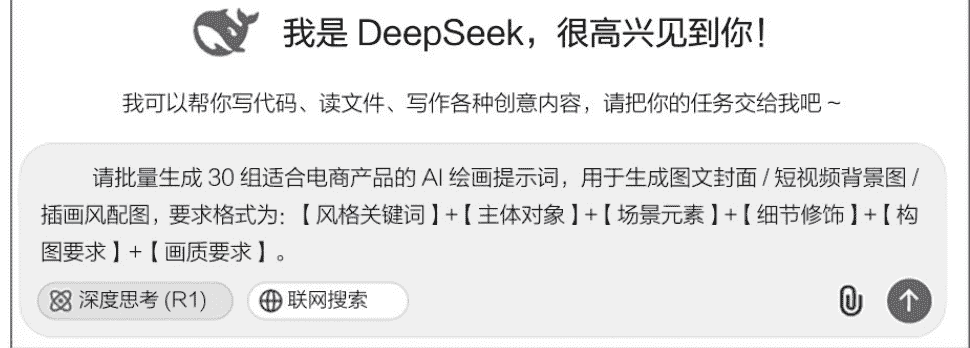

图6-9

回车后得到答案如下。
以下是30组符合要求的AI作画电商产品提示词（注：笔者已优化排版）。

1. 【霓虹赛博美学】+【透明精华瓶】+【未来实验空间】+【液态光晕/金属折射/数码颗粒】+【正中对称布局】+【8K超写实渲染】
2. 【莫兰迪水彩】+【北欧布艺沙发】+【日光书房一隅】+【布料褶皱/悬浮尘埃/绿植投影】+【斜向构图】+【4K纸纹质感】
3. 【低面3D建模】+【无线蓝牙耳机】+【几何冰原环境】+【镭射彩虹/晶石折射/极光微粒】+【俯瞰视角】+【矢量插画级别】
4. 【新中式水墨渲染】+【青瓷茶具组】+【竹林院落茶席】+【烟雾缭绕/竹影斑驳/金箔装饰】+【留白布局】+【宣纸纹理4K】
5. 【蒸汽波风格】+【复古掌上游戏机】+【粉紫渐变天幕】+【故障效果/像素格网/镭射光晕】+【倾斜动感布局】+【霓虹光斑质感】
6. 【微距摄影感】+【手工巧克力礼盒】+【可可种植园】+【糖霜结晶/融化纹理/晨露高光】+【主体特写聚焦】+【背景虚化】
7. 【扁平矢量画风】+【智能手表盘面】+【数据流墙面】+【渐变等高线/轨迹线/悬浮图标】+【黄金螺旋布局】+【300DPI印刷级】
8. 【超现实CG渲染】+【悬浮瑜伽垫】+【反重力星空舱】+【星尘环绕/能量光带/液态金属】+【广角仰视视角】+【电影级光追】
9. 【日式和风版画】+【陶瓷餐具组】+【枫叶庭院餐桌】+【漆器光泽/蒸汽缭绕/浮世绘纹样】+【对称布局】+【木刻纹理】
10. 【孟菲斯波普几何】+【儿童积木玩具】+【彩色几何城市场景】+【撞色拼接/立体纸艺/阴影渐变】+【等距透视图】+【矢量顺滑边缘】
11. 【写实油画笔触】+【红酒瓶及高脚杯】+【中世纪酒窖环境】+【橡木纹理/酒液挂壁/烛光摇晃】+【三角稳定布局】+【亚麻布肌理】
12. 【低面造型】+【全景运动相机】+【雪山滑翔背景】+【冰晶折射/速度线条/云层分割】+【鱼眼畸变】+【高光金属质感】
13. 【故障艺术风】+【透明电竞键盘】+【数字矩阵空间】+【RGB光污染/数据碎片/扫描线】+【倾斜失重布局】+【Glitch叠加】
14. 【吉卜力动画风】+【野餐篮食物组合】+【魔法草原背景】+【柔光滤镜/蓬松云朵/童话光影】+【广角俯瞰】+【手绘水彩感】
15. 【超写实3D渲染】+【钻石戒指首饰】+【暗箱光学实验室】+【多面折射/激光轨迹/分子结构】+【微距环形光源】+【商业级精修】

构建思路总览

- 视觉跨度足够大：收敛十余种当下主流的表现语汇，品类适配时可灵活调权。
- 商品始终置顶：画面核心牢牢锁定产品，借助场景氛围提升代入与购买欲。
- 商业参数明确：对清晰度、渲染精度等可交付指标做前置限定，确保直接商用。
- 画面层次可控：以构图指引与细节点缀强化主次，拉开视觉张力。
- 多终端复用：同时兼顾竖屏短视频与横屏站内的展示差异，提升素材利用率。

品类可微调权重，例如美妆偏向超写实与流体表现，数码偏好赛博与低面手法，食品更适合手绘水彩气质。

图6-10所呈现的画面，正是依据“【写实油画笔触】+【红酒瓶与高脚杯】+【中世纪酒窖场景】+【橡木纹理/酒液挂壁/烛光摇曳】+【三角稳定构图】+【亚麻画布肌理】”这条绘制说明生成的。

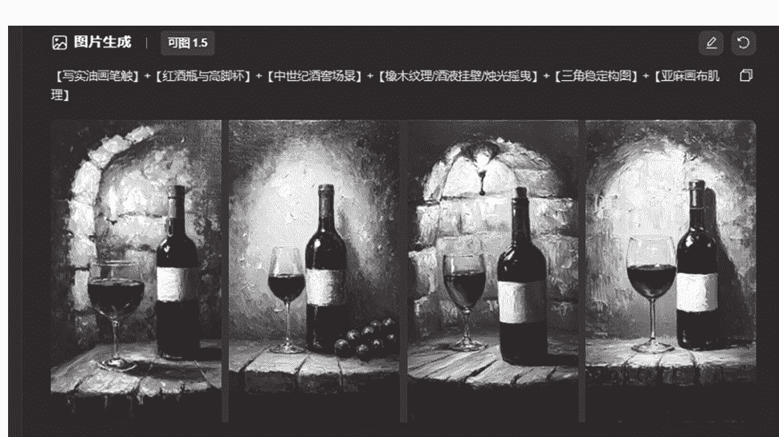

图6-10

## 6.1.2 借助DeepSeek实现图文内容的规模化制作

DeepSeek在图文生产链路里扮演提速器作用，能明显压缩素材产出周期。以下是一套可复用的指令范式。

> “请为【××类主题】一次性产出多条内容，整体风格设定为【风格】，账号定位是【账号定位】，每条篇幅控制在【×～×字】，叙述方式采用【表达风格】，适配【发布平台】的图文推送，并同步给出匹配【插图风格】的AI绘图描述。”

投喂该指令后可得到成套结果，其设计逻辑如下。

1. “请为【××类主题】一次性产出多条内容”，明确任务类型并要求批量输出。
2. “整体风格设定为【风格】，账号定位是【账号定位】，每条篇幅控制在【×～×字】，叙述方式采用【表达风格】，适配【发布平台】的图文推送”，用于统一调性、厘清定位并限定字数与渠道。
3. “并同步给出匹配【插图风格】的AI绘图描述”，让模型同时产出与文案对应的绘制说明。

下面以读书金句与生活感悟为主题做演示。先编辑好指令，再开启“深度思考（R1）”模式、关闭“联网搜索”，触发输出，如图6-11所示。

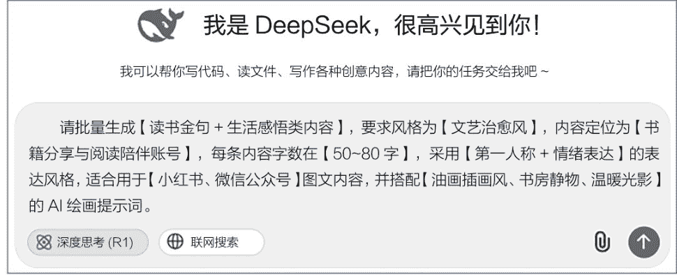

图6-11

按Enter发送后，返回结果如下。

以下是符合要求的文艺治愈风格读书金句与生活感悟文案，并附AI绘图描述参考。

---

### 文案内容1

> “书页沙沙作响时，我听见时间在呼吸。”

窗边的咖啡喝第三口时已经凉透了，这才舍得合上《夜航西飞》。风掀动亚麻窗帘的褶皱，像翻动故事的注脚。原来孤独与自由本是一体，在文字里悄然和解。此刻的沉默，是灵魂舒展的声音。

AI绘图描述：

油画插画风 | 老式台灯与翻开的书 | 亚麻窗帘透入暖光 | 咖啡杯水汽氤氲 | 斑驳木纹桌面

---

### 文案内容2

读到“我们终将活成自己的故乡”，指尖突然发烫。

晾衣绳上的白衬衫还在滴水，蝉鸣穿透八月燥热。那些被生活揉皱的执念，在加缪的文字里被一寸寸熨平。原来流浪与扎根，都是对生命的深情凝视。

AI绘图描述：

温暖光影 | 窗台绿植与泛黄书页 | 晃动的衬衫剪影 | 老电风扇的金属光泽 | 被水渍晕染的笔记本

---

### 文案内容3

普鲁斯特的玛德莱娜蛋糕，在我掌心化作半块桂花糕。

地铁玻璃映出倦容，电子屏蓝光吞噬黄昏。但包里蜷缩的《小王子》，始终是口袋里的星星，有些星星坠落，是为了教我们仰望。

AI绘图描述：

书房静物 | 磨砂玻璃罐装干桂花 | 褶皱牛皮纸书套 | 地铁车窗反射的人影 | 暖黄吊灯的光斑

---

### 文案内容4

合上《秋园》时，发现泪水比文字更先抵达真相。

阳台上晾晒的棉被鼓起风的形状，像那些未被言说的人生。我们读他人的故事，原是为了打捞自己沉没的月光。

AI绘图描述：

油画笔触 | 旧竹编晾衣架 | 浮动棉被的投影 | 褪色印花床单 | 斜阳穿透纱帘的丁达尔效应

---

### 文案内容5

博尔赫斯说：“天堂是图书馆的模样”，而我偏爱人间这盏夜读的灯。

外卖单据在桌角蜷成纸船，键盘声在隔壁渐弱。当所有喧嚏退潮后，文字是最后一块不会融化的浮冰。

AI绘图描述：

温暖光影 | 铸铁台灯暖黄光晕 | 堆叠的图书与便利贴 | 玻璃杯凝结水珠 | 窗外深蓝色夜幕

……

把AI绘图描述复制到绘图工具即可生成对应图像，如图6-12所示。

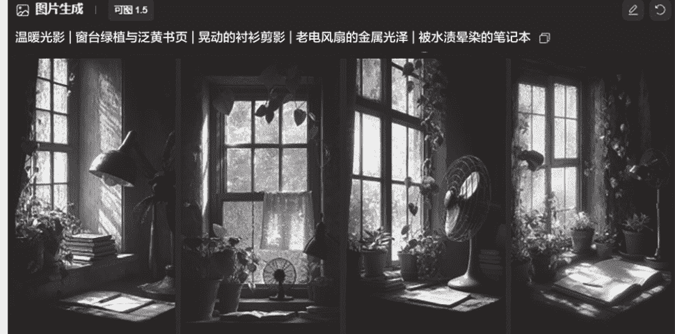

图6-12

下载到本地后，与文案一起发布至小红书，呈现效果如图6-13所示。

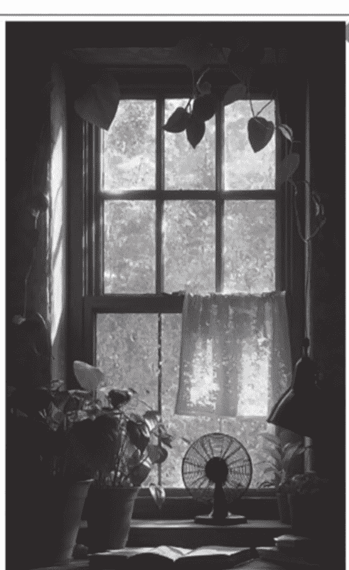

图6-13

## 6.2 通过DeepSeek进行短视频脚本的批量产出与矩阵运营

在内容竞争白热化的短视频环境里，单靠爆款难以支撑账号，而矩阵化运营则能撬动整体流量池。越来越多的团队不再采用一账号一运营的模式，而是通过矩阵实现多账号联动与高频输出。

### 6.2.1 基于DeepSeek的短视频脚本量产方法

在短视频赛道，创意不是短板，效率才是壁垒。若想搭建爆款矩阵，核心在于批量产出。以下是量产脚本的指令模板。

> “请为【主题】生成【数量】条【视频类型】短视频脚本，结构为：【结构模块A】+【结构模块B】+【结构模块C】。（可视类型补充）要求：语言风格为【风格要求】，每条控制在【时长】左右，语气为【语气要求】；结尾建议添加【转化/互动/金句等要求】。”

指令的构造逻辑如下。

1. “请为【视频主题】生成【数量】条【视频类型】短视频脚本”，明确任务目标，控制批量数量与类型。
2. “结构为：【结构模块A】+【结构模块B】+【结构模块C】”，强制模型按设定框架输出，避免发散。
3. “语言风格为【风格要求】，每条控制在【时长】左右，语气为【语气要求】”，用于把控语速、语调与时长。
4. “结尾建议添加【转化/互动/金句等要求】”，让模型自动设计引导动作，提升互动。

以母婴博主视角，围绕“宝宝夜醒频繁到底要不要喂奶”生成3条科普脚本。编辑好指令后开启“深度思考（R1）”、关闭联网搜索，触发输出，如图6-14所示。

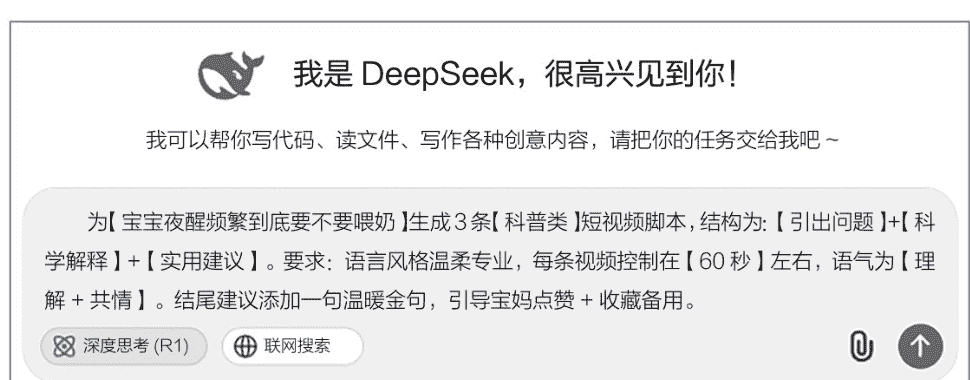

图6-14

按Enter发送后，DeepSeek给出如下内容。这里有3条符合要求的科普短视频脚本，供参考。

### 脚本一：夜醒≠饥饿

[场景：深夜婴儿床前温柔俯拍视角] ▶

**引出问题（10秒）**

“连续一周夜醒8次，一哭就喂奶，累到崩溃？先别急着塞奶瓶！很多宝宝夜醒频繁可能不是饿，频繁喂奶反而可能加重问题。”

**科学解释（20秒）**

“新生儿胃容量小，需要2～3次夜奶，但3个月后逐渐形成昼夜节律。6个月的宝宝夜间消耗仅占全天的20%，持续夜奶可能形成‘吃睡联想’，把吮吸当作安抚工具而非真饥饿。”

**实用建议（25秒）**

“判断标准：白天喂养充足+体重增长正常，可尝试延迟响应。先用轻拍、嘘声安抚，若大哭不止再喂。逐步拉长喂奶间隔，6个月后尝试戒除夜奶。尿布/温度/出牙不适等因素也要排查。”

[结尾特写母婴相拥画面]

“宝宝需要妈妈，但更需要一个快乐健康的妈妈❤️点赞、收藏，科学养育不焦虑。”

### 脚本二：睡眠周期的秘密

[场景：妈妈抱着宝宝在月光下轻摇]

**引出问题（10秒）**

“每次刚放下就醒，整夜像在‘拆炸弹’？其实宝宝的睡眠周期比成人短得多，频繁醒可能是正常生理现象。”

**科学解释（20秒）**

“婴儿睡眠周期约45分钟，浅睡眠占50%。在周期交替时会扭动、哼唧甚至睁眼，这时急着喂奶反而会彻底唤醒宝宝。观察3～5分钟，多数情况婴儿会自行继续睡觉。”

**实用建议（25秒）**

“继续睡觉小技巧：保持环境一致性，醒时用睡袋触感/白噪声持续。轻拍节奏与心跳同步（每分钟60下），避免眼神接触。白天多俯卧练习，消耗体能提升睡眠质量。”

[窗外晨曦透入镜头]

“宝宝的睡眠像拼图，我们要做的不是强行拼凑，而是给TA时间慢慢完整✨点亮小心心，育儿难题不孤单。”

### 脚本三：过度喂养信号

[场景：餐桌上摆着奶瓶和辅食餐具]

**引出问题（10秒）**

“明明刚喂过1小时，怎么又哭着找奶？当心过度喂养！夜间频繁进食可能让宝宝更难受。”

**科学解释（20秒）**

“过度喂养会加重肠胃负担，引发胀气、反流，形成‘吃—难受—求安抚’的恶性循环。研究显示，9月龄后频繁夜奶的宝宝，龋齿风险增加3倍。”

**实用建议（25秒）**

“调整策略：逐步减少单次奶量（每次减30mL），用安抚巾替代部分喂养。晚餐添加慢消化的碳水化合物，建立‘吃—玩—睡’模式。记录睡眠日记，找到宝宝真实的需求规律。”

[镜头推近宝宝安睡的脸庞]

“最好的爱是适度的满足，温柔而坚定的陪伴会开出最美的花✨收藏备用，和千万妈妈共同成长。”

每个脚本时长控制在58～62秒，通过场景化开头引发共鸣，用数据支撑专业度（如睡眠周期比例、龋齿数据），建议具体可操作。结尾金句避免说教，用自然意象传递温暖力量，符合小红书用户审美偏好。

确定方向后可进一步追问，参考模板如下。

1. 目前我已经选定了【“宝宝夜醒≠饿”的科普视频】脚本，内容时长约【63秒】，是否还可以再压缩【5秒】？哪些部分适合精简？
2. 我的结尾用了金句【“你不是一个人在熬夜哄娃”】，你能给我3个类似但不说教、适合收藏的“温柔金句”备选吗？
3. 我想引用【《美国儿科学会睡眠指南》】来增强可信度，应该放在哪一段才显得不突兀又加分？

### 6.2.2 优化多平台适配，用DeepSeek调整不同平台的脚本风格

AI生成脚本时容易忽略平台差异。同一选题在抖音可能爆款，在B站却冷淡。本节以DeepSeek为例，演示如何针对平台调优脚本。表6-1为不同平台的风格、节奏与受众偏好解析。

表6-1

| 平台 | 主要目标受众 | 内容节奏 | 受众偏好 | 脚本建议关键词 |
| :--- | :--- | :--- | :--- | :--- |
| 抖音 | 广谱人群、下沉用户 | 快节奏，反差感强 | 抓眼钩子、冲突剧情、情绪刺激 | 3秒钩子、冲突转折、金句结尾 |
| 小红书 | 女性、高知、新中产 | 节奏中等，真实感强 | 生活方式、真实体验、视觉精致 | 生活场景、共鸣情绪、亲和语言 |
| 微信视频号 | 微信生态中年用户 | 节奏慢，可信度强 | 实用干货、情感链接、强信任感 | 教程干货、情绪陪伴、品牌温度 |
| B站 | Z世代、深度兴趣群体 | 节奏可快可慢 | 逻辑清晰、内容深、表达真诚 | 知识结构、梗文化、剧情反转 |

可使用的指令模板如下。

> “请为【主题】生成【数量】适用于【目标平台】的【视频类型】短视频脚本，结构为：【结构模块A】+【结构模块B】+【结构模块C】。要求：节奏为【快/慢/中】，语言风格为【风格类型】，每条控制在【时长】以内。输出内容请加入【钩子/反转/情绪点/知识点】以贴合平台偏好。”

指令逻辑与前文类似，关键在于明确平台、节奏、风格并加入平台专属爆点元素。

以母婴博主视角，围绕“新手爸妈如何挑选婴儿车”生成3条适用于B站的科普脚本。编辑指令后开启“深度思考（R1）”、关闭联网搜索，触发输出，如图6-15所示。

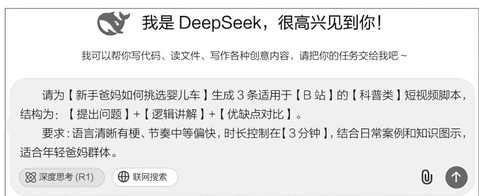

图6-15

按Enter发送后，DeepSeek给出如下答案。以下是为B站量身定制的3条婴儿车科普类短视频脚本，结合流行梗和实用干货，符合年轻爸妈群体的观看习惯。

---

**脚本1：婴儿车选错=社死现场？高景观vs轻便车全测评！**

时长：2分55秒

# 第7章 从内容到收益——用DeepSeek变现

创作者做内容创作，其目的不只是好看，更是希望能赚到钱。

无论你是拍视频、写文章，还是做播客、发图文，大家都在关心一个问题：怎么靠内容变现？其实，靠内容变现的方式有很多，比如接广告、带货卖东西、出付费课程，或者跟品牌合作。

但问题来了：内容再好，如果没有清晰的变现方法，也很难有稳定的收入。而这时候，DeepSeek就能帮上大忙，不仅能帮你快速生成内容，还能帮你提升变现的效率。

本章将集中解决下面4个核心问题。

- 我不知道做自媒体到底有哪些赚钱方式，怎么选适合自己的方式？
- 我的内容已经初见成效，但是变现效果却并不理想，怎样提高赚钱效率？
- 我想搞带货或知识付费，但不知道该怎么策划内容和话术？
- 我想长期稳定赚钱，而不是靠一两条爆款内容，该怎么办？

## 7.1 常见的内容变现方式

要靠内容变现，第一步就是搞清楚有哪些变现的方式。不同的内容形式、发布平台和受众群体，其变现方法也不太一样。本节将会带你认识几种最常见，也最容易上手的内容变现方式。

### 7.1.1 自营店铺变现

对于那些拥有店铺的自媒体运营者来说，他们拥有一种得天独厚的变现方式——通过自营店铺直接销售商品。这种变现方式便捷高效，运营者可以利用短视频直观地展示自己的产品，吸引用户的注意力，从而激发其购买欲望，如图7-1所示。

用户被你的短视频吸引注意力后，容易激发起购买欲望。此时，只需单击进入你的主页，然后再单击你的商品橱窗即可购买，如图7-2所示。

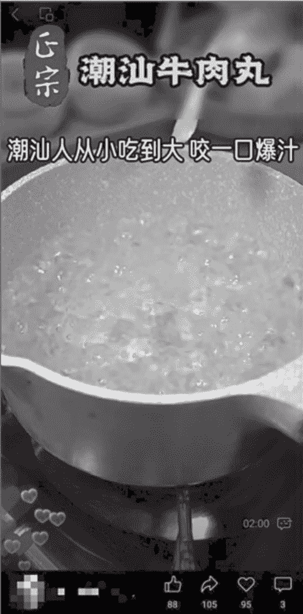

▲图7-1

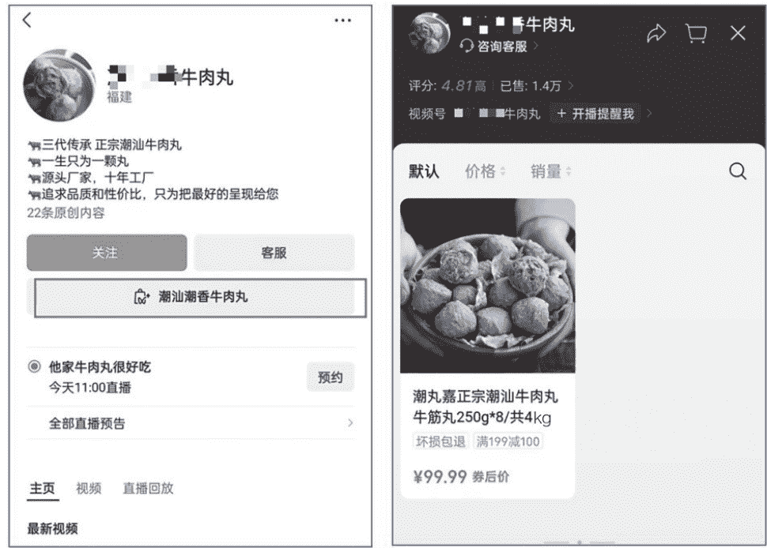

▲图7-2

### 7.1.2 博主带货变现

带货、卖货这种变现方式比较常见，我们比较熟知的就有“口红一哥”等网红“大V”，他们就是通过直播带货来赚取收益的。

运营者可以将自己带货、卖货的短视频事先剪辑处理好，然后发布在短视频账号上，让观众在观看视频的时候对产品产生兴趣，然后购买该产品。

当你的账号有一定的粉丝基础之后，就会有品牌方找你为他们的品牌带货，然后给你广告费或佣金，这是一种比较理想的变现方式。

短视频创作者在选品时，通常会把账号的人设与内容调性作为第一道筛选标准。契合定位的商品往往更容易被受众接受，转化表现好了，自然会吸引同品类品牌主动寻求合作，后续的广告投放机会也会随之增多。

举个例子，有个定位清晰的账号被几家淘宝商家看中，于是它的多条视频里都挂上了淘宝的导购链接，为商家完成商品推广并拿到广告费或佣金回报。图7-3所示为某账号带货短视频的截图。

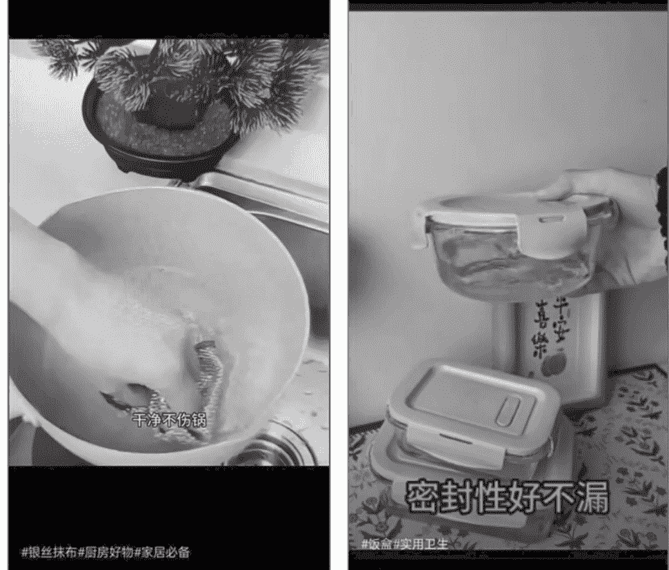

图7-3

### 7.1.3 售卖课程变现

一部分自媒体和培训机构即便不具备实体商品，也能凭借积累的干货输出变现路径。它们在平台内开设付费课程招揽学员，依靠学费实现收入，如图7-4所示。

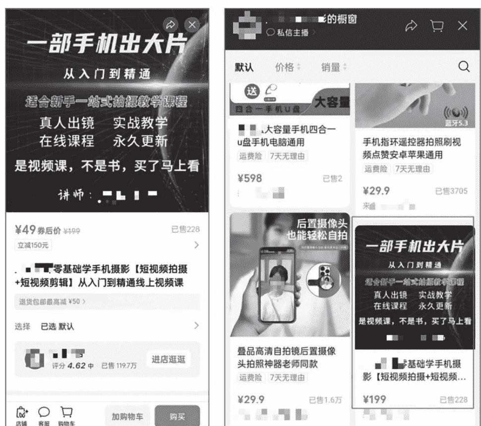

图7-4

### 7.1.4 添加分销链接

伴随自媒体生态的扩张，分销成为运营者青睐的变现手段。尤其是没有自有店铺或货源的创作者，分销提供了一种门槛低、灵活性高且相对稳定的盈利方式。

运作逻辑是帮助其他商家完成销售并从中抽取佣金。目前可供选择的分销渠道很多，比如多多进宝、淘宝联盟、微盟、有赞商城等，都能提供海量商品资源与便捷的分发入口。下面以淘宝联盟为例说明具体流程。

01 先下载注册淘宝联盟，登录后进入首页。可以在首页挑选与自身账号调性匹配的商品，也能直接在搜索框里输入想推广的品类关键词，如图7-5所示。

▲图7-5

02 锁定目标商品后点击“赚”按钮，如图7-6所示。会弹出分享面板，再点“一键分享”按钮，如图7-7所示，系统会自动保存推广素材、文案及口令，发布短视频时把口令粘贴进去即可。

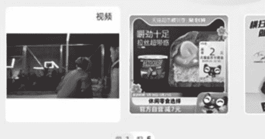

▲图7-6

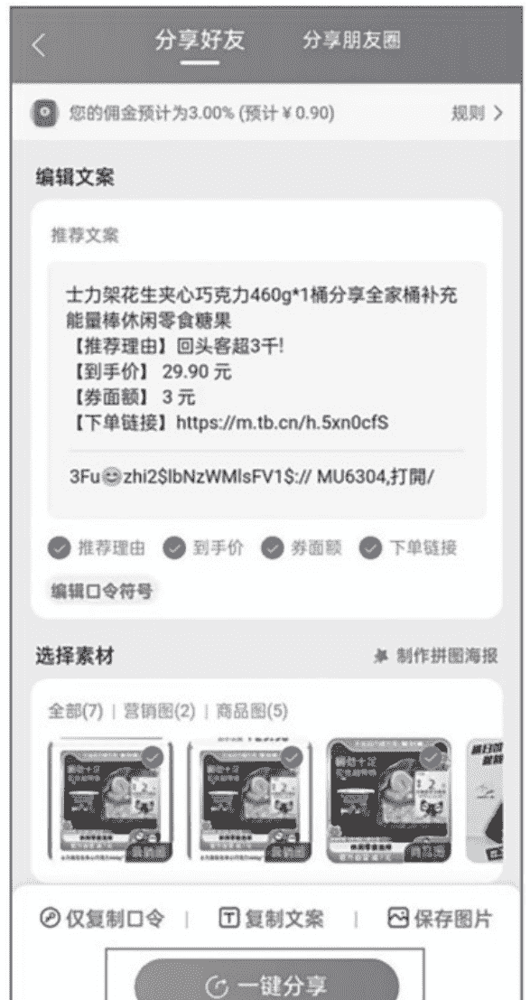

▲图7-7

03 除了发现页，运营者还可以在“榜单”和“跟推广场”里找品。这里能看到热销榜单，也能观察同类创作者在推什么，方便借鉴。如图7-8所示。

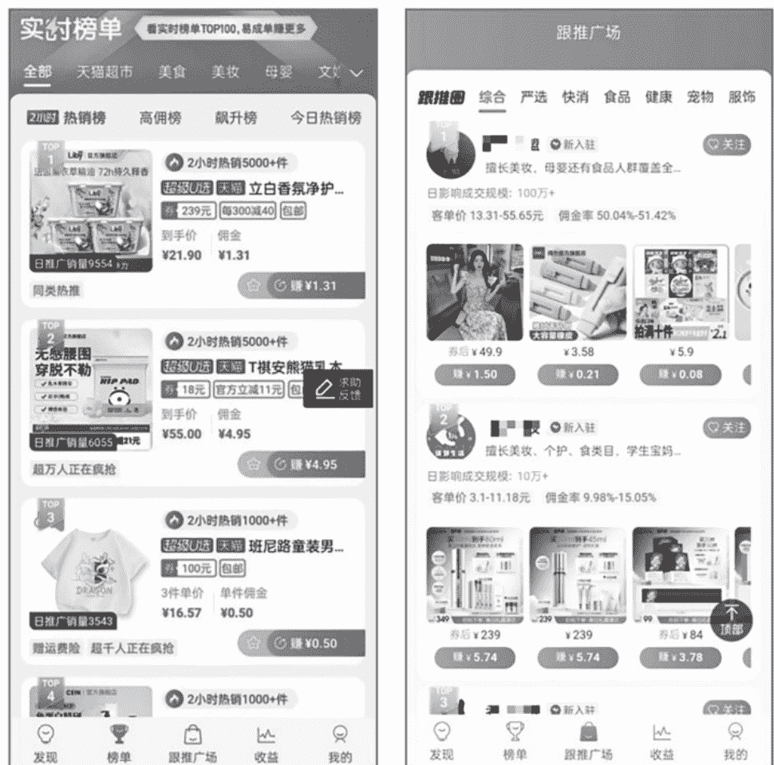

图7-8

04 在淘宝联盟的“我的”页面可以完善账号的基础资料，如图7-9所示。推广收益的查看入口在“收益”页面，如图7-10所示。

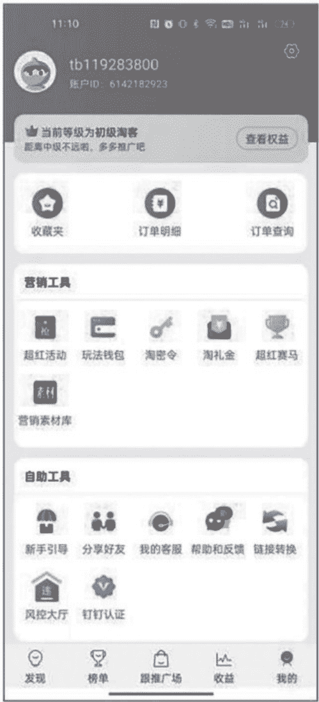

▲图7-9

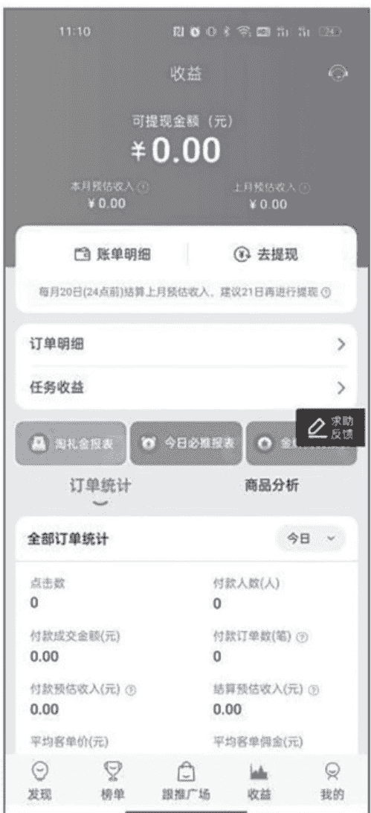

▲图7-10

在上架前，创作者通常会先查询单笔订单的佣金水平。以食品类为例，搜索相关品类后即可看到每单的佣金比例。优先选择佣金高且销量稳的商品去推更划算。只要买家最终下单完成，佣金就会结算到创作者账户。选品精准的话，这部分收入相当可观。

### 7.1.5 服务转化变现

除了商品导购，自媒体还能通过提供专业服务获取回报，转化形式很丰富。以某创作者发布房源短视频为例，说明其变现思路，如图7-11所示。

这类内容多由房屋租赁公司制作，视频里呈现详细的房源信息，简介中附上个人微信号，感兴趣的用户被引导进微信后可获取更完整、更精准的看房资料，从而提高出租成功率。这种模式既放大了短视频的传播效率，也提升了成交概率，为运营方带来稳定收益。

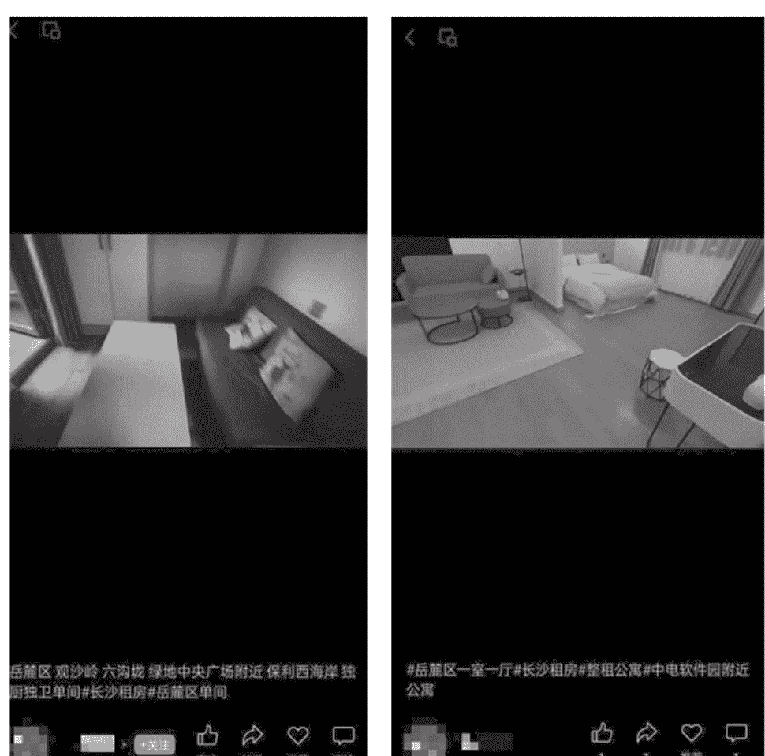

短视频的服务边界远不止房源。招聘、相亲、家教等多种服务都能通过同类逻辑实现。创作者可依据账号定位与目标人群的需求，选择合适的服务类型来承接。

### 7.1.6 直播收益变现

短视频与直播相互拉动。经历野蛮生长、流量红利、优胜劣汰和规范监管后，直播行业已进入人人可播的阶段，变现模式也日趋多元化。当前常见的方式主要有以下几种。

#### 1. 直播带货

前面提到博主用短视频为商品引流，直播带货的本质相似但更即时。商家通过直播平台对接主播或机构，在直播间实时售卖，当天成交量直接体现效果，图7-12所示为某运营者直播带货的截图。带货模式大致分为商家合作模式、纯佣金模式和自营店铺带货模式。

（1）商家合作模式：品牌方倾向选择粉丝基础和流量可观的账号合作，以获取推广效果。
（2）纯佣金模式：以抖音为例，没有自有店铺和货源的创作者开通商品分享权限后，也能把商品挂到直播间赚取佣金。
（3）自营店铺带货模式：既能为自己的店铺提升销量和利润，又能通过直播获得带货佣金。

#### 2. 直播打赏

打赏是最传统、最基础的直播盈利方式。是否打赏完全取决于观众意愿，一个眼神、一句话都可能触发共鸣。目前打赏已成为平台和主播的重要收入来源之一。图7-13所示为短视频直播打赏的截图，观众点击直播间的礼物按钮即可挑选虚拟礼物，礼物需用充值后的“微信豆”购买。iOS端充值1元可得7个微信豆，最便宜的爱心只要1个微信豆，最贵的“桃花岛”需要8888个微信豆。

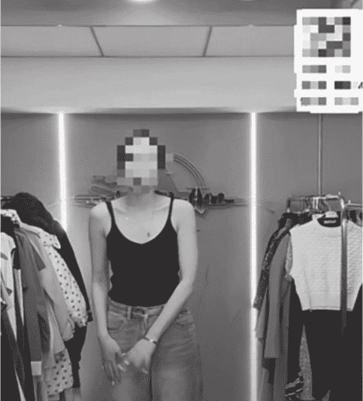

▲图7-12

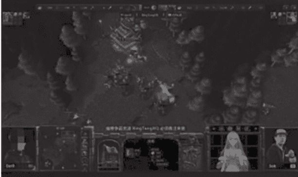

▲图7-13

#### 3. 付费观看

除了与内容间接相关的打赏和带货，还有直接付费观看的模式。观众需先支付费用才能进入观看，逻辑类似微信公众号付费阅读。当内容质量高、粉丝量足、主播影响力强且粉丝粘性高时，这种方式同样能实现变现。

## 7.2 用DeepSeek提高变现效率

读完第7.1节，你已经了解了内容变现的主线：自营店铺、博主带货、课程售卖等。很多人在这一步卡住了：内容方向有了，渠道也清楚了，收入却上不去。核心问题不在于不会变现，而在于变现效率不足。接下来讲解如何借助DeepSeek提升效率。

### 7.2.1 广告变现翻倍技巧

广告收入取决于两个要素：品牌方是否愿意合作，以及广告是否被用户观看并购买。不少创作者接单后不会做广告片，发布后数据平平，导致品牌不再续单。下面介绍几个提升广告变现的技巧。

#### 1. 快速生成高质量广告脚本

拿到产品后不知如何呈现时，只需一个提示词，DeepSeek就能给出方案。

> “请根据以下产品信息，生成一个适合【平台名】的广告短视频脚本，风格为【风格】，目标受众是【用户群体】，时长控制在【时长】以内。产品信息如下：【产品介绍】。”

提问逻辑解析：
（1）“请根据以下产品信息，生成一个适合【平台名】的广告短视频脚本”，明确推广对象与投放平台，便于适配格式。
（2）“风格为【风格】，目标受众是【用户群体】，时长控制在【时长】以内”，确定表现手法、沟通语气、选题角度和视频时长。
（3）“产品信息如下：【产品介绍】”，提供产品细节，方便提炼卖点。

以主打“0糖0脂”的即饮咖啡为例，生成适配微信视频号的广告脚本。先整理好提示词，打开“深度思考（R1）”模式并关闭“联网搜索”，如图7-14所示。

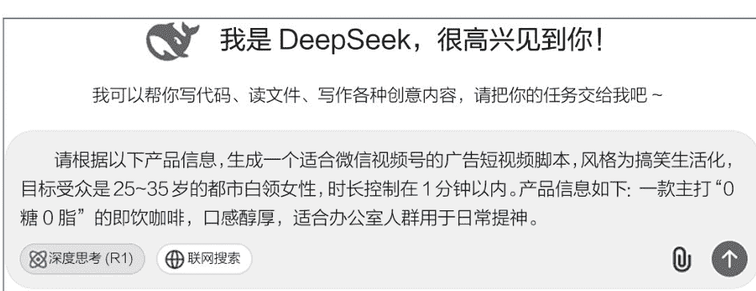

图7-14

回车发送后，DeepSeek给出如下方案。

《打工人的咖啡救星》——0糖0脂即饮咖啡广告脚本
时长：58秒
风格：职场轻喜剧+闺蜜吐槽风
...
创意点说明、拍摄建议等内容与原方案一致。

确定方向后，还可以追问优化：
(1) “请帮我优化成更适合短视频口播的形式。”
(2) “请给我3个结尾转化引导句式。”
(3) “请提炼3条可以写进评论区的文案。”

#### 2. 模拟用户喜好，精准“戳中”受众

DeepSeek还能扮演目标用户，评估脚本是否合口味。

> “请模拟一个【用户群体】的消费者，帮我点评下面这条广告脚本是否符合他们的喜好，并提出改进建议。广告脚本如下：【脚本内容】”

提问逻辑：
（1）“请模拟一个【用户群体】的消费者”，让模型站在受众视角而非创作者视角评价。
（2）“帮我点评下面这条广告脚本是否符合他们的喜好”，判断是否戳中痛点、能否引发兴趣。
（3）“并提出改进建议”，要求给出具体修改方向。

以前面生成的咖啡脚本为例，让模型从30岁女性白领视角点评。开启深度思考并关闭联网搜索，如图7-15所示。

图7-15

输出要点包括亮点与扣分项，例如痛点共鸣准、闺蜜人设可信、健康属性需强化；人设年龄感偏差、二次元元素过载、职场关系刻画单薄等。

后续可继续追问：
(1) 请补充更具体的【_____】细节，特别是【_____】的场景。
(2) 请把【“_____”】这类台词，换成更贴近【_____】人群的表达方式。
(3) 请突出【_____】的核心卖点，最好用【_____】的方式呈现。

示例：
(1) 请补充更具体的生活日常细节，特别是“带娃出门+通勤赶地铁”的场景。
(2) 请把“打工魂觉醒”这类台词，换成更贴近白领闺蜜间聊天的表达方式。
(3) 请突出“0糖0脂”的核心卖点，最好用热量类比（如1/4个苹果）的方式呈现。

#### 3. 优化脚本结构，提高点击与转化

广告失败常因结构松散或转化生硬。可用DeepSeek优化整体逻辑。

> “我写了一段广告脚本，不太确定有没有写得吸引人。你能帮我看看这段广告脚本的逻辑有没有写清楚？哪里还能改一改，让更多人感兴趣、愿意下单？广告脚本的逻辑内容是：【内容】。”

提问逻辑：
（1）“我写了一段广告脚本，不太确定有没有写得吸引人”，让模型先评估而非直接重写。
（2）“逻辑有没有写清楚”，检验结构是否清晰、信息是否易懂。
（3）“哪里还能改一改，让更多人感兴趣、愿意下单”，从转化角度给出优化建议。

以同一咖啡脚本为例请求结构优化。开启深度思考并关闭联网搜索，如图7-16所示。

图7-16

DeepSeek给出的优化建议涵盖痛点强化、产品价值可视化、闺蜜人设丰满化等方向，帮助提升传播性与转化率。

#### 四、结尾施压：把紧迫感埋进收尾

转化率往往在最后一段掉线，补足几个促动细节就能把犹豫的观众推到行动。可视化的收尾组合示范：

- 手机特写弹窗，文案提示“新客首单附赠咖啡因去角质小棒”。
- 瓶体标识慢慢化作进度条，字幕显示“今日特价库存只剩37%”。
- 闺蜜突然抢镜喊话：“这会儿下单的姐妹私信我，我把老板怼人静音教程发你！”

限时赠品叠着社交谈资，一边制造稀缺一边制造话题，双重拉力促成即时拍板。

方向确定后可以继续追问模型做细化。参考追问句式：

(1) 可否补充【_____】类画面，去营造更强烈的【_____】情绪？
(2) 现有对比冲击不足，能否加入【_____】的反差，强化观众对【_____】的认同？
(3) 结束处缺少立刻出手的钩子，能否加上【_____】，点燃马上购买的冲动？

示例：

(1) 可否加入“送孩子迟到被领导盯”的情境，更强烈调动职场焦躁？
(2) 目前对比不够，能否加入“外卖咖啡泼身+抱怨运费”的镜头，强化即饮咖啡省时省钱省心的认知？
(3) 最后还差促单点，能否组合“限时库存倒计时+赠去角质棒”刺激当下下单？

### 7.2.2 借助模型一键产出带货文案

不少创作者带货乏力，并非单品不行，而是表达引导不够给力。开头抓不住、卖点讲不清、收尾无指令、评论区冷清，本质是表达与引导能力不足。用 DeepSeek 可迅速生成口播、图文、评论引导和直播金句，把生硬推销转为自然成交。以下分口播与评论互动两部分说明。

#### 1. 短视频/直播口播稿生成

口播是成交起点，常见误区：

(1) 一开口就罗列功能，观众无感。
(2) 信息堆砌缺乏重点，最后遗忘行动指令。
(3) 情绪或过淡或过猛，易产生抵触。
(4) 缺乏创意，多抄同行，缺少记忆点。

此时可把关键信息喂给模型，换回吸睛、自然、有转化的稿子。建议提问框架：

> “我有一件商品想在短视频里介绍，你能帮我写一段口播吗？语气是【语气】，适合【如新手妈妈、大学生、搞笑账号】来呈现，主要面向【目标人群如年轻女性、上班族、带娃人群】。时长约【30秒、1分钟】。商品信息是：【介绍】。”

投喂后即可获得结果。提问逻辑：

(1) 说明创作目标与场景，让模型明确是短视频口播而非软文海报。
(2) 指定语气风格，决定观众是否愿意听完。
(3) 明确人设、受众、时长，便于控制节奏与字数。

以新手妈妈视角生成面霜口播为例，整理指令后打开深度思考模式、关闭联网搜索，模型输出如下。

图7-17

回车后得到：

以下是30秒轻松真实、适合新手妈妈身份的口播稿。

（开场自然微笑，手拿面霜）

> “姐妹们！当了妈之后是不是经常脸干到紧绷，还动不动泛红、敏感？（叹气）快来试试我这支救命面霜！润××舒缓修护面霜，神经酰胺+积雪草双管齐下，像给皮肤盖了层透气保护膜～（展示质地）你看这冰淇淋质感，一抹化水完全不黏腻！重点是无香精、无乙醇，孕期、哺乳期都能安心用！（轻拍脸颊）我连用一周，带娃熬夜后脸颊都不火辣辣了～现在点击购物车还能抢新品券，敏感肌姐妹冲就对了！”

（时长控制技巧：正常语速约240字/分钟，本文案约120字，配合动作表情可控制在30秒。可删除“重点是无香精、无乙醇”或“现在点击购物车”来调节时长。）

口播设计要点：

（1）痛点前置：用“脸干/泛红/敏感”瞬间引发共鸣。
（2）成分场景化表达：用“盖了透气保护膜”替代专业术语，配合质地展示增强说服力。
（3）信任感构建：强调哺乳期可用+自用体验，降低推销感。
（4）行动指令设计：用“抢券”“冲”等口语化号召适配短视频节奏。

可随时追问调整语气或细节。参考模板：

1. 该优势表述偏专业，能否用【_____】这类生活比喻来说？
2. 这30秒能否更生活化？如加入“【_____】”这类口头反应？
3. 有没有办法把“产品好”说成“我有变化”？如加一句“【_____】的个人前后对比”？

示例：

1. 能否用“像在脸上盖一层柔柔的保护膜”来表达？
2. 能否更生活化一点？如“娃一哭我抹一半停一下”这种场景？
3. 能否加一句“以前出门就干裂，现在一整天都不紧绷”？

#### 2. 生成评论区/弹幕互动话术

评论区和弹幕表面是观众发言，实则是撬动转化率的隐形杠杆。用一句提示即可批量生成像真人互动的评论。

> “我在做一条带货视频，想让评论区或弹幕更热闹、更有互动感。你能根据下面这段视频内容，写5条评论或弹幕吗？语气是【语气，如搞笑、亲切、热情】，主要是为了【目的，如带动气氛、引导下单、激发讨论等】。视频内容是：【内容简介或口播词】。”

提问逻辑：

（1）说明是带货视频，要制造“有人在看”的热闹感。
（2）要求评论贴合视频内容，避免跑题。
（3）设定语气与功能性目的，让评论具备引导力而非闲聊。

以新手妈妈推广多功能婴儿辅食机为例，打开深度思考、关闭联网搜索后得到：

图7-18

输出为：

1. “每次做辅食都要折腾半天，这个蒸煮搅拌一体机好方便！用过的宝妈们好清洗吗？求真实反馈～”
2. “上班没时间做辅食的宝妈太需要这个了！用过的姐妹说说真的10分钟就能搞定吗？想入手了！”
3. “被种草了！请问新手妈妈容易操作吗？会不会有按键复杂的情况呀？”
4. “这个做出来的辅食细腻吗？6个月宝宝吃胡萝卜泥和土豆泥能一次成功吗？求实拍图！”
5. “天天发愁给宝宝换着花样做辅食，这个辅食机可以做的种类多吗？求晒食谱！”

确定方向后可继续追问。模板：

(1) 这些不错！除了这几种，还能从[______]角度生成哪些互动提问？
(2) 能否按[使用阶段/宝宝月龄/辅食种类]把话术细分到不同场景？
(3) 能否给更偏种草带货风格的追问话术，最好能激发购买欲？

示例：

(1) 能否补充从“奶奶带娃/爸爸操作感受”角度出发的互动问题？
(2) 能否区分“刚开始加辅食”“已经吃一段时间”“要添加肉类”等阶段的话术？
(3) 能否提供更偏种草的提问，最好能直接点燃购买冲动？

### 7.2.3 设计知识付费课程大纲

很多人有一技之长，却不会包装成课程。DeepSeek 不仅能写课，还能把一套知识付费产品从0到1搭出来。提示模板：

> “我想做一套线上知识付费课程，你能帮我设计一下课程的大纲吗？课程主题是：【课程主题】，适合的目标人群是：【你希望把该课程卖给谁，如宝妈、小白创业者、职场新人】。我自己的优势是：【如有多年经验、讲得特别通俗、案例多】。整套课程的总时长大概是：【时长，如1小时、3小时、10小时】，我希望课程分成【数目】个模块，每个模块里有2节或4节课。请你帮我列出：
> - 整个课程名称；
> - 每个模块标题名称、主要内容；
> - 每节课的标题和简单介绍；
> - 整体课程的亮点或卖点（让别人想买的理由）。”

提问逻辑：

（1）主题与人群决定课程重点。
（2）个人优势决定人设与信任点。
（3）时长与模块数量决定结构与递进。
（4）明确输出清单，结果可直接售卖。

以宝妈副业创业指南为例，打开深度思考、关闭联网搜索后输出。

图7-19

回车后结果：

课程名称：宝妈副业创业指南：0基础打造灵活收入，带娃赚钱两不误

### 模块划分 & 课程大纲

总时长：3小时 | 4大模块 | 共10节课（每节课15～20分钟）

#### 模块1：找准方向——宝妈副业定位与赛道选择（30分钟）

- 为什么宝妈最适合做副业？你的隐藏优势分析
- 结合育儿经验、时间碎片、社交需求，挖掘宝妈独特竞争力。

##### 五大低门槛高需求副业方向解析

母婴内容创作、亲子社群运营、知识付费、轻电商、本地服务（如绘本租赁/辅食定制）。

##### 避坑指南：哪些副业看似美好实则“天坑”

警惕囤货微商、刷单骗局，选择低成本、轻运营模式。

#### 模块2：轻启动——低成本打造个人品牌与流量池（45分钟）

##### 宝妈IP人设定位：如何用真实故事吸引精准客户

从“普通妈妈”到“可信专家”的3步定位法（案例：辅食分享博主转型带货）。

##### 0成本启动：1部手机搞定内容创作（图文/短视频/直播）

手机拍摄剪辑技巧、免费工具（剪映/Canva）推荐、爆款选题公式。

##### 私域流量搭建：微信社群+朋友圈高效转化法

朋友圈“生活化营销”模板、社群促活话术设计。

#### 模块3：变现闭环——从流量到收入的3种核心模式（60分钟）

##### 内容变现：小红书/抖音接广告、知识付费产品设计

母婴博主广告报价逻辑、9.9～999元产品的分层设计（如育儿课程/资源包）。

##### 社群变现：快闪团购、付费会员圈实操案例

如何靠30人的小群单日变现5000多元（选品技巧+社群剧本）。

##### 分销合作：轻资产赚佣金的优质平台推荐

童书/母婴用品分销渠道、高佣金选品策略。

#### 模块4：可持续经营——时间管理&长期复利心法（45分钟）

##### 宝妈高效时间表：每天2小时创造持续收益

碎片时间管理工具（时间块/番茄钟）、外包家务技巧。

##### 副业与家庭平衡：如何获得家人的支持并减少内耗

沟通话术、情绪管理、设立“专注工作时段”。

##### 复利思维：让副业收入自动增长的3个策略

内容沉淀（如打造专栏）、用户裂变（老带新奖励）、跨平台分发。

确定方向后可继续追问。参考模板：

（1）除了【已有的副业类型】，还能再生成一些【宝妈可操作的、低门槛的副业方向】吗？
（2）能否根据【课程模块名称或主要内容】生成一些【具体可用的模板/话术/脚本】？
（3）请为【某节课程/模块名称】设计【2～3个可用于课后讨论或社群互动的问题】。

### 7.2.4 用DeepSeek预测内容收益

常见困惑：选题做了、文案写了、视频剪了，却不确定哪条更可能爆；多方向不知押哪个；发布前靠感觉选标题封面。

模型可充当内容预测师，提前评估：

- 哪条更易获得高曝光？
- 哪个标题点击率更高？
- 哪个角度更贴合平台当下趋势？
- 哪种表达更利于带货转化？

提示模板：

> “我准备发一条内容/选了一个话题，但不太确定效果好不好。你能帮我看看它有没有可能火吗？请从这几个方面给我分析一下。
>
> - 这条内容火不火，大概能打几分（10分满分）？
> - 它和现在的平台趋势合不合拍？
> - 发出去后，可能会带来什么好处？如涨粉、卖货、引流等。
> - 有没有什么地方还能改一改，会更有机 会爆？
>
> 下面是我想发的内容：【你的内容或话题】。”

提问逻辑：

（1）先打分，快速判断话题热度。
（2）预估商业价值或账号成长价值。
（3）查漏补缺，给出可执行优化点。

以“3个我最离不开的宝宝神器推荐”为例，打开深度思考、关闭联网搜索后输出。

图7-20

回车后结果：

综合评估与预测如下。

### 1. 热度评分：8.2/10

评分依据：

- 受众精准：母婴/育儿内容在抖音、快手、小红书持续热门，尤其是带娃妈妈群体需求强烈，互动粘性高。
- 实用性强：“神器推荐”类天然具备种草属性，观众会主动收藏转发，易形成长尾流量。
- 短时长优势：90秒符合平台“短平快”偏好，但需注意节奏紧凑。

### 2. 平台趋势匹配度：85%

关键贴合点：

- 生活化Vlog：真实场景+第一视角分享更易共鸣，符合抖音记录真实生活和小红书好物测评调性。
- 标签潜力：可关联#母婴好物、#带娃神器、#新手妈妈、#育儿神器，蹭近期“6·18母婴囤货”话题流量。
- 平台扶持：抖音“新农人计划”和快手“亲子时光”等专题会优先推荐优质育儿内容。

### 3. 预期变现方向

| 变现方式 | 可行性 | 操作建议 |
| :--- | :--- | :--- |
| 电商带货 | ★★★★★ | 挂车推荐高佣金母婴商品（如便携辅食机、恒温水壶），优先选抖音小店或小红书店铺 |
| 品牌合作 | ★★★★☆ | 植入细分垂类品牌（如Babycare、可优比），以“自用款”软性广告植入增强可信度 |
| 知识付费 | ★★☆☆☆ | 后期可扩展为《0-1岁宝宝用品避坑指南》课程，但需积累粉丝基数 |
| 私域引流 | ★★★☆☆ | 评论区引导加入私域“妈妈交流群”，为后续社群团购铺垫（需规避平台敏感词） |

### 4. 优化建议

#### (1) 内容结构优化

- 前3秒钩子：直接展示“神器”使用效果（如宝宝秒睡、一秒止哭），搭配文字“救了我100次的带娃神器”！
- 痛点前置：用妈妈常见问题切入（如频繁夜醒、出门手忙脚乱），增强观众停留意愿。

- 单品呈现建议把时长压到二十秒以内，遵循先点出痛点、再演示功能、最后落到使用场景的叙事线。例如深夜冲奶水温不稳，先用实拍呈现恒温水壶的工作状态，再收尾给出价格与品牌。

#### （2）运营操作要点
- 投放时段：宝妈群体在上午九点到十一点、晚上八点到十点的活跃度最高，建议优先在这两个窗口排期。
- 评论区引导：置顶一个开放式话题，如“带娃时最让你崩溃的瞬间是什么？下期我们帮你找对策”，以提问激发用户自发留言与共创。
- 矩阵分发：将九十秒成片拆成三条十五秒的单品切片，分别挂不同标签触达不同流量池，结尾统一导流回主视频。

#### （3）合规注意
- 规避夸大疗效的表述，尤其是“治疗湿疹”等医疗相关用语，优先选择喂养辅具、安抚玩偶等低敏感品类。
- 每条内容统一加上“仅为个人体验，仅供参考”的声明，降低广告违规风险。

……
以上为DeepSeek给出的初版方案，方向确定后可继续追问微调。追问思路可参考以下模板。

（1）除开【当前在评估的选题方向或内容形式】，是否还能给出【同圈层但打开方式不同/受众有区分的方向】？
（2）针对【指定平台】的内容生态，能否拆解【此类内容近期的热度走向/竞争强弱/创作者建议】？
（3）针对【某项优化建议或内容结构】，能否给出一份【可直接执行的操作模板/话术/脚本框架】？

示例。
（1）除了“好物种草”之外，能否为宝妈群体推荐几种别的短视频玩法，比如轻喜剧、生活吐槽风？
（2）小红书母婴赛道现在竞争激烈吗？我还能进场吗？帮我分析下竞争现状和可切入点。
（3）文中提到的“前3秒抓人”具体怎么落地？能给我几个适合宝妈带娃类视频的开场话术吗？

# 第8章 DeepSeek+自媒体变现实战案例库

AI工具迭代加快，单一创作已难以满足效率需求，越来越多创作者让不同工具相互配合。DeepSeek能独立完成文本撰写、信息归纳等工作，和Canva、数字人等工具联动后，变现路径被放大。

本章主要解答以下问题。

- 如何用DeepSeek提炼爆款话题，再借助Canva产出吸粉并能带货的精美图文笔记，适合生活方式类博主。
- 如何借助DeepSeek撰写宣传文案与促销话术，再配合数字人实现零出镜日更，同时多号矩阵化运营，提升曝光与到店率。
- 如何靠“金句号”“资料包”做流量生意。
- 如何让DeepSeek快速拆书、提炼“金句+观点”，做出爆款读书内容，实现内容与佣金双收。
- 如何从选题到脚本再到课程大纲一键生成，打通从吸粉到卖课的完整链路，适合擅长输出干货的人群。

## 8.1 小红书平台养生赛道：DeepSeek+Canva打造爆款图文

DeepSeek在信息浓缩与结构化方面表现突出，Canva则提供直观的排版与美化能力。两者配合，可迅速产出逻辑清晰、视觉冲击力强的小红书笔记，提升完读率。

具体操作流程如下。

01 进入Canva入口页，从左侧导航依次进入“模板” | “社交媒体” | “小红书笔记样式”，如图8-1所示。

图8-1

02 在模板库挑选一款图文版型，先观察其结构。图8-2展示的版型，第一段是整体主题，第二段是经典语录，第三段是出处标注。

CLASSIC LINES

经

/典

/台

/词

# 记忆中

那些封神的

经典台词

> 生活中有很多的不如意。如果一不开心，就寄希望于如果当初，那你永远都不会开心。幻景再美终是梦，珍惜眼前始为真。

——《武林外传》

#每日分享#

图8-2

03 依据版式要求，让DeepSeek按固定格式输出文本，提示词范例如下。

> “请帮我生成一组关于【主题】的图文内容，用于【使用场景，如短视频文案/图文笔记/知识分享帖等】。要求结合【内容来源或限定范围】，每条内容具有【具体特征，如有情绪、有深度、引发共鸣】，并以【指定格式，如表格/卡片式】输出，方便后续直接使用。”

使用这段指令的原理如下。

（1）先明确主题和使用场景，保证输出有针对性。比如图文笔记与短视频脚本在长度与语气上差异很大。
（2）限定内容来源，保证信息统一且可靠，避免东拼西凑。
（3）强调情绪与共鸣等特征，提升传播力。
（4）指定表格或卡片式输出，减少后期整理成本，便于直接套用。

下面以小红书博主为例，用DeepSeek产出电影经典台词。先写好提示词，开启“深度思考R1”模式，关闭联网搜索，得到的回复如下。

请帮我生成10份热门电影中的经典台词，必须是能引人思考的一句话，并附带其电影名称，字数控制在30字以内，简洁有力，按表格的形式输出，语言真实、富有共鸣感，适合做成小红书图文。

以下是10部热门电影中的经典台词及其电影名称，按表格形式整理如下。

| 电影名称 | 经典台词（30字以内） |

| :--- | :--- |

| 《肖申克的救赎》（1994） | 希望是件好东西，也许是人间至善，而美好的事永不消逝。 |

| 《这个杀手不太冷》（1994） | 人生总是这么艰难吗？还是只有小时候如此？总是如此。 |

| 《阿甘正传》（1994） | 生活就像一盒巧克力，你永远不知道下一颗是什么味道。 |

| 《教父》（1972） | 让朋友低估你的优点，让敌人高估你的缺点。 |

| 《楚门的世界》（1998） | 假如再也见不到你，那祝你早安，午安，晚安。 |

| 《天堂电影院》（1988） | 如果你不出去走走，你就会以为这就是全世界。 |

| 《当幸福来敲门》（2006） | 如果你有梦想，就要守护它。 |

| 《飞越疯人院》（1975） | 你们一直抱怨这个地方，却没有勇气走出这里。 |

| 《放牛班的春天》（2004） | 永远别说永远，凡事都有可能。 |

| 《心灵捕手》（1997） | 你不了解真正的失去，因为唯有爱别人胜于自己才能体会。 |

这些台词涵盖人生哲理、人性探讨、存在意义等主题，适合引发对自我、社会和价值的深层思考。部分电影如《肖申克的救赎》《死亡诗社》等台词被广泛引用至教育、心理学领域，成为文化符号。

04 把DeepSeek产出的台词与片名复制回Canva版型，点开菜单栏的“应用”|“批量创建”，如图8-3所示。

图8-3

05 跳转后点按“手动输入数据”按钮，如图8-4所示。

06 将复制好的片名与台词粘贴进数据区，点击“完成”，如图8-5所示。

批量创建

1. 2. 3.

添加数据

从Excel和CSV文件等流行数据源快速创建数百个页面，或手动输入数据。

添加数据

| | T | T |

|---|---|---|

| 1 | 《肖申克的救赎》 | 希望是件好东西，也 |

| 2 | 《这个杀手不太冷》 | 人生总是这么艰难吗 |

| 3 | 《阿甘正传》（199 | 人生就像一盒巧克力 |

| 4 | 《教父》（1972） | 让朋友低估你的优点 |

| 5 | 《楚门的世界》（19 | 假如再碰不见你们， |

| 6 | 《天堂电影院》（19 | 如果你不出去走走， |

| 7 | 《当幸福来敲门》 | 如果你有梦想，就要 |

| 8 | 《飞越疯人院》（19 | 你们一直抱怨这个地 |

| 9 | 《放牛班的春天》 | 永远别说永远，凡事 |

| 10 | 《心灵捕手》（199 | 你不了解真正的失去 |

▲图8-5

07 数据导入后，鼠标移到第二段文字上方右键，选择“关联数据”，如图8-6所示。

图8-6

08 在弹出的关联框里选择“电影台词”，如图8-7所示。同样方式关联电影名称。

图8-7

09 关联完成后点击“批量创建”对话框底部的“继续”，如图8-8所示，再点“生成10个设计”，如图8-9所示。

← 批量创建

1 2 3

将数据关联至你的素材

右击页面中的素材并将其关联至下方数据

已添加1个数据字段

- T 电影台词

“希望是好事，也许是人间至善，而美好的事永不...

- T 电影名称

《肖申克的救赎》（1994），《阿甘正传》（19...

继续

▲图8-8

应用数据

根据你输入的数据创建页面。

- [x] 全选

- [x] 1. 《肖申克的救赎》（1994）

- [x] 2. 《这个杀手不太冷》（1994）

- [x] 3. 《阿甘正传》（1994）

- [x] 4. 《教父》（1972）

- [x] 5. 《楚门的世界》（1998）

- [x] 6. 《天堂电影院》（1988）

- [x] 7. 《当幸福来敲门》（2006）

- [x] 8. 《飞越疯人院》（1975）

- [x] 9. 《放牛班的春天》（2004）

- [x] 10. 《心灵捕手》（1997）

10 最终的图文效果如图8-10所示，点击Canva右上角的“导出”即可保存并发布到小红书，获取收益。

图8-10

## 8.2 抖音实体商家赛道：DeepSeek+数字人实现矩阵运营

DeepSeek与数字人结合，已成为商家突破内容瓶颈的新路径。DeepSeek负责智能撰写，数字人负责低成本批量出片，助力账号矩阵化增长。本节以DeepSeek加腾讯智影为例，演示数字人视频的制作。

### 8.2.1 用DeepSeek生成口播文案

DeepSeek基于自然语言处理能力，能精准把握产品卖点并转化为口播脚本。提示词模板如下。

“现在你是一位【身份设定，如带货主播/短视频达人】，请根据我给出的【商品信息】撰写一段【场景要求，如直播口播/短视频推介】文案。

要求：

（1）放大商品的【亮点价值】，激发【购买欲望/下单冲动】；

（2）文案风格要【情绪饱满/节奏快/有感染力】；

（3）针对【目标人群】的特点，巧妙引导行动；

（4）接下来是商品信息。

【商品名称】：×××。

【商品亮点】：×××、×××、×××。”

指令背后的逻辑。

（1）设定身份让文案更贴合使用场景，例如设定带货主播会更像直播口吻。
（2）明确场景控制输出节奏与句式。
（3）聚焦卖点提升转化。
(4) 匹配受众让话术更有针对性。

下面以数码博主为例，开启深度思考R1、关闭联网搜索后得到的输出。

现在你是一位专注于数码科技的短视频达人，请根据我给出的商品信息，撰写一段短视频口播文案。

要求：

- (1) 放大商品的亮点/价值，特别是性能参数、使用体验、性价比优势，激发数码爱好者和发烧友的购买欲望；
- (2) 文案风格要情绪饱满、节奏紧凑、语言专业但不枯燥，富有感染力；
- (3) 针对数码玩家/职场精英/学生党等目标人群的需求痛点，巧妙引导行动（如收藏、加购、下单）。

接下来是商品信息。

【商品名称】：AirPro X真无线蓝牙耳机。

【商品亮点】：超低延迟连接、48小时超长续航、支持主动降噪。

(开场：科技感电子音效+高速切换产品特写镜头)

> “数码控们注意了！这才是2025年真无线耳机的终极答案！”（重音敲击）

（画面切主播手持耳机疾步走动）

“看这个AirPro X！电竞级0.05秒超低延迟（竖起3根手指强调），吃鸡听脚步快人三帧！开黑语音同步率直接拉满！”（配合吃鸡游戏击杀画面）

（镜头突然切到静谧的咖啡厅）

“40dB深海级主动降噪！（手指抵唇动作）地铁轰鸣秒变私人录音棚，职场人摸鱼神器说的就是它！”（对比降噪前后的音效）

（画面闪现续航倒计时动画）

“48小时超长续航！够你从北京飞纽约往返两趟！（张开双臂）学生党图书馆泡三天不断电，充电盒自带闪充——喝杯奶茶时间满血复活！”（展示充电盒呼吸灯）

（突然拉近产品细节）

“双核蓝牙5.3芯片组！双设备无缝切换！（单手“比耶”）苹果、安卓全适配，开盖秒连、稳如磐石！液态硅胶耳翼戴着蹦极都不掉！”（慢动作展示耳机佩戴）

（画面切到购买场景快剪）

“首发价直降200元！这个配置别家至少卖799元！（甩出价格对比图）‘3-2-1’上链接！前100名加赠炫光保护套！”（背景响起急促的倒计时音效）

（结尾怼脸镜头）

“还在忍受卡顿、断连？是时候给你的耳朵来场技术革命了！单击右下角闪电购——听到未来的声音！”（打响指触发降噪特效）

（黑屏字幕+机械女声）

“警告：本产品可能引发耳朵发烧，请谨慎体验！”

（购物车图标爆炸特效）

“AirPro X真无线耳机——重新定义听觉规则！”

确定方向后可继续追问微调，提示词参考。

- （1）请根据【产品类型】设计3种【高能开场】方案，要求5秒内吸引注意力，可以用音效/动作/画面冲击。
- （2）请给出5个适合【产品类型】的【短促、有冲击感】的开场钩子句，控制在10字以内。
- （3）请根据【产品核心卖点】，列出适合【短视频画面演绎】的创意动作或场景变化。

示例。

- （1）请帮我想3种适合真无线耳机短视频的炸裂开场方案，配音效、动作提示。
- （2）我要卖电竞耳机，能不能给我5个一出口就抓人的开场句？要求：短、燃、有画面感。
- （3）降噪耳机的“40dB降噪”怎么拍才震撼？请给我画面创意参考。

### 8.2.2 粘贴文案并生成数字人视频

腾讯智影的数字人播报是其核心功能之一，操作便捷，适合批量生产。

01 打开腾讯智影首页，选择“数字人播报”，进入编辑页，如图8-11所示。

02 将8.2.1节DeepSeek产出的口播文案复制粘贴到右侧播报区，如图8-12所示。

03 点左侧工具栏的“数字人”，按喜好挑选形象，如图8-13所示。选定后系统会自动试播，预览效果。

04 在左侧工具栏选择“背景”|“图片背景”，添加一张背景图，如图8-14所示。选用纯色背景便于后期抠像。

### 提示

点图8-15中的“字幕”按钮，可将字幕设为不显示，避免剪辑时重复。

05 点击顶部“合成视频”，把数字人、字幕、背景合成完整文件，可在“我的资源”里查看，如图8-16所示。

06 将鼠标移至合成文件上，点击“下载”保存到本地，如图8-17所示。

## 8.3 虚拟资料项目：用DeepSeek生成励志语录，引流卖资料

碎片化阅读时代，情绪饱满的短语仍具强传播力。用DeepSeek低成本生成原创励志语录，既能提供情绪价值，又可导流至文档收藏或资料包付费，形成闭环。

提示词模板。

> “你是一位金句写作者，请用【风格】，写一句关于【情绪或主题】的励志短语，要求：语言有画面感、节奏感、金句感，20字以内。”

操作步骤。

第一单元 用大模型孵化可传播金句并承接资料分发

第一步，启动 DeepSeek，按图8-18 的示例指令在对话框中粘贴，让模型产出一句激励短语。

模型给出的结果如下。

“岩压脊挺，淬火成锋。”

（注：该句为八字双段写法，前半用地质比喻暗指压力与韧性，后半以金属锻造比喻成长与蜕变。“压—挺”形成对抗张力，“淬火”强化瞬间爆发感，末字“锋”以利落音韵收束，形成短促有力的听觉闭环。）

这正是典型的短句形态。拿到模型产出的激励短句后，加上柔性引导语，就能把流量导向付费资料。朋友圈 / 小红书 / 视频号的软性配文可参考：

每天投喂一句提振士气的短句，帮助你在情绪低落时把自己拉回正轨。

我把这些句子整理成《自律语录打卡本》PDF 合集，每天一页，逐页打卡，督促自己保持连贯。

需要资料请留言或私信关键词【语录】，我把 PDF 合集发给你。

## 8.4 读书博主：用 DeepSeek 拆书制单实现书单带货

当内容电商与知识付费持续升温，读书博主成为门槛低、成长快的赛道。本节聚焦如何借助 DeepSeek 拆书，产出读书笔记、金句摘录、观点提炼等素材，用于抖音、小红书、公众号等平台推广并获取佣金。只要提示词设计精准，即便未通读全书，也能输出可用内容。

操作拆解如下。

01 在 DeepSeek 中按图8-19 所示指令生成一段口播脚本。

模型返回的口播稿示范：

“哈利·波特：成年人的睡前童话，藏着比魔法更震撼的真相。”

（背景音乐渐入：空灵的《海德薇变奏曲》）

（主播压低声音，神秘开场）：

“你相信9¾站台真的存在吗？

当全世界都在催你长大，

只有这7本书会悄悄对你说，

‘咒语已生效，欢迎回到魔法世界’，”

(画面穿插霍格沃茨城堡/闪荧火的魔杖/金色飞贼)

文案核心钩子：

“这不是儿童读物，是写给成年人的生存寓言——

当伏地魔的阴影笼罩职场，

赫敏的智慧才是你的守护神咒；

当生活像摄魂怪般吸走快乐，

邓布利多的箴言就是你的呼神护卫。”

价值升华点：

“罗琳用8000页构建的平行宇宙里，

藏着每个“打工人”需要的治愈公式。

- 被原生家庭伤害的哈利如何重塑自我。

- 学霸赫敏教你打破‘优秀羞耻症’。

- 韦斯莱家族示范普通人逆袭的7种可能。

- 斯内普的真相：成年人的爱从不说出口。”

（画面切换：老魔杖划破夜空/厄里斯魔镜浮现读者面孔）

口播高潮：

> “当电子木鱼救不了你的精神内耗，

试试这套全球5亿成年人的枕边解药——

在麻瓜世界受伤的夜晚，

霍格沃茨永远为你亮着一盏灯。”

……

02 在抖音、小红书等平台下载该书的高清封面，如图8-20所示。

03 打开剪映 App，点击底部“模板”，在上方搜索框输入“滚动书单”，如图8-21所示。

04 在模板列表中挑选合适的模板，点击右下角“剪同款”进入编辑页，导入封面图素材，如图8-22所示。

05 点击“下一步”进入视频编辑页，点击“文本”，将 DeepSeek 产出的口播文案复制进去，替换原字幕内容，操作稍显繁琐需耐心，如图8-23所示。

06 点击界面右下角“解锁草稿”，进入该模板的草稿页，可在此修改图片、音频、转场与特效，如图8-24所示。

07 删除原有人声，点击“文本”，选中文案，点击“文本朗读”，在音色库中选择“新闻女主播”音色，如图8-25所示。

08 按相同方式将后续口播文案逐段添加文本朗读，添加完成后的效果如图8-26所示。

09 点击“文本”|“新建文本”，在输入框内输入“书籍在商品橱窗”，并将其置于界面左上角，如图8-27所示。

10 点击右上角“导出”，将视频发布到自媒体平台。账号既能获取流量收益，也可在橱窗挂载图书，感兴趣的观众会直接下单，如图8-28所示，还可参考视频分成计划与开播聊书，一条视频实现三种变现。

## 8.5 用 DeepSeek 做知识付费博主——打通从拉新到交付的全链路

传统知识付费从选题到成交耗时耗力。如今借助大语言模型，一人即可搭建起内容拉新→构建可信度→促成购买→资料供给的生产线。下面以育儿类创作者为例完整呈现全链路，适用于用 DeepSeek 快速生成对应内容打造知识付费账号。

场景设定示例：

> “你是一名聚焦育儿领域的内容创作者，定位是‘帮助0～3岁宝宝家庭科学育儿’，希望借助 DeepSeek 实现以下目标。
> 拉新：吸引宝妈关注。
> 粉丝沉淀：让观众认可你的专业力。
> 促单：推广知识资料或课程。
> 资料供给：自动生成PDF/讲义/图谱类育儿产品。”

### 1. 拉新

在育儿赛道，拉新的关键在于抓住新手宝妈的痛点与情绪共鸣。她们普遍焦虑、信息过载、时间碎片化，需要用“获取快”“内容可信”“情绪共鸣”三要素，在3秒内促停留点击。推荐形式有干货清单、共鸣金句、知识短视频。

可用提示词模板：

> “请以【育儿主题】为核心，生成【内容形式】，适合【平台】吸引【目标人群画像】的关注，风格要求【风格说明】。”

示例指令：请以“新手妈妈常见误区”为主题，生成一条适合小红书发布的拉新文案，内容列出5个常见育儿错误，每条不超过30字，语气温和有共鸣，面向0～1岁宝妈。

输出示例《新手妈妈必看|0～1岁带娃五大温柔陷阱》

> “亲爱的妈妈们，这些弯路我们都走过 🤱”

- 按哭喂养 🍼 看饥饿信号，按需喂养更科学。
- 强撑清醒玩 🍼 揉眼打哈欠是睡眠信号，要及时接住。
- 过度消毒 🍼 适度接触微生物有助于建立抵抗力。
- 过早练如厕 🍼 1岁半前膀胱发育未成熟，别焦虑。
- 硬扛情绪 🍼 产后抑郁受激素影响，要勇敢求助。

> “当妈第一年不必满分，60分的温暖陪伴胜过完美主义。收藏避坑指南，少些焦虑。关注我，一起做成长型妈妈 💕”

#新手妈妈必看 #科学育儿 #母婴干货 #带娃不焦虑 #辣妈成长记

### 2. 构建可信度

拉新后需留人。关键是输出“看得懂、能保存、能照做”的结构化知识。推荐知识框架图、懒人包、方法总结。

提示词模板：

> “请围绕【育儿知识点】，生成一份新手爸妈能理解的知识结构图或方法清单，分为【结构数量】部分，每部分要点简洁，适合建立专业信任。”

示例指令：请围绕“宝宝辅食添加顺序”生成一份育儿懒人包结构图，分成添加顺序、推荐食物、易错点提醒、过敏处理四大板块，语言温和专业，便于新手保存。

宝宝辅食添加懒人包（清晰科学，建议收藏）

一、添加顺序：阶梯渐进
1. 6月龄 初试 高铁米粉→单一蔬菜泥→单一水果泥，质地细腻泥状。
2. 7～8月龄 过渡期 混合泥→肉泥→蛋黄1/4→全蛋，质地稍带颗粒。
3. 9～10月龄 自主进食准备 软烂小颗粒/手指食物→全蛋→鱼类。
4. 11～12月龄 近成人饮食 多样化搭配→软米饭/碎面→小块易咀嚼食物。

二、推荐食物：营养优先
铁：强化米粉、红肉、猪肝粉。钙：无糖酸奶、10月龄后奶酪。DHA：深海鱼、亚麻籽油。
低敏清单：蔬菜菠菜西蓝花土豆；水果蓝莓梨牛油果；谷物小米燕麦。慎用整颗坚果、芒果猕猴桃。

三、易错点提醒
过早添加：1岁前不喝牛奶、不过蜂蜜、不过早吃易呛食物。调味陷阱：不加盐糖，用红枣泥增甜。混合喂养误区：新食物单独添加，连续3天排敏。忽视喂养信号：挺舌反应消失、能独坐、有兴趣再添加。

### 3. 促成购买

信任后需转化。常用产品卖点提炼、痛点反问、价值对比，以低压高共鸣方式促单。

提示词模板：

> “请帮我为【育儿资料名】撰写销售文案，包含【卖点数量】个核心优势、1条宝妈痛点反问和1段购买理由，风格亲和非硬广，适合发在【平台】促转化。”

示例指令：请为“宝宝辅食添加全攻略”写销售文案，含3个核心卖点、1个常见痛点反问，风格亲和。

标题：还在靠百度喂娃？新手妈妈必收的“宝宝辅食宝典”来了！

- 每天翻遍小红书/百度/妈妈群？×
- 食材顺序不清怕过敏？×
- 营养配比看不懂怕影响发育？×
- 试了十种食谱娃只吃白粥？

别让碎片信息毁掉黄金喂养期！被3000多位妈妈索要的《宝宝辅食添加全攻略》上线。

三大价值：
全网最全知识库：5～24月龄分阶段表/高铁食材红黑榜/手指食物进阶/过敏急救预案。
傻瓜式跟做手册：3天排敏图解、宝宝粥万能公式、30秒急救口诀手账贴。
权威背书：营养学会推荐量+三甲儿保方案+欧盟有机食材清单。

付费理由：每天省2小时查资料=多陪娃3次亲子游戏；少买1件鸡肋工具=换3年科学喂养；69元一次投入避开上万元错误坑。

立即私信“攻略”领目录，前50名赠《0失败蒸糕面团万能公式》电子卡，明日恢复89元。

### 4. 资料供给

成交后需高质量交付，让用户感知付费价值。可借助 DeepSeek 快速生成标准化电子讲义、笔记PDF。

提示词模板：

> “请围绕【育儿主题】，设计一份可做成电子讲义的知识产品，包含【内容模块】，要求专业且易懂，适合售卖。”

示例指令：请围绕“宝宝发烧处理指南”设计电子讲义大纲，含发烧判断、家庭应对、用药指引、何时就医、护理误区，要求专业亲切。

《宝宝发烧安心护理指南》电子讲义大纲

封面：温馨插画+主标题+副标题“儿科医生审订版”
目录：图标式引导 家庭护理/就医时机/常见误区

第1章 科学认识发烧
1. 体温测量标准 图解腋温耳温肛温范围及使用贴士，发烧分级图示。
2. 发烧本质解析 免疫作战示意，区分“好发烧”与“危险发烧”。

第2章 居家护理全攻略
环境调节：温湿度、洋葱式穿衣、空气流通。
物理降温：安全擦拭3法、退热贴用法。
营养补给：发烧期与恢复期喂养建议、趣味补水妙招。

第3章 安全用药手册
药品速查：对乙酰氨基酚vs布洛芬、体重剂量计算。
喂药技巧：滴管/注射器示范、抗拒喂药游戏化处理。
用药红线：混用风险、间隔时间、特殊体质提醒。

第4章 就医预警信号 🚨
即刻就医清单、门诊指征、夜间护理要点。

