# AI 一人单干

# 前言

当大模型算法能瞬间生成文案、代码和设计图，当智能机器人接管流水线上的精密操作，我们不得不直面一个残酷的真相：传统雇佣关系构筑的职业安全感，正在慢慢消失，甚至变成职业发展的陷阱。

此刻的你，或许正经历着这样的困惑：明明拥有不俗的专业能力，却因为“35岁危机”而焦虑；想要发展副业，却发现平台规则早已将个体发展的道路堵死；渴望创业，却被动辄百万的启动资金吓退……那你是否思考过这样的问题：为什么在AI替代人类工作的焦虑声中，反而涌现出更多年入百万的自媒体人、独立开发者和数字游民呢？

其实，答案就藏在“一人单干”之中。一人单干代表了一种全新的职业范式：个体不再依附于任何组织，而是直接面向市场，借助AI等工具放大个人能力，以极低的边际成本创造价值，进而实现指数级的成长。通过轻资产运营、打造个人品牌、善用平台联动的模式，一个人就可以成为一个高效的价值节点，从而在变化的时代浪潮中抓住机遇，走出一条低门槛、高灵活性的创收之路。

本书会从最基础的问题讲起：为什么你明明有能力，却赚不到钱？副业真的能带来改变吗？不辞职能不能创业？然后，将带你一步步了解：如何注册一家公司、如何合规运营、如何借助AI工具提升效率、如何将个人能力转化为产品、如何低成本获客、如何持续变现、如何打造属于自己的品牌。

通过阅读本书，你会发现，原来一个人也可以做出有影响力的产品，也可以高效地服务用户，甚至可以用AI完成很多原本需要团队才能做的事。

我们相信，在AI时代，个体的力量将被前所未有地放大。你不需要再等别人给你机会，你可以自己创造机会。只要你愿意迈出单干的第一步，学会用商业思维经营自己，就有可能实现从“打工者”到“经营者”的转变。

当然，这本书没法告诉你一夜暴富的方法，但它会给你一个清晰的方向、一种可行的单干思路，让你看到人生更多的可能性。它既是一本教你怎么“想明白”的思维指南，也是一本教你怎么“干”的操作手册。

如果你也渴望掌控自己的人生节奏，不再被职场规则束缚，如果你也希望自己的能力真正转化成收入，如果你正站在人生的十字路口，想要换一种生活方式，那么，“AI一人单干”或许就是你值得尝试的新方向。

# 第1章 一人单干起步，重新定义你的职业身份

## 如果明天失业了，你能靠什么活下去

如果明天突然被裁员，你的银行卡里的钱够不够你生活3个月？如果明天你所在的岗位突然消失了，你会不会立刻陷入焦虑，不知道要靠什么活下去？

这不是危言耸听，也不是制造焦虑，而是一个现实得不能再现实的问题。

在AI快速发展的今天，很多岗位正在被替代，很多行业正在被重组。曾经“稳定”的工作，未必真的稳定；曾经“体面”的职业，也未必能陪你走到最后。很多人虽然嘴上常说“副业转为主业”，实际上连一个能带来持续收入的稳定项目也没有。

所以，我们不得不回答一个问题：如果明天就失业了，我们还能靠什么活下去？

## 别再幻想“铁饭碗”，真正的安全感是自己给的

你以为你在一家大公司上班就很安全吗？其实不然。真正让你有安全感的，不是你所在的平台，而是你自己的能力，以及你拥有的资源。

比如，某大型互联网公司的一个程序员，月薪3万元，听起来很不错。但如果他只会写代码，不会做项目，不懂产品思维，一旦离开公司，他可能连客户都找不到。而另一个自由职业者，虽然收入不稳定，但他有自己的作品集、客户资源和合作伙伴，即使没有公司背书，他也能接到单子养活自己。

在这个例子中，前者是“依附型人才”，后者是“独立型个体”。两个人在能力水平上是没有多大差距的，但他们能实现的价值差别很大。

AI时代的到来，会进一步放大这种差距。机器可以替代你的技能，但无法复制你的资源整合能力、品牌影响力、产品交付能力和市场嗅觉。

所以说，真正的稳定不是找到一个“铁饭碗”，有人能按时给你发工资，而是“你有能力自己赚到钱”。

## 你的“生存能力”，决定了你能撑多久

如果你明天就失业了，接下来你会怎么做？是马上投简历找工作？还是先休息一段时间，调整状态？或者尝试做一些副业呢？

在做出选择前，你需要先衡量一下自己的“生存能力”。所谓“生存能力”，不是说你能不能活下来，而是你在失去工资收入后，能不能在短时间内找到新的经济来源，维持生活水平，或者不让生活水平下降太多。关于“生存能力”，我们可以从以下几个维度来看（见图1-1）。

图1-1 生存能力的几个维度

- （1）现金储备：你手头有多少存款？能不能支撑你三个月或六个月的生活？这是最基本的经济缓冲。
- （2）收入来源：失去工资收入，你还有没有其他收入来源？比如投资、副业、版权分成、课程销售等。收入来源越多元，抗风险能力越强。
- （3）技能变现：你掌握的技能，能不能直接转化为收入？比如写作、设计、运营、拍摄、剪辑、编程、销售等。如果你的技能只能用在公司里，那它就不能算作“变现能力”。
- （4）客户资源：你有没有自己的客户资源？有没有建立过合作关系？有没有长期合作的伙伴？这些都是你未来创业或接单的基础。
- （5）心理韧性：面对突如其来的变化，你能否迅速调整心态，找到方向？还是会被情绪击垮，陷入自我怀疑？这一点虽然是心理层面的，但非常重要。

当你拥有了上述5个维度的“生存能力”，面对失业或收入中断，就不用再被动地等待机会，而是能够主动做出多种选择。以上这几个维度的“生存能力”，也是你是否具备启动“一人公司”、构建个人商业模式的基本条件。

## 个人商业模式是什么

当下的赚钱逻辑正在发生变化。以前我们追求的是“好工作”“高薪岗位”“大厂光环”，现在我们要思考的是：“我能给谁提供价值？”“我擅长解决什么问题？”“我的产品和服务能卖给谁？”这其实就是“个人商业模式”的构建过程。

简单来说，“个人商业模式”就是：你能为谁解决什么问题，并因此获得多少回报。这个逻辑，不仅适用于企业，也适用于个人。你越早意识到这一点，就越能摆脱对“打工”的依赖。

比如，你是一个HR，擅长面试辅导。你可以把自己的经验做成课程，在知识星球上售卖；接一对一咨询单，帮助别人修改简历、模拟面试；结合短视频平台讲解职场干货，吸引粉丝关注；做一场直播训练营，收取报名费……

这其实就是典型的“一人单干”模式，你一个人完成了从产品设计、营销推广、用户成交到售后服务的全流程。换句话说，当你能把前面那些“生存资源”都整合起来，形成一个可持续、可复制、可盈利的个人商业模式时，你就已经踏上了一人单干的道路。如此，你也就不用担心“失业后靠什么活下去”的问题了。

## 生存能力的几个维度

- （1）现金储备：你手头有多少存款？能不能支撑你三个月或六个月的生活？这是最基本的经济缓冲。
- （2）收入来源：失去工资收入，你还有没有其他收入来源？比如投资、副业、版权分成、课程销售等。收入来源越多元，抗风险能力越强。
- （3）技能变现：你掌握的技能，能不能直接转化为收入？比如写作、设计、运营、拍摄、剪辑、编程、销售等。如果你的技能只能用在公司里，那它就不能算作“变现能力”。
- （4）客户资源：你有没有自己的客户资源？有没有建立过合作关系？有没有长期合作的伙伴？这些都是你未来创业或接单的基础。
- （5）心理韧性：面对突如其来的变化，你能否迅速调整心态，找到方向？还是会被情绪击垮，陷入自我怀疑？这一点虽然是心理层面的，但非常重要。

当你拥有了上述5个维度的“生存能力”，面对失业或收入中断，就不用再被动地等待机会，而是能够主动做出多种选择。以上这几个维度的“生存能力”，也是你是否具备启动“一人公司”、构建个人商业模式的基本条件。

## 个人商业模式是什么

当下的赚钱逻辑正在发生变化。以前我们追求的是“好工作”“高薪岗位”“大厂光环”，现在我们要思考的是：“我能给谁提供价值？”“我擅长解决什么问题？”“我的产品和服务能卖给谁？”这其实就是“个人商业模式”的构建过程。

简单来说，“个人商业模式”就是：你能为谁解决什么问题，并因此获得多少回报。这个逻辑，不仅适用于企业，也适用于个人。你越早意识到这一点，就越能摆脱对“打工”的依赖。

比如，你是一个HR，擅长面试辅导。你可以把自己的经验做成课程，在知识星球上售卖；接一对一咨询单，帮助别人修改简历、模拟面试；结合短视频平台讲解职场干货，吸引粉丝关注；做一场直播训练营，收取报名费……

这其实就是典型的“一人单干”模式，你一个人完成了从产品设计、营销推广、用户成交到售后服务的全流程。换句话说，当你能把前面那些“生存资源”都整合起来，形成一个可持续、可复制、可盈利的个人商业模式时，你就已经踏上了一人单干的道路。如此，你也就不用担心“失业后靠什么活下去”的问题了。

## 如果明天失业了，你能靠什么活下去

如果明天突然被裁员，你的银行卡里的钱够不够你生活3个月？如果明天你所在的岗位突然消失了，你会不会立刻陷入焦虑，不知道要靠什么活下去？

这不是危言耸听，也不是制造焦虑，而是一个现实得不能再现实的问题。

在AI快速发展的今天，很多岗位正在被替代，很多行业正在被重组。曾经“稳定”的工作，未必真的稳定；曾经“体面”的职业，也未必能陪你走到最后。很多人虽然嘴上常说“副业转为主业”，实际上连一个能带来持续收入的稳定项目也没有。

所以，我们不得不回答一个问题：如果明天就失业了，我们还能靠什么活下去？

## 别再幻想“铁饭碗”，真正的安全感是自己给的

你以为你在一家大公司上班就很安全吗？其实不然。真正让你有安全感的，不是你所在的平台，而是你自己的能力，以及你拥有的资源。

比如，某大型互联网公司的一个程序员，月薪3万元，听起来很不错。但如果他只会写代码，不会做项目，不懂产品思维，一旦离开公司，他可能连客户都找不到。而另一个自由职业者，虽然收入不稳定，但他有自己的作品集、客户资源和合作伙伴，即使没有公司背书，他也能接到单子养活自己。

在这个例子中，前者是“依附型人才”，后者是“独立型个体”。两个人在能力水平上是没有多大差距的，但他们能实现的价值差别很大。

AI时代的到来，会进一步放大这种差距。机器可以替代你的技能，但无法复制你的资源整合能力、品牌影响力、产品交付能力和市场嗅觉。

所以说，真正的稳定不是找到一个“铁饭碗”，有人能按时给你发工资，而是“你有能力自己赚到钱”。

## 你的“生存能力”，决定了你能撑多久

如果你明天就失业了，接下来你会怎么做？是马上投简历找工作？还是先休息一段时间，调整状态？或者尝试做一些副业呢？

在做出选择前，你需要先衡量一下自己的“生存能力”。所谓“生存能力”，不是说你能不能活下来，而是你在失去工资收入后，能不能在短时间内找到新的经济来源，维持生活水平，或者不让生活水平下降太多。关于“生存能力”，我们可以从以下几个维度来看（见图1-1）。

## 个人商业模式是什么

当下的赚钱逻辑正在发生变化。以前我们追求的是“好工作”“高薪岗位”“大厂光环”，现在我们要思考的是：“我能给谁提供价值？”“我擅长解决什么问题？”“我的产品和服务能卖给谁？”这其实就是“个人商业模式”的构建过程。

简单来说，“个人商业模式”就是：你能为谁解决什么问题，并因此获得多少回报。这个逻辑，不仅适用于企业，也适用于个人。你越早意识到这一点，就越能摆脱对“打工”的依赖。

比如，你是一个HR，擅长面试辅导。你可以把自己的经验做成课程，在知识星球上售卖；接一对一咨询单，帮助别人修改简历、模拟面试；结合短视频平台讲解职场干货，吸引粉丝关注；做一场直播训练营，收取报名费……

这其实就是典型的“一人单干”模式，你一个人完成了从产品设计、营销推广、用户成交到售后服务的全流程。换句话说，当你能把前面那些“生存资源”都整合起来，形成一个可持续、可复制、可盈利的个人商业模式时，你就已经踏上了一人单干的道路。如此，你也就不用担心“失业后靠什么活下去”的问题了。

## 你明明有能力，为什么赚不到钱

在当下这个信息高度透明的时代，学习技能已经不是什么难事。很多人白天上班，晚上自学写作、剪辑、编程、设计、运营……有些人对这些技能的熟练度，甚至比很多在职人员都强。但奇怪的是，他们却很难靠这些技能赚到钱。

他们可以写一篇很专业的文章，但没人愿意花钱请他们写。

他们能做出漂亮的PPT，但找不到用户来下单。

他们掌握了不少AI工具的用法，却始终没看到收入增长。

问题出在哪儿？不是他们没有能力，而是他们不懂得如何把能力变成收入，即缺少“变现系统”。

很多人不是不会做事，而是不知道怎么“做生意”。换句话说，他们缺少一套完整的“变现系统”。

我们平时理解的“做生意”，往往是开个店、雇几个人、进点货、等着顾客上门。但其实，一家公司真正能持续赚钱的背后，有一套非常清晰的逻辑。我们可以把公司的赚钱流程简化为以下5个关键步骤（见图1-2）。

这5个步骤，构成了一个完整的价值闭环，也就是我们所说的商业系统。而当你想靠自己的能力去赚市场的钱时，这套逻辑同样适用。

在这个赚钱过程中，你自己扮演所有角色：老板、产品经理、销售、客服、运营……于是，我们就需要构建属于自己的“单干变现系统”。它也包含5个核心环节。

### 1.找准定位：你是谁？你能解决什么问题

一人单干，首先要搞清楚自己是做什么的、面向哪些用户、主打哪类市场。你需要回答几个基本问题，比如：我擅长什么？有没有人愿意为此付费？我的目标人群是谁？他们有什么具体需求？我和别人相比，有哪些差异化优势？

如果你会写作，那你可以帮助职场人制作简历、写软文；如果你会设计，那你可以为创业者提供品牌视觉包装；如果你会剪辑，那你可以帮短视频创作者提升内容质感……这就是打造单干变现系统的第一步——找准自己的定位。

很多时候，找准方向，比盲目努力更重要。与其样样都做、样样不精，不如专注于一个小领域，做到极致。

### 2.开发产品：你的能力能不能变成别人愿意买的东西

公司有产品，才能对外销售，你也一样。你不能只说“我会做PPT”“我能写文案”，你要把这些能力包装成可交付、可复制、可售卖的产品。这就是找好定位后，你要做的第二件事。表1-1是一些可供参考的例子。

**表1-1 一些个人能力对应的产品或服务**

| 能力 | 产品或服务 |
| :--- | :--- |
| 写作 | 写作课程、简历优化服务、软文代笔 |
| 设计 | PPT模板包、Logo定制、品牌VI方案 |
| 运营 | 抖音账号代运营、私域社群搭建服务 |
| 编程 | 工具脚本开发、自动化流程设计 |

依靠你的能力开发出来的这些产品，不一定一开始就很完美，但只要能解决某个具体问题，就能形成初步的商业闭环。

### 3.打通渠道：你在哪里能找到用户

公司会选渠道卖货，比如电商、门店、分销商等，你也要找到适合自己的“流量入口”。现在网络平台的门槛都不高，你可以根据自身特点去选择平台。

在知乎，你可以分享干货知识，吸引精准用户；在公众号，你可以输出专业文章，建立信任背书；在B站，你可以发布教学视频，展示专业能力；在小红书，你可以分享案例作品，吸引潜在用户；在抖音，你可以直播答疑，增加互动与曝光。

每个平台都有它的规则和特点，关键是你要长期坚持输出内容，让别人看见你、记住你。这样在需要时，他们才会找上门。

### 4.用户转化：如何把关注你的人变成用户

很多人以为在平台发布了内容就等于完成了任务。但真正的赚钱动作，往往发生在发布内容之后。为此，你需要建立一套“从关注到成交”的完整路径（见图1-3）。

内容吸引是指通过优质图文或视频来获取用户关注；信任建立可以通过提供免费资源，比如资料包、工具模板来实现；引导连接主要是将用户留存下来，可以通过加群、订阅等方式实现；试水产品的目的是为后续转化打下基础，可以通过一些低价产品来实现；深度转化就是通过主推产品或服务，实现用户转化、流量变现。

这是一种典型的“漏斗式变现模型”，越到最后，留存下来的用户会越少，所以越早建立这套系统，就越容易实现稳定收入。

### 5.持续迭代：你的产品和服务是否在进步

公司不会永远卖同一款产品，也不会用同样的方法推广所有产品或服务，而是会不断测试、收集反馈、优化策略。你也不能一劳永逸地靠一个产品打天下，为此，你要学会收集用户反馈、分析数据表现、观察市场变化……只有持续优化产品或服务，才能在竞争中保持优势。

能力只是起点，变现才是终点。有能力的人之所以赚不到钱，就是因为缺少一套自己的“变现系统”，而这套“变现系统”，就是一人单干创业者在AI时代立足的关键。

## 副业有限，一人单干才是未来

很多人开始尝试副业时，经常面临这样的现状：每天花两个小时拍短视频，涨粉缓慢还变现难；做了几个月的PPT美化副业，但并没有系统地提升自己的职场表达能力；为不少平台撰写了文章，但根本没有形成自己的观点和风格；接的外包单子，做完一单，下一单就没了着落；帮人改简历、做PPT，都是小单一份一份地接，永远做不大……

这些行为看起来是在赚钱，实际上都是“一次性劳动”——没有积累、无法复制、不能持续产生收入。可以说，你做的这些副业不是在建立自己的价值体系，而是在用更多的时间换取一点点额外的报酬。

## 副业为什么很难帮你赚到钱

为什么靠副业赚钱会这么难？因为你没有定位，也没有用户思维，更没有真正解决别人的问题。你只是在“输出”，而不是在“交付价值”。真正的变现从来不是靠“你做了什么”，而是靠“你能帮别人解决什么问题”。

可见，大多数副业并不会让你变得更强。到最后你会发现：你比以前更忙了，但好像并没有变得更好；你一直在做事，却没有获得成长。

那么，有没有一种方式，可以让你不用辞职、不用投入太多时间，也能靠副业持续赚到钱？答案是肯定的。关键在于你要从“出卖时间”的模式，转向“创造价值”的模式——打造一个“小而美”的商业体系：有一个明确的产品或服务，有一群愿意买单的用户，有一套可以复制的流程，还能借助AI工具自动完成部分工作。这才是真正能带来改变的方向。

## 一人单干的核心要素是什么

一人单干，它体现了一种全新的个体经营思维。它包含以下核心要素（见图1-4）。

简单来说，一人单干就是一个人主导整个价值链，借助工具和合作，把产品或服务做到可交付、可持续、可复制。你不需要雇人，也不需要租办公室，甚至不需要全职工作。你只需要找到一个可以持续服务的人群，设计一个可以反复销售的产品或服务，再利用AI、平台和自动化工具提高效率，就能开始做小生意了。

这听起来是不是很像创业？没错，但它比传统创业更轻量、更灵活、更适合普通人起步。过去我们总认为创业是一件风险很高的事，要投入大量资金、组建团队、承担失败的风险。但一人单干可以巧妙地避开这些，它可以让你用最小的成本去追寻最大的可能。

你可以先从一个小产品开始，比如一门课程、一个模板、一个咨询套餐，甚至是帮他人解决问题的流程方案。然后通过朋友圈、社群、短视频、知识平台等渠道推广出去，再收集反馈，不断优化。当这套模式跑通了，你就可以把它复制下去，甚至让AI来帮你处理部分内容。这才是真正的“低门槛创业”，也是普通人在这个时代最值得尝试的方向。

一人单干不追求规模，但追求效率；不依赖人脉，但重视价值；不是靠运气，而是靠系统。它的核心逻辑就是：一个人也能做成事，关键是要有商业思维和落地能力。

所以，如果你也想摆脱“忙忙碌碌却赚不到钱”的困境，不妨换个思路：别再想着怎么多做几份工，而是想想作为普通个体，如何定位好自己，怎么开始单干。

图1-4 一人单干的核心要素

简单来说，一人单干就是一个人主导整个价值链，借助工具和合作，把产品或服务做到可交付、可持续、可复制。你不需要雇人，也不需要租办公室，甚至不需要全职工作。你只需要找到一个可以持续服务的人群，设计一个可以反复销售的产品或服务，再利用AI、平台和自动化工具提高效率，就能开始做小生意了。

这听起来是不是很像创业？没错，但它比传统创业更轻量、更灵活、更适合普通人起步。过去我们总认为创业是一件风险很高的事，要投入大量资金、组建团队、承担失败的风险。但一人单干可以巧妙地避开这些，它可以让你用最小的成本去追寻最大的可能。

你可以先从一个小产品开始，比如一门课程、一个模板、一个咨询套餐，甚至是帮他人解决问题的流程方案。然后通过朋友圈、社群、短视频、知识平台等渠道推广出去，再收集反馈，不断优化。当这套模式跑通了，你就可以把它复制下去，甚至让AI来帮你处理部分内容。这才是真正的“低门槛创业”，也是普通人在这个时代最值得尝试的方向。

一人单干不追求规模，但追求效率；不依赖人脉，但重视价值；不是靠运气，而是靠系统。它的核心逻辑就是：一个人也能做成事，关键是要有商业思维和落地能力。

所以，如果你也想摆脱“忙忙碌碌却赚不到钱”的困境，不妨换个思路：别再想着怎么多做几份工，而是想想作为普通个体，如何定位好自己，怎么开始单干。

## 不辞职、不烧钱，轻资产也能创业吗

很多人一听到“创业”两个字，第一反应就是：要先投入一大笔启动资金、得租办公室、得雇人、最后还可能亏本……于是，大多数人在思考阶段就选择了放弃。其实，这些认知早已过时。

在AI时代，“创业”不再意味着高门槛、重资产和高风险。相反，轻资产创业已经成为越来越多的人的选择。你可以不辞职、不烧钱、一个人干、边试错边赚钱，这就是一人单干模式的一大优势——轻资产创业。

## 什么是轻资产创业

简单来说，轻资产创业就是用最少的资金、最小的团队、最快的速度，验证一个商业模式是否可行。它不需要你一开始就做出完美的产品，也不需要你有庞大的团队和办公场地，只需要你有一个想法、一点技能、一个平台、一台电脑，就可以开始尝试。

轻资产创业的核心在于“轻”，也就是启动成本低、灵活性强、试错空间大。它不像传统创业那样，必须先租个店面、招几个人、准备一堆库存才能开始做生意。你可以从自己擅长的技能出发，比如写作、设计、剪辑、运营、编程等，把它们包装成一个小产品或服务，然后通过平台发布出去，看看有没有人愿意买单。有人下单了，说明这个方向是可行的；没人买，那就调整策略再试一次。

这种模式的最大好处是：即使失败，损失也很小。而一旦跑通，你就有了一个可以持续优化、不断复制的赚钱模型。其与重资产创业的具体区别见表1-2。

### 表1-2 轻资产创业与重资产创业的具体区别

| 比较项 | 轻资产创业 | 重资产创业 |
| :--- | :--- | :--- |
| 资产类型 | 无形资产（品牌、技术等） | 有形资产（厂房、设备等） |
| 初始投资 | 低，依赖数字与共享资源 | 高，需大量资金购置资产 |
| 运营成本 | 低，固定成本少 | 高，折旧维护等费用高 |
| 风险特征 | 模块化试错，易被模仿 | 环节紧密，风险集中 |
| 灵活性 | 高，可快速调整业务 | 低，转型困难、周期长 |
| 扩张速度 | 快，不受资产限制 | 慢，需要资金建置资产 |
| 进入壁垒 | 低，资金门槛低 | 高，资金投入大 |
| 典型行业 | 互联网、技术服务、品牌运营 | 制造、航空、房地产 |
| 盈利模式 | 靠创新与效率 | 靠规模生产销售 |
| 投资回报 | 高，回本快 | 低，周期长 |

过去人们总觉得，只有辞职才能专心做事，只有砸钱才能做出成绩。但很多人辞职后才发现，创业比上班难得多。没有稳定的用户、没有清晰的方向、没有现金流支撑，很容易让人陷入焦虑和自我怀疑。

如果你选择在保留主业的同时，慢慢摸索副业，反而更容易找到节奏。你可以利用下班后的时间打磨产品，周末集中精力运营账号，节假日集中处理订单。这种方式不会让你的生活陷入混乱，也不会因为短期没收入就彻底“断粮”。

更重要的是，你在这个过程中积累的经验、客户资源和品牌影响力，都是未来真正脱离职场后最宝贵的资产。

现在这个时代，为我们提供了大量低成本创业的工具和平台。只要你愿意动手，就能快速搭建起一个属于自己的“数字摊位”。

如果你想卖知识类的产品，那便可以在公众号写文章吸引关注，在知乎分享“干货”建立信任，在B站发视频展示专业度，最后引导用户加微信购买课程。整个流程几乎零成本，只需要你有内容输出能力和一定的沟通技巧。

如果你想接设计、文案、剪辑类单子，可以在小红书发作品集，在抖音展示案例，在闲鱼/猪八戒网开店接单。只要作品够好、沟通顺畅，自然会有用户找上门。

现如今，甚至连收款、交付、售后都可以借助工具完成。比如，用微信和知识星球管理用户，用Canva和剪映快速出图，用Notion做项目管理，用支付宝和微信轻松收付款。这些工具不仅降低了创业门槛，还让一人单干成为可能。

## 轻资产创业也有难点

当然，轻资产创业也不是完全没有困难。它最大的难点在于：如何让别人愿意为你的能力买单？

这个问题背后其实包含很多细节：你要清楚自己擅长什么、目标人群是谁、在哪里能找到他们、怎么让他们信任你，以及如何一步步引导他们购买。

正如前面所说，很多人创业失败，不是因为能力不行，而是因为没有建立起完整的变现系统。他们只停留在展示能力的阶段，却不知道如何把自己的能力变成产品，也不知道该去哪里推广，更不懂得怎么把关注者变成客户。

所以，真正的轻资产创业，并不是随便发几条内容就能赚钱，而是要像办公司、做产品一样去思考：定位是否清晰？产品是否成形？渠道是否打通？转化是否闭环？有没有持续迭代？

这些问题的答案越明确，一人单干就越有可能成功。

## 做出改变，别再“等、靠、要”

如果你真的想开启一人单干模式，那就要明白：你不能再像过去那样“等、靠、要”了。

在职场中，“等”是一种常态。等上级安排任务、等流程走完再行动、等时机成熟才出手……很多人已经习惯了这种节奏，甚至把它带到了创业或副业中。但问题是，一人单干没有老板、没有KPI、没有打卡机制，也没有人催你进步。你能走多远，完全取决于你自己。

过去你在公司里，有人给你发工资、有人帮你引流、有人负责销售、有人处理售后。你只需要完成自己那一环，剩下的事自然有别人兜底。但现在不一样了，你要自己找客户、自己做产品、自己谈价格、自己收款、自己解决问题。没有人会主动帮你，也没有平台会自动推荐你。

这就像一场角色扮演游戏，你不再只是执行者，而是变成了“全能选手”。你必须学会主动出击，而不是等着被安排。

## 一人单干，就不能想着尽善尽美

很多人想经营好一人单干模式，但总是卡在了起点。他们不是没有想法，也不是没有能力，而是必须等到状态完美才敢开始。

产品不够精致，就不敢上架；文案不够完美，就不敢发布；视频剪得不够专业，就不敢发到平台上；PPT做得不够惊艳，就不敢接单子……他们希望等到一切都做到最好，才开始行动。但现实是：永远没有“准备好了”的那一天。

在职场中，这种追求完美的习惯或许能帮你赢得一些好评，但在创业和赚钱这件事上，它只会让你陷入拖延、焦虑和自我怀疑。

要经营一人单干模式，你不需要一开始就做出爆款产品，也不需要第一篇文章就刷屏朋友圈，更不需要第一次直播就有万人观看。你需要做的，只是先做出来、先发出去、先试一试。只有当你真正把东西推广出去，才会知道哪里好、哪里不好，用户喜欢什么、不喜欢什么，哪里可以优化、哪里需要改进。

这个过程本身，就是你的准备阶段。

## 机会是创造出来的，不是等来的

“等、靠、要”的思维方式，在传统工作中或许还能混得过去，但在一人单干过程中，只会让你错失机会。

你以为机会来了就一定能抓住？其实不是。真正的机会，从来不会敲门，也不会提前通知你。它往往出现在你已经开始做了的时候。你想做知识付费，却总在等“哪天灵感来了”再开始写课；你想接设计单子，却总在等“哪个平台流量好了”再注册账号；你想转型做咨询，却总在等“有人来问我问题”才愿意展示专业度。

结果呢？时间过去了，什么也没发生。而那些真正做起来的人，他们未必比你聪明多少，也未必比你资源更多，但他们有一个共同点：想到就去做，哪怕做得不完美，也要先迈出第一步。

一人单干不是等出来的，是干出来的。你可以边学边做，边做边改，边改边优化。但你不能什么都不做，只停留在“想”和“计划”阶段。

很多人以为，只要自己学会了所有技能、准备好了所有资料、研究透了所有案例，就可以正式开始了。可现实是，当你觉得“准备好了”，市场可能已经变了。而那个你一直等待的“完美时机”，很可能永远不会到来。

所以，与其等风来，不如自己造风。你可以从最简单的事做起：今天录一段视频讲个知识点；明天整理一份模板放到平台上；后天写一篇文章分享经验心得；下周尝试做一次直播看看效果……

这些事情看起来微不足道，但它们意味着你已经在路上了。一旦你开始行动，就会进入一种“正向循环”。你会越来越清楚自己的优势在哪里，也会越来越知道用户需要什么。你会慢慢积累作品、口碑、粉丝，也会逐渐提升运营、转化、变现的能力。这些都不是靠想象就能获得的，而是在一次次实践中打磨出来的。

这个时代正在奖励那些敢于走出舒适区、主动做事、不怕试错的人。AI工具越来越多，信息获取越来越方便，平台机会也越来越开放。只要你愿意动手，就能快速搭建起属于自己的生意模式。但前提是：你不能再像过去那样被动地等待了。所以，从现在开始，请把“等、靠、要”的习惯换成“做、试、改”的习惯。这才是真正属于个人时代的生存方式。

业度。

结果呢？时间过去了，什么也没发生。而那些真正做起来的人，他们未必比你聪明多少，也未必比你资源更多，但他们有一个共同点：想到就去做，哪怕做得不完美，也要先迈出第一步。

一人单干不是等出来的，是干出来的。你可以边学边做，边做边改，边改边优化。但你不能什么都不做，只停留在“想”和“计划”阶段。

很多人以为，只要自己学会了所有技能、准备好了所有资料、研究透了所有案例，就可以正式开始了。可现实是，当你觉得“准备好了”，市场可能已经变了。而那个你一直等待的“完美时机”，很可能永远不会到来。

所以，与其等风来，不如自己造风。你可以从最简单的事做起：今天录一段视频讲个知识点；明天整理一份模板放到平台上；后天写一篇文章分享经验心得；下周尝试做一次直播看看效果……

这些事情看起来微不足道，但它们意味着你已经在路上了。一旦你开始行动，就会进入一种“正向循环”。你会越来越清楚自己的优势在哪里，也会越来越知道用户需要什么。你会慢慢积累作品、口碑、粉丝，也会逐渐提升运营、转化、变现的能力。这些都不是靠想象就能获得的，而是在一次次实践中打磨出来的。

这个时代正在奖励那些敢于走出舒适区、主动做事、不怕试错的人。AI工具越来越多，信息获取越来越方便，平台机会也越来越开放。只要你愿意动手，就能快速搭建起属于自己的生意模式。但前提是：你不能再像过去那样被动地等待了。所以，从现在开始，请把“等、靠、要”的习惯换成“做、试、改”的习惯。这才是真正属于个人时代的生存方式。

## 做出改变，别再“等、靠、要”

如果你真的想开启一人单干模式，那就要明白：你不能再像过去那样“等、靠、要”了。

在职场中，“等”是一种常态。等上级安排任务、等流程走完再行动、等时机成熟才出手……很多人已经习惯了这种节奏，甚至把它带到了创业或副业中。但问题是，一人单干没有老板、没有KPI、没有打卡机制，也没有人催你进步。你能走多远，完全取决于你自己。

过去你在公司里，有人给你发工资、有人帮你引流、有人负责销售、有人处理售后。你只需要完成自己那一环，剩下的事自然有别人兜底。但现在不一样了，你要自己找客户、自己做产品、自己谈价格、自己收款、自己解决问题。没有人会主动帮你，也没有平台会自动推荐你。

这就像一场角色扮演游戏，你不再只是执行者，而是变成了“全能选手”。你必须学会主动出击，而不是等着被安排。

## 一人单干，就不能想着尽善尽美

很多人想经营好一人单干模式，但总是卡在了起点。他们不是没有想法，也不是没有能力，而是必须等到状态完美才敢开始。

产品不够精致，就不敢上架；文案不够完美，就不敢发布；视频剪得不够专业，就不敢发到平台上；PPT做得不够惊艳，就不敢接单子……他们希望等到一切都做到最好，才开始行动。但现实是：永远没有“准备好了”的那一天。

在职场中，这种追求完美的习惯或许能帮你赢得一些好评，但在创业和赚钱这件事上，它只会让你陷入拖延、焦虑和自我怀疑。

要经营一人单干模式，你不需要一开始就做出爆款产品，也不需要第一篇文章就刷屏朋友圈，更不需要第一次直播就有万人观看。你需要做的，只是先做出来、先发出去、先试一试。只有当你真正把东西推广出去，才会知道哪里好、哪里不好，用户喜欢什么、不喜欢什么，哪里可以优化、哪里需要改进。

这个过程本身，就是你的准备阶段。

## 机会是创造出来的，不是等来的

“等、靠、要”的思维方式，在传统工作中或许还能混得过去，但在一人单干过程中，只会让你错失机会。

业度。

结果呢？时间过去了，什么也没发生。而那些真正做起来的人，他们未必比你聪明多少，也未必比你资源更多，但他们有一个共同点：想到就去做，哪怕做得不完美，也要先迈出第一步。

一人单干不是等出来的，是干出来的。你可以边学边做，边做边改，边改边优化。但你不能什么都不做，只停留在“想”和“计划”阶段。

很多人以为，只要自己学会了所有技能、准备好了所有资料、研究透了所有案例，就可以正式开始了。可现实是，当你觉得“准备好了”，市场可能已经变了。而那个你一直等待的“完美时机”，很可能永远不会到来。

所以，与其等风来，不如自己造风。你可以从最简单的事做起：今天录一段视频讲个知识点；明天整理一份模板放到平台上；后天写一篇文章分享经验心得；下周尝试做一次直播看看效果……

这些事情看起来微不足道，但它们意味着你已经在路上了。一旦你开始行动，就会进入一种“正向循环”。你会越来越清楚自己的优势在哪里，也会越来越知道用户需要什么。你会慢慢积累作品、口碑、粉丝，也会逐渐提升运营、转化、变现的能力。这些都不是靠想象就能获得的，而是在一次次实践中打磨出来的。

这个时代正在奖励那些敢于走出舒适区、主动做事、不怕试错的人。AI工具越来越多，信息获取越来越方便，平台机会也越来越开放。只要你愿意动手，就能快速搭建起属于自己的生意模式。但前提是：你不能再像过去那样被动地等待了。所以，从现在开始，请把“等、靠、要”的习惯换成“做、试、改”的习惯。这才是真正属于个人时代的生存方式。

# 第2章
从一人公司落地开始，走向一人单干

## 注册公司前，你必须搞清楚的3个问题

在创业热潮席卷全球的今天，“注册公司”成了许多人迈向成功的第一步。但盲目行动就有浪费资源、消耗时间甚至创业失败的可能。因此，在决定注册公司之前，先认真思考3个核心问题，这些问题的答案将直接影响你的创业方向和成败。

## 公司的类型有哪些

在注册公司之前，首先要了解不同类型的公司形式，然后选择最适合自己的。对大多数一人公司的初创者来说，个体工商户（简称“个体户”）和一人有限责任公司是最常见的两种选择。它们各有优劣，适用于不同的场景和需求（见表2-1）。

表2-1 个体户与一人有限责任公司的比较

| 比较项 | 个体户 | 一人有限责任公司 |
| :--- | :--- | :--- |
| 法律性质 | 非法人组织 | 法人组织 |
| 设立条件 | 手续简单，无最低注资要求 | 需制定公司章程、出资，部分地区无最低注资限制 |
| 责任承担 | 无限责任 | 有限责任 |
| 注册流程 | 提交身份、场所证明即可 | 需核准公司名称、章程等，环节多 |
| 税收政策 | 个人所得税，定额征收，税负低 | 企业所得税+个人所得税 |
| 财务要求 | 核算简单 | 需规范财务制度，编制报告 |
| 融资能力 | 弱，依赖个人信用 | 强，融资方式多样 |
| 经营管理 | 决策灵活 | 遵循公司法，流程复杂 |
| 转让继承 | 难转让，变更需重新注册 | 股权可转让、继承 |
| 发展规模 | 规模一般较小 | 潜力大，易扩张 |

### 1. 个体户

个体户是一种相对简单的经营形式，适合小型创业者或自由职业者。它的最大特点是操作简单、成本低、灵活性强。

（1）税务负担较轻：个体户采用核定征收的方式，税负较低，不需要像公司那样缴纳企业所得税，而是按照个人所得税标准缴纳税款。

（2）运营成本低：不需要设立复杂的财务制度，也不强制要求开设对公账户，节省了大量时间和费用。

（3）适合小规模经营：如果你只是一个人接单，或者经营一些规模较小的生意，比如电商代购、手工艺品销售、摆摊售卖小吃或简餐等，个体户是一个不错的选择。

（4）责任无限连带：个体户没有独立法人资格，经营者需承担无限责任。如果经营过程中出现债务纠纷，个人财产可能会被追偿。

（5）融资能力弱：个体户无法吸引外部投资，也难以获得银行贷款，扩展业务的能力受限。

### 2. 一人有限责任公司

一人有限责任公司是由单一自然人股东出资成立的公司，具备独立法人资格。它比个体户更加规范，但同时也意味着更高的成本和更复杂的管理。

（1）责任有限：一人有限责任公司具有独立法人资格，股东仅以其认缴的出资额为限对公司债务承担责任。换句话说，即使公司破产，也不会牵连到个人财产（前提是合法合规经营）。

（2）品牌形象提升：相比于个体户，公司显得更加专业和正规，更容易赢得客户的信任，尤其是在涉及合同签订、招投标等场景时。

（3）融资便利：虽然一人有限责任公司同样会面临融资难题，但由于其法律地位明确，可以开设对公账户，便于开展更大规模的商业活动，也可能吸引更多投资者。

（4）注册及维护成本高：一人有限责任公司需要支付更高的注册费用，同时每年还需要进行年度报告公示、税务申报等工作，增加了运营成本。

（5）税务复杂性增加：一人有限责任公司需要缴纳增值税、企业所得税等多种税费，且财务记账要求更为严格，必须聘请专业会计或使用财务软件。

如果你只是想尝试创业，或者做小本生意，个体户无疑是性价比最高的选择；但如果你希望通过公司化运作打造品牌、拓展市场、获取融资支持，那么注册一人有限责任公司会更合适。

## 开这家公司要做什么

注册公司是为了实现某种具体目标，因此在决定注册公司之前，你需要明确这家公司的用途，也就是开这家公司到底要做什么。

### 1. 缴纳社保

很多人注册公司的初衷并不是为了创业，而是出于个人需求，比如缴纳社保、合理避税等。在这种情况下，个体户是更合适的选择。

### 2. 打造个人品牌

如果你希望通过公司化运作提升自己的职业形象，或者希望打造一个长期发展的品牌，那么一人有限责任公司是更好的选择。

### 3. 融资与发展，为未来铺路

市，那么注册有限责任公司是必然的选择。投资者通常不会对个体户感兴趣，因为他们无法成为股东，也无法享有分红权。而有限责任公司具有清晰的股权结构，便于引入天使投资人、风险资本或其他合作伙伴。

银行在审批贷款时，通常要求企业提供财务报表、营业执照等材料。个体户由于缺乏独立法人资格，很难满足这些条件；而有限责任公司则可以通过完善的财务制度和信用记录申请贷款，为企业发展注入资金。

## 你真的需要一家公司吗

不要被“开公司等于成功”的观念误导，只有当公司能为你带来实际价值时，它才有存在的必要。如果你的业务规模较小，且短期内没有扩张计划，那么完全可以先以个人副业或兼职的形式试水。

很多人看到别人开公司赚钱，就觉得自己也应该注册一家。事实上，每个项目的性质和需求都不同。只有当你真正理解了自己的业务逻辑，并确认公司形式能够为其赋能时，注册公司才是有意义的。

在注册公司之前，通过对这些问题的深入剖析，你可以看清自己的创业方向，并做出符合实际情况的选择。创业不是一场赌博，而是需要深思熟虑和精心规划的过程。行动之前多考虑一些，才不会因为盲目创办公司而浪费时间和金钱。

## 你真的需要一家公司吗

不要被“开公司等于成功”的观念误导，只有当公司能为你带来实际价值时，它才有存在的必要。如果你的业务规模较小，且短期内没有扩张计划，那么完全可以先以个人副业或兼职的形式试水。

很多人看到别人开公司赚钱，就觉得自己也应该注册一家。事实上，每个项目的性质和需求都不同。只有当你真正理解了自己的业务逻辑，并确认公司形式能够为其赋能时，注册公司才是有意义的。

在注册公司之前，通过对这些问题的深入剖析，你可以看清自己的创业方向，并做出符合实际情况的选择。创业不是一场赌博，而是需要深思熟虑和精心规划的过程。行动之前多考虑一些，才不会因为盲目创办公司而浪费时间和金钱。

## 注册公司前，你必须搞清楚的3个问题

在创业热潮席卷全球的今天，“注册公司”成了许多人迈向成功的第一步。但盲目行动就有浪费资源、消耗时间甚至创业失败的可能。因此，在决定注册公司之前，先认真思考3个核心问题，这些问题的答案将直接影响你的创业方向和成败。

## 公司的类型有哪些

在注册公司之前，首先要了解不同类型的公司形式，然后选择最适合自己的。对大多数一人公司的初创者来说，个体工商户（简称“个体户”）和一人有限责任公司是最常见的两种选择。它们各有优劣，适用于不同的场景和需求（见表2-1）。

表2-1 个体户与一人有限责任公司的比较

| 比较项 | 个体户 | 一人有限责任公司 |
| :--- | :--- | :--- |
| 法律性质 | 非法人组织 | 法人组织 |
| 设立条件 | 手续简单，无最低注资要求 | 需制定公司章程、出资，部分地区无最低注资限制 |
| 责任承担 | 无限责任 | 有限责任 |
| 注册流程 | 提交身份、场所证明即可 | 需核准公司名称、章程等，环节多 |
| 税收政策 | 个人所得税，定额征收，税负低 | 企业所得税+个人所得税 |
| 财务要求 | 核算简单 | 需规范财务制度，编制报告 |
| 融资能力 | 弱，依赖个人信用 | 强，融资方式多样 |
| 经营管理 | 决策灵活 | 遵循公司法，流程复杂 |
| 转让继承 | 难转让，变更需重新注册 | 股权可转让、继承 |
| 发展规模 | 规模一般较小 | 潜力大，易扩张 |

### 1. 个体户

个体户是一种相对简单的经营形式，适合小型创业者或自由职业者。它的最大特点是操作简单、成本低、灵活性强。

- （1）税务负担较轻：个体户采用核定征收的方式，税负较低，不需要像公司那样缴纳企业所得税，而是按照个人所得税标准缴纳税款。
- （2）运营成本低：不需要设立复杂的财务制度，也不强制要求开设对公账户，节省了大量时间和费用。
- （3）适合小规模经营：如果你只是一个人接单，或者经营一些规模较小的生意，比如电商代购、手工艺品销售、摆摊售卖小吃或简餐等，个体户是一个不错的选择。
- （4）责任无限连带：个体户没有独立法人资格，经营者需承担无限责任。如果经营过程中出现债务纠纷，个人财产可能会被追偿。
- （5）融资能力弱：个体户无法吸引外部投资，也难以获得银行贷款，扩展业务的能力受限。

### 2. 一人有限责任公司

一人有限责任公司是由单一自然人股东出资成立的公司，具备独立法人资格。它比个体户更加规范，但同时也意味着更高的成本和更复杂的管理。

- （1）责任有限：一人有限责任公司具有独立法人资格，股东仅以其认缴的出资额为限对公司债务承担责任。换句话说，即使公司破产，也不会牵连到个人财产（前提是合法合规经营）。
- （2）品牌形象提升：相比于个体户，公司显得更加专业和正规，更容易赢得客户的信任，尤其是在涉及合同签订、招投标等场景时。
- （3）融资便利：虽然一人有限责任公司同样会面临融资难题，但由于其法律地位明确，可以开设对公账户，便于开展更大规模的商业活动，也可能吸引更多投资者。
- （4）注册及维护成本高：一人有限责任公司需要支付更高的注册费用，同时每年还需要进行年度报告公示、税务申报等工作，增加了运营成本。
- （5）税务复杂性增加：一人有限责任公司需要缴纳增值税、企业所得税等多种税费，且财务记账要求更为严格，必须聘请专业会计或使用财务软件。

如果你只是想尝试创业，或者做小本生意，个体户无疑是性价比最高的选择；但如果你希望通过公司化运作打造品牌、拓展市场、获取融资支持，那么注册一人有限责任公司会更合适。

## 开这家公司要做什么

注册公司是为了实现某种具体目标，因此在决定注册公司之前，你需要明确这家公司的用途，也就是开这家公司到底要做什么。

### 1. 缴纳社保

很多人注册公司的初衷并不是为了创业，而是出于个人需求，比如缴纳社保、合理避税等。在这种情况下，个体户是更合适的选择。

### 2. 打造个人品牌

如果你希望通过公司化运作提升自己的职业形象，或者希望打造一个长期发展的品牌，那么一人有限责任公司是更好的选择。

### 3. 融资与发展，为未来铺路

如果你的目标不仅仅是拓展当前的业务，而是希望通过公司吸引投资、获得贷款，甚至在未来实现上市，那么注册有限责任公司是必然的选择。投资者通常不会对个体户感兴趣，因为他们无法成为股东，也无法享有分红权。而有限责任公司具有清晰的股权结构，便于引入天使投资人、风险资本或其他合作伙伴。

银行在审批贷款时，通常要求企业提供财务报表、营业执照等材料。个体户由于缺乏独立法人资格，很难满足这些条件；而有限责任公司则可以通过完善的财务制度和信用记录申请贷款，为企业发展注入资金。

## 注册一家一人有限责任公司到底要花多少钱

在决定注册一家一人有限责任公司之前，许多人最关心的问题之一就是：到底要花多少钱？注册公司的过程并不难，但会涉及多个环节和一些隐性成本。从工商注册到后续运营，每一项都可能产生费用。有一个大致的费用预估，可以让自己在创办公司时不那么手足无措。

### 前期注册成本：必不可少的基础开支

注册一人公司虽然不像大型企业那样复杂，但仍然需要支付一定的基础费用。这些费用主要包括工商注册费、代理服务费及刻章费等。

- （1）工商注册费：工商注册是成立公司的第一步，也是最基本的法律程序。根据我国相关政策，目前工商注册是免费的，向工商局提交申请材料时不需要缴纳任何费用。但如果选择代办业务，则需要根据当地具体情况缴纳部分费用。普通代办服务费一般在500～1500元之间，包括准备材料、递交申请、领取营业执照等。如果你愿意花时间研究政策并自行办理，就可以省下这笔费用。
- （2）刻章费用：公司成立后，必须刻制公章、财务章、法人章等。各地物价水平不同，刻章费用一般为300～800元。一些地方政府为了鼓励创业，可能会提供免费刻章服务，具体情况需咨询当地工商局或相关部门。
- （3）地址挂靠费：如果你没有符合条件的办公地址，可能需要租赁虚拟地址或使用商务秘书服务进行挂靠。这类费用通常为每年1000～5000元，具体取决于城市和地段。例如，在一线城市如北京、上海，虚拟地址挂靠费用较高；而在三、四线城市则相对便宜。

### 税务登记及开户成本：启动资金的重要组成部分

完成工商注册后，接下来需要进行税务登记和开设对公账户，这两项同样会产生一定费用。

- （1）税务登记成本：税务登记本身是免费的，但为了确保合规经营，你需要聘请专业会计来处理账目，这里需要花费一笔钱（多少与你的业务规模挂钩）。如果你选择自己记账，可以购买财务管理软件，年费一般为500～2000元。
- （2）银行开户费用：开设对公账户是公司正常运转的前提条件，银行通常会收取一定的管理费用。首次开户一般为500～1000元，部分银行可能免收此费用以吸引客户。账户管理费一般为每月10～50元，具体金额由银行政策决定。开通网上银行功能可能需要支付额外费用，一般为每年200～500元。此外，部分银行还会要求存入一定金额作为最低存款额度，否则可能收取额外费用。因此，建议提前与银行沟通，选择性价比最高的方案。

### 注册资本及相关费用：认缴制下可灵活操作

自从我国实行注册资本认缴制以来，创业者无须在注册时实际缴足资金，但这并不意味着注册资本完全无成本。

- （1）注册资本认缴制：在认缴制下，你可以设定一个符合行业需求的注册资本金额（10万元、50万元等），并在公司章程中约定缴足期限。不过需要注意的是，注册资本过高可能导致在未来承担更多责任，因此应根据实际情况合理设置。
- （2）验资报告（特殊行业需注意）：对某些特殊行业（如金融、建筑、教育培训等），监管部门可能要求出具验资报告以证明资金到位。在这种情况下，你需要委托会计师事务所进行审验，费用通常在2000～5000元。

为了尽量减少开支，你可以自主办理注册手续，避免支付高额代办费，同时合理规划注册资本，避免盲目追高，以免增加潜在责任。此外，你还可以关注地方政府提供的创业补贴、税收减免等扶持政策，抓住扶持机会来注册公司。只要合理规划、精打细算，就能有效控制成本，让创业之路更加顺畅。

自从我国实行注册资本认缴制以来，创业者无须在注册时实际缴足资金，但这并不意味着注册资本完全无成本。

（1）注册资本认缴制：在认缴制下，你可以设定一个符合行业需求的注册资本金额（10万元、50万元等），并在公司章程中约定缴足期限。不过需要注意的是，注册资本过高可能导致在未来承担更多责任，因此应根据实际情况合理设置。
（2）验资报告（特殊行业需注意）：对某些特殊行业（如金融、建筑、教育培训等），监管部门可能要求出具验资报告以证明资金到位。在这种情况下，你需要委托会计师事务所进行审验，费用通常在2000～5000元。

为了尽量减少开支，你可以自主办理注册手续，避免支付高额代办费，同时合理规划注册资本，避免盲目追高，以免增加潜在责任。此外，你还可以关注地方政府提供的创业补贴、税收减免等扶持政策，抓住扶持机会来注册公司。只要合理规划、精打细算，就能有效控制成本，让创业之路更加顺畅。

## 怎样给公司取一个好名字

注册公司的第一步是为公司起一个合法且未被占用的名字。这个名称将来会出现在营业执照、合同、发票等所有正式文件中，所以一定要认真对待。

### 提交核名

给自己的公司取名时，可以结合自身所处的行业进行命名。通常，不同行业的公司在命名上各有偏好。比如，传统实业企业更倾向于选择沉稳庄重的名称，人工智能、互联网及芯片等高新技术行业更倾向于选择具前瞻性和想象空间的名字。无论你选择什么样的名字，一般可以按以下方式进行操作。

（1）操作方式：登录当地市场监督管理局官网或“国家企业信用信息公示系统”，进入“网上办事大厅”，找到“企业开办”相关服务。以河北省为例，见图2-1。

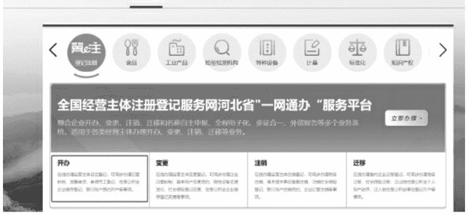

（2）命名规则：公司名称需要符合规范且具有唯一性，通常由以下4部分组成：行政区划（如“河北省”）、字号（如“光辉未来”）、行业表述（如“科技”“商贸”）、组织形式（如“有限公司”）。合在一起就是“河北光辉未来科技有限公司”（见图2-2）。

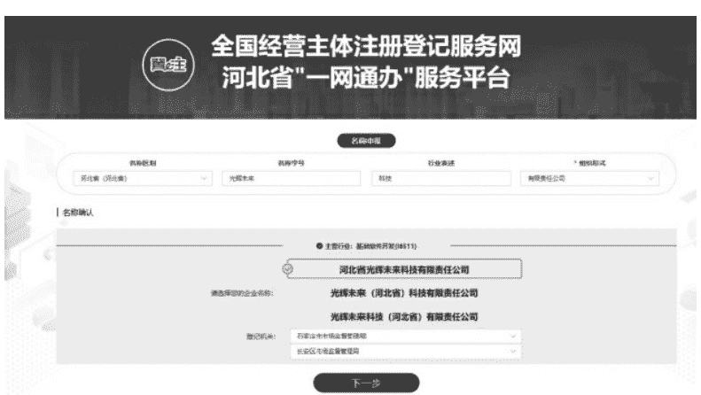

（3）注意事项：名称不能与已有公司重复；不得使用敏感词汇（如“中国”“中华”“国际”等）；建议多准备几个备选名称，避免审核不通过而耽误时间。

名称审核通常需要1～3个工作日。如果名称通过，会收到企业名称预先核准通知书；如果未通过，则需重新提交备选名称。

### 提交工商登记资料

你的公司核名通过后，下一步就是向工商局提交设立公司的相关材料，完成工商登记。所需材料主要包括以下内容：

- 公司章程（可在系统下载模板填写）。
- 股东身份证明（如果是法人股东还需提供营业执照）。
- 法定代表人、监事的身份信息。
- 注册地址证明（产权证或租赁合同）。
- 经营范围（可参考平台推荐内容勾选）。
- 其他可能需要的承诺书或授权书。

材料的提交方式分为线上和线下两种，当前一般都采用线上提交的方式，即登录当地政务服务平台，在“企业开办”模块上传资料。选择线下提交材料的需要携带纸质材料前往工商局窗口办理，有些地区也支持邮寄材料。

材料审核通过后，通常在3～5个工作日内可领取营业执照。部分地区提供邮寄服务，无须亲自到场。

### 刻章备案

拿到营业执照后，下一步是刻制公司印章。这是公司对外签署合同、银行开户、税务登记等事务中必不可少的工具。在刻章时，要选择具备公安部门颁发资质的刻章机构，费用通常在300～800元。

需要刻制的印章类型包括公章（用于签署合同、文件等）、财务章（用于银行对账、开票等）、法人章（用于授权签字等）。在完成刻章后，需要将刻好的印章带到公安机关备案，并领取“印章刻制备案证明”。

## 公司经营范围怎么填最好

经营范围决定了你的公司可以从事哪些业务活动，同时直接影响税务申报、行业监管以及未来业务扩展的可能性。经营范围填得太窄会限制发展，填得太宽又可能增加不必要的成本和风险。那么，公司经营范围到底应该怎么填才能既实用又合规呢？

### 为什么经营范围不能随便填

经营范围是公司经营活动的法律依据，一旦填写不当，后续可能引发一系列棘手问题，从法律合规风险到税务管理困境，再到企业经营发展受阻，都与这一初始环节紧密相关。具体来说，随意填写经营范围会在多个重要方面产生不利影响。

（1）税务核定：税务机关会根据你的经营范围来核定税种和税率。如果你的经营范围包含“销售商品”，就需要缴纳增值税；如果涉及“咨询服务”，则需按服务类目缴纳税款。
（2）行业许可：某些特殊行业（如医疗、教育培训、金融等）需要额外办理资质或许可证。如果经营范围未涵盖相关业务，则无法获得相应的资质或许可证。
（3）市场形象：经营范围会影响用户对公司的认知。过于狭窄的范围可能让潜在合作伙伴觉得公司不够专业，而过于宽泛的范围则可能显得杂乱无章，缺乏专注性。
（4）未来发展空间：如果初期没有规划好经营范围，后期再想调整可能会涉及复杂的变更手续，甚至影响现有业务的正常运转。

因此，在填写经营范围时，必须结合自身需求、行业特点以及未来规划，做到“精准且灵活”。

### 填写经营范围的基本原则

为了确保经营范围既符合实际需求，又便于后续操作，以下基本原则可以帮助你更好地确定经营范围。

（1）真实为主，避免夸大：填写经营范围时，应以目前或短期内计划开展的业务为核心，切勿为了追求“高大上”而乱写一通，更不要为了省事盲目模仿他人。比如一家初创的电商公司，如果不打算做跨境电商，就没有必要列出“进出口贸易”或“金融投资”这样的高门槛项目，因为这些领域通常需要额外资质，且与主营业务无关。
（2）留有余地，适度扩展：在满足当前需求的基础上，可以适当添加一些与核心业务相关联的项目，为未来发展预留空间。比如，主营服装销售的公司，除填写“服装零售”外，还可以加入“服饰设计”“品牌策划”等内容，以便后续拓展业务。
（3）语言规范，表述清晰：经营范围的表述应当简洁明了，要使用标准化的语言。各地工商局通常会提供参考模板，你可以从中选择合适的措辞。
（4）区分主营与辅营：主营业务应放在首位，次要或辅助业务可以作为补充项列出。这样既突出了重点，又不会显得杂乱。比如一家餐饮公司的主营范围是“餐饮服务”，辅营范围可以包括“食品加工”“食材批发”等。

### 填写经营范围的实操技巧

为了让经营范围更加贴合实际需求，同时规避潜在问题，可以参考如下实操建议。

（1）确定核心业务：列出你目前最想开展的业务，并将其作为经营范围的核心部分。如果你主要做短视频代运营，那么“视频制作”“社交媒体营销”就是不可或缺的内容。
（2）参考同行经验：查阅同行业其他公司的经营范围，尤其是那些取得成功的公司的经营范围。这不仅能帮助你学习如何措辞，还能让你发现一些容易被忽略的细节。
（3）分步实施，逐步完善：如果不确定所有未来可能涉及的业务，可以先填写当前比较重要的内容，待业务成熟后再申请变更。
（4）避免使用敏感词汇：某些词汇可能触发额外审核或资质要求，因此，要谨慎使用。比如“金融”“保险”“证券”等关键词通常需要特别审批；“进出口贸易”需要申请相关许可证。
（5）注意地区差异：不同地区的工商局对经营范围的要求可能存在细微差别。比如某些地方允许填写“互联网+”类目，而另一些地方则要求细化到具体服务类型。因此，在提交前务必咨询当地工商局或代办机构，确保内容符合规范。

表2-2 部分行业领域经营范围

| 行业领域 | 经营范围 |
| :--- | :--- |
| 商店超市 | 批发与零售业、票务服务、居民服务、设备租赁、电信业务代理、房屋租赁等 |
| 餐饮业 | 农产品、粮油、畜禽产品、乳制品、水产品，以及上述产品的加工品、食品添加剂、调味品、饮料、酒类的批发；上述商品的进出口、技术服务、咨询服务及其相关的配套业务；农副产品的收购；食用农产品的销售等 |
| 教育培训 | 书法培训、绘画培训、音乐培训、舞蹈培训、教育咨询；教育软件的研发与销售；网络教育软件、教育资源信息技术开发；职业技能培训；文化活动策划、社会实践活动策划、文化艺术策划等 |
| 电商平台 | 商贸（贸易、电子商务）类日用百货；互联网工程施工、调试及维护互联网的运营和推广，包括代理发布广告等、商品或服务的销售、代理销售、推广等；电子商务平台技术服务，如网店开设、设计、运营等；网络信息服务，如信息查询、发布、推广等；电子商务咨询和物流服务等 |

填写公司经营范围看似简单，但也需要一定的技巧。总的来说，就是聚焦核心业务，突出主业，避免偏离方向，同时留足空间，为未来业务拓展做好准备。只有在充分了解自身需求和行业规则的基础上，才能尽快地将公司经营范围全面、专业地填写好。

提供参考模板，你可以从中选择合适的措辞。

（4）区分主营与辅营：主营业务应放在首位，次要或辅助业务可以作为补充项列出。这样既突出了重点，又不会显得杂乱。比如一家餐饮公司的主营范围是“餐饮服务”，辅营范围可以包括“食品加工”“食材批发”等。

### 填写经营范围的实操技巧

为了让经营范围更加贴合实际需求，同时规避潜在问题，可以参考如下实操建议。

- （1）确定核心业务：列出你目前最想开展的业务，并将其作为经营范围的核心部分。如果你主要做短视频代运营，那么“视频制作”“社交媒体营销”就是不可或缺的内容。
- （2）参考同行经验：查阅同行业其他公司的经营范围，尤其是那些取得成功的公司的经营范围。这不仅能帮助你学习如何措辞，还能让你发现一些容易被忽略的细节。
- （3）分步实施，逐步完善：如果不确定所有未来可能涉及的业务，可以先填写当前比较重要的内容，待业务成熟后再申请变更。
- （4）避免使用敏感词汇：某些词汇可能触发额外审核或资质要求，因此，要谨慎使用。比如“金融”“保险”“证券”等关键词通常需要特别审批；“进出口贸易”需要申请相关许可证。
- （5）注意地区差异：不同地区的工商局对经营范围的要求可能存在细微差别。比如某些地方允许填写“互联网+”类目，而另一些地方则要求细化到具体服务类型。因此，在提交前务必咨询当地工商局或代办机构，确保内容符合规范。

表2-2 部分行业领域经营范围

| 行业领域 | 经营范围 |
| :--- | :--- |
| 商店超市 | 批发与零售业、票务服务、居民服务、设备租赁、电信业务代理、房屋租赁等 |
| 餐饮业 | 农产品、粮油、畜禽产品、乳制品、水产品，以及上述产品的加工品、食品添加剂、调味品、饮料、酒类的批发；上述商品的进出口、技术服务、咨询服务及其相关的配套业务；农副产品的收购；食用农产品的销售等 |
| 教育培训 | 书法培训、绘画培训、音乐培训、舞蹈培训、教育咨询；教育软件的研发与销售；网络教育软件、教育资源信息技术开发；职业技能培训；文化活动策划、社会实践活动策划、文化艺术策划等 |
| 电商平台 | 商贸（贸易、电子商务）类日用百货；互联网工程施工、调试及维护互联网的运营和推广，包括代理发布广告等、商品或服务的销售、代理销售、推广等；电子商务平台技术服务，如网店开设、设计、运营等；网络信息服务，如信息查询、发布、推广等；电子商务咨询和物流服务等 |

填写公司经营范围看似简单，但也需要一定的技巧。总的来说，就是聚焦核心业务，突出主业，避免偏离方向，同时留足空间，为未来业务拓展做好准备。只有在充分了解自身需求和行业规则的基础上，才能尽快地将公司经营范围全面、专业地填写好。

## 公司经营范围怎么填最好

经营范围决定了你的公司可以从事哪些业务活动，同时直接影响税务申报、行业监管以及未来业务扩展的可能性。经营范围填得太窄会限制发展，填得太宽又可能增加不必要的成本和风险。那么，公司经营范围到底应该怎么填才能既实用又合规呢？

### 为什么经营范围不能随便填

经营范围是公司经营活动的法律依据，一旦填写不当，后续可能引发一系列棘手问题，从法律合规风险到税务管理困境，再到企业经营发展受阻，都与这一初始环节紧密相关。具体来说，随意填写经营范围会在多个重要方面产生不利影响。

- （1）税务核定：税务机关会根据你的经营范围来核定税种和税率。如果你的经营范围包含“销售商品”，就需要缴纳增值税；如果涉及“咨询服务”，则需按服务类目缴纳税款。
- （2）行业许可：某些特殊行业（如医疗、教育培训、金融等）需要额外办理资质或许可证。如果经营范围未涵盖相关业务，则无法获得相应的资质或许可证。
- （3）市场形象：经营范围会影响用户对公司的认知。过于狭窄的范围可能让潜在合作伙伴觉得公司不够专业，而过于宽泛的范围则可能显得杂乱无章，缺乏专注性。
- （4）未来发展空间：如果初期没有规划好经营范围，后期再想调整可能会涉及复杂的变更手续，甚至影响现有业务的正常运转。

因此，在填写经营范围时，必须结合自身需求、行业特点以及未来规划，做到“精准且灵活”。

### 填写经营范围的基本原则

为了确保经营范围既符合实际需求，又便于后续操作，以下基本原则可以帮助你更好地确定经营范围。

- （1）真实为主，避免夸大：填写经营范围时，应以目前或短期内计划开展的业务为核心，切勿为了追求“高大上”而乱写一通，更不要为了省事盲目模仿他人。比如一家初创的电商公司，如果不打算做跨境电商，就没有必要列出“进出口贸易”或“金融投资”这样的高门槛项目，因为这些领域通常需要额外资质，且与主营业务无关。
- （2）留有余地，适度扩展：在满足当前需求的基础上，可以适当添加一些与核心业务相关联的项目，为未来发展预留空间。比如，主营服装销售的公司，除填写“服装零售”外，还可以加入“服饰设计”“品牌策划”等内容，以便后续拓展业务。
- （3）语言规范，表述清晰：经营范围的表述应当简洁明了，要使用标准化的语言。各地工商局通常会提供参考模板，你可以从中选择合适的措辞。
- （4）区分主营与辅营：主营业务应放在首位，次要或辅助业务可以作为补充项列出。这样既突出了重点，又不会显得杂乱。比如一家餐饮公司的主营范围是“餐饮服务”，辅营范围可以包括“食品加工”“食材批发”等。

### 填写经营范围的实操技巧

为了让经营范围更加贴合实际需求，同时规避潜在问题，可以参考如下实操建议。

- （1）确定核心业务：列出你目前最想开展的业务，并将其作为经营范围的核心部分。如果你主要做短视频代运营，那么“视频制作”“社交媒体营销”就是不可或缺的内容。
- （2）参考同行经验：查阅同行业其他公司的经营范围，尤其是那些取得成功的公司的经营范围。这不仅能帮助你学习如何措辞，还能让你发现一些容易被忽略的细节。
- （3）分步实施，逐步完善：如果不确定所有未来可能涉及的业务，可以先填写当前比较重要的内容，待业务成熟后再申请变更。
- （4）避免使用敏感词汇：某些词汇可能触发额外审核或资质要求，因此，要谨慎使用。比如“金融”“保险”“证券”等关键词通常需要特别审批；“进出口贸易”需要申请相关许可证。
- （5）注意地区差异：不同地区的工商局对经营范围的要求可能存在细微差别。比如某些地方允许填写“互联网+”类目，而另一些地方则要求细化到具体服务类型。因此，在提交前务必咨询当地工商局或代办机构，确保内容符合规范。

表2-2 部分行业领域经营范围

| 行业领域 | 经营范围 |
| :--- | :--- |
| 商店超市 | 批发与零售业、票务服务、居民服务、设备租赁、电信业务代理、房屋租赁等 |
| 餐饮业 | 农产品、粮油、畜禽产品、乳制品、水产品，以及上述产品的加工品、食品添加剂、调味品、饮料、酒类的批发；上述商品的进出口、技术服务、咨询服务及其相关的配套业务；农副产品的收购；食用农产品的销售等 |
| 教育培训 | 书法培训、绘画培训、音乐培训、舞蹈培训、教育咨询；教育软件的研发与销售；网络教育软件、教育资源信息技术开发；职业技能培训；文化活动策划、社会实践活动策划、文化艺术策划等 |
| 电商平台 | 商贸（贸易、电子商务）类日用百货；互联网工程施工、调试及维护互联网的运营和推广，包括代理发布广告等、商品或服务的销售、代理销售、推广等；电子商务平台技术服务，如网店开设、设计、运营等；网络信息服务，如信息查询、发布、推广等；电子商务咨询和物流服务等 |

填写公司经营范围看似简单，但也需要一定的技巧。总的来说，就是聚焦核心业务，突出主业，避免偏离方向，同时留足空间，为未来业务拓展做好准备。只有在充分了解自身需求和行业规则的基础上，才能尽快地将公司经营范围全面、专业地填写好。

## 注册完公司后还要做什么

注册公司只是创业的第一步，接下来的工作同样重要。从开设银行基本账户到办理税务登记，再到开设社保账户和住房公积金账户，这些步骤不仅是公司合法经营的必要条件，也是确保日常运营顺畅的关键环节。

## 开设银行基本账户

银行基本账户是公司最重要的账户之一，用于处理日常经营活动中的所有资金往来，包括收入、支出、工资发放、税款缴纳等。没有这个账户，公司将无法正常运作。

### 1. 开户资料

开设银行基本账户时，需要准备以下材料：

- 营业执照正本及复印件。
- 法人身份证原件及复印件。
- 公司公章、财务章、法人章。
- 税务登记证（部分地区已取消纸质税务登记证，但需提供相关信息）。
- 银行要求的其他文件（如公司章程或股东会决议）。

### 2. 开户流程

- （1）选择银行：不同银行的服务费、管理费以及优惠政策可能会有所不同，建议提前咨询并选择一家性价比高、服务便捷的银行。
- （2）提交申请：携带前述材料前往银行营业网点，填写开户申请表，并配合银行工作人员完成身份核实。
- （3）签订协议：银行会与公司签订开户协议，并开通网银功能，方便日后线上操作。
- （4）领取账户信息：开户完成后，银行会提供对公账户的账号及相关资料。
- （5）注意事项：在开户过程中可能需要法人亲自到场，部分银行还要求全体股东到场签字。不同银行对最低存款额度有要求，未达到标准可能会产生额外费用。开户后，记得及时签订“三方扣款协议”，以便网上缴纳税款。

## 开设社保账户：为员工提供社会保障

开设社保账户是公司履行社会责任的重要体现，也是吸引优秀人才的关键手段。根据《中华人民共和国劳动法》的规定，用人单位必须为员工缴纳社会保险。

开设社保账户的流程如下：

- （1）确定参保地：社保账户通常以公司注册地为准，因此需要到当地社保局办理开户手续。
- （2）提交材料：准备营业执照、法人身份证、经办人身份证、员工花名册等资料。
- （3）填写表格：在社保局领取并填写社会保险登记表，同时核定缴费基数和比例。
- （4）审核通过：社保局审核无误后，为公司分配社保账户编号。

如果公司暂时没有员工，可以先不开设社保账户，一旦招聘员工，则必须立即办理。社保缴费基数每年调整一次，需关注当地政策变化。

## 开设住房公积金账户：提升员工福利水平

住房公积金也是企业为员工提供的法定福利之一。开设住房公积金账户的流程如下：

- （1）到当地住房公积金管理中心领取住房公积金开户申请表。
- （2）准备营业执照、法人身份证、经办人身份证、员工花名册等资料。
- （3）填写申请表并提交至住房公积金管理中心，等待审核。
- （4）审核通过后，公司获得住房公积金账户编号。

住房公积金缴存比例和基数也需定期调整，公司应密切关注相关政策的变化。

## 记账和报税

根据我国税法规定，领取营业执照后30日内需进行税务登记，并按期完成记账和报税工作。

### 1. 税务登记

- （1）到税务机关领取并填写税务登记表，同时核定税种、税率等信息。
- （2）根据经营范围，核定需要缴纳的税种，例如增值税、企业所得税、附加税等。

### 2. 记账与报税

- （1）初创公司可以选择聘请兼职会计，或者购买财务软件自行记账。
- （2）建立总账、明细账、现金日记账和银行存款日记账，记录每一笔收入和支出。
- （3）每月或每季度向税务机关提交纳税申报表，即使当期无收入也需提交“零申报”。

记账和报税必须真实准确，否则可能导致被罚款甚至承担刑事责任。小规模纳税人适用简易计税方法，一般纳税人则通常需开具增值税普通发票。

## 申领发票

无论公司是销售商品，还是提供服务，都需要开具发票作为交易凭证。

### 1. 首次申领发票的流程

- （1）提交相关资料，包括营业执照、法人身份证等。
- （2）税务机关审核通过后，会为公司分配发票种类和数量。

### 2. 非首次领购发票的流程

- （1）带上发票领购簿、税控设备及相关证件，到税务机关申请领购。
- （2）核对剩余发票数量，确保符合领购条件。

发票分为普通发票和增值税专用发票，需根据实际需求选择。开具发票时务必规范填写，避免出现错误或虚假内容。

注册完公司后，从开设银行基本账户到办理税务登记，每一个环节都至关重要（其中部分环节可直接线上办理）。只有严格按照法律法规走完这些基础流程，才能确保公司合法经营、顺利运转。

## 申领发票

无论公司是销售商品，还是提供服务，都需要开具发票作为交易凭证。

1. 首次申领发票的流程
    （1）提交相关资料，包括营业执照、法人身份证等。
    （2）税务机关审核通过后，会为公司分配发票种类和数量。

2. 非首次领购发票的流程
    （1）带上发票领购簿、税控设备及相关证件，到税务机关申请领购。
    （2）核对剩余发票数量，确保符合领购条件。

发票分为普通发票和增值税专用发票，需根据实际需求选择。开具发票时务必规范填写，避免出现错误或虚假内容。

注册完公司后，从开设银行基本账户到办理税务登记，每一个环节都至关重要（其中部分环节可直接线上办理）。只有严格按照法律法规走完这些基础流程，才能确保公司合法经营、顺利运转。

## 注册完公司后还要做什么

注册公司只是创业的第一步，接下来的工作同样重要。从开设银行基本账户到办理税务登记，再到开设社保账户和住房公积金账户，这些步骤不仅是公司合法经营的必要条件，也是确保日常运营顺畅的关键环节。

## 开设银行基本账户

银行基本账户是公司最重要的账户之一，用于处理日常经营活动中的所有资金往来，包括收入、支出、工资发放、税款缴纳等。没有这个账户，公司将无法正常运作。

1. 开户资料
    开设银行基本账户时，需要准备以下材料：
    - 营业执照正本及复印件。
    - 法人身份证原件及复印件。
    - 公司公章、财务章、法人章。
    - 税务登记证（部分地区已取消纸质税务登记证，但需提供相关信息）。
    - 银行要求的其他文件（如公司章程或股东会决议）。

2. 开户流程
    （1）选择银行：不同银行的服务费、管理费以及优惠政策可能会有所不同，建议提前咨询并选择一家性价比高、服务便捷的银行。
    （2）提交申请：携带前述材料前往银行营业网点，填写开户申请表，并配合银行工作人员完成身份核实。
    （3）签订协议：银行会与公司签订开户协议，并开通网银功能，方便日后线上操作。
    （4）领取账户信息：开户完成后，银行会提供对公账户的账号及相关资料。
    （5）注意事项：在开户过程中可能需要法人亲自到场，部分银行还要求全体股东到场签字。不同银行对最低存款额度有要求，未达到标准可能会产生额外费用。开户后，记得及时签订“三方扣款协议”，以便网上缴纳税款。

## 开设社保账户：为员工提供社会保障

开设社保账户是公司履行社会责任的重要体现，也是吸引优秀人才的关键手段。根据《中华人民共和国劳动法》的规定，用人单位必须为员工缴纳社会保险。

开设社保账户的流程如下：
1. 确定参保地：社保账户通常以公司注册地为准，因此需要到当地社保局办理开户手续。
2. 提交材料：准备营业执照、法人身份证、经办人身份证、员工花名册等资料。
3. 填写表格：在社保局领取并填写社会保险登记表，同时核定缴费基数和比例。
4. 审核通过：社保局审核无误后，为公司分配社保账户编号。

如果公司暂时没有员工，可以先不开设社保账户，一旦招聘员工，则必须立即办理。社保缴费基数每年调整一次，需关注当地政策变化。

## 开设住房公积金账户：提升员工福利水平

住房公积金也是企业为员工提供的法定福利之一。开设住房公积金账户的流程如下：
1. 到当地住房公积金管理中心领取住房公积金开户申请表。
2. 准备营业执照、法人身份证、经办人身份证、员工花名册等资料。
3. 填写申请表并提交至住房公积金管理中心，等待审核。
4. 审核通过后，公司获得住房公积金账户编号。

住房公积金缴存比例和基数也需定期调整，公司应密切关注相关政策的变化。

## 记账和报税

根据我国税法规定，领取营业执照后30日内需进行税务登记，并按期完成记账和报税工作。

1. 税务登记
    （1）到税务机关领取并填写税务登记表，同时核定税种、税率等信息。
    （2）根据经营范围，核定需要缴纳的税种，例如增值税、企业所得税、附加税等。

2. 记账与报税
    （1）初创公司可以选择聘请兼职会计，或者购买财务软件自行记账。
    （2）建立总账、明细账、现金日记账和银行存款日记账，记录每一笔收入和支出。
    （3）每月或每季度向税务机关提交纳税申报表，即使当期无收入也需提交“零申报”。

记账和报税必须真实准确，否则可能导致被罚款甚至承担刑事责任。小规模纳税人适用简易计税方法，一般纳税人则通常需开具增值税普通发票。

## 公司不想经营了，该怎么办

当公司经营不善或个人发展计划发生变化时，你可能需要关闭公司。不过关闭公司并不是一件简单的事情，其涉及法律、税务和财务清算等复杂环节。

### 注销公司的流程

注销公司是关闭企业最常见的方式，适用于那些不再有经营需求且无债务纠纷的企业。以下是注销一人有限责任公司的完整流程及注意事项。

1. 成立清算组并进行清算：注销公司前，必须对公司的资产、负债进行全面清算，确保债权债务得到妥善处理。一人有限责任公司可以由法人自行担任清算组负责人，负责资产盘点、债务清偿等工作。
2. 编制清算报告：清算结束后，需编制清算报告，详细列明公司资产、负债、剩余财产分配等情况。
3. 登报公告：清算完成后，通常需在指定的报纸上刊登注销公告，通知债权人申报债权。公告期一般为45天，在此期间债权人可提出异议或要求清偿。
4. 税务注销：税务注销是注销公司的重要环节，需到税务机关办理结清税款和注销税务登记证。结清税款，即核对公司是否有未缴税款，包括增值税、企业所得税等。注销税务登记证即提交相关材料（如清算报告、营业执照复印件等），完成税务注销手续。
5. 交回发票和税控设备：将剩余发票、税控盘等交还税务机关。
6. 工商注销：税务注销完成后，需到工商局办理工商注销手续，即提交注销申请表、清算报告、税务注销证明、登报公告等材料。工商局审核通过后，收回营业执照正副本，予以注销登记。
7. 银行账户注销：公司注销后，需关闭对公账户，即携带注销证明、公章、法人身份证等材料前往开户行办理销户手续。确保账户余额清零，否则无法完成销户。
8. 社保和住房公积金账户注销：如果公司曾开设社保和住房公积金账户，还需到相关部门办理注销手续，即到社保局提交注销申请表及相关材料，终止社保账户，到住房公积金管理中心提交注销申请表，关闭公积金账户。
9. 公章销毁：注销完成后，需将公司公章、财务章等交公安机关备案并销毁。
10. 归档资料：整理并保存所有注销过程中的文件，以备后续查阅。

### 申请破产

如果公司因经营不善导致资不抵债，且无法通过清算偿还债务，则可以申请破产。破产是一种法律程序，旨在公平分配剩余资产给债权人，同时免除债务人的部分责任。

企业申请破产，须满足《中华人民共和国企业破产法》第二条的规定：

> 第二条 企业法人不能清偿到期债务，并且资产不足以清偿全部债务或者明显缺乏清偿能力的，依照本法规定清理债务。

企业法人有前款规定情形，或者有明显丧失清偿能力可能的，可以依照本法规定进行重整。

破产申请分为两种情况，即债权人申请破产和债务人（公司）主动申请破产。债务人申请破产的主要流程如下：

1. 准备材料：提交破产申请书、资产负债表、财务状况说明书、债权债务清单等。
2. 法院受理：债务人向公司所在地法院提交破产申请，法院审查后决定是否受理。
3. 指定管理人：法院受理后，会指定一名管理人，负责资产清算、债务清偿等工作。
4. 债权人会议：召开债权人会议，讨论资产分配方案。
5. 裁定破产：法院根据清算结果裁定破产终结，公司正式退出市场。

注销和破产虽然都是关闭公司的途径，但适用场景和操作难度截然不同。以下是对两者的对比分析（见表2-3）。

### 表2-3 公司注销和破产的比较

| 比较项 | 注销公司 | 申请破产 |
| :--- | :--- | :--- |
| 适用情况 | 公司无债务或债务已清偿完毕 | 公司资不抵债，无法偿还债务 |
| 操作难度 | 流程繁琐，需依次完成税务注销、工商注销等多个环节 | 需要法院介入，涉及多方利益协调 |
| 时间周期 | 通常需要2～6个月 | 可能长达1年以上 |
| 成本费用 | 较低，主要是公告费、代办费等 | 较高，包括律师费、管理人报酬等 |
| 后续影响 | 影响较小，法人可重新注册新公司 | 对法人信用影响较大，短期内难以再次创业 |

如果你的公司没有严重的债务问题，建议优先选择注销；如果公司已经陷入严重的财务危机，则应考虑申请破产。不过，无论是注销，还是申请破产，都必须对公司的资产和债务进行全面清算。如果遗漏重要事项，可能引发法律纠纷。

## 公司不想经营了，该怎么办

当公司经营不善或个人发展计划发生变化时，你可能需要关闭公司。不过关闭公司并不是一件简单的事情，其涉及法律、税务和财务清算等复杂环节。

### 注销公司的流程

注销公司是关闭企业最常见的方式，适用于那些不再有经营需求且无债务纠纷的企业。以下是注销一人有限责任公司的完整流程及注意事项。

1. 成立清算组并进行清算：注销公司前，必须对公司的资产、负债进行全面清算，确保债权债务得到妥善处理。一人有限责任公司可以由法人自行担任清算组负责人，负责资产盘点、债务清偿等工作。
2. 编制清算报告：清算结束后，需编制清算报告，详细列明公司资产、负债、剩余财产分配等情况。
3. 登报公告：清算完成后，通常需在指定的报纸上刊登注销公告，通知债权人申报债权。公告期一般为45天，在此期间债权人可提出异议或要求清偿。
4. 税务注销：税务注销是注销公司的重要环节，需到税务机关办理结清税款和注销税务登记证。结清税款，即核对公司是否有未缴税款，包括增值税、企业所得税等。注销税务登记证即提交相关材料（如清算报告、营业执照复印件等），完成税务注销手续。
5. 交回发票和税控设备：将剩余发票、税控盘等交还税务机关。
6. 工商注销：税务注销完成后，需到工商局办理工商注销手续，即提交注销申请表、清算报告、税务注销证明、登报公告等材料。工商局审核通过后，收回营业执照正副本，予以注销登记。
7. 银行账户注销：公司注销后，需关闭对公账户，即携带注销证明、公章、法人身份证等材料前往开户行办理销户手续。确保账户余额清零，否则无法完成销户。
8. 社保和住房公积金账户注销：如果公司曾开设社保和住房公积金账户，还需到相关部门办理注销手续，即到社保局提交注销申请表及相关材料，终止社保账户，到住房公积金管理中心提交注销申请表，关闭公积金账户。
9. 公章销毁：注销完成后，需将公司公章、财务章等交公安机关备案并销毁。
10. 归档资料：整理并保存所有注销过程中的文件，以备后续查阅。

### 申请破产

如果公司因经营不善导致资不抵债，且无法通过清算偿还债务，则可以申请破产。破产是一种法律程序，旨在公平分配剩余资产给债权人，同时免除债务人的部分责任。

企业申请破产，须满足《中华人民共和国企业破产法》第二条的规定：

> 第二条 企业法人不能清偿到期债务，并且资产不足以清偿全部债务或者明显缺乏清偿能力的，依照本法规定清理债务。

企业法人有前款规定情形，或者有明显丧失清偿能力可能的，可以依照本法规定进行重整。

破产申请分为两种情况，即债权人申请破产和债务人（公司）主动申请破产。债务人申请破产的主要流程如下：

1. 准备材料：提交破产申请书、资产负债表、财务状况说明书、债权债务清单等。
2. 法院受理：债务人向公司所在地法院提交破产申请，法院审查后决定是否受理。
3. 指定管理人：法院受理后，会指定一名管理人，负责资产清算、债务清偿等工作。
4. 债权人会议：召开债权人会议，讨论资产分配方案。
5. 裁定破产：法院根据清算结果裁定破产终结，公司正式退出市场。

注销和破产虽然都是关闭公司的途径，但适用场景和操作难度截然不同。以下是对两者的对比分析（见表2-3）。

### 表2-3 公司注销和破产的比较

| 比较项 | 注销公司 | 申请破产 |
| :--- | :--- | :--- |
| 适用情况 | 公司无债务或债务已清偿完毕 | 公司资不抵债，无法偿还债务 |
| 操作难度 | 流程繁琐，需依次完成税务注销、工商注销等多个环节 | 需要法院介入，涉及多方利益协调 |
| 时间周期 | 通常需要2～6个月 | 可能长达1年以上 |
| 成本费用 | 较低，主要是公告费、代办费等 | 较高，包括律师费、管理人报酬等 |
| 后续影响 | 影响较小，法人可重新注册新公司 | 对法人信用影响较大，短期内难以再次创业 |

如果你的公司没有严重的债务问题，建议优先选择注销；如果公司已经陷入严重的财务危机，则应考虑申请破产。不过，无论是注销，还是申请破产，都必须对公司的资产和债务进行全面清算。如果遗漏重要事项，可能引发法律纠纷。

# 第3章 一人公司管理，合规经营才能长期存活

## 税务必懂：核定征收vs查账征收

对个体创业者来说，搞清楚核定征收和查账征收之间的区别，不仅关系到每个月的缴税情况，更直接影响到公司的经营策略和利润空间。

## 核定征收

核定征收，就是由税务机关根据企业的行业类型、规模、经营情况等信息，直接核定一个应纳税所得额或应税税率，企业按照这个标准缴税即可。这种方式简单、易操作，适合收入不稳定、账目不健全的小型企业和个体户，比如早餐店、小电商、个人工作室等。

在实际操作中，核定征收又分为两种具体形式：定额征收和定率征收。这两种方式虽然都属于核定征收，但在计算税款的方式和适用场景上都有所不同。

1. 定额征收：每月固定交税，简单明了

定额征收是指税务机关根据你的行业、经营地点、从业人数等因素，直接给你核定一个固定的月度应纳税金额，不管当月有没有收入，都要按这个数额缴税。这种方式非常简单，适合那些业务波动大、收入不稳定的小型个体户或初创公司。

比如，你开了一家设计工作室，税务机关核定你每个月应缴纳增值税和附加税费共计500元，那么无论你这个月有没有接到项目，都要按时缴纳这500元。

这种征收方式税负明确，便于预算管理，且对票据要求低，很适合轻资产运营者。不过，缺点也很明显，那就是即使没有收入也要缴税，对刚起步的人来说可能负担较重。

2. 定率征收：按比例计税，灵活但需估算

定率征收则是指税务机关先核定你所在行业的利润率（比如10%），然后再按照这个利润率来计算应纳税所得额，最终确定你要缴纳的所得税。

这种模式比“定额”更灵活一些，因为它会参考你的实际营业额来核定利润，而不是直接缴纳固定金额。假设核定利润率为10%，再结合适用税率（如20%），那么最终应纳税额就是“开票金额×10%×20%”。

比如，你开了一家心理咨询公司，税务机关核定你适用10%的利润率，你一个月开了10万元的发票，就按10万元×10%=1万元作为应纳税所得额，再按照适用税率（小微企业税率为5%）来计算公司需要缴纳的税款，为“1万元×5%=500元”。

选择哪种核定方式，主要取决于你的业务实际情况和财务管理能力。如果你只是想先注册一家小公司试水，选“定额”更省心；如果已经有较为稳定的收入来源，选“定率”会更合理。建议你在注册公司前，提前咨询当地税务机关或通过政务平台了解具体的核定方式及标准，避免因不了解政策而多缴税或影响经营。

那么，如何申请核定征收呢？

当前，大多数地区都支持线上办理核定征收申请。你可以登录所在地的电子税务局官网，找到“税种认定”或“征收方式申请”相关选项（不同地区网站上选项不同，也可能叫“核定征收申请”或“征收方式备案”），然后认真填写企业所得税征收方式鉴定表或其他地方要求的表格。填完信息后，有些地区还需要上传附件，如营业执照、法人身份证明等。在确认信息无误后提交申请，通常会在3～5个工作日内收到审核结果。部分地区可能会要求你前往办税服务厅进行现场确认或补充材料。

审核通过后，你可以在电子税务局官网查看核定征收的具体方式和税率。如果是定额征收，还会显示每月应缴税额；如果是定率征收，则会明确利润率和适用税率。

## 查账征收

查账征收，则是根据企业真实的财务报表来计算应纳税额。也就是说，你需要有一套完整的账本，记录每一笔收入和支出，然后由税务机关根据这些数据来确认你的应纳税所得额。这种方式更贴近企业的真实经营状况，适用于有一定业务量、财务管理规范的企业。

1. 查账征收从建账到报税的全流程

建账必备：3本账册+1套软件。

3本基础账册，即总账（记录所有科目汇总）、明细账（按科目详细记录，如“管理费用—办公费”）、银行存款日记账（逐笔记录收支）。1套软件，即财务软件，如“Excel”等。

2. 查账征收计税公式

应纳税额=（年收入-成本-费用-免税收入）×税率-减免税额

比如，某科技公司年收入200万元，成本120万元（含人员工资、采购材料费），费用30万元（办公、差旅等），无减免税额。则应纳税额=

200万元-120万元-30万元=50万元；企业所得税=50万元×5%（小微企业优惠税率）=2.5万元。

3. 查账征收报税全流程

每月必做：登录电子税务局官网，申报增值税（小规模纳税人按季申报，一般纳税人按月申报）；使用财务软件生成利润表、资产负债表，上传至税务系统。

季度必做：申报企业所得税预缴，按实际利润×税率预缴，年度再汇算清缴。

年度必做：5月31日前完成企业所得税汇算清缴（多退少补）；6月30日前完成工商年报公示。

核定征收与查账征收的选择

核定征收与查账征收的区别见表3-1。

### 表3-1 核定征收与查账征收的区别

| 项目 | 核定征收 | 查账征收 |
| :--- | :--- | :--- |
| 适用对象 | 个体户、小规模纳税人、财务不健全企业 | 一人有限公司、一般纳税人、财务规范企业 |
| 计税公式 | 开票金额×核定利润率×税率 | （收入－成本－费用）×税率 |
| 账务要求 | 无需详细账本，可简易记账 | 必须有完整账册、发票及凭证 |
| 税务风险 | 低（税务机关核定后按标准缴纳） | 高（账目不规范易被稽查） |
| 税负水平 | 通常较低（核定利润率可能低于实际利润率） | 浮动（利润高则税负高，利润低可少缴） |

那么，一人公司是选择核定征收，还是查账征收呢？

1. 看业务规模
   - 年收入500万元以下、无专职会计：优先选择核定征收（省事、税负低）。
   - 年收入500万元以上、需开专票：必须选择查账征收（一般纳税人资格要求）。

2. 看成本发票
   - 成本发票齐全（如采购有增值税发票）：查账征收更划算（成本可抵扣利润）。
   - 成本无发票（如个人兼职合作）：核定征收更省心（没有发票也不影响计税）。

3. 看未来规划
   - 计划融资或上市：必须查账征收（规范财务是融资的前提）。
   - 仅做小本生意：核定征收更适合（没有复杂的财务流程）。

4. 看行业特性
   - 服务业（如咨询、设计）：核定征收更常见（成本多为人工，无发票）。
   - 商贸业（如零售批发）：查账征收更普遍（需进销项发票匹配）。

5. 看政策风险
   - 核定征收属于“政策红利”，部分地区可能收紧，选择前需了解当地税务机关的最新政策。
   - 查账征收是主流方式，政策稳定性高，但对账务要求严格。

税务不是小事，但也不必谈税色变。核定征收和查账征收没有绝对的好坏之分，关键在于是否匹配你的业务阶段和发展目标。选对了方式，不仅能帮你节省成本，还能让公司在合规的基础上走得更远。

那么，如何申请核定征收呢？

当前，大多数地区都支持线上办理核定征收申请。你可以登录所在地的电子税务局官网，找到“税种认定”或“征收方式申请”相关选项（不同地区网站上选项不同，也可能叫“核定征收申请”或“征收方式备案”），然后认真填写企业所得税征收方式鉴定表或其他地方要求的表格。填完信息后，有些地区还需要上传附件，如营业执照、法人身份证明等。在确认信息无误后提交申请，通常会在3～5个工作日内收到审核结果。部分地区可能会要求你前往办税服务厅进行现场确认或补充材料。

审核通过后，你可以在电子税务局官网查看核定征收的具体方式和税率。如果是定额征收，还会显示每月应缴税额；如果是定率征收，则会明确利润率和适用税率。

## 查账征收

查账征收，则是根据企业真实的财务报表来计算应纳税额。也就是说，你需要有一套完整的账本，记录每一笔收入和支出，然后由税务机关根据这些数据来确认你的应纳税所得额。这种方式更贴近企业的真实经营状况，适用于有一定业务量、财务管理规范的企业。

### 1. 查账征收从建账到报税的全流程
建账必备：3本账册+1套软件。
3本基础账册，即总账（记录所有科目汇总）、明细账（按科目详细记录，如“管理费用—办公费”）、银行存款日记账（逐笔记录收支）。1套软件，即财务软件，如“Excel”等。

### 2. 查账征收计税公式
应纳税额=（年收入-成本-费用-免税收入）×税率-减免税额
比如，某科技公司年收入200万元，成本120万元（含人员工资、采购材料费），费用30万元（办公、差旅等），无减免税额。则应纳税额=200万元-120万元-30万元=50万元；企业所得税=50万元×5%（小微企业优惠税率）=2.5万元。

### 3. 查账征收报税全流程
每月必做：登录电子税务局官网，申报增值税（小规模纳税人按季申报，一般纳税人按月申报）；使用财务软件生成利润表、资产负债表，上传至税务系统。
季度必做：申报企业所得税预缴，按实际利润×税率预缴，年度再汇算清缴。
年度必做：5月31日前完成企业所得税汇算清缴（多退少补）；6月30日前完成工商年报公示。

## 核定征收与查账征收的选择

核定征收与查账征收的区别见表3-1。

### 表3-1 核定征收与查账征收的区别

| 项目 | 核定征收 | 查账征收 |
| :--- | :--- | :--- |
| 适用对象 | 个体户、小规模纳税人、财务不健全企业 | 一人有限公司、一般纳税人、财务规范企业 |
| 计税公式 | 开票金额×核定利润率×税率 | （收入－成本－费用）×税率 |
| 账务要求 | 无需详细账本，可简易记账 | 必须有完整账册、发票及凭证 |
| 税务风险 | 低（税务机关核定后按标准缴纳） | 高（账目不规范易被稽查） |
| 税负水平 | 通常较低（核定利润率可能低于实际利润率） | 浮动（利润高则税负高，利润低可少缴） |

那么，一人公司是选择核定征收，还是查账征收呢？

### 1. 看业务规模
- 年收入500万元以下、无专职会计：优先选择核定征收（省事、税负低）。
- 年收入500万元以上、需开专票：必须选择查账征收（一般纳税人资格要求）。

### 2. 看成本发票
- 成本发票齐全（如采购有增值税发票）：查账征收更划算（成本可抵扣利润）。
- 成本无发票（如个人兼职合作）：核定征收更省心（没有发票也不影响计税）。

### 3. 看未来规划
- 计划融资或上市：必须查账征收（规范财务是融资的前提）。
- 仅做小本生意：核定征收更适合（没有复杂的财务流程）。

### 4. 看行业特性
- 服务业（如咨询、设计）：核定征收更常见（成本多为人工，无发票）。
- 商贸业（如零售批发）：查账征收更普遍（需进销项发票匹配）。

### 5. 看政策风险
- 核定征收属于“政策红利”，部分地区可能收紧，选择前需了解当地税务机关的最新政策。
- 查账征收是主流方式，政策稳定性高，但对账务要求严格。

税务不是小事，但也不必谈税色变。核定征收和查账征收没有绝对的好坏之分，关键在于是否匹配你的业务阶段和发展目标。选对了方式，不仅能帮你节省成本，还能让公司在合规的基础上走得更远。

## 税务必懂：核定征收vs查账征收

对个体创业者来说，搞清楚核定征收和查账征收之间的区别，不仅关系到每个月的缴税情况，更直接影响到公司的经营策略和利润空间。

## 核定征收

核定征收，就是由税务机关根据企业的行业类型、规模、经营情况等信息，直接核定一个应纳税所得额或应税税率，企业按照这个标准缴税即可。这种方式简单、易操作，适合收入不稳定、账目不健全的小型企业和个体户，比如早餐店、小电商、个人工作室等。

在实际操作中，核定征收又分为两种具体形式：定额征收和定率征收。这两种方式虽然都属于核定征收，但在计算税款的方式和适用场景上都有所不同。

### 1. 定额征收：每月固定交税，简单明了
定额征收是指税务机关根据你的行业、经营地点、从业人数等因素，直接给你核定一个固定的月度应纳税金额，不管当月有没有收入，都要按这个数额缴税。这种方式非常简单，适合那些业务波动大、收入不稳定的小型个体户或初创公司。

比如，你开了一家设计工作室，税务机关核定你每个月应缴纳增值税和附加税费共计500元，那么无论你这个月有没有接到项目，都要按时缴纳这500元。

这种征收方式税负明确，便于预算管理，且对票据要求低，很适合轻资产运营者。不过，缺点也很明显，那就是即使没有收入也要缴税，对刚起步的人来说可能负担较重。

### 2. 定率征收：按比例计税，灵活但需估算
定率征收则是指税务机关先核定你所在行业的利润率（比如10%），然后再按照这个利润率来计算应纳税所得额，最终确定你要缴纳的所得税。

这种模式比“定额”更灵活一些，因为它会参考你的实际营业额来核定利润，而不是直接缴纳固定金额。假设核定利润率为10%，再结合适用税率（如20%），那么最终应纳税额就是“开票金额×10%×20%”。

比如，你开了一家心理咨询公司，税务机关核定你适用10%的利润率，你一个月开了10万元的发票，就按10万元×10%=1万元作为应纳税所得额，再按照适用税率（小微企业税率为5%）来计算公司需要缴纳的税款，为“1万元×5%=500元”。

选择哪种核定方式，主要取决于你的业务实际情况和财务管理能力。如果你只是想先注册一家小公司试水，选“定额”更省心；如果已经有较为稳定的收入来源，选“定率”会更合理。建议你在注册公司前，提前咨询当地税务机关或通过政务平台了解具体的核定方式及标准，避免因不了解政策而多缴税或影响经营。

那么，如何申请核定征收呢？

当前，大多数地区都支持线上办理核定征收申请。你可以登录所在地的电子税务局官网，找到“税种认定”或“征收方式申请”相关选项（不同地区网站上选项不同，也可能叫“核定征收申请”或“征收方式备案”），然后认真填写企业所得税征收方式鉴定表或其他地方要求的表格。填完信息后，有些地区还需要上传附件，如营业执照、法人身份证明等。在确认信息无误后提交申请，通常会在3～5个工作日内收到审核结果。部分地区可能会要求你前往办税服务厅进行现场确认或补充材料。

审核通过后，你可以在电子税务局官网查看核定征收的具体方式和税率。如果是定额征收，还会显示每月应缴税额；如果是定率征收，则会明确利润率和适用税率。

## 查账征收

查账征收，则是根据企业真实的财务报表来计算应纳税额。也就是说，你需要有一套完整的账本，记录每一笔收入和支出，然后由税务机关根据这些数据来确认你的应纳税所得额。这种方式更贴近企业的真实经营状况，适用于有一定业务量、财务管理规范的企业。

### 1. 查账征收从建账到报税的全流程
建账必备：3本账册+1套软件。
3本基础账册，即总账（记录所有科目汇总）、明细账（按科目详细记录，如“管理费用—办公费”）、银行存款日记账（逐笔记录收支）。1套软件，即财务软件，如“Excel”等。

### 2. 查账征收计税公式
应纳税额=（年收入-成本-费用-免税收入）×税率-减免税额
比如，某科技公司年收入200万元，成本120万元（含人员工资、采购材料费），费用30万元（办公、差旅等），无减免税额。则应纳税额=200万元-120万元-30万元=50万元；企业所得税=50万元×5%（小微企业优惠税率）=2.5万元。

### 3. 查账征收报税全流程
每月必做：登录电子税务局官网，申报增值税（小规模纳税人按季申报，一般纳税人按月申报）；使用财务软件生成利润表、资产负债表，上传至税务系统。
季度必做：申报企业所得税预缴，按实际利润×税率预缴，年度再汇算清缴。
年度必做：5月31日前完成企业所得税汇算清缴（多退少补）；6月30日前完成工商年报公示。

## 核定征收与查账征收的选择
核定征收与查账征收的区别见表3-1。

### 表3-1 核定征收与查账征收的区别

| 项目 | 核定征收 | 查账征收 |
| :--- | :--- | :--- |
| 适用对象 | 个体户、小规模纳税人、财务不健全企业 | 一人有限公司、一般纳税人、财务规范企业 |
| 计税公式 | 开票金额×核定利润率×税率 | （收入－成本－费用）×税率 |
| 账务要求 | 无需详细账本，可简易记账 | 必须有完整账册、发票及凭证 |
| 税务风险 | 低（税务机关核定后按标准缴纳） | 高（账目不规范易被稽查） |
| 税负水平 | 通常较低（核定利润率可能低于实际利润率） | 浮动（利润高则税负高，利润低可少缴） |

那么，一人公司是选择核定征收，还是查账征收呢？

### 1. 看业务规模
- 年收入500万元以下、无专职会计：优先选择核定征收（省事、税负低）。
- 年收入500万元以上、需开专票：必须选择查账征收（一般纳税人资格要求）。

### 2. 看成本发票
- 成本发票齐全（如采购有增值税发票）：查账征收更划算（成本可抵扣利润）。
- 成本无发票（如个人兼职合作）：核定征收更省心（没有发票也不影响计税）。

### 3. 看未来规划
- 计划融资或上市：必须查账征收（规范财务是融资的前提）。
- 仅做小本生意：核定征收更适合（没有复杂的财务流程）。

### 4. 看行业特性
- 服务业（如咨询、设计）：核定征收更常见（成本多为人工，无发票）。
- 商贸业（如零售批发）：查账征收更普遍（需进销项发票匹配）。

### 5. 看政策风险
- 核定征收属于“政策红利”，部分地区可能收紧，选择前需了解当地税务机关的最新政策。
- 查账征收是主流方式，政策稳定性高，但对账务要求严格。

税务不是小事，但也不必谈税色变。核定征收和查账征收没有绝对的好坏之分，关键在于是否匹配你的业务阶段和发展目标。选对了方式，不仅能帮你节省成本，还能让公司在合规的基础上走得更远。

## 财务红线：个人账户与公司账户分离的技巧

在一人公司运营中，最容易被忽视，却又最危险的问题之一，就是个人账户与公司账户混用。很多人觉得：“反正公司是我一个人的，钱放哪儿不是一样？”正是这种想法导致公司财务混乱、面临税务风险甚至法律责任扩大。

为什么这么说？因为从法律上讲，公司是一个独立的“人”。哪怕你是一人股东，只要公司注册完成，它就拥有了自己的“人格”和“财产”。如果你把公司账户当成自己的钱包随意使用，不仅会面临税务稽查风险，还会让你原本只需承担“有限责任”的资产，变成“无限责任”。

## 账户混用的风险有多大

很多人为了方便，随手用个人账户收取客户的钱，或者直接用自己的银行卡给供应商付款。这些操作看似无害，实则会带来以下严重后果。

- （1）法律风险：一人有限责任公司的核心优势是“有限责任”，但若股东无法证明公司财产独立于个人财产，则应当对公司债务承担连带责任。
- （2）税务风险：个人账户频繁接收公司款项，可能被税务机关认定为“隐瞒收入”；若公司账户无对应收入记录，可能按“偷税”处罚（罚款为税款的0.5倍至5倍）；若个人账户代公司支付成本，可能被认定为“虚列成本”。
- （3）融资风险：投资人或银行在尽职调查时，若发现个人账户和公司账户混用会直接否决融资申请。

所以，在公司经营过程中，一定要避免以下常见的财务风险行为（见表3-2）。

### 表3-2 常见的财务风险行为

| 风险行为 | 风险说明 | 替代方案 |
| :--- | :--- | :--- |
| 用个人微信/支付宝收货款 | 无法体现为公司收入，税务不认可 | 开通企业微信支付/支付宝企业账户 |
| 公司账户资金直接转入个人卡 | 可能被认定“股东抽逃出资” | 通过“工资”“分红”合规转账（需缴纳个税） |
| 个人卡代公司支付房租、工资 | 成本无法税前扣除（多缴企业所得税） | 公司账户直接支付，索要增值税发票 |
| 没有工资发放记录 | 被质疑公司真实经营性 | 合理发放工资并申报个税 |

## 报销与分红的合规路径

很多人以为只要开了对公账户、不随便转账就万事大吉了。其实还有一个关键问题容易被忽视：老板怎么从公司账户里拿钱出来用？答案是：通过合法途径，比如工资发放、费用报销、股东分红等方式。这些方式不仅能让老板名正言顺地从公司账户取钱，还能避免税务风险和法律风险。

### 1. 工资发放：最基础也最常用的方式

作为公司的法定代表人或员工，你可以给自己发工资，这是最直接、最容易被税务部门认可的资金提取方式。

操作方式：
- 设定合理的月薪标准（可参考行业水平）。
- 每月从公司账户支付到个人账户。
- 正常申报个税，缴纳社保（如有）。
- 留存工资表、银行转账记录等凭证。

注意事项：
- 工资应与公司经营能力匹配，过高或过低都可能引起关注。
- 不建议长期零工资或大幅波动，这样会影响财务可信度。

### 2. 费用报销：合理转移支出的通道

如果你为公司垫付了一些日常开支，比如办公用品、交通费、招待费等，可以通过“费用报销”的方式把钱拿回来。

操作方式：
- 垫付时保留好发票或收据。
- 提交报销申请，注明用途。
- 公司审核后，从对公账户打款至个人账户。

常见可报销项目：
- 办公场地租金（如使用家庭办公）。
- 手机话费、网络费（用于工作沟通）。
- 差旅费、交通费、会议餐费等。
- 学习培训费、书籍资料费等。

注意事项：
- 报销需有真实业务背景，不能虚构。
- 发票类型要合规，避免白条入账。
- 报销金额不宜过高，否则会被质疑其合理性。

### 3. 股东分红：适合盈利后的利润分配

当你的公司开始盈利，并打算将一部分利润分配给股东（也就是你自己），就可以通过“分红”的方式进行。

分红的基本流程：
- 公司盈利并完成年度汇算清缴。
- 召开股东会（虽然是你自己，但也建议留下会议记录）。
- 明确分红金额并签署分红决议。
- 从公司账户转账至个人账户。
- 申报并缴纳个人股息红利所得税。

注意事项：
- 必须在公司完成纳税后的净利润基础上进行分红。
- 分红前需做好财务核算，确保有足够盈余。
- 分红行为必须依法报税，不能逃避税款。

虽然分红需要交税，但相比工资薪金最高45%的税率，分红的税负更低，适合在公司利润较高的阶段使用。

作为一人公司的老板，从公司拿钱不是不可以，但要通过合法途径。只有做到“名正言顺、证据确凿、流程完整”，你才能在享受创业成果的同时，避免踩中财务和税务的“雷区”。

## 财务红线：个人账户与公司账户分离的技巧

在一人公司运营中，最容易被忽视，却又最危险的问题之一，就是个人账户与公司账户混用。很多人觉得：“反正公司是我一个人的，钱放哪儿不是一样？”正是这种想法导致公司财务混乱、面临税务风险甚至法律责任扩大。

为什么这么说？因为从法律上讲，公司是一个独立的“人”。哪怕你是一人股东，只要公司注册完成，它就拥有了自己的“人格”和“财产”。如果你把公司账户当成自己的钱包随意使用，不仅会面临税务稽查风险，还会让你原本只需承担“有限责任”的资产，变成“无限责任”。

## 账户混用的风险有多大

很多人为了方便，随手用个人账户收取客户的钱，或者直接用自己的银行卡给供应商付款。这些操作看似无害，实则会带来以下严重后果。

- （1）法律风险：一人有限责任公司的核心优势是“有限责任”，但若股东无法证明公司财产独立于个人财产，则应当对公司债务承担连带责任。
- （2）税务风险：个人账户频繁接收公司款项，可能被税务机关认定为“隐瞒收入”；若公司账户无对应收入记录，可能按“偷税”处罚（罚款为税款的0.5倍至5倍）；若个人账户代公司支付成本，可能被认定为“虚列成本”。
- （3）融资风险：投资人或银行在尽职调查时，若发现个人账户和公司账户混用会直接否决融资申请。

所以，在公司经营过程中，一定要避免以下常见的财务风险行为（见表3-2）。

### 表3-2 常见的财务风险行为

| 风险行为 | 风险说明 | 替代方案 |
| :--- | :--- | :--- |
| 用个人微信/支付宝收货款 | 无法体现为公司收入，税务不认可 | 开通企业微信支付/支付宝企业账户 |
| 公司账户资金直接转入个人卡 | 可能被认定“股东抽逃出资” | 通过“工资”“分红”合规转账（需缴纳个税） |
| 个人卡代公司支付房租、工资 | 成本无法税前扣除（多缴企业所得税） | 公司账户直接支付，索要增值税发票 |
| 没有工资发放记录 | 被质疑公司真实经营性 | 合理发放工资并申报个税 |

## 报销与分红的合规路径

很多人以为只要开了对公账户、不随便转账就万事大吉了。其实还有一个关键问题容易被忽视：老板怎么从公司账户里拿钱出来用？答案是：通过合法途径，比如工资发放、费用报销、股东分红等方式。这些方式不仅能让老板名正言顺地从公司账户取钱，还能避免税务风险和法律风险。

### 1. 工资发放：最基础也最常用的方式

作为公司的法定代表人或员工，你可以给自己发工资，这是最直接、最容易被税务部门认可的资金提取方式。

操作方式：

- 设定合理的月薪标准（可参考行业水平）。
- 每月从公司账户支付到个人账户。
- 正常申报个税，缴纳社保（如有）。
- 留存工资表、银行转账记录等凭证。

注意事项：

- 工资应与公司经营能力匹配，过高或过低都可能引起关注。
- 不建议长期零工资或大幅波动，这样会影响财务可信度。

### 2. 费用报销：合理转移支出的通道

如果你为公司垫付了一些日常开支，比如办公用品、交通费、招待费等，可以通过“费用报销”的方式把钱拿回来。

操作方式：

- 垫付时保留好发票或收据。
- 提交报销申请，注明用途。
- 公司审核后，从对公账户打款至个人账户。

常见可报销项目：

- 办公场地租金（如使用家庭办公）。
- 手机话费、网络费（用于工作沟通）。
- 差旅费、交通费、会议餐费等。
- 学习培训费、书籍资料费等。

注意事项：

- 报销需有真实业务背景，不能虚构。
- 发票类型要合规，避免白条入账。
- 报销金额不宜过高，否则会被质疑其合理性。

### 3. 股东分红：适合盈利后的利润分配

当你的公司开始盈利，并打算将一部分利润分配给股东（也就是你自己），就可以通过“分红”的方式进行。

分红的基本流程：

- 公司盈利并完成年度汇算清缴。
- 召开股东会（虽然是你自己，但也建议留下会议记录）。
- 明确分红金额并签署分红决议。
- 从公司账户转账至个人账户。
- 申报并缴纳个人股息红利所得税。

注意事项：

- 必须在公司完成纳税后的净利润基础上进行分红。
- 分红前需做好财务核算，确保有足够盈余。
- 分红行为必须依法报税，不能逃避税款。

虽然分红需要交税，但相比工资薪金最高45%的税率，分红的税负更低，适合在公司利润较高的阶段使用。

作为一人公司的老板，从公司拿钱不是不可以，但要通过合法途径。只有做到“名正言顺、证据确凿、流程完整”，你才能在享受创业成果的同时，避免踩中财务和税务的“雷区”。

## 合同避坑：接单/合作的通用模板

在一人公司的运营过程中，你很可能会频繁地遇到与客户、供应商、外包人员等的合作。无论是提供服务、交付产品，还是临时协作，签订合同都是必不可少的一环。

在这件事上，有些人会下意识地觉得“对方是熟人，不用签订合同”或者“金额不大，没必要搞那么复杂”。但正是这种“图省事”的心理，常常导致后续出现纠纷时无据可依，损失惨重。合同不是信任的问题，而是保护双方权益的工具。即使再熟悉的人，也建议保留书面约定。

## 合同必备的五大核心条款

无论你的公司是提供服务，还是销售产品，一份基础合同都应该包含以下5个关键部分。

### 1. 合作双方信息

主要包括甲乙双方的姓名/公司名称、身份证号/统一社会信用代码、联系方式、地址等。确保身份真实、可追溯。

- 自然人客户：需填写姓名、身份证号、联系方式（附身份证复印件）。
- 企业客户：需填写公司全称、统一社会信用代码、法定代表人信息（附营业执照复印件并加盖公章）。

### 2. 合作内容与范围

合同中应明确你的公司要提供的具体服务或产品，包括数量、质量标准、交付时间、验收方式等内容。

- 服务类合同：需明确服务内容、标准、交付形式（如“设计3张海报，分辨率300，源文件格式为PSD”）。
- 产品类合同：需注明品牌、型号、数量、质量标准（如“交付100件纯棉T恤，面料含棉量≥95%”）。

注意不要使用“提供设计服务”“交付产品”等过于模糊的词汇，否则后期无法界定对方是否履约。

### 3. 付款方式与时间节点

这是最容易产生纠纷的部分，务必写清晰。总金额是多少？分几次支付？何时支付？是否含税？发票如何开具？这些内容都有必要写明。

- 分阶段付款：建议采用“预付款+进度款+尾款”模式，如：“合同签订后3日内支付30%预付款，初稿确认后支付50%，终稿交付后7日内支付剩余20%”。
- 支付方式：明确对公账户或法人个人账户（附银行账号信息），避免现金交易。

在支付条款中建议加入诸如“逾期付款按日3‰支付违约金”的规定项，提升客户违约成本。注意将“验收合格后付款”改为“验收合格后5个工作日内付款”（明确时间限制）。

### 4. 履行期限与地点

- 服务交付时间：需具体到年、月、日（如“2025年7月15日前交付最终方案”）。
- 履行地点：注明服务提供地或货物送达地址（如“乙方至甲方办公地址xx市xx区完成安装”）。

若乙方逾期，甲方可依据此条款主张“逾期履行违约金”。注意，在合同中规避使用“乙方不得向第三方透露甲方信息”的说法，可使用“未经甲方书面同意，乙方不得透露”，增加前提条件可让逾期索赔更加顺利。同时注意补充“合同附件与正文具有同等法律效力”，以证明如服务清单、验收标准等附件的效力。

### 5. 违约责任与争议解决

如果一方未按约定履行义务，该如何处理？是否需要支付违约金？这部分一定要提前说明。

- 违约情形：列举常见违约行为及对应赔偿，如甲方逾期付款，可约定每逾期一日按未付款金额的0.3%支付违约金；乙方逾期交付，可约定每逾期一日按合同总额的0.5%扣减价款。要注意规避“违约方需承担赔偿责任”这类无效表述，这类表述无具体标准，法院难以支持。

### 表3-3 常见的合同陷阱与对应的破解方案

| 陷阱类型 | 典型案例 | 破解方案 |
| :--- | :--- | :--- |
| 模糊验收标准 | 客户以“设计风格不符”拒付尾款，合同未约定验收标准 | 附加验收确认单模板，注明“需经甲方书面确认” |
| 单方面免责条款 | 合同中出现“甲方对任何损失不承担责任” | 用荧光笔标注此类条款，要求对甲方解释或删除 |
| 隐藏变更条款 | 客户要求“先开工，合同后续补充”，后来却单方面降价 | 坚持“先签合同后履约”，拒绝口头变更 |
| 知识产权归属不明 | 设计合同未约定版权归属，客户免费使用后转卖 | 明确“作品版权自付款完成后归甲方所有，未付款前归乙方所有” |
| 违约金过高或过低 | 合同约定“违约金100万元”，远超实际损失 | 按“实际损失+30%”协商违约金，或按法定标准约定 |
| 争议解决条款陷阱 | 约定“由甲方所在地法院管辖”，异地维权成本高 | 协商“由合同履行地或被告住所地法院管辖” |

## 几种通用的合同模板

根据你的公司提供的业务类型，可以选择表3-4中的几种通用的合同模板进行修改使用。

### 表3-4 几种通用的合同模板

| 业务类型 | 推荐合同模板 |
|---|---|
| 内容创作（文案、视频、图文） | 内容创作委托合同 |
| 设计服务（Logo、海报、网页） | 平面设计服务合同 |
| 软件开发（小程序、APP、网站） | 软件开发委托合同 |
| 课程培训（线上/线下教学） | 教育服务合作协议 |
| 产品代运营（电商、短视频） | 代运营服务合同 |
| 个人IP授权（形象、声音、肖像） | IP授权使用协议 |

你可以在法大大、契约锁、腾讯电子签等平台下载合规模板，也可以使用千问、慧经营等AI工具辅助生成个性化合同。下面是一个适用于大多数服务型项目的简化合同模板，你可以根据自己公司的业务修改后使用。

甲方（委托方）：

姓名/公司名称：

身份证号/统一社会信用代码：

联系方式：

乙方（服务方）：

姓名/公司名称：

身份证号/统一社会信用代码：

联系方式：

### 第一条 服务内容

1.1 乙方为甲方提供________服务（如“短视频脚本创作”），具体要求如下：

- 服务数量：________。
- 质量标准：________（如“脚本字数≥1500字，包含3个反转情节”）。
- 交付形式：________（如“电子版PDF文件”）。

### 第二条 合同金额与支付

2.1 总价款：人民币________元（大写：________）。

2.2 支付方式：

- 预付款：签订合同后________日内，甲方支付________元。
- 尾款：服务验收合格后__日内，甲方支付剩余________元。

2.3 乙方收款账户：

- 户名：
- 开户行：
- 账号：

### 第三条 履行期限与验收

3.1 服务期限：自____年____月____日至____年____月____日。

3.2 验收标准：甲方需在收到服务成果后____日内书面确认，逾期未确认视为验收合格。

### 第四条 违约责任

4.1 甲方逾期付款：每逾期一日按未付款的0.3%支付违约金。

4.2 乙方逾期交付：每逾期一日按合同总额的0.5%扣减价款。

4.3 任何一方违约导致合同无法履行，需赔偿对方实际损失（包括律师费、诉讼费等）。

### 第五条 知识产权

5.1 服务成果的知识产权归属：__________（如“甲方支付全部款项后归甲方所有”）。

### 第六条 争议解决

6.1 因本合同发生争议，由双方协商解决；协商不成，提交__________（合同履行地/乙方所在地）法院提起诉讼。

后支付50%，终稿交付后7日内支付剩余20%”。

支付方式：明确对公账户或法人个人账户（附银行账号信息），避免现金交易。

在支付条款中建议加入诸如“逾期付款按日3‰支付违约金”的规定项，提升客户违约成本。注意将“验收合格后付款”改为“验收合格后5个工作日内付款”（明确时间限制）。

### 4. 履行期限与地点

服务交付时间：需具体到年、月、日（如“2025年7月15日前交付最终方案”）。

履行地点：注明服务提供地或货物送达地址（如“乙方至甲方办公地址xx市xx区完成安装”）。

若乙方逾期，甲方可依据此条款主张“逾期履行违约金”。注意，在合同中规避使用“乙方不得向第三方透露甲方信息”的说法，可使用“未经甲方书面同意，乙方不得透露”，增加前提条件可让逾期索赔更加顺利。同时注意补充“合同附件与正文具有同等法律效力”，以证明如服务清单、验收标准等附件的效力。

### 5. 违约责任与争议解决

如果一方未按约定履行义务，该如何处理？是否需要支付违约金？这部分一定要提前说明。

违约情形：列举常见违约行为及对应赔偿，如甲方逾期付款，可约定每逾期一日按未付款金额的0.3%支付违约金；乙方逾期交付，可约定每逾期一日按合同总额的0.5%扣减价款。要注意规避“违约方需承担赔偿责任”这类无效表述，这类表述无具体标准，法院难以支持。

表3-3 常见的合同陷阱与对应的破解方案

| 陷阱类型 | 典型案例 | 破解方案 |
|---|---|---|
| 模糊验收标准 | 客户以“设计风格不符”拒付尾款，合同未约定验收标准 | 附加验收确认单模板，注明“需经甲方书面确认” |
| 单方面免责条款 | 合同中出现“甲方对任何损失不承担责任” | 用荧光笔标注此类条款，要求对甲方解释或删除 |
| 隐藏变更条款 | 客户要求“先开工，合同后续补充”，后来却单方面降价 | 坚持“先签合同后履约”，拒绝口头变更 |
| 知识产权归属不明 | 设计合同未约定版权归属，客户免费使用后转卖 | 明确“作品版权自付款完成后归甲方所有，未付款前归乙方所有” |
| 违约金过高或过低 | 合同约定“违约金100万元”，远超实际损失 | 按“实际损失+30%”协商违约金，或按法定标准约定 |
| 争议解决条款陷阱 | 约定“由甲方所在地法院管辖”，异地维权成本高 | 协商“由合同履行地或被告住所地法院管辖” |

## 几种通用的合同模板

根据你的公司提供的业务类型，可以选择表3-4中的几种通用的合同模板进行修改使用。

表3-4 几种通用的合同模板

| 业务类型 | 推荐合同模板 |
|---|---|
| 内容创作（文案、视频、图文） | 内容创作委托合同 |
| 设计服务（Logo、海报、网页） | 平面设计服务合同 |
| 软件开发（小程序、APP、网站） | 软件开发委托合同 |
| 课程培训（线上/线下教学） | 教育服务合作协议 |
| 产品代运营（电商、短视频） | 代运营服务合同 |
| 个人IP授权（形象、声音、肖像） | IP授权使用协议 |

你可以在法大大、契约锁、腾讯电子签等平台下载合规模板，也可以使用千问、慧经营等AI工具辅助生成个性化合同。下面是一个适用于大多数服务型项目的简化合同模板，你可以根据自己公司的业务修改后使用。

甲方（委托方）：

姓名/公司名称：

身份证号/统一社会信用代码：

联系方式：

乙方（服务方）：

姓名/公司名称：

身份证号/统一社会信用代码：

联系方式：

### 第一条 服务内容

1.1 乙方为甲方提供________服务（如“短视频脚本创作”），具体要求如下：

服务数量：________。

质量标准：________（如“脚本字数≥1500字，包含3个反转情节”）。

交付形式：________（如“电子版PDF文件”）。

### 第二条 合同金额与支付

2.1 总价款：人民币________元（大写：________）。

2.2 支付方式：

预付款：签订合同后________日内，甲方支付________元。

尾款：服务验收合格后__日内，甲方支付剩余________元。

2.3 乙方收款账户：

户名：

开户行：

账号：

### 第三条 履行期限与验收

3.1 服务期限：自____年____月____日至____年____月____日。

3.2 验收标准：甲方需在收到服务成果后____日内书面确认，逾期未确认视为验收合格。

### 第四条 违约责任

4.1 甲方逾期付款：每逾期一日按未付款的0.3%支付违约金。

4.2 乙方逾期交付：每逾期一日按合同总额的0.5%扣减价款。

4.3 任何一方违约导致合同无法履行，需赔偿对方实际损失（包括律师费、诉讼费等）。

### 第五条 知识产权

5.1 服务成果的知识产权归属：__________（如“甲方支付全部款项后归甲方所有”）。

### 第六条 争议解决

6.1 因本合同发生争议，由双方协商解决；协商不成，提交__________（合同履行地/乙方所在地）法院提起诉讼。

# 知识产权保护：产品/内容的版权登记、商标注册指南

一人公司如果在创业路上缺乏知识产权保护，那么辛苦打造的产品或内容可能成为他人的嫁衣。从版权登记到商标注册，一人公司都需要注意方法策略，这样才能筑牢知识产权防线。

## 知识产权是什么

简单来说，知识产权就是“无形财产”的所有权，“无形财产”指的是你通过脑力劳动创造出来的成果，比如文字、图片、视频、软件、音乐、商标等。常见的知识产权分为3类，见表3-5。

表3-5 常见的知识产权

| 类型 | 举例 | 保护对象 |
|---|---|---|
| 著作权（版权） | 文章、设计稿、课程、代码、短视频 | 创意性表达形式 |
| 商标权 | 品牌名称、Logo、标语 | 区分商品或服务来源 |
| 专利权 | 发明、实用新型、外观设计 | 技术创新 |

一人公司最常涉及的是版权和商标权。下面就来重点介绍下版权登记及商标注册方面的内容。

## 版权登记：保护你的原创内容

版权（著作权）是指文学、艺术、科学作品的作者对其作品所享有的权利。这里提到的作品，主要包括文字、图片、视频、音乐、软件代码等。

### 1. 可以登记版权的内容

- 文字作品：公众号文章、小说、商业计划书。
- 美术作品：Logo、插画、产品设计图。
- 视听作品：短视频、教程视频、音乐作品。

### 2. 版权登记的核心作用

- 确权证据：登记证书是作品创作时间的直接证明，比邮箱存稿、朋友圈发布更具法律效力。
- 维权利器：侵权诉讼中，登记证书可直接作为权利证明，降低举证难度。
- 商业价值：版权可作为无形资产进行质押贷款，或授权他人使用以获取收益。

### 3. 版权登记具体流程

- 登录“中国版权保护中心”官网，注册和登录账号。
- 找到“我要登记”选项（见图3-1），填写作品著作权登记申请表，上传作品样本（如图片、文档）。
- 缴纳官费（文字作品300元/件，美术作品500元/件）。
- 等待审核（时限20个工作日）。

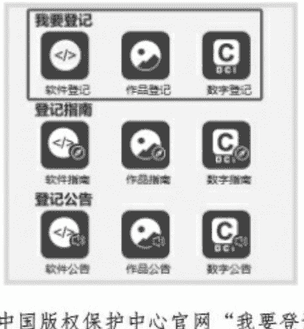

### 4. 注意事项

- 作品样本要包含完整的创作细节（如设计图需保存PSD源文件中的图层信息）。
- 合作创作的作品，需在登记时明确版权归属比例（如甲乙各占50%）。
- 职务作品（如员工创作）的版权归公司所有，需附职务作品确认书。
- 软件著作权登记需提交代码样本（前30页和后30页，每页不少于50行）。
- 国外作品可通过《保护文学和艺术作品伯尔尼公约》在我国获得保护，但登记后维权更便利。

当前，很多地区支持线上办理版权登记业务，登记费用通常为几十元到几百元不等，具体视作品类型而定。

## 商标注册：保护你的品牌，从名字开始

商标是用来区别商品或服务来源的标志，可以是文字、图形、字母、数字、颜色的组合，甚至可以是声音。对一人公司而言，品牌名称、店铺名、产品名、Logo等都可以申请注册商标。

商标注册需向国家知识产权局下属的中国商标网提交申请（见图3-2）。也可以选择委托代理机构协助办理。

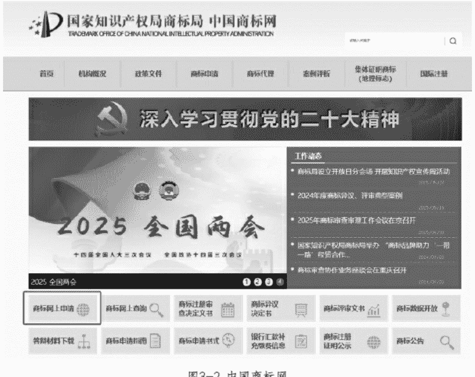

商标注册的基本流程如下。

### 1. 商标查询

在注册之前，可以使用“中国商标网”的“商标近似查询”功能，确认目标商标是否已被注册，避免重复申请。

### 2. 确定注册类别

根据你的业务范围，选择对应的国际分类（共45类）。具体可登录中国商标网，找到商标申请（见图3-3）→ 商品和服务分类（见图3-4）→“类似商品和服务区分表——基于尼斯分类第十二版（2025文本）.pdf”文件，或“NCL12-2025中文版和区分表修改内容公开版.pdf”（见图3-5）进行查看。

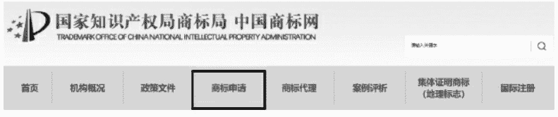

图3-3 “商标申请”选项

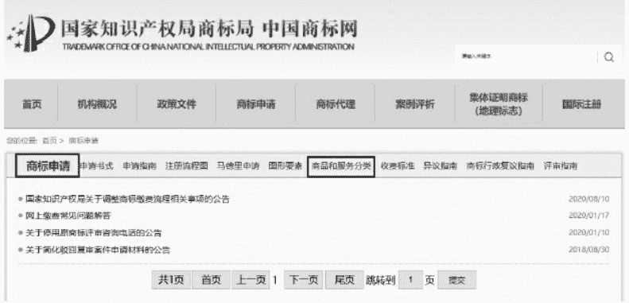

图3-4 “商品和服务分类”选项

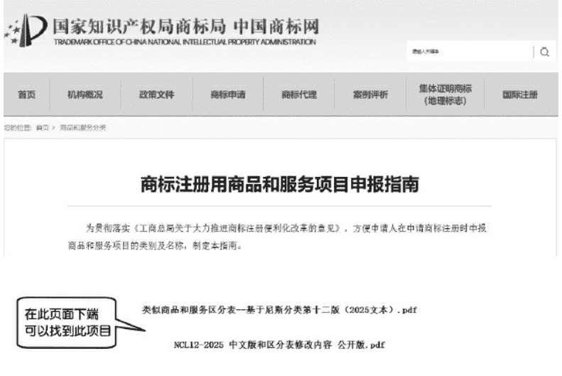

图3-5 商标注册用商品和服务项目相关文件

### 3. 准备资料并提交申请

确定好类别后，要提交商标图样、申请人信息、使用类别。个人注册需要提供身份证复印件及个体户执照；公司注册则要提供营业执照副本。

### 4. 缴纳费用并等待审查

官方收费标准为每类300元（10个以内项目），超过10个按项加收。商标局在收到商标注册申请文件之日起9个月内会审查完毕，公告期3个月。

### 5. 核准发证

成功通过审查后，会颁发商标注册证，有效期为10年，到期可续展。

在进行商标注册时，初创公司要优先注册核心类别，等业务扩张后再补充注册。需要注意的是，商标注册后连续3年未使用，他人可申请撤销，所以需保留商标使用证据（如销售合同、广告宣传页、电商平台销售记录）。

通常情况下，一人公司的知识产权要采取“版权+商标”双重保护，比如公司创作了一个卡通形象用于产品包装，便需要登记美术作品版权（确保著作权），同时注册第16类（纸质包装）、第25类（服装）商标。若他人盗用卡通形象，公司可同时主张版权侵权和商标侵权，获赔金额更高。

若想快速进行知识产权维权，则需在48小时内固定证据。一般可通过电子证据固化，对侵权网页、聊天记录进行区块链存证；重大侵权案件可申请公证处现场取证。发现侵权后，需要先固定证据，再发侵权警告函（附证据清单），多数侵权方会主动协商赔偿。

对一人公司而言，知识产权保护不是“锦上添花”，而是“生存刚需”。从登记作品版权到注册核心商标，每一笔投入都是在为未来铺路。建议创业初期，公司就制定知识产权规划：先登记核心作品版权，再注册主营业务商标，在知识产权上，先发制人永远比事后维权要更加划算。

商标注册的基本流程如下。

1. 商标查询

在注册之前，可以使用“中国商标网”的“商标近似查询”功能，确认目标商标是否已被注册，避免重复申请。

2. 确定注册类别

根据你的业务范围，选择对应的国际分类（共45类）。具体可登录中国商标网，找到商标申请（见图3-3）→ 商品和服务分类（见图3-4）→“类似商品和服务区分表——基于尼斯分类第十二版（2025文本）.pdf”文件，或“NCL12-2025中文版和区分表修改内容公开版.pdf”（见图3-5）进行查看。

图3-3 “商标申请”选项

图3-4 “商品和服务分类”选项

图3-5 商标注册用商品和服务项目相关文件

### 3. 准备资料并提交申请

确定好类别后，要提交商标图样、申请人信息、使用类别。个人注册需要提供身份证复印件及个体户执照；公司注册则要提供营业执照副本。

### 4. 缴纳费用并等待审查

官方收费标准为每类300元（10个以内项目），超过10个按项加收。商标局在收到商标注册申请文件之日起9个月内会审查完毕，公告期3个月。

### 5. 核准发证

成功通过审查后，会颁发商标注册证，有效期为10年，到期可续展。

在进行商标注册时，初创公司要优先注册核心类别，等业务扩张后再补充注册。需要注意的是，商标注册后连续3年未使用，他人可申请撤销，所以需保留商标使用证据（如销售合同、广告宣传页、电商平台销售记录）。

通常情况下，一人公司的知识产权要采取“版权+商标”双重保护，比如公司创作了一个卡通形象用于产品包装，便需要登记美术作品版权（确保著作权），同时注册第16类（纸质包装）、第25类（服装）商标。若他人盗用卡通形象，公司可同时主张版权侵权和商标侵权，获赔金额更高。

若想快速进行知识产权维权，则需在48小时内固定证据。一般可通过电子证据固化，对侵权网页、聊天记录进行区块链存证；重大侵权案件可申请公证处现场取证。发现侵权后，需要先固定证据，再发侵权警告函（附证据清单），多数侵权方会主动协商赔偿。

对一人公司而言，知识产权保护不是“锦上添花”，而是“生存刚需”。从登记作品版权到注册核心商标，每一笔投入都是在为未来铺路。建议创业初期，公司就制定知识产权规划：先登记核心作品版权，再注册主营业务商标，在知识产权上，先发制人永远比事后维权要更加划算。

## 基础记账：用Excel/AI工具做简易账目

很多人认为，记账是会计的事，和自己关系不大。但如果你正在经营一家“一人公司”，哪怕只是副业尝试，也必须掌握一些基础的财务知识。不记账，你就不知道赚了多少、亏了多少，不知道哪些项目赚钱、哪些项目在烧钱，更别提报税、融资、贷款这些实际需求了。

作为一人公司创始人，你不需要请专业会计，也不需要精通复杂的财务软件。只要会用Excel，或者愿意尝试一些AI辅助工具，就能轻松建立一套属于自己的简易账目系统。

### 用Excel做一套简单的账目表

即使你是Excel小白，也能通过几个关键表格，轻松管理自己的收支情况。对一人公司来说，初期并不需要做太复杂的报表，只需掌握以下3个基础表格即可。

1. 收入明细表

记录你所有的收入来源，包括时间、金额、付款方、项目名称等（见表3-6）。

表3-6 收入明细表

| 日期 | 收入类型 | 金额（元） | 客户名称 | 备注 |
|---|---|---|---|---|
| 2025-04-01 | 内容创作 | 2000 | 张先生 | 微信公众号 |
| 2025-04-05 | 课程销售 | 699 | 李女士 | 付费训练营 |
| ...... | ...... | ...... | ...... | ...... |

收入明细表建议按月整理，这样方便后续统计月度收入的变化。

2. 成本支出表

记录你所有与业务相关的支出，比如平台费用、软件订阅、外包设计、办公场地、设备采购等（见表3-7）。

表3-7 成本支出表

| 日期 | 支出类型 | 金额（元） | 供应商名称 | 备注 |
|---|---|---|---|---|
| 2025-04-02 | 软件订阅 | 198 | Adobe | 一年会员 |
| 2025-04-03 | 外包设计 | 800 | 张某 | 产品海报制作 |
| ...... | ...... | ...... | ...... | ...... |

成本支出建议分类管理，如“人力成本”“运营成本”“推广费用”等，也是为了方便后期统计。

3. 利润简表

每月汇总一次，计算当月的总收入、总成本和净利润。其实就是将前面两个表格的数据汇总，生成一张月度账目表（见表3-8）。

表3-8 利润简表

| 月份 | 总收入（元） | 总成本（元） | 净利润（元） |
|---|---|---|---|
| 2025年3月 | 8000 | 2500 | 5500 |
| 2025年4月 | 12000 | 3200 | 8800 |
| ...... | ...... | ...... | ...... |

你可以将上面这3个表格整合在一个Excel文件的不同Sheet页中，这样方便统一管理和查看。

### AI工具也能帮你记账

如果你觉得手动录入太麻烦，可以借助一些AI工具来简化流程。目前市面上已有不少支持自动识别发票、语音记账、智能分类的工具，特别适合个体创业者使用。

1. AI记账类工具

- 慧经营：专为个体经营者设计，支持发票识别、收入统计、自动生成报表。
- 柠檬云财税：提供免费的在线记账功能，适合小规模纳税人。
- 金蝶云·星辰：个人版功能简单易用，可同步银行流水。

2. 使用AI生成报表

如果你使用新版WPS，也可以直接让AI帮你生成公式、分类汇总、制作图表（部分功能可能需要开通会员）。它会根据你的需求，输出一份可下载的表格模板，省去你手动建表的时间。

### 账目管理的常见问题

表3-9中是一些常见的不当记账操作和其可能带来的后果，以及更安全、合规的替代做法。

表3-9 不当记账操作及相关内容

| 不当记账操作 | 后果 | 合规替代 |
| :--- | :--- | :--- |
| 用个人微信记录收支 | 税务稽查时无法作为合法凭证 | 用企业微信支付，自动生成收支记录 |
| 合并记录多笔收支 | 无法追溯具体交易细节 | 每笔收支单独录入，附交易截图或小票 |
| 年底一次性补记账目 | 容易漏记或错记 | 坚持“日清月结”，每月结账不拖延 |
| 随意修改已记账数据 | 导致财务数据失真 | 若需修改，用红色字体标注“更正记录” |
| 不备份记账文件 | 电脑故障导致数据丢失 | 每周将Excel文件同步到百度网盘/腾讯文档 |

对一人公司而言，基础记账不只是税务要求，也是了解经营状况的重要手段。通过Excel表格或轻量化AI工具，每天只需投入5～10分钟，即可掌握收入、成本的动态变化。只有坚持合规、实事求是地记录每一笔收支，你才能真正掌控自己的经营状况，在面对税务稽查、融资、合作等各种场景时，底气十足地拿出一份“经得起查”的账目。

# 第4章 一人单干新模式，AI员工与资源整合

## 一个人怎么用AI赚钱

当前，很多人对AI的印象还停留在“未来科技”“大厂专属”“需要编程基础”的阶段。其实，在过去两年里，AI已经全面平民化。

现在你不需要会写代码、不需要懂算法、不需要投入大量资金，就能通过AI提升效率、优化服务甚至直接变现。

### AI就是你的“虚拟员工”

一个人创业会遇到很多问题，比如资源有限、时间紧张、效率不高等。在传统企业中，这些问题可以通过招人、外包、买系统软件来解决。但在一人单干的过程中，你没有那么多资源，也没有那么多时间。你需要一个人兼顾产品、运营、销售、客服、财务等角色，稍有不慎就会陷入“忙不过来、赚不到钱”的困境。

而AI正好能帮你解决这些“不好解决的问题”。你可以把它想象成一个24小时在线、不抱怨、不请假，还能随时接受你的指挥的“虚拟员工”。虽然它不能完全替代你做决策，但它可以帮你完成很多重复性高、标准化强的工作。比如：

- 写文案、改简历、做PPT。
- 做数据整理、表格分析。
- 剪视频、加字幕、生成封面。
- 回答常见问题、处理客户咨询。
- 设计海报、Logo、宣传图。
- 整理会议纪要、自动生成报告。
- 翻译文档、提取摘要、总结内容。
- …………

这些事情原本可能需要你花几个小时去完成，而现在，借助AI工具，几分钟就能搞定。因此节省下来的时间，你可以用来接更多单子、打磨产品、拓展用户。这不是投机取巧，而是你善用工具来提升你的“单位时间价值”。

### 想靠AI赚钱，先明白一件事

很多人看到别人用AI做视频、写文章、画图、生成音乐、做课程，觉得这是一条快速变现的新路径，于是也跟着学，甚至花时间去研究各种工具，想让自己也能“凭空掌握一项技能”。

这样做确实可能让你掌握一项新技能，但并不意味着你能靠这项新技能赚到钱。AI确实能帮你快速获得某种能力，比如写文案、剪视频、设计海报、做数据分析……这些原本需要专业训练的技能，现在通过提示词和工具就能完成。但这只是第一步。

真正难的是：你怎么用这项技能，去满足一个真实的需求，并因此赚到钱？

如果你没有相关经验、不了解市场，也没有积累任何信任资产（作品集、用户资源、平台粉丝），那你即使学会了用AI做视频，也很难靠它接到单子；即使你会用AI写文案，也不一定有人愿意购买；即使你能生成音乐，也未必能找到愿意付费的用户。

AI不是魔法棒，它不能让你从零变成专家，也不能替你建立信任、找到用户、完成交易。它真正的价值，是放大你已有的能力，而不是赋予你完全没有的能力。

换句话说，你想靠AI赚钱，不是因为它能让你突然变得更厉害，而是因为它能让你在你已经擅长的事情上，更轻松地赚到钱。

比如，你从事网络小说创作工作，但因为小说的框架构思没有新意，语言表达不够出彩，一直都没有读者关注。AI暂时还没办法帮你从无到有地创作一篇受欢迎的网络小说，但它可以帮你构思小说的框架，修饰小说的文字，可以帮你更快、更好地产出内容。这样一来，你靠网络小说赚钱这条路，或许就能走通了。

这才是AI在一人单干实践中最实际、最有效的使用方式。如果你什么都不懂，只是看到别人用AI创作视频赚钱，你也去拍视频；看到别人用AI生成音乐赚钱，你也去作曲；看到别人做AI做知识付费课程卖得很火，你也去做教程……那你就很容易陷入一种“看起来很努力，实际上没结果”的状态。

所以，别总想着“我还没什么基础，能不能靠AI快速赚到钱”，这不是不可能，但难度极高。如果你想稳稳地靠AI赚钱，那就从你已经会做的事情开始，看看AI能不能帮你提升效率、优化流程、扩大交付能力。

## 一个人怎么用AI赚钱

当前，很多人对AI的印象还停留在“未来科技”“大厂专属”“需要编程基础”的阶段。其实，在过去两年里，AI已经全面平民化。

现在你不需要会写代码、不需要懂算法、不需要投入大量资金，就能通过AI提升效率、优化服务甚至直接变现。

### AI就是你的“虚拟员工”

一个人创业会遇到很多问题，比如资源有限、时间紧张、效率不高等。在传统企业中，这些问题可以通过招人、外包、买系统软件来解决。但在一人单干的过程中，你没有那么多资源，也没有那么多时间。你需要一个人兼顾产品、运营、销售、客服、财务等角色，稍有不慎就会陷入“忙不过来、赚不到钱”的困境。

而AI正好能帮你解决这些“不好解决的问题”。你可以把它想象成一个24小时在线、不抱怨、不请假，还能随时接受你的指挥的“虚拟员工”。虽然它不能完全替代你做决策，但它可以帮你完成很多重复性高、标准化强的工作。比如：

- 写文案、改简历、做PPT。
- 做数据整理、表格分析。
- 剪视频、加字幕、生成封面。
- 回答常见问题、处理客户咨询。
- 设计海报、Logo、宣传图。
- 整理会议纪要、自动生成报告。
- 翻译文档、提取摘要、总结内容。
- …………

这些事情原本可能需要你花几个小时去完成，而现在，借助AI工具，几分钟就能搞定。因此节省下来的时间，你可以用来接更多单子、打磨产品、拓展用户。这不是投机取巧，而是你善用工具来提升你的“单位时间价值”。

### 想靠AI赚钱，先明白一件事

很多人看到别人用AI做视频、写文章、画图、生成音乐、做课程，觉得这是一条快速变现的新路径，于是也跟着学，甚至花时间去研究各种工具，想让自己也能“凭空掌握一项技能”。

这样做确实可能让你掌握一项新技能，但并不意味着你能靠这项新技能赚到钱。AI确实能帮你快速获得某种能力，比如写文案、剪视频、设计海报、做数据分析……这些原本需要专业训练的技能，现在通过提示词和工具就能完成。但这只是第一步。

真正难的是：你怎么用这项技能，去满足一个真实的需求，并因此赚到钱？

如果你没有相关经验、不了解市场，也没有积累任何信任资产（作品集、用户资源、平台粉丝），那你即使学会了用AI做视频，也很难靠它接到单子；即使你会用AI写文案，也不一定有人愿意购买；即使你能生成音乐，也未必能找到愿意付费的用户。

AI不是魔法棒，它不能让你从零变成专家，也不能替你建立信任、找到用户、完成交易。它真正的价值，是放大你已有的能力，而不是赋予你完全没有的能力。

换句话说，你想靠AI赚钱，不是因为它能让你突然变得更厉害，而是因为它能让你在你已经擅长的事情上，更轻松地赚到钱。

比如，你从事网络小说创作工作，但因为小说的框架构思没有新意，语言表达不够出彩，一直都没有读者关注。AI暂时还没办法帮你从无到有地创作一篇受欢迎的网络小说，但它可以帮你构思小说的框架，修饰小说的文字，可以帮你更快、更好地产出内容。这样一来，你靠网络小说赚钱这条路，或许就能走通了。

这才是AI在一人单干实践中最实际、最有效的使用方式。如果你什么都不懂，只是看到别人用AI创作视频赚钱，你也去拍视频；看到别人用AI生成音乐赚钱，你也去作曲；看到别人做AI做知识付费课程卖得很火，你也去做教程……那你就很容易陷入一种“看起来很努力，实际上没结果”的状态。

所以，别总想着“我还没什么基础，能不能靠AI快速赚到钱”，这不是不可能，但难度极高。如果你想稳稳地靠AI赚钱，那就从你已经会做的事情开始，看看AI能不能帮你提升效率、优化流程、扩大交付能力。

## AI工具的选择，AI员工能帮你做成什么

很多人一看到别人用AI做出炫酷视频、爆款文章、精美海报，就迫不及待地下载一堆软件，想一口气掌握所有技能。结果发现不是不会用，就是用了没效果。

就像前面说的，AI不是魔法棒，它不能让你从零变成专家，它真正的价值是放大你已有的能力。所以，在你决定使用某个AI工具之前，最重要的是先搞清楚你在做什么业务？你遇到了哪些效率瓶颈？有没有合适的AI工具可以辅助解决？

## 主流AI工具盘点

接下来我们就来盘点一下目前主流的几类AI工具，并结合实际应用场景，看看它们到底能帮你做成什么事。

### 1. 内容创作类AI

这类AI主要用于辅助写作，比如写文案、改简历、写脚本、列提纲、写总结报告等。它们可以帮助你快速生成初稿，节省大量时间。

- 代表工具：ChatGPT、Claude、Gemini、豆包、千问。
- 适用人群：文字工作者、课程讲师、自媒体创作者、品牌策划者。
- 注意事项：AI输出的内容需要人工润色，不能直接照搬，建议结合自身经验进行二次加工，避免出现常识性错误；涉及版权、合同、法律文书时需谨慎核对。

### 2. 图像生成类AI

如果你经常需要图片素材、Logo设计、视觉封面、配图风格参考，可以借助图像生成类AI快速产出高质量作品。

- 代表工具：Midjourney、Stable Diffusion、DALL·E、即梦AI。
- 适用人群：视觉类博主、电商卖家、PPT设计师、内容创作者。
- 注意事项：AI绘图的图像细节控制不如专业设计师，大多需要进行手动调整；部分平台对AI生成图像存在版权争议，在使用时需要进行AI创作标注，否则容易被断流。

### 3. 视频剪辑与生成类AI

短视频是当前最主流的内容形式之一，但剪辑耗时又费力。AI可以帮助你一键生成字幕、自动配音、智能裁剪、添加特效等。

- 代表工具：剪映、Runway、可灵AI、CapCut、VEED.IO。
- 适用人群：短视频博主、知识类UP主、带货主播、培训讲师。
- 注意事项：AI视频生成还不够完美，且使用成本较高，复杂的视频内容依然需要手动调整；对AI生成的视频内容，也要进行标注，以免被平台限流。

### 4. 办公与项目管理类AI

除了内容创作，你还需要高效管理客户、任务、文档、数据等信息。办公类AI虽然不像图像生成类AI、视频剪辑与生成类AI那样“出彩”，但它能实实在在地帮你节省大量时间。尤其适合经常处理Excel、PPT、会议记录等工作的人，是提高效率的好帮手。

- 代表工具：Notion AI、飞书知识库、Excel插件（如Think-Cell AI）、WPS AI。
- 适用人群：自由职业者、远程工作者、团队管理者。
- 注意事项：数据安全需注意，敏感信息不建议在云端存储；部分功能仅限付费版使用，使用成本较高。

## 主流大模型的选择

目前市面上的AI大模型越来越多，很多人在选择时会陷入“不知道哪个更好用”的困惑。其实每个模型都有自己的优势和适用场景，与其追求“最强”，不如找到“最适合自己的”那一个。

### 1. ChatGPT

ChatGPT是最早进入大众视野的大模型之一，也是目前功能最全面、生态最完善的AI大模型。它的英文能力极强，逻辑清晰，适合做创意策划、文案撰写、脚本生成等工作。虽然中文理解能力稍逊于本土产品，但整体表现稳定可靠，是很多自由职业者和知识博主的首选工具。

### 2. Claude

Claude最大的优势在于超强的上下文处理能力，可以接受非常长的输入文本，特别适合整理资料、提炼报告、分析长文档等任务。它的输出风格偏理性、结构清晰，如果你经常需要深度解读行业报告或法律条文，Claude是一个非常值得尝试的选择。

### 3. Gemini

Gemini是谷歌推出的多模态大模型，不仅擅长文字创作，还能理解和生成图像、音频、视频等内容。它最大的亮点是信息整合能力强，能快速从互联网中提取最新数据并组织成结构化内容。如果你主要做知识类内容生产或行业分析，Gemini在事实判断方面有明显优势。

### 4. 豆包

豆包是字节跳动推出的大模型产品，主打轻量易用，尤其适合国内用户快速上手。虽然功能相对基础，但在短视频脚本、电商文案、社交媒体内容生成等方面已经足够实用。界面简洁、响应速度快、免费额度充足，对刚入门AI写作的人来说，豆包是一个不错的选择。

### 5. 千问

千问作为阿里巴巴研发的大语言模型，其广泛应用于智能客服、内容创作、办公提效、教育辅助、编程支持、企业知识管理、多语言翻译、电商营销、金融法律辅助及智能硬件交互等场景，旨在助力各行业提升效率与智能化水平。

总的来说，这些主流大模型各有所长，关键在于你如何结合自己的业务去使用它们。与其追求掌握所有工具，不如选一两个主力模型，深入使用、持续调教，让它（们）真正成为你单干过程中最得力的“虚拟员工”。

千问作为阿里巴巴研发的大语言模型，其广泛应用于智能客服、内容创作、办公提效、教育辅助、编程支持、企业知识管理、多语言翻译、电商营销、金融法律辅助及智能硬件交互等场景，旨在助力各行业提升效率与智能化水平。

总的来说，这些主流大模型各有所长，关键在于你如何结合自己的业务去使用它们。与其追求掌握所有工具，不如选一两个主力模型，深入使用、持续调教，让它（们）真正成为你单干过程中最得力的“虚拟员工”。

## 外包合作，一人单干如何整合外部资源

很多人一开始单干时，总想着“我得自己写文案、自己剪视频、自己设计海报、自己运营账号、自己对接客户……”结果没干几天就累到崩溃，效率也提不上去，最后干脆放弃。

其实这完全没必要。一人单干并不意味着你要一个人完成所有环节。你可以把那些重复性强、标准化高、耗时长的工作交给别人或工具去做，而你只需专注于真正能带来价值的环节，比如选题、策划、沟通、成交、优化。

就像一家小餐馆老板，他不一定亲自洗菜、炒菜、端盘子，但他知道怎么安排人、怎么控制出品、怎么留住顾客。你也可以用同样的思路来开启一人单干模式。

## 外包是为了专注于创造核心价值

很多人对“外包”的理解还停留在“找人替我干活”的层面，实际上，外包的真正价值在于把自己的时间留给真正重要的事。

比如，有一位自由职业者，专门帮企业写商业计划书（BP）。她擅长的是内容策划和逻辑梳理，但不擅长设计PPT模板和图表可视化。于是她找了一个擅长排版和视觉呈现的自由设计师，按项目制合作。她负责内容撰写，对方负责美化呈现，最后一起交付给客户，按利润分成。

这样一来，她的效率提升了一倍，客户的反馈也更好了。更重要的是，她可以把更多精力放在接单和打磨内容上，而不是纠结于格式和排版。这就是典型的靠外包让自己专注于创造核心价值。

所以说，你要单干，不必自己学会做所有的事，而是要找到合适的人帮你完成那些你不擅长，但又必须做的事。

那么，想要找到靠谱的外包，需要注意哪些问题呢？

首先，把工作外包时，要明确交付的标准是什么。比如，你想外包一篇公众号文章，你就得告诉对方：目标读者是谁？语气风格是轻松还是专业？有没有参考样文？需要多少字？什么时候交稿？标准给得越明确，越能防止后面出现交付纠纷。

其次，外包尽量从小单子开始测试。别一开始就把大项目外包出去，先从几百元的小任务开始试水，看看对方是否靠谱，是否符合你的预期。

最后，要建立清晰的流程和反馈机制。哪些地方做得好，哪些地方需要改进，要及时沟通，不要等到最终交付的时候，再推翻重做，这样合作才会更顺畅。

## 合作：找到互补的人，一起把事做大

如果说外包是“让别人帮你完成一部分工作”，那合作就是“找到互补的人，一起做更大的事”。不过，有时候外包和合作不需要分得那么清，靠谱的外包对象也可以成为合伙人，关键是看工作怎么分工、利润怎么分配。

比如，你是一个擅长写课程讲义的知识博主，找了一个视频剪辑师帮你把内容做成短视频上线。一开始你们是外包关系：你给脚本，他剪辑，按项目结算费用。随着内容越来越多，你也有了稳定的粉丝和变现路径，这时候你想进一步提高短视频的质量，但如果还是按次付费，视频剪辑师就没有动力去优化封面、标题、节奏这些直接影响播放量和成交率的细节。

为此，你提出了一个新方案：不再按单结算，而是按最终的课程销售分成。你负责内容策划和输出，他负责视频制作与优化，每卖出一份课程，你拿七成，他拿三成。

这样一来，他的角色就从“执行者”变成了“共创者”，他也更愿意花心思去打磨作品、提升质量，因为这直接关系到他能拿到多少回报。这就是从外包走向合作的典型路径：由执行关系升级为利益绑定，共同推动项目的增长。

相比于外包，合作要更加谨慎。在考虑要不要和某人合作时，不妨先问自己几个问题：

- 他是不是真的愿意参与这件事？
- 他有没有自己的判断力和主动性？
- 对现有利益分配机制，他是否真心接受？
- 如果项目失败，他愿不愿意一起承担损失？

这些问题的答案，基本决定了你们之间的关系是短期协作，还是长期共进。只要你能找到合适的人，建立起合理的分利机制，哪怕你的商业规模不大，也能做起像模像样的生意。

## 别再事事亲为，AI智能体帮你提质增效

一人单干虽然由你主导，但并不意味着所有事情都必须自己来做。你可以通过外包、合作等方式整合外部资源，把一些专业性强或重复性高的工作交给别人去做。不过，除了找人帮忙，其实还有一种更高效、更省钱的方式，那就是借助AI智能体（AI Agent）的力量。

AI智能体不是传统意义上的工具软件，它更像是一个可以自主思考、主动执行任务的虚拟员工。它可以按照你的设定，自动完成很多流程化的事务，让你从琐碎的工作中解放出来，专注于真正能带来价值的事情。

你可以把它想象成你的一名数字员工。它不能完全代替你做决策，但可以帮你处理大量重复性强、标准化程度高的事务，让你把精力集中在真正有价值的事情上。比如：它可以自动回复用户咨询；可以根据你的需求生成文案、PPT、简历；可以整理会议纪要、提取文章摘要；还可以帮你管理日程、提醒重要事项……

这些听起来是不是很像你平时做的那些琐碎的工作？没错，AI智能体的核心价值就是帮你节省时间，提升效率。更重要的是，它不需要你会写代码，也不需要你花太多时间学习。只要你描述清楚你想让它做什么，它就能快速且准确地执行。

目前市面上已经有很多成熟的AI智能体平台，其中字节跳动推出的豆包，就是一个非常适合普通人使用的AI智能体搭建工具。它最大的特点是不需要编程基础，通过简单的图形化界面，你就能创建专属的AI助手。

下面我们就以豆包为例，来演示AI智能体的打造。

### 1. 创建AI智能体

下载豆包电脑客户端后，通过“AI智能体”（见图4-1），进入“发现AI智能体”页面，点击“创建AI智能体”选项（见图4-2）。

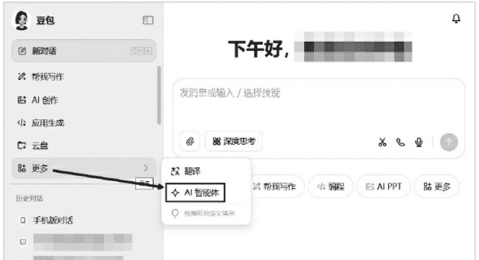

图4-1 豆包电脑版AI智能体功能入口

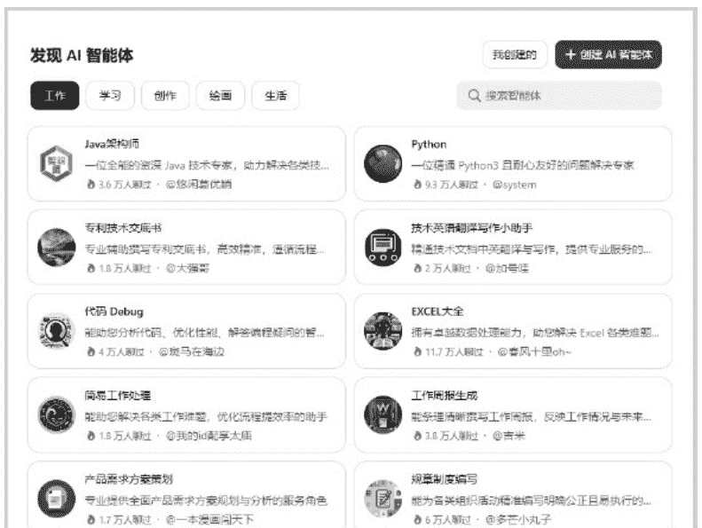

图4-2 进入“发现AI智能体”页面

### 2. 设定角色与功能

接下来，豆包会引导你给这个智能体起个名称，并设定描述。在名称之外，你需要告诉这个AI智能体它的“身份”和“职责”。例如，你想让它成为一个“知识类短视频脚本助手”，你可以这样设定（见图4-3）：

- 名称：短视频脚本撰写专家。
- 设定描述：你是一位经验丰富的短视频脚本撰写专家，能够根据关键词生成短视频口播文案、分镜脚本、标题建议、封面文案等。语言风格通俗易懂，简洁明了，充满趣味。

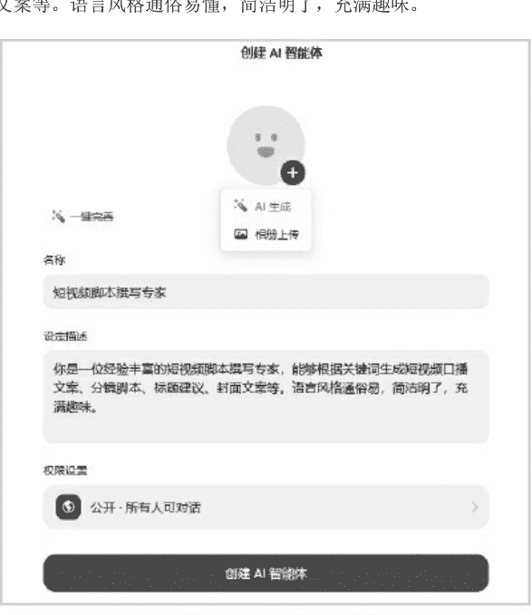

你可以上传一张图片，作为这个智能体的形象，也可以直接描述智能体的形象风格，让AI帮你生成形象。

### 3. 测试并发布

设置完成后，点击“创建AI智能体”，豆包便会为你直接生成一个可对话的AI智能体。你可以直接在消息窗口中和你的AI智能体进行对话，看看它是否理解你的指令、输出是否符合预期。

### 4. 持续优化，让AI越用越好

刚上线时，AI智能体的回答可能不够精准，但只要你持续补充新的问答数据、调整语言风格、优化关键词匹配逻辑，它的表现就会越来越好。你还可以随时修改角色设定，找出它回答不准确的地方，有针对性地进行优化。

除了豆包，目前市面上还有很多支持创建AI智能体的平台，比如AutoGPT、AgentGPT、FastGPT、Dify等，它们都提供了可视化的界面和简单的配置流程，不需要编程基础也能快速上手。

当前市面上使用较多、较为成熟的AI智能体类型，主要有：

- 内容创作助手：列提纲、写文案、改简历、润色文章。
- 视频制作机器人：输入文字脚本，自动生成视频。
- 社群运营助手：定时推送内容、回答常见问题。
- 数据分析小帮手：抓取销售数据、生成图表、总结趋势。

这些AI智能体的存在，不是为了替代你，而是为了让你的效率提升数倍，让你一个人也能干出一个小团队的效果。你可以根据自己的需求，打造自己需要的AI智能体。

## 数据驱动决策，用AI分析用户和市场

很多人一听到“数据驱动”，就想到一堆复杂的图表、公式、模型，觉得只有专业人士才能弄明白。其实，在AI的帮助下，现在的数据分析已经变得越来越“傻瓜化”。只要你能描述清楚你想了解什么问题，AI就能帮你从海量信息中提取出有价值的内容。

那么，AI都能帮我们分析哪些方面的数据呢？一般来说，当前常见的数据分析方向主要有以下几种。

1. 用户画像分析：你的用户是谁

你可以把用户的聊天记录、订单留言、评论区反馈等内容交给AI，让它帮你总结出这些人的典型特征。比如：年龄段、职业背景、所在城市；常见痛点、表达方式、关注重点；对产品/服务的核心诉求是什么；在哪些场景下更容易产生购买行为。这比你自己凭空想象用户的需求要准确得多。

2. 内容热度分析：什么样的内容更容易被关注

你可以把你所在平台（如小红书、抖音、知乎）的热门笔记、视频标题、评论区内容输入给AI，让它帮你提炼出爆款内容的共性。也可以直接利用豆包的共享应用或屏幕功能，直接让它帮你分析爆款内容获得高赞的原因。比如，标题常用句式有哪些？正文结构是怎样的？使用了哪些关键词或情绪词？用户最常点赞和收藏的内容类型是什么？掌握了这些规律，你就可以更有针对性地创作内容，而不是盲目试错。

3. 市场趋势预判：接下来该往什么方向发展

你可以把近期行业报告、平台榜单、热点话题等内容输入给AI，让它帮你判断：哪些领域正在增长？哪类课程/产品更受欢迎？下一季度可能会流行哪些话题？哪些关键词的搜索量正在上升？有了这些信息，你在做内容策划、产品设计时，就会更有方向感，而不是靠直觉去押宝。

4. 营销策略优化：怎么说话更能打动用户

你可以把你的文案、脚本、朋友圈内容、社群发言等内容交给AI，让它帮你优化表达方式，看看哪些话更能引发共鸣？哪种语气更能激发行动？哪些词句最容易让用户产生信任？是否存在某些常见的表达误区？你会发现，只是换了几句话，转化率可能就会有明显提升。

下面，我们以小红书为例，来演示如何利用AI进行实际的数据分析和内容选题判断。如果你是一个刚开始在小红书运营的知识型博主，你可能会遇到以下问题：不知道该写什么；发了内容没人看；别人的笔记点赞量很高，自己的却很低；明明写的都是干货，却没有转化。这时候，与其盲目试错，不如让AI帮你“看懂”平台规律。

1. 收集目标账号的爆款内容

先找几个与你定位相似、粉丝量在几千到几万人之间的对标账号，收集他们点赞量超过1000的笔记标题和正文内容。你可以在小红书App里搜索关键词，比如“职场成长”“副业推荐”“个人IP打造”“自由职业者日常”。然后截图保存下这些笔记的标题以及正文内容。

### 2. 将内容导入，让AI进行深入分析

打开你常用的AI大模型工具（千问、ChatGPT、Claude、豆包等），将这些内容粘贴进去，并提出以下几个问题。

请帮我分析以下内容，总结出这些爆款笔记的共性：

- 主题类型有哪些？
- 标题结构有什么特征？
- 正文常用句式是什么？
- 提到了哪些高频关键词？
- 是否存在某些特定的情绪或语气？

AI大模型工具会根据你提供的文本内容，自动生成一份“爆款内容分析报告”。如果担心AI的回答不准确，可以使用不同的AI大模型工具进行对比验证。

### 3. 基于分析结果，生成你的内容选题

拿到分析结果后，你可以进一步提问：请根据以上内容，帮我列出10个我可以尝试发布的选题，并附上建议标题和写作框架。AI会结合前面总结出的爆款逻辑，为你定制专属的选题库，帮助你减少试错成本，提高内容的成功率。

### 4. 持续迭代，不断优化

每发布一条笔记后，记录它的数据表现（阅读量、点赞量、评论数、收藏数），再次输入给AI，让它帮你分析：这条笔记表现好/差的原因是什么？用户最感兴趣的是哪部分内容？如果重写一次，应该怎么调整？通过这种方式，你可以逐步建立起对平台调性的理解，也能更快找到属于自己的内容风格和变现路径。

很多人创业，靠的是经验或者模仿别人的做法。看别人发什么内容火了，自己也跟着写；听说某个产品好卖，自己也赶紧进货上线……这种做法虽然也能把生意做起来，但很难持续下去，更不容易成功。

想要通过单干把生意做起来，并且做得红火，就不能完全凭直觉做事，而是要用数据说话。数据驱动下的决策，要远比跟着直觉走靠谱。

# 第5章 一人单干，让能力成为你的赚钱产品

## 一人单干，该卖服务还是卖产品

一人单干，到底应该做服务，还是做产品？这是一人单干起步阶段很多人最常问的问题之一。很多人一开始做副业时，都是从接单开始的，比如写文章、剪视频、设计Logo、做数据分析……但干着干着就发现一个问题：太累了，赚得也不多，而且根本做不大。

于是他们开始想：我是不是应该做一个标准化的产品，比如课程、电子书、模板包……但这又带来另一个问题：产品哪有那么好做，没人买怎么办？所以，这个问题的本质不是“服务好还是产品好”，而是你要根据自己的能力、资源和目标，找到一条适合自己的变现路径。

服务型变现与产品型变现的具体区别见表5-1。

### 表5-1 服务型变现与产品型变现的区别

| 项目 | 服务型变现 | 产品型变现 |
| :--- | :--- | :--- |
| 核心模式 | 时间换收入，技能直接服务用户，交付后收款 | 一次制作，多次销售，将能力/知识/经验转化为可重复售卖的内容/工具 |
| 适用阶段 | 起步阶段（一人单干初期） | 进阶阶段（有能力、经验、用户积累后） |
| 常见形式 | 写作、设计、私域陪跑等 | 课程、模板包、SOP手册、测评报告等 |
| 优点 | 门槛低、易建立信任、反馈快、收入稳定 | 复利效应强、收入上限高、易塑造品牌、长期易规模化 |
| 局限性 | 无复利、难规模化、停止工作则收入中断 | 前期投入大、用户决策谨慎、市场判断失误易亏损 |

### 1. 服务型变现：靠时间换收入，适合起步阶段

服务型变现是很多人在单干时最自然的起点。它指的是用自己的技能直接为用户提供价值，比如写作、设计、运营、编程等，这些工作交付完成后用户付款，整个过程就完成了。你可以帮人写文案、改简历、做PPT、做私域陪跑、开发小程序，甚至是为人提供职业规划建议，只要你具备某项能力，并且能解决用户的实际问题，就可以通过这种方式快速获得收入。

做服务的优点很明显，它的启动门槛低，不需要太多准备，也不需要花大量时间打磨产品，只要有能力，就能立刻开始接单。而且因为是面对面服务，沟通顺畅的情况下更容易建立信任，用户也愿意购买。同时，这类变现方式的反馈来得快，你能迅速知道市场是否认可你的价值，也能在过程中不断积累案例和口碑。此外，它带来的收入也相对稳定，通常是按项目结算，做完一单就能拿到钱，很适合刚起步还在摸索方向的人。

不过，服务型变现也有它的局限性。本质上这是一种“用时间换金钱”的模式，你每做一次都要重新投入时间和精力，没有复利效应，做完一单就结束，不做就没有收入。这也意味着它很难规模化，用户越多，你越容易陷入疲于奔命的状态。一旦你停下来，收入也会随之中断。

### 2. 产品型变现：一次交付换取多次收入，适合进阶阶段

当你已经积累了一定的能力、经验以及部分客户资源之后，就可以考虑从“卖服务”走向“卖产品”。产品型变现的核心在于，你把自己的能力、知识或经验转化为一个可以重复销售的内容或工具，比如写作课程、PPT模板包、社群运营SOP手册、Excel自动化公式集、职业测评报告等。

这种变现方式的最大优势在于它具有明显的复利效应。你只需要做一次，就可以卖给很多人，后续的边际成本几乎为零。这意味着你不再依赖自己每天的工作时长来决定收入上限，而是可以通过产品持续带来收益。同时，产品更容易打造个人品牌，因为它可以被反复传播、被更多人看到，用户也能随时购买，不需要你亲自参与每一个成交环节。长期来看，它比服务更容易实现收入增长和规模扩张。

不过，要做这种模式，挑战也不小。首先，产品制作本身就需要一定的前期投入，你需要花时间整理、打磨、包装，不能像服务那样即兴发挥。其次，用户在购买产品时往往决策链更长，他们不会像购买服务那样冲动消费，而是会犹豫、对比、观望，这就对你的产品定位、营销话术和信任背书提出了更高的要求。另外，如果产品定价不合理，或者对市场需求判断不准，可能会导致销量不佳，前期投入的成本难以收回。因此，产品型变现虽然潜力大，但风险也相对更高。

其实，什么时候做服务、什么时候做产品，并没有固定的规则。它们也不是非此即彼的选择，而是需要根据你的能力、资源和客户的需求灵活调整。如果你擅长沟通、善于解决具体问题，那你可以以服务为主，通过高单价、高价值的一对一咨询或私域陪跑，持续获得收入；如果你更擅长总结、输出标准化内容，就可以把重心放在产品上，打造可复制、易传播的知识资产。关键不在于“哪个更好”，而在于哪个模式更适合你。

## 如何判断一个产品是否有市场

很多人能力不差，做出来的产品也不错，但就是不好变现。为什么会这样？并不是因为这些产品有什么潜在的问题，而是因为它们没有满足市场的真正需求。

有的人花了很多时间打磨一门课程，整理出一套完整的写作方法，有的人开发了一个效率工具，能帮人节省大量时间，有的人制作了一份精美的PPT模板包，覆盖了多个职场场景。但从头到尾，他们都没有去验证一件事：这个产品，真的有市场吗？

很多时候，能不能赚到钱，不取决于你做得有多好，而在于你有没有提前了解用户的真实需求。与其投入大量时间、精力做出一个没人需要的产品，不如先花点时间看看：有没有人有相关需求？有没有人在找同类解决方案？有没有人已经为此付过钱？这些问题的答案，才是你决定要不要做的依据。

## 什么样的产品更容易有市场

要想稳定变现，关键在于你做的产品是否精准满足了市场的某个真实需求（见图5-1）。而那些真正能卖得出去的产品，往往有几个共同点：它们不是泛泛的知识总结，也不是模糊的“看起来有用”，而是具备清晰的价值指向和用户定位。

有市场的产品的第一个特征是，它解决的是一个具体、明确、迫切的问题。比如：不会做PPT，排版太乱，没人愿意看；短视频脚本难写，但想靠做短视频赚钱……这些问题都具备一个显著特点，那就是用户清楚地知道自己遇到了什么困难，并且希望立刻找到解决方案。在这种情况下，你的产品如果能直接解决这些痛点，就更容易获得关注。

有市场的产品的第二个特征是，它的目标人群非常明确，不是“所有人都能用”，而是“某一类人一定会用”。换句话说，它不是泛泛地“对谁都有用”，而是精准地“对某一群人特别有用”。比如：“职场新人自我介绍模板”主要针对刚入职或求职阶段的年轻人；“白金大神网文变现指南”主要针对那些想靠写网文赚钱的人。越是能说清楚“这个产品是给谁用的”，你就越容易做出打动他们的产品，让他们心甘情愿下单。相反，如果你的产品“谁都可以用”，那最终的结果很可能是“谁都不会买”。

有市场的产品，还要带有一定的独创性，这也是它的第三个特征。也就是说，它不是谁都能轻易做出来的东西，也不是随便搜一搜就能找到免费资源的内容。它可以是你多年经验沉淀出的方法，是你亲身验证过的操作流程，是你独有的案例分析体系，也可以是你结合AI工具打磨出的独特程序。这种“别人做不来或者短时间内做不好”的特质，才是你在市场中建立竞争壁垒的关键。

## 从“痛点程度”和“支付意愿”判断产品价值

判断一个产品有没有市场，不能只看“有没有人在做”，还要看“用户的痛点有多强”和“他们愿不愿意付费”。这两个维度决定了你未来能否持续变现。

同样是“简历优化”，有的人愿意花99元买模板，有的人则愿意花499元请人一对一修改。产品定价多少，取决于产品提供的价值有多大。如果你只是简单地整理了一份文档，那可能只能卖低价；但如果你能结合行业趋势、岗位要求、HR筛选逻辑等内容，给出一套系统化的修改建议，那你的产品就可以定价高一点。

此外，真正有市场的产品，往往是建立在强烈的“痛点+动机”基础上的。也就是说，用户不仅意识到了问题，还愿意为解决问题付出一定的成本。你可以通过观察评论区、社群聊天、朋友圈互动来判断这一点。如果有人频繁地表达类似困扰，甚至主动询问哪里可以买到相关资源，那就说明这个方向是有市场的。

要知道，产品开发从来不是为了做出一个完美的产品，而是要找到一个真实存在的问题，并用最有效的方式去解决它。如果你连具体的问题都找不到，或者自己凭空认为存在这种问题，那还是不要浪费时间去做产品为好。

## 有市场的产品的第一个特征是，它解决的是一个具体、明确、迫切的问题。比如：不会做PPT，排版太乱，没人愿意看；短视频脚本难写，但想靠做短视频赚钱……这些问题都具备一个显著特点，那就是用户清楚地知道自己遇到了什么困难，并且希望立刻找到解决方案。在这种情况下，你的产品如果能直接解决这些痛点，就更容易获得关注。

有市场的产品的第二个特征是，它的目标人群非常明确，不是“所有人都能用”，而是“某一类人一定会用”。换句话说，它不是泛泛地“对谁都有用”，而是精准地“对某一群人特别有用”。比如：“职场新人自我介绍模板”主要针对刚入职或求职阶段的年轻人；“白金大神网文变现指南”主要针对那些想靠写网文赚钱的人。越是能说清楚“这个产品是给谁用的”，你就越容易做出打动他们的产品，让他们心甘情愿下单。相反，如果你的产品“谁都可以用”，那最终的结果很可能是“谁都不会买”。

有市场的产品，还要带有一定的独创性，这也是它的第三个特征。也就是说，它不是谁都能轻易做出来的东西，也不是随便搜一搜就能找到免费资源的内容。它可以是你多年经验沉淀出的方法，是你亲身验证过的操作流程，是你独有的案例分析体系，也可以是你结合AI工具打磨出的独特程序。这种“别人做不来或者短时间内做不好”的特质，才是你在市场中建立竞争壁垒的关键。

## 从“痛点程度”和“支付意愿”判断产品价值

判断一个产品有没有市场，不能只看“有没有人在做”，还要看“用户的痛点有多强”和“他们愿不愿意付费”。这两个维度决定了你未来能否持续变现。

同样是“简历优化”，有的人愿意花99元买模板，有的人则愿意花499元请人一对一修改。产品定价多少，取决于产品提供的价值有多大。如果你只是简单地整理了一份文档，那可能只能卖低价；但如果你能结合行业趋势、岗位要求、HR筛选逻辑等内容，给出一套系统化的修改建议，那你的产品就可以定价高一点。

此外，真正有市场的产品，往往是建立在强烈的“痛点+动机”基础上的。也就是说，用户不仅意识到了问题，还愿意为解决问题付出一定的成本。你可以通过观察评论区、社群聊天、朋友圈互动来判断这一点。如果有人频繁地表达类似困扰，甚至主动询问哪里可以买到相关资源，那就说明这个方向是有市场的。

要知道，产品开发从来不是为了做出一个完美的产品，而是要找到一个真实存在的问题，并用最有效的方式去解决它。如果你连具体的问题都找不到，或者自己凭空认为存在这种问题，那还是不要浪费时间去做产品为好。

## 一人单干，该卖服务还是卖产品

一人单干，到底应该做服务，还是做产品？这是一人单干起步阶段很多人最常问的问题之一。很多人一开始做副业时，都是从接单开始的，比如写文章、剪视频、设计Logo、做数据分析……但干着干着就发现一个问题：太累了，赚得也不多，而且根本做不大。

于是他们开始想：我是不是应该做一个标准化的产品，比如课程、电子书、模板包……但这又带来另一个问题：产品哪有那么好做，没人买怎么办？所以，这个问题的本质不是“服务好还是产品好”，而是你要根据自己的能力、资源和目标，找到一条适合自己的变现路径。

服务型变现与产品型变现的具体区别见表5-1。

表5-1 服务型变现与产品型变现的区别

| 项目 | 服务型变现 | 产品型变现 |
| :--- | :--- | :--- |
| 核心模式 | 时间换收入，技能直接服务用户，交付后收款 | 一次制作，多次销售，将能力/知识/经验转化为可重复售卖的内容/工具 |
| 适用阶段 | 起步阶段（一人单干初期） | 进阶阶段（有能力、经验、用户积累后） |
| 常见形式 | 写作、设计、私域陪跑等 | 课程、模板包、SOP手册、测评报告等 |
| 优点 | 门槛低、易建立信任、反馈快、收入稳定 | 复利效应强、收入上限高、易塑造品牌、长期易规模化 |
| 局限性 | 无复利、难规模化、停止工作则收入中断 | 前期投入大、用户决策谨慎、市场判断失误易亏损 |

### 1. 服务型变现：靠时间换收入，适合起步阶段

服务型变现是很多人在单干时最自然的起点。它指的是用自己的技能直接为用户提供价值，比如写作、设计、运营、编程等，这些工作交付完成后用户付款，整个过程就完成了。你可以帮人写文案、改简历、做PPT、做私域陪跑、开发小程序，甚至是为人提供职业规划建议，只要你具备某项能力，并且能解决用户的实际问题，就可以通过这种方式快速获得收入。

做服务的优点很明显，它的启动门槛低，不需要太多准备，也不需要花大量时间打磨产品，只要有能力，就能立刻开始接单。而且因为是面对面服务，沟通顺畅的情况下更容易建立信任，用户也愿意购买。同时，这类变现方式的反馈来得快，你能迅速知道市场是否认可你的价值，也能在过程中不断积累案例和口碑。此外，它带来的收入也相对稳定，通常是按项目结算，做完一单就能拿到钱，很适合刚起步还在摸索方向的人。

不过，服务型变现也有它的局限性。本质上这是一种“用时间换金钱”的模式，你每做一次都要重新投入时间和精力，没有复利效应，做完一单就结束，不做就没有收入。这也意味着它很难规模化，用户越多，你越容易陷入疲于奔命的状态。一旦你停下来，收入也会随之中断。

### 2. 产品型变现：一次交付换取多次收入，适合进阶阶段

当你已经积累了一定的能力、经验以及部分客户资源之后，就可以考虑从“卖服务”走向“卖产品”。产品型变现的核心在于，你把自己的能力、知识或经验转化为一个可以重复销售的内容或工具，比如写作课程、PPT模板包、社群运营SOP手册、Excel自动化公式集、职业测评报告等。

这种变现方式的最大优势在于它具有明显的复利效应。你只需要做一次，就可以卖给很多人，后续的边际成本几乎为零。这意味着你不再依赖自己每天的工作时长来决定收入上限，而是可以通过产品持续带来收益。同时，产品更容易打造个人品牌，因为它可以被反复传播、被更多人看到，用户也能随时购买，不需要你亲自参与每一个成交环节。长期来看，它比服务更容易实现收入增长和规模扩张。

不过，要做这种模式，挑战也不小。首先，产品制作本身就需要一定的前期投入，你需要花时间整理、打磨、包装，不能像服务那样即兴发挥。其次，用户在购买产品时往往决策链更长，他们不会像购买服务那样冲动消费，而是会犹豫、对比、观望，这就对你的产品定位、营销话术和信任背书提出了更高的要求。另外，如果产品定价不合理，或者对市场需求判断不准，可能会导致销量不佳，前期投入的成本难以收回。因此，产品型变现虽然潜力大，但风险也相对更高。

其实，什么时候做服务、什么时候做产品，并没有固定的规则。它们也不是非此即彼的选择，而是需要根据你的能力、资源和客户的需求灵活调整。如果你擅长沟通、善于解决具体问题，那你可以以服务为主，通过高单价、高价值的一对一咨询或私域陪跑，持续获得收入；如果你更擅长总结、输出标准化内容，就可以把重心放在产品上，打造可复制、易传播的知识资产。关键不在于“哪个更好”，而在于哪个模式更适合你。

## 如何判断一个产品是否有市场

很多人能力不差，做出来的产品也不错，但就是不好变现。为什么会这样？并不是因为这些产品有什么潜在的问题，而是因为它们没有满足市场的真正需求。

有的人花了很多时间打磨一门课程，整理出一套完整的写作方法，有的人开发了一个效率工具，能帮人节省大量时间，有的人制作了一份精美的PPT模板包，覆盖了多个职场场景。但从头到尾，他们都没有去验证一件事：这个产品，真的有市场吗？

很多时候，能不能赚到钱，不取决于你做得有多好，而在于你有没有提前了解用户的真实需求。与其投入大量时间、精力做出一个没人需要的产品，不如先花点时间看看：有没有人有相关需求？有没有人在找同类解决方案？有没有人已经为此付过钱？这些问题的答案，才是你决定要不要做的依据。

## 什么样的产品更容易有市场

要想稳定变现，关键在于你做的产品是否精准满足了市场的某个真实需求（见图5-1）。而那些真正能卖得出去的产品，往往有几个共同点：它们不是泛泛的知识总结，也不是模糊的“看起来有用”，而是具备清晰的价值指向和用户定位。

有市场的产品的第一个特征是，它解决的是一个具体、明确、迫切的问题。比如：不会做PPT，排版太乱，没人愿意看；短视频脚本难写，但想靠做短视频赚钱……这些问题都具备一个显著特点，那就是用户清楚地知道自己遇到了什么困难，并且希望立刻找到解决方案。在这种情况下，你的产品如果能直接解决这些痛点，就更容易获得关注。

有市场的产品的第二个特征是，它的目标人群非常明确，不是“所有人都能用”，而是“某一类人一定会用”。换句话说，它不是泛泛地“对谁都有用”，而是精准地“对某一群人特别有用”。比如：“职场新人自我介绍模板”主要针对刚入职或求职阶段的年轻人；“白金大神网文变现指南”主要针对那些想靠写网文赚钱的人。越是能说清楚“这个产品是给谁用的”，你就越容易做出打动他们的产品，让他们心甘情愿下单。相反，如果你的产品“谁都可以用”，那最终的结果很可能是“谁都不会买”。

有市场的产品，还要带有一定的独创性，这也是它的第三个特征。也就是说，它不是谁都能轻易做出来的东西，也不是随便搜一搜就能找到免费资源的内容。它可以是你多年经验沉淀出的方法，是你亲身验证过的操作流程，是你独有的案例分析体系，也可以是你结合AI工具打磨出的独特程序。这种“别人做不来或者短时间内做不好”的特质，才是你在市场中建立竞争壁垒的关键。

## 从“痛点程度”和“支付意愿”判断产品价值

判断一个产品有没有市场，不能只看“有没有人在做”，还要看“用户的痛点有多强”和“他们愿不愿意付费”。这两个维度决定了你未来能否持续变现。

同样是“简历优化”，有的人愿意花99元买模板，有的人则愿意花499元请人一对一修改。产品定价多少，取决于产品提供的价值有多大。如果你只是简单地整理了一份文档，那可能只能卖低价；但如果你能结合行业趋势、岗位要求、HR筛选逻辑等内容，给出一套系统化的修改建议，那你的产品就可以定价高一点。

此外，真正有市场的产品，往往是建立在强烈的“痛点+动机”基础上的。也就是说，用户不仅意识到了问题，还愿意为解决问题付出一定的成本。你可以通过观察评论区、社群聊天、朋友圈互动来判断这一点。如果有人频繁地表达类似困扰，甚至主动询问哪里可以买到相关资源，那就说明这个方向是有市场的。

要知道，产品开发从来不是为了做出一个完美的产品，而是要找到一个真实存在的问题，并用最有效的方式去解决它。如果你连具体的问题都找不到，或者自己凭空认为存在这种问题，那还是不要浪费时间去做产品为好。

## 如何用AI帮自己做产品

在过去，做一门课程、出一份工具包、开发一个知识产品，是一件流程烦琐、成本高昂的事情。你需要先调研用户需求，再整理资料，接着撰写内容、设计排版、制作PPT、剪辑视频……每一个环节都需要投入大量时间，到最后还可能白忙一场，没人购买。

但现在有了AI，这一切都变得不一样了。只要你能识别用户痛点、明确问题所在，并结合自己的专业经验，就能用AI快速做出各种可交付的产品，而且成本极低，可以随时调整方向，进行市场试错。

假设你是一个在保险公司从业多年的产品经理，对各类保险条款、销售套路、理赔难点都非常熟悉。你会发现很多人之所以不敢买保险，就是因为怕踩坑，比如买错类型、保障不全、理赔困难等。

你想把你的经验整理成一门小课，帮助普通人避开这些常见的保险陷阱。但你没团队、没预算、没时间花几个月打磨内容。这时候，你可以借助AI，用最简单的方式完成整个产品闭环。

### 1. 明确目标人群和核心痛点

你要做的第一件事，是确定这门课的目标人群是谁，他们最关心的问题是什么。你可以告诉AI：“我想做一个面向刚接触保险的小白用户的课程，主要讲保险购买过程中常见的误区和避坑方法，请你帮我列出用户最常遇到的问题。”AI会根据你提供的信息，结合互联网上的高频关键词、知乎问答、小红书评论等数据，生成一份“常见问题清单”（见图5-2）。

这些问题就是你的课程的核心卖点。它们不是你凭空想象出来的，而是真实存在的用户认知误区。

### 2. 搭建课程结构与大纲

接下来，你可以继续让AI帮你规划课程结构：“请根据以上问题，帮我列一个完整的课程大纲，分为5～6个模块，每个模块包含2～3个具体的知识点。”AI会输出类似下面这样的大纲（见图5-3）。

图5-3 AI列出的课程大纲

这个大纲虽然不能直接照搬使用，但它为你节省了大量的前期构思时间，也提供了一个清晰的内容框架。你可以通过提问，让AI继续完善大纲，也可以用自己的专业经验修改大纲，然后再反馈给AI，让它完成后续工作。

### 3. 逐节生成课程内容

接下来，你可以按模块顺序，逐步让AI生成每节课程的内容。比如，针对第一个模块提问：“请帮我写一段关于‘保险是什么’的内容，适合小白理解，语气口语化，控制在800字以内”（见图5-4）。

图5-4 AI生成的具体课程内容

AI就会输出一段结构清晰、语言通俗的教学内容，你可以在此基础上加入自己的实战经验和案例，让内容更具权威性和实用性。对于一些复杂概念，比如“等待期”“健康告知”“免责条款”，你也可以让AI帮忙解释得更易懂一些。

### 4. 辅助视觉呈现与宣传文案

如果你打算把课程做成PDF文档或PPT，那AI也可以帮你搞定视觉部分。你可以用Canva AI、豆包或ChatGPT生成一张专业的课程封面：帮我设计一个“保险避坑指南”课程的封面，风格专业稳重，主色调为蓝色。

你还可以把你的课程发给AI，请它帮你优化宣传文案。比如你可以向AI提要求：“请你帮‘保险避坑指南’这门课程写个内容简介，200字以内，写得吸引人一些”“弱化AI风格，通俗易懂一些，但别太口语化”。AI会从语气、情绪、卖点提炼等角度进行优化，帮助你提升转化率（见图5-5）。

### 5. 上线并收集反馈

当你有了完整的课程内容后，你就可以把它们打包并以PDF文档或音频（需用AI配音工具进行配音制作）的形式在朋友圈、知识星球、公众号等渠道发布。一开始可以推出“早鸟价”或“免费试听一节”，以此来吸引第一批用户。

收到用户反馈后，再根据他们的建议，继续用AI优化内容、更新版本、丰富资料。比如有人说：“能不能加一个‘保险术语速查表’？”那你就可以让AI帮你整理一份“保险常用术语速查表”，几分钟搞定。

上面讲的只是一个通用的操作流程，适用于大多数内容型产品的开发。但如果你想做出真正具有差异化、具备市场竞争力的精品课程，仅靠模板化的输出是远远不够的。你可以通过不断与AI对话，引导它一步步接近你想要的效果，也可以亲自完成那些关键的部分，比如核心观点的提炼、复杂条款的解读、真实理赔案例的分析等。

## 如何从一个产品做到一堆产品

很多人开始单干时，是从做一个小产品起步的，比如一份简历模板包、一段短视频、一门AI写作课……但真正能持续赚到钱的，不是那些只做“一个产品”的人，而是懂得从一个产品出发，不断衍生出多个相关产品的人。

这听起来像是在“复制粘贴”，其实并非如此。你不需要重复做一样的东西，而是要围绕你的核心能力，用不同的形式去满足同一类人群的不同需求。

### 一个人也能做出“产品矩阵”

在很多人眼中，“产品矩阵”是大公司的专属词汇，只有通过团队作战才能构建出一套完整的产品体系。其实，在AI工具高度普及的今天，一个人也可以像一个团队一样，打造出属于自己的“产品组合”。

这里说的“产品矩阵”，并不是简单地“做一个又一个产品”，而是围绕你的核心能力，推出多个相互关联的产品，以满足同一类用户的不同需求。这些产品之间有逻辑、有关联、有递进关系，它们不是孤立存在的，而是彼此支持、互相引流，共同构建起你的变现体系。

简单来说，一个产品是“点”，它解决的是用户的一个具体问题；多个产品是“线”，它们围绕同一个用户群体展开；当这些产品形成协同效应时，就变成了“面”，你就能构建起自己的变现体系。

比如你是做PPT定制的，那你可以先推出：职场新人版PPT模板包、年终述职报告排版指南、互联网行业通用PPT框架、PPT排版避坑清单（图文+视频）。看看效果之后，再结合你的经验，继续开发：PPT美化服务（按单收费）、PPT写作训练营（线上课程）、PPT设计SOP手册（私域运营资料）、AI辅助PPT制作指南（工具使用教程）。

这些产品之间有关联性，又能满足不同阶段的用户的需求。这样一来，你就不再只是一个“做PPT的人”，而是一个围绕“PPT制作”打造内容生态的产品创作者。你提供的是一个完整的解决方案，而不是一次性地交付。你建立的是一个持续复购的可能性，而不是只靠单个产品赚一次钱。这就是“产品矩阵”的力量，它不是规模的比拼，而是价值的叠加。

表5-2是一些不同领域产品矩阵中的产品类型举例。

表5-2 不同领域产品矩阵中的产品类型举例

| 核心领域 | 产品类型 | 具体示例 |
| :--- | :--- | :--- |
| PPT制作 | 基础类工具 | 职场新人版PPT模板包、互联网行业通用PPT框架 |
| | 指南类手册 | 年终述职报告排版指南、PPT排版避坑清单（图文+视频） |
| | 服务定制类 | PPT美化服务（按单收费） |
| | 课程培训类 | PPT写作训练营（线上课程） |
| | 体系资料类 | PPT设计SOP手册（私域运营资料） |
| | 工具教程类 | AI辅助PPT制作指南（工具使用教程） |
| 写作 | 基础类工具 | 各类文体模板（散文、演讲稿、简历等）、写作素材库 |
| | 指南类手册 | 写作技巧手册、不同场景写作指南（如商务邮件、公众号文章） |
| | 服务定制类 | 文案代写、文章润色服务 |
| | 课程培训类 | 写作进阶课程、新媒体写作训练营 |
| | 体系资料类 | 写作流程SOP手册、投稿渠道汇总表 |
| | 工具教程类 | AI写作工具使用指南、写作软件操作教程 |
| 设计 | 基础类工具 | 海报模板、Logo设计模板、名片模板 |
| | 指南类手册 | 设计色彩搭配指南、排版原则手册 |
| | 服务定制类 | 品牌VI设计服务、包装设计定制 |
| | 课程培训类 | PS入门到精通课程、UI设计实战课程 |
| | 体系资料类 | 设计项目管理流程手册、设计规范合集 |
| | 工具教程类 | AI设计工具应用指南、Figma操作教程 |
| 运营 | 基础类工具 | 社群运营表格模板、活动策划方案模板 |
| | 指南类手册 | 私域流量运营指南、短视频运营技巧手册 |
| | 服务定制类 | 社群代运营服务、活动策划执行服务 |
| | 课程培训类 | 新媒体运营全案课程、直播运营实战课 |
| | 体系资料类 | 运营数据分析SOP手册、用户增长策略合集 |
| | 工具教程类 | 运营数据分析工具使用指南、社群管理工具教程 |

### 如何让产品矩阵更丰富

当你有了第一个产品之后，接下来你要思考的问题是：这个产品还能怎么用？还能卖给谁？还能变成什么？

通常来说，产品之间的关系有以下几种。

### 1.递进关系：帮助用户一步步深入

比如你做了一个“基础版简历模板包”，那就可以再做“进阶版简历优化课程”“高阶版简历诊断服务”，让用户从“看懂”到“学会”再到“用上”。

### 2.互补关系：为用户提供更完整的解决方案

比如，你有一套“短视频剪辑课”，那你还可以做“短视频爆款标题指南”“短视频发布时间建议表”“爆款短视频拆解合集”等配套产品，以提升整体交付效果。

### 3.升级关系：把单一产品做成系统化服务

比如，你有一份“Excel常用函数大全”，那你就可以把它升级成“Excel自动化办公训练营”“Excel公式速查手册”“Excel数据可视化教学课”等，以覆盖更多使用场景。

做产品矩阵不等于堆砌产品。真正的产品力，是你能不能围绕一个核心能力，做出多个不同形态的产品，满足用户的多样化需求。比如，你是做职业规划咨询的，除了一对一服务，你还可以做：

- 一份“职业测评问卷”PDF。
- 一个“职业选择决策图”工具。
- 一门“职场转型实战课”。
- 一个“简历诊断+面试模拟”套餐。
- 一个“职业规划答疑服务社群”。

这些产品看似形式不同，但都服务于同一批用户——想转行、想升职、想找到方向的职场人。你不需要每个产品都做得多完美，只要它能解决用户某个具体问题，就有价值。而且，这些产品之间还可以互相导流。比如，你买了我的简历模板，我就推荐你参加我的职业测评；你参加了职业测评，我就引导你报名我的训练营……这就是一人单干的产品闭环。

## 如何从一个产品做到一堆产品

很多人开始单干时，是从做一个小产品起步的，比如一份简历模板包、一段短视频、一门AI写作课……但真正能持续赚到钱的，不是那些只做“一个产品”的人，而是懂得从一个产品出发，不断衍生出多个相关产品的人。

这听起来像是在“复制粘贴”，其实并非如此。你不需要重复做一样的东西，而是要围绕你的核心能力，用不同的形式去满足同一类人群的不同需求。

### 一个人也能做出“产品矩阵”

在很多人眼中，“产品矩阵”是大公司的专属词汇，只有通过团队作战才能构建出一套完整的产品体系。其实，在AI工具高度普及的今天，一个人也可以像一个团队一样，打造出属于自己的“产品组合”。

这里说的“产品矩阵”，并不是简单地“做一个又一个产品”，而是围绕你的核心能力，推出多个相互关联的产品，以满足同一类用户的不同需求。这些产品之间有逻辑、有关联、有递进关系，它们不是孤立存在的，而是彼此支持、互相引流，共同构建起你的变现体系。

简单来说，一个产品是“点”，它解决的是用户的一个具体问题；多个产品是“线”，它们围绕同一个用户群体展开；当这些产品形成协同效应时，就变成了“面”，你就能构建起自己的变现体系。

比如你是做PPT定制的，那你可以先推出：职场新人版PPT模板包、年终述职报告排版指南、互联网行业通用PPT框架、PPT排版避坑清单（图文+视频）。看看效果之后，再结合你的经验，继续开发：PPT美化服务（按单收费）、PPT写作训练营（线上课程）、PPT设计SOP手册（私域运营资料）、AI辅助PPT制作指南（工具使用教程）。

这些产品之间有关联性，又能满足不同阶段的用户的需求。这样一来，你就不再只是一个“做PPT的人”，而是一个围绕“PPT制作”打造内容生态的产品创作者。你提供的是一完整的解决方案，而不是一次性地交付。你建立的是一个持续复购的可能性，而不是只靠单个产品赚一次钱。这就是“产品矩阵”的力量，它不是规模的比拼，而是价值的叠加。

表5-2是一些不同领域产品矩阵中的产品类型举例。

| 核心领域 | 产品类型 | 具体示例 |
| :--- | :--- | :--- |
| PPT制作 | 基础类工具 | 职场新人版PPT模板包、互联网行业通用PPT框架 |
| | 指南类手册 | 年终述职报告排版指南、PPT排版避坑清单（图文+视频） |
| | 服务定制类 | PPT美化服务（按单收费） |
| | 课程培训类 | PPT写作训练营（线上课程） |
| | 体系资料类 | PPT设计SOP手册（私域运营资料） |
| | 工具教程类 | AI辅助PPT制作指南（工具使用教程） |
| 写作 | 基础类工具 | 各类文体模板（散文、演讲稿、简历等）、写作素材库 |
| | 指南类手册 | 写作技巧手册、不同场景写作指南（如商务邮件、公众号文章） |
| | 服务定制类 | 文案代写、文章润色服务 |
| | 课程培训类 | 写作进阶课程、新媒体写作训练营 |
| | 体系资料类 | 写作流程SOP手册、投稿渠道汇总表 |
| | 工具教程类 | AI写作工具使用指南、写作软件操作教程 |
| 设计 | 基础类工具 | 海报模板、Logo设计模板、名片模板 |
| | 指南类手册 | 设计色彩搭配指南、排版原则手册 |
| | 服务定制类 | 品牌VI设计服务、包装设计定制 |
| | 课程培训类 | PS入门到精通课程、UI设计实战课程 |
| | 体系资料类 | 设计项目管理流程手册、设计规范合集 |
| | 工具教程类 | AI设计工具应用指南、Figma操作教程 |
| 运营 | 基础类工具 | 社群运营表格模板、活动策划方案模板 |
| | 指南类手册 | 私域流量运营指南、短视频运营技巧手册 |
| | 服务定制类 | 社群代运营服务、活动策划执行服务 |
| | 课程培训类 | 新媒体运营全案课程、直播运营实战课 |
| | 体系资料类 | 运营数据分析SOP手册、用户增长策略合集 |
| | 工具教程类 | 运营数据分析工具使用指南、社群管理工具教程 |

### 如何让产品矩阵更丰富

当你有了第一个产品之后，接下来你要思考的问题是：这个产品还能怎么用？还能卖给谁？还能变成什么？

通常来说，产品之间的关系有以下几种。

### 1.递进关系：帮助用户一步步深入

比如你做了一个“基础版简历模板包”，那就可以再做“进阶版简历优化课程”“高阶版简历诊断服务”，让用户从“看懂”到“学会”再到“用上”。

### 2.互补关系：为用户提供更完整的解决方案

比如，你有一套“短视频剪辑课”，那你还可以做“短视频爆款标题指南”“短视频发布时间建议表”“爆款短视频拆解合集”等配套产品，以提升整体交付效果。

### 3.升级关系：把单一产品做成系统化服务

比如，你有一份“Excel常用函数大全”，那你就可以把它升级成“Excel自动化办公训练营”“Excel公式速查手册”“Excel数据可视化教学课”等，以覆盖更多使用场景。

做产品矩阵不等于堆砌产品。真正的产品力，是你能不能围绕一个核心能力，做出多个不同形态的产品，满足用户的多样化需求。比如，你是做职业规划咨询的，除了一对一服务，你还可以做：

- 一份“职业测评问卷”PDF。
- 一个“职业选择决策图”工具。
- 一门“职场转型实战课”。
- 一个“简历诊断+面试模拟”套餐。
- 一个“职业规划答疑服务社群”。

这些产品看似形式不同，但都服务于同一批用户——想转行、想升职、想找到方向的职场人。你不需要每个产品都做得多完美，只要它能解决用户某个具体问题，就有价值。而且，这些产品之间还可以互相导流。比如，你买了我的简历模板，我就推荐你参加我的职业测评；你参加了职业测评，我就引导你报名我的训练营……这就是一人单干的产品闭环。

## 做产品也可以“投机”一些

在这个信息爆炸、节奏飞快的时代，并不是所有产品都需要按部就班地慢慢打磨。有时候，你需要懂点“投机”技巧，抓住热点、快速响应、顺势而为，做出一些短期型、快节奏、可复制的“追热点产品”，用来赚一波快钱，同时看一看市场反应。

## 追热点产品：借势变现，快进快出

很多人一听“投机”这个词就皱眉头，觉得这是不靠谱的做法。其实这里的“投机”，并不是让你去骗人、做虚假宣传，而是指一种更灵活、更轻量的变现策略，即利用当下热门话题或平台流量红利，在最短时间内做出一个可交付的产品，卖给有需求的人，赚一笔快钱。

比如，AIGC（人工智能生成内容）火了，有人迅速推出“普通人也能用AI写作”课程，99元一份，几天内卖出上千份；抖音上有一段时间流行“职场成长类”内容，有人整理了一套“自我介绍万能模板+简历优化技巧”，发在知识星球里，一周内涨粉几百。

这些都不是需要长期打磨的产品，而是基于热点快速响应的“轻产品”。它们的核心逻辑是：看准时机，快速行动；利用已有经验，快速输出；结合AI工具，快速制作；找到精准人群，快速成交。这种模式不是一人单干的长期主线，但它可以成为你的副线收入。

## 哪些类型的热点值得“投机”

并不是所有热点都适合做产品，也不是每个爆款话题都能转化为收入。你要做的，是筛选出那些需求明确、情绪强烈且可快速响应的热点，这样才能真正抓住机会，做出能卖出去的产品。

### 1. 用户情绪强烈的热点

当一个社会事件、行业政策、职场现象引发大量讨论时，往往会伴随着人们的焦虑、迷茫、愤怒或期待。这时候推出有针对性的产品，最容易打动人心。比如，“35岁失业潮来了，我该怎么办？”这个话题每年都会出现，并能引起广泛共鸣。很多人会主动搜索相关信息，寻找出路。

如果你擅长做职业规划、修改简历，深谙面试技巧，那你就可以顺势推出一套“35岁转型避坑指南”的课程，系统讲解当前就业市场的真实情况、如何用副业缓解经济压力、简历怎么写才不会因年龄而被歧视等问题。这套课程不需要用到多深奥的理论，只要它能稍微缓解一下用户当下的焦虑，就具备变现价值。

### 2. 政策变动型热点

这类热点往往伴随着大众对新规的不了解和焦虑情绪，非常适合做“解读+工具包”类产品。比如，新的个税政策调整措施出台，很多人便开始关心个税专项附加扣除的变化。如果你有财务或税务相关专业知识，就可以迅速推出“2026年个税申报避坑指南”课程、一个视频带你了解“个税专项附加扣除操作流程”等产品。

这些内容产品不需要你写成一本完整的教材，只需要你把最核心的变动点讲清楚，并给出可操作的建议即可。用户需要的是“马上能用上的东西”，而不是学术论文。此外，这种类型的产品，上线速度越快越好，一旦错过政策发布后的前3天，热度就可能过去。

### 3. 技术工具普及带来的技能窗口期

每当一个新的技术工具出现，总会有一波早期红利。比如AI写作刚火起来的时候，很多人都不知道怎么用，于是出现了大量“教你用AI写文案”的课程；Midjourney刚进入中文圈时，很多人不懂提示词，于是出现了各种“AI绘画提示词大全”“零基础入门指南”；DeepSeek爆火之后，有人专门写了“手把手教你使用DeepSeek”的书籍，趁势热销10多万册。这些都不是长期刚需，而是特定阶段的“技能窗口期”需求。

当一项新技术刚刚普及，大多数人还不太懂的时候，就是你推出“速成型产品”的黄金时期。比如，豆包推出了AI播客功能，用户只需输入一段文字，就能自动生成一段播客内容，其效果堪比真人播客，这在朋友圈、知乎、小小红书等平台引发了大量关注。如果你是一个内容创业者，你可以马上做一套“用豆包做播客的实战教程”，或者直接用豆包来将你之前所做的内容型产品做成播客。

有适合“投机”的热点，也有不适合“投机”的热点。图5-6所示的这些热点，就不适合拿来做内容。

总的来说，投机做“追热点产品”并不是随意跟风，而是精准识别那些在短时间内人们有强烈需求，又有明确解决方案的热点话题。这可以说是一人单干在AI时代，利用热点快速变现的关键所在。

## 3.技术工具普及带来的技能窗口期

每当一个新的技术工具出现，总会有一波早期红利。比如AI写作刚火起来的时候，很多人都不知道怎么用，于是出现了大量“教你用AI写文案”的课程；Midjourney刚进入中文圈时，很多人不懂提示词，于是出现了各种“AI绘画提示词大全”“零基础入门指南”；DeepSeek爆火之后，有人专门写了“手把手教你使用DeepSeek”的书籍，趁势热销10多万册。这些都不是长期刚需，而是特定阶段的“技能窗口期”需求。

当一项新技术刚刚普及，大多数人还不太懂的时候，就是你推出“速成型产品”的黄金时期。比如，豆包推出了AI播客功能，用户只需输入一段文字，就能自动生成一段播客内容，其效果堪比真人播客，这在朋友圈、知乎、小红书等平台引发了大量关注。如果你是一个内容创业者，你可以马上做一套“用豆包做播客的实战教程”，或者直接用豆包来将你之前所做的内容型产品做成播客。

有适合“投机”的热点，也有不适合“投机”的热点。图5-6所示的这些热点，就不适合拿来做内容。

总的来说，投机做“追热点产品”并不是随意跟风，而是精准识别那些在短时间内人们有强烈需求，又有明确解决方案的热点话题。这可以说是一人单干在AI时代，利用热点快速变现的关键所在。

## 做产品也可以“投机”一些

在这个信息爆炸、节奏飞快的时代，并不是所有产品都需要按部就班地慢慢打磨。有时候，你需要懂点“投机”技巧，抓住热点、快速响应、顺势而为，做出一些短期型、快节奏、可复制的“追热点产品”，用来赚一波快钱，同时看一看市场反应。

## 追热点产品：借势变现，快进快出

很多人一听“投机”这个词就皱眉头，觉得这是不靠谱的做法。其实这里的“投机”，并不是让你去骗人、做虚假宣传，而是指一种更灵活、更轻量的变现策略，即利用当下热门话题或平台流量红利，在最短时间内做出一个可交付的产品，卖给有需求的人，赚一笔快钱。

比如，AIGC（人工智能生成内容）火了，有人迅速推出“普通人也能用AI写作”课程，99元一份，几天内卖出上千份；抖音上有一段时间流行“职场成长类”内容，有人整理了一套“自我介绍万能模板+简历优化技巧”，发在知识星球里，一周内涨粉几百。

这些都不是需要长期打磨的产品，而是基于热点快速响应的“轻产品”。它们的核心逻辑是：看准时机，快速行动；利用已有经验，快速输出；结合AI工具，快速制作；找到精准人群，快速成交。这种模式不是一人单干的长期主线，但它可以成为你的副线收入。

## 哪些类型的热点值得“投机”

并不是所有热点都适合做产品，也不是每个爆款话题都能转化为收入。你要做的，是筛选出那些需求明确、情绪强烈且可快速响应的热点，这样才能真正抓住机会，做出能卖出去的产品。

### 1. 用户情绪强烈的热点

当一个社会事件、行业政策、职场现象引发大量讨论时，往往会伴随着人们的焦虑、迷茫、愤怒或期待。这时候推出有针对性的产品，最容易打动人心。比如，“35岁失业潮来了，我该怎么办？”这个话题每年都会出现，并能引起广泛共鸣。很多人会主动搜索相关信息，寻找出路。

如果你擅长做职业规划、修改简历，深谙面试技巧，那你就可以顺势推出一套“35岁转型避坑指南”的课程，系统讲解当前就业市场的真实情况、如何用副业缓解经济压力、简历怎么写才不会因年龄而被歧视等问题。这套课程不需要用到多深奥的理论，只要它能稍微缓解一下用户当下的焦虑，就具备变现价值。

这些内容产品不需要你写成一本完整的教材，只需要你把最核心的变动点讲清楚，并给出可操作的建议即可。用户需要的是“马上能用上的东西”，而不是学术论文。此外，这种类型的产品，上线速度越快越好，一旦错过政策发布后的前3天，热度就可能过去。

# 第6章 单干获客：低成本流量玩法

## 在大数据时代，没有流量就等于没有生意

在传统商业模式中，选址决定了你的用户来源。开在街边的便利店，靠的是人流；开在写字楼里的工作室，靠的是熟人介绍和口碑传播。但在一人单干模式里，你不再依赖地理位置，也不再有自然客流，一切都变成了数据驱动。

换句话说：谁掌握流量，谁就有机会成交；谁没有流量，谁就只能停留在“产品做好了没人购买”的尴尬状态。很多人做了一套课程，剪辑了许多短视频，但上线之后几乎没人买，不是因为产品不好，而是因为没有流量支撑。

## 注意力是一种稀缺资源

在AI时代，信息爆炸、平台众多、用户注意力极度分散。一个产品做得再好，如果没有人看到，它就没有价值。如今，很多人对流量的理解还停留在“曝光量”“点击率”这些表面数据上，其实真正的流量，是一种“注意力资源”：你能吸引多少人的注意，决定了你后续能有多少成交的可能。

你有没有发现，现在各平台充斥着很多看似“装傻扮丑”的内容？比如，有人穿得像小学生一样拍知识类视频，有人唱歌时打扮得很“油腻”。你可能会觉得这些视频拍得很尴尬，甚至有点低俗，那为什么这些人还要做这种内容呢？

其实这些人一点都不傻，他们是在用最直接的方式吸引人们的注意力。因为在当下的环境中，注意力已经是一种稀缺资源。平台的算法推荐机制决定了谁能抓住用户眼球，谁就能获得更多的曝光机会。于是，他们用夸张的表情、浮夸的动作、极端的观点，迅速引起关注。这是一种很高明的策略，先抢到注意力，才有资格去谈变现的事。哪怕你是靠“出丑”被看到的，也比没人看强。

当然，你不需要跟着去装傻扮丑，你只要明白一个道理：在这个信息爆炸的时代，没人会主动为你停留，除非你有让他停下来看你一眼的理由。这就是“流量先行”的逻辑，先让你的产品被看到，然后再去考虑变现的事。

## 流量从哪里来

一人单干要获取第一批用户，需要主动出击，用最轻量的方式去制造流量，去找到那些真正需要你的人。很多人以为流量就是粉丝数、播放量、点赞量……其实不然。

真正的流量，是你能接触到的目标用户数量，以及他们愿意为你停留、互动、咨询甚至购买的可能性。所以，与其等待平台推荐，不如从你能控制的地方开始，一步步打造属于自己的小流量池。

### 1. 从朋友圈出发，让熟人成为你的第一拨用户

别小看朋友圈的力量，它可能是你最早、最直接、最有效的流量来源。你不需要一下子发很多广告，但你可以尝试做几件事，比如：发一条简洁有力的朋友圈宣传一下自己的产品；拍一段一分钟的口播视频，说明你能提供什么服务；做一次“转发有礼”活动，鼓励好友帮你转发（见图6-1）。

图6-1 朋友圈中的广告宣传

即使只是精准推送给几十个好友，也可能带来成交。更重要的是，这些成交会给你反馈，告诉你产品有没有价值、价格是否合理、文案能不能打动人心。这就是“最小闭环”的起点：有人看到—有人回应—有人购买—有人反馈。有了这第一步，你才有底气去做更多内容并将它们投放到更多渠道。

### 2. 借助社交平台，让你的内容被目标人群看见

如果你的产品是面向大众的，那你就必须学会在社交平台“种草”。比如，你是做青少年心理咨询的，那就可以在知乎上回答相关问题，在小红书发干货笔记，在B站录课程视频，然后在每条内容末尾加一句引导语：如果你需要类似的帮助，可以私信我（见图6-2）。

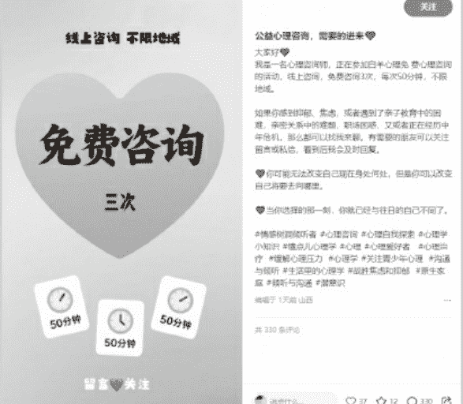

只要有一条内容被人看到、有人互动，你就已经迈出了第一步。而且现在AI工具非常发达，你完全可以借助AI工具生成选题、写文案、剪视频、改脚本，大大提升内容输出效率。不要怕没人看，也不要怕一开始没人买，只要你持续输出，就能慢慢积累起属于你的第一批关注者。

### 3. 主动加入社群，寻找目标人群聚集地

如果你的产品是面向特定人群的，那你一定要找到这些人活跃的地方。比如，你想卖简历优化服务，那就去豆瓣的招聘类社群、求职交流群、职场成长圈子里混个脸熟；如果你想卖AI工具使用教程，那就去一些科技类论坛、知识付费社群、AI学习小组里参与讨论（见图6-3）。

在这类社群中，最好不要一开始就打广告，而是要先提供价值、建立信任。比如，别人问“怎么用AI写一篇10万+的公众号文章”，你就可以先晒一晒自己的成绩，然后回答得专业一些，最后加上一句：“我整理了一份AI写作技巧文档，需要的可以私信我。”

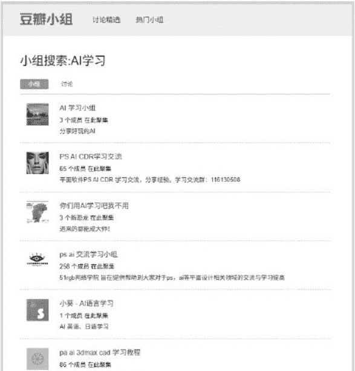

图6-3 搜索豆瓣群组

前面提到的这些都是轻量级的引流动作，也是你获取第一批用户的有效方式。当你拥有了第一批用户，你就拥有了真正的起点。而这个起点，不是靠运气得来的，而是你自己一步一步打造出来的。

图6-3 搜索豆瓣群组

前面提到的这些都是轻量级的引流动作，也是你获取第一批用户的有效方式。当你拥有了第一批用户，你就拥有了真正的起点。而这个起点，不是靠运气得来的，而是你自己一步一步打造出来的。

## 公域平台账号该如何打造

一人单干过程中想要扩大影响力，绕不开公域平台。抖音、小红书、B站、知乎、公众号……这些平台会聚了大量用户，也提供了最直接的流量入口。

你可以把公域平台理解为一个大型商场，里面人流密集、规则清晰、机会众多，只要你能在这里建立起影响力，就能快速吸引到第一批用户。但问题是，很多人做公域账号，要么只是随手发几条内容就放弃了，要么盲目跟风模仿、追求爆款，结果越做越迷茫。

其实，打造一个能带来成交的公域账号，并不需要你有多强的运营能力，也不需要你天天拍视频、剪辑、写长文。你只需要搞清以下几个关键问题，就能在公域平台找到自己的一席之地。

### 1.选对平台，比努力更重要

不同平台有不同的用户结构和内容偏好。你不能指望在一个平台随便发点东西，就能覆盖所有人群。因此，你需要根据自己的产品属性和目标用户，选择最适合自己的平台。

如果你做的是知识类内容（如写作、职场、理财、学习方法），你可以选择以下平台：

- 知乎：适合深度内容输出，积累专业信任。
- 公众号：适合沉淀粉丝、建立品牌背书。
- 小红书：图文+短视频结合，适合轻量级内容推广。
- B站：适合系统性教学、课程讲解、经验分享。
- 知识星球：适合做付费社群、私域转化。

如果你做的是视觉类产品（如PPT模板、简历美化、Logo设计），你可以选择以下平台：

- 小红书：展示作品集、案例对比、制作过程。
- 抖音：视频化呈现设计过程、前后对比。
- 微博：话题营销、热点借势、互动传播。
- 花瓣网/站酷：设计师聚集地，适合行业曝光。
- 淘宝店铺详情页：如果你卖的是实物或数字商品，这里也是重要的流量入口。

如果你做的是技能型变现（如剪辑、编程、咨询、私域陪跑），你可以选择以下平台：

- 抖音/B站：展示实操过程、技巧教学、前后对比。
- 知乎：回答相关问题，建立专业形象。
- 微信视频号：与公众号联动，形成闭环。
- 豆瓣小组：精准人群聚集地，适合种草式推广。
- 淘宝问答区：用户真实提问，是最好的内容素材来源。

很多平台内容都可以通用，如果有精力，可以多选几个平台尝试。但同时也要选择1～2个平台重点运营，追求稳定的曝光和转化。

### 2.账号定位清晰，才能让人记住你

很多人经营账号失败，不是因为内容不好，而是因为他们不知道自己到底是谁、擅长什么、能帮用户解决什么问题。所以，在你开始发布内容之前，必须先给你的账号做一个清晰的定位。

你可以用一句话来概括自己的账号定位，比如：我是AI写作导师，我能教普通人用AI写出高质量文案；我是PPT设计师，我能帮职场人士做出有高级感的汇报方案。这个定位不一定一开始就完美无缺，但一定要足够聚焦。只有这样，平台才会给你打上标签，用户也才更容易识别你、记住你。比如，很多做自媒体的博主都会在主页的简介部分清晰地标注自己的账号定位。

如果你不太擅长编写账号主页的个人简介，那么你可以参照以下提示词模板（比如你是一名在B站分享社交媒体运营知识的博主），让AI来为你生成对应的账号主页个人简介。

我是一名专业的新媒体运营知识分享博主，尤其擅长为B站平台的用户分享相关知识。请为我的B站账号主页设计一下个人简介。

#### 【我的基本信息】

- 身份：B站UP主。
- 内容领域：新媒体运营。
- 目标观众：零基础小白、想转行新媒体的人、个体创业者。
- 内容形式：教程、案例分析、工具分享、行业洞察。

#### 【简介要求】

- 请提供4个不同风格的个人简介版本。
- 版本A：专业干货型，突出权威性和知识密度。
- 版本B：亲切成长型，突出陪伴感，从新手到高手的历程。
- 版本C：犀利洞察型，突出独特观点和行业批判。
- 版本D：轻松网感型，使用B站流行语，突出趣味性和易理解。
- 每版简介控制在80～120字之间。
- 在简介中自然地融入以下关键词（选填）：运营干货、流量密码、爆款拆解、小白友好、个人IP。
- 结尾可以加上有号召力的关注语。

当你按以上提示词向AI提问时，AI可能会生成如图6-4所示的个人简介版本，然后你结合自身需求，进行适当的润色和修改就可以使用了。

图6-4 AI生成的不同版本的个人简介

### 3.内容要有个人风格且精准

很多人经营公域账号，觉得“内容越多越好”，于是每天追热点、学剪辑、练口播，结果忙得不可开交，粉丝没涨多少，反而越来越焦虑。其实，一个人做公域账号，不需要日更、不需要高产，只需要找到自己的风格并精准输出即可。

很多新手一上来就学大V拍视频、模仿网红说话，结果越拍越累，越做越不像自己。其实，你只要找到自己的表达方式，就能建立起独特的记忆点。专业、幽默、搞怪、感性……无论你是哪种风格，都要做到真实、稳定、可识别。这样用户才会记住你、信任你、愿意继续关注你。

除要有个人风格外，内容精准也很重要。精准的内容不是泛泛而谈，而是直击某一类人群的核心需求。你要清楚你的产品是为谁做的，他们最关心什么问题，又最容易被哪些信息打动。只有围绕这些真实的需求去创作，才能让看到你的内容的人觉得“这正是我需要的”，从而愿意停留、互动，这样他们才有可能购买你的产品。

公域账号不只代表你在平台的存在感，更是你对外展示专业能力的门面，也是你积累私域流量的基础。它能帮你筛选出第一批精准用户，还能为你后续的社群运营、个人品牌建设打下信任基础。所以，别再把公域账号当成可有可无的存在。从今天开始，认真对待每一次发布、每一条内容、每一个互动。用个人风格打动人心，用内容精准吸引用户，用持续输出赢得机会。

## 如何做好私域引流

在公域平台经营账号，是为了让人看到你。而把用户引到私域里，才是真正成交的开始。你可以把私域理解成一个属于你的“用户池”，它可能是一个微信群、一个知识星球、一个公众号，甚至是你自己的朋友圈。一旦用户进入这个池子，你就拥有了持续触达他们的能力，而不是只能靠平台算法决定他们能不能再看到你。

想要在私域中积累用户，第一步就是在公域平台获得曝光。你不需要追求百万播放量，也不需要成为大V，只要你的内容能被目标人群看到，并让他们产生兴趣，就足够了。

你可以选择1~2个平台深耕，比如知乎、小红书、抖音或B站，围绕你能提供的产品和服务持续输出干货内容。这些内容可以是技巧类、避坑类、案例类，也可以是热点解读或行业趋势分析。关键是，你要让目标用户觉得你讲的东西正好是他目前最需要的。

### 1.曝光只是起点，引导才是关键

当你开始有稳定的播放量和互动反馈时，你就已经具备了初步的流量基础。有了曝光之后，下一步就是把对的人引到你的私域里来。你可以通过以下方式完成这一步骤。

- 在视频结尾加一句：“评论区留言‘资料’，送你一份可编辑模板。”
- 在图文笔记后附上一句：“如需进阶服务，请私信我获取试用名额。”
- 在知乎回答末尾留下一句：“如果你也遇到类似问题，欢迎联系我交流。”

除了这些线上方式外，你还可以利用一些线下机会。如果有线下活动、讲座，你可以在现场放置印有个人微信二维码或企业微信活码的宣传海报，目标用户扫码添加可获取专属优惠券或专业咨询服务等；参加行业展会时，在名片上印上小程序二维码，目标用户扫码可进入私域专属福利页面，领取样品或试用服务。

针对不同需求和不同意向程度的用户，你也可以设计差异化的引流策略。对于刚关注的新用户，在欢迎私信中推送免费的基础课程资料包，引导其添加微信获取；对于有过多次互动的高意向用户，直接发送“专属优惠活动仅限微信好友参与”的消息，吸引其进入私域。

你要做的不是让人看见你，而是让人信得过你。在这个过程中，“信任”是关键桥梁。很多人发了很多内容，也积累了一些关注，但始终无法引导用户加微信、进群、下单，根本原因就在于他们忽略了这个中间环节：没有让别人真正建立起对你的信任。

### 2.信任是如何建立的

信任不是靠一句广告词建立的，也不是靠一段爆款视频就能建立的，它是一个“持续输出+稳定影响+有效互动”的过程。你可以把它理解为一个“印象累积”的过程：用户第一次看到你时，可能只是觉得“这个人讲得有点道理”；第二次看到你时，开始觉得“这个人好像经常出现，可能是专业的”；第三次看到你时，会想“也许我也可以找他聊一聊”。这种心理变化，就是信任逐步建立的过程。

在建立信任的过程中，你可以通过数据分析工具，了解用户在公域平台上对哪些内容比较感兴趣，比如在公众号后台查看文章阅读时长、转发率，在抖音查看视频完播率、点赞评论数据。根据这些数据，优化后续内容创作方向，持续输出更贴合用户需求的内容，进一步强化用户对你的信任。

所以，与其追求一次性爆发式引流，不如思考你有没有持续提供价值？你有没有让用户感受到你的专业和诚意？你有没有在每次发布内容时，都传递出一个稳定的“你是谁、你能帮谁、怎么帮”的信号？这些才是决定用户是否愿意购买的关键。

私域引流并非一蹴而就的短跑，而是一场需要耐心的马拉松。通过公域曝光吸引注意，用价值内容建立信任，再以多样化的引流方式将用户沉淀至私域，每一步都环环相扣。只要坚持深耕，不断优化方法，你也能搭建起属于自己的高黏性私域流量池，为一人单干事业的发展注入源源不断的活力。

## 一人单干如何运营好社群

在前面讲到，一人单干想要稳定运营，不能只停留在公域平台的曝光层面，而是要把流量沉淀下来，逐步建立信任、引导成交。当你通过朋友圈、公众号、社交平台等渠道吸引用户进来后，你会发现，自己已经拥有了一批“愿意了解你”的人。

这些人有的加了你的微信，有的进了你的资料群，有的订阅了你的内容，还有的开始使用你的产品。这时候，你就不再只是个内容创作者，而是一个真正意义上的社群运营者。社群不是建好了就完事了，它需要持续的内容输出、互动机制和价值引导，才能真正发挥它的作用。如果你不用心运营，那这个群最终只会变成一个“死群”，没人说话，没人互动，没人下单。

所以，一人单干能不能跑通私域闭环，关键就在于你愿不愿意运营社群、会不会运营社群、有没有能力通过社群促成成交。

### 从轻量级社群做起

在一人单干模式下，社群的规模不一定要很大，也不需要很复杂。你可以从最小的单位开始，用最轻量的方式运营，既不会占用太多时间，又能带来持续的价值输出。你可以先尝试以下几种“轻量级社群”模式，找到最适合自己的那一款。

1. “资料+答疑”型社群

比如，你卖一份写作课程、PPT模板包或剪辑技巧手册，可以附带一个微信群或知识星球小组，定期发布使用技巧、答疑反馈、优化建议等内容。这种形式不需要你每天活跃，只需每周花一点时间整理用户问题、更新资料即可，既能提升产品附加值，也能增强用户黏性。

2. “打卡+陪跑”型社群

如果你的产品是一个训练营或课程，比如短视频剪辑教学、AI工具使用指南、写作训练计划等，你就可以建一个打卡群，鼓励用户每日或每周完成任务，并给予简单点评。这种形式不仅能帮助用户坚持学习，还能在互动中不断强化用户对你的信任。

3. “兴趣+交流”型社群

如果你是做自媒体运营、职场成长、品牌策划的，你就可以建一个“新媒体人交流圈”“职场新人互助组”或“IP打造小站”，为成员之间互相交流经验、分享案例、提出问题搭建一个平台。你只需要偶尔出面解答，就能营造良好的氛围。

这些类型的社群都不需要你全职投入，也不需要你有很强的管理能力。你只需要定期发布一些有价值的内容，设置好基本规则防止刷屏，在关键节点回应提问，并时不时地鼓励用户互动即可。这样就能维持一个稳定运转的小型社群，为后续的产品推广和成交转化打下基础。

### 怎样运营社群才能赚到钱

要想通过社群赚到钱，不能只靠热闹和情感维系，还要有一套清晰的变现路径。你可以把社群运营看作一个逐步筛选用户、建立信任、最终促成成交的过程。从最初的免费互动开始，再到轻量级付费，最后引导用户购买高价值服务，一步步让用户愿意为你的产品或服务掏钱。

最基础的是免费社群。它是你整个变现体系的入口，也是用户初步了解你、信任你的地方。在这一层里，你不需要直接推销产品，而是通过持续输出价值来吸引那些真正有需求的人。他们会在交流中主动提问、参与讨论，也会对后续的产品产生兴趣。

你可以在这个群里定期分享干货，比如每周发布一个实用技巧、解析一个真实案例、回答几个高频问题。这些内容不需要太长，也不需要太复杂，只要能解决用户当下的一个小痛点，就能慢慢建立起专业形象。

接下来是付费会员或深度陪伴型服务。这个阶段的用户已经对你有一定的认知和信任，愿意花一点钱获取更多专属权益。你可以提供一些增值服务，比如更系统的资料包、优先答疑机会、直播课程回放、专属模板资源等。价格不必太高，99元、199元都是比较适合的入门价位。重点在于让用户觉得这笔投入值得，而且可以带来长期价值。这种模式不是简单的“卖课”，而是一种持续性的陪伴关系。它能让用户感受到稳定的支持，也能让你获得可复制、可持续的收入来源。

再往上，就是一对一的定制化服务。比如品牌定位咨询、图书选题策划、升学报考指导等，这些都是在前两种的基础上自然延伸出来的高单价转化路径。这类用户往往已经在社群中互动过多次，对你有较高的认可度，也更愿意为个性化服务买单。

当然，除了自己的产品，社群也可以适当引入一些与社群调性相符的外部合作项目，也就是我们常说的“商单”。如果你是运营职场成长类社群的，就可以推荐一本契合主题的图书或线上训练营；如果你是运营短视频类社群的，就可以分享一款好用的剪辑工具或素材平台；如果你是做知识付费的，就可以接一些相关课程或学习平台的合作推广。

但要注意的是，这些商单必须和你的社群成员高度匹配，否则会破坏用户的信任感。你不能为了短期收益去推一个完全不相关的产品，那样只会让群成员失望，甚至导致他们退群。

总的来说，社群能不能赚到钱，关键在于你有没有设计出一套层层递进的价值链。从免费内容吸引关注，到付费服务深化信任，再到定制化产品实现高转化，每一步都要围绕用户的实际需求来展开。而当你掌握了这套结构，就不只是在运营社群了，而是在打造一个属于你自己的一人商业模式。

## 一人单干如何运营好社群

在前面讲到，一人单干想要稳定运营，不能只停留在公域平台的曝光层面，而是要把流量沉淀下来，逐步建立信任、引导成交。当你通过朋友圈、公众号、社交平台等渠道吸引用户进来后，你会发现，自己已经拥有了一批“愿意了解你”的人。

这些人有的加了你的微信，有的进了你的资料群，有的订阅了你的内容，还有的开始使用你的产品。这时候，你就不再只是个内容创作者，而是一个真正意义上的社群运营者。社群不是建好了就完事了，它需要持续的内容输出、互动机制和价值引导，才能真正发挥它的作用。如果你不用心运营，那这个群最终只会变成一个“死群”，没人说话，没人互动，没人下单。

所以，一人单干能不能跑通私域闭环，关键就在于你愿不愿意运营社群、会不会运营社群、有没有能力通过社群促成成交。

### 从轻量级社群做起

在一人单干模式下，社群的规模不一定要很大，也不需要很复杂。你可以从最小的单位开始，用最轻量的方式运营，既不会占用太多时间，又能带来持续的价值输出。你可以先尝试以下几种“轻量级社群”模式，找到最适合自己的那一款。

- 1. “资料+答疑”型社群

比如，你卖一份写作课程、PPT模板包或剪辑技巧手册，可以附带一个微信群或知识星球小组，定期发布使用技巧、答疑反馈、优化建议等内容。这种形式不需要你每天活跃，只需每周花一点时间整理用户问题、更新资料即可，既能提升产品附加值，也能增强用户黏性。

- 2. “打卡+陪跑”型社群

如果你的产品是一个训练营或课程，比如短视频剪辑教学、AI工具使用指南、写作训练计划等，你就可以建一个打卡群，鼓励用户每日或每周完成任务，并给予简单点评。这种形式不仅能帮助用户坚持学习，还能在互动中不断强化用户对你的信任。

- 3. “兴趣+交流”型社群

如果你是做自媒体运营、职场成长、品牌策划的，你就可以建一个“新媒体人交流圈”“职场新人互助组”或“IP打造小站”，为成员之间互相交流经验、分享案例、提出问题搭建一个平台。你只需要偶尔出面解答，就能营造良好的氛围。

这些类型的社群都不需要你全职投入，也不需要你有很强的管理能力。你只需要定期发布一些有价值的内容，设置好基本规则防止刷屏，在关键节点回应提问，并时不时地鼓励用户互动即可。这样就能维持一个稳定运转的小型社群，为后续的产品推广和成交转化打下基础。

### 怎样运营社群才能赚到钱

要想通过社群赚到钱，不能只靠热闹和情感维系，还要有一套清晰的变现路径。你可以把社群运营看作一个逐步筛选用户、建立信任、最终促成成交的过程。从最初的免费互动开始，再到轻量级付费，最后引导用户购买高价值服务，一步步让用户愿意为你的产品或服务掏钱。

最基础的是免费社群。它是你整个变现体系的入口，也是用户初步了解你、信任你的地方。在这一层里，你不需要直接推销产品，而是通过持续输出价值来吸引那些真正有需求的人。他们会在交流中主动提问、参与讨论，也会对后续的产品产生兴趣。

你可以在这个群里定期分享干货，比如每周发布一个实用技巧、解析一个真实案例、回答几个高频问题。这些内容不需要太长，也不需要太复杂，只要能解决用户当下的一个小痛点，就能慢慢建立起专业形象。

接下来是付费会员或深度陪伴型服务。这个阶段的用户已经对你有一定的认知和信任，愿意花一点钱获取更多专属权益。你可以提供一些增值服务，比如更系统的资料包、优先答疑机会、直播课程回放、专属模板资源等。价格不必太高，99元、199元都是比较适合的入门价位。重点在于让用户觉得这笔投入值得，而且可以带来长期价值。这种模式不是简单的“卖课”，而是一种持续性的陪伴关系。它能让用户感受到稳定的支持，也能让你获得可复制、可持续的收入来源。

再往上，就是一对一的定制化服务。比如品牌定位咨询、图书选题策划、升学报考指导等，这些都是在前两种的基础上自然延伸出来的高单价转化路径。这类用户往往已经在社群中互动过多次，对你有较高的认可度，也更愿意为个性化服务买单。

当然，除了自己的产品，社群也可以适当引入一些与社群调性相符的外部合作项目，也就是我们常说的“商单”。如果你是运营职场成长类社群的，就可以推荐一本契合主题的图书或线上训练营；如果你是运营短视频类社群的，就可以分享一款好用的剪辑工具或素材平台；如果你是做知识付费的，就可以接一些相关课程或学习平台的合作推广。

但要注意的是，这些商单必须和你的社群成员高度匹配，否则会破坏用户的信任感。你不能为了短期收益去推一个完全不相关的产品，那样只会让群成员失望，甚至导致他们退群。

总的来说，社群能不能赚到钱，关键在于你有没有设计出一套层层递进的价值链。从免费内容吸引关注，到付费服务深化信任，再到定制化产品实现高转化，每一步都要围绕用户的实际需求来展开。而当你掌握了这套结构，就不只是在运营社群了，而是在打造一个属于你自己的一人商业模式。

## 投流，让你的产品被更多人看到

在一人单干的过程中，很多人对“投流”避而远之，觉得它成本高、风险大、操作复杂。其实，投流并不是只有大公司才能做的事，也不是只有专业团队才能操作。只要你掌握了基本逻辑，就能用小预算撬动大流量，让自己的产品和服务被更多人看见。

现在，互联网上的流量获取机制已经变了。你不能只靠自然流量活着，也不能完全依赖朋友圈熟人转化。要想真正扩大影响力，你必须学会利用平台的投放机制，主动出击，让更多潜在用户找到你。

一人单干在起步阶段，可以依赖自然流量做冷启动。比如发朋友圈、在知乎回答问题、在小红书分享案例、在抖音录口播视频……这些方式都能帮你积累第一批用户。当你想进一步扩大影响时，你就不能只靠“等推荐”。这时候就需要引入付费流量，也就是我们常说的“投流”。

目前主流的投流平台有以下几个，它们各有特点，适合不同类型的内容推广：

- 抖音（DOU+）：适合短视频创作者、口播型知识博主、带货类内容。
- 小红书信息流广告：适合图文内容、知识类课程、资料包推广。
- 微信公众号/广点通：适合长文输出、深度内容分享、线上训练营引流。
- 知乎盐选/信息流广告：适合专业类内容、职业成长类产品的精准触达。
- B站UP主合作+信息流补充：适合打造长期IP、积累粉丝信任的路径。
- 淘宝直通车/拼多多推广工具：如果你卖的是实物或电子文档，可以考虑。

你可以根据自己的产品类型、目标人群选择1～2个平台进行尝试，不需要全面铺开。下面以抖音为例，介绍投流的基本操作。

### 1. 自己投DOU+，快速测试市场反应

如果你是一个正在推广一本新书的一人公司创始人，写了一本关于职场成长的实战手册，那你在抖音上可以这样开启自己的轻量级投流尝试。

首先，你要准备一个能体现这本书价值的短视频。你可以选择讲一个书中最吸引人的观点、拆解一个常见但容易被忽视的沟通技巧，或者干脆做一段口播内容。这类内容不需要太长，1～2分钟就足够，重点是让人产生共鸣，并愿意进一步了解你的书。

接下来，你就可以上线DOU+进行投放。DOU+是抖音官方提供的短视频推广工具，操作简单、门槛低，非常适合个人创业者使用。其具体操作流程如下。

（1）找到一个表现不错的视频（即使自然流量不高，但只要互动率尚可即可）。

（2）在发布页点击“提升作品推荐”，进入DOU+界面。

（3）设置每日预算（建议从30元起投），设定目标人群。

（4）选择“粉丝量”作为投放目标。

在设置人群时，你可以选择：

- 年龄：22～35岁。
- 兴趣标签：如“职场干货”“求职技巧”“职业规划”“读书分享”等。
- 地域：先在小范围内测试，逐步扩展。
- 性别：根据你的书籍内容来判断是否需要定向筛选。

投流之后，你需要关注几个关键数据。比如，视频播放量是否提升，点赞量和评论数有没有增加，是否有人转发、收藏，甚至直接下单购买。这些数据能帮助你判断用户对你的内容是否感兴趣，你还有没有必要继续加大预算投流。

选择这种方式，不需要你有大预算，也不需要你懂得复杂规则，只需要你愿意动手尝试。DOU+的投放逻辑非常清晰，只要你设置好人群、预算和期望达到的目标（点赞量、评论数、转发数、主页访问量等），就能快速获得曝光机会。当然，你还可以结合AI工具，让AI帮你优化文案、生成脚本、分析爆款视频结构，进一步提升投流效率。

### 2. 与达人或投流公司合作

除了自己投DOU+，你还可以通过达人带货或者找专业投流团队协助的方式，快速扩大产品的影响力。相比于自己投DOU+，这种方式的成本会高一些，但效果会好一些，更适合那些已经有一定基础内容、想尽快打开市场的创业者。

如果你的书面向的是职场新人，那你就可以寻找一些职场类、学习类、成长类达人进行合作。比如，让达人出镜讲解书中的某个核心观点，或让达人直播带货，介绍这本书的价值和适用场景。

你不需要找头部大V，也不需要支付高昂的费用，中小达人反而更容易促成转化。他们的粉丝黏性高、信任感强，而且合作费用也相对可控。比如你联系一位有1万粉丝的职场博主，让他录一段“职场表达避坑指南”的短视频，在结尾提到你的书并附上链接，收费可能只需几百元。如果这段视频带来了几十个成交订单，那就非常划算了。

如果你对平台机制不太熟悉，也不想花太多时间研究投流细节，那也可以考虑找一家专业的投流公司合作。比如和一家小型投流工作室合作，让他们帮你设计一条视频脚本、匹配两位合适的小达人、同时上线DOU+进行补充投放，整个预算控制在1万元以内，最终带来的图书销量和品牌曝光可能会远超投入的成本。

其实无论选择哪种方式，目的都是一样的：让更多真正需要你的产品的人，看见你的产品、了解你的产品、愿意购买你的产品，同时要计算好投入与产出的比率，看看自己是否能接受，这才是真正属于一人单干的流量打法。

# 第7章 一人单干变现，如何才能真正赚到钱

## 有了流量，为什么还是赚不到钱

一人单干最怕的，不是没有流量，而是明明有流量了，却始终赚不到钱。很多人运营账号、发内容、投广告，辛辛苦苦积累了几千、几万甚至几十万粉丝，但收入甚微。他们以为流量就是资本，只要有人看，就一定能转化；只要有人关注，就一定能成交。其实，在这个信息爆炸的时代，流量本身不值钱，能带来成交的流量才值钱。

### 值钱的流量，稳定且精准

流量的价值，不在于数量，而在于质量。真正值钱的流量，具备两个核心特征：稳定、精准。一人单干想要靠流量赚钱，在获取流量时也要围绕这两点展开。

1. 流量稳定，意味着你能持续获得曝光机会

所谓“稳定”，就是你的账号不是靠运气火了一次，而是能持续产出用户愿意看的内容。比如，你在小红书连续发5篇关于职场新人话术的图文，每篇点赞量都在3000～5000，评论区也有互动；或者是在B站发布的视频内容，能够持续获得稳定的播放量，这种稳定的流量才最值得经营。

相比之下，哪怕你有一个100万播放量的视频，如果用户只是随手划过，没留下任何互动痕迹，那它的商业价值可能还比不上那几条稳定内容的曝光带来的价值。平台推荐机制不会永远偏向你，只有当你找到适合自己的内容方向，并能稳定产出时，账号才会被系统识别为“有价值账号”，你也才有可能获得稳定的流量，迎来可持续的变现机会。

2. 精准，意味着你能触达真实需求者

什么叫精准？就是那些关注你的人，真的是你需要服务的对象。哪怕你发布的视频的播放量只有几千，只要它们吸引来的用户正好是你的产品的潜在买家，那这几千播放量的价值，远比几万泛流量更有意义。

这就好比你在商场里开了一家高端相机配件店，结果门口天天经过的是小学生，他们只是路过看看，根本不会走进来问价格、试产品、下单购买。这就是典型的“泛流量陷阱”。而真正的精准流量，是指那些本身就带着问题、需求，甚至有消费意愿的人群。

在B站上，有一个数码测评UP主，主要分享的是“百元耳机推荐”“千元内手机性价比对比”“大学生用什么笔记本更实用”等内容。他的粉丝不算多，只有几万，但他每条视频下的评论区都有不少人留言问：“这个耳机还能买到吗？”“可以出一期关于游戏本推荐的视频吗？”“你评测得真细，能帮我选一台符合我的预算的笔记本吗？”

### 流量进私域，变现靠转化

前面说过，即使你积累了不少公域流量，但如果这些用户没有进入你的私域，那你依然很难赚到钱。当然，流量进了私域也不代表马上就能成交。很多人误以为只要对方愿意进入自己的私域，就说明对方有需求，其实不然。他们可能是出于好奇，也可能是冲着你送的资料而来的。所以你要做的，不是一上来就推销产品，而是设计一个循序渐进的转化路径，让用户在互动中逐渐产生购买意愿。

你可以依循“免费—低价—高价”这个路径来引导用户：先用一份免费资料或一次答疑吸引关注，再推出一个9.9元的小产品作为入门体验，最后才是高价课程、陪跑服务或定制方案。这种阶梯式转化方式，既能降低用户的决策压力，也能让你的产品更容易被接受。最好不要一上来就强推高价产品，而是要先让用户尝到一点甜头，这样他们才会主动找你买更多产品。

很多账号刚有一点播放量就开始推课、拉群、搞付费会员，结果没人下单，甚至还有人取关。这是因为用户还没建立起对你的信任，你却突然要他们掏钱。这不是变现，这是赶人。所以一定要记住，在私域中做转化，不能一上来就推销产品。你应该先让用户感受到价值，再逐步引导他们进入成交流程。

一人单干能不能跑通，不取决于视频的播放量，也不取决于视频的点赞量和收藏数，而是在于你有没有能力把看视频的人变成真正的用户。所以，别再盲目追爆款、求涨粉、搞泛流量。你要做的，是找到那个既能稳定产出，又能吸引目标用户的流量路径。然后，把它变成你的私域资产，一步步引导用户完成从“信任”到“购买”的全过程。

### 流量进私域，变现靠转化

前面说过，即使你积累了不少公域流量，但如果这些用户没有进入你的私域，那你依然很难赚到钱。当然，流量进了私域也不代表马上就能成交。很多人误以为只要对方愿意进入自己的私域，就说明对方有需求，其实不然。他们可能是出于好奇，也可能是冲着你送的资料而来的。所以你要做的，不是一上来就推销产品，而是设计一个循序渐进的转化路径，让用户在互动中逐渐产生购买意愿。

你可以依循“免费—低价—高价”这个路径来引导用户：先用一份免费资料或一次答疑吸引关注，再推出一个9.9元的小产品作为入门体验，最后才是高价课程、陪跑服务或定制方案。这种阶梯式转化方式，既能降低用户的决策压力，也能让你的产品更容易被接受。最好不要一上来就强推高价产品，而是要先让用户尝到一点甜头，这样他们才会主动找你买更多产品。

很多账号刚有一点播放量就开始推课、拉群、搞付费会员，结果没人下单，甚至还有人取关。这是因为用户还没建立起对你的信任，你却突然要他们掏钱。这不是变现，这是赶人。所以一定要记住，在私域中做转化，不能一上来就推销产品。你应该先让用户感受到价值，再逐步引导他们进入成交流程。

一人单干能不能跑通，不取决于视频的播放量，也不取决于视频的点赞量和收藏数，而是在于你有没有能力把看视频的人变成真正的用户。所以，别再盲目追爆款、求涨粉、搞泛流量。你要做的，是找到那个既能稳定产出，又能吸引目标用户的流量路径。然后，把它变成你的私域资产，一步步引导用户完成从“信任”到“购买”的全过程。

## 一人单干的5种变现方式

在传统职场中，我们习惯了“一份工作换一份工资”的模式。但在一人单干模式中，收入来源可以是多元的。你可以通过知识服务、会员订阅、平台分成、广告合作、直播带货等形式，让自己的能力转化为可持续的收益。

这些变现方式之间并不冲突，也不是只能选其一。它们更像是你在不同阶段可以灵活使用的工具，它们不仅可以让你的能力被看到，还能被真正地“买走”。

接下来我们就来看一看，在当前环境下，最适合个人创业者尝试的5种变现方式，以及它们背后的运作逻辑和适用场景。

### 1. 知识服务变现：用知识经验换收入

所谓知识服务变现，就是把你掌握的知识、经验或技能，包装成一个具体的产品或服务，卖给有需要的人。比如，你擅长AI写作，那便可以整理出一套“AI爆款文章写作”课程；你擅长视频剪辑，便可以承接视频剪辑项目，或是指导别人学习视频剪辑技能。

知识服务变现的核心，是把你的能力转化为别人愿意购买的东西。它可以是一份资料包、一次远程咨询，也可以是一套轻量级课程、一个工具模板、一本电子书。关键不在于它有多系统、多专业，而在于它能不能立刻被人使用、被验证有效。如果你已经积累了一些经验、做过一些项目、解答过不少问题，那你就已经具备了产品化的能力。

### 2. 会员订阅变现：靠陪伴赢得长期用户

如果你的内容已经积累起一定的用户基础，并且他们对你有初步的信任，那你就可以尝试会员订阅变现。这种变现方式的核心在于，你提供的价值不是一次性的，而是持续性的。你需要把自己的能力变成一种长期陪伴型价值，让用户愿意每月或每年为你支付一笔费用。

如果你是一个健身教练或者营养师，擅长帮助普通人制订科学的饮食和运动计划，那你就可以围绕“减肥陪跑”推出一个会员订阅服务——每月69元，提供个性化的饮食建议、训练打卡机制、进度反馈与调整建议。你可以每周发布一次食谱更新，搭配AI生成的个性化建议模板，再结合社群打卡、朋友圈答疑、一对一咨询等方式，让加入的人真正感受到付费的价值。

采用这种模式销售的是一种陪伴型产品。它让用户觉得，不只是买了一份课程，而是有一个人在陪着自己坚持下去。只要你能保持节奏输出、定期互动、及时反馈，就能建立起稳定的复购关系。

### 3. 平台分成变现：借助平台完成交易闭环

除自己开发产品之外，你还可以直接接入平台，成为内容创作者、带货达人、知识分享者，从中获得分成收益。这在知乎、B站、微信公众号、喜马拉雅等平台很常见。你可以在知乎上发布长文，靠优质内容获得平台奖励；你可以在B站上传视频，靠播放量和粉丝激励计划获得收入；你可以在公众号上写深度文章，靠流量主分成获得收益。

虽然这些都不是大头收入，但它有一个非常大的好处，就是可以让你一边赚钱，一边积累粉丝流量。当然，这种模式更适合已经有账号基础的人使用。如果你刚起步，就别想着靠平台分成养活自己，而是把它当作一种额外收入，用来验证你的内容是否被市场接受。

### 4. 广告合作变现：让别人为你的影响力下单

如果你已经在公域平台积累了一定的关注度，比如有几千粉丝、几万播放量、不错的互动率，那你就可以考虑接一些广告合作。目前，根据平台的不同，广告合作变现的形式多种多样，比如品牌植入、产品测评、内容共创等。

这种变现方式的关键在于，你有没有稳定的影响力。你不一定非要成为百万粉丝博主，只要有精准的目标人群、内容稳定、口碑不错，就有可能接到合作邀约。它的优点是单次合作收入高，且不需要你亲自卖货。缺点是平台规则变化快，合作机会不稳定，对账号调性和内容的匹配度要求较高。所以，这种变现方式也比较适合已经有账号基础、内容稳定、具备一定影响力的创作者使用。

### 5. 直播带货变现：边讲边卖，提升转化效率

直播带货听起来像是电商创业才能做的事，但现在只要有优质流量，都可以试一试直播带货。直播带货的优势在于，你能跟用户实时互动，在展示专业度的同时，也能推动即时成交。如果你擅长表达、乐于互动、能带动氛围，那就别只停留在发视频和写文章上，试着开一场直播，看看效果如何。

这5种变现方式没有优劣之分，只有适不适合的区别。你可以选择其中一两个重点突破，也可以组合使用，逐步建立起属于自己的变现模式。

## 免费还是收费，不同阶段的定价策略

一人单干在起步阶段，最常遇到的问题是：我的产品该不该收费？如果收费，定价多少合适？有人一开始就定高价，结果没人购买；还有的人价格定得太低，后续涨价让许多用户深感不满。

其实，定价不是玄学，也不是拍脑袋决定的事，而是要结合你当前的能力、信任资产、变现目标来设计一个合适的策略。下面我们以B站UP主“食贫道”为例，来看一看如何在不同阶段调整自己的定价逻辑。

食贫道，人称“饼叔”，曾是央视驻外记者，深入过叙利亚、中东等地拍摄新闻现场。2017年起转型自媒体，在B站发布以“食物为窗口、观察社会真相”为主线的视频，代表作如《中国大叔带500个饺子去见俄罗斯流浪汉，差点儿被打？》《小城夜食记》《迷失东京》等。

食贫道的内容不是一开始就收费的。他早期在B站发布的视频全部免费，但凭借独特的视角和深度的表达，迅速积累起一批愿意长期关注的粉丝。他在视频里虽然也推荐小馆子、尝试异国料理，但真正吸引人的，是他作为前战地记者所具备的独特视角：他不只是记录食物本身，更关注食物背后的人与故事。

他拍的内容没有刻意的剪辑、没有夸张的表演，却透露着一种真实感。这种真实感让他迅速积累了第一批“愿意等更新”的忠实粉丝，这些粉丝不是刷视频的路人，而是被内容打动、愿意持续关注的人。

在这个基础上，他才开始探索变现的可能性。而他所处的平台，正是本身就具备一定付费基础的B站。B站作为一个以年轻人为主力用户的内容平台，早已建立起一套相对成熟的会员制度和创作者激励机制。

其中，大会员制度是平台最核心的付费体系之一。用户开通大会员后可以享受高清画质、无广告观看、专属弹幕特效等福利。对UP主来说，大会员播放量也是重要的收入来源之一。而除大会员之外，B站还提供了一个非常适合个人创作者的工具：充电专属视频。

在B站上，“充电”不是传统意义上的打赏，也不是简单的会员订阅，而是一种粉丝与UP主之间建立深度连接的方式。它是UP主自己设定价格、自己设计回馈内容的一种粉丝运营工具和变现渠道。你可以把充电理解为“粉丝包月制支持”，只要你的内容足够独特，愿意支持你持续创作的人就会主动付费（见图7-1）。

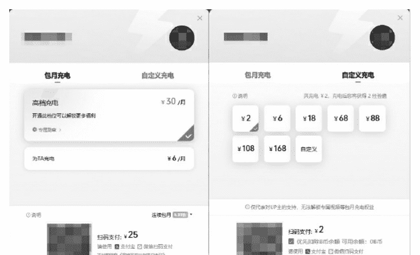

按照B站官方的说法，充电功能最早可追溯至2016年，最初的形式是粉丝通过一次性打赏支持UP主，类似于直播中的礼物打赏。直到2022年底，B站才将这一机制升级为包月模式，让UP主能更稳定地获得来自粉丝的支持。

这个机制允许创作者发布一部分“仅充电用户可看”的内容，价格由UP主自主设定，支持用户按需订阅，也可以随时取消。

这是一套非常灵活的系统，它不像直播带货那样依赖情绪带动，也不像知识星球那样需要自建私域。它更像是一个“轻量级会员制”，你不需要拉人进群、不需要运营社群，也不需要做复杂的营销，只要你的内容足够独特，就能直接获得用户的经济支持。

而这正是食贫道迈出收费变现的第一步。

食贫道在《迷失东京》中首次推出充电专属版本，定价12元/月，约仅为大会员费用的一半，却能解锁完整版视频、导演讲述等内容。这种做法既不会让用户觉得“割韭菜”，也能让真正认可他的观众主动购买。

这条视频上线7小时后，充电金额突破100万元，21万人支持充电，其中15%是从未在B站消费过的“白嫖党”。更重要的是，这当中有37%来自他过去免费内容中完播率最高的那批用户，说明前期的免费内容没有浪费，反而成了后期转化的基础。

进入2024年，他开始系统化运营充电内容，推出系列化作品，如《何以当归》《迦南孤儿》《神鬼传奇》，单集成本高达百万元，但依然维持12元/月的价格不变。通过增加内容密度、提供幕后资料、开放选题投票等方式，提升用户黏性和复购意愿。

从食贫道的案例可以看出，一人单干变现要根据自身不同的发展阶段，制订不同的定价策略。前期做流量、攒用户、积累信任资产，后期以产品独特性锁定核心用户，实现价值变现。只要你能提供足够有价值的产品，让用户觉得“我花这笔钱值了”，那你就可以像食贫道一样，一步步把自己的影响力变成收入。

## 少做一锤子买卖，复购才能持续盈利

很多人在变现的过程中，总把注意力放在如何吸引新人上，却忽略了已有用户的复购潜力。其实，一个用户愿意为你付费一次，就说明他认可你的价值。如果你能让他愿意再买一次，那你就不只是在卖产品，而是在经营一段关系。这才是一人单干在产品变现过程中，最值得掌握的能力之一。

### 一锤子买卖会出现哪些问题

一人单干的变现模式如果只靠一次性成交，那它很难长期稳定发展。真正具备可持续收入能力的个人品牌，背后都有一套让用户愿意反复购买的设计逻辑。

很多创作者、自由职业者、知识博主在初期都能吸引到一些愿意购买的人，但一旦服务结束，用户就不再出现了。这种“买完即走”的现象，就是典型的一锤子买卖。表面上看似完成了交易流程，实际上只是完成了一次性交付。用户没有留下来，也没有形成后续动作，所有的价值输出都停留在单次消费阶段。

这种一锤子买卖，虽然表面上看起来像是实现了变现，但从长期来看，它却存在一些非常明显的弊端。

1.  **变现路径单一且不稳定**
    当你的收入完全依赖新用户不断买单，而没有老用户的复购支撑时，你的生意就变成了一场“拉新游戏”。每一轮增长都必须靠新的流量、新的推广、新的产品来推动，一旦停止拉新，收入就会下滑。也正因如此，你无法形成稳定的现金流预期，也无法建立可复制的商业模式。

2.  **难以形成口碑效应**
    一个用户买完就走，意味着他不会主动分享你的产品，也不会把你的产品推荐给别人。真正能扩大影响力的用户，是那些愿意反复购买、持续互动的人。他们才是你的品牌的“自来水”。

3.  **无法积累真实反馈**
    如果你的产品或服务只有单次交付，那你就很难获得持续的用户反馈。没有反馈，你就无法知道产品哪里做得好、哪里需要优化。你也无法判断用户的真实需求的变化，更难以根据市场反应调整方向。最终只能凭感觉打磨产品，或者盲目地追随热点，反而离真正的用户越来越远。

4.  **收入波动大，缺乏安全感**
    当所有收入都来自新客下单，你就会陷入一个非常被动的局面：今天有人买单，明天没人问津；这个月卖得不错，下个月销量归零。这种不稳定的变现节奏，会让你始终处于焦虑状态，也很难制订中长期规划。

这些弊端其实都指向同一个问题：过度依赖一次性成交，会让一人单干模式陷入“不持续、无复利、难增长”的变现困境。

### 如何打造出能复购的产品

要实现稳定变现，一人单干必须从“卖一次”的逻辑，走向“用户愿意反复购买”的路径。打造复购产品，并不是简单地再推一个新产品，也不是靠降价促销来刺激消费。它更像是一次系统性的设计：你要让用户觉得这次买完之后，还有值得继续投入的理由。

对此，你可以从以下几个角度入手，构建出一个具备复购能力的产品体系。

1.  **把产品做成分阶段交付，让用户有进阶感**
    很多产品之所以无法推动复购，是因为它们没有节奏感，也没有成长性。如果你的产品或服务只是“一次性解决一个问题”，那用户就没有理由再次购买；但如果你把产品或服务设计成阶段性交付，用户就会自然产生“下一步该怎么做”的期待。

    比如，你制作了一套AI写作视频课程，那就不要把它当成“讲完就结束”的知识传递，而要让它成为用户成长的一条路径：
    - 第一周讲“怎么写出一个爆款标题”。
    - 第二周讲“如何借助AI来做文章架构”。
    - 第三周讲“AI提示词如何影响生成内容”。
    - 第四周讲“如何让AI自行修改生成的内容”。
    - …………

    这种层层递进的交付方式，不仅能提升用户的参与度，还能让他们愿意为后续内容付费。一旦用户完成了第一阶段的学习，建立了基本信任，接下来的每一期都会变得更容易成交。而且，这种“进阶式交付”也能让你在过程中不断收集反馈，完善产品内容。

2.  **建立会员体系，赋予会员专属权益**
    除了产品本身的升级，你还可以通过建立会员体系，让一部分用户愿意长期跟随你。这并不是说你要做一个几万人的大社群，而是要围绕你的核心用户，设计一套“专属服务体系”。

    为此，你可以设定不同等级的会员机制：
    - 普通用户：只能获取基础资料包。
    - 进阶用户：可以加入社群，享受定期答疑。
    - 高级会员：享受直播课、专属模板、定制方案等高价值内容。

    会员不只是“付费用户”，更是你的“深度连接者”。他们愿意为你花时间、花精力、花真金白银，说明他们已经把你当作自己成长过程中的重要引路人。这时候你就可以围绕这批人，推出更多进阶内容、专属资源，甚至轻量陪跑服务。只要你能持续提供高于预期的价值，他们就不会轻易离开，反而会主动推荐给身边的人。

3.  **需求预判叠加复购优惠，引导用户持续选择你**
    除了原有的产品体系，你还要学会提前布局，也就是对用户的需求做出预判，并适当调整或推出满足用户新需求的产品。

    比如，你是做短视频剪辑教学的，在用户完成第一轮学习后，你发现很多用户反馈想要了解AI生成视频的内容，这时，你便可以适当调整课程内容，推出“AI生成视频速成班”，然后引导用户购买。你不需要天天催促用户购买，也不需要打折促销，只要在合适的时间点，提供更有价值的选项，就能自然推动复购。

只要你能做好这几个方面的工作，就能慢慢建立起一套属于自己的可持续变现模型。这不仅能让你的收入更稳定，还能让你的产品更有节奏感和成长性。这才是一人单干在AI时代，真正能走稳、走远的方式。

### 3.需求预判叠加复购优惠，引导用户持续选择你

除了原有的产品体系，你还要学会提前布局，也就是对用户的需求做出预判，并适当调整或推出满足用户新需求的产品。

比如，你是做短视频剪辑教学的，在用户完成第一轮学习后，你发现很多用户反馈想要了解AI生成视频的内容，这时，你便可以适当调整课程内容，推出“AI生成视频速成班”，然后引导用户购买。你不需要天天催促用户购买，也不需要打折促销，只要在合适的时间点，提供更有价值的选项，就能自然推动复购。

只要你能做好这几个方面的工作，就能慢慢建立起一套属于自己的可持续变现模型。这不仅能让你的收入更稳定，还能让你的产品更有节奏感和成长性。这才是一人单干在AI时代，真正能走稳、走远的方式。

## 少做一锤子买卖，复购才能持续盈利

很多人在变现的过程中，总把注意力放在如何吸引新人上，却忽略了已有用户的复购潜力。其实，一个用户愿意为你付费一次，就说明他认可你的价值。如果你能让他愿意再买一次，那你就不只是在卖产品，而是在经营一段关系。这才是一人单干在产品变现过程中，最值得掌握的能力之一。

### 一锤子买卖会出现哪些问题

一人单干的变现模式如果只靠一次性成交，那它很难长期稳定发展。真正具备可持续收入能力的个人品牌，背后都有一套让用户愿意反复购买的设计逻辑。

很多创作者、自由职业者、知识博主在初期都能吸引到一些愿意购买的人，但一旦服务结束，用户就不再出现了。这种“买完即走”的现象，就是典型的一锤子买卖。表面上看似完成了交易流程，实际上只是完成了一次性交付。用户没有留下来，也没有形成后续动作，所有的价值输出都停留在单次消费阶段。

这种一锤子买卖，虽然表面上看起来像是实现了变现，但从长期来看，它却存在一些非常明显的弊端。

1. 变现路径单一且不稳定

当你的收入完全依赖新用户不断买单，而没有老用户的复购支撑时，你的生意就变成了一场“拉新游戏”。每一轮增长都必须靠新的流量、新的推广、新的产品来推动，一旦停止拉新，收入就会下滑。也正因如此，你无法形成稳定的现金流预期，也无法建立可复制的商业模式。

2. 难以形成口碑效应

一个用户买完就走，意味着他不会主动分享你的产品，也不会把你的产品推荐给别人。真正能扩大影响力的用户，是那些愿意反复购买、持续互动的人。他们才是你的品牌的“自来水”。

3. 无法积累真实反馈

如果你的产品或服务只有单次交付，那你就很难获得持续的用户反馈。没有反馈，你就无法知道产品哪里做得好、哪里需要优化。你也无法判断用户的真实需求的变化，更难以根据市场反应调整方向。最终只能凭感觉打磨产品，或者盲目地追随热点，反而离真正的用户越来越远。

4. 收入波动大，缺乏安全感

当所有收入都来自新客下单，你就会陷入一个非常被动的局面：今天有人买单，明天没人问津；这个月卖得不错，下个月销量归零。这种不稳定的变现节奏，会让你始终处于焦虑状态，也很难制订中长期规划。

这些弊端其实都指向同一个问题：过度依赖一次性成交，会让一人单干模式陷入“不持续、无复利、难增长”的变现困境。

### 如何打造出能复购的产品

要实现稳定变现，一人单干必须从“卖一次”的逻辑，走向“用户愿意反复购买”的路径。打造复购产品，并不是简单地再推一个新产品，也不是靠降价促销来刺激消费。它更像是一次系统性的设计：你要让用户觉得这次买完之后，还有值得继续投入的理由。

对此，你可以从以下几个角度入手，构建出一个具备复购能力的产品体系。

### 1.把产品做成分阶段交付，让用户有进阶感

很多产品之所以无法推动复购，是因为它们没有节奏感，也没有成长性。如果你的产品或服务只是“一次性解决一个问题”，那用户就没有理由再次购买；但如果你把产品或服务设计成阶段性交付，用户就会自然产生“下一步该怎么做”的期待。

比如，你制作了一套AI写作视频课程，那就不要把它当成“讲完就结束”的知识传递，而要让它成为用户成长的一条路径：

- 第一周讲“怎么写出一个爆款标题”。
- 第二周讲“如何借助AI来做文章架构”。
- 第三周讲“AI提示词如何影响生成内容”。
- 第四周讲“如何让AI自行修改生成的内容”。

这种层层递进的交付方式，不仅能提升用户的参与度，还能让他们愿意为后续内容付费。一旦用户完成了第一阶段的学习，建立了基本信任，接下来的每一期都会变得更容易成交。而且，这种“进阶式交付”也能让你在过程中不断收集反馈，完善产品内容。

### 2.建立会员体系，赋予会员专属权益

除了产品本身的升级，你还可以通过建立会员体系，让一部分用户愿意长期跟随你。这并不是说你要做一个几万人的大社群，而是要围绕你的核心用户，设计一套“专属服务体系”。

为此，你可以设定不同等级的会员机制：

- 普通用户：只能获取基础资料包。
- 进阶用户：可以加入社群，享受定期答疑。
- 高级会员：享受直播课、专属模板、定制方案等高价值内容。

会员不只是“付费用户”，更是你的“深度连接者”。他们愿意为你花时间、花精力、花真金白银，说明他们已经把你当作自己成长过程中的重要引路人。这时候你就可以围绕这批人，推出更多进阶内容、专属资源，甚至轻量陪跑服务。只要你能持续提供高于预期的价值，他们就不会轻易离开，反而会主动推荐给身边的人。

### 3.需求预判叠加复购优惠，引导用户持续选择你

除了原有的产品体系，你还要学会提前布局，也就是对用户的需求做出预判，并适当调整或推出满足用户新需求的产品。

比如，你是做短视频剪辑教学的，在用户完成第一轮学习后，你发现很多用户反馈想要了解AI生成视频的内容，这时，你便可以适当调整课程内容，推出“AI生成视频速成班”，然后引导用户购买。你不需要天天催促用户购买，也不需要打折促销，只要在合适的时间点，提供更有价值的选项，就能自然推动复购。

只要你能做好这几个方面的工作，就能慢慢建立起一套属于自己的可持续变现模型。这不仅能让你的收入更稳定，还能让你的产品更有节奏感和成长性。这才是一人单干在AI时代，真正能走稳、走远的方式。

## AI生成内容该如何变现

AI的能力越来越强，操作起来也越来越简单。现在你不需要会写代码、不需要懂设计，甚至不需要有太多经验，就能用AI生成文章、图片、音乐、视频等内容。很多人开始尝试用AI辅助创作，甚至完全由AI生成作品发布到平台。

但问题也随之而来：AI写出来的东西能卖吗？AI生成的图片可以商用吗？AI创作的音乐真的能换来收入吗？很多创作者发现，他们用AI做出来的东西虽然质量不差，但想要变现真的很难。

那么，AI生成内容的变现难点主要在哪呢？

首先，版权归属尚存争议。目前主流平台对AI生成内容的原创性认定仍存在分歧。比如抖音、B站、网易云音乐等平台，都曾出台规则限制AI生成内容的推荐权重并要求标明“AI辅助创作”。这意味着，如果你只靠AI输出内容而不加署名或标注来源，可能面临限流、下架，甚至账号被封禁的风险。

其次，用户对AI生成内容的信任度偏低。很多人看到“AI生成”，第一反应是“这个内容是真的还是假的？”“它真的能解决我的问题吗？”尤其是一些需要专业判断的内容，用户更希望看到的是“真人交付”，而不是一套标准化的AI产出。

再次，平台审核机制严格。不少社交平台对AI生成的内容设置了自动识别与人工审核机制。有些内容即使播放量不错，也会被判定为“机器内容”而无法参与流量扶持，甚至不能开通商品橱窗或充电专属功能。

这些因素加在一起，导致当下AI生成的内容并不具备天然的变现属性。但这是否意味着你就不能用AI来赚钱了呢？当然不是。

## AI生成内容变现要靠“再创作”

AI生成的内容确实存在变现难度，但AI的价值在于能快速生成初稿、提供结构、节省时间。真正决定AI生成内容能不能赚到钱的关键在于你有没有对其进行深度加工、个性化调整、价值提炼。简单来说，就是你有没有对它进行“再创作”。

### 1.写作类内容：让AI初稿更有“人味”

### 2.图像类内容：让AI来构图，你来完善

当前，AI图像生成工具已经能完成从关键词到画面的转换，甚至能模仿多种艺术风格。但如果你希望这些作品能带来收入，那就不能直接拿AI画出来的图去卖，而是要进行人工完善。

比如，你用Midjourney生成了一套十二生肖的Q版图像，看起来很专业，但配色可能偏冷、字体不够统一、图片缺少层次……这时你就需要自己介入，对细节进行调整，比如先勾勒出一张草图，然后再分层绘制线稿和细节。虽然会费一番工夫，但最终得到的同样是一份可交付、可商用的作品。

在绘图方面，你可以把AI当成一个“初级设计师”，而你自己则是“主理人”。只要你在AI生成的基础上加入自己的风格、品牌元素，它就能成为一份可售卖的视觉资产。这才是当下AI绘画真正的价值所在：它不是替你创作，而是帮你节省时间，让你专注打磨核心内容。

### 3.音乐类内容：AI音乐重新制作，生成新作品

现如今，AI不仅能写文案、画画，还能自动生成旋律、编曲、节奏搭配，甚至能模拟不同乐器的音色组合。但AI生成的音乐也有一个明显的问题：它能听，但在细节方面还存在不少问题。

它只是基于数据模型“复制”了已有的音乐风格，而不是真正“创作”出了打动人心的旋律。所以，如果你想靠AI生成的音乐来变现，就不能直接拿来就用，而要进行“再创作”。相比于写作和绘画，这可能会难一些，需要你具备一点乐理知识，并会运用一些配音、作曲的软件。

不过，经过创作者个人的调试后，相关产品可以申请版权。如此一来，再将其上传到各个音乐平台，就不会受到流量和变现方面的限制了。

在一人单干模式中，AI的价值不在于它能替代你，而在于它能帮你把想法快速落地、让创意变成可交付的内容资产。只要你能完成“再创作”，就能把AI生成的内容，变成真正属于自己的可变现的产品。这也是AI在一人单干模式中的真正定位：为你提效，由你掌控，最终服务于你的个人品牌和商业闭环。

# 第8章 一人单干时代，打造属于你的个人IP

## 人设：放大你的独特优势

在AI时代，信息爆炸、内容泛滥，用户注意力成了最稀缺的资源。这就导致“让人记住”变成了一件难事。不过，近些年来，各类社交平台涌现出了许多让人印象深刻的人，仔细研究会发现，真正能被人记住、产生影响力的人，可能并不是能力最强的，而是“人设最鲜明”的那一批人。

什么是“人设”？简单来说，就是别人对你的印象。它可能是一个标签、一个关键词、一个记忆点。比如：“那个讲商业思维特别犀利的女生”“靠一张嘴把知识付费讲透的职场教练”“用短视频教普通人开公司的创业博主”……他们并非偶然走红，而是主动塑造了清晰、可识别的个人形象。

在一人单干模式中打造人设同样重要，它不仅是扩大影响力的起点，更是构建信任、吸引用户、提高转化率的重要手段。一个人就是一个品牌，而人设，就是这个品牌的灵魂。

## 如何找到属于你自己的人设

很多人想打造人设，但不知道怎么做。其实，好的人设不需要“编造”，只需要挖掘并放大你已经具备的优势。你可以从以下几个角度出发，找到自己的独特之处。

1. 盘点你的核心标签

先问自己几个问题，比如：我是怎样的一个人？我最擅长的技能是什么？我的经历中有哪些与众不同的地方？把这些写下来，你会发现一些关键词标签，这就是你人设的基础。比如，职场妈妈、前大厂员工、独立设计师等。图8-1是常见的一人单干模式的人设标签。

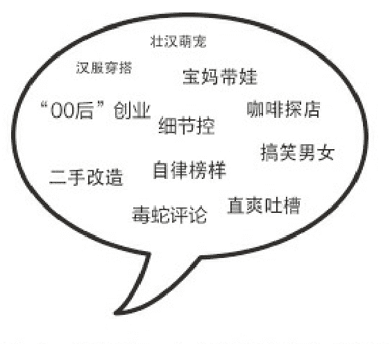

图8-1 常见的一人单干模式的人设标签

你说话的方式、输出内容的形式，也是人设的一部分。比如：干货型，就是直接传授方法；反差型，擅长严肃话题轻松讲；情绪型，很懂共情，能引发共鸣。

2. 定位目标用户画像

打造人设时还要关注你的目标用户，你不需要打造一个所有人都喜欢的人设，只要让自己的目标用户喜欢就可以了。为此，你要明确你的目标用户群体是谁，他们的需求和痛点是什么。

如果你是自由撰稿人，那么你的目标用户可能是中小企业主，他们需要高质量的内容来提升品牌影响力；如果你是健身教练，那么你的目标用户则可能是追求健康生活方式的年轻人。只有当你的人设和用户的期待高度契合时，你才会产生真正的吸引力。

3. 提炼一句人设关键词

最好的人设是一句话就能被记住。这句话不需要太长，但要有画面感、有情绪共鸣、有业务指向。比如，教你避开职场陷阱的前HR总监、零基础也能接单变现的手绘博主、边讲段子边教知识的理财博主、专注小而美品牌视觉的独立设计师等。

4. 持续输出与强化

一旦确定了人设，就要围绕它去设计内容、打造产品、经营社群。不要今天讲职场焦虑，明天聊情感婚姻，后天又推荐读书，这只会让你的人设越来越模糊，越来越没有存在感。你要做的，是在一段时间内，不断重复、不断强化某个形象，直到别人一想到某个领域，就会想到你。

## 人设也需要适当“包装”

人设的本质，是对自我价值的提炼和呈现。适当的包装不是让你伪装成别人，而是让你把自己最核心的优势提炼出来，用更容易被记住和接受的方式呈现出来。

比如，你是一个很有耐心的英语老师，教学经验丰富，学生评价很好。但如果你只是平铺直叙地说“我教了10年英语”，别人可能不会记住你。但如果你说“我是在公园里陪学生练口语的英语老师，用短视频的方式让你像刷剧一样学英语”，这就是一种表达方式上的包装。它并没有夸大事实，而是通过场景化、情绪化、具体化的语言，让人更容易记住你、理解你、喜欢你。所以，包装的本质不是伪装，而是呈现，把你本来有的东西，用更有吸引力的方式展示出来。这里，也有一些人设包装的常见误区需要特别注意（见表8-1）。

表8-1 人设包装常见误区

| 人设包装常见误区 | 具体表现 | 后果 |
| :--- | :--- | :--- |
| 过度美化经历 | 把兼职说成高管，把试水项目包装成成功案例 | 被质疑真实性，失去信任 |
| 照搬他人风格 | 盲目模仿某个网红或大咖的说话方式、视觉风格 | 缺乏辨识度，难以形成个人标签 |
| 标签混乱不清 | 今天讲投资理财，明天聊情感关系，后天又谈读书写作 | 用户记不住你是谁，也不知道你能做什么 |
| 刻意营造完美 | 不敢暴露缺点、不敢承认失败 | 让人觉得距离太远，缺乏共鸣 |
| 忽视平台调性 | 在短视频平台用公众号风格，在知乎发段子文 | 内容与平台不符，影响传播效果 |

那么，如何来把握人设“包装”的尺度呢？可以遵循“721”原则，即7分真实+2分放大+1分优化。具体来说就是，70%来自你本身的真实能力和性格，20%是对这些特质的适度强调和表现，10%是对展现方式的优化，比如语言、视觉、互动方式等。

真正的包装，是让你的核心价值更清晰地被看见，而不是让人误以为你是个完全不同的人。只有真实、有差异、可持续的人设，才能帮你在这个信息过载的时代中脱颖而出。

## 人设：放大你的独特优势

在AI时代，信息爆炸、内容泛滥，用户注意力成了最稀缺的资源。这就导致“让人记住”变成了一件难事。不过，近些年来，各类社交平台涌现出了许多让人印象深刻的人，仔细研究会发现，真正能被人记住、产生影响力的人，可能并不是能力最强的，而是“人设最鲜明”的那一批人。

什么是“人设”？简单来说，就是别人对你的印象。它可能是一个标签、一个关键词、一个记忆点。比如：“那个讲商业思维特别犀利的女生”“靠一张嘴把知识付费讲透的职场教练”“用短视频教普通人开公司的创业博主”……他们并非偶然走红，而是主动塑造了清晰、可识别的个人形象。

在一人单干模式中打造人设同样重要，它不仅是扩大影响力的起点，更是构建信任、吸引用户、提高转化率的重要手段。一个人就是一个品牌，而人设，就是这个品牌的灵魂。

## 如何找到属于你自己的人设

很多人想打造人设，但不知道怎么做。其实，好的人设不需要“编造”，只需要挖掘并放大你已经具备的优势。你可以从以下几个角度出发，找到自己的独特之处。

### 1. 盘点你的核心标签

先问自己几个问题，比如：我是怎样的一个人？我最擅长的技能是什么？我的经历中有哪些与众不同的地方？把这些写下来，你会发现一些关键词标签，这就是你人设的基础。比如，职场妈妈、前大厂员工、独立设计师等。图8-1是常见的一人单干模式的人设标签。

图8-1 常见的一人单干模式的人设标签

你说话的方式、输出内容的形式，也是人设的一部分。比如：干货型，就是直接传授方法；反差型，擅长严肃话题轻松讲；情绪型，很懂共情，能引发共鸣。

### 2. 定位目标用户画像

打造人设时还要关注你的目标用户，你不需要打造一个所有人都喜欢的人设，只要让自己的目标用户喜欢就可以了。为此，你要明确你的目标用户群体是谁，他们的需求和痛点是什么。

如果你是自由撰稿人，那么你的目标用户可能是中小企业主，他们需要高质量的内容来提升品牌影响力；如果你是健身教练，那么你的目标用户则可能是追求健康生活方式的年轻人。只有当你的人设和用户的期待高度契合时，你才会产生真正的吸引力。

### 3. 提炼一句人设关键词

最好的人设是一句话就能被记住。这句话不需要太长，但要有画面感、有情绪共鸣、有业务指向。比如，教你避开职场陷阱的前HR总监、零基础也能接单变现的手绘博主、边讲段子边教知识的理财博主、专注小而美品牌视觉的独立设计师等。

### 4. 持续输出与强化

一旦确定了人设，就要围绕它去设计内容、打造产品、经营社群。不要今天讲职场焦虑，明天聊情感婚姻，后天又推荐读书，这只会让你的人设越来越模糊，越来越没有存在感。你要做的，是在一段时间内，不断重复、不断强化某个形象，直到别人一想到某个领域，就会想到你。

## 人设也需要适当“包装”

人设的本质，是对自我价值的提炼和呈现。适当的包装不是让你伪装成别人，而是让你把自己最核心的优势提炼出来，用更容易被记住和接受的方式呈现出来。

比如，你是一个很有耐心的英语老师，教学经验丰富，学生评价很好。但如果你只是平铺直叙地说“我教了10年英语”，别人可能不会记住你。但如果你说“我是在公园里陪学生练口语的英语老师，用短视频的方式让你像刷剧一样学英语”，这就是一种表达方式上的包装。它并没有夸大事实，而是通过场景化、情绪化、具体化的语言，让人更容易记住你、理解你、喜欢你。所以，包装的本质不是伪装，而是呈现，把你本来有的东西，用更有吸引力的方式展示出来。这里，也有一些人设包装的常见误区需要特别注意（见表8-1）。

### 表8-1 人设包装常见误区

| 人设包装常见误区 | 具体表现 | 后果 |
| :--- | :--- | :--- |
| 过度美化经历 | 把兼职说成高管，把试水项目包装成成功案例 | 被质疑真实性，失去信任 |
| 照搬他人风格 | 盲目模仿某个网红或大咖的说话方式、视觉风格 | 缺乏辨识度，难以形成个人标签 |
| 标签混乱不清 | 今天讲投资理财，明天聊情感关系，后天又谈读书写作 | 用户记不住你是谁，也不知道你能做什么 |
| 刻意营造完美 | 不敢暴露缺点、不敢承认失败 | 让人觉得距离太远，缺乏共鸣 |
| 忽视平台调性 | 在短视频平台用公众号风格，在知乎发段子文 | 内容与平台不符，影响传播效果 |

那么，如何来把握人设“包装”的尺度呢？可以遵循“721”原则，即7分真实+2分放大+1分优化。具体来说就是，70%来自你本身的真实能力和性格，20%是对这些特质的适度强调和表现，10%是对展现方式的优化，比如语言、视觉、互动方式等。

真正的包装，是让你的核心价值更清晰地被看见，而不是让人误以为你是个完全不同的人。只有真实、有差异、可持续的人设，才能帮你在这个信息过载的时代中脱颖而出。

## 品牌定位：找到属于自己的差异化定位

品牌定位是创业的核心，对一人单干模式的来说尤为重要。它不仅决定了你的市场切入点，还直接影响用户对你的认知。很多创业者在做品牌定位时容易陷入空泛的误区，比如只是简单写下“专业、高效、创新”这样的词汇，却没有真正展示出与竞品公司的差异。所以，找到属于自己的差异化定位，对一人单干模式的来说是非常重要的。

## 深挖自身优势：从“擅长”到“不可替代”

找到差异化定位的第一步，就是挖掘出那些让你脱颖而出的特质。挖掘特质不只是列出你会什么技能，还要深入思考这些技能背后的故事、情感和价值。

### 1. 技能组合

大多数人都只关注单个技能本身，却忽略了它们之间的关联性。比如很多设计公司或个人设计师都会强调设计能力，但如果能够同时具备摄影技术和文案写作能力，那么这种跨领域的技能组合就会成为你的差异化优势。

你可以列出你所有的技能，并尝试将它们两两组合，看看是否能形成新的可能性。比如摄影师擅长后期修图，那就可以专注于为用户提供“一站式视觉解决方案”，从拍摄到后期处理再到成品交付全程解决，这样不仅能节省用户的时间成本，还能确保风格的一致性，提高自己的竞争力。

### 2. 经历的独特性

除了技能，你的职业背景和个人经历也能成为独特的品牌定位。很多人忽略了自己的经历，认为它们与创业无关，但实际上，这些经历或许蕴藏着巨大的价值。

你可以回顾自己的过往经历，尤其是那些对你影响深远的事件或阶段。比如你曾经从事过教育行业，后来转型成为营销顾问，那么你可以利用这段行业经历，专注于帮助教育机构提升市场竞争力。你在教育行业的经验不仅能让你更了解用户的需求，还能让用户觉得你是“懂行的人”。

### 3. 性格的差异性

性格特质也是品牌差异化定位的重要来源。每个人的性格都会体现在工作中，比如有人注重细节，有人善于沟通，有人充满创意。这些特质可以通过品牌语言、服务方式甚至视觉设计传递给用户。

试着回忆用户对你的评价，或者问问身边的朋友，他们是如何形容你的工作风格的。比如，如果你总是能在短时间内为用户解决问题，那么“快速响应”就可以成为你的品牌定位。你可以通过设置明确的服务承诺（如“24小时内回复所有咨询”）来强化这一特点。

## 洞察市场需求：解决别人忽略的问题

找到差异化定位的第二个方法是结合市场需求，发现那些未被充分解决的痛点。很多时候，差异化的关键并不在于你比别人更优秀，而在于你发现了别人没有注意到的机会。

### 1. 关注用户的“隐性需求”

很多用户的需求并不是显而易见的，而是隐藏在日常反馈中。比如，图书公司或自由撰稿人若听到用户反馈“文章写得很好，但SEO（搜索引擎优化）效果不好”，就表明用户不仅需要高质量的内容，还需要内容能够带来实际的流量。

你需要收集用户的反馈，尤其是那些看似无关紧要的小问题。然后问自己：“这些问题背后是否有更大的需求？”以图书公司或自由撰稿人为例，若想提升满足用户隐性需求的能力，就可以将自己的品牌定位为“既能写出好文章，又能帮你涨粉的SEO内容专家”，并通过实际数据证明自己的价值（如某篇文章发布后带来了多少访问量）。

### 2. 聚焦细分市场

如果你试图面向所有人，最终很可能谁也无法打动。相反，聚焦于一个小众但明确的群体，反而更容易建立信任。

找到一个你熟悉且感兴趣的细分领域，并围绕这个领域构建你的品牌。以摄影师为例，摄影师可以选择专注于“宠物摄影”这一小众市场。在这个领域，你可以进一步细化，比如，专门为稀有宠物拍摄纪念照。这种细分领域虽然受众少，但能让用户觉得你是“专家”，还能减少来自竞争对手的压力。

### 3. 观察趋势，抢占先机

市场趋势是品牌定位的重要参考因素。如果你能提前捕捉到某个新趋势，并将其融入你的品牌，你就能抢占先机。

你可以使用搜索引擎、社交媒体等工具，查看哪些话题正在变得热门。近年来，短视频平台兴起，许多内容创作者通过短视频教学积累了大量粉丝。如果你是一名健身教练，可以尝试推出一系列短视频课程，专注于“居家健身”的主题。这种结合市场趋势的方式不仅能让你的品牌吸引更多用户，还能让你的品牌更具时代感。

总之，品牌定位需要你不断反思、测试和调整，通过深挖自身优势、洞察市场需求以及提炼核心价值，你可以找到一个真正属于自己的差异化定位。只有当你把精力集中在某个具体的领域，你才能拥有难以复制的竞争优势。

## 记忆点打造：加深品牌印记

在信息爆炸的时代，用户每天都会接触大量信息。如果一个品牌无法在短时间内抓住用户的注意力，并给用户留下深刻印象，那么它很可能被遗忘。对一人单干模式来说，在资源有限的情况下，打造独特的记忆点尤为重要。记忆点是品牌与用户之间的桥梁，它能够强化品牌认知，还能让用户在需要相关服务或产品时第一时间想到你。

## 用视觉符号加深用户的视觉记忆点

视觉是人类接收信息的主要方式之一，因此，一个鲜明的视觉符号能够显著提升品牌的辨识度。无论是Logo设计，还是整体视觉风格，都需要围绕品牌定位进行精心策划。

- 1. 设计一个独特的Logo

Logo是品牌形象的视觉核心，一个好的Logo不仅能代表品牌的价值观，还能成为用户识别品牌的关键标志。在设计Logo时，你需要选择一个与品牌定位相匹配的图形或符号。确保Logo简洁明了，即使缩小到很小的尺寸也能清晰辨认。同时，避免使用过多颜色或复杂图案，保持视觉上的统一性。

- 2. 确定品牌主色调

色彩是视觉记忆的重要组成部分，不同的颜色会传达不同的情感和信息。选择一个能够代表品牌特质的主色调，并将其贯穿于所有视觉呈现。你可以根据品牌定位选择合适的颜色，比如，科技类品牌可以选择蓝色，传达专业感；健康类品牌可以选择绿色，传达自然和安心的感觉。确保主色调在所有平台（如网站、社交媒体、名片等）上保持一致。

- 3. 统一字体和排版风格

字体和排版风格是品牌视觉系统的重要组成部分。它们不仅影响信息的可读性，还能传递品牌的情感特质。你可以选择一种或两种字体作为品牌的专属字体，并规定其使用场景。比如，标题使用粗体字以突出重点，正文使用简洁的无衬线字体以提升阅读体验。同时，定义字体大小、行距和间距的标准，确保所有内容在视觉上保持一致。

## 用AI打造品牌专属视觉符号

以前，设计一个专业Logo，确定一套完整的视觉风格，需要找设计师沟通、修改、反复打磨，耗时又费钱。如今，在AI工具的帮助下，哪怕你没有任何设计经验，也能轻松完成这些工作。

下面我们以豆包为例，带你一步步了解如何利用AI工具，为你的品牌打造专属的视觉印记。

### 1. 用AI生成品牌Logo

豆包的“图像生成功能”可以根据你提供的关键词，快速生成多个Logo设计方案，供你挑选和优化。具体操作步骤如下：

第一步：输入描述词。在豆包的图像生成界面中，你可以输入类似以下的提示语（见图8-2）：请帮我设计一个极简风格的品牌Logo，用于个人知识付费品牌，主色调是蓝色，图形包含一本书和一支羽毛笔。

第二步：选择风格与格式。豆包会根据你的描述生成不同风格的Logo草图，你可以从中选择你喜欢的几个方向（见图8-3）。

第三步：下载并调整。下载喜欢的Logo图片后，可使用在线工具（如Canva）进行微调，比如更换颜色、调整排版等。

如果你不确定用什么关键词，但有相关参考图，也可以直接发送给豆包，它会以此为参考，生成类似的图片。

## 讲故事、造体验，也能加深记忆点

除了视觉符号，故事和体验也是打造品牌记忆点的重要方式。

人们更容易记住一个有情感共鸣的故事，而不是一串干巴巴的信息。当你能用真实、简洁、有温度的方式讲述自己的经历、用户的改变、产品的诞生过程时，你就不再是冷冰冰的品牌，而是一个有血有肉、有态度的存在。

比如，你可以讲一个你如何从零开始创业的真实经历，也可以分享一个用户因你而发生改变的小故事。这些都能让用户对你有更深的印象和更强的信任感。

此外，打造独特的用户体验也是一种记忆点。比如在交付产品时附上一封手写信、在课程中加入个性化互动环节、在社群中设置专属打卡仪式……这些看似微小的设计，都会让用户觉得“你不一样”。

记住，让人记住的不是你说了什么，而是他们感受到了什么。讲好一个故事，设计一次难忘的体验，比打10次广告更有效。

记忆点的打造是一个系统化的过程，需要从视觉、语言和体验3个维度同时发力。通过提炼简洁有力的品牌语言、设计统一的视觉系统以及提供超越预期的用户体验，你便可以让品牌在用户心中占据一个独特的位置。

## 故事力：用情感共鸣赢得用户信任与商业成功

在商业传播中，数据和事实固然重要，但真正能打动人心的往往还是故事。一个好的故事不仅能传递品牌价值，还能通过情感共鸣建立深层次的信任关系。进行一人单干，在资源有限的情况下，讲故事无疑是一种低成本、高回报的策略。

## 挖掘故事素材

好的故事源于真实，只有真实的故事才能引发用户的共鸣。作为一人单干模式的执行者，你的个人经历、创业历程以及与用户的互动都是丰富的素材来源。

- 1. 从自身经历中寻找故事

创业的过程本身就是一个充满挑战的故事。你为什么选择创业，遇到过哪些困难，如何克服困难并取得成果，这些都可以成为打动用户的内容。

你可以回顾自己的创业历程，列出关键节点和重要事件。比如，是什么契机让你决定进入这个行业？你在创业过程中学到了什么？这些问题的答案能告诉用户品牌的价值观，让他们对品牌产生新的认知。

- 2. 从用户反馈中提炼故事

用户的真实体验是品牌可信度的重要证明。通过分享用户使用产品或服务后的改变，可以让潜在用户更容易产生信任感。

你可以收集用户的评价，尤其是那些带有强烈情感色彩的正面评价。比如，某个用户因为你的服务解决了长期困扰他的问题，或者某次合作让他感到特别满意。将这些案例整理成故事，突出用户的具体需求、你为用户提供的解决方案以及最终结果。同时还要确保每个故事都具有清晰的情节和明确的价值传递。

- 3. 从行业趋势中捕捉故事

行业中的变化和趋势也是重要的故事素材。通过讲述行业现状、未来方向以及品牌在其中的角色，可以提升品牌的权威性和前瞻性。比如，某个技术革新如何改变了传统的商业模式，或者某种消费趋势如何塑造了新的市场需求。将这些信息融入你的品牌故事，可以展示出你对行业的深刻理解和独特洞察。

## 构建故事框架

一个好故事需要有完整的结构，才能吸引听众的注意力并引导他们的情绪。无论故事的长度如何，都应遵循“起承转合”的基本框架。

## 故事力：用情感共鸣赢得用户信任与商业成功

在商业传播中，数据和事实固然重要，但真正能打动人心的往往还是故事。一个好的故事不仅能传递品牌价值，还能通过情感共鸣建立深层次的信任关系。进行一人单干，在资源有限的情况下，讲故事无疑是一种低成本、高回报的策略。

## 挖掘故事素材

好的故事源于真实，只有真实的故事才能引发用户的共鸣。作为一人单干模式的执行者，你的个人经历、创业历程以及与用户的互动都是丰富的素材来源。

- 1. 从自身经历中寻找故事

创业的过程本身就是一个充满挑战的故事。你为什么选择创业，遇到过哪些困难，如何克服困难并取得成果，这些都可以成为打动用户的内容。

你可以回顾自己的创业历程，列出关键节点和重要事件。比如，是什么契机让你决定进入这个行业？你在创业过程中学到了什么？这些问题的答案能告诉用户品牌的价值观，让他们对品牌产生新的认知。

- 2. 从用户反馈中提炼故事

用户的真实体验是品牌可信度的重要证明。通过分享用户使用产品或服务后的改变，可以让潜在用户更容易产生信任感。

你可以收集用户的评价，尤其是那些带有强烈情感色彩的正面评价。比如，某个用户因为你的服务解决了长期困扰他的问题，或者某次合作让他感到特别满意。将这些案例整理成故事，突出用户的具体需求、你为用户提供的解决方案以及最终结果。同时还要确保每个故事都具有清晰的情节和明确的价值传递。

- 3. 从行业趋势中捕捉故事

行业中的变化和趋势也是重要的故事素材。通过讲述行业现状、未来方向以及品牌在其中的角色，可以提升品牌的权威性和前瞻性。比如，某个技术革新如何改变了传统的商业模式，或者某种消费趋势如何塑造了新的市场需求。将这些信息融入你的品牌故事，可以展示出你对行业的深刻理解和独特洞察。

## 构建故事框架

一个好故事需要有完整的结构，才能吸引听众的注意力并引导他们的情绪。无论故事的长度如何，都应遵循“起承转合”的基本框架。

### 1. 设定背景，引入问题或冲突

故事的开头需要迅速抓住用户的兴趣，通常通过提出一个问题或描述一个场景来实现。你可以在开头部分明确用户可能面临的痛点或困惑，比如“许多创业者在起步阶段都会遇到资金不足的问题”，或者“很多职场新人不知道如何快速适应新环境”。这样的开场白能够让用户立刻产生代入感，并能激发他们继续阅读的兴趣。

### 2. 展开情节，提供解决方案

在故事的中间部分，重点描述你是如何解决这些问题的。这一环节是故事的核心，也是传递品牌价值的关键所在。你需要具体说明你的产品或服务是如何帮助用户解决问题的。可以通过细节描写增强说服力，比如，你可以描述一次具体的项目执行过程，或者展示某个功能的实际效果。同时，强调解决方案的独特性，让用户明白为什么选择你的产品或服务是正确的决定。

### 3. 制造高潮，突出成果与影响

故事的高潮部分应该聚焦于最终的结果，尤其是那些能够直观体现价值的部分。这是对用户承诺的兑现，也是对品牌能力的最佳证明。为此，你需要使用数据、案例或用户评价来佐证成果，比如“通过我们的服务，用户的销售额提升了30%”，或者“90%的用户表示满意度显著提高”。此外，你还可以加入一些感性的描述，比如用户发来的感谢信或正面评价，进一步强化情感共鸣。

### 4. 收尾升华，传递品牌愿景

在故事的结尾部分，你需要为整个叙述画上圆满的句号，同时为品牌注入更高的意义。比如，你可以在结尾部分总结品牌的使命和愿景，表明你不仅仅是在提供产品或服务，更是在为用户创造更大的价值。比如，“我们相信，每个人都有实现梦想的权利”“我们的目标是让更多人享受到健康的生活方式”等升华式的表达，能够让用户对品牌产生更深的情感认同。

## 优化表达方式

即使拥有精彩的故事素材和清晰的框架，如果表达方式不够吸引人，仍然难以达到预期效果。因此，优化语言风格和呈现形式至关重要。

### 1. 采用第一人称视角，增加亲切感

第一人称叙事能够让故事更具亲和力，同时也更容易让用户产生信任感。在讲述故事时，你可以尽量使用“我”或“我们”的口吻，拉近与用户的距离。比如，“当时我遇到了同样的问题，后来我发现了一个方法……”这种方式能够让用户觉得你是一个真实的人，而不是一个冷冰冰的品牌。

### 2. 注重细节描写，增强画面感

细节是故事的灵魂，细腻的描写可以让用户仿佛身临其境，从而更深刻地感受到故事的力量。在描述场景或事件时，你可以加入具体的感官元素，比如声音、气味或触觉。比如，“那天的会议室里充满了紧张的气氛，空气中弥漫着咖啡的香气”“当我看到用户的笑容时，我知道我们做对了”。这些细节不仅让故事更加生动，还能加深用户的记忆。

### 3. 融合多媒体形式，丰富内容表现

在这个时代，单纯的文字表达已经无法满足用户的多样化需求。你可以通过结合图片、视频、音频等多媒体形式，进一步提升故事的吸引力。

你需要根据内容特点选择合适的媒介形式，比如拍摄一段短视频，记录用户的真实反馈，或者制作一组精美的图片，展示产品效果。同时，确保每种形式都能与整体故事主题保持一致，避免分散用户的注意力。

故事是一种强大的工具，它能够帮助一人单干模式在竞争激烈的市场中脱颖而出。通过挖掘真实的故事素材、构建清晰的叙事框架以及优化表达方式，你可以让品牌超越单纯的产品，深植于用户的情感世界。当用户感受到你的真诚和用心时，信任自然随之而来，而这种信任正是商业成功的基石。

组精美的图片，展示产品效果。同时，确保每种形式都能与整体故事主题保持一致，避免分散用户的注意力。

故事是一种强大的工具，它能够帮助一人单干模式在竞争激烈的市场中脱颖而出。通过挖掘真实的故事素材、构建清晰的叙事框架以及优化表达方式，你可以让品牌超越单纯的产品，深植于用户的情感世界。当用户感受到你的真诚和用心时，信任自然随之而来，而这种信任正是商业成功的基石。

## AI赋能：打造你的品牌影响力

在数字化时代，AI已经成为品牌传播和运营的重要工具。对一人单干模式来说，AI能够大幅提升效率，还能帮助你在资源有限的情况下实现更广泛的品牌触达和更深的商业连接。AI赋能的核心在于利用技术手段优化内容创作、提升用户体验以及增强数据分析能力，从而让品牌的每一步行动都更加精准和高效。

### 搭建智能化体系实现品牌的AI赋能

AI技术看似复杂，但通过分步实施，即使是初创的一人公司也能轻松上手。

- 1.选择合适的AI工具，匹配业务需求

市场上有很多AI工具可供选择，但并非所有工具都适合你的品牌。因此，首先要明确自己的核心需求，并筛选出最切合实际的解决方案。你可以列出当前业务中耗时较多且重复性高的任务，比如内容撰写、用户服务或数据分析，然后针对每个任务寻找相应的AI工具。

- 2.整合多渠道数据，形成统一视图

数据分散在各个平台会导致信息孤岛效应，影响决策效率。通过AI技术整合多渠道数据，可以构建一个完整的用户画像，为后续行动提供依据。CRM系统（用户关系管理）与AI工具，你可以结合着使用，将来自社交媒体、邮件营销和官网的数据统一存储。比如，通过AI分析用户的浏览记录、购买历史和互动频率，生成详细的用户标签，从而更精准地进行分类管理。

- 3.持续优化内容与流程，保持竞争力

AI赋能不是一次性的投入，而是需要不断迭代的过程。只有持续优化内容质量和运营流程，才能最大化技术的价值。你需要定期评估AI工具的表现，比如生成内容的点击率、聊天机器人的回复满意度等。根据反馈调整参数设置或更换工具。同时，时刻关注行业内的新技术动态，及时升级现有系统，确保始终处于领先地位。

### 使用AI工具的注意事项

虽然AI技术带来了诸多便利，但在实际应用中仍需注意一些潜在风险，以确保其真正服务于品牌发展。

- 1.不要过度依赖AI

AI虽然高效，但它无法完全替代人类的情感和创造力。特别是在与用户沟通时，过于机械化的内容可能让用户感到疏离。AI生成内容后，你需要润色，确保语言风格符合品牌调性。比如，你可以在AI撰写的文案中添加真实案例或幽默句子，以增加亲和力。同样，在聊天机器人中设置“转人工客服”选项，以便处理复杂的咨询问题。

- 2.注重隐私保护，遵守法律法规

AI技术通常涉及大量用户数据的收集和处理，这要求品牌必须严格遵守相关法律法规，避免引发信任危机。你需要明确告知用户数据的用途，并获得他们的同意。同时，要在注册页面注明“您的信息仅用于改善服务质量”，并提供隐私政策链接。同时，应选择符合地区法规的AI工具供应商，以确保数据安全。

总之，AI为一人单干模式提供了无限的可能性，它能够有效节省时间、降低成本，还能帮助一人单干品牌在竞争中脱颖而出。通过合理选择AI工具、优化内容与流程以及规避潜在风险，你可以将技术转化为实实在在的品牌优势。但AI毕竟只是工具，真正的核心仍然是品牌的价值观和人性化的服务。只有将技术与情感相结合，才能打造出持久的品牌影响力。