# AI 时代的单人作战

# 开篇

大模型几秒钟就能写完稿子、跑通代码、画出配图，机械臂在产线上完成精细操作。眼看着这些场景普及，很多人开始意识到，靠一份稳定工作换安全的老路正在失效，甚至变成卡住职业上升的陷阱。

此刻的你可能正卡在几个典型困境里：专业看起来够硬，却被年龄焦虑困住；想搞点副业，却被平台抽成和规则限制；想自己闯，却被高昂启动成本吓退。奇怪的是，在大家都在说 AI 会抢饭碗的声浪里，年入百万的自媒体、独立开发者、数码游民却越来越多。差别在哪？

答案藏在“单人作战”里。这是一种全新的个体职业形态：不再依附组织，直接面向市场，用 AI 等工具放大个人能力，以极低边际成本创造价值，实现跃式增长。轻资产经营、个人品牌化、平台联动，一个人就能成为价值节点，在波动的时代里吃到红利。

本书从最扎心的问题开始：为什么有能力却换不来收入？副业到底能不能改变现状？不离职能创业吗？随后手把手拆解：如何合规注册公司、如何合规经营、如何用 AI 提升效率、如何把技能变成可卖的产品、如何低成本找客、如何持续变现、如何打造属于自己的品牌。

读完你会发现，一个人也能做出有影响力的产品，也能高效服务用户，也能用 AI 完成过去必须组队的环节。我们相信 AI 时代个体力量会被放大。你不必等待机会，可以自己制造机会。迈出独立的第一步，用商业思维经营自己，就有可能从“打工人”进化为“经营者”。

本书不承诺一夜致富，它提供的是清晰的方向和可操作的思路，既是想明白的思维指南，也是干起来的实操手册。如果你想掌控节奏、摆脱规则束缚、让能力真正变现，那么“AI一人单干”或许就是下一个适合你的方向。

# 第1章 重新定义职业身份，从起步做起

## 失業壓力測試：你能撑多久

如果明天 HR 来谈离职，你的存款能扛几个月？如果负责的岗位被自动化取代，你会不会瞬间失焦、找不到下家？这不是制造焦虑，是当下非常现实的推演。

AI 冲击下，岗位被替代、行业被重构。过去以为稳的职位未必稳，以为体面的职业未必长久。很多人嘴上说要“副业转主业”，实际上连一个能稳定进账的项目都没有。

所以先问自己：失去工资那天，我还能靠什么活下去？

## 铁饭碗是幻觉，安全感要自己造

在一家大厂上班就等于安全吗？不。真正的安全感来自你的能力与资源，而非平台背书。

比如一位月薪三万的互联网程序员，如果只会写代码，不懂项目管理、不懂用户需求，离职后可能连客户都触达不到。反观一位自由职业者，收入看似波动，但手里有作品集、老客户和合作网络，依旧能持续接单。

前者是依附型人才，后者是独立型个体。能力水准或许相近，创造的价值却天差地别。AI 能复制技能，却复制不了资源整合力、品牌影响力、交付能力和市场嗅觉。

真正的稳定不是有人按月发薪，而是你有本事自己赚到钱。

## 抗风险能力，决定你能扛多久

失业后你会先找工作、还是先调整、还是先试副业？在选择前，先盘点自己的抗风险账户。它不是指能否苟活，而是指断了工资后，能否快速找到新现金流、维持生活质量。

它大致包含五层：

1. 现金缓冲：手上存款能否覆盖三到六个月开销，是最基本的底气。
2. 收入多元：除了工资，还有投资收益、兼职、版税、课程售卖等第二收入吗？来源越多越抗压。
3. 技能变现：你的技能能在市场上直接卖钱吗？写作、设计、运营、剪辑、编程、销售等，如果只能在公司内部使用，就不算真正的变现力。
4. 客户网络：你是否积累了自己的客户、合作方、长期伙伴？这是未来接单和创业的种子。
5. 心态韧性：面对突变能否迅速冷静、找方向，而不是被情绪拖垮。这是隐形却关键的能力。

拥有这五层，你面对收入中断时才能从被动等待转为主动选择。这也是判断你能否启动一人公司、搭建个人商业模式的基础。

## 个人商业模式到底是什么

过去我们追求好工作、高薪、大厂光环。现在要反过来问：我能为谁创造价值？我擅长解决什么痛点？我的服务能卖给谁？这就是个人商业模式的搭建。

简单说，个人商业模式 = 为谁解决什么问题，并获得怎样的回报。它适用于企业，也适用于个人。越早明白，就越能摆脱对打工的依赖。

举例：你是一名 HR，擅长面试辅导。可以把经验做成付费课程上架知识平台；接一对一简历改写、模拟面试；用短视频输出职场干货吸粉；再办直播训练营收报名费。你一个人就完成了产品设计、推广、成交和服务，这就是典型的单人作战模式。

当你把生存资源整合为可复制、可盈利、可持续的个人商业模式，失业焦虑自然会下降。

## 明明有能力，为什么赚不到钱

信息透明的今天，学技能不难。很多人下班后自学写作、剪辑、设计、运营，熟练度甚至超过在职者。但文章没人买单、PPT做得漂亮却没客户、会用 AI 工具却看不到收入。问题不在能力，而在缺少变现系统。

很多人会做事，不会做生意。公司能持续赚钱靠的是闭环逻辑。把个人放大到这一逻辑，就是属于自己的“单干变现系统”，它包含五环：

1. 找准定位：你是谁，解决谁的什么问题。你要明确优势、付费意愿人群、核心需求、差异点。比如会写作可服务职场简历、软文；会设计可做品牌视觉；会剪辑可提升创作者内容质感。专注小而深，比样样通吃更有效。
2. 产品化能力：公司靠产品卖钱，你也一样。把“我会写文案”变成《简历优化服务》《软文代写包》，把技能包装成可交付、可复制、可售卖的东西。
3. 打通渠道：公司选电商、门店、分销，你要选流量入口。知乎做专业干货沉淀信任，公众号做深度文章，B站做教学视频，小红书做案例展示，抖音做直播答疑。长期输出，让人看见并记住你。
4. 用户转化：发内容不等于赚钱。需要从关注到成交的漏斗：优质内容吸睛→免费资料建信任→社群/订阅留存→低价试水品→核心产品深度转化。漏斗越往下越精，越早搭建越稳定。
5. 持续迭代：公司会根据反馈优化产品，你也要不断收集用户意见、分析数据、观察市场。能力是起点，变现是终点。有能力却赚不到钱，本质是缺少这套系统。

## 副业的局限，一人作战才是方向

很多人做副业的现状是：拍视频涨粉慢、接美化单子没有成长、写稿没有个人风格、外包做完即止、改简历做 PPT 只能赚小钱。这些都是典型的“时间换钱”，没有积累、无法复制、难以持续。

副业难赚钱，因为没有定位、没有用户思维、不解决真实问题。你只是在输出，而不是在交付价值。到最后更累，却没变强。

能不能不辞职、投入有限时间却持续获利？可以，关键是把“卖时间”转为“造价值”，打造一个小而美的商业体：明确产品、有一群愿意付费的用户、可复制的流程、能用 AI 自动处理的部分。这才是真正的改变。

## 一人作战的核心要素

单人作战的本质是个人主导全价值链，用工具与合作伙伴把产品做到可交付、可持续、可复制。你不需要团队、不需要办公室，甚至不需要全职投入。找到一个长期服务的人群，设计可反复销售的产品，结合 AI、平台、自动化就能起步。

这和传统创业很像，但更轻、更灵活、更适合普通人。过去创业被认为高风险、高投入，现在可以从一个小产品开始：课程、模板、咨询包、流程方案。通过朋友圈、社群、短视频、知识平台推广，收集反馈不断优化。模式跑通后，借助 AI 完成重复工作，实现低门槛创业。这正是最值得在这个时代尝试的路径。

一个人能不能把生意做起来，关键不在你有多少人脉、投多少钱，而是你有没有商业逻辑和落地的能力。

说白了，一人单干的打法就是：不拼规模拼效率，不靠关系拼价值，不博运气拼系统。一个人照样能把一件事跑通。

图1-4 一人单干的核心要素

通俗讲，就是你一个人牵头管好整个价值链，用工具和外部协作，把产品或服务做到能交付、能持续、能复制。不用招人，不用租办公室，甚至不必辞职。你只要锁定一个能长期复购的客群，设计一个可以反复卖的品，借助AI、平台和自动化把效率拉满，小生意就能起步。

听起来像创业，对，没错。但比起传统创业要轻得多，也更灵活，更适合普通人试水。过去创业=高投入+组团队+扛风险，现在一人单干能绕过这些坑，用最小成本去试最大可能。

从一个极小的点开始就够了：一门课、一套模板、一个咨询包、甚至一套帮别人解决问题的流程。放到朋友圈、社群、短视频、知识平台上去曝光，收反馈、做迭代。模式跑通了，再复制，必要时让AI分担内容生产，这才是当下最现实的低门槛创业路径。

一人单干的取向是效率优先、价值驱动、靠系统而不是运气。想摆脱“忙得要死却没钱”的状态，别总想着多打几份工，先想清楚作为个体该怎么定位，怎么开始单干。

不辞职、不烧钱，轻资产也能创业吗

提到创业，很多人第一反应是：要大笔启动资金、要办公室、要团队，最后很可能亏本，于是还没开始就放弃了。这个认知已经过时。

在AI时代，创业不等于高门槛重资产。轻资产创业正成为主流，你可以不辞职、不烧钱、一个人干边试错边赚钱，这正是一人单干模式的核心优势。

什么是轻资产创业

用最少资金、最简团队、最快速度去验证一个商业想法是否成立。不需要一上来就做完美产品，也不需要庞大团队和办公场地，有个想法、一身技能、一个账号、一台电脑就能试。

轻的本质是启动成本低、弹性强、试错空间大。传统创业要先租店、招人、备库存，一人单干可以从自己的强项出发，比如写作、设计、剪辑、运营、编程，包装成小产品或服务上架，看看有没有人买。有订单说明方向对，没订单就调策略再试。失败了损失有限，跑通了就有了可优化可复制的赚钱模型。

轻资产创业与重资产创业的具体区别

| 比较项 | 轻资产创业 | 重资产创业 |
| :--- | :--- | :--- |
| 资产类型 | 无形资产：品牌、技术IP等 | 有形资产：厂房、设备、库存等 |
| 初始投资 | 启动资金低，倚靠数码工具与共享资源 | 投入高，需重金购置实体资产 |
| 运营成本 | 经营开销小，固定支出少 | 成本高，折旧维修负担重 |
| 风险特征 | 可模块化试错，模仿门槛低 | 链条紧密，风险集中 |
| 灵活性 | 弹性大，业务切换快 | 弹性低，转型难、耗时长 |
| 扩张速度 | 扩张迅速，资产束缚小 | 扩张慢，须持续投入资本 |
| 进入壁垒 | 门槛低，资金要求少 | 门槛高，资本需求大 |
| 典型行业 | 互联网、知识服务、内容运营等 | 制造业、航空、地产等 |
| 盈利模式 | 以创新与运营效率获利 | 依赖规模化生产与销售 |
| 投资回报 | 回报率高，回收周期短 | 回报低，周期偏长 |

过去总觉得不辞职就没法专心，不砸钱就做不出成绩。实际上很多人辞职后发现更难：没有稳定用户、方向模糊、现金流断裂，焦虑感会很快袭来。

保留主业边试副业反而更稳。下班打磨产品，周末运营账号，节假日处理订单，生活不会崩盘，也不会因短期没收入而断粮。过程中积累的经验、客户和品牌影响力，才是你未来真正离开职场的底牌。

现在低成本创业的工具和平台很多。想卖知识，可以在公众号写文章吸粉，在知乎发干货建立信任，在B站发视频展示专业，再导流到微信成交，几乎零成本。

想接单，可以在小红书放作品集，抖音展示案例，在闲鱼、猪八戒开店接单，作品好沟通顺自然有人找上门。

收款、交付、售后也能工具化：知识星球管理社群，Canva、剪映做内容，Notion管项目，支付宝微信收付款。门槛被拉得很低，一人就能运转。

轻资产创业也有难点

最大的坎是：怎么让别人愿意为你的能力付费。

这背后要想清楚：你擅长什么，目标用户是谁，去哪找他们，怎么建立信任，怎么一步步引导成交。

很多失败不是能力不行，是缺一套完整的变现系统。只停留在展示能力，却不会把能力产品化，不会推广，更不会把关注者变成付费客户。

真正的一人创业，要像小公司一样思考：定位清不清，产品成没成形，渠道通没通，转化闭环没，是否持续迭代。答案越清晰，单干越容易成功。

做出改变，别再“等、靠、要”

想开启一人单干，得先放弃职场里的“等、靠、要”惯性。

职场里等任务、等流程、等时机很正常，但一人单干没有老板、没有KPI、没有人催你。你能走多远，全看自己。

过去在公司，有人发工资、引流、销售、售后，你只管自己的那一环。现在你要自己找客户、做产品、谈价格、收款、解决售后。没有人会主动帮你，也没有平台会自动推你。

角色从执行者变成了全能选手，必须主动出击，而不是等安排。

一人单干，就不能想着尽善尽美

很多人卡在起点，不是没想法没能力，是非要等状态完美才敢开始。产品不够精致不敢上，文案不完美不敢发，视频不专业不敢发，PPT不惊艳不敢接单。永远在等“准备好”的那一天。

在职场，追求完美可能加分；在创业赚钱上，它只会制造拖延和自我怀疑。

一人单干不需要首发就是爆款，第一篇文章刷屏，第一次直播万人看。你需要的是先做出来、先发出去、先试一试。推出去才知道用户喜欢什么、哪里要改，这个过程本身就是准备。

机会是创造出来的，不是等来的

“等、靠、要”的思维在传统工作里还能混，但在单干里只会错过机会。

机会不会敲门通知你，它往往在你开始做的瞬间出现。想做知识付费却等灵感，想接设计单却等平台火，想做咨询却等别人来问。等着等着，时间过去什么都没发生。而真正做起来的人，未必更聪明资源更多，只是想到就动手，哪怕不完美也先迈一步。

单干是干出来的，不是等出来的。可以边学边做、边做边改、边改边优化，但不能停留在想和计划。

很多人以为技能学全、资料备齐、案例研透就能开局。现实是，等你觉得准备好，市场可能已变。你等待的完美时机大概率不会来。

与其等风，不如造风。今天录一段知识点视频，明天整理个模板上架，后天写篇经验文章，下周试一次直播。微小但在路上。一旦行动，就进入正向循环：越清楚优势，越知道用户要什么，作品、口碑、粉丝会积累，运营、转化、变现能力也会被实战打磨。

这个时代奖励敢走出舒适区、主动做事、不怕试错的人。工具多、信息通、平台开，只要动手就能搭起自己的数字摊位。前提是，把“等、靠、要”换成“做、试、改”。

从一人公司落地开始，走向一人单干

注册公司前，你必须搞清楚的3个问题

创业热潮下，注册公司成了第一步。但盲目上车会浪费时间、消耗资源甚至翻车。先把三个核心问题想清楚，方向才不会偏。

公司的类型有哪些

对一人初创者来说，个体工商户和一人有限责任公司最常见，各有优劣。

个体户与一人有限责任公司的比较

| 比较项 | 个体户 | 一人有限责任公司 |
| :--- | :--- | :--- |
| 法律性质 | 非法人主体 | 法人主体 |
| 设立条件 | 开办简便，无注册资本下限 | 需制定章程、出资，部分地区已取消最低资本 |
| 责任承担 | 无限责任 | 有限责任 |
| 注册流程 | 文件清单少，流程快 | 需名称核准、章程备案，环节较多 |
| 税收政策 | 按个税核定征收，税负相对低 | 企业所得税+股东个税 |
| 财务要求 | 记账要求低 | 须规范建账、年度报表 |
| 融资能力 | 融资弱，靠个人信用 | 融资渠道更多，可开对公账户 |
| 经营管理 | 决策快、随意 | 受公司法约束，流程规范 |
| 转让继承 | 难以直接转让，变更麻烦 | 股权可转让继承 |
| 发展规模 | 适合小体量 | 天花板高，易做大 |

个体户

操作简单、成本低、弹性强。税负通常按个税核定征收，比公司轻；不需要复杂财务，也不强制对公账户，省时省钱。适合一个人接单或小体量生意，如电商代购、手作、摆摊小吃等。缺点是承担无限责任，经营债务要个人财产兜底；融资能力弱，扩展受限。

一人有限责任公司

由单一自然人股东出资，具备法人资格。股东以认缴出资额为限承担责任，公司破产不牵连个人财产。品牌更正规，在签约、招投标等场景更易获信任。可开对公账户，融资和商业活动更顺畅。代价是注册和维护成本更高，每年要年报、税务申报；税种更复杂，增值税、企业所得税都要处理，通常需专业会计或财务软件。

想先试水做小本生意，个体户性价比更高；想做品牌化运营、拓展市场、未来融资，一人有限责任公司更合适。

开这家公司要做什么

注册不是目的，是为了实现具体目标。在决定注册前要明确用途。

1. 缴纳社保

注册一个公司，真的就是创业成功的第一步吗？很多人冲动下开户，最后才发现多出来的不是机会，而是账单和麻烦。

在决定掏钱前，先把问号想清楚：我到底要这家公司来干什么？要什么类型的公司？它能不能真的帮到我，而不是成为负担？

### 先别急着开，先问自己需不需要

“开公司=厉害”只是外界的滤镜。倘若业务量很小，近期也没有扩张打算，先用个人副业或兼职的方式验证想法，反而更省心。跟风注册，常常是把时间和金钱搭进去，最后发现并无实际价值。

注册的意义在于赋能，而不是给自己贴标签。弄明白商业逻辑，确认公司形态能带来社保、品牌、融资等真金白银的好处，再去行动，才不会白忙一场。

### 个体户和一人有限责任公司，差别在哪里

对单人创业来说，最常见的就是个体户和一人有限限公司，两者的使用场景完全不同。

个体户属于非法人主体，办起来快、门槛低、无需最低出资，税务上多按个人所得税核定征收，税负偏轻，核算也简单，不强制对公账户，日常开销少。适合接单、代购、手作、摆摊这类小而美的生意。但责任是无限的，债务会追到个人财产，融资几乎只能靠个人信用，也很难转让或继承。

一人有限责任公司是有独立法人资格的公司，需要公司章程、名称核准等流程更规范。股东对债务的承担以认缴出资额为限，个人资产相对隔离。公司名义更显专业，签约、投标更易获信任。能开对公账户，做账规范，银行贷款和机构投资的门槛明显更低，股权也能转让继承，长远看扩张空间更大。代价是成本更高，每年要年报、报税、做账，增值税、企业所得税等税种叠加，财务要求也更严。

简单说，想省事低成本试水，个体户更划算；想做品牌、做长期、要融资，一人有限责任公司更适配。

### 开这家公司到底为了什么

目的不同，选择就不同。

只为挂靠社保、做合规避税类个人需求，个体户通常更合适，操作轻、负担小。

如果想靠公司化运营提升职业形象，打造长期品牌，一人有限责任公司更能撑起专业感。

如果目标是撬动投资、申请贷款、甚至未来上市，有限责任公司几乎是必选项。投资人不会给个体户入股、分红；银行放款也要求财务报表、营业执照等法人材料。清晰的股权结构和规范的信用记录，是拿到钱的前提。

### 一人有限公司要花多少钱心里要有数

注册不复杂，但隐形成本不少。

前期基础费用：工商登记本身免费，自行办理可以省钱，找代办一般500到1500元左右。刻公章、财务章、法人章约300到800元，部分地方有免费刻章政策。没有办公地址需要用虚拟地址或商务挂靠，年费通常1000到5000元，一线城市更高。

税务和开户费用：税务登记免费，但合规记账要花钱，自己记账可用财务软件年费500到2000元。银行开户首笔500到1000元不等，账户管理费每月10到50元，网银年费约200到500元，部分银行要求最低存款。

注册资本相关：现行认缴制下可以不一次性缴足，但资本额设定要合理，过高未来风险也高。特殊行业如金融、建筑、教育培训等可能需验资报告，审验费约2000到5000元。

善用自主办理、合理设定资本、关注地方补贴，才能把成本压到最低。

### 公司名字怎么取才不会被驳回

名字将长期出现在执照、合同、发票上，核名要认真。

操作上可登录当地市场监督管理局官网或国家企业信用信息公示系统，进入网上办事大厅办理企业开办。以河北为例，见图2-1。

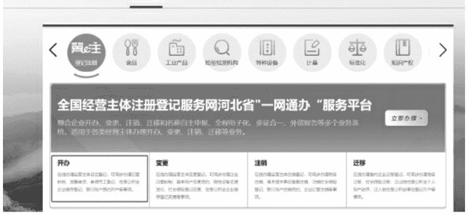

命名一般由四部分组成：行政区划、字号、行业表述、组织形式，比如“河北光辉未来科技有限公司”，见图2-2。

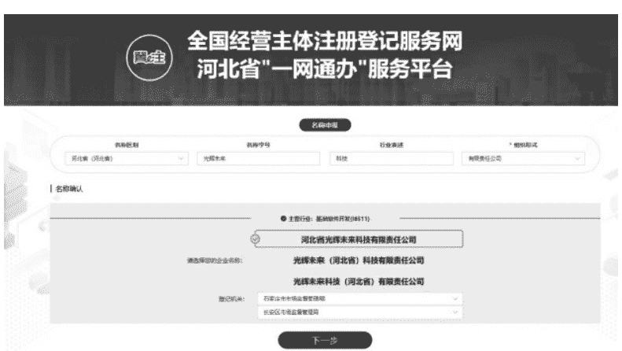

注意不要与已有主体重复，避免使用“中国”“中华”“国际”等敏感词，多准备几个备选。核名通常1到3个工作日，通过后会拿到预核准通知书。

核名通过后提交工商设立材料，包括公司章程、股东身份证明、法定代表人与监事信息、注册地址证明、经营范围等，线上提交为主，3到5个工作日可领照，部分地区可邮寄。

领照后要在有资质的机构刻章，公章、财务章、法人章一般300到800元，刻好后需到公安备案领取证明。

### 经营范围写宽写窄都有坑

经营范围既是法律边界，也影响税种核定和资质申请。

写得太窄会限制业务拓展，写得太宽可能带来不必要的税务和监管成本。税务机关据此核定税种税率，特殊行业如医疗、教育、金融需要额外许可。范围大小也影响客户对公司的专业认知。

填写要以真实业务为主，不要夸大。可以在核心业务基础上适度预留与主营相关的延伸项，为未来留空间。表述要规范，建议参考工商局提供的示范条款，主营放前，辅营后置。

实操上先锁定核心业务，再参考同业表述，分步完善，避免使用“金融”“保险”“证券”“进出口”等需专项审批的敏感词，同时注意各地表述差异，提交前最好咨询当地窗口。

商店超市类常见范围包括批发零售、票务、租赁等；餐饮类涉及农产品批发、加工、食品销售及相关技术咨询；教育培训类涵盖各类培训、软件研发、文化活动策划等；电商类则涉及商贸、平台技术服务、广告代理、信息服务、物流服务等。

公司不是创业的唯一勋章，适合自己的形态才是最好的选择。在动手之前把目的、成本、风险想透，创业才不会变成一场昂贵的试错。

把第一份业务清单写好，看起来只是个填写动作，实操里却藏着不少门道。核心思路是紧扣主业，同时给未来留足伸缩空间。先吃透自身需求与行业规则，再落笔，才能写出专业、好用的表述。

### 怎么写一份既好用又合规的业务清单

这份清单直接决定主体可以做什么，也牵动税种核定、许可准入和后续扩张的边界。写得过窄会限制动作，写得过宽又会带来成本与合规负担。

**不能随意填的缘由**
* 税种核定。税务部门会按清单来定税种和税率。涉及商品流转的要计增值税，涉及无形服务按服务税目计税。
* 资质准入。医疗、教培、金融等特殊赛道必须额外办证。清单里未体现，就拿不到对应许可。
* 品牌认知。边界过窄，外界会觉得专业度不足；边界过散，则显得定位模糊、缺乏聚焦。
* 变更成本。早期未规划，后期调整要走变更流程，甚至影响业务连续性。

**撰写的底层思路**
* 以事实为基，不夸大。按当前或短期计划开展的事项来写，不要为了好看硬加项目。电商主体不做跨境，就别列进出口贸易或金融投资这类高门槛条目。
* 适度预留，联动延展。在核心事项外，可加一些关联的延伸项。比如服装零售可配服饰设计、品牌策划，为后续拓展留空间。
* 用语规范，表达清晰。优先选用工商系统提供的标准表述，避免自创说法。
* 主次分明。核心事项放前，辅助事项作补充。比如餐饮主体主项写餐饮服务，辅项可写食品加工、食材批发，既突出重点又不杂乱。

**落地建议**
1. 先锁定核心。列出最想做的业务作为清单主体。做短视频代运营，就要把视频制作、社交媒体营销写进去。
2. 多看同行。查阅同赛道尤其是优秀主体的清单，既能学措辞，也能发现容易忽略的细节。
3. 分步完善。对未来不确定的板块，先写当下最重要的，成熟后再申请变更。
4. 警惕敏感词。金融、保险、证券等词通常要特批；进出口贸易需要许可证。谨慎使用，避免触发额外审核。
5. 留意各地差异。不同地区的工商对填报要求存在细微差别，有的允许写互联网+类目，有的则要求细化到具体服务。提交前最好咨询当地工商或代办机构。

**参考写法**
| 行业领域 | 典型业务表述 |
| :--- | :--- |
| 商店超市 | 批发与零售业、票务服务、居民服务、设备租赁、电信业务代理、房屋租赁等 |
| 餐饮业 | 农产品、粮油、畜禽产品、乳制品、水产品，以及上述产品的加工品、食品添加剂、调味品、饮料、酒类的批发；上述商品的进出口、技术服务、咨询服务及其相关的配套业务；农副产品的收购；食用农产品的销售等 |
| 教育培训 | 书法培训、绘画培训、音乐培训、舞蹈培训、教育咨询；教育软件的研发与销售；网络教育软件、教育资源信息技术开发；职业技能培训；文化活动策划、社会实践活动策划、文化艺术策划等 |
| 电商平台 | 商贸贸易电子商务类日用百货；互联网工程施工调试及维护、互联网运营推广含代理发布广告；商品或服务的销售、代理销售、推广；电子商务平台技术服务如网店开设设计运营；网络信息服务如信息查询发布推广；电子商务咨询和物流服务等 |

### 证照办齐后，接下来的关键动作

开办只是起点，后续的对公户、税籍、人事等基础工作直接决定能否正常运转。

**开立对公户**
这是主体收支、发薪、缴税的主账户。
常规资料包括：开业证照正本及复印件、法定代表人身份证明原件及复印件、主体印章、财务章、法人章、税籍信息，部分银行还要求章程或股东会决议。
流程：选定银行→提交资料填表并核验身份→签署开户协议开通网银→领取账号信息。注意法定代表人可能需到场，部分银行要求股东签字；留意最低存款要求；开户后及时签网银代扣协议方便线上缴税。

**社保参保**
为团队成员参保是法定义务，也是招人利器。
按注册地到社保局办理，提交开业证照、法定代表人及经办人身份证明、员工花名册等，填写社保登记表并核定缴费基数比例，审核通过后获取社保账号。暂时无人员可暂缓，有人员即刻办理。基数每年会调整，注意政策变化。

**公积金缴存**
提升福利的法定项目。
到公积金中心领取申请表，准备开业证照、法定代表人及经办人身份证明、员工花名册，填写提交审核，通过后拿到公积金账号。缴存比例和基数也需定期关注调整。

**记账报税**
领照后30日内完成税籍登记，核定税种税率，按业务清单确定增值税、企业所得税等。
初创主体可聘兼职会计或用财务软件。建立总账、明细账、现金和银行日记账，真实记录收支。按月按季向税局申报，即使无收入也要零申报。小规模适用简易计税，一般纳税人需开具增值税发票。

**税票领用**
销售商品或提供服务都需要税票。
首次领用提交开业证照、法定代表人身份证明等审核，确定税票种类和数量；后续领用带税票领购簿、税控设备及证件申请。普通税票和增值税专用税票按需选择，开具务必规范。

### 主体不想继续经营，如何合规退出

退出≠不办了，要走完清算和清税流程。
1. 成立清算组，清算资产负债，清偿债务。
2. 编制清算报告，说明资产、负债和剩余财产分配。
3. 登报公告45天，通知债权人申报债权。
4. 税务注销，结清增值税、企业所得税等税款，注销税籍。
5. 归还剩余税票和税控设备。
6. 工商注销，提交申请表、清算报告、税务注销证明、公告等，收回营业执照。
7. 注销对公账户，余额清零后办理销户。
8. 注销社保和公积金账户。
9. 公章财务章等交公安备案销毁。

业务清单的填报与成立后的落地动作，本质都是先规划、再合规、后灵活。把每一步做扎实，主体才能走得稳、跑得远。

公司经营走到尽头时，很多人第一想法是走行政渠道撤掉主体。账上如果还有未结清的欠款，硬用行政方式撤并很容易留下法律隐患。实务中企业退出大致分两条路径：一条是走行政流程体面离场，一条是走司法流程依法了结。两种路径的触发条件、成本、时长以及对个人的后续影响完全不同。

**行政退出与司法破产的分叉点**

很多人会忽略资料留存。从组建清算团队到完成登记除名，整个过程产生的档案都要系统归档，日后查询、维权或被追溯时都是关键凭证。

司法破产适用于长期亏损、资产已覆盖不了到期债务、自行清理也无力清偿的经营主体。破产是法院主导的法定程序，核心是把剩余财产在各债权人间公平分配，同时依法免除债务人部分法定义务。

是否能进入破产程序，要看《中华人民共和国企业破产法》第2条的标准：

> 第二条 企业法人不能清偿到期债务，并且资产不足以清偿全部债务或者明显缺乏清偿能力的，依照本法规定清理债务。

企业法人有前款规定情形，或者有明显丧失清偿能力可能的，可以依照本法规定进行重整。

破产申请分债权人提起和债务人自愿两类。债务人主动申请的典型流程是：先准备破产申请书、资产负债情况表、财务状况说明、债权债务清单等材料；向企业住所地法院递交申请，法院审查后决定是否立案；立案后法院指定管理人接管，负责财产清理和债务清偿；召开债权人集会，审议财产分配方案；法院依据清理结果作出破产终结裁定，企业正式退出市场。

行政退出和司法破产都能让企业消失，但在前提条件和操作难度上差异很大。

**两条路径对照**

维度 | 行政退出 | 司法破产
适用情形 | 主体没有未结清债务或债务已全部清零 | 负债大于资产，无法偿付到期债务
办理繁琐度 | 流程繁琐，需依次办结税务、工商等多个环节 | 必须法院介入，涉及多方债权人协调
耗时 | 通常2到6个月 | 往往要1年以上
支出 | 相对低，主要是公告费、代办服务费等 | 相对高，包含律师费、管理人报酬等
长远作用 | 影响有限，法定代表人可重新注册新主体 | 对法人信用影响较大，短期内创业受限

没有严重债务纠纷时，行政退出更直接；一旦陷入严重财务困境，就应考虑司法破产。无论选哪条路，都必须对资产和负债做彻底清理，遗漏关键事项都可能引发法律纠纷。

**企业不再运营的行政退出操作顺序**

关停企业不是一句口号，涉及法律合规、税务清理和财务处理。单一股东企业的注销可以按以下顺序推进：

1. 成立清算团队并启动清理。注销前必须对企业资产、负债进行全面盘点，保证债权债务得到妥善处理。单一股东企业可由法定代表人自行担任清算团队负责人，主持财产核实和债务清偿。
2. 编制清理报告。清理结束后要出具清理报告，清晰列明资产状况、负债情况以及剩余财产分配结果。
3. 发布注销公示。清理完毕通常需在指定媒体发布注销公示，提醒债权人申报债权。公示期一般为45天，期间债权人可提出异议或要求清偿。
4. 办理税务解除登记。先到税务机关结清税款，核实是否还有增值税、企业所得税等未缴税款；再提交清理报告、营业执照复印件等材料，办理税务登记注销。
5. 归还票据与设备。把剩余空白发票、税控盘等交回税务局。
6. 办理工商除名。税务注销完成后，向市场监管部门递交注销申请表、清理报告、税务注销证明、登报公示等，审核通过后收回营业执照正副本，完成登记注销。
7. 销户对公账户。携带注销证明、公章、法人身份证到开户行销户，账户余额必须清零，否则无法销户。
8. 注销社保公积金。如曾开设社保、住房公积金账户，需分别到社保局提交注销申请终止账户，到公积金管理中心办理账户关闭。
9. 印章销毁。注销完成后，将公章、财务章等交公安机关备案并销毁。
10. 归档备查。将注销过程中形成的全部文件整理保存，以备日后查阅。

**单一企业税制选择：核定计缴与账簿核算计缴**

对个体创业者而言，征管方式决定每月税负，也影响经营策略和利润空间。

税务核定计缴是由税务机关依据行业类型、规模和经营情况，直接核定应纳税所得额或税率，企业按核定标准缴税。操作简便，适合收入波动大、账务不完整的微型企业和个体户，如早餐店、小电商、个人工作室。

税务核定计缴分两种做法。固定金额计缴是按月固定缴税，税务机关根据行业、经营地点、从业人数等因素核定一个固定金额，无论当月有无收入都要缴纳。适合业务不稳定、起步期企业，预算明确、票据要求低，但无收入时仍要缴税，负担较重。

按比例计缴是按比例计税，税务机关先核定行业利润率，再以实际开票金额为基数计税。比固定金额更灵活，会参考实际营收。举例来说，核定利润率10%、适用税率5%，开票10万元，则应纳税所得额1万元，税款500元。适合已有稳定收入但财务能力有限的经营者。

申请核定计缴目前多可在线办理。登录地方电子税务局，进入税种认定或征管方式申请模块，填写企业所得税征管方式鉴定表，必要时上传营业执照、法人身份证明。提交后通常3到5个工作日反馈结果，部分地区需现场确认。审核通过后可在系统内查看核定方式、利润率和税率等信息。

账簿核算计缴是按企业真实财务报表计税。需建立完整账簿，记录每一笔收支，由税务机关据此核定应纳税所得额，更贴近真实经营，适用于业务量较大、财务规范的企业。

建账基础是3本账册加一套软件：总账用于科目汇总，明细账用于按科目详细记录，银行存款日记账用于逐笔收支登记，软件可用Excel等。

计税公式为：应纳税额＝（年收入－成本－费用－免税收入）×税率－减免税额。例：年收入200万，成本120万，费用30万，小微优惠税率5%，应纳税所得额50万，所得税2.5万。

报税节奏：每月登录电子税务局申报增值税，小规模按季、一般纳税人按月；同时用财务软件生成利润表、资产负债表上传。每个季度申报企业所得税预缴，按实际利润预缴，年终汇算清缴。每年5月31日前完成企业所得税汇算清缴，6月30日前完成工商年报公示。

**两种征管方式对比**

对比维度 | 税务核定计缴 | 账簿核算计缴
适用对象 | 个体户、小规模纳税人、账务不完整企业 | 单一股东有限公司、增值税普通征税主体、财务规范企业
计税方法 | 开票金额×核定利润率×税率 | （收入－成本－费用）×税率
账务要求 | 无需完整账本，可简易记账 | 必须有完整账册、发票及凭证
税务风险 | 较低，按税务机关核定标准缴纳 | 较高，账目不规范易被稽查
税负水平 | 通常较低，核定利润率可能低于实际 | 浮动，利润高税负高，利润低税负低

选择建议可从五方面判断。营业体量上，年收入500万以下且无专职财会人员，可优先税务核定计缴；年收入500万以上、需开具专票，则必须账簿核算计缴。成本发票上，进项发票齐全时账簿核算计缴可抵扣成本更划算；成本多为无票人工时，税务核定计缴更省心。发展规划上，计划融资或上市必须账簿核算计缴，规范财务是前提；只做小本生意税务核定计缴更轻。行业特性上，服务业如咨询设计多用税务核定计缴，商贸业如零售批发多用账簿核算计缴。政策风险上，税务核定计缴属于地方政策红利，部分地区可能收紧，决策前需确认当地最新政策；账簿核算计缴是主流方式，政策稳定但对账务要求严格。

税务没有绝对的好与坏，关键是匹配企业所处阶段和发展目标。选对征管方式，才能在合规前提下降低成本、走得更远。

创业第一年，税怎么报往往决定了现金流走向。很多人一上来就纠结选哪种征收方式，其实核心就两条线：核定征收和查账征收，选对了省心省钱，选错了后面补账补税都麻烦。

先说核定征收。核定分定额和定率两种，定率的弹性更大，它不是让你交死钱，而是看你实际开票额来推算利润。

思路是：开票金额 × 核定利润率 × 适用税率 = 应缴税款。
比如当地给你核定利润率10%，税率按小微企业5%走，一个月开票10万元，就按10万×10%=1万元算应税所得，再×5%，实际只交500元。

像心理咨询这种轻资产服务业，定率模式就很吃香。自己刚起步想试试水，定额更省事，每个月固定金额；等业务趋于稳定、流水可预期了，定率反而更合理。提醒一下，核定标准各地不一样，注册前最好先在电子税务局或政务平台查清楚，或者直接问当地税局，别盲目选。

怎么申请核定？现在基本都能线上办。登录电子税务局，找到“税种认定”“征收方式申请”或“核定征收申请”入口，填《企业所得税征收方式鉴别表》，上传营业执照、法人身份证等资料，提交后3到5个工作日出结果。个别地区会要求去办税服务厅补确认。审核通过后，系统会明确你是用定额还是定率，以及对应的利润率和税率。

再看查账征收。简单说就是按真实账来算税：收入减成本费用，再乘税率。企业必须有完整账册和凭证，税务按账实核实。

建账起步最少3本账+1套工具：总账汇总全盘科目，明细账按科目细化比如管理费用-办公费，银行存款日记账逐笔记录收支；工具可以是财务软件，Excel也能起步。

计税公式：应纳税额 = 年收入 - 成本 - 费用 - 免税收入 × 税率 - 减免额。
举例：科技公司年收入200万，成本120万，费用30万，无减免，应税所得50万，按小微优惠5%算，所得税2.5万。

报税节奏要记牢：每月登录电子税务局申报增值税，小规模按季，一般纳税人按月；同时用财务系统生成利润表、资产负债表上传。每个季度按实际利润预缴企业所得税，年末汇算清缴在5月31日前完成，多退少补，工商年报在6月30日前公示。

核定和查账怎么选？

适用人群不同：核定多用于个体户、小规模、财务不健全公司；查账多用于一人有限公司、一般纳税人、财务规范企业。
计税方式不同：核定是开票金额×核定利润率×税率；查账是收入-成本费用×税率。
账务要求不同：核定可简易记账；查账必须有完整账册、发票凭证。
风险不同：核定风险低，按标准交；查账风险高，账目不清易被稽查。
税负不同：核定通常偏低；查账随利润浮动。

对一人公司更具体的判断维度：

业务规模。年销售额500万以内且没专职会计，核定操作简便税负低；超过500万、需要开专票的，一般就要走查账，拿一般纳税人资格。

成本票据。能拿到完整进项发票，比如采购、物料，查账可抵扣利润更划算；如果成本主要是人工、没有发票，核定更省心。

发展规划。想融资、上市，必须查账，规范财务是硬门槛；只做小本生意，核定更匹配。

行业属性。咨询、设计等服务业人工成本为主，核定常见；零售、批发这类商贸业，进销项匹配明显，查账更主流。

政策稳定性。核定属于地方政策红利，部分地区在收紧，选前要看最新口径；查账是主渠道，政策平稳但对账务要求严。

税务本身没有绝对好坏，匹配阶段和目标才是最关键。

接下来是更致命的坑：个人账户和公司账户混用。

公司从法律上是独立主体，哪怕是一人股东，账户混用等于把公司财产和个人财产混为一谈。后果有三层：

法律上，有限责任可能丢掉，原股东要对公司债务承担连带责任。
税务上，个人账户收公司款项易被认定隐瞒收入，账户无收入记录可能被认定偷税，罚款是税款的0.5倍到5倍；个人垫付成本可能被认定虚列成本。
融资上，银行和投资人尽调看到混用，直接拒批。

常见高危行为及替代做法：
用个人微信支付宝收款 → 开通企业微信支付、支付宝企业收款码。
公司账户钱直接转到个人卡 → 走工资或分红流程，按规定缴税。
个人卡代付房租工资 → 公司账户直接支付并索要合规增值税发票。
长期无工资发放 → 合理设定工资并申报个税，保留发放记录。

从公司拿钱合规的三条路：

工资发放。给自己发薪最直接。按行业水平设月薪，每月对公转账，申报个税和社保，留存工资表和转账凭证。注意薪资要与经营规模匹配，别长期零工资或剧烈波动。

费用报销。自己垫付办公、交通、通讯的，先留票据，写报销申请，公司审核后回款。可报项目包括家庭办公租金、手机网络费、差旅交通会议餐费、培训书籍资料费等。要求真实发生、票据合规、金额合理。

股东分红。公司盈利且完成年度汇算后，由股东会决议分红金额，签署记录后从公司账户转账，缴纳个人股息红利所得税。分红税负明显低于工资最高45%的税率，适合利润累积期使用，但必须在税后净利润基础上进行。

最后说合作避坑。接单再熟也要签合同，合同是保护双方的工具。

一份基础合同至少包含五大核心：

双方信息。自然人写姓名身份证号，附身份证复印件；企业写全称、统一社会信用代码、法人信息，附加盖公章的营业执照。

合作范围。写清交付物、数量、质量标准、验收方式。比如“交付3张海报，300dpi，源文件PSD”而不是模糊的“提供设计服务”。

付款节点。总金额、分期比例、时间、是否含税、发票要求明确。建议预付款+进度款+尾款，验收合格后5个工作日内支付，避免“验收后付款”的无限期。可约定逾期按日千分之几违约金。

履行期限和地点。写明具体交付日期、地点，比如“2025年7月15日前交付方案至指定地址”。附件与正文同等效力要写明。

违约与争议。若逾期或不履约如何赔偿，违约金要与损失挂钩，避免无效表述。管辖法院建议约定履行地或被告住所地，降低维权成本。

常见合同陷阱：验收标准模糊导致尾款难收；单方面免责条款；先开工后补合同；知识产权归属未约定；违约金畸高或过低；争议解决条款设在对方所在地。

内容创作类用内容创作委托合同，设计服务类用平面设计服务合同，拿来改一改就能用。

总结一句：税和财务不是要逃避，而是要选对方式、建好边界、留下证据。方式匹配业务阶段，账户分开到极致，钱的进出走合规通道，合同把事说清楚，公司才能在合规前提下走得更远。

把一家一人公司从0做到可复制，技术和产品只是显性杠杆，把边界、权属、资金说清楚才是隐形护城河。下面是一套可直接落地的梳理思路。

### 先把业务形态和对应文件对齐
交付形态不同，法律文件也不同，先把名称对准，后续条款才能对号入座。

高频场景
开发类：小程序、App、网站 → 定制开发协议
教学类：线上/线下授课 → 教育合作协议
运营类：电商、短视频代运营 → 代运营服务协议
IP类：形象、声音、肖像使用 → IP许可协议

更细的拆分
文案、视频、图文制作 → 内容制作委托协议
Logo、海报、网页等视觉 → 平面视觉服务协议
课程交付 → 教育合作协议
店铺外包运营 → 代运营服务协议
个人形象授权 → IP许可协议

规范样本可在法大大、契约锁、腾讯电子签等平台下载，也可用千问、慧经营等AI工具做个性化改写。下面给出一个适配多数服务项目的精简框架，按自家业务微调即可使用。

A方信息
名称：
证件号：
联系方式：
B方信息
名称：
证件号：
联系方式：

1. 工作描述
B方向A方提供________服务，如“短视频脚本撰写”，具体要求
数量：________。
质量要求：________，例如“脚本篇幅不少于1500字，含3处反转”。
交付形态：________，例如“PDF电子版”。

2. 酬金与结算
总价：人民币________元，大写：________。
结算节点
首期：签约后________日内，A方支付________元。
末期：成果获认可后__日内，A方付清剩余________元。
收款账户
户名：
开户行：
账号：

3. 执行周期与确认
执行周期：自____年____月____日至____年____月____日。
确认规则：A方在收到成果后____日内出具书面确认，逾期未反馈视为已确认。

4. 失约处置
A方延迟付款：每延迟一日按未付金额的0.3%计滞纳金。
B方延迟交付：每延迟一日按协议总额的0.5%扣减价款。
任一方行为导致协议无法继续，需赔偿对方实际损耗，含律师费、诉讼费等。

5. 权利归属
成果的智力成果权归属：__________，如“款项付清后归A方所有”。

6. 争议处理
因本协议产生的分歧，双方先协商；协商不成，提交__________法院诉讼，履行地或B方所在地可作选择。

### 签约细节决定回款与维权效率
费用拆分
实务中常把总价拆成“签约付30%、中期付50%、终稿交付后7日内付剩余20%”。收款账户要写明对公账户或法人个人账户并附银行信息，避免现金往来。逾期付款建议写成按日3‰计滞纳金，同时把“成果确认后付款”改为“成果确认后5个工作日内付款”，把时间锁死。

时点与地点
交付时间要精确到年、月、日，例如“2025年7月15日前交付终版方案”。履行地点也要写清，例如“B方至A方办公地址XX市XX区完成安装”。延迟交付就能据此主张违约金。保密表述不要写成“B方不得向第三方透露A方信息”，改为“未经A方书面同意，B方不得透露”，增加前提更易执行。别忘了写明“附件与正文具有同等法律效力”，清单、确认标准等附件才能生效。

责任与争议
先说清不履约怎么办、是否需要支付滞纳金。常见写法：A方延迟付款按未付金额每日0.3%计滞纳金；B方延迟交付按协议总额每日0.5%扣减价款。避免使用“违约方需承担赔偿责任”这类空话，法院难以支持，必须有具体计算标准。

### 六个高频坑与破解
模糊的确认标准：客户以“设计风格不符”拒付尾款，协议里没写确认标准。加一个确认单模板，明确需经A方书面确认。
单方面免责条款：协议出现“A方对任何损失不承担责任”。用荧光笔标出，要求解释或删除。
隐藏变更条款：客户说“先开工协议后续补充”，后来单方面降价。坚持先签约后履约，拒绝口头变更。
权利归属不明：设计协议未约定版权归属，客户用完后转卖。明确“作品版权自款项付清后归A方所有，未付清前归B方所有”。
滞纳金过高或过低：约定违约金100万元远超实际损失。按“实际损失+30%”协商，或按法定标准约定。
纠纷处理条款陷阱：约定由A方所在地法院管辖，异地维权成本高。协商由履行地或被告住所地法院管辖。

### 无形权利保护是一人创业的生存刚需
无形权利就是用脑力创造成果的所有权。常见类型
著作权：文章、设计稿、课程、代码、短视频，保护创意性表达形式。
商标权：品牌名称、标识、标语，区分商品或服务来源。
专利权：发明、实用新型、外观设计，保护技术创新。

一人创业最常用的是著作权和商标权。

著作权登记，给原创内容上锁
可登记的内容包括文字作品如公众号文章、小说、商业计划书；美术作品如标识、插画、产品设计图；视听作品如短视频、教程视频、音乐作品。

核心价值在于权利确权、维权便利与商业变现。登记证书比邮件存稿、朋友圈发布更具法律效力，诉讼中可直接作为权利证明；著作权还能质押贷款或授权使用。

登记流程
登录国家版权服务平台官网注册账号，进入“我要登记”，填写著作权登记申请表并上传作品样本，缴纳官费后等待审核，文字作品约300元/件、美术作品约500元/件，审核周期一般20个工作日。
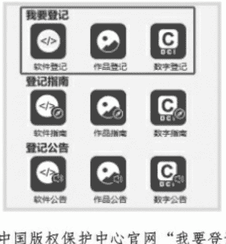
操作注意
作品样本要完整保留创作细节，设计图需保留PSD源文件图层信息；合作创作要在登记时写清比例；职务作品权利归公司，需附职务作品确认书；软件著作权登记要提交代码样本，前后各30页、每页不少于50行；境外作品可依《保护文学和艺术作品伯尔尼公约》在中国获保护，登记后维权更顺手。各地线上办理已普及，费用几十到几百不等，看作品类型。

商标注册，从名字开始护品牌
商标可以是文字、图形、字母、数字、颜色组合甚至声音。品牌名、店铺名、产品名、标识都可申请。

注册流程
向国家知识产权局下属中国商标网提交申请，也可委托代理机构。
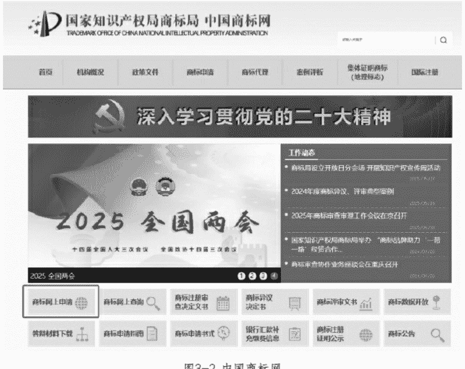
商标查询
用中国商标网的近似查询功能确认目标商标是否已被占用，避免重复申请。
确定注册类别
按业务范围挑选国际分类共45类。可登录中国商标网→商标申请→商品和服务分类→查阅《类似商品和服务区分表——基于尼斯分类第十二版（2025文本）.pdf》或《NCL12-2025中文版和区分表修改内容公开版.pdf》。
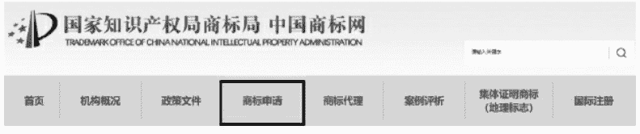
图3-3 “商标申请”选项
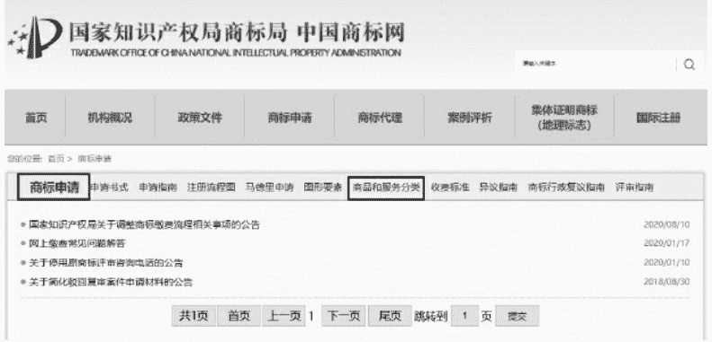
图3-4 “商品和服务分类”选项
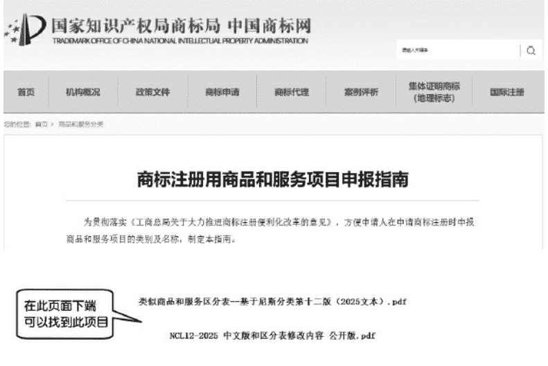
图3-5 商标注册用商品和服务项目相关文件
准备资料并提交
提交商标图样、申请人信息、使用类别。个人需身份证复印件及个体户执照，公司需营业执照副本。
缴纳费用并等待审查
官方收费每类300元，含10个以内项目，超出按项加收。商标局自收件日起9个月内审查完毕，公告期3个月。
核准发证
通过后颁发注册证，有效期10年，到期可续展。

初创期优先注册核心类别，后续再补充。商标连续3年未使用会被撤销，要保留销售合同、广告宣传页、电商销售记录等使用证据。

双重保护更有力，例如卡通形象用于包装，需登记美术作品版权，同时注册第16类纸质包装、第25类服装商标。被盗用时可同时主张版权侵权与商标侵权，赔偿更高。

维权要快，48小时内完成证据固化。用区块链存证固定侵权网页、聊天记录，重案可申请公证处现场取证。先固定证据再发侵权警告函附清单，多数学侵权方会协商赔偿。

### 基础记账，用Excel加智能工具把钱看清
不记账就不知道赚了多少、亏了多少，报税、融资都会卡壳。单人创业不需要专业会计，Excel加智能工具就够。

Excel三表法
收入明细表
记录时间、收入类型、金额、客户名称、备注，按月整理便于统计趋势。
日期 | 收入类型 | 金额（元） | 客户名称 | 备注
2025-04-01 | 内容创作 | 2000 | 张先生 | 微信公众号
2025-04-05 | 课程销售 | 699 | 李女士 | 付费训练营

成本支出表
记录业务相关支出，如平台费、软件订阅、外包设计、办公、设备等，按“人力成本”“运营成本”“推广费用”分类。
日期 | 支出类型 | 金额（元） | 供应商名称 | 备注
2025-04-02 | 软件订阅 | 198 | Adobe | 一年会员
2025-04-03 | 外包设计 | 800 | 张某 | 产品海报制作

利润简表
每月汇总总收入、总成本、净利润。
月份 | 总收入（元） | 总成本（元） | 净利润（元）
2025年3月 | 8000 | 2500 | 5500
2025年4月 | 12000 | 3200 | 8800

把三表放在同一个Excel的不同表页，统一管理查看即可。

智能工具也能帮忙记账
现在已有不少支持自动识别发票、语音记账、智能分类的工具，适合个体创业者降低手工录入负担。

做一人公司，记账不能靠感觉，工具先选对。

**轻量化记账工具三类代表**
慧经营是为个体户量身打造的方案，能自动识别发票信息、汇总日常收入支出并一键生成财务报表。
柠檬云财税主打免费在线记账，操作门槛低，很适合小规模纳税人群体。
金蝶云·星辰个人版界面简洁，上手快，还能把银行流水直接同步进来，减少手工录入。

**让AI参与报表制作**
现在的新版WPS已经把AI集成进去，可以直接让它帮忙写公式、做分类汇总、生成可视化图表，部分高级功能需要会员开通。输入你的需求，它会给出可下载的表格模板，直接省去从零建表的麻烦。

### 账目管理的常见雷区

表3-9 不当记账操作及相关内容

| 不当记账操作 | 可能后果 | 规范做法 |
| :--- | :--- | :--- |
| 用个人微信记收支 | 税务检查时不具备合法凭证效力 | 使用企业微信收款付款，系统自动留存流水 |
| 把多笔收支合并成一条记 | 难以回溯每笔交易的细节 | 单笔单录，每笔附上交易截图或纸质小票 |
| 年底集中一次性补账 | 极易遗漏或记错 | 执行日清月结，月末及时结账不拖延 |
| 直接覆盖修改已记数据 | 财务信息失真，影响判断 | 需要调整时用红色字体标注“更正记录” |
| 从不备份账本文件 | 电脑损坏即导致数据永久丢失 | 每周把Excel同步到百度网盘或腾讯文档 |

对一人公司来说，合规记账不仅是应付税务，更是洞察经营的窗口。用Excel或一款轻量AI工具，每天投入5到10分钟，就能清晰看到收入和成本的波动。坚持真实、及时、留痕地记录每一笔进出，你才能在税务稽查、融资谈判、商务合作时，拿得出经得起推敲的账目，底气十足。

# 第4章 一人单干新模式，AI员工与资源整合

## 一个人如何借助AI赚钱

不少人仍把AI想成遥远的未来科技、巨头专属、必须会写代码。其实过去两年AI已经全面下沉到日常工作里。现阶段你不需要编程基础、不需要懂算法、也不需要大额投入，就能用AI提效、优化服务甚至直接变现。

### AI就是你的虚拟员工

单人创业的核心矛盾是资源少、时间紧、角色多。传统公司可以用招人、外包、买系统来解，但一人作战时，你既要做产品、运营、销售、客服也要管财务，一不小心就会陷入忙到焦头烂额却赚不到钱的困境。

AI恰好能补上这块短板。可以把它理解成一个24小时在线、不抱怨、不请假、随时待命的数字员工。它做不了最终决策，但能把大量重复、标准化的工作接走，比如：

撰写和改写文案、润色简历、制作PPT；整理数据、做表格分析；剪辑短视频、自动加字幕、生成封面；回复高频咨询、处理客户问题；设计海报、Logo、宣传物料；整理会议纪要、自动输出报告；翻译文档、提炼要点、总结内容……

这些原本需要花数小时的事，现在借助AI几分钟就能完成。省下来的时间用来接更多订单、打磨产品、拓展用户，这不是偷懒，而是用工具提升单位时间价值。

### 想靠AI赚钱，先弄清底线

看到别人用AI做视频、写文章、画图、做音乐、卖课，很多新人也跟着入场，花时间研究工具，想凭空掌握一项新技能。学会不难，但能变现很难。

AI确实能让你快速获得写文案、剪视频、做设计、做数据分析等能力，但这只是起点。关键在于，你能否用这项能力满足真实的市场需求，并因此获得报酬。如果你没有行业经验、不懂用户痛点、缺乏作品集或粉丝信任，即便会用AI做视频也接不到单，即便会写文案也无人购买。

AI不是万能的魔法棒，它不能从零造就专家，也不能帮你建立信任、获取客户、完成交易。它的真正作用是放大你已有的能力，而不是凭空赋予你不具备的能力。

换句话说，AI赚钱的逻辑不是让你突然变强，而是让你在擅长的领域里更轻松地赚钱。

举例来说，你在写网络小说，因剧情框架缺乏新意、语言不够打磨而没人关注。AI无法帮你零到一创造爆款小说，但可以帮你头脑风暴框架、润色语言、加速内容产出，让你本就有的创作路径真正跑通。

这才是单干场景里AI最实在的用法。盲目追风，看到别人用AI做视频你也拍、别人做音乐你也做、别人做AI课程火了你也去做，很容易陷入“很努力、没结果”的循环。不如从自己已会做的事出发，看AI如何提升效率、优化流程、扩大交付。

## AI工具如何选，AI员工能做什么

很多人看到炫酷的成果就下载一堆软件想一口吃成胖子，结果要么不会用，要么用完没效果。正如前面所说，AI的价值在于放大而非凭空创造。所以选工具前先自问：你在做什么业务？瓶颈在哪？有没有AI能解。

**主流AI工具盘点**

**1. 内容创作类AI**
主要解决写作类问题：文案、简历、脚本、提纲、总结报告等，能快速给出初稿。
代表工具：ChatGPT、Claude、Gemini、豆包、千问。
适合人群：文字工作者、讲师、自媒体、品牌策划。
注意：输出需人工校对，不能直接照搬；涉及版权、法律、合同等内容必须核验。

**2. 图像生成类AI**
适合需要素材、Logo、封面、配图风格参考的场景。
代表工具：Midjourney、Stable Diffusion、DALL·E、即梦AI。
适合人群：视觉博主、电商卖家、PPT设计师、内容创作者。
注意：细节控制不及专业设计师，多需手动微调；部分平台对AI图有版权争议，使用时建议标注。

**3. 视频剪辑与生成类AI**
短视频制作重在效率，AI可实现字幕自动生成、智能配音、裁剪、特效添加。
代表工具：剪映、Runway、可灵AI、CapCut、VEED.IO。
适合人群：短视频博主、知识UP主、带货主播、培训讲师。
注意：生成效果尚不完美、成本不低，复杂内容仍需人工把关；建议对AI生成内容进行标注防限流。

**4. 办公与项目管理类AI**
不像前几类那么吸睛，却能实打实省时间，尤其处理Excel、PPT、会议记录。
代表工具：Notion AI、飞书知识库、Excel插件如Think-Cell AI、WPS AI。
适合人群：自由职业者、远程工作者、团队管理者。
注意：注意数据安全，敏感信息避免上云；部分高级功能为付费。

**主流大模型怎么选**

ChatGPT是大众认知度最高的模型，生态成熟，英文和逻辑推理强，适合创意策划、文案、脚本，整体稳定可靠。
Claude的长文本处理能力突出，适合梳理资料、总结长报告、分析法规类文档，风格偏理性结构化。
Gemini是多模态模型，能处理文字、图像、音频、视频，信息整合与实时检索能力强，适合知识类内容生产和行业分析。
豆包主打易用，响应快、免费额度充足，适合国内用户快速上手，短视频脚本、电商文案、社媒内容生成效率高。
千问由阿里研发，应用场景覆盖智能客服、内容创作、办公提效、教育辅助、编程、企业知识管理、多语种翻译、电商营销、金融法律辅助等多个领域，致力于提升多行业的智能化水平。

总体来看，没有最好的模型，只有最适合自己的。选一到两个主力模型持续训练，比铺开十个工具更有用。

## 外包与合作，如何整合外部资源

一人单干不等于一个人做所有事。把重复性强、标准化高、耗时长的工作交给他人或工具，自己聚焦在选题、策划、沟通、成交、优化这些创造价值的环节。

就像小餐馆老板不一定亲自炒菜，但要懂选人、控品质、留客源。单干也一样。

**外包是为了专注核心价值**
外包的本质是腾出时间做最重要的事。比如一位写商业计划书的自由职业者，擅长逻辑与策划，不擅长PPT视觉。她与一名视觉设计师按项目合作，她出内容对方出排版，按利润分成。效率翻倍，客户满意度提升，她把精力放回内容打磨上。

做外包时要明确交付标准：目标用户、语气风格、参考样例、字数要求、截止时间。先小单试水，逐步建立流程和反馈机制，避免交付时返工。

**合作：找到互补的人把事做大**
外包是执行关系，合作是利益绑定。当视频剪辑师从按次收费变为按课程销售额分成，他就从执行者变成共创者，会主动优化封面、标题、节奏，因为这直接影响收入。

合作前要问清：对方是否真心投入？是否有主动判断力？能否接受利益分配？失败时是否愿意共担风险？答案决定是短期协作还是长期共进。

**别事事亲为，AI智能体来提质增效**
除了人力外包，还有更经济高效的方案：AI智能体。它不只是工具，更像能按设定自主执行流程的数字员工。它可自动回复常见咨询、按需生成文案PPT简历、整理会议纪要、提取摘要、管理日程并提醒。它替代不了你的决策，但能帮你消化大量流程化事务，让你把精力集中在真正有价值的创造上。

日常被重复浪费时间的工作占据，已经成为很多人单人创作时的痛点。智能代理正用来解决这一类问题。核心在于把可被复制的流程交给系统，让个人工作节奏加快，而且上手成本极低。没有编程要求，也不用投入长时间学习，只需要把任务意图讲明白，系统就能按预期快速完成。

目前市面上可搭建代理的工具不少，字节推出的豆包对普通用户很友好。主打零代码，通过可视化操作就能拥有自己的专属助手。

下面以豆包为例说明搭建流程。

### 1. 新建代理
安装好豆包电脑客户端后，点击顶部菜单的“AI 智能体”入口，进入发现页，再点“创建 AI 智能体”按钮即可开始。

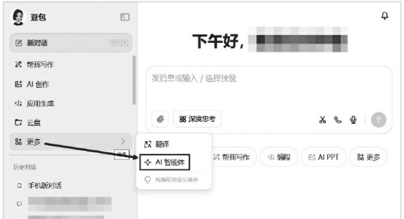

图4-1 豆包电脑版AI智能体功能入口

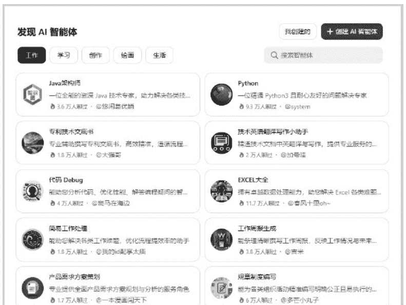

图4-2 进入“发现AI智能体”页面

### 2. 定义人设与能力
进入创建向导后先为它取个名字，再补充一段角色说明。名称之外，关键是明确身份定位和工作边界。比如想做“知识类短视频脚本助手”，可以这样设定：

- 名称：短视频脚本撰写专家
- 人设说明：你是一名经验丰富的短视频脚本撰写专家，能够根据关键词输出口播文案、分镜脚本、标题建议、封面文案等。语言通俗易懂，简洁明了，充满趣味。

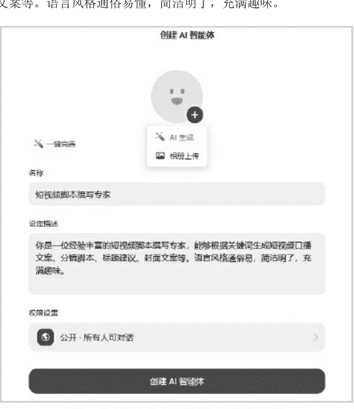

可以上传图片作为形象，也可以用文字描述风格让系统自动生成。

### 3. 试用与上线
设定完成后点“创建 AI 智能体”，豆包会生成一个可对话的实例。直接在对话窗口提问，检查是否理解指令、输出是否符合预期。

### 4. 反复打磨
刚上线的代理往往不够精准很正常。持续补充问答样本、微调语气风格、优化关键词匹配逻辑，表现会越来越稳。角色设定也可以随时修改，发现回答偏差的地方就针对性修正。

除了豆包，AutoGPT、AgentGPT、FastGPT、Dify 等也在提供可视化界面和简易配置，不要求编程也能快速上手。

常见成熟类型有：

- 内容创作伙伴：列提纲、写文案、改简历、润色文章
- 自动化视频生成：把文字脚本自动变成视频
- 社群运营帮手：定时推送、回复常见问题
- 数据洞察助手：抓取销售数据、生成图表、总结趋势

这些工具不是取代人，而是把单人产能放大到接近小团队，让你更聚焦在创造性环节。

## 用数据做决策，让系统读懂用户与市场
提到数据驱动，很多人会联想到复杂图表和模型。借助人工智能辅助，分析已变得非常傻瓜化。只要说明想了解什么问题，系统就能从海量信息里提炼有价值的结论。

常见场景有：

1. 用户画像解析：用户到底是谁
把聊天记录、订单留言、评论反馈交给系统，让它总结典型特征：年龄段、职业背景、所在城市、常见痛点、表达习惯、关注重点、核心诉求及高转化场景。这比凭空猜需求靠谱得多。

2. 内容热度解析：什么内容更容易被看见
把小红书、抖音、知乎的爆款标题、正文、评论喂给系统，让它提炼共性。也可以用豆包的共享应用或屏幕分析功能，直接问爆款为何高赞：常用标题句式、正文结构、高频关键词或情绪词、用户偏爱点赞收藏的类型。掌握规律后创作就不再盲目试错。

3. 市场趋势预判：下一步往哪走
把行业报告、平台榜单、热点话题输入进去，让系统判断哪些赛道在增长、哪些课程产品更受欢迎、下季度可能流行的话题、哪些关键词搜索量在上升。有了方向感，内容策划和产品设计才不靠赌。

4. 营销策略优化：怎么说更打动人
把文案、脚本、朋友圈、社群发言交给系统优化，看看哪些表达更易共鸣、哪种语气更促行动、哪些词句更易建立信任、有哪些常见误区。往往只改几句话，转化就能明显提升。

以小红书为例，刚做知识博主常见困惑：写什么、没人看、别人高赞自己低、干货却不转化。别硬试，让系统帮你读懂平台。

1. 收集对标爆款
找几位粉丝几千到几万、定位相近的账号，收集点赞过千的笔记标题和正文。比如搜索“职场成长”“副业推荐”“个人 IP 打造”等关键词，截图保存。

2. 导入分析
把内容粘贴到常用的大模型工具，并提问：主题类型有哪些？标题结构有什么特点？正文常用句式？高频关键词？有没有特定情绪或语气？系统会产出一份爆款分析报告，用不同模型交叉验证更稳。

3. 生成选题库
基于报告再问：请结合上述规律，给我 10 个可发布的选题，并附建议标题和写作框架。系统会按爆款逻辑为你定制选题，减少试错成本。

4. 迭代优化
每发一条笔记，记录阅读量、点赞、评论、收藏，再输入系统分析表现好坏的原因、用户最在意的部分、重写时如何调整。循环迭代，对平台调性的理解会越来越准，风格和变现路径也就清晰了。

创业不能只靠经验和模仿。跟风发内容、跟风上产品也许能起步，却很难持续。要想做得红火，就要用数据说话，数据驱动的决策远比直觉靠谱。

# 第5章 单人创业，让能力成为你的变现产品

## 单人创业，卖服务还是卖产品

起步时大家常问：到底做服务还是做产品？很多人副业起于接单：写文章、剪视频、设计 Logo、做数据分析。干着干着发现：太累、赚得不多、做不大。

于是想转做标准化产品：课程、电子书、模板包。但又担心没人买。所以本质不是二选一，而是依据自身能力、资源和目标选择合适的变现路径。

### 表5-1 服务类变现与产品类变现的区别

| 项目 | 服务类变现 | 产品类变现 |
| :--- | :--- | :--- |
| 核心模式 | 时间换收入，技能直接服务用户，交付后收款 | 一次制作，多次销售，将能力/知识/经验转化为可重复售卖的内容/工具 |
| 适用阶段 | 起步阶段（单人创业初期） | 进阶阶段（有能力、经验、用户积累后） |
| 常见形式 | 写作、设计、私域陪跑等 | 课程、模板包、SOP 手册、测评报告等 |
| 优点 | 门槛低、易建立信任、反馈快、收入稳定 | 复利效应强、收入上限高、易塑造品牌、长期易规模化 |
| 局限性 | 无复利、难规模化、停止工作则收入中断 | 前期投入大、用户决策谨慎、市场判断失误易亏损 |

### 1. 服务类变现：时间换钱，适合起步
服务类变现是用自己的技能直接解决问题：写文案、改简历、做 PPT、私域陪跑、开发小程序、职业规划建议等，交付即收款。

优点是启动快、门槛低、信任建立快、反馈即时，能快速验证市场价值，并且收入稳定。缺点是本质是用时间换金钱，没有复利，用户越多越容易被拖垮，停止工作收入就断。

### 2. 产品类变现：一次交付多次收益，适合进阶
积累能力、经验和客户资源后，可以把知识经验做成可重复销售的载体：写作课、PPT 模板包、运营 SOP、Excel 自动化合集、测评报告等。

优势是复利明显，边际成本趋近于零，不依赖个人时长，有利于品牌传播和规模化。挑战是前期投入大，需要打磨包装；用户决策链长，对定位和信任背书要求高；定价或需求判断失误易亏损。

没有绝对的好坏，看匹配度。擅长沟通解决问题的人可先以高价值服务为主；擅长总结输出标准化内容的人可逐步转向产品。关键是选适合自己的模式并灵活切换。

## 如何判断一款产品是否有市场
很多产品做得不错却难变现，核心是没验证真实需求。与其花大量时间做出无人想要的东西，不如先确认：有人需要吗？有人在找解决方案吗？有人为此付过费吗？

### 什么样的产品更容易被买
有市场的产品通常具备三点：

第一，解决具体、明确、迫切的问题。用户清楚自己卡在哪，需要立刻解决。比如不会做 PPT 排版乱、短视频脚本难写但想赚钱。产品直击痛点才容易被关注。

第二，目标人群极其明确。不是“所有人都能用”，而是“某类人一定会用”。如“职场新人自我介绍模板”针对求职新人，“网文变现指南”针对想靠写作赚钱的人。定位越准转化越强。

第三，具有一定独创性。不是随手能搜到的免费资源，而是经验沉淀的方法、验证过的流程、独家案例体系，或结合智能工具打磨出的独特工具。这种壁垒让你在市场上站得住脚。

### 用痛点强度和付费意愿评估价值
判断市场不能只看竞品多少，更要看痛点有多强、用户愿不愿意付费。同样的简历优化，有人买 99 元模板，有人愿付 499 元做一对一修改。价值取决于解决问题的深度。

真正可变现的产品建立在“强痛点 + 强动机”上。观察评论区、社群聊天、朋友圈互动，频繁表达困扰并主动询问购买渠道的方向，往往就有市场。

产品开发不是做完美，而是找到真实问题并用最有效的方式解决。找不到具体问题就别浪费时间去做。

单干做变现，基本就这两条路线在轮换：先卖时间，再卖成果。什么时候走哪条路，看的是你手上有什么、能不能扛住投入，以及用户愿不愿意为你买单。

起步期，多数人会落在服务侧。常见形态是写作、设计、私域陪跑、1v1咨询这类用手艺直接交付的形式。进阶后能力、案例和用户沉淀出来了，就会转向产品侧，比如课程、模板包、SOP手册、测评报告这类可复用资产。

服务侧的优势是上手快、信任建得快。门槛低，准备不用太多，有技能就能开单。因为是面对面交付，沟通顺畅时用户更愿意掏钱，反馈也来得快，案例和口碑就是在做单里攒起来的。收入模式稳定，按项目结算，做完一单就有回款，对还在找方向的新手很友好。

但服务的本质是时间定价。一次交付结束、一次变现结束，没有滚雪球效应，规模化很难。你接再多单，容量被时间锁死，停下来就断流。

产品侧的逻辑是把能力沉淀成可重复销售的资产。课程、模板、工具包、手册都可以反复卖，边际成本趋近于零。收入不再完全挂钩你的在线时长，天花板更高，也更容易被传播塑形个人品牌，长期来看规模化的空间远大于服务。

代价同样明显。产品需要前置投入，要整理、打磨、包装，不像服务可以即兴上场。用户买产品比买服务更谨慎，决策周期长，对定位、信任背书和话术要求更高。定价不准或需求判断失误，前期投入容易打水漂。

服务和产品不是对立关系，也没有绝对先后。擅长沟通、擅长解决个案的，可以以高单价的一对一咨询、私域陪跑为主线；擅长提炼、擅长做系统的人，可以把重心放在标准化内容上。关键是根据能力、资源和客户需求来搭配。

很多人做出东西卖不动，不是能力差，而是没先验证市场。花大量时间做一门课、一套工具、一份模板，最后发现没人要。钱赚不赚，不在于做得多精致，而在于有没有提前照见用户的真实需求。花点时间确认三件事更有用：这个需求存在吗？有人在主动找解法吗？有人已经为此付过钱吗？答案比完美的产品更重要。

能卖得动的产品，通常有三个共同点。第一，指向一个具体、明确、迫切的痛点。用户能清晰说出“我哪里卡住了”，并且希望立刻解决，比如PPT排版混乱没人看、短视频脚本难写却想变现。第二，人群边界清晰。不是“所有人都能用”，而是“某类人一定会用”。比如职场新人的自我介绍模板、想靠写网文赚钱的人的变现指南，说清给谁用，转化才好说。第三，有一定独创性。不是随便搜一搜就能抄到的泛泛总结，而是有你多年经验沉淀的方法、亲测流程、案例体系，或是结合工具打磨出的独特形态。这才是在市场上形成壁垒的东西。

判断价值要看痛点强度和付费意愿两个维度。同样是简历优化，便宜版可能99元卖模板，贵版能卖499元做一对一修改，差距在于是否叠加了行业趋势、岗位逻辑、HR筛选机制等系统性建议。真正有市场的点，往往是用户既意识到问题，又愿意为解决买单。你可以在评论区、社群聊天、朋友圈互动里观察，有人反复抱怨、主动问去哪买，说明方向是活的。产品开发不是做完美，而是先找到真实问题，用最有效的方式解决它。

过去做课程、工具包成本很高，要调研、整理、撰写、排版、剪辑，流程漫长。现在有了AI，成本和门槛都被拉低，只要你能识别痛点并结合专业经验，就能快速试错。

以在保险公司多年、熟悉条款和理赔坑的产品经理为例。很多人不敢买保险是怕踩坑，买错、保障不全、理赔困难。你想做一门避坑小课，却没团队没预算。

第一步，锁定人群和核心痛点。让AI帮你罗列小白在购买保险时高频遇到的问题，基于搜索词、知乎问答、小红书评论生成问题清单。这些就是课程的卖点。

第二步，搭建结构。让AI基于问题清单给出5-6个模块的大纲，每模块2-3个知识点。大纲不直接用，但省掉了前期构思时间，形成清晰框架，之后用自己的经验修正完善。

第三步，逐节生成内容。按模块提问，让AI写一段800字左右、小白可读的讲解，再叠加自己的实战案例和权威解读。对“等待期”“健康告知”“免责条款”等复杂概念，可让AI先通俗化，再由你校准。

第四步，做视觉和宣传。封面可以用Canva AI等工具生成，风格专业稳重。宣传文案也可以交给AI优化，把卖点提炼成200字内吸引人的简介，弱化机器感，强化情绪和转化。

第五步，上线收集反馈。用早鸟价或免费试听第一节撬动首批用户，根据反馈快速迭代，比如有人提“术语速查表”，几分钟就能让AI整理出来。核心观点提炼、复杂条款解读、真实案例分析，这些关键部分仍需自己把关。

能持续赚钱的人，往往懂得从一个点开始做成面。一个人也能做产品矩阵，不是指做很多个独立产品，而是围绕核心能力，推出一批相互关联、彼此引流的产品，覆盖同一类用户的不同需求阶段。

一个产品是点，多产品形成线，形成协同就变面。举例来说，围绕PPT能力，可以先上职场新人模板包、年终述职指南、行业通用框架、排版避坑清单。之后再延伸到美化服务按单收费、PPT写作训练营、设计SOP手册、私域运营资料、AI辅助制作教程。这样你不再只是“做PPT的人”，而是提供完整解决方案的内容生态。

产品之间的关系主要有三种。递进关系帮助用户深入，比如基础简历模板包→进阶优化课程→高阶诊断服务。互补关系补全解决方案，比如短视频剪辑课配爆款标题指南、发布时间表、拆解合集。升级关系把单一内容做成系统，比如Excel函数大全升级为自动化办公训练营、速查手册、数据可视化课程。

举例到职业规划：除了一对一咨询，还可以有职业测评问卷PDF、职业选择决策图、职场转型实战课、简历诊断+面试模拟套餐、答疑服务社群。形态不同，服务的是同一批想转行升职的人。买了模板推荐测评，测评后引导课程，课程后引流社群，形成闭环。

产品矩阵不是堆砌，而是以价值叠加取胜。先找到一个能解决真实问题的点，再用不同形态满足同一批人多样化的需求，让收入从单次交付变成持续复购。

表5-2把演示文稿、文字创作、视觉设计、内容运营四个赛道，按照基础工具、指南手册、定制服务、课程培训、体系资料、工具教程六种交付形态做了拆解示例。

演示文稿赛道，入门型素材多为职场新人模板包、互联网行业通用框架；参考型资料聚焦年终述职排版要点、图文加视频的避坑清单；定制型服务体现为按单计价的美化；学习型产品体现为线上写作训练营；沉淀型资料体现为面向私域的SOP手册；操作型教程聚焦智能辅助制作的方法说明。

文字创作赛道，入门型素材覆盖散文、演讲稿、简历等模板与素材库；参考型资料提供写作技巧合集、商务邮件、公众号文章等场景化指引；定制型服务为文案代写、文章润色；学习型产品为进阶课、新媒体训练营；沉淀型资料为流程手册、投稿渠道汇总；操作型教程为生成式写作工具与写作软件的使用说明。

视觉设计赛道，入门型素材包括海报、标志、名片模板；参考型资料为色彩搭配、排版原则手册；定制型服务为品牌VI、包装定制；学习型产品为PS从入门到熟练、UI实战课；沉淀型资料为项目管理流程、设计规范合集；操作型教程为智能设计工具应用、Figma实操指南。

内容运营赛道，入门型素材为社群运营表格、活动策划模板；参考型资料为私域流量运营、短视频运营技巧手册；定制型服务为社群代运营、活动执行；学习型产品为新媒体全案、直播实战课；沉淀型资料为数据分析SOP、用户增长策略合集；操作型教程为数据分析工具、社群管理工具使用说明。

拿到首个单品后，建议持续追问这件东西还能如何延伸、服务哪些人群、能成长为什么形态。品类之间的联动大致可归为三种。

递进型引导用户逐步深入。比如先推出基础版简历模板包，再推出进阶版优化课程，再到高阶版简历诊断服务，让用户从理解到掌握再到落地。

互补型把解决方案补全。比如已有短视频剪辑课，可配套爆款标题指南、发布时间建议表、爆款案例拆解合集，提升整体交付体感。

升级型把单点做成体系。比如Excel常用函数合集可升级为自动化办公训练营、公式速查手册、数据可视化教学课，覆盖更多使用场景。

组合不等于堆砌。真正的能力壁垒是围绕同一项专业能力输出多种形态，满足差异化需求。以职业规划为例，除了一对一咨询，还能延伸出职业测评问卷PDF、职业选择决策图工具、职场转型实战课、简历诊断加面试模拟套餐、职业规划答疑社群。形式各异，服务的都是想转行、想升职、想找方向的职场人群。单品不必完美，能解决一个具体痛点即有价值，且彼此可互相导流，形成闭环。

做商品也可以更灵活、更投机一些

信息过载的节奏里，并非所有商品都要从零打磨。懂得抓住热点、快速响应、顺势而为，用短期型、可复制的热点快销品赚一笔快钱，同时检验市场反应，也是一条现实的副线。

追热点的核心是借势快进快出。很多人对投机有误解，实际不是造假或割韭菜，而是一种轻量变现思路：盯住当下话题或平台流量红利，在最短时间内交付一个可用商品卖给有需求的人。

生成式内容火热时，有人迅速上线《普通人也能用AI写作》99元课程，数日售出上千份；抖音流行职场成长内容时，有人把自我介绍万能模板和简历优化技巧打包放在知识星球，一周涨粉几百。这些都不是长期深耕型商品，而是轻商品。逻辑是看准时机快行动、用既有经验快输出、靠智能工具快制作、找准人群快成交。它不是主线，但能成为收入补充。

并非所有热点都值得上车，要筛出需求明确、情绪强烈、能快速响应的。

用户情绪强烈的热点最容易转化。社会事件、行业政策、职场现象引发讨论时，往往伴随焦虑、迷茫、愤怒或期待。比如每年都会引爆的35岁失业潮话题，无数人主动搜索出路。如果你擅长职业规划、简历修改、面试技巧，就能顺势推出《35岁转型避坑指南》，讲清就业现状、副业减压办法、淡化年龄劣势的简历写法。理论不必深，只要能缓解当下焦虑就具备变现力。

政策变动型热点适合做解读加工具包。个税新政出台时，大量人关注专项附加扣除变化。有税务背景的人可以立刻做《2026年个税申报避坑指南》课程，或一段视频讲清操作流程。用户要的是马上能用的结论，不是论文。上线速度决定生死，政策发布后头三天是黄金期。

技术工具普及带来的技能窗口期也很有红利。智能写作刚兴起时涌现大量教你用生成式模型写文案的课程；Midjourney入华时各种AI绘画提示词合集和入门指南；DeepSeek迅速走红后手把手使用书籍销量破十万。都属于特定阶段的技能窗口期需求。

技术刚刚普及、大众还在摸索时，就是做速成商品的黄金窗口。比如豆包上线AI播客功能后，用一段文字就能生成媲美真人的播客，在多个平台引发关注。内容创作者可以立刻推出用豆包做播客的实战教程，或把既有内容批量转播客。

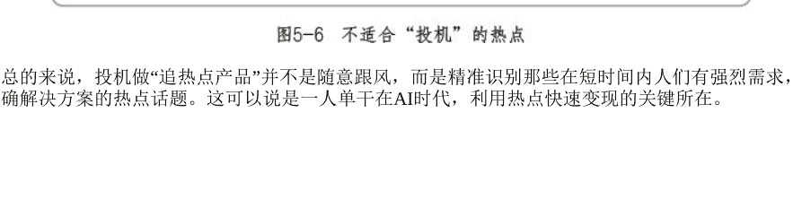
总的来说，投机做追热点商品不是盲目跟风，而是精准识别短时间内需求强烈且有明确解法的热点。这正是智能化浪潮下独立创作者快速变现的关键。

## 3.技术工具普及带来的技能窗口期

每当新技术工具出现，总伴随早期红利。智能写作刚兴起时涌现大量教你用智能写文案的课程；Midjourney入华时出现各种AI绘画提示词合集和入门指南；DeepSeek迅速走红后手把手使用书籍销量破十万。都属于特定阶段的技能窗口期需求。

技术刚刚普及、大众还在摸索时，就是做速成商品的黄金窗口。比如豆包的AI播客功能上线后，用一段文字就能生成媲美真人的播客，在多个平台引发关注。内容创作者可以立刻推出用豆包做播客的实战教程，或把既有内容批量转播客。

有适合投机的热点，也有不适合投机的热点。图5-6列出的那些就不适合做内容。

总的来说，投机做追热点商品不是随意跟风，而是精准识别那些在短时间内人们有强烈需求，又有明确解决方案的热点话题。这可以说是一人单干在AI时代，利用热点快速变现的关键所在。

## 第6章 单干获客：低成本流量玩法

在大数据时代，没有流量就没有生意。传统生意靠选址和人流，独立经营靠数据。谁掌握注意力，谁就有成交可能；谁没有流量，商品再好也只能空转。很多人课程做出来、视频剪出来，上线却没人买，根因不是商品差，是流量没打通。

注意力是稀缺资源。智能化浪潮下信息爆炸，用户分散。流量不只是曝光量和点击率，而是你能触达多少目标用户，且他们愿意停留、互动、咨询、购买。现在平台上很多装傻扮丑的内容，看似低俗，实则是在用最直接的方式抢注意力。夸张表情、极端观点先把人留住，再谈变现。你不必模仿，核心是明白：在信息洪流里，没人会主动停留，除非你给了他一个停下来的理由。先被看见，再谈转化。

流量从哪里来？独立经营要主动造池。

先从个人社交动态开始，熟人是第一批用户。不用铺天盖地投广告，发一则简短有力的商品介绍、一段60秒口播说明能提供什么服务、做一次转发有礼，都能撬动初始成交。哪怕只有几十个好友互动，也能拿到反馈：商品是否成立、价格是否合理、话术是否打动人。这是最小闭环的起点：被看见、被回应、被购买、被反馈。

借助社交平台让内容被目标人群看见。做青少年心理咨询，就可以在知乎答题、小红书发笔记、哔哩哔哩发教学视频，文末加一句需要帮助可私信。每条内容只要有互动，就是进展。智能工具现在能辅助选题、写文案、剪视频，不要怕冷启动，只要持续输出就能积累第一批关注者。

主动加入社群找集中地。卖简历优化服务，就去豆瓣招聘社群、求职交流群、职场成长圈混脸熟；卖智能工具教程，就去科技论坛、知识付费社群、AI学习小组参与讨论。切忌上来就广告，先给价值建立信任。别人问怎么用AI写10万+公众号文章，你先晒结果再专业回答，最后补一句我整理了一份技巧文档需要可私信。这类轻量引流，是获取首批用户的有效路径。有了第一批用户，才有了真正的起点。

图6-1 朋友圈中的广告宣传

即使只是精准推送给几十个好友，也可能带来成交。更重要的是，这些成交会给你反馈，告诉你产品有没有价值、价格是否合理、文案能不能打动人心。这就是“最小闭环”的起点：有人看到—有人回应—有人购买—有人反馈。有了这第一步，你才有底气去做更多内容并将它们投放到更多渠道。

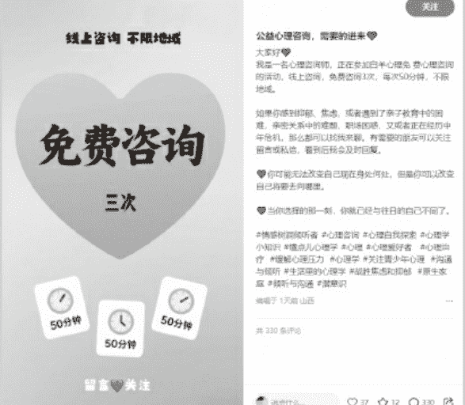
只要有一条内容被人看到、有人互动，你就已经迈出了第一步。而且现在智能工具非常发达，你完全可以借助智能工具生成选题、写文案、剪视频、改脚本，大大提升内容输出效率。不要怕没人看，也不要怕一开始没人买，只要你持续输出，就能慢慢积累起属于你的第一批关注者。

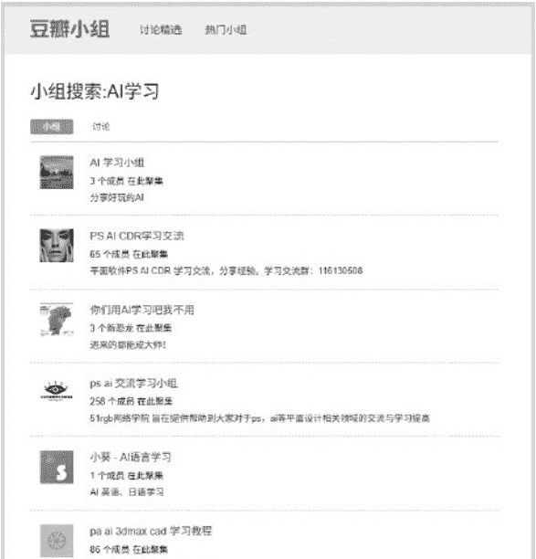
图6-3 搜索豆瓣群组

前面提到的这些都是轻量级的引流动作，也是你获取第一批用户的有效方式。当你拥有了第一批用户，你就拥有了真正的起点。而这个起点，不是靠运气得来的，而是你自己一步一步打造出来的。

图6-3 搜索豆瓣群组

前面提到的这些都是轻量级的引流动作，也是你获取第一批用户的有效方式。当你拥有了第一批用户，你就拥有了真正的起点。而这个起点，不是靠运气得来的，而是你自己一步一步打造出来的。

公域平台账号怎么打造

独立经营想放大影响力绕不开公域。抖音、小红书、哔哩哔哩、知乎、公众号都是流量入口。很多人要么发几条就弃号，要么盲目模仿追爆款，结果越做越迷茫。打造能带来成交的账号，不需要超强运营能力，只需要想清几个关键点。

选对平台比努力更重要。知识类内容如写作、职场、理财、学习方法，知乎适合深度输出建立专业信任，公众号适合沉淀粉丝做品牌背书，小红书适合轻量化图文短视频，哔哩哔哩适合系统教学，知识星球适合付费社群转化。

视觉类产品如演示模板、简历美化、品牌标志设计，小红书适合展示案例对比和制作过程，抖音适合视频化前后对比，微博适合话题营销，花瓣网、站酷适合行业曝光，淘宝详情页也是数字商品的重要入口。

技能型变现如剪辑、编程、咨询、私域陪跑，抖音、哔哩哔哩适合展示实操和前后对比，知乎适合答疑立专业形象，视频号可与公众号联动形成闭环。

做一人单干的内容生意，先想清楚哪儿有人，怎样让人记住你，再把人稳稳地带进自己的池子。

平台怎么选，宁可精不求多
豆瓣小组是兴趣浓度很高的阵地，一群同好自带讨论氛围，做软性种草最顺手。淘宝的问答区则像开源的选题库，用户把困惑写得清清楚楚，直接拿来做内容就能打中痛点。很多渠道的内容是可以跨平台复用的，如果精力允许，可以多试几条线，但一定要挑出1到2个重点深耕，持续拿出曝光和成交，而不是到处撒网。

账号先定位，再生产
大多数人做不起来，不是内容不行，是根本没想好自己是谁、擅长解决什么、能给谁带来价值。开更之前，先给账号一个清晰的锚点，用一句话说清人设即可。比如：我专注用AI帮小白写出能用的商业文案；我帮职场人把汇报PPT做成有质感的作品。定位不必完美，但必须够聚焦，平台才好打标签，用户才好识别和记住。简介区就是最直观的说明书，很多博主都会在这里明确人设标签。

如果自己写简介卡壳，可以用AI辅助。举例的提问思路是：我是一名专注新媒体运营知识输出的创作者，特别擅长为B站用户提供实操内容，请帮我设计主页简介。配合的基础信息有：身份是B站UP主，领域是新媒体运营，目标观众是零基础新手、想转行的人和个体创业者，形式包括教程、案例拆解、工具分享、行业观察。要求拿到四版不同调性的简介，A是专业干货风，突出权威和信息密度；B是亲切成长风，强调陪伴和从新手到高手的路径；C是犀利洞察风，突出独特观点和行业批判；D是轻松网感风，用B站黑话突出趣味和易懂。每版控制在80到120字，能自然融入运营干货、流量密码、爆款拆解、小白友好、个人IP等词，结尾加一句引导关注的号召。AI生成后，结合自身实际情况微调就能直接用。

内容要稳住风格，也要打准人群
公域不是比谁更卷生产，而是比谁更会识别自己。追热点、学剪辑、练口播，每天高产，粉丝不涨只会更焦虑。一人做号，不必日更，关键是找到属于自己的表达腔调并稳定输出。专业型、幽默型、搞怪型、感性型都行，核心是真实、可识别、可预期。

精准比广撒网重要。内容要直指特定人群的真实需求，想清楚产品为谁而做，对方最在意什么问题、最容易被什么信息打动。围绕这些点创作，用户会产生“这就是我要的”共鸣，才愿意停留互动。公域既是专业形象的橱窗，也是沉淀私域的第一步，能帮你筛选出种子用户，为后续社群和个人品牌积累信任。

公域做曝光，私域做成交
在平台上被看见只是开始，把人带到你能自主触达的池子里才是关键。私域可以是微信群、知识星球、公众号或朋友圈，进去之后你不再被算法控制触达权。曝光不需要百万播放，只要内容正好落在目标人群眼前并产生兴趣就够了。实操上可先锁定1到2个平台，比如知乎、小红书、抖音、B站，持续输出干货：技巧避坑、案例复盘、热点解读或趋势分析，让用户觉得“这正是我当下需要的”。

曝光只是起点，引导要设计好
有了一定播放和互动，就要给对的人一个进入私域的路径。比如视频结尾说：评论区打“资料”，我送你可编辑模板；图文末尾写：需要进阶服务私信我拿试用名额；知乎回答结尾加：遇到同样问题欢迎私聊交流。线下也可以用二维码海报或名片活码扫码领优惠券、咨询服务、样品试用等。

不同意向用不同话术。新粉可先用免费基础资料包欢迎，引导加微信；高互动的老粉可直接发专属微信好友福利活动。核心不是让人看见，而是让人信得过。很多人内容做得多，私信加群却无转化，本质是缺了信任这座桥。

信任是怎么攒出来的
信任不是一句口号，也不是一个爆款就能换来的，它是持续输出加稳定影响加有效互动的累积。第一次见你觉得“有点道理”，第二次觉得“这人经常出现挺专业的”，第三次才愿意主动找你聊天。

可以用数据反推内容方向，公众号看阅读时长和转发率，抖音看完播率和评论点赞数，据此优化选题，让产出更贴合需求。别追求一次性爆拉，更应该问自己是否持续给价值、是否让人感受到专业和诚意、是否每次都在传递一个稳定的“我是谁、帮谁、怎么帮”的信号。私域引流是场马拉松，先用公域引注意，再用价值建信任，最后用多样化的引导把人沉淀下来，步步相扣才能形成高黏性的流量池。

一人单干的社群怎么活下来又赚钱
把流量沉下来后，你就从纯创作者变成了社群运营者。群不是建了就完事，需要持续的内容、互动机制和价值引导，否则很快变成死群。能不能跑通私域闭环，取决于你愿不愿意、会不会运营、能不能把社群变成成交场。

从轻量级开始，负担小也能持续。资料加答疑型适合课程、模板、工具类产品，建群或星球做使用技巧更新和问题解答，每周集中维护即可提升附加值。打卡陪跑型适合训练营、写作、剪辑、AI使用等需要坚持的项目，用打卡任务加简评增强陪伴感。兴趣交流型适合新媒体、职场、IP打造等话题，搭建一个大家互换经验的圈子，你偶尔答疑就能维持氛围。

运营社群能赚钱，必须有清晰的价值阶梯。从免费互动开始筛选，再到轻付费，最后推高价值服务。免费群是入口，用每周干货、小案例、高频问题解答建立专业感。付费会员或陪伴服务提供系统资料、优先答疑、直播回放、专属模板，99到199元的入门价位让用户觉得值且可持续。更高阶是品牌定位、选题策划、升学指导等一对一定制，面向在群里互动多次的高认同用户。

社群也可以接匹配度高的商单，比如职场群推荐相关图书训练营，短视频群推荐剪辑工具和素材站。关键是高度匹配，不能为了短期收益推无关产品，否则信任会崩。

投流不是大公司的专利
很多人觉得投流成本高风险大，其实只要懂逻辑，小预算也能撬动更大触达。现在不能只靠自然流量和熟人朋友圈，必须学会用平台的付费机制主动出击。

起步期可以用自然冷启动：朋友圈分享、知乎答疑、小红书案例、抖音口播，积累第一批用户。想放大就引入付费流量。

主流选择有：抖音DOU+适合短视频、口播知识、带货；小红书信息流适合图文、课程、资料包；微信公众号/广点通适合长文、深度内容、训练营引流；知乎信息流适合专业和职业成长类精准触达；B站UP合作加信息流补充适合做长期IP和信任积累；淘宝直通车和拼多多推广工具适合实物或电子文档。

选1到2个与产品和人群匹配的平台测试即可。以抖音为例，推广一本职场成长手册，先做一条1到2分钟的价值视频，讲书里最有共鸣的观点或拆解一个被忽略的沟通技巧，重在引发共鸣。DOU+操作门槛低，适合个人创业者，先挑一条互动率尚可的视频，哪怕自然播放不高也行，作为投放的测试素材。

做一人自营推广，DOU+是最容易上手的一条路。操作其实很简单。

先在作品发布页找到“提升作品推荐”入口点进去，就到了投放后台。接下来设定每日花费，一般从30元起步试水，同时勾选希望触达的人群画像。

投放目标建议先选“粉丝量”。人群这块可以这样组合：年龄锁定22到35岁；兴趣侧重职场干货、求职技巧、职业规划、读书分享这类标签；地域先小范围测，效果稳定后再逐步放宽；性别则看书籍定位是否需要区分。

跑起来之后，盯紧几个核心反馈：播放有没有拉升，点赞评论是否增长，有没有转发收藏，更关键的是有没有进主页、直接下单。数据会告诉你内容是否打中人，预算是否值得继续加码。

这套玩法不需要大资金，也不用研究复杂规则，只要愿意实操。DOU+的逻辑很清晰：人群、预算、目标像点赞量评论量转发量主页访问量都设好，就能快速拿到曝光。配合AI来优化文案、拆解脚本、复盘爆款结构，投流效率还能再提升一个档次。

### 与达人或投流团队联动

自己投之外，还能借助达人带货或专业投放团队放大声量。相比自投，成本会上去一点，但转化往往更好，适合已有一定内容沉淀、想加速破圈的创作者。

书面向职场新人，就去找职场、学习、成长垂类的创作者合作。可以让对方在视频里拆解书中的核心观点，或直接开直播推介书籍的使用场景。

不必追求头部大V，中腰部反而更划算。粉丝粘性高、信任感强，报价也更可控。比如找一位1万粉的职场博主做一条《职场表达避坑指南》的短视频，片尾带上书的链接，费用可能几百元。若带来几十单成交，性价比就很高。

如果对平台机制不熟，也不想花时间研究投放细节，可以找小型投流工作室代操。让他们帮忙写脚本、匹配两三个合适的腰部达人，再叠加DOU+补量，整体控制在1万元以内，拿到的图书销量和品牌曝光经常超出投入。

无论自投还是外包，本质都一样：让真正需要的人看见、读懂、愿意买，同时算清投入产出比，这才是单人可复制的流量打法。

# 第7章 一人单干变现，如何才能真正赚到钱

## 有了流量，为什么还是赚不到钱

一人运营最怕的不是没流量，而是流量有了，钱却到不了口袋。很多人做内容、投广告、攒了几千上万甚至几十万粉丝，收入却很薄。他们误以为流量就是资产，有人看就会变现。其实当下流量本身不值钱，能带来成交的流量才值钱。

### 值钱的流量，稳定且精准

流量价值看质量，不看堆量。真正好用的流量有两条标准：稳定、精准。

1. 稳定意味着持续曝光
稳定不是一次爆火，而是能持续生产用户爱看的内容。比如在小红书连续发5篇关于职场新人话术的图文，每篇点赞3000到5000，评论区持续互动；或在B站的视频能稳定获得可预期播放。这种持续的曝光，比一个100万播放却无人互动的视频更有商业价值。平台只会把持续产出、定位清晰的账号识别为有价值账号，给予长期推荐，变现才可持续。

2. 精准意味着触达需求者
精准就是关注你的人正好是潜在买家。哪怕播放只有几千，只要是精准需求，价值就远高于几万泛流量。就像商场开高端相机配件店，门口天天是小学生路过，根本不会成交。真正的精准流量是带着问题、带着购买意愿的人群。

B站某数码测评UP主，粉丝仅数万，却主攻“百元耳机推荐”“千元内手机性价比”“大学生笔记本怎么选”。评论区常有人问能不能买到、能不能出游戏本推荐、能否按预算推荐具体型号，这就是高价值的精准流量。

### 流量进私域，变现靠转化

公域流量再多，不进私域就很难变现。进私域也不等于马上成交。很多人冲着免费资料或好奇进来，并不是真有购买需求。所以不要上来就卖，先设计一个循序渐进的转化路径，让用户在互动中慢慢产生购买意愿。

常用的路径是免费到低价到高价：先用一份资料或答疑吸引关注，再推出9.9元的小产品做入门体验，最后才是高价课程、陪跑或定制方案。阶梯式降低决策压力，让用户先尝到甜头再加深投入。

刚有点播放就推课拉群搞会员，结果没人下单甚至取关，就是因为信任没建立就要求付款。私域转化要先给价值，再引导成交。

一人单干能不能跑通，不取决于播放量或点赞数，而取决于能否把看视频的人变成真实用户。别盲目追爆款、求涨粉、做泛流量，要找到能稳定产出并吸引目标人群的路径，再沉淀为私域资产，逐步完成从信任到购买的闭环。

## 一人单干的5种变现方式

一人模式的收入可以多元化。知识服务、会员订阅、平台分成、广告合作、直播带货，都可以单独用也可以组合用。

1. 知识服务变现：把经验产品化
把你擅长的东西打包成产品卖给需要的人。擅长AI写作就做《AI爆款文写作》课程，擅长剪辑就接单或做教学。核心是把能力变成别人愿意买、马上能用的东西。可以是资料包、咨询、轻课、模板或电子书。关键是即时可用、效果可验证。有经验、有案例，就具备产品化基础。

2. 会员订阅变现：用陪伴换长期收入
当内容积累了信任，就能做持续性收费。卖的不是一次交付，而是长期陪伴。比如健身或营养顾问推出每月69元的减肥陪跑，包含个性化饮食建议、训练打卡、进度反馈。配合每周食谱更新、AI个性化模板、社群打卡和朋友圈答疑，让用户感受到持续价值，保持复购。

3. 平台分成变现：借平台闭环交易
直接接入知乎、B站、公众号、喜马拉雅等平台做创作、带货或知识分享，靠播放激励、流量主、分成获取收益。不是主力收入，但能边赚边攒粉丝。适合已有账号基础的人起步，早期可当作验证内容的副收入。

4. 广告合作变现：靠影响力接单
粉丝量和互动达标后，可接品牌植入、测评、共创等广告。核心是稳定的影响力，不必是百万博主，有精准人群、稳定内容、良好口碑就能接到合作。单次收入高，无需自销，但受平台规则影响大，对调性匹配要求高。

5. 直播带货变现：实时互动促成交
有优质流量就能尝试直播。实时沟通能强化专业感并推动即时下单。表达好、互动强、会控场，就能把内容变现效率拉高。

五种方式没有绝对优劣，只有适不适合。可单点突破也可组合使用。

## 免费还是收费，不同阶段的定价策略

起步时常纠结：要不要收费，定价多少。有人定高没人买，有人定低后涨价被嫌弃。定价要结合能力、信任资产和变现目标来设计。

以B站UP主“食贫道”饼叔为例。他曾是央视驻外记者，2017年起在B站以“以食物看社会”为主题做内容，代表作有《中国大叔带500个饺子去见俄罗斯流浪汉》《小城夜食记》等。早期视频全免费，凭独特视角和深度表达积累了死忠粉。他不只记录食物，更讲食物背后的人与故事，真实感带来持续关注。

在粉丝信任建立后，他开始探索收费。B站的大会员和充电机制为创作者提供了付费土壤。

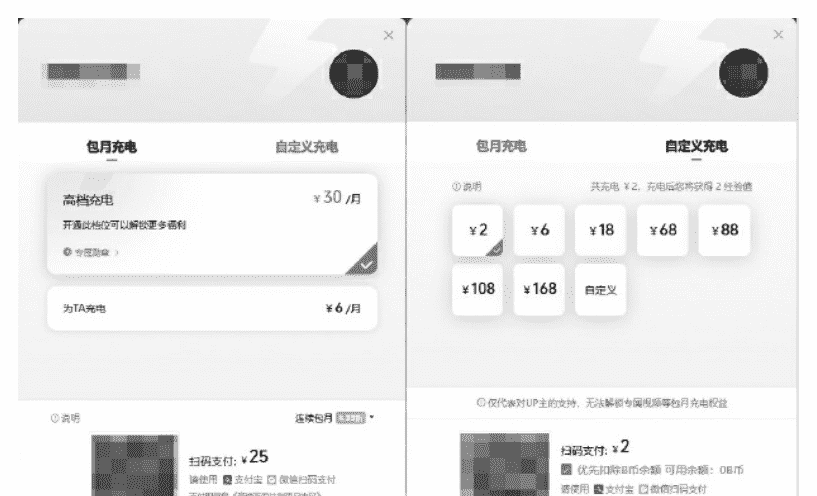

按B站官方说法，充电功能始于2016年的单次打赏，2022年底升级为包月模式。创作者可发布仅充电用户可见的内容，自主定价，用户可按需订阅随时取消。

这是一种轻量会员制，不像直播带货靠情绪，也不像知识星球需要自建私域，不用拉群运营社群，只要内容独特就能直接获得经济支持。

食贫道在《迷失东京》中首次推出充电专属版，定价12元月，约是大会员的一半，可解锁完整版和导演讲解。上线7小时充电额破百万元，21万人支持，其中15%是此前从未消费过的用户，37%来自完播率最高的免费内容老用户，证明前期免费是后期的转化基础。

2024年后他系统化运营充电内容，推出《何以当归》《迦南孤儿》等系列，单集成本上百万，价格仍维持12元月，通过提高内容密度、幕后资料、选题投票提升粘性和复购。

案例说明：前期做流量攒信任，后期用独特产品锁定核心用户。只要用户觉得值，持续变现就能跑通。

## 少做一锤子买卖，复购才能持续盈利

很多人只盯着拉新，忽视老用户的复购潜力。一次付费说明认可价值，能二次付费就意味着你在经营关系。

### 一锤子买卖的弊端

只做一次性成交很难长期稳定。典型表现是买完即走，交付结束用户消失。表面完成交易，实质没有沉淀。

弊端包括：变现路径单一不稳定，收入完全依赖新客，停推就掉；难以形成口碑，用户不会主动传播；无法积累真实反馈，产品优化靠猜，易脱离用户；收入波动大，焦虑感强，难做规划。

核心问题是过度依赖一次性成交，导致不持续、无复利、难增长。

### 打造可复购的产品

要从卖一次转向让用户愿意反复买。不是降价促销，而是系统设计，让用户买完后还有继续投入的理由。

可以从分阶段交付入手，让用户有进阶感...

复购才是个人变现能走长远的底座，而不是靠一次次拉新去续命。

很多人做产品只盯着怎么把第一笔钱赚到，却忽略了用户买完就走的代价。一次成交只能证明你有价值，愿意二刷、三刷才说明你在经营一段关系。对一人单干来说，能否从“一锤子买卖”转向“持续购买”，决定了现金流是断续弹还是稳定流。

### 一锤子买卖背后藏着四个死结

当收入完全靠新客输血时，商业形态就变成了一场不停的拉新游戏。停下获客，流水立刻下滑，现金流没有预期，可复制性也无从谈起。

买完即走的用户不会帮你传播。真正能放大声量的，是那些反复消费、持续互动的铁粉，他们才是品牌的自来水源。

缺乏持续交付，就收不到持续反馈。没有反馈就看不清产品优劣、需求迁移，只能凭感觉修补，甚至盲目追热点，离用户越来越远。

收入的波动带来的焦虑感最致命。今日有单明日无单，这个月冲高下个月归零，做规划、做投入都提心吊胆，这正是过度依赖一次性成交的典型困境。

要破局，就要从“卖一次”的思维切换到“让用户期待下一次”的系统设计。

### 让产品自带复购节奏的三层设计

**1. 把交付拆成进阶路径，制造“下一步感”**
产品没有节奏感和成长线，用户自然没有回来的理由。把一次性的解决方案变成阶段性的成长带，期待就会自然产生。

比如一套AI写作课，不要一次性打包讲完，而是按周递进：第一周先打磨爆款标题的钩子，第二周用AI搭文章骨架，第三周研究提示词如何影响输出，第四周训练AI自我修改。
层层推进能拉高参与感，完成首期后信任建立，后续转化阻力会大幅下降。进阶式交付也在过程中不断收集真实反馈，让内容越做越准。

**2. 用会员分层把核心用户留住**
升级产品只是其一，更关键的是建立长期陪伴的机制。不是做上万人大社群，而是围绕核心用户搭建专属服务体系。

普通层可拿基础资料包；进阶层加入闭环社群，享受定期答疑；高级层则覆盖直播课、专属模板、定制方案等高价值权益。
会员的本质是深度连接者，他们愿意投入时间、金钱和精力，说明已把你视作成长引路人。围绕这批人推出进阶内容、专属资源或轻量陪跑，只要价值持续高于预期，离场率低，还会主动帮你转介绍。

**3. 预判需求节点，适时提供新选项**
复购不是催单和打折，而是提前布局用户的新痛点。
做短视频剪辑教学的用户在完成基础课后，开始大量询问AI生成视频。此时推出“AI生成视频速成班”，在需求升温时给到更有价值的选择，复购就很自然发生。不必天天促销，时机对了，用户会自己选择留下。

做好这三件事，就能逐步搭建出可持续的变现模型，收入更稳，产品更有生命力。这也是AI时代一人单干能走稳走远的关键。

### AI生成内容想赚钱，必须走再创作路线

AI现在能快速产出文章、图片、音乐、视频，门槛大幅下降，但直接拿来变现的难度在上升。
版权归属模糊，主流平台对AI内容要求标注、限流；用户对“AI味”内容信任度偏低，专业场景更想要真人交付；平台审核越来越严，机器内容难以参与流量扶持和商业化功能。

AI的价值是提效起稿，决定能不能变现的是你是否做深度加工。

写作类内容，AI负责初稿，你负责注入人味、案例和个人视角，让文字有温度、有判断。

图像类内容，用AI做构图和风格初探，人来精修。比如下一套Midjourney生成的十二生肖Q版，整体造型达标，但配色偏冷、字体不统一、层次扁平。自己补草图、分层上色、调整细节后，才能成为可交付可商用的视觉资产。AI是初级设计师，你是主理人。

音乐类内容，AI能拼出旋律和编配，但细节、情感、原创性不足。需要懂点乐理，用作曲软件二次调试、重新编排，才能申请版权并上架各平台去限制。

在单人模式里，AI不该替代你，而是帮你把想法快速落地，最后由你掌控、提炼价值，服务个人品牌和商业闭环。

### 第8章 一人单干时代，打造属于你的个人IP

信息过载的时代，注意力稀缺。让人记住的关键，从来不是能力最强，而是人设最清晰。
人设就是市场对你的印象标签，比如“讲商业思维特别犀利的女生”“把知识付费讲透的职场教练”“用短视频带普通人开公司的创业博主”。它既是影响力的起点，也是信任和转化的放大器。

**怎样找到自己的定位**
先盘点核心标签。问自己：我是谁？我擅长什么？我有哪些不同经历？写下来会得到关键词，比如职场妈妈、前大厂员工、独立设计师等。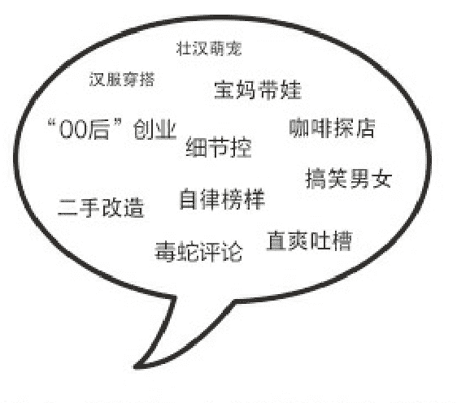

图8-1 常见的一人单干模式的人设标签

说话风格和输出形式也是人设的一部分，有干货型、反差型、共情型之分。

再明确目标用户画像。不必讨好所有人，只要目标人群觉得你是为他而生。自由撰稿人的目标可能是需要品牌内容的中小企业主，健身教练的目标可能是追求健康生活的年轻人。人设与用户期待越高契合，吸引力越强。

接着提炼一句人设关键词，最好一句话就能记住，有画面、有情绪、有业务指向。如“避开职场陷阱的前HR总监”“零基础也能接单变现的手绘博主”。

最后持续输出强化。人设需要重复建立。今天聊职场焦虑，明天谈情感，周末推读书，人设就会稀释。只有在较长周期内持续强化同一形象，市场才会被训练“想到这个领域就想到你”。

**包装的尺度**
包装不是伪装，而是把核心价值提炼后用更易传播的方式呈现。说“我教了10年英语”平淡无奇，换成“在公园里陪学生练口语，用刷剧方式学英语的老师”，同样真实却更有记忆点。

把握尺度可用721原则：70%真实能力与性格，20%适度强调与表现，10%展现方式的优化，如语言、视觉、互动。

常见误区：

| 人设包装常见误区 | 具体表现 | 后果 |
| :--- | :--- | :--- |
| 过度美化经历 | 把兼职说成高管，把试水项目包装成成功案例 | 被质疑真实性，失去信任 |
| 照搬他人风格 | 盲目模仿网红说话方式、视觉风格 | 缺乏辨识度，难以形成个人标签 |
| 标签混乱不清 | 今天投资理财明天情感，周末又写读书 | 用户记不住你是谁，也不知道你能做什么 |
| 刻意营造完美 | 不敢暴露缺点、不敢承认失败 | 让人觉得距离太远，缺乏共鸣 |
| 忽视平台调性 | 短视频平台用公众号风格，知乎发段子文 | 内容与平台不符，影响传播效果 |

真实、有差异、可持续的人设，才能在信息洪流里脱颖而出，帮助你把产品、内容和变现连成一个闭环。

图8-1 常见的一人单干模式的人设标签

人设不是贴上去的标签，而是你日常呈现的痕迹。你选什么角度说话、用什么形式输出，本身就是形象的一部分。干货派就长于直给方法，反差派能把严肃话题讲得轻松好懂，情绪派擅长共情引共鸣。选准一种调性并长期稳定输出，你才会被记住。

### 先把人设锚在“对的人”身上

做人设别想讨好所有人，只需要让精准用户觉得“就是为我说的”。把人群画像拆细：他们是谁、当前卡点是什么、想要什么结果。

比如你是自由撰稿人，真正买单的不是泛泛的大众，而是需要高质量内容做品牌的中小企业主；你是健身教练，核心吸引的是想过更健康生活方式的年轻人。人设和期待对上号，吸引力才真实发生。

### 一句话讲清你是谁

好的定位能被一句话记住。要有画面、有情绪、指向业务。

教你避开职场坑的前HR总监、零基础也能接单变现的手绘博主、边讲段子边传授理财知识的博主、只做小而美品牌视觉的独立设计师——都是“一眼就懂”的表达。

### 用重复把印象钉牢

人设确定后就要用内容、产品、社群去喂养。别今天聊职场焦虑、明天谈情感婚姻、后天又推书单，话题跳来跳去只会让形象变模糊。挑一个核心方向持续复盘、持续强化，直到用户一想到这个领域就想到你。

## 包装的边界：提炼，不是伪装

包装的本质是把你已有的核心优势，用更易理解、更有记忆点的方式呈现出来。不是造假，而是放大。

你是一名很有耐心的英语老师，教了十年，口碑不错。平铺直叙很难让人留下印象。若改成“我是在公园里陪学生练口语的老师，用短视频让你像追剧一样学英语”，事实没变，却多了场景、情绪和具体感，更容易被记住和喜欢。

把握尺度可以用721原则：70%来自真实的能力与性格，20%是对特质的适度强调，10%用在表达方式的优化上，比如语言、视觉、互动。真正的包装是让价值更清晰，不是把自己换成另一个人。只有真实、差异、可持续的人设，才能在信息过载里突围。

人设包装要避开的坑：

过度美化经历，比如把兼职说成高管、把试水包装成成功案例，最后会被质疑真实性而丢信任。
照搬他人风格，盲目复制网红的说话方式和视觉，缺少辨识度也难形成个人标签。
标签混乱不清，今天讲理财明天聊情感后天写书评，用户记不住你到底做什么。
刻意营造完美，从不暴露缺点也不承认失败，距离感拉大、共鸣变弱。
忽视平台调性，短视频平台用公众号口吻，知乎发段子文，传播效果大打折扣。

## 品牌定位：一人单干更要差异化

定位决定你从哪切入市场、用户怎么认知你。写“专业、高效、创新”谁都会，但没有差异，等于没说。

### 从擅长到不可替代，先挖自身优势

技能组合别只看单点，看关联。设计师普遍强调设计能力，若同时会摄影和文案，就能做出跨界组合。列出所有技能两两搭配，常能碰撞出新服务，比如摄影师叠加后期修图，就能提供从拍摄到交付的一站式视觉方案，省用户时间、保证风格统一、提升竞争力。

经历的独特性也是资产。回顾对你影响深远的关键阶段：曾在教育行业工作后转营销顾问，就能专注服务教育机构，用“懂行的人”视角去做市场升级，信任感天然更强。

性格可被感知。细节控、沟通强、创意爆发，都是品牌语言和服务方式的来源。用户常说你“总能很快解决”，那“快速响应”就可以做成承诺，比如24小时内回复咨询，用制度把特质固化。

### 看见别人忽略的市场需求

差异化不一定是比别人强，往往是发现别人没注意的痛点。

关注隐性需求。用户嘴上说“文章写得很好”，实际反馈SEO效果差，这就暴露了更深层需求：既要好内容，也要带来流量。把定位升级为既能写好文又能带来增量的内容专家，并用数据证明价值，就能抓住隐性需求。

聚焦细分市场。想服务所有人最终谁都打不动。选一个熟悉且感兴趣的小众赛道深耕，例如摄影师聚焦宠物摄影，再细化到稀有宠物的纪念照。受众虽窄，却更容易被视为专家，也降低竞争压力。

借势趋势抢先机。短视频教学兴起，健身教练推出居家健身短视频课，就能搭上浪潮，让品牌更具时代感。定位不是写死，而是不断反思、测试、调整。

## 记忆点：让品牌住进用户脑中

信息爆炸下，品牌必须在几秒内留下印记。对资源有限的个体创业者，记忆点是高效的认知桥梁。

### 用视觉先声夺人

Logo是视觉核心，要简洁、易识别，缩小后依然清晰，避免多色堆砌和复杂图案。
主色调承载情绪，科技感常用蓝，健康感常用绿，并在网站、社媒、名片上保持一致。
字体与排版也是语言。选定一到两种专属字体，标题加粗突出重点，正文用简洁无衬线提升阅读，统一字号、行距、间距，整体才有秩序感。

### AI也能快速搭建专属视觉

过去做Logo和视觉系统要找设计师反复打磨，现在AI大幅降低门槛。以豆包为例：

第一步输入描述词。在图像生成界面输入提示语，例如：请帮我设计一个极简风格的品牌Logo，用于个人知识付费品牌，主色调是蓝色，图形包含一本书和一支羽毛笔。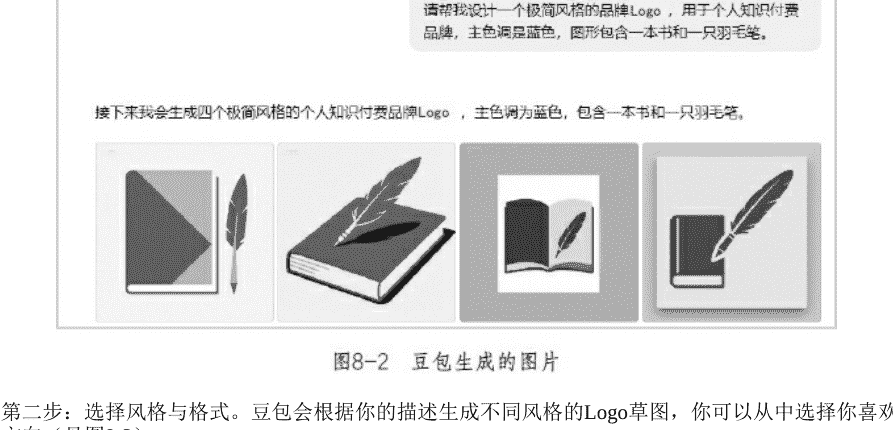

第二步选择风格与格式。系统会生成多组草图，你可以挑选方向再优化。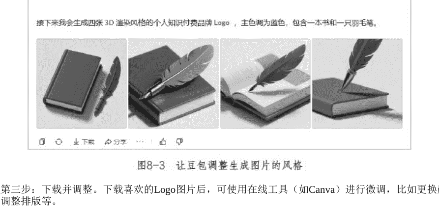

第三步下载微调。用Canva等工具换色、调版即可上线。没有参考图时直接上传一张做参考，AI也会按图生成相似风格。

### 故事和体验让人记住感受

人记住的不是信息罗列，而是情感共鸣。讲一次从零创业的真实历程，讲一个用户因你的服务被改变的小故事，都比干巴巴的介绍更有力。

体验细节同样是记忆点：交付时附上手写信、课程里加入个性化互动、社群设置专属打卡仪式。这些微小设计会让用户觉得“你不一样”。让人记住的不是你说了什么，而是他们感受到什么。

## 用故事力建立信任

数据重要，但打动人心的往往是故事。一人单干讲好故事，成本低、回报高。

### 哪里找素材

你的创业历程本身就是故事：为何入行、遇到什么坎、怎么突破、得到什么结果，能传递价值观。
用户的真实反馈是最好证明。收集带有情绪的评价，把需求、解决方案、结果串成案例，信任感立刻提升。
行业趋势也是素材。讲述技术革新或消费变化，以及你的品牌在其中的角色，能体现前瞻性和专业度。

### 一个好故事的骨架

开头设定背景引入冲突。快速点出用户痛点，比如“创业初期资金紧张”“新人不知道如何快速适应”。让读者立刻代入。

中间展开情节给出解法。详细描述你如何解决，强调独特性和实际操作细节，让读者明白为什么选你。

高潮突出成果与影响。用数据或用户原话佐证，比如销售额提升30%、90%用户满意度提高，配合感谢信等感性细节强化共鸣。

收尾升华传递愿景。总结品牌使命，例如“相信每个人都有实现梦想的权利”，把服务上升到价值认同。

### 让表达更亲近

用第一人称叙事，“我当时也卡在这里，后来发现…”拉近距离。
注重细节描写，加入声音、气味、触感，让画面更立体。
结合多媒体，短视频记录用户反馈、图文展示案例效果，文字+视觉的组合更容易传播。

视觉、语言、体验三线并进，故事框架清晰且表达优化，才能让品牌在用户心智中占据一个独特的位置，并在需要时第一个被想起。

当你只有一个人扛住整个品牌时，最怕的就是泯然众人。事实是，讲故事比单纯卖货更能让你被记住。

一份打动人的叙事，能把单打独斗的个体从红海里拉出来。别只堆参数，去扒那些真实发生的细节，搭一个有起承转合的骨架，再把表达打磨得更顺口。产品会过时，但用户记住的是情绪共鸣。等他感受到你是用心在说而不是在推销，信任才会自然生长，而信任才是生意能走远的底座。

别忘了视觉的配合。精修的图片把产品效果说清楚很重要，但所有素材的形式和调性都要服务于同一个故事主线，分散注意力才是最大的浪费。

## 用 AI 把一人品牌做大

对个体创业者来说，数字化时代的 AI 已经不是花哨的噱头，而是传播和运营的杠杆。资源有限的情况下，它能帮你提速、放大声量、把连接做得更深。说白了，AI 赋能就是用技术把内容做得更好、体验更顺、数据更透，让每一步都更准更省力。

### 分步搭建你的智能化工作流

AI 听起来高门槛，拆开来做，一人公司也能稳稳上手。

- 1. 先对标需求再挑工具
市面上 AI 应用很多，但适合你的只有少数。先盘点品牌最卡脖子的环节，比如写文案耗时间、回复用户太重复、数据整理太碎片，有了清单再去匹配对应的工具，而不是先入坑再找用法。

- 2. 把数据打通，看见完整的人
社媒、邮件、官网的数据各自为政，就会出现决策盲区。用 AI 把多渠道信息汇聚起来，结合 CRM 做统一管理，才能拼出真实的用户画像。举例来说，通过浏览轨迹、复购记录和互动频次做标签分层，后续的沟通和推送就能更精准。

- 3. 持续迭代，保持领先
AI 不是装一次就完事，得做成常态化的优化。定期复盘使用效果，比如生成内容的打开率、智能客服的满意度，用反馈来调参或换工具。同时保持对行业新动向的敏感度，及时升级方案，避免掉队。

### 用 AI 时必须留意的两件事

便利的背后也有坑，处理不好反而伤品牌。

- 1. 别把人味交出去
AI 效率高，但代替不了情感和创造力。尤其是用户沟通，太模板化会让人产生疏离感。AI 生成后必须人工过一遍，校准语气、加入真实案例或一点幽默，让内容更有人味。客服机器人里也要留“转人工”的出口，复杂问题由人接。

- 2. 隐私合规是红线
AI 运行离不开数据，合规和信任必须前置。明确告知用户数据用途并取得授权，注册页要写明“您的信息仅用于改善服务质量”，并提供隐私政策入口。供应商的选择也要符合本地法规，数据安全不能妥协。

归根结底，AI 能帮一人品牌省时间、降成本、抢出位，但它始终是工具。真正决定长久影响力的，是品牌的价值观和人性化的服务。技术负责效率，情感负责留存，只有两者结合，才能做出经得起时间考验的品牌影响力。