# AI产品经理：方法、技术与实战

## 概要

本书是一部聚焦 AI 方案从概念到商业兑现的实操指南。整册始终围绕落地与规模化展开：给出不同品类的落地方案，提供可直接复用的工作方法与技巧，并以安防、制造、汽车等真实行业案例把思路讲透。

无论是技术背景迁移到 AI 方案方向，还是从通用产品线转到 AI 方案，或是已在负责 AI 业务想补齐算法、平台、业务维度的短板，都能从中补全知识缺口。已入门者也能借此梳理算法、中台、业务等各类方案的落地思路，掌握更快、更高质地推进的方法论。全书共四辑十三章。

首辑第1～2章对 AI 方案与方案主理人进行系统拆解，帮助建立底层认知，同时给出入行路径与职业成长规划。

次辑第3～6章由机器学习起步，延伸到以计算机视觉、语音识别、语义理解为核心的多模态理解、行为学视角的机器人学，以及云原生环境下的工程化实践。表述面向实际负责人员，只讲原理与应用方向，不陷入细节。

第三辑为重点。先梳理通用产品方法论，再结合 AI 产业链特点，深入解读算法、中台、业务三大类方案的落地实践。算法与中台部分覆盖自动驾驶、元宇宙、企业智能、智能汽车、虚拟数字人等主流需求；业务类从城市治理、企业服务、个人服务三个维度展开。

末辑从行业赋能与项目实战两个角度讲高效高质量交付。以安防、制造业、汽车为样本拆解高效落地方案，同时以 B 端、G 端项目和商机项目为例，给出可行性验证与交付环节的解决思路。

## 关于作者

王泽楷

亚太人工智能学会资深数字孪生研究专家，曾任平安科技、商汤科技 AI 高级产品专家。近十年持续在一线技术与产品岗位工作，参与多家世界 500 强企业的智能化建设，以及多个一线城市的城市级应用落地，在工程化应用上积累丰富经验。

曾从事深度学习算法研究，发表相关专利论文 6 篇，对以深度神经网络为代表的新一代技术有深刻理解，并在计算机视觉领域长期跟踪前沿。硕士毕业于法国南特大学，拥有电子工程与测控机器视觉双硕士学位。

## 起笔缘由

2013 年前后，以深度学习为核心的智能化浪潮开始试探商业化落地的边界。那一年作者开始接触深度学习，从校园科研论文，到入职做早期算法工程师，再转型为 AI 方案主理人，近十年亲历并参与了新一代产业从技术到落地的全过程。

2016 年 AlphaGo 战胜人类棋手，深度学习路线被证明能带来智力跃升。但在海量数据与算力之外，如何真正商业化、如何做方案，行业里缺乏清晰答案。技术只能到处寻找应用场景，这是技术驱动、标杆项目驱动的阶段。

进入商业化深水区，企业开始纵向赋能传统行业，传统行业也希望借助智能化实现降本增效、拓展能力边界。连接技术与真实业务需求的角色就凸显出来，这就是 AI 方案主理人。它要洞察行业痛点，用技术给出可落地的产品形态。

方案主理人需要什么能力，如何打造好方案，是职业生涯的核心命题。作者在寻找答案时发现前人经验稀缺，只能自己摸索。本书把摸索的历程、经验与方法论梳理出来，帮助后来者更快建立知识体系，掌握打造成功方案的方法。

## 适合人群

- 初中级 AI 方案负责人
- 想转做智能方案的互联网产品、算法或工程技术人员
- AI 相关高校师生
- 对方案主理人有兴趣或有转型需求的人
- 智能行业其他从业者

## 核心看点

1. 从技术、方案、行业应用、工程实践多角度系统化构建 AI 产品闭环。
2. 技术层面覆盖负责人必备知识，包括最新自监督预训练、Transformer、大模型等，以及音视频图文感知智能、知识图谱语义认知智能、行为主义机器人学、云原生工程化应用等。
3. 从算法方案、智能平台、业务类智能方案三层切入，结合城市治理、企业服务、个人服务三维度，总结从智能产品需求定义到工程化的完整流程。
4. 针对自动驾驶、元宇宙、企业智能等场景，给出智能汽车、虚拟数字人、智能平台的闭环解决方案。
5. 围绕技术创新如何产品化、需求分散市场如何落地、可行性验证怎么做等实战问题，给出作者的思考与见解。
6. 凝练了作者从深度学习算法研究员转型为方案主理人的心得，以及在头部公司参与 G 端、B 端方案打造、安防领域标杆边缘计算产品、媒体重点产品落地，以及交付数十个标杆大项目的经验。

## 阅读建议

全书四辑十三章。

AI 与方案主理人：第一、二章，宏观介绍产业，探讨什么是智能方案和方案主理人，以及如何成为优秀的主理人。

技术篇：第三至六章，用负责人可读的语言讲解必须掌握的技术，从机器学习到多模态内容理解，再到行为主义机器人学和云原生工程应用。

方案应用：第七至十一章，先从市场和技术视角剖析机会，再基于通用方法论结合产业链，对算法、平台、业务三类方案展开落地解读，业务类覆盖城市治理、企业服务、个人服务。

工程实践：第十二、十三章，从行业赋能和项目实践角度，解读解决方案、可行性验证、交付等工程化问题。

## 勘误与支持

书中难免有疏漏错误，欢迎指正。微信公众号“AI言究院”，微信号“AI2022yjy”，邮箱 zekai_wang@163.com，作者愿线上解答问题，收集宝贵意见。

## 致谢

感谢罗予晨、赵瑞博士、宋老师、远望资本程浩老师、中兴创投林强老师在创作中提出的宝贵意见。感谢机械工业出版社华章分社编辑孙海亮老师一年的支持与鼓励。最后感谢家人的理解与陪伴。

# 第一篇 AI 与方案主理人

过去十年从学术走向产业，已形成较为完整的产业体系。过渡期里，如何理解 AI、技术如何产品化、产品如何商业化推进、产业对人才的需求如何变化，是核心问题。本篇围绕概念、方案、方案主理人展开。

## 第1章 深入理解 AI 与 AI 方案

本章先梳理 AI 概念的定义、三大流派、发展历程和产业现状，再介绍 AI 方案的发展脉络、形态演进与产业链。

### 全面认识 AI

AI 的定义。1950 年阿兰·图灵提出图灵测试，用对话判断机器是否有智能。1956 年达特茅斯会议上，John McCarthy、Marvin Minsky、Claude Shannon 等人首次提出 AI 概念。

对 AI 的定义有多种说法：《人工智能：一种现代的方法》提出像人一样思考的系统、像人一样行动的系统、可理性思考的系统、可理性行动的系统。中国电子技术标准化研究院的表述为利用数字计算机或由数字计算机控制的机器模拟、延伸和扩展人的智能，感知环境、获取知识并实现最优结果的理论方法技术及应用系统。从文明高度看，AI 是人类理解和重构智能的产物，《荀子·劝学篇》“君子生非异也，善假于物也”可用来形容 AI 是人类可依托的最高智慧形态。

按智能程度可分狭义智能、通用智能、超智能。狭义智能即只能解决特定问题，如 IBM 深蓝、AlphaGo，智能诊疗、智能客服等，迁移能力弱、无自我意识。通用智能具备独立意识和知觉，能自主应对环境。共识能力包括感知结构化非结构化信息、自主思考、自主学习、制定目标和计划、交流沟通。Gartner 2021 年成熟度曲线预计通用智能成熟需 10 年以上，业界如 DeepMind Demis Hassabis、谷歌 AI Jeff Dean、斯坦福李飞飞等预测通用时代或需到 2099 年。通用智能在伦理道德上也有争议，各国标准正在预估风险。

超智能指智能远超人类或通用智能。牛津大学尼克·博斯特罗姆定义为在几乎所有感兴趣领域都远超人类认知表现的智能。有人认为超智能是人与计算机高度融合，也有人认为通用智能出现后会在记忆、知识储备、并行处理上超越人类，成为新物种。博斯特罗姆指出生物神经元工作频率约 200Hz，远慢于 2GHz 微处理器；信号传输速度也远低于电子通信，扩展协同能力上计算机更具优势。

### AI 的三大流派

符号主义又称逻辑主义、心理学派或计算机学派，认为 AI 源于数理逻辑。20 世纪 30 年代数理逻辑用于表示智能行为，1956 年前后艾伦·纽厄尔等人编写的“逻辑理论家”证明 38 个数学定理。20 世纪 80 年代启发式程序、专家系统、知识工程蓬勃发展。代表人物艾伦·纽厄尔、希尔伯特·A. 西蒙。

连接主义又称仿生学派或生理学派，认为 AI 源于对人脑模型的仿生。20 世纪 60-70 年代感知机研究兴起后陷入低谷。1982 年霍普菲尔德提出霍普菲尔德神经网络，1986 年鲁梅尔哈特等人提出误差反向传播算法，随后卷积神经网络、深度信念网络、深度神经网络训练方法相继出现，21 世纪初在计算机视觉、语音识别、语义理解带来突破。

行为主义又称进化主义或控制论学派，认为 AI 源于控制论，即感知、控制和行为反馈系统。20 世纪 40-50 年代控制论成为重要思潮，模拟自寻优、自适应、自学习。推动智能控制和智能机器人发展，20 世纪末作为新学派出现。21 世纪智能机器人在工业制造等领域取得成功，如波士顿动力机器狗、行走机器人等。

### 发展脉络

第一阶段 20 世纪 50-80 年代，数字可编程计算机出现，符号主义繁荣，因运算能力不足，常识认知和推理难突破，1970 年后进入低谷。

第二阶段 20 世纪 80-90 年代末，连接主义和符号主义共进，人工神经网络、反向传播算法突破，专家系统获得资本和研究热情，计算机发展带来第二波高潮，但数据获取、知识规则局限和构建成本高昂导致再次低谷。

第三阶段 21 世纪初至今，大数据积累、算力大幅提升、算法革新，以深度学习为代表的第三波热潮兴起。

从学派看，第一代对应符号主义，第二代对应连接主义。清华大学 AI 研究院院长张钹院士提出第三代理念，即融合知识、数据、算法、算力四要素的可解释和鲁棒的 AI，发展安全可信可靠可扩展技术。

从智能化程度看，可分为计算、感知、认知、意识四个阶段。计算是基础，算力增长带来问题解决能力提升。感知智能让计算机理解数字化物理世界，会听会说会看会认。认知智能让机器理解思考解决问题。意识智能是 Manuel Blum 夫妇 2020 年提出的构建可计算意识模型。深度学习在感知智能和认知智能上带来飞跃，意识智能的到来只是时间问题。

AI的突破直接打开了新的赛道，各国也纷纷把人工智能写进国家级规划。截至2020年12月，全球已有39个国家和地区发布了人工智能战略和产业规划。以中国和美国的早期动作为例：

中国在2016年5月推出《“互联网+”人工智能三年行动实施方案》，主推人工智能向智能家居、智能汽车、智能机器人等场景渗透；2017年7月发布的《新一代人工智能发展规划》则明确到2030年要让人工智能理论、技术和应用整体达到世界领先，成为全球主要创新中心。

美国在2016年10月出台《国家人工智能研究与发展战略计划》，提出七大战略方向，强调长期投入以及对伦理、法律、社会影响的理解；2019年2月的《美国人工智能倡议》则把保持人工智能领先置于国家优先议程。

### 先把AI产品拆清楚

讲AI产品经理之前，先搞懂AI产品是什么。我的理解是，AI产品是以人工智能技术为核心，面向特定场景、解决具体问题或提升体验的功用集合。一旦核心能力依赖算法实现，它才算AI产品，拿掉AI就失去存在价值或竞争力。比如刷脸通关，离开人脸识别就谈不上非接触核验和访客管理；普通摄像机换成智能摄像机，区别就在AI能力的加入。

从底层往上看，形态大致分几层：
硬件基础设施层有AI芯片、算法加速卡、AI超算服务器等；软件基础服务层有算法框架、工具链；在此之上是视觉、语音、文本、声纹等媒介与算法结合的应用产品，也包括软硬一体的方案；往上是多模态数据融合的应用；再往上是面向行业的知识图谱类产品。

### 技术怎么变成产品

从人类技术史看，商业化都离不开产品这个桥梁。AI也不例外。产品化有两条路：一是赋能存量，让原有产品智能化，比如给摄像机加AI变成智能摄像机，给迷你音箱加语音交互变成智能音箱；二是创造增量，孵化全新形态，比如物流机器人、机器狗、AI模型生产平台、人脸测温仪等。

### 产业链和标准的博弈

当技术成熟、政策加持、资本涌入，商业化加速，场景落地越来越丰富。围绕产品和解决方案的分工协作形成了一条相对完整的链条，大致可分为基础、技术、应用三层。

基础层提供算力底座，核心是AI芯片、大数据处理、云计算模块，几乎是上层业务的公共依赖，其中芯片是竞争焦点。
技术层在基础之上，提供机器学习平台、数据、算法、算力，输出计算机视觉、语音识别、自然语言处理等能力。谷歌、微软、亚马逊、百度、阿里、腾讯等巨头早早布局并与云结合，商汤、旷视、科大讯飞、第四范式等公司则多从这一层切入并向两端延伸。
应用层做的是融合多种技术和基础能力形成AI产品，并推向行业的解决方案，关键在于完成商业闭环，兑现效率提升和价值创造。

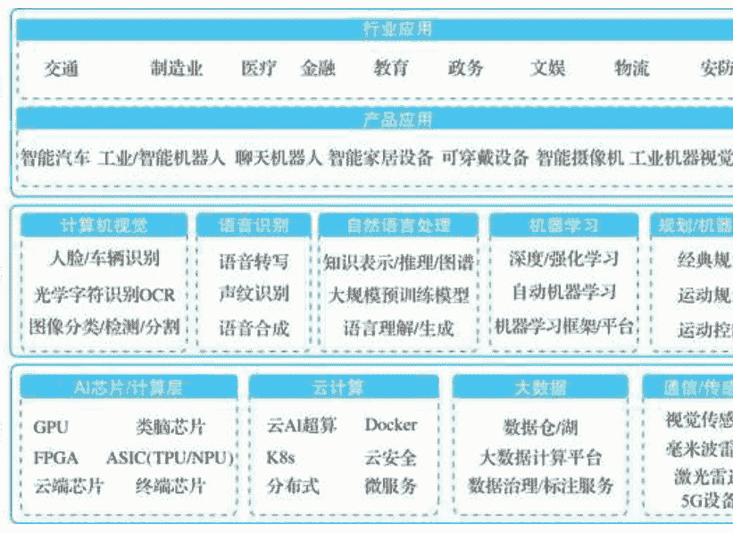
图1-5 AI产业链分层示意

产业规模越大协作越频繁，标准化就成了高频词。标准化能降本、提质、统一规范、提升管理。早期大家野蛮生长求生存，后期落地后标准会补齐。当前《国家新一代人工智能标准体系建设指南》给出了整体框架。

标准范围越广对产品越有利，越贴合国家甚至国际规范，上下游协作成本越低、机会越大。安全伦理类标准出现后，也会成为客户采购时的风险考量。从造产品角度看，标准要同步关注。往往是技术先实现产品化和商业化落地，才能参与早期标准制定，从而构建竞争壁垒。参数和技术若符合既有规范，企业优势更明显。

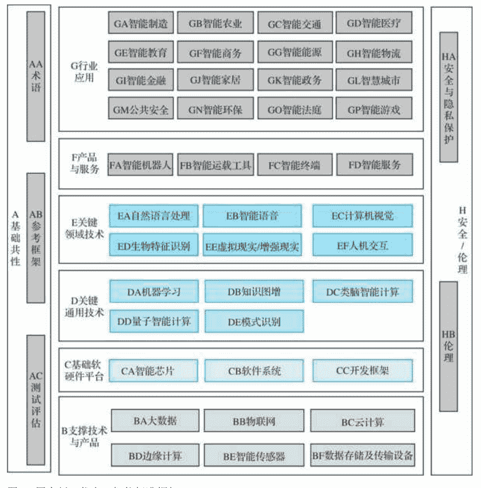
图1-6 国家新一代人工智能标准框架

### 落地能带来什么价值，又卡在哪

我把落地的AI产品归为两类：降本增效类和增愉悦类。

降本增效类是把AI植入已有流程，替代或改造生产环节，提升效率。生产概念很广，既有质检、制造，也有政务案件办理等业务类工作。核心是人能做，AI做得更快更好。
增愉悦类以提升使用愉悦度为核心，效率提升是副产品。比如AI相机能做美颜、人脸检测、增加可爱搞笑元素，满足情绪需求。

落地困难重重，除了技术本身，还有成本、隐私、安全三大基础难题。

成本体现在人力与算力。人力贵源于大规模标注依赖、算法定制化，以及懂深度学习的人才稀缺；算力贵在于追求精度导致参数规模膨胀，深度神经网络在成本和功耗上承压。
隐私问题源于“有多少人工就有多少智能”。标注产生大量数据，在银行、保险、安防、电商、制造业等场景，数据获取、存储、传输、使用的隐秘性要求极高。
安全分为人身安全和财产安全。自动驾驶把人身安全放在第一位，且深伪等攻击不断增多，人脸验证等场景面临非法收益风险。

不同场景痛点不同，制造业更敏感成本，自动驾驶更敏感安全，银行更敏感隐私。解决方向是更廉价的算力、更高精度的算法、更少数据依赖和更强的隐私保护机制。每个场景都有红线，技术每进一步就解锁更多场景。

与学术更关注理论和精度不同，商业落地必须同时思考经济可行、安全可行、法律可行。

### AI产品经理到底做什么

AI产品经理就是管理基于AI能力打造的业务应用或产品的角色。

懂技术是必备，但不同链路要求不同。越靠近基础层，对技术理解越深。比如做人脸识别打卡App和做AI芯片产品，技术深度要求完全不同。

“懂技术”常见两个误区：一是懂技术不是目的，是让技术更好地辅助决策做产品；二是懂技术不是写代码，而是懂核心技术逻辑、流程、边界，用来界定产品范围。

懂技术的产品经理会获得四个好处：更清楚技术局限，能用产品规则规避；能用技术创新为产品创新供弹，技术成熟时商业模式权重上升，技术未成熟时突破能打开场景；与研发沟通更顺畅，减少不必要的争执；对内对外都更专业可信。

相比普通产品经理，AI产品经理的技术理解要求更高。算法往往作为独立模块开发，产品经理除软件产品原理外，还应了解算法维度：以深度学习为代表的算法流程和原理、算法效果评估、算力与算法的权衡配合、从数据层面定义业务并划定算法功能边界。这些是推动开发、完成交付的关键技能。

### 怎样成为更好的AI产品经理

从四个角度准备：基本素质、自身优势、定位、路径。

基本素质覆盖技术、产品、项目、行业四个维度：对深度学习等技术的认知、产品方法论、AI落地的解决方案与闭环意识、对目标行业业务的理解。
优势因人而异，算法工程师或系统后台工程师转岗技术认知强，行业专家在AI+行业落地中能发挥业务理解优势。

产业链方向众多，要明确自己在基础层、技术层还是应用层，是技术型还是行业应用型。
技术型AI产品经理面向基础产品，技术属性强行业属性弱，如AI芯片、工具链、云平台，需要深度使用经验。
行业应用型面向纵深行业，行业业务属性强技术属性弱，如AI+交通、安防、医疗，偏重把AI能力落地到行业，是π型人才。

路径上既有校园招聘也有社会招聘。产品经理岗位更看重综合能力和实践性，社会招聘更友好。做好职业规划，积累专业素质，结合自身优势找机会，是成长的关键。

职业规划可从技术栈、行业业务、职能、平台四个维度思考。
技术栈是支撑产品的能力集合，如5G、AI、物联网、云计算；行业业务是痛点、规则、产业链、商业模式等的集合，AI需锚定具体赛道才能赋能；职能包括C端、B端、G端产品经理，后续可转向投资、解决方案架构师或管理线、业务线；平台不同，企业规模和资源决定项目规格和成长宽度。要在纵深和横向复合上同时成长。

知识体系大致包括AI技术认知、产品生命周期过程管理、AI项目管理、行业业务知识。
AI技术认知分理论与工程应用，理论涵盖机器学习、计算机视觉、语音识别、自然语言处理；工程涵盖任务定义、模型训练与评估、落地部署。
产品生命周期管理覆盖市场感知、产品定义、需求管理、产品设计、研发协同、运营营销。
AI落地多为项目制，项目管理与行业业务知识覆盖商机、订单、交付、验收到上线，涉及政策标准、业务理解、项目管理。

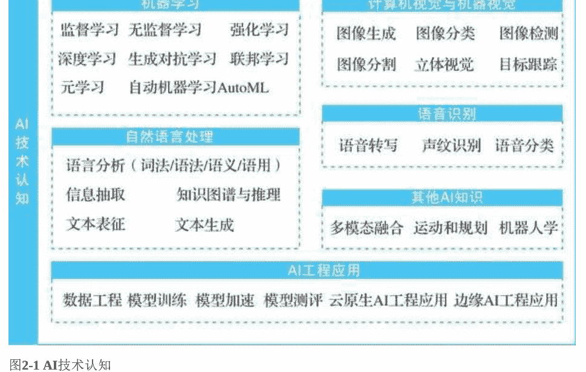
图2-1 AI技术认知

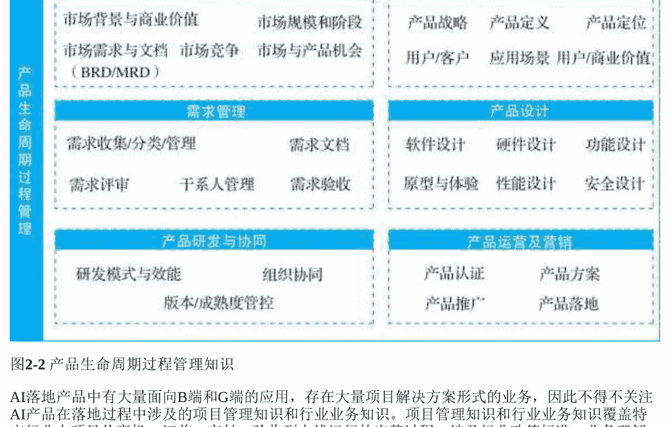
图2-2 产品生命周期过程管理知识

谈到人工智能到底要做到什么程度，图灵测试依然是最直观的业界共识——让机器用自然语言和人类对话，人类分辨不出回答来自人还是机器，就算是初步通过。按这个标准，系统至少要会“听懂、表达”即自然语言处理，“记得、编码”即知识表示，“会算、会推”即自动推理，以及“越用越聪明”即机器学习。真要上身动手，还得补上“看得见”的计算机视觉和“会动”的机器人学。把这些能力拼起来，就基本覆盖了AI技术的全貌。

打开AI的地图，感知端有计算机视觉、语音识别、自然语言处理；认知端有知识表示、知识推理；行动端有机器人学、规划、决策。学习不是孤立的一块，它像一条主线把感知、认知、行动串起来。

本文的切口分为两条主线展开：AI的理论与算法，和面向落地的工程应用。理论与算法这条线聚焦机器学习、多模态感知理解、机器人学与运动规划，多模态感知理解再细分为视觉、语音、语言三个入口；工程应用这条线主要讲云原生AI的实践。

第3章 机器学习

机器学习是当下AI浪潮的核心推手，尤其是深度学习的突破。简言之，它是让机器靠经验和数据提升感知、认知、思考、行动能力的学科，本身就是计算机科学、统计学、心理学、神经科学、控制论交叉的产物。

3.1 机器学习概述

华盛顿大学的佩德罗·多明戈斯把机器学习拆成三件事：表示、评价、优化。

表示是先把问题抽象成算得动的模型。问题抽象是把待解决的事物转成逻辑题或数学题，比如判断图片里是不是猫，本质就是二分类，输出0或1。数据抽象是把物理世界的特征用数学语言刻画，猫的脸、毛色、体型等都要量化成可计算的表征。吃透问题和现实，才能选对算法，机器才有发挥空间。

评价是定目标函数来衡量好坏。模型搭好后要能自检，目标函数就是评判标准。比如猫的判别可以用特征向量距离来打分，分类效果则常用错误率等指标来量化。

优化是让参数收敛到最优。目标函数里藏着一堆未知参数，算法要不断调整数据、参数或模型结构，使误差或均方误差最小化。

划分机器学习有多种视角。按函数形态分线性与非线性；按学习准则分统计与非统计；按多明戈斯归纳的学派分符号主义、贝叶斯派、联结主义、进化主义、行为类比主义；按样本信息与反馈方式，最常用的是监督学习、无监督学习、强化学习，近年还兴起半监督学习、自监督学习。下面按最后一种方式展开。

3.1.1 监督学习

监督学习靠人工标注的监督信号学映射关系。给模型看一张猫、一张狗，告诉它对应标签，它就学会特征到标签的对应。训练时输入是图片、文本等，输出是预期标签，标签可以是连续值也可以是离散类，于是出现回归任务如房价、股价预测，以及分类任务如动物分类、物品分类。常用方法有k-近邻、决策树、朴素贝叶斯。流程是先人工标注形成训练集，再用它训练模型，最后部署到相似数据上做预测。

3.1.2 无监督学习

无监督学习不用人工标签。现实中绝大多数数据都是未标注的，机器靠聚类、降维等算法自行发现结构，得到可理解的表征再划分分布。流程上，机器直接解析数据、提取特征、聚类成类。大量标注成本高昂，无监督恰好能降本。典型场景包括人脸聚类、制造业通过正常与异常样本对比判别缺陷、互联网用户画像聚合。

3.1.3 强化学习

强化学习也称增强学习，是智能体和环境不断交互完成序列决策的过程。它由环境、智能体、状态、动作、奖励构成。智能体做出动作影响环境，环境给予奖励或惩罚并反馈新状态，智能体据此调整策略追求长期累计奖励最大化。类似让AI玩《超级玛丽》，跑得久、过关多奖励就高，动作包括前进、跳跃，通过不断试错学习出通关策略。

强化学习摆脱了监督学习对标注的依赖，也突破了无监督无法动态交互的限制，特别适合决策场景，如控制算法、游戏AI。深度神经网络与强化学习结合后催生了深度强化学习，AlphaGo、AlphaZero等棋类突破就是明证。

3.1.4 自监督学习

半监督学习是监督与无监督的混合，在标注稀缺时用少量标注加大量未标注数据学习。自监督学习则更进一步，它从数据本身或数据变换中构造监督信号，不需要人工标注。从监督信号看，它既像无监督，也带有人监督的味道。

典型做法是把彩色视频先转成黑白，用彩色信息当老师训练黑白到彩色的映射；或者遮挡图片局部，让模型学会填补缺失区域。这类方法在大规模数据上预训练表征，下游只需少量标注即可取得不错效果。

3.2 深度学习

3.2.1 什么是深度学习

深度学习是机器学习里增长最快的分支，本质是深度神经网络及其训练方法。神经网络模仿生物神经元。生物神经元有树突、胞体、轴突、突触，处于兴奋时产生电信号传递。人工神经元有输入、加权求和、激活、输出四步。树突对应输入层接收信号，胞体对应加权和做处理，轴突对应激活函数控制信号，突触对应输出层。

最小可学习的单元是感知机，多层感知机由输入层、若干隐藏层、输出层全连接构成。隐藏层超过两个就称为深度神经网络，常用反向传播训练。深度学习是结构加参数的优化问题，通过调结构、训参数得到最优模型。它擅长学习深层特征，是一种通用的信息处理算法，可用于视觉、语音、语言等多种信号。

从包含关系看，深度学习是机器学习的子集，机器学习是AI的子集。监督、无监督、强化学习与深度学习是交叉关系，部分方法属于深度范式。

3.2.2 深度学习的发展和局限

以2006年为起点，近二十年深度学习从实验室走向产业，在视觉、语音、语义等模态落地于智慧城市、交通、医疗等领域。发展靠算力、数据和算法共同推动。演进出现两条路线：大路线和路线小路线，对应云与端。

大路线追求大模型、大算力、大数据，如基于Transformer的超大规模预训练模型GPT-3类，强调强表征；小路线追求小模型、小算力、小样本，如MobileNet类，强调精度可控下的轻量化与实时性。算力上，大路线做分布式训练推理，小路线做算力极致利用；样本上，大路线靠海量数据提升泛化，小路线靠小样本学习实现举一反。

成功背后仍有短板。数据贪婪性让收集、标注、管理、计算成本极高，正样本稀缺时尤其明显，数据量不足精度断崖式下跌。长尾分布下，训练见过80%的常见类，落地却要面对从未见过的20%长尾，效果骤降。可解释性弱，神经网络像黑箱，难以溯源关键决策，在自动驾驶等安全场景难以接受。泛化能力不足，对微小扰动敏感，易被对抗样本攻击，如戴特定眼镜就能骗过人脸识别。

未来研究集中在无监督学习、小样本学习、可解释AI、隐私计算、通用化预训练等方向，补齐短板。

3.2.3 迁移学习

知识和能力都有领域边界，AI目前多为专用智能。人类会迁移，学会骑自行车后学摩托更快。迁移学习正是把已训练模型迁移到相似任务，减少学习成本。视觉里把鸟分类模型迁移到飞机分类、通用识别迁移到专属物品识别都是典型。随着基础模型参数越来越大、训练成本越来越高，迁移学习价值愈发凸显，任务间特征和分布越相似效果越好。

3.2.4 大规模预训练模型

BERT、GPT等预训练模型在NLP取得突破后成为主流。它们先在大规模标注或未标注数据上学习通用表征，下游再微调少量数据复用能力，从零训练已不再是共识。发展脉络上，监督式预训练先用有标注源数据预训练，再迁移到目标任务；自监督预训练则用未标注源数据预训练，再在目标任务上学习。自监督与Transformer结合催生了BERT与GPT。

核心在于网络架构、数据设计与高效计算。架构上基于Transformer演化出多种变体；数据上融合多语言语料、多模态数据、外部知识增强；计算上做系统级优化、新型训练算法、模型压缩。规模越大，下游效果越好，已在NLP榜单反复刷新人类基准，视觉任务也显著超越旧方法。参数规模持续攀升，例如智源团队研发的悟道2.0达到1.75万亿参数。大规模预训练与人类学习契合：先掌握基础表征，再触类旁通，极具前景。

3.3 生成对抗网络

生成对抗网络是2014年Ian Goodfellow等人提出的无监督模型，由生成器和判别器构成对抗训练。生成器负责从噪声生成仿真样本，判别器负责区分真假，两者相互博弈共同提升。经典结构里，生成器把噪声向量变成假图像，判别器同时接收真图和假图进行鉴别，在竞争中双方能力不断逼近。

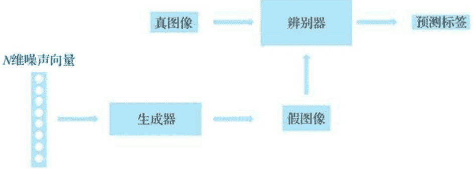

图3-11 生成对抗网络示意图

对抗式生成技术早已跳出图像语音的单一场景，在视觉创作中几乎成为通用范式，因此衍生出 DCGAN、StyleGAN、BigGAN、CycleGAN 等一系列分支。它们能够合成逼真人脸、生成动物与环境、完成不同年龄段的人脸转换、以及基于文本语义作图等任务，产出的样例可参见图3-12～图3-14。

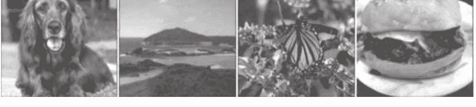

图3-12 BigGAN生成的图像


照片→印象派画


普通马→斑马

图3-13 CycleGAN图片风格转换

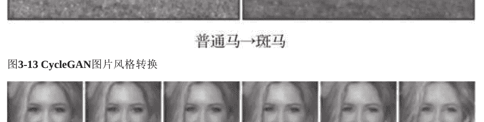

图3-14 Age-cGAN年龄变换

近几年基于GAN的 Deepfake 换脸技术已能将目标人脸无缝植入视频画面，逼真度达到肉眼几乎分辨不出的程度。高仿真的生成能力也带来欺诈、信息安全乃至舆论风险，在互联网高度互联的背景下尤为棘手。

### 3.4 元学习

传统监督学习的本质是学习输入到输出的对应关系。以猫狗二分类为例，需要收集大量标注的猫狗样本训练，模型上线后只能在猫狗之间做判断。把一张鱼的照片输入进去，模型仍会强行归为猫或狗，并不具备识别鱼的能力。若要新增鱼类任务，就必须重新采集数据并从头训练，这正是传统监督效率低下的根源。行业期望机器像人一样，先掌握通用的学习本能，面对新领域时仅用少数几张示例就能快速上手。元学习的核心就是让机器学会学习。

元学习属于机器学习的子方向，目标是让模型在积累经验后能迅速迁移到新任务。按实现思路可分为基于模型、基于度量和基于优化三类，下面重点介绍基于度量与基于优化的方法。

#### 3.4.1 基于度量的元学习

深度学习的优势在于能够把原始数据映射为语义化的特征向量，不同样本在特征空间中的距离往往与真实相似度相对应，这种可度量的关系催生了基于度量的元学习。

最具代表性的落地形式是孪生神经网络。孪生网络由两部分构成，一是参数共享的卷积神经网络，二是对两路输出距离的度量，如图3-15所示。训练时需要成对输入 X1、X2 以及标签 Y，X1、X2 分别代表两张图片，Y=0 表示同类，Y=1 表示异类。训练目标是让同类图片的距离尽可能收缩、不同类图片的距离尽可能拉开。学成后，网络具备判断两张图片相似性的能力，在新增小样本类别时，只需计算新样本与已有样本的距离就能实现快速分类。

除孪生网络外，匹配网络、关系网络也属于基于度量的元学习范式，本文不再展开，感兴趣的读者可自行查阅。

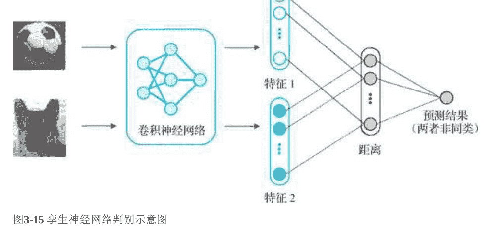

#### 3.4.2 基于优化的元学习

另一类思路是基于优化的元学习。深度学习在建模后还需要优化算法通过反向传播式的梯度下降反复迭代来寻找最优参数。随机初始化往往耗时耗数据。基于优化的元学习试图在超参数层面，尤其是模型初始化层面，找到更优的起点，从而更快习得新能力。

典型代表有 MAML、Reptile 等。MAML 的目标是在若干训练任务上学到一套折中的初始化参数，即一种先验知识，这套参数不是单一任务的最优解，而是多个任务都能快速微调的良好起点。换句话说，设计 N 个训练任务，MAML 学习的是一个能在每个任务上被迅速优化的初始化。MAML 与迁移学习有相似之处，但迁移学习通常是从单个源域的最优参数搬迁到目标域，而 MAML 是从多任务集合中寻找对所有任务友好的初始化。

### 3.5 联邦学习与隐私计算

要让深度学习模型真正落地，除了建模能力，还需要海量标注数据。数据标注常面临三类痛点：1）部分场景需要专业知识，比如医疗影像；2）数据需从需求方汇总到算法方，安全要求高的机构难以对外开放，高敏感数据甚至部门间流通都很困难；3）数据产生周期长、呈现长尾特征，标注投入难以一次性完成，运维成本高昂。其中数据安全与隐私是最难处理的难题，联邦学习提供了可行路径。

#### 3.5.1 什么是联邦学习

联邦学习是多方协作的机器学习范式，参与方可在数据保留在本地的前提下联合训练模型并共享最终模型。

举个例子，公司A与公司B各有数据。传统做法是把数据拷给算法公司C统一标注训练；若A、B能自训却不能共享数据，只能各自得到次优模型。联邦学习既满足隐私合规，又能利用互补数据提升模型质量。

其核心在于本地训练、参数加密更新与共享，最终聚合出高质量的联合模型，如图3-16所示。

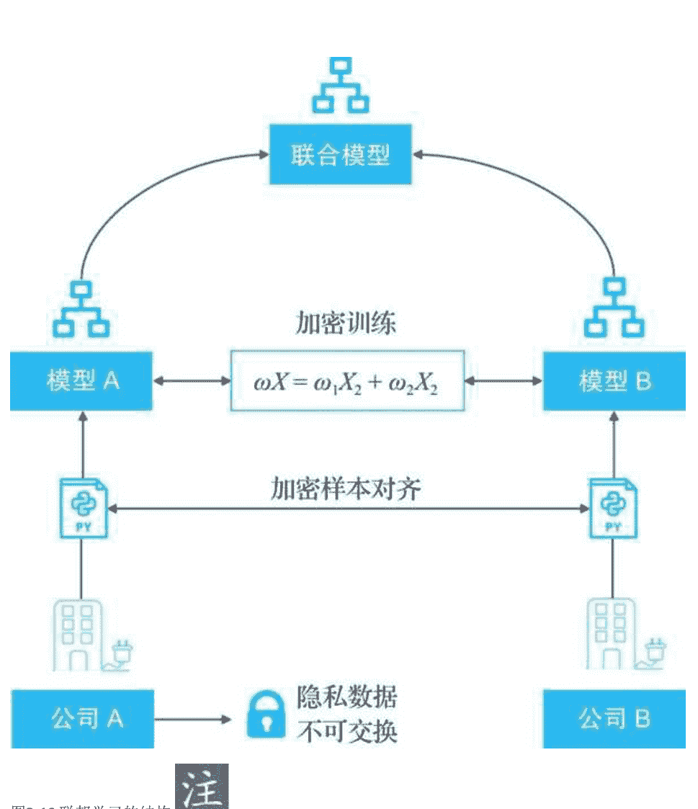

图3-16 联邦学习的结构

联邦学习最大的价值是化解了隐私与数据孤岛问题，促进信息在个体间更安全地流动，加速AI创新应用，也为企业间合作催生新商业模式。

#### 3.5.2 联邦学习的分类

联邦学习在保证隐私的前提下实现参数共享与联合优化。依据合作方数据的组织方式，可分为横向、纵向和联邦迁移学习。这里的组织方式指的是用户身份与用户特征的重合度。用户特征指年龄、性别、收入等属性。特征重叠多身份重叠少为横向，身份重叠多特征重叠少为纵向，两者都少为迁移。示意见图3-17。

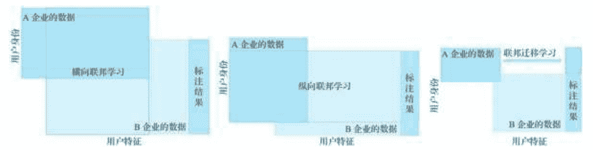

图3-17 三类联邦学习的示意

##### 1.横向联邦学习

当两个数据集的特征高度重叠但用户身份几乎不重叠时，按行即用户维度切分数据进行联合训练，称为横向联邦学习。例如两家远隔地区的证券公司，用户交集极小，但业务特征相似，就适用横向联邦学习。本质上是样本的联合，适用于触达用户不同但特征维度重叠的场景。谷歌曾用该方式在安卓终端上实现模型更新。

学习流程中，参与方从中心服务拉取最新模型，用本地数据训练后上传加密梯度，中心服务聚合梯度更新模型，再把更新项下发。

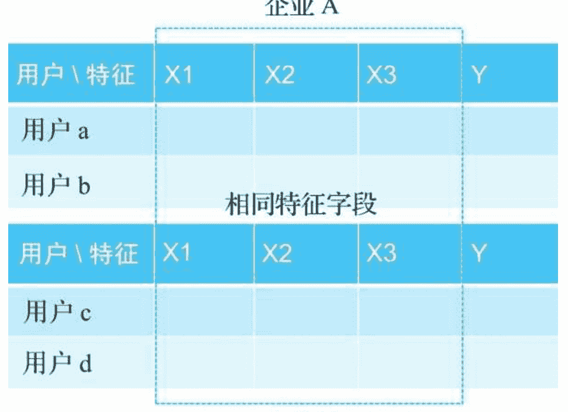

图3-18 特征重合度高的数据集

##### 2.纵向联邦学习

当两个数据集的用户身份重叠较多但用户特征重叠较少时使用。典型场景是同城超市A与银行B，用户群体高度重合，超市掌握购买品类历史，银行掌握资金存取与信用评级，特征互补。纵向联邦学习通过加密状态下的特征聚合来增强学习能力。

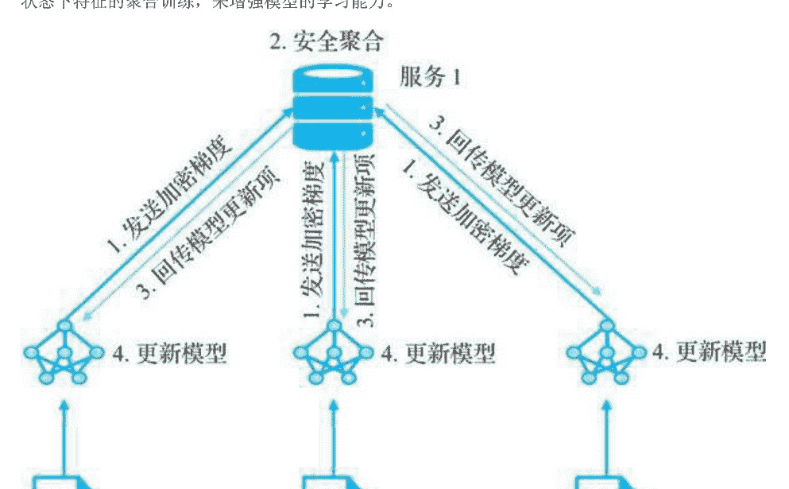

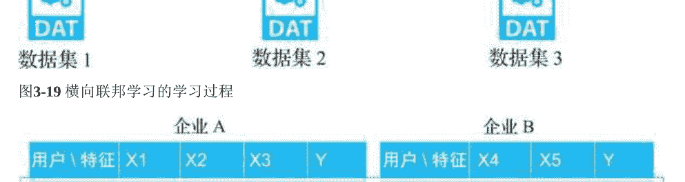

传统做法需把A、B数据汇集后再训练。纵向联邦学习则先做加密样本对齐，双方不暴露用户信息，随后进行加密训练。具体协同如下：1）中心服务向A、B发送公钥用于加密传输；2）A、B分别计算中间结果并加密交互，再各自计算梯度和损失；3）双方将加密的梯度和损失发送给中心服务C；4）C解密后回传，A、B更新模型。结束后各方仅获得自己侧的参数和所需业务模型。

##### 3.联邦迁移学习

当用户身份和用户特征都很少重叠时采用。例不同地区的证券公司与超市，用户与业务差异很大。迁移学习的思路类似由学会打乒乓球快速迁移到羽毛球。联邦迁移学习中，A与B可通过中间训练结果共同学习模型，B在A的能力基础上实现迁移。

#### 3.5.3 联邦学习框架与应用

产业界已有多个联邦学习框架，如微众银行的FATE、谷歌的TensorFlow Federated、百度的PaddleFL、OpenMind的PySyft。

FATE是微众银行发布的开源隐私计算框架，支持纵向、横向和迁移联邦学习。PySyft主要支持横向联邦学习，底层兼容TensorFlow、Keras、PyTorch。PaddleFL由百度于2019年底开源，依托PaddlePaddle生态推广。

联邦学习在金融、保险等领域应用广泛，因其数据丰富但隐私要求极高。以信贷风控为例，小微企业信贷需整合多机构经营数据，小微个人信贷需电商、支付、证券等多源画像，数据难以打通。若仅用单一机构标注样本，样本量不足且分布失真，易学到偏误模型。联邦学习可建立消费金融与信贷机构的业务与模型优化闭环，在持续积累中联合提升模型。

### 3.6 AutoML/AutoDL

#### 3.6.1 什么是AutoML

深度学习普及前，传统机器学习流程包括问题定义、数据采集标注、模型设计、超参配置，多靠人工完成，如图3-21所示。随着任务增多，对自动化提出了需求。人们希望通过平台自动化大部分流程，人工只需提供数据。于是出现自动化机器学习AutoML，将自动化与机器学习结合，以机器学习技术寻优训练方法与模型，提升算法生产效率。


图3-21 传统机器学习模型训练流程

在传统机器学习中AutoML涵盖自动化数据工程、模型选择、算法优化。进入深度学习时代，内容扩展为自动数据处理与增强、自动模型选择、超参优化、模型压缩等。本节聚焦深度学习领域的AutoML，即AutoDL。

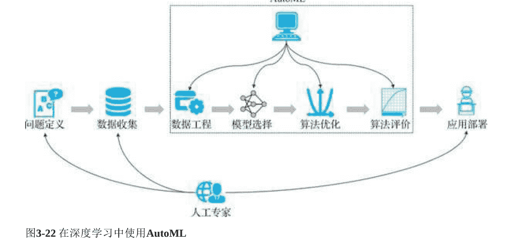

图3-22 在深度学习中使用AutoML

#### 3.6.2 自动化数据处理与增强

深度神经网络需要大规模标注数据才能学到高精度模型。现实中数据难采集且多为长尾，少量样本出现即可能导致误判。因此一方面扩充采集，另一方面依赖数据增强。

数据处理指获取、标注到预处理的整条链路，自动化意味着用模型辅助标注并以少量人工纠偏来提效。随着模型精度提升，可自动辅助标注并迭代增强。

数据增强通过旋转、翻转、加噪等变换扩充样本，提升泛化性能。以图像为例，常用旋转翻转与噪声注入，如图3-23所示，不同任务需不同策略。


自动数据增强则是在不同数据集上自动搜索最优增强策略。谷歌2018年提出的AutoAugment以强化学习搜索策略：1）设计16个常用增强操作，每条子策略从中选5个并随机设定概率与幅度；2）每个batch的每张图片随机应用一个子策略；3）评估模型泛化能力并反馈；4）迭代学习出最优5个操作组合；5）用最优组合训练。

GAN也可用于增强，如人脸识别中用GAN生成戴眼镜、口罩、妆容的样本提升遮挡鲁棒性，行人重识别中生成合成行人数据等均属此类思路。

#### 3.6.3 自动模型生成——神经架构搜索

深度学习在语音、图像等方向的爆发式进步是有目共睹的，但网络该怎么搭、参数超参怎样设，仍然依赖大量经验和反复试错。网络拓扑、权重规模、超参数组合起来会产生天量的可能性，靠网格搜索或随机搜索去遍历，效率极低。正是在这样的痛点下，神经架构搜索与模型优化的研究被推向了前沿。

神经架构搜索 NAS 的本质是用自动化搜索流程为具体任务找到最合适的网络结构。围绕 NAS 的核心难题主要落在三处：先要定义好可搜索的结构集合，其次要设计出有效的搜索策略，最后要把子模型评估的成本压下来。难点集中在不同模块如何合理拼接，以及如何让评估过程更快更省。

**搜索空间怎么定义**
搜索空间就是算法可以游走的所有网络结构集合，涵盖网络深度、层宽、每层使用的算子类型、连接关系以及算子本身的超参。一开始的研究倾向于保持整体框架固定，做全局式的搜索，主要是调每层用卷积、池化之类的操作以及对应的参数，但搜索空间庞大到优化几乎不可行。

于是人们开始压缩搜索范围，采用模块化思路。把网络拆成若干人工设计好、效果稳定的基本单元，NAS 只负责单元的摆放位置与内部参数。空间一下子小了很多。但这种做法也有代价：一是搜索空间被收紧、自由度下降；二是单元本身带有设计者的先验，会限制跳出局部最优的可能性。

**搜索算法怎么选**
NAS 要找的是最优结构，目标函数本身不可直接求导，属于黑箱优化问题，只能在具体数据集上做评测，优化过程只要知道目标和约束即可。网格搜索和随机搜索是最直观的基础手段，但对 NAS 这种本身就很耗时的任务来说效率太差。主流的前沿策略集中在强化学习和进化算法。

强化学习是最早被引入 NAS 的范式。智能体通过与环境的交互获得奖励并指导下一步动作，几乎是在试错中学习。这里一次动作就对应一次搜索出来的网络结构，评估结果即奖励。不同实现的核心差异在于搜索策略的设计。最初的做法是用循环神经网络 RNN 作为策略网络，迭代生成新的架构。随后出现基于 Q-learning、蒙特卡洛树搜索 Monte Carlo Tree Search 等的变体。

进化算法模拟生物进化中的优胜劣汰。先随机初始化一个种群，可以理解成若干子网络或层类型，再依次执行选择、交叉、变异算子，按适应度评价完成迭代。流程直观但计算开销非常大。

除此之外，贝叶斯优化、高斯过程、随机森林以及基于梯度的搜索也在实际中使用。

**模型评估怎么加速**
每个候选子网络都要先训练才能评价好坏，而评估往往占据 NAS 总耗时的绝大部分。若每个网络都从随机初始化开始训练，资源消耗不可承受。于是出现了两类加速思路。

一类是低保真度评估。比如缩短训练轮次、在数据子集上训练、降低图像分辨率等。速度快但误差容易放大。

另一类是迁移与权重共享。利用网络态射的概念从小网络起步，改变结构时复用已有权重，只需少量迭代就能收敛。典型的 one-shot 思路是构建一个超大的有向无环图，从中采样大量子图，每个子图继承超图的参数，直接评估排序，挑出最优子图再在全量训练集上精训、测试集上验证。评估加速的方法仍在不断演进，推动自动化设计更成熟。

**从造模型到压模型**
模型生成是从零搭建高精度网络，模型压缩则是基于已有高精度模型做瘦身。移动端、边缘侧部署受算力、功耗、内存限制，业界惯例是先做高精度，再在上面做压缩加速，保证精度的同时快速得到更小更快的结果。自动驾驶、移动机器人等场景对时延、功耗、模型体积都有硬性要求。即使硬件持续提升，兼顾快准小的模型仍是压缩领域持续探索的方向。人工常用的手段有剪枝、知识蒸馏、量化。

剪枝是去掉训练好模型中的冗余参数，降低参数量与计算量，提升推理速度。包括神经元剪枝和通道剪枝。

神经元剪枝通常按权重大小排序，把接近零且贡献小的参数剔除，使其对应的神经元不被激活。修剪后需要微调来稳住精度，若想进一步压缩，还可配合量化编码把连续权值离散化。

通道剪枝则是裁剪滤波器模板，进而裁剪特征图通道，能大幅削减存储与计算。

知识蒸馏解决的是大网把有效信息迁移到小网的问题。参数越多结构越复杂，可学习深层特征的能力越强，但计算消耗也越大。Hinton 在 2015 年提出的核心思想是用训练充分、精度高的教师模型指导学生模型。实现方式多样，比如让学生模仿教师在样本上的输出差异；或者拟合教师不同层之间的转换关系，学习解决问题的中间过程，从而获得更多信息。

量化关注的是数值精度。深度网络常使用 FP32 32 位编码，精度高但成本大。把参数换成 FP16 或 INT8 等低精度表示，在很多场景下仍能保持可用精度，而计算性能会有显著提升。

人工压缩需要理解算法细节并做大量调参，且基于规则的剪枝策略很难跨模型复用。为此出现了自动模型压缩。2018 年韩松团队提出的 AutoML for Model Compression AMC 旨在让机器对任意网络自动寻优压缩策略，效果优于人工规则。系统用强化学习迭代优化，精度下降时惩罚，模型加速或变小时奖励。压缩方法上同时使用细粒度的剪枝和粗粒度的通道剪枝。搜索协议可按用户目标选择资源受限型压缩或精度保证型压缩，前者优先降低时延提升可用性，后者优先保精度。实践中已验证机器压缩优于人工压缩，腾讯 AI Lab 的 PocketFlow、百度 PaddleSlim 等框架都已落地。

**可解释 AI 的必要性**
在海量数据与算力的加持下，以深度神经网络为代表的技术在特征表达上取得突破，在安防、物流、推荐等领域实现效率跃升，进入商业红利期。但当技术向自动驾驶、金融等对安全、隐私、伦理更敏感的场景渗透时遭遇阻力。自动驾驶能降低平均事故率，却难以满足实际应用的安全阈值；伦理要求更严苛且合理。部分业务决策强调有据可查，对解释性提出了更高要求。

当下主流深度学习模型是黑盒，复杂连接、巨量参数、推理中的数值计算难以用简单逻辑解释。可解释性已成为阻碍落地的主要问题。金融风控中，模型可标记可疑欺诈用户，却说不清推理依据，业务侧不敢采信。自动驾驶在紧急避让时做出刹车决策，却无法说明为何如此选择。

可解释 AI 并没有统一定义，通俗理解是提供一套让深度学习机理可理解、决策可解读、人可信任的技术集合，包括可视化、逻辑推理等。美国国防部高级研究项目局 DARPA 概括了用户希望弄明白的问题：系统为什么这样做、为什么不那样做；什么时候会成功、什么时候会失败；什么时候可以信任；为什么会出错。

在视觉领域，常用的可解释手段有基于梯度的解释、基于掩码的解释、类激活映射等，均通过关注模型判别的区域来判断是否合理。热力图会高亮决策依据，例如判别狗时头部区域权重最高，而判别猫时全身各部位都有贡献。通过可视化与合理性解释，可以避免模型“歪打正着”，也能分析学习不足的原因并改进。连接主义、数据驱动的深度学习虽在效果上惊艳，却难以用学术符号解释，可解释 AI 有助于把应用风险掌控在人类手中。

**多模态感知与理解**
信息来源或形式的不同即为不同模态。人通过视觉、语音、文字交流，智能体同样需通过图像、语音、文本等信号与环境交互。本章聚焦计算机视觉、语音识别、自然语言处理等常见技术及其融合。

计算机视觉是研究计算机如何模拟人类视觉系统，用计算设备代替人眼感知环境并进行理解的技术。常被混淆的机器视觉更偏向机电工程与工业集成，强调光源、相机、成像、模式识别与机械控制的整体系统，广泛用于工业缺陷检测。本节侧重算法视角。

计算机视觉可分为图像生成、早期视觉、底层视觉、中层视觉、高层视觉五大子领域。图像生成关注成像原理与光照颜色；早期视觉做滤波、局部特征与纹理处理；底层视觉从多图实现立体视觉与三维重建；中层视觉负责分割与跟踪；高层视觉负责检测与分类。研究路径通常从生成到预处理，再到多图融合、分割跟踪、检测分类，最后聚焦字符、人脸等特定目标。

**图像生成环节**
图像生成指通过光学成像设备感知外界形成图像或视频的过程。成像质量直接决定后续识别上限，后期修复无法弥补生成时丢失的关键信息。在 AI 落地的采集阶段，获取高质量数据至关重要。安防、交通、工业质检等领域往往在成像方案上投入大量精力。自动驾驶多采用视觉加激光雷达融合 2D 与 3D 信息，并在车前、后、左、右、上五个方向布设传感器以实现无死角感知。工业质检则在光源、镜头、相机等维度精细调优。

光源在工业检测中作用显著，合适的光源能抵消环境干扰，简化算法。常见类型有环形、条形、同轴、线性、点光源等，选择需结合场景与目标表面特性。

镜头负责调节焦距、广角、光圈，控制目标大小与明暗。广角镜头会引入畸变，高精度测量需额外校正。人脸识别中镜头参数不当会导致人脸过大，降低可检测数量并影响体验。

摄像机核心部件多为 CCD、CMOS。形态上有枪型、球形、针孔、枪球联动等；照度适应上有白光、红外、星光、超星光、黑光等；分辨率常见 1080P、2K、4K。参数众多且直接影响下游成像与识别，选型需谨慎。

多传感器融合场景下，还会使用毫米波雷达、激光雷达等非可见光传感器，通过可视化处理提供补充信息，在自动驾驶与工业检测中应用广泛。

**图像处理基础**
图像处理的目标是增删变换图像信息以满足特定需求，如边缘锐化提升清晰度，或在训练时加入噪声做数据增强。

数字图像可视为矩阵，RGB 图像每个像素由 R、G、B 三通道构成，分辨率 1920×1080 即表示横向 1920 个像素、纵向 1080 个像素，处理即对像素与通道的运算。

常用预处理包括图像变换、编码压缩与解码、增强与复原、描述等。

由于图像是空间域的像素阵列，高分辨率时计算量巨大，且有时需要到其他表达域获取更有效的信息。可使用傅里叶变换、沃尔什变换、离散余弦变换等进行域变换，减少计算并获得便于处理的表示，例如傅里叶域的数字滤波。

编码压缩技术用于减少数据比特数，降低传输、处理与存储成本。无损压缩可完全复原，有损压缩仅能近似复原，使用时需解码。

低质量图像可通过增强与复原提升质量。增强不依赖降质原因，直接提升感兴趣区域，如增强高频分量使边缘细节更清晰；复原则需建立降质模型，再用滤波方法重建原始图像。深度学习训练中常刻意制造瑕疵图像，模拟真实预测中的低质情况，提升模型鲁棒性。

计算机视觉里，图像先要有“可读的表述”，后续的识别、检测才能展开。最直观的二值图会用点线面这类二维几何元素来刻画特征，纹理类图像则更适合用二维纹理属性来描述。随着深度学习普及，特征的提取不再靠手工规则，而是由深度神经网络从样本中自动学出来。

图像处理是整个视觉链路的底层环节，它只关心低层信息的变换，并不做理解。传统方法常被当作预处理，用来高效地完成低层操作。深度学习现在也大量进入低层视觉，比如增强、复原、压缩等。本质上这是一个优化问题，神经网络比人工设定的规则更容易逼近最优解，代价是推理速度更慢、部署成本更高。

立体视觉的出发点很简单：真实世界是三维的，人眼能把二维成像转成空间感知，机器也希望做到同类能力。核心就是从成像手段和辅助信息中挖掘深度，重建出三维场景。

研究路线大致分三类：单目、双目/多目、程距法。

单目方案依赖单个拍摄设备，通过运动视差或焦距变化来感知深度。单独一张图很难获得深度，因为光心O、成像平面π、点Q和P三点共线时，像点会重合p≡q，距离信息丢失。学术上虽有探索，但受信息限制推广性差。变通做法是让相机或被摄物相对运动，采集序列图再重建。优势是硬件简单、成本低，适合改造旧设备或对成本敏感的场景。

具体实现上，单目立体视觉就是让同一相机在不同位置或时间拍图，利用序列间的视差恢复结构，必须有相机运动或场景运动才产生可用的视差。

双目/多目则用两台或多台相机同时成像，靠对应点三角测量求深度。双目是主流做法，找到两图中的同一点后，用基线长度、成像位置关系和焦距f，通过相似三角形关系算出深度Z。

程距法不靠相机成像，靠距离传感器直接测距。代表是3D结构光和激光雷达。结构光投射器把激光条纹、格雷码、正弦条纹等光信号投到物体表面，经反射被相机捕获，基于三角测量与图像解析重建三维。硬件通常是投射器加相机。激光雷达原理相近，但做360度扫描，能对全场景做障碍物测距，在高精度工业质检和自动驾驶里应用广泛。

一个完整的立体视觉系统通常包含图像采集、相机标定、特征与图像匹配、三维重建、内容理解五个环节。

采集阶段用光学相机或距离传感器搭建系统并获取数据，不同方案的数据形态不同，后处理也不同。

标定即校准，是把图像坐标映射到真实世界几何坐标的关键步骤。相机成像几何模型决定了像素坐标与物理坐标的关系，标定就是求出模型参数并做畸变矫正。工业测量对精度要求高，标定后的畸变校正能显著提升结果。

特征与图像匹配分检测与匹配两步。检测可按点线面、颜色纹理轮廓等属性进行；匹配常用区域匹配、特征匹配、相位匹配等策略。

得到视差后就能算出匹配点的深度，再通过插值把离散点连起来，还原出完整的三维点云和场景。即使不做重建，多图也能做二维内容理解，比如目标跟踪；但自动驾驶的3D目标检测、工业里机器人抓取分拣等场景，必须依赖真实的三维信息。

整体趋势是深度学习与立体视觉结合更紧密，方案从纯视觉向结构光、激光雷达等多传感器融合演进，应用也在自动驾驶、工业、AR、机器人等领域快速扩展。

图像分类是计算机视觉最普及的任务之一，给人或物品打标签以支撑决策。经过三十多年发展，已成熟应用在工业物料分拣、视频平台的内容打标签等场景。按标签形式可分为单标签、多标签和多任务。

单标签任务中一图只对应一个类别，类别互斥，比如判断图片是否出现猫，是与否不能同时成立。可细分为二分类和多分类。

多标签允许一图同时归属多个类别，如同一画面里既有房子山又有河，可以同时打多个标签。

多任务则对同一个图做多种识别，例如人脸图既要识别身份，也要判断性别年龄。

图像检测在分类基础上还要给出位置，通常用框标出目标。自2013年R-CNN出现后，方法快速发展，主要分为两阶段和单阶段两类。

两阶段先产生候选框再分类回归，代表有R-CNN、Fast R-CNN、Faster R-CNN。R-CNN用选择性搜索生成候选区域，裁切送入特征网络提取特征再分类，精度高但很慢。Fast R-CNN引入ROI Pooling，从整图特征直接提取ROI特征，减少重复计算。Faster R-CNN再加入区域建议网络RPN，把候选框生成内嵌到网络，速度 further提升。

单阶段网络一次输出位置和类别，如YOLO、SSD。YOLO把图缩放后划分网格，按与标注框的IOU把每个网格划为样本，预测类别概率并生成多个边界框，每个框输出四个坐标、是否含物体的概率和定位置信度。推理时按分数筛选并用非极大抑制剔除冗余框。

应用遍及工业零件检测、数量统计、缺陷检测，以及城市安防里的人脸行人车辆检测。

图像分割追求像素级理解，把不同类别目标划分得更细。按理解深度可分普通分割、语义分割、实例分割、全景分割。

普通分割只做区域划分，不关心语义，常用于前景背景分离。语义分割在划分同时给区域赋予类别属性。实例分割在检测基础上做像素级划分，并区分不同个体，比如不同车辆用不同颜色标记。全景分割则对前景背景全部做实例级分割。

经典方法包括阈值分割、区域增长、边缘检测、聚类分割和深度网络。阈值法适用于简单场景，例如背光下白底黑物的灰度差异明显，用最优阈值即可分离。

区域增长从种子像素出发，按相似性准则把邻域像素合并到同一区域，核心是种子选取、生长准则和终止条件。

边缘检测利用像素灰度不连续来定位区域边界，再连接成分割。

聚类分割按像素值把图像聚成k类，每类对应一个区域。

深度方法主要服务语义、实例、全景分割。早期FCN去掉了全连接层全用卷积，并用反卷积恢复尺寸，对每个像素输出预测。后续出现U-Net、SegNet、RefineNet、DeepLab系列，实例分割有DeepMask，全景分割有DeeperLab系列。

落地场景包括自动驾驶的路面可行驶区域分割、媒体娱乐里的人像背景分离用于换背景、去弹幕遮挡、换衣改发色，以及工业质检的像素级缺陷分割。

目标跟踪是连续图像或视频中对目标的一致性匹配与追踪。按目标数分单目标跟踪SOT和多目标跟踪MOT。

历史方法可按建模思路分为生成式和判别式。生成式在当前帧建立目标模型，后续帧检索最相似位置，如光流、粒子滤波、Meanshift、Camshift。缺点是对背景利用不足，目标变化影响建模。

判别式把目标与背景一起建模，本质是分类问题，代表有结构化学习、TLD、SVM、随机森林、相关滤波。判别式逐渐成为主流，深度学习方法多走此路线。

发展脉络为经典跟踪到相关滤波再到深度学习。经典有光流Meanshift Camshift。相关滤波来自通信领域用于衡量信号相关性，如KCF、MOSSE，速度快精度较高，2016年前很流行。深度学习提升了特征表达能力，精度更高但计算量大速度慢。自2016年起孪生网络方法兴起，SiamFC、SiamRPN、RPT等不断提升性能。

典型应用有安防监控里控制云台跟踪移动目标获取线索，人机交互与娱乐中用手势姿态跟踪替代触控、给直播加特效，以及机器人视觉导航里的跟随。

语音识别的基础是语音信号。语音是物体振动产生的声波，是模拟信号。经麦克风采集后做模数转换得到数字音频。转换分采样、量化和编码三步。

采样把连续模拟信号离散化，采样频率是每秒采样次数。频率越高失真越小。人耳上限约20kHz，按奈奎斯特-香农采样定理需高于信号2倍，故至少40kHz才能无失真。语音识别常用16kHz，嵌入式设备多用8kHz。

量化是对采样点幅值进行数字化。常用16位存储振幅，对应65536个等级。位深越高误差噪声越小，但带宽需求也越大，也可采用非均匀量化，小幅值区间细分、大幅值区间粗分。

编码是把采样量化后的数字按格式排列以便存储传输。最简单是把振幅转为二进制。脉冲编码调制PCM是原始未压缩的数字编码。WAV是在PCM基础上加头部描述采样率声道等信息。MP3则通过去掉人耳感知范围外的信息并调整有效比特率来实现压缩。

音频的底层指标不止采样率和量化位深，声道也是决定听感的关键一环。人耳能分辨声音来自哪里，声道正是还原这种空间感的手段——录制时在不同位置布置独立麦克风采集，最后靠多源协同营造出更逼真的听觉场。日常最常见的是单声道 Mono、双声道立体声 Stereo，以及更复杂的环绕多声道。

语音识别 Automatic Speech Recognition 的本质，是把声波信号转写成可读的文字。它能完成声到字的映射，却分不清谁在说，也理解不了字面所表达的意思。整体链路是音频输入，经过预处理、特征提取、特征判别，最终输出文本。

### 传统语音识别的四段式工序

**1. 语音预处理**
原始语音并非全程有效，预处理负责筛出含语言信息的片段，并让信号更适合分析。常用手段有预加重、加窗、分帧、端点检测。
预加重针对的是高频在传输中衰减更快的问题，在前端主动提升高频能量，补偿损耗。
分帧利用语音的“短时平稳”特性。整体上语音随时间不断变化，但在10~30毫秒的极短窗口内可近似平稳。因此把连续语音切成10~30毫秒的小块进行短时分析，帧与帧之间通常采用重叠以保证连续性，比如常见的帧长25毫秒、帧移10毫秒的配置。

**2. 语音特征提取**
波形本身计算机难直接使用，需要提炼成向量化的声学特征。代表方法有线性预测倒谱系数 LPCC、梅尔频率倒谱系数 MFCC、线性预测系数 LPC 等，输出的是机器可处理的特征向量。

**3. 声学模型训练与识别**
声学模型的工作围绕音素和状态展开。
音素是语音的最小发音单元，比如“汉语”拆成 h a n y u 五个音素，英文 English 包含 /I/、/ŋ/、/g/、/l/、/I/、/ʃ/ 等六个音素。
状态是比音素更细的粒度，通常一个音素被建模为三个状态。模型先把帧映射到状态，再把状态串成音素。早期广泛使用的是隐马尔可夫模型 HMM 与高斯混合模型 GMM。

**4. 语言模型构建**
音素层面识别完后要还原成词，靠发音字典做桥梁。字典记录词与音素的对应关系，例如“一”对应 yi1，“一一列举”对应 yi1 yi1 lie4 ju3。语言模型则计算词序列出现的概率 P(w1,w2…wn)，用于判断语句是否通顺，比如 P(I am happy) 要高于 P(I happy am)。传统 N 元语言模型假设当前词只受前 N-1 个词影响。

### 从手工流水线到端到端的深度学习

传统架构拆分繁多，需要手工标注特征、声学模型与语言模型独立训练且难以联合优化。2010年前后 DNN+HMM 开始出现，DNN 逐步替代 GMM。CTC 的引入让声学部分实现端到端学习，但仍缺乏语言建模与联合优化能力。2018 年起 Attention 与 Transformer 的成熟，才真正实现全链路端到端 E2E 学习。

端到端模型把输入的声学特征序列直接映射为文本序列。
数据层面，采集信号经采样、量化、编码变成数字音频，再切分成若干音频块，比如 16kHz 下 20 毫秒对应 320 个采样点。时域信号转频域后按频率排序得到频谱，再把频率作为纵轴、时间作为横轴叠加，就形成深度学习可用的频谱图。

模型层面常用编码器-解码器或序列到序列 Seq2Seq。编码器把输入压缩成特征表示，解码器据此生成目标文本，编码器解码器可选用 CNN、RNN、LSTM 等。注意力机制的核心在于解决定长向量信息丢失问题，通过权重动态聚焦关键区域生成上下文向量。Transformer 完全抛弃循环结构，编码器和解码器内部全靠自注意力构建关联，后续还衍生出面向流式识别的 Transformer Transducer 等变体。

### 声纹识别：从“说什么”到“谁在说”

会议录音、电话对话等场景需要区分说话人甚至核验身份，这就引出了声纹识别 Speaker Recognition，又称 Voiceprint Recognition。发音器官、声带、年龄、习惯、性格等差异让每个人的声学特征基本唯一。

系统分为训练与识别两阶段。训练时收集大量带身份标注的音频，学习可部署的声纹模型。按是否支持增员分为闭集与开集。闭集只能识别训练时见过的人，开集支持后续入库注册，更符合实际业务。以开集为例，流程包括声纹注册与声纹比对。注册时对采集音频预处理并提取声纹特征存库；比对时对新样本做同样处理，与库内特征相似度判别。

应用模式主要有三类。1:1 身份核验已知身份后验证是否本人，如银行 App 转账时的声纹校验。1:N 身份识别在多人环境中把发言归到已注册用户，如智能会议区分发言人。N:N 声纹聚类在身份未知时把同一人的片段聚合，常用于大规模语音整理。

按是否要求特定话术分为文本相关与文本无关。文本相关要求朗读指定数字字母等，降低难度、精度更高，适用于金融等高安全交互。文本无关无需配合，采集更自然但难度与精度下降，多用于安防取证等被动场景。

### 自然语言处理的整体图景

自然语言处理研究人与机器如何用自然语言交流，分为理解 NLU 与生成 NLG。NLU 解决机器如何读懂文本，包括分类、实体识别、句法分析、机器阅读理解等。NLG 解决机器如何回应，包括自动摘要、机器翻译、自动问答等。NLU 是 NLG 的基础。

应用涵盖信息抽取、检索、分类、挖掘、过滤、舆情分析、摘要、生成、翻译、对话问答、知识库与知识图谱等。

### NLP 的四层分析体系

人类理解语言经历形态、句法、语义、语用四个层次，NLP 同样沿此展开。形态学研究词的内部构成；语法学研究句子结构与成分关系；语义学研究词句的真实含义；语用学研究语言在具体语境、文化规则下的使用。

**词法分析**
分词把文本切分为独立词汇，英文靠空格相对简单，中文无空格因此分词尤为关键，是消除歧义的基础。新词发现针对互联网快速产生的网络新词进行捕捉与理解。词性标注为词打上名词、动词、代词等标签，帮助消歧。拼写矫正则修正文本中的拼写错误。

**句法分析**
句法分析又称语法分析，包含依存句法分析和句法结构分析。依存分析刻画词与词的从属、并列、递进等依赖关系；结构分析描述主谓宾定状补等骨架。语言模型在此层用于基于上下文预测下一个字词，从早期的 N 元模型到 LSTM 再到预训练表征。句法分析还包括语种识别和句子边界检测，后者在语音转写文本中尤为重要。

**语义分析**
词语级任务包括消歧、词表征、同义与上下位挖掘。消歧解决一词多义，如“苹果”在不同上下文指水果或品牌。词表征把词映射为向量，Word2Vec 以后语义信息开始被纳入向量。同义词如做饭、做菜、下厨，上下位如买菜、切菜、炒菜属于做菜的子过程。

句子级任务包括语义角色标注 SRL、文本蕴含、句向量。SRL 解析施事、受事、地点、时间、方式、原因等角色。文本蕴含判断两句是否蕴含、冲突或中立，如前提“一只狗在雪地玩球”蕴含假设“一只动物在寒冷天气玩玩具”。句向量为整句做向量化，支持相似度检索与问答。

篇章级任务从更大范围捕捉词际、句际、段际关联，常以文章结构、词汇语义、背景知识三条路径展开。典型任务是指代消解，把代词与所指实体归并到同一集合，需要跨句甚至跨段理解。

### 信息抽取

信息抽取把非结构化文本自动转化为实体、关系、事件等机器可读的结构化信息。核心分支包括命名实体识别、关系抽取、事件抽取，为后续知识构建与推理提供基础。

信息抽取这块的硬核能力，核心就藏在实体、关系、事件这三条主线上，今天用更通俗的视角把原理和落地方向串一遍。

### 实体识别：先把名字抓出来
命名实体识别 NER 是信息抽取的基础任务，目标是把文本里带代表性的专有名词找出来再打标签。典型实体包括人名、地名、物名、机构名等专有名词。工作要点是先确定实体的起止边界，再给出类别，这一步决定了后续语义理解能不能起步。

做法经历了三波演进。早期靠规则词典，人工写关键词、位置词、标点等模板，再用常识字典做匹配抽取。进入机器学习时代后，NER 被当成序列标注问题处理，句子里的每个词都要标记，标记结果受上下文影响。常用的有隐马尔可夫模型和最大熵模型。深度学习普及后，模型基本全转成神经网络，注意力机制、图神经网络等被大量使用。

落地时仍有痛点。通用判别模型放到垂直细分领域往往水土不服，专业领域缺乏标注资源和数据规模；实体表达形式多样容易歧义，需要深挖上下文关联语义；实体本身是开放动态的，使用过程中会新增或失效。

实战价值很广。构建知识库和知识图谱时负责知识点抽取，问答系统里做词槽抽取，舆情分析里识别敏感实体。实现上通常混合监督、半监督和无监督。最关键的是语料准备，实体类型多，人工标注成本高。常见做法是用少量种子语料先训一个初版模型，让模型去挖聚相似样本再人工筛选，逐步扩充种子集，反复迭代到精度达标。

### 关系抽取：把实体间的联系理清
关系抽取 RE 的任务是挖掘文本里实体之间的语义关联，比如人物间的子女、配偶、同事关系，或文章的作者、歌曲的演唱者等从属关系。NER 完成后通常才做 RE。表达上多用 SPO 三元组，主体-谓语-客体，例如“中国的首都是北京”对应（中国，首都，北京）。

按关系集合是否预先确定可分限定式和开放式。限定式的关系库是提前固定好的，任务退化为分类。开放式则允许关系类型和语料领域都是开放不确定的。模型参数化的方式能学到更丰富的联合信息。

### 事件抽取：把发生了什么结构化
事件抽取 EE 关注文本里发生的事件，并把它结构化保存，比如时间、地点、经过等信息，在网络舆情监控、突发事件预警里很有用。

按粒度分元事件和主题事件。元事件只描述单一动作或状态变化，主题事件则是一类事件的整体描述及其演进，可由多个元事件组成。实际项目会先按需求制定事件类型体系，再判断描述、类型、要素。

元事件抽取常见模式匹配和机器学习。模式匹配靠手写模板，适合专业性强的小众领域。统计机器学习把事件检测和论元识别转成分类问题，深度学习进一步提升了精度。主题事件抽取多采用基于事件框架和基于本体的思路。

### 知识图谱：从感知到认知的桥梁
清华大学唐杰教授提出认知智能的可行路径是“认知图谱=知识图谱+认知推理+逻辑表达”，希望用知识表示、推理和决策解决复杂问题。

认知图谱要融合认知心理学、脑科学和人类知识，打造集知识图谱、认知推理、逻辑表达于一体的新一代认知引擎，推动 AI 从感知智能走向认知智能，智能发展已走过四个阶段。

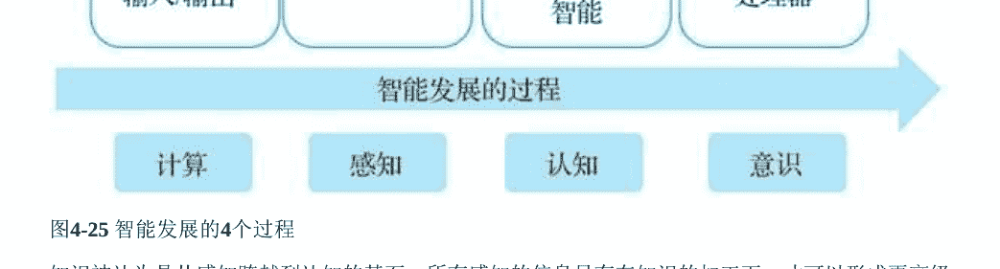
知识是感知跃迁到认知的基石。没有知识加工，感知信息无法形成高阶认知。知识图谱正是 AI 里关于知识构建的技术，是感知智能向认知智能跨越的桥梁之一。只有把海量知识结构化连接起来，认知推理、联想等高阶能力才会被真正激活。

知识图谱本质上是语义网络、图形化知识表达，能把客观世界的实体、概念、关系、事件有效联结起来。样例可参考图4-26。

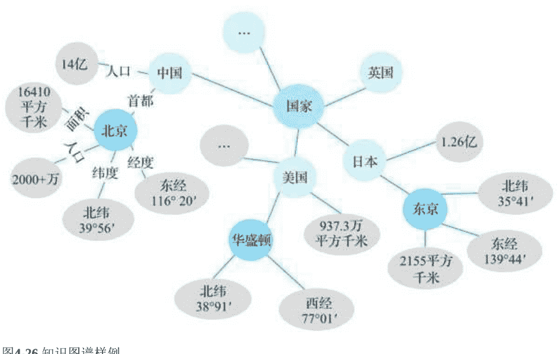
图4-26 知识图谱样例

概念最早由谷歌在 2012 年提出，但思想源头更早。1956 年 Richens 提出语义网，核心是通过图形化表达知识。20 世纪聚焦语义网理论完善和概念关系建模，21 世纪前十年转向语义 Web 研究。如今 WordNet、HowNet、Google-KG 等产品已相当成熟。早期靠专家手工构建规则，质量高但规模小。互联网出现后，群体智能方式兴起，用维基百科、百度百科等半结构化数据组织知识。随着内容爆炸，自动化机器学习构建成为主流，通过自动化信息抽取快速搭建知识图谱。

#### 知识图谱技术三件事
构建知识图谱是融合机器学习、信息抽取、检索、知识表达的综合工程。整体流程是从知识获取表达到关联构建，再到存储利用，可拆成表征、构建、存储三个维度。

表征，也就是知识图谱嵌入，核心是用向量表示实体和关系。图谱里常用三元组（实体，关系，实体）表达，如（中国，首都，北京）。思路是先给实体和关系做表达，再设计评价函数，最后学习向量。主流方法有平移距离模型和语义匹配模型。平移距离模型用空间距离评估关系合理性，例如 TransE，把三元组（h，r，t）表示为从 h 到 t 的平移，r 就是这个平移向量，满足 h+r≈t，如图4-27。语义匹配模型则是基于相似性的评价函数，从语义和向量包含关系上度量实体间的关联。

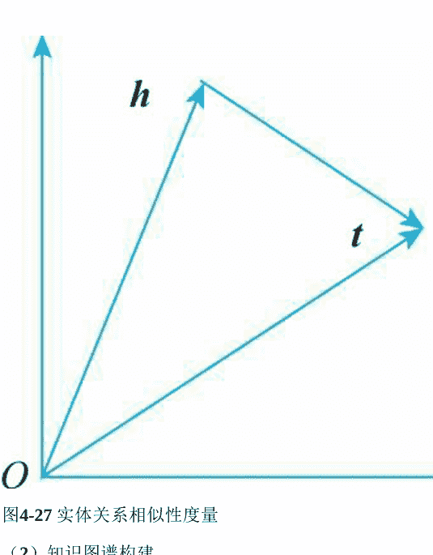
图4-27 实体关系相似性度量

构建层面，图谱分数据层和模式层。数据层由大量事实三元组或属性三元组组成，通常存进图数据库，如 Neo4j、FlockDB、GraphDB。模式层是数据组织模式，用本体库管理。

构建路径分自顶向下和自底向上。自顶向下先建模式层再补数据层，从高质量人工数据抽取本体模式，再依模式抽取大盘数据。早期项目多用此法。自底向上先建数据层再归纳模式层，先通过自动化或半自动化抽取实体、关系、属性，再据此组织模式。更适合超大规模场景，如卡内基梅隆大学的 NELL。如今主流已是自底向上。

整体构建流程见图4-28。以自底向上为例，输入是各类数据，经过信息抽取、知识融合、知识加工三步，输出完整图谱。

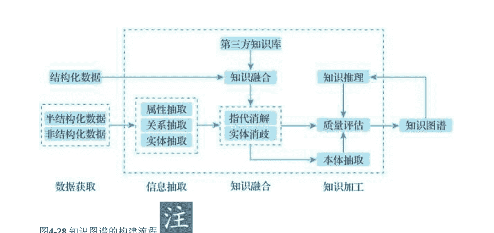
图4-28 知识图谱的构建流程

信息抽取按任务需求定维度，图谱场景更关注实体、关系、属性。属性是实体的固有信息，如人物身高、出生年月。抽取可采用监督、半监督、无监督方法，主要面向半结构化和非结构化数据，抽取后转为结构化。

知识融合负责整合多源数据。输入既有结构化数据可直接读取，也有半结构化和非结构化数据经抽取后才可用，还有第三方知识库。不同来源冗余度高，融合要把信息整理成统一知识，核心技术是实体消歧和指代消解。

知识加工在融合后进行本体构建和质量评估。抽取得到的三元组虽去歧义，但缺少深层逻辑，质量仍需验证。本体构建是模式层技术，通过公理、规则、约束规范实体、关系、属性间联系。本体要素通常包括类或概念、关系、函数、公理、实例。类或概念覆盖对象、任务、功能、行为等；关系多样，如 Part-of、Kind-of、Instance-of；函数定义概念间关系；公理是普遍真描述；实例是概念的真实应用。实际落地要结合业务定制。

质量评估要判断可信度，保留高置信知识。常用方法有评估数据源可信度，如根据用户贡献历史和领域判断贡献质量；统计抽取频次打分；用可信知识库校正。随着数据体量增大冲突增多，评估标准和核验方法越发关键。

存储层面关注数据模型、存储机制和查询语言。关系型数据库、图数据库、RDF 都能存图谱。数据量大时关系型需维护大量表，成本高。图数据库用节点表对象、用边表关系，查询尤其是多跳查询更快，但更新复杂、分布式实现代价高。RDF 为三元组而生，在 SPO 三元组上采用六重索引 SPO、SOP、PSO、POS、OSP、OPS 检索。存储方案需按场景选，而非一刀切。原生方案里基于图数据库的 Neo4j 和基于 RDF 的 gStore 较为知名。

#### 典型应用与挑战
语义搜索、知识问答、推荐系统都依赖知识图谱。语义搜索会解析用户输入，提取实体关系，用图谱知识挖掘深层意图，找到匹配语义内容并排序展示。知识问答是特定场景的语义搜索，在智能客服等里常见，通过一问一答解析意图并从图谱里匹配答案。基于图谱的推荐在电商、社交、支付等场景广泛应用，通过用户行为、关系画像推断兴趣、消费倾向和时机，构建用户-产品关系实现精准推荐。

当前仍有待解决的问题：
- 实体关系面临数据量和连接量的双重增长，多模态非结构化、半结构化数据爆炸，如何兼顾质量与数量构建高质量图谱？
- 如何找到更好表征来刻画图谱中的实体和关系，提升计算机计算和信息挖掘效率？
- 如何设计更合理的数据模型和高效查询手段，在大规模图谱下提升应用效率？

人类认知本质上依赖知识构建与理解，构建更大规模知识系统是固有需求。知识图谱构建离不开优秀表征，信息抽取与关系表征已大量使用深度神经网络，未来深度学习将在图谱构建中发挥更大作用。

#### 知识推理：让图谱会思考
AI 体系里感知之后是认知，知识推理相当于人脑推理的过程，从已知事实出发运用已有知识分析综合决策，找出隐含事实或归纳新事实[2]。

借助知识推理，可以纠正错误知识、补全缺失信息、发现新知识。图谱再大也无法穷尽所有事实，推理能提升图谱信息补全、质量优化能力，也能增强对话系统和推荐系统。

方法上既有基于描述逻辑、基于规则的推理，也有随着开放域信息抽取需求兴起的半监督、无监督技术。知识表示学习和深度学习让实体关系以向量形式在空间中度量，从而出现基于分布式表示和基于神经网络的推理，推动了推理能力的发展。

### 机器翻译：从规则到端到端
机器翻译是 NLP 最常见的应用，把源语言文本转为目标语言，谷歌翻译、百度翻译等都是典型代表。场景包括开放翻译系统、聊天辅助翻译、输入法翻译、AI 同传、语音问答翻译等。技术突破已解锁大部分翻译需求。

发展路径是从基于规则到端到端的深度学习。近期注意力机制和 Transformer 取得巨大进展。未来方向包括：引入语法信息，把语法语义等先验知识融入模型；无监督机器翻译，对资源匮乏语言用反向翻译把目标语转回源语合成平行语料再训练；单模型多语言翻译，从双语扩展到多语言，学更多语言间共性；语音直译，实现跨模态语言映射，让单一模型掌握不同模态关联。

评价常用 BLEU，即双语评估替补，用机器翻译结果替代人工翻译做对比。BLEU 计算候选翻译与参考翻译的匹配度，取值 0 到 1，0 表示完全不匹配，1 表示完美翻译。该指标虽为机器翻译设计，也可用于评估其他 NLP 任务的文本生成质量。

BLEU 的公式如下：
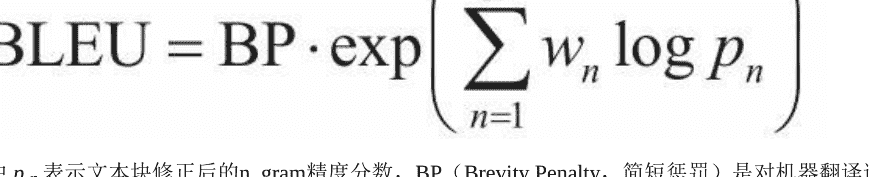

信息抽取、知识图谱、机器翻译相互支撑，构成了从文本理解到知识利用再到跨语言表达的完整闭环。

在机器翻译的评估里，最经典的指标就是 BLEU。它的核心由两部分构成：文本块修正后的 n-gram 精确度 $p_n$，以及用来惩罚过短译文的简短惩罚系数 BP。$p_n$ 和 BP 的计算都依赖于候选译文长度 $c$ 与参考译文长度 $r$。$$p_n = \frac{\sum_{C \in \{Candidates\}} \sum_{n\_gram \in C} Count_{clip}(n\_gram)}{\sum_{C' \in \{Candidates\}} \sum_{n\_gram' \in C'} Count(n\_gram')}$$

$$BP = \begin{cases} 1, & c > r \\ exp^{1-r/c}, & c \leqslant r \end{cases}$$

简单来说，n-gram 就是拿 n 个词为一个单元，看参考句和候选句的重合程度。1-gram 看单个词是否命中，5-gram 看连续 5 个词是否一致。比如机器译出 6 个词，其中 5 个与参考匹配，那么 1-gram 分数就是 5/6；如果是 5-gram 的匹配度，则是 1/2。

人工译文：Today is a lucky day
机器译文：It is a lucky day today

从召回和精确两个角度理解，$p_n$ 更像是在衡量翻译的准确率，而 BP 体现的是召回的思路——译文太短就覆盖不到参考信息，必须对这种短句做惩罚。

### 对话系统是怎么跑起来的

聊天机器人、智能客服、智能音箱里都离不开对话系统，它也是离图灵测试最近的应用形态。1966 年 ELIZA 横空出世，之后规则派和统计派轮番发力。2011 年 IBM Watson 在智力问答人机对战中胜出，2014 年前后微软小冰登场。经过多次迭代，今天的聊天机器人智能程度已经大幅跃升。

一个完整的对话系统通常包含自然语言理解 NLU、对话状态追踪 DST、对话策略 DP、自然语言生成 NLG。涉及语音时，还会加上自动语音识别 ASR 和文本转语音 TTS。早期基于深度学习的方案讲究先把每个环节单拎出来攻克，再串成流水线；随着技术成熟，联合训练和端到端训练让训练和推理都更高效。分阶段做法的好处是能对某个环节做精细化优化，因此至今仍有大量场景在用。

1）NLU 的任务是把用户语言转成机器能懂的结构化语义，通常拆成用户意图和槽值。意图是用户的目的，比如“明天深圳天气如何？”的意图就是查天气；槽值是细节填充，比如地点-深圳、时间-明天，这属于信息抽取范畴。NLU 还要处理情感识别、歧义消解等，最终目的都是更准地读懂用户。

2）DST 主要用于多轮对话，负责追踪用户需求和当前对话状态，捕捉上下文信息来推断当下含义。面对一词多义时，结合上下文的状态信息尤为关键。

3）DP 根据当前状态判断下一步该做什么，输出结构化的语义决策。常用强化学习来训练策略网络。

4）NLG 把 DP 的结构化语义转回自然语言，可视为一种翻译。规则路线多用话术模板，统计路线则多用序列到序列 Seq2Seq 加监督训练。

从功能来看，纯文本的流程是 NLU→DST→DP→NLG；语音输入输出则是 ASR→NLU→DST→DP→NLG→TTS。

#### 生成式 vs 检索式

按应用分，有金融、互联网客服这类问答型系统，也有小冰这类闲聊型机器人。主流实现分两大类：生成式和检索式，可类比问答题和选择题。

检索式系统从语料库里挑最合适的回复。对简单 FAQ，问题单一，一个回复就能覆盖，检索式就能满足需求。多轮、开放式聊天需要的语料库规模会爆炸，需要加速检索策略。

生成式系统本质是 Seq2Seq 问题。机器翻译有明确的源-目标对应，而开放式对话没有标准答案，是主观题。聊天要“聊到一块去”，需要性别、年龄、职业等背景信息来限定话题空间。生成式系统要在大量条件下生成合理回复。

评估和生成都有难度，正因如此生成式比检索式实现成本更高，工业界在可用前提下更倾向用检索式。

#### 如何评价对话

评价可分定性和定量。定性靠人工判断，定量靠机器与参考内容量化比对，定量更利于优化。

常见手段有 n-gram 匹配、BLEU、ROUGE 等，也可用词向量评价。词向量把词组、句子映射到向量空间，通过距离衡量语义相似度。由于开放式对话有大量合理答案，向量方式比单纯词匹配更包容多样性。

### 多模态内容理解

人看世界是多通道的，视觉、听觉、嗅觉、味觉协同工作，还有超声波、激光等人类无法感知的信号。智能体要提升交互能力，也必须摆脱单模态限制。多模态的核心课题是表达、互补、融合与理解。

研究里主要有五类任务：表征、转换、对齐、融合、协同学习。

表征是最基础。单模态关注自身特性，多模态表征要提取互补信息，去掉冗余，得到更全面的特征。方向有联合表征，把不同模态映射到同一特征空间；也有协同表征，让不同模态保持各自空间但加约束。

转换即跨模态映射，像语音合成把文本变语音，图文描述把图像变文字。转换数据异构，且常带主观开放性。

对齐是建立两种模态的对应，例如把描述句里的词映射到图像区域并高亮。难点在于标注数据少、相似度难度量、对应关系未必存在。

融合是整合多种模态做分类、回归等。按过程分早期融合、晚期融合、混合融合。早期融合在输入特征阶段合并，晚期融合在各自建模后再合并结果，混合是二者的结合。

协同学习用信息丰富的模态帮助信息匮乏的模态建模。包括协同训练、迁移学习等，用以扩充标注数据或迁移特征表示。

近几年深度学习在视觉、语音、NLP 的落地，推动多模态走向以深度学习为核心的融合应用。2018 年前后 Transformer 先在 NLP 取得突破，随后进入视觉，形成多模态技术大一统的基础。

### 多模态融合的落地

典型应用有视觉问答 VQA、视觉常识推理 VCR、自动驾驶、机器人、虚拟数字人。

VQA 即看图回答问题，模型需理解图像后用自然语言作答。研究始于 2015 年，通常分别提取图像与问题特征后再融合。

VCR 由华盛顿大学在 2018 年提出，不仅要回答问题，还要给出理由。对比 VQA，VCR 更强调多模态推理，已吸引谷歌、微软、百度等参与。

自动驾驶常用激光雷达、毫米波雷达、摄像机融合感知路侧环境，对决策安全性要求极高，是多传感器融合的典型。

机器人需要识别语音视觉信息并生成语音或执行行为。高阶智能机器人需融合视觉与语音来理解场景需求。

虚拟数字人无实体，行为丰富，依赖语音理解并生成带情感的交互语音和视觉动作，属于多模态内容生成。

展望未来，多模态是通往通用 AI 的必经之路。Transformer 和大规模自监督预训练让技术路径统一，多模态内容生成也在落地。元宇宙兴起后，虚拟数字人等形态会成为重要入口。

[1] 参见由Forsyth和Ponce撰写的 *Computer Vision: A Modern Approach* .中文版由电子工业出版社于2012年出版。

[2] 参见Kompridis N撰写的“So We Need Something Else for Reason to Mean”，发表于2000年8月的 *International Journal of Philosophical Studies* 。

## 机器人学与运动规划

物理世界的智能体就是机器人。它由软件与硬件结合完成任务。按形态可大致分为机械手、移动机器人、人形机器人。

机械手多用于工业制造、医疗，常固定位置完成装配。移动机器人靠腿或轮子移动，包括自动驾驶车、无人机、火星探测器、物流机器人、扫地机器人等。人形机器人模仿人形，多用于表演、陪伴，也可解决特殊场景问题。机器人是工具，AI 提升只是为了更好地服务人类。

构建产品时关注硬件、感知、规划、控制、应用等。

### 机器人硬件

硬件结构包含传感器、执行机构、动力源、处理器四部分。传感器感知外界，执行机构对外运动，动力源提供驱动，处理器是软件调度中枢。

#### 传感器

传感器是感知窗口，分为被动和主动。被动如摄像机、拾音器，只接收信号；主动如声呐、激光雷达，需发射信号并接收反射。

按功能分有测距、方位、本体感受。测距靠声、光波反射算距离，自动驾驶用激光雷达定位障碍物。方位如 GPS，通过多颗卫星三角定位。 本体感受监测内部状态，如转速、电量、负载、惯性、受力等，包括电位计、转速表、光学编码器、陀螺仪等，确保任务执行中状态可控。

#### 执行机构

执行机构负责运动，核心概念是自由度 DOF。自由度描述刚体的平移与旋转能力。三个维度的刚体有 6 个自由度：x、y、z 平移与绕三轴旋转。若被限制在 x=1，只能转动不能沿 x 平移，则自由度减一。

移动机器人常用轮子、履带。差动传动用两个独立驱动轮，相同速度直行，反向则原地转向。同步传动让两轮同心、同角速度、不同半径转动，协调稳定。

腿型移动可应对复杂地形，代表有波士顿动力 Atlas 与机器狗。按稳定性分动态稳定与静态稳定。

#### 动力源

传感器与执行机构需要动力驱动，常用电动机，也可用气动、液动进行动力传输。机器人领域最常用电动机，可由多个电机协同，也可单源多级齿轮驱动。

#### 处理器

处理器是控制核心，常用 ASIC、GPU、单片机。随着智能化提升，处理视频语音并跑深度学习时，常需神经网络处理器来满足算力。

随着系统复杂度不断攀升，边缘侧的嵌入式控制方案往往会走向集中化设计，主控单元多由片上系统SOC承担。SOC把中央处理单元、面向多媒体的协处理器等多个芯片模块集成到同一颗模组中，实现统一算力输出，典型的代表有英伟达的AGX Xavier、海思的3559A等。在具体选型时，除了算力、功耗这些基础指标，还必须审视处理器的硬件接口形态、编解码能力等细节，以免接口定型之后才发现芯片不匹配，导致返工。

### 机器人感知体系

硬件模块搭好后，机器人才能进入系统化组装，软件也得以在硬件之上搭建并处理采集回来的原始数据。感知外界信息是第一步。以移动机器人的定位应用为例，常见的测距手段包括激光测距仪、激光雷达等激光类器件，声学类有声呐测距传感器，视觉类则以摄像头为主。每类传感器都有适用边界：激光设备成本偏高，在需要穿透玻璃或水体的场景下基本失效；超声波精度有限，却能在水下环境稳定工作。

传感得到的数据往往杂乱无章，必须经过进一步加工才能用于决策。机器人采集到的信号常夹杂噪声，或受镜头畸变、机体结构对传感器遮挡等因素影响，这就要求在信号分析层做清洗，保证最终拿到的感知信息可信可用。常用的手段有畸变校正、信号域转换、滤波等。下面简要说明其中两种易混淆的方法。

信号域转换是将信号从一个分析域搬到另一个分析域，例如把时域信号转到频域。其目的在于把在原域特征不明显的信号搬到特征更容易凸显的域，提升特征提取效率。

滤波则是对信号做筛选，借助高通、低通等滤波器剔除干扰，让机器人更容易捕捉到关注的目标信号。

#### 定位与地图构建

定位的本质是确认物体与机器人自身的空间位置，定位精度直接决定后续任务规划与路径生成的可靠性。机器人需要清楚自己在哪、目标在哪、中间有哪些障碍，方可安全抵达。

在二维平面假设下，定位可简化为用笛卡儿坐标 x_t、y_t 与朝向角 θ_t 表示，如图5-3所示。

运动过程中机器人同时存在平移速度 V_t 与旋转速度 ω_t，对一个微小时间 Δt，其确定性运动模型可写出预测状态 X_{t+1}。

$$X_{t+1} = X_t + \begin{pmatrix} v_t \Delta t \cos \theta_t \\ v_t \Delta t \sin \theta_t \\ \omega_t \Delta t \end{pmatrix}$$

运动模型属于机器人自有的行动指南，而对外感知则要通过传感器建立与环境的相对关系。传感器建模主要有两种思路。地标模型是对环境中稳定可识别的地标特征进行检测，并获取每个地标相对机器人的位置关系；在理想无噪声条件下，可借助集合关系直接算出距离与方向。距离扫描模型则不依赖地标识别，只做距离扫描，遇到可标识特征时直接以距离给出定位结果。

实际作业中，机器人很难直接测得精确位置，多是通过传感器估计最佳状态，再以信任度对位置进行猜测。卡尔曼滤波器把信任状态表示为单一的多变量高斯分布，蒙特卡洛定位即粒子滤波则用一组粒子集合来表征信任状态。

在定位与建图任务中，常常缺乏先验地图，于是需要同时定位与地图构建 SLAM 技术来解决未知环境的双重难题。常规逻辑是先有地图再定位，但当地图与位置皆未知时，就形成了“先有鸡还是先有蛋”的循环。SLAM 的核心矛盾在于：精确定位需要无偏地图，而构建无偏地图又依赖精确的位置信息。

SLAM 的典型流程是先用运动模型估计位置，再用测距单元获取环境信息以修正位置。以地标模型为例，机器人先识别地标并测量相对距离与角度，如图5-4a；随后依据运动模型预测新位置，如图5-4b；在新位置上再次测量，测量值与预测值往往不一致，系统会更信任传感器数据来更新自身位姿，如图5-4c。尽管测距单元本身存在误差，但其偏差通常小于预测偏差。通过不断运动感知迭代，机器人最终能获得高精度位姿并完成地图构建。

### 运动规划与控制

#### 运动规划

定位与建图完成后，如何从起点前往终点，就是运动规划的问题。规划概念覆盖机械臂、飞行器与地面移动机器人，本节聚焦地面移动机器人。

运动规划包含路径规划与轨迹规划。路径规划研究起点到终点的通行策略；轨迹规划则在路径基础上，结合运动学模型与约束条件，规划出速度、加速度等可执行的控制序列。

开展规划前需明确工作空间 Workspace 与构型空间 C-Space。机器人在三维欧几里得环境中的可达范围即工作空间，如机械臂末端可达集合。构型空间是用一组向量完整描述机器人状态的空间，其维度随构型而变，例如平面机器人为 (x, y, θ)，无人机为 (x, y, z, roll, pitch, yaw)，六轴机械臂为六维空间 R⁶。

构型空间更利于规划，但任务通常以工作空间坐标描述，需先转译再映射。工作空间中的障碍物在构型空间中会被映射为占用空间，如图5-5a 的三角形障碍物在构型空间中会形成如图5-5b 所示的自由空间与占用空间划分，黑线外为可通行区，内部为禁止区。

在构型空间中做路径规划，常用方法之一是单元分解法，即网格法。把空间离散为有限相邻单元后，规划退化为图搜索问题，如图5-6所示。网格越细，边界移动分辨率越高。优点是实现简单，在二维场景实用，但维度升高时网格数指数膨胀，计算压力巨大。

除网格法外，还有势场法、概率路径图、神经网络方法等，深度学习催生的强化学习规划也常用于多足机器人。总体思路都是把工作空间转成构型空间，再在构型空间寻找最优路径。

当环境存在大量不确定性时，需要考虑不确定性运动规划。 불确定性源于环境部分可观察与行动随机性，也可能来自近似算法。实际中常用定位算法输出的最可能状态做决策，若忽略全概率分布，误差会累积导致碰撞。机器人学可通过马尔可夫决策过程 MDP 建模，下一状态仅依赖当前状态，最优策略指导每步行动。状态部分可观察时则变为部分可观察马尔可夫决策过程 POMDP，状态以信念分布形式输入，精确求解困难，通常通过最小化姿态不确定性来缓解，如在接近已知地标时降低不确定性。鲁棒控制等方法也可用于处理不确定性。

#### 运动控制

规划只给出“走哪条路”，真实世界还需“如何走”。理想仿真中机器人可精确抵达，但实际运动存在惯性，需通过力控制实现。运动控制关注在给定规划下，如何在物理世界实现动作。

控制是一个持续调整的闭环过程，控制器负责决策。控制器利用环境反馈实时调节，工作模式可概括为目标-控制-观察-控制，属于控制论范畴。

按反馈分为开环与闭环。开环控制无反馈，指令单向传递给执行器；闭环控制则把执行结果反馈回下一轮控制信号中，如图5-7所示。

最经典的闭环算法是 PID 控制，即比例积分微分控制，因其简洁鲁棒被广泛应用于工业场景。比例、积分、微分环节可单独使用，也可组合。PID 本质是基于系统误差计算控制量。

势场控制是另一思路，为目标构型设置吸引力，为障碍设置排斥力，每点势能由到目标距离与接近障碍程度叠加构成，全局最小点即目标。该方法可免路径规划直接生成运动，但易陷入局部最优，仅在局部环境有效，复杂场景仍需全局规划。

反应式控制、强化学习等方法在不同形态机器人上各有擅长，反应式控制在多足机器人表现良好，强化学习在无人机上应用较多。

### 应用领域

机器人已渗透多个行业。

工业领域原本承担繁重危险工序，随着智能化升级，正从加工、焊接、装配向高难度质检延伸，深度学习让质检任务更加丰富。

物流领域在电商推动下高度自动化，潜伏机器人、码垛机器人等在分拣环节发挥作用，如图5-8。

交通领域自动驾驶最受关注，城市清洁、园区观光、Robotaxi 等场景需求旺盛，L3、L4 车辆研发投资高涨，如图5-9，L5 概念车亦已出现。

特种应用中，地下矿井作业、矿用消防、灾区侦测、水下探测等危险或不可及场景依赖特种机器人，如图5-10，火星、月球探测同样由机器人先行。

个人服务市场前景广阔，家庭场景的扫地、擦窗机器人，如图5-11a；餐饮送菜机器人、酒店送物机器人、商超导航机器人等，如图5-11b，均在普及。

### AI 云原生工程应用

互联网规模化带来数据爆发，网络传输、存储、计算等需求同步扩张，也带来资源竞争、分布式复杂性、运维难度、弹性伸缩与安全等挑战。

任何应用都包含功能特性和非功能特性。功能特性直接创造业务价值，如人脸检测、比对、属性识别；非功能特性不直接产生价值，却保障系统可用，如容灾、安全、运维。云原生技术让开发者不必过度关注底层非功能特性，更聚焦功能开发。

基于深度学习的 AI 应用对数据、算力与大算法依赖强，训练与推理场景与云原生架构高度适配，故亚马逊、微软、百度、腾讯、阿里等均深度投入云与 AI 融合。越来越多的 AI 公司采用云原生架构构建产品，AI 产品经理需理解云原生思想与框架。

### 云原生概览

云原生是为云而生的技术体系与方法论，仍在持续演进。

企业 IT 演进经历了服务器阶段、云化阶段、云原生阶段，如图6-1。服务器阶段以硬件为中心，自动化程度低，成本高；云化阶段实现资源池化与虚拟化，以资源为中心部署；云原生阶段关注点转向应用，强调持续交付与弹性扩展。

> 注：参见阿里云发布的《云原生架构白皮书》。

云原生架构通过剥离非业务代码，让云承接高可用、稳定性、安全等非功能能力，使应用更可靠、轻量、敏捷、自动化。整体原则包括服务化、弹性、可观测、韧性、自动化、零信任、持续演进。

服务化把业务拆分为微服务、小服务，实现解耦，利于迭代，但对单机小应用并非必要。分布式环境下的流控、熔断等均依托服务化实现。

弹性指服务规模随业务量动态变化，避免预购硬件导致的资源浪费或不足，云的伸缩特性免去底层运维负担。

可观测是指在分布式系统中通过日志、链路追踪等多维指标监测系统健康，定位故障范围。

韧性衡量系统在软硬件异常、流量冲击、缺陷、攻击等情况下仍能处理业务的能力，通过异步化、限流、熔断、重试、容灾等手段提升平均无故障时间。

自动化应对分布式与多技术栈带来的复杂度，通过标准化流程与自动化工具提升交付与运维效率。

零信任以身份为中心，在默认不信任的前提下通过认证与授权控制访问权限。

持续演进强调技术快速迭代，云原生架构需随业务与技术共同演进。

Cloud Native 并不是公有云的专利。无论算力资源部署在公有云、私有云抑或混合云，只要采用了 Cloud Native 的框架、方法论或组件，就可归入 Cloud Native 实践。随着生态的快速扩张，技术分支、细分赛道和第三方组件数量持续增多，但支撑体系的核心要素保持稳定，主要围绕容器化、微服务、无服务器、服务网格以及 DevOps。

#### 6.1.2 容器技术

在 Cloud Native 场景下，容器是通用的软件交付单元，它把应用及其运行依赖打包在一起，摆脱对特定运行环境的绑定，实现快速部署与运行。应用交付形态经历了从传统硬件-操作系统-应用的叠层，到虚拟化，再到容器化演进，如图6-2所示。

> 注：参见阿里云发布的《云原生架构白皮书》。

容器发展进程中，Docker 与 Kubernetes 是两大驱动力量。
Docker 基于操作系统级虚拟化共享内核，具备轻量、资源损耗接近于零、启动极快的特性，显著提升了单机应用部署密度与弹性，已成为容器镜像分发的行业事实标准。
在编排层面，Kubernetes 简称 K8s，已成为事实标准，提供资源调度、应用部署与管理、故障自愈、服务发现与负载均衡、弹性伸缩等分布式应用治理能力。
- 调度会依据业务请求量从集群中挑选最合适的节点执行任务。
- 部署与管理支持配置管理、自动化发布等操作。
- 自愈通过监控宿主机健康状态，并在异常时触发应用迁移等措施。
- 服务发现为服务间通信与发现提供基础。
- 负载均衡保证各服务运行的均衡性。
- 弹性伸缩能够感知业务负载并自动完成扩容或缩容。

#### 6.1.3 微服务

微服务是 Cloud Native 体系中的关键方向之一。过去业务系统往往以单一后端服务承载全部功能，由同一套后端统一服务前端，形成单体应用。随着业务与团队规模扩张，单体在开发、迭代、测试方面的效率明显下降，微服务正是用来解决这一痛点的思路。

微服务把统一的后端拆解成多个松耦合的子系统，每个子系统只负责系统的一部分能力。众多子系统共同构成微服务级的分布式体系，彼此相对独立，因而开发、迭代、测试、部署效率显著提升，且在扩展性和稳定性上远超单体应用。由于模块间耦合度低，实际运行中会产生大量分布式通信与数据交互，也带来了高效通信、调用治理、负载均衡等挑战。

微服务架构理念自2011年提出后，在解耦、降低寻址与通信成本、削弱开发语言限制等方面持续演进，进而催生出服务网格、Serverless 等技术。

#### 6.1.4 Service Mesh

服务网格是在分布式微服务之上发展出的基础设施层，其主要目标是把连接、通信、安全、流控等非业务能力沉淀为平台能力，让开发者不必在应用开发中过多关注服务治理，而集中精力于业务逻辑。典型应用架构如图6-3所示。

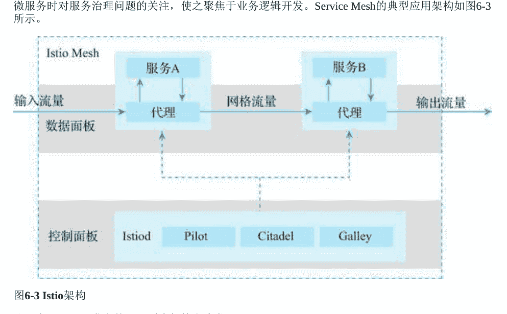

图6-3 Istio架构

注：参见阿里云发布的《云原生架构白皮书》。

在典型架构里，服务 A 调用服务 B 时，服务发现、熔断、限流等工作由侧车代理接管，控制策略则通过控制面统一配置。2017年启动的开源项目 Istio 建立在 K8s 之上，可天然运行于提供 K8s 容器服务的云厂商环境，有望成为服务网格的事实标准。

#### 6.1.5 Serverless

Serverless 可解读为无服务器，它既是一种架构范式，也是一种产品形态。根据云原生计算基金会 CNCF 的定义，Serverless 架构是通过 FaaS 函数即服务 和 BaaS 后端即服务 来解决问题的设计思路。通俗讲，Serverless 让使用者专注业务逻辑，无需关心服务器、存储类型、网络带宽、自动扩缩容等底层运维，从而降低运维投入与运营成本，缩短上线周期。

Serverless 的典型形态是云函数或函数计算，即 FaaS。它把业务逻辑拆分为多个函数，按事件驱动执行，例如图片或视频上传后触发函数进行处理，且具备高可用与弹性。若处理大数据量，结合消息中间件与函数计算即可实现实时大规模消息处理。

Serverless 适用于小程序、Web、移动应用，也适用于大规模批处理、事件驱动的在线应用、离线数据处理与自动化运维。例如人工智能推理场景，通过对象存储与推理函数计算的组合可赋予应用人工智能推理能力。但多数人工智能应用冷启动耗时较长导致响应延迟，实际落地仍需结合场景进行设计。

Serverless 工作原理如图6-4所示。

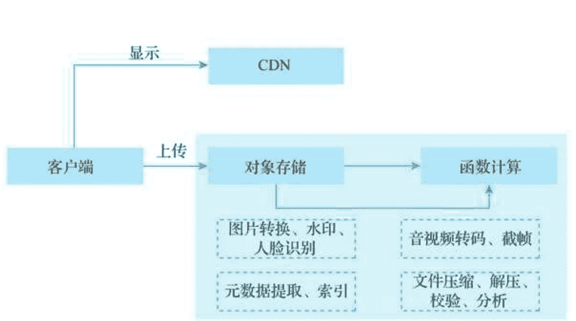

图6-4 Serverless工作原理示意图

#### 6.1.6 DevOps与ModelOps

DevOps 由 Development 和 Operations 组成，是一种以持续集成、持续交付为核心的开发模式，旨在提升软件交付效率与响应速度。它主张打破开发、测试、部署之间的壁垒，通过自动化与智能化手段提高质量，缩短开发周期。如图6-5所示，与瀑布式和敏捷开发相比，DevOps 在业务拆解上更细化，迭代与交付效率更高。

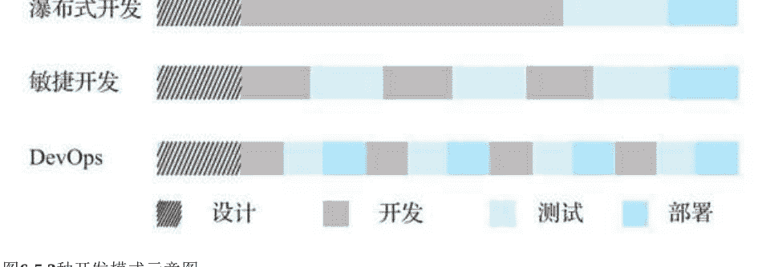

图6-5 3种开发模式示意图

DevOps 天然契合 Cloud Native 技术与产品，在容器化与微服务支撑下，需求可实现模块化与松耦合，产品可模块化上线。结合敏捷开发，DevOps 能更快推动 Cloud Native 产品落地。

随着人工智能应用与 Cloud Native 的深度融合，众多人工智能应用都利用 Cloud Native 技术部署。人工智能模型生产链路涵盖训练、SDK 封装、服务化部署，并需进行精度、性能、稳定性等测试，环节繁多、协作人员众多、效率偏低。于是参考 DevOps 与敏捷思想，以模型为中心的敏捷化 DevOps 即 ModelOps 开始被提出与实践。

2018 年 12 月 IBM 的人工智能研究员首次提出 ModelOps，其被定义为面向可复用、平台无关人工智能工作流的编程模型，通过强治理解决模型开发与部署之间的矛盾。ModelOps 是一种围绕人工智能模型生产的自动化开发运维实践，包含自动化工具与人员协作规则。

ModelOps 需要强有力的技术支撑，基于全流程自动化完成训练、封装、服务部署等，并可使用 AutoML 等技术，实现从需求、设计、开发、评估、测试到部署的全生命周期自动化。随着模型迭代频率和数量的提升，ModelOps 对企业人工智能模型生产效率的提升作用显著；伴随自动化机器学习平台的普及，ModelOps 实践将更广泛。

### 6.2 人工智能 Cloud Native 应用发展趋势

人工智能技术成本持续下降，应用普惠化加速。人工智能从早期主要服务 G 端，逐渐向 B 端、C 端延伸，除提效类应用外，与图像、语音相关的应用已融入日常生活，语音识别、翻译、人脸识别等触手可及。大量人工智能应用正迁移到云上，尤其互联网云厂商在原有云计算能力与生态基础上叠加人工智能能力，Cloud Native 人工智能应用愈发普遍。打开阿里云、百度云、腾讯云都能看到丰富的云上人工智能应用，并提供 BML、PAI 等云化人工智能生产能力，人工智能算法超市类产品也不断涌现。

对越来越多借助公有云人工智能改善业务的用户而言，人工智能函数计算是更高效的选择；对于规模化专有云或混合云人工智能应用，采用 Cloud Native 技术构建可让系统更健壮。尽管算力提升使端边人工智能应用更丰富，但人工智能向通用智能发展的趋势不会停滞，对数据与算力的追求也将持续，在网联化、智能化需求驱动下，云与人工智能的结合会日益紧密，以 Cloud Native 为基础的人工智能应用将成为主流趋势。

# 第三篇 人工智能产品应用

本篇将从应用视角介绍人工智能产品。首先从市场与技术两个维度切入，说明人工智能产品经理如何发现产品机会；随后介绍机会明确后如何定义与搭建人工智能产品，重点围绕人工智能产品全生命周期管理思考落地问题；最后剖析算法应用类、平台中台类以及深耕业务赛道的人工智能产品落地要点与方法，这三类基本覆盖当前人工智能产品全貌。

# CHAPTER 7 从两个视角深挖人工智能产品机会

人工智能本身是推动传统产业智能化的手段，同时也在产业化。技术是原始驱动力，市场是催化剂，产品则是二者结合的产物。本章从市场与技术两视角，介绍推动人工智能产品落地的底层方法论。

## 7.1 市场视角：寻找商机

市场视角的核心是把商业机会转化为产品机会。在技术进步、认知提升、资本关注的共同作用下，人工智能产品市场持续发展并趋于成熟。

### 7.1.1 关注市场的宏观力量

影响人工智能产品市场的宏观力量主要包括技术变革、政策与文化、资本三方面。

#### 1. 技术变革
技术变革带来生产力的跃升甚至生产关系的改变。能在商业活动中拥抱技术、提升劳动生产率的企业，会率先享受成本下降与收益提升。借助人工智能重塑流程与产品，就能孕育新商机。技术早期多在高校实验室与论文中萌芽，规模化认知往往需要标志性事件推动。例如 2016 年 AlphaGo 战胜李世石点燃了全球对人工智能的关注，随后 OpenAI 在 Dota2 等事件进一步强化社会认知，吸引资本与人才进入。

#### 2. 政策与文化
政策指针对特定产业、行业或领域的倡议、规划、法规、标准等，是解决共性问题的指引，对产业走向影响深远。政策通常包含两类：一类是正向引导，另一类是约束性禁令。

正向引导类政策会扩大投资规模并引入先进生产力。例如我国 2017 年发布《新一代人工智能发展规划》，近年大力推动以新基建为依托的智慧城市建设，极大促进了人工智能在交通、公共安全等领域的落地；政府推动 4K 超高清视频监控建设，也带动了城市交通、公共安全设备与平台的项目机会；支持芯片关键技术研发与国产化，则催生了以国产芯片为载体的产品机会。

禁令类政策则对负面行为或落后方式进行约束。例如 Deepfake 换脸技术虽效果逼真，但易引发侵权与虚假信息传播，因而政策对其进行限制。

除政策外，区域文化特征也显著影响市场。语言、国界、风俗习惯会形成独特的区域市场，同一产品在不同区域的可行性差异很大。以自然语言处理为例，某些区域口音浓重且存在本地词汇，基于普通话的 NLP 应用难以直接落地。因此探索机会时需预演产品在特定文化环境下的可行性，必要时进行定制化开发或配置差异化方案。

#### 3. 资本
资本是产业加速器，能快速汇聚资源。当政策方向明朗、商业模式可预期时，资本会集中涌入，加速产业发展。AlphaGo 事件后资本对人工智能产业的深度研究与密集投入，推动了第一批商业化人工智能公司落地。近年人工智能在商业、城市、交通、制造等领域不断打开局面，资本持续加码，进一步推动产业成熟。

### 7.1.2 寻找人工智能细分好赛道

人工智能赛道可按技术导向与业务导向划分。技术导向以计算机视觉、语音识别、自然语言处理、机器学习等技术为边界；业务导向以人工智能+安防、人工智能+交通、人工智能+制造等应用场景为边界。

笔者认为产业发展呈两条路径：以基础能力为核心的横向发展，即人工智能行业化，如人工智能芯片、多模态人工智能平台、虚拟数字人等新型物种；以及为传统行业赋能的纵向发展，即人工智能赋能百业。寻找赛道时需兼顾横向新物种与纵向业务应用，关键在于市场需求、规模、阶段与时机、竞争格局。

#### 1. 市场需求
从抽象层面看，市场需求源于生产效率提升与交互体验升级。生产效率提升体现在辅助人工完成复杂工作，如城市治理中海量数据与业务需要高效工具；在制造质检中，机器辅助可支撑产能扩张。交互体验升级主要体现在个人服务，如元宇宙对更佳互联网体验的需求，虚拟数字人需人工智能加持。

具体行业需求差异巨大。以药品制造为例，人工智能可用于生产与质检；在城市交通治理场景，人工智能更关注驾驶行为合规性判断。不同赛道在需求强度、规模与可落地性上各不相同，选赛道需先评估需求强度、市场规模与落地可行性。

#### 2. 市场规模
市场规模即特定行业或产品在自然年内的整体销售额，是投资人、企业领导与产品经理的重要参考，决定发展天花板。相关概念包括：

- 总潜在市场 TAM：理想状态下所有可能使用产品的用户总数，假设无竞争且全覆盖。
- 可服务市场 SAM：TAM 的子集，指渠道可触达且可能付费的用户群体，更具参考价值。
- 可获得市场 SOM：企业当前或未来实际能获取的愿意付费的用户群体，受竞争影响始终小于 SAM。
- 市场集中度：头部市场集中度高，易形成赢者通吃，如互联网支付、短视频；尾部市场分散，难以垄断，如餐饮、装修。

市场规模获取方式多样，包括咨询公司报告、券商与投融资报告、行业联盟研究、国家统计局数据、上市公司财报等，也可自行估算。成熟行业数据相对充足，新兴细分赛道常需自建模型评估。

常用估算方法为自上而下与自下而上。自上而下从宏观行业出发逐层细分，易偏理论化。可采用变通做法，如对头部市场估算头部企业收入占比，再推算整体规模。例如语音识别领域，国内头部包括科大讯飞、思必驰、腾讯等，若估算其合计市占率约 80%，则通过其公开收入即可推算行业整体规模。头部企业收入可通过产业联盟、年报、招股书、行业访谈等公开渠道获取。

做AI产品，先把市场看清、把技术看懂、把用户看透，这三步少一步都会走偏。

先说怎么算市场。除了自上而下的大盘拆分，另一种更接地气的做法是自下而上。思路很简单，先锁定真正能买单、能用的用户画像，再往上推规模。比如要推出一套高校人工智能课程，别空谈教育市场有多大，先问谁会用，这套课的直接使用者就是开设AI课的高校。数一数全国符合资质的高校有多少，乘以一套课程合理的定价，就能得到一个相对实在的总潜在市场。当然，里面还藏着办学层次、地区差异、采购流程等特殊变量，需要再做修正。用这种自下而上的估算，再结合自上而下的大盘判断，同时看总潜在市场、可服务市场、可获得市场，才能形成对市场价值的初步判断，为投入决策打底。

市场什么时候进，比进什么市场更关键。市场的成熟度直接决定你的策略。用生命周期来划，大致分四段。

兴起期，商机刚冒头，产品和服务都还不成熟，竞争少，开拓相对容易，但规范缺失、政策摇摆、商业模式未定，不确定性很高。

成长期，技术路线、政策方向、商业模式开始清晰验证，资本和玩家涌入，创新加速，市场规模快速扩张，格局尚未锁定，机会窗口很大。

成熟期，寡头格局或一家独大基本形成，市场仍在增长但增速放慢，红海特征明显。

衰退期，需求整体萎缩，找不到新增长点，规模持续下滑。

进入时机的判断更偏战略参考。AI领域尤其典型。新技术进入不同细分场景的早期，用户认知和价值认同都需要漫长的教育，试错成本高、不确定性大，这是先发的代价。但先发也带来标杆效应和心智占领，产品和品牌一旦落地就容易深入人心，这就是先发红利。等认知打开、市场进入供不应求阶段，用户已经被反复教育，试错成本下降，晚一步进入反而能借力前人经验，这就是后发优势。选先发还是后发，最终要看团队基因和资源匹配度。

再看竞争。竞争是常态，良性竞争会倒逼进步。做产品之前要先把定位钉死，定位不同，对手名单完全不同。同样是人证核验，做到出入口闸机，竞争对手是核验一体机厂商；做到手机App端，竞争对手就是AI云服务商。定位做差异化，往往能避开头部正面厮杀，在细分场景里吃下市场。

找到对手后要对标。AI竞品拆解可以看产品形态、商业模式、功能边界、性能指标、精度水平、价格体系、目标用户和使用场景。了解竞品是为了校准自己的想法和验证市场，而不是止步于复制。

面对竞争，大致有三种打法。

模仿，在市场未饱和时复制成熟解法能快速起势，降低试错成本，但要规避知识产权风险。AI早期的人证比对里不乏模仿者，有人凭借成本控制和渠道下沉，专注细分场景，反而做得比原创更好。这种打法多出现在成长期，容易催生同质化。

改良，在已有技术框架内做微优化。改良不改变本质，但能提升可用性、效率和性价比。算法精度提升、场景扩展、算力提升、成本下降都是常见方向。一旦在成本或核心指标上实现明显跨越，就能形成竞争力。

差异化，本质是开拓未被满足的新细分问题。疫情期间出入口因测温拥堵，人脸通关加入快速测温+身份识别的需求就出现了；自动驾驶领域头部玩家堆在出租车赛道时，城市清洁车、运输车等长尾场景就被中小玩家趁机填补，形成了差异化竞争。

技术视角是AI产品的根。商业模式创新门槛低，易被复制；技术创新需要长期研发积累，在硬核科技领域尤其关键。AI作为技术驱动型赛道，产品创新几乎等同于技术创新。

技术从理论到落地有很长的传导链。基础学科突破到工程应用，再到商业化，需要多年沉淀。深度学习理论从LeNet-5到深度网络训练方法突破，真正爆发在2009-2012年的语音和ImageNet验证，商业化浪潮却要到2014-2016年才起来。时间差提醒我们：学术突破不等于立刻能用。

从创新幅度看，有突破式和渐进式。突破式是降维打击，能极大提升效率或重塑技术路线。深度学习改变了机器学习底层路线，自监督学习和Transformer取代旧的语音语义方案就是典型。若找不到商业化路径，技术突破也失去意义。产品化有两类路径：替代式应用，如寒武纪的DianNao架构在2014年提出后产品化，算力远超通用GPU，能效提升数百倍，成为AI场景的替代品；全新应用，如深度学习推动的人脸识别精度超越人眼后，在部分场景实现了对人工的替代。

渐进式创新是在既有框架内的微创新，多发生在落地环节。不同年龄、肤色、光照、口罩、活体攻击等场景问题，会催生大量针对性处理方法。这些微创新像毛细血管一样支撑产品落地，长期累积在碎片化场景里甚至会形成新的突破。制造业质检机器视觉就是例子，缺陷类型和场景各异，定制化的微优化最终长成细分领域的差异化产品。

落地必须看可行性。技术可行是商业化的前提。AI每一次高潮都靠方法突破，每一次低谷也因成熟度在真实场景里遇到瓶颈。可行性要结合场景判断。自动驾驶在低速室内巡逻场景容错率高，方案可能通得过；放到真实道路，复杂度、错误成本陡增，同一套方案就可能不可行。

还要看成本可行。实验室能跑不等于商业能跑。纯视觉和激光雷达路线都可行，但早期机械式激光雷达一套70万，成本直接卡死商业化。等规模化推动价格降到千元级别，技术和成本才同时成立。产品经理需要和技术团队一起做评估、PoC验证，并用技术+场景+成本的三维视角持续跟踪，因为技术本身也在迭代。

回到产品起点，必须从真实用户需求出发，而不是从技术出发。

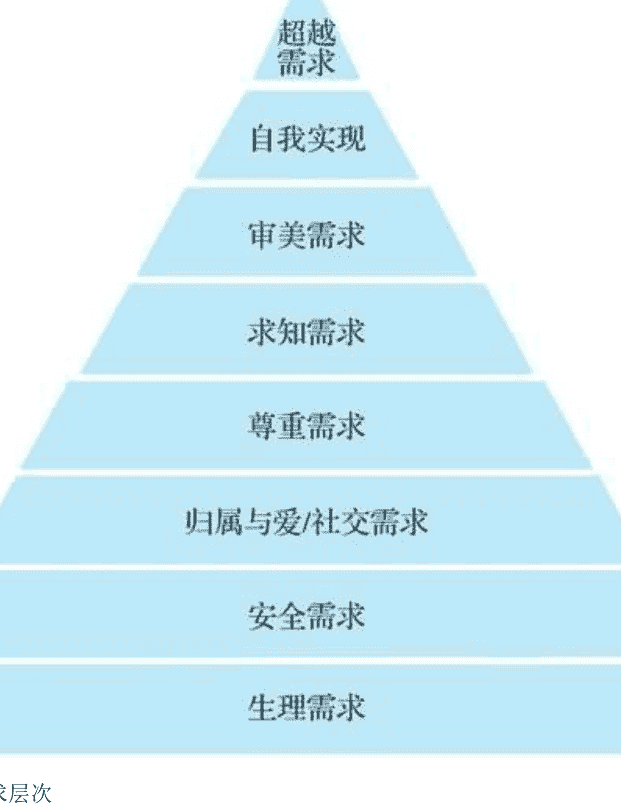

马斯洛需求层次理论提醒我们需求有优先级。商业里，需求的表现形态很多：一个吐槽、一个问题、一个解决办法。有用户反馈、有用户需求、有市场需求、有产品需求，四者不等价。

一个段子说得很透：工业包装空盒检测，用户反馈是“要用视觉测包装盒形变来判断是否空盒”，用户真实需求其实是“剔除空包装盒”，最终的产品需求可能是“装一台强力风扇吹走空盒”。反馈只是表象，需求在背后，产品需求是可执行的功能定义。

因此，收集反馈要洞察背后的真实需求，要发现用户没说出口的需求。市场需求是规模化、抽象化的用户需求，如出行需求形成出行大市场，再细分为市内、跨城等。

做产品时要警惕两类闭门造车：一是技术导向拿锤子找钉子，带着实验室DEMO找场景；二是产品经理凭想象自嗨。产品需求必须从用户、场景、市场里来。

不要做转发型产品经理，照单全收用户需求只会做出纯定制产品。好的产品经理要能合理拒绝，守住产品主线。

AI产品经理本质是需求和技术的桥梁。要把AI能力边界通俗化让用户懂，也要把业务痛点翻译成技术可解的问题，这个认知对齐过程往往漫长，需要双向学习。

最后，用8个要素把产品定义清楚，能避免早期方向模糊导致后期反复修改。

产品定义，清晰说明产品是什么、核心功能和边界，例如可表述为“一款用于某通关场景闸机上的人脸识别认证面板机”。也可以抽象化传达理念，如智能汽车被定义为懂用户的智能空间。

产品目标，短期和长期要达成的经营指标。

产品形态，形状、大小、状态等物理或数字呈现。

目标客群/用户群，买产品的人和用产品的人是谁。

应用场景，具体在什么情境下使用。

产品价值，对企业和用户分别带来什么好处。

商业模式，通过什么方式盈利。

产品路线，整体规划路径和演进节奏。

这八个维度把产品盖住，决策者、投资人、研发、客户都能快速对齐本质，少走弯路。

商品经营的核心，先看定位是否清晰。

商品是组织获取收益的重要载体，可并非每一款商品都以赚钱为唯一诉求。判断一款方案是否算成功，不能只看账面盈亏，更要看它对既定战略的贡献度有多高。所谓商品战略，其实就是企业、事业部或品线对旗下方案做的顶层谋划。拿同一件事来说，要攻占哪类市场、它在版图里是过渡型角色还是拳头型角色、主打品牌声量还是高附加值场景、切的是下沉大众还是高端人群、走单一 SKU 还是组合打包、投入算战略性资源还是只做试验性试探，这些前提必须先想清楚。战略不明，后续执行就会在取舍上频繁失焦。负责人必须对市场、业务乃至技术有很深的体感，并对演进趋势保持敏锐，目标和战略才能站得住脚。

商品的外在呈现方式与内在理念共同决定了形态，每一种形态都是向外界交付价值的最小独立单元。不同赛道的呈现差异很大，可触达的手机、汽车、机器人，也能是虚拟化的软件、在线教育课程。在互联网里常见的是 App、网页门户、小程序、软件 SDK。进入 AI 时代，形态更丰富、创新更强，大致可分两类：一类是给既有方案叠加 AI 能力后产生的形态，比如 AI 加持的软件定义摄像机；另一类是因 AI 才出现的全新形态，比如虚拟数字人、自动送餐机器人。

买方与使用者并不总重合。C 端手机这类场景中买方往往也是使用者，但在 G 端、B 端，采购方与实际操作方经常分离。买方关心划不划算，使用者关心好不好用。做方案要同时画像买方群和使用人群，关注买方的支付能力与核心诉求，关注使用者对外观、品质、功能、性能的期待，并在设计中做出权衡融合。方案要回答的是谁、在何时何地、于何种情境下会产生怎样的行为，从而嵌入到真实应用场景。深入场景能帮助负责人真正读懂需求并形成闭环。不同场景对算法的要求也不同，比如召回率与精确率就是一对跷跷板：有场景要高召回，宁可多报也不能漏；有场景要高精确，宁可漏掉也要命中准确。明确场景才能让算法更贴合。

商品是商业的载体，好的方案对团队、对使用者和买方都会产生巨大影响。价值评估是做方案的重要指南，主要从内部与外部两个维度看，即使用价值与商业价值。

使用价值指方案为使用者带来的直接收益，比如提升效率、改善体验、解决旧痛点、创造经济收益等。使用价值越高，付费意愿越强。价值不仅看整体，也可拆到模块与功能，看哪些模块高频直接解决问题，哪些仅起辅助作用，优先级就有了依据。站在使用者角度思考，才能更真实地统一需求与价值实现。

商业价值指方案为企业带来的经营价值。商品是盈利载体，只有使用价值而无法盈利，难以持续。以自动驾驶为例，它能大幅降低事故率、缓解拥堵，使用与社会价值很高，但早期激光雷达成本过高，整车投入巨大难以商业化。随后问题愈发严重，使用价值被放大，资本加速进入，技术迭代成本下降，L4 级自动驾驶才逐渐具备商业化可能。

商业模式回答方案怎样赚钱，是把各要素串联起来实现盈利的方案。通常涵盖价值主张、目标群体、分销渠道、客户关系、收入来源、核心资源、关键业务、重要伙伴、成本结构等多方面。商业模式更多从企业层面讨论，但当某个方案形成独立业务时，也可以单独定义。

路线图是多阶段的目标图谱。方案很少一步到位，需要持续迭代。业界常提最小可行方案 MVP，即早期提炼最核心特性快速入市。但不能全靠 MVP，也要有宏大愿景，路线要兼顾当下需求与未来蓝图。

8.3 AI 方案设计框架详解

8.3.1 软件设计要点详解

软件方案的设计可聚焦功能设计、结构与流程设计、交互与体验三个维度。负责人要把零散功能整合成完整方案，可从点、线、面切入：功能设计关注单点，结构与流程关注线面，交互与体验关注点线面的整体融合。

1. 功能设计

立项、方向确定后，功能设计是关键工作之一。常用模块化、使用者故事拆解需求，用原型、思维导图、图形化流程与架构表达。

模块化是将功能拆解为独立模块，各自完成特定任务。模块化让设计更清晰，在云原生微服务下利于敏捷开发与持续集成交付，部分模块可单独做使用者测试，加速落地。Scrum 中常以史诗 Epic、特征 Feature、使用者故事 Story、任务 Task等多层级管理，按需选用。

使用者故事是模拟使用者使用时要完成的操作或解决的问题。完整故事包含角色、活动、价值三要素。撰写可遵循 3C 或 INVEST 原则。3C 指卡片 Card、交谈 Conversation、确认 Confirmation。卡片用“作为一个……（角色），我想通过……（活动），便于……（价值）”描述；交谈指细节来自客户或负责人沟通；确认指验收测试确保完成。INVEST 原则为：独立性 Independent，故事间依赖少；可协商性 Negotiable，描述简短可讨论；有价值性 Valuable，对使用者、客户或公司都有价值；可评估的 Estimatable，工作量可估算；尽量小 Small，争取在一个迭代内完成；可测试的 Testable，可验证。

任务是对使用者故事的进一步细化。使用者故事对开发仍偏大时需拆任务，比如“作为管理人员，我想输入用户名密码登录系统，便于进入系统管理标注人员”，用户名密码规则、是否需要验证码等就需要拆成多个任务管理。

2. 结构与流程设计

结构与流程设计是对业务流程、方案内部逻辑关系与使用路径的整体规划，让开发理解工作项在什么环节、产生什么价值、起什么作用。最好的表达方式是画图。

统一建模语言 UML 是常用的可视化规范定义语言，是一套图形化建模规范，可帮助快速构建需求与分析材料。UML 含结构图和行为图数十种，结构图有类图、组件图、部署图、包图等，行为图有用例图、活动图、状态机图等。负责人常用类图、活动图、用例图、序列图、状态机图。除了 UML，还有思维导图、流程图、线框图、架构图等，核心是说清需求。

表达可分静态与动态。静态图表达定义、属性、结构，如功能结构图、信息结构图、系统架构图、用例图；动态图表达行为特性，如业务流程图、数据流程图、状态图。

静态图
1）功能结构图。模块化后呈现层级功能结构，以模块为核心，直观展示功能脉络，最常见的是思维导图形式，如图8-2所示。

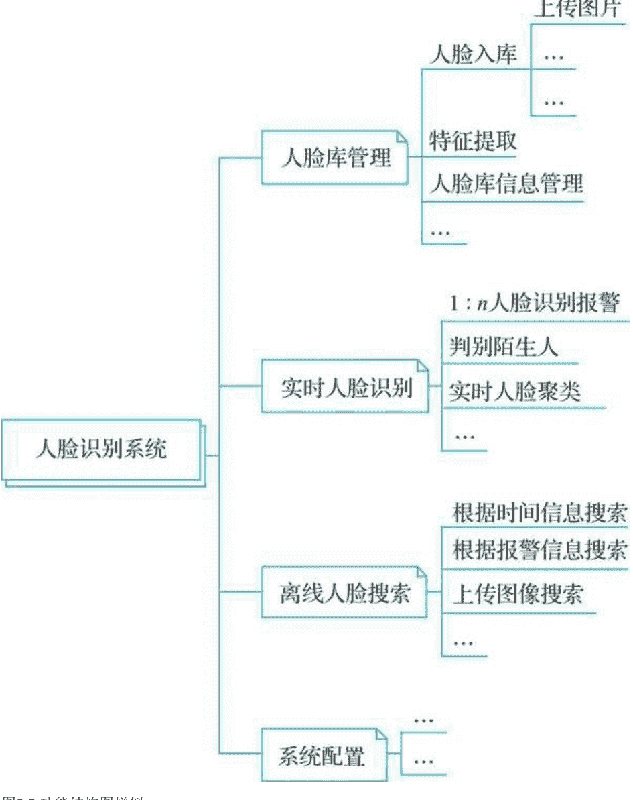
图8-2 功能结构图样例

2）信息结构图。用于抽象并重新归类方案信息，基于属性及字段归类。比如证件库为属性，下含身份证、银行卡、社保卡等字段；身份证再细分姓名、出生年月、身份证号、所在地、有效期、照片等，逐级展开形成完整结构，如图8-3所示。

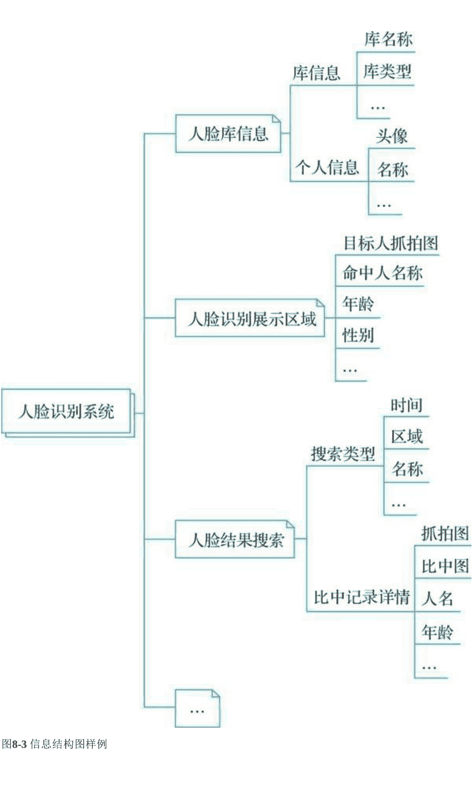

3）系统架构图。对系统按某种视角构建的模块化、层次化结构，包含逻辑实体与层次关系。视角包括物理、功能逻辑、技术组件。负责人通常对外提供物理视角和功能逻辑视角的系统架构图，如图8-4和图8-5所示。

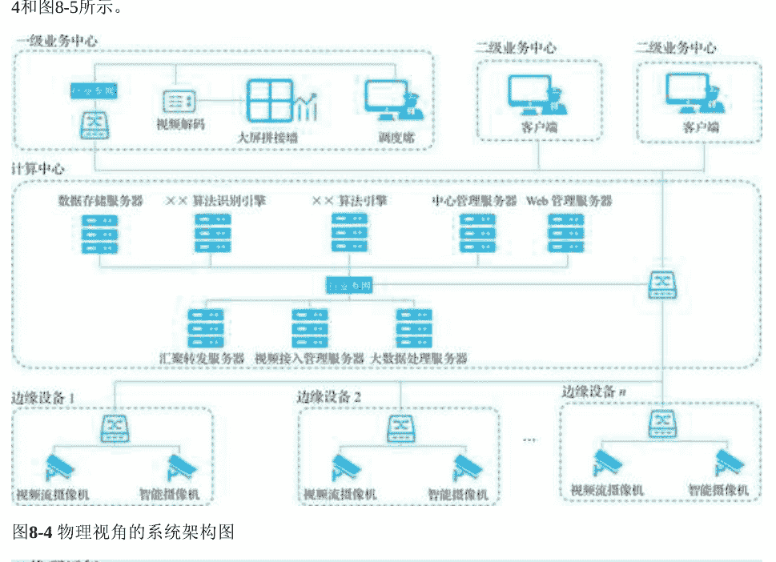

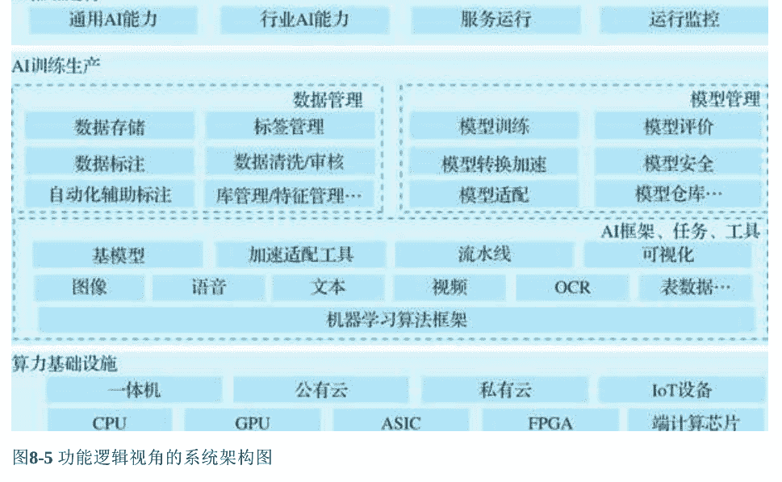

动态图——业务流程图
动态图包括业务流程图、数据流程图。流程图表达行为先后顺序与依赖，可提升表达清晰度与沟通效率。

业务流程图是使用者完成一件事情所需规章、程序或先后顺序的图形化表达。绘制要点关注业务内容、使用者、信息起止、异常处理、规范五方面。业务内容指要完成什么；使用者指谁来操作；信息起止指输入输出起点终点；异常处理指特殊情况；规范指可读性。

流程复杂且涉及多角色时可用泳道图，纵向为流程，横向为角色泳道，流程中该角色信息绘制在对应泳道，需理清角色边界。泳道图示例如图8-6所示。

3. 交互与体验

交互与体验设计可从战略层、范围层、结构层、框架层、表现层自顶向下规划，见图8-7。

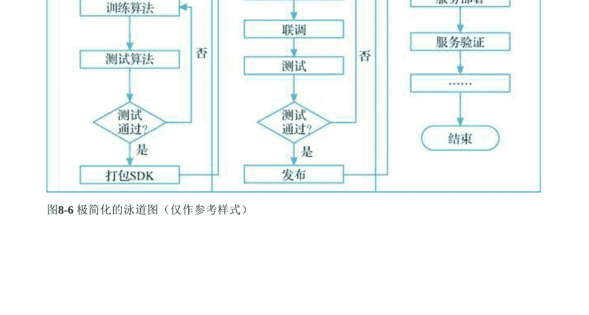

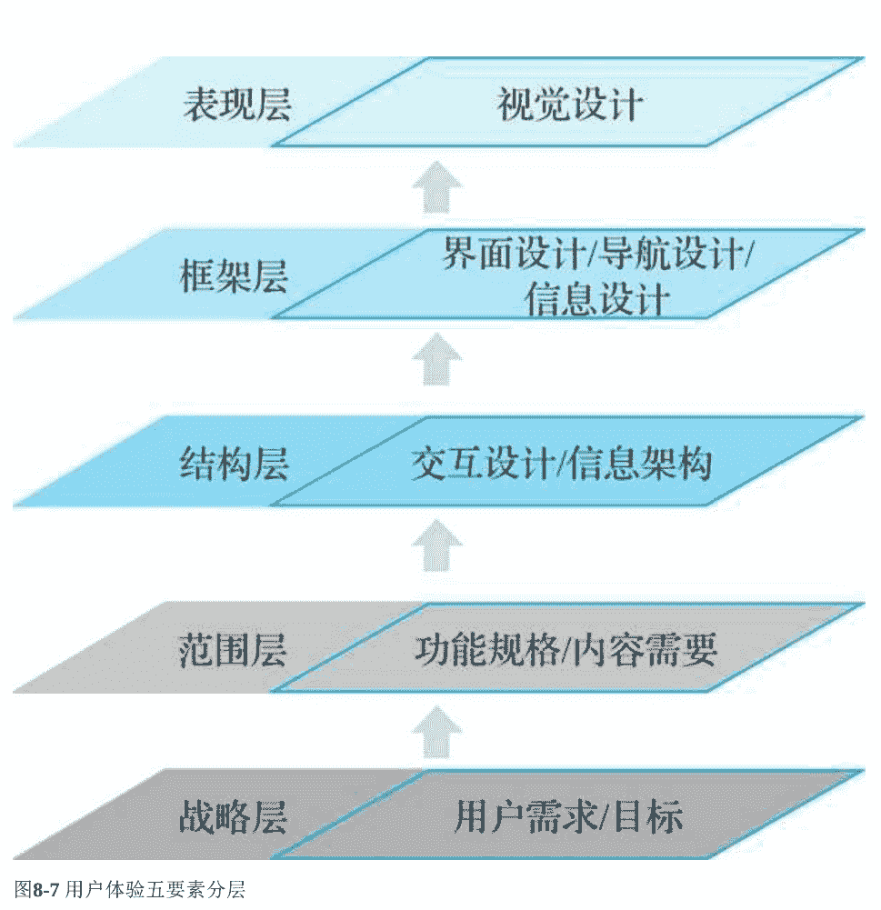
图8-7 用户体验五要素分层

1）战略层：解决方案目标与使用者需求问题。不同目标与对象在结构与风格上差异巨大，要明确场景、使用对象、核心诉求。

2）范围层：解决需求与功能边界问题。长期看方案可解决很多问题，但为商业化需划定当前边界。限定版本与范围后，设计上需取舍。

3）结构层：关注交互设计与信息架构。交互设计关注使用者行为及响应，信息架构关注信息呈现是否合理、如何组织。好结构能缩短触达路径，降低学习成本。

4）框架层：比结构层更细化的具体设计，包括界面设计、导航设计、信息设计。界面设计要让使用者快速看到关键元素，淡化次要元素；导航设计在功能丰富时帮助页面跳转；信息设计关注使用者想触达的内容。初始阶段常用线框图快速表达页面框架。

做原型是负责人重要工作。收集需求后需转化为方案需求与可视化原型。原型做到什么程度要看资源。在大企业，有交互、视觉设计师，负责人关注业务需求、流程与功能逻辑，用朴素线框图表达即可。中型企业因配置不全，原型可能由负责人全包，颗粒度会粗一些。小团队可能手绘口述传递需求，效率高但不利记录追溯与同步。对内表达应从框架、功能模块与核心意图展开，人手不足时可用线框图突出解决问题的能力与使用者价值，不在弱价值的交互细节上过度投入。人手充足时可把原型详细化、美观化。

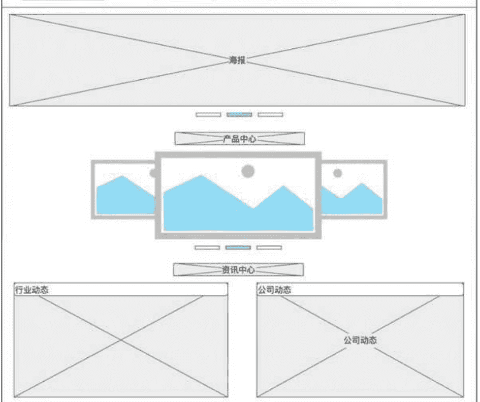
图8-8 线框图

5）表现层：对功能、内容、交互、视觉汇总后的最终设计，集中体现前四层信息，更注重交互与视觉呈现。

8.3.2 硬件设计要点详解

AI 方案做智能硬件比纯软件复杂得多。一是含软硬件两部分，技术栈需扩展；二是形态多样，芯片、计算加速卡、边缘计算终端、智能相机、无人机、服务器、智能穿戴、自动驾驶汽车、辅助驾驶设备等；三是生产周期更长、难度更大。共通流程包括工业设计、结构设计、开模、芯片选型、PCB 方案设计、整机验证、包装设计与生产、验证测试认证、方案内测、备料、小批量试产、大批量生产。

1. 工业设计

工业设计融合工学、美学、经济学，追求可行性、外观、经济性、安全性的平衡。

可行性：开模、内部装配电路板的可行性，形态与内部空间是否容纳芯片模组与电路板，是否满足散热。

外观：满足审美与操作习惯，硬件交互部件如按钮需符合人类习惯。

经济性：用料成本与制造难度，过高成本不利于竞争力；心理经济性也重要，比如伴读机器人占用半张桌子，使用者会觉得不经济。

安全性：充分考虑安全隐患，避免导致方案失败。

工业设计通常由工业设计师完成，外包常见。负责人需把关功能属性、可行性、外观、经济性、安全性。

2. 结构设计

结构设计是对芯片、PCBA、散热装置等内部模块的整体设计，并兼顾外部工业设计与内部配置。需考虑坚韧程度、组装与脱模难度，若有运动部件，还要考虑灵活性、稳定性、安全性。

做硬件从来不是画完图就完事，从结构到交付，每一步都要踩实。

结构打样是成型的第一道关口。设计完成之后必须先做实物验证，最起码要把内部模组拼装起来跑一遍。拿高算力设备来说，散热就是一道生死线。结构上的小偏差就可能导致散热不达标，触发过热保护后，性能直接被锁死，连标称指标都摸不到。

PCBA设计与选型
PCBA就是把PCB和元器件组装好的成品，可以理解为产品的“大脑”。PCB需要专业工程师来画板，元器件也需要专业选型。多数公司没有把PCBA作为战略投入时，都会采用成熟方案，或者把除核心模组之外的接口板交给外部代工。也就是说设计和生产常常是外包协同。

对产品经理而言，选型就是PCBA环节的核心。选型要兼顾目标使用场景、成本预算、算力水平、网络能力、存储规模、解码需求、输入输出接口、功耗表现与散热余量，这些因素直接决定了整机的功能边界与性能表现。

在AI产品里，PCBA的心脏是AI计算芯片。方案很多：带神经网络加速的SoC，也有多芯片异构组合如CPU+GPU/NPU/FPGA。产品经理需要权衡算力、功耗、工具链成熟度以及开发成本。接口则决定了机器能接什么、能怎么用。USB、HDMI、GPIO、PCI-E只是常见例子。小型设备即使芯片模组支持更多接口，是否扩充接口板也需要结合场景做取舍。

OEM与ODM怎么选
很多互联网公司和创业团队想把软件能力硬件化，集成度上去后产品价值感也会提升。但软硬件一体化的门槛与成本远高于纯软件。即便团队规模不小，综合市场窗口、成本和周期，也很少有人从零自研硬件，通常会走OEM或ODM路线来提速。

OEM的意思是需求方A提供产品设计，授权受托方B按约定条件生产。A出设计、B做制造、A负责销售。B就是原始设备制造商，角色是代工。

ODM则是A只提出需求，B从设计、研发到生产、维护全流程承担，最后贴上A的品牌由A出售。可以说OEM只把制造环节外包，ODM把设计研发制造一起外包。对起步做硬件的团队来说，两条路都能加快迭代、少走弯路。但无论选择哪一种，硬件产品经理在需求定义、验证测试上的工作不会少，必须和外包团队保持紧密沟通，确保最终交付与预期一致。

包装与配件，最后一公里
包装和配件是硬件交付的收尾，也是用户第一眼的体验。包装要考虑美观、运输与存放时的防护性能、说明书的清晰度，以及成本。其中防护是重点，精密产品必须设计好内部防撞缓冲，避免在物流和仓储环节受损。

配件决定了开箱体验。为了让用户即拆即用，减少自行采购工具和辅助件的麻烦，绝大多数硬件会标配各类小工具。配件的制造与配套成本同样要纳入考量。

整体性能设计要点详解
性能是衡量功能是否“够好”的标尺。功能解决有没有的问题，性能解决好不好。打开文件是功能，打开速度是性能；能识别人脸是功能，识别速度与识别准确度才是性能。常见性能维度包括速度、精度、功耗、稳定性。

速度是最直观的指标。网络传输速度、文件读写速度、算法处理速度、特征提取速度、搜索速度等都会影响应用成本，通常速度越快综合成本越低。AI场景里常关注解码速度、时延、系统算法吞吐量、特征搜索速度。速度评价必须带前提条件，要结合真实业务场景提出。在人脸识别的高实时场景中，重点看限定人数库规模下的识别时延。时延与节拍直接决定通行效率，是否能扛住大客流。

精度是算法类产品的生命线。图像识别常用召回率与精准率，语音识别看唤醒率与词句错误率，地图类产品看定位精度与路线规划偏差。精度反映多次重复操作的正确率，通常用统计方法评估。召回率衡量检全能力，精准率衡量检准能力，两者结合才能完整评价。不同场景对指标的侧重点也不同。

功耗反映绿色与持续使用成本。对充电类产品，功耗决定续航时长与使用频率，甚至决定能否在某些场景落地。功耗过大还会引发过热。芯片级别要细分动态功耗与静态功耗。动态功耗是设备工作或信号变化时消耗，静态功耗是上电待机时消耗。手机的待机时长与使用时长本质上就是芯片功耗决定的。

稳定性是基础。产品必须能持续稳定运行，否则功能再强也不可用。稳定性一般在标准压力或峰值流量的80%以上压力下测算。先确认系统没有内存泄漏等致命问题，再有针对性地评估。稳定性可按天、周、月、年分级测算，对应不同的测试标准。

安全性与AI伦理
安全性常被忽略却至关重要，分为外力安全与软件安全。外力安全指在雨水、雷击、跌落、高低温、潮湿等环境下的可靠性，主要在硬件层面体现。软件安全则因联网而存在被攻击风险，需要关注代码组件漏洞、隐私保护与数据安全。

数据安全。产品涉及隐私和敏感数据时，必须合法合规。2021年6月《中华人民共和国数据安全法》正式颁布，2021年9月1日起施行，对境内数据处理活动进行监管。产品经理应在设计初期就把合规性纳入数据处理流程，避免因不合规导致项目失败。

代码漏洞。大量软件依赖开源组件，开发提速的同时也带来安全隐患。开源社区持续修复漏洞，若产品未能及时更新就会留后门。很多产品经理只盯功能，交付前漏洞扫描才发现问题，严重时无法交付只能返工。安全需要产品经理与开发经理共担。产品经理要提前对应用场景进行安全等级预判并提出需求，开发经理要在技术评审阶段就评估组件安全性。设计阶段通过需求与技术评审预防漏洞，代码完成后要做安全扫描。

加密与授权。加密分为内部通信与数据处理的加密，以及对产品整体的加密以防盗版。市场化产品往往需要授权机制，既保护代码与知识产权，也为商业模式提供灵活性，如分模块、分属性授权提高销售弹性。从理论上，任何加密在付出代价后都可能被破解，但当破解成本远高于购买成本时，保护就是有效的。

加密设计关注三点：算法、形式、激活方式。对称加密如ASE、非对称加密如RSA，位数越高安全性越高。部分企业会对算法做安全评级。加密形式分硬件如加密狗、加密锁，和软件如绑定硬件指纹的软狗。硬件更安全，但在云和虚拟化环境中难以实现。授权激活可采用离线激活、在线激活、私网中心化激活等，具体方案要结合应用场景定制。

知识产权。AI时代企业对专利等保护意识增强，软件著作权、发明专利、实用新型专利、外观专利、权威认证等都能提升竞争力，尤其在资质要求高的项目中作用明显。

AI算法攻击。人脸算法被特定贴纸干扰、活体检测被攻击、GAN生成伪造内容等都是现实威胁。产品经理要评估被攻击的可能性与难度。除了提升算法，也可在需求调研阶段就把对抗攻击作为需求提出，降低失效风险。

AI伦理。2021年9月科技部发布《新一代人工智能伦理规范》，要求把伦理道德融入AI全生命周期，为自然人、法人和其他机构提供指引。规范提出增进人类福祉、促进公平公正、保护隐私安全、确保可控可信、强化责任担当、提升伦理素养6项基本要求，以及针对管理、研发、供应、使用的18项具体要求。越来越多的企业设立AI伦理审查部门，产品经理仍需主动关注规范，提前排查伦理风险。

产品需求流转与评审
需求管理是产品经理的核心工作之一。需求从提出到落地需要收集、管理、评审、排期、验收等环节。

真实有效的一线需求往往来自项目。B端、G端通过项目深度理解客户业务，先在项目中验证再规模化推广是常见打法。竞品也是重要来源。优秀竞品经市场打磨后，借鉴其解法能少走弯路，同时在招投标中避免指标落后。领先后，还可基于对场景的深刻理解，自发提出创新方案，用新技术、新商业模式解决痛点。AI商业化时间短，常常需要产品经理深入行业发现真实问题并给出解法。

需求管理看四个维度：紧急程度、可行性、重要性、优先级。项目需求通常更紧急，竞品或自发需求节奏相对可控。可行性包括经济、技术、法律伦理安全等多方面。重要性看是否符合战略、是否决定项目成败、是否带来显著收益。优先级是在前三者基础上做排序决策。特别紧急且重要的需求要快速响应，普通需求按共性与战略意义排队，完全不可行的需求要尽早过滤。

面对海量需求，需求池是利器。把用户需求统一汇总，按定义、详细内容、时间、重要性、来源、类型、状态等进行管理。从需求池筛选需求支撑版本迭代。需求池能反映需求出现的频率与强度，同一需求多客户重复出现就值得重视。并非所有需求都要立刻响应，也不是都要放在同一版本，统一管理与跟踪是关键。

需求池中的需求要经评审后转化为开发需求。评审是达成共识的环节，无论瀑布还是敏捷都需要。

评审要点有五方面。组织形式上，非即时邮件评审成本低但交流差；双人结对评审适合一对一；多人会议评审交流充分但容易超时，需提前预审并抛出问题。评审内容上，从0到1阶段要覆盖立项计划、产品规划、需求、技术架构、测试用例等。不同阶段评审对象不同：规划阶段看商业需求文档与规划书，需求阶段看需求文档，排期阶段看排期表。评审时机应充分准备，可分阶段分模块进行，具备解耦条件时可灵活调整。评审人员是需求干系人，可分为同级跨职能评审与跨级评审，后者涉及战略与技术多视角。评审目标最重要，目标明确才能聚焦，否则容易因细节陷入僵局。目标清晰后可把无异议需求快速通过，集中讨论争议点。

瀑布模式下评审更集中。瀑布采用集中需求分析与设计，设计完再做架构、开发、测试，环节阻塞会拖慢整体。需求评审一般在需求阶段末期进行，主要形式有需求里程碑评审，面向管理与执行层评估技术价值与方向；同级跨职能需求评审，针对细节在技术可行性与价值上评估，需求量大时可拆模块评审。

在做软件需求评审这件事上，瀑布和敏捷给出了两种截然不同的体验。

瀑布模式下，评审会很容易滑向两个极端。一种是走流程，领导、各部门代表都到场，抱着几十页需求文档要两小时内定案，为了冲出一个通过的结论，大家只能草草扫一眼，会议名存实亡。另一种是绕不完，需求量大、职能口多、每个口都有发言权，讨论一摊开就失控，两个小时只抠了几处，还有几十个点几十页材料没碰到，只能再约时间再开场，规模越大成本越高，最后成为项目拖累。

换到敏捷，特别是Scrum的做法，评审的逻辑就被拆散了。产品待办列表Backlog由产品负责人掌控，他既是需求的收集者也是评审的拍板人。整体评审被弱化，变成围绕迭代Sprint的节奏在走。

表8-3 敏捷开发模式下的需求评审内容

| 序号 | 形式 | 内容 |
| :--- | :--- | :--- |
| 1 | Sprint 计划会 | 每2～4周召开一次，针对已拆解的产品待办列表，基于价值、团队人力情况、产品延续迭代等因素综合考虑优先级，从而排出 Sprint 的待办列表 |
| 2 | 每日站会 | 关注每个成员的需求完成情况、待办事项、存在的问题 |
| 3 | Sprint 评审会 | 在 Sprint 迭代完成时演示新功能或增量内容 |
| 4 | Sprint 回顾会 | 复盘总结上一次迭代的经验教训 |

这样把集中评审分散到计划会、站会、评审会和回顾会里，效率明显提升。但代价是产品负责人对需求和技术实现都必须有足够深的理解，否则决策权集中在他一人手里会失灵。

### 需求排期：别让计划自己失效

产品开发要先定里程碑、版本周期和发布时间，再细化成可执行的排期。现实里最常见的坑是前期工作量估不准，导致计划反复改，承诺作废。没有给突发需求、意外任务留缓冲，延期是常态。估算时既不能神化个人能力，也不能无限留时间，前者必然延期，后者会让执行松散。

排期通常是产品经理先抛里程碑和节点，项目经理和开发经理一起细化，再由所有干系方一起拍板。产品经理要思考怎么组合需求在最短时间里做出一个最小可用、能独立售卖的版本；开发经理要对照人力、技术是否在时间线上可行；项目经理则要协调人力、算力、数据等资源。小型团队里这几个角色经常合一。

对AI产品而言，资源里还多了算力、数据、标注。排期必须把目标、工期、资源三件事拧在一起，同时预判依赖带来的失效风险，保证资源充足且被高效利用，哪怕外部干扰也能按期交付既定版本。

### 需求验收：三道门别漏

需求验收是需求生命周期的收口，协同开发越细，信息在传递中损耗的概率越大。验收就是为了确保最终实现和最初设想一致。它要看功能、性能、安全、稳定性和运行环境，基本分三层：

- 测试人员把关质量。把需求转成测试用例，从功能到性能稳定等多维度压测。
- 产品经理做使用把关。作为需求对接人，他最清楚价值点，适合从解决用户问题的角度体验。
- 客户侧最终验收。如果前两层做扎实，最后这一关通常会很顺。

验收形式多样，有演示确认，也有直接上手用。模式不同做法也不同。

瀑布模式通常等模块全部完工联调后再验，容易出现工程实现与原始意图偏差很大。敏捷则走向过程化验收，Scrum评审会上演示迭代成果就是一次阶段性验收，通过就继续，不通过就回流到下一个Sprint的待办。这种方式能把偏差扼杀在早期，虽然增加了工作量，却是更稳妥的协作习惯。

### AI产品的三层阶梯

随着产品规模化、社会分工加深，做一个闭环AI产品越来越复杂。自动驾驶汽车比传统汽车多了一条智能化、联网化、电动化的协作链，涉及芯片、软件、路侧、充电等全链路。

AI天然依赖海量数据挖掘价值，需要算力、数据、网络、设备等多载体配合。产业协作下，AI产品也形成了上下游层级。

从商业化路径看，AI走过算法→平台→业务的三段路。早期只有算法，卖SDK的小作坊居多；场景推广后需要规模化生产，平台型产品出现；再深入场景，AI与业务边界模糊，形成深度嵌入行业的系统化产品。于是可以用算法、平台、业务三个层级来理解AI产品和企业。

# 第9章 算法类AI产品落地详解

AI产业起步时，算法就是核心能力，也是最小可售卖的单元，可被行业系统集成。商业模式不算轻松，但这是商业化的第一步。随着形态丰富，算法哪怕只是一个零件，也是决定成败的零件。深度学习框架下，算法质量决定下游全链路成败，所以必须从需求、任务、生产、评估全环节把控。

一个深度学习算法模型通常要经历任务定义、数据工程、模型训练、模型加速与适配、模型评价。

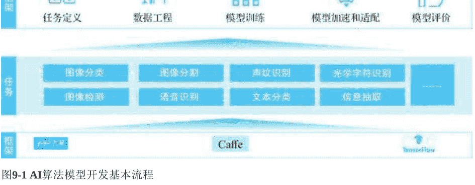

## 9.1 任务定义——真实需求与目标的锚点

任务定义是模型开发的第一环，直接影响模型精度。必须由AI产品经理和算法人员一起完成。

### 9.1.1 明确算法需求

AI产品经理在任务定义中是桥梁。业务规则客观存在且会直接影响算法实现。以交通场景识别车辆是否压线为例，有的城市压实线即罚，有的城市要实线变道才罚，业务差异会让算法内部逻辑完全不同。

产品经理要站在算法角度拆解客户需求。交互需求之外，必须对算法需求追根究底，最关键的是根据需求把任务和类别界定清楚。很多任务最终会变成分类或回归。

分类任务必须把归属条件说死。客户的口语描述往往不够完整，需要反复深挖。抽烟识别看似二分类，实际细节极多：电子烟算不算？电子烟挂在身上被拍到算不算？背对镜头吞云吐雾看不到烟头怎么办？冬天呼吸白气会不会误报，客户能接受到什么程度？拿着没点燃的烟算不算？细节不抠清楚，模型就没法训练。

还要关注边界争议。简单任务边界清晰，比如猫狗区分。但很多任务边界模糊，比如车辆颜色。灰色和白色怎么分？不同光照、沾灰的白色车会不会被判成灰色？界定不清直接拖累识别结果。任务和分类标准在开发早期就定好，是精度保障的关键。

### 9.1.2 用样例描述算法需求

拿到客户的文字需求只是开始，客户往往不了解场景复杂度。产品经理需要配合大量数据样本，和算法研究员一起理清功能边界、任务定义、类别定义，并整理成完整的任务定义、类别定义样例图。早期就能校准方向，避免因定义模糊导致返工。

从产品需求文档到算法需求描述，需要用更严谨的语言把任务定义、分类定义、应用场景、识别边界、正负样例、混淆样本划分规则等写清楚，类似标注说明文档。早期这些工作常被算法工程师包办，导致上线后反复调优。

比如狮虎分类。狮子就有非洲狮、美洲狮等多个品种，内部差异不小，还存在虎狮兽、狮虎兽这类混淆样本。任务做精细时必须列出更多子类别并详细描述。

表9-1 狮子和老虎分类任务的定义

| 一级分类 | 二级分类 | 定义描述 | 样例 |
| :--- | :--- | :--- | :--- |
| 狮子 | 非洲狮 | ... |  |
| | 美洲狮 | ... |  |
| | ... | ... | |
| 老虎 | 东北虎 | ... |  |
| | ... | ... | ... |
| 其他 | 狮虎兽 | ... | ... |
| | 虎狮兽 | ... | ... |

语音和自然语言同样如此，需要提前确认样本。需求阶段就把样本定下来，后面才不会手忙脚乱。

## 9.2 数据工程——用数据划清功能边界

数据、算法、算力是AI的铁三角。数据是燃料。尽管小样本、迁移学习、半监督、无监督都有进展，想追求高精度和强泛化，深度学习仍是主流，而它对大规模数据训练有刚性需求。大规模标注仍是模型开发的核心环节，也是数据工程的重要一环。

数据工程通常包括采集、生成、预处理、标注、清洗和质检。

### 9.2.1 数据采集

采集是第一步，源头数据质量直接决定模型上限。模糊、噪声大的数据，哪怕标注再准，模型也上不去。巧妇难为无米之炊，数据获取往往是成败关键，产品经理还需权衡成本、渠道和安全。

获取成本上，高质量数据的采集成本远低于后期花大量时间做预处理。低质量数据会引入额外研究课题，算法同学要花时间做分辨率提升、验证效果等，成本不可估量。能直接拿到好数据就不要将就。

渠道因任务而异。图像或动物识别类数据可通过互联网爬取；涉密数据需客户侧提供，迭代周期会拉长；有学术研究基础的任务可用公开数据集冷启动；购买数据和众包也是常见路径。

隐私安全是全流程最大挑战。数据流转频繁，必须高度重视合规和保密。

### 9.2.2 数据标注

按模态分，常见标注有图像、语音、文本。图像标注包括拉框、标签分类、关键点、语义分割、3D点云；语音标注包括说话人、内容、分段、语种；文本标注包括分类、情感、词性、实体命名等。

1）拉框就是定位感兴趣区域ROI并框出，不同标签区分类型，比如人脸、帽子等。
2）标签分类是给图片贴标签。二分类判断目标是否存在，多分类区分多种类别。单标签一张图一个标签，多标签一张图多个标签。单任务只标一类信息，多任务同批图片同时标注动物和场景。
3）语义分割是像素级划分并分类。
4）关键点标注是在对象上打点，人脸关键点常指眉眼鼻嘴及轮廓。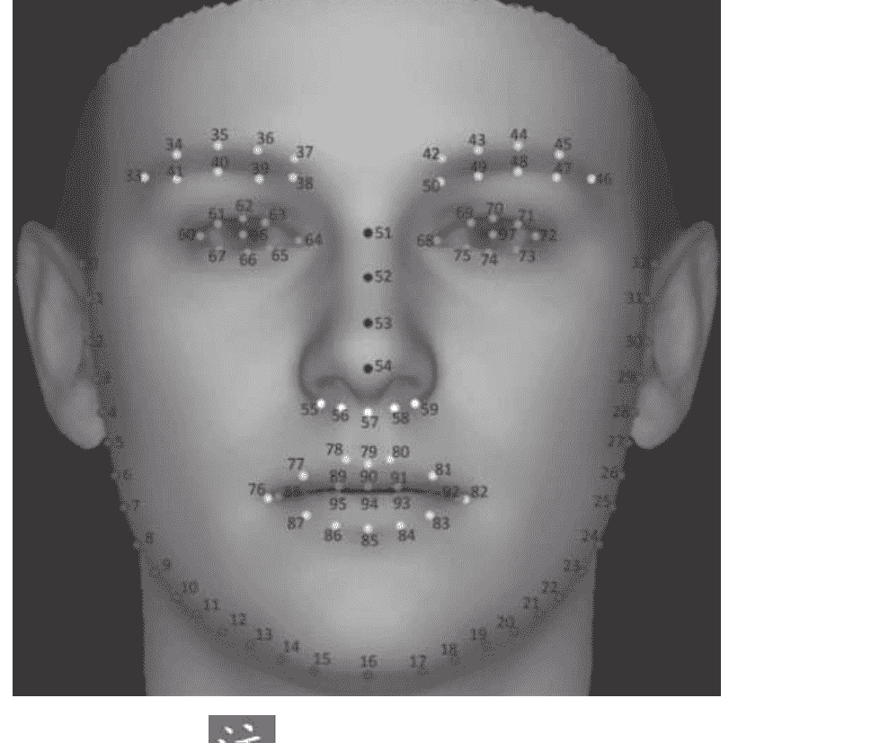 应用很广，如人脸矫正、姿势判断、表情识别、疲劳检测。
5）3D数据来自激光雷达或深度相机，用于自动驾驶、机器人、工业质检等。典型应用是3D形状分类、对象检测跟踪、点云分割。3D点云检测需要标注长宽高和方向等信息。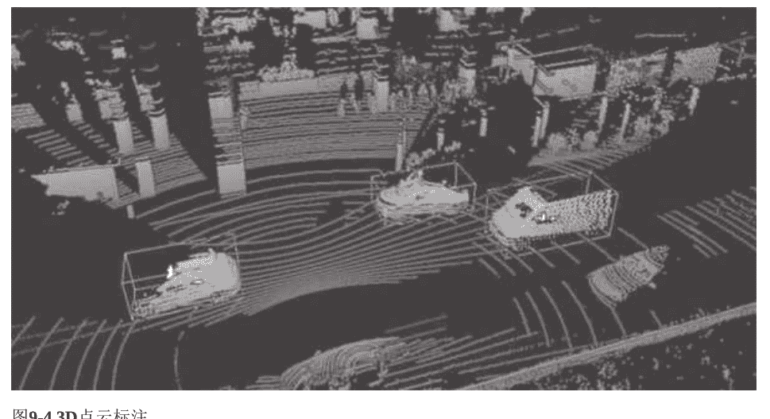
6）语音识别标注要标说话人、内容，还要分段。
7）NLP标注任务多样，翻译、词性、文本类型、情感、实体命名等都需要明确标注。

### 9.2.3 数据生成

当采集标注跟不上时，数据生成可以补位。简单生成是对已有标注数据做变换，如加噪、风格迁移，提升数据扰动性，降低过拟合，常直接嵌在训练流程里。复杂生成则用深度生成对抗网络等合成数据，再用真实数据迁移到实际场景，适合长尾、稀缺场景，例如用游戏画面模拟极端路况给自动驾驶做训练。

自监督预训练模型近年效果突出，其训练数据大量来自生成方式，比如时序语义关联、完形填空式遮掩恢复等。虽然这些数据与下游业务无直接关联，却为基础模型提供了强学习能力。

当虚拟化技术和元宇宙浪潮叠加在第二种数据获取思路之上，渲染、仿真能力被带入加速通道，虚拟场景的真实感逼近现实。于是团队开始直接在虚拟环境里批量制造数据，并把这些合成素材投放到真实业务里去用，比如自动驾驶的路测就大量依赖模拟场景生成的数据，帮助模型暴露出平时难以触达的风险盲区。

## 9.3 算法生产——把最小可用的AI产品做出来

### 9.3.1 训练模型
要跟算法研究员对上话，先把模型开发里常用的概念捋清楚，当前的主流实现基本都落在深度学习范式上。

1）算法框架：从业者都绕不开的底层支撑平台，比如Caffe、TensorFlow、PyTorch、PaddlePaddle等。它们提供了一整套基础算子库、训练工具和可视化链路，让算法开发有地基可依。

2）算子/操作：在深度神经网络里，算子就是一次运算。图像里最典型的卷积算子，就是用一个核矩阵去对像素数值做滑动计算。搭建网络时常用的积木包括激活算子如Relu、Sigmoid、Prelu，归一化算子如BatchNorm，下采样用的池化算子，以及分类用的Softmax算子。所有这些基础OP组合起来才构成可训练的网络。

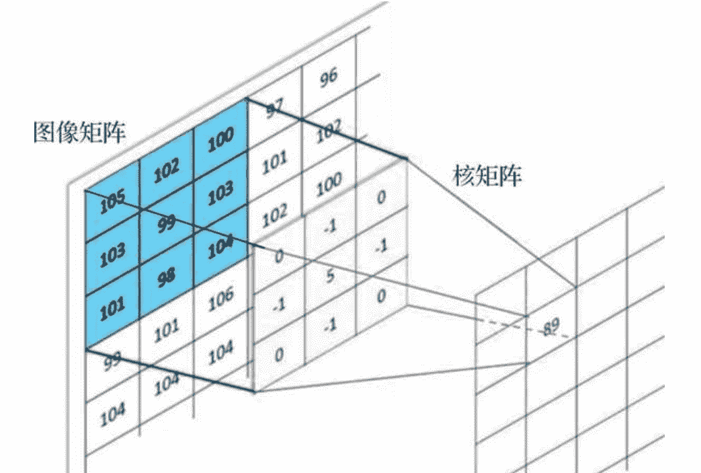

3）网络结构：AI产品里最常见的是神经网络，本质是把神经元串联成输入—多层处理—输出的通路。不同结构对特征的学习能力差异很大，设计出表征能力更强的结构，是提升识别精度的关键。

4）主干网络（Backbone）：深度学习发展多年，已经沉淀出一批被反复验证的主干，比如Googlenet、ResNet、ResNeXt、MobileNet等，它们在工程落地中被大量复用，新的研究也常在此基础上探索。

5）参数：网络本质上是一组数学公式，例如 $ax + bx^2 + cx^3 = y$。训练时，$x$ 是业务里喂进去的数据，$y$ 是标注结果，而 $a$、$b$、$c$ 则是需要模型学习的参数。训练就是在找一组能最好拟合业务数据的解。

6）超参数：可以理解为学习策略，比如“学一小时歇十分钟”，或是训练卡在局部最优时提供跳出的手段。这些通过配置来决定，例如初始化方式、参数更新的优化器如随机梯度下降等。

7）模型：训练收敛后得到的就是带参数的网络结构，通常叫模型，如Caffe的caffemodel、PyTorch的pth文件。本质上是带常数的公式，比如训练完变成 $2x + 3x^2 + x^3 = y$。给它一个输入 $x=1$，就能输出 $y=6$，类比就是输入一张图输出“猫”。

8）流水线（Pipeline）：真实业务往往不是单模型能解决的，比如判断路口是否闯红灯，需要同时识别车辆、信号灯、标线。每个子任务由独立模型完成，再把它们串起来就是算法架构。设计时要兼顾精度、性能和未来扩展。同一张图未来可能还要扩展实线变道识别，车辆、标线等模块可复用，信号灯模块则更专属，这就需要按需组合成不同的业务流水线。


用做菜来打比方更直观：训练框架是厨房，算子是厨具和调料，网络结构是食谱，主干网络是公认好吃健康的标准食谱，参数是原材料，超参数是做法和火候，数据是燃料，模型是出锅的菜，流水线则是把多个小菜烹饪后再组合成一道大菜的流程。

### 9.3.2 加速模型
开源框架训出来的模型精度往往最高，但推理速度未必理想。业务对时延有硬性要求，算法侧就需要在精度达标前提下提速，以提升产品竞争力。

模型本质是二进制结构加参数，不同框架产出的模型格式各异。推理时某些结构会带来额外计算损耗，可以做结构级优化。主流推理硬件厂商都提供了优化工具链，比如NVIDIA的TensorRT、Intel的OpenVINO，本质是通过解析模型做结构优化、统一格式、方便集成。

以TensorRT为例，常规流程分三步——解析、优化、执行。解析阶段把PyTorch、MXNet等开源模型转成TensorRT可识别的格式如Caffe、ONNX并解析；优化阶段剔除冗余结构、合并可合并算子并生成引擎；执行阶段对序列化结果做反序列化和推理。

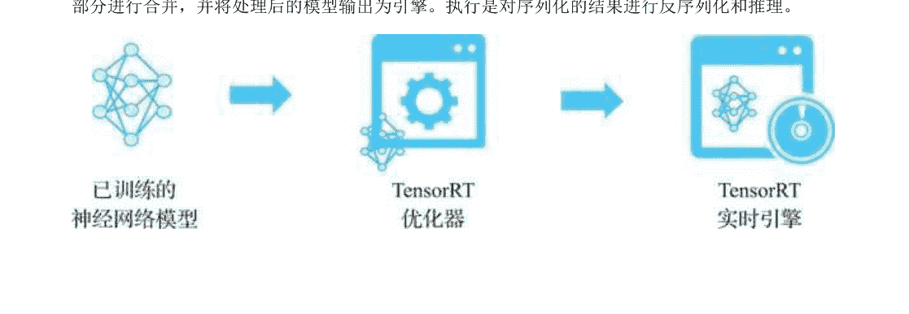

神经网络参数量大、计算重、速度慢，一方面靠算力提升，另一方面靠量化。量化就是把连续取值近似成有限离散值的一种压缩手段。模型量化主要针对参数，以前常用FP32，现在常压缩到FP16或INT8。常见做法有：

1）直接把浮点转成量化数，精度损失较大。
2）基于数据校准，用真实数据做精度校准。
3）基于重训练微调，精度保障最好。

前两种属于离线，后一种属于在线。若离线已能兼顾精度与速度就优先离线；若精度跌幅过大，则改用在线微调保住效果。

### 9.3.3 跨硬件平台适配
模型转换和量化离不开成熟的工具链，很多操作在NVIDIA GPU等平台上完成。随着AI芯片厂商增多，华为Atlas、寒武纪MLU等产品丰富了选择，也带来更大的适配工作量。

硬件适配就是把模型和算法SDK移植到特定芯片上，让它能跑且跑得快。边缘场景通常只做推理，把在GPU上训好的模型迁移到边缘AI芯片，需要按硬件支持的格式转换并用平台工具链加速，代码也需重新编译。

深度学习框架仍在演进，硬件支持总有滞后，新芯片在新算子、工具链成熟度上需要大量投入才能追上老牌平台。选型时除了算力、功耗、价格，还必须算上适配成本。

## 9.4 算法评估——摸清算法能力边界

对AI产品而言，算法指标是产品指标的核心。产品经理需要客观全面地评估算法，输出能力边界和参数指标，支撑商业化。

### 9.4.1 两种评估方法
评估一般从功能、速度、精度三维度入手。功能看有没有，速度和精度决定可行性和性价比。常用定量和定性两种方式。

#### 1. 定量评估
通过客观指标计算，比如把标注数据和推理结果对比算出精确率、召回率等。优点是客观可比，前提是测试集足够科学。但搭建测试集工程量不小。

建测试集要考虑：

| 考量项 | 说明 |
|---|---|
| 样本数量 | 数量要达到统计意义 |
| 样本比例 | 各类别比例均衡且贴近真实分布 |
| 样本真实性 | 须代表真实应用场景 |
| 样本丰富度 | 多样性越强泛化意义越大 |
| 样本与训练集的差异 | 差异过大或过小都会干扰评估 |

#### 2. 定性评估
靠人工直观判断，比如肉眼看图是否识别正确。效率低、不利于批量统计召回率，但能快速定位问题原因。

实践中两者结合：定量给宏观结果，定性做问题剖析。

### 9.4.2 视图识别的精度指标
精度即检测识别的准确程度。分为基础概念、基础指标、二级指标三层。

#### 1. 基础概念
包括度量基准、测试集、真实值、预测值、置信度、阈值、正负样本、TP/TN/FP/FN、混淆矩阵。

1）度量基准（Benchmark）：评估规则和标准，核心是测试集。
2）测试集：用于测精度和性能的数据集，含原始数据和标注。
```
Cat1.jpg 30,30,90,90 0
Dog1.jpg 80,82,131,121 1
```
3）真实值（Ground Truth）：人工标注的判定结果，是对比依据。
4）预测值：模型推理后的判定结果。
5）置信度：判定结论的概率式中间结果，如二分类输出0.8139和0.1861，取较大者为置信度。
6）阈值：对置信度的判定门槛。例如紫红色图51%红49%紫，若阈值提到90%，结论会更稳。人脸识别里相似度超过阈值才判同人。
7）正样本和负样本：二分类中关注类别为正，其余为负。如人脸检测，有脸为正，无脸为负。

统计差异时用四类：
- 真正类TP：正样本预测为正且正确
- 真负类TN：负样本预测为负且正确
- 假正类FP：负样本被误判为正
- 假负类FN：正样本被误判为负

8）混淆矩阵：用矩阵展示预测与真实的对应关系。

#### 2. 基础指标
1）准确率（Accuracy）：预测正确样本占总样本比例。
$$Accuracy = \frac{TP + TN}{TP + FP + TN + FN}$$
2）错误率（Error Rate）：识别错误样本占总样本比例。
$$Error Rate = \frac{FP + FN}{TP + FP + TN + FN}$$
3）精确率（Precision）：预测为正中真正为正的比例。
$$Precision = \frac{TP}{TP + FP}$$
4）召回率（Recall）：真正为正中被找到的比例。
$$Recall = \frac{TP}{TP + FN}$$
5）误报率（FAR）：假正类占所有真负类的比例。
$$FAR = \frac{FP}{TN + FP}$$

#### 3. 二级指标
综合精确率与召回率的评价指标，如F值、ROC、AUC。

##### （1）F值
F值是精确率P和召回率R的均衡。通用形式：$$F_{\beta} = \frac{(\beta^2 + 1)PR}{\beta^2 P + R}$$
当β=1时即F1：$$F_1 = \frac{2PR}{P + R}$$
F1是等权调和平均，精确率和召回率越高且越接近，F1越趋近1。

##### （2）ROC曲线
结合置信度和阈值输出判定。以人脸识别为例，特征相似度即置信度，设置如80分以上才判同人，可通过阈值调节来观察不同判定策略下的表现。

当模型的参数已经固定，单看一个评估标准上的得分就是确定的。可一旦开始动阈值，就会出现很有意思的取舍：阈值设得偏保守，模型变得“手松”，抓得到的东西多，召回会抬上来，但掺进来的噪音也多，准确率自然掉；阈值收得紧，模型变得“手紧”，判断正确的时候更靠谱，准确率上升的同时漏掉的样本也变多，召回就下来了。也就是说，在同一套模型上，通过抬高或降低阈值，可以主动塑造它的行为。追求高精度且能容忍少报的场景，阈值往上调；追求高覆盖且能容忍误报的场景，阈值往下调。

ROC 曲线又叫受试者工作特征曲线，横轴放误报率 FPR，纵轴放召回率 TPR，也就是真正例率。阈值每变动一次，TPR 与 FPR 的配对点就会移动，连起来就是一条曲线。用同一批测试数据对比不同模型时，曲线的形态能客观反映区分能力。

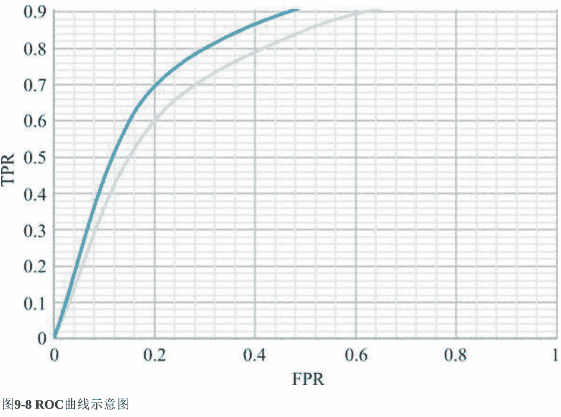

曲线越陡说明模型越能分清正负样本，在把真正例拉高的同时把误报压住。理想状态下曲线会贴着纵轴往上冲，再水平延伸到最右侧，形成一条折线。

### 语音与文本精度的度量方式

要让识别出的词序列与标准序列对齐，往往需要做替换、删除、插入。把这三类错误的数量加起来除以标准序列的词数，就是字错误率 WER。其表达式为：

```
WER = \frac{S + D + I}{N} \times 100\%
Accuracy = 100\% - WER
```

其中 S 代表替换，D 代表删除，I 代表插入，N 代表标准词数。

句子层面更粗暴：只要有一个词错，整句就算错。记错误句数为 Ne，总句数为 Nt，则句错误率 SER 为：

$$SER = \frac{N_e}{N_t} \times 100\%$$

在信息检索、信息抽取等领域，查准率与查全率仍然是常用的评价视角，和视觉识别中的用法一致。

### 速度指标决定成本

精度决定方案能不能用，速度决定系统贵不贵。推理速度的考察随技术形态而异。

整体来看常用这几类：

QPS 即吞吐量，多用于图像识别，把单张图重复送入或批量送入，统计单位时间内能处理的张数。路数指能同时接入的实时视频路数，智慧城市、安防场景常用。倍速用于离线视频，衡量在一定算力下能快多少倍处理完，播放速度为1倍。时延衡量实时性，从输入到输出的时间差，只有小于特定阈值才算实时。

实时性需求大致分三档：人根本感知不到的毫秒乃至纳秒级，如自动驾驶、高精加工；人能感知但延迟很短的秒级；人可以容忍的延迟，如几十秒到数小时的历史归档。

评估性能时不能只看算法，还要看硬件算力。相同算法在不同设备上表现差异极大，通常用 TFLOPS 每秒浮点运算次数或 TOPS 每秒整数运算次数来衡量。

# 第10章 AI中台落地详解

中台概念 2015 年由阿里提出，最早实践却来自游戏公司 SuperCell。它用统一技术中台支撑多个小团队做游戏，获得了成功。此后出现了数据中台、业务中台、技术中台，随着云原生和 AI 发展，AI 中台应运而生。本章先讲概念、必要性和架构，再展开核心模块和实践。

## 10.1 AI 中台的需求与整体方案

预训练大模型、多模态、知识图谱等突破让 AI 应用成本下降，落地案例增多，但开发周期长、成本高、算法长尾效应明显、技术底座薄弱，以及 AI 与行业的融合鸿沟，都需要一个平台型底座来支撑快速迭代。

### 10.1.1 算法的长尾

长尾本质是幂律分布，头部少量个体贡献极高值，尾部大量个体值很低。

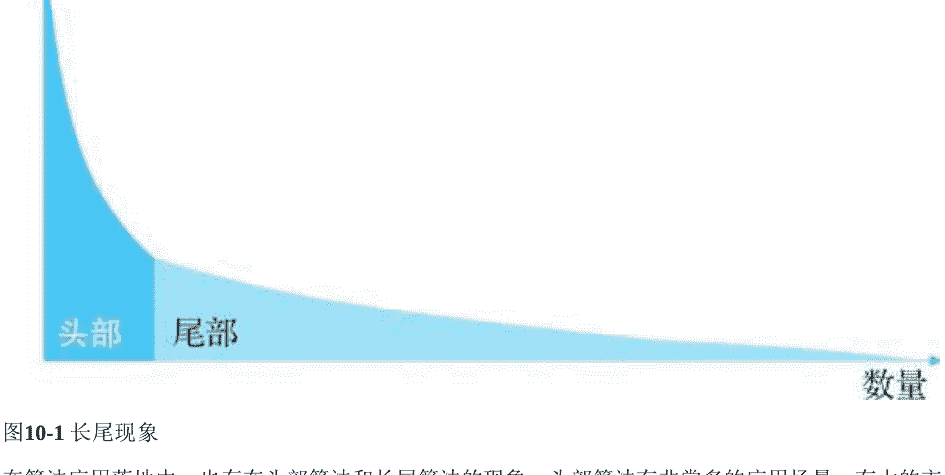

算法落地同样存在头部与长尾。头部算法应用面广，市场大，如人脸识别、OCR、语音转文本。长尾需求数量庞大且碎片化，如城市治理里除了人脸，还要电单车、烟火、乱停单车等，每种都要专属模型。

长尾体现在两点。业务层面，单一算法难以闭环，城市治理方案需同时识别人、车、非机动车、物品，并进一步识别属性，价值核心虽是人脸识别，但长尾需求不可缺。样本层面，长尾导致泛化难。以判断“狮子”为例，常见样本是黄皮非洲公狮，但品种、卡通、狮虎兽等长尾样本形态差异大，定义也模糊。

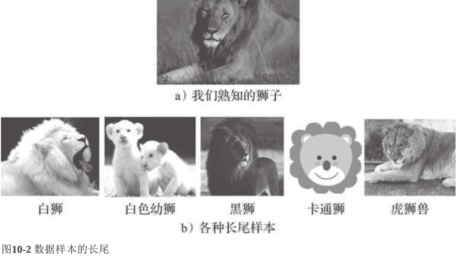

为提升泛化加入大量长尾样本，一方面采集标注成本高，另一方面容易引入误报，如加入狮虎兽会混淆。于是为提召回加入长尾样本，又因误报增加加入负样本，维护成本剧增。

因此需要小样本学习和更强的泛化能力，同时需要一个门槛低、效率高的开发与应用平台，AI 中台由此出现。

### 10.1.2 AI 中台与体系架构

AI 中台是智能化基础设施，也是企业中台的重要组成，结合数据中台、知识中台为业务提供智能支撑。在政务与企业场景，面对海量数据与事件，需要 AI 加速处理，且算法需持续强化。中台提供从生产到运行的端到端能力。

从流程看包含训练与推理两部分：训练是生产出可用算法，推理是部署上线自动执行。基本结构如图10-3所示。

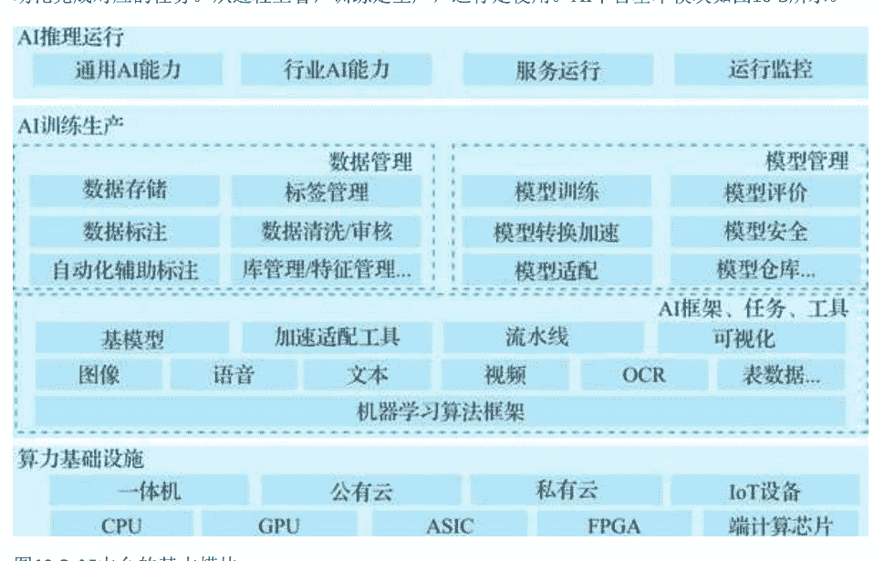

算力基础设施层提供芯片、云等算力支撑，训练与推理都依赖它。产品经理需关注算力选型、构建耗时与推理时延。形态有一体机、公有云、私有云、边缘设备，按场景选择。

AI 训练生产层把数据、模型、工具、框架加工成业务算法。框架提供算子能力，上层可构建多模态任务框架及可视化、基模型等工具。数据管理和模型管理是原料与模具，数据管理覆盖标注、清洗、存储，模型管理覆盖配置、训练、适配、评估，目标是高效高质产出。

AI 推理运行层是业务交付平台，可云原生服务也可边缘部署。传统做法训练与推理割裂，导致反馈延迟、优化链条变长。未来中台应打通推理运行与算法优化，实现闭环。运行层还需监控服务健康，并支持云边端协同。

### 10.1.3 全栈、自动化、资产化、普惠化

全栈体现在能力与链条两端。能力上要覆盖图文音表等多模态；链条上要覆盖数据管理、模型训练、推理运行、资产管理。

自动化是提速关键。AutoML 侧自动化调参、数据增强、建模；流程侧自动化业务反馈到模型迭代再部署，涉及 ModelOps 等协同机制。

大规模模型沉淀后可资产化流转。分公司 A 的产线检测模型可复用到 B，行业通用后还能产品化出售。模型资产与知识资产结合形成统一数字资产体系。

普惠化要求让更多人无需懂底层技术即可建模，依赖自动化与开源生态。

## 10.2 AI 中台三大功能模块设计

中台需解决算力、数据、算法问题。

### 10.2.1 算力管理

深度学习以计算为基础，芯片为载体，需工具链与生态支撑。

集中与分布式：中台需大规模算力，CPU、GPU、ASIC、FPGA 等异构芯片常以云计算或端边分布式形式管理。云原生公有云、私有云管理统一便捷；地域分散或端边对功耗性价比有要求时需分布式，管理复杂度上升。

端云协同：训练常在云端集中，推理因成本与响应要求多在端边。实现端云协同需管理大量异构计算单元、状态、算力、数据通信，以及端侧接入与数据汇聚平台。

算力多元化：单颗 SoC 内含 CPU/NPU/GPU 多核；市场品牌型号多样，如英伟达、华为、寒武纪；产品迭代带来多型号；不同场景需要不同功耗。管理上需强兼容与可适配，降低同一算法迁移成本。

精细化管理：不同计算适合不同单元，神经网络矩阵运算适合 NPU/GPU，CPU 适合控制与编解码等。异构场景需分配核心数、显存等资源。多种算法共存时存在木桶效应，需按性能分配算力，也可动态调度，避免整体被慢环节拖垮。

### 10.2.2 数据管理

数据是算法燃料，需从非结构化、半结构化转为机器可懂的结构化数据，以算法为导向管理。

样本管理覆盖图片、音频、表格等多模态，可按模态、算法、业务、用途细分，如语音、图像、文本、视频；图像分类、分割；动物分类、人脸检测；预训练集、训练集、验证集、测试集、正负样本集等。

标签是对样本的语义描述，如猫狗、垃圾邮件、情绪；也包括关键点、像素点等间接标签。标注是把样本与标签关联，需要众包分发、标注、清洗、审核、合并。标注枯燥低效，自动化标注广泛使用，如 OCR 预识别后人工纠偏，或模型在线强化提供预标注后再核验。

样本库即便还没有做标注，其本身就具备数据资产的属性，只要用得好，就能释放出很高的价值。比如在工业自动化场景里，借助物料质检数据的分析，就能反推工艺改进方向，提升良品率，直接形成生产端的效益。

### 10.2.3 算法管理类功能设计

设计算法管理功能时，核心要兼顾算法使用者、算法的生产环节以及落地应用这三条主线。

#### 1. 算法用户
过去算法研发几乎完全由算法研究员和工程师主导，随着AI普惠推进，研发工程师、运维工程师乃至普通业务用户都开始参与算法管理。目标人群的差异，直接决定了管理体系的复杂度和操作门槛。

在AI中台里，算法生产与应用大致可分为两类人群。第一类是专业级用户，第二类是初级用户。中台对两者最大的分化点就在算法管理模块。面向专业用户，中台要提供模型参数、训练过程、效果评估等精细化管控能力；面向初级用户，则需要自动化、低代码式的服务体验。换句话说，面对算法生产能力强、人才储备充足的场景，要开放更完整的生产与使用链路；面对算法能力薄弱的场景，则应尽量收敛生产环节的暴露。

#### 2. 算法生产过程管理
算法的生成通常经历调参、训练、评价、应用部署四个阶段。

- 调参本质上是对生产要素的配置，包括模型结构、技术参数、数据来源以及训练超参数等。
- 训练是模型学习的过程。面对大模型和海量数据，训练周期往往很长，必须通过过程可视化与排查工具，及时判断是否偏离预期，必要时提前终止，以避免成本浪费。
- 评价聚焦于模型表现，例如准确率、响应速度等，具体可参见9.4节。
- 应用部署即把模型上线使用。在AI中台的范式里，每个算法都可视作一个App。发布相当于把App放到商店上架，部署则相当于用户下载使用。

#### 3. 算法应用管理
完成生产后，算法就变为可被调用的App，具备存储、流通与上线的能力。

流通场景可分为封闭与开放两种。封闭场景下，算法资产仅限内部使用，管理重点在于按任务、版本等维度对算法仓库中的App进行归档；开放场景下，算法资产进入应用生态，可被交易下载，百度的AI市场、华为的好望算法商城都是典型实践。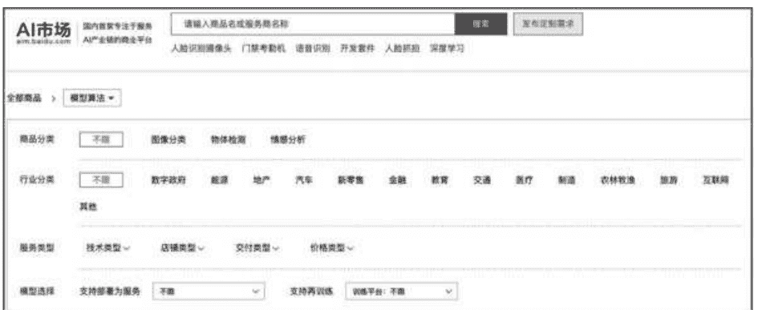

a) 百度 AI 市场

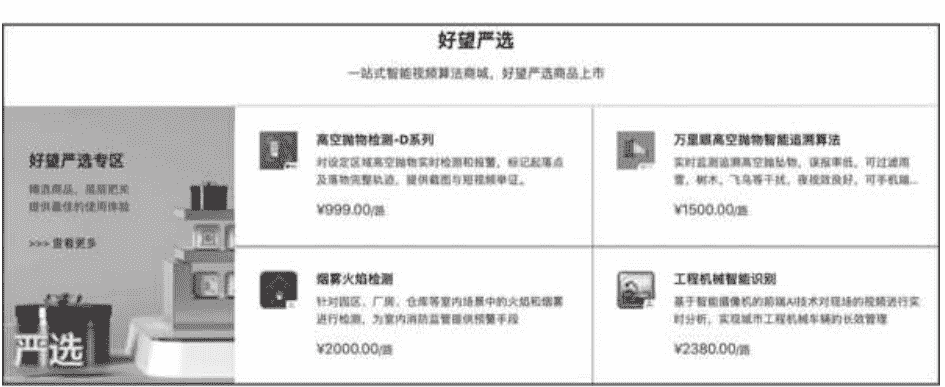

b) 华为好望算法商城

图10-4 百度AI市场和华为好望算法商城

在实际运行层面，AI中台是承载算法推理、流程编排、负载均衡与运维监控的底座。业务中常见两种典型模式：多算法协同与推理训练闭环。

多算法是指同一业务由多个供应商的算法共同决策，如城市治理中聚合多个厂商的人脸识别结果后做融合判断。虽然算力开销增加，但能降低对单一供应商的依赖，中台推理层需支持多算法部署与融合。

推理训练闭环是指当推理结果被反馈为误报、精度不足或无法满足新任务时，能迅速把数据回流到训练侧进行增量适配，再通过A/B测试、灰度发布等方式在线更新服务。把训练与推理打通，是实现持续优化与敏捷迭代的关键，已在大量AI应用中普及。

## 10.3 AI中台典型应用举例

### 10.3.1 云厂商的云原生AI中台
AI中台与云原生环境高度契合，主流公有云都已构建起以云原生为底座的AI中台体系。

基于公有云做算法开发，能够降低硬件采购成本、无需自建维护、弹性伸缩且高可靠。云端还能提供人工标注等增值服务；大规模训练时可按需扩容，缩短周期；丰富的硬件类型也让模型适配更快。

为了覆盖更广的需求，公有云产品能力全面。不同模态、不同技术任务、不同模型都能一站式组合；训练在云端，部署可下沉到边缘设备，借助云端多元硬件快速完成适配；同时面向专业与初级用户都提供完整的工具链。

部署形态主要有三种：

- 云端部署：将算法SDK放在云端对外提供API，用户上传数据即获结果。优点是硬件成本低、可弹性扩展、可靠性高；缺点是数据需上传公有云，存在泄露风险，且对网络质量要求高。
- 端云协同：设备端本地推理，通过网络与云端交换状态信息，模型更新效率大幅提升，但同样不适合高安全或弱网场景。
- 离线私有化部署：依托私有云或离线开发包部署。用户需自行搭建软硬件环境，维护成本高，但数据安全性更好。

代表性产品有百度的BML与EasyDL，前者面向专业用户，后者面向入门用户。以BML为例，其核心优势有三：依托文心系列大模型的知识增强，获得强基础表征能力，蒸馏后在相同参数下精度更高，规模化开发更简易；提供智能标注与在线标注体系；具备端云协同机制，可加速云端训练模型向端侧落地。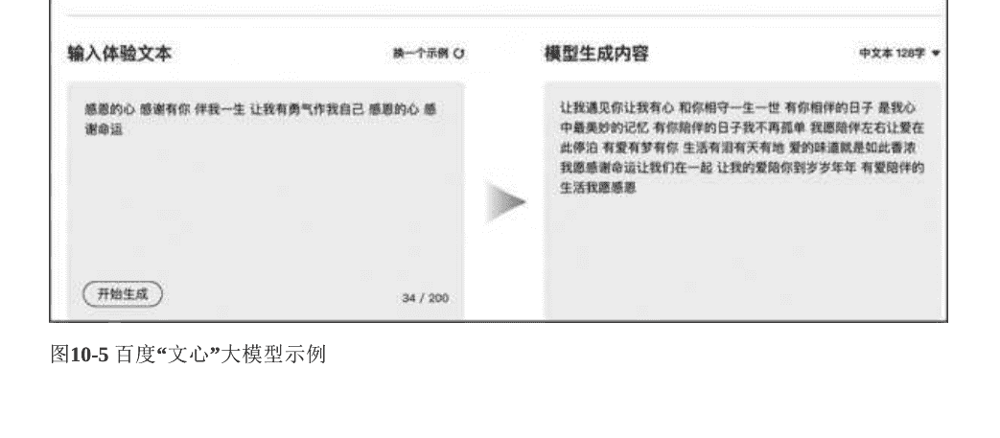

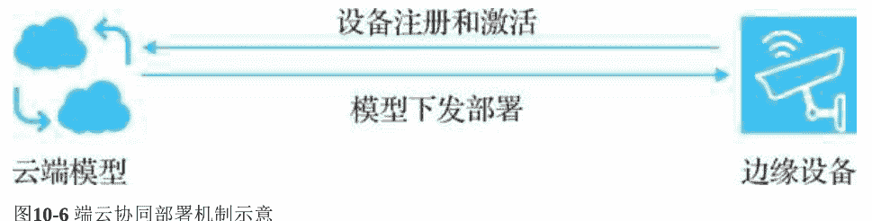

图10-6 端云协同部署机制示意

### 10.3.2 零售智能称重：推理训练自动化闭环应用
AI中台不必一定庞大，在小规模业务中也能精简为以业务闭环为导向的系统，对长尾且持续新增的需求，“推理-错误反馈-训练-更新”闭环尤其有效。

2020年，码隆科技为沃尔玛打造的RetailAI智能称重方案已在百余家门店落地。方案通过智能摄像机识别商品，在屏幕展示结果，用户确认后打印标签闭环。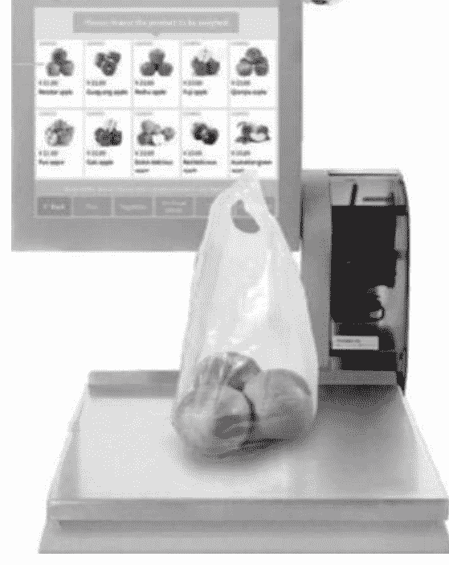

图10-7 RetailAI智能称重解决方案

当商品类目不断扩展或识别效果不佳时，固定算法难以为继。新增类目如西红柿时，系统虽可按相似度排序提示，但仍需人工点选确认。用户的点选行为即形成标注，可回流后台进行增量训练，效果达标后在闲时自动更新部署。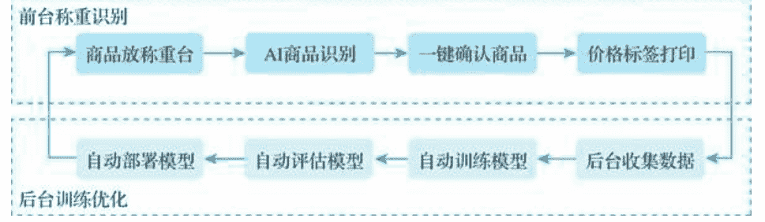

图10-8 智能自助称重系统算法更新机制

# 第11章 纵深业务类AI产品的落地

AI产品落地必须与场景深度结合。客户类型和场景差异决定了产品形态，本章按G端、B端、C端展开。

## 11.1 面向G端城市治理的AI产品

早期人脸识别的突破推动泛安防规模化落地，在雪亮工程、智慧城市等工程的带动下，AI在政府端的城市治理领域快速普及，形成了以Government为代表的业务模式。

### 11.1.1 城市治理的需求与业务模式
城市管理者面对海量人口与信息，核心诉求是提升管理效率，扩充管理手段。

治理场景涵盖城市安防、交通、政务、社区园区等，具有规模化、多样化、碎片化特征。以交通为例，城市级管理规模巨大；需处理的违规行为多样；单个功能需求碎片，研发成本高而单点市场规模有限。

这类业务多以大项目形式交付，定制化强，呈现重投入、长周期、重运营的特点。交付模式多为“产品+定制+解决方案”。因此很难用单一产品覆盖全部业务，研发时需有心理预期。

### 11.1.2 G端碎片化市场下的AI产品策略
G端数据与应用偏私有化，项目规模化、工程系统化，定制化与碎片化需求突出。

第10章提到的算法长尾效应在市场端同样存在。需求极度分散，组合起来体量不小，但难以用少数产品覆盖，必须推出大量品类与型号应对，研发成本高且难规模化。

不过市场仍孕育出标杆企业，如海康威视通过可控成本的产品化方法解决安防碎片化需求。从AI产品视角，主要思路有：

- 软件定义硬件：硬件定制成本远高于软件，小批量硬件单价难降且库存压力大。在硬件不变前提下，通过软件调整实现不同算法能力，是应对碎片化的有效路径。智能摄像机领域华为提出的软件定义摄像机即是代表，同一硬件搭载人脸识别则成为人脸识别摄像机，搭载车辆识别则成为车辆识别摄像机，通过操作系统灵活组合算法，降低定制成本。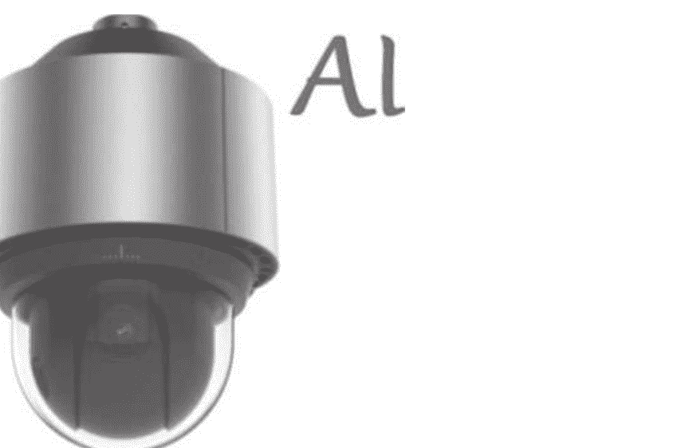

图11-1 华为软件定义摄像机

- 平台与生态开放：碎片化应用需要大量差异化模型，单点研发成本高。搭建算法训练中台并开放生态，吸引开发者共建模型后以商品化方式流通，可显著分摊成本。极视角、华为算法商城即是基于平台与生态开放的实践。极视角算法商城如图11-2所示。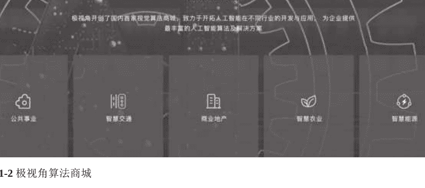

图11-2 极视角算法商城

- 用户侧闭环响应：提升数据到模型全流程的闭环效率，把生产能力下放给用户。借助低代码与无感标注，用户可自主定制，系统自动完成训练优化。
- 开放集与小样本方法：部分任务无需完全重学。开放集方法通过少量样本注册入库即可响应新类别，如人脸识别中为每个人注册。品牌商标识别等长尾场景也适用，用户在使用中持续增添样本，即可解决碎片化需求，使研发聚焦于基础模型能力的提升。

市场越碎片化，越难形成通用标准产品。核心策略是不断扩大碎片需求的覆盖面，即便增量不大，也能带来竞争力跃升。

### 11.1.3 城市治理下的典型AI产品——智能摄像机

#### 1. 摄像机
摄像机是物理世界到数字世界的映射基础，形态通用，可用于安防、手机、机器人、自动驾驶等，但不同场景需求差异带来型号繁多。

发展路径是从“看得清、看得远”到“看得懂”。看得清指分辨率与夜视能力的提升，看得远指超远距离巡航监控，看得懂指AI赋能的内容理解。

#### 2. 智能摄像机
智能化依赖算法与算力的融合。模型轻量化部署与端边算力提升并行，使摄像机在采集端即可聚焦关键目标。如道路违章识别摄像机，关注点是车辆行为而非路面，完全由智能算法实现。

智能化带来效率跃升。传统视频流需全量回溯，智能摄像机可快速定位事件，实现监管从事后回溯向事中处置的转变。

#### 3. 智能摄像机在城市治理中的应用
城市级应用需规模化铺设，单点无法闭环，必须构建端边云整体方案，包含数据中台、业务中台等。

- 软件定义摄像机：通过更换算法软件定义设备功能，是碎片化市场的适配利器。实现需设备、算法、算力组合及强大的操作系统与后端算法仓支撑，属系统化工程。
- 智能1拖N：边缘算力提升后，智能摄像机除满足自身分析外，还可为周边传统视频流摄像机提供算力赋能，提升整体智能化水平。

## 11.2 面向B端企业服务的AI产品

### 11.2.1 企业服务的需求与业务模式
与政务不同，企业追求利润。获取超额利润的关键是提升劳动生产率，技术创新是重要路径，率先拥抱创新技术可提前获得收益。因此企业根本诉求是提效与获利，人工智能作为生产力改造工具，是企业提升效率的核心选择。

搞懂了企业到底要什么，再去看面向企业的产品逻辑和商业打法就通透了。能切实帮企业降本、提效、提质的方案，在B端竞争里天然吃香。所以市面上面向企业的AI研发，主线基本都锁死在降本、增效、提质这三件事上。

在企业场景里，AI更像个智能员工，去“替代”或“辅助”人完成某项工作。归根到底，这些产品做的都是人能干、机器干更快的事。但“替代”和“辅助”在设计上是两条完全不同的路。以内容合规审核举例，设计一个全自动机器替代人工审核的产品，和设计一个机器初筛人工终审的产品，对算法能力、产品交互闭环的要求天差地别。尤其是审核标准极高的场景，想做到完全替代，对精度的要求几乎是苛刻级的。

B端内部也分层。服务大企业更像服务G端，要规模化、系统化、定制化；服务中小企业则市场极度分散，模式更像是“产品+服务”的组合拳。

### 企业转型的AI路线

企业拥抱AI大致有两条路。第一条是用AI解决业务问题，也就是拿AI去降本、增效、提质。第二条是用AI赚钱，在解决内部问题的基础上，把“AI+自身专业领域”的方案对外输出，成为AI解决方案提供商。

AI产业本身也在两个方向演进：一是产业智能化，用AI赋能旧业务；二是智能产业化，像AI基础设施这类新生业态逐渐形成独立产业。

AI转型老手、斯坦福人工智能实验室主任吴恩达在2018年《人工智能转型手册》中给出了5条实操建议：

- 用试点项目蓄势：在内部挑一个技术可行、能落地、目标可量化、6到12个月能见效的项目先做起来，形成标杆。
- 组建内部AI团队：搞一个集中式的AI中心或研究院，为各业务线提供支撑。
- 做分层AI培训：针对高管到一线员工的不同角色，提供定制化的AI内容培训。
- 制定AI战略：基于数据等AI资产，构建“AI+垂直行业”的竞争优势，并设计能自我强化的AI策略闭环。
- 打通内外沟通：AI业务涉及数据合规、问题处理等，需要投资者、政府、客户、用户、员工、外聘人才多方协同，必须有顺畅的沟通机制。

### 效益型AI产品的打法

B端AI的核心价值就是降本、增效、提质。客单价比G端低、场景更碎片化的B端市场，产品在追求客户效益的同时，也要兼顾自身服务能力的泛化。寻找供需平衡点，可以从三个行动入手。

#### 1. 先算清现有业务的投资回报账
效益型AI的终极目的就是提升效益。想做成闭环方案，就得吃透业务全流程，并建好过程中的投资回报模型。
很多场景需要行业专家和AI产品经理一起才能摸清门道。比如半导体生产质检，就要懂原理、流程、标准等，单靠产品经理很难。做综合解决方案要覆盖全环节，做单点智能就要聚焦单环节的输入输出、成本收益，并建立回报模型。
以制造物料工件人工目检为例，人力数量与效率、良品率都是可量化的。成本端有薪酬、培训、招聘，还有不良品返修成本；收益端基于现有质检效率测算。由此可建立单环节的投资回报模型，为后续产品在成本、功能、性能上的决策提供参照。

#### 2. 再算清AI方案下的投资回报账
设计AI时，要同步建立替代方案的投资回报模型。比如AI提升良率与质检效率、降低人力，但会带来一次性投入、建设费、运维成本，需要算新方案的回本周期。

这看起来是笔账，却决定了技术可行性和成本可行性。AI算法里精度是关键指标，用户若要求精度必须远超人均水平才能打平效益，就可能出现技术做不到的情况。若投入大量研发只换来新旧方案效益持平，对产品而言成本难以接受。

产品方案与投资回报存在平衡。精度与效率越高、维护成本与功耗越低，用户回报越大；但对供应商而言研发和运维投入也会越大。产品经理需要在两者间找平衡，或通过产品与商业模式设计同时兼顾用户价值与商业价值。

#### 3. 平衡用户价值与商业价值
商业价值是给供应商带来的价值，用户价值是给客户带来的价值，后者是前者的基础。通常用户价值越大商业价值也越大，但有时会出现此消彼长的矛盾，因此平衡是关键。

平衡体现在两个层面：
- 产品特性设计上的平衡。功能、精度、速度是AI产品的基础特性，分别决定能不能做、做得怎样、做得多快。在成本受控下，三者往往相互制约，平衡好三者就是特性设计的艺术。
- 商业模式上的平衡。单纯卖算法SDK在碎片化的私有化场景里并不好做，会导致方案极度碎片化、闭环成本高。借鉴市场成熟做法，云厂商的SaaS模式很适合中小企业；而面向大客户，用“AI中台+服务咨询”的授人以渔方式，能大幅降低碎片私有化落地的成本。

### AI与制造业结合的产品实践

制造业是B端里体量最大、也是最渴望提效的赛道之一。与金融互联网不同，制造业重资产、长周期、成熟度高，对新技术采纳更谨慎，但其战略价值极大，AI赋能前景广阔。

传统工业质检多靠人工目检。无论是提效降本，还是缓解用工压力，用机器视觉替代人工都是明确方向。传统机器视觉系统由光源、镜头、相机、后端分析设备等组成，整体复杂，实施与运维成本高，定制化程度重。
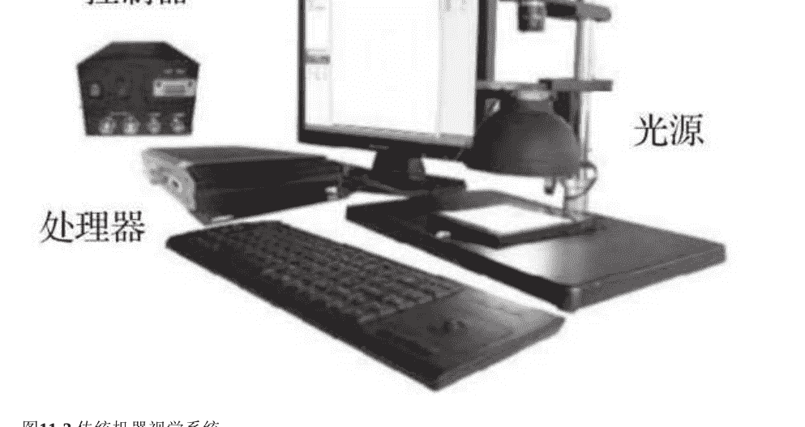

制造业质检的物料品类多、缺陷类型多且随机，组合起来任务极其琐碎长尾。不同物品和缺陷往往需要不同视觉方案，导致光源、镜头、算法高度定制。比如反光表面要调光源角度或类型，换型号就要调算法来保精度。面对高度碎片化定制需求，有两条解法：

- 一体化设计+灵活标准配件组合。将光源、镜头、摄像机、处理器集成一体，用可灵活配置的方式兼顾高度标准化与场景差异，通过更换组合配件解决定制化问题，提升便捷性同时保持标准弹性。典型的产品形态如图示。
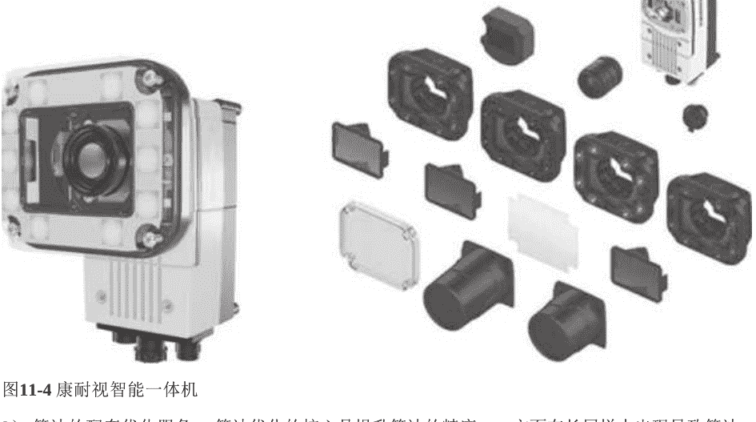
- 算法的配套优化服务。核心是提精度。一方面在长尾样本导致效果下滑时，用少量样本快速增训；另一方面在任务切换时提供便捷的算法优化与模型更换工具，可类比“软件定义摄像机”。

## 面向C端消费者的AI产品

从马斯洛需求层次看，人的需求自下而上排列，高阶需求建立在低阶满足之上。个人服务需求的本质是体验感，无论是生存、安全、归属、尊重还是审美与意义感。

面向个人的AI产品要旨是超越现有产品的体验感，商业模式更偏向“交互产品+运营”。产品是交互载体，内容与生态靠运营，交互方式与智能程度的提升直接决定体验。典型形态有智能语音助手、美颜相机App、智能音箱、消费机器人等，也有很多产品是在原有业务上叠加智能来提效。

### 交互体验型AI的策略

人机交互一直在演进：从代码到图形界面、从键鼠到触控、再到语音视觉的非接触交互，越来越接近人与人交流。个人产品也在拥抱AI提升交互，但升级要谨慎。

- 交互升级的价值。主流入口是手机、PC、音箱、车机。语音交互从上世纪初研究至今，得益于深度学习与移动普及才成为常态。交互升级不是为升级而升级，而要带来新的价值场景，比如“解放双手”“搜索更快”“路径更短”。车内语音最典型的就是解放双手，减少分心。语音的“搜索”能力能省去翻找App、找联系人的时间。但交互也有边界，比如戴口罩时刷脸解锁失效率高，需要指纹、密码互补。因此交互价值是分场景的，失效时要有兜底方案。
- 精度决定智能体验。理论上语音视觉交互能带来更大便利，前提是够准。以车舱语音为例，早期车厂内置语音控制空调、打电话，但因内容单一且识别精度低，使用率极低。多次重复操作会让用户彻底放弃。近年高精度算法普及后，车内语音才真正被广泛使用。精度是智能与体验的直接量化，误报或召回不足，用户直观感受就是“没法用”。
- 场景化“智能助手”的价值。交互升级 alone 不足以支撑C端AI价值，核心是成为“个人助手”，如保姆、秘书、朋友等角色。交互+智能结合才能提供实质帮助，比如伴读机器人识别内容并语音讲解、陪伴机器人陪老人聊天讲故事、智能音箱作为智能家居中枢管理设备。
- 普惠AI要高性价比。AI从昂贵到普及是规律。早期计算机只用于军事，后来个人电脑普及且算力远超早期巨型机。AI要大面积进入个人市场，必须具备高性价比与普惠性。

### 虚拟数字人与元宇宙

虚拟数字人是视觉、语音、自然语言理解生成与渲染等技术融合的产物，依托深度学习与多模态融合快速发展，形成了虚拟主播、虚拟替身、数字员工等形态。一般分为服务型和身份型。服务型是企业的数字员工对外提供服务，如金融迎宾客服、旅游数字导游；身份型是虚拟偶像或元宇宙中的第二分身，用于身份替代。

元宇宙是VR、AR、数字孪生、数字资产等技术共同作用的产物，是真实世界的虚拟映射，可理解为三维空间形态的互联网。其优势在于能非接触完成真实世界受物理限制的行为，如沉浸式教学、远程会议增强现场感等。核心要素仍是人，虚拟数字人则是连接现实与元宇宙的桥梁。

在互联网或元宇宙中都存在生产者与消费者双重角色。企业和个人都可借助虚拟数字人生产内容。现实世界中，商家以B2C模式向个人提供服务，如金融、旅游领域的数字员工。图示的百度联合浦发银行的虚拟数字人小浦即为此类产品。又如传媒领域打造虚拟主播，通过短视频平台分发内容，图示央视多模态虚拟小编小C即属此类。


a）浦发银行虚拟数字人小浦
b）央视虚拟小编小C

在元宇宙里，虚拟数字人可作为人的替身活动，既可以是形象，也可以是AI助手。每个人都能构建自己的虚拟分身，以C2C方式在元宇宙生产内容供他人消费。图示即为扎克伯格的卡通虚拟替身。


# 第四篇 行业实践

AI像电一样赋能百业，AI产品多以“AI+行业”形式落地，在医疗、安防、交通、工业等领域带来创新与效率提升。AI在农业、政务、零售、家居等场景无处不在。

本篇从赋能行业与项目实践两个维度，介绍AI在场景化下的应用与交付经验。

## AI+行业的产品应用

本章从宏观视角审视AI在行业赛道的落地，聚焦安防、智能汽车、制造业质检三个代表性场景。安防是计算机视觉早期落地的标杆，智能汽车代表AI技术水平，制造业质检是AI赋能生产制造最直接的场景。

## AI+安防

安防是AI落地的先行行业之一，公共安全是社会发展的基础。监控摄像机是安防产业核心，从模拟到数字，分辨率与布设规模持续攀升。规模扩大带来数据价值挖掘需求，深度学习与计算机视觉正是关键赋能手段。

以2014年人脸识别超越人眼辨别能力为节点，技术跨过商用门槛。安防核心需求是人员身份确认、追踪与管控，从海量视频里找有效信息，传统遍历检索效率极低，AI与需求高度契合。经过多年发展，人脸、行人、车辆识别已相当成熟，落地案例众多，如大型活动现场抓捕在逃人员。

技术普及后，人脸识别扩展到社区园区通行、疫情期测温核验、企业厂区管控等泛安防场景。车牌车辆识别广泛用于交通安全与停车管理。除视觉外，指纹、语音、声纹、知识图谱等技术也在安防体系中应用。

假设你所在的部门被要求做一款面向小规模场景的人脸通关产品，你作为新手产品经理接手。下面是一条从战略到落地的实操思路。

#### 宏观——先搞清战略意图

新手最容易迷路，就是不知道为什么要做、为什么现在做、还能不能做。先把灵魂拷问搞清楚，后面的中观和微观才有方向。

第一步去找上级对齐内部预期。你了解到公司是做地产的，在二三线城市拥有大量物业子公司，目前各家物业的安防和人员管理都依赖外部采购人脸设备。继续全靠外采当然行得通，但集团的战略是往智能化转型，引入高新技术，慢慢沉淀自己的技术内核和产品线。安防是物业管理的核心环节，先在自家业务上跑通，未来再把方案推给同行。

这样一聊就明白了，这是集团拥抱AI转型的一块拼图。市场上安防人脸产品已经很多，要做出足够强的竞争力并不容易。好在集团的业务集中在二三线城市，这类产品的渗透率还没有很高；而且优先在集团内部物业落地，具备内部验证和资源支持的优势，前提是产品本身要有竞争力。先在自有子公司里跑通，就能打磨出更贴合地产安防场景的方案，日后对外输出也更有说服力。

#### 中观——把产品想清楚再动手

战略方向明确后，就要进入中观层面：要做什么、怎么做。所谓开干，先是把“一个完整产品是什么”想明白。

##### 产品定义要先搭框架

前期调研能少走很多弯路。你用一个产品定义清单来梳理思路，核心维度包括：产品到底是什么、阶段和长期目标是什么、形态长什么样、卖给谁谁来用、在什么场景下用、能给企业和用户带来什么价值、怎么盈利、整体演进路线是什么。清单里有些点能马上回答，有些需要调研补齐。

调研有两条线：一条是去真实的子公司客户和真实场景里看需求，是公司拍脑袋想的还是物业普遍痛点；另一条是做竞品学习，因为人脸识别的厂商众多、形态各异。先把竞品摸清楚，才能在和用户聊需求时知道对应有哪些方案，甚至用户可能比你更熟。

##### 竞品调研先看形态差异

调研发现，安防人脸产品按规模会分化得很明显。小规模的人脸识别，比如楼宇、厂区入口，和城市级的人脸识别在技术和形态上完全是两回事。常见的小规模方案是边缘计算形态，比如带屏显的智能人脸识别设备，可在本地维护一个小规模人脸库，完成本地比对，同时把数据汇总到管理服务端做汇总和统一管控。

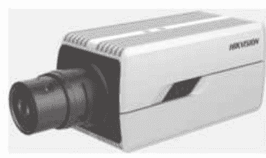


a) 海康人脸抓拍枪机

b) 海康人脸识别组件


c) 海康超脑（人脸）计算服务器

d) 旷视人证核验设备

图12-1 安防人脸识别相关软硬产品

而城市级的大规模应用，则需要端边云协同。端侧主要是带智能算法的摄像机，能做抓拍、属性识别等；边侧是视频流的边缘算力节点，负责对汇集的视频做智能化处理；云侧则靠强算力做大规模比对检索，统一管理大规模人脸库，提供规模化服务。


图12-2 简化的端边中心拓扑

除方案外，市场价格也一并收集，为后续成本判断做准备。

##### 用户调研锁定真实诉求

为了系统化访谈，你准备了调研清单，重点关注：具体使用场景是小区出入口、楼栋入口、楼层门还是住户单元门；当前人员管理痛点是什么，选择人脸方案的动机是管控、身份核验还是陌生人登记；客户希望的形态是公有云还是私有化部署，交互方式有何偏好；应用时的人数规模；数据是本地私有还是云端，是否需要分级共享；现场环境是否逆光、是否室外、是否需要防水防雷等。

访谈一周下来，发现需求非常碎，小区内就有大量细分场景，每个场景差异明显，对应产品也不一样。下一步必须做内部技术可行性验证。

##### 技术调研对齐难点

带着用户需求去和内部研发沟通，从算法、应用软件到硬件多维度评估。主要问题包括：人脸识别算法是自研、外采还是集团内部科技团队支持；活体检测是否需要、用什么方式；逆光场景怎么解决是补光、宽动态还是算法优化；整体技术路线是边缘计算、小区机房中心处理还是公有云；人脸入库走App、门禁还是管理端；人脸库规模是百级、千级还是万级；联网共享范围到楼栋、小区区域还是整小区；陌生人如何判定报警；硬件是OEM、ODM还是自研外包。

##### 初步产品方案

综合定位、成本和需求，内部讨论后决定先做高端小区楼宇级出入口的人脸通行终端。方案要点是：产品定义为小区楼宇出入口的人脸通行终端；目标是在半年内做出首个可售卖的最小产品；形态为软硬一体的楼宇人脸验证面板配合后端管理系统；目标客户是小区物业和新建房地产商，最终用户是居民和物业管理人员；场景限定在小区楼宇出入口的居民通行身份验证；价值在于提升集团智能化安防水平和品牌力，同时帮助物业数字化管控、提升居民安全感和通行效率；商业模式先用集团内部渠道消化，再联合上下游输出整体方案；路线上先OEM硬件外采算法快速集成满足中低规模需求，后续ODM实现硬件自主产权并优化算法覆盖更大规模。

方案需要立项。部分产品自上而下立项资源已到位，但这个项目需要你自己输出商业需求文档即立项计划书，召集职能负责人和上级评审，争取产品委员会认可后推进。

#### 微观——产品设计落地

立项通过后进入微观阶段，重点是功能细节和设计。首版追求MVP，硬件用OEM，算法外采，精力集中在系统软件设计。

##### 算法选型与评测

外采算法不是交给采购就行，也不能完全甩给技术。你联系了多家算法厂商，听完介绍后筛选出三家提供算法实测。部分算法已集成在设备里，可直接拿设备到现场测。你借用摄像机架设在公司楼宇入口模拟刷脸，通过改变位置、高度等获取多组数据。技术同事部署各家算法后，收集人脸库和干扰库素材并标注视频，比对实际准确性。核心指标聚焦人脸检出率、误检率、不同库容下的识别率和误识率以及平均延时。两周反复测试后，选出两家备选，一家速度更快，一家精度更高。

##### 硬件选型

算法表现受硬件影响大，且硬件决定成本。你同步评估不同硬件的算力、售价、开发难度和芯片供应情况，先锁定计算芯片组合，再基于此找整机方案，同时和算法厂商确认芯片平台兼容性。和技术部门确认接口需求后，对比多家厂商产品，最终选定一家。

硬件选定后需和算法做联调，但软件此时尚未开发。

##### 系统设计与交互

整体系统设计要兼顾功能、性能、稳定性与性价比。核心形态分为设备端和管理后端。管理后端面向小区入口管理人员，提供人脸录入、记录查询、陌生人预警、设备运维四大核心功能；设备端负责人脸库下发更新、人脸比对、高权限本地记录查询、陌生人识别等。根据功能拆解成完整的思维导图。


图12-3 人脸识别系统功能导图

再绘制系统拓扑，明确各部分组成关系。


图12-4 人脸识别系统拓扑（简）

为了让开发更清晰，针对人脸注册入库和人脸比对等关键环节做了业务用例和流程图。


图12-5 人脸识别用户注册用例

随后进入交互设计，用原型工具画出线框图并补充信息结构。


图12-6 终端交互的部分线框图（仅参考，非真实可用）


图12-7 中心管理平台的部分线框图页面（仅供参考，非真实可用）

把产品介绍、定位、系统设计、流程、线框图和用户故事汇总成产品需求说明PRD。经产品总监确认后，发给交互和开发评审，需求调研至此完成第一轮闭环。

## 12.2 AI+制造业

### 12.2.1 制造业质检的痛点

制造业是国民经济的基座，涵盖材料、机电自动化、检测、能源、物流等。发展历程大致分为四个阶段：机械化解放体力、自动化实现流水线、信息化打通管理、智能化以机器视觉、工业互联网、工业大脑为标志。四个阶段并非割裂，最终是融合。

细分领域非常多，从食品药品到芯片半导体、汽车制造都有各自的链条。按技术和效能可分为高端制造和低端制造。制造业市场高度分散，很少有企业能垄断全部细分赛道。政策层面，《中国制造2025》《十四五智能制造发展规划》都指向智能化升级。

制造业的核心矛盾是成本高、周期长、投入大、良率低。深度学习带来的AI浪潮加速了智能化，目标是降本增效提质。以机器视觉、工业互联和工业大脑为核心的智能制造是主流方向，其中质检和环境巡检是AI落地最密集的场景。

生产中受工艺、材料、环境等因素影响，容易产生各类缺陷，如表面划痕、凹坑、毛刺，电路板断焊虚焊，钢铁表面划痕脏污，文字喷码重印等。缺陷类型繁多且长尾，任何缺陷都可能导致废品流出，拉低良率。

传统质检主要靠人工目检。随着产能扩大，质检人员需求成倍增长，招聘培训用工成本攀升，且人会疲劳、情绪波动，稳定性差。尽管机器视觉是理想手段，但因产品多样性和机器识别的复杂性，推广受限。深度学习成熟后，机器视觉在质检中的应用正快速扩大。

在产线质检里，人工智能想真正发挥作用，单靠算法是不够的。必须把照明、成像、光学、计算、机构运动和控制逻辑串成一条完整的链路，光机电算各环节的供应商都把这条赛道当成新战场。老牌机器视觉企业在往深度学习靠拢，传统工业摄像厂商开始做相机加软件的组合，比如海康旗下成立的海康机器人，纯算法团队则从软件切入，比如创新奇智、阿丘科技、思谋科技等。

二维视觉在质检里常用的能力大致分四类。辨识是确认料号是否正确，典型做法是一维条码、二维条码以及光学字符的读取确认；定位是把目标的坐标和姿态找出来，为后续分拣抓取提供依据；检验侧重颜色、瑕疵、有无件等判断；量测则是尺寸、孔位间距、容量等几何参数的核验。

表12-7 工业质检场景任务类型

| 识 别 | 定 位 | 检 测 | 测 量 |

| :--- | :--- | :--- | :--- |

| 标准一维码、二维码识别<br>光学字符识别和确认 | 检测对象定位、目标位置和方向输出定位坐标，辅助后续行动 | 色彩和瑕疵检测，零部件存在/不存在检测，检测物体并进行分拣 | 尺寸和容量测量，预设标记的测量，如孔位到孔位的距离 |

### 12.2.2 瓷砖缺陷检测
日本最大的建筑商之一 Sekisui House 生产的 Bellburn 外墙砖用于高端住宅立面，对外观要求极高。成型工艺有时会在砖面留下细小凹坑、线条，或残留黏土，必须逐片筛出。

瓷砖外观瑕疵种类繁多，很难事先穷举，不同瑕疵对合格与否的影响也不同，部分轻微瑕疵可以接受。为保证供应，工厂会按过往产量和人检速度提前备货，库存水位因此抬高。

Sekisui House 用康耐视 VisionPro Deep Learning 搭配合适的相机与光源搭建了缺陷筛查线。该软件的检测模块专为生产检验设计，训练样本只需百量级即可完成建模并上线。系统能判定凸起、凹陷、色差阴影、多余线条等外观问题，工程师还能根据可接受标准对样例做微调。

有了这套视觉方案，生产部门能更早掌握缺陷数量，排产计划更准确。检验效率明显提升，固定库存减少约40%，成本得到控制。

### 12.2.3 制造业读码产品实战
这一节讲的是一个人工智能产品经理在为一家想拓展新业务的AI公司开拓制造业质检市场时遇到的现实困境。

人工智能进厂最大的痛点是需求极度碎片化。电路板缺陷检测因缺陷形态各异，算法要反复调优；药品外观检测一旦包装形态变化，模型就需重新学习。市场像拿着锤子找钉子，让人无从下手。

和销售沟通后，收集到大量读码需求。调研竞品发现，头部智能制造和质检方案商都聚焦光学字符识别或读码。进一步了解，药品包装上的生产日期、序列号等读码需求在各个行业都存在，看起来具备通用性，于是萌生了做一款产线包装字符识别产品的想法。

调研发现完整的机器视觉系统由相机、镜头、光源、处理器等模块组成，结构复杂。但市场上也有集成设备，比如康耐视 In-Sight 系列。


图12-8 传统机器学习系统与康耐视机器学习一体机

#### 1. 一系列灵魂拷问
目标明确后，要做类似 In-Sight 的读码产品。作为初创人工智能团队，对标老牌厂商时必须自问。

问题1：公司优势在哪？
答：作为算法软件公司，模型能力是核心竞争力，能快速把模型落地到场景并达到较高精度。发挥自身长板，用外部长板补齐短板。

由此决定硬件找合作伙伴，软件算法自研。但很快发现，很多硬件供应商也在自研或采购算法推出自己的读码方案。硬件商也成了竞争对手，若其模型效果很好，自研算法的价值何在？是否“设备+模型”就能一统天下？这就触及了场景适配的痛点。

#### 2. 碎片化市场面临的问题
团队把通用字符识别模型烧进设备，在药品包装盒测试时发现文字为钢印，识别效果很差，需针对项目优化。实际应用还会遇到更多始料未及的问题，比如字体、表面材质带来的识别衰减。答案是肯定的，除钢印外还有蚀刻、喷码等。


产品该如何平衡通用与专用？若专攻钢印识别，效果虽好，但药企换成喷码包装时又会失效。除了字体，包装盒反光、对比度低等长尾问题同样棘手。打光方式如何指导、如何让模型稳定识别各类文字，成为两大攻关点。


图12-10 包装盒表面反光

处理长尾的一个做法是把优化压力转移到客户侧：客户反馈误识错误并做少量标注，系统自动完成模型迭代。这正是人工智能中台中提到的能力。在通用性与专用性之间选择前者，产品保持标准化的同时，还能便捷地派生出专用形态，比如专门识别半导体晶圆表面字符的产品。

#### 3. 落地应用
人工智能加制造业读码质检的标杆是康耐视。In-Sight 系列光源镜头相机一体化设备搭载深度学习，可用于读码、定位、检验、分拣。VisionPro Deep Learning Read 则专门配合字符识别算法做增量训练。


图12-11 康耐视机器视觉一体机与 VisionPro Deep Learning Read

做训练型产品，最关键的是验证增量长尾数据对模型优化的实效。用训练解决长尾并非绝对可行，否则算法研究人员也就没有意义。长尾问题的解决本身也存在长尾。最终要回到场景难度，产品应用应有边界，而不是追求包打天下。在落地时要划清可用范围，避免被单一项目绑架，导致产品陷入无尽的需求泥潭。

## 12.3 AI+汽车

### 12.3.1 行业总览及AI技术机会分析
人工智能、新能源、5G、大数据、云计算等技术的推进，让道路交通进入电动化、智能化、网联化、共享化的新阶段。百年汽车产业正被“软件定义汽车”的理念重塑，电动化与智能化带来路侧设施重构、出行方式变革以及智慧交通治理升级。智能技术在路侧、智能车、智慧交通综合方案中发挥核心作用。

截至2021年，全国机动车保有量达3.95亿辆。车多带来事故与拥堵。世卫组织统计，每年全球约125万人死于交通事故，主因多为酒驾、疲劳驾驶、超速等人为主观因素。自动驾驶在理论上可大幅降低事故，车联网也能缓解拥堵，还能提升能源利用效率，让车舱成为新的生活空间。

市场规模巨大。麦肯锡2018年《自动驾驶在中国》报告预计2030年中国自动驾驶市场可达5000亿美元。自2009年谷歌、百度起步至今十余年，技术趋于成熟，近几年整车与方案的投融资活跃，新进入者众多。上游激光雷达、毫米波雷达、运算单元、方案等细分赛道同样涌现大量玩家。

人工智能是自动驾驶赛道最重要的技术之一。无论是 ADAS、DMS 还是 L4 自动驾驶，都大量使用计算机视觉与多传感器融合技术。智能技术在路线规划与决策中作用突出，但自动驾驶是系统工程，需要多技术协同。

以智能车为核心的方案可分单车智能与协同智能。单车智能指车辆无需外界通信即可实现智能，涵盖智能座舱、辅助驾驶、单车自动驾驶。协同智能即车联网，需要智慧车、智慧路、智慧云配合。

自动驾驶产业链涉及诸多智能产品，如自动驾驶运算单元、ADAS、智能摄像头、多传感器融合方案、智能语音交互等。

### 12.3.2 智能驾驶 AI 芯片解决方案
智能驾驶运算单元赛道参与者众多，多基于深度学习计算特性与感知需求设计。传统汽车电子电气架构分散、算力低，难以满足自动驾驶与智能座舱需求，运算单元正从分散式向集中式演进，集中计算平台成为趋势。主要玩家包括 Nvidia、Mobileye、Tesla、华为、地平线、寒武纪等。

表12-8 智能驾驶 AI 芯片玩家

| 品牌 | 介绍 |

| --- | --- |

| 英伟达 | 英伟达是图形计算芯片领域的龙头，面向L2～L5自动驾驶场景推出了Drive系列芯片及开发者套件 |

| Mobileye | Mobileye是以色列的芯片公司，在自动驾驶领域推出了EyeQ系列芯片，由于算力小，主要面向L2的ADAS应用，但市场占有率很高 |

| 特斯拉 | 2019年特斯拉正式发布首款自研FSD（Full Self Driving，全自动驾驶）芯片方案，双芯片算力达到144TOPS |

| 华为 | 华为在2018年推出了智能驾驶计算平台MDC，以及MDC 210、MDC 300F、MDC 610、MDC 810系列产品，算力达48～400TOPS，满足L2～L5的算力需求 |

| 地平线 | 针对自动驾驶领域，推出了征程系列车规级芯片，满足L0～L5的自动驾驶算力需求，其中征程5算力达到128TOPS |

| 寒武纪 | 寒武纪是2016年成立的专注于人工智能芯片产品的公司，其布局的行歌系列智能驾驶芯片是定位高级自动驾驶的达200TOPS算力的车规级芯片 |

Nvidia 在图形计算领域是全球的龙头企业，在人工智能浪潮来临之时，把握住了深度学习并行计算的需求，推出了非常丰富的面向各种场景的计算解决方案，其中就包括智能技术在自动驾驶领域的解决方案。面向自动驾驶，Nvidia 推出了丰富的自动驾驶芯片、开发套件以及对应的软件模拟平台、工具链等，表12-9从硬件角度，列举了近年 Nvidia 发布的自动驾驶硬件芯片和解决方案。

表12-9 英伟达的自动驾驶算力芯片

| 型号 | 算力/TOPS | 配置 | 定位 | 推出时间 |

| --- | --- | --- | --- | --- |

| Drive PX | 2.3 | 基于Tegra芯片 | 非车规 | 2015年 |

| Drive PX2 | 24 | 基于Tegra芯片 | 非车规 | 2016年 |

| Xavier | 30 | SOC，包含1个8核CPU和1个512核Volta GPU | 车规级/L2+、L3 | 2016年 |

| Drive AGX Xavier/Pegasus（见图12-12） | 320 | 开发者套件，包含2个Xavier和2个Turing GPU | 车规级/L4、L5 | 2018年 |

| Drive Orin（见图12-12） | 254 | | 车规级/L4、L5 | 预计2022年 |

| Drive Altan | 1000 | | L4、L5 | 预计2023年 |


图12-12 英伟达Drive系列智能驾驶SOC

地平线成立于2015年，是我国最早实现车规级人工智能芯片前装量产的企业，核心定位于包括面向智能驾驶和智能物联在内的边缘计算AI芯片，基于专用的人工智能计算架构BPU（Brain Process Unit），在2019年成功推出车规级征程系列AI芯片（见表12-10和图12-13）。

表12-10 地平线征程系列智驾芯片（数据来源：地平线官网）

| 型号 | 算力/TOPS | 定位 | 推出时间 |

| :--- | :--- | :--- | :--- |

| 征程2 | 4 | 车规级AI芯片/L2～L3 | 2019年 |

| 征程3 | 5 | 车规级AI芯片/L2～L3 | 2020年 |

| 征程5 | 128 | 车规级AI芯片/L2～L4 | 2021年 |


图12-13 地平线征程5

### 12.3.3 AI在驾驶辅助与自动驾驶中的应用
根据美国汽车工程师学会（Society of Automotive Engineers, SAE）于2021年更新的自动驾驶等级，自动驾驶有L0～L5共6个级别。2021年，中国《汽车驾驶自动化分级》（GB/T 40429—2021）正式出台，2022年3月正式执行，该标准结合中国实际，参考国际标准，同样将汽车驾驶自动化等级划分为0～5级，见表12-11。

表12-11 《汽车驾驶自动化分级》中的等级简介

| 分级 | 名称 | 持续的车辆横向和纵向运动控制 | 目标和事件探测与响应 | 动态驾驶任务后援 | 设计运行范围 |

|---|---|---|---|---|---|

| 0级 | 应急辅助 | 驾驶员 | 驾驶员及系统 | 驾驶员 | 有限制 |

| 1级 | 部分驾驶辅助 | 驾驶员和系统 | 驾驶员及系统 | 驾驶员 | 有限制 |

| 2级 | 组合驾驶辅助 | 系统 | 驾驶员及系统 | 驾驶员 | 有限制 |

| 3级 | 有条件自动驾驶 | 系统 | 系统 | 动态驾驶任务后援用户（执行后成为驾驶员） | 有限制 |

| 4级 | 高度自动驾驶 | 系统 | 系统 | 系统 | 有限制 |

| 5级 | 完全自动驾驶 | 系统 | 系统 | 系统 | 无限制 |

无论是SAE的标准，还是中国的标准，都将L0～L2定义为驾驶辅助，而将L3～L5定义为自动驾驶。无论是在驾驶辅助还是自动驾驶系统中，都大量使用了人工智能技术。下面从驾驶辅助和自动驾驶系统两个维度来介绍智能技术的落地应用。

#### 1. 驾驶辅助系统
驾驶辅助系统分为预警类、主动安全类型等，这些离散的提供辅助驾驶的模块化系统统称为先进驾驶辅助系统（Advanced Driving Assistance System, ADAS）。ADAS利用安装在车辆上的传感器，以及通信、决策及执行等相关装置，实时监测驾驶员、车辆及行驶环境，并通过信息和运动控制等方式辅助驾驶员执行驾驶任务或减轻碰撞危害。ADAS包含众多辅助系统，常见的有前向碰撞预警（Forward Collision Warning, FCW）、车道偏离预警（Lane Departure Warning, LDW）、自适应巡航控制（Adaptive Cruise Control, ACC）、自动泊车系统（Automatic Parking System, APS）等。

在众多辅助系统中，大量应用了以深度学习和计算机视觉为核心的技术，如车道偏离预警系统、自动泊车系统等。以地平线的Horizon Matrix领航辅助驾驶解决方案为例，基于征程系列芯片和一系列高性能算法（如车道线检测、车辆检测、道路边沿检测等），在外接入感知设备的情况下，可利用算力和算法，实现车道线偏离预警、变道、自主泊车等一系列ADAS应用。小鹏P7的XPILOT基于英伟达的Xavier系列算力平台，整车外接超声波传感器、毫米波雷达、摄像机等一系列感知设备，实现了智能泊车辅助、自适应巡航以及碰撞预防等一系列驾驶辅助功能。

#### 2. 自动驾驶系统
对于自动驾驶技术方案长期存在争论，争论包括两大方面：一方面是协同路线之争，即是“单车智能”还是“车路协同”；另一方面是传感器侧的技术路线之争，即是“视觉感知”还是“激光雷达感知”。在协同路线之争上，我国的发展更倾向于车路协同，而国外更倾向于单车智能；在传感器侧的技术路线之争上，从保证安全性的角度来看，激光雷达和毫米波雷达可以带来更高的安全性，但前期激光雷达价格高昂导致了雷达路线一直受到怀疑，随着激光雷达成本的急剧下降，雷达和视觉多传感器融合方案已经成为主流。

自动驾驶的落地场景众多，如Robotaxi、自动驾驶公交、港口、物流园区、市政环卫、智慧矿区等（见图12-14）。


在无人驾驶的感知域里，人工智能起到的主导作用是对多源采集信息进行融合，以完成目标的甄别与定位。以 Apollo Moon 为例，该车型的传感器编排包含 2 台激光雷达、13 台摄像头与 5 部毫米波雷达。多套传感装置的部署让数据采集覆盖趋近于无缝，而要做到对各类对象的准确区分，则必须依托大量的算法模型支撑。感知范围非常广：路面行人、车辆、障碍物需要实时追踪；对工地、施工区域、可通行区域的场景属性要能判断；车道线、交通标志、标线等道路要素也需清晰读出。在这些基础要素被捕捉后，还要进入融合决策阶段，比如遇到障碍时是跟随、换道还是停驶避让，面对交通规则时如何执行。感知只是自动驾驶全链路中的关键一环，真正实现落地，还要依靠决策、控制等后续环节，以及与真实场景的深度融合（见图12-15）。


图12-15 自动驾驶计算机视觉视角

### 12.3.4 智能座舱AI产品实战

车内智能化空间正成为汽车智能化进程里分量最重的场景。随着汽车向智能化、网联化、共享化发展，座舱的内涵已不再局限于驾驶区域，而是向办公、娱乐、休憩等多元空间延伸，也吸引了大量厂商进入该赛道。座舱产业涉及车载操作系统、中控集成、车载应用、驾驶员状态监测、芯片、语音交互技术等，其中驾驶员状态监测与语音交互是座舱里最典型的智能化应用。

假设你是所在企业的人工智能产品负责人，公司提供完整的自动驾驶解决方案，产品线覆盖 L2 驾驶辅助、L4 自动驾驶以及车舱智能产品。你负责的车舱业务主要聚焦驾驶员状态监测、车舱智能语音交互、抬头显示等方向，而你接手的正是座舱语音转文字产品。上一任负责人离职后交接给你，产品已有雏形，基础的声学模型在手，但尚未做场景化调优，也未进入量产交付。

语音转文字技术本身已比较成熟，但车载语音与通用语音的需求侧重点不同。座舱场景强化了导航、音乐播放、温度调节等车内使用需求。车载语音系统通常以 Tier1 形式与主机厂协同，从交付关系看是面向企业客户的生意，最终使用者却是个人消费者。换句话说，好用与否由车主评价，能否成交由主机厂决定。两者在市场层面会高度趋同，但产品负责人仍需做大量取舍。

#### 1. 产品负责人的部分能力难以直接迁移

绘制原型、做线框图是互联网初级产品负责人的常规工作。语音交互场景下确实会有少量图形化呈现，比如文本回显，但语音转文字产品并非强依赖图形化交互的品类，原有的设计功底很难直接发挥。语音产品依然重交互，只是交互形态从点击滑动变为对话交流，核心是让用户感觉顺畅。因此体验关注点要从界面转向语感层面，需要围绕语速、内容、音量、语调、音色等维度去打磨。

#### 2. 关于产品的形态

接手时，产品还停留在基础语音机器人算法的形态，只能应付简单问答，一旦涉及控制或深层问答，因知识背景不足便难以应对。座舱语音交互可以做成纯软件系统，也可以做成带音响的机器人形态，基础目标是提供语音听懂、理解、交互、控制能力，这属于产品的初级定义。但你可以把定位再拔高一层，塑造成一个在座舱场景里有求必应的数字伙伴，让产品更具形象感和陪伴感。

#### 3. 产品的核心和产品负责人的工作

语音交互机器人本质上是一款纯智能产品，需要把听、理解、决策控制、语音合成串联成一体。你梳理了产品内部实现逻辑，如图12-16 所示。


这里会产生一个疑惑：不画原型，产品又高度技术化，人工智能产品负责人还能做什么？

经过多方沟通与学习，你明确了工作边界：要把“合格线”界定清楚，包括应达到的精度水准；要明确产品部署的硬件平台，并据此评估性能要求；文本转语音环节该达到怎样的听感标准；面对不同使用情境，产品应具备何种智能程度。

于是工作重心转到定位、定义、功能、性能、标准的系统梳理上。没有线框图可画，但调研、对比、定义的工作量更大，需要给出最优的软硬件组合方案和可落地的标准。

#### 4.产品的核心模块

语音交互机器人虽然综合性强，本质仍是一个对话系统，语音转文字和语音合成在功能上更像翻译。你将产品拆分为语音转文字、语义对话、语音合成、决策控制四大模块，分别对应人的听、理解、说、行动四个环节。各环节关注点不同：语音转文字要听得准、误报少；语义对话要理解用户意图并给出让人满意的反馈；语音合成要让机器发声自然好听；决策控制要把理解后的意图转化为实际操作行为。

#### 5.细碎的场景化

座舱使用千人千面，有人喜欢安静，有人喜欢放歌，有人爱自言自语。交互涉及的细分场景极为丰富，核心包括打电话、导航、查天气、调温度等，每个细分的场景下使用习惯也各不相同，这让座舱语音成为典型的长尾产品。

场景虽碎，但功能使用频次差异明显。通过网络调研、汽车论坛问卷等方式，你统计了车载场景高频功能的使用排序，从高到低依次是：蓝牙电话、温度调节、音乐/电台、导航……（仅作参考案例，不具备真实应用价值）。理想状态是让算法一次适配所有碎片场景，借助大模型、Transformer 等技术全面提升听懂与理解能力，但现实难度很大。更务实的策略是优先覆盖高频场景。

#### 6.算法评价问题

人工智能产品负责人绕不开评估，而语音产品涉及的算法环节多、指标也多。你结合竞品和行业测评标准，归纳出业务侧可用的核心能力指标（见表12-12）。

表12-12 产品能力指标

| 产品模块 | 指标 |
| :--- | :--- |
| 语音转文字 | 1）唤醒成功率：唤醒助手的成功率<br>2）误唤醒率：与唤醒成功率对应，关注误唤醒频次，夜间单人驾驶时无故唤醒会很惊吓，需高唤醒、低误唤醒<br>3）转写准确率：语音转文本的准确率 |
| 语义对话 | 如 BLEU，参考4.3.6节 |
| 语音合成 | 涉及清晰度、可懂度、自然度。一般分主观评价与客观评价，主观评价常用平均意见分法 MOS，即多人打分取平均 |
| 决策控制 | 关注从识别到理解再到决策的整体反馈准确度与反馈时长 |

## CHAPTER 13

# 第13章 AI项目落地过程及问题分析

在企业客户与政府端场景中，人工智能产品的落地几乎都离不开项目。落地项目大致有两种形态：一类是进入全新领域，产品尚不成熟，算法、功能、外部接口都需要定制；另一类是成熟产品在不同项目间的复制复用。人工智能赋能早期更多是第一种形态。本章将从概念验证到交付管理，对人工智能产品落地项目的问题进行系统拆解。

## 13.1 B/G端的AI项目

项目是指为达成一系列目标而组织起来的任务集合。从外部业务视角看，项目是一项独立生意，通常以产品或集成方案的售卖与交付产生收入；从内部视角看，项目是一种投入，可能指向研发、产品迭代或效能工具建设。与项目不同，产品是面向市场销售、被用户使用并满足特定需求的通用之物，可以是实物、服务或软件。

### 13.1.1 AI落地B/G端离不开项目

在企业客户与政府端赛道，即使是做产品的公司也难以完全避开项目。人工智能应用的核心价值在于提效增益，天然适配企业端与政府端需求。项目不仅制造标杆效应，也为产品打磨提供场景。产品与项目既相近又不同：产品标准化程度高、可复制性强、定制少；项目多带定制化。项目是产品诞生的源头之一，通过交付项目，企业能更精准把握真实需求，从中提炼共性与差异，为产品化提供依据。

从性质划分，项目可分为商机项目、交付项目、产品开发项目、预研/探索性项目等。商机项目与交付项目更偏向客户侧，产品开发与预研项目更偏向内部建设，也可能涉及外部联合开发。

- 1）商机项目：在企业与政府端，商机项目主要是早期对接外部机会，包括需求沟通、可行性验证、获取订单等。人工智能产品难以一次性适配所有场景，面对新项目时常需做 PK 测试或概念验证。产品不成熟时，往往需要轻量定制来满足客户试用。若商机战略价值高，即使客户暂不买单，也可能需投入资源“陪跑”，一方面验证可行性，一方面提前呈现完整体验以促成决策。

- 2）交付项目：商机验证通过、中标签约后进入交付。若客户需求以成熟产品为主，交付相对简单；若客户定制化需求量大，交付将包含大量定制开发。

- 3）研发项目：研发可从 0 到 1 造产品，也可做版本迭代。流程包括立项、概念评估、需求确认、资源分配、开发等。此外，为探索前沿技术并为后续产品化做准备，企业会开展技术预研或探索性项目，资源投入大时需单独立项。

### 13.1.2 从项目到产品

企业与政府端产品需求多源于客户调研、竞品调研及交付项目，其中交付项目是最关键的需求来源。国家新基建政策落地后，人工智能应用正被大规模项目推动落地。总体来看，做人工智能产品离不开项目，最理想路径是：从项目中提炼需求，将需求转化为产品，产品再进入新的项目复制。

团队锁定业务方向后，早期低成本起步的方式是与“天使客户”共建产品。共同开发的好处明显：

- 1）贴合市场方向：从 0 到 1 阶段，最怕需求失真。若仅靠产品负责人的臆测和简单调研起步，方向性风险极高。C 端可通过开放数据降低风险，企业端与政府端因信息壁垒高风险更大。与天使客户共建，能拿到真实需求，大幅减少后期因方向错误导致的返工。

- 2）成本可控：从项目到产品的低成本体现在试错成本下降，以及天使客户为早期投入买单。天使客户项目还能作为交付标杆，为后续复制降本增效。

## 13.2 商机项目与概念验证

### 13.2.1 AI商机的涌现

以深度学习为核心的人工智能技术突破后，人工智能公司大量涌现，资本与产业政策共同推动市场升温。随着认知提升，越来越多客户开始用新技术解决行业痛点。对人工智能企业而言，商机增多意味着变现机会，也带来挑战：实验室问题与真实场景差距巨大，学术上可解的问题在行业里可能难以完美落地，甚至完全不可行；实验室不计成本的开发模式与场景化追求效益的模式冲突；想象中的需求与真实使用需求存在鸿沟；人工智能企业对客户行业规则与业务逻辑的理解也需加强。落地难，但人工智能的推进仍在持续，商机项目大量涌现，需要产品负责人进行验证与筛选。

### 13.2.2 AI商机POC实战

人工智能技术落地伴随诸多不确定性。技术进步能解锁部分场景，却无法一次性覆盖全部。如何验证可行性？概念验证 POC 正为此而生。因一家企业无法代表行业水平，商机项目的 POC 环节往往邀请多家比拼，也就成了 PK 场。

某企业客户银行希望采购一套智能监控系统，实现监控中心与网点联网的智能化监控，是一个体量巨大的项目。你所在的人工智能公司只有后端比对算法能力，领导希望拿下该项目。公司只能作为算法引擎供应商参与。项目已被总包方拿下，总包方缺乏算法能力，于是总包与客户共同邀请多家算法供应商测试。

从产品面看，现成形态基本能满足需求，可提供边缘计算服务器支撑 8~16 路网点视频智能分析，也可提供规模化数百路后端智能计算。售前已据客户需求输出完整解决方案并获得认可。客户希望先看算法实效，售前未给出明确测试方法，需要与客户进一步沟通。


图13-1 系统解决方案拓扑图

随后你与售前及客户一起明确测试标准。现场客户希望用多种算法实现对监控中心人员活动与行为的异常监控，包括工作人员识别与陌生人员报警。客户可提供测试参考方案。你提前做足功课，向客户介绍过往测试经验，建议以人脸识别算法为主线做验证。客户高度信任，要求由你们牵头制定测试规则并提交审核。若方案通过，则以此方案验证可行性并进行多厂商 PK。抢到规则制定权，对后续测试非常有利。

你建议客户提供历史摄像机离线数据并进行标注，人脸识别层面主要是为视频中人员打标签。采用逐帧标注方式，工作量大但精度验证更可靠。

方案确认后，客户提供数据并组织工作人员标注，同时提供待验证人员身份信息入库。为增加测试难度，客户还提供了更多入库样本。为让结果可视化，要求开发团队做简单展示界面。测试方案与数据就绪后，在客户指定测试集上对人脸算法的检出率、误检率、召回率、精确率等进行评测，并同步提供算法处理速度。现场多家厂商设备进场测试。

产品相对成熟，但公司仍要求现场支持。你与开发人员到场，完成上架、网络、安装部署等工作后调用数据跑算法，最终得到基于离线视频的结果。数据表现：检出率 99.7%、误检率 0.01%、召回率 99%、精确率 99.92%，算法 QPS 超过 600，即每秒处理 600 多张图像。指标令人满意，定量结果与可视化实际效果一致。

公布结果后，你方算法排名第一，效果达到可行预期，接下来进入商务环节。此次 POC 与 PK 顺利，核心在于产品本身性能扎实，以及先发制定规则带来的优势。

上述案例仅是对算法的可行性验证，过程非常顺畅。但现实中 POC 关注维度远不止于此，还涉及技术可行、成本可行、安全合规可行等，见表13-1。

表13-1 POC关注的维度

| 概念验证项 | 说明 |
| --- | --- |
| 功能可行 | 是否具备满足客户需求的实际功能，必需功能缺失即不合格，解决“有没有”问题 |
| 算法精度可行 | 在客户指定测试集上能否达到预期准确率，精度决定功能可用程度与后期维护成本 |
| 算法速度可行 | 实现既定功能与精度所需时间，时间过长则成本与技术均不可行 |
| 算法延时可行 | 处理到出结果的延迟，实时场景要求高，延迟过大即不可行 |
| 安全合规性可行 | 是否满足客户硬性规定，如加密要求、芯片国产化、数据安全合规等 |
| 功耗可行 | 系统能耗，反映成本与散热、场地限制，常在边缘计算场景重点关注 |
| 成本可行 | 综合评估算法速度、硬件价格、客户预算等，预算不足也会导致不可行 |
| 运维可行 | 落地后是否可运维、如何运维，交付到国外且无法联网等情况会带来巨大运维成本 |

人工智能技术仍在演进，精度、速度、功耗等随时间提升，评估可行性时必须结合项目需求与自身能力。部分企业为冲业绩不惜代价通过 POC，但在交付阶段因技术缺陷导致无法落地。POC 既是客户对企业的评估，也是企业对自身的评估。对不可行的非战略探索项目，应果断拒绝，否则交付时会成为灾难，甚至拖垮团队。

## 13.3 AI交付项目管理

### 13.3.1 AI项目管理方法

在AI交付的实战里，理想状态是交给专业的项目经理去闭环。但现实往往没有那么理想：很多产品是在几轮项目里逐步打磨出来的，前期几乎都是产品经理在扛，产品走向稳定后才把交付棒子交到项目经理手上。体量偏小的B端、G端公司里，产品经理兼项目经理更是常态。交付管理严格来说不是产品经理的主业，可在业务一线它常常就是产品经理要做的事情，所以对AI产品经理而言，具備一套可落地的项目管控思维，是加分项甚至是救命项。

项目交付说到底是一门专业。这里借用业界通用的PMBOK框架来做锚点：项目管理被拆成5个阶段、10个知识域、49项子过程。5个阶段是启动、计划、执行、监控、收尾；10个知识域涵盖范围、进度、成本、质量、资源、沟通、风险、采购、干系人、运维，每个域背后都有对应的控制方法和工具。

POC验证通过、招投标拿下订单后，真正的交付才开始。进入交付初期最先要做的，就是把“要管什么”想清楚。结合AI交付特性与PMBOK，这里有10个关注点可以先盘一遍。

范围要能定性定量、可执行、可控，包含交付目标、整体需求、需求变更带来的范围漂移、交付物形态与交付物内容。资源要盘清投入：AI项目里不只是人力，还包括数据、算力与设备，人力要按技术栈拆分，设备要按云资源、物理机、存储、嵌入式、光源、摄像机等场景细化。成本要做预估与留痕，机器采购、人力工时都要纳入管控，成熟的项目系统能把审批集中。时间要拉甘特图，锁死里程碑与关键节点，再倒排资源准备、需求拆解、开发节奏。质量是交付的底线，验收指标只是最低要求，算法维度看精度、响应速度、延时，工程维度看稳定性、鲁棒性，需要项目与质量团队共同把关。采购涉及外部资源，AI场景里还要盯数据安全与算法合规。沟通要明确对象、内容、渠道、频次与目的，保证问题能及时反馈。干系人要在一开始就梳理全，责任到人，避免后期甩锅。风险是贯穿始终的主线，资源缺口、需求模糊或变更、沟通断层都会带来延期，必须提前预判并准备预案。运维要前置思考，AI交付后长尾问题很多，后期运维投入很容易失控。

一个好的交付方案，核心就是预见性，提前把各维度风险排掉，并为突发问题留足应对手段，才能做到按时、按质、按量交付。

下面用一个真实的跟进案例来对照。

之前跟进的POC顺利通过了，商务推进后中标，客户要求尽快交付。可公司人手紧、没有项目经理，领导直接把我推上交付项目经理的位置。这个项目体量不小，POC只验证了人脸识别，正式交付却要补上人员跌倒识别、离岗识别、上班睡觉识别等一整套行为能力。

坑1来了：POC阶段边界模糊，为了拿单只测了部分功能，而交付范围里的大量功能在内部其实还不成熟。吃过亏后我决定把交付全流程先梳理透。

先把管理项列清楚：范围上，目标是到某年某月某日交付人脸识别、跌倒识别、离岗识别、睡觉识别四类算法；整体需求要单独整理成需求说明书，写清功能、性能、精度；需求变更要由关键人确认周期影响；交付物形态是软硬一体引擎；交付物包含人脸比对服务引擎、行为识别服务引擎、基础业务系统。

资源上，人力为项目经理1人、算法3人、工程3人、测试1人、标注4人；设备为8卡T4服务器4台、存储××GB、摄像机4台；数据为人脸与行为视频××小时，正负样本各××张，按算法细分。

成本上要统计机器新增采购与人力工时。时间上要定最终交付、阶段交付、接口对接、验收四个关键节点，并用甘特图拆到开发细分任务，对外看客户交互节点，对内看研发细节。

质量上，人脸算法召回率、精确率都要到99%，行为算法指标同理；算法延时小于200毫秒，支持多路视频并行；系统7×24小时稳定运行；安全方面加密算法要满足×××要求，禁用×××。

采购要列清T4机器、硬盘等。沟通与干系人要明确客户技术对接、客户项目对接、内部负责人、算法负责人、工程负责人等名单。

风险要提前写清：交付范围与预期不一致导致工作量膨胀、算法训练数据准备难度影响进度等。

运维要前置方案：安全补丁升级、误报触发的算法迭代、Bug与稳定性问题处理，以及运维服务范围和收费。

把宏观框架盘完后才是逐项执行，但在落地中坑仍在。

坑2：开发中需求频繁增改。客户想法多、销售为了满足意愿不断让步，都会带来范围膨胀。应对方法是先判断变更是否必要，是临时起意还是经过思考，是确定的还是模糊的；确认要改就用最小成本方案解决，必须外部、内部关键人一致同意并留痕上报，延期风险要双方接受。

坑3：需求认知不一致。同样的词，彼此理解不同，比如烟火识别到底是抽烟还是火灾。解法是描述要完整、多通道确认，口头加邮件加图示，算法边界最好用样例图对齐，避免后期扯皮。

坑4：对不确定的问题沟通不足，会隐藏风险。很多团队习惯“想当然”，以为和上次一样，结果授权、加密、安全扫描等非核心功能被忽略。项目经理要在一开始就从宏观视角排查潜在问题，而不是等爆发。

坑5：后期运维成本失控。为了赶交付牺牲质量，或销售承诺了精度不足的功能，导致上线后大量误报投诉。正确做法是早期就形成精度共识，不合格的算法不对外承诺，避免后期高昂运维买单。

坑6：验收方案不清导致无法通过。开发完成后验收边界一直变，根本收不了尾。交付之初就要把验收测试方案精细化到使用数据、计算方式等，并内外公开透明同步，既减少无谓争论，也让目标可达。

AI交付不是单纯的技术搬运，而是范围、资源、成本、时间、质量、采购、沟通、干系人、风险、运维十个维度协同作战。把框架先搭好，再把坑提前想透，产品经理也能把交付项目稳稳带下来。