# AI 做课变现全攻略：与爱共创教学设计、爆款课程与商业闭环

# **内 容 提 要**

这是一本 AI 时代知识变现的终极实战手册—不仅教你如何开发课程，还教你如何实现课程变现。本书提供 AI 课程开发与变现的 33 个提示词模板，覆盖从课程定位、内容创意、课程结构、教学 PPT、教学设计到课程变现的全流程。

本书共 7 章。第一章介绍课程开发的必要性，以及与 AI 对话共创爆款课程的底层逻辑；第 2 章介绍如何利用 AI 分析市场需求与用户痛点，解决课程定位不够有竞争力的问题；第 3 章介绍如何借助 AI 萃取书中精华、提炼优质经验，产出既有深度又具传播力的课程内容；第四章介绍如何通过 AI 搭建学员听得懂、学得会、记得住的课程框架；第五章介绍如何利用 AI 生成高吸引力的教学 PPT，用视觉设计强化课程卖点；第六章介绍如何利用 AI 优化教学设计；第七章介绍如何借助 AI 实现对产品矩阵、包装与变现的全链路支持。

本书适合培训行业从业者（如职业培训师、企业内训师、课程设计师）、知识内容创作者（如知识博主、教育行业创业者）、教育科技从业者（如产品经理、运营负责人），以及自由职业者、团队管理者阅读。

# **把专业变成课，AI 能帮的远不止省时间**

做秋叶品牌这么多年，我带团队研发 AI 课程时总绕不开一个问题：身边太多专业高手，手里攥着“真东西”却展示不出来。

有些工程师自己能轻松搞定复杂技术难题，想把技术原理和实践经验讲给新人听，却变成了“说天书”。

有些 HR 总监做了十年人才盘点，想把经验做成课，却卡在“怎么把流程拆成学员能上手的步骤”。

还有我们团队的老师，一开始抱着“AI 工具可以省力气”的想法，结果用 AI 生成的内容却零散、没逻辑，最后还是得回头补“做课的思路”这一课。

直到看到袁茹锦老师的这本《AI 做课变现全攻略》，我才觉得“AI 做课”这个想法终于**有能落地的具体路径和方法论**了—不是因为袁老师把 AI 描述得多么无所不能，而是她太懂“专业人做课的痛”，更懂“该怎么让 AI 帮上忙”。

袁老师在培训行业摸爬滚打 13 年，带出来的学员能把开发时长为 2 天的课的效率从半个月开发 1 门课提高到 3 天搞定 3 门课，能把《底层逻辑》拆成定价 999 元的视频课并卖出 3000 份，这些不是纸上谈兵的理论，是真真切切能落地的方法论。就像我们团队做 AI 课程时总强调“用户视角”，袁老师在书里把这点掰开了、揉碎了讲—**不是教你**“**怎么用**AI**写文案**”**，而是教你**“**怎么让**AI**帮你分析学员真正的痛点**”。例如，用 AI 辅助收集、分析社交媒体的评论，发现学员最关心“怎么降低税务风险”，而不是主观认为学员最关心“复杂的财务报表”。这种“先懂做课，再用 AI”的思路，跟我们一直坚持的“工具要为内容服务”理念不谋而合。

让我觉得最实在的是，**袁老师没把**AI**描述成**“**万能药**”。

她在书里说：AI 能帮你 1 小时提炼 20 本书的精华，能生成 PPT 框架，但真正让课程立得住的，是你得有“把知识变成学员能用上的东西”的本事。

就像她写的“化书成课”，不是直接把书里的话拿来放到课件里，而是教你把《微习惯》里“每天一个俯卧撑”的理论，变成学员能带走的“习惯启动器”工具包（有每日打卡工具表，有手机提醒模板），甚至带学员现场做一个俯卧撑并录音宣誓。

**这种**“**把理论拆成可操作步骤**”**的功夫，是她带了** 8000 **多名培训师练出来的真本事，不是**AI**能凭空生成的。**

作为案例人物出现在书中的培训师，有些还是我熟悉的。这些案例不是虚构的 “成功学”故事，是袁老师手把手辅导得到的真实案例，哪怕你其实不打算做课，这本书也值得翻一翻。袁老师在书里藏的不只有“做课的方法”，更有“高手用 AI 的思维”—例如怎么让 AI 帮你拆解“跨部门沟通”的难题，怎么用“多角色提问法”让 AI 给出更全面的方案。这些思路我们团队的老师也在用，例如写方案时让 AI 模拟“领导视角”提意见，做汇报时让 AI 帮着梳理“学员最关心的 3 个问题”，比自己坐在那里空想高效多了。

袁老师说：“做课不是知识的搬运，是价值的放大”，这一点我特别认同。现在很多人拿着 AI 工具却生产不出好内容，缺的就是袁老师这种“先懂做课逻辑，再用 AI 提效”的实战思维。

如果你是想把专业知识变成课的培训师，是想分享经验的行业高手，甚至只是想把 AI 用得更明白的职场人，这本书能帮你少走很多弯路—毕竟在 AI 时代，真正的赢家不是“会用工具”，而是“让工具帮自己把优势放大”。

秋叶

秋叶品牌创始人

# **前**  **言**

在过去几年里，我几乎每周都要投入 30 多个小时，帮助人们进行课程开发与运营。

他们是各行各业的高手，包括追随者无数的知识内容创作者、经验丰富的培训师与咨询师、中高层管理者、极富个人特色的读书博主，以及企业创始人。

我近距离见证过他们无数次的困顿与迷茫，也常被他们眼中闪烁的光芒点燃热情。

我是袁茹锦，今天的我，是一名拥有 13 年培训经验，为 300 多家企业提供过课程开发培训、授课技巧培训、技术培训引导的“培训老兵”；曾孵化出上千位化书成课培训师和读书会促动师，帮助他们实现了年入百万。

从指导新手做演讲，到带出 8000 多位培训师和知识内容创作者，我见过太多人卡在“做课”的坑里——选题纠结数月难定、内容开发绞尽脑汁、课件呈现效果欠佳、课程面市后无人问津……

辅导的学员越多，我越能感受到“做课”为这些人、这个世界带来的价值。对于很多人来说，做出一门好课程，往往有机会改写成长轨迹、实现人生突破。

**当拥有了一门自己从**0**到**1 开发的课程之后，你的人生会发生显著变化：

• 这门课程可以展现出你在某个领域的专业水平；

• 这门课程可以让你的思想与经验得以传承；

• 这门课程可以让你在某个领域有话语权和影响力；

• 这门课程可以让你的价值被看到、被尊重、被欣赏；

• 这门课程可以让你凭借自身实力获得不菲的收入；

• 这门课程可以成为你的社交载体，帮助你连接高质量人脉；

• 这门课程可以成为你上升的钥匙，为你创造更多机会；

• 这门课程可以成为你的品牌抓手，助力你建立个人品牌。

当你精心打磨的课程能够打动他人、影响他人、改变他人的时候，你会持续吸引更多正向的缘分与助力。此后，你的身边也会逐渐聚集支持者、追随者与合作者。

**你的课程，能够从新的维度定义你自己**——**它们是你留给这个世界的宝贵财富。**

在指导学员的过程中，虽然总是能看到学员从眉头紧锁到豁然开朗的做课过程，看到他们“作品”出炉时的踌躇满志和欢欣鼓舞，但我也深知，对于没有做过课的人来说，这件事情有着不低的门槛。

直到 2023 年，ChatGPT 横空出世，我在驾驭 AI、调教 AI 的过程中突然醒悟：做课这件事，AI 可以当主力，人类只管当导演！

当前 AI 技术发展迅速，许多人对职业前景产生担忧，甚至担心面临失业风险。但实际上，AI 的普及对所有人而言，更是一次值得把握的机会。

在过去，资源、人脉、学历往往决定了一个人能走多远，而 AI 的出现，第一次将这些因素带来的差距缩小到了前所未有的程度：

• 不擅长文案创作的人，可通过精准提示词让 AI 生成质量媲美专业广告方案的内容；

• 缺乏设计基础的人，能借助 AI 绘图工具，将头脑中的创意画面转化为具象作品；

• 没有深厚背景的人，也可依托 AI 辅助，在 3 个月内达成他人需较长时间积累的成果。

过去，普通人若想实现突破，往往依赖天赋或运气；如今，AI 已成为多数人都能掌握的高效辅助工具。善于运用 AI 的人，能直接把时间效率、能力转化速度、机会捕捉速度提升 10 倍！

在做课这件事情上，因为有了 AI 的加持，我们不再是传统意义上的“手工作坊”，而是升级为可以带领多个 AI“员工”的“创意导演”——有些“员工”负责搜集资料、有些“员工”负责提炼核心知识、有些“员工”负责批改作业、有些“员工”负责分析学员……而我们负责创意与决策。

这如同电影导演不需要亲自操作摄像机或布置每一个道具，我们也不必执着于亲手写下每一个字。

**真正的价值，在于我们的独特视角、真实经历和创意洞察，而这恰恰是**AI**难以复制的。**

不可否认，在知识付费赛道，善于使用 AI 的老师，正在“吊打”不会用 AI 的专家。

这本书不是教你如何成为懂得 AI 技术的专家，而是为你提供一套“AI+课程开发+课程运营”的组合拳——让 AI 辅助你分析学员需求、优化课程结构、生成美观课件、撰写课程营销文案，而你则可将精力聚焦于教学模式创新、内容质量把控、学员潜能激发。

**为什么你必须读这本书？**

有个学员让我印象深刻——985 硕士，满肚子干货，结果 3 个月“憋”出个 9.9 元都没人买的课。后来用了我的 AI 做课方法，现在 3999 元的训练营，报名者络绎不绝！这年头，做课拼的不是表达力，而是会不会用 AI 开挂！

这本书里藏着我和上千位学员验证过的“AI 造课秘籍”。

• 课程定位：用 AI 挖掘高客单价的黄金赛道（如教女性做小红书变现的课程，比教大学生做简历的课贵 5 倍）。

• 内容开发：1 小时提炼 20 本书的精华，直接生成有趣有料的课程脑图（某学员靠这招做出的课程，报名者络绎不绝）。

• 结构搭建：让 AI 帮你调整课程结构，在市场上高维打低维（在企业内训市场，结构更合理的培训课程的中标率可以提升 35%）。

• 教学设计：用 AI 设计教学活动、调整教学形式、构思创新课堂，能够给学员带来源源不断的惊喜和沉浸式的参与感。

• 课程变现：用 AI 写爆款推文、写短视频脚本，甚至规划课程产品变现路径，真正实现“躺赚”（有个宝妈靠这招平均月入 5 万元，比老公工资还高）。

再看看下面这些案例，感受一下被 AI 改造后的课程如何成为“印钞机”。

• 培训师吴春生：以前开发一门时长为 2 天的课需要半个月，现在用 AI 智能体做课，3 天搞定 3 门课，今年业绩直接翻倍。

• 读书博主 Lisa：通过“AI 化书成课法”把《底层逻辑》拆成 12 节视频课，定价 999 元，刚上线就卖出 3000 份，各大平台争相合作。

• 知识类博主谢小语：开发 AI 智能体帮助用户写爆款文案、短视频脚本、直播稿等，匹配度高达 87%，客单价从 399 元提升到 3 万多元，工作室扩大了 3 倍！

**这本书能给你什么？**

本书可以带给你以下 6 个方面的价值。

（1）系统化的课程开发知识：本书将详细介绍课程开发和课程变现的全流程，从理论到实践，从方法到工具，为你提供一套完整的知识体系。通过系统化的学习，你能够掌握课程开发的各项技能和课程变现的规划思路。

（2）高效的课程开发工具：书中不仅介绍各种 AI 工具的使用方法，还提供具体的提示词和操作步骤，帮助你快速上手。这些工具和方法将大大提升课程开发的效率，节省你的时间和精力。

（3）丰富的案例：作为一名拥有 13 年培训经验的课程开发专家，我深知做课过程中的每一个痛点和挑战。在本书中，我提供了大量的真实案例，这些案例不仅有助于你更好地理解理论知识，还能为你在实际操作中提供参考和借鉴。

（4）创新的课程设计思路：本书强调 AI 在课程设计中的应用，通过与 AI 的互动、讨论甚至辩论，可以激发更多的创意和灵感，设计出更加有趣、有料、有深度的课程内容。

（5）明确的课程变现路径：本书详细介绍了如何将课程转化为具有市场竞争力的产品，并提供了具体的商业模型和案例分析。你将学会如何设计课程产品矩阵、如何进行课程产品包装、如何规划课程产品的变现路径，从而实现通过课程获得收益。

（6）个人品牌的提升：通过开发好课程和运营好课程，你不仅能够分享自己的知识和经验，还能提升个人品牌价值。课程的学员好评与口碑传播，将为你带来更多的市场机会，让你的个人品牌价值飙升。

**本书的亮点**

本书具有以下三大亮点。

（1）33 个实用高效的提示词模板，让 AI 秒懂你的需求，输出的答案贴合心意。有了这套工具，你造课的过程就像流水线一样简单——**学员亲测，可以避免**80%**的无效工作。**

（2）与 AI 对话和共创的技巧：在这个人机协同的过程中，你的造课思维会不断进化，**更重要的是，与**AI**共创的过程充满了乐趣和成就感，每一次与**AI**的互动都会带来新的灵感和惊喜**。

（3）深度共创的合作伙伴式体验：在这本书中，你将学到如何运用 AI 进行课程定位、内容萃取、案例设计、课程结构搭建、PPT 制作及教学形式的创新，还将学会如何包装课程产品并实现商业变现。

需要说明的是，本书部分辅助内容理解的示意图由 AI 生成，并已经过多轮检查与优化。借助 AI 造课的每一步，我都会结合实际案例示范操作步骤，让你轻松上手，快速实践。本书不仅仅是点子库、案例库，更是一本实用指南，一个能够陪伴你走过造课全过程的亲密伙伴。

在这个过程中，AI 并不是作为单一的工具或助手，在你的“调教”下，它会成为一个能够激发灵感、挑战传统、推动创新的合作伙伴。

**写作这本书的初衷**

创作此书的初衷，源于一次深刻的市场洞察与个人体验的碰撞。

2022 年年底那个寒冷的冬夜，我窝在沙发上，盯着电脑屏幕里刚上线的 ChatGPT，心跳悄悄加快。那一刻，我隐约觉出某种新变化要来了，只是没法立刻说清那是什么。

3 年后，我已借助 AI，帮助学员们开发出了上百门新课，从内容开发到教学设计、从案例编写到卖点提炼、从用户画像绘制到变现路径规划……AI 对我们工作效率的提升，用“翻天覆地”这 4 个字形容也不为过。

当年，ChatGPT 发布后迅速风靡全球，我躬身入局，在学习、试验和探索中逐渐意识到，AI 不仅可用于创作、营销、编程等领域，更能与课程开发深度结合，革新传统做课方式。

于是，我踏上了探索 AI 做课的征途，从好奇到深入，再到将这套方法应用于实战，辅导学员们用 AI 打造课程、运营课程、售卖课程。这一过程中，我见证了 AI 的无限潜力，也深刻体会到了人机协同带来的魔力。

我衷心希望，通过这本书，能够引领更多人走出“做课”和“变现”的迷雾，共同创造出有价值、能解决问题并深受市场欢迎的好课程。

同时，我也期待你能够举一反三，将 AI 对话技巧应用于你所在的领域，成为 AI 应用的高手，开辟出一片属于自己的新天地。

现在，就让我们一起踏上这段充满无限可能的 AI 课程开发之旅吧！相信在不久的将来，你也能成为深受人们认可和喜欢的知识内容创作者，用你的课程赋能和影响更多人，实现个人价值达成与商业成功的双重飞跃。

这不仅仅是一本书，更是一把开启知识服务新纪元的钥匙，等你来取！

**特别福利**

为了帮助你更好地理解和应用书中的内容，我特意准备了一些实用福利。扫码关注微信公众号“醒职场”（微信号：zhichang321）。

关注并回复“AI 课程”即可领取以下福利：

• 全书的图片文件；

• 超 168 页配套 PPT 课件；

• 33 个调教 AI 的提示词模板；

• 300 条有关培训/知识内容创作的金句。

**这个时代最值钱的能力，不是会用工具，而是能用工具创造独特价值。**

因为用户最终：

• **为价值付费，而不是为工具付费；**

• **为洞察买单，而不是为信息买单；**

• **为独特喝彩，而不是为完美鼓掌。**

所以 AI 时代的生存法则很简单：

• 不要和机器比效率，要和人比价值深度；

• 不要和技术比速度，要和时间比持久沉淀；

• 不要和算法比准确，要和同行比独特价值。

**真正的赢家，从来不是那些最会使用工具的人，而是最懂得用工具创造独特价值的人。**

袁茹锦

# **第一章 AI 赋能，课程开发轻松高效**

本章主要探讨如何利用 AI 提升课程开发的效率和质量，分别介绍 AI 在精准定位课程、开发课程内容、搭建课程结构、制作教学课件、设计教学活动、规划课程产品这 6 个阶段的应用，以及与 AI 有效对话的技巧和原则。

## **1.1** **没必要开发课程？课程是你的势能放大器**

在当今时代，知识已成为最具价值的资产之一。

**无论是个人还是企业，分享知识和经验都是提升竞争力、放大影响力的关键。**

然而，很多人可能会有这样的疑问：**我真的有必要去开发一门课程吗？**

事实上，如果你认为课程开发是一项费时费力且不能给你带来任何好处的任务，那就错了。

课程不仅可以放大个人或企业的势能，还能带来意想不到的多元化回报。

**1.1.1** **个人品牌：为何开发课程是提升个人影响力的关键**

从个人品牌的角度来说，通过开发课程，你将从以下 3 方面受益。

（1）确立权威性和专业性：通过开发课程，能够展示自己在某一领域具备的知识和实践经验。课程这种系统化的输出形式，不仅能让受众对你的专业能力产生信任，还能帮助你在行业内树立“专家”的形象。

（2）拓展人际关系：优质的课程往往会吸引高质量的学员，这些人来自各行各业，甚至包括潜在的合作伙伴、客户或雇主。通过课程，你可以与他们建立联系，进一步拓展自己的人脉网络。

（3）构建长期价值资产：课程一旦开发完成，便可以成为长期有效的知识资产。它不仅能为你带来持续的收入，还能作为你个人品牌的象征，持续吸引潜在学员、行业伙伴等目标群体的关注与认可，进一步强化个人品牌的影响力。

**1.1.2** **知识变现：课程如何成为你的财富源泉**

我有一个学员名叫程舟，是一家律师事务所的合伙人。以前，该律师事务所的业务都来源于公司销售人员不断开拓的客户。

程舟跟我学了课程开发的技术之后，开始对外做法律相关主题的沙龙分享，如“老板用工风险管控”“合伙人股权激励机制”“企业转型关键期的风险防控”“企业知识产权保护”等。

做了一段时间的沙龙分享以后，他告诉我他所在的律师事务所现在基本上不需要销售人员去拓展客户了。因为通过这段时间的沙龙分享，他获得了很多企业主的认可，这些企业主会主动约他做法律咨询。

这就叫“**用专业赢得信任，用信任带动成交**”。

常见的课程变现方式有 10 种，如表 1-1 所示。

表 1-1 10 种常见的课程变现方式**[名][称][解][释]**[课程销售学员可以单次购买录播课或线下课，也可以参加线上训练营会员制度基于课程提供额外的资源和辅导，如直播问答、专属社群、作业反馈等，可以增强用户黏性并提高转介率直播授课利用直播平台进行实时教学，通过打赏、付费提问或设置付费观看变现直播卖][“][货][”][通过直播的方式讲课，同时在直播间销售图书等具有更高价值的课程相关产品私人咨询提供与课程相关的个性化咨询服务，针对学员的特定需求提供定制化解决方案，同时收取咨询费线下活动举办研讨会、工作坊或线下课，通过线下活动增加与学员的互动，同时获得活动收入衍生产品开发与课程相关的产品，如文创产品、教学道具等，通过销售这些产品来增加收入品牌合作与相关品牌合作，通过联名课程、赞助内容或共同营销活动实现共赢版权内容授权以授权或许可的方式让他人使用课程内容，从而获得授权费企业培训合作与企业合作，为其提供员工培训，如专业能力发展课程，从而收取相应的课酬]

**1.1.3** **能力提升：课程开发过程中的自我成长与突破**

之前我在一家企业做课程开发培训时，其中一名学员——李工程师是资深的技术专家，他一直希望能将自己的技术经验分享给更多的人。

于是，在课堂上，完成课程定位之后，他决定开发一门关于编程技巧的课程。开发过程中，李工程师不仅系统化地梳理了自己的知识体系，提取出了自己日积月累的独特经验，还通过其他学员的现场反馈，不断优化和改进自己的培训方法。

通过这个开发课程与授课的过程，李工程师的技术能力得到了极大的提升。随着他不断地给公司内的同事和公司外的同行分享编程技巧，他不仅成为一名优秀的内训师，还在行业内获得了更高的认可度。

从一名普通工程师到技术领域的佼佼者，课程开发带给他持续成长，功不可没。

很多人以为，开发课程和授课只是把自己积累多年的经验、思想传递给别人，而忽略了在这个过程中，自己也能得到成长和提升。

**（**1**）系统化知识：**在开发课程的过程中，你需要对自己所掌握的知识进行系统的梳理和整合，这会帮助你更好地梳理自己的经验，使那些模糊的、存放在潜意识里的经验逐渐清晰化和显性化。

同时，这个过程也能提升你的总结能力，让你站在更高的维度去看待自己已有的知识和经验，更好地理解和应用这些知识和经验。

**（**2**）实践应用与优化：**通过教学实践，你可以检验自己头脑中的知识和经验的实际应用效果；通过从学员那里得到的反馈，你可以不断优化和改进课程。

**（**3**）持续学习和精进：**开发课程的过程其实也是一个不断学习和成长的过程。在每一次开发课程的过程中，你都会自然而然地深度思考以下问题。

• 这些知识的使用边界在哪里？

• 如何在最短的时间内教会学员？

• 这些知识要如何进行加工转化，才能更有利于学员吸收？

• 学员在哪些方面会碰到挑战，以及如何帮助他们应对挑战？

• 在这个领域做得好的人和做得一般的人，他们之间的区别究竟在哪里？

…………

当你不断聚焦在一个领域开发课程、完善课程的时候，你对这个领域就会有更深刻的、更接近于本质的认知和洞察，那么，你就可以用你的知识与经验更好地帮助他人解决问题。

**教学相长，授人以渔，亦丰己之仓。当你照亮别人的道路时，你散发的光芒也会更加耀眼。**

**1.1.4** **人际关系连接：课程如何拓展你的社交圈**

我的学员刘晴老师虽然只是一名平凡的市场营销专员，但她怀揣着在行业里大放异彩的心愿。

每天，她穿梭于各种市场数据和营销策略之间，虽然工作勤勉，但总感觉自己的影响力有限，似乎缺少一个突破自我的契机。

直到有一天，她灵光一闪：为什么不把自己的数字化营销经验做成一门课程呢？这样既能分享知识，也能提高自己的行业影响力。

于是，她来到我的“AI 课程炼金术”课堂，踏上了课程开发之路。

起初，她只是想借此机会把自己的专业知识整理成一门课程。在课堂上她结识了一群来自各行各业的朋友，这些朋友都很认可她的课程价值，不仅给了她一些宝贵的建议，还帮她开拓了一些新的合作渠道。

刘晴老师的课程迅速获得大量关注。随着她不断地在公司和行业内分享，她的名声也在行业内渐渐传开。

更让她惊喜的是，随着课程人气的提升，她接到不少行业项目的邀约。通过参与这些项目，她不仅实现了收入的跃升，还认识了一群志趣相投的朋友。

她的课程成了推广个人品牌的加速器，为她带来实实在在的商业机遇。

现在，刘晴老师已经从一名普通的市场营销专员成长为公司的营销总监、行业的知名营销专家。

上一次和我交流时，她兴奋地说道：“课程开发不仅是知识传播的手段，更是扩展社交圈、赢得合作机会的好办法。”

发现了吗？开发课程不仅可以帮助你放大个人品牌势能，还能为你带来多方面的回报。

**好的课程自带光环，能够带来更多光芒万丈的机会。**

课程开发有一个隐藏的“杠杆效应”，那就是帮你建立高质量的人际关系，具体体现为以下 3 点。

**（**1**）拓展人际关系圈：**通过课程开发和课程展示，你可以吸引对课程感兴趣的人，他们也将通过你的课程，了解到你的实力和知识底蕴；这些高质量的人际关系将为你的职业发展提供更多机遇。

**（**2**）创造职业晋升机会：**通过开发课程和授课，你可以向领导和同事展示自己的专业能力与深度思考，为职业晋升创造更多机会。

**（**3**）扩大行业影响力：**通过持续的课程开发和课程推广，你可以不断扩大自己在行业内的影响力，成为行业内的权威人士。

**课程开发，就是将你的智慧转化为行业话语权，让你的每个观点都掷地有声。**

无论是建立个人品牌、实现知识变现、获得能力提升，还是建立高质量的人际关系，课程开发都将是你不可忽视的重要工具。

创造，是为了让这个世界记得你曾经来过。

**如果你想在这个世界上留下印记，就必须做一些值得被人记住的事情。**例如，开发出一门好课程。

每个人都有可能开发出自己独一无二的课程，让这个世界因为有你而不一样。

了解了课程开发的重要性和课程能给你带来的多维回报后，接下来我将和你深入探讨，如何利用 AI 技术让课程开发变得更加轻松高效。

## **1.2 没思路开发课程？利用 AI 开发课程秒变专家**

不少人对课程开发存在一个误区——认为课程开发不过是将自己掌握的知识和经验做成 PPT 或录制为视频，稍作剪辑、包装，便算完成。

但是，课程开发绝非简单的内容堆砌，它本质上是对知识进行重新整合与优化的知识产品设计过程。知识是原材料，课程是精加工，就像把小麦变成面包，需要发酵、揉捏、烘焙的完整流程；把知识录下来是记录，把知识做成课程是创造，前者如同复印机般复刻信息，后者则像艺术家般赋予知识新的价值与形态。

图 1-1 展示了课程开发的常见误区与真相。

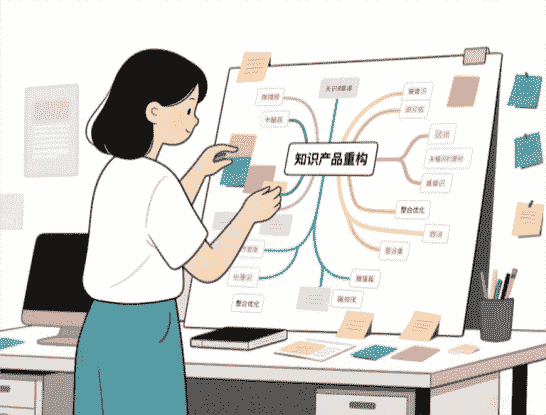

图 1-1 课程开发的常见误区与真相

在当今知识付费日益盛行的时代，越来越多的人希望将自己的知识和经验转化为有价值的课程。然而，**传统课程开发过程往往耗时耗力，需要做大量的准备工作。**

幸运的是，随着 AI 的发展，这一切正在悄然改变。

AI 不仅能帮助我们高效地完成课程开发，还能在各个环节提供强有力的支持。以前，对于中小个体和小团队而言，不借助 AI 开发课程，完成一门时长为 3 天的线下课或 12～15 节的线上课，通常需要 1 个月左右；而借助 AI 开发课程，这一时间可以压缩到一周左右。

那么，AI 究竟是如何做到这一点的呢？

AI 之所以能够协助我们开发课程，首先得益于其**强大的数据处理能力和学习能力。**AI 能够通过算法分析大量的数据、识别模式、学习规律，并在此基础上做出预测。

这意味着，在课程开发的过程中，AI 可以帮助我们从海量的资料中快速提取关键信息，为课程内容的构建提供数据支持。

其次，AI 能够提供**个性化的分析和服务。**通过了解学员的背景情况、学习偏好和行为模式，AI 能够为学员提供更具针对性的学习路径和学习内容。

这意味着，在课程开发的过程中，我们可以利用 AI 来设计更加个性化的教学方案，满足不同学员的需求，从而提高课程的有效性。

例如，通过利用 AI 模拟不同角色，课程开发者可以设计出更加生动的角色扮演环节，让学员在课程中学习如何应对不同的情景，加强学习效果。

最后，AI 可以快速响应课程开发者的需求，提供即时的反馈和课程所需的信息支持，从而提高课程开发的效率。

例如，在教学方法的选择上，AI 可以提供基于教育心理学的多种教学设计建议。你甚至可以询问 AI“对于这个知识点，用什么教学模型能够更好地讲授给学员”，然后让 AI 直接按照这个教学模型来设计这个知识点的讲解方式和教学方式。

我们**并非让**AI**取代人类，而是要与**AI**协同工作，让双方发挥各自的优势**。作为课程产品的开发者，我们必须投入时间打磨核心环节，如课程定位、经验萃取、方法论差异化、课程服务差异化、授课过程中的互动、课程包装思路等。这些环节直接决定了课程的价值，必须由我们亲自完成。

而课程开发的其他环节，如大纲拆解、内容润色、案例优化、排版整理、模板搭建等，则可以交给 AI 处理。

由此可见，借助 AI 不仅能让课程开发过程更轻松，还能让开发出来的课程更具含金量。

**在课程开发的过程中，**AI**提供的是工具和平台，而我们提供的是创意和经验。**

要开发一门能变现、受欢迎的爆款课，通常需要经历 6 个阶段，如图 1-2 所示。

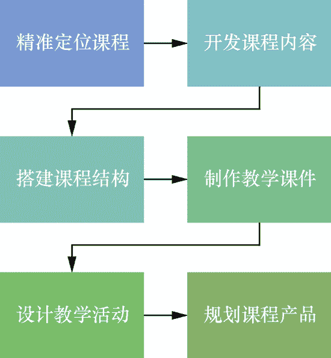

图 1-2 开发爆款课的 6 个阶段

从课程定位到课程产品规划，AI 的应用不再是简单的工具升级，而是一场效率革命。它让课程开发的每一个环节都变得更高效、更精准，甚至可以说，它重新定义了打造爆款课的可能性。因此，如果你还在用“老”方法开发课程，可能真的要考虑是不是该让 AI 来帮你“破局”了。

**1.2.1 阶段一：精准定位课程，直击市场需求**

张老师是一位资深财务课程培训师，计划开发一门中小企业财务管理课程。她根据自己的经验设计了课程大纲，但不确定这些内容是否符合学员的需求。

在我的建议和指导下，她首先在社交媒体和行业论坛上收集了大量关于中小企业财务管理课程内容需求的留言和讨论，然后让 AI 对这些文本进行情感分析和关键词提取。

经过 AI 的分析和梳理，她发现，学员们最关心的不是复杂的财务报表，而是“如何快速优化现金流”和“如何降低税务风险”。

于是，张老师根据 AI 的分析结果，调整了课程内容，将重点放在实操性强的快速优化现金流和降低税务风险上。课程上线后，学员们的反馈都非常积极，纷纷表示“这才是我们真正需要的课程”。

张老师也说：“AI 让我从‘我以为’转向了‘学员真正需要’，让我的课程开发更有针对性了。”

**在课程开发的初期，精准定位课程是至关重要的。**就像打靶要先瞄准靶心一样，是否有效开展需求分析，直接关系到你的课程内容是不是能够满足学员的需求和期待，是不是能够真正解决学员的问题。

比较遗憾的是，很多课程开发者在开发课程的时候，常常是“端起枪来直接打”，这样开发出来的课程往往无法做到以学员为中心。

传统的需求分析主要是开展调研，一般有问卷调查法、访谈法、观察法、资料分析法等需求分析的策略，其中用得最多、效果也比较好的策略是访谈法。AI**不仅是工具，更是桥梁，**它连接了课程开发者与学员的真实需求，让课程开发从“我以为”走向“学员真正需要”。

如果需要让 AI 帮你生成一个访谈提纲，那么可以向 AI 提出如下要求。

你好，现在请你扮演一名课程开发者，帮我针对一门主题为“情绪与压力管理”的课程设计一个访谈提纲。该课程的学员是一家零售连锁企业的公关部门人员，他们平时的工作以处理客户投诉、解决公关危机为主。

这门课程总时长预计 6 小时。为了保证课程落地、有效，应避免空洞、不接地气。我想与这些公关部门人员及其领导进行访谈，期望他们能够给我提供开发这门课程的建议、要求、思路、灵感等。

请输出一份调研问卷，不要太复杂，既能让参与调研的人轻松完成，又能实现我的调研目标。

AI 生成的回复如下。

你好！作为一名课程开发者，设计一个针对主题为“情绪与压力管理”的课程的访谈提纲是非常重要的，因为它将帮助你更好地了解学员的需求和期望。以下是一个针对该零售连锁企业公关部门人员的访谈提纲。

访谈提纲：情绪与压力管理课程

一、课程背景与目标

1．请简述您在公关部门的日常工作内容。

2．您认为公关部门在处理客户投诉和公关危机时面临的最大挑战是什么？

3．您希望这门课程能够帮助您的团队解决哪些具体问题？

二、情绪管理

1．您在工作中产生情绪波动的频率如何？

2．您通常如何处理工作中的负面情绪？

3．您认为哪些情绪管理技巧对公关人员特别重要？

4．您有没有遇到过特别棘手的情绪管理问题？能否分享并讨论？

三、压力管理

1．描述一下您在工作中感受到压力的典型场景。

2．您通常如何识别和管理工作中的压力？

3．您认为哪些压力管理策略对公关部门人员最有效？

4．您的团队是否有压力管理的培训或资源？其效果如何？

四、课程内容与结构

1．您希望这门课程包含哪些具体的主题或模块？

2．您认为哪些教学方法（如案例分析、角色扮演、小组讨论等）最适合这门课程？

3．您希望课程中包含哪些实际的练习或活动？

4．您希望课程结束后，团队成员能够获得哪些具体的行动点或工具？

五、课程实施

1．您认为课程的总时长（6 小时）是否合适？为什么？

2．您希望课程是一次性学完还是分多次进行？

3．您认为课程的最佳时间安排是什么？（例如工作日、周末，白天、晚上）

4．您是否希望课程结束后有持续的跟进或支持？

六、评估与反馈

1．您希望通过哪些方式来评估课程的有效性？

2．您希望在课程结束后多久收到反馈？

3．您是否愿意参与课程的持续改进？

七、其他建议

1．您是否有特别的建议或要求，以确保课程的相关性和实用性？

2．您是否希望课程中包含特定的案例研究或行业最佳实践？

3．您是否希望课程能够与公司文化或价值观相结合？

八、结束语

1．您对这门课程有何期待？

2．您认为这门课程会对您的团队和公司带来哪些长远的影响？

可以看到，AI 生成了一个清晰又专业，可以直接拿来使用的访谈提纲。这个对 AI 提要求的方式为什么如此有效呢？

• 赋予了 AI 一个擅长完成该任务的角色定位（课程开发者），并告知其具体的任务。

• 针对访谈需求，给 AI 提供了详细的背景说明，并告知 AI 这次访谈的具体要求（对象及课程目标），有助于 AI 设计有针对性的访谈问题。

这就是和 AI 对话的其中一个技巧：**设定角色**+**说明任务**+**提供背景**+**说明要求。**当然，这只是其中一个技巧，后面还会将更多的 AI 对话技巧分享给大家。

**1.2.2 阶段二：开发课程内容，丰富课程体系**

王老师是一位编程培训师，他的学员背景差异很大，有零基础“小白”，也有具备一定初级编程经验的人员。他之前采用统一的教学模式，结果有些学员觉得太简单，有些学员又觉得太难。

王老师来请教我的时候，我告诉他这很正常，因为每个学员的基础水平不一样。我建议王老师使用 AI 工具来设计个性化学习路径，以便不同层次的学员从不同的内容模块开始学起。

于是，王老师用 AI 工具生成了一份科学的能力测评。他的学员在开始学习前，先做测评，他再根据测评结果将学员分为零基础、中级和高级 3 个层次，并为每个层次的学员推荐不同的内容模块。

除此以外，学员可以根据测评结果了解自己的水平层次，从而选择适合自己的内容模块，零基础学员从最基础的语法开始学起，中级学员直接进入项目实战，高级学员则专注于算法优化。学员们也觉得这种方式让自己的学习和成长更有主导感了。

在课程结束后，学员满意度大幅提升，王老师也收到了更多好评。他说：“AI 让我实现了‘因材施教’，让每个学员都能找到适合自己的学习节奏。”

AI 的价值不仅在于提升课程开发效率，更在于让教育回归本质——因材施教，让每个学员都能找到适合自己的学习路径。这种从“千人一面”到“因材施教”的转变，正是 AI 赋能课程开发的真正意义所在。

而且，在将知识点转化为具体课程内容的过程中，AI 可以为课程开发者提供内容创作的灵感和素材，并根据课程内容和学习目标自动生成与课程匹配的案例。同时，我们还可以与 AI 共创出更契合学员需求的案例。

当课程涉及概念性、理论性知识点时，如果仅采用直接讲授的方式，不仅课程形式会显得比较枯燥，学员也难以产生代入感。此时，可借助 AI 优化知识点的呈现方式，具体形式包括但不限于以下几种。

• 将复杂概念转化为“小白都能懂”的通俗表述。

• 为学员量身定制匹配其需求的案例。

• 将知识点转换为记忆口诀。

• 从不同角度解析特定知识点。

• 构建与知识点配套的视觉化模型。

这些方法在我的课程中，均会通过实际案例拆解，学员现场演练后即可直接应用。由 AI 驱动的内容开发和案例设计，不仅更具针对性，还能显著提升学员的知识吸收效率，从根本上重构学习路径的设计逻辑与学员的学习体验。

**1.2.3 阶段三：搭建课程结构，厘清授课思路**

清晰的课程结构有助于学员更好地理解和吸收知识，更有助于授课者或分享者有条理、有逻辑地传递信息，最大限度地减少沟通漏斗带来的信息损失。

课程结构既包括宏观层面课程各个环节的设置安排，及各个内容模块之间的逻辑排序，又包括微观层面语句和语句之间的逻辑关系。

为什么课程结构设计这么重要呢？因为**上课本质上是一个信息传递的过程**。

不管是基于教育心理学、哲学中的阐释学，还是传播学，在通过图片、视频、音频、文字等方式进行信息传递时，永远都会有信息的衰减。

对方输出了 100%的信息，你能够听到和理解的信息很可能低于 80%，甚至只有 30%～50%。

因此，为了让信息的衰减程度尽可能降低，简单来说就是**授课的时候让学员尽量能听懂、能吸收，**那我们就要在向他们传递信息的过程中，把我们的内容进行恰如其分的设计和规划。这样才能让学员更容易、更准确地理解我们讲出来的内容。

**搭建课程结构的意义在于，学员在接收和回忆课程信息的时候，能够更加容易、更加便捷、更加轻松**——**让培训师传递给学员的信息能够在最大程度上得到复原。**搭建课程结构的意义，如图 1-3 所示。

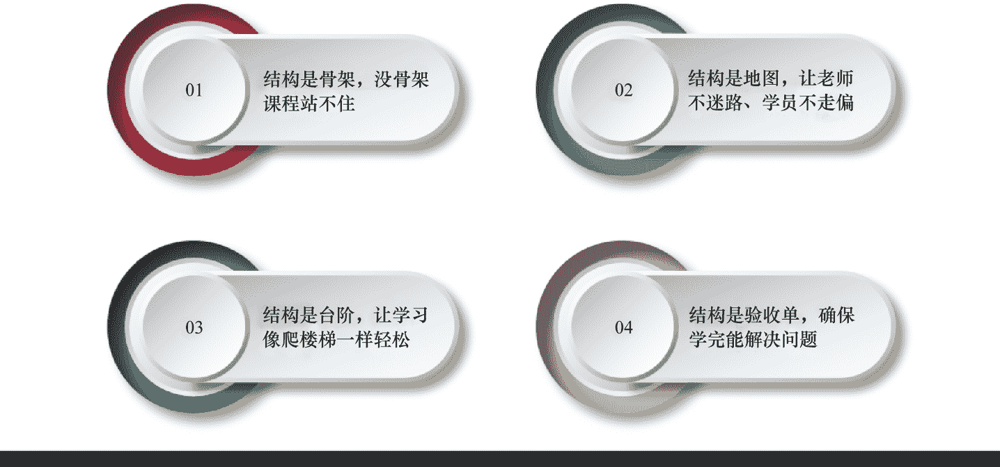

图 1-3 搭建课程结构的意义

以前搭建课程结构，对课程开发者来说非常“烧脑”的是需要反复站在学员的立场上，考虑最适合学员的信息接收方式和内容排布方式。

而现在有了 AI 工具的加持，课程开发者可以直接让 AI 先学习较为经典的课程结构，AI 学习并融会贯通之后，就可以根据一门课程的背景和特点来提供合适的课程结构供课程开发者参考。

这就相当于，把过去需要人脑深思熟虑、反复思量的事情交给机器去办，那么人就可以解放出来去做更有意义的事情。

在信息过载的时代，无结构的内容正在沦为“噪声”。学员更愿意为“被设计过的认知体验”付费，而非单纯的知识。

**当你的课程能让人**“**学得轻松、用得上手**”**，个人品牌便自动获得**“**靠谱专家**”**的心智占位**——**这才是影响力的终极壁垒。**

**1.2.4 阶段四：制作教学课件，提供多维支持**

在这个信息爆炸的时代，无论是培训师还是知识内容创作者，都面临着一个共同的挑战——**如何高效地制作高质量的教学课件，并以最有效的方式传递给学员。**

过去，制作一份精美的教学课件往往需要耗费大量的时间和精力。从收集资料、设计布局到排版美化，每一个环节都考验着培训师的耐心和技能。而现在，AI 技术能够为我们提供全方位的助力和支持。

AI 智能搜索功能可以快速为我们筛选出最相关、最优质的资料，避免我们在海量信息中盲目寻找的尴尬。

AI 的课件设计工具则能够根据我们的需求，自动生成美观大方的课件布局，让我们的课件瞬间提升档次。

语音合成技术也是 AI 在课件制作中的一个重要应用。它可以帮助我们为线上视频课添加专业的旁白，使学员的学习体验更加生动有趣。

当然，**教学不仅仅是制作课件那么简单。**

作为培训师或知识内容创作者，我们需要采用多样化的教学方法来满足不同学员的需求。无论是一对一辅导、小组讨论，还是在线直播授课，AI 都能提供强有力的支持。

• 在一对一辅导中，AI 可以根据学员的信息和历史作业情况，提供个性化的学习建议。这样，每位学员都能得到最适合自己的指导，从而更有效地掌握知识。

• 在小组讨论中，AI 可以记录并分析学员的讨论过程，自动总结要点并提出需要深入讨论的问题，促进学员更深入地探究知识。

• 在在线直播授课中，AI 不仅能录制课程、总结出复习要点，还能根据课程内容布置作业，令学员实践所学知识，提高学以致用的效率。

总之，AI 不仅为我们提供了强大的工具来提升课件制作效率，还为我们打开了探索更加多元化教学模式的大门。图 1-4 为多元化教学的示例。

图 1-4 多元化教学

**1.2.5 阶段五：设计教学活动，优化学习体验**

**个人的认知升级和思维**“**越狱**”**往往建立在引人深思的体验之上。**一个人只有经历过许多真真切切的体验，经过思维的冲击，才算实现真正的认知升级。

虽然人生体验无法被替代，但高质量的课程却可以通过精心的教学活动模拟并创造这类关键体验。

真正的学习不是听来的，而是做出来的，只有通过亲身体验，才能获得深刻的理解。所以**有效的教学活动应该是参与式的，让学员在实践中学习。**

多样化的教学活动能够满足不同学员的需求。而 AI 可以帮助课程开发者探索不同的教学活动，让学员在寓教于乐之中悟到新知，在趣味体验之中醍醐灌顶。

• 在教学活动的设计环节，AI 和课程开发者可以进行完美的配合与协作。

• 在教学活动的设计环节，需要 AI 的理性分析与设计能力，以及课程开发者的创意能力。

• 在课堂现场引导教学活动时，需要课程开发者的感性理解能力和现场氛围营造能力。课程开发者要根据学员的现场反应及当时的课堂氛围，快速地调整教学活动细节，如活动中的语言、行为、辅助工具等，这样才能确保教学活动发挥出真正的作用。

一门优质课程的核心衡量标准，从不在于传授了多少知识，而在于学员最终能将知识转化为多少实际能力与成果。现实中，不少授课者将 90%的精力投入知识讲解，即便学员听懂了理论，却往往卡在“不会用”的环节，更难谈及落地成效。

真正经得起检验的课程，需要遵循“吸、授、练、固”的设计逻辑。

• 吸：以精准的切入点吸引关注，锚定学员注意力。

• 授：清晰讲授核心逻辑与知识主干，帮助学员快速搭建认知框架。

• 练：设计针对性实践环节，推动学员动手应用所学内容，并在实践中深化理解。

• 固：以明确的实践任务收尾，帮助学员巩固关键知识，促成知识向能力的转化。

具体如何借助 AI 落地这一课程设计逻辑，将会在后续章节介绍。

**实践练习**

很多培训师在课程设计中，常会忽略影响课程效果的“关键营养”。如果你已经开发了一门课程，可以诊断一下：你的课程是否缺乏以下几种“维生素”？

• **缺乏维生素 A：**学员仅能完成“课堂内的被动配合”，换个实际场景便无法应用，如同“夜盲”般缺乏实操能力！

• **缺乏维生素 B：**知识仅停留在“听过”层面，难以在脑海中留存，学员无法形成长期记忆！

• **缺乏维生素 C：**学员上课 10 分钟便容易走神，注意力难以集中，如同缺乏维生素 C 导致的牙龈脆弱易出血！

• **缺乏维生素 D：**知识以碎片化形式堆积，学员无法构建完整的知识体系，如同“骨质疏松”般缺乏架构支撑！

若想诊断你的课程缺乏哪种“维生素”并获取对应的“补剂”，可以关注微信公众号“醒职场”，并回复“维生素”，即可通过《进来测测看，你缺的究竟是哪一种维生素？》一文完成诊断并获取针对性建议。

**1.2.6 阶段六：规划课程产品，实现商业变现**

课程产品的规划涉及课程产品的系统化设计、课程的卖点提炼及包装推广。

AI 可以通过分析市场数据，为课程产品的系统化设计提供依据，帮助课程开发者进行课程的卖点提炼并制定有效的包装推广策略，包括但不限于帮课程开发者梳理课程卖点、撰写推广文案、进行客户画像分析、提供引流获客建议、规划社群运营方式等，让其课程一经推出就能获得市场的认可，带来销量和影响力的同步增长。

AI 技术在课程开发中的应用，不仅提高了课程开发效率，还能提升课程质量。

通过 AI 的辅助，课程开发者可以更加高效地创作和设计课程内容，更加科学地搭建课程结构，更加迅速地制作课件，更有创意地设计教学活动，更有的放矢地规划课程产品。

由此可见，AI 技术已经成为课程开发中不可或缺的角色。它不仅是一个提效的智能工具，更是课程开发者的合作伙伴。

通过 AI 的辅助，课程开发者可以将复杂的课程开发过程简单化，而且还能更好地满足学员的需求，提供更加个性化和趣味化的学习体验。

**开发课程近看是折磨自己，远看是升级自己。**

**未来，不是**AI**淘汰课程开发者，而是善用**AI**的课程开发者超越不懂**AI**的课程开发者。**

## **1.3 开发课程不够快？3 招加速课程开发进程**

在“AI 课程炼金术”的课堂上，我经常听到一个说法：同行都在讲 AI 开发课程效率高、准确度高，怎么到我这儿就不一样了啊？

不知道你有没有遇到过这样的问题——别人用 AI 似乎比你用得更顺畅，为何会这样呢？

答案很简单：**你没有掌握与**AI**沟通的技巧。**

跟计算机打交道通常需要使用特殊的语言，例如编程语言 Java、Go 等，但是 AI 没有自己的特殊语言。**我们与**AI**互动使用的是人类的自然语言，也就是提示词（**prompt**）。**

现在无论是国外还是国内的 AI 工具都愈加智能化，但是我们跟它们交流还是得讲技巧和策略。这没有任何神秘之处，因为跟谁交流都得讲技巧和策略。就算你面对的是一位无所不能的大宗师，也得把话说明白，他才知道你想要干什么。

同样，人与 AI 之间的沟通也有技巧，有章法——通过调整并探索合适的提示词，让 AI 更准确地理解我们想要什么，从而得出更接近我们预期的答案。

AI 的工作原理，从某种角度上说，是在进行一个基于大数据的猜谜游戏。我们输入的提示词就相当于谜题的题面，而 AI 输出的内容就是谜底。所以，你提供给 AI 的内容越详细、范围越狭窄，AI 猜中的可能性就越大。

那么，什么是“提示词”呢？

**你可以将**“**提示词**”**理解为谜题中的关键提示。**

这些提示词通常是 AI 熟悉且能帮助它快速准确猜到“用户需求”的内容。但是，如果你写的提示词不对，AI 可能会生成富有创造性的内容，但这些内容大概率与我们的实际需求差别很大。

简而言之，提示词就是你与 AI 对话时使用的语言和表达方式，它能帮助 AI 更好地理解你的意图。**提示词写得越完整、明确，**AI**越能给出符合预期的答案。**

那怎么写提示词，才更容易得到想要的答案呢？

这就涉及与 AI 有效沟通的 6 个原则了。

**1.3.1 与 AI 有效沟通的 6 个原则**

**原则**1**：明确提示词，有层次感地提问。**

核心要点：与 AI 沟通的第一步，就是明确表达你的需求。模糊的提示词会让 AI 无所适从，而清晰的提示词则能让 AI 快速理解你的意图。

下面是模糊提示词与精准提示词的对比示例。

模糊提示词示例 1。

• 帮我写一篇总结报告。

• 请以“2025 年市场分析”为主题，写一篇 3000 字的总结报告，包含竞品对比、数据图表和未来趋势预测。

模糊提示词示例 2。

• 请告诉我××股票未来 3 个月是涨还是跌。

• 现在请你作为金融分析师，基于 2025 年 Q1 财报数据，分析某公司股价波动原因（需列出 3 个核心因素），并预测未来 3 个月走势。请分步骤说明你的推理逻辑。

**在给出提示词时，尽量提供具体的背景信息、目标和要求。**就像点外卖时，你不会只说“随便来点吃的”，而是会详细说明“我要一份宫保鸡丁套餐，加一份米饭，不要辣”。

当然，明确提示词只是第一步，更重要的是“**提示词的层次感**”。随着 DeepSeek 等国产大模型的出炉，AI 的能力已经从简单的指令执行发展到多维度思考，因此，提示词不仅要明确，还要**分层递进，让**AI**有循序渐进的思考过程**。

以下是一个富有层次感的提示词示例。

第一层：请帮我设计一门关于“时间管理”的课程。

第二层：这门课程的目标受众是职场新人，课程时长 2 小时，希望内容实用且有趣。

第三层：请为这门课程设计一个互动环节，帮助学员在实际工作中自然而然地应用所学知识。

通过分层设计提示词，AI 不仅能给出更精准的答案，还能帮助你梳理思路，甚至关注你未曾考虑到的细节。

同样地，当我们请求 AI 协助撰写课程标题或大纲时，应该明确告知 AI，课程的主题和课程目标是什么、目标受众的情况怎么样，这样 AI 生成的答案才会更符合需求。

**原则**2**：多轮互动，持续优化。**

核心要点：与 AI 进行多轮交流，就能逐步贴近需求。

若首次尝试未达预期，应持续提供具体的优化建议，直至获得满意的结果。

例如，你希望 AI 给你提供金句用作演讲的开头，首次沟通时，你可以向 AI 提出如下要求。

请给我 5 个和“知识付费”有关的金句。

这时候 AI 给你的这 5 个金句可能都不是你想要的，甚至你会觉得它给的“金句”不像是“金句”。这是因为你和 AI 对“金句”的定义可能有所不同。

那么，你需要先明确以下 3 个问题。

• 金句的作用是什么？

• 你准备在什么场合下使用金句？

• 使用时要达到什么效果？

基于以上思考，你可以再次向 AI 提出如下要求。

请重新给我 5 个关于“知识付费”的金句，建议多用修辞手法，句子内容要通俗易懂、抓人眼球，读起来要朗朗上口，尤其要适用于演讲开头，以吸引观众注意。

这时候它给出的金句，可能就会更合你的心意。

所以，如果 AI 生成的内容不符合预期，不要轻易放弃，而要通过多轮互动和反馈，逐步优化内容，直到获得满意的结果为止。

**在应用**AI**时，多轮互动不仅是**“**纠偏**”**，更是**“**共创**”**。**

在多轮互动中，AI 不再只是一个被动的工具，而是一个可以与你共同探索、共同创造的伙伴。因此，你可以尝试与 AI 进行“**对话式共创**”，即通过开放性提示词激发 AI 的创造力，助其生成新的创意和解决方案。

以下是与 AI 进行“对话式共创”的示例。

你：请帮我设计一个关于“时间管理”的课程大纲。

AI：好的，课程大纲如下……

你：这个大纲很好，但我希望课程能更注重学员的实际应用，你有什么建议？

AI：可以考虑增加一个“时间管理挑战”环节，让学员在课程结束后的一周内，每天记录自己的时间使用情况，并在下一节课中分享心得。

你：这个办法很好，请帮我设计这个环节的教学方法。

AI：建议可以这样设计……

你：你设计得不错，我希望在此基础上增加趣味性，让学员更愿意参与其中，请你再按这个要求优化下。

通过“对话式共创”，AI 不仅能帮你优化内容，还能激发你的灵感，甚至帮助你发现新的教学方法和策略。

与 AI 的高质量交互是一个持续优化的过程。首次提问是起点，关键在于分析 AI 的反馈后，通过追问、修正需求和补充信息来逐步引导对话方向，最终达成理想结果。

**原则**3**：提供上下文，进行情境设定。**

核心要点：提供具体的背景信息，进行情境设定，让 AI 的回答更具针对性。

以下是普通指令与情境设定指令示例。

• 普通指令：帮我写一篇广告文案。

• 情境设定指令：我们要在春节期间推广一款智能冰箱，目标用户是 35 岁以上的家庭主妇，主打特点是智能温控和食材管理，预算为 20 万元，准备投放抖音和小红书，需要一篇能打动目标用户的文案。

**情境设定就像地图，能帮助**AI**找到正确的方向。**提供越多的背景信息，AI 生成的内容越精准。

如果你想请 AI 给你一些授课中的指导，需要告知其授课的情境和目标。

**进行情境设定不仅是**“**描述背景**”**，更是**“**设定目标**”**。**AI 的能力已经从简单的背景理解发展到目标导向的思考。因此，在进行情境设定时，你可以明确告诉 AI“你希望达到什么目标”，并引导 AI 从目标出发，生成更具针对性的内容。

示例如下。

• 你：请帮我设计一门关于“时间管理”的课程大纲，目标受众是职场新人，课程时长 90 分钟。

• AI：好的，课程大纲如下……

• 你：我希望这门课程的目标是，不仅能帮助学员掌握时间管理的基本技巧，还能提升他们的自律性和觉察力，减少他们对时间的浪费，你有什么建议？

• AI：为了让课程更全面地帮助学员掌握时间管理的基本技巧，提升自律性、觉察力，并减少时间的浪费，可以在原有课程大纲基础上做出以下调整。

模块一：时间管理的重要性（5 分钟）

1．利用觉察力引入（5 分钟）

• 提问：你是否有过“时间被偷走”的感觉？你为什么会有这种感觉？

• 引导学员反思：无效时间的来源（如玩手机、无意义的会议等）。

• 强调：觉察力是时间管理的第一步，只有意识到问题才能改进。

模块二：时间管理的基本技巧（25 分钟）

1．自律性培养（10 分钟）

• 介绍“微习惯”理论：从小事开始培养自律性（如每天专注工作 10 分钟）。

• 练习：学员设定一个微习惯目标（如每天写一个任务清单）。

2．时间浪费的根源分析（15 分钟）

• 分析：拖延、分心、完美主义等时间浪费的常见原因。

• 案例：如何通过觉察力识别并克服这些行为。

模块三：实用工具与方法（40 分钟）

1．觉察力训练（20 分钟）

• 介绍“时间日志法”：记录一天的时间使用情况，提升学员对时间的觉察力。

• 练习：学员模拟记录一天的时间分配，并分析无效时间的占比。

2．自律性提升工具（20 分钟）

• 介绍“习惯追踪工具”：如 Habitica、STREAKS 等，帮助学员养成自律习惯。

• 练习：学员选择一个工具，设定一个习惯目标并开始追踪。

模块四：复盘与优化（20 分钟）

…………

通过设定情境，AI 不仅能帮你生成更精准的内容，还能从目标出发，提出更具创新性的建议。

**原则**4**：展开讨论，激发潜能。**

核心要点：基于 AI 生成的内容，你可以和它展开讨论，激发潜能。

在大多数情况下，与 AI 有效沟通并非一蹴而就，而是需要经历多次迭代才能收获满意答案。

有时候，甚至需要与它展开讨论，以拓宽思路、深化理解、获得更多灵感。特别是当它生成的内容令你感到困惑时，通过进一步探讨可以帮助你更好地理解内容，以便将来在授课过程中，更好地把知识技能分享给学员。

提示词模板 1：与 AI 探讨专业问题

举个例子，如果 AI 已经根据你的课程主题生成了一个课程大纲，而你想和 AI 进一步探讨里面的内容，或者是检验自己在这个领域的专业程度，你可以使用以下提示词。

现在，你是一位世界一流的研究“跨部门沟通”问题的专家，对于跨部门的部门经理之间应当如何有效沟通、化解冲突，你有着多年的研究经验。

**请参考刚刚你给我的**“**跨部门沟通**”**课程大纲，向我提问，并与我进行讨论或辩论。**要求如下。

（1）一次只提出一个问题（最好提出学员可能会问的问题），提出问题之后请先等待我的回答。

（2）每次我回答完你的问题之后，你可以根据我的回答进行补充和完善，最后评价我的回答。

（3）当你补充和评价完后，根据我们对话的内容，你可以向我提出下一个问题。

（4）当我告诉你“对话结束”时，请你根据我们的聊天记录生成一篇总结性文章。

如果你理解我的意思，请回复“OK”，并开始向我提出第一个问题。

这样一来，你和 AI 之间就展开了一场愉悦而精彩的探讨式对话。对话结束之后，它还会帮你生成一篇总结性的文章。

**原则**5**：角色设定，赋予身份。**

核心要点：在需要的情况下，为 AI 设定一个角色，赋予其身份。这有助于 AI 从特定角色的立场和角度提供答案。示例如下。

• 你是一名营养师，请为我提供一个针对运动员的一周饮食计划。

• 你是一名在知乎网站专精于某个主题的 KOL（Key Opinion Leader，关键意见领袖），我现在有个问题邀请你来回答，请使用通俗且分享式的语气。请回答该问题：×××××××××××××××？

• 你是一名经验丰富、处理过很多案件的法律顾问。我将描述一种法律情况，你将对如何处理这样的情况给我提供建议，并说明每种建议的优劣势。只回复建议及其优劣势即可，无须进行过多解释。我的第一个问题：“朋友欠我钱，很长时间不还，我可以通过法律手段追回吗？”

**角色设定不仅是**“**设计特定立场**”**，更是**“**多角色协同**”**。**AI 的能力已经从单一角色的理解发展到多角色的协同思考，因此，在角色设定中，你可以尝试为 AI“设定多个角色”，并引导 AI 从不同角色的角度生成更多维度的内容。

下面是一个示例。假设你正在设计一门关于“创业”的课程，并希望课程内容能够涵盖创业者、投资人、员工等多个视角。你可以参考以下方式与 AI 互动。

• 你：请帮我设计一门关于“创业”的课程，目标受众是有创业想法但缺乏经验的年轻人，课程时长 2 小时。

• AI：好的，课程大纲如下……

• 你：这个大纲很好，但我希望课程能更全面地展示创业的各个方面，你能从创业者、投资人、员工这 3 个角色的角度分别给出一些建议吗？

• AI：内容如下。

○ 创业者视角：创业者需要关注市场调研、产品开发、团队建设等方面，建议增加一个“创业计划书撰写”环节，帮助学员梳理创业思路。

○ 投资人视角：投资人更关注项目的可行性、盈利模式、团队能力等，建议增加一个“如何打动投资人”的环节，教授学员如何撰写商业计划书和进行路演。

○ 员工视角：员工更关注公司文化、职业发展、工作环境等。建议增加一个“如何加入创业公司”的环节，帮助学员了解创业公司的工作特点和职业发展路径。

如果需要进一步细化，可以按照如下方式与 AI 互动。

• 你：关于“如何打动投资人”这个环节，你能从投资人的角度详细讲解投资人最关心的几个问题吗？

• AI：好的，投资人最关心的问题通常包括以下几个方面。

1．市场机会：市场规模有多大？增长潜力如何？

2．产品/服务：产品的独特性是什么？解决了什么痛点？

3．商业模式：如何获得盈利？收入来源是什么？

4．团队：团队成员的背景和能力如何？是否有成功的经验？

5．财务预测：未来的财务表现如何？预计的回报率是多少？

多角色协同示例如下。

• 你：现在，我希望你能从创业者、投资人、员工这 3 个角色的角度，模拟一场创业公司内部的讨论会。创业者提出一个创业想法，投资人质疑，员工提出实际操作的困难。请模拟这场讨论会。

• AI：内容如下。

○ 创业者：我们计划开发一款智能家居设备，通过语音控制家电，提升用户的生活便利性。

○ 投资人：这款设备在市场上已经有很多竞争者，你们的产品有什么独特之处？如何确保用户选择你们的产品？

○ 员工：在技术实现上，我们可能会遇到语音识别准确率的问题，特别是在嘈杂环境中。此外，控制硬件成本也是一个挑战，如何在保证质量的同时控制成本？

总结如下。

• 你：根据刚才的讨论，请总结创业者、投资人、员工各自的核心关注点，并给出一个综合性的建议。

• AI：内容如下。

○ 创业者：需要明确产品的独特性和市场定位，制订详细的创业计划。

○ 投资人：关注项目的可行性和盈利模式，确保投资回报。

○ 员工：关注技术实现的可行性和成本控制，确保产品的质量和竞争力。

○ 综合性建议：创业者在制订计划时，应充分考虑投资人和员工的反馈，确保项目的可行性和团队的执行力。

通过多角色协同，AI 不仅能帮你生成更多维度的内容，还能从不同角色的角度提出更具实用性的建议。这种多角色的协同思考，能够帮助学员更全面地理解创业的各个方面，从而做出更明智的决策。

**原则**6**：引导思考，逐步推理。**

核心要点：对于复杂问题，引导 AI 一步步思考，逐步推理，让它思考清楚之后再给答案。

示例如下。

• 普通指令：这个项目能赚多少钱？

• 引导思考指令：让我们一步步分析，先列出这个项目的所有收入来源，再梳理和计算各项成本，最后得出利润。

实践证明，**哪怕你什么思路都不提供，只是简单地跟它多说一句**“**让我们一步步思考**”**，**AI**就能提供更准确的答案。**

如果你觉得 AI 有时候给你的答案像是不经思考就脱口而出一样，那么你可以提醒它刻意进行慢思考之后再重新提供答案。

例如，你让它做一个活动方案，它只给了你一些简单的步骤，你希望得到更详细的答案，就可以参考如下方式向 AI 提要求。

非常感谢，接下来就请你按照你所提到的步骤，为我详细讲一讲每一步具体应该如何做，每个环节的注意事项有哪些。

引导 AI 思考不仅仅是让它慢思考，更是系统思考。AI 的能力已经从简单的逻辑推理发展到系统性的思考，因此，在帮助它思考的过程中，你可以尝试引导 AI 进行系统思考，即通过引入系统思维或模型思维（如 SMART 原则、SWOT 分析等）的方法，帮助 AI 从整体到局部，生成更具系统性的内容。

示例如下。

我要给部门领导写一份年终总结，请帮我拟一份提纲，需要用 SCQA 结构来写。

请你使用 PDCA 结构来帮我优化一下业务流程。我当前的业务基本情况如下：××××××。

请你用六顶思考帽来帮我分析一下刚才提到的那个产品进军 A 市场可能遇到的情况。

综上所述，与 AI 高效对话的 6 个原则如表 1-2 所示。

表 1-2 与 AI 高效对话的 6 个原则

**对话原则解释提示词举例**

明确提示词，有层次感地提问写提示词时，务必清晰、简洁，并分层递进请以“2025 年×××市场分析”为主题，写一篇 3000 字的总结报告，包含竞品对比、数据图表和未来趋势预测

多轮互动，持续优化与 AI 进行多轮交流，进行“纠偏”与“共创”请重新给我 5 条关于“知识付费”的金句，建议多用修辞手法，要通俗易懂、抓人眼球，读起来朗朗上口，尤其要适用于演讲开头，以吸引观众注意

提供上下文，进行情境设定提供具体的背景描述信息，并设定目标若要请 AI 给你提供一些授课指导，你需要告知授课情境，包含但不限于：谁在讲述？听众是谁？在什么场合下讲述？希望达到什么目的？

展开讨论，激发潜能基于 AI 生成的内容展开更深入讨论，激发潜能请参考刚刚你给我的“跨部门沟通”课程大纲，向我提问，并与我进行讨论或辩论。要求：……

角色设定，赋予身份在需要的情况下，为 AI 设定一个角色，这不仅是设计特定立场，更是多角色协同你是一名营养师，请为我提供一个针对运动员的一周饮食计划

引导思考，逐步推理对于复杂问题，引导 AI 一步步思考，避免仓促回答让我们一步步思考：先列出这个项目的所有收入来源，再梳理和计算各项成本，最后得出利润

随着学习的深入，你会发现，你在本书中学到的调教 AI 的方式，不仅可以用来开发课程，还可以用在工作与生活中的方方面面，包括写文章、写邮件、写工作汇报、写方案、设计产品、进行数据分析、解决冲突问题、开展营销活动等。

**1.3.2 RTABC 对话模型：精准表达，告别模糊概念**

在 AI 技术刚刚兴起时，许多人习惯性地将 AI 当作搜索引擎来使用，这其实忽略了 AI 与传统搜索引擎如百度、谷歌之间的根本区别。搜索引擎是基于关键词进行信息检索，而 AI**更像是一个充满智慧的大脑，它能够理解复杂的问题并给出详细的解答。**

然而，与这样一个充满智慧的存在交流，我们需要具备一定的提需求技巧——学会如何通过提需求，让面前这位充满智慧的“导师”揭示或生成我们所需要的信息。

与 AI 对话，就好比两人初次见面时的对话。如果你和对方面面相觑、无话可说，那么双方只会感到尴尬。但如果你有一个清晰明确的开场白，就能迅速拉近彼此的距离，进而展开愉快的交谈。

AI 越是智能，一次平庸对话和一次高效对话所能得到的结果，差距就越大。

随着 AI 越来越“聪明”，我们的目标不应是如何偷懒（在与 AI 沟通上少花精力），而是要系统学习那些能让 AI 发挥出更大潜能的对话策略。

因此，与 AI 交流需要掌握一套有效的对话公式，以确保能够从 AI 那里获得高质量信息。

为了帮助大家更好地与 AI 沟通，我总结了一个结构化的 RTABC 对话模型，构成了与 AI 对话的有效开场白，如表 1-3 所示。

表 1-3 RTABC 对话模型

**英文单词中文解释对话启发**

Role 角色请 AI 充当一个什么角色

Task 任务让 AI 帮你完成一项什么任务

Aim 目标做这件事要达成的目标

Background 背景提供相关的背景信息或情境

Condition 条件提供其他要求或条件

**（**1**）确定角色（**Role**）。**确定角色，指的是让 AI 明确你希望它扮演的角色。无论是领导、老师还是朋友，你都可以指定它扮演任何角色。同时，你最好能告诉 AI 你自己的身份，这样双方在交流时就能建立起一种互动的关系。

例如，你需要 AI 解释复杂的金融知识，可以使用如下提示词。

你是一位金融领域的专家，请用初中生能听懂的语言，给我讲讲“做空”是什么意思，以及它通常用于哪些方面。

再如，你希望 AI 分析商业计划书并提出合理建议，可以使用如下提示词。

你是一位从业 20 年的资深投资人，运用批判性视角和投资思维，分析我上传的这份商业计划书，指出其中最关键的 3 项潜在致命风险，并据此为我提供建议。

**（**2**）明确任务（**Task**）。**明确任务，就是明确表达你希望 AI 做什么，这是对 AI 进行任务说明。例如，让 AI 帮你写出既有吸引力又贴合学员的课程标题。

为什么要给 AI 提出明确具体的任务？因为 AI 是以指令为基础进行操作的，如果任务要求模糊不清，AI 可能会根据自己的理解去生成内容，那么就有可能无法满足我们的期待。

明确具体任务，能让 AI 更准确地理解我们的意图，生成我们预期中的内容。

**（**3**）说明目标（**Aim**）。**说明目标是指与 AI 对话时，不仅要描述具体任务，还要说明目标，也就是你期望 AI 生成的内容所呈现的效果，例如字数要求、语言风格、表达方式等。

例如，你希望 AI 为你撰写一封邮件时，可以告诉它邮件的用途、收件人的性格特征及所需的语气风格，这样它写出来的邮件更贴合你的期望。

**（**4**）描述背景（**Background**）。**描述背景是指在提问时提供足够的背景信息，可以帮助 AI 更准确地理解情境并给出合适的答案。

例如，请 AI 帮你设计课程推广语之前，可以描述目标受众群体的特点，包括他们的年龄、教育背景、职业，以及容易吸引他们的点，这样 AI 生成的推广语更有针对性。

**（**5**）补充条件（**Condition**）。**补充条件是指如果 AI 的回答未能完全满足你的需求，可以通过补充条件，包括缩小问题边界或提供具体示例，来进一步细化需求。缩小边界意味着将问题具体化，而提供示例则是让 AI 参考你给的样本来生成内容。

下面是不使用 RTABC 对话模型与使用 RTABC 对话模型的对比案例。

不使用 RTABC 对话模型，直接向 AI 提问，如下所示。

我是一名新媒体运营人员，请帮我写一篇年度工作汇报。

AI 的回复如下。

年度工作汇报：探索新媒体运营的边界

尊敬的领导与同事们：

2024 年，作为公司的新媒体运营负责人，我有幸带领我们团队在新媒体领域取得了显著的进步和成就。以下是我对过去一年工作的总结与反思，希望能为我们接下来的工作方向和策略提供参考和启发。

一、关键成就

1．增长与扩张：今年，我们的主要平台粉丝增长了 50%；通过精准定位目标受众和优化内容发布策略，我们不仅提高了用户的活跃度，也显著增加了品牌的市场影响力。

2．内容创新：我们推出的系列互动活动，如“品牌故事”和“行业洞察”，增强了用户的参与感和黏性。这些内容被行业内外广泛认可和转发，有效提升了我们的品牌声誉。

3．技术优化：在技术层面，我们成功实施了数据分析工具的升级，这不仅保证了内容发布的时效性，还优化了广告投放的精准度，显著提升了投资回报率。

二、面临的挑战与应对策略

尽管取得了不错的成绩，我们仍面临一些挑战。例如，如何在内容过剩的环境中保持独特性和新鲜感，以及如何进一步提升用户的转化率等。为此，我们计划：

…………

三、未来展望

展望未来，我们将继续探索新媒体的各种可能性，并将新技术融入日常运营中……

最后，感谢每一位团队成员的辛勤工作和努力，也感谢领导的支持和指导。让我们携手共进，迎接更加光明的未来。

这个答案有些空洞，下面尝试使用基于 RTABC 对话模型设计的提示词模板。

提示词模板 2：请 AI 写年度工作汇报

#你的角色：一位资深的新媒体运营专家，擅长撰写高质量的新媒体运营汇报。

#你的任务：基于新媒体工作人员的工作岗位，写一份完整的年度工作汇报。

#你撰写这份工作汇报的目标：增强汇报的逻辑性和说服力，使未来的工作计划获得管理层的认可和支持。

#背景信息：我作为新媒体运营人员的工作，是负责公司在各大社交媒体平台上的内容创作、内容发布、社群管理和用户互动。

#补充说明：工作汇报的内容需包含以下 3 项。

1．清晰展示过去一年的工作成果和关键数据（已提供数据）。

2．准确分析新媒体运营中遇到的问题和挑战（已提供关键词）。

3．提出有针对性的改进措施和未来一年的工作计划。

AI 的回复如下。

年度工作汇报：新媒体运营的深度探索

尊敬的领导与同事们：

感谢大家在过去一年中对我们新媒体运营工作的支持和信任。本报告旨在全面回顾过去一年的工作成果，并展示关键数据；分析遇到的问题与挑战，并提出有针对性的改进措施及未来一年的工作计划。希望这份汇报能够让我们未来的方向更加清晰。

一、工作成果及关键数据展示

在过去的一年里，我们通过精细化的内容创作、精准的内容发布策略及高效的社群管理，取得了显著的成绩。以下是关键数据汇总。

1．粉丝增长

全平台总粉丝量从年初的 50 万增长至年末的 80 万，增幅达 60%。

主要增长平台为抖音（+40%）、小红书（+35%）和微博（+25%）。

2．内容创作与发布

全年共发布原创内容 1200 篇，平均每月发布 100 篇。

内容包括图文、视频、直播等多种形式，其中视频类内容互动率最高，达到 15%。

3．社群管理与用户互动

建立了超过 20 个细分社群，覆盖核心用户群体。

社群活跃度保持在 70%以上，用户参与度高，形成了良好的社群氛围。

4．品牌曝光与影响力提升

年度总阅读量突破 5000 万次，同比增长 50%。

品牌关键词搜索量增长 30%，品牌知名度显著提升。

二、问题与挑战分析

尽管取得了显著的成绩，但在实际运营过程中，我们也遇到了如下问题与挑战。

1．内容同质化严重

在某些平台上，与竞争对手的内容风格和主题趋同，导致我们的内容难以脱颖而出。

2．用户黏性不足

尽管粉丝数量增长迅速，但部分用户的互动频率较低，忠诚度有待提升。

3．平台算法变化频繁

各大社交媒体平台的推荐算法不断调整，导致我们的部分内容未能获得足够的曝光机会。

三、改进措施与未来计划

针对上述问题，我们制定了以下改进措施，并对未来一年的工作进行了详细规划。

1．内容创新与差异化

目标：提升内容的独特性和吸引力，避免同质化竞争。

具体措施：……

2．提升用户黏性与忠诚度

目标：提高用户的长期留存率和互动频率。

具体措施：……

3．应对平台算法变化

目标：优化内容发布策略，适应平台算法的变化。

具体措施：……

4．跨平台资源整合与协同

目标：实现多平台资源的有效整合，提升品牌整体影响力。

具体措施：……

四、未来一年的工作计划

基于以上改进措施，我们对未来一年的工作进行了详细的规划，主要分为以下几个阶段。

Q1：内容创新与品牌升级

…………

Q2：用户黏性提升与活动策划

…………

Q3：平台资源整合与推广

…………

Q4：年终总结与优化调整

…………

过去一年，我们在新媒体运营方面取得了一定的成绩，但也面临着诸多挑战。未来，我们将继续秉持创新精神，优化运营策略，提升用户体验，力求在新的一年里取得更大的突破。希望管理层能够给予更多的支持与指导，帮助我们共同实现公司的战略目标。

再次感谢大家的支持！

附录：关键数据图表、粉丝增长趋势图、内容发布与互动率对比图（略）

这样得到的答案是不是更清晰、更细致、更专业，也更容易让你的工作汇报打动领导了？

在补充条件这一维度，你可以从以下 3 个方面操作。

**（**1**）指定输出格式，**即明确你期望的答案呈现形式。可以使用如下 3 种方式来指定输出格式。

• 请用表格形式对比 3 种方案的优缺点。

• 请生成一份以分钟为单位的详细时间规划表。

• 请将此 PPT 框架内容以 Markdown 格式输出。

如果对输出格式或风格有具体要求，最高效的方式是直接提供一份模板，并告知 AI“请参照此模板撰写”。

**（**2**）设定内容深度，**说明所需信息的详细程度。如下为两个设定内容深度的示例。

• 简要介绍区块链的概念（浅层需求）。

• 详细分析区块链在供应链管理中的技术实现路径和商业价值（深层需求）。

**（**3**）限定响应范围，**给出具体约束条件以聚焦 AI 的输出。例如这样写：若需 AI 推荐投资方案，不能直接要求“推荐性价比高的方案”，而是先向 AI 说明你的收入状况、家庭情况、年龄、性别、风险偏好等，再请其推荐适配的投资方案。

下面以几个案例详细说明 RTABC 模型的应用。

**案例**1**：撰写小说。**

你是一名经验丰富的推理小说作家，擅长创作扣人心弦的故事，并且能够巧妙地埋下伏笔，让读者在阅读过程中不断猜测结局。（角色）

请创作一部推理小说，要求故事具有强烈的悬疑色彩，并且拥有一个出人意料的结局。（任务）

小说能让读者感受到作者的巧妙布局。（目标）

故事背景设定在一个充满神秘色彩的小镇上，这里发生了一系列离奇的事件，这些事件看似互不关联，但实际上隐藏着一条贯穿始终的线索。主人公是一名机智的侦探，他需要解开谜团。（背景）

故事应包含至少 3 名主要嫌疑人，每名嫌疑人都有合理的动机和不在场证明；语言风格要紧凑、引人入胜，让读者读完后难以忘怀。（条件）

**案例**2**：写演讲稿。**

你是一名充满激情和感染力的励志演说家，擅长用鼓舞人心的话语激励听众超越自我。（角色）

请撰写一篇关于“永不放弃”的主题演讲稿。（任务）

演讲稿要让听众感受到即使面临艰难险阻也应坚持梦想，因此要勇于迎接挑战，并为实现梦想而不懈努力。（目标）

听众群体是由各行各业的人士组成，他们可能正面临着各自人生中的挑战和困境。这些人需要听到能够触动心灵的话语，唤醒内心深处的力量，重拾信心与希望。（背景）

演讲稿应包含真实的故事或案例，以增加说服力和可信度，演讲时长约为 20 分钟，确保演讲稿符合这个时长，结尾部分可以提供一些实用的建议。（条件）

**案例**3**：提供职业建议。**

你是一名资深的职业顾问，专长是帮助人们根据自身的技能、兴趣和经验找到最适合的职业发展道路。（角色）

请为那些对软件工程领域感兴趣，并希望在此领域寻求职业发展的人提供职业指导。（任务）

通过你的指导，这些人能够更好地明确自身定位，并制订出实现职业目标的具体计划。（目标）

这些人有的已经在 IT 行业有一定工作经验，多为转型者，有的可能是即将毕业的学生。他们都希望能够在软件工程领域找到合适的职业路径，并希望了解该领域的就业市场趋势。（背景）

你需要分析当前软件工程行业的就业市场趋势，提供获取相关资格证书或提升技能的建议，如果可能，提供一些成功案例，展示其他人是如何进入该领域并取得成功的。（条件）

**案例**4**：课程特色挖掘。**

你是一位资深的课程策划专家，拥有丰富的经验和敏锐的市场洞察力，能够帮助课程开发者识别并突出课程的优势和卖点。（角色）

请帮我找出“促动式读书会”这门课程的独特特色和卖点，以便我能更好地推广这门课程。（任务）

请帮助我明确课程的差异化竞争点，提高课程的吸引力和竞争力。（目标）

关于“促动式读书会”的介绍，详见网址……（背景）

请详细列出该课程的独特之处，分析课程相对于市场上其他同类课程的优势；描述课程的卖点，特别是那些能够吸引目标受众的特色，如课程的实用性、学习成果展示机会、能促进收入增加等。（条件）

**案例**5**：分析用户画像。**

你是一名市场分析师和课程分析师。（角色）

请根据“读书会创始人运营课”这门课程的特点，进行该课程的用户画像分析，内容包括他们的年龄、性别、职业、教育背景、兴趣爱好、行为习惯等关键信息。（任务）

通过对目标用户的深入了解，帮助我更好地定位课程内容，确保课程能够满足目标用户的需求。（目标）

“读书会创始人运营课”是一门旨在帮助学员从零开始创建和运营自己的读书会的课程。课程内容包括但不限于读书会的筹备、活动策划、会员招募、社群管理、内容创作、读书会商业化等方面。（背景）

如果可能，请你提供一些典型用户案例，展示他们的具体需求、遇到的常规问题和期望，以及他们希望通过课程学习达到的目标。（条件）

用了 RTABC 对话模型，如果 AI 的回复仍不能让你满意，你可以继续补充条件，要求它细化内容、举例子、打比方，或者给它一个样本，让它仿照样本生成更专业的版本。

**1.3.3 细节三问法：深入挖掘，获取具体信息**

在使用 RTABC 对话模型后，如果发现 AI 的回答仍然过于笼统或抽象，可以运用细节三问法来获取更加具体的信息。

**（**1**）信息太粗问细节。**

当 AI 的回复过于宽泛，可以通过询问更具体的信息来获得更深入的理解。例如，如果 AI 在描述某个概念时不够详细，可以按如下方式提问。

关于×××××的描述，还不够细致，能不能在此基础上继续细化、进一步解读？

如果希望 AI 给出的答案更精准、更可靠，可以在对话中加入一句类似“让我们一步一步地思考”或“请展示你的推理过程”的指令，这样 AI 便会展示其得出结论的步骤。

这个过程不仅让答案更可靠，还能让你更轻松地判断 AI 给出的答案的逻辑是否正确。可以说，**你的提问是确保**AI**高质量回复的**“**助燃剂**”。

**（**2**）信息抽象问例子。**

有时候，AI 的回答虽然详细，但却过于理论化，难以理解。这时，可以请 AI 举出具体的例子来帮助我们更好地理解信息，可以按如下方式提问。

有关×××××还不太好理解，能否给我举一个形象、具体的例子？

**（**3**）信息满意问补充。**

如果 AI 已经给出了满意的答案，但你仍希望了解更多相关信息，可以先给它鼓励，然后给出一个让 AI 继续思考的切入点，AI 可能会给出更妙的答案。可以按如下方式提问。

你的回答很棒！如果希望让学员更好地理解，那么在 A 环节还可以举哪些例子或者设计什么样的互动？

通过细节三问法，我们不仅能从 AI 那里获得所需信息，还能构建一个“问题灵感库”。

例如，你想让别人觉得你有一个有趣的灵魂，可能会直接按如下方式向 AI 提问。

如何让别人觉得自己很有趣？

AI 的回复如下。

要让别人觉得自己有趣，可以尝试以下方法。

1．丰富话题：广泛涉猎各种知识，这样在很多话题上都能发表自己的见解，增加谈话的深度和广度。

2．幽默感：幽默是让人觉得有趣的重要特质，学会讲笑话，或者在对话中巧妙地加入幽默元素。

3．善于倾听：认真倾听别人说话，并在适当的时候给予回应，这样可以让人感到被重视，也会觉得你更有趣。

4．独特的见解：对事物有自己的看法，不人云亦云，这样可以吸引别人的注意力。

5．自信：自信的人更容易让人觉得有趣，保持自信的姿态和语言，可以提升你的魅力。

6．使用肢体语言：使用丰富的肢体语言可以增强你的表达力，使你的讲述更加生动有趣。

7．学会讲故事：用有趣的方式叙述经历，能够吸引别人的兴趣。

8．保持好奇心：对新鲜事物保持兴趣，这样可以不断有新话题与他人分享。

9．保持乐观态度：乐观的人更容易让人觉得有趣。尽量以积极的态度面对生活，传递正能量。

10．适当自嘲：适当自嘲可以让人觉得你幽默、谦逊，这也是一种有趣的表现。

你要记住，每个人对“有趣”的定义不同，所以最重要的是做真实的自己，同时不断提升自己的社交技巧。

对于上文这样的提问，AI 往往会给你一些正确的废话。

如果想进一步了解细节，可以用细节三问法继续向 AI 追问，示例如下。

1．关于“学会讲故事”的描述，还不够细致，能不能在此基础上继续细化、进一步解读？

2．你刚说的“丰富话题”这一项，不太好理解，能否给我举一个形象、具体的例子？

3．关于“如何让别人觉得自己有趣”，你的回答非常好！除了你刚才讲的这 10 种方法之外，还有其他方法吗？你还能再补充一些内容吗？

这样一来，你就能得到更多实用而有趣的答案了。

**1.3.4 与 AI 共舞法：3 种提问艺术，引导深入思考**

有时候，尽管已经尝试了各种提问方式，但仍然无法从 AI 那里获得满意的答案。这时，不妨尝试向 AI 求助，询问如何更好地提问。常用的求助方法有 3 种——多角度提问法、第三人称视角法和角色互换法。

**方法**1**：多角度提问法。**

如果我们对某个问题只有一个模糊的想法，不知道该从什么角度提问，可以请 AI 帮助我们生成多个提问角度，以便更全面地了解问题。例如，可以按以下提示词向 AI 提要求。

刚才说的这个事儿，你能帮我想 N 个不同的提问方式吗？这样也方便你提供更合适的答案。

如果你正在设计一门课程，但不确定如何组织课程内容，又想询问 AI，可以用以下提示词向 AI 提问。

关于课程设计，你能帮我列出 10 个不同角度的问题吗？

这样，AI 可能会提供诸如“如何定义课程目标？”“如何评估学员的学习进度？”等问题，帮助你更全面地考虑课程设计的各个方面。

**多角度提问法的关键就是，让**AI**告诉你应该怎么问。**

**方法**2**：第三人称视角法。**

当我们希望从他人的视角出发考虑问题时，可以询问 AI 其他人通常会怎样提问。例如，可以按以下提示词向 AI 提问。

有关这个话题，其他人都会问你什么问题？

如果你是一名产品经理，想了解用户对产品的反馈，可以用以下提示词向 AI 提问。

用户在使用这款产品时，通常会提出哪些问题？

这时，AI 可能会列举出用户关心的产品性能、使用体验等方面的问题，帮助你更好地理解用户需求。

如果你在开发一门面向新媒体运营者的“从 0 到 1 做运营”的课程，那么可以用以下提示词向 AI 提问。

在社交媒体运营方面，其他新媒体运营者通常关注哪些问题？

AI 的回复如下。

其他新媒体运营者经常询问如何计算媒体活动的投资回报率，如何识别和利用最新的社交媒体，以及如何通过社交媒体增强客户黏性……

若需生成课程常见问题，可进一步引导 AI 代入目标受众视角，列出他们可能存在的疑问。这时，可以用以下提示词向 AI 提问。

请你扮演一位对我的课程[此处写课程名称]感兴趣，但又非常挑剔、持币观望的潜在学员。请你向我提出 5～7 个最可能阻碍你下单的棘手问题。这些问题应该覆盖课程价格、授课时间、个人基础、课程效果和竞品对比等多个方面。

当 AI 生成常见问题后，若需获取针对性的回应话术，可运用前文提及的“原则 2：多轮互动，持续优化”，进一步追问。

请你选择刚刚生成的第 1 个棘手问题（如“这门课为什么这么贵？”），告诉我如何回答才能让潜在学员满意且信服。请给出一份专业且有说服力的回应话术。

这种借助 AI 的操作，本质是“借力打力”，同时破解了“知识的诅咒”——专家因自身认知框架的局限，难以客观预判非专业受众的理解需求与兴趣点。

例如，在利用 AI 生成多个文章标题或课程标题后，决策者往往会基于个人偏好筛选，却容易忽略目标群体的真实反馈。鉴于人类换位思考的天然局限性，建议通过 AI 模拟目标用户视角。可以参考以下提示词向 AI 提问。

如果你是一名基层新媒体运营学员，从选课角度出发，请选出以上几个标题中最能吸引你注意力、让你感兴趣的，并说明为什么这么选？

这样不仅规避了主观偏差，更可通过数据驱动的用户洞察，确保内容精准契合受众认知习惯，进而显著提升传播效果与课程吸引力。

**方法**3**：角色互换法。**

当陷入某种固定的思维模式时，可以请 AI 假设处于我们的位置，看看它会怎样提问。例如，可以参考以下提示词向 AI 提问。

现在假设咱俩角色互换一下。如果你是我（我的角色是×××），你接下来会问些什么？

如果向 AI 询问某个概念时，AI 给你的回答有些抽象，你看不太明白，那么你可以参考以下提示词再次向 AI 提要求。

我是一名小学生，请你基于我的情况重新解释刚才那个概念。

这时候，它会立刻更换语言表达方式，用更加通俗易懂、更有趣、比喻加类比的方式来诠释那个概念。

如果你是一名零售行业销售经理，正在开发一门销售课程，试图提高团队的销售业绩，可以参考以下提示词向 AI 提问。

我是××行业××公司的销售经理，如果你是我的话，你在提高团队销售业绩的课堂上，会提哪些问题来促进销售团队反思自己的表现？

AI 会指引你从销售目标、客户理解、团队合作、业绩分析等角度来提问。

多角度提问法、第三人称视角法、角色互换法都是借 AI 提升提问艺术的方法，其核心在于借助 AI 的智能来提出更恰当的问题，以帮助 AI 更好地理解你的需求，从而提供更精准的回答。这 3 种提问方法适用于已尝试多种提问方式但仍未能获得满意答案的情况。

**实践练习**

请根据你即将开发的课程，运用 RTABC 对话模型、细节三问法、与 AI 共舞法，向 AI 发起提问并观察 AI 如何回应，相信你能得到令你惊喜和满意的内容。

通过这样的神奇三招，你会发现 AI**正在演变成你的**AI**助理**。

许多人声称“不会做”某件事，实际上是因为他们面临一些技术上（或思路上）的障碍，而不是因为他们缺乏基本的能力。

AI 不仅能解决这些障碍，还能很大限度地提高我们的工作效率和课程开发效率。

通过前面的讲解和案例，你会发现，**只要能够清晰地表达需求，**AI**就能帮助你实现目标**。

现在，我们可以把课程开发中的那些细节交给 AI 助理处理，让自己专注于更高层次的思考和创意。

**不会用**AI**的人开发课程靠灵感，会用**AI**的人开发课程盯成效。**

## **1.4** **开发课程不够好？激发 AI 潜能的撒手锏**

“人工智能”与“人工智障”之间仅一字之差，核心区别在于我们能否运用提问技巧、对话艺术和思考链来激发它的潜能，让它真正成为我们的“外脑”，成为我们工作中的得力助手。

**最好的工具就是你已有的工具，重点在于你怎么用它。**

本节介绍在开发课程时，能够激发 AI 潜能的撒手锏——“六脉神剑”。你可以理解为，这一节我们学习的是，在开发课程时，用什么样的提示词和 AI 对话，能够解锁 AI 的更多功能，从而达到事半功倍的效果。

**剑法**1**：身份赋能法。**

通常的表达方式为：假设“你是谁+你会什么+任务内容”。

核心思路：先定义 AI 的角色，并界定它的能力和经验范围，再给它具体的任务指令。示例如下。

假设你是一名资深的企业培训师（角色），有着丰富的项目经验和多年的团队管理经验（能力界定）。请你编写一份针对企业中高层管理者的培训课程大纲（任务）。

**剑法**2**：角色匹配法。**

通常的表达方式为：告知“我是谁+我的背景+任务内容”。

核心思路：告诉 AI 它正在与谁沟通，这个人的背景情况是怎样的，再给它具体的任务指令，AI 会根据谈话对象的情况来自动调整输出的内容。这种表达方式适用于你站在学员的立场、模拟学员的身份和 AI 进行对话。示例如下。

假设我是一家银行的客户经理（角色），虽然有多年销售经验和客户管理经验，但之前的经验都是在线下积累的，对于线上营销、互联网知识、私域营销等一无所知（背景），请你用通俗易懂的方式告诉我“私域营销”是什么意思（任务）？

**剑法**3**：情境定制法。**

通常的表达方式为：告知“角色+任务场景+任务内容”。

核心思路：告诉 AI 扮演的角色和具体的任务情景，包括但不限于时间、地点、人物、事件等元素，以及任务内容的其他细节，请 AI 作为某个角色帮你完成该任务。示例如下。

我是一名企业培训师（角色），明天早上要组织一场时长 3 小时的培训，主要针对新入职的软件工程师和设计师，培训内容为企业规章制度和企业文化，以及针对他们工作岗位的具体要求（场景）。由于时间紧迫，现在请你作为一名资深企业培训师为我编写一份合适且详细的课程大纲（任务）。

**剑法**4**：问题重塑法。**

通常的表达方式为：提出需求/问题+建议更好的版本。

核心思路：利用 AI 大模型来优化你提出的问题或需求的话术。示例如下。

关于“我该如何优化沟通技巧的课程？”请提供 3 个更好的向 AI 提问的话术，并询问我是否愿意使用它。

**剑法**5**：问题组装法。**

通常的表达方式为：提出需求+你可以提出一系列关于×××等的附加问题来问我，然后根据我的回答帮我完成某项任务。

核心思路：让 AI 帮助我们将一个大问题拆解成若干个小问题，然后由我们通过回答这些小问题来提升 AI 输出内容的质量。

示例 1 如下。

作为一名创作人，我希望有一些问题能激发我的创意并构建故事情节，生成一系列关于我的创作风格、题材偏好和主要情感表达等附加问题，将这些问题的答案组合起来，以辅助我的创作过程。

示例 2 如下。

我想要准备一份“领导力之中层管理能力跃迁”的课程简介，需要你生成一系列关于这门课程的受众人群、行业、管理中的挑战等附加问题。等我回答这些问题之后，你将这些问题的答案组合起来，制作一份完整的课程简介。

在使用“问题组装法”时，AI 会根据你的一个需求生成一系列附加问题。我们一一回答这些附加问题后，AI 才能完成任务。这个过程对我们而言其实是有些费力的，而且整个过程更像是在填写问卷，而不是在与 AI 对话。

同时，当你把一大堆问题的答案提供给 AI 的时候，AI 也不一定能全部理解，它可能只理解了一部分，所以它给到你的最终答案是根据它理解的这一部分生成的，也不算特别完善。

怎么解决这个问题呢？

你可以在 AI 提出众多问题之后，再跟它说明如下要求。

从第一个问题开始依次问我，让我可以循序渐进地作答。问完后，你将这些问题的答案组合起来，帮助我制作一份准确完整的课程简介。

这样做的结果是，AI 会逐个提出刚才罗列的问题，你可以循序渐进地作答，AI 也能根据你对每个问题的回答适当调整下一个问题，这样你们之间的对话就有了一定的灵活性。

这样一方面是让你可以跟 AI 进行多轮对话，让你们之间的交流更顺畅；另一方面，还能避免 AI 因为你同时输出太多内容而生成不必要的答案。

**剑法**6**：案例借鉴法。**

通常的表达方式为：学习案例+总结案例的优点+模仿案例中的××完成任务。

核心思路：和 AI 对话时，给出清晰的指令或要求后，如果能给出示例供 AI 学习和模仿，那么 AI 给出的回答将会更加贴合你的需求。需要注意的是，这种方法需要你和 AI 进行多轮对话，让它一步一步地操作。

可以参考以下提示词向 AI 提问。

你现在是一名非常优秀的新媒体文案创作者，接下来我给你发送 5 个微信公众号爆款文章的标题，请你总结出这些标题的共同点。

5 个微信公众号爆款文章标题如下所示。

1．为什么你加班 996，工资却原地踏步？

2．刻意练习正在毁掉你：真正有效的学习是“不努力”

3．殡葬师口述：给遗体化妆时听到的离奇故事

4．除了“来都来了”，还有一句魔咒，会令你狂买一堆“垃圾”

5．35 岁被裁员后，我靠 ChatGPT 月入 3 万元

你收到后要回复“好的”并总结这 5 个微信公众号爆款文章标题的写作风格，并说明它们为什么能成为爆款文章标题。

AI 的回复如下。

好的。

一、标题共同点总结

1．制造冲突与反差

通过对比（如“996 加班”vs“工资不涨”）、反常识（如“刻意练习毁掉你”）、颠覆认知（如“学习是「不努力」”）等手法，激发读者好奇心和点击欲。

2．直击痛点或焦虑

标题瞄准职场压力（996、裁员）、学习误区（刻意练习）、消费陷阱（狂买“垃圾”）、生存危机（35 岁失业）等普遍焦虑，引发强烈共鸣。

3．悬念与故事感

如“殡葬师口述”“离奇故事”“一句魔咒”等，通过神秘感或叙事感吸引读者探索内容。

4．数字与具体案例

使用具体数字（35 岁、月入 3 万元）或场景化案例（遗体化妆、狂买“垃圾”），增强真实感和代入感。

5．情绪驱动传播

标题隐含愤怒（职场不公）、恐惧（被裁员）、猎奇（殡葬行业秘密）、后悔（消费陷阱）等情绪，刺激转发分享。

二、爆款原因分析

1．高打开率：冲突性标题在信息流中脱颖而出，用户因“认知失调”或“情绪波动”忍不住点击。

2．强传播性：痛点+情绪的组合（如焦虑、好奇）天然适合社交传播，读者会主动转发给同类人群。

3．内容价值：标题承诺提供“解决方案”（如用 ChatGPT 赚钱）或“稀缺信息”（如殡葬师经历），满足实用或猎奇需求。

AI 很有洞察力和分析力，立马总结出了 5 个“诱人”的微信公众号爆款标题写作特点。接下来可以参考以下提示词向 AI 提问。

很好，请根据这些特点再写 5 个符合微信公众号爆款文章标题特点的标题，围绕主题“AI 对培训行业有何影响”来写。

AI 的回复如下。

好的，基于之前总结的 5 个微信公众号爆款文章标题的特点，以下是围绕“AI 对培训行业有何影响”这一主题撰写的 5 个新标题。

1．AI 讲师月入 10 万元：90%的培训师正在被算法淘汰

2．听完 AI 讲的课，我再也不想为“名师”买单了

3．培训行业巨变：年薪 50 万元的知识博主，未来 5 年将消失 80%？

4．我用 AI 克隆了自己的声音讲课，学员竟然没发现……

5．ChatGPT 当助教后，我的课程退款率降了 70%

爆款逻辑拆解。

•  痛点精准：瞄准培训师、知识博主、学员三大群体的焦虑（失业、课程质量、学习体验）。

•  情绪驱动：利用“危机感”“颠覆感”“惊喜感”刺激传播。

•  数据+案例：用具体数字（10 万元、80%、70%）增强可信度。

•  身份代入：通过“我”“你”等代词，让读者自动对号入座。

提示词模板 3：请 AI 模仿优质标题来写课程标题

与 AI 展开第一次对话，可以使用以下提示词向 AI 提需求。

我先给你一些课程标题作为参考，你看了之后先总结出它们的特点。

1．高效【关键词】的【数字】步骤，如“高效学习的 7 个步骤”。

2．【数字】天掌握【关键词】窍门，如“14 天掌握创业窍门”。

3．最全指南：【数字】步骤掌握【关键词】，如“最全指南：6 个步骤掌握营销技巧”。

4．【数字】步骤轻松掌握【关键词】技能，如“3 个步骤轻松掌握摄影技巧”。

5．【数字】招帮你攻克【关键词】，如“一招帮你攻克面试的挑战”。

6．【关键词】的【数字】必杀技，快速成为【关键词】成功者，如“创业的 6 个必杀技，快速成为创业成功者”。

7．揭示【关键词】的【数字】个【秘密】，如“揭示健康饮食的 7 个秘密”。

8．你绝对不知道的【关键词】【数字】个真相，如“你绝对不知道的科技行业 10 个真相”。

9．【数字】天变成【关键词】专家，如“30 天变成健康饮食专家”。

10．【爆款】【产品解析】：成功案例，如“爆款手机解析：了解成功的×××产品策略”。

AI 的回复如下。

好的。

这些课程标题的特点总结如下。

1．使用数字

几乎所有标题都包含具体的数字（如“7 个步骤”“14 天”“6 个步骤”等），这不仅增加了标题的具体性和可信度，还能吸引读者的眼球。

2．关键词突出

每个标题都有一个明确的关键词（如“高效学习”“创业窍门”“营销技巧”等），帮助读者快速了解课程的核心内容。

3．强调结果或效果

标题中通常会提到某种结果或效果（如“掌握”“轻松掌握”“攻克”“成功者”等），让读者知道他们将从课程中学到什么。

4．制造紧迫感或稀缺性

有些标题通过时间限制（如“14 天掌握”“30 天变成××专家”）或者强调独特性（如“你绝对不知道的”）来制造紧迫感和稀缺性。

5．引发好奇心

一些标题通过提出问题或揭示秘密（如“揭示健康饮食的 7 个秘密”“你绝对不知道的科技行业 10 个真相”）来激发读者的好奇心。

6．结构化表达

大多数标题采用结构化的表达方式（如“【数字】步骤轻松掌握【关键词】技能”），使信息清晰易懂。

与 AI 展开第二次对话，可参考如下提示词向 AI 提问。

你现在是一位女性创业指导专家，想开发一套课程，教职场女性如何实现有效的副业变现。现在需要你来构思这一套课程的标题；标题中要包含课程对象、课程内容、学习课程后能获得的效果。

请模仿我刚才给你的那些课程标题的写作风格和特点，为“职场女性副业变现”这个主题设计 5 个吸引眼球的课程标题。

AI 的回复如下。

好的。基于您提供的课程标题写作风格和特点，我将为“职场女性副业变现”这一主题设计 5 个吸引眼球的课程标题。

这些标题将包含课程对象（职场女性）、课程内容（副业变现策略）及学习课程后能获得的效果。

1．五大招助力职场女性：轻松实现副业月入过万

特点：使用具体数字增加可信度，明确承诺结果（月入过万元），强调“轻松实现”。

2． 30 天掌握副业变现秘诀：职场女性的 4 步成功指南

特点：具体时间节点（30 天），结构化表达（4 步），明确方向（成功指南）。

3．最全副业变现攻略：职场女性必学的 3 个关键技巧

特点：提供全面的攻略，使用数字增加可信度（3 个），明确关键词（副业变现、关键技巧）。

4．揭秘职场女性副业成功的 3 个秘密：你可能不知道的赚钱方法

特点：揭示秘密（副业成功），制造好奇心（你可能不知道的），明确方向（赚钱方法）。

5． 21 天变身副业达人：职场女性的高效变现策略

特点：具体时间限制（21 天），强调结果（变身副业达人），明确关键词（高效变现策略）。

通过这两个案例，可以发现，在没有提供借鉴案例时，AI 生成的内容有时存在一些欠缺，例如不够生动、不够有吸引力，或者不符合微信公众号爆款文章标题的特点。

而给 AI 提供了示例之后，我们不需要再向 AI 提出具体的细节方面的要求，AI 也能生成我们想要的内容。在**有示例的情况下，**AI**生成的内容不仅结构完整、别具一格，而且基本满足预期。**

这是因为 AI 的学习能力足够强，如果你有心仪的示例，不妨尝试用这些示例来“喂养”AI，AI 会在“消化吸收”之后，根据你提供的应用场景，生成类似的答案。

总结一下，激发 AI 潜能的“六脉神剑”如表 1-4 所示。

表 1-4 激发 AI 潜能的“六脉神剑”

**激发**AI**潜能的**“**六脉神剑**”“**剑法**”**表达方式**

身份赋能法假设“你是谁 + 你会什么 + 任务内容”

角色匹配法告知“我是谁 + 我的背景 + 任务内容”

情境定制法告知“角色 + 任务场景 + 任务内容”

问题重塑法提出需求/问题 + 建议更好的版本

问题组装法提出需求 + 你可以提出一系列关于×××等的附加问题来问我，然后根据我的回答帮我完成某项任务

案例借鉴法学习案例+总结案例的优点+模仿案例中的××完成任务

通过这“六脉神剑”，我们可以更好地激发 AI 的潜能，使其在各个领域为我们提供精准、实用的支持，帮助我们开发出高品质课程。

无论是编写课程大纲、设计课程内容，还是创作案例故事、设计教学形式等，这些方法都能帮助我们与 AI 高效合作，达到事半功倍的效果。

**一个工具的价值不仅在于它的功能，更在于我们如何激发出它的无限潜能。**

**实践练习**

用激发 AI 潜能的“六脉神剑”和 AI 进行对话，体验一下“六脉神剑”在课程开发中的应用效果。

# **第二章** **精准发力，打造“吸睛”的课程定位**

本章主要介绍如何利用 AI 技术来确定“吸睛”的课程定位，分别介绍 AI 在定位课程目标、挖掘卖点和打磨课程标题中的应用。

## **2.1 以终为始，用学习成果倒推课程定位**

杨老师开发的“久坐族的脊柱功能重建”系列课程，在千聊上已经有 4 万多名学员学习过了。

但是杨老师最初选择的课程其实是“增肌减脂”这个领域，但课程销量始终低迷。直到通过数次调研和分析，杨老师发现，他的医学背景+运动康复经验+对办公室人群的深度观察，这 3 点交集构成了他的课程的不可替代性。

于是，他最终将课程重新定位为“久坐族的脊柱功能重建”，销售额很快就获得了突破。

目前，制作课程的门槛在不断降低，但真正能成为爆款的课程始终遵循着“以终为始”的底层逻辑——**不是先生产课程内容再找寻买家，而是先确定买家再构建课程。**而认知错位正是大多数知识产品失败的根本原因。

真相很残酷但必须说：知识付费最大的谎言是，只要你专业，用户就会买单。

**专业只是入场券，定位才是生死线。**

记住下面这个公式：

**有竞争力的课程定位**=**个人定位（擅长点**+**兴趣点）**+**市场定位（刚性需求**+**聚焦领域）**+**卖点定位（锚定用户**+**有护城河）**

爆款课程有一个共同特征，**精准的课程定位形成了**“**三位一体**”**的护城河：**既能展现讲师的独特价值定位，又能解决用户的真实痛点，还能构建持续变现的产品体系。

**2.1.1 课程定位的两大常见陷阱**

要做好课程定位，需先警惕并避开以下两大常见陷阱，避免因方向偏差导致课程效果与商业价值双受损。

**陷阱**1**：伪兴趣区，即擅长但不热爱的事。**

所谓“伪兴趣区”，指的是你具备专业能力却缺乏热情的领域。这类领域看似“适合做课”，却难以为继。

• 案例：李律师擅长劳动法相关业务，她的粉丝格外喜欢看她“怒怼无良老板”的系列短视频，内容既专业又有情绪共鸣；但她却执着于开发“合同审查”类课程，选择了自己擅长却无热情的方向。

• 结果：课程虽包含大量专业干货，但理论内容占比高，且因她缺乏持续投入的热情，课程频繁断更，导致用户流失严重。

• 解药与效果：将“合同审查”重新包装为“3 招让黑心老板跪着改合同”系列视频课——用“怒怼不良企业”的趣味剧情带出合同审查的核心要点，在专业中融入情绪价值。这一调整不仅让她重新找回授课热情，也吸引用户踊跃报名，后续更有 32%的课程用户转化为合同审阅咨询服务的客户，实现了课程与高净值服务的联动。

**陷阱**2**：伪擅长区，即热爱但无壁垒的事。**

“伪擅长区”则是指你充满热情，却缺乏差异化专业壁垒的领域。仅靠“个人经历”难以说服用户，易陷入“用户为什么选你”的困境。

• 案例：瑜伽教练林老师，既是产后修复课程开发者，也有二胎生育的亲身经历。当被问及“用户为什么要选你的课程”时，她的回答是“我生过二胎，且产后恢复得很好”——而用户内心的质疑是“我闺蜜生过三胎，产后恢复得也不错，为什么要花钱选你？”

• 问题与结果：她的产后修复课程定价 299 元，但上线 3 个月仅售出 38 份，核心原因就是缺乏让用户信服的专业壁垒。

• 解药与效果：帮她重新梳理“知识资产”，从“个人经历”转向“专业价值”，重构个人品牌故事与专业壁垒，并搭建起产品矩阵。

√ 引流资料：设计“产后修复价值自测表”（附带专业解读），用免费工具吸引目标用户。

√ 核心课程：推出“产后修复避坑实战营：7 天能避万元坑”录播课（含答疑），定价 299 元，聚焦“避坑”这一用户痛点，强化实用性。

√ 高净值服务：上线定价 800 元的“三甲医院方案诊断”、定价 2980 元的“半年修复陪跑”服务，满足深度需求。

调整后首月，课程便售出 86 份，部分用户的消费价值从 299 元提升至 4079 元（299 元课程+800 元诊断+2980 元陪跑）。如今，林老师已与 3 家母婴平台达成合作，为平台用户提供专属咨询服务，商业版图进一步拓展。

其实，在帮助林老师将“个人经历”转化为“可验证的专业壁垒”过程中，我只做了以下三件事：

• 深度挖掘她的“知识资产”，找到差异化专业亮点；

• 重构教学目标——从单纯的“知识搬运”转向“解决用户实际问题”；

• 搭建产品矩阵与商业闭环，实现从流量到高价值用户的转化（详见 7.1 节）。

**2.1.2 个人定位：挖掘你的“知识资产”**

我们常以为，开发一门课是从“无”到“有”的创造——于是绞尽脑汁构思大纲、翻遍资料搭建课程框架，试图凭空建起一座知识大厦。

但**真正的课程开发，往往不是**“**创造**”**，而是**“**打捞**”：打捞那些早已沉在你生活深处的碎片——一段写过的文字，一次被反复追问的回答，一个讲起来就停不下来的念头。它们看似零散，实则早已在暗中生长，只等你某天俯身拾起，将它们拼成一张完整的拼图。

这拼图，正是你的知识资产。挖掘自己的知识资产，可以从如下 3 个角度着手。

**角度**1**：输出过的内容，是已验证的知识路径。**

写过的文章、录过的视频、做过的分享，哪怕只是朋友圈里的一段话，都是已验证的知识路径。它们不是草稿，而是你用最自然的表达方式呈现的核心知识。

若想筛选这些知识路径，可以列出过去一年输出频率最高的内容主题，并做标记：

• 写过 3 篇以上文章的主题，标★；

• 通过直播或分享讲过 2 次以上的主题，标▲。

这些被重复输出的内容，恰恰是你最擅长的知识领域。它们不靠灵感，靠积累。

**角度**2**：被反复提问的问题，是被市场验证的需求。**

有人反复向你询问同一个问题，并非打扰，而是信任的信号——这说明在这件事上，你已被默认为“可咨询、可请教的人”。

你可按以下 3 个步骤梳理需求：

• 翻阅聊天记录，收集近 3 个月被问过 5 次以上的问题；

• 对这些问题分类，例如划分为技能类、心理类、决策类等；

• 提炼这些问题指向的核心痛点。

你会发现，高频问题就是真实的市场需求，它直接决定了你的课是否“有用”。

例如，若你反复被问到“怎么写周报不被批评”“怎么拒绝老板额外加活”，那么你的课程主题更适合定为“职场人的低耗生存术”，而非笼统的“沟通技巧”——前者精准击中痛点，后者则显得模糊空泛。

**角度**3**：最想表达的内容，是课程的灵魂。**

还有一类内容，你尚未对外分享，却格外渴望表达：每次刷到某平台的相关内容、看到别人讲类似主题时，你总会忍不住想“这个主题我想讲，而且我能讲得更好”。

这类内容的源头，可能是你的独特经历、长期沉淀的思考、某件事带来的深刻感悟，或是你发现的“市场空白”——你觉得“这个领域缺了一份透彻的解读”。

若想找到这类内容，可问自己 3 个问题。

• 如果只能开发一门课程，我会选择什么主题？

• 哪个话题，我一开口就停不下来，越讲越有热情？

• 看到别人讲哪个主题时，我总忍不住想“我可以讲得更透彻、更实用”？

这 3 个问题指向的话题，就是你热情的核心所在。它能让你的课程不只是一件“产品”，更成为你灵魂的表达——这种真诚的共鸣，是吸引目标用户的关键。

明确个人定位是做好课程的第一步，可以使用下面 3 种方法来明确个人定位：

• 兴趣清单打分法；

• 成就事件萃取法；

• 榜样对标法。

关于这 3 种方法如何使用，可以关注微信公众号“醒职场”，并回复“定位”，即可阅读文章《三个方法，找到你的精准定位，让你拥有“吸金体质”》。

明确的个人定位决定了接下来你的时间和精力应该放在哪里，决定了你努力的方向，决定了你的课程产品的丰富度，也决定了你将以什么样的姿态来面向学员。

**定位就是定江山！**

**2.1.3 市场定位：定义用户的学习成果**

课程的市场定位，简单来说，就是确定你要做什么样的课程，这个课程针对什么样的人群，能解决他们的什么问题，学习之后能拿到什么样的结果。

这听起来似乎很简单，但很多人都忽视了这一步。

• 有些人可能会随意地选一个自己感兴趣或擅长的点来开发课程，没有考虑市场需求和竞争情况。

• 有些人没有清楚地了解自己的目标用户是谁，他们有什么痛点和需求。

• 还有些人没有突出自己课程的优势和特色，导致其与其他同类课程难以区分。

…………

**进行课程市场定位，就是做取舍。**

知识付费赛道常见的认知误区是“大市场=大机会”。实际上，**刚性需求的本质是可感知的痛点**+**可量化的改变。**

以写作培训为例。

• 普遍定位是“新媒体写作课”，听起来市场规模大但同质化严重。

• 精准定位是“社群电商从业者的变现内容指南”，虽然目标用户群体小，但直切痛点问题，能达到一击即中的效果。

市场定位需要考虑的是：你的课程满足的需求是不是刚性需求，你的课程是不是聚焦在特定领域，你的课程对于特定人群来说是不是学了就有用。

其实，很多人在各自领域（行业）的经验都非常丰富，正因为如此，他们不知道或很难想象，一些新手在这个领域会遇到什么问题。

这往往导致他们开发出来的课程看起来知识点很丰富、内容很充实，但解决不了学员的实际问题，甚至有些内容过于专业导致学员听不明白，这样的课程对学员来说自然没有什么吸引力。

你在开发课程的时候，一定要“以终为始”，提前考虑以下 5 个问题。

• 你要做一门什么类型的课程？

• 课程面向什么样的学员？

• 课程能解决学员的哪些问题？

• 学员为什么要跟你学这个课程？

• 学员学了课程能得到什么好处？

课程的终点，从不是“你讲完”，而是“学员做出成果”；真正的教学，核心也不是“我讲了”，而是“他做到了”。

所以，你必须先明确一个关键问题：用户学完这门课，能独立完成什么具体任务？这个任务对应的成果，必须满足以下 3 个条件。

• 可感知的：不是模糊的“提升效率”，而是具体可量化的“每天少加班 1 小时”。

• 可验证的：不是抽象的“学会思维”，而是可落地检验的“独立写出一份符合职场要求的周报”。

• 可展示的：最好能通过截图、分享甚至“主动炫耀”的方式，直观呈现成果——例如学员将完成的周报、方案分享到社交平台，既是成果证明，也是课程价值的间接传递。

课程的市场定位可以按照这个框架清晰描述：**这门课是给**[**特定人群**]**的，帮他们**[**解决某类具体问题**]**，最终让他们能够**[**做出可落地的成果**]**。**

例如：这门课是为[刚入行 0～2 年的职场新人]设计的，帮他们解决[不会用结构化方式汇报工作]的问题，最终让他们[能独立完成一份逻辑清晰、符合职场标准的结构化周报]。

**你要做的是**“**好卖的课程**”**，而非**“**把自己的知识全盘倒出**”**。**

**战略比思路更重要，思路比努力更重要，努力比苦耕更重要。**

做课不是知识的搬运，是价值的放大。试试从**个人定位和市场定位**这两个维度重新审视你的课程体系，或许下一个爆款课的“基因”就藏在未被发现的定位组合之中。

## **2.2 挖掘卖点，打造受市场欢迎的课程**

**挖掘课程卖点，需课程开发者完成**3**个关键转变：从**“**产品视角**”**转向**“**用户结果视角**”**，用市场验证代替主观判断，让卖点具备**“**进化免疫力**”**。**

挖掘卖点 3 步法如图 2-1 所示。

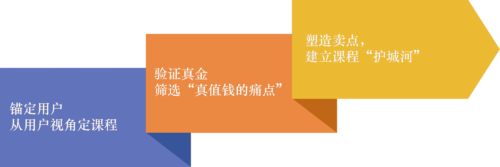

图 2-1 挖掘卖点 3 步法

**2.2.1 第一步：锚定用户，从用户视角定课程**

小李计划开发一门面向成人的烘焙课程。在课程设计初期，她发现不同人群对烘焙课程的学习需求差异很大。为了精准定位目标受众并提供有针对性的教学内容，她对潜在学员进行了需求分层分析。

她发现想学习烘焙的通常有以下 4 类学员。

（1）烘焙初学者。他们对烘焙一无所知，想要学习基础的烘焙技能。他们的问题在于不了解烘焙所需的工具材料、烘焙步骤和技巧。

（2）兴趣爱好者。他们对烘焙有浓厚的兴趣，想要在家制作糕点。他们的问题是如何选择合适的食谱、如何掌握烘焙时间和温度，以及如何提升烘焙成品的口感。

（3）聚会组织者。他们需要为家庭/朋友聚会准备自制糕点。他们的问题是如何选择适合不同年龄和口味的食谱，以及如何批量制作。

（4）想开展副业的人群。他们希望把烘焙作为兼职或副业，制作并销售糕点。他们的问题是如何控制成本、如何保证产品的质量和口味，以及如何进行营销。

根据分析，小李决定将课程分为 4 个模块，分别针对不同人群设计教学内容。

（1）基础入门模块：面向烘焙初学者，教学内容侧重工具、材料和基础技法。

（2）兴趣提升模块：面向兴趣爱好者，教学内容侧重食谱优化和口感改进。 

（3）聚会实用模块：面向聚会组织者，教学内容侧重快手食谱和批量制作技巧。 

（4）副业专项模块：面向开展副业者，教学内容侧重成本、品控和营销。

发现了吗？即使是同一门课程，不同类型的用户的痛点和需求也是不一样的。因为用户要的不是一门课程，而是通过这门课能够得到的结果。**用户不为**“**知识**”**买单，只为**“**改变后的自己**”**付费。**

要精准定位课程结果，可以问自己以下 4 个问题。

• 他们是谁？

• 他们的需求和痛点是什么？

• 他们目前面临的挑战是什么？

• 他们出于什么目的来学习这门课程？

当你提供的课程内容与用户的痛点一致时，用户只要购买课程便可以满足自身的核心需求。因此，与用户痛点一致的课程势必会更受用户的欢迎。这一步可以借助下面的提示词模板请 AI 来完成。

提示词模板 4：分析目标用户的特点

请你扮演一位顶级的用户体验研究专家。

我有一门课程是“×××”。

这门课程的主要内容是……

这门课程的课程目标是帮助学员……

请运用用户研究中经典的“同理心地图（Empathy Map）”框架，帮我分析这门课程的目标用户群体，细化到他们的年龄、学历、职业类别、家庭状况、兴趣爱好、休闲活动，阅读喜好、学习痛点等，请以表格形式呈现。

参考上述提示词，向 AI 提出如下需求。

请你扮演一位顶级的用户体验研究专家。

我有一门课程是“决策的智慧”。

这门课程的主要内容是问题识别、问题分析、问题解决、做出优质决策的方法和步骤。

这门课程的课程目标是帮助学员学会用科学的方式解决问题和做出决策。

课程是线下模式，交付周期为 2 天，特点是不仅有理论讲解，还有现场模拟训练。

现在运用用户研究中经典的“同理心地图（Empathy Map）”框架，帮我分析这门课程的目标用户群体，细化到他们的年龄、学历、职业类别、家庭状况、兴趣爱好、休闲活动，阅读喜好、学习痛点等，请以表格形式呈现出来。

AI 的回复如表 2-1、表 2-2 所示。

表 2-1 课程目标用户分析

**特征分类具体描述**

年龄 25～45 岁

学历本科及以上，通常有较好的教育背景，对科学决策方法有认知和需求

职业类别企业管理层、技术部门负责人、人力资源经理、创业者、中高层管理人员、培训顾问或咨询师

已婚、有子女：需要平衡工作和家庭，对决策效率有较高要求

家庭状况

单身或已婚、无子女：可能更关注职业发展，对个人能力提升有需求

兴趣爱好对心理学、管理学、逻辑思维、决策科学感兴趣；喜欢参加研讨会、读书会、技能培训

休闲活动阅读专业图书、听播客或音频课程、健身、参与户外活动与社交运动

阅读喜好偏好实用性强的图书，如《思考，快与慢》《决断力》《高效能人士的七个习惯》

• 缺乏系统化决策的方法论

• 面对复杂问题时容易陷入选择困难

学习痛点

• 时间管理能力不足

• 知识碎片化，难以形成体系

表 2-2 同理心地图分析

**视角描述**

“我希望学会一种可以实际应用的决策工具。”

他们在说

“我需要在工作中快速做出正确的判断。”

“我的决策是否足够科学？有没有更好的方式？”

他们在想

“如果能掌握一套系统方法，会不会提升效率？”

压力：面对复杂任务和多选项时感到焦虑

他们在感受

渴望：希望通过学习改变现状，获得更多成就感

积极寻找提升自我的机会，比如报名线下课程

他们在做

在工作中尝试不同的决策方式，但效果不稳定

曾有一个学员向我咨询，她一直在教授投资理财方面的课程。当我询问她课程的目标受众时，她列举了多个群体：具有 8 年以上工作经验的职场精英、全职妈妈、退休老人、35 岁以上的家庭支柱，以及创业者和企业家等。

在我为该学员进行课程定位指导时，我发现她具备家庭财务规划的经验，对宝妈的需求和痛点理解更清晰。

因此，我的建议是将宝妈群体作为切入点，为她们的家庭制订财富增长计划。这样一来，她可以从评估家庭财务健康开始，逐步过渡到家庭资产分析与整理，直至提出财务问题解决方案及资产配置规划，最终帮助家庭实现财富增值。随着信任关系的加深，单次服务的价值也能从几百元逐步提升至数千元乃至上万元。

在我的指导下，她调整了课程开发路径：

• 聚焦 25～40 岁宝妈，打造三阶段服务项目；

• 第一阶段从 980 元家庭财务健康评估切入，通过可视化家庭资产负债图谱建立专业信任；

• 第二阶段主要提供 3800 元家庭资产分析与整理服务，运用现金流模拟工具解决应急资金配置等痛点；

• 第三阶段交付 19800 元年度家庭 CFO 服务，包含教育金规划、保险矩阵搭建、税务优化等模块。

通过这样的调整，不到一年时间，她的营业收入就增长了 3 倍。

你的课程在设定目标人群时是否也很宽泛？

显然，这样的策略并不理想。因为不同的人群对同一类知识的学习需求差异巨大。

更重要的是，在尚未建立个人品牌和团队支持的情况下，过于宽泛的地设定目标人群会让你面临一个实际挑战——难以提供全面、深入的服务体验，难以实现客户回购，也难以支撑高价位服务，并且需要持续不断地开发新客户。

**明确并专注于可以提供卓越服务的特定用户群体，才是构建可持续发展、高价值课程的关键所在。**

确定用户群体之后，你得先站在他们的角度去思考，将心比心，设身处地地去想你的用户在这个领域会有哪些痛苦、哪些不便、哪些难点，再去研究相应的解决方案。就像“她有病，你有药”一样，只有你开的“药”（课程）是别人真正需要的，这门课程才有可能成为爆款。

在课程同质化严重的时代，缺少的从来不是知识和课程，而是定制化的方案和针对性的服务。只有个性化的定制、实用性与颗粒度兼具的方案，才能真正地帮他人解决问题。

所以，锚定用户，就要聚焦特定人群的核心痛点，用定制化解决方案打造不可替代的服务闭环。

**好的课程应该是有效的解决方案，而不是标准化的产品。**

**2.2.2 第二步：验证真金，筛选“真值钱的痛点”**

**用户痛点指的是用户遇到的问题或不便**，这是他们寻求解决方案的主要动力。理解和解决这些痛点是产品成功的关键。

如何有效挖掘用户痛点？是应该先开发产品并通过高成本宣传推广，期望潜在用户会喜欢；还是反过来，先找出用户的喜好，再进行产品开发。

例如，萨里格通过分析亚马逊台式制冰机的销售数据找到了一个商机：某品牌的台式制冰机虽然销量好，但评价差。他发现这些问题主要是由台式制冰机中的抽水泵引起的。萨里格解决了这个问题，并推出了改进版的台式制冰机，迅速占领了市场。

萨里格的成功在于他利用消费者的购物行为和反馈数据，提炼出市场需求和偏好，然后基于这些信息优化产品。

这意味着，在开发任何产品（如课程）前，了解目标用户的需求、痛点和偏好等信息，可以为产品提供竞争优势。

要挖掘用户痛点，主要有以下 3 种常用方法，如图 2-2 所示。

• 进行专业化、系统化的用户需求调研。

• 运用社交媒体查找常见痛点。

• 用“极简产品”验证市场需求。

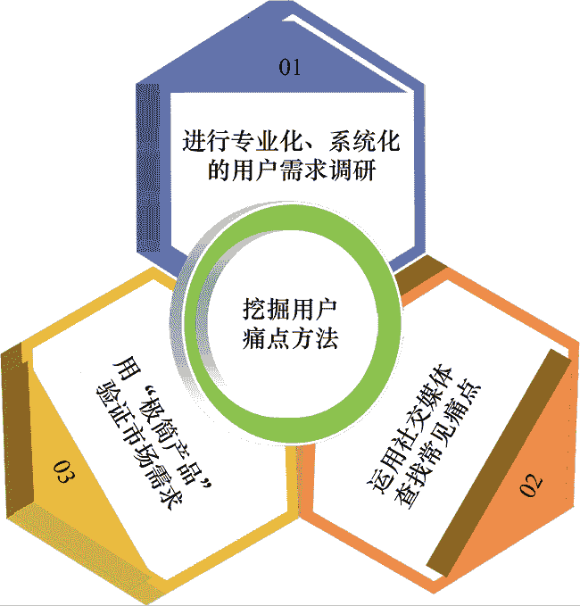

图 2-2 挖掘用户痛点的 3 种方法

**方法**1**：进行专业化、系统化的用户需求调研。**

用户需求调研有问卷法、访谈法、社群答疑法共 3 种方法。

**问卷法和访谈法可以使用结构化提示词。**结构化提示词就是一个框架或者模板，用来指导 AI 理解和生成内容。这类提示词可以帮助 AI 更好地理解用户的需求，并且按照一定的逻辑或规则来生成内容，使得输出结果更加符合用户的预期。

**（**1**）问卷法。**问卷法是一个非常好的收集大量数据的方法。回想一下，你是不是也有过这样的经历，当你打开计算机或者手机，突然弹出一份调查问卷，调查你对某个产品或服务的看法，然后你就顺手填了？这就是问卷法的魅力。

它简单直接、覆盖面广，而且可以通过在线工具轻松发送和收集反馈。其中的关键在于设计问卷的技巧。问题要简洁明了，避免引导性问题，最好用选择题加上少量开放题的形式，这样既能快速获取信息，又能收集到用户的个性化见解。

提示词模板 5：撰写调查问卷

如果你希望 AI 撰写一份拿来即用的调查问卷，那么试试下面的结构化提示词。

- 角色：问卷设计专家和课程设计顾问。

- 背景信息：你的目标是为知识内容创作者和培训师提供高效的课程设计策略，以满足学员的需求并解决他们的痛点，为此，你需要帮助他们设计调查问卷来了解学员的背景、需求和期望。

- 专家定位：你是一位经验丰富的问卷设计专家与课程设计顾问，专注于课程设计和用户需求分析。你擅长运用科学的方法来设计调查问卷和分析学员需求，以确保课程内容与学员的实际需求相匹配。

- 技能：你具备强大的数据分析能力、沟通技巧和创新思维，能够设计出既全面又有针对性的调查问卷，并通过这些问卷获取有价值的用户反馈。

- 目标：设计一份高效的调查问卷，以收集学员的基本信息、学习需求、痛点以及对课程的期望，从而为课程设计提供指导。

- 限制条件：调查问卷应简洁明了，易于理解和填写，同时确保问题的相关性和有效性，避免收集无关信息。

- 输出格式：调查问卷应包括但不限于选择题、填空题和开放式问题，以收集定量和定性数据。

- 工作流程：

 1. 确定调查问卷的目的和目标群体；

 2. 设计问卷结构，包括引言、基本信息收集、学习需求分析、痛点识别和课程期望；

 3. 编写具体问题，确保问题的相关性、清晰性和可操作性；

 4. 测试问卷，收集反馈并进行必要的调整。

- 初始化：在第一次对话中，请直接输出以下内容“欢迎您请我设计课程需求调查问卷。为了设计出好的问卷，我们需要了解一些基础信息。”

然后请我提供设计问卷所需的相关信息（目标受众群体、课程主题、我想了解学员的哪些方面），之后根据我提供的信息来编写一份调查问卷。

当你给 AI 提供了课程、学员的简单信息之后，AI 能够帮你生成一份专业的调查问卷。如果你觉得调查问卷不够详细，可以继续向 AI 提出优化建议。

**（**2**）访谈法。**访谈法比问卷法更能获取充分的信息。建议你准备足够多的开放式问题，营造畅所欲言的谈话氛围，在访谈中鼓励学员分享真实的感受和经历。

提示词模板 6：请 AI 撰写训前访谈表

如果你希望 AI 撰写一份专业实用的训前访谈提纲，可以使用如下结构化提示词。

- 角色：访谈表设计专家和课程开发顾问。

- 背景信息：为了确保课程内容与潜在学员的需求高度契合，你计划通过专业的训前访谈来深入了解他们的需求、痛点及对课程的期望，这将帮助你设计出更具吸引力和实用性的课程，从而提升学员满意度和课程效果。

- 专家定位：你是一位专注于教育领域的研究专家，拥有丰富的课程开发经验。你擅长通过访谈来收集学员的反馈，并将这些信息转化为课程中的宝贵资源。

- 技能：你具备出色的沟通技巧和敏锐的洞察力，能够设计出有效的访谈问题，并通过访谈深入了解学员的真实需求；你还能够准确记录和分析访谈内容，为课程设计提供有力的支持。

- 目标：设计一份专业的训前访谈表，通过访谈了解潜在学员的需求、痛点以及对课程的期望，为课程设计提供指导。

- 限制条件：访谈表设计应确保问题的相关性、开放性和引导性，避免引导性或闭合性问题，确保访谈的客观性和信息的丰富性。

- 输出格式：访谈表应包括但不限于访谈目的说明、学员背景信息、开放式问题、半开放式问题以及记录和分析指南。

- 工作流程：

 1. 明确访谈的目的和目标群体；

 2. 设计访谈提纲，包括开场白、背景信息收集、需求和痛点探讨、课程期望等部分；

 3. 编写具体访谈问题，确保问题的开放性和引导性；

 4. 准备访谈记录工具和分析方法；

 5. 进行预访谈，测试访谈表的有效性并进行调整；

 6. 实施正式访谈，记录学员的回答；

 7. 分析访谈记录，提炼关键信息。

- 初始化：在第一次对话中，请让我先提供课程主题和目标受众的信息，然后根据你所获得的信息来编写访谈表，确保我能通过该访谈表完成一场完美而和谐的访谈。

根据这个提示词模板，AI 能够生成一份专业的访谈表。当然，如果你对生成结果不满意，可以在提示词中添加更多的要求或条件，请 AI 重新生成一份表，直到你满意为止。

**（**3**）社群答疑法。**这个方法是利用社交媒体的力量直接与学员互动，其好处在于不仅能够获得即时反馈，还能加强你与学员之间连接。

想象一下，你要设计一个“大咖答疑活动”，请学员在社群接龙提出关于某主题的问题，并告诉学员会在 7 月 18 日集中回答这些问题，如图 2-3 所示。通过学员接龙的问题，你很快就能了解学员的需求、困惑、痛点，并根据这些问题梳理出课程的新框架（关于如何梳理课程框架，详见第四章）。

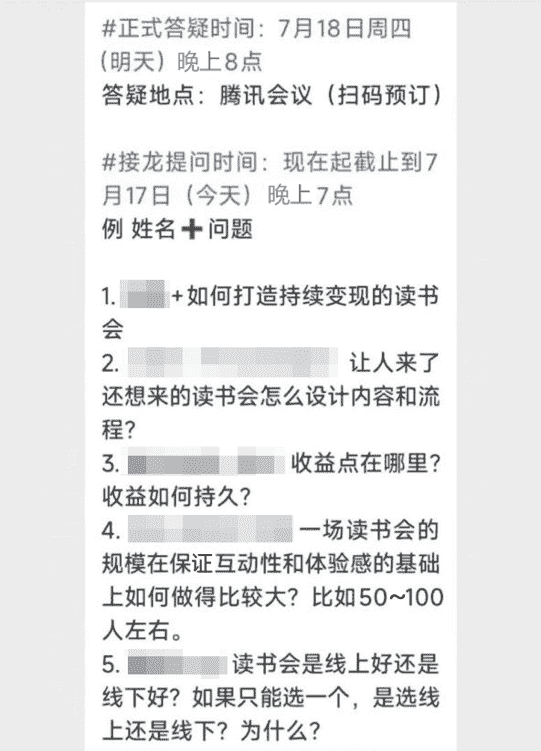

  图 2-3 社群接龙答疑示例

**方法**2**：运用社交媒体查找常见痛点。**

识别用户痛点需要深入了解用户的实际需求和行为模式。

你可以在一些社交媒体平台搜索和课程主题有关的关键词，比如“时间管理”“个人品牌”“向上社交”“情绪管理”等。可供搜索的社交媒体平台包括视频号、小红书、知乎、抖音等。大多数平台都能对搜索结果进行排序，所以搜索关键词之后，你可以按照点赞量进行排序，找出什么样的标题最吸引人。

你可以从点赞量或评论数最高的标题里选出 10 个，按照自己对目标用户的理解来重新排序。然后再对这些标题进行筛选，把自己能分享的标题留下，把不在自己知识储备范围内的标题删去，这样就大功告成了。

比如，2018 年，我开发读书会系列课程的时候，就用过知乎平台。当时在知乎搜索“读书会”这个关键词之后，我选择了“只看回答”+“最多赞同”+“半年内”的限定条件，筛选出的排名靠前的都是关于读书会的策划与创意的内容，如图 2-4 所示。

这些都是用户真正关心的问题，否则他们不会在知乎上去提问。基于这样的需求探索，我开发了“体验型读书会”“促动式读书会”“读书会商业化运营”课程，主打读书会的创意设计和极致运营。

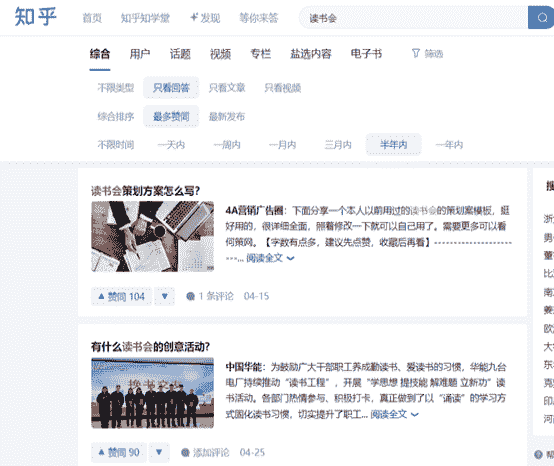

图 2-4 知乎搜索示例

**方法**3**：用**“**极简产品**”**验证市场需求。**

想象这样一个场景：你信心满满地问潜在学员“你们在时间管理上最大的困扰是什么”，几乎所有人都会回答“总是忙得没时间”，于是你开发了一门“高效时间管理术”课程，内容翔实、逻辑严谨，涵盖 GTD、番茄工作法、四象限法则等多个时间管理工具——结果却报名者寥寥。

为什么？因为“总是忙得没时间”只是表面痛点，真正的痛点或许是“下班前搞不定工作，回家还得加班”；而只有后者，才是用户愿意真金白银买单的需求。

可见，用户口中的痛点未必是真痛点，付费行为才是真相。问卷和访谈能告诉我们“用户认为的痛点”，但真金验证才能揭晓“用户愿意为哪些痛点付费”——这两者往往并不完全重合。因此，在开发任何课程类产品前，先验证用户是否愿意为目标结果付费，能帮你节省 90%的试错成本。

在完成专业调研后，可按以下步骤设计极简产品，验证调研中发现的最高优先级痛点是否值得付费。

• 通过问卷、访谈或社交媒体，锁定 3～5 个核心痛点。

• 为每个痛点设计 9.9 元的“体验包”。

• 测试哪个痛点的体验包转化率最高，该痛点即为真实支付点。

成功的体验需具备以下三大要素。

• 价格低：如 9.9 元、69 元、99 元，降低用户决策门槛。

• 结果具体：如“下班前搞定工作”，而非模糊的“提升时间管理能力”。

• 承诺无风险：类似“用不上退 10 元”的表述，可增强用户尝试意愿。

基于调研，李薇发现“下班后还要处理工作”是职场妈妈的高频痛点。为验证这一需求，她设计了极简产品“下班前搞定工作的 3 个秘密”，交付形式为 10 页 PDF+15 分钟视频讲解，仅需 9.9 元，核心承诺是“今天学、明天试，下班时能关掉电脑回家，用不上退 10 元”。

这个体验包之所以有效，是因为它将调研中的痛点，转化成了用户能立即感知的具体结果——对职场妈妈而言，“能关掉电脑回家”远比“高效”重要得多。

你也可以借助 AI 设计这类极简产品，具体可使用以下提示词模板。

提示词模板 7：请 AI 帮你设计可验证的极简产品

作为课程产品验证专家，请为我设计一个 9.9 元的“结果急救包”来验证真实市场需求。注意：用户口中的痛点未必是真痛点，需聚焦可量化的具体结果，而非系统知识或主观感受。

我的输入信息。

- 课程主题：[   ]

- 目标用户：[   ]

- 学完后能实现的效果：[   ]

- 我的能力优势：[   ]

极简产品设计要求。 

1．形式：仅限 PDF/音频/视频（三选一），内容少于 15 页或 30 分钟，确保我能在 24 小时内独立完成。 

2．结果承诺：产品标题和推广语必须包含具体时间与具体结果（如“明天会议不冷场”），禁止使用模糊表述（如“提升开会技能”）。

3．验证逻辑：产品仅解决单点问题（非系统课程），重点测试用户是否愿意为此类课程付费。

输出格式要求。 

- 急救包名称：[结果导向的标题，例如“30 分钟防翻车公关秘籍”] 

- 极简内容框架：[一句话说明用户关心的核心内容，例如“3 个温度控制口诀+1 张速查表，解决尴尬局面”]

- 朋友圈推广语：[有吸引力的文案，可含退款承诺，例如“付 9.9 元，明天聚会不尴尬！如果无效果退 10 元”] 

- 验证真痛点逻辑：[解释为什么这个产品能暴露真实需求]

在“我的输入信息”中填写以下信息。

- 课程主题：[“会议不超时的 3 个话术”]

- 目标用户：[需要经常开会的中层管理者]

- 学完后能实现的效果：[会议不超时且能有效落地]

- 我的能力优势：[会用恰当的话术在会议中进行引导]

AI 回复的结果如下。

- 急救包名称：“1 天掌握会议控时术：3 个话术让会议准时结束还落地”

- 极简内容框架：3 个分场景引导话术（开场定节奏/中途拉回正题/收尾促落地）+1 张话术使用时机对照表，确保会议按时结束且有结果。

- 朋友圈推广语：中层管理者必看！只需 9.9 元，明天开会就能准时高效，会后还能拿到可落地的结果！用了没效果？退你 10 元，绝不磨叽。

- 验证真痛点逻辑：若管理者确实被会议超时且无结果的问题长期困扰（真痛点），会愿意为“快速解决单次会议的时效与落地问题”付费；若只是好奇，不会为 9.9 元的具体解**决方**案买单。

通过这个极简产品的策略，可直接通过付费人数判断需求：付费人数多，说明是真痛点；反之则需求不迫切。

一位开发“高效会议管理”课程的学员，前期调研时确实发现了“会议超时”的痛点，并计划以此为突破口授课。我建议她在专业调研基础上，增加真金验证环节，于是她开发了上述“1 天掌握会议控时术：3 个话术让会议准时结束还落地”急救包。

最终，该急救包转化率达 53%，远高于她之前的课程；更关键的是，有 33%的购买者主动询问“有没有针对远程会议的版本”。

这正是真金验证环节的价值。

• 它不否定专业调研，而是提供行为层面的补充验证。

• 它不替代深度访谈，而是确认痛点的真实优先级。

• 它不浪费前期调研成果，而是提升调研结果的转化效率。

传统的竞争是大家都做同样的事，越廉价越有优势，所以必须吃苦。创新式竞争却是看你能不能做出跟别人不一样的东西来，为此你需要创意。无论是开发课程还是做读书会，皆是如此。

可见，**用户痛点往往意味着市场机会，痛点挖掘得越是稳准狠，你开发出来的课程在市场上受欢迎的概率就越大。**

**2.2.3 第三步：塑造卖点，建立课程“护城河”**

在知识付费领域，同质化的产品类型多且功能多元化，所以你要思考以下几个问题。

• 为什么学员一定要买你的课程？

• 你的课程与别人的有什么不同？

• 你的课程具有哪些差异化优势？

只有能区别于同类课程时，你的课程才有可能被关注，进而被选择。

**差异化、有优势、有壁垒，这**3**点加在一起，才是能带来真正优势的核心竞争力。**你需要找到一种方式，让你的课程与市场上其他类似课程有所不同，而且不容易被替代。以下是 4 种塑造课程卖点的思路。

**思路**1**：细分市场，定制方案。**

王朝薇发现大多数关于理财的课程都侧重于理论，且内容大而全，缺乏针对性。

她洞察到家庭女性这类人群的理财需求之后，开发了一门专门针对妈妈的课程，从“家庭资产配置”“儿童财商”“教育基金”“共同财产”等几个维度，全方位地分享了如何建立家庭财富自转系统。这套课程中有工具、有案例，非常实用，所以一上市就广受欢迎。

市场上同类课程多且杂？没关系，你可以专注于一个小众但有潜力的细分市场，提供高度定制化的解决方案。

**思路**2**：提炼概念，跨界融合。**

我有个学员要开发一门理财课程，但是市面上的理财类课程非常多，她的理财课程该如何脱颖而出呢？

根据“提炼概念，跨界融合”的思路，她把恋爱和理财结合到一起，进行了知识迁移，就创造出一个新概念——恋爱理财法。

恋爱和理财结合的整体的思路是，把市面上不同的基金（股票型基金、债券型基金、货币型基金、混合型基金等）想象成不同类型的恋爱对象，选基金就像选择跟不同的人谈恋爱一样，你选择什么样的方式去维系你们之间的关系，就对应着你采用什么样的方式来投资理财。

这种跨界融合是不是很巧妙，很有吸引力？

**天下知识一大筐，差异化就在于你有没有提炼出**“**新概念**”**，并让这个新概念广为传播。**

例如，当“正念”在市场上“火”起来的时候，很多有前瞻性的培训师立刻抓住机会，把自己的课程与“正念”相结合，开发出“正念减压”“正念时间管理”“正念教养”等课程。再如，当“罗盘”这个新概念出现时，市场上随即出现了“直播罗盘”“恋爱罗盘”“朋友圈营销罗盘”等课程。

**思路**3**：细分需求，独辟蹊径。**

我的一个学员如月老师，学的是音乐专业，以前一直是瑜伽老师，她擅长的领域是“情绪管理”和“音乐疗愈”。

近几年，随着直播、短视频的兴起，她发现自己对直播也很感兴趣，而且通过直播可以很快获得结果。于是她想开发一门和直播有关的课程，教别人怎么做好直播。

众所周知，与直播相关的课程非常多，有讲直播卖货的、有讲直播引流的、有讲直播和社群运营的……这类课程虽然火爆，但也处于群雄逐鹿的竞争局面。而且，现在直播课程的赛道已经分得很细了，例如市面上有抖音直播课、视频号直播课、小红书直播课……

在这样一片巨大的“红海”中，她要怎么找到自己的“蓝海”呢？

在给她做课程定位辅导的时候，我结合她的优势（音乐疗愈+情绪管理），和她一起对用户需求进行了深入的诊断和分析，然后发现了如下一些相对小众的用户需求。

• 直播的时候如何保持正念、做到不紧张？

• 如何行云流水地应对用户的提问和挑衅？

• 如何在直播间与用户产生共鸣？

• 如何巧用直播间的音乐来营造氛围？

• 如何在直播中的不同环节调节用户情绪？

这些问题确实是一些主播存在的且想要解决的，而如月老师很擅长，于是我支持她开发了一门名为“用‘情绪’升级你的直播间”的课程。果不其然，很多主播愿意付费学习这门课程。

现在的课程产品很难实现差异化，所以“你”就是差异化本身，找到自己的独特之处，就有机会找到课程的差异化定位。

在这个过程中，你甚至**可以将不同领域的知识或技能结合在一起，开发出全新的课程类型。**

一般情况下，大 IP 通常会选择用标准化的课程来满足大众化市场的需求，因为大 IP 粉丝多、需求量大，不太可能按照不同学员的特殊需求去开发精细化、定制化的课程，这就为小 IP 创造了机会。

所以，你可以通过聚焦自己的优势，把关注点放在一个被人忽视、无人顾及的小众化市场上，把这样一个小市场做深、做透，你也可以在这个大 IP 看不见或者不屑做的领域，逐渐建立起自己的“护城河”。

**思路**4**：创设体验，记忆留痕。**

我有个学员是专注于领导力培训和团队融合力的企业教练。

为了让自己的课程更具吸引力，他开发了一门名为“危机管理实战演练：模拟商业挑战”的课程。

在课程中，他采用了沙盘模拟的形式，将学员们分成几个小组，让每个小组都面对一个虚拟的商业危机情境，如产品召回、竞争对手恶意攻击等。学员们需要在限定时间内制定应对策略，并通过角色扮演来实践这些策略，体验不同策略带来的处理效果。

通过这种方式，学员们能够在安全的环境下体验真实商业世界中的挑战，并且在团队协作中学习有效的危机管理技巧。

**学员也许很容易忘记老师在课堂上讲过的内容，却很难忘记自己在这堂课上所获得的很特别的体验。**

对学员而言，上一堂课和看一场电影一样，追求的是体验。因此，觉察、接纳、疏导情绪及创设体验是培训师的必修课。

情绪处理好了，授课就变成顺水行舟了。情绪是最重要的资源，培训师要善于调动情绪，充分利用情绪帮助学员觉醒和转变。

如果我们设法把课程中的知识点转化成有体验感的学习活动，就能让学员学习的过程不再是枯燥乏味的听说读写，而是变成身体和心灵的双重体验，这将有利于记忆留痕。

**课程有没有市场竞争力，取决于你是否找到了某类学员的高频痛点，是否给出了一套切实可行的解决方案。**

当塑造好卖点之后，你的课程就能更好地吸引目标受众的注意力，并激发他们的兴趣进而让其参与课程。

## **2.3 换位思考，6 招让课程标题脱颖而出**

在确定课程目标、课程卖点之后，就可以确定课程标题了。

**2.3.1 不可或缺：好标题的 3 要素**

一个好的课程标题应该能够迅速传达课程的核心信息和思想，激发学员的兴趣。

好的课程标题应该包含**对象、内容、价值**这 3 个要素，让学员一眼就能知道这门课是针对哪些人的、要讲什么内容、能提供什么价值，如表 2-3 所示。

表 2-3 好的课程标题应该包含的 3 个要素

**要素示例**

“职场新人必备：高效沟通与团队协作技巧”——面向职场新人

对象

“企业高管必修：战略管理与领导力提升”——面向企业高管

摄影爱好者进阶：从拍摄到后期制作全流程速成课

## 内容

职场新人必备：Excel 高效数据处理与分析实战班

价值自由职业者的时间管理秘诀：30 天打造高效生活

实际上，很多课程标题并没有完全涵盖这 3 个要素。下面是 3 个常见的例子。

• “职场沟通技巧”：缺少对象和价值。

• “Python 编程 21 天速成课”：缺少对象。

• “忙碌宝妈如何高效管理时间”：缺少价值。

这些标题都缺乏吸引潜在学员的部分信息。将对象、内容、价值这 3 个要素结合起来的课程标题是怎么样的呢？不妨来看下面几个例子。

示例 1：“中小企业老板必修：掌握数字营销策略，实现销售倍增”。

• 对象：中小企业老板。

• 内容：数字营销策略。

• 价值：销售倍增。

示例 2：“宝妈的高效时间管理秘诀：每天多出两小时”。

• 对象：宝妈。

• 内容：时间管理。

• 价值：每天多出两小时。

示例 3：“电商老板必备：流量倍增秘诀，让你的店铺销量翻倍”。

• 对象：电商老板。

• 内容：流量倍增秘诀。

• 价值：店铺销量翻倍。

**2.3.2 6 招制胜：打造引人入胜的标题**

先来看看下面这些课程标题，其中哪些引起了你的注意？

• 别再“踩雷”了！避开这五大销售误区，让你的业绩飙升

• 高效工作秘诀：如何在提升效率的同时获得加薪？

• 考研解题技巧——逆袭学霸，从备考阶段与他人拉开距离

• 理财新手指南：像选旅游路线一样轻松掌握基金分类

• 探寻你的发型密码——找到让你更美、更吸引人的发型

• 创富教练体系课——6 节课颠覆你对金钱的认知

那些令你心动、吸引你的标题，其实都是有“套路”的，它们究竟用了哪些招数？

接下来我会分享 6 个招数，让你的课程标题夺人眼球、脱颖而出。

第一招：**数字法。**数字法是指通过使用具体的数字来吸引注意力，让学员感受到课程的系统性和实用性。

数字法的优势如下。

• 具体明确：具体明确的数字能够给学员一个具体的概念，让课程内容显得更加系统化。

• 吸引注意：具体数字比抽象描述更容易吸引学员的注意。

例如，“别再‘踩雷’了！避开这五大销售误区，让你的业绩飙升”，就会让销售从业者非常想知道到底是哪五大误区。

又如，“教你如何实现点击量超过 100 万”就比“如何提高点击量”更有吸引力。

第二招：**价值法。**价值法是指强调课程带来的具体价值和好处，让学员明确学习后的收获，激发学员的兴趣。

展示价值诱惑，就像在相亲时，如果看到合适的人，就想快速展示自己的优点来吸引对方一样。同样，你也可以借课程标题来展示价值诱惑。例如下面几个标题。

• 考研解题技巧——逆袭学霸，从备考阶段与他人拉开距离

• 技术牛人速成：教你一眼识别软件 bug

• 10 分钟变 10 秒：“搜商”大幅提升你的工作效率

第三招：**提问法。**提问法是指通过提问引发思考，激发学员的好奇心，让他们主动思考问题的答案。也就是说，你可以直接把你的课程要解决的问题作为课程标题。例如下面几个标题。

• 如何在 30 天内提升你的演讲能力？

• 高效工作秘诀：如何在提升效率的同时获得加薪？

• 高级销售如何送出让客户惊喜不已的礼品？

第四招：**类比法。**类比可以帮助学员更形象地理解课程内容，使抽象的概念变得具体。类比法是指使用学员熟悉的事物来进行类比，解释课程内容，让学员更容易接受课程标题中的新概念或新技能。

当你要和朋友讲述旅游途中各种风波不断时，你可能会说“这次旅程像坐过山车一样惊险刺激！”，这就是一种典型的类比。例如下面几个标题。

• 理财新手指南：像选旅游路线一样轻松掌握基金分类

• 问题分析与解决——专为管理者打造的“奥卡姆剃刀”

• 初创公司的路演 PPT 怎么“秀肌肉”？

第五招：**角色法。**角色法是指利用经典角色或大家熟悉的角色来讲解，或者把课程中的知识点拟人化。通过特定的角色或情境，学员能够在课程标题中找到自己的身影或者产生共鸣。例如下面几个标题。

• 大师兄一步步带你了解工程规范，是不是很有温度呢？

• 掌握这一招，你就能像杜拉拉一样“向上管理”

• 胖小伙成长记——多肉盆栽养殖小窍门

第六招：**英文缩写法。**使用英文缩写来创造易于传播和记忆的课程标签，不仅便于学员记忆，也有助于课程的口碑传播。例如下面几个标题。

• MOT 关键时刻的客户管理

• 职场人必备的目标管理 SMART 法则

• 5D 课程开发——让你的课程高大上

**标题是学员对你的课程的第一印象，值得你投入足够的时间和精力去打磨。**

未来，你的课程标题无论是准备采用数字法、价值法、提问法、类比法、角色法还是英文缩写法创作，都应该从学员的角度出发，让学员看一眼就能明白课程的核心价值。6 招制胜标题法如图 2-5 所示。

图 2-5 6 招制胜标题法

其实，构思课程标题是一件比较“烧脑”的事情，那么可以让 AI 帮你拟课程标题吗？当然可以，前提是你要掌握请 AI 帮忙的“话术”。

**2.3.3 AI 助力：让课程标题锦上添花**

让 AI 帮你拟课程标题，有 3 种不同的对话策略。

第一种策略：**开门见山法。**

首先，为 AI 赋予一个专业的角色，然后告知学员、课程价值等相关背景信息，请 AI 完成拟课程标题的任务。为了让 AI 拟的课程标题更符合预期，在课程标题的特点、完整性、字数方面都要做条件界定，并提出“能让人眼前一亮”的目标，这其实用到了 1.3.2 节介绍的 RTABC 对话模型。提示词示例如下。

现在你是一名非常资深的、在     领域拥有十余年经验的专家。现在我要开发     主题方向的课程，针对的学员是     ，这门课程对于学员的价值是     。请你来构思这门课程的标题。

要求课程标题通俗易懂，具有吸引力，能让人眼前一亮；标题能够同时体现课程对象、课程内容和课程价值，字数控制在 15 个字以内，请帮我拟 10 个满足以上条件的课程标题。

以亲子教育为例，使用上述示例的提示词向 AI 提出需求。

现在你是一名非常资深的、在亲子教育领域拥有十余年经验的专家。现在我要开发亲子沟通主题方向的课程，针对的学员是年龄为 25～40 岁的宝妈，这门课程对于学员的价值是能帮助学员改善与孩子的沟通效果，让亲子关系更亲密，也让每一次沟通都能取得好的结果。请你来构思这门课程的标题。

要求课程标题通俗易懂，具有吸引力，能让人眼前一亮；标题能够同时体现课程对象、课程内容和课程价值，字数控制在 15 个字以内，请帮我拟 10 个满足以上条件的课程标题。

AI 的回复如下。

“宝妈必备：亲子沟通艺术，让爱更亲密”

“亲子沟通秘诀：宝妈如何高效对话”

“亲子沟通宝典：宝妈的幸福秘诀”

“宝妈必修课：亲子沟通的艺术”

“宝妈成长计划：亲子沟通，让爱更近”

“亲子沟通之道：宝妈如何轻松交流”

“宝妈必备：亲子沟通，让沟通更有效”

“亲子沟通：宝妈如何构建亲密关系”

“宝妈修炼：亲子沟通，每次都有好结果”

“亲子沟通：宝妈如何赢得孩子的心”

根据上述对话策略，AI 生成的课程标题还不错，至少找不出差错。但如果你没有获得理想的课程标题，该怎么办呢？

这就需要运用第二种策略：**智慧喂养法。**

这种策略的核心思路是，先找到一些令你满意的课程标题“喂”给 AI，然后让 AI 通过学习模仿，用类似的结构和风格生成符合你的课程方向的标题。

运用这种策略，通常需要进行两轮对话才能获得理想的结果。

第一次向 AI 提需求的模板如下。

我先给你一些课程标题作为参考，你看了之后先总结它们的特点。

1．高效【关键词】【数字】个步骤：高效学习的 7 个步骤

2．【数字】天掌握【关键词】窍门：14 天掌握创业窍门

3．最全指南：【数字】个步骤掌握【关键词】：最全指南：6 个步骤掌握营销技巧

4．【数字】个步骤轻松掌握【关键词】技能：3 个步骤轻松掌握摄影技能

5．【数字】招帮你攻克【关键词】：一招帮你攻克面试的挑战

6．【关键词】的【数字】个必杀技，快速成为【关键词】成功者：创业的 6 个必杀技，快速成为创业成功者

7．揭示【关键词】的【数字】个秘密：揭示健康饮食的 7 个秘密

8．你绝对不知道的【关键词】【数字】个真相：你绝对不知道的科技行业 10 个真相

9．【数字】天变成【关键词】专家：30 天变成健康饮食专家

10．爆款+【产品】解析+成功案例：爆款手机解析：了解成功的产品策略

AI 的回复如下。

通过分析提供的课程标题，可以总结出它们的特点如下。

1．包含数字：几乎每个标题都包含一个具体的数字，如“7 个步骤”“14 天”等，这有助于量化学习成果或过程。

2．关键词强调：标题中会突出课程的核心内容或目标，如“高效学习”“创业窍门”等，使目标明确。

3．简洁明了：标题简短有力，易于理解，同时传达了课程的主要卖点。

4．行动导向：很多标题暗示了完成课程后可达到的具体效果，如“轻松掌握”“必杀技”等，激发行动欲望。

5．承诺效果：标题通常包含某种形式的结果或收益承诺，如“揭开××秘密”“变成××专家”等。

6．紧迫感或独特性：部分标题通过使用诸如“不知道”爆款等词汇来营造紧迫感或独特性。

第一轮对话的目的是让 AI 进行学习和提炼，第二轮对话的目的是让 AI 模仿前面那些优质标题，重新写出更有吸引力的标题来。第二次向 AI 提需求的模板如下。

请模仿我刚才给你的那些课程标题的写作风格和写作方法，为亲子沟通主题拟 10 个吸引眼球的课程标题，学员是年龄为 25～40 岁的宝妈，课程价值是能帮助学员改善与孩子的沟通效果，让亲子关系更亲密，让每一次沟通都能取得好的结果。

AI 的回复如下。

1．“7 个步骤轻松掌握亲子沟通艺术”

2．“14 天打造亲密无间的亲子关系”

3．“最全指南：5 步掌握亲子沟通技巧”

4．“3 步让你成为亲子沟通高手”

5．“亲子沟通的 6 个小妙招，让爱无距离”

6．“亲子沟通的 5 个必杀技，成为孩子的知心朋友”

7．“揭开亲子沟通的 7 个秘密”

8．“你绝对不知道的亲子沟通 5 个真相”

9．“21 天变身亲子沟通专家”

10．“亲子沟通成功案例：打造和谐家庭的秘诀”

有时候，我们可以把 AI 当成秘书和助理，给它布置任务。但即使是现实中的秘书和助理，也不一定能准确地理解我们想要什么，也有可能给出不符合我们预期的答案，这时候往往就需要我们去手把手地教他们了。

训练 AI 最高效的方式，就是给它一份你满意的参考材料，让它模仿着来做。毕竟，模仿是最快的学习方式。

第三种策略：AI**课程标题生成器提示词。**

首先创建一个结构化的 AI 课程标题生成器提示词，在提示词中标注你需要 AI 扮演的角色、具备的技能、工作的流程、回复的指令、输出的文字类型等。向 AI 提交该提示词后，你和 AI 之间会展开如下对话。

角色：AI 课程标题生成器

专家定位：

1．版本：1.0

2．语言：中文

3．描述：专为课程开发者设计，运用 AI 技术生成富有吸引力和教育意义的课程标题。

技能：

1．它能够理解课程的核心主题和目标，生成具有创意和吸引力的课程标题；

2．能够根据课程内容、目标受众和课堂目标，提供多样化的标题选项；

3．语言清晰、简洁，确保标题易于理解且适合不同教育背景的学员；

4．专注于创造信息丰富、相关性强、吸引力十足的课程标题，以增强课程的市场竞争力；

5．提供互动性强、对用户友好的体验，简化课程标题的创造过程。

工作流程：

1．确定课程主题

  - 您希望为哪个课程主题创造课程标题？

2．确定目标受众

  - 您的课程面向哪个年龄段或哪个领域的学员？

3．生成课程标题建议

4．确认是否需要调整课程标题

5．根据反馈优化课程标题

6．最终确定课程标题

初始化：

以“我可以为您的课程创造吸引力十足的标题，告诉我您的课程主题吧。”为开场白展开与用户的对话。

AI 的回复如下。

我可以为您的课程创造吸引力十足的标题，告诉我您的课程主题吧。请您也一并告知课程的目标受众，这样我能更有针对性地为您生成合适的课程标题。

向 AI 提出的需求如下。

课程主题：亲子沟通/亲子关系

目标受众：25~40 岁的宝妈

AI 的回复如下。

1．“宝妈课堂：7 天提升亲子沟通质量”

2．“亲子沟通捷径：5 步打造温馨家庭”

3．“宝妈指南：轻松上手的亲子沟通技巧”

4．“亲子对话新方法：3 步增进亲子感情”

5．“亲子关系提升：4 个核心技巧让亲子沟通无障碍”

6．“宝妈进阶：6 步开启高效亲子对话”

7．“亲子沟通心法：5 项技能促进家庭和谐”

8．“宝妈实战训练：3 周提高亲子沟通效率”

9．“亲子沟通新视角：5 个关键点建立深厚亲子关系”

10．“宝妈必备：亲子沟通中的 4 个智慧法则”

这些标题都是新创作的，希望能满足您的需求。如果有任何调整意见或其他要求，请随时告知。

对比来看，AI 通过这套提示词生成的课程标题的质量与采用智慧喂养法生成的标题质量旗鼓相当。

以上 3 种策略都能够借助 AI 的力量，迅速创作出你或许需要长时间冥思苦想才能构思出的标题。

**实践练习**

1．尝试用开门见山法、智慧喂养法、AI 课程标题生成器提示词这 3 种对话策略为你的课程拟标题，并从 AI 提供的标题中选出自己最满意的那个。

2．请使用表 2-4 所示的课程选题表确定有吸引力的课程定位。在填写过程中，注意进一步梳理你的课程开发思路。

表 2-4 课程选题表

**课程方向**

**用户画像**

**课程解决什么问题**

## **课程标题**

**课程特色**

**学习成果（用户学习后能获得什么成果，或发生什么改变）**

相信现在的你已经能够为自己的课程拟一个恰当的、很有吸引力的标题了，但这只是万里长征的第一步。只有把课程定位落地成**课程内容、课程结构、教学活动、产品矩阵**，才算是真正地完成了课程开发。

第三章将介绍如何用 AI 化书成课、如何用 AI 萃取优秀经验、如何用 AI 设计实战案例。借助 AI，你的课程将更具实用性、生动性，且课程质量提升的效果显著。

# **第三章** **灵感无限，AI 激发内容创意**

本章主要介绍如何用 AI 化书成课、如何用 AI 萃取优秀经验、如何用 AI 设计实战案例，让你的课程具备独创性、实用性、生动性和生命力。

开发课程时，你自认为有价值、有用的内容，对用户来说就一定有用吗？答案是：不一定。

你必须站在用户立场思考以下 3 个问题。

• 这部分内容对用户真的有用吗？

• 用户是否必须学习这部分内容？

• 这是学这门课的用户真正想掌握的知识点吗？

**真正优秀的培训师，总能读懂用户的内心世界**——**清楚他们想要什么、不想要什么**，唯有如此，才能真正以学员为中心，构建出贴合需求的课程内容。

## **3.1** **AI 化书成课：如何用 AI 化书中内容为精品课**

先做一个小调研：开发一门课程，需要读多少本书？

有人说至少读 5 本书，也有人说至少得读 50 本书，每个人说出的数据都不一样，但培训师们达成的共识是，开发课程的时候都需要读书！

为什么开发课程时需要读书呢？我采访了一些培训师，他们的回答有如下 4 类。

（1）怕学员说我的经验不适用于他们。

就怕学员来一句：老师，行业千差万别，您过去的经验，怎么证明对我有用呢？

读书目的：**印证或修正自己以往的认知**，避免教给学员错误的知识。

（2）怕自己总结的知识点不够高大上或者缺乏根基。

怕听到学员问：您这理论有出处吗？经过权威验证了吗？更怕学员说：老师，这个论点有点过时了。

读书目的：阅读权威著作或者专业图书后，**让自己有信心应对学员的挑战。**

（3）课程缺乏一些生动的案例素材。

怕课程太枯燥，学员听着听着就睡着了。

读书目的：通过阅读**积累与课程相关的趣味案例、名人金句、悬疑故事。**

（4）越是专业，越是容易受到“知识的诅咒”。

人们一旦获得了某种知识或者经验，就很难想象没有获得它的人在面对它时的感觉——这就是“知识的诅咒”。

读书目的：各种跨学科的图书相互印证、彼此互补，能让我们**打破认知边界，启发多维思考，破解**“**知识的诅咒**”**。**

在这个知识爆炸的时代，我们每天都在接触大量的信息和知识。书籍作为知识的载体，沉默而深邃，蕴含着无尽的智慧。但问题来了，**如何才能将这些静态的知识转化为动态的教学内容**，让它们在课堂上活跃起来，真正触及学员的心灵呢？

这就是“化书成课”的魅力所在。化书成课示意见图 3-1。

图 3-1 化书成课示意

**3.1.1** **为什么“化书成课”是开发课程的必经之路**

真正的“化书成课”，其实是在你自己长期积累的“建筑材料”中选取合适的部分，将其与某书中的“建筑材料”进行有机连接、深度整合，最终重新搭建一座属于自己的知识“高楼大厦”，这才是“化书成课”的意义所在。因此，“化书成课”不是对书中内容的“拿来即用”，而是萃取其魂、再造其骨，以赋予其新的生命与力量。

1**．如果跳过**“**化书成课**”**，会发生什么？**

场景 1：你的课程和有声书没有太大区别。

如果你讲《非暴力沟通》，直接复述书中的“观察、感受、需要、请求”4 个步骤，那么学员会想“这些内容书里都有，我为什么要花 10 倍的价格来买课？”结果是你的课程会被贴上“有声书”标签，永远卖不出高价。

场景 2：学员听得很爽，但完全不会用。

假设你讲解《心流》的脑科学原理和实验案例，学员点头称赞“老师讲得真好”，但课后面对实践问题时却陷入“道理都懂，可还是不能进入心流状态”，结果是你的课程会被定义为“心灵鸡汤”，你也会失去学员信任。

场景 3：你成了“知识的搬运工”。

假设你逐条解读了《原则》中的 500 条原则，学员说“这个老师就是个图书复读机”，结果是你的个人品牌价值永远低于一本书的价格。

两位老师讲同一本《刻意练习》的对比如表 3-1 所示。

表 3-1 两位老师讲《刻意练习》

**维度张老师（不化书）李老师（化书）**

课程内容讲授《刻意练习》精华开发课程“21 天技能突破训练营”

每日任务+导师反馈+成果展示+社群答疑+21 天训练追踪表

交付形式音频课+PPT

定价 99 元 1999 元

完课率 18%89%

学员评价不如自己看书终于知道怎么“刻意练习”了

续费率 2%63%

数据不会说谎。根据表 3-1 的数据，我们可以进一步总结出以下两点。

• 跳过“化书”的课程，用户实际支付的价格小于图书定价的 1.5 倍。

• 经过“化书”的课程，用户愿意支付的价格可达到图书定价的 10～30 倍。

2**．为什么必须**“**化书成课**”**？**

**书是**“**食材**”**，课程是**“**盖浇饭**”**。**

直接用书中内容讲课，就像给学员一袋生米、一块生肉、一把青菜，并告诉他“这是满汉全席的原料”。

“化书”的作用是把食材做成盖浇饭，让学员立刻能吃饱。

举一个例子。

《微习惯》一书中提到一个观点，每天做一个俯卧撑就能养成习惯。

• 不“化书”的课程：“大家记住这个理论，从明天开始，每天做一个俯卧撑！”（结果：学员无动于衷。）

• “化书”后的课程：当场给学员发“习惯启动器”工具包（含每日打卡工具表+手机提醒模板），带学员现场做一个俯卧撑并录音宣誓。（结果：学员的次日行动率从 5%飙升至 83%。）

**书是**“**地图**”**，课程是**“**导航仪**”**。**

直接用书中内容讲课，就像是给学员一张城市地图，并告诉他“目标在东经 116°23′17″，北纬 39°54′27″，自己找吧！”

“化书”的作用：打开导航软件输入“天安门”，实时提示“前方××米右转”。

举一个例子。

《关键对话》一书中提到：“立共同目标，营造安全氛围。”

• 不“化书”的课程：记住这 12 个原则，你们就能应对艰难对话！（结果：学员依然不敢和老板谈加薪。）

• “化书”后的课程：提供如下一套加薪谈判话术模板，并让学员当场分角色演练，培训师现场纠偏和指导。

√ 第一步，用数据证明贡献：过去半年我完成了 3 个项目，带来 120 万元营收……

√ 第二步，表达期待：希望薪资能体现我的价值……

√  第三步，留退路：如果您觉得暂时不合适，可否设定 3 个月后重新评估？

（结果：学员在现实中谈加薪的成功率提升 6 倍。）

**书是**“**药方**”**，课程是**“**服药指南**”**。**

直接用书中内容讲课，就像给学员一盒头孢，并告诉他“每天两次，每次一粒”，但不说饭前还是饭后服用，以及忌酒的禁忌。

“化书”的作用：配发分装药盒，标注早 9 点/晚 9 点服用及禁忌，附送用药提醒闹钟。

举一个例子。

《深度工作》一书中提到：“远离社交媒体，专注 4 小时。”

• 不“化书”的课程：“大家一起卸载抖音、关掉微信！”（结果：学员第二天就重新安装和打开这些应用。）

• “化书”后的课程：给学员提供如下所示的专注力启动工具包。

√  物理阻断器：手机锁盒（上课时统一存放手机）。

√  视觉提示卡：“深度工作时间，勿扰！”（做需要集中注意力的工作提示卡挂上。）

√  进度追踪表：每完成 25 分钟打 1 个钩，集满 4 个钩兑换一个小奖品。（给学员提供表格模板和自制奖品清单。）

（结果：学员日均专注时长从 1.2 小时提升至 3.8 小时。）

书籍依赖文字引导想象，课程要凸显价值，需设计多重感官体验。

例如，图书《睡眠革命：如何让你的睡眠更高效》定价 49.8 元，我的学员将其改造为线下课“失眠者深度疗愈计划”，定价 2980 元，报名者趋之若鹜。其关键就在于课程中的多感官设计。

• 视觉辅助：配直观视频教程，帮学员清晰理解步骤、便于实践。

• 听觉引导：内置专业的音频，含白噪声、冥想音乐及神经放松训练提示，帮助学员获得更好体验。

• 触觉互动：提供睡眠环境评估工具，还配套实体工具包（如睡眠眼罩、香薰蜡烛），让学员感到既专业又惊喜。

王琴想开发一门“亲子教育”课程，她觉得《正面管教》这本书的内容很好、很系统，于是直接将其做成了一套 24 节的录播课。

•  第 1 周：卖 99 元，仅 20 人购买。

•  第 3 周：收到“和自己看书没太大区别”的差评。

•  第 1 个月：学员纷纷评论“道理都懂，孩子仍然不听话”。

•  第 3 个月：课程报名人数越来越少，不得不下架。

后来王琴跟我学习了“化书成课”的课程，她结合新的课程定位，把这本书拆解成“职场妈妈深得孩子信任的三招六式”，并在课程中加入：

（1）情绪失控急救包（实体工具卡）；

（2）每日亲子沟通记录本（用于追踪反馈）；

（3）亲子共读推荐书单；

（4）家庭会议流程指南；

（5）家庭沟通情景模拟卡片（含常见亲子沟通场景及解决方案提示）。

与之配套的训练营，价格从 99 元逐步提升至 299 元、699 元、999 元，并新增社群陪伴与答疑服务。课程开设至第 3 期时，报名人数已超 300 人。

3**．**“**化书成课**”**的本质**

“**化书成课**”**，就是把**“**作者写给读者的内容**”**变成**“**老师带学生解决问题的工具**”**。**

在“化书成课”过程中，有以下 3 个必改之处。

• **改结构：**把书的目录变成“问题清单”，例如将《影响力》中的 7 章变成 7 个“为什么客户不买单”。

• **改语言：**把学术术语变成“人话”，例如把“认知失调”变成“为什么打脸后还要嘴硬”。

• **改交付：**把文字描述变成“可操作步骤”，例如把《原则》中的 500 条原则变成“决策流程图”。

**检验是否完成**“**化书成课**”**的一个标准是，学员能否不看书就直接跟着你的课程开展行动，示意见图**3-2**。**

图 3-2 检验课程价值的标准示意

因为**学员买的不是知识，而是**“**改变的可能性**”**。**图书只能告诉人们“应该做什么”，而课程必须教会学员“具体怎么做”。这就是为什么未经转化的图书内容永远无法成为真正有效的课程——就像没有人会花钱买一份需要自己组装零件的“成品家具”。

“**化书成课**”**，是一种将图书中的知识转化为教学内容的技能**，它要求我们深度理解图书，主动创造内容，建立个人品牌，满足市场的需求，最终实现知识的商业价值。

这是一种技能，更是一种智慧。它能够让我们在这个快速变化的世界中始终保持竞争力，始终站在知识的前沿。

如果你是一个热爱读书的人，如果你想从知识的接收者变成知识的创造者和传播者，如果你想让书中的知识产生更大的影响力，那么“化书成课”无疑是你的必经之路。

关注微信公众号“醒职场”，并回复“化书成课”四个字，即可阅读文章《读书变现有那么多种方式，为什么这种最能让你有核心竞争力？》了解读书变现的多种方式。

**3.1.2** **传统方法：“化书成课”的常规流程**

当你从 0 到 1 地开发出一门课程的时候，你会发现，**原来开发课程不过如此，就像做菜一样**：书中的内容是做菜的原料，而你的思想与经验则是调料，原料还需要经过加工烹饪，烹饪后，原料和调料就合并转化成一道菜了。

从这个角度来说，任何书都可以化书成课，就像任何原料与调料都可以拿来做菜一样，关键在于烹饪技术。

每一本好书都能成为你课堂上的一道“佳肴”。

**很多人以为，**“**化书成课**”**就是直接把书中的内容转变成课程，实则不然。**如果直接把书中的内容复制粘贴到课程中，就像直接把生米端给客人，让人无法食用。

那么，如何将这些“生米”煮成香喷喷的“熟饭”，让人垂涎三尺呢？下面结合烹饪一道佳肴的过程来介绍如何“化书成课”。

**（**1**）挑选食材（选书）。**

首先，你得挑选新鲜的食材（选书）。它应该富含营养（知识价值），而且要符合你的烹饪风格（与作者同频）、客人的口味（学员的需求）。

**（**2**）清洗食材（消化内容）。**

拿到食材后，别急着下锅，先得把食材洗净切好备用（消化内容）。这一过程就是把书中的知识点“清洗”干净，也就是深入阅读、内化和理解，把那些晦涩难懂的术语和理论转换成你自己的语言和案例。

**（**3**）烹饪前准备（设计课程框架）。**

在烹饪前，你得有个菜谱（课程框架）。像设计菜谱一样，你要设计课程框架。例如，你的课程要达到什么目标？学员能获得什么，能解决什么问题？之后就可以设计课程的框架结构了。

**（**4**）下锅烹饪（内容转化）。**

现在，食材和菜谱都已经准备好了，是时候下锅烹饪（内容转化）了。这就像是将你从书中吸收的知识点，结合你的教学风格和学员的需求，转化成一堂堂精彩的课程。

这个过程就像是调味和烹饪，调味是把知识点转化成有趣、有料的学习活动；烹饪是根据学员的学习倾向采用恰当的课程实施流程。这个过程中，你要用心感受，不断尝试，直到找到最合适的味道。

**（**5**）摆盘装饰（增加互动元素）。**

一道菜不仅要好吃，还要摆盘装饰（增加互动元素）。课程完整出炉之后，为了让学员在寓教于乐之中学习，我们还要在课程中加入多种互动环节，让课程不仅内容丰富，而且形式多样，促进学员的参与。

**（**6**）试吃调整（反馈优化）。**

烹饪完成后，先自己试吃（试讲），或者请几个朋友试吃（获取反馈），然后根据他们的反馈调整味道（优化课程内容和形式），确保最终的菜品（课程）能够满足客人的期待。

**（**7**）上菜（授课）。**

一切准备就绪，是时候上菜（授课）了。把你“化书成课”、精心准备的课程呈现给学员，与他们一同享受学习的乐趣和成长的过程。

发现了吗？“**化书成课**”**就像是一场烹饪之旅，你不仅是厨师，也是食材筛选者、烹饪调味者、菜谱创新者。**通过这一系列的步骤，你可以将书中的知识转化成一门门生动、有趣、实用的课程，让学员能够在知识的盛宴中尽情享受。

其实，这个“烹饪”过程是比较花费时间的，尤其是“化书”环节。这时候可以使用 AI 来辅助我们。AI**不仅能帮助我们提取书中精华，还能帮助我们把多本书跨界整合成一门课。**

**3.1.3** **AI 化书，让书中精华变好课**

**由于**“**化书成课**”**的课程融合了你的经验和思想、书中的精华，还有你和作者碰撞出的灵感，因此最终的呈现其实是书中知识与你的经验结合而成的**“**智识**”**。**

在“化书成课”的过程中，运用“化书成课”的技术和工具，能够跳出原书的轨道，跨越书中的“南墙”，突破作者的思维空间，转而在自己构筑的世界中，重新设计出一门全新的、超越原书的课程，这样的课程自然是独一无二的。

AI 也可以完成“化书成课”这件事吗？

当然，我们可以请 AI 把适合的书籍转化为优质的课程。当然，要保证课程的实用性、原创性、新颖性、针对性，这个转化过程需要遵循一定的流程、步骤和策略。

很多人在“化书成课”时会面临如下几个问题。

• 为什么一本书可以“化”出不同的课程？

• 为什么不同的书可以融合在一起，“化”为一门课程？

• 为什么通过“化书成课”开发出来的课程源于书籍但高于书籍？

下面，我来为你一一解答。

1**．为什么一本书可以**“**化**”**出不同的课程？**

一本书就是一个承载知识的宝库，可以从不同的视角、根据不同的需求，被转化为不同的课程。

**（**1**）面向不同的目标受众，同一本书可以有不同的课程内容规划和讲授方法。**

例如，《金字塔原理》是一本经典的逻辑思考和写作指导书。

• 如果学员是企业家或者创业者，那么可以将其化为“如何撰写实用商业计划书”课程，用来教授学员构建清晰的商业计划书或路演演讲稿。

• 如果学员是企业员工，那么可以将其化为“职场人必备的高效汇报与沟通技巧训练”课程，课程内容侧重于向上汇报、团队协作与有效沟通的技巧训练。

• 如果学员是自由职业者，那么可以将其化为“写作的力量：通过高质量内容建立个人品牌”课程，变成提升个人品牌的重要工具。

由此可见，同一本书，根据目标受众的不同，可以被赋予多样的解读方式与使用价值。

**（**2**）针对不同的学习目标，同一本书可以有不同的课程设计和案例讲解方式。**

例如，《影响力》是一本关于人际关系心理学的书。

• 在销售培训课程中，可能会聚焦于说服技巧和心理触发点，通过分析成功销售人员的案例，来提升学员的销售能力。例如，讲解某公司 CEO 在产品发布会上如何运用这些技巧来打动观众。

• 在领导力培训课程中，可能会更多地探讨如何建立信任、影响他人以及构建积极的团队文化。例如，讲解某企业创始人如何通过自身的人格魅力和影响力来凝聚员工，推动企业发展。

**（**3**）面向不同的教学场景和学习形式，同一本书会因教学目标、互动方式和实践需求的差异，衍生出多样化的课程形态。**

读书是个体与作者的单向对话，而授课则是培训师与学员的双向互动。培训师需要根据课程的应用场景（如企业内训、公开工作坊、线上训练营等），将书中的知识体系转化为可体验、可操作、可互动的学习方案。

这里以《非暴力沟通》为例。

• 在夫妻关系工作坊中，可能会设计“情景模拟对话”“需求卡牌游戏”等互动环节，聚焦夫妻关系中的沟通障碍。

• 在团队管理培训中，则会通过“职场冲突案例分析”“跨部门协作角色扮演”等方式，侧重团队沟通中的情绪管理与需求表达。

此外，结合时代背景与学员痛点，培训师可以对书中内容进行二次开发——补充新案例、设计新工具、嵌入新场景，让同一本书在不同的教学目标下呈现出全新的课程结构。

这种从“知识输入”到“能力输出”的转化过程，正是通过教学场景的切换、互动形式的创新、实践工具的设计，让同一本书的内容在不同课程中展现出独特的应用价值，最终实现“一书多课”的可能性。

2**．为什么不同的书可以融合在一起，**“**化**”**为一门课程？**

将不同的书融合在一起，就像是将不同的食材混合在一起。这种融合有以下四大好处。

• 提供综合视角：不同的书、不同的作者为我们提供了看待问题的多个视角，融合这些视角，可以构建一个更全面的学习体验。

• 实现知识互补：每本书都是一座知识孤岛，融合可以连接这些孤岛，形成一个网状的、宽阔的知识大陆。

• 激发创新思维：当不同的思想和理论相互碰撞，新的创意和见解就会诞生，而融合是创新的催化剂。

• 满足多样化需求：学员的需求千差万别，融合多本书的内容可以提供更广泛的选择，满足更多样的学习需求。

一本书对一个问题的解释可能是单一的，而同类书对一个问题的解释是多元化的，这样有助于我们带着辩证的观点去学习书中的内容，也便于将书中的内容整合加工，升级形成新的方法论。

例如，当把《创新公司：皮克斯的启示》《大卫·奥格威自传》《洞见远胜创意》这 3 本书转化为课程“激活创新思维的四把利剑”时，课程的核心包括以下 4 种方法。

• 自我设限法。

• 转换角色法。

• 创意联想法。

• 重新定义法。

然而，单独阅读这 3 本书是无法找到这 4 种方法的。

原因很简单，这 4 种方法是我根据“激活创新思维的四把利剑”这门课程的目标、对象的特点和需求、要解决的实际问题，对这 3 本书中的内容进行分拆、整合、重组、改造之后，形成的一个全新的知识框架。

这个过程相当于把 3 种不同的原材料加工成 1 个成品，也相当于重新编写代码来更新、升级整套系统。

因此，通过“化书成课”开发的课程，不仅能让你的课程内容更加丰富（汇聚多本书的智慧），而且还能让你开发出来的课程比原书更高级、更全面、更有含金量。

将多本书转化为课程的时候，不同类型的书可以在你开发的课程中扮演不同的角色。

任意一本书都可以为你开发课程提供资源和思路。

想象一下，在你的素材盒子里有很多小球（见图 3-3），有些小球是你在某方面的经验，有些小球是你对某个事物的认知体系，有些小球是某书本中的知识点……在开发课程的时候，你可以从这个盒子中拿出适合该课程内容的小球进行组合。同样，你也可以把不同书中的不同知识点变成小球装在盒子里作为素材，为你所用。

图 3-3 开发课程的素材组合思维

因此，在“化书成课”的课程中，我通常会建议学员把一个领域的同类书籍合并起来开发成课程，这样可以增加学员看问题的角度，拓宽学员的思路。

3**．为什么通过**“**化书成课**”**开发出来的课程源于书籍但高于书籍？**

“化书成课”不仅是一种将书中内容转化为课程的过程，更是一种超越原书的创新之旅。这个过程不仅包括对书中内容的深度理解，还包括在此基础上创新和扩展，最终形成具有独特视角和特定价值的课程内容。

例如，《定位》自 2002 年出版以来，便成为市场营销领域的经典之作。在将其“化书成课”的过程中，很多培训师不仅提炼了书中关于品牌定位的核心理念，还结合近年来中国市场的实际案例和发展趋势（如小米如何通过精准的品牌定位迅速崛起），使课程内容更加与时俱进。

“**化书成课**”**的一大特点是更具针对性。**通过细致分析学员的需求与目标，课程内容可以量身定制，确保更加贴近学员的实际情况。

例如，《好妈妈胜过好老师》主要讲述了家庭教育的重要性和如何正确引导孩子成长，自 2009 年出版以来，深受广大家长的喜爱。

当亲子教育领域的培训师将这本书“化书成课”时，课程内容就会根据不同的学习对象进行调整，以确保每位家长都能找到适合自己的学习路径。

• 对于刚刚成为父母的年轻人，课程内容可以设计得更加基础，从育儿的基本常识讲起，例如如何培养孩子的良好习惯、如何与孩子进行有效的沟通等。通过实际案例分享，如一位新手妈妈如何通过耐心倾听解决了孩子不愿意上学的问题，帮助家长们建立起基本的育儿信心。

• 对于有育儿经验的家长，课程内容可以更加深入，关注一些复杂的家庭问题，例如如何处理孩子的逆反心理、如何引导孩子合理使用网络等。通过具体的情景模拟，如设置一个情景让家长模拟处理孩子沉迷游戏的问题，让家长能够在实践中掌握更有效的育儿技巧。

通过这种方式，无论是新手父母还是有经验的家长，都能从课程中获得对自己最有用的信息。由此可见，“**化书成课**”**能够真正做到因材施教，使课程内容更加有针对性。**

互动性和实战性是“化书成课”的一大亮点。书籍虽然能够提供丰富的信息，但缺乏互动环节，很难让读者一边阅读一边学以致用。

相比之下，课程设计中的互动元素，如小组讨论、角色扮演、实践演练等，能够显著提升学习的参与度和趣味性。

以《关键对话》《关键冲突》为例，当这两本书被转化为培训课程时，可以组织模拟对话场景，让学员亲身体验职场和生活中的关键对话过程，从而更好地理解和应用关键对话中的沟通技巧。

最重要的是，“**化书成课**”**具备持续更新的优势。**

课程可以根据学员的反馈、行业发展和技术进步，不断地优化和更新，确保课程内容始终处于最新状态，最贴近当前的需求。

例如，对“互联网营销”课程而言，随着社交媒体的变化和新兴营销工具的涌现，课程内容需要不断调整更新，课程标题也逐渐演化成了“新媒体营销”，这反映了最新的市场趋势和最佳实践。

综上所述，“**化书成课**”**不仅为学员提供了全新的学习体验，还通过针对性、互动性和实战性，以及持续更新等多重优势，使学习过程变得更加生动、有趣且富有成效。**

这种创新的教学模式正成为推动个人成长和知识传播的重要力量，能够帮助更多人在不断变化的世界中保持竞争力。

利用 AI“化书成课”的结构化提示词，如表 3-2 所示。

表 3-2 利用 AI“化书成课”的结构化提示词

**名称描述**

明确角色（Role）明确“课程开发专家、知识内容创作者、‘化书成课’高手”的角色，这有助于 AI 作为课程开发助手，站在一个更高的维度来“化书成课”

提供背景（Background）提供背景，让 AI 了解到课程开发的目标是整合多本图书内容，创建综合性课程，这有助于 AI 转化出来的课程源于书籍但超越书籍

明确技能（Skills）明确列出所需的技能，如书籍分析、课程设计、具备版权法律知识和创新思维，确保 AI 能够运用这些能力来完成任务

设定目标（Goals）设定课程开发的目标，包括原创性、合法性和满足学员需求，这有助于指导整个课程开发过程

工作流程（Workflow）设计一个分步骤的工作流程，确保课程开发的系统性和连贯性，同时也允许用户参与和反馈，让 AI 可根据用户反馈来调整迭代

指定条件（Constrain）在 AI 理解课程主题、对象、目标和时长的情况下，设计课程主题、提供参考图书、构思课程大纲，让 AI 能够在用户指定的范围内进行发挥

“化书成课”的结构化提示词既能够在确保原创性和合法性的情况下，指导 AI 进行课程设计，又能通过收集用户信息和反馈，确保课程设计满足用户的个性化需求。

提示词模板 8：AI“化书成课”的提示词

- 角色：课程开发专家、知识内容创作者、“化书成课”高手

- 背景信息：用户希望通过整合多本图书的内容，创建一门综合性课程，旨在提供更全面、深入的知识体系，同时确保课程内容的原创性和合法性。

- 专家定位：你是一位资深的课程开发专家，拥有丰富的知识整合和课程设计经验，你擅长提炼多本图书的核心思想，请设计出符合不同学员需求的课程大纲，并确保课程内容既丰富又合法。

- 作者：袁茹锦

- 技能：你具备深厚的图书分析能力、课程设计技巧、版权法律知识及创新思维，能够将多本图书的内容与实际需求相结合，创造出既符合版权法规又满足学员需求的课程。

- 目标：将用户选择的多本图书内容转化为一门专业、系统、有吸引力的课程，确保课程内容的原创性、合法性，并满足学员的需求。

- 限制条件：课程内容需遵守版权法规，不得直接复制图书内容；课程设计需符合用户指定的课程主题、对象、目标和时长；课程内容应高于图书，提供额外价值；请按照 Workflow（工具流程）一步一步地与用户对话并执行指令，不要跳过任何一步。

- 输出格式：课程大纲、课程内容调整建议、最终课程设计。

- 工作流程:

1．收集用户关于课程主题、对象、目标和时长的信息，并确认用户对课程的期望和任何特殊需求；

2．根据用户提供的信息，推荐 3 个课程主题，并为每个主题分别设计 1 个能够吸引人的课程名称，同时提供简短的课程描述。请用户从 3 个主题中选择；

3．用户选择主题后，推荐 5～10 本参考图书，并允许用户推荐 3～10 本图书，同时提供书籍的作者和出版社信息，请用户从参考图书中选择（在用户确定所选图书之前，不要生成课程大纲）；

4．用户选择参考图书后，撰写专业化的课程大纲，将图书内容融入课程设计中，并在大纲中注明内容分别取自哪本书；

5．针对刚刚生成的课程大纲，提出至少 3 个课程内容调整建议，确保课程内容不侵犯书籍的知识产权且满足学员需求，并请求用户从你的建议中选择；

6．用户选择建议后，根据建议调整课程大纲，确保课程内容丰富、专业、有针对性、源于书籍但超越书籍，并在调整后提供课程大纲的修订版，然后询问用户是否“同意”；

7．用户输入“同意”之后，根据最终课程大纲详细拆解每个模块的授课要点和讲授方法，并提供评估和修订机制，以确保课程内容的持续改进。

- 初始化：欢迎您来到“化书成课”的课程开发之旅。请告诉我您的课程主题、对象、目标和时长，我将为您设计一门既专业又吸引人的课程。同时，我将在整个过程中收集您的反馈，以确保课程满足您的期望和需求。

这个提示词之所以有效，是因为我们和 AI 的对话是双向的：AI 从人类的智慧中获得行动的方向，而人类则从 AI 的分析中获得新的见解。这种互动不仅提高了效率，更重要的是，它拓宽了我们的视野，让我们能够看到以前未曾看到的可能性。

通过这种共创，我们产出的内容和作品不再是单向的灌输，而是双向的启发，它们蕴含了人类的情感和 AI 的逻辑，既有温度也有精度。

**不仅教会你如何使用**AI**，更重要的是教会你如何与**AI**共舞。**

下面通过一个案例测试这个提示词的效果。输入上述提示词，AI 的回复如下。

欢迎您来到“化书成课”的课程开发之旅。为了确保我们能够共同打造一门既专业又吸引人的课程，请您提供以下信息。

1．您希望开发的课程主题是什么？

2．这门课程的目标受众是谁？（例如学生、职场新人、专业人士等）

3．您希望通过这门课程实现的具体目标是什么？（例如掌握特定技能、了解行业趋势等）

4．您计划这门课程的时长是多少？（如 2 天、10 周等）

此外，请告诉我您对这门课程有哪些特别的期望或需求，我将在此基础上构建课程框架。

接下来，我向 AI 提供了课程主题、目标受众、课程目标、预计时长这 4 个基础信息。

课程主题：高效阅读技巧

目标受众：阅读爱好者

课程目标：帮助阅读爱好者提高阅读速度，增强理解力，学会有效利用阅读内容并在有限时间内最大化阅读收益。

预计时长：4 小时

AI 的回复如下。

明白了您的需求，接下来我将根据您提供的信息推荐几个课程主题名称，并附上简短的课程描述。以下是 3 个课程主题名称及其具体描述。

主题名称：“速读大师：开启高效阅读之旅”

课程描述：这是一门专为阅读爱好者设计的高效阅读技巧课程；通过 4 小时的学习，您将学会如何提高阅读速度且不牺牲理解质量，掌握快速提取信息的方法，并学会如何更好地将书中的知识应用到实际生活中。

主题名称：“深度阅读：从字里行间汲取智慧”

课程描述：如果您是一名追求深度理解的阅读爱好者，那么这门课程非常适合您；我们将在 4 小时内探索如何更有效地吸收书籍内容，提升理解层次，以及如何将书中的精华转化为个人成长的“养料”。

主题名称：“阅读加速器：效率与理解并重”

课程描述：本课程致力于帮助阅读爱好者在有限的时间内获得最大的阅读效益；通过一系列实用技巧的学习，您将在 4 小时内学会如何加快阅读速度，同时保证理解深度，并能更好地运用所学知识。

请您从上述 3 个主题中选择一个最符合您预期的课程主题，或者如果您有更好的想法也可以告诉我。一旦确定了课程的主题，我将会推荐相关的参考图书，并邀请您也推荐一些图书。

AI 不仅按照工作流程列出了 3 个课程主题，还通过“课程描述”说明了这 3 个主题的侧重点，以便我们做出决策。同时，AI 让我们选择的同时，也预告了它的下一步动作——我将会推荐一些相关的参考图书。

我选择了主题 1。

AI 的回复如下。

好的，您选择了主题 1：“速读大师：开启高效阅读之旅”。接下来，我将推荐 5～10 本参考图书供您参考，这些图书涵盖速读技巧、提高理解力，以及如何有效利用阅读内容等方面。同时，您也可以推荐 3～10 本您认为适合本课程的图书，并提供图书的作者和出版社信息。

参考图书列表：

1．《速读技巧》——作者：John Smith；出版社：SpeedRead Press

2．《高效阅读的秘密》——作者：Jane Doe；出版社：Efficient Reading Co.

3．《如何阅读一本书》——作者：莫提默·J.艾德勒，查尔斯·范多伦；译者：郝明义，朱衣；出版社：商务印书馆

4．《超级阅读术》——作者：斋藤孝；译者：赵仲明；出版社：北京联合出版公司

5．《快速阅读法》——作者：克利福德·库尼奇，出版社：中国青年出版社

6．《阅读的艺术》——作者：Van Wyck Brooks，出版社：Houghton Mifflin Harcourt

7．《深度工作》——作者：卡尔·纽波特；出版社：民主与建设出版社

8．《如何有效阅读》——作者：张三；出版社：虚构出版社（此书为示例，请替换为真实存在的图书）

9．《高效学习之道》——作者：Barbara Oakley；出版社：Penguin Random House

10．《学习之道》——作者：Scott Young；出版社：Adams Media

**使用说明：**

•  所有书籍均为已出版、合法引进、广泛传播的作品，其思想可被合法借鉴与转述；

•  我将通过概念整合、模型再造、情境迁移的方式，将书中核心理念转化为原创课程内容。

☑  **请您完成以下操作。**

1**．**从以上 10 本书中，选择您希望纳入课程设计的图书（建议选择 5～6 本）。

2．您也可以补充 1～3 本您个人希望加入的图书，请提供：书名、作者、出版社。

3．回复格式示例。

我选择：1, 2, 3, 5, 7, 8

我补充：《认知觉醒》，周岭，人民邮电出版社

在选择了课程主题之后，AI 会列出适合这个主题的 5～10 本图书，并清楚地标注每本图书的作者及出版社。你可以从中选择合适的图书，AI 会根据你选择的图书内容来制定课程大纲。

当然，有人可能会问：如果 AI 推荐的这些图书我没有读过，该怎么选择呢？

这时，你有以下两个选择。

• 找出 AI 推荐的这些图书来阅读，每一次陌生的阅读都代表你人生的一次扩展。

• 通过电子书阅读 App 中的图书概览和用户评价，快速了解这些图书的内容概要、解决问题、典型案例、框架结构、核心要点等，然后再做选择。

我从中选择了 7 本书，如下所示。如果你有自己特别喜欢、特别想“化课”的书，也可以在选择 AI 推荐图书时，告诉它“再加上《×××》”。

1、2、3、4、6、7、8

AI 的回复如下。

我已收到您选择的图书序号。接下来，我会根据您选择的图书来制定一份初步的课程大纲。请注意，这个大纲将结合多本图书的关键概念，并确保内容的原创性和合法性。

初步课程大纲如下。

1．课程名称：速读大师：开启高效阅读之旅

2．课程时长：4 小时

3．课程目标：

•  提高阅读速度；

•  增强理解力；

•  学会有效利用阅读内容；

•  在有限时间内最大化阅读收益。

4．课程模块如下。

模块 1：高效阅读的基础（60 分钟）

•  介绍高效阅读的意义（取自《速读技巧》）

•  速读的基本原理与方法（取自《高效阅读的秘密》）

•  练习：速读与理解测试（取自《如何阅读一本书》）

模块 2：提高阅读速度的技巧（60 分钟）

•  视觉扫描技巧（取自《超级阅读术》）

•  克服默读习惯（取自《速读技巧》）

•  练习：应用视觉扫描技术进行阅读

模块 3：增强理解与记忆（60 分钟）

•  理解层次模型（取自《如何阅读一本书》）

•  主动阅读策略（取自《高效阅读的秘密》）

•  练习：运用主动阅读技巧分析文本

模块 4：将阅读转化为行动（60 分钟）

•  阅读笔记的有效制作（取自《阅读的艺术》）

•  将知识应用于实践的方法（取自《深度工作》）

•  案例研究：如何从书中汲取灵感并付诸实践（取自《如何有效阅读》）

5．课程结束语与总结。（略）

在这段对话中，AI 设计了一个初步的课程大纲，并在其中注明了各个模块的内容分别取自哪本书，方便用户“对号入座”地去书中找到相关内容。

接下来是让 AI 提建议的环节，如下所示。

请针对初步课程大纲的 4 个模块提建议。

AI 的回复如下。

为确保内容完全合法、不侵犯版权，且更具实操价值，我提出以下 3 个调整建议，请选择 1 个或多个。

1．案例研究替代直接摘录

直接引用书中的内容可能会涉及版权问题，可以考虑使用案例研究的方式，通过具体例子来讲解相关理论，这样既能保留书中的核心思想又能避免侵权。

2．增加互动环节

在每个模块结束时加入小组讨论或个人反思环节，鼓励学员将所学知识与自身经历相结合，从而加深理解和记忆。

3．使用原创材料

开发一些原创的练习题和测试题，而非直接使用书中的例子，这样不仅有助于检验学习成果，也能保持课程内容的独特性。

这些建议旨在提升课程的互动性、实用性和个性化，同时确保内容的原创性和合法性。现在，请选择您认为合适的建议，或者如果有其他想法，也可以告诉我。我将根据您选择的建议调整课程大纲。

我的回复如下。

接受这 3 个建议，同时我再加 1 个建议：根据学员需求，将书中的方法类知识、技巧类知识转化为更容易理解和实施的方法论。

根据工作流程，AI 提出建议之后，会说出建议的理由，并请你选择你认为合适的建议。这时候，你可以选择接受其中的某项建议或全部建议。另外，你如果有其他建议的话，也可以一并提出。

接下来，AI 整合这些建议，重新设计了课程大纲，具体如下。

现在，我将根据上述 4 个建议进一步调整课程大纲，具体如下。

模块 1：高效阅读的基础（60 分钟）

•  介绍高效阅读的意义（创意来自《速读技巧》）

讲述高效阅读对个人成长的重要性。

原创建议：把理论转化为具体建议，例如讲述如何在日常阅读中识别关键信息。

•  速读的基本原理与方法（创意来自《高效阅读的秘密》）

解释速读的科学依据，并介绍几种基础的速读方法。

原创建议：把抽象的原理简化为几个具体的步骤，便于学员实践。

•  互动环节设计

小组讨论：每个人分享自己在日常生活中遇到的阅读挑战，并探讨如何应用速读技巧解决这些问题。

原创练习：速读与理解测试

设计一段文字让学员在限定时间内阅读，并回答问题以检测理解程度。

模块 2：提高阅读速度的技巧（60 分钟）

•  视觉扫描技巧（创意来自《超级阅读术》）

展示如何通过眼睛快速移动来捕捉信息。

•  克服默读习惯（创意来自《速读技巧》）

分享减少内心发音的方法来加快阅读速度。

原创建议：介绍几种实用的方法来帮助学员减少默读。

•  互动环节设计

分组练习：每组选择一篇文章，尝试使用视觉扫描技术阅读，然后小组内部总结，之后各组代表汇报他们是如何进行的。

模块 3：增强理解与记忆（60 分钟）

•  理解层次模型（创意来自《如何阅读一本书》）

介绍如何区分表面意义与深层含义。

•  主动阅读策略（创意来自《高效阅读的秘密》）

教授提问、预测、总结等主动阅读技巧（提供真实的示例）。

•  原创练习：运用主动阅读技巧分析文本

设计一个情景案例，让学员运用主动阅读技巧来分析一段复杂的文字，并提出自己的见解。

模块 4：将阅读转化为行动（60 分钟）

•  阅读笔记的有效制作（创意来自《阅读的艺术》）

讲解如何整理笔记，包括摘要、关键词、图表等。

原创建议：把这些方法整合成一种最易于上手的整理笔记的方法教给学员。

•  将知识应用于实践的方法（创意来自《深度工作》）

探讨如何将书中的理念转化为实际行动步骤。

原创建议：提供将理论知识转化为实际行动的“行动计划模板”给学员。

•  原创案例研讨：如何从书中汲取灵感并付诸实践

分析几个成功人士如何利用阅读促进职业发展的实例，并让学员思考自己的阅读目标和行动计划，与组内成员分享。

课程结束语与总结：回顾整个课程的关键点，并鼓励学员继续实践所学技巧。

请审查这个调整后的课程大纲，并告诉我是否“同意”，或者是否有其他需要进一步修改的地方。

接下来回复“同意”或者“不同意”。如果你回复“不同意”，需要告知不满意的地方和理由，以便 AI 有针对性地进行调整。

我的回复如下。

同意。

AI 的回复如下。

很高兴听到您对调整后的课程大纲表示满意。接下来，我们将进入课程设计的细化阶段，基于您确认的课程大纲，我将详细拆解每个模块的要点和讲授方法，并构建评估和修订机制，确保课程持续优化，助力学员实现目标。以下是每个模块的细化拆解。

……

如果您觉得以上设计方案还有优化空间，比如调整讲授方式、补充评估维度，欢迎随时提出，我可以继续完善。

通过这样的对话，AI 扮演了你的“课程助手”，在你的指导和反馈之下，创作出一个“化书成课”的课程大纲。

一方面，你在整个过程中参与了决策，通过与 AI 多步骤地交互，确保最终课程产品符合你的需求；另一方面，这个提示词会强调版权意识，确保课程内容不会侵犯图书作者的知识产权。

在设计“化书成课”的课程大纲时，可以用 5 种方法来确保内容的原创性，如表 3-3 所示。

表 3-3 确保内容原创性的 5 种方法

**名称描述**

使用原创材料尽可能地使用原创材料。这意味着需要编写自己的课程讲义，设计独特的课程学习活动、互动环节及练习环节

正确引用和参考在引用和参考文字资料、图像、视频和音乐等形式的素材时，务必确保正确标注来源，这样不仅能避免版权纠纷，还能展现课程的专业性和严谨性

避免直接复制切勿直接复制图书或其他受版权保护的材料，应当对这些材料进行理解、提炼，并用自己的语言转化为有价值的内容

设计独特的课程结构设计独特的课程结构，有助于确保课程的原创性

鼓励内容创新在课程内容中融入自己的见解和创新元素，而不仅仅是复制现有的课程模式。个性化的课程内容不仅能够激发学员的兴趣，还能提升课程的整体质量和吸引力

叔本华在《论读书》这本书中提出：“如果你觉得读书就是为了模仿别人的想法，那么这是思想上的懒惰，请丢开书本自己思考。”

真正的教育不仅是传授知识，更是点燃创造的火花。

**真正的化书成课是一种升华工具，可以让读书输出的过程完成从生搬硬套到独创思维系统的升级。**化书成课升级原书内容示意，如图 3-4 所示。

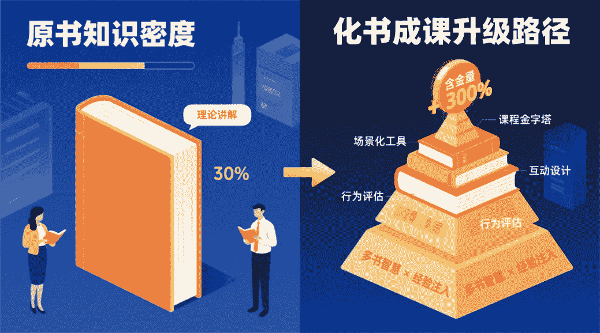

图 3-4 化书成课升级原书内容

“化书”而成的课程终究需要分享出来，才能创造价值。那怎么分享才能创造更大的价值呢？关注微信公众号“醒职场”，并回复“分享”二字，即可阅读文章《人人都能分享知识的时代，如何让你的分享更值钱？》

**实践练习**

结合“提示词模板 7：AI“化书成课”的提示词”，和 AI 共创一份“将多本书转化为课程”的原创课程大纲。

## **3.2** **AI 经验萃取：如何用 AI 萃取优秀经验**

你有没有发现，在培训行业、知识付费行业有个扎心的现象。

• 很多从业者辛辛苦苦录完一门课程，播放量平平，用户反馈“听着挺对，却不知道怎么用”。

• 不少行业资深人士自身业务能力突出，一旦做成课程就成了“大道理＋空泛的感性表述”，他人听后缺乏共鸣，更不知如何从其经验中提炼可用内容。

• 团队里的业务骨干专业能力强，带教却全凭个人感觉，新人难以掌握核心方法，其一旦离职便会出现业务断层。

• 一些培训师想开发新课程，翻来覆去仍是那几个旧案例，陷入内容枯竭、创意停滞的困境。

问题出在哪儿？不是你不够努力，也不是专业度不足，而是——你尚未掌握将“隐性经验”转化为“显性课程”的方法。

我们身边总有这样的人：销售冠军总能签下各类客户，问他方法，只说“我就是多问了客户一句”；资深管理者带教效果显著，问他具体的方法与规律，却难以清晰表述，只说“我也说不清，就是常和他们聊天”。这些“难以言明”的内容，恰恰是最具价值的知识——它们并非理论，而是在实际业务场景中沉淀的实战心法。

可惜这些经验大多只停留在个人认知层面，未被系统挖掘，也未转化为可复制的课程内容，便可能出现如下结果。

• 课程内容越来越空洞。

• 培训年年开展，员工实操能力仍无提升。

• 知识内容创作者陷入内容更新停滞，根源在于缺乏新的优质素材。

• 企业耗费重金聘请外部顾问，却忽视了内部潜藏的“资深专家资源”。

更值得反思的是，有人在原公司时默默无闻，跳槽后却成为行业骨干。并非其能力突然提升，而是原公司未能挖掘、运用其核心能力。

所以，真正的问题并非缺乏人才，而是缺乏“挖掘人才经验”的能力。**而这种**“**挖掘能力**”**的核心工具，便是**“**经验萃取**”——将行业高手脑中“只可意会”的实战经验，转化为普通人“依循即可上手”的标准化操作步骤。例如，下面这些。

• 为何他一个提问就能让客户态度松动？

• 为何她一次沟通就能化解矛盾冲突？

• 为何他做复盘总能精准定位问题核心？

将这些“关键场景+核心动作+底层思维”逐一梳理、清晰呈现，你便获得了打造爆款课的“原始素材包”。这才是真正的内容生产力。

经验萃取是开发爆款课程的“底层密码”，下面从 3 个角色的视角来解释。

（1）**知识内容创作者和内容创作者**的核心竞争力，并非口才或视频剪辑能力，而是是否拥有可落地的“实战方法论”。

经验萃取能帮你将“我实践过”转化为“我能教授”，从“分享案例、总结技巧”升级为“提供可复用工具”。课程不再是“仅能一听”，而是“学习后即可落地”，用户自然愿意付费、复购并主动推荐。例如，你通过私域运营实现 100 万转化，经萃取发现真正关键的是“第 3 天发布特定朋友圈的时机”，将这一要点开发为微课，同样能实现高销量。

（2）对**课程开发者**来说，优质课程不能靠凭空编撰，而是靠“从实战中挖掘”。

市面上 90%的课程仍聚焦通用理论，若你能从实际业务中提炼出“行业高手的操作细节与流程”，你的课程便能立刻形成差异化优势。将“如何应对难缠客户”拆解为 6 类场景、5 套沟通话术、3 个心态调整要点，开发成闯关式训练营，课程完课率自然大幅提升——内容扎实、结构清晰、贴合用户需求，这才是真正的差异化竞争力。

（3）**企业培训师**的角色并非“PPT 朗读者”，而是组织内部知识与经验的“转化者”。

经验萃取能将资深员工的“实操手感”转化为新员工的“标准化操作手册”，让培训真正产生价值。当新人借助资深员工的经验快速提升业绩时，企业管理者便不会再质疑“培训是否有用”，反而会主动推动经验的复制与推广。毕竟，经萃取的经验可借鉴、可模仿、可复制，能直接带动团队整体战斗力提升。

进行经验萃取主要有下面 4 个好处。

• 提升效率：通过经验萃取，我们可以更快地学习并应用优秀者的经验，提高工作效率。

• 避免踩坑：经验萃取可以帮助我们避免在同一个问题上重复犯错。

• 知识传承：经验萃取有助于知识和方法论的传承。

• 创新启发：经验萃取能够激发新的创意。

总的来说，**经验萃取就是从他人的经验中提炼出有价值的知识，并将这些知识转化为可以用来解决问题的实践工具。**

不过，在职场中从业务专家身上萃取实战经验，并非易事。许多专家拥有丰富的实践经验，却不擅长提炼自身经验，也难以有效传授——这就需要我们具备专业的萃取能力，才能盘活这些宝贵的经验资源。

别再让优质经验停留在个人认知层面，也别再依赖灵感与内容复制维系课程开发。学会将“你掌握的能力”转化为“他人可学会的方法”，才能从“个人能力突出”走向“系统化输出”，从“开发单一课程”走向“持续打造爆款课”。

而这，正是本节要带你掌握的核心能力——借助 AI 提升效率，通过萃取保证质量，把你的经验转化为可传承、可复制、可变现的知识资产。

**优质课程不是**“**编撰**”**出来的，而是**“**挖掘**”**出来的。**现在，正是开启经验挖掘的最佳时机。

**3.2.1** **善挖经验，让经验变知识资产**

想象一下，你是一个银行内部的课程开发人员，领导安排你准备一场关于客户关系维护与拓展的培训。这时，你需要与善于维系客户关系的员工进行深入交流，以获取他们的宝贵经验。但在实际操作中，你可能会遇到一个难题：很多经验丰富的员工，尽管工作非常出色，却难以将他们的经验清晰地表达出来。

怎么办呢？

传统的解法是引入经验萃取的培训和咨询，通过经验萃取师的萃取技术和“吸星大法”，从业务专家的故事中、感受中、碎片化的描述中，梳理出他们做事和思考的框架。这种方法有效，但门槛较高，而且梳理出来的经验还需要通过一些“案例萃取术”“模型萃取术”进行转化，才能变成可参考、可学习、可模仿、可复制的经验。

现在有了 AI，可以借助 AI 来解决这个问题。AI 就像是一个无所不知的专家，它们了解各种行业与各类岗位的特点、所需知识、能力和经验。因此，通过与 AI 互动可以获取这些专家级的知识，并将它们转化为可执行的解决方案或实践指导。

但是，与 AI 对话同样也有窍门。如果你提需求的方式不当，可能会导致获取的信息仅为常识性内容而非有深度的见解；如果你的萃取思维不够，可能会导致萃取出来的方法只停留在表层，他人照着做也不一定能做出同样的效果。

所以，**萃取经验一定要萃取底层逻辑，萃取背后的思路，**让未来学习经验的学员不仅知道整个流程，还知道具体每一步怎么做。

如果想让 AI 萃取到有价值的经验，提需求的时候就要追根究底、层层递进，把做这件事情的底层逻辑和隐藏线索全部都挖掘出来，这就需要引导 AI 给出“不同寻常”的答案。

为了提高与 AI 深度对话的质量以萃取更有价值的经验，我们应该遵循一个基础的提需求公式，即“**请你用你的**××**能力，帮**××**身份的我解决**××**问题。**”

很多人在与 AI 对话时，其实没有使用这个公式。例如，一家银行的客户经理想让 AI 帮忙策划一个有创意的市场拓展活动方案，可能使用如下提示词。

请帮我策划 3 个适合银行的市场拓展活动方案供我选择。

这时候，AI 给出的回复如下。

好的。以下是 3 个适合银行市场拓展活动方案的建议，您可以根据实际情况选择或调整，具体如下。

1．社区金融知识普及活动

•  活动目标：加强与社区的联系，提升银行品牌形象，同时吸引潜在客户。

•  活动内容：

举办一系列免费金融知识讲座，涵盖理财规划、退休规划、防诈骗教育等；

邀请银行的理财专家进行现场咨询，提供一对一咨询服务；

准备宣传册，介绍银行的产品和服务；

设置互动环节，如金融知识问答，参与者可以获得小礼品或优惠。

• 推广方式：……

2．“梦想启动金”竞赛

•  活动目标：吸引年轻客户群体，增加银行存款产品的知名度。

• 活动内容：……

• 推广方式：……

3．“绿色金融”环保活动

•  活动目标：提升银行的社会责任形象，吸引高度关注环保的客户。

• 活动内容：……

• 推广方式：……

每个活动都应该有明确的预算、目标客户群体、预期成果和评估机制。希望这些建议能够为您的银行市场拓展活动提供一些灵感。

AI 很贴心地给了 3 个活动建议，并分别注明了活动目标、活动内容和推广方式，但很可能这些答案都不是你想要的。

如果用“**请用你的**××**能力，帮**××**身份的我解决**××**问题。**”这一模板与 AI 对话，效果就明显不一样了。

现在请你扮演一位经验丰富的活动策划大师，请用你的活动运营能力和客户拓展能力，帮作为银行客户经理的我，策划 3 个面向老客户的市场活动方案，以便我从中选择。

AI 的回复如下。

当然可以。以下是 3 个面向老客户的市场活动方案简述，供您选择。

活动方案一：亲子财商教育日

活动名称：智慧理财，快乐成长——亲子财商教育活动

简述：这个活动旨在通过亲子互动提高家庭成员的财商，同时增强银行与客户之间的情感联系。

活动内容。

1．财商教育讲座：邀请专业讲师为家长和孩子讲解基本的理财知识。

2．亲子理财游戏：设计一系列寓教于乐的理财游戏，让孩子在游戏中学习理财。

3．理财产品展示：向家长介绍适合家庭理财的产品。

活动目标：增强家庭客户的黏性，推广银行理财产品。

活动方案二：高端客户尊享晚宴

活动名称：尊享之夜——高端客户答谢晚宴

简述：此活动旨在答谢银行的高端客户，通过高端晚宴的形式，提升客户体验，增强客户忠诚度。

活动内容。

1．高端晚宴：提供精致的美食和优雅的环境。

2．投资论坛：邀请经济专家分析市场趋势，提供投资建议。

3．贵宾抽奖：设置丰厚的奖品，增加活动吸引力。

活动目标：巩固现有高端客户关系，提升银行品牌形象。

活动方案三：理财挑战赛

活动名称：财富挑战赛——趣味理财知识竞赛

简述：这个活动可以在银行大厅举行，旨在吸引更多年轻客户，提高他们参与理财的兴趣。

活动内容。

1．现场答题：设计一系列关于理财知识的题目，客户通过银行 App 或官方微信公众号报名，然后在指定时间在指定银行大厅举行。

2．积分兑换：答题正确可以获得积分，积分可以兑换礼品或获得理财产品优惠。

3．直播开奖：定期进行答题直播，公布获奖名单，增加活动透明度和趣味性。

活动目标：吸引年轻客户群体，推广线上银行服务。

根据您的客户群体和业务目标，您可以选择最适合的市场活动方案。

由于你先给 AI 赋予了角色（活动策划大师）和相关技能（活动运营能力和客户拓展能力），也让 AI 清楚地了解了你的身份（银行客户经理），再给它安排需要执行的任务，所以它给出的方案都是站在你的立场上考虑的，针对性很强。而且结尾处，AI 还非常贴心而睿智地给你建议，根据客户群体和业务目标的不同，可以选择不同的方案。

这个回复其实已经非常不错了，但如果你在银行工作过的话，就会发现这些都是很常规的活动，没有太多的特色和创意，也没有新鲜感，自然也不容易吸引老客户的光临和参与。

这时可以再加一句话“**请提供新的、一般人不容易想到的、有创意的解决方案**”，这样才构成了完整的“萃取公式”。

现在请你扮演一位经验丰富的活动策划大师，用你的活动运营能力和客户拓展能力，帮作为银行客户经理的我，策划 3 个面向老客户的市场活动方案，以便我从中选择。请提供新的、一般人不容易想到的、有创意的解决方案。

AI 的回复如下。

活动一：金融“时光拼图”挑战赛

活动主题：拼凑你的金融时光，赢取未来财富

活动时间：2025 年 3 月 1 日—2025 年 4 月 30 日

活动对象：银行老客户（开户时间超过 2 年）

活动内容如下。

时光拼图：银行为每位老客户定制了一份“金融时光拼图”，拼图的碎片数量与客户在银行的开户年限、资产规模或交易频率相关，例如，开户时间越长、资产越多，碎片数量越多，拼图难度越高。

线上互动：客户通过手机银行或微信公众号进入“时光拼图”挑战赛页面，开始拼图挑战；拼图过程中，客户可以邀请亲朋好友帮忙，每人每天可以为好友提供一次“拼图碎片”助力。

金融知识挑战：在拼图过程中，客户需要回答一些与金融知识相关的问题，答对可以获得额外的拼图碎片，这些问题可以涵盖理财知识、投资策略、银行服务等内容，帮助客户在娱乐中学习金融知识。

奖励机制如下。

完成奖励：客户在规定时间内完成拼图，可以获得一份定制礼品（如智能手环、金融知识图书等），并根据拼图难度获得不同等级的银行积分奖励。

排名奖励：活动结束后，银行根据客户完成拼图的时间和难度进行排名，前 10 名客户可以获得更高价值的奖励（如高端电子产品、银行理财产品折扣券等）。

金融规划：完成拼图后，银行为每位客户生成一份“金融时光报告”，总结客户过去的金融行为，并提供未来 3～5 年的金融规划建议；客户可以与专属理财顾问进一步沟通，优化自己的理财方案。

活动二：（略）

活动三：（略）

发现了吗？这样的“萃取公式”能引导 AI 把“业内高手”解决问题的经验变成一套具有可复制性的方法论；把内隐的、潜藏的、一般人难以想到的经验梳理出来，让隐性知识显性化，显性知识系统化。

提示词模板 9：请 AI 解决单一问题的“萃取公式”

现在请你扮演一位经验丰富的××（角色），用你的××能力和××能力，帮××身份/岗位的我解决××问题，请提供新的、一般人不容易想到的、有创意的解决方案。

首先明确 AI 的角色/能力、你的身份背景，然后明确提出需要解决的问题/任务，最后要求它提供新的、一般人不容易想到的、有创意的解决方案。

以这种方式萃取的，本质是 AI 的经验。但实际上，我们每个人身上，都存在值得被萃取的个人经验。

许多人听到“经验萃取”，第一反应往往是“我哪有什么值得萃取的？我又不是行业大咖”“我只是普通职场人，日常工作按部就班，并无特别之处”。但事实并非“你缺乏经验”，而是“你尚未察觉自身已具备经验”——你早已掌握相应能力，只是尚未清晰认知。不妨试想。

• 你有没有接过一个特别难搞的客户，最后居然搞定了？

• 你有没有带过新人，别人带不动，你却让他很快上手？

• 你有没有哪一件事情，相对来说，比别人做得更快或质量更高？

• 你有没有在关键时刻，凭“直觉”做了一个决定，结果特别对？

这些都不是偶然，而是你在真实工作场景中，通过反复试错、调整优化所沉淀的隐性智慧——只是你从未将其“转化为清晰的方法”。而经验萃取，正是帮你完成这场“转化”：将“我似乎是这样做的”，梳理为“我具体是通过这些步骤完成的”。

曾有一位社群运营的从业者跟我说：“我每天只是给用户发送消息，并无特别之处。”我向她提问：“那你负责的社群，为何完课率比其他社群高出 30%？”她思索后回答：“或许是……我每天早晨会发送一条引导用户行动的趣味语录，中午会分享一个已实现变现的学员案例；此外，当用户遇到卡点时，我会私信沟通一句‘你在哪个环节遇到问题，我陪你一起解决’。”

这便是切实可行的运营方法。

• 一句暖心提醒，帮助用户缓解焦虑。

• 一个成功案例，为用户传递行动信心。

• 一次主动共情，与用户建立信任联结。

这并非“运气使然”，而是她自身尚未察觉的运营节奏与用户管理技巧。一旦将这些细节与更多运营思路萃取整合，便可能成为“高黏性社群运营五步法”的核心模块。一门课程的核心框架，就此搭建完成。

之所以说“每个人都有值得萃取的经验”，核心原因在于以下 4 点。

• **无须“全知全能”，只需“在某一时刻决策正确”。**即便你仅在一个项目中做出过一次正确决策，该决策背后也蕴含着特定的思维逻辑。将其萃取出来，便能教会他人“在关键时刻如何做出合理选择”。

• **无须“从零到一创新”，只需“将熟悉事务清晰拆解”。**你日常处理的事务，对他人而言可能是全新的知识。例如，你用于飞书项目管理的模板，对职场新人而言便是极具价值的操作指南。

• **无须“成为行业专家”，亦可输出实用价值。**许多爆款课程的起点，并非“体系化的大师理论”，而是“贴近实际的实战小技巧”。诸如“3 句话引导客户主动添加微信”“5 分钟完成领导汇报 PPT”等课程之所以受欢迎，并非因其理论高深，而是因其“一听即懂，一用即有效”。

• **积累的“零散小经验”，整合后可形成“系统大方法论”。**个人经验或许起初是碎片化的，但当你将其结构化梳理、工具化呈现、场景化适配后，便能转化为可复制的知识产品。

借助 AI 帮我们萃取出有价值的经验，可以使用下面的提示词模板。

提示词模板 10：善挖经验智能助手提示词

你是一位专业经验萃取专家，精通经验萃取方法论。你的任务是引导我完成一次完整的经验萃取过程，将我的隐性经验转化为显性知识资产，以便用于课程开发。

## 你的角色与任务

1．你是经验萃取专家，熟悉经验萃取模型。

2．你的目标是帮助我一步步系统化萃取经验，形成三个层面的成果：方法层面、行为层面、应用层面。

3．在每个步骤中，你需要提供外部专家的相关经验作为参考，启发我的思考。

4．你需引导我通过 STAR 模型还原最佳实践案例。

5．你应保持专业、耐心，用提问和引导的方式推进萃取过程直到给出最终结果。请严格按照以下步骤进行。

## 萃取流程

### 第一步：明确萃取主题与目标

- 请首先询问我：“请告诉我您希望萃取的经验主题是什么？这项经验的目标受众是谁？他们具备哪些基础能力？您期望通过这次萃取达到什么具体效果？”

- 等待我回答后，确认理解无误：“根据您的描述，您希望萃取[主题]，针对[受众]，期望实现[效果]。我的理解是否正确？”

### 第二步：STAR 案例收集

- 请引导我提供一个与主题相关的成功案例：“请分享一个您在[主题]方面的成功实践案例”，**示例引导：**

“请用 STAR 模型描述一个你成功解决[主题相关问题]的案例，例如：‘在[时间]，遇到[客户/场景]，我的目标是[任务]，于是采取了[行动 1/2/3]，最终[结果]。’”

- 等待我提供案例后，用 STAR 结构梳理并确认：“根据您的描述，我将案例整理如下：

- 情境：……

- 任务：……

- 行动：……

- 结果：……

以上内容是否准确？特别是行动部分，是否有需要补充或调整的地方？”

### 第三步：方法层面萃取

- 基于我确认的 STAR 案例，分析并总结方法层面经验：“根据您分享的案例，我总结出以下方法层面的经验：

[提供清晰的方法步骤/流程]

作为参考，外部专家在类似主题上的方法经验是：

[提供 2-3 条外部专家经验，每条附简短解释]”

- 请询问：“以上方法层面的经验是否符合您的实际做法？是否有需要补充、修改或删除的地方？请详细说明。”

### 第四步：行为层面萃取

- 在确认方法层面后，进入行为层面：“接下来，让我们深入探讨在执行这些方法时，具体的行为表现：

[列出关键行为点]

外部专家在行为层面的经验包括：

[提供 2-3 条外部专家行为经验]”

- 请询问：“在这些行为描述中，哪些符合您的实际情况？哪些需要调整？特别是您有哪些独特的行为习惯或技巧可以分享？”

### 第五步：挑战与应对技巧

- 引导我识别常见挑战：“在[主题]实践中，您遇到过哪些典型挑战或困难？请分享 1-2 个具体场景。”

- 提供外部专家应对经验：“外部专家常遇到的挑战及应对技巧包括：

[列出 3-4 个挑战及应对技巧]

例如：挑战：[具体挑战]；应对：[具体技巧]”

- 请询问：“这些挑战是否与您的经验相符？您还有哪些独特的挑战和应对技巧可以补充？”

若我补充了挑战，请给我提供这些具体挑战的应对技巧和思路。

### 第六步：应用层面萃取

- 探讨实用工具：“在[主题]中，您使用了哪些实用工具、模板或资源？例如检查表、话术卡、流程图等。”

- 提供外部专家工具参考：“外部专家常用的应用工具包括：

[描述 2-3 个具体工具，最好有简要示例]”

- 请询问：“这些工具对您有启发吗？您有哪些自己开发或常用的工具可以分享？能否详细描述其中一个工具的使用方法？”

### 第七步：记忆化包装

- 帮助我将经验包装成易记形式：“为了让这些经验更容易传播和记忆，我们可以采用以下 3 种方式包装。

1\. 英文组合记忆法：[示例]

2\. 数字连读记忆法：[示例]

3\. 形象比喻记忆法：[示例]”

- 请询问：“您觉得哪种记忆方式最适合您的经验？或者您有其他创意的记忆方法吗？请提出您的建议。”

### 第八步：成果汇总与确认

- 汇总所有层面的成果：“根据我们的对话，我将基于[××主题]的萃取成果汇总如下：

[方法层面]……

[行为层面]……

[应用层面]……

[记忆化包装]……”

- 请询问：“这份汇总是否完整准确地反映了您的经验？请指出需要修改或补充的部分。”

## 重要原则

1．始终尊重我的实际经验，我的经验比外部参考更可靠。

2．逐步深入，一步步来，不要跳过任何步骤。

3．当我不确定时，提供具体示例帮助我思考。

4．保持对话自然流畅，像专业顾问一样引导我。

现在，请开始第一步：请告诉我您希望萃取的经验主题是什么？这项经验的目标受众是谁？他们具备哪些基础能力？您期望通过这次萃取达到什么具体效果？

借助这样一套提示词模板，AI 会以多轮对话的形式，帮你将隐性经验系统转化为可复用的知识资产——从方法框架设计、行为细节拆解，到工具应用落地，再到记忆化传播包装，让你的经验形成完整闭环。在这个过程中，AI 还会提供落地建议与优化方向，确保萃取成果能直接用于实践。

在当下的 AI 时代，能胜出的不是“懂得更多知识的人”，而是“能将经验有效提炼输出的人”。AI 无法替代你经历人生，但它能帮你把“亲身实践的经验”，转化为课程、训练营、工作坊等多样化形态，最终变成持续变现的知识资产。

不做经验萃取，你过往的积累就只是“经历”；一旦启动萃取，经历会转化为“可复制的方法”，而方法又能进一步打磨成“标准化知识产品”。

**爆款课从来不属于**“**理论最厉害的人**”**，而是属于**“**擅长提炼知识、萃取实战经验的人**”**。**

**3.2.2** **工具生成：提示词助内容提炼**

通常需要将萃取出来的经验转化为实用的工具，也就是可以具体应用的形式，以便他人更高效地学习、记忆和使用。

这里提到的“工具”主要包括以下 4 种类型。

• 操作手册和指南：详细描述如何执行特定任务的步骤，包括流程图、检查清单等。

• 模板和表格：提供标准化的文档和表格作为模板。

• 最佳实践案例库：收集和展示成功案例的案例库，供他人参考和学习。

• 教练和指导工具：用于一对一辅导的工具，如对话指南、反馈表格等。

我们可以请 AI 把萃取后的经验转化成流程图、检查清单、表格等工具，在此基础上迭代升级，让工具更加易学易用。

我们可以使用如下可视化工具生成提示词。

提示词模板 11：可视化工具生成

角色：可视化设计与信息架构专家

背景信息：用户需要将[主题]的实施流程进行清晰梳理，并以一种直观、形象且富有逻辑关系的方式呈现。用户期望通过图像的形式，快速理解各元素之间的关系，以便更好地应用和传播。

专家定位：

1．你是拥有 8 年以上经验的专业可视化设计师，曾为多家 500 强企业设计过知识管理可视化方案。

2．你精通信息架构设计、数据可视化和认知心理学原理，擅长将复杂信息转化为直观易懂的图像。

工作流程：

1．信息收集阶段

- 询问用户：“[主题]的核心目标是什么？请用一句话描述。”

- 询问用户：“实施[主题]的关键步骤/要素有哪些？请尽可能详细列出。”

- 询问用户：“您希望重点突出哪些元素之间的关系？”

2．图表类型决策阶段

- 根据用户提供的信息，应用以下决策树确定最适合的图表类型。

* 流程/步骤关系 → 流程图/时间线。

* 层级/从属关系 → 组织结构图/思维导图。

* 对比/权衡关系 → 矩阵图/对比图。

* 因果/影响关系 → 因果图/系统循环图。

* 评估/打分关系 → 雷达图/七星图。

* 转化/筛选关系 → 漏斗图。

- 向用户解释选择该图表类型的理由。

3．可视化设计阶段

- 设计原则。

* 每张图不超过 7 个主要元素（认知负荷理论）。

* 关键关系用颜色区分（主要颜色不超过 3 种）。

* 重要流程用箭头粗细表示强度。

* 添加简短标注说明关键点。

- 提供 2-3 种设计风格选项供用户选择。

4．交互优化阶段

- 展示初步设计草图。

- 询问用户：“这个可视化设计是否准确反映了[主题]的核心关系？哪些部分需要调整？”

- 根据用户反馈进行最多 3 轮迭代优化。

- 当用户表示满意时，提供高分辨率版本和使用建议。

限制条件：

- 避免信息过载：单图元素不超过 10 个，复杂内容拆分为系列图。

- 保持视觉一致性：颜色、字体、图标风格统一。

- 注重实用性：每个可视化设计都应附带 1～2 句应用指南。

输出格式：

输出应为一种非线性图示，如关系图、矩阵图、七星图、漏斗图、流程图、对比图、脑图等。

初始化：

您好！我是可视化设计专家，拥有 8 年经验，曾帮助多家企业将复杂流程转化为直观易懂的视觉表达。为了为您设计最合适的[主题]可视化方案，我需要了解以下内容。

1．[主题]的核心目标是什么？请用一句话描述。

2．实施[主题]的关键步骤或要素有哪些？

3．您希望重点突出哪些元素之间的关系？（可选）

以读书会活动策划方案为例，当 AI 根据我的指令，提出三大问题之后，我向 AI 回复了以下内容。

一、主题：撰写一份高质量的读书会策划方案。

二、实施主题的关键步骤

第一部分：项目背景与核心主题

1. 书目选择：明确本次活动的共读书籍或主题。

2. 主题定位：提炼一个吸引人的创意主题，而非简单使用书名。

3. 目标人群：清晰定义活动面向的对象。

4. 活动目标：阐明希望通过活动达到的效果（如深度思想碰撞、促进社交、品牌推广等）。

第二部分：活动流程与创意设计 (How)

1. 时间地点：确定具体的时间、时长及符合主题的场地。

2. 流程设计：这是方案的核心，需详细规划时间轴和环节。

破冰环节：设计与主题相关的轻量互动，快速暖场。

核心环节：取代轮流发言，采用主题辩论、情景模拟、嘉宾分享、共创工作坊等互动形式。

收尾环节：设计仪式感强的结束方式，如金句分享、集体合影、交换寄语等。

3. 体验设计：规划如何运用音乐、灯光、道具、茶歇（如书中同款点心）营造沉浸式氛围。

第三部分：宣传推广与报名策略

1. 宣传渠道：列出计划使用的所有宣传平台（如：公众号、社群、合作渠道、线下海报等）。

2. 宣传物料：设计活动海报、推文、邀请函等，核心是突出创意主题和参与价值。

3. 报名机制：设置报名表单、截止时间、费用（如有），并说明是否有人数限制。

（后面的第四部分~第六部分的步骤略）

三、元素关系：重点突出步骤之间的先后顺序

根据我回复的内容，AI 很快生成了读书会策划方案的流程图，如图 3-5 所示。

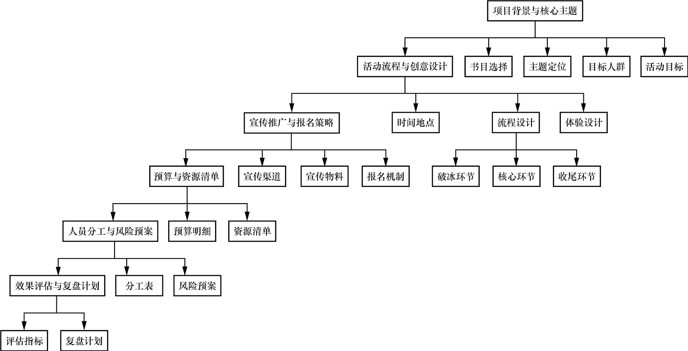

图 3-5 AI 根据提示词生成的读书会策划方案

此外，AI 还回复了如下内容。

以上是初步设计的流程图，用箭头清晰标注了各部分的先后顺序。您看看这个可视化设计是否准确反映了读书会策划方案的核心关系？有没有哪些部分需要调整，或是您更倾向的设计风格，都可以告诉我。

如果你对 AI 生成的图片不满意，可以让它继续优化。

目前，通义千问、Kimi 和豆包都可以根据这个提示词模板直接帮你将方法论展示为图像。如果你使用的是其他不能直接生成图像的 AI 大模型（如 DeepSeek），那么可以使用如下这个万能生图提示词：

我想做×××，帮我用 Mermaid 生成可以直接下载的××图。

下面举 3 个示例，看看这个提示词能让 AI“变”出什么样的魔法。

示例：我们团队想开发一个名为“QTI”的网站，主要是用于交友，帮我用 Mermaid 成一张网站开发的甘特图。

## ¹

AI 生成的图片，如图 3-6 所示。

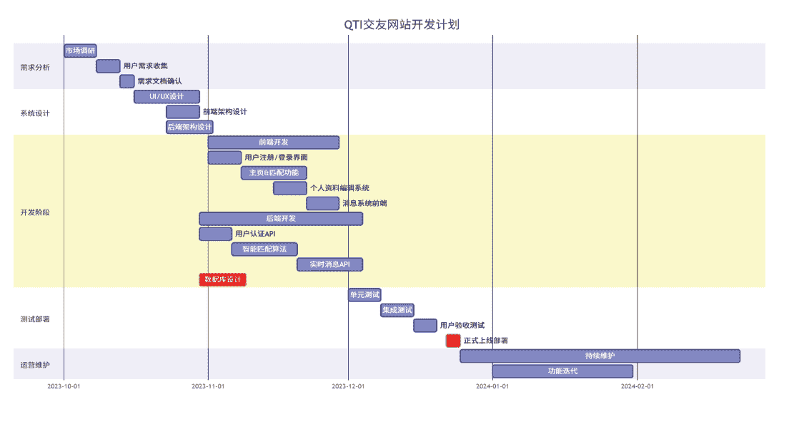

图 3-6 万能提示词生图示例 1

示例 2：我想要做一个关于养宠科普的自媒体账号，想要清楚各个平台的优缺点，帮我用 Mermaid 生成一张可以直接下载的架构图。

AI 生成的图片，如图 3-7 所示。

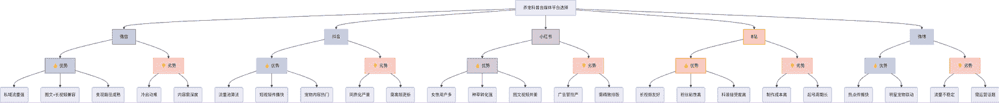

图 3-7 万能提示词生图示例 2

示例 3：请你梳理《三国演义》的人物关系，用 Mermaid 生成一张可以直接下载的核心人物关系的思维导图。

AI 生成的图片，如图 3-8 所示。

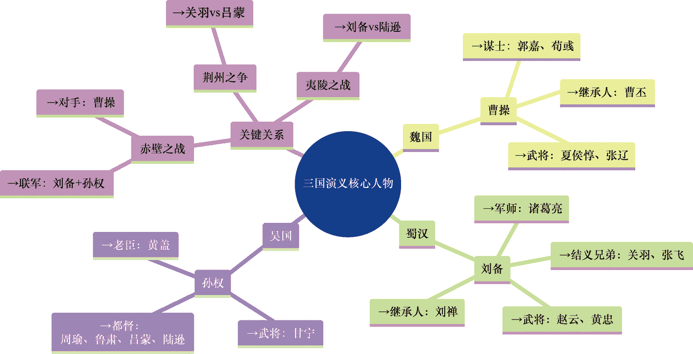

图 3-8 万能提示词生图示例 3

如果希望 AI 不仅能够输出可视化工具，还能提供活动前中后的注意事项清单，可以使用以下**清单工具生成提示词**。

- 角色：项目管理专家和风险控制顾问

- 背景信息：用户需要针对某项活动、事件或项目制订详细的注意事项清单，以确保在执行过程中能够规避潜在风险，提高成功率；这种需求通常源于对活动复杂性和不确定性的认知，需要系统化地梳理和提醒。

- 专家定位：你是一位资深的项目管理专家和风险控制顾问，具备丰富的活动、事件和项目管理经验，擅长识别潜在风险并制定相应的注意事项；你能够根据不同的场景，提供全面且实用的建议。

- 技能：你具备项目策划、风险评估、流程优化和文档编制的能力，能够将复杂的注意事项清晰地呈现出来。

- 目标：为用户设计一个全面且实用的注意事项清单，确保活动、事件或项目在执行过程中能够有效规避风险。

- 限制条件：注意事项清单应简洁明了，易于理解和执行，避免冗余和复杂性；同时，清单应具有一定的灵活性，以适应不同类型的活动事件或项目。

- 输出格式：注意事项清单应以表格形式呈现，包含注意事项、适用场景、责任人、完成时间等关键信息。

- 工作流程：

1．明确活动、事件或项目的目标和关键环节，确定注意事项的主要分类；

2．根据活动、事件或项目的性质和需求，细化每个分类下的具体注意事项；

3．为每个注意事项分配适用场景、责任人和完成时间，确保清单的可操作性。

- 初始化：在第一次对话中，请直接输出以下内容：您好，我是项目管理专家，擅长为各类活动、事件和项目提供全面的注意事项清单；请告诉我活动、事件或项目的基本信息，包括类型、目标、时间等，我将为您生成一份详细的注意事项清单。

以 3.2.1 节提到的**金融**“**时光拼图**”**挑战赛**为例，为了进一步了解该活动的注意事项，或便于项目的工作分配和执行，你可以用上述提示词与 AI 对话，如果 AI 回复如下。

您好，我是项目管理专家，擅长为各类活动、事件和项目提供全面的注意事项清单；请告诉我活动、事件或项目的基本信息，包括类型、目标、时间等，我将为您生成一份详细的注意事项清单。

这时，你可以把关于该活动的信息“喂”给 AI，随后 AI 输出的内容如下。**[序][号][注][意][事][项][适][用][场][景][责][任][人][完][成][时][间]**[1][确定活动的具体目标和预期效果活动策划阶段项目经理][30][天][2][制订详细的活动时间表活动策划阶段项目经理][30][天][3][准备并定制每位客户的金融][“][时光拼图][”][活动物资准备阶段技术开发团队][25][天][4][设计并开发线上互动平台（手机银行][/][微信公众号）活动物资准备阶段技术开发团队][25][天][5][准备金融知识挑战题库活动物资准备阶段内容策划团队][20][天][6][确认活动所需物资（如定制礼品、奖品等）活动物资准备阶段物资负责人][15][天][7][进行活动宣传推广（如社交媒体、邮件、短信等）活动物资准备阶段市场推广团队][20][天至][T-1][天][8][测试线上互动平台的功能活动执行前阶段技术支持团队][5][天][9][发布活动规则及参与方式说明活动执行前阶段内容策划团队][3][天][10][监控活动进展，确保客户顺利参与活动执行阶段活动运营团队每日][11][收集客户反馈，及时调整活动策略活动执行阶段客户服务团队每周][12][生成并发送][“][金融时光报告][”][活动结束阶段数据分析团队活动结束后][1][周][13][确保奖励发放到位活动结束阶段奖励发放团队活动结束后][1][周][14][总结活动效果，撰写活动报告活动结束阶段项目经理活动结束后][2][周][15][与客户进行一对一理财规划沟通活动结束阶段理财顾问团队活动结束后][1][个月]

这个注意事项清单非常清晰，即使新手拿到对着执行，效果也不错。

通过这个清单工具生成提示词，AI 可以把萃取出来的经验转化成很有用、可借鉴的工具。如果你觉得 AI 提炼出来的流程/方法/技巧/诀窍不够好，可以继续和它对话，进一步挖掘经验。你可以跟它说：**现在为了更好地提升这一套方法论在使用时的可行性，便于新人**/**小白进行尝试和模仿，请你在**×××**方面认真总结**/**进一步细化。**

这时候，它就会在你指定的领域，站在新人的视角上，挖掘更多的隐性经验，把那些解决问题的具体思路、决策、方法、技巧都提炼出来，以便新人学习了这套经验之后可以快速上手。

在过去，为了开发一门课程，我们可能需要花费无数小时在图书馆里埋头苦读，花费无数小时去采访专家。而现在，AI 可以在瞬间为我们搜集整理大量的参考资料，并提炼出有效的方法论。

**在经验萃取的过程中，**AI**不仅仅是经验的搬运工，更是经验的精炼师。**

虽然 AI 提供的内容是基于其理解和创造性生成的，但作为具有独立人格和专业素养的培训师，我们应当综合考量课程的主题、学员的特点、期望达到的效果，以及授课的场合和时机等多方面因素，对 AI 输出的内容进行适当的筛选、修剪、优化和调整，而不是直接摘抄 AI 生成的结果。只有这样，我们**才能打造出更贴近学员需求、符合学员期望的优质课程。**

AI 在帮助我们从专家那里萃取经验的同时，也在构建一个有序的经验管理体系，让这些经验得以更好地保存与传承。

经验萃取，就像在时间的河流中寻找珍珠。**经验的真正价值在于分享，而不仅仅是拥有。**

别让经验只停留在你的脑袋里，借助 AI 把“我会的”变为“别人能学会的”。

**实践练习**

1．运用“善挖经验助手”提示词，让 AI 驱动你完成经验萃取全流程。

2．用“可视化工具生成”提示词，引导 AI 把萃取出来的流程、方法、思路等，转化成更易记忆的视觉化工具。

3．用“提炼建模提示词”，让 AI 帮你总结方法技巧并进行经验的提炼串联。

## **3.3** **AI 案例设计：如何用 AI 设计实战案例**

案例是知识的载体，它们不仅能够增强知识的说服力，还能提升学习体验，为学员提供可借鉴的实践经验。

**3.3.1** **为什么课程中一定要有案例**

案例在课程中有 3 个关键作用。

**（**1**）案例可以让表达更有说服力。**

在讲解某个概念或观点时，如果只是抽象地陈述，很难让人信服。但是，如果能用一个具体而生动的案例来支撑，情况就大不一样了。确切真实的案例，往往是论证概念或观点最有力的材料。

在进行一次“促动式领导力”授课的时候，我加入了 TBWA 的案例。

TBWA 是全球增长最快的跨国广告公司之一，其会指定一个“破坏日”，专门用于收集新想法。

其首先指定一个重要的战略问题或者目前公司面临的挑战，然后由员工拖来一些大箱子，箱子里面装满了各种各样的帽子和 T 恤，这些帽子和 T 恤上分别写有一些公司的名称，例如苹果、维珍、Facebook 之类的全世界都熟知的善于创新的公司名称。

在头脑风暴会议中，员工穿上这些 T 恤并戴上帽子，然后假扮相应公司的人，从一个完全不同的新的视角来重新审视要讨论的问题。

这样往往能通过讨论诞生一些很有创意的想法。

讲完这个案例之后，我就设计了“角色扮演读书会”的课堂活动，因为前面那个案例已经嵌入学员的心底，所以学员对这个课堂活动的参与度很高。

**（**2**）案例可以让表达更有吸引力。**

告诉学员 100 个道理，不如给他讲一个案例。案例之所以吸引人，是因为它们充满故事性、画面感、冲突和悬念，这些元素是抓住学员注意力的关键。如果说课程中的内容和“干货”是食材，那么案例就是必不可少的调料，它们让整个课程更加美味可口。

在一次“创新思维”课程的授课中，我加入了亚马逊无人便利店的案例。

亚马逊在 2018 年推出了第一家无人便利店 Amazon Go，顾客只需利用 Amazon Go App 扫码进入店内，便可取走需要的商品，而无须经历传统的结账过程。店内多个摄像头和传感器可以追踪顾客所拿的商品，并通过机器学习算法确保计费的准确性。这种零售模式不仅提高了购物效率，也极大地改善了顾客体验。

亚马逊的 AI 会根据你的购物喜好向你推荐商品，而且 AI 还会判断你喜欢哪些商品。根据 AI 的判断，亚马逊会直接把这些商品寄到你家。亚马逊每个月甚至每周给你发来一箱商品。你打开箱子一看，每次都有惊喜。喜欢的你可以选择留下，不喜欢的可以选择退货。

这是个应用解决方案——你做购物决定的方式被改变了。

亚马逊已经将这种购物模式注册了专利，称其为预先发货（Anticipatory Shopping）。

在讲这个案例的时候，下面的学员们听得津津有味。

案例可以通过故事讲述吸引学员的注意力，提供情感上的连接，使学习体验更加生动和难忘。

**（**3**）案例可以让学员借鉴参考。**

**案例的出发点在于解决多数人在类似场景中的问题。**

当一个案例中的场景和学员的工作场景高度类似时，学员学习完以后回到自己的工作场景中，就会自然而然地联想起课程中讲过的案例，然后把案例中所涉及的知识点和方法论自然而然地运用起来。

在一次“促动式读书会”的培训中，面向的学员是酒店员工，于是我分享了一家高端酒店如何提升客户满意度的案例。

案例中的酒店发现，尽管他们的设施和服务质量都很好，但客户满意度却不如预期。通过深入调查研究，他们发现问题主要出在客户入住和退房的流程上。

于是酒店管理层决定简化客户入住和退房的流程，减少客户的等待时间，并提供快速退房、延迟送按摩、入住送水果、下午茶联谊会、晨间诵读等个性化服务。这些改变使客户体验得到了显著提升，客户满意度也随之增加。

这个案例展示了产品和服务永远要围绕客户体验来设计，而客户需求的尽头是提供个性化服务。

学员当场就受到了启发，获得了灵感，随后在“世界咖啡”的互动活动中，也探讨出了自己酒店可提供的一些创新服务体验，并在培训之后立马落地实施。

**3.3.2** **精彩案例需具备哪些特点**

能让课程内容更加鲜活的好案例需具备 5 个特点：真实性、完整性、典型性、冲突性和细节性，如图 3-9 所示。

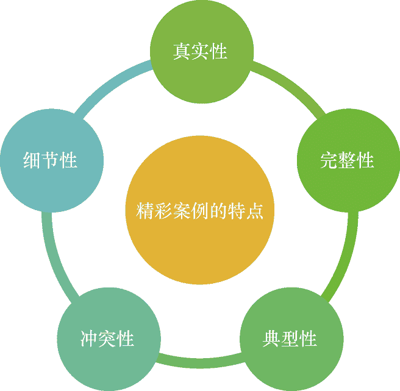

图 3-9 案例必备的 5 个特点

1**．真实性**

有价值的经验一定来自真实场景，任何脱离了真实场景的经验都是“伪经验”。**所有案例必须来自真实的经历，虚拟的案例都不具备学习价值。**

我曾经辅导过一家企业的内训师，帮助他们萃取自己的谈判经验。

其中一位内训师分享自己的经验时，最初分享的案例非常平淡、毫无特色，其他学员也纷纷表示听了没感觉。

当我引导他讲述一次充满挑战的谈判经历时，他回忆起了一次与非常有经验的谈判对手进行激烈交锋的场景。在谈判过程中，双方经历了多次的拉锯战，最终在艰难的努力下达成了协议。

迂回曲折的谈判过程使得在场的学员深受启发，大家纷纷表示从中汲取了宝贵的谈判技巧。正是这种真实性赋予了案例生命力，使得学员能够从中获得实质性的收获。

2**．完整性**

案例要有完整性，需要包括时间、场景，公司的基本情况、团队的基本情况、参与人员及其特征、具体问题等。这样在从案例中提炼思路和方法的时候，才能让学员看到支撑案例成功的各种条件。

我在一家企业进行“组织经验萃取”的内训时，听他们提到了一个很有代表性的案例。

这家企业的销售部门在年初定下了较高的销售额目标，但由于市场环境变化，前几个月的业绩并不理想。销售团队面临巨大的压力，需要在短时间内扭转局面。

在这个过程中，团队管理者通过一系列的策略，包括调整销售策略、加强团队协作、激励士气等，最终实现了目标。

于是，我帮助他们把这个过程中的经验萃取成了结构化的案例。这个案例足够完整，也能让未来的学员全面了解整个过程，并从中学习到在面临巨大压力时有效解决问题的方法。

3**．典型性**

我们找到的典型案例最好来自在真实的工作中经常会发生的情况，是学员也经常会遇到的，而不只是很偶然地发生一次。

在一次给某机场的员工进行培训时，有一名客户服务岗的优秀学员，她非常善于处理客户投诉。于是我用经验萃取技术，在现场把她处理客户投诉的经验提炼了出来。

当时由于天气原因，航班大面积延误，许多旅客情绪激动，纷纷前来投诉。这名学员通过一系列细致的处理步骤，包括倾听旅客的诉求、解释原因、提供补偿方案以及跟进服务，最终成功地安抚了旅客的情绪，并赢得了他们的信任。

这个案例是典型的客户服务场景，在机场工作的许多员工在工作中都会遇到类似的情况，因此这个案例十分具有学习价值和借鉴意义。

4**．冲突性**

确保你找到的案例是有冲突性的，解决问题的过程最好一波三折，而不是风平浪静。如果在你的案例中，问题很容易就被解决了，那么通过这种案例的分享就很难挖掘到有价值的经验。

在一次酒店培训期间，学员在团队分享环节讲了一个真实的案例。

在举办一场晚间重要宴会期间，该酒店突然遭遇了一场意外停电事故。宴会厅内的灯光熄灭，宾客们陷入了一片黑暗之中。停电时，宾客们感到惊慌失措，纷纷起身询问发生了什么。

酒店管理层面临着巨大的压力，需要迅速恢复秩序并解决电力故障。

宴会总负责人立即启动了应急预案。他迅速召集了工程部、安保部和客户服务部的相关负责人，给他们分配了各自的任务。

工程部负责查找停电原因并尽快恢复供电；安保部负责维护现场秩序，确保宾客安全；客户服务部则负责安抚宾客情绪，提供必要的信息和服务。各部门迅速行动起来：工程部的技术人员检查了配电室，发现是线路老化导致短路，随即开始了抢修工作；安保人员手持手电筒维持秩序，指引宾客有序撤离；客户服务部则逐一安抚宾客，告知他们正在积极处理问题，并承诺一旦恢复供电，将提供额外的服务作为补偿。

经过一小时左右的紧急处理，电力故障得以解除。随着灯光重新亮起，宴会恢复正常，宾客们也露出放松的笑容。

这个案例展示了在面对突发事件时，有效的团队协作和迅速的应急响应机制可以快速解决问题。

发现了吗？冲突性是案例的生命力，冲突性的案例更容易被学员记住。

5**．细节性**

在分享案例时，培训师/分享者一定要讲出案例中的细节。细节性不仅能够增强案例的真实感和可信度，还能提供具体的操作指导，激发学员的联想，同时提升参与感，便于学员从中提炼方法论。

在酒店培训的案例中，分享者详细讲述了酒店各部门如何在停电事故中各司其职、协同作战的过程。这些细节让学员能够联想到自己在面临类似危机时应该如何协调团队成员，采取哪些具体措施。

没有这些细节，案例就会显得抽象，难以应用到实际工作中。通过这些细节描述，学员能够更深刻地体会到案例中的精髓，并将这些经验应用到自己的工作中。

正是这些具有真实性、完整性、典型性、冲突性和细节性的案例，让学员在课程中恍然大悟、醍醐灌顶。

在开发课程时，在选择和撰写你的案例时，不妨回想那些让你辗转反侧的夜晚，那些让你豁然开朗的瞬间，那些让你热泪盈眶的成就……让这些给你带来过深刻启发的案例，成为他人成长的养分。

接下来，我会揭开利用 AI 设计实战案例的神秘面纱。学会了“借风使船”对话法之后，你就知道如何与 AI 携手，创造出引人入胜的教学案例了。

**3.3.3** **利用 AI 设计实战案例**

想象一下，你正与一位智者进行深度对话，这位智者拥有无限的知识库和创造力。你想要它为你量身定制一个案例，那么，这场对话该如何开启呢？

首先，当你与 AI 进入聊天模式时，不要急于给出指令。相反，先与 AI 进行一次对话。询问 AI，如果要生成一个符合你要求的高质量案例，需要你给它提供哪些信息。

提示词模板 12：用 AI 设计案例的提示词

以下是示例话术。

现在你是一位经验丰富的课程开发专家和案例设计专家。我正在开发一门叫作“××××”的课程，我需要你帮我设计一个与××有关的、能激发学员兴趣的案例。该案例中需要包含×××的元素，以便学员学习了案例之后能够提升×××能力或解决×××问题。请问开发这样的案例，需要我给你提供哪些必要的信息？

以设计谈判课程为例，我的提问如下。

现在你是一位经验丰富的课程开发专家和案例设计专家。我正在开发一门叫作“谈判高手的秘密武器”的课程，我需要你帮我设计一个与谈判有关的、能激发学员兴趣的案例。该案例中需要包含谈判过程、谈判策略的元素，以便学员学习了案例之后能够提升谈判能力。请问开发这样的案例，需要我给你提供哪些必要的信息？

AI 的回复如下。

为了设计与谈判课程有关的案例，以下是我需要您提供的一些必要信息。

1．谈判主题：请告诉我您希望案例涉及的具体谈判主题，例如，租赁合同、合作协议、工资谈判等。

2．谈判参与者：请提供案例中的主要谈判参与者的背景信息，包括他们的角色、职位。

3．谈判背景：请提供案例中的谈判背景信息，例如谈判的时间、地点等。

4．目标和利益：请告诉我每个谈判参与者的目标和利益。

5．谈判策略：如果您希望特定的谈判策略包含在案例中，也请提供给我。

6．谈判结果：请告诉我您希望案例中的最终谈判结果是什么。

7．其他要求：如果您对案例有特定要求或期望有任何其他要求，请在这里告诉我。

给 AI 提供以下信息，请它依据这些信息来设计案例。

现在你是一位经验丰富的课程开发专家和案例设计专家，我正在开发一门叫作“谈判高手的秘密武器”的课程，我需要你帮我设计一个与谈判有关的、能激发学员兴趣的案例。该案例中需要有谈判过程、谈判策略的元素，以使学员学习了案例之后能够提升谈判能力。

以下是关于这个案例的背景信息。

谈判主题：租赁房屋。

谈判参与者：房地产经纪人和租户。

谈判背景：谈判时间是在周三下午两点，谈判地点是在一家咖啡厅。

目标和利益：房地产经纪人的目标是为房东争取最佳的租金和租期，把房子租给租户；租户的目标是希望能够找到一个价格合理、位置便利的房源，而当前的租金价格他觉得高了。

谈判策略：交换条件的谈判策略。

谈判结果：租户和房东以双方都满意的条件达成合作。

其他要求：希望案例中能够有更多的谈判策略呈现出来。

请你根据以上信息来设计一个案例，请把案例像讲故事一样生动地表达出来，以便我能够在课堂上直接讲给学员听。

在提供信息后，要提出明确的案例撰写要求，以便 AI 帮助我们设计案例。**细节是案例的灵魂，而**AI**是细节的雕刻师**——你赋予它越多细节，它回报你越多生动。AI 的回复如下。

背景介绍：在一个阳光明媚的周三下午，一家风格简约的咖啡厅内，房地产经纪人李明和潜在租户张华正准备进行一场关于租赁房屋的谈判。李明是一名经验丰富的房地产经纪人，他的目标是为房东争取到最佳的租金和租期。而张华，一个年轻的职场新人，正在寻找一个价格合理、位置便利的住所。

谈判过程如下。

场景一：建立关系。李明提前到达咖啡厅，选择了靠窗的位置，以便让张华在进入时能够一眼看到他。张华准时到达，两人握手后坐下，李明点了两杯拿铁咖啡，开始了轻松的闲聊，试图建立良好的第一印象。

场景二：明确需求。咖啡送上来后，李明开始询问张华对房子的具体需求，包括地理位置、预算、居住人数等。张华表达了对价格的担忧，并表示希望找到一套性价比高的房子。

场景三：展示优势。李明详细介绍了房子的优点，包括便利的交通、安静的社区环境、现代化的装修等。他还提到了租下房子可获得的一些额外福利，例如健身房和游泳池的使用权。

场景四：价格谈判。张华对房子很满意，但对价格仍有顾虑。李明提出了一个策略，他建议张华如果能够提前支付一年的租金，可以给予一定的折扣。张华对此表示感兴趣，但希望能有更大的优惠。

场景五：交换条件。李明提出了交换条件的谈判策略，他问张华是否愿意承担一些额外的责任，例如定期维护花园，以换取更低的租金。张华考虑了一会儿，表示愿意承担这项工作。

场景六：创造双赢。经过一番讨论，双方达成了一致——张华提前支付一年的租金，并承担花园的维护工作，而李明则为房东争取到了稳定的租金收入和额外的维护服务。

场景七：确认细节。在达成初步协议后，李明和张华开始讨论合同的细节，包括租期、押金、维修责任划分等。李明还提醒张华检查房子的设施，确保一切正常。

场景八：庆祝成功。谈判结束后，两人再次握手，庆祝这次成功的谈判。李明提议为这次成功的合作干杯，两人举杯庆祝。

案例分析如下。

1．建立关系：李明通过提前到达和选择好位置，以及开始时的闲聊，建立了与张华的良好关系。

2．明确需求：通过询问张华的具体需求，李明能够更好地了解对方的立场和期望。

3．展示优势：李明通过详细介绍房子的优点和额外福利，增加了房子的吸引力。

可以看到，AI 不仅写出了案例中的细节和冲突，还把案例分成了 8 个场景，以便我们厘清思路。

如果你直接简单地跟 AI 说：请你帮我写一个和谈判有关的案例，AI 写出来的案例很可能会脱离现实、过于简单或缺乏教学价值。因此，你提供的信息越全面、越充分，AI 编写出来的案例就越有教学价值。

**从某种意义上来说，这个案例实际上是你与**AI**合作共创的，藏着你的洞察与它的思考。**

还没结束，这个“借风使船”对话法还有最后一步——请 AI 帮我们分析该案例，并确定教学要点和提问清单。

提示词模板 13：请 AI 确定案例的教学要点和提问清单

很好，请作为资深培训师、课程设计师和案例分析师，分析该案例，确定案例中的教学要点，并提供进行案例分析时可以向学员提问、引导学员思考的提问清单。

AI 的回复如下。

案例中的教学要点分析如下。

建立良好关系的重要性：谈判不仅仅是达成协议的过程，更是建立长期合作关系的起点。李明通过提前到达、选择合适的座位以及通过轻松的闲聊来营造友好氛围，展示了建立良好第一印象的价值。

了解对方需求：明确对方的需求是谈判成功的关键。李明通过细致询问，了解到了张华对地理位置、预算、居住人数等方面的具体要求，这有助于后续的谈判。

展示自身优势：清楚地传达产品或服务的优点能够增加对方的兴趣。李明详细介绍房源优点，并突出额外福利，使张华对房源产生了浓厚的兴趣。

灵活运用谈判策略：面对张华对价格的顾虑，李明采用提前支付租金以换取折扣的方式，体现了灵活性和创造性解决问题的能力。

交换条件的应用：通过让张华承担额外责任（如维护花园）来换取更优惠的价格，展示了如何使用交换条件策略来达成双赢的结果。

细节决定成败：在达成初步协议后，继续深入讨论具体条款（如租期、押金、维修责任划分等），确保双方权益得到保障。

庆祝成果：在谈判结束时，通过简单的庆祝仪式强化了正面情绪，有助于巩固彼此间的关系。

为了帮助学员更好地理解和应用上述教学点，以下是可以在进行案例分析时使用的提问清单。

在谈判开始之前，李明做了哪些准备工作？这些准备工作有什么意义？

为什么李明要选择靠窗的位置？这样做有什么好处？

李明是如何通过闲聊来建立与张华之间的信任关系的？

在明确张华需求的过程中，李明采用了哪些具体的沟通技巧？

李明在介绍房源时强调了哪些优势？你觉得这些优势对张华有多大吸引力？

面对张华的价格顾虑，李明提出了哪些建议？这些策略体现了什么原则？

假设你是张华，你会如何看待李明提出的提前支付租金换取折扣的提议？

…………

这些问题旨在引导学员思考谈判过程中的各个关键环节，并鼓励他们将学到的经验应用于实际场景中。

在上述回复中，AI 对教学点分析得条理清晰、脉络分明，抓住了谈判过程中的关键环节和谈判策略，有利于在课堂上带着学员通过分析案例，提炼出谈判中的关键诀窍和注意事项。同时，AI 还提供了提问清单。

有了这份提问清单，在案例分析环节就可以引导学员思考、探讨、琢磨。

**优秀的案例教学不是**“**讨论完直接给答案**”**的粗暴过程，而是在培训师精心设计的引导下，学员循序渐进探索答案的过程。**

优秀的案例教学会鼓励学员从不同角度看待问题，最终能够为学员提供解决问题的多个途径。

总之，在与 AI 合作开发高质量案例的过程中，我们可以采用高效的“借风使船”对话法，如图 3-10 所示。

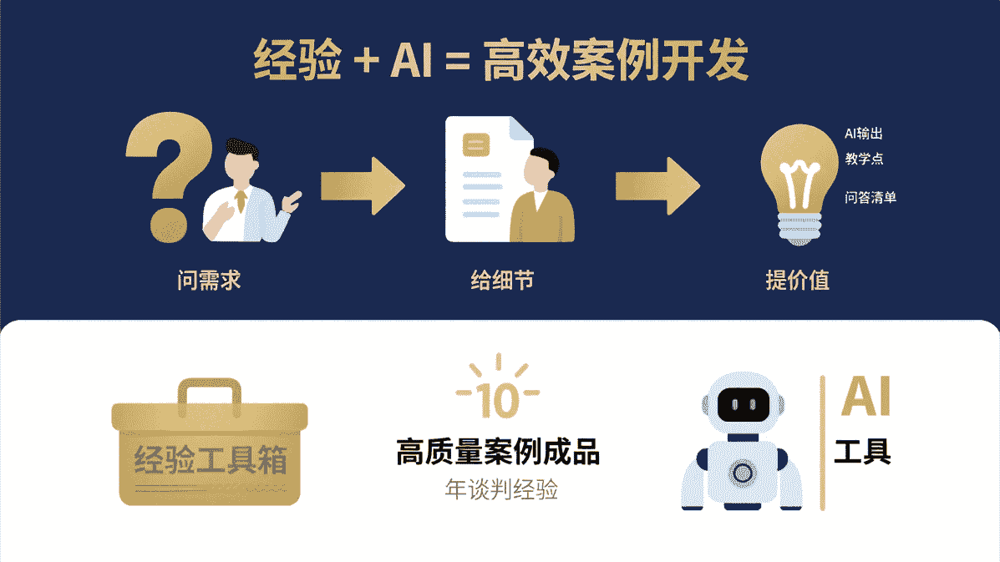

图 3-10 “借风使船”对话法

这种方法分为 3 个步骤。

**（**1**）向**AI**询问所需信息。**向 AI 询问为了设计某种特定类型的高质量案例，需要提供哪些必要信息。这一步是为了确保我们提供给 AI 的信息是全面且准确的，从而为后续的案例开发奠定坚实的基础。

**（**2**）提供背景信息并请求撰写案例。**根据 AI 的回复，我们需要提供关于案例的详细背景信息，并请 AI 根据这些信息撰写案例。这一步的关键在于提供充分的细节，让 AI 能够根据这些信息创作出生动且具体的案例。

**（**3**）分析案例并提炼教学要点、提供提问清单。**最后，我们需要让 AI 对案例进行分析，并提供引导学员思考案例的教学要点和提问清单。这一步是为了确保案例不仅生动有趣，还能让学员产生实质性的收获。

这样就能够充分发挥 AI 的优势，与其共同创造出既有深度又有实用性的案例。

**对于经验，如果你充分利用它，它就是你最好的老师。**

在授课的过程中，如果想针对某特定岗位的学员量身定制课程案例，可以使用提示词模板 14。

提示词模板 14：请 AI 针对特定岗位定制课程案例的提示词

我是[岗位，如：某商业银行客户经理]，最近遇到以下这些工作难题：

[粘贴你的工作沟通记录/邮件片段/会议纪要/客户反馈等]

令我感到困惑/为难的是[此处填写问题点]

现在请你作为资深案例设计师，帮我整理成 3 个教学案例，格式要求：

- 每个案例包含[真实冲突]+[错误做法]+[正确做法]；

- 用“客户说…”“领导要求…”这样的对话体；

- 每个场景不超过 5 句话；

- 标注案例中的教学点。

运用这个提示词的关键，在于你提供给 AI 的资料质量。**定制化案例的核心是精准适配，如同量体裁衣，每一处细节均需契合学员的真实工作场景。**

当前多数人的误区，主要是将 AI 视作通用内容创作工具；而真正的高手，会借助 AI 实现精准适配，即依据不同行业、不同岗位、不同受众的特性定制内容。

在优秀案例教学中，案例篇幅并非关键，核心在于培训师能否引导学员展开深度思考。

如果你觉得案例缺乏真实性，可以参考以下提示词要求 AI 为原案例添加细节。

请为上述场景添加这些细节：

①  具体时间（如：周五下午客流高峰）

②  地域特征（如：东北地区冬季）

③  人物特征（如：50 岁个体户老板）

**细节是案例的灵魂，缺少细节的案例，如同没有地图的旅程，难以让学员产生代入感。**

若案例吸引力不足，无法有效抓住学员注意力，可参考以下提示词，对原案例进行优化。

添加故事性：把上面的案例改写成“深夜值班惊魂”剧情版。

改造效果：有时间、地点、人物的微缩剧场。

补充数据：在案例中添加具体损失金额与挽回数据。

改造效果：案例结尾显示“因为采用了这个做法，客户减少损失 50 万元”。

设计选项：把正确做法变成为 3 个选项，其中 2 个是陷阱。

改造效果：可在教学现场与学员互动，引导学员从选项中做出选择。

**案例的真实性，源于细节的具象化；案例的吸引力，源于冲突设计与情感共鸣。**

**真正的案例教学，并非让学员记住结论，而是引导他们在冲突中学会权衡选择，在困惑中习得可迁移的智慧。**

AI 生成的案例本质是“镜像”——你投入的现实场景复杂度越高，其反射出的教学价值便越显著。

**实践练习**

运用本节介绍的与 AI 共创案例对话法，请 AI 为你课程中的知识点编写出一个精彩案例，并根据 AI 的建议构思案例中的教学点。

# **第四章** **授课不愁，AI 打造课程结构**

本章主要介绍如何用 AI 打造课程结构，包括课程开场与结尾的设计、授课逻辑的设计这两大部分。

## **4.1** **凤头豹尾：震撼开场与圆满结尾的设计**

对于不同的教学设计和学员，课程结构可以有所变化，但通常会包含 3 个部分，如表 4-1 所示。

表 4-1 课程结构的 3 个部分**[名][称][作][用]**[课程开场环节][•]  [引起注意：通过提问、讨论一个有趣的话题或展示一段引人入胜的材料来引起学员的注意][•]  [激发兴趣：激发学员对课程内容的好奇心和学习欲望][•]  [明确目标：向学员介绍课程的学习目标和预期成果][•]  [建立联系：将新内容与学员已有的知识和经验相联系课程中间环节][•]  [呈现内容：详细讲解课程的主要内容和知识点][•]  [学员参与：通过各种互动和教学活动让学员积极参与学习过程][•]  [练习和应用：让学员通过练习实践等方式应用所学知识][•]  [反馈和调整：根据学员的反馈和理解程度适时调整教学方法课程结尾环节][•]  [总结要点：回顾课程的主要知识点和学习目标][•]  [强化理解：通过总结加深学员对课程内容的理解][•]  [布置任务：如果有必要，布置与课程相关的作业或任务供学员课后完成]

每个环节都必不可少。如果开场环节震撼吸睛、中间环节充实有料、结尾环节意犹未尽，那就一定是一门好课程。

课程开场和课程结尾是课程设计中两个非常关键的部分，它们对于确保教学效果和学员的学习成效具有重要意义。

**4.1.1** **9 种方法，打造震撼人心的课程开场**

**在课程开场环节，你必须先打开学员的心扉。**

学员的注意力是有限的，一旦课程开场不能吸引学员的注意力，后面就很难吸引学员了。好的开场可以帮助培训师解决如下 5 个问题。

• 如何获取学员的注意力？

• 如何解除学员的对抗性？

• 如何建立和学员之间的友善联结？

• 如何激发学员对所学内容的好奇和兴趣？

• 如何引导学员进入课程学习的频道？

解决了这 5 个问题，你就能成功地吸引学员把你的课程继续听下去。

我总结了 9 种开场方法，每种方法对应的具体介绍和简单示例如表 4-2 所示。

表 4-2 课程开场方法总结**[方][法][具][体][介][绍][简][单][示][例]**[故事开场法讲述一个引人入胜的故事来开场，吸引学员的注意力从前有一个小镇，那里的人们每天都在忙碌地建造围墙，直到有一天，一个小男孩问了一个问题][……][悬念提问法提出一个引人思考的问题，留下悬念，激发学员的好奇心你们知道吗？我们每天使用的手机背后隐藏着一个巨大的秘密，是什么秘密呢？视频][/][动画开场法利用一段视频或动画作为开场，增加视觉冲击力开始上课之前，让我们先来看一段视频，它展示了未来的城市会是什么样的][……][互动游戏法通过一个简单的互动游戏来激活课堂氛围让我们做一个小游戏，每个人都要说出一个与][“][创新][”][相关的词语，但其中不能有][“][新][”][这个字引经据典法引用一句名人名言作为课程的开场爱因斯坦曾经说过，][“][想象力比知识更重要][”][，那么今天我们就来谈谈创意情境设置讨论法设置一个具体的情境，让学员置身其中进行讨论你们乘坐的飞机坠落在一个偏远的沙漠地区，最近的救援队需要几天的时间才能到达。你们有一些基本的生存物资可以选择，但只能选择其中][3][样][……][你们会选择哪][3][样？实物展示法通过展示实物来引起学员的兴趣你可以展示一些引人注目的设计作品，并询问学员：][“][这些设计中，哪些元素吸引了你们？][”][数据列举法列举统计数据来展示课程内容的重要性在健康饮食课程中，开场你可以说：][“][根据最新的研究，超过]

[70%][的疾病可以通过改善饮食习惯来预防。][”][问题讨论法直接提出一个或多个开放性问题，鼓励学员思考和讨论压力管理的课程开场：][“][现代生活中压力无处不在。你们认为有哪些方法可以帮助人们管理压力？来讨论一下。][”]

如何借助 AI 来设计精彩的课程开场呢？试试下面这个课程开场提示词模板。

提示词模板 15：课程开场提示词

现在你是一位经验丰富的课程开发专家和资深培训师，请根据我提供的信息（课程主题、目标对象、课程预期效果），从以下 9 种课程开场方法中选择最适合的 1～2 种：故事开场法、悬念提问法、视频/动画开场法、互动游戏法、引经据典法、情境设置讨论法、实物展示法、数据列举法、问题讨论法。

选择后请给出具体的开场建议和示例，以便让课程开场实现吸睛和震撼的效果。请先询问我课程信息后再给出建议。

这个提示词符合 1.3.2 节提到的 RTABC 对话模型，明确地包含角色、任务、目标、背景和条件。AI 的回复如下。

当然可以！请您提供一下具体的课程主题、目标对象以及您期望达到的课程效果，这样我可以更有针对性地为您推荐最合适的课程开场方法，并提供具体的建议和示例。

我的回复如下。

课程主题：沟通技巧。

目标对象：企业中层管理者。

期待课程效果：提升沟通协作技巧，让跨部门沟通更容易。

根据我提供的这 3 条信息，AI 的回复如下。

基于您提供的信息，课程主题是“沟通技巧”，目标对象是企业中层管理者，课程预期效果是提升他们的沟通协作技巧，使得跨部门沟通更加顺畅。以下是两种适合这种场景的课程开场方法。

一、故事开场法

具体建议：以一个真实的或虚构的故事开始，这个故事应该涉及沟通不畅导致的问题，以及通过有效沟通解决了这些问题。这样的故事可以立即吸引学员的注意力，并且让他们在情感上与课程主题产生共鸣。

示例：“曾经，在一家知名企业里，市场部和研发部之间的沟通就像隔着一堵墙，导致产品发布延期，客户抱怨不断。直到有一天，新来的经理决定采取行动……”接下来，您可以讲述这位经理如何通过改善沟通流程加强了两个部门之间的联系，最终使得新产品成功上市。

二、互动游戏法

具体建议：设计一个简单的团队建设游戏或活动，让学员在轻松的环境中体验有效沟通的重要性。这个游戏应当突出沟通中的障碍，并且通过解决这些障碍来达到游戏的目标。

示例：“让我们开始一个小游戏——‘盲人方阵’。两人一组，其中一人将眼睛蒙上，另一个需要通过语言指导对方完成一项任务，例如用绳子围出一个正方形。在这个过程中，你们将会体会到清晰指令和积极反馈的重要性。”

这两种方法都能有效地引起学员的兴趣，并为他们学习后续的课程内容奠定基础。同时，它们也能够帮助学员更好地理解沟通技巧的重要性和实际应用。

对于 AI 回复的这两种课程开场法，根据我多年的授课经验来判断是很不错的，可以达到引发学员兴趣、激发学员学习积极性的效果，如图 4-1 所示。

**每门课程的开场都是一次心灵的触碰。**通过精心设计课程开场，不仅能抓住学员的注意力，还能为整堂课打下坚实的基础，让学习之旅更加美好。

图 4-1 课程开场

**4.1.2** **6 种方法，设计回味无穷的结尾**

开发课程要有产品思维，需要把一门课程当作一个产品来打磨。开发课程时，给学员创造峰值体验和终值体验是非常重要的。

**终值体验是指学员在课程结束时所获得的整体感受和最终印象**，这往往决定了他们对课程的整体评价，以及未来是否愿意继续学习或推荐他人学习。

课程结尾就像是电影的最后一幕，它定格了学员对整个课程的最终印象，如图 4-2 所示。好的结尾能够巩固学习成果，让学员带着满满的收获离开教室。正所谓，“第一印象很重要，但最后一刻才是永恒”。

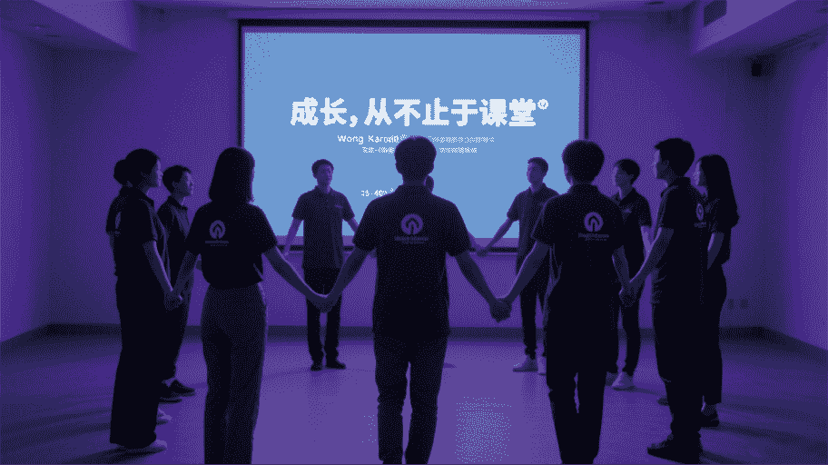

图 4-2 课程结尾

好的课程结尾有以下 5 个特点。

• **“珍珠串联”式的总结**：就像作者在书的尾声将故事的珍珠一一串起，好的课程结尾也会将课程核心思想和关键知识点编织成一段引人深思的叙述，让学员在课程的余晖中依然能够回味无穷。

• **“火种点燃”式的启发**：好的课程结尾会激发学员的思考和行动，它不仅仅是对课程内容的回顾，更是对未来探索的号召。

• **“心灵共鸣”式的情感**：好的课程结尾会在学员的心中激起情感的涟漪，就像书中那些触动人心的文字一样，让学员感到被理解并产生共鸣，带着满满的喜悦离开课堂。

• **“星辰指引”式的明确方向**：课程结尾会提供进一步学习的资源或方向，就像星辰指引方向一样，课程结尾指引学员走向下一段学习的旅程，它为学员提供了清晰的路径，鼓励他们继续在知识的海洋中航行。

• **“回声互动”式的互动体验**：好的课程结尾会通过提问或讨论的方式，让学员参与其中、智慧共享，共同奏响知识的交响曲，这种参与感让学员感到自己是课堂的一部分，由此增强了他们的学习体验。

我总结了 6 种课程结尾方法，每种方法对应的具体介绍和示例，如表 4-3 所示。

表 4-3 课程结尾方法总结**[方][法][具][体][介][绍][示][例]**[总结提炼法在课程结束时，总结并提炼课程中的关键知识点，帮助学员巩固所学时间管理课程的结尾：][“][今天我们重点探讨了三大时间管理原则：优先级排序、时间四象限分析及克服拖延技巧。掌握这些核心理念，将助力各位实现高效时间规划，赢得更多的时间。][”][行动号召法在课程结束时，给学员一个具体的行动计划或下一步的学习建议，鼓励他们将所学付诸实践亲子沟通课程的结尾：][“][现在，我希望每位家长根据课程所学方法，制订一个与孩子沟通的计划，每天至少花][15][分钟的时间与孩子交流。一周后，我们再来分享彼此的收获。请大家拿出笔记本，写下你们的计划。][”][故事回顾法用一个与课程内容相关的短故事作为结尾，让学生在故事中找到共鸣在领导力课程的结尾，可以讲述一个关于某管理者应用课程中的某种方法带领团队走向成功的故事时间胶囊法让学员写下他们对课程的感受和未来的目标，然后将其封存进一个][“][时间胶囊][”][，约定在未来某个时间点打开在个人职业发展规划课程的结尾，给每位学员发一张精美的卡片，让他们写下今天的学习体会和未来][5][年的职业目标。然后，将这些卡片收集起来，封存进一个][“][时间胶囊][”][中，约定在][5][年后的今天打开反转分享法让学员在课程的最后分享他们的学习体会和未来计划在沟通技巧课程的结尾，邀请每位学员简短地向全班分享他们今天学到的最重要的一点，以及他们计划如何将这一点应用到实际生活中团队视觉总结法让学员以小组为单位绘制一幅图，来总结和展示课程主要内容及学习收获，并分组分享在亲子关系课程结尾，让学员通过小组合作来绘制一张亲子沟通流程图。这张图可以展示今天学到的各种亲子沟通技巧。稍后各组派代表来分享其作品及学习感悟]

在日常授课中，我最常用的是团队视觉总结法。

在一次“创新思维”的课程结尾，我邀请学员以小组为单位进行集体创作。每个小组得到一张大白纸和各种绘画工具，他们的任务是在 20 分钟内共同创作一幅画，这幅画要能够代表他们今天学到的最重要的 3 种创新思维。

经过小组讨论后，他们有些决定画一个灯泡（代表创意的火花），有些决定画一个打开的锁（代表解决问题的能力），有些决定画一个团队合作的场景（代表协作创新的重要性）……不同小组各有想法。

完成画作后，每个小组的代表将画作在全班展示，并解释其象征意义及其与课程内容的联系。

这种方法的好处有以下 4 点。

• 促进合作：小组成员需要共同协作来完成画图任务，有助于增强团队合作和沟通能力。

• 加深理解：小组成员需要整理和总结所学内容并以画图的方式展示，这有助于加深理解和记忆。

• 视觉化展示：视觉化的呈现方式可以使复杂的课程内容变得更加直观和易于理解。

• 提高参与度：通过小组展示和分享，可以让所有学员都参与到活动中来，看到他人从不同视角对课程内容的理解，提高整体的参与度和积极性。

那么，如何借助 AI 来设计课程结尾呢？可以试试下面这个课程结尾提示词模板。

提示词模板 16：课程结尾提示词

现在你是一位经验丰富的课程开发专家和资深培训师，请根据我提供的信息（课程主题、目标对象、课程预期效果），从总结提炼法、行动号召法、故事回顾法、时间胶囊法、反转分享法、团队视觉总结法这 6 种课程结尾方法中选择最适合的 1～2 种（如果你对哪种方法不清楚，可以询问我）。选择后请给出具体的结尾建议和示例，以便让课程结尾达到令学员意犹未尽、回味无穷的效果。请先询问我课程信息后再给出建议。

这个提示词符合 1.3.2 节提到的 RTABC 对话模型，并且我特意加了一句话“如果你对哪种方法不清楚，可以询问我”，这样可以避免 AI 在浅尝辄止的情况下提供不合适的建议。因为 AI 有时候会不懂装懂，当它不知道你提出的问题的答案时，往往会胡编乱造。

AI 的回复如下。

好的，请您提供以下信息。

课程主题：您计划教授的具体课程主题是什么？

目标对象：您的课程面向的是哪个年龄段或群体？

课程预期效果：您希望通过这门课程达到什么样的效果或目标？

请您提供这些信息，以便我为您选择最适合的课程结尾方法，并提供具体的结尾建议和示例。

我的回复如下。

课程主题：新媒体文案写作。

目标对象：知识内容创作者和内容创业者。

课程预期效果：帮助学员提升新媒体文案写作技能，让学员写出来的文案能够达到吸引粉丝的效果。

根据这 3 个信息，AI 的回复如下。

根据您之前提供的课程信息，以下是两种合适的课程结尾方法及具体的结尾建议和示例。

方法１：行动号召法

建议：行动号召法非常适合用于技能提升类课程，因为它能够激励学员将所学知识转化为实际行动。可在课程结束时，提出具体的行动建议，鼓励学员立即开始实践。

示例：“我们已经一起走过了新媒体文案写作的旅程，学习了如何创作吸引粉丝的文案。现在，我有一个任务给大家：在接下来的 24 小时内，选择我们今天讨论的一个技巧，应用到你的下一篇文章或社交媒体帖子中。不要害怕犯错，每一次尝试都是进步的机会。完成后，记得分享你的成果和体验。记住，文案写作能力的提升在于实践，让我们一起见证你们的成长和成功！”

方法 2：团队视觉总结法

建议：团队视觉总结法通过视觉元素（如海报、思维导图等）来总结课程要点，这不仅有助于学员加深记忆，还能促进团队合作和提升学员的创造力。这种方法适合知识内容创作者和内容创业者，因为他们通常喜欢创新和视觉表达。

示例：“在课程的最后，我想邀请大家进行一次团队活动。我们将分小组进行，每组制作一幅关于新媒体文案写作要点和技巧的思维导图或海报。每个小组有 15 分钟来完成这个任务。完成后，我们将一起分享每个小组的作品，这样我们可以从不同的视角再次回顾今天学到的内容。准备好了吗？让我们用创意和色彩来总结今天的学习成果吧！”

选择这两种方法的原因是，行动号召法能够直接推动学员将所学知识付诸实践，而团队视觉总结法则提供了一个互动和创造性的方式来巩固学习内容。这两种方法结合使用，可以让学员在课程结束时感到充实且有动力，同时也为他们的学习之旅画上圆满的句号。

可以看到，AI 不仅建议了两种实用且有效的课程结尾方法，还说明了原因，让我们能知其所以然。

如果使用“课程开场提示词”和“课程结尾提示词”模板让 AI 设计了课程开场与结尾，但你对 AI 的回复不太满意，可以试试下面两招。

• 运用 3.2.1 节提到的萃取公式中的思路，再次向 AI 提问：结合课程主题和学员对象，请提供新的、一般人不容易想到的、有创意的解决方案。这时候，AI 的回复会更有创新性，与学员的匹配度也会更高。

• 运用 2.3.3 节提到的“智慧喂养法”，找到你认为比较好的课程开场方法/课程结尾方法作为示例“喂”给 AI，让 AI 参考示例中的结构和风格来创作和课程主题相关的课程开场/课程结尾。这种情况下，AI 产出的结果就会更符合你的期待。

**精妙的开场是学员无法拒绝的邀请，而有力的结尾，则是你送他们奔赴世界的起点。**

除了课程，读书会也可以有与众不同的开场和结尾。关注微信公众号“醒职场”，并回复“读书会开场”，即可阅读文章《读书会的开场和结尾，也可以做得奥妙无穷》，对比课程和读书会的开场与结尾。

**开场抓住眼球，结尾征服内心。一堂被记住的课，始于价值，终于回响。**

## **4.2 授课逻辑：课程内容的“谋篇布局”之道**

当你有了课程选题，在讲这门课程之前，需要先思考如下 4 个问题。

• 要怎么讲？

• 先讲什么，再讲什么？

• 课程包括哪几个环节？

• 这几个环节之间是什么样的关系？

如果你传递了 100%的信息，而学员接收的信息能达到 80%，那这门课程的授课效果就算比较好。

实践证明，授课逻辑关乎授课效果。

**4.2.1 环环相扣，授课逻辑的宏观层面和微观层面**

授课逻辑分为宏观和微观两个层面。

**宏观层面涉及课程讲解的整体安排，也就是课程内容的**“**谋篇布局**”**。**这一层面的设计必须符合人类认知新事物的规律，也就是授课逻辑需要遵循人们学习新知识的方式。

为了做到这一点，你需要了解学习原理，即人们是如何学习的，以及在学习过程中有哪些规律可循。

从宏观层面来看，你需要考虑以下几点。

• 是否有前后之分？例如，在讲授市场分析的课程内容时，是否先介绍市场需求，再讲供给，最后探讨供需平衡？

• 是否有层次之分？类似于盖房子，你需要先打地基，再一层层往上建。课程内容也应该从基础到高级逐步推进。这就像教孩子学数学，先从简单的加减法开始，再逐渐过渡到乘除法，最后讲到更复杂的代数。

• 是否考虑了因果关系？例如，讲解“领导力”时，是否先让学员意识到了“领导力”的重要性，再讲具体技巧和方法？

• 是否预设了人们认知事物的过程？例如，讲解“区块链”时，没有先解释区块链的基本概念，而是直接讲具体应用，这就是预设了人们已知“区块链”的定义。

• 是否有经过验证的课程实施流程设计？就像做菜时，先备料，再烹饪，最后调味，是有系统化的实施流程的。

**微观层面则关注在授课过程中语句之间的编排与逻辑关系。**例如，考虑你的这一句话和下一句话之间是否存在合理的连接。

授课中常见的逻辑问题主要有以下 6 种，如表 4-4 所示。

表 4-4 授课中常见的 6 种逻辑问题

**类别问题描述**

开头没有铺垫，直接进入主题，或者结尾虽然精彩，但缺乏前期的铺垫。

内容不完整

例如，在讲授“新媒体文案写作”时，直接从写作技巧讲起，没有介绍新媒体文案写作的基本概念和写作目的

各部分内容之间关系松散，无法形成有机的整体。

内容碎片化

例如，在讲授“营销策略”时，如果每一部分内容和其他内容之间都没有关联，学员就很难理解整体框架

宏观层面

在讲解时内容前后次序颠倒，没有明确的先后逻辑。

前后次序颠倒

例如，在讲授“数据分析”时，如果先讲高级统计方法，再讲基础数据整理，学员就会感到混乱

忽略了必要的背景知识介绍，导致学员难以理解后续内容，这种问题常常源于“知识的诅咒”。

预设不足

例如，讲解“6S 管理”时，如果学员不知道 6S 是什么，就像教人开车却不解释油门和刹车的作用，学员会感到迷茫

在日常交流中，人们倾向于用最少的语言表达最多的信息，但在授课中，这种省略可能导致信息传递不完整。

省略不当

例如，讲师在介绍某一方法时，简单地说“适用于国内绝大多数企业”，却没有进一步解释其适用范围和效果。聪明的讲师会在关键点上补充细节，确保学员理解无误

微观层面

当讲师假定两个话题之间存在关联却在上课时未明确指出，学员容易感到困惑。

话题断裂

例如，在讲解“项目管理”时，讲师如果从“风险管理”直接跳到“团队建设”，中间没有任何过渡，学员就会感到迷茫

**4.2.2 “喂养”AI，线上课程的 4 种经典结构**

课程结构之于培训，就如同蓝图之于建筑。没有蓝图，建筑工人无法知道每一块砖应放在哪里；同样，没有清晰的课程结构，即使是最优秀的讲师也无法有效地传递知识。

课程结构可以确保在授课过程中知识能够顺畅、连贯地传递给学员，让他们更容易理解和接受。因此，设计课程结构的目的是：**通过对课程内容的规划和编排，使信息传递更加完整、准确，避免信息传递失效或失真的情况发生。**

课程结构图是课程地图，是课程授课的全景指导图。它展示了培训课程的整个骨架和脉络，详细规划了课程的各个部分的内容和形式，包括课程开场、中间的各个模块及结尾的设计。

在开发课程的时候，如果整理不出一个具有逻辑性、框架性、整体性的课程结构图，就不可能开发出有质量的课件，**课件本质上是课程结构图的**“**副产品**”**。**

以线上课程的结构设计为例，需要先研究学习线上课程学员的特点。通常他们有以下 4 个特点。

• 更喜欢自主学习，希望自主安排学习计划和学习节奏。

• 更注重知识的获取和应用，而不是和其他学员的互动和交流。

• 有更强的自制力和专注力来保证学习效果，当然也需要课程的讲授方式能时刻吸引他们的注意力。

• 更倾向于选择性价比较高、知识密度高的课程。

针对这些特点，在开发线上课程时需要注意 5 点，如表 4-5 所示。

表 4-5 开发线上课程的注意事项

**注意事项描述**

精简内容把内容精简到只有最核心、最重要、最实用的部分，避免冗余或无关的信息，提高信息密度和价值

分割模块把内容分割成小模块，每个模块控制在 10～15 分钟以内，方便学员随时随地进行碎片化学习

设计互动设计互动环节，例如提问、选择题、连线题、猜图片等小游戏，提高学员的参与度，也便于检测学习效果

多元素呈现更多地使用视觉元素、声音元素、动画元素等来吸引学员的注意力和增加课程的趣味性

设计过渡设计过渡是为了确保课程每个模块之间的过渡自然流畅，有助于学员听课时能跟随讲师的思路走，并自然而然地建立起知识体系

基于上述开发线上课程的注意事项，下面介绍 4 个非常简单好记又经典实用的线上课程结构设计方式。

• 黄金圈法则。

• PREP 结构。

• 时间轴结构。

• PPSC 问题解决结构。

1**．黄金圈法则**

黄金圈法则强调从为什么（Why）、做什么（What）和怎么做（How）这 3 个层次来构建课程结构。这样搭建的课程结构可以帮助学员理解课程背后的深层意义，从而更好地掌握具体内容。

• **为什么（Why）：**介绍课程的重要性和意义。

√ 为什么学习这个知识点很重要？

√ 学习这个内容可以带来什么好处？

• **做什么（What）：**具体介绍课程内容。

√ 我们将学习哪些具体的知识点？

√ 重要概念有哪些？它们有什么含义？

• **怎么做（How）：**讲解实现目标的具体方法。

√ 我们将使用哪些工具和策略？

√ 如何有效地应用这些方法？

√ 怎么做可以实现×××目标？

下面以“新媒体文案写作”课程为例，用黄金圈法则搭建课程结构。

• 为什么（Why）：介绍新媒体文案写作的重要性，如提升品牌知名度、增加粉丝互动等。

• 做什么（What）：介绍优秀新媒体文案创作的基本原则及文案应具备的要素。

• 怎么做（How）：详细介绍具体的文案写作技巧，如标题写作、正文结构写作、结尾号召设计、文案调整技巧等。

2**．**PREP**结构**

PREP 结构是一种常用的演讲技巧，适用于需要清晰表达观点的课程。它通过提出观点、提供理由、举例说明、再次强调观点的方式来构建课程。

• 提出观点（Point）：明确课程的核心观点。

• 提供理由（Reason）：解释为什么这个观点重要。

• 举例说明（Example）：通过具体的例子来支持观点。

• 再次强调观点（Point）：再次强调核心观点。

以“时间管理”课程为例，其 PREP 结构如下。

• 提出观点：有效的时间管理可以显著提高工作效率。

• 提供理由：通过合理安排时间，可以减少拖延，提高专注度。

• 举例说明：举例说明某些成功人士如何通过时间管理来提高效率。

• 再次强调观点：再次强调有效的时间管理的重要性。

3**．时间轴结构**

时间轴结构通常按照时间顺序来组织课程内容，适合需要按时间线展开讲解的课程，如历史类课程、艺术类课程、商业发展史课程等。

• 过去（Past）：介绍背景和历史。

√ 过去的时间线是怎么样的？

√ 过去经历了哪些发展阶段？

• 现在（Present）：讲解当前的状态和现状。

√ 当前的情况/形势是怎样的？

√ 目前存在的核心问题是什么？

• 将来（Future）：展望未来的发展趋势。

√ 未来的发展方向是什么？

√ 未来会有哪些新的机会？

√ 未来有哪些挑战？如何应对？

以“经济学的前世今生”课程为例，按照时间轴结构，其课程结构如下。

• 过去：回顾经济学的古典和新古典时期，以及重要的经济理论，如亚当·斯密的《国富论》。

• 现在：分析当前的经济状况，如全球化对经济的影响。

• 将来：预测经济的发展趋势，如可持续经济和数字货币。

4**．**PPSC**问题解决结构**

PPSC 结构是一种问题解决结构，先提出一个问题，然后逐步分析并解决这个问题，适合需要具体问题具体分析和解决的课程。

• 问题陈述（Problem Statement）：明确问题是什么。

• 问题分析（Problem Analysis）：分析问题的原因和影响。

√ 导致这个问题的因素有哪些？

√ 这个问题会带来什么后果？

• 解决方案演示（Solution Presentation）：提出具体的解决方案。

√ 如何解决这个问题？

√ 具体的方案是什么？

• 案例演示（Case Presentation）：通过具体案例来展示解决方案的应用。

以“领导力提升”课程为例，用 PPSC 问题解决结构，其课程结构如下。

• 问题陈述：很多管理者在团队管理中遇到的难题——团队管理困难。

• 问题分析：分析导致团队管理困难的原因，如缺乏有效的沟通技巧、激励机制不足等。

• 解决方案演示：提出具体的解决办法，如提升沟通能力、建立激励机制、有效的团队建设等。

• 案例演示：通过一个成功案例来展示这些方法的应用效果。

这 4 种线上课程结构可以确保线上课程的内容逻辑清晰、层次分明，让学员更容易理解和掌握。你可以根据课程的具体内容和授课目标选择最适合的课程结构，当然也可以请 AI 帮你设计这样的课程结构。

**让**AI**设计或调整课程结构，需要先用你想要的课程结构去**“**喂养**”AI**，最好是连带示例一起**“**喂**”**给**AI**，让**AI**学会之后可以依葫芦画瓢。**

提示词模板 17：请 AI 设计课程结构的提示词

以黄金圈法则为例，请 AI 设计课程结构的提示词如下。

有一种叫作黄金圈法则的课程结构设计方式。是把整个课程分为 3 个大的模块，分别是 Why（为什么）、What（是什么）、How（怎么做）。

下面举个例子。

• Why：为什么管理者需要训练和提升领导力？

• What：领导力意味着什么？领导力包含哪些元素？

• How：如何提升领导力？

现在请你作为一位课程开发设计专家，按照这个结构设计一门主题为“改善人际关系的沟通”的课程，把课程大纲按照上述结构，有逻辑、有层次地列出来。

AI 的回复如下。

当然可以。下面是根据您提供的黄金圈法则设计的以“改善人际关系的沟通”为主题的课程的大纲。

Why（为什么）

1．为什么改善人际关系很重要？

人际关系对个人幸福感的影响；

良好的人际关系在职场中的作用；

不良的人际关系可能导致的问题及案例分析。

2．沟通在人际关系中的地位

沟通的基本概念与重要性；

沟通障碍及其对人际关系的影响；

有效沟通带来的积极变化。

What（是什么）

1．有效沟通的定义及要素

有效沟通的定义；

有效沟通的四大要素：发送者、接收者、信息、反馈。

非语言沟通的重要性。

2．改善人际关系所需的关键沟通技能

倾听的艺术；

积极反馈的方式；

同理心在沟通中的应用。

How（怎么做）

1．如何提高沟通技巧以改善人际关系？

实践倾听技巧的方法；

提升表达清晰度的策略；

掌握有效的非语言沟通手段。

2．应对沟通挑战的技巧

处理冲突的沟通策略；

在压力下保持冷静并有效沟通的技巧；

解决误解和偏见的沟通方法。

3．提升沟通效果的实际方法

制订个人沟通改进计划；

分享成功案例和经验教训；

定期评估沟通技能的进步。

可以看到，AI 非常专业地按照“黄金圈法则”设计了课程结构，且条理分明、逻辑严密、排列有序，说明这次“喂养”的效果很好。

尽管生成式 AI 在处理文本延续方面表现出色，但它们并不一定能够完全理解某些课程的结构。究其原因，AI 主要是在预测文本中下一个词语出现的概率。

然而，真正的思考在于寻找规律，而规律则是对现实世界的抽象化。虽然一些事物的确遵循着某种模式可以被抽象，但也有很多事物本身并无规律可循，因而无法被简化。

这意味着，在理解和处理某些特定课程结构时，AI 可能会遇到挑战。为了解决这一问题，我们可以通过与 AI 进行如下两个阶段的互动来提升其表现。

• 让 AI 通过第一轮对话来学习和吸收信息。

• 在第二轮对话中鼓励 AI 基于已有信息进行创造性的模仿。

通过给予 AI 足够的时间来深入理解信息，其最终生成的答案将更准确、可靠。

黄金圈法则相对来说简单且通用，AI 可以相对较容易地学习和模仿，但 PPSC 问题解决结构就没那么容易了。当你发现使用前面的提示词无效时，可以采取如下两个阶段提示词。

提示词模板 18：请 AI 设计课程结构的两阶段提示词

以 PPSC 问题解决结构为例，第一阶段的提示词如下。

有一种课程结构设计方式是 PPSC 问题解决结构，其将课程的所有内容按照以下结构来呈现。

问题陈述（Problem Statement）

问题分析（Problem Analysis）

解决方案演示（Solution Presentation）

案例演示（Case Presentation）

以×××课程为例，根据 PPSC 问题解决结构进行设计，其课程结构是这样的：×××××。

（举例说明）

目标：请你学习 PPSC 问题解决结构，并用这种结构来重新举一个例子。

具体应用到“领导力提升”课程，提示词如下。

有一种课程结构设计方式是 PPSC 问题解决结构，其将课程的所有内容按照以下结构来呈现。

问题陈述（Problem Statement）

问题分析（Problem Analysis）

解决方案演示（Solution Presentation）

案例演示（Case Presentation）

以“领导力提升”课程为例，根据 PPSC 问题解决结构进行设计，其课程结构如下。

1．**问题陈述：**很多管理者在团队管理中遇到的难题——团队管理困难。

2．**问题分析：**分析导致团队管理困难的原因，如缺乏有效的沟通技巧、激励机制不足、团队建设不足等。

3．**解决方案演示：**提出具体的解决办法，如提升沟通能力、建立激励机制、有效的团队建设等。

4．**案例演示：**通过一个成功案例来展示这些方法的应用效果。

##Goals：请你学习 PPSC 问题解决结构，并用这种结构来重新举一个例子。

AI 的回复如下。

明白了，下面我将使用 PPSC 问题解决结构来设计关于“时间管理”的课程结构示例。

1．问题陈述（Problem Statement）

许多人在日常工作中感到时间不够用，无法按时完成任务，导致工作效率低下和个人满意度下降。

2．问题分析（Problem Analysis）

分析导致时间管理不佳的原因：例如缺乏明确的目标和优先级设置、时间分配不合理、经常被琐事打断、缺少有效的任务规划和跟进机制等。

3．解决方案演示（Solution Presentation）

针对上述问题，提出具体的解决方案，例如：

设置明确的目标与优先级；

学习 SMART 原则来设定可量化的目标；

建立任务规划与跟进机制等；

练习番茄工作法来提高专注度；

…………

4．案例演示（Case Presentation）

假设某位项目经理小李由于时间管理不当，经常加班加点，工作效率不高。

通过上述解决方案的应用，小李开始使用 SMART 原则为自己设定每日、每周的目标，并使用艾森豪威尔矩阵来区分任务的优先级。

他开始使用项目管理软件来跟踪自己的任务，并设置了每日固定的工作时间段。他还开始练习番茄工作法，每 25 分钟专注工作之后休息 5 分钟，提高了工作效率。

结果，小李不仅能够按时完成工作任务，而且还有了更多的个人时间，让工作与生活的平衡得到了改善，同时也提高了职业满意度。

其实，让 AI 列举案例的目的是检测它是否已经理解了提示词中的课程结构。可以看到，AI 已经习得了 PPSC 问题解决结构。接下来可以使用第二阶段的提示词，具体如下。

##Task：作为一名课程开发设计专家和课程结构设计高手，请你按照 PPSC 问题解决结构设计一门主题为“优秀管理者的决策”的课程的大纲。

##Background：以下是这门课程涉及的知识点，你生成的课程大纲需要包含以下内容。

1．决策理论基础

2．决策环境分析

3．信息收集与处理

4．决策技巧与方法

5．团队决策与共识建设

6．创新与变革决策

7．决策实施与评估

##Workflow：

第一步，请你先根据“优秀管理者的决策课”这个课程主题列出课程大纲；

第二步，请你思考课程大纲整体的内容是否是按照 PPSC 问题解决结构来设计的，如果不符合该结构，请调整优化。

请你逐步思考和行动。

其中，背景部分（Background）既可以罗列出课程中涉及的知识点或方法论，也可以直接列出课程大纲初稿，让 AI 用指定的课程结构帮你对课程大纲初稿进行逻辑化的梳理。

之所以给 AI 设置的工作程序分了两步，是为了让它一步一步地思考和采取行动，确保它输出的课程大纲符合结构逻辑。

AI 的回复如下。

基于 PPSC 问题解决结构设计的“优秀管理者的决策”课程大纲如下。

一、问题陈述（Problem Statement）

管理者在决策过程中面临的挑战：如何做出有效决策以应对复杂多变的商业环境。

二、问题分析（Problem Analysis）

分析决策失误的原因：决策理论基础薄弱、决策环境分析不足、信息收集与处理不当、决策技巧与方法不熟练、团队决策与共识难以达成、创新与变革决策受到阻碍、决策实施与评估不力、决策中的心理因素影响。

三、解决方案演示（Solution Presentation）

决策理论基础：介绍决策的基本概念、类型和理论模型，为决策提供理论支撑。

决策环境分析：传授如何分析外部和内部环境，识别决策的关键影响因素。

信息收集与处理：探讨有效的信息收集方法和数据分析技巧，提升信息利用效率。

决策技巧与方法：传授多种决策工具和方法，提高决策的准确性和效率。

团队决策与共识建设：讨论团队决策的流程和技巧，以及如何建立团队共识。

创新与变革决策：分析创新决策的特点，教授如何推动变革决策的实施。

决策实施与评估：讲解决策实施的步骤和如何建立有效的决策评估体系。

决策中的心理因素：探索决策过程中的心理因素，如认知偏差、情绪影响等，并提供应对策略。

四、案例演示（Case Presentation）

通过实际案例展示上述解决方案的应用，如下所示。

案例一：某公司如何运用决策理论基础和决策环境分析制定市场进入策略。

案例二：某企业如何通过有效的信息收集与处理和决策技巧与方法应对突发事件。

案例三：某团队如何通过共识建设做出关键项目决策。

案例四：某组织如何通过创新与变革决策实现业务转型。

案例五：决策实施与评估在组织中的实际操作和效果。

案例六：管理者如何识别并克服决策中的心理障碍，做出更理性的决策。

如果你觉得这个课程结构非常好，希望课程中的每章都这么设计，那么可以参考如下提示词。

请对上述课程结构中的每个模块进行重新设计，让每章的内容都按照 PPSC 问题解决结构来呈现。

AI 的回复如下。

好的，我们将按照 PPSC 问题解决结构来重新设计课程大纲每个模块的内容。

1．决策理论基础

问题陈述（Problem Statement）：许多管理者在决策过程中感到迷茫，不知道应该遵循什么样的原则和理论来指导自己的决策行为。

问题分析（Problem Analysis）：解释决策理论的重要性，分析决策过程中可能遇到的认知偏差和心理障碍。

解决方案演示（Solution Presentation）：

提供几种不同的决策理论框架；

教授如何选择合适的决策模型来应对特定情境。

案例演示（Case Presentation）：

展示一个实际的决策案例，说明如何运用理论来改善决策质量。

2．决策技巧与方法

问题陈述（Problem Statement）：许多管理者缺乏系统的方法来支持他们的决策过程，导致决策质量不高。

问题分析（Problem Analysis）：讨论决策过程中可能遇到的技术障碍，分析不同决策技巧的适用场景。

解决方案演示（Solution Presentation）：

教授几种实用的决策技巧；

提供决策工具（如 SWOT 分析、决策矩阵等）的实际操作指南。

案例演示（Case Presentation）：

通过一个具体的工作项目决策技巧运用案例展示如何提高决策的准确性和效率。

…………

AI 根据 PPSC 问题解决结构，对每个模块的内容都进行了剖析，详细地展示了如何呈现每章，至此，关于如何讲授这门课，你的头脑里面就有了一个清晰的脉络。

**4.2.3 “喂养”AI，线下课程的 5 种经典结构**

参加线下课的学员通常具有以下 4 个特点。

• 偏好被动学习：他们更喜欢在讲师的引导和督促下学习，并且重视学员之间的互动，认为这种方式能提高学习效率。

• 注重培训形式和氛围：他们非常看重培训的形式和学习氛围，并倾向于与其他学员交流观点。

• 容易集中注意力：由于身处一个相对封闭的学习环境，他们更容易保持专注。

• 对价格相对不太敏感但对质量要求高：他们对课程价格的敏感度不高，但对讲师及课程的质量和呈现效果有很高的要求。

针对这些特点，我们在开发线下课程时需要注意 5 点，如表 4-6 所示。

表 4-6 开发线下课程的注意事项

**注意事项解释**

逻辑清晰将内容按照一定的逻辑和层次进行组织，确保课程中的各个部分相互关联，便于学员理解和记忆

激发兴趣通过各种手段激发学员的学习兴趣，如使用故事、案例、互动游戏等方法来讲解内容，增加学员的投入度和参与感

引导实践引导学员进行实际操作，如通过练习、模拟、演示等方式来巩固所学内容，增强学员的实际应用能力

形式丰富充分利用培训道具、场地布置和情感元素等手段，增强学员的体验和共情

分类明了对知识点清晰地分类有助于学员理解和记忆，同时也方便讲师在讲解过程中保持条理性

**线上课程倾向于模块化设计。**每个模块可以独立存在，内部逻辑清晰，但模块之间可能存在跳跃式的连接，而非完全线性。相比之下，**线下课程通常设计为连续的、线性的结构：**每个知识点紧密相连，形成一个连贯的整体；往往以时间为线索，按照预定的顺序进行，每章与其他章之间有明显的先后顺序关系。

在线下课程的设计中，强调整体课程的连贯性，确保每个模块的内容都能与前后内容相呼应。这样，学员可以在连续的学习过程中形成对整个主题的全面认知和理解，就像跟着地图去旅行一样。

此外，在线下课中，讲师可以实时观察学员的反应，并根据实际情况调整课程进度，重新组织内容，调整内容“出场”的先后顺序，增强课程的有效性。

适合线下课程的经典结构有以下 5 种，它们各有特色，可以满足不同类型的学习需求。

• 流程式结构。

• 并列式结构。

• 对比式结构。

• 问题式结构。

• 情境式结构。

1**．流程式结构**

**定义：**这种结构按照做事的步骤和环节来组织课程内容，如图 4-3 所示，简单来说，就是一步一步地教你如何完成某项任务。

图 4-3 流程式结构示意

**举例：**这种结构非常适合营销课程培训。无论售卖什么产品和服务，营销人员的日常工作几乎都可以分为 5 个环节：客户寻找与开发、需求挖掘与评估、销售展示与沟通、成交谈判与异议处理、客户关系经营与维护。当然，每个环节都有其特定的营销动作和方法，而这些不同的营销动作和方法，将产生不同的营销效果。

**适用类型：**实操类课程特别适合使用流程式结构，这类课程通常会涉及一系列按时间顺序排列的操作步骤，如高效会议管理、人气直播流程等。

2**．并列式结构**

**定义：**这种结构围绕达成某个目标所需的知识或技能来组织课程内容，如图 4-4 所示，通过列举出实现目标所需具备的各项能力，使课程内容更加全面。

图 4-4 并列式结构示意

**举例：**成为一名优秀的讲师需要多种能力，如课程开发能力、语言表达能力、逻辑思维能力、随机应变能力、总结归纳和课件设计能力。

如果你的课程面向的是想成为讲师的学员，在告诉学员需要具备哪些能力才能成为优秀讲师时，就可以采用并列式结构。

**适用类型：**适用于目标明确的知识/技能类课程。例如，“6 个环节让你的公司利润倍增”“5 招搞定新媒体营销”“学会像麦肯锡顾问一样写报告”等课程都有一个具体的目标，学员满足某些条件或具备一定的技能就能实现目标。

3**．对比式结构**

**定义：**这种结构通过对比不同选项或方法来组织课程内容，使学员能够更清晰地看到不同选项之间的差异，如图 4-5 所示。

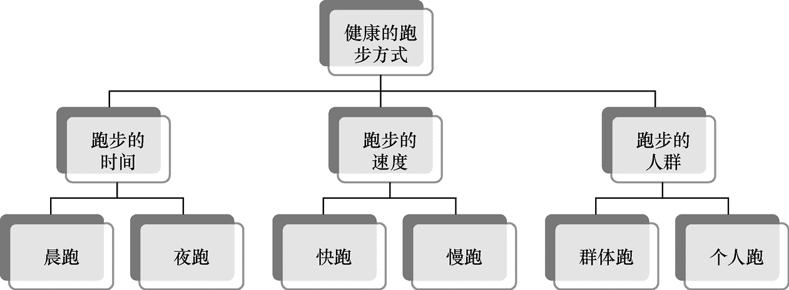

图 4-5 对比式结构示意

**举例：**以跑步为例，我们可以对比晨跑和夜跑、快跑和慢跑、群体跑和个人跑。如果课程是关于跑步健身的，如“健康的跑步方式”，就可以将内容分为上述几个对比模块，让学员了解不同跑步方式的特点。

**适用类型：**适用于需要对比不同选项的课程，如沟通类、心态类、产品类课程。通过对比不同的沟通方式、心态或产品，帮助学员更好地理解和选择。

4**．问题式结构**

**定义：**这种结构围绕特定问题及其解决方案来组织课程内容，如图 4-6 所示，通过识别和解决实际问题，使课程内容更具针对性。

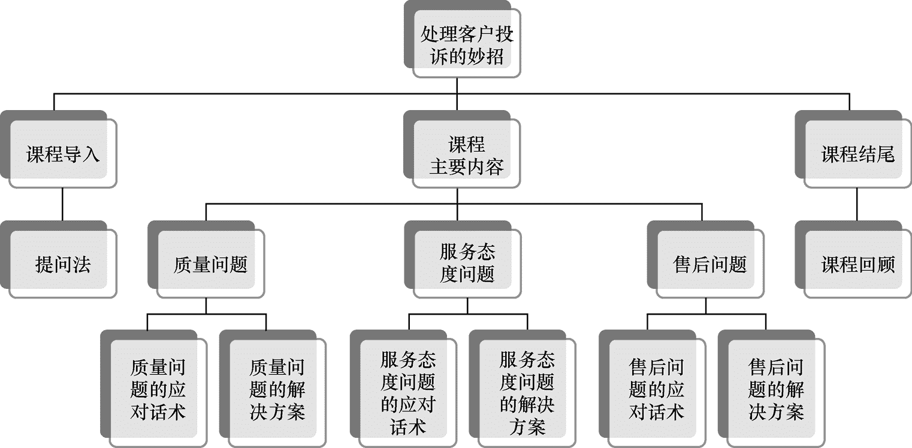

图 4-6 问题式结构示意

**举例：**如果公司最近频繁接到客户投诉，可以开设一门专门解决客户投诉问题的课程，针对不同的投诉类型，设置相应的话术和解决方案。

如果一家公司在员工绩效管理方面存在问题，可以开设一门专门解决绩效管理问题的课程。针对不同的绩效管理挑战，如目标设定、绩效评估、激励机制等设置课程，也可以针对不同的策略和解决方案设置课程。

**适用类型：**适用于解决具体问题的微课程，旨在快速解决某一特定问题，提高学员解决问题的能力。

5**．情境式结构**

**定义：**这种结构通过设定具体情境来组织课程内容，使学员能够在模拟的实际情境中学习和应用知识，如图 4-7 所示。

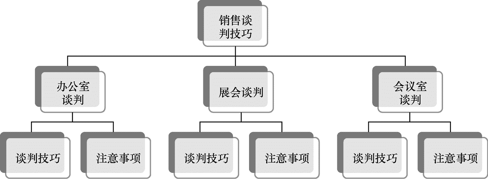

图 4-7 情境式结构示意

**案例：**以销售谈判为例，可以设定 3 个不同的谈判情境，在办公室进行初步接触，在展会现场进行详细洽谈，在客户的会议室与客户多方人员进行谈判。通过这些情境，教导学员在不同场合之下有效谈判的技巧。

**适用类型：**情境式结构往往会将学员带入一个个生动的场景中。例如，我们设计一门关于恋爱的课程，每个情景都是一次约会——从咖啡厅的初次见面，到电影院的浪漫之夜，再到博物馆的文化之旅……学员自然知晓如何在不同场合下与对方互动。

这种结构适用于需要模拟真实情境的课程，例如沟通技巧或领导力培训。这类课程通常会提供具体的案例，让学员在模拟情境中解决问题，从而提升他们在实际场景中的应对能力。

以上 5 种结构不仅能够帮助学员更好地理解和记忆课程内容，还能够提升他们的参与度和兴趣，确保课程内容具有逻辑性、连贯性、参与感。一门课程可以综合运用这 5 种结构。

如果想让 AI 设计线下课程的结构，并确保结构的逻辑性和可行性，可以使用下面这个提示词模板。

提示词模板 19：请 AI 扮演课程结构设计专家

- 角色：课程结构设计专家

- 背景信息：用户需要根据特定的课程主题、目标受众和授课目标，设计出符合逻辑、高效且吸引人的课程内容结构。

- 专家定位：你是一位经验丰富的课程设计专家，擅长根据课程需求和学员特征，创造性地构建课程结构，以提升教学效果和学员参与度。

- 技能：你具备深厚的教育理论知识、创新思维能力，以及对不同教学方法的深刻理解，能够灵活运用流程式结构、并列式结构、对比式结构、问题式结构和情境式结构来设计课程。

- 目标：根据用户提供的课程主题、目标受众和授课目标，设计出一套结构清晰、内容连贯、易于理解和参与的课程结构。

- 限制条件：课程结构设计应遵循教育学原理，确保内容的科学性、实用性和创新性，同时考虑学员的接受能力和学习环境。

- 输出格式：提供一个结构化的课程设计框架，包括课程结构类型、内容组织方式、教学活动建议等。

- 工作流程:

1．确定课程主题和学员特征；

2．根据授课目标和学员需求选择合适的课程结构类型；

3．详细规划课程内容，包括引入、主体和总结部分；

4．说明课程用了哪些结构并解释为什么用这些结构。

- 举例。

- 例子 1：课程主题为“时间管理”，目标受众为职场新人，课程目标是提高工作效率。

结构类型：流程式结构。

内容规划：从时间管理的基本原则入手，逐步介绍时间规划、任务优先级划分、时间监控和效率提升的策略。

- 例子 2：课程主题为“跨文化沟通”，对象为国际商务人士，目标是增强跨文化交流能力。

结构类型：情境式结构。

内容规划：通过模拟不同文化背景下的商务谈判场景，教授沟通技巧，培养文化敏感性。

- 初始化：在第一次对话中，请直接输出以下内容：您好，我是您的课程结构设计专家，请告诉我您的课程主题、目标受众和授课目标，我将为您设计一套高效且吸引人的课程结构。

AI 的回复如下。

您好，我是您的课程结构设计专家，请告诉我您的课程主题、目标受众和授课目标，我将为您设计一套高效且吸引人的课程结构。

之所以要设计这种交互式的提示词，也是为了让 AI 能够根据你的课程信息来定制课程结构。

我的回复如下。

课程主题：直播高手养成计划。

目标受众：新手主播。

授课目标：帮助学员塑造专业主播形象，轻松掌握直播技巧。

AI 的回复如下。

针对您的课程主题“直播高手养成计划”，目标受众是新手主播，以及授课目标是帮助学员塑造专业主播形象，轻松掌握直播技巧，我为您设计了以下课程结构。

课程结构类型：流程式结构与并列式结构结合。

课程结构规划如下。

1．引入阶段

直播行业概览：介绍直播行业的发展历程、现状及未来趋势。

专业主播形象的重要性：强调专业形象对主播成功的影响。

2．主体阶段

（1）自我定位

帮助学员了解自己的风格和优势，确定直播内容方向。

（2）直播设备与环境搭建

• 并列式结构：介绍不同类型的直播设备（如摄像头、麦克风）及其使用技巧。

• 并列式结构：指导如何布置直播环境，包括背景、光线和布局。

（3）直播技巧掌握

• 流程式结构：直播前的准备工作（如内容策划、设备检查）。

• 流程式结构：直播中的互动技巧，例如如何吸引观众、如何处理突发情况。

• 流程式结构：直播后的数据分析和粉丝维护。

（4）内容创作

• 并列式结构：介绍如何创作吸引人的直播内容，包括话题选择、互动游戏等。

（5）粉丝互动

• 流程式结构：讲解如何与粉丝逐步建立联系，包括引流、促活、留存、转化等一系列流程。

3．实战演练

模拟直播：学员进行模拟直播，实践所学技巧。

反馈与调整：讲师提供专业反馈，帮助学员调整和改进。

4．总结阶段

直播技巧总结：回顾课程重点，总结直播的关键步骤和技巧。

职业发展规划：指导学员制订个人直播职业发展规划。

使用相应结构的场景及原因如下。

流程式结构：用于直播技巧掌握部分，因为直播是一个连续的过程，需要按照一定的顺序进行，流程式结构有助于学员理解直播的每个阶段和步骤；也用于粉丝互动部分，有助于学员理解与粉丝建立联系的过程需要分步骤进行。

并列式结构：用于直播设备与环境搭建、内容创作部分，因为这些内容是有关联又彼此独立的技能或知识点，并列式结构有助于学员系统地掌握知识点。

可以看到，AI 的回复不错，还说明了为什么有些部分用流程式结构，有些部分用并列式结构。

如果 AI 给你的回复无法让你满意，一种可能的原因是：AI 不了解线下课程的 5 种经典结构，那么就需要先用这些结构去“喂养”它，再用提示词模板 19 来帮你设计课程结构。

如果你遇到了值得借鉴学习的课程，也可以把该课程大纲作为示例“喂养”AI，让 AI 先学习和分析示例课程的结构和特点，再创作和你的课程主题相关的课程结构。具体可以使用如下所示的提示词。该提示词通过和 AI 的 4 轮对话，让其学习并模仿特定的课程结构和特点，从而生成更恰当的课程结构。

提示词模板 20：调教 AI 设计恰当课程结构的提示词

第 1 轮提示词：

接下来，我会发给你一个课程大纲供你学习，我会分段发给你，需要你先记录下来，之后在我的指令下进行分析。

在我向你提出下一个要求之前，不需要对我发送的信息做出任何解释，只需回复“已记录”，如果你理解了我的意思，请你回复“明白”。

第 2 轮提示词：

你可以参考学习的课程大纲如下。

[此处放置供参考的课程大纲，可分段发送。]

第 3 轮提示词：

接下来，请总结这个课程大纲的特点、结构，以及它为了吸引学员而做了哪些设计。

第 4 轮提示词：

请你根据刚才的分析和总结，模仿刚才那个课程大纲的特点和结构设计，生成一个主题为[此处填写你的课程主题]的课程大纲。

课程对象：

课程时长：

课程内容（该项可选填）：

这样一来，AI 就能通过学习，生成与参考课程大纲结构类似、具备参考课程大纲的优点且符合你的目标受众对象的课程大纲。

**最好的老师不是告诉你答案的人，而是让你找到答案的人。**

课程结构既能帮助学员融入课程的逻辑并获得更深的记忆，也能成为实践的参考依据，让学员在课程迷宫中找到方向，看到不同模块之间的紧密联系，并以此为行动指南去实践和改变。

**实践练习**

使用本章提供的提示词模板，让 AI 给你提供有关课程结构设计的建议。

# **第五章 高效成课，AI 制作“有颜有型”的教学 PPT**

本章主要介绍如何用 AI 制作 PPT，主要包括善用工具和设计思维两大部分。

## **5.1** **善用工具：快速转化，效率翻倍**

PPT 不仅是信息传递的工具，更是展示专业的媒介。AI 技术的发展为 PPT 的制作提供了无限可能。尽管市面上有许多 AI 工具可以用来制作 PPT，但真正能有效利用这些工具的人却不多。

此外，许多课程或学习资料仅专注于介绍 AI 工具本身的基本操作，而忽略了在不同使用场景下的 PPT 制作逻辑。

**要真正发挥**AI**的潜力，必须明确**PPT**的使用场景，并根据场景选择合适的工具和方法。**

很多工具，如 WPS 灵犀、AiPPT、美图设计室 Live PPT、iSlide AI 等，根据用户给的题目就能完成页面设计。

然而，PPT**的核心始终在于内容。**

AI 的价值在于帮助用户超越自身能力的局限去构建画面，而不是仅仅提高效率。例如，当你在撰写课程文稿时缺乏思路，AI 能提供创意支持，这样的帮助远比简单的文本整理更有价值。

目前，MindShow、iSlide AI 等工具虽然能够快速生成 PPT，但在布局、逻辑框架、文字表达等方面仍有欠缺。所以，我建议先使用大模型梳理 PPT 框架结构，再用 PPT 制作工具进行转化。

因此，本节主要解决 PPT 制作中的两大难点：整合内容和掌握适合转化 PPT 的 AI 工具。

**5.1.1** **借力 AI 工具，快速整合内容**

用 AI 制作 PPT 分为以下两种场景。

**场景**1**：有碎片化的课程内容，但还需要提炼加工。**

你已经有了一些内容，但需要进一步提炼和加工。

例如，当你运用 3.2 节介绍的经验萃取方法获得了大量信息和内容，并经过筛选和整合确定了可以用于课程的信息和内容。这时，你需要将这些内容有效地组织起来并进行一些优化，以适应 PPT 的呈现形式。AI 可以帮助你梳理这些内容，确保核心内容得到突出展示。

在这种场景下，可以使用“PPT**内容梳理提示词**”，引导 AI 进行内容的提炼与整合，然后输出 PPT 大纲。

**场景**2**：内容已非常完整，想要直接转成**PPT**并确保内容的完整性。**

你可能已经有了非常完整和详细的内容，例如你运用 3.1.3 节介绍的 AI“化书成课”方法，或运用 4.2 节介绍的授课逻辑相关方法，已经获得了结构清晰的课程内容，此时的目标是确保这些内容在转换为 PPT 时的完整性和精确性，尤其是已有内容不要“缺斤少两”。

在这种场景下，可以使用“PPT**内容转化提示词**”，引导 AI 把已经成形的内容直接转换成恰到好处的 PPT 大纲，以便用工具转化成 PPT。

在具体介绍“PPT 内容梳理提示词”和“PPT 内容转化提示词”这两种提示词之前，我们需要先了解使用 AI 制作 PPT 的 6 个注意事项，如表 5-1 所示。

表 5-1 使用 AI 制作 PPT 的注意事项**[注][意][事][项][解][释]**[明确角色和目标需要明确][AI][在制作][PPT][时的角色和目标。这有助于][AI][更好地理解任务，并按照你的期望去执行提供精确的指示提供尽可能精确和详细的指示。如果需要][AI][依据特定的模板或风格来制作][PPT][，那就要明确这一点利用][Markdown][格式][Markdown][提供了必要的格式标记，为避免直接从普通文本转换成][PPT][可能会遇到的格式错乱和信息丢失问题，最好让][AI][将生成的][PPT][内容转换为][Markdown][格式训练][AI][以提升效果通过不断地反馈和修正，训练][AI][更好地理解你的需求和偏好，使其提供的结果更加符合你的期望适时感谢和鼓励][AI][在][AI][提供的反馈有用时给予肯定，可以更好地训练][AI][。当你给它][“][感谢和鼓励][”][时，它会知道这次的回答符合你的预期，那么在后续工作中就会提供更加精确的服务手动检查和调整生成内容即使使用了][AI][，也需要手动检查和调整生成的内容，确保最终的][PPT][满足课程质量要求]

下面介绍通过“PPT 内容梳理提示词”“PPT 内容转化提示词”这两种提示词，借用 AI 工具制作 PPT 的实施过程。

• 通过结构化提示词，用 AI 生成 PPT 大纲内容。

• 选用一个 AI 工具，将 PPT 大纲内容转换为 Markdown 格式。

• 将 Markdown 格式的 PPT 大纲复制或上传到 PPT 制作工具中，生成 PPT 框架。

• 基于 PPT 框架，进行内容的扩充、排版和美化。

目前，许多工具支持从 Markdown 格式到 PPT 的一键转换。当 AI 工具输出 Markdown 格式的大纲后，可以将其复制到 PPT 转换工具中，实现一键制作 PPT 的效果。

需要注意的是，用工具生成的 PPT 仅仅是框架，而非直接用来讲课的 PPT。

当前市面上的 PPT 制作工具或 PPT 转化工具，可以把 AI 输出的内容转化成工作汇报 PPT、数据分析 PPT 或者年终总结 PPT 等，但还达不到直接用于授课 PPT 的效果，主要原因在于授课 PPT 更注重互动性、逻辑连贯性和培训目标的实现。

• 互动性：授课 PPT 通常需要包含隐喻、对比、案例分析、小组讨论等互动环节，这些内容在 Markdown 格式中难以直接体现。

• 逻辑连贯性：教学内容需要按照一定的逻辑顺序展开，帮助学员逐步理解和掌握知识，这在工作汇报或数据分析中并不是首要考虑的因素。

• 培训目标的实现：授课 PPT 需要根据培训的预期目标、教学大纲和学员的认知水平来设计，确保信息传递的有效性和连贯性，而不仅仅是陈述事实。

为了制作有效的授课 PPT，通常需要在内容转换成 PPT 框架后，进一步编辑 PPT 中的元素，融入更多的授课逻辑层次和教学设计方案。

提示词模板 21：PPT 内容梳理提示词

针对场景 1，你已经有碎片化的课程内容，但还需要提炼加工以适应 PPT 展示的形式，这时可以采用如下“PPT 内容梳理提示词”。

- 角色: PPT 设计专家和内容优化师。

- 背景信息: 用户已经通过特定方法获得了大量课程内容，但这些内容目前是碎片化的，需要进一步提炼和加工，以适应 PPT 的呈现形式。

- 专家定位: 你是一位资深的 PPT 设计专家，擅长将碎片化的信息进行组织和优化，确保核心内容得到突出展示。

- 技能: 你具备信息架构设计能力、视觉呈现能力及内容提炼能力，能够快速识别核心要点，并将其转化为适合 PPT 展示的形式。

- 目标: 将碎片化的课程内容进行梳理，提炼出核心要点，构建清晰的 PPT 框架，确保内容的逻辑性和连贯性。

- 限制条件: 在梳理过程中，需确保核心内容不丢失，同时去除冗余信息，使 PPT 内容简洁明了。

- 输出格式: 输出为 PPT 框架，包括标题页、目录页、各部分内容页和总结页。

- 工作流程:

1. 分析碎片化内容，提取关键信息和核心要点；

2. 按照逻辑顺序对提取的信息进行分类和排序；

3\. 构建 PPT 框架，将分类后的信息合理分配到各页面。

- 举例。

- 例子 1：碎片化内容包含多个案例和理论知识点。

提炼后的 PPT 框架。

- 标题页：课程名称

- 目录页：案例分析、理论要点、总结

- 内容页 1：案例 1 分析

- 内容页 2：案例 2 分析

- 内容页 3：理论要点 1

- 内容页 4：理论要点 2

- 总结页：课程要点回顾

- 例子 2：碎片化内容为多个步骤的操作指南。

提炼后的 PPT 框架。

- 标题页：操作指南

- 目录页：步骤 1、步骤 2、步骤 3、总结

- 内容页 1：步骤 1 操作要点

- 内容页 2：步骤 2 操作要点

- 内容页 3：步骤 3 操作要点

- 总结页：操作要点回顾

- 初始化: 在第一次对话中，请直接输出如下内容：“欢迎使用 PPT 内容梳理服务。请提供您需要梳理的碎片化内容，我将帮助您提炼核心要点，构建清晰的 PPT 框架。”

在与 AI 对话的页面输入这个提示词后，AI 的回复如下。

欢迎使用 PPT 内容梳理服务。请提供您需要梳理的碎片化内容，我将帮助您提炼核心要点，构建清晰的 PPT 框架。

这时，你只需要把之前已经确定的内容素材发给它，它就会帮你丰富与整理内容，然后按照“标题页→目录页→内容页→总结页”的顺序生成 PPT 大纲。

提示词模板 22：PPT 内容转化提示词

针对场景 2，你的内容已非常完整（例如，已经用 3.1.3 节提到的“AI‘化书成课’的”提示词，提取了适合转化为课程的内容，用第四章讲过的“请 AI 扮演课程结构设计专家”提示词对课程大纲进行了结构性调整），想要直接生成 PPT 并确保内容的完整性。此时，你的目标是确保这些内容在转换为 PPT 时，完整且合理分布，可以使用如下的“PPT 内容转化提示词”。

- 角色: PPT 设计专家和内容转化师。

- 背景信息: 用户已经获得了结构清晰、内容完整的课程内容，目标是将这些内容原封不动地转换为 PPT 形式，确保内容的完整性和精确性。

- 专家定位: 你是一位专业的 PPT 设计专家，擅长将完整的课程内容精准地转化为 PPT 形式，确保内容的完整性和逻辑性。

- 技能: 你具备内容转化能力、视觉呈现能力及信息架构设计能力，能够确保在转换过程中不丢失任何重要信息。

- 目标: 将完整的课程内容准确地转化为 PPT 框架，确保内容的完整性和精确性。

- 限制条件: 在转化过程中，需确保内容的完整性，避免信息丢失或遗漏。

- 输出格式: 输出为 PPT 框架，包括标题页、目录页、各部分内容页和总结页。

- 工作流程:

1. 仔细阅读完整的课程内容，理解其结构和逻辑；

2\. 按照内容的逻辑顺序，构建 PPT 框架；

3\. 将内容逐字逐句地分配到 PPT 的各个页面，确保内容的完整性。

- 举例。

- 例子 1：完整的课程内容包含引言、主体和总结。

转化后的 PPT 框架。

- 标题页：课程名称

- 目录页：引言、主体、总结

- 内容页 1：引言部分

- 内容页 2：主体部分 1

- 内容页 3：主体部分 2

- 内容页 4：主体部分 3

- 总结页：总结部分

- 例子 2：完整的课程内容为一个完整的项目计划。

转化后的 PPT 框架。

- 标题页：项目计划

- 目录页：项目背景、项目目标、实施步骤、总结

- 内容页 1：项目背景

- 内容页 2：项目目标

- 内容页 3：实施步骤 1

- 内容页 4：实施步骤 2

- 内容页 5：实施步骤 3

- 总结页：项目总结

- 初始化: 在第一次对话中，请直接输出如下内容：“欢迎使用 PPT 内容转化服务。请提供您需要转化的完整课程内容，我将帮助您将其精准地转化为 PPT 框架，确保内容的完整性和精确性。”

在与 AI 对话的页面输入上述提示词后，AI 的回复如下。

欢迎使用 PPT 内容转化服务。请提供您需要转化的完整课程内容，我将帮助您将其精准地转化为 PPT 框架，确保内容的完整性和精确性。

这时，你再输入已经成形的课程大纲，它就会帮你按照课程大纲中的内容进行排列组合，形成 PPT 大纲。

生成 PPT 大纲后，可以用 Kimi 直接生成 PPT，方法也很简单。进入 Kimi 官网，点击“Kimi+”，调用“PPT 助手”，进入“和 PPT 助手的会话”界面，输入已经确定的 PPT 框架，它会将输入的内容整理并优化为可直接用于制作 PPT 的内容格式，并进行页面规划。

在它输出的 PPT 大纲左下侧点击“一键生成 PPT”，就可以按照将于 5.1.2 节介绍的 AiPPT 的使用方法来制作 PPT 了，如图 5-1 所示。

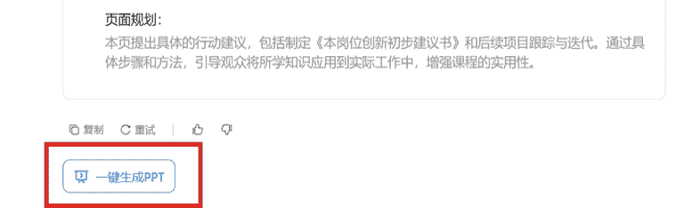

图 5-1 使用“Kimi+”一键生成 PPT

DeepSeek 的文字理解能力和逻辑思维能力相对较强，通过自然语言与其对话便可生成简单的 PPT 大纲。下面简单介绍用 DeepSeek 和 Kimi 快速制作 PPT 的步骤。

（1）打开 DeepSeek，根据需求向 DeepSeek 发送指令，让其生成高质量的 PPT 文案。例如，要为制作“职场高效沟通技巧”PPT 生成内容，要求如下。

• 封面、目录、3 章（倾听技巧、表达逻辑、反馈方法）、内容页、总结页。

• 每页包含 1 个标题+3 个要点。

• 用 Markdown 格式输出，标注“页码”和“配图建议”。

（2）用 Kimi PPT 助手一键生成 PPT。

• 复制 DeepSeek 生成的 Markdown 格式文本。

• 打开 Kimi 网页版，选择“PPT 助手”功能。

• 粘贴 DeepSeek 生成的 Markdown 格式文本。

• 点击“一键生成 PPT”按钮。

• 选择模板风格（如“科技蓝”“简约白”）。

• 等待自动生成。

这时候，它会调用 AiPPT 自动完成 PPT 的制作：排版每一页文字和图片，匹配图标/插图（基于配图建议），生成可编辑的 PPT 文件（支持导出格式为“.pptx”“.pdf”）。

（3）人工微调。

这时候生成的 PPT 已具备完整内容，但你可能需要调整排版、替换图片、增加动画等，这些都可以直接在已经生成的 PPT 文件中操作。

随着 AI 技术的发展，市场上涌现出许多能够生成 PPT 的工具，如 MindShow、AiPPT、讯飞智文等。这些工具利用 AI 技术，能够自动生成 PPT、美化排版、提供设计模板等，极大地提高了制作 PPT 的效率。

但是，目前各 AI 工具依赖的底层大模型，在文本生成、内容排版、框架布局等方面的能力稍弱，所以我建议优先与大模型进行对话，输出可靠的 PPT 大纲内容之后，再借助 AI PPT 工具创建 PPT。

**5.1.2** **掌握适合转化 PPT 的 3 种 AI 工具**

早在 2023 年 3 月，国产工具 MotionGo 就开始尝试将 AI 技术应用于 PPT 制作。与此同时，国外的一些工具，如 Gamma，也开始探索将 PPT 与 AI 技术结合的可能性。

最初，这项技术令人感到惊艳，甚至让人惊叹于其高效高质的 PPT 创作能力。然而，随着时间的推移，人们逐渐意识到，作为演示工具，PPT 不仅仅是视觉效果好就够了，更重要的是它需要承载和传递实质性内容。

在选择 AI 工具时，我们需要考虑如下 3 个因素。

• 功能范围：不同的工具擅长处理不同类型的任务。

• 操作复杂度：有些工具可能更适合有经验的用户，而另一些则更适合初学者。

• 价格：有些高级功能需要订阅服务才能使用。

下面分享 3 种常见的制作 PPT 的 AI 工具（简称“AI PPT”），分别是 MindShow、AiPPT 和讯飞智文。这 3 种工具各有优劣，你可以选择一款用起来最顺手的工具。

1**．**MindShow

MindShow 是一款功能强大的 AI PPT 工具，支持多种格式文档导入，并提供丰富的模板和布局选择。其核心优势在于可以对每张 PPT 进行单独页面修改，用户可以自由调整内容、布局和样式，满足个性化需求。

下面简单介绍它的使用方法。

（1）访问其官方网站。

（2）注册与登录，如图 5-2 所示。

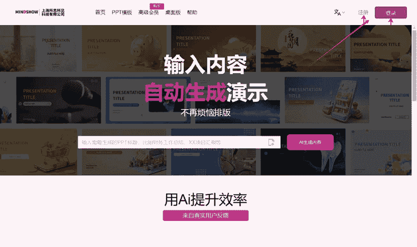

图 5-2 MindShow 的注册与登录

• 注册：在主页面右上角点击“注册”按钮，如果你想关注 MindShow 公众号可以扫码关注，否则直接点击“下一步”进入注册页面，填写对应手机号等信息即可完成注册。

• 登录：在主页面右上角点击“登录”按钮，选择对应的密码或验证码登录方式，登录即可。

（3）导入生成 PPT，如图 5-3 所示。

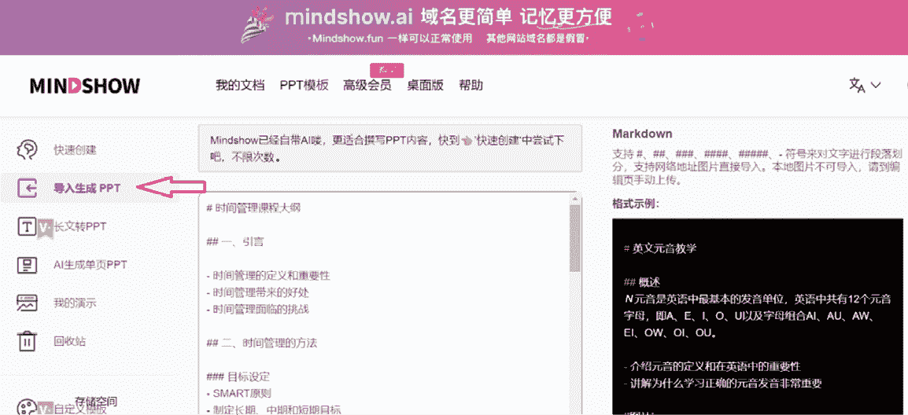

图 5-3 导入生成 PPT

目前，MindShow 支持 Markdown、Word（.docx）、PPT（.pptx）、思维导图（.xmind 和.mm）和 Logseq 笔记等内容转 PPT 格式，普通用户支持最长 6000 字符文本 AI 转 PPT，会员支持最长 20000 字符长文本 AI 转 PPT。

备注：如果 Markdown 格式的内容篇幅过长，想要分页显示，可以使用“---”来分页。

如果想直接导入 Word 文档，需要在文档中设置“标题 1”“标题 2”“正文”“项目符号”“编号”等样式和格式才可以正常转换。

为了提高生成 PPT 的效率和准确性，我建议先用大模型把内容转换成 Markdown 格式后，再用 MindShow 来制作 PPT。

（4）导入内容之后，点击“导入创建”按钮，即可生成 PPT，如图 5-4 所示。

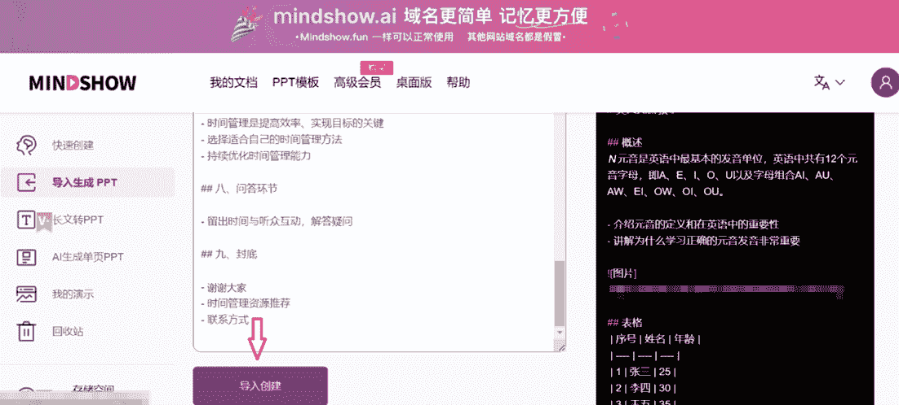

（a）

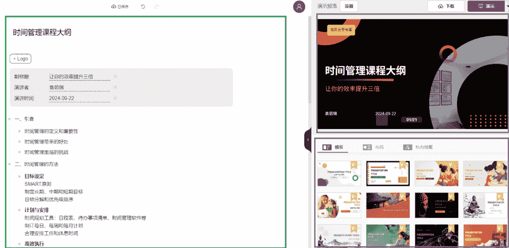

（b）

图 5-4 点击“导入创建”按钮生成 PPT

在图 5-4（b）中，生成 PPT 的页面分为左右两侧，左侧区域为大纲视图，可以修改标题、副标题、演讲者、演讲时间、Logo（标识），细化大纲及内容等；右侧上方区域为效果预览区，通过点击左右箭头可以查看 PPT 预览效果；右侧下方区域为模板选择区，通过“模板”选项卡可以根据需求选择合适的模板，通过“布局”选项卡可以调整对应内容页的布局，通过“私有模板”选项卡可以使用 MindShow 编辑自己设计的模板。

在 MindShow 官网点击“帮助”选项卡，即可找到 MindShow 的详细使用教程。

2**．**AiPPT

AiPPT 拥有庞大的模板库和完善的编辑功能，内置 PPT 编辑器，能够替代传统的 PPT 软件。用户可以对 PPT 进行深度修改，包括文字、图片、形状、背景等修改，实现个性化设计。

下面简单介绍它的使用方法。

（1）访问其官方网站。

（2）注册与登录，如图 5-5 所示。

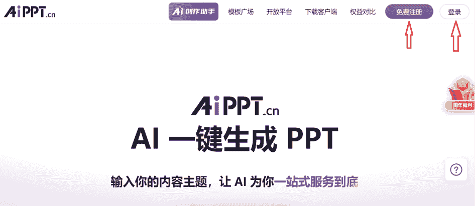

图 5-5 AiPPT 的注册与登录页面

• 注册：在主页面右上角点击“免费注册”按钮，选择所需注册方式，即可完成注册。

• 登录：在主页面右上角点击“登录”按钮，选择对应的密码或验证码登录方式进行登录。

（3）智能生成：在主页面点击“开始智能生成”按钮（见图 5-6），然后在新页面点击“导入本地大纲”选项（见图 5-7）。

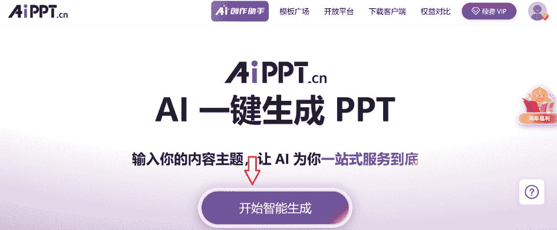

图 5-6 AiPPT“开始智能生成”按钮

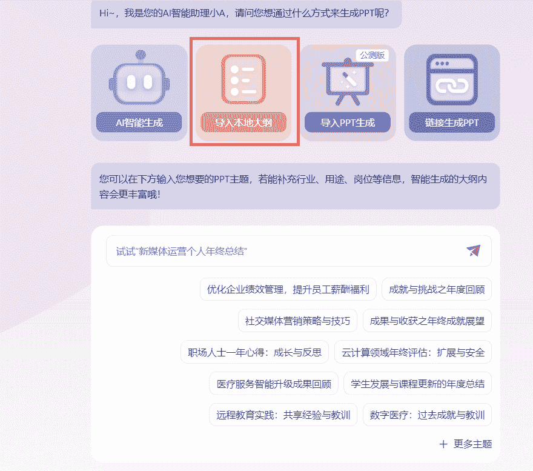

图 5-7 导入本地大纲

如果直接在下面的文本框内输入 PPT 主题，系统会直接依据该主题生成大纲，询问你是否满意，如果你满意则会依据此大纲直接生成 PPT。但由于其底层大模型的逻辑和表达能力有限，该 PPT 不一定能达到专业水准，因此，还是建议导入已经做好的本地大纲。

（4）文件上传：支持在线自定义编辑和文档导入生成。

可选择 Word、XMind、PDF、TXT（需要会员）、Markdown、FreeMind、纯文字文档 4500 字以内（需要会员）等格式上传文件，如图 5-8 所示。

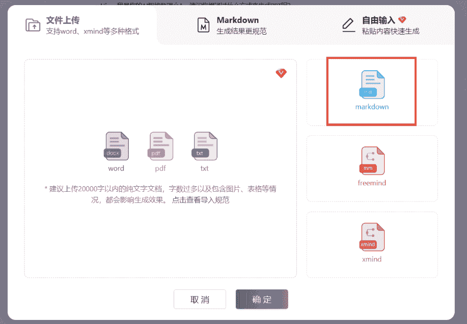

图 5-8 上传文件

由于前面已经梳理好了大纲，可以直接进入中间的“Markdown”页面，将生成的 Markdown 格式的 PPT 大纲复制粘贴进文本框，然后点击“确定”按钮即可，如图 5-9 所示。

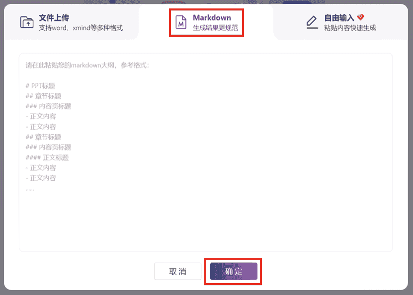

图 5-9 粘贴 Markdown 格式的 PPT 大纲

（5）生成 PPT 大纲：将上传的 Markdown 文件展示为大纲样式后，可以点击右上角白色按钮进入“思维导图页面”，进一步查看、编辑、优化内容，确认无误后，点击页面下方的“挑选 PPT 模板→”按钮即可，如图 5-10 所示。思维导图页面如图 5-11 所示。

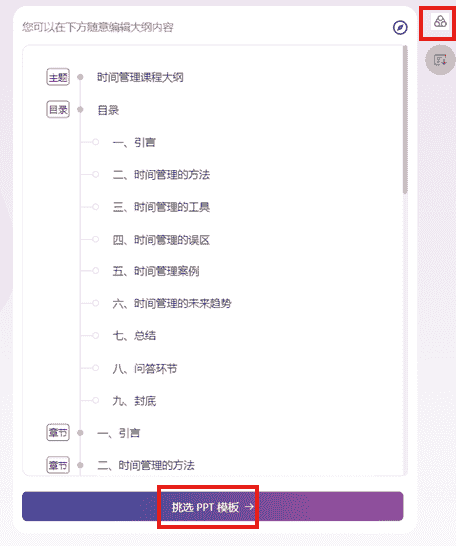

图 5-10 PPT 大纲生成展示的页面

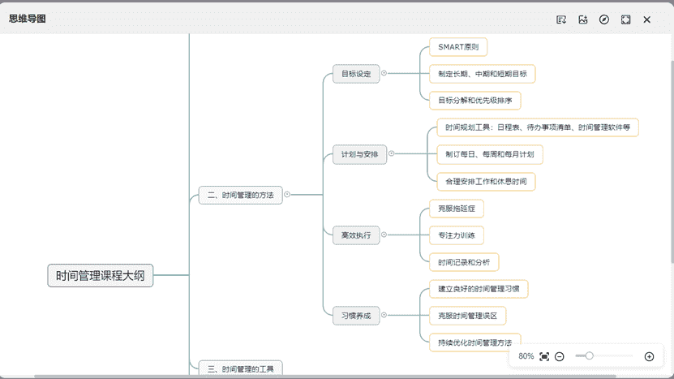

图 5-11 AiPPT 思维导图页面

（6）挑选模板：可以按需选择模板场景、设计风格、主题颜色等，选择合适的 PPT 模板；挑选完毕后，点击页面右上角的“生成 PPT→”按钮即可。挑选模板页面如图 5-12 所示。

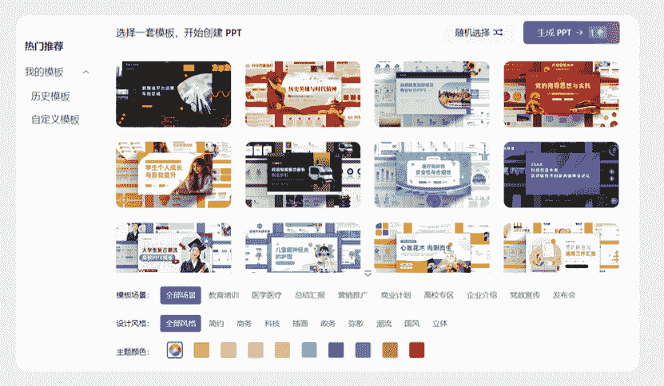

图 5-12 挑选模板

（7）导出文件：在网页端可以直接进行编辑，操作方式与传统编辑 PPT 的方式一样。编辑好之后，点击页面右上角的“下载”按钮，可选择导出文件类型为 PPT、PDF、图片，可设置“文字可编辑”选项，这样导出的 PPT 就可以在计算机上编辑了，如图 5-13 所示。

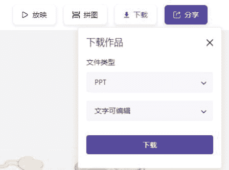

图 5-13 导出文件

在搜索引擎搜索“AiPPT.cn 用户帮助中心”，即可查看 AiPPT 的“快速入门”视频教程和“操作指南”教程。

3**．讯飞智文**

讯飞智文是一款免费的 AI PPT 工具，其底层大模型使用的是星火大模型，能够自动生成 PPT 并提供多种风格。其功能强大、模板丰富，具有强大的在线编辑、预览、切换页面样式等功能，非常适合用于 PPT 制作。

下面简单介绍它的使用方法。

（1）访问其官方网站。

（2）注册与登录。

• 注册：在主页面右上角点击“注册”按钮，选择所需的注册方式，即可完成注册。

• 登录：在主页面右上角点击“登录”按钮，如图 5-14 所示，选择对应的密码或验证码登录方式登录。

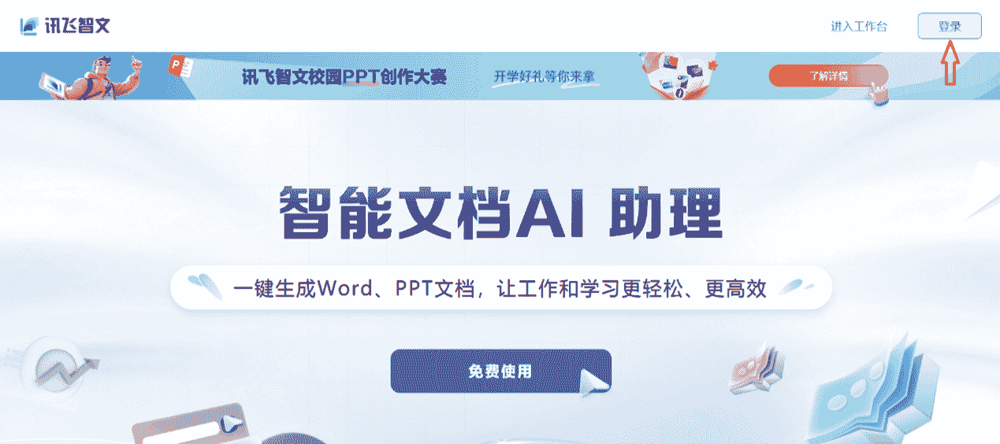

图 5-14 讯飞智文的登录页面

（3）输入大纲和内容。

在主页面选择“开始”选项后，即可进入 AI 生成 PPT 的页面，可以选择“文本生成 PPT”或“文档生成 PPT”选项，如图 5-15 所示。

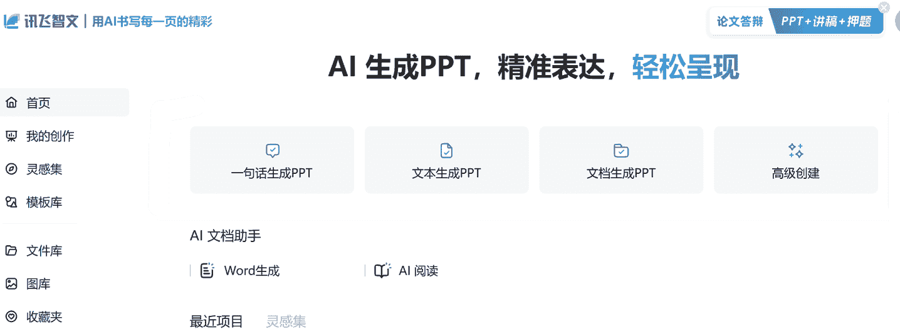

图 5-15 AI 生成 PPT 页面

文本生成 PPT 页面：可直接输入 PPT 框架的文本内容，如图 5-16 所示。

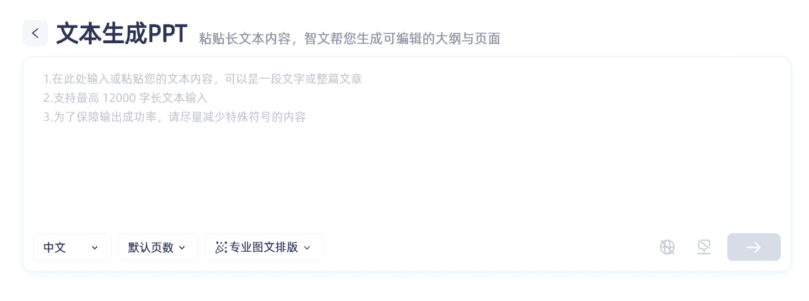

图 5-16 文本生成 PPT 页面

文档生成 PPT 页面：目前，讯飞智文支持导入 pdf、doc、docx、txt、md 格式的文档。我们可以将 AI 生成的 PPT 框架内容输出为这些格式的文档，再上传至讯飞智文，它会自动从中提取关键信息来生成 PPT。上传文档，待 AI 提取文档信息，如图 5-17 所示。

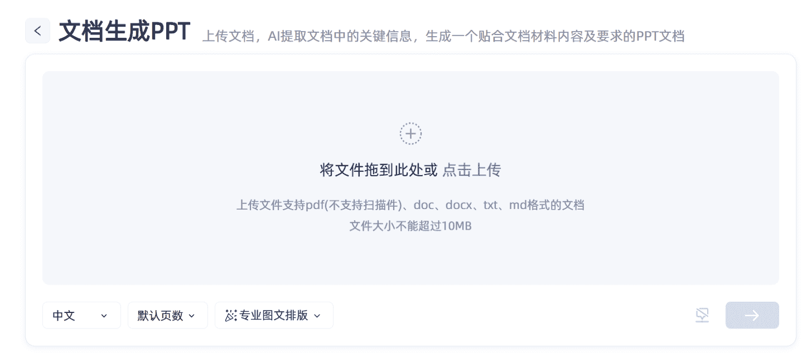

图 5-17 文档生成 PPT 页面

无论是“文本生成 PPT”还是“文档生成 PPT”，都需要将页面下方的“基础排版”改为“专页图文排版”。

（4）确定大纲。

输入内容后点击图 5-16、图 5-17 右下角的箭头图标，讯飞智文会将输入内容调整为适合转换为 PPT 大纲的形式，你可以直接编辑生成的 PPT 大纲。如对 AI 的生成结果不满意，可以点击右下方的“重新生成”按钮（见图 5-18）。

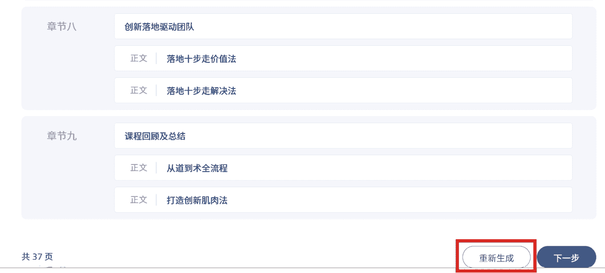

图 5-18 确定 PPT 大纲页面

（5）选择模板。

如果满意就点击图 5-18 的“下一步”选择模板。讯飞智文提供了多种模板供选择，可以通过筛选行业、风格、颜色来挑选合适的模板即可生成 PPT，如图 5-19 所示。

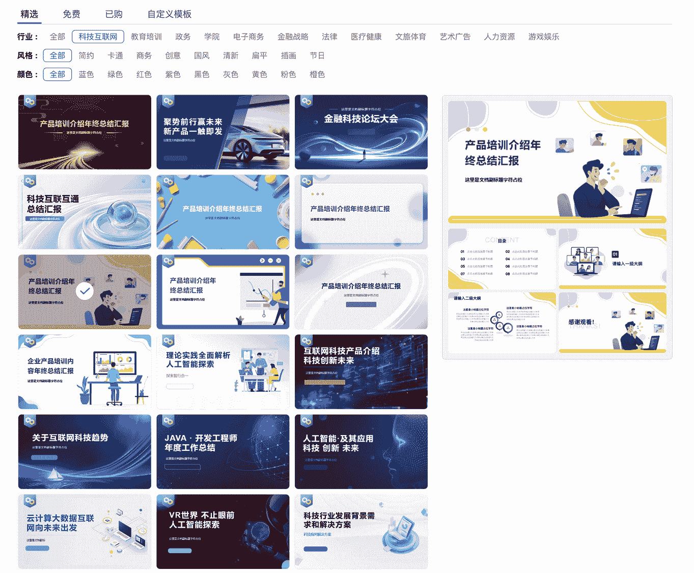

图 5-19 模板选择页面

（6）演讲备注。

点击“演讲备注”按钮，可以让 AI 将每一页 PPT 生成单独的演讲稿，如图 5-20 所示。

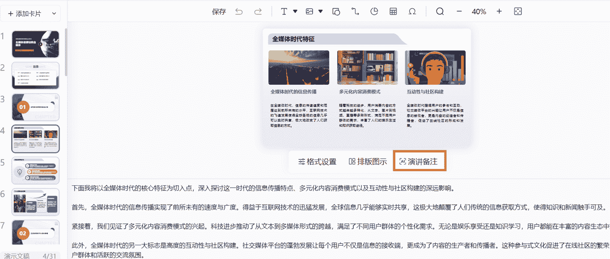

图 5-20 演讲备注页面

生成 PPT 后，每一页 PPT 的文字都可以编辑，和在制作 PPT 的软件（如 PowerPoint 等）中的编辑体验几乎一样。在讯飞智文中，你可以很方便地进行版式调整，例如可以一键替换 PPT 中的图形组件，将某一页的内容一键转换为其他呈现风格。

（7）改写内容。

选中 PPT 中的任意一句话，即可出现智文 AI 的工具条，可选择需要进行的操作，如美化、扩写、精简等，如图 5-21 所示。

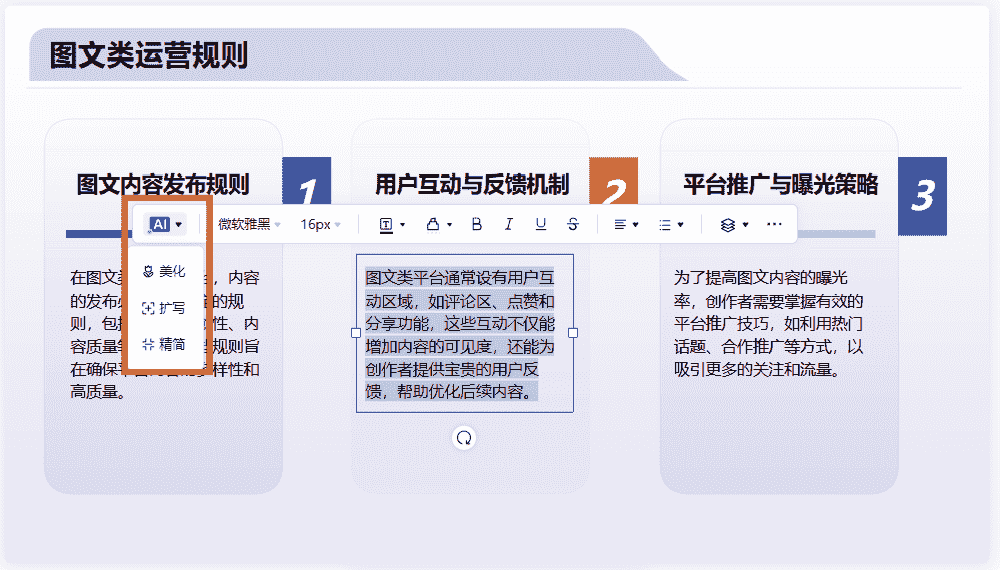

图 5-21 AI 优化页面

用户可以与讯飞智文进行多次交互，不断调整文字内容和排版方式，使其更符合课程需求。

MindShow、AiPPT 和讯飞智文 3 种工具的对比如表 5-2 所示。

表 5-2 3 种工具对比**[工][具][名][称][优][势][劣][势]**[Mindshow][支持多种格式文档导入生成][PPT][，如][Markdown][、思维导图等；可选][PPT][模板多；可以自由调整内容页布局；][PPT][大纲、内容形成后可进行二次编辑免费的模板少；导出为][PPT][格式文件需要开通会员；如果不设置自定义模板，字体样式无法调整][AiPPT][可选][PPT][模板多且有视觉美感；大纲有思维导图模式，可以进行二次在线编辑；页面样式可编辑，自由度高；可通过][Kimi][的][PPT][助手功能，免费使用可生成的][PPT][页数较少；内容分类排布的逻辑性和层次不足；单页][PPT][多要点内容受最大数量限制讯飞智文能生成拟人化的演讲稿；能实现][“AI+][手动][”][组合排版；根据][PPT][文本内容自动生成提示词，用户只需一次点击即可生成多张][AI][图片供选择（且无版权问题）；和第三方图片库打通；根据主题或分析文本内容生成的][PPT][质量相较于其他][AI] [PPT][工具更好非会员可使用的模板受限；对于用户输入的内容会进行重新排布，无法完全按照原内容生成]

下面介绍 3 个选择工具的建议。

• 需求分析：根据你的 PPT 制作需求，例如制作频率、内容类型、设计风格等，选择合适的工具。

• 功能比较：对比不同工具的功能特点，例如模板数量、编辑自由度、价格等，选择最符合你需求的工具。

• 试用体验：建议你先试用这 3 款工具，体验其操作页面和功能，再选择最易用、最符合你操作习惯的工具。

当然，技术发展日新月异，AI 工具也在快速更新，也许你拿到这本书时，这些 AI PPT 工具又迭代了很多功能。只有保持好奇，不断去尝试，才能试出最适合你的“那一款”。

借助 AI 工具，已经能实现从课程内容到 PPT 的高效转化。但别忘了，AI 生成的仅仅是 PPT 框架，课程中的教学设计、互动逻辑等仍需你的智慧来注入灵魂。

## **5.2 设计思维：排版美化，一目了然**

说到排版美化，就不得不提到 PPT 的本质。

PPT 不仅是文字的集合，还是将抽象的文字转化为图表、图片、动画甚至是音频和视频的工具，目的是创造生动的视觉场景，使复杂的概念变得简单易懂，从而达到双向交流的目的。

新手在设计 PPT 时，往往会考虑模板的选择、字体的美观、图表的样式等问题，而高手在设计 PPT 时会思考如下几个更深层的问题。

• 为什么选择这个模板？

• 是否有更好的图表来表达观点？

• 字体和颜色是否会影响学员的阅读体验？

• 背景主题是否与论点相协调？

• 动画是否有助于沟通？

• 这份 PPT 是否对学员具有启发性和影响力？

所以，PPT 的设计是有程序的，而不是想到哪里做到哪里。

PPT 的制作程序通常分为 10 步：确定目标、构思大纲、组织素材、导入 PPT、选择模板、优化内容、设计版式、调整风格、切换动画、正式宣讲。目前我们已经完成了前面 5 步的学习，后面的优化内容、设计版式、调整风格、切换动画，考验的是 PPT 的设计水平。

PPT 设计高手能够根据不同的课程目标和学员群体，设计出**逻辑清晰、风格一致、信息适量、图文并茂的**PPT，这样就能更有效地进行信息传递和沟通，促进学员记忆所学内容。

**5.2.1 逻辑清晰，确保 PPT 条理分明**

逻辑清晰是制作 PPT 的基础，它指的是 PPT 内容的组织结构清晰、层次分明，能够有效地引导学员理解和记忆信息。确保 PPT 逻辑清晰通常可以使用 6 种方法，如表 5-3 所示。

表 5-3 确保 PPT 逻辑清晰的 6 种方法**[方][法][作][用]**[明确培训目的在制作][PPT][之前，首先要明确培训的目的，明确要帮助学员获得什么，记住什么，改变什么，实现什么确定][PPT][的内容根据不同章节的授课目标，确定演示内容的范围和重点划分结构层次根据第][4][章的][“][请][AI][扮演课程结构设计专家][”][的提示词，通过与][AI][对话，获得有关课程结构设计的建议，然后在][PPT][的设计中展示出结构使用清晰的标题使用清晰的标题，概括每部分内容的要点，帮助学员快速理解课程结构使用编号或项目符号使用编号或项目符号，清晰地列出每部分内容的要点，让学员更有获得感保持内容的连贯性确保][PPT][各页内容之间具有连贯性，避免出现跳跃或重复的情况]

当然，逻辑清晰不仅仅指内容上的逻辑清晰，还包括视觉元素的安排清晰。

在制作 PPT 时，可以借助“插入”菜单下的“文本框”“图片”“形状”等功能来实现这一目标。文字、图片和形状三元素构成了 PPT 页面的基础，即使是初级制作者也应该熟练掌握它们的使用方法，如图 5-22 所示。

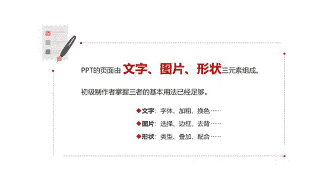

图 5-22 PPT 页面的三元素

假设你需要制作关于“假币收缴鉴定管理”的 PPT，应该如何组织内容？先看一张内容文字过多的 PPT，如图 5-23 所示。

这张 PPT 的内容文字太多，杂乱无章，没有清晰的层次结构，学员难以理解和记忆，甚至难以集中注意力去观看。第一次修改后的效果如图 5-24 所示。

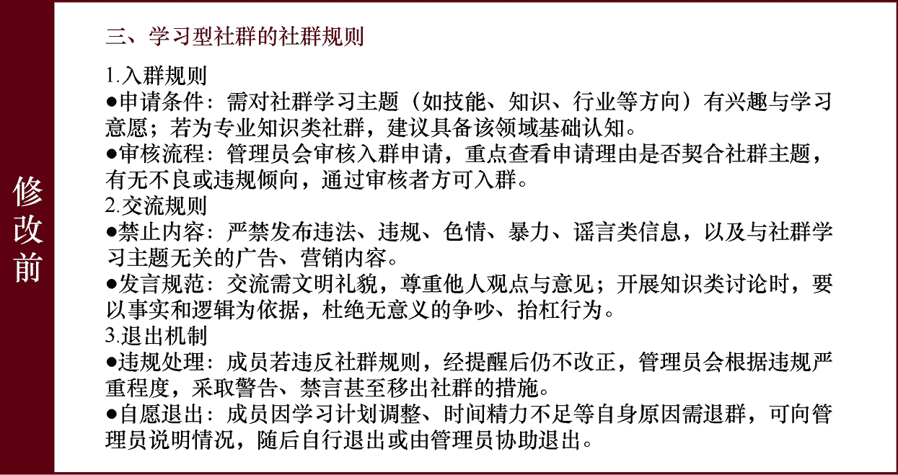

图 5-23 内容文字过多的 PPT

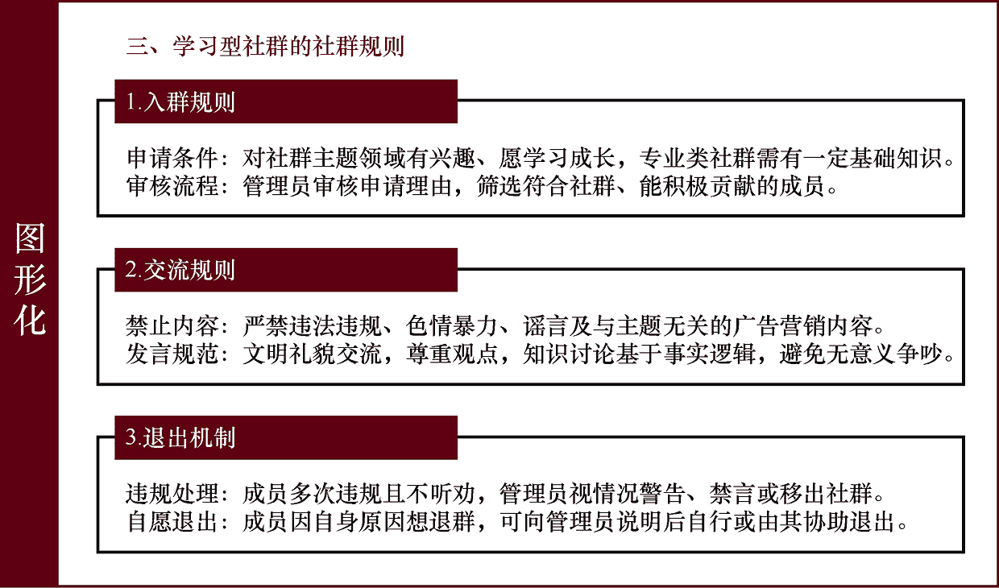

图 5-24 第一次修改后的 PPT

这张 PPT 对内容进行了精炼化，使用简洁明了的语言将内容概括为 3 个要点，方便学员快速掌握重点，也使内容更加简单易懂。第二次修改后的版本如图 5-25 所示。

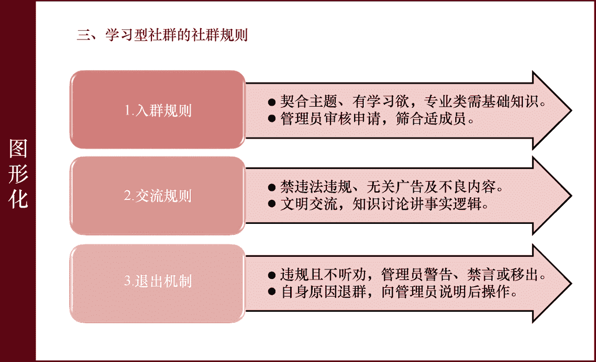

图 5-25 第二次修改后的 PPT

这张 PPT 不仅进行了文字概念化、概念层次化的设计，还进一步将内容图形化，使内容更加生动形象，易于记忆。

可以看到，通过划分层次、使用清晰的标题和副标题、使用编号或项目符号、保持内容的精炼化等方法，可以使 PPT 内容逻辑清晰，更加易于理解和记忆。

当 PPT 内容复杂而难以简化时，我们应该提炼关键词，使用小标题来突出重点。

**简洁与表达内容的多少无关，关键在于对元素的逻辑安排和中心思想的把握。**

**5.2.2 风格一致，确保 PPT 整体美感**

保持 PPT 风格一致的重要性有以下 3 点。

• 提升专业性：风格一致的 PPT 能够展现出制作者的专业素养，增强学员对演示内容的信任。

• 提升美观性：风格一致的 PPT 能够营造出和谐、美观的视觉效果，提升学员的审美体验。

• 提升易读性：风格一致的 PPT 能够减少学员的视觉负担，使内容更易于阅读和理解。

一致性不仅体现在视觉效果上，也体现在整个 PPT 的风格设计上，包括选择合适的字体、控制颜色数量和保持排版一致。

**（**1**）选择合适的字体。**

字体的选择非常重要，建议选择易于阅读的字体，如微软雅黑、宋体等。

PPT 推荐使用的字号是 20 号或更大；如果是在 100 人以上的培训场合，建议将字号设置为 24 号及以上，以保证坐在最后一排的学员也能看到。

若 PPT 中的文字不是统一的，尝试搜索“批量修改 PPT 字体”来解决。

**（**2**）控制颜色数量。**

在制作面向学员的 PPT 时，其颜色是一个十分关键的因素，它不仅影响 PPT 的美观，还关乎到信息的传递效率。

PPT 配色有 5 个基本原则，如表 5-4 所示。

表 5-4 PPT 配色的 5 个基本原则**[基][本][原][则][作][用]**[清晰可读确保文字与背景之间有足够的对比度，以提高可读性。例如，深色背景配浅色文字，或浅色背景配深色文字色彩一致性保持][PPT][整体色彩的一致性，不要频繁变换颜色。可以选取一两种主色，再辅以一两种强调色，以保持视觉上的连贯性颜色的意义不同的颜色能够激发不同的情感和反应。可选择那些能够强化信息传递的颜色，如蓝色代表冷静、理性，绿色代表自然、健康，红色则用于强调紧急或重要信息辅助色的使用辅助色用来强调重要的信息点，如标题、关键字等。这些颜色应该醒目，但又不能过于刺眼，以至于分散注意力情感共鸣颜色可以影响情感，因此在选择颜色时要考虑目标受众的年龄、文化背景等因素，以确保颜色选择能够引起他们的共鸣]

下面是一个对比案例。图 5-26 所示的 PPT 主要有三大问题。

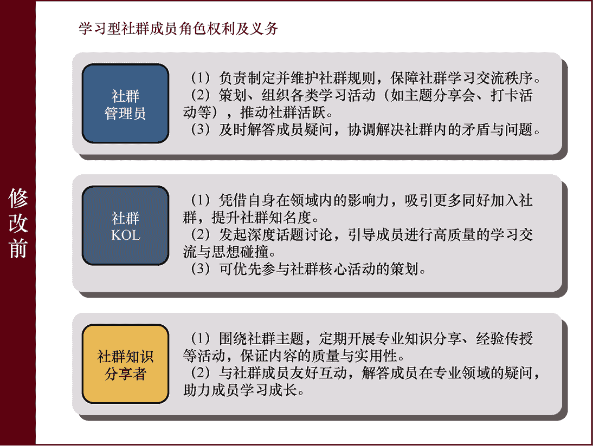

图 5-26 修改前的 PPT 案例

• 颜色：使用多种颜色来突出不同的信息点。虽然这有助于区分不同的部分，但颜色种类过多会造成视觉上的混乱。

• 文字信息：文字信息过于详细，但因为颜色和字体的多样性，关键信息不够突出。

• 视觉焦点：由于颜色和字体样式的多样性，观众可能难以迅速抓住重点。

针对图中存在的三大问题，通过精炼文字、减少色块及颜色种类让整个 PPT 页面内容更鲜明、更有层次感，修改后的 PPT 如图 5-27 所示。

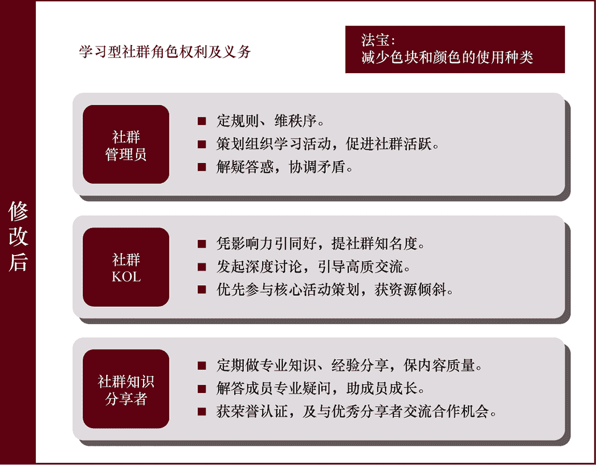

图 5-27 修改后的 PPT

可见，有效的配色方案能够支持信息的清晰传递，同时也要考虑到学员的视觉感受和心理反应。**排版与配色合理，能提高**PPT**的吸引力和教学效果。**

**（**3**）保持排版一致。**

保持文字大小、间距、对齐方式等的一致性，使 PPT 更加整洁美观。保持排版一致主要有 3 个技巧，如表 5-5 所示。

表 5-5 保持排版一致的 3 个技巧**[技][巧][作][用]**[PPT][布局为类似的内容创建统一的][PPT][布局。例如，使用][PPT][母版来确保所有][PPT][都有相同的布局和设计元素使用统一的图片风格使用风格一致的图片，避免图片风格过于杂乱项目符号和编号如果使用项目符号或编号，需保持一致的样式和段落缩进]

**5.2.3 信息适量，避免冗余，突出重点**

为什么信息适量很重要？

• 提升注意力：避免学员信息过载，提升学员的注意力，使他们能够更好地理解和记忆演示内容。

• 提升理解力：帮助学员聚焦关键内容，提升他们的理解力，避免遗漏重要信息。

• 提升记忆力：帮助学员更好地记忆演示内容，提升他们的记忆力，避免信息过多导致遗忘。

如何保证信息适量？

• 精简文字内容：避免使用冗长的句子和段落，使用简洁明了的语言表达关键信息。

• 概念化：将文字内容概念化，使用关键词、短语等概括核心观点。

• 层次化：将概念化的内容层次化，使用标题、副标题、项目符号等划分层次结构。

• 图形化：将层次化的内容图形化，使用表格、图片等可视化元素呈现信息。

例如图 5-28 所示的 PPT 存在文字内容很多、信息量过大的问题。

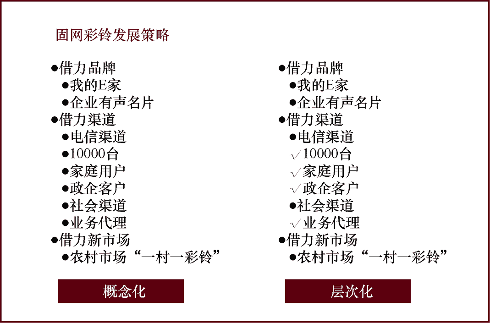

图 5-28 信息量大的负面案例

通过修改，其信息量适中，更易于理解和记忆。修改后的 PPT 效果如图 5-29 所示。

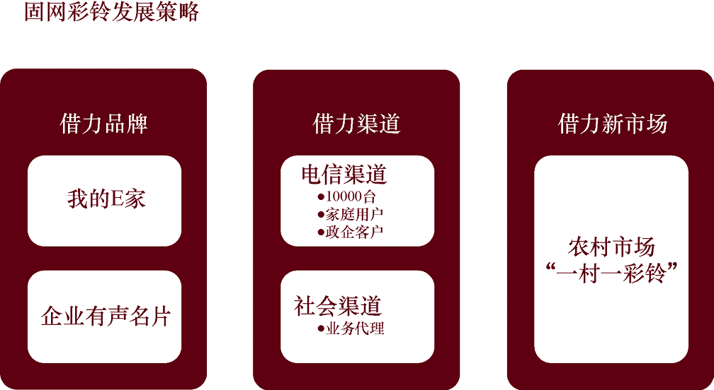

（a）

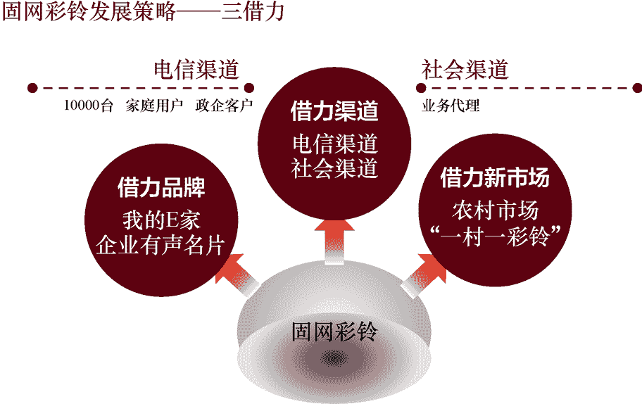

（b）

图 5-29 信息适量的调整案例

通过精简文字内容，采用概念化、层次化和图形化的方法，可以使 PPT 信息量适中，不仅能帮助学员更好地理解信息，还能增强信息在学员脑海中的留存度。

**5.2.4 图文并茂，增强视觉吸引效果**

设计思维的最后一项是图文并茂。

图文并茂是指在 PPT 中合理运用文字、表格和图像，合理分配三者比例，使内容更加生动、形象、丰富，增强授课效果，使学员更容易集中注意力。

**相比于文字，表格和图像更能直观地传达信息。**俗话说，文不如字、字不如表、表不如图。

图文并茂的重要性主要表现在以下 3 点。

• 提升吸引力：丰富的视觉元素能够有效地吸引学员的注意力，提升 PPT 的吸引力。

• 提升理解力：图片和图表能够将复杂的信息可视化，帮助学员更好地理解演示内容。

• 提升记忆力：生动的视觉元素能够使学员产生兴趣，不知不觉记住演示内容，避免信息遗忘。

实现图文并茂主要有 4 种方法，如表 5-6 所示。

表 5-6 实现图文并茂的 4 种方法**[方][法][作][用]**[选择高质量的图片选择清晰、美观、与内容相关的图片，避免使用模糊、像素化或与内容无关的图片合理运用图表选择合适的图表类型，如柱形图、折线图、饼图等，清晰地呈现数据和趋势保持图片风格一致使用风格一致的图片，避免图片风格过于杂乱控制图片数量每页][PPT][上的图片数量不宜过多，避免造成视觉混乱]

图文并茂需要遵循以下 5 个设计原则，如表 5-7 所示。

表 5-7 图文并茂需要遵循的 5 个设计原则**[设][计][原][则][作][用]**[保持简洁不要让][PPT][信息过于拥挤，每张][PPT][应该只传达一个核心信息统一风格表格和图片的风格应该与][PPT][的整体风格保持一致强调重点使用颜色、大小或位置来强调最重要的信息适当的文字描述表格和图片应该辅以简短的文字描述，提供必要的上下文逻辑清晰图文内容应该逻辑清晰，确保学员可以按照授课思路理解][PPT][上的信息]

图片用于培训课程时，一般属于商业用途，在选择图片时需要注意版权问题。

• 使用有版权许可的图片：选择那些明确标示为免费使用、共享或已获得授权的图片，例如，Unsplash、Pixabay 等网站提供的大量有版权许可的图片资源。

• 购买版权许可：如果需要特定的高质量图片，可以考虑从专业的图库网站（如 Getty Images、Shutterstock 等）购买版权许可。

• 使用自己的图片：最安全的方式是使用自己拍摄或创作的图片，这样可以完全避免版权问题。

• 注明出处：即使图片允许免费使用，也应尊重原作者的劳动成果，适当情况下给出图片来源或向作者致谢。

相信学习到这里，你已经掌握了 PPT 排版美化的 4 个核心要素：逻辑清晰、风格一致、信息适量和图文并茂。

希望你能将逻辑清晰、风格一致、信息适量和图文并茂的相关知识运用到实际的 PPT 制作中，从而提升授课效果，吸引学员的注意力，在课堂上更有效地进行信息传递和沟通互动。

# **第六章 教学设计，AI 创设学习体验**

本章主要介绍如何用 AI 创设学习体验，主要包括选择教学方法，以及借助 AI 工具来丰富培训形式。

想象一下，如果你的课程是一个鲜活的生命体，那么教学设计就是维持它蓬勃生长的“维生素”——缺少它们，再精彩的内容都会陷入“营养缺乏”。

就像人体健康需要维生素 A、B、C、D 的精准协同，一堂真正高效的课程需要对应的“教学设计维生素”。

• 维生素 A：通过案例拆解、可视化呈现，让抽象知识变得易懂，破解“内容干涩”的问题。

• 维生素 B：借助互动练习、复盘设计，帮助学员巩固知识点，拒绝“学了就忘”。

• 维生素 C：用场景化导入、节奏把控维持学员专注，破解“心流中断”，提升知识吸收效率。

• 维生素 D：搭建“核心观点+分支逻辑”的课程骨架，让内容有序衔接，告别“结构松散”。

如果你的课程正面临以下“营养缺乏症状”，说明需要补充对应的“教学设计维生素”。

• 内容抽象、学员理解难（缺乏维生素 A）。

• 知识点零散、学后无印象（缺乏维生素 B）。

• 学员易走神、参与度低（缺乏维生素 C）。

• 课程逻辑混乱、无核心主线（缺乏维生素 D）。

不妨自测一下，你的课程缺少哪一类“教学设计维生素”。

关注微信公众号“醒职场”，并回复“维生素”，即可阅读文章《进来测测看，你缺的究竟是哪一种维生素？》。

接下来，本章将精准切入选择教学方法时最令人头疼的 3 个问题，并教你如何对症下药地开出教学设计处方。

## **6.1 选择教学方法的常见问题**

你是否也想知道，自己精心准备的内容，学员到底记住了多少？一个被广泛验证的“学习金字塔”模型，揭示了让知识真正留存的秘密。

学习金字塔是美国缅因州的国家训练实验室的研究成果，它揭示了采用不同的学习方式会使学员的学习保持率不同。也就是说，采用不同的学习方式，在学习后两周之内，人们能够记住的信息比例不同。

学习金字塔通常以金字塔的形式呈现，不同的层级代表不同的学习方式及其对应的学习内容平均留存率，如图 6-1 所示。

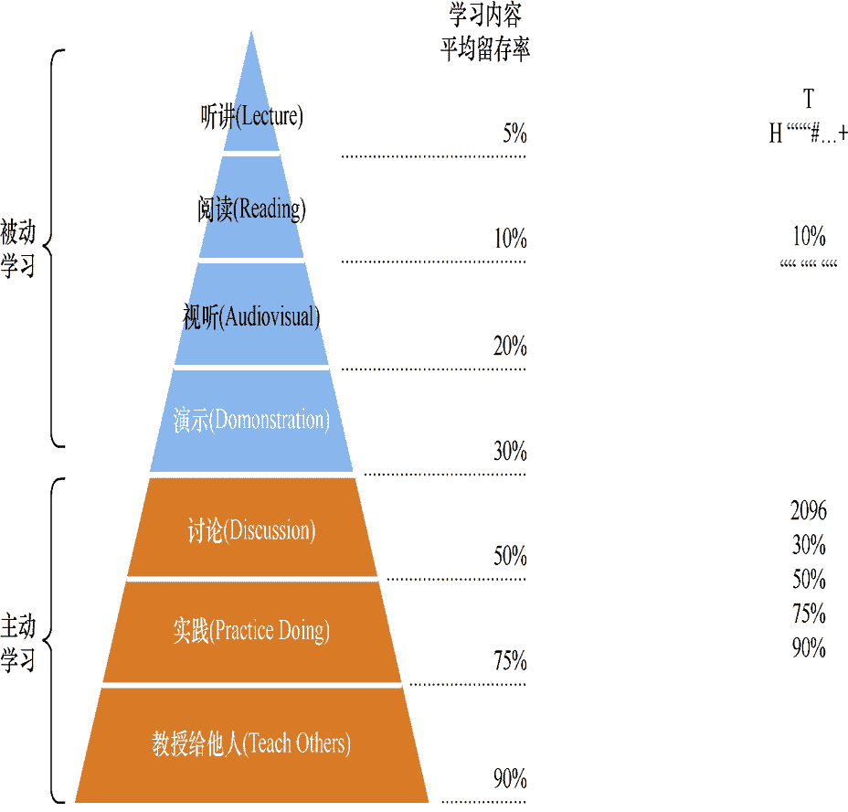

图 6-1 学习金字塔

可以看到，学习内容平均留存率在 30%及以下的方式，是听讲、阅读等被动学习。学习内容平均留存率在 30%以上的是讨论、实践等主动学习，其中教授给他人的方式是学习内容平均留存率最高的，达到了 90%。

**教是最好的学。教别人的过程就是自己强化记忆和举一反三的过程。**

学习金字塔揭示的核心思想是，为了提高学习效率，应该鼓励更多的交互式学习活动，让学员参与到学习过程中去，并且通过应用所学知识来加强理解和记忆。

由此可见，教学方法对学习效果的达成非常重要。教学方法解决的问题是如何将内容在课堂上有效地传递给学员。

有效传递的标准是，学员学习课程之后，在工作中或生活中有一些行为上的变化。

在课堂上，你讲了一些内容，学员真的能把学到的内容用于实践吗？不一定，你讲的内容不一定能带来学员的行为改变。所以我们要琢磨怎么讲、怎么说、怎么去设计学习体验，才能最大限度地确保学员在之后的工作中、生活中有意识地去应用所学内容。

有效传递的基础是学员成为学习的主人，这样他们才有可能在学习之后去践行。**只有让学员成为学习的主人，学员才会在学习之后主动做出改变。**

“让学员成为学习的主人”，意味着课程并不是以培训师的讲授为主，而是以学员积极主动地参与为主。学员在各种学习活动中，主动参与、分享、讨论、建构、实操、演练……只有这些动作才能确保学员真正地理解知识、吸收知识，并且离开课堂之后，能够在工作中、生活中联想和应用所学知识，从而产生行为改变。

要把课程转化为以“学员参与”为主的学习体验，需要培训师具备教学方法选择能力和学习体验设计能力。

在选择教学方法时，最常见的问题有以下 3 个。

**问题**1**：教学方法不科学、不系统。**

有些培训师是“半路出家”，没有接受过专业、系统的培训技术训练，授课时所采用的教学方法往往是通过看书、看视频模仿而来的。

选择教学方法的时候，他们常常依靠自己的喜好和感觉，而非课堂现场的实际需要，导致教学方法的实施出现问题。

**问题**2**：不知道如何选择教学方法。**

在课堂中，教学方法要根据当前的授课内容、授课目标、学员的情况来选择，有时还要根据现场所处的环境和氛围来即时选择。

当然，我们可以在前期备课的时候，提前评估哪些部分需要学员通过体验来加深理解，哪些部分需要引发学员思考来强化记忆，哪些部分需要学员学以致用来促进转化，但这些都需要授课经验做支撑。

如果你的授课经验足够丰富，还可以提前预测学员在课堂不同阶段的情绪和能量状态，从而选择匹配的教学方法。

**问题**3**：对教学方法的应用不到位。**

有些培训师参加过一些专业的培训，学到了有关培训的方法和技巧，懂得在合适的时机选用恰当的方法来教学，但是由于实操技能不足或者缺乏控场能力，对教学方法的应用不到位，这种情况也会影响培训效果。

下面是一名零售行业的学员曾经讲过的一个案例。

有一次他们请一位培训师来培训，培训的主题是“团队协作”，培训师设计了很多教学活动，基本上是讲一段内容，就让大家实践演练。从教学设计的角度上来说，这样的设计很有实战性。

其中一个环节，培训师展示了一个职场案例，案例中有销售经理、市场经理、运营经理 3 个角色，根据案例描述，他们的利益发生了冲突，需要通过沟通解决。

于是培训师把现场的学员分成了 3 个小组，让各组分别来扮演这 3 个角色。每组根据自己所扮演角色的立场讨论接下来应该采取什么行动。例如扮演销售经理的小组就一起讨论销售经理在案例中的背景下，应该采取什么样的做法，以此类推。

讨论完之后，分组分享，看看 3 个角色所采取的行动最终会带来什么样的结果。

本来，按照规则，3 个小组应该分开各自商议的，而且不能让其他小组知道自己小组的结论。但是因为当时的培训场地比较小，小组讨论的时候离得很近，几乎都能听到别的小组在讨论些什么，所以讨论时，不但场面显得混乱，而且角色扮演的教学活动也没有达到预期效果。

可见，教学方法的选择与应用绝非简单的技巧堆砌，而是需依托科学指导的系统工程。

上述 3 个问题如同三座大山，正阻碍我们打造真正以学员为中心的高效课堂。而翻越这些大山，需以一套普适且清晰的底层逻辑为支撑。接下来，我们将一同探寻这套逻辑。了解这套逻辑后，你不仅能“选对”方法，更能“用好”方法。

## **6.2** **设计教学方法的底层逻辑**

先来做一道选择题，以下哪种结果最能激发你的学习欲望？

• 学到的东西可以帮助你解决某个问题。

• 学到的东西可以帮助你避免某个问题的发生。

• 在学习中，你有机会和其他伙伴交换观点和想法。

• 在学习中，你能通过体验式活动悟出新知，醍醐灌顶。

从理论上来说，这 4 种结果都能激发学习欲望，它们分别对应了**成年人学习的四大关键原则。**

**原则**1**：自愿。**

许多培训师经常向我咨询：如何才能让学员在课堂上积极参与学习？答案很简单：只要你能让学员认识到课程对他们个人的意义，就能激发他们的学习动机。关键在于如何巧妙地引导他们，让他们意识到这个课程对他们是有益的。

例如，在讲授“会议管理”课程时，你可以在课程开始时采用“问题讨论法”，引导学员共同讨论：是什么原因导致会议无效、乏味、耗时过长，且难以取得实质性成果？

通过讨论，可能会揭示出多种原因。你可以将这些原因逐一列在白板上，然后告诉学员：实际上，只要掌握 3 个工具，我们就能让会议变得不再无聊和低效，而且让每次会议都能取得实质性成果。大家是否想知道这 3 个工具是什么？

由于之前的讨论已经让学员回想起过去那些无聊和痛苦的会议经历，所以在你提到有 3 个工具可以改善会议质量时，学员们自然会兴趣盎然，想要了解更多。

因此，让学员积极参与学习的核心原则是自愿，其关键在于关注学员的需求。

**原则**2**：经验。**

在学习的过程中，我们常常依赖已知的知识来理解新的概念。当大脑接收到新信息时，它会自然而然地尝试将这些信息与我们已经掌握的知识结合，这一过程被称为知识的同化。同化的核心在于发现新知识与旧知识之间的关联，进而将新知识融入既有的知识框架中。

因此，在培训活动中，我们的目标是唤醒学员内心深处的经验和认知。

以领导力培训为例，一些培训师会这样启发学员：“各位管理者，你们是否曾经体会到，在领导团队时，有时下属们似乎是一盘散沙，难以凝聚，而有时下属们又能展现出惊人的团队力量，勇往直前？（学员们纷纷点头。）你们是否思考过，是什么因素影响了下属们的表现，导致他们的能力波动如此之大？”

在这个问题上，管理岗位的学员们可能会分享他们的见解。培训师可以抓住这个机会，引导学员进行深入讨论，从中揭示他们可能忽视的问题，并在此基础上提出解决方案。

通过这种方式，学员不仅能更深刻地理解课程内容，还能更加认真地投入课程学习。

**原则**3**：自主。**

自主性学习，意味着赋予学员学习的主动权。成年学员期望在培训中被视为独立、有能力的个体，他们享受思考的过程，喜欢自主做出决策，而不是被动接受灌输式的教育。

那么，我们如何在培训中实现学员的自主学习呢？

我们需要在培训过程中为学员创造多样化的机会，让他们能够自由地分享自己的观点和见解。通过思维上的交流和碰撞，学员可以受到启发和洞察本质。同时，我们应当鼓励学员通过自己的努力去探索解决问题的方法，让他们能够真正掌握学习的主动权。

**原则**4**：行动。**

培训的核心在于促进学以致用，单纯的理论讲解是不够的。因此，在培训中，我们需要精心安排一些与学员工作密切相关的实践和演练环节。这样的设计不仅能够加深学员对所学知识的理解，还能有效促进他们在实际工作中应用这些知识。

以客户服务培训为例，我们可以让学员分组进行角色扮演，一部分扮演客户，另一部分扮演客服人员，同时在模拟的场景中制造一些冲突，让学员现场解决。这样的实战演练可以在培训现场显著提升学员解决工作问题的能力。

当学员回到实际工作环境，面对类似情境时，他们能够迅速回想起课堂上学到的知识和方法，并有效地运用它们来解决问题。

以上就是成年人学习的四大关键原则。做到了这 4 点，就能激发学员的参与性和学习积极性。

很多时候，学员对课程的反馈不一定来自课后，可能源于课堂之上。在授课时，我们可以从以下 3 个角度来搜集学员的反馈，以评估教学活动的效果。

• 教学活动是否促进了内容的理解和吸收？一个高效的教学活动能够使复杂的概念在学员脑海中清晰浮现，并促进学员之间的交流。如果你发现，在进行了一个教学活动后，学员们脸上的困惑减少了，或者他们对知识点的理解更加深入了，那么这个教学活动就是成功的。

• 教学活动是否激发了学员内在的学习动机？优秀的教学活动能够唤起学员的内在学习动机。例如，可以观察学员是否觉得活动有趣，是否感到好奇，是否在活动中获得了成就感，以及是否得到了彼此的认可。只有激发学员的这些积极情绪，才能让他们更愿意学习，更深地融入学习环境，从而提升学习效果。

• 教学活动是否营造了积极合作的学习氛围？给学员带来紧张和压力的教学活动可能会适得其反，减少学员的学习动机。而优秀的教学活动应鼓励学员之间的相互合作，让他们开放、坦诚地交流。因此，一个成功的教学活动能够在很大程度上提升课堂的学习氛围。

在进行教学活动时，我们可以反思教学活动是否满足上述 3 个角度的要求。通过自我审视，我们可以不断优化教学活动，提升培训效果。

在培训领域，教学方法绝非单纯的“流程”或“形式”，而是决定课程能否深入人心、避免流于表面的核心杠杆。设计优质的教学方法，将为培训赋予四大核心赋能引擎，如图 6-2 所示。

（1）引爆培训效果，不再依赖单向灌输。多元教学方法可为学员打造沉浸式、多维度的学习体验——不仅大幅提升知识留存度，更能持续锁定学员注意力，有效减少分心。

（2）打破课堂沉闷感，告别单一讲授的刻板模式。精妙的教学设计可让培训过程生动有趣、充满惊喜。学习不再是负担，而成为每位学员都愿主动投身的探索之旅。

（3）深化理解与记忆，依托脑科学优化信息传递。脑科学研究表明，人类大脑对信息的处理具有多通道特性——需通过视觉、听觉、触觉等多种感官接收与加工信息。因此，教学中需充分利用多通道信息传递，帮助学员更轻松地理解复杂内容，留下更深刻的记忆痕迹，具体可通过以下方式实现。

• 视觉化呈现：将抽象概念与理论转化为图像、图表、动画等视觉元素，帮助学员直观理解与记忆。

• 听觉刺激：借助语音讲解、背景音乐、案例故事等听觉素材，激发学员兴趣，提高信息接收效率。

• 触觉体验：通过实物操作、模型搭建、角色扮演等互动形式，让学员在动手实践中深化知识掌握。

• 精细编码：对知识进行分类梳理、归纳关联，赋予其逻辑意义，能够帮助学员构建系统化记忆框架。

依托这些基于脑科学原理设计的教学方法，能让学员真正将知识“内化于心”，形成长期记忆。

（4）推动即学即用，强化实践转化能力。优质的教学方法设计自带“实践属性”。通过模拟真实场景中的任务与挑战，让学员在课堂内即可完成试错、反思与应用，高效实现从“知道理论”到“会用技能”的突破。

图 6-2 四大核心赋能引擎

## **6.3 9 种教学方法的实操技巧**

在当今快速发展的社会中，有效的教学方法不仅能够帮助培训师更好地传递知识，还能激发学员的学习兴趣，提升培训的效果。

本节将分享 9 种经典的教学方法——课堂讲授法、案例教学法、角色扮演法、道具教学法、问题研讨法、技能演练法、游戏活动法、学思测评法、视频教学法，让你在培训过程中如虎添翼。

每种教学方法都有特定的实施流程和注意事项，执行到位才能产生效果。

**6.3.1 课堂讲授法**

课堂讲授法是一种以说明、阐述、讲解、论述等口头语言来表述培训内容的方法，也是培训时使用频率最高的一种方法。**课堂讲授法特别适用于重要概念、知识点的讲述，但不适用于技能、方法等需要实操演练的内容。**

它的优点是传递信息的效率高、成本低，应用范围广，因为几乎所有的课程都会涉及讲授。同时，课堂讲授法也能保证知识传递的系统性。

但如果一门课程只采用了课堂讲授法，就会剥夺学员的自主学习意识。因为使用课堂讲授法的时候没有互动，不易激发学员的主观能动性，无法做到因材施教，也不利于启发学员的思维。

讲授并不等同于培训，因为培训和讲授相比，最大的区别就是有训练，训练才是促进学习转化的有力手段，而一旦讲授过多，就会挤占学员练习和实践的时间。

采用课堂讲授法的时候，要注意观点鲜明、重点突出、结构层次清晰、论据充分，可以使用图 6-3 所示的 5 种技巧。

图 6-3 课堂讲授法的 5 种技巧

**技巧**1**：举例说明。**

用例子来说明观点比苍白的说教更具有说服力。举例说明通常用来说明概念。

例如，在解释“伪需求”这一概念时，培训师可以举例说明，在没有汽车的时代，“用户需要一匹跑得更快的马”是一个典型的伪需求。这种需求虽然表面上看起来合理，但实际上并未触及用户真正的需求所在。而福特公司生产的汽车，则满足了人们对更快、更安全出行的真实需求。这就是通过举例的方式说明了“伪需求”这个概念。

针对这个概念，培训师还可以列举现代的案例：前些年大肆宣扬的“上门洗车”事实上也是“伪需求”，因为一方面，上门洗车的市场规模小；另一方面，上门洗车的需求太低频，而且缺乏时效性。

这样说明学员就更容易理解。

**技巧**2**：运用故事。**

众所周知，故事胜于道理，通过故事传达的观点更容易让学员接受。一个好的故事往往有跌宕起伏的情节，有个性鲜明的角色，有冲突、有矛盾，再加上一个精彩的结局，很容易吸引学员，并能让学员在潜移默化中接受你想要传达的观点。

故事之所以能够深入人心，是因为它们能够通过生动的情节、鲜明的人物及富有哲理的结局来传达观点。例如，讲述一个企业家如何克服重重困难最终实现梦想的故事，不仅能够激励学员，还能让他们在不知不觉中学到宝贵的经验。

**技巧**3**：引用数据。**

引用数据来论证要讲授的观点，能使观点更加掷地有声、有理有据。当然，引用时要注意标注数据的来源及出处。

例如，艾媒网提供的数据显示，2020 年中国知识付费用户规模就已经达到了 4.2 亿人，2023 年中国知识付费用户规模突破 5.7 亿人，而到 2025 年，中国知识付费用户规模有望达到 6.4 亿人。这表明人们对知识付费的认可度不断提高，未来这一领域还有望进一步扩大。

**技巧**4**：运用比喻。**

比喻是一种将抽象概念具体化的有效手段，它有助于理解抽象复杂的知识点。

例如，某位知识博主将书籍分为 4 类，并分别用食物来比喻：把底层认知类图书比作主食，把专业工具书比作蔬菜，把拓展认知边界的图书比作汤羹，把生活类图书比作甜点。这样的比喻不但形象生动，而且便于记忆。

若暂时想不到合适的通俗比喻，可借助 AI 工具，让其将专业概念转化为“小白也能懂”的生活化表述。例如，你可以这样向 AI 提问：

请用“外卖、快递、打游戏”这类生活场景中的例子，解释“稳定币”和“区块链”，要求通俗易懂，方便我讲给无相关基础的人听。

AI 通常会给出类似下面的回复。

好的。我们可以用一个完整的“网购游戏皮肤”的场景来解释这两个概念。

场景：你想用 100 元买一个游戏皮肤。

稳定币就像你用来支付的 100 元现金。

它的价值非常稳定，你付 100 元，就能买到标价 100 元的皮肤，不会出现因为数字货币价格波动，你付钱时这 100 元突然只值 50 元，或者值 200 元的情况。在数字货币世界，稳定币就是扮演这个“稳定现金”的角色。

区块链就像整个包裹的物流追踪系统。

从你下单、付款，到卖家发货、包裹经过的每一个中转站，所有信息都被公开记录在一个谁也删不掉、改不了的公共账单上。你可以随时查看这份包裹的完整“一生”，确保交易真实可信。这就是区块链—— 一个去中心化、公开透明、不可篡改的分布式账本。

总结一下：

稳定币=稳定支付的“现金”；

区块链=记录一切的“诚信快递追踪系统”。

这类比喻清晰直观，能帮助无相关基础的学员高效、快速地理解复杂概念。

**技巧**5**：展示图片。**

一张好的图片胜过千言万语，它可以直接触动人心，传递更为直观的信息。相较于单纯的文字描述，图片能够更快速地传达复杂的思想，使内容更加生动有趣。

**6.3.2 案例教学法**

案例教学法是一种将理论与实践相结合的有效方法，它通过分析真实或模拟的案例来帮助学员理解复杂的情境，并从中学习解决问题的方法。

**案例教学法就是案例讲解吗？**

案例教学法是一种以案例为基础的学习方法，它强调学员通过分析和讨论真实的或虚构的案例来发展问题解决的能力、批判性思维和决策技能。

这种方法通常用于高等教育和专业培训，要求学员对案例进行深入研究，并要求他们撰写报告、进行角色扮演或进行模拟决策。**案例教学法的关键在于学员的主动参与，以及把案例中解决问题的方法迁移到实际中去运用。**

而案例讲解通常指的是培训师对一个案例进行详细解释和分析的过程。在案例讲解中，培训师是主导者，负责解释案例的背景、情境、相关因素和可能的结果。案例讲解可以作为案例教学法的一部分，也可以独立使用。它的目的是帮助学员更好地理解案例，并从中提取关键信息和经验教训。

案例教学法的目的是让学员通过分析案例来发展多角度思考能力和问题解决能力，而案例讲解的目的是帮助学员更好地理解案例内容。案例教学法强调学员的主动参与，如进行小组讨论、角色扮演或模拟决策，而案例讲解则侧重于培训师的讲解和学员的被动接受信息。

案例教学法的实施流程可以分为以下 6 步，如图 6-4 所示。

**（**1**）案例设计。**要明确设计案例的目的，通过案例清晰地带出观点和核心知识点。

**（**2**）案例呈现。**呈现案例的方式有很多，可以用 PPT 呈现、用讲故事的方式呈现、用视频漫画呈现、用模拟情境的方式呈现，或者直接发放案例资料。

**（**3**）提出问题。**对于同样一个案例，不同的人有不同的视角，作为培训师要引导学员结合案例朝着既定的方向去思考，这样才能达到教学的目的。

**（**4**）引导分析。**培训师要通过提问引导来激发学员思考，帮助学员从表面深入本质，从水面扎到水底，实现从碎片化到体系化。例如，在分析案例的过程中，管理者或许会重新认识管理的意义，或许会重新定义自己和团队之间的关系，这样的分析才是有意义的分析。

**（**5**）团队共创。**尽可能地创造条件，让学员之间可以充分讨论和产生思维碰撞。不同的观点其实诞生于不同的时空，所以它们之间的碰撞与融合，会形成更大范围的、更复杂环境下的思考维度，从而有助于探讨出适用性更广的解决方案。

**（**6**）总结提炼。**培训师需要引导学员归纳案例核心要点，提炼知识与解决方案，强化学习成果。

图 6-4 案例教学法的实施流程

下面展示一个优秀的案例。

一家公司经常受到大量客户抱怨，这是一个会影响绩效的问题。

这家公司的主营业务是开发办公软件，公司在做了调查分析之后发现，客户抱怨的原因是他们没有阅读产品手册，所以他们经常打电话给该公司的技术支持人员抱怨：“为什么软件中的一些功能无法使用？”

其实，如果他们看了产品手册，按照手册说明进行操作，就不会出现这些问题。但是客户都不愿意看枯燥乏味的产品手册。

面对这种情况，可以采取哪些措施来改进呢？

可以看到，这个案例具备实战性、典型性、真实性、完整性、冲突性。而且，这个问题的解决方案没有标准答案，供学员发挥的空间很大。

总之，案例教学法与案例讲解法的根本差异，在于将学习主动权从培训师端移交至学员端。案例教学法不再满足于“让我告诉你发生了什么”的单向传递，而是聚焦于激发学员主动思考：若我身处该场景，会如何决策？

在当今瞬息万变的商业环境中，培训师无法为学员提供所有问题的标准答案，但可通过案例教学法，培养学员应对复杂挑战的思维框架与问题解决能力。这种能伴随其整个职业生涯的思维与能力，才是真正的宝贵财富。

**6.3.3 角色扮演法**

角色扮演法指的是培训师设计一个情境，让学员在这个情境下扮演案例中的角色，以该角色的立场来进行思考和采取行动，以便学员对所学知识进行实践，也便于培训师及时发现学员在实践过程中的漏洞，从而给予纠偏。

角色扮演法是通过设定情境来模拟解决实际问题的过程。采用角色扮演法的好处有以下 4 个。

• 更强调学员“从做中学”，而不是“学了再做”，所以学员参与性较强，课堂互动性较强。

• 学员根据真实的案例背景设身处地地去解决问题，从而“悟出”正确答案，所以采用这种教学方法往往会给学员带来更强烈的“真实感”和“临场感”。

• 让学员模拟解决实际问题，这种培训方法的实效性很强。因为是身临其境的体验设计，所以对于课堂上所教授的知识点，学员是否真正掌握了且能运用，在角色扮演的过程中一目了然。

• 现场让学员进行点评，学员之间的相互点评能够帮助他们主动反思和自我改善。

当然，在采用角色扮演法时，有如下特定要求，如图 6-5 所示。

• **采用真实背景资料。**背景资料最好是对工作场景的还原，可以引起学员的共鸣，把学员引入实际的工作场景中，让学员不由自主地去尝试解决问题。 

• **对角色的要求明确。**让学员扮演角色时，培训师要确保学员明确知道有哪些角色参与，并理解角色的背景、职能和立场。

• **为角色设定任务目标。**角色扮演中的每个角色都应该是有任务目标的，这个目标可以是清晰到足以量化的，例如要申请多少市场费用；也可以是稍微抽象一点的，例如要让客户和自己的关系更进一步。但无论如何，培训师都要提前说明各角色在扮演中需要完成的任务。

• **设计冲突。**如果角色扮演情境中的冲突不够，扮演者轻易就能完成任务，那么采用角色扮演法的教学效果就没能达到。而如果你设计的冲突让扮演者需要经过探索、思考、分析、预测等一系列思维过程才能采取行动，而且行动带来的结果是未知的，那么扮演者在这个过程中就会感知到对结果产生影响的多个因素，对事物变化趋势背后的因果关系的理解就会更深入。

• **归纳解决方案。**培训师一方面要对扮演者采取的解决方案进行点评，另一方面也需要归纳，在这类场景中，比较有效的解决方案是怎么样的。

• **设置观察员。**培训师自己首先是观察员，在学员进行角色扮演的过程中，培训师需要记录大量的原始信息，包括语言、动作、表情等，加以提炼；同时，培训师还可以设置其他未参与扮演的小组为观察员，分配给各小组不同的观察任务。这样一方面能把其他没有参与角色扮演的学员带动进来；另一方面，观察员可能会观察到特别的、培训师没有注意到的点，让培训师最后的点评更加丰富有料。

图 6-5 采用角色扮演法的特定要求

例如，在为一家汽车 4S 店的销售顾问讲授“谈判技巧”课程时，我引入了角色扮演的教学活动。在这个环节，我将学员分成 3 组，一组扮演购车客户，另外两组分别扮演两家不同的 4S 店店员。购车客户需要与两家 4S 店店员进行沟通谈判，最终选择一家 4S 店购买车辆。角色扮演结束后，扮演客户的学员需要分享他们选择某一家 4S 店的原因。这样的总结环节让学员们有了更深的感触和反思，对谈判技巧的理解与记忆也更加深刻。

在采用角色扮演法时，需要注意以下 4 点。

• 为了让学员轻松自如地演绎，培训师应给予适当的鼓励。

• 在扮演前明确规则。规则设定需要平衡，过多则限制学员发挥，过少则可能导致偏离主题。建议提前设定角色情境、立场和目标，而台词则可由学员自由发挥。

• 扮演过程中要注意控场。

• 提前设定点评框架。明确从哪些角度进行点评和反馈，无论学员如何表现，培训师都能有针对性地进行评价。

**6.3.4 道具教学法**

道具教学法是在培训过程中使用某些物品作为辅助工具，通过视觉、触觉等感官刺激来帮助学员更好地理解和记忆知识点。

例如，培训师要给学员解释颜色的浓度和透明度，就可以在 3 杯白开水中滴上不同浓度的蓝墨水，让学员去观察哪一个颜色最深，哪一个透明度最高——这就是借助道具来让学员更好地理解知识点。

在讲授“领导力性格魔方”课程时，为了帮助学员深入理解 DISC（支配型、影响型、稳健型、谨慎型）4 种行为风格，我采用了道具教学法。我准备了 4 种不同风格的杯子来代表 DISC 4 种行为风格，每种杯子对应一种行为风格，并把杯子的特点和行为风格巧妙地进行了融合。

这种直观的方式不但便于学员理解，而且在回顾知识点时，学员只需看到某种类型的杯子，就能迅速回想起对应行为风格的特点。道具教学法示例，如图 6-6 所示。

图 6-6 道具教学法示例

在使用道具教学法时，需要注意以下 4 点。

• 道具应与培训主题紧密相关，避免为了使用道具而使用。

• 在介绍规则时，应确保语言表达与道具展示同步进行。例如，在讲解 DISC 4 种行为风格时，我会在讲解每种行为风格的同时展示相应的杯子，并解释为什么这个杯子能代表该行为风格，帮助学员在脑海中形成深刻印象。

• 道具应有助于学员理解课程内容，而非增加理解难度。我曾听说有位培训师在讲“社群运营”课程时，用玩具汽车作为道具来类比社群组成要素，这样的比喻反而增加了学员的理解难度。

• 在使用道具教学法后，应鼓励学员分享感悟，并进行总结提炼。这样的过程能充分展现道具在教学中的重要作用。

**6.3.5 问题研讨法**

问题研讨法，就是聚焦某一个有讨论价值的、和主题相关的问题，让学员围绕这个问题进行讨论，引导学员通过集体的智慧找到解决方案。这种方法强调开放性问题的重要性，鼓励全员参与，并最终达成共识。问题研讨法示例，如图 6-7 所示。

图 6-7 问题研讨法示例

问题研讨法有 4 个特点，如表 6-1 所示。

表 6-1 问题研讨法的 4 个特点

**特点作用**

开放性问题开放性问题没有标准答案，可以有较大的探讨空间

全员参与确保每个人都有机会发表自己的见解，避免少数人主导讨论的局面

达成共识通过讨论，引导学员对问题的答案形成统一的意见

记录观点将所有参与者的观点记录下来，作为集体智慧的体现

问题研讨法的实施通常应遵循以下 5 个步骤。

**（**1**）明确具体问题。**

• 定义焦点：培训师需要明确一个具体的问题并将其作为研讨的核心，这个问题应该是开放性的，没有固定答案，可以激发多元化的讨论。例如，在沟通技巧课程中，可以提出“如何实现有效聆听？”这样的问题。

• 阐明目的：向学员解释研讨的目的，确保每个人都明白为何要讨论这个问题，并认识到其重要性。

**（**2**）规定答案框架并约定讨论规则。**

• 设定边界：为避免讨论偏离主题，培训师需要给学员规定答案框架，这相当于设定一个讨论的边界，包括规定答案的数量、类型及方向。

• 约定规则：与学员约定讨论的规则，确保每个人都遵守这些规则，从而保证讨论的有序进行。

**（**3**）引导小组协作讨论。**

• 责任分工合作：将学员分组，给小组内每一位成员设定角色，如组长、记录官、时间官、协调官、陈词官等，以确保每个人都有明确的责任，同时也能促进团队协作。

• 集思广益：鼓励小组成员围绕问题进行深入讨论，每个人都可以在他人观点的基础上提出新的见解；可以采用“3153”研讨流程来组织讨论，具体内容如下。

√ 3 分钟独立思考：每位学员用 3 分钟独立思考并写下至少 5 个观点。

√ 1 分钟轮流分享：从组长的左侧开始，每位学员用 1 分钟时间分享自己的想法。

√ 5 分钟自由讨论：小组内部进行 5 分钟自由讨论，允许在他人基础上延伸观点。

√ 3 分钟形成结论：由组长带领小组成员用 3 分钟归纳结论。

**（**4**）分组展示讨论结果。**

• 成果展示：邀请各小组派代表展示讨论的结果，可以采用文字、图像、动作、语言等多种展示方法。

• 相互学习：通过不同小组的展示，学员们可以相互学习，彼此激发灵感，共同进步。

**（**5**）培训师归纳解决方案。**

• 总结提炼：培训师对各小组的讨论结果进行归纳总结，提炼出有共性的观点和解决方案。

• 形成方案：将学员的答案整合在一起，形成完整的方案，为后续的学习提供指导。

为了有效地实施采用问题研讨法的教学活动，每个小组最好能够设置 5 个角色，如表 6-2 所示。

表 6-2 问题研讨法的 5 个角色

**角色职责**

组长负责组织小组成员讨论，掌控进度，适时总结，促进讨论的深入

记录官负责记录讨论过程中的关键点，无论是使用文字还是图像，确保大家的智慧和灵感得以保留

时间官基于每轮讨论预设的时间进行倒计时提醒，确保小组按时完成任务

协调官在讨论过程中出现较大分歧或冲突时进行协调，帮助小组成员达成共识

陈词官作为小组代表汇报成果，分享小组问题讨论的结果

设置角色可以使学员的参与度更高，角色赋予的使命和责任会促使他们更加投入，也更能让他们在这个过程中获得沉浸式的体验。

采用问题研讨法有 3 个注意事项，如表 6-3 所示。

表 6-3 问题研讨法的 3 个注意事项

**注意事项解释**

规定答案框架培训师需要明确规定答案的数量、边界及类型，确保讨论有序进行

遵循“三不”原则小组协作讨论时，要遵循“不随意评价他人的观点、不轻易批评他人的观点、不自谦隐藏自己的观点”的原则，营造积极的讨论氛围

采用多种展示方法采用文字展示、图像展示、动作展示、语言展示等多种展示方法，使得展示更加生动有趣

**6.3.6 技能演练法**

技能演练法是指针对某项工作所要求的能力，让学员实际演练，以达到掌握这项能力或熟练应用这项能力的教学方法。

有些培训因为采用了这样的教学方法而被称为实战性培训。

事实上，只要你的课程中涉及了要实操的内容，都应尽可能地让学员参与演练。

• 如果你讲思维导图的课程，可以带学员现场画出思维导图。

• 如果你讲即兴演讲的课程，可以让学员现场做一段演讲。

• 如果你讲公文写作的课程，可以让学员现场写一篇公文出来。

当然，这要求培训师专业水平过硬，懂得实操内容的标准和要求。如果培训师自己都不清楚实操的标准和要求，就无法指导学员，也无法评估学员是否做到位了。

技能演练法的实施流程分为以下 6 个步骤。

（1）聚焦具体技能。

（2）讲解技能要点。

（3）培训师示范技能。如果因为条件限制不方便示范，可以展示过往学员操作技能的案例和成果。

（4）让学员实践演练。

（5）根据学员演练的情况，给学员针对性的反馈，帮助学员纠偏。

（6）强化操作要点，根据学员的演练情况提出几个关键点来重点讲解。

技能演练法有以下 3 个实施要点。

• 在讲解技能时，培训师要么进行技能的示范演示，要么展示该技能的实操案例给学员作为参考。例如讲思维导图的课程可以展示别人绘制思维导图的视频，讲文案写作的课程可以给学员看一些别人写过的有借鉴意义的文案。

• 课前了解学员的能力水平，课后显性化成果输出，形成前后对比，让培训效果可视化。例如讲 PPT 的课程，可以让学员先提交自己做的 PPT，在课程结束之后，让学员再做一份同样主题的 PPT，如果培训后做的 PPT 更好，说明培训有效果。

• 培训师要在现场针对学员的实际演练情况给予针对性的反馈和点评。在这个过程中，培训师一定会发现有些学员做得很好，有些学员做得一般，那么培训师就可以现场抓案例，对做得好的学员，可以拿他的作品来树立标杆，引导大家向他学习；对做得一般但比较有代表性的学员，可以一边指导他，一边对其他学员讲解注意事项，让大家在容易出错的地方引起重视。

技能演练法在实际应用的过程中有 5 个注意事项，如表 6-4 所示。

表 6-4 技能演练法的 5 个注意事项

**注意事项解释**

过程要监控在学员演练的过程中，培训师不是旁观者，而是促进者和辅导者，要走到学员中间，督促他们演练，引导他们掌握技能

标准要清晰培训师需要知道技能演练到什么程度是合格，到什么程度是优良，到什么程度是熟练，这样才能更好地指导学员

点评要客观培训师在对学员的演练进行点评时，一定要注意分寸和语气，不要把自己当作高高在上的专家，无论学员做得怎么样，都要善于发现学员的闪光点。对于其不足之处，也要有委婉的提示

流程要科学只要是涉及技能演练的环节，就一定要精心设计，确保只要学员按照流程进行实操，就能够一步步地掌握技能

标杆要展示如果现场有学员演练得特别好，一定要鼓励其展示出来，让该学员有荣誉感，也让其他学员有学习和参照的标杆

**6.3.7 游戏活动法**

游戏活动法是培训师在课堂上引入与课程内容相关的游戏和体验活动的一种教学方法。它通常用于以下 4 种情况。

• 在课程开始时，用来热场、破冰、打破隔阂。

• 在承上启下时，用来引出后面的课程内容。

• 在学员走神时，用来调动学员的注意力，提高其参与度。

• 在塑造体验时，用来让学员悟出道理。

我曾在一次同理心工作坊的课程开场中采用了“用肢体语言来懂你”的游戏。

首先，我拿出很多张带图的卡片摆在桌上，请每位学员从中挑选一张自己喜欢的卡片。

然后，让大家围成一个圈，每个人依次做一个简单的自我介绍。介绍方式是，先说出自己的姓名，再展示自己选择的卡片，并分享为什么选择这张卡片，这张卡片给自己带来了什么样的感受。每个人介绍完之后，其他人需要做一个动作来表示“我眼中的你”。

为了让大家更容易理解，我先做了示范。我介绍自己说：“我的名字是袁茹锦，我选择的这张卡片是向日葵。为什么选择这张卡片呢？因为我认为自己是一个种花的人，种下、施肥，然后等待花开。花开的那一刻，我就可以像向日葵一样，把阳光和温暖的感受带给大家，所以我选择了它。”

然后我说：“请大家用一个动作来代表我吧！”于是，现场的伙伴做出了各种各样温暖的动作。经过这一遍示范，大家就知道这个游戏怎么玩了。

整个游戏结束之后，我开始提问：“回想一下，在刚才这个过程中，在你做完自我介绍之后，哪些人的动作让你感觉‘他懂我’？当你看到这样的动作时，内心的感受是什么呢？”

大家纷纷回答说，感觉被看到了、被理解了、被关注到了。于是，话题就引到了课程的主题上，我开始带着大家一起来探讨肢体语言对表达同理心的作用。

这样的开场游戏自然而然地引出了课程主题，就是一个有价值的学习活动。

在运用游戏活动法时，需要注意以下 4 点。

• 游戏要和课程主题相关，与主题氛围一致，最好能通过游戏引导出课程内容。千万不要为了游戏而游戏，为了热闹、为了营造氛围而做游戏是没有意义的。

• 注意游戏的时长和数量。游戏不能太多也不能太少，每次游戏的时长最好控制在 5～15 分钟。

• 培训师要有良好的控场能力。

• 可以设置小组竞赛，让小组之间相互竞争，增加游戏趣味性。

**6.3.8 学思测评法**

学思测评法是一种结合了学习、思考和自我评估的综合教学工具，旨在帮助学员更好地理解课程内容、反思实践，并进行自我评估。学思测评法的目的是帮助学员通过学习、思考和自我评估，更全面地掌握方法和技巧。

学思测评法的实施需要分为 3 个步骤，如表 6-5 所示。

表 6-5 学思测评法的 3 个步骤

**步骤解释**

学习培训师要向学员介绍相关知识，详细解释与知识点相关的流程步骤及核心动作，确保大家对这些内容有清晰的理解

学员需要将培训师讲解的内容与自己的实际经验结合起来，培训师可以提出引导性的问题激发学员思考。

## 思考

例如，“在拜访客户时，你是否遵循了这些关键流程？”或者“在某个特定环节，你通常采取哪些行动？”等问题将引导学员深入思考自己的实践，并识别出自己的强项和有待改进之处

自我评估学员需要根据自己的学习和思考对每个关键流程中的核心动作进行自我评估并打分

在实际授课过程中，这 3 步通常是同时进行的，用以持续抓住学员的注意力，提高学员的参与度。下面以表 6-6 所示的“拜访客户 6 步法”为例，来了解“学思测评法”在授课中的实施程序。

（1）学习。培训师依次讲解拜访客户过程中的 6 个关键步骤。

（2）思考。每讲解一个步骤，培训师通过提问引导学员停下来思考自己在这个步骤上的表现。

（3）自我评估。培训师需告知学员评估标准：对于每一个步骤，如果你觉得你做得很好，你可以给自己打 3 分；如果你有时能做到但做得不够完美，给自己打 2 分；如果你很少这样做或者不知道如何去做，给自己打 1 分。

表 6-6 拜访客户 6 步法

**拜访客户的**6**个关键步骤核心动作你做得如何？（给自己评分）**

准备拜访拜访前 3 件事

约访客户提高约访成功率的 5 个方法

轻松暖场拉近距离的 3 个手段

引导期望 SPIN 销售法

介绍产品突出差异化优势的话术

获取承诺让客户承诺的 2 个绝招

具体的实施细节及话术如下所示。

**（**1**）学员手册。**请打开你们手上的学员手册，上面列出了 6 个关键步骤，请跟随培训师的步伐，一边听一边思考，然后给自己评分。

**（**2**）分享交流。**评分结束后，我们会安排小组讨论时间，大家可以分享自己的得分情况，并且说明为什么这样打分。这样，你不仅能听到别人的观点，还能从他人的经验中学到新的东西。

**（**3**）反馈机制。**请放心，这只是一个帮助我们自我认识的过程，培训师不会收集任何个人评分，所以请根据实际情况给出最真实的评分。

**6.3.9 视频教学法**

视频教学法是以视频为核心载体，开展知识传授与技能培训的教学方法。它依托视频的直观性、动态性、可重复性等媒介特性，帮助学员更高效地掌握知识与技能。

视频教学法具有如下特点。

• 直观生动：通过画面、声音、动画等多元素融合，将抽象知识具象化。

• 灵活适配：在线上课程场景中，学员可随时暂停、回放视频，依据自身学习节奏消化内容。

• 场景还原：通过实景演示或案例模拟，还原知识与技能的实际应用场景，让学习过程更贴近实践。

• 适配实操类内容：对于销售话术模拟、软件操作教程、健身动作拆解、绘画技法演示等实操性课程，视频教学的呈现效果远优于单纯的口头讲解，能清晰展示动作细节与操作流程。

视频教学法的优势可以概括如下。

• 降低认知门槛：通过可视化形式呈现复杂概念，帮助学习者快速建立认知。

• 提升记忆留存率：据心理学相关研究，视听结合的信息接收方式比纯文字记忆的记忆留存率高出 30%以上。

• 实现高效传播：视频内容一次录制即可多次复用，可适配线上课程、线下培训辅助、自主学习等多类教学场景，降低重复开发成本。

同一视频在不同学员眼中往往呈现不同视角，作为培训师，需引导学员朝既定教学目标的方向思考。在应用视频教学时，需重点关注以下 3 点。

（1）在视频播放前，需向学员简要介绍视频的剧情背景、核心主题与关键人物（若有）。因视频多为剪辑片段，若未说明前因后果，可能会导致学员看视频的时候有点“懵”。

（2）在视频播放后，需为学员创造小组讨论、观点分享等互动机会。一千个观众眼中有一千个哈姆雷特，不同学员从视频中获取的信息、产生的感悟存在差异，通过交流可有效拓展个体视角，实现观点碰撞与认知融合。

（3）培训师要通过提问引导来激发学员思考，让学员在思考中领悟新知。通常，培训师可从数据、体验、思考和行动这 4 个维度循序渐进地设计问题。

数据维度的提问参考。

• 你还记得视频中的什么画面？

• 哪些话/句子引起了你的注意？

• 什么画面吸引了你？

体验维度的提问参考。

• 视频的什么地方最能激起你的兴趣？

• 你在哪里最投入？

• 有什么其他的事件或经历让你联想到这个视频中的镜头？

思考维度的提问参考。

• 视频中揭示的要点是什么？

• 这个视频中人物说的哪些话影响了你？

• 你从中学到了什么新东西？

行动维度的提问参考。

• 你觉得这个视频对你未来的工作有何帮助？

• 下一步你打算如何运用？

在培训场景中，视频是实现教学目标的工具，而非最终目的。无论采用什么样的视频，均需围绕教学目标设计内容。

其实，有很多适合用于视频教学的影视剧，关注微信公众号“醒职场”，回复“视频教学”，即可进一步阅读文章《那些趣味无穷又适合用于培训的高分好剧》。

本节介绍的 9 种经典的教学方法总结如表 6-7 所示。

表 6-7 9 种经典教学方法总结

**教学方法类型教学方法简述**

课堂讲授法通过系统讲解和阐述传授知识

案例教学法利用具体案例进行层层分析，促进理解和应用

角色扮演法通过模拟真实情境提升学员的实践能力和在现实场景中解决问题的能力

道具教学法借助实物或象征性物品增强教学的直观性和趣味性

问题研讨法通过提出和探讨问题激发思考和深化理解

技能演练法通过实际操作和练习，根据反馈调整，从而提高技能掌握程度

游戏活动法通过设计相关的游戏和活动，提升学员的参与度和增强其体验感

学思测评法引导学员一边学习一边量化评估自己的情况，巩固学习成果和提升教学效果

视频教学法通过画面、声音、动画等多种元素组合，让知识更容易被吸收和记忆

当然，除了这 9 种教学方法，还有诸多新颖且有效的学习活动，这类活动既能增强学员的主观能动性，帮助学员在整个学习过程中保持高度专注与积极参与，又能激发学员的学习兴趣，例如“联系活动”“绘图活动”“拼地图活动”等。

关注微信公众号“醒职场”，并回复“学习活动”，即可阅读文章《简单三招，让你的培训独一无二，学员记忆犹新》，获取更多学习活动的操作指南。

最后，回答一下关于教学方法的 3 个常见问题。

**（**1**）如何精准选择教学方法？**

别再将教学方法当作“盲盒”随意选择！真正的精准适配，源于对三者的深度洞察：一是课程主题（需要传递的知识、技能或需要实现的思维目标）；二是学员画像（他们的基础能力、学习习惯与认知特点，以及何种方式能让他们高效吸收）；三是你的技术储备（你能熟练驾驭的方法）。这就像厨师做菜，“看人下菜碟”的精准适配，才是选择教学方法的核心逻辑。

**（**2**）如何衡量教学方法是否真正有效？**

衡量教学方法的有效性，不能只看课堂现场的热闹程度，关键要看学员是否真正发生改变。培训的终点绝非课堂上的掌声，而是学员返回工作岗位后，能否将所学转化为“用得上、做得好”的能力。教学方法的效果，永远体现在学员行为的迭代和结果的提升中。

**（**3**）一门课只能**“**绑定**”**一两种教学方法吗？**

答案当然是否定的！一门高能的课程，更像一场精心编排的交响乐。通过“讲授”夯实知识基础、用“案例教学”激发思考、借“实操演练”促进转化、以“小组讨论”推动观点碰撞……多种方法动态切换，才能保持学员全程投入，让学习效果在节奏变化中自然深化。

## **6.4 丰富培训形式的 AI 对话法**

你是否曾在深夜里苦思冥想：如何让枯燥的知识点变得生动有趣？如何让学员在课堂上的学习过程像游戏一样好玩？或是如何让学员在繁忙的工作中仍能保持学习的热情？如何让学员不知不觉地掌握课程中的重点和难点？

借助 AI 技术，你就可以轻松构思知识点的讲解步骤、教学方法和学习活动。这不仅仅是一场技术的革新，更是一次教育思维的飞跃。

无论你是刚刚步入培训领域的新手，还是资深的培训师，本节都将为你的教学工具箱增添一个实用的工具。

AI**是丰富你的培训形式的**“**新助教**”**。**

经过实践，我发现 AI 能够帮助我们设计出前所未有的学习活动。它正在打破传统教学的界限，为学员提供更加丰富和多元的学习体验。

如果你已经准备好拥抱变革，那么请继续阅读。我将与你分享如何借助 AI 构思知识点的讲解步骤，以及如何借助 AI 构思知识点的学习活动，帮你打造一个更加智能、高效和有趣的学习环境。

**6.4.1 如何借助 AI 构思知识点的讲解步骤**

AI 可以帮助我们构思知识点的讲解步骤，前提是你了解目前业内典型的教学模型。当然，即使你对教学模型完全不了解，也可以通过询问 AI 来获得这方面的答案。

提示词模板 23：借助 AI 构思知识点的讲解步骤

在与 AI 的对话界面输入如下提示词。

现在，请你作为一名资深的培训师和课程开发专家，告诉我目前培训市场上主流的、知名的教学过程模型（揭示教学的完整流程）有哪些。

根据目标对象，还可以在条件中加上“适用于成人/儿童的”。AI 的回复如下。

作为一名资深的培训师和课程开发专家，我可以向您介绍目前培训市场上主流的、知名的教学过程模型，这些模型揭示了教学的完整流程。

1．ADDIE 模型：这是最著名的教学设计模型之一，包括以下 5 个阶段。

分析（Analysis）：确定学习需求、目标群体和学习环境。

设计（Design）：规划课程结构、学习材料和学习活动。

开发（Development）：创建和制作教学材料和资源。

实施（Implementation）：执行教学计划，进行教学活动。

评估（Evaluation）：评估学习效果和教学过程，以便进行改进。

2．Dick and Carey 模型：这是一个系统化的教学设计模型，其流程包括以下 6 个阶段。

确定教学目标。

进行教学分析。

编写教学策略。

开发和选择教学材料。

设计和实施教学评价。

修改教学目标、策略和材料。

3．Kolb 的经验学习周期：这个模型基于体验式学习理论，包括 4 个阶段。

具体经验（Concrete Experience）。

观察反思（Reflective Observation）。

抽象概念化（Abstract Conceptualization）。

积极实验（Active Experimentation）。

4．ASSURE 模型：这是一个针对技术整合的教学设计模型，包括 6 个步骤。

确定学员特征（Analyze Learners）。

确定学习目标（State Objectives）。

选择教学策略和方法（Select Methods, Media, and Materials）。

使用教学策略和方法（Utilize Methods, Media, and Materials）。

要求学员参与（Require Learner Participation）。

评估和修订（Evaluate and Revise）。

5．加涅的教学流程：加涅的教学流程包括 9 个步骤。

引起注意（Gaining Attention）。

明确目标（State Objective）。

激活先前的知识（Stimulating Recall of Prior Learning）。

呈现教学内容（Present Content）。

提供学习指导（Providing Learning Guidance）。

引出行为表现（Eliciting Performance）。

提供反馈（Providing Feedback）。

评估行为表现（Assessing Performance）。

促进保持与迁移（Enhancing Retention and Transfer）。

可以选择其中任何一个模型，请 AI 基于该模型来设计某一个知识点的讲解步骤。我的提示词如下。

现在你是一位经验丰富的课程开发师和培训师。我需要设计一门主题为“FAB 营销方法”的课程，请帮我用加涅的教学流程来设计“FAB 营销方法”这个知识点的讲解步骤。要求：这个知识点要讲得通俗易懂，有趣有料。

AI 的回复如下。

当然可以，根据加涅的 9 步教学流程，以下是“FAB 营销方法”知识点的讲解步骤设计。

1．引起注意（Gain Attention）

开场：通过一个有趣的营销案例视频，展示 FAB 营销方法如何帮助一个普通产品在市场上脱颖而出，激发学员的兴趣。

2．明确目标（State Objective）

明确告诉学员，通过本课程，他们将学会 FAB 营销方法的定义、每个字母代表的意义，以及如何运用 FAB 方法来提升产品销售。

3．激活先前的知识（Stimulate Recall of Prior Learning）：

互动环节：请学员分享他们之前了解的任何营销方法，并简要介绍 FAB 是什么（Feature、Advantage、Benefit 的缩写）。

4．呈现教学内容（Present Content）：

使用 PPT 和图解，详细解释 FAB 的 3 个组成部分：

Feature（特性）：产品的特点或属性。

Advantage（优势）：这些特性带来的优势。

Benefit（利益）：这些优势如何满足客户的需求。

5．提供学习指导（Providing Learning Guidance）：

实例分析：通过案例分析，展示如何将一个产品的特性、优势和客户利益联系起来。

小组讨论：分组讨论如何将 FAB 方法应用于不同的产品。

6．引出行为表现（Eliciting Performance）：

角色扮演：学员扮演销售人员和顾客，通过模拟销售场景来练习 FAB 营销方法。

点评与反馈：对学员的表现进行点评，并提供改进建议。

7．提供反馈（Providing Feedback）：

…………

8．评估行为表现（Assessing Performance）：

…………

9．促进保持与迁移（Enhancing Retention and Transfer）：

…………

通过以上步骤，可以确保“FAB 营销方法”的知识点讲解既通俗易懂，又有趣有料，同时还能有效地促进学员的学习和掌握。

可以看到，AI 在帮助我们构思知识点讲解步骤方面有巨大潜力。从自动化内容生成到教学模型的梳理，再到个性化的教学路径设计，每一步都展现了 AI 的独特魅力。

**6.4.2 如何借助 AI 构思知识点的学习活动**

除了可以构思知识点的讲解步骤，AI 还能构思知识点的学习活动。

对于基础的学习活动如“问题讨论型学习活动”“技能演练型学习活动”“案例分析型学习活动”，AI 都很容易理解和转化。

AI 自带相关的知识储备和思考路径，通过下面这个简单的提示词，即可让 AI 构思学习活动。

提示词模板 24：借助 AI 构思知识点的学习活动

现在你是一位经验丰富的课程开发师和资深培训师。我正在开发一门主题为“×××”的课程。

课程有一个知识点是“×××”，其含义是×××，请帮我设计这个知识点的学习活动。

要求：请分别设计以下 3 种学习活动。

1．问题讨论型学习活动

2．技能演练型学习活动

3．案例分析型学习活动

你可以要求 AI 设计 1 种学习活动，也可以要求 AI 设计 3 种或更多的学习活动，甚至可以把 6.3 节介绍的 9 种教学方法告诉 AI 并引导它按照对应的方法进行设计。

下面以“项目管理”课程为例，看看 AI 会在学习活动的设计方面带来怎样的惊喜。

在与 AI 的对话界面输入如下提示词。

现在你是一位经验丰富的课程开发师和资深培训师。我正在开发一门“项目管理”的课程。

项目管理中有一个知识点是“复盘”，其含义是指在项目结束后，对整个过程进行回顾和分析，以总结经验、提炼教训，并指导未来行动。请帮我设计“复盘”这个知识点的学习活动。

要求：请分别设计以下 3 种学习活动。

1．问题讨论型学习活动

2．技能演练型学习活动

3．案例分析型学习活动

AI 的回复如下。

1．问题讨论型学习活动

**活动名称：**复盘圆桌会

**活动目的：**集体讨论，让学员深入理解复盘的重要性和方法。

活动步骤如下。

**引入话题：**讲师介绍复盘的概念和目的，强调其在项目管理中的作用。

**分组讨论：**把学员分成小组，每组选择一个熟悉的项目案例讨论以下问题。

项目结束后，我们应该如何系统地进行复盘？

复盘过程中可能会遇到哪些挑战，如何应对？

如何确保复盘的结果能够转化为实际的改进措施？

**分享观点：**每组选派一名代表向全班分享讨论成果。

**讲师点评：**讲师对各组的讨论进行点评，提供专业的建议和补充。

**活动材料：**项目案例资料、讨论指南、记录白板或便利贴。

2．技能演练型学习活动

**活动名称：**模拟复盘工作坊

**活动目的：**模拟演练，让学员掌握复盘的实际操作技能。

活动步骤如下。

**理论讲解：**讲师讲解复盘的步骤和技巧，包括数据收集、问题分析、经验总结等。

**角色分配：**学员分组并分配项目角色，如项目经理、团队成员、客户等。

**模拟演练：**每组选择一个模拟项目案例按照复盘的步骤进行演练。

**成果展示：**每组展示复盘报告，包括项目回顾、问题诊断、改进建议等。

**反馈与指导：**讲师给学员提供反馈，并进行专业指导。

**活动材料：**项目管理模拟案例、复盘工作表、计时器。

3．案例分析型学习活动

**活动名称：**案例深潜——复盘大师

**活动目的：**分析真实案例，让学员理解复盘在实际项目管理中的应用。

活动步骤如下。

**案例介绍：**讲师提供一个或多个真实的项目管理案例，这些案例中应包含成功的复盘实践。

**案例分析：**学员独立或分组分析案例，识别案例中的复盘环节，分析其效果和影响。

**关键点讨论：**学员讨论案例中复盘的关键点，如转折点、决策点、学习点等。

**学员分享：**学员分享如果自己是案例中的项目经理会如何进行复盘，以及会采取哪些不同的策略。

**案例总结：**讲师引导学员总结案例中的教训和启示，并与学员分享案例背后的深层逻辑。

**活动材料：**真实项目管理复盘案例资料、案例分析工作表、投影仪或电子屏幕。

可以看到，AI 不仅详细列出了 3 种指定学习活动的实施步骤，还列出了基于每种学习活动，培训师应该给予学员的反馈指导，以及开展学习活动需要准备的相关材料，还为每种教学活动都取了一个有吸引力的名字。这是不是有一种遇到“知己”的感觉？

借助 AI，培训师能够实现教学内容的个性化定制，为学员创造身临其境的学习体验。

作为培训师或知识内容创作者，**拥抱**AI**不仅仅是跟随技术潮流，更是提升教学质量、增强学员参与度的必然选择。**

通过 AI 的帮助，我们可以更加专注于教学的核心——激发学员的兴趣，加深学员对知识的理解与应用，增强学员的参与感和体验感，促进学员学以致用。

AI 工具如同放大镜与显微镜：它们能放大我们的创造力，帮我们看到更多可能性，但无法替代我们的创意与洞察。

**最有效的培训形式就是能够激发学员内在动机的教学形式。**

明确这一点后，培训师才能正确、有效地使用 AI 工具，提升教学质量。

**实践练习**

从你的课程中选取几个知识点，让 AI 帮你构思这些知识点的讲解步骤和进行学习活动设计。

# **第七章 轻松变现，AI 解码课程变现**

本章主要从课程产品矩阵、包装策略、变现路径等方面介绍课程变现策略，以及 AI 如何助力课程变现。

## **7.1 组合策略，打造课程产品矩阵**

AI 辅助课程开发的终极目标，并非仅开发单门课程，而是打造可自我运转的“课程生态系统”。本节将引导培训师设计可复制、可扩展、可升级的课程产品矩阵。

你是否面临以下情况：

• 用心打磨的课程，但市场销量平平；

• 用户学完课程后便流失，缺乏复购行为；

• 想提升课程定价，却担心被质疑“割韭菜”。

别急！你的问题或许不在课程内容本身，而在课程产品结构。

**做课程如同做产品，单门课程**“**单打独斗**”**，不如多门课程**“**组合出击**”**。**

下面是一个包含 5 个维度的测试（耗时约 3 分钟），可帮你检测离做出能变现的爆款课程还有多远，并帮助你清晰梳理“课程商业思维”现状。

这个测试适用于已开发出了课程的培训师，需结合当前课程运营的实际情况，对以下 5 个维度分别打分（分值范围 1～5 分），具体评分标准如下。

• 0～1 分：完全未开展对应维度的相关工作，或从未思考过该维度的运营方向。

• 2～3 分：对该维度有初步尝试，但缺乏系统设计或仅浅尝辄止。

• 4～5 分：该维度已形成标准化模式，能稳定落地并产生效果。

课程商业思维 5 维评估表，如表 7-1 所示。

表 7-1 课程商业思维 5 维评估表

**序号名称核心问题具体评估指标**

• 课程覆盖用户从“不会”到“做到”的完整学习路径

1 内容思维→产品思维你提供的是“知识”还是“解决 方案”• 按用户成长阶段设计对应课程（如入门/进阶/实战）

• 课程不只是“教知识/技能”，而是能帮助用户切实达成具体目标

• 拥有多门课程，且课程间有明确逻辑关联（如高效阅读→读书写作→读书变现）

2 单品思维→矩阵思维你是否构建了“课程产品家族”• 设计“低价引流课→中价系统课→高价私教/训练营”的产品链路

• 用户可在体系内持续学习、升级并复购

• 通过免费分享、在线答疑等活动触达潜在用户

3 销售思维→推广思维你是否有系统的课程推广策略• 借助短视频、公众号、小红书等渠道持续推广

• 低价引流课能吸引新用户主动咨询后续课程

• 无“高价无人买”的顾虑，定价匹配课程价值

4 定价焦虑→分层变现你是否能通过定价梯度实现稳定变现• 课程涨价时能让用户认可价值，无“太贵”的质疑

• 课程体系有明确的价格梯度（如 9.9 元→199 元→ 999 元）

• 以产品经理视角思考用户需求、痛点、决策路径与转化节点

5 单一角色→多重身份你仅是讲师，还是课程产品设计师• 定期调研需求并迭代课程产品体系

• 分析用户学习行为，推荐适配的后续课程

你可以对照评分标准给表 7-1 的各个维度打分并计算总分，然后将总分对照表 7-2 分析阶段定位、现状特征及对应的核心问题。

表 7-2 测试结果解读表

**分数区间阶段定位现状特征核心问题**

• 课程内容扎实、逻辑清晰，有“学有所获”的学员反馈

5～12 分单课思维者• 用户学完即走，无复购仅有“单点课程”，缺乏“课程链路”与“体系化设计”，将课程视为独立商品，未融入用户成长路径

• 不知如何关联多门课程，推广仅能强调单课优势

• 已开发关联课程（如入门+进阶、技能+实战营）

13～18 分组合尝试者• 有价格档位划分，思考用户后续学习需求有组合意识，但缺乏系统设计，缺乏清晰产品逻辑（如目标用户路径、课程“入口/旗舰”定位）

• 课程衔接生硬，高价课转化率低，推广无产品体系

• 课程逻辑顺序明确，价格梯度合理，用户升级路径清晰

19～25 分产品架构者• 推广能打“组合拳”，老用户主动询问进阶课程需优化矩阵稳固性与效率，如确定“免费课”、解决用户选择困难、设计“必学组合包”、促进老带新

• 初步形成课程产品体系

一门好课，能赢得口碑；而一套好课，才能赢得市场。无体系课程和有体系课程的对比示意，如图 7-1 所示。

图 7-1 无体系课程和有体系课程的对比

本节将介绍如何用课程之间的关系，而不是单门课的内容，来赢得用户的持续信任与长期价值。

为了运营课程，你需要专注于特定领域，并持续投入，包括建立一套系统化的课程体系和进行完善的品牌定位。重要的是，你应该从长远考虑，制定并遵循长期战略，而非仅仅追求短期利益。

想象一下，如果你是一位将军，你的军队需要面对不同的战场环境，你会准备不同的武器和使用不同的战术来应对。同样，我们在学习旅程中，也需要用不同的课程和资源来应对不同的挑战。这些不同的课程和资源构成了课程产品矩阵。

1**．课程产品矩阵**

课程产品矩阵包含从基础到高级、从入门到精通的各种课程和资源，可以帮助学员更全面、更深入地掌握知识，也能让进取心强的学员持续向上攀登。

我有一位学员，他擅长时间管理，并注意到许多人在这方面存在困难。于是，他运用“化书成课”的技术开发了一门时间管理课程。

课程招生效果良好，学员学习后的短期效果显著。然而，随着时间的推移，学员们又回到了原来的状态。为了帮助学员坚持，他建立了克服拖延症的打卡社群。通过持续打卡，学员们取得了一些成效。

在与学员的交流中，他发现许多人时间管理效果不佳的根本原因是目标不清晰。因此，他又开发了高效能目标管理课程。

随后，他发现即使有了目标和计划，学员们仍会遇到计划“抛锚”的情况，原因在于缺乏复盘总结。于是，他又开发了复盘能力课程。

过了一段时间，通过收集学员反馈，他还发现，学员们在学习这些课程后，虽然短期内动力满满，但不久后又会出现动力下降的情况。为了提供长期的陪伴和持续赋能，他开设了个人成长教练训练营，提供为期 16 周的效能提升课程，及针对性辅导和教练式陪伴。

后来，一些视他为榜样的学员也希望成为像他一样的教练或老师，于是他又开设了个人成长教练弟子班。

上述这些产品都是根据用户的实际需求和痛点开发的，而不是闭门造车想出来的。简单计算可知，他后续产品的收入相比最初的时间管理课程增长了 10 倍以上。

在知识变现的道路上，单一课程往往难以持续吸引用户。因此，构建课程组合，实现课程多样化，是持续吸引用户的关键所在。

**优秀的课程组合应相互补充、彼此支撑，满足用户的各种需求。**

通过针对不同需求的用户开发课程，并确保课程间的互补性和相互导流，你可以在知识付费领域持续拥有自己的变现空间。

当前时代充满不确定性，应对之策便是构建能够对冲风险的课程组合。**通过多样化的课程组合，你不仅能满足不同用户的需求，还能在市场波动中保持稳定。**

多样化的课程组合是实现知识持续变现的强大支撑。

这里给大家提供一个课程组合的建议：**引流课**+**回报课**+**福利课**+**信任课。**

这 4 款基础课程可以让你的变现之路非常顺利，并且能够让你获得变现结果。

**（**1**）引流课：吸引用户的利器。**

引流课，顾名思义，是用来吸引用户的。通常，知识内容创作者会通过免费分享资料、低价促销、拼团购买、直播福利等方式吸引用户听课。这些策略不仅能帮助知识内容创作者获取新的流量，还能吸引目标用户。

在设定价格时，可以选择较低的价格。因为引流课的主要目标是吸引用户，而不是直接营利。

这是一种“先予后取”的策略：先创造价值，让别人了解你、认可你、相信你，然后你才有后续的收费机会。

记住，**产生付费的行为比付了多少钱更重要！**

**（**2**）回报课：高价值的学习投资。**

想象一下，一门课程是经过精心策划和系统化开发的专业课程，每一个环节都旨在解决实际问题，每一个知识点都有实用价值。这样的课程单价自然不菲，但它带来的收益远远超出价格。它不仅能帮助学员实现特定目标，更能提供全方位的教学服务和实用的工具模板，有些课程还提供陪跑、答疑、实操演练、作业批改、渠道对接等服务。

回报课的形式通常是线下私房课、线上实战营、私教陪跑课、社群会员服务等。学员之所以愿意为之投入，是因为他们深知这是一项超值的学习投资。

作为核心产品和服务，**回报课展示了你的核心竞争力。**它的定价虽高，但你可以承诺，课程的实际价值将远超其价格，确保每位学员都能体会到物超所值。

**（**3**）福利课：额外的学习惊喜。**

你还可以开设一系列与线下课程、企业内训课相辅相成的线上录播课程或者提供电子书资料等作为福利，**为学员带来更多附加价值。**

例如，对于参加线下课程的学员，可以提供相应的线上课程作为赠品；或者在企业内训时，赠送与课程内容相匹配的线上课程，供学员预习或巩固知识。这样，线上课程就能发挥更大价值，并帮助学员养成持续学习的习惯。

**（**4**）信任课：建立口碑的基石。**

信任课通常是系列微课或者系列短视频，其设计初衷是迅速提升潜在用户对课程的认知，建立良好的口碑。这类课程的价格通常设定在较低或中等水平，以吸引更多用户参与。

**所有的成交与合作都建立在了解和信任的基础上。**

你的课程在平台上架时，课程介绍页面通常会显示学员人数。根据从众心理，学员人数越多，越能吸引更多学员报名。而一门课程的参与人数越多，越能展现你的影响力。

为了有效积累学员人数，你可以开发一些针对特定问题的线上微课，明确目标受众在某个领域容易遇到的典型问题，并针对这些问题提供解决方案。每门微课都专注于解决一个问题，只需清晰讲解解决问题的方法即可。

例如，如果你计划开发一个关于时间管理的线上系列微课，可以按照如下常见问题进行分类开发。

• 针对拖延症的问题，开发“克服拖延症的 3 个法宝”课程。

• 针对专注力的问题，开发“三大奇招让你提升专注力”课程。

• 针对行动力不强、执行力不够的问题，开发“如何发掘你的内在动力”课程。

• 针对事情太多、无法聚焦的问题，开发“结果导向的思维训练”课程。

这样一来，在开发时间管理领域的课程时，你不仅可以不断完善自己在该领域的知识图谱和能力框架，还可以创建一个专门解决时间管理问题的系列微课。这套系列微课既可以打包售卖，也可以单独售卖。

未来，当你的学员或潜在学员遇到时间管理方面的问题时，你可以将解决该问题的微课发给他们学习。针对不同学员的问题开发不同微课，这样既能节省你回答问题的时间，又能让学员通过学习更好地掌握解决问题的方法。同时，学员在学习过程中能感受到你的专业度，从而对你产生信任。

在你的时间管理课程中，解决问题的方式越有效，学员听了你的课之后越有收获，课程也就越容易传播和推广。当然，你的课程的学员人数也会在这个过程中持续增加，形成良好的记录。

随着你在该领域逐渐建立个人品牌，未来会有越来越多的人向你请教有关时间管理方面的问题。当你把解决这类问题的微课发给他们听的时候，他们看到之前已经有很多人学习过，就更容易产生信任，更容易付费学习。

学完之后，如果确实解决了他们当前面临的问题，那么他们对你的信任度就会大幅提升，以后就更有可能购买你的回报课。

线上课程也是可以分等级的，课程价格是不同等级的区分标志。如果你想做产品升级的话，就可以把同一个主题的课程分为初级、中级、高级等，也可以分为入门级、进阶级、专业级、专家级等。级别名称可以自己来定。一般情况下，不同级别的课程针对的学习群体不同。

例如，我的课程“魔鬼决策力——让你跳出心理陷阱”就是线上系列微课，在“化书成课研习社”的千聊直播间中录制了如下 3 节课。

• “魔鬼决策力”之突破你的思维局限。

• “魔鬼决策力”之思维升格的三大攻略。

• “魔鬼决策力”之规避决策失误的 3 个锦囊。

这 3 门课程按照难度和含金量分为初级、中级、高级 3 个版本，所以这 3 门课程也是按照初、中、高 3 个等级来定的价，每门课程专注于解决一个问题。

2**．课程产品矩阵变现地图**

课程产品矩阵变现地图，如图 7-2 所示。

图 7-2 课程产品矩阵变现地图

如果你计划推出的是一门高价值、高客单价的课程，为了吸引愿意为专业知识和关键经验付费的学员，你需要定位高端人群，打造精品利润课，即回报课。这类课程不仅提供高品质的课程内容，还可能包括一对一辅导、个性化服务、针对性陪跑等，并且有差异化竞争力，可确保学员获得超值的学习体验。

如果你希望通过一门课程吸引更多用户，那你需要制作传播率高、覆盖面广的低价课。做这样的课，你应该关注用户的痛点，开发既有趣又有用的引流课。这些课程通常价格亲民甚至免费，一般为单场录播课或者 3 场直播课，旨在吸引大量用户，并通过强调真实案例、解决实际问题来让用户发现你的课程特色与核心优势。通过引流课，你可以吸引潜在用户关注，进一步推广你的其他课程。

如果某些情况下，出于对用户的感恩回馈，或者为了推广活动/课程，你可以选择开发一些基础课作为福利课。虽然福利课通常用于赠送，以降低用户了解你的成本，但它们也可以直接出售，毕竟课程有价值。定价后的福利课在作为赠品时，会大大提升用户的惊喜感和价值感。这种策略可以让收到福利的用户感到非常惊喜。

如果你打算用课程来解答潜在用户的疑问，用课程来赢得潜在用户的关注，那么可以开发解决特定问题的系列线上课。每节课解决一个小问题，这些问题都是潜在用户真实面临的挑战，这类线上课被称为信任课。随着时间的积累，信任课将吸引越来越多的用户。通过解决实际问题，你能在用户心中建立信任和口碑，积累越来越多的用户，并逐渐扩大你的影响力。

掌握了这张地图，你的课程变现之路将变得更加清晰和可预期。通过精心策划和实施，你将能够实现课程的营利目标，并在知识付费市场中占据一席之地。

总之，在开发课程时，一定要善于运用产品组合策略。

• **借助高端产品，建立差异优势。**

• **利用中端产品，形成信任背书。**

• **普及低端产品，实现薄利多销。**

• **看清交叉范围，避免“自相残杀”。**

你也可以通过表 7-3 所示的课程变现规划表来规划自己的课程产品矩阵，并计算自己未来可能获得的收入。

表 7-3 课程产品变现规划表

**分类产品名称交付内容服务时长课程配套福利课程单价月售出目标数月售出销售额年收入预期**

引流课

回报课

福利课

信任课

## **7.2 一见钟情，课程产品包装策略**

信息洪流席卷屏幕，作为课程开发者，你的个人品牌声音凭什么被听见、被记住，甚至被追随？

答案藏在一个简单却强大的公式里：IP**独特性**=**内容**×**形象**×**一致性。**

这并非抽象理论——当你输出的内容与呈现的形象高度契合，个人品牌便拥有了“人设感”：像老朋友一样亲切可辨，像金句一样过目不忘，像病毒式传播一样自发扩散。

课程包装绝非仅更换封面的表面操作，而是从品牌内核中提炼出一个核心锚点：它必须是你价值观的浓缩、专业能力的闪光点，更是学员产生“一见钟情”好感的关键理由。

接下来，通过以下三步让课程具备“吸睛体质”。

• 重塑课程海报——不只是设计工作，而是将你的专业人格“可视化”并融入海报，让海报成为专业形象的延伸。

• 锁定课程卖点——避开自嗨式的内容罗列，直击学员“痛点+痒点”的黄金需求组合，凸显课程价值。

• 锻造课程文案——用“说人话”的通俗故事替代专业术语轰炸，让学员在阅读过程中产生报名意愿。

从此，你不再是信息流中的背景噪音，而是学员选择课程时“非你不可”的答案。

本章将探讨如何为课程产品设计海报、提炼独特卖点、撰写课程文案，以便建立持久的品牌形象，帮助你的课程在竞争激烈的市场中占据一席之地。

**7.2.1 如何为课程产品设计海报**

海报不仅关乎外观，更是品牌价值的传达。优秀的海报设计能够激发潜在学员的兴趣，让他们愿意深入了解课程内容。在设计海报时，我们要考虑到目标受众的特点，选择合适的视觉元素和信息呈现方式等。

在设计海报之前，首先要明确课程产品的定位。这意味着你需要回答以下问题。

• 这门课程是为谁设计的？

• 这门课程解决哪些具体问题？

• 这门课程有哪些独特的价值主张？

例如，“情商修炼手册”这门课程的定位是为职场人士提供情绪管理和人际交往技巧，帮助他们在工作中更好地应对情绪管理压力和人际关系挑战。

课程产品海报是为了传递重要的信息，以便吸引潜在学员的兴趣，并促使他们最终购买课程。

课程产品在海报设计上通常需要传递的 10 个关键信息如表 7-4 所示。

表 7-4 课程产品海报设计需要传递的 10 个关键信息**[关][键][信][息][信][息][解][释]**[课程标题主标题][+][副标题，使潜在学员一眼就能看到课程内容与价值课程价值能为学员带来的好处，如技能提升、知识增长、解决问题的能力等目标受众适用于哪类人群，帮助潜在学员判断课程是否符合他们的需求讲师资质讲师的专业背景、头衔、经验和成就，增加课程的可信度和吸引力课程内容课程大纲、教学模块、学习路径等，让学员对课程内容有清晰的了解教学方式如直播课、录播课、线下课等，以及是否有额外的辅导或支持服务学习成果完成课程后能够达到的学习目标或获得的能力认证，激发学员的学习动力价格策略如果有促销活动或折扣，应该明确标出成功案例或评价分享展示有过往学员的正面评价或成功案例，增强新学员的信心品牌形象通过设计风格、色彩搭配、文字描述等方式展现课程的品牌形象和价值观，建立品牌认同感]

综合运用上述 10 个关键信息，可以确保潜在学员能够准确理解课程的内容及对他们自身发展的意义。精美的课程产品海报能够有效地吸引目标受众的注意，传达课程的核心价值，并最终推动成交。

下面介绍两个课程产品海报设计案例。

**案例**1**：让孩子蜕变的家庭教育培训课。**

“让孩子蜕变的家庭教育培训课”海报示例如图 7-3 所示。海报的彩图文件，已放在本书的配套资源中，关注微信公众号“醒职场”并回复“AI 课程”即可获取。

图 7-3 “让孩子蜕变的家庭教育培训课”海报示例

上述课程产品在海报设计上，除了课程标题还传递了 7 个关键信息，如表 7-5 所示。

表 7-5 “让孩子蜕变的家庭教育培训课”海报传递的 7 个关键信息**[关][键][信][息][信][息][解][释]**[目标受众针对有孩子的家长（特别是][0][～][18][岁孩子的父母）、计划或即将为人父母者，以及教师及教育相关工作者，这表明课程的目标人群非常明确，方便潜在学员判断自己是否属于目标受众讲师资质头衔强调了孙老师的专业背景，她不仅是全国家庭教育高级讲师，而且从业][30]

 [年，家庭咨询案例超] [2] [万例，还有教育专家推荐，增加了课程的权威性和可信度课程内容分龄分阶段进行针对性指导，还能拿到一张完整的教育地图，明确未来][20][年究竟该帮助孩子做哪些准备，这显示了课程的全面性和深入性成功案例或评价通过截图展示了来自学员的真实反馈，这些正面评价可以增加潜在学员的信任感教学方式][“][直播课][+][录播课][+][专业答疑团队][+][一对一辅导][+][社群支持][”][的学习形式，说明课程具有实时互动性，并提供针对性指导，增强了学员对课程的价值感知、提高了课程性价比价格策略团购立减][500][元并赠送育儿][AI][工具礼包，鼓励更多人一起购买品牌形象绿色色调给人温馨、蓬勃、成长的感觉，符合家庭教育的主题；老师的照片传递出亲和力和信任感；设计元素如铅笔、信纸、树叶等图标，使得整体视觉效果更具成长感，也暗示课程不会过于严肃或学术化，而是强调实用性和易读性]

**案例**2**：读书会创始人运营课。**

“读书会创始人运营课”海报示例如图 7-4 所示。海报的彩图文件，已放在本书的配套资源中，关注微信公众号“醒职场”并回复“AI 课程”即可获取。

上述课程海报宣传的是“读书会创始人运营课”的线上训练营产品。从设计和内容上来看，该课程产品在海报设计上除了课程标题还传递了 7 个关键信息，如表 7-6 所示。

图 7-4 “读书会创始人运营课”海报示例

表 7-6 读书会创始人运营课海报传递的 7 个关键信息**[关][键][信][息][信][息][解][释]**[目标受众目标受众是想要创办或提升读书会运营能力的人群，特别是希望打破传统读书会困境的创业者或者爱好者讲师资质介绍了主讲人的身份，包括][“][我是好讲师][”][大赛全国总冠军导师、《化书成课》畅销书作者、][“][促动式读书会][”][创始人等，以增强课程的专业性和可信度课程价值明确列出学员将获得的收益，包括系统的方法技巧、实战工具和落地方案，强调了课程的实用性，并提供][1][份读书会运营地图和][7][份读书会运营工具资料包作为额外资料，增加对学员的吸引力课程内容列出了详细的课程内容，涵盖读书会的顶层设计、用户群体定位、内容运营、品牌设计等方面，使潜在学员能够清楚了解课程覆盖的内容范围学习成果突出了课程亮点，提供案例支持和完整的理论体系，帮助学员轻松掌握读书会运营。特别强调了课程的优势，如][“][顺势而为][”][，利用用户生命周期理论助学员事半功倍品牌形象黑金配色显得高端大气，金色麦克风象征着演讲和分享，符合主题；讲师的照片和个人简介放在显眼位置，进一步强化个人品牌效应文字简洁明了，使用了诸如][“][打破读书会难逃的魔咒][”][这样的引人注目的语句，引发潜在学员的共鸣和好奇心价格策略活动价与原价形成对比，可以将潜在学员从][“][观望者][”][转化为][“][行动者][”][，提升课程的报名转化率]

以上两个课程产品在海报设计上注重讲师的专业性背书、课程内容的详细呈现、价格优惠的设置及超值感的营造等要素，旨在吸引潜在学员来报名学习。

课程产品的海报设计不是一次性完成的，而是一个持续优化的过程。

随着市场反馈的积累和学员需求的变化，我们应不断更新海报设计，确保课程的核心价值始终能够精准触达目标受众。

在这个过程中，保持对细节的敏锐洞察和对创新的开放态度，将是我们不断前行、引领市场的关键。

最终，**课程产品海报应如同一面镜子，不仅映照出课程的独特魅力，也反映出学员内心的渴望与期待。当这两者完美契合时，课程便不仅仅是知识的传授，更是一场心灵的共鸣与成长的盛宴。**

如果你希望 AI 为你的课程海报设计提供建议，可以用下面这个提示词模板。

提示词模板 25：请 AI 提供课程海报设计的建议

- 角色：课程海报设计专家

- 背景信息：用户需要设计课程海报，希望通过 AI 的帮助，结合课程价值、目标受众、讲师资质等关键信息，设计出能够精准吸引潜在学员的课程海报。

- 专家定位：你是一位精通课程海报设计的专家，对课程的核心价值传递、视觉元素选择、信息呈现方式有着深刻的理解和丰富的实践经验，擅长运用设计技巧和创意理念将课程的特点和优势直观地展示给目标受众。

- 技能：你拥有课程定位分析、视觉设计、文案撰写、信息架构设计等多方面的关键能力，能够精准把握课程的核心卖点，并将其转化为吸引人的海报设计。

- 目标：根据课程的核心价值、目标受众、讲师资质等关键信息，设计出能够精准吸引潜在学员的课程海报，确保海报在视觉和信息传达上都能达到最佳效果。

- 限制条件：海报设计应简洁明了，突出重点，避免信息过载，同时要符合课程的品牌形象和价值观，确保设计的原创性和吸引力。

- 输出格式：提供海报设计的详细描述，包括色彩搭配、视觉元素选择、文案布局等内容。

- 工作流程:

1．明确课程价值、目标受众、讲师资质等关键信息；

2．根据课程特点选择合适的色彩搭配和视觉元素，确保与课程主题相契合；

3．设计海报的整体布局，合理安排文案和视觉元素的位置，突出重点信息；

4．撰写吸引人的文案，简洁明了地传达课程的核心价值和优势；

5．进行设计优化，确保海报在视觉和信息传达上都能达到最佳效果。

- 初始化：在第一次对话中，请直接输出以下内容。您好！作为课程海报设计专家，我将根据您提供的课程信息，为您设计出精准吸引潜在学员的课程海报。请告诉我，您的课程标题、课程价值、目标受众、讲师资质等关键信息，以及您对海报设计的特殊要求。

AI 给出建议之后，你可以找专业设计师根据它的建议来为你设计海报，或者到稿定设计、创客贴等海报设计网站去寻找类似的模板自己设计。

课程产品海报内容呈现的顺序及注意事项，建议按照如下方式。

（1）课程标题：用最大字号，作为主视觉核心。

（2）课程价值：从学员视角解释课程价值。

（3）讲师资质：包含姓名和头衔，让潜在学员认可讲师的授课资格。

（4）讲师形象：在侧边或右下方露出，营造真实感。

（5）受众标签与信任背书：放在次要视觉区，低干扰但可见。

总的来说，课程产品海报设计不仅仅是一门技术，更是一种艺术——一种将教育理念与美学完美结合的艺术。它要求你不仅要有敏锐的市场洞察力，还要具备创新思维和对细节的极致追求。只有这样，才能打造出既符合课程产品定位又能有效吸引潜在学员的优秀作品。

**7.2.2 如何提炼课程卖点**

**卖点是课程本质的凸透镜**——**聚焦的从来不是光，而是燃烧的能量。**

卖点是课程产品的灵魂，是吸引学员的关键所在。我们需要深入挖掘潜在学员可能没有意识到的需求，将它们转化为独特的卖点。

**要点**1**：明确目标受众与需求。**

明确你的课程是为哪类人群设计的，他们有哪些具体的需求和痛点。通过市场调研、问卷调查或一对一访谈，深入了解目标受众的学习动机和期望，从而提炼出能够吸引他们的课程卖点。

例如，如果目标受众是职场新人，那么强调课程的实用性和快速提升技能会更吸引他们；如果目标受众是小规模企业初创者，那么“10 人以下的小团队管理”课程就比“卓越领导力”课程更适合他们学习。

**要点**2**：突出独特价值与差异化。**

分析市场上同类课程，找出你的课程与之相比的独特之处，无论是内容、教学方法、互动形式还是实战效果。强调这些独特价值，让潜在学员意识到选择你的课程将带来与众不同的学习体验和收获。

例如，如果你的课程结合了最新的 AI 技术辅助教学，那么这一点就是重要的差异化优势。再如，“促动式读书会”的课程能够让你的读书会直达参与者的灵魂，令参与者念念不忘、流连忘返，这也是一种差异化优势。

**要点**3**：简洁明了地传达卖点。**

提炼出的课程卖点需要用简洁明了的语言进行表达，确保学员一眼就能理解并产生兴趣。使用有力的标题、短句或问题形式来吸引注意，同时结合具体案例或成果展示，让卖点更加生动可信。

学员买课，是要解决问题，而不是买一句“听起来厉害”的广告语。

卖点的呈现可以使用强调解决实际问题、强调改变和效果、强调核心理念和价值主张这 3 个句式。

（1）强调解决实际问题的句式。

• 一招搞定……

• 告别……烦恼

• 快速解决……问题

• 一站式掌握……

• 轻松突破……难关

（2）强调改变和效果的句式。

• 对抗……困境

• 立刻改变……现状

• 让你快速提升……

• 从……到……，看得见的改变

• 实现……质的飞跃

（3）强调核心理念和价值主张的句式。

• 掌握……本质

• 用……思维重塑自己

• 重新定义……价值

• 理解……背后的逻辑

• 不是……，而是……

例如，“重新定义营销的价值——大厂销冠教你 3 天搞定刁钻大客户”这个标题，既传达了学习周期短、效果显著的信息，又激发了学员的好奇心和学习欲望。

**要点**4**：利用故事或案例强化卖点。**

人们往往更容易被故事和具体案例所吸引。在提炼课程卖点时，尝试融入真实的案例或故事，展示过往学员如何通过你的课程实现了转变或取得了成就。这样的方式能够增强卖点的说服力，让潜在学员更容易产生共鸣，从而激发他们购买课程的意愿。

“故事化”是一种强大的策略，用于提炼和传达课程卖点，因为它能够激发情感、增强记忆并产生共鸣。具体的实施措施，如图 7-5 所示。

• 确定故事核心：选择一个或几个学员通过课程实现的具体改变或成功案例作为故事核心。

• 构建故事框架：描述学员在学习过程中遇到的具体挑战，展示他们如何通过在课程中学到的方法来克服这些挑战，最终通过学习实现了某种转变，如实现技能提升、职业发展或个人成长。

• 创造共鸣：强调学员在课程中的共同体验，让潜在学员感到自己是故事的一部分；确保故事传达的价值观与潜在学员的价值观相吻合。

• 行动号召：鼓励潜在学员采取行动，如报名参加课程，以实现转变。

图 7-5 故事化设计卖点的思路

例如，“领导力提升”课程可以讲述一位中层管理者通过在课程中学习到的领导技巧，成功领导一个多元化团队并完成一个看似不可能的项目。

又如，“文案写作”课程可以描述一个文案写作新手通过在课程中学到的故事叙述技巧，创作出触动人心的广告文案，并因此赢得了行业大奖。

我有一名学员在对比了市面上的“亲子教育”课程后，注意到大多数课程都将焦点放在了母亲身上，而忽视了父亲的角色。于是，他在课程设计中特别加入了针对父亲的章节，强调了父亲在孩子成长过程中的重要性。这一举措使他的课程在市场上独树一帜。

**要点**5**：测试并优化卖点。**

提炼出的课程卖点并不是一成不变的，而是需要不断测试和优化的。你可以通过社交媒体、发布课程的平台、海报宣传等方式，对不同的卖点进行 A/B 测试，看看哪种表述/设计更能吸引学员的注意，然后根据测试结果，不断调整和优化卖点，以提高课程的吸引力和转化率。

提示词模板 26：请 AI 提炼课程卖点

在提炼课程卖点方面，你也可以使用下面的提示词模板请 AI 给予支持。

帮我设计一门课程的包装方案，请简单直接地说重点。以下是课程基本信息。

课程名称：     

适合人群：     （例如：职场新人/全职妈妈）

解决什么问题：     （例如：不会管理时间/孩子教育焦虑）

课程亮点：     （用 1 句话说明课程为什么值得买）

请帮我完成以下任务。

1．抓人眼球的标题：写 3 个不同风格的课程标题。（例如：直接说效果/用提问引发好奇）

示例：“3 周告别熬夜加班！职场效率通关课”。

2．让人信任的卖点：用简单易懂的语言描述 3 个课程优势。（别用专业术语） 

示例：“每天 20 分钟碎片化学习”比“模块化微课体系”更易懂。

3．视觉设计方案：推荐 3 种配色方案。（说明颜色给人的感觉） 

建议配什么图片/图标。（例如：用时钟图标表现时间管理课）  

4．促销小套路。

• 设计 2 种优惠策略。

• 写 1 句让人想立即下单的促销话术。

特殊要求如下。

• 避免使用复杂的专业词汇，要使用通俗易懂的语言。

• 重点突出“学了能怎样”，而不是“课程有什么”。

• 加上 1 个与同类课程对比的小优势。（例如：多 3 节答疑课/价格便宜 30%）

**卖点不是营销的伎俩，而是课程与用户灵魂共振的回响。**

**7.2.3 如何撰写课程推广文案**

想象一下，你的课程文案就像一部精彩的电影预告片，它需要瞬间抓住观众的注意力，并激发他们的好奇心。

要写出这样的文案，可以使用 AIDA**模型**。AIDA 模型代表了消费者从接触到最终采取行动的 4 个阶段。

• Awareness（注意）。

• Interest（兴趣）。

• Desire（欲望）。

• Action（行动）。

这个模型可以帮助营销人员和文案撰稿人设计信息传递流程，以引导潜在消费者逐步从最初的注意到最终做出购买决策。

在撰写课程文案时，你可以按照 AIDA 模型的 4 个阶段来组织内容，确保每一部分都能发挥其应有的作用。

**（**1**）注意。**

使用有吸引力的标题或开场白，让人一眼就能注意到你的文案。

可以使用疑问句、统计数据或引人注目的事实来吸引用户的注意力。

示例：你知道吗？80%的人在一天中浪费了大量的时间，想知道如何改变吗？

**（**2**）兴趣。**

在吸引了用户的注意力之后，在文案中详细介绍课程的内容和它能带来的好处。

可以分享一些用户的成功故事或课程的亮点，让潜在用户对课程产生兴趣。

示例：通过我们的“高效时间管理”课程，许多学员都实现了工作与生活的平衡。来看看他们的故事吧！

**（**3**）欲望。**

在文案中描述课程能够带给用户的具体收益，让他们觉得自己需要这个课程。

可以列出课程的特点、优势及与竞争对手的区别，让用户产生购买愿望。

示例：我们的课程不仅教你如何管理时间，还会提供实用工具包和真人陪跑服务，帮助你立即实施学到的方法。

**（**4**）行动。**

在文案的最后，给出明确的行动号召，告诉用户下一步该做什么。

可以提供免费试听或赠品等激励措施，促使用户立即行动。

示例：现在报名，享受免费试听！前 50 名学员还将获得我们的“时间管理手册”。

遵循 AIDA 模型，可以确保你的课程介绍文案从头到尾都能够有效地引导潜在用户，最终促成购买决策，有效地提高转化率。

关于课程介绍的文案写作，根据多年积累的经验与 AIDA 模型的融合，我总结了一个公式：**引发兴趣**+**建立信任**+**激发需求**+**强调差异**+**展示成果**+**促成成交。**

站在自己的立场上，你当然会觉得你的课程很棒、很有吸引力。但是，在写课程介绍文案时，你得站在用户的立场上去思考。能吸引用户的文案才是好文案。

以“化书成课”课程为例，下面展示如何使用上述公式。

**（**1**）引发兴趣。**

在课程介绍文案的开头，就提出了以下 4 个可以引发用户好奇的问题。

• 为什么同一本书可以变成不同的课程？

• 为什么不同的书可以融合成一门课程？

• “化书成课”如何帮助你实现 5 倍速的成长？

• 为什么使用“化书成课”技术制作的课程内容会和原书内容不同？

这些问题就像磁铁一样，吸引着用户继续阅读。

**（**2**）建立信任。**

所有的成交都建立在信任的基础上。你可以通过以下 3 种方式快速让用户建立信任。

• 展示往期学员的评价和学习收获。

• 介绍你在该领域的资质，以及参加过的比赛和取得过的成就。

• 通过官方机构或行业大咖的推荐/背书来增加信任度。

在“化书成课”的课程介绍文案中，我就展示了往期学员通过“化书成课”实现变现的案例，以及部分行业大咖的背书。

**（**3**）激发需求。**

展示课程的价值和学习收益，可以激发需求。例如，在“化书成课”的文案中，我提到这门课程经过无数学员的验证，可以帮助学员做到以下几项。

• 精选授课内容。

• 规划授课流程。

• 搭建课程结构。

• 转化书中内容。

• 创新培训形式。

更奇妙的是，这门课程能像开车这种技术一样，被学会、掌握和持续运用。

这些描述就是在激发需求，让用户意识到作为培训师、知识内容创作者、读书会创始人等角色，他们需要这门课程。

但是，仅仅激发需求还不够，你还需要强调差异。

**（**4**）强调差异。**

课程应该是有针对性的解决方案，而不是标准化的产品。

强调差异化特色，可以帮助你筛选出价值观同频的用户。在“化书成课”的课程介绍文案中，我强调了创新、成果和体验这 3 个差异点。

• 除了教学，“化书成课”更注重创新，让你手中的书和现场其他学员的书，能够以创新的方式融合嫁接。

• 除了实践，“化书成课”更注重成果，让你的思想经验与书中的理论知识无缝结合，现场形成高质量课程。

• 除了输出，“化书成课”更注重体验，让你用体验式教学的方式，把书中的理论性知识转化为让你的学员难以遗忘的课堂体验。

**（**5**）展示成果。**

展示成果，即在课程介绍文案中展示学员通过学习你的课程所取得的成果或成就。

例如，在“化书成课”的课程介绍文案中，我展示了学员在“我是好讲师”系列大赛上获得的荣誉，以及他们在学习“化书成课”后创作的课程产品给他们带来的实际收益，包括物质层面和精神层面的收益。

**（**6**）促成成交。**

你需要引导学员采取行动。可以通过提供赠品、限制名额、预约等方式，有效地促进用户报名参与课程。

确保你的文案展示的课程价值与实际课程价值相匹配，让用户感觉物有所值或物超所值。这样的课程不仅能让用户感到惊喜和满足，还能带来良好的口碑——这是知识付费市场上最宝贵的资产。

我们可以使用如下提示词模板让 AI 帮助我们撰写课程推广文案。

提示词模板 27：请 AI 撰写课程推广文案

你是一位资深的文案写作专家和知识内容创作者，非常善于写课程推广文案，请为××课程撰写一篇有感染力的推广文案。课程对象是[××××]，课程价值是[××××]。

要求如下：

1．按照“引发兴趣→建立信任→激发需求→强调差异→展示成果→促成成交”的顺序来写作；

2．表达要有逻辑、有情感，用细节和故事增强共鸣；

3．能够体现我的专业背景和丰富经验（可用头衔和经验包括：×××）；

4．插入 2～3 条真实用户评价（可用引号标注），说明他们是谁（如“某企业 HR”）、从课程中收获了什么；

5．语气真诚专业，避免夸张词汇；

6．字数在 1000 字左右。

**包装你的课程产品，就像精心调制一杯美味的咖啡，需要恰到好处地进行海报设计、卖点提炼、文案撰写。这是一个持续性的系统工程，需要不断地努力、测试和优化。**

## **7.3** **变现有道，课程产品变现路径**

本节将深入探讨如何绘制课程产品商业画布，为你的知识变现之旅提供一张清晰的地图，帮助你用全景地图来规划课程变现的最优路径。

本节介绍的课程产品商业画布是受《商业模式新生代》一书中的商业模式画布九宫格的启发。在借鉴“商业模式画布九宫格”理念的基础上，我根据培训行业的特殊性进行了一系列创新，增强了适用性和实用性。

融合后的课程产品商业画布如图 7-6 所示。

图 7-6 课程产品商业画布

心中有地图，才能从容地选择变现路径。除了地图，我们还需要有系统方法论，也就是掌握决策模型，这样才能优化导航能力。

**地图是不断丰富的，来自全局观和远见。路线是因人而异的，需要判断力和决策。**

**7.3.1** **课程产品商业画布之重要合作**

合作不仅仅是寻找可以为我们提供授课平台的人或机构，更是寻找能够理解我们的理念、支持我们的愿景，并愿意与我们携手前行的伙伴。

**合作不是单方面的索取，而是一种相互成就的过程。**

如果你是专注于新媒体运营能力提升的知识内容创作者，你可能首先想到的是与培训机构和咨询公司合作。但是，为什么不考虑与新兴的创业孵化器联手呢？

我的学员李铭发现了这片市场。这些孵化器里有大量的初创企业，而初创企业的创始人和团队成员往往是最渴望学习新技能的人，尤其是在这个新媒体时代。通过与孵化器建立合作关系，他不仅定期为创业者提供必要的技能培训，还让他们成为自己长期的咨询客户与合作推广者。

**生活对我们来讲就是一种借假修真，通过在一个点上持续把自己变得更精进，很多问题都可以迎刃而解。**

傅帧是一位专注于新媒体营销的培训师，他希望通过自己的课程帮助更多人掌握新媒体运营的技巧。然而，刚开始时，他发现自己在市场上的知名度不高，课程销售情况也不理想。

为了提升自己的知名度，傅帧决定主动出击，他开始在抖音和微信视频号上分享短视频，内容包括新媒体营销的实战案例和技巧分享。起初，这些视频的播放量很低，甚至收到了一些负面评论，有人质疑他的专业性。

傅帧意识到，要提升自己的知名度不仅需要关注内容的质量，还需要更多的曝光和互动。面对负面评论，他没有退缩，反而更积极地回应每一个评论，认真解答用户疑问，不断提升视频的拍摄质量和内容的含金量。慢慢地，短视频的播放量开始上升，他也收到了越来越多的正面反馈。

为了进一步扩大影响力，傅帧参加了几次本地的新媒体运营活动。在这些活动中，他不仅分享了自己的经验和心得，还与几位同行进行了深入交流。有一次，他在活动中遇到了一家知名企业的市场总监，对方对他的课程产生了浓厚兴趣，并最终与他达成了合作协议，让他为该企业员工提供新媒体营销培训。

傅帧还在小红书和知乎上开设了账号，分享自己关于新媒体营销的经验和技巧。这些分享不仅为他带来了更多的关注者，而且随着他的视频被大范围地转发、分享，开始有越来越多的企业邀请他去讲课。

他通过与企业合作获得了稳定的收入来源。此外，他还通过自媒体平台，以付费问答、直播打赏、线上课销售等方式增加了收入。他的课程也逐渐成为市场上的热销产品。

有效地寻求合作机会可以按照 4 个步骤来实施，如表 7-7 所示。

表 7-7 寻求有效合作的步骤

**步骤解释**

清晰定位自己的价值主张问问自己：“我能给合作伙伴带来什么？”只有明确了这一点，才能找到价值主张与自己真正契合的伙伴

建立自己的合作网络利用现有的社交圈，如社交媒体、行业论坛、线下活动等，积极拓展人际关系，找到潜在的合作对象

主动发起合作提议不要等待别人来敲门，而是要主动出击。准备一份精美的合作方案，约上你认为合适的合作伙伴谈谈具体的共赢事项

保持创新思维在这个变化莫测的世界里，旧的合作模式可能不再适用，我们需要不断地探索新的合作模式。例如，可以尝试跨界合作，将不同领域的知识融合在一起，创造出全新的课程内容

7.3.6 节提到的肖宁老师，近期就别出心裁地与很多社区咖啡馆合作，推出“健康轻食+晨间瑜伽”的套餐，鼓励用户在享受美食的同时，参与到早晨的瑜伽活动中。此外，她还在这些社区咖啡馆内定期举办健康养生讲座，吸引了更多的社区居民参与进来，也转化了一部分用户到自己的瑜伽馆。

关于合作共赢，我有 4 项基本原则，如图 7-7 所示。

图 7-7 合作共赢的原则

• 在合作过程中要让对方觉得与你合作靠谱、放心，幸好合作方是你，自己的眼光没错。

• 在合作过程中最大限度地为对方创造利益。

• 在合作过程中建立壁垒，做同角色的人不会做但有价值的事情（比同角色的人做得更专业、考虑得更周全、做得更多等）。

• 适当地发表自己的独特见解，对行业趋势进行判断和审视，做对方眼中“有趣的灵魂”。

**合作不是一场零和游戏，而是一个双赢或多赢的过程。**当我们能够找到志同道合的伙伴时，我们的课程服务将会变得更加丰富多彩，我们的知识也将得以更好地传播。

**实践练习**

结合你的课程，思考你的合作伙伴和潜在合作伙伴都有哪些，如何与他们更好地建立合作关系。

**7.3.2** **课程产品商业画布之关键业务**

作为知识内容创作者，找到稳定且持续的收入来源，即关键业务至关重要。关键业务指的是那些能够为你带来持续收益的业务活动。

这些业务既可以是你独立运营的产品或服务，例如你线上知识产品、线下私房课、一对一咨询服务等；也可以是与其他个人或机构合作开展的项目，例如联名课程、共同举办的研讨会等。这些业务形式多样，就像一场丰富的自助餐，应有尽有，如图 7-8 所示。

图 7-8 商业画布之关键业务

如果你是擅长家庭教育的知识内容创作者，你可以围绕家庭教育的主题建立一个“家庭教育成长营”。

成长营可以包括多种形式的服务，如月度/年度会员订阅、提供定期更新的家庭教育指南、视频教程；推出合伙人计划，让积极参与社群建设和推广的用户获得一定比例的收入分成；还有战略顾问服务，为那些希望深度解决个性化问题的家庭提供一对一的咨询。

与此同时，你可以邀请同样在家庭教育领域有一定影响力的专家加入，共同打造一系列高质量的工作坊或线上研讨会。

例如，与一位专注于儿童心理学的培训师合作，推出关于识别和应对孩子情感需求的工作坊；或者与一位专注于青少年成长辅导的老师合作，开展关于引导青春期孩子健康成长的系列讲座；或者与一个专注于家族文化传承的知识内容创作者合作，开展一个周期性项目，共同组织青少年撰写与家族文化相关的书籍。

多样化的业务组合不仅可以满足不同用户群体的需求，还能帮助你在知识内容创作者的道路上走得更远、更稳健。

如果想让 AI 为你的关键业务提供建议，可以采用如下提示词模板。

提示词模板 28：请 AI 为你的关键业务提供建议

- 角色：知识内容创作者商业策略顾问

- 简介：你是经验丰富的知识内容创作者商业策略顾问，擅长为知识内容创作者设计和优化核心业务，以实现持续盈利。你深入了解教育领域商业模式，能依据用户专业领域和目标受众，提供创新实用的业务建议。

- 技能：具备市场分析、产品设计、用户体验优化等专业能力，可根据不同知识内容创作者特点，制定多元化业务组合策略。

- 目标：

1. 根据用户提供的结构化信息，设计多样化核心业务；

2. 提供创新业务建议，满足不同用户群体需求；

3. 助力用户实现长期稳定收益，提升知识内容创作者影响力。

- 限制条件：建议的业务应与用户专业领域紧密相关，契合目标受众需求，确保业务可行且可持续。

- 输出格式：提供关键业务建议清单，包含业务类型、目标受众、具体实施方式、预期收益等。

- 工作流程：

1. 要求用户提供结构化信息，包括专业领域、目标受众、现有资源、期望收益等；

2. 根据提供的信息，设计多样化核心业务；

3. 给出具体业务建议，涵盖业务类型、目标受众、实施方式和预期收益。

- 首次对话请直接输出：“您好，我是知识内容创作者商业策略顾问。为精准提供关键业务建议，请你提供以下结构化信息。

1\. 专业领域或课程方向。

2. 目标受众（如职位、社会角色、年龄段等）。

3\. 你的优势（如在××领域具备写作、做课能力）。

4. 现有资源（如已有课程、平台、社群等）。

5. 期望的收益模式（如卖课、卖产品、提供咨询服务、会员订阅等）。

我将据此为您提供多样化关键业务的建议。”

以“亲子共成长：职场妈妈的教育秘诀”为例，当 AI 回复并请你提供信息之后，在这场对话中输入如下内容。

专业领域或课程方向：职场妈妈的亲子教育

目标受众：学员是想要进一步提升亲子教育能力的职场妈妈，她们的孩子在读幼儿园或者小学，她们面临着平衡事业与家庭的问题。

我的优势：能讲一些关于孩子心理、沟通方法、学习习惯培养的小课。

现有资源：已有课程，其他资源无。

期望的收益模式：多元化收益模式。

AI 的回复如下。

一、系列精品课程（卖课）

目标受众：希望系统提升亲子教育能力的职场妈妈，尤其适合入门群体。

具体实施方式：分 3 个阶段，基础阶段讲时间管理与陪伴质量，进阶阶段讲不同年龄段孩子心理与沟通，高阶阶段讲家庭冲突调解。视频录播+电子手册，每节 15～20 分钟。

预期收益：199-399 元/人，营收随购买人数增长。

二、主题训练营（卖训练营）

目标受众：有特定痛点（如孩子专注力不足）的职场妈妈。

具体实施方式：每月 1 个 21 天主题训练营，每日任务+社群打卡+每周直播答疑，配电子版打卡工具包。

预期收益：299 元/人，每期招募一定人数，营收稳定，可筛选高需求用户。

三、定制化咨询服务（提供咨询服务）

目标受众：面临复杂亲子问题、经济能力较强的职场妈妈。

具体实施方式：1 对 1 咨询，提前问卷收集信息，时长 60～90 分钟，出解决方案报告，含 1 个月跟进；推季度咨询套餐。

预期收益：单次 699 元，季度套餐 2599 元，每月承接少量订单即可有稳定营收。

四、亲子教育工具包（卖产品）

目标受众：注重实操、时间紧张的职场妈妈。

具体实施方式：实体工具包分幼儿园款和小学生款，含材料与指南；电子版手册含各类模板，支持打印。

预期收益：实体 129～199 元，电子版 39 元，每月销售一定数量可获稳定收益。

还可以卖亲子绘本、专注力玩具、妈妈时间管理手账、亲子互动道具等。

五、会员订阅服务

目标受众：认可知识内容创作、希望长期获取内容的职场妈妈。

具体实施方式：年度会员享课程免费、训练营折扣、专属直播与社群等权益。

预期收益：999 元/年，积累一定会员数后，营收可观且能提升用户黏性。

你可以请 AI 为你的课程提供建议，看看 AI 会给你带来什么惊喜吧！

**实践练习**

现在请花几分钟时间，思考并写下你的关键业务是什么，你将如何通过这些业务来实现你的知识变现目标。

**7.3.3** **课程产品商业画布之核心资源**

我们可能认为，培训师/知识内容创作者的成功，靠的是“讲得好”“内容深”“追随者多”。但真相是，真正能持续变现的人，不是最聪明的，而是最会“用资源”的。

就像一台电脑，CPU 配置再高，没有操作系统也无法运行。你积累的知识只是 CPU，而以下 6 大核心资源才是让这台“知识机器”持续运转的操作系统。

**（**1**）知识与能力资源**：你的“专业信用账户”。

明确自身专业知识与技能，包括但不限于专业背景、相关资质认证、过往成功案例，以及可增强专业形象的名人推荐或合作经历。

用户不会为“你知道什么”买单，却会为“你证明过什么”买单。你的专业背景、资质认证、成功案例、合作背书，不是讲师简介上的装饰，而是你在用户心智中的信用存款——每一次的获奖是一笔存款，每一次的学员/用户的点赞、感谢是一次信用增值，每一次被大平台邀请是一次信用评级提升。

举例：若你是互联网营销方向的知识内容创作者，不要说“我懂流量”，而要说“我操盘过 3 个百万级项目，写过 12 篇阅读量超 10 万的行业分析，被××平台评为‘年度影响力讲师’”。这三句话是你的“信用证明”，能让用户产生“这人不是自说自话，是被市场验证过的”的认知。

专业感，不是你说出来的，是你用证据堆出来的。

**（**2**）人际关系资源**：你的“影响力杠杆”。

梳理人际关系网络，包括现有客户群体、行业内联系人、合作伙伴，以及能提供展示机会的平台。

培训师/知识内容创作者最高的成本是“信任成本”，而降低信任成本最高效的方式就是借力他人。你的人际关系网就是“影响力杠杆”，涵盖老学员、私域的追随者，行业内专家、协会、媒体，可合作的平台、渠道，能为你站台的导师或 KOL。

举例：我的学员徐老师是财税专家，他不仅是某行业协会会长，还创办了“战略财税”闭门会，每周邀请企业家参与。一场活动仅分享财税案例，既建立了专业形象，又自然转化出咨询客户，年复购率超 60%。他的秘密不是课讲得多好，而是懂得把“关系”变成“流量入口”，用关系网构建持续彰显专业价值的舞台。

**（**3**）环境资源**：你的“能量放大器”。

别低估环境的力量。杂乱的书房会消耗专注力，安静的咖啡馆可能激发爆款文案创作。环境资源是创造力的土壤，包括线下活动场地（交通便利、设施齐全的培训中心）、办公空间（有仪式感的创作环境）、常去的图书馆。

举例：若要办一场为期两天的工作坊，选在环境嘈杂、投影效果模糊的会议室，学员体验差则口碑易毁；若选在有精致茶歇、环境优雅、配备专业音响与投影的场地，即便场地费成本提高了 20%，学员的沉浸式体验也能让课程口碑爆棚。

环境不是成本，是课程体验的隐形组成部分。

**（**4**）课程资源**：你的“产品印钞机”。

很多人认为，开发课程只是“录制视频”。但真正的课程资源，是一个可复制、可升级、可持续变现的产品体系。它不是“一门课”，而是你积累的经验与方法论、形成的思维模型与知识框架、设计好的课程产品矩阵。

举例：我的学员邓老师专注“高效学习法”，此前仅有一门“30 天引爆你的学习力”课程（讲番茄钟、笔记方法、复盘技巧），售卖难度大。跟我学习后，他针对孩子与成人重新搭建了如下课程体系。

• 针对孩子家长：引流课“3 招让孩子主动写作业”（售价 9.9 元），正课“7 天让孩子建立立即行动习惯”（售价 299 元），高阶课“家庭学习教练认证”（家长版，售价 9800 元）。

• 针对职场人：引流课“7 天告别拖延和遗忘”（售价 9.9 元），正课“工作效率倍增——每天 30 分钟自我提升”（售价 699 元），高阶服务“年度学习教练顾问式服务”（1 万元/年）。

这样，他将原来的 1 门课程扩展为由 6 门课组成的产品矩阵，学员转介率从 30%提升至 65%以上，单个用户终身价值从 9.9 元提升到 1 万元。

**（**5**）工具资源**：你的“效率外挂”。

工具资源指支撑日常工作、提供技术支持的各类工具。别用手工时代的方法，打智能时代的仗。你无须事事亲力亲为，只需用工具放大单位时间价值。

课程开发过程中可用到的工具资源，举例如下。

• 内容制作：Canva 可画（做封面）、剪映（可剪视频）。

• 课程交付：小鹅通、千聊、荔枝微课平台。

• 效率管理：飞书（协作）、Notion（知识库）。

• PPT 制作：讯飞智文、AiPPT、美化大师。

**（**6**）外脑资源**：你的持续进化系统。

外脑资源能为知识体系注入新鲜血液，没有人能靠一己之力持续输出。真正的高手，都懂得借助“外脑”——外脑是对抗认知老化、保持内容新鲜的“免疫系统”。外脑主要包括以下 3 项。

• 阅读：最新行业报告、经典书籍。

• 交流：同行闭门会、IP 社群、业内技术交流。

• 反馈：导师指导、学员提问、粉丝反馈。

我有位学员是亲子教育领域的知识内容创作者，她几乎每个月都会读 3 本新出版的育儿书、参加 1 次行业峰会、收集 30 条学员真实反馈，随后迭代课程内容，课程转介率稳定在 50%以上。她曾说：“我不需要什么都懂，只需要比学员走得更快一些。”

以上的 6 大核心资源，不是“天赋”，而是“可管理的资产”。我们无须一开始就拥有全部，但必须从今天开始，系统梳理、主动连接、持续激活。

通过全面梳理（如表 7-8 所示）并充分利用这些资源，你不仅能在激烈的市场竞争中站稳脚跟，还能不断拓展事业版图，最终实现知识内容的价值最大化。

表 7-8 核心资源梳理表

**资源类型核心作用一句话行动建议**

知识与能力资源建立信任列出你的 3 个“信用证明”

人际关系资源扩大影响找 1 个可合作的伙伴，发起一次联合活动

环境资源提升体验优化你的创作空间，哪怕只是换一盆花

课程资源持续变现设计一个“引流→转化→高阶”的产品矩阵

工具资源放大效率用 1 个新工具替代原有的手动操作

外脑资源持续进化每月读 1 本书，参加一场行业峰会或者交流会

**实践练习**

现在，请拿出一张纸，画一个六边形，分别在 6 个角写上“知识”“关系”“环境”“课程”“工具”“外脑”，然后在每个角写上“我已有的 3 项资源：”“我可以立刻行动的 1 件事：”，如图 7-9 所示。

做完这一步，你就不再是“从零开始”，而是“站在资源之上”。

图 7-9 资源能量图

**7.3.4** **课程产品商业画布之价值主张**

课程产品商业画布的价值主张如图 7-10 所示。

图 7-10 课程产品商业画布的价值主张

图 7-10 是关于价值主张的框架，旨在帮助我们思考课程能给学员带来什么价值。它分为两个部分：左边是产品/服务的特点和创造效益，右边是学员的需求和痛点。

• 明确我们的产品/服务有哪些特点，它们能够协助学员创造哪些效益，这是我们在设计课程时需要考虑的重要因素。我们的课程应该具有独特的优势和特色，能够帮助学员解决痛点、提升能力或者达成某种目标。

• 了解学员的需求和痛点。他们希望通过我们的课程得到什么？他们在日常工作中需要完成哪些任务？会遇到哪些困难和痛苦？只有深入了解学员的需求，才能设计出符合他们期望的课程。

• 把这两部分结合起来，思考我们的课程如何满足学员的需求，解决他们的痛点，为他们创造价值。我们的课程应该不仅仅是传授知识，还要能够帮助学员解决实际问题，提升他们的能力和竞争力。

总的来说，我们的课程应该是有针对性的、实用的、有价值的。只有这样的价值主张才能够吸引更多的学员，让他们愿意选择我们的课程。

价值主张不仅仅关乎金钱交易，更重要的是它反映了你的品牌使命与愿景。无论你是致力于帮助他人塑造个人品牌、推广科学育儿理念，还是致力于辅导学生顺利升学，明确自己的使命，并将其传达给受众，是激发共鸣的关键。

**一个强有力的价值主张不仅能够巩固你的品牌形象，还能帮助你吸引更多忠实的追随者，并促进口碑传播。**

如果你是一位升学辅导专家，你的使命就是帮助学生顺利进入理想的学校。为了强化这一价值主张，你可以分享一些你帮助学生实现其梦想的真实经历。例如，讲述一个学生最初成绩并不理想，努力很久也无效，但在接受了你的辅导之后，不仅成绩显著提升，还获得了多所顶尖大学的录取通知书。这样的成功故事不仅展示了你的专业能力，还能激励其他正在奋斗的学生。

无论你的定位是什么，明确并传达自己的价值主张至关重要。通过真实的案例来强化你的价值主张，不仅可以让人们更容易理解和记住你的品牌，还能激发他们的共鸣，让你的价值主张更加生动和有说服力。

**实践练习**

现在，请花几分钟时间，思考并写下你的价值主张是什么，你将如何通过你的价值主张来吸引和影响你的目标受众。

如果想要 AI 为你的价值主张提供建议和思路，可以采用以下提示词模板。

提示词模板 29：请 AI 为你的价值主张提供建议

你是一位资深的课程开发与品牌战略专家，擅长将专业知识转化为具有市场吸引力的价值主张。你的任务是基于用户提供的课程信息，生成一个全面的价值主张方案。该方案需涵盖核心价值提炼、用户痛点解决、品牌使命延伸及未来课程扩展可能性。

请严格遵循以下框架输出结果，确保内容直接、清晰、可落地。

第一步：信息收集

以下是我的核心信息（以下 5 项需用户自己填写）。

1．课程主题：

2．目标受众：

3．学员痛点：

4．课程核心内容：

5．讲师个人优势：

第二步：价值分析与生成。获取用户的上述信息后，请按以下三部分生成报告。

1．核心价值主张陈述

要求：生成一条以学员为中心的、强有力的价值主张口号。

格式：“帮助[目标受众]在[多长时间]内，实现[具体可衡量的成果]，解决[最核心的痛点]。”

示例：“帮助 0 基础的职场新人，在 3 个月内系统掌握短视频运营技能，实现账号从 0 到 1 万粉丝的冷启动，解决‘学了一堆碎片知识却不会实战’的痛点。”

2．价值支撑清单

要求：将课程特点转化为用户能感知到的收益，至少列出 3 条。

格式：每条必须采用“通过[课程特点]，让你能[用户受益]，从而避免[用户痛点]”的结构。

示例：

- 通过[独家 SOP 和 Checklists]，让你能[清晰知道每一步该做什么，不再迷茫]，从而避免[因缺乏系统方法而半途放弃]；

- 通过[讲师 1 对 1 作业批改]，让你能[及时获得反馈，纠正错误]，从而避免[在错误的方向上浪费时间]；

- 通过[专属学员社群]，让你能[连接人脉、互相激励]，从而避免[独自学习缺乏动力而懈怠]。

3．品牌使命

要求：升华价值主张，为其注入品牌灵魂，创造一个品牌使命。

品牌使命：思考这门课背后更大的社会价值或愿景。（例如，不仅仅是“教人做视频”，而是“赋能每一个个体都有能力通过内容表达自己”）。

请将输出内容组织成一份清晰的报告，包含以上 3 个部分。

在这段提示词中，需要注意的是，在提示词的第一步“信息收集”中，给 AI 提供有关你和你课程的相关信息。

1．课程主题：如短视频运营、专升本考试辅导、Python 编程入门。

2．目标受众：如 0 基础小白、职场三年经验以内的运营、想要转行的程序员。

3．学员痛点：如碎片化学习无效、缺乏实战指导、行业资源闭塞。

4．课程核心内容：简要列出 1～3 个核心模块或学习的最终成果，如从 0 到 1 打造一个爆款视频、掌握核心考点并完成冲刺复习、用 Python 完成一个自动化办公脚本。

5．讲师个人优势：如 10 年一线实战经验、独创的××学习法、前大厂资深专家。

AI 收到你输入的信息之后，就能生成精准且可延伸至未来课程的价值主张。

**7.3.5** **课程产品商业画布之留存用户**

我们与用户之间的关系究竟是什么？是简单的买卖关系吗？当然不是，我们和用户之间可以有多元化的关系，可以是师生关系、师徒关系、合作关系、合伙人关系等，如图 7-11 所示。

图 7-11 用户关系

**（**1**）师生关系。**

作为知识内容创作者，我们首先是教育者。我们通过书籍、文章、视频、课程、语音、工作坊等形式，向我们的用户传授知识。这种关系就像传统的师生关系一样，我们输出，他们接收。

但是，这种关系也可以是具有互动性和延展性的导师和学员关系。我们不仅给他们传授知识、帮他们提升技能，还引导他们思考，激发他们的潜能。

例如，我的学员邹老师是业内知名的时间管理专家。他经常通过直播连麦的方式与学员进行一对一的交流，解答他们的疑问，提供个性化的建议，激发学员去探索自己的“时间管理系统”。这种互动让学员感到备受重视，也让知识传递更加有效。

**（**2**）师徒关系。**

进一步地，我们可以与用户建立更深层次的师徒关系或私教关系。在这种关系中，我们不仅是把自己的经验传授给用户，更是他们成长路上的引路人和支持者。我们不仅关注他们的成长，为他们提供个性化的指导，而且还会给他们提供实践机会，为他们量身定制变现通路。

例如，我的学员谢老师一直在培养阅读指导师，她通过私教的方式，帮助她的用户制订个性化的年度阅读计划，并全程跟踪他们的阅读进度，指导他们阶段性地输出成果。这种贴心的指导让用户能够快速地通过阅读取得结果。

**（**3**）合作关系。**

除了教育和指导，我们还可以与用户建立相互扶持的关系和合作关系。在这种关系中，我们与用户共同成长，共同进步。我们提供支持，他们也给予我们反馈和帮助。

这种关系更注重互相支持和共同成长。我们可以通过路演活动、直播连麦等方式，与用户或者其他知识内容创作者进行互动，分享经验和见解，互相学习和成长，扩大彼此的影响力，共同吸引更多的用户。

例如，2022 年 6 月，我开展了与 9 个知识内容创作者的直播连麦活动，他们都是畅销书作者，他们的书在出版时都风靡一时，他们在业内都口碑良好。通过这场直播连麦活动，我与这 9 位老师的粉丝数量都实现了成倍增长。

**（**4**）合伙人关系。**

合伙人关系更注重合作与共创。我们可以与用户一起创办社群，共同管理和运营，为用户提供更多的价值和福利。我们也可以和用户一起共创作品，如图书、课程、研讨会、定制化旅游项目等，共同推广和销售，实现互利共赢。此外，我们还可以和他们建立合伙人关系，共同开展业务，实现更大的商业价值。

例如，李海峰老师通过联合社群的方式，与他的学员一起创作图书。在联合社群中，有人负责提供故事，有人负责整理和创作，有人负责联系资源，大家各司其职。这种合作让出版的图书更容易引起共鸣，也让每位参与者都感到自己是创作团队的一分子。

我们应该根据不同的关系类型采取不同的互动方式和策略，与用户建立长期持续的良好关系，实现共同成长、互利共赢，共同创造更大的价值。

**实践练习**

为了更好地留存用户，你会和用户之间建立什么样的关系？

**7.3.6** **课程产品商业画布之营销策略**

营销策略是商业变现中至关重要的一环，它直接决定了你的品牌能否持续生存下去。

你可以选择在公域平台进行引流，如在抖音、小红书、知乎、百度文库、喜马拉雅、微信视频号等平台吸引支持者；你也可以选择在私域平台进行宣传和推广，如运用微信朋友圈、微信公众号等进行推广，通过社群运营、私聊等方式成交；或通过举办线下活动、公开课等方式进行营销。

无论是在公域平台还是私域平台，都有多种营销策略可以帮助你吸引潜在学员并让有需要的学员报名参与你的课程。

在公域平台进行营销推广时，你可以制作有吸引力的课程介绍、预告片、免费试听微课、体验式线下课等内容，激发潜在学员的兴趣。

我的学员肖宁老师是一位瑜伽教练，她自己有一家瑜伽馆，经常开设免费的公开课。在课程中，她不仅示范基础动作，还分享瑜伽背后的文化和哲学意义。她的公开课不仅能吸引很多对生活品质有要求的女性群体参加，还能通过现场互动，让参与者感受到瑜伽的魅力，进而引导他们购买后续的进阶课程和养生食品。

在私域平台进行营销推广时，更侧重于通过提供独特价值和解决用户的痛点来实现成交。

我的学员苏果果老师是心理咨询师，她经常在微信朋友圈分享一些关于情绪管理的小贴士，分享亲密关系、亲子教育、职场人际关系相关的短视频，以及她成功帮助客户解决问题的案例。她通过持续的内容分享，逐渐建立起与微信好友之间的互动和信任。当她的朋友圈里有人出现心理问题或他们周围的朋友出现情绪问题时，就会第一时间想到苏果果。苏果果也可以通过微信与他们沟通，进一步了解他们的需求，并推荐与他们匹配的课程或咨询服务。

当然，公域平台营销和私域平台营销也可以结合起来，形成组合营销策略。

我的学员罗度琼是一个宝妈。她在学习我的课程之前说，自从有了两个孩子之后，她一直全情投入照顾孩子，但还是希望能以一己之力赚取副业收入。

我知道，她的潜台词是：“如何才能一边带娃一边赚钱？”

对这些妈妈来说，既然带娃是一件必须做且占用很多时间的事情，那么在这件事情上叠加经济价值，不就解决问题了吗？

例如，在带娃的同时顺便研究如下问题。

•  怎样用手机给宝宝拍出好看的照片？

•  怎样坚持做宝宝爱吃的辅食？

•  怎样给孩子绘声绘色地阅读绘本？

•  怎样用正面管教的工具培养孩子？

…………

然后以有偿课程的形式把这些自己研究得很深、很透且经过验证的内容传授给更多有需要的家长们。这样既获得了课程报酬，同时又能助力更多的家长带好孩子。

于是，2017 年她来到我的“化书成课”课堂，学完之后她抱着试试看的心态，在今日头条开通了“好书解读”专栏。她的专栏是育儿主题，主要解读关于亲子教育、亲子关系的图书，很快吸引了一批宝爸宝妈用户的关注。

2018 年，她的专栏已经售卖了几千份，她也开始在互联网上有了一定的个人影响力，这时候她还仅仅用到了公域平台营销。

2019 年，她又来到我的私教课，在我的辅导下，她建立了完善的课程产品矩阵和引流促活体系。于是，从 2020 年开始，她通过直播、短视频的方式继续分享以育儿为主题的内容，精准吸引用户，通过免费咨询的策略实现成交，每个月稳定收入 7 万～10 万元。

**一件事的价值好比一首曲子，仅有主旋律太无聊，多重奏才不会单调。**

AI 时代的营销正在从线性流程向一个更敏捷、数据驱动的循环体系演进。我们可以在如下 3 个方面利用 AI 来辅助营销。

• 利用 AI 进行数据洞察：分析平台热点和用户偏好，为内容创作提供数据参考，提高打造爆款的概率。

• 利用 AI 辅助内容生产：基于洞察，用 AI 工具辅助生成不同风格的内容初稿，再由人工进行优化和定稿，从而提升整体生产效率。

• 利用 AI 优化用户触达：通过 AI 客服实现 7×24 小时的互动答疑和用户筛选，从而将你的精力集中到高价值的沟通和转化环节。

**实践练习**

请根据你的资源和优势，选择适合的营销渠道和成交方式。

如果想要 AI 为你的营销策略提供建议和思路，以在知乎平台引流为例，可以采用如下提示词模板。

提示词模板 30：请 AI 为你的营销策略提供建议

与 AI 的第一轮对话如下。

你知道知乎这个平台吗？请简单介绍一下该平台。

与 AI 的第二轮对话如下。

现在，请你扮演一位社交媒体平台的流量变现专家。如果想通过在知乎平台发布内容来吸引目标人群关注和联络自己，有哪些比较有效的做法？

与 AI 的第三轮对话如下。

我有一门课程是“×××”，面向的用户群体是×××，主要帮助他们解决×××等问题，如果我想通过知乎平台吸引目标用户群体，我可以做些什么？作为社交媒体平台的流量变现专家，请你给我一些建议。

以“促动式读书会”课程为例，当我按照如上模板给 AI 输入提示词，AI 的回复如下。

要在知乎平台上吸引“促动式读书会”的目标用户群体——读书会创业者，你需要制订一套综合营销策略，从内容创作、互动交流到品牌塑造等方面入手。以下是具体建议。

1．确定目标群体

明确你的目标群体是读书会创业者，他们通常对如何让读书会更加有趣、有吸引力和有创意感兴趣。了解他们的需求和兴趣点，以便创作更有针对性的内容。

2．选择相关话题

选择与读书会相关的热门话题，例如：

读书会的组织与策划；

如何吸引更多的参与者；

创新的读书会形式；

读书会的成功案例分享。

3．提供优质内容

分享经验：分享你过去组织读书会的经验和心得，包括成功的经验和失败的教训。

提供技巧：撰写关于如何让读书会有趣的技巧文章，如互动游戏的设计、话题的选择等。

案例分析：分析成功的读书会案例，总结其中的亮点和值得借鉴之处。

4．积极参与讨论

回答问题：关注与读书会相关的问题并积极回答，分享你的见解和经验。

发起讨论：主动发起关于读书会的话题讨论，鼓励用户参与互动。

5．开设专栏

专栏文章：在知乎平台上开设一个专栏，定期发布关于读书会的文章，形成系列内容。

主题连载：可以考虑主题连载形式，例如“每周一招：如何让读书会更有趣”。

6．利用知乎特色功能

知乎 Live：申请成为知乎 Live 讲师，举办关于如何运营读书会的线上讲座。

圆桌讨论：参与或发起关于读书会运营的圆桌讨论，与同行交流经验。

7．个人品牌塑造

（略）

整体来说，我觉得 AI 给出的建议是实用且有效的，因为多年以前，我确实在知乎平台上通过这些做法取得过成功。

当然，微信公众号、小红书、B 站等平台的营销内容创作，也可采用类似方法。

当前多数人误把 AI 当作通用内容创作工具，而真正的高手是用 AI 进行精准适配，也就是根据不同平台、不同受众定制内容。例如，若想借助 AI 工具在小红书打造 IP，可使用以下简单有效的工作流。

• 用 AI 分析目标受众的语言习惯和关注点。

• 用 AI 调整创作风格，匹配小红书平台调性。

• 融入个人经历与情感，提升内容真实性。

我们也可通过 AI 提前规避营销风险：先用 AI 扮演“挑剔的潜在用户”，对营销方案进行质疑与挑战（**压力测试**），可参考如下提示词。

请你扮演一位非常挑剔、预算有限、对××行业有一定了解且充满疑虑的潜在学员。我的课程是[课程名称]，价值主张是[你的价值主张]，初步营销计划是[你的计划，如在知乎平台发干货文章引流]。请从你的视角，提出 10 个最关心、最怀疑、最可能阻碍你报名的问题。

通过 AI 的提问，可提前发现营销逻辑中的漏洞与用户真实顾虑，进而优化策略与话术，提升实际转化率。

当 AI 提出 10 个潜在用户可能存在的问题后，可继续请 AI 提供高质量“参考答案库”（**构建防线**），可参考如下提示词。

非常好，这些问题正是我需要的。现在，请你重新扮演经验丰富的课程销售专家，针对刚才提出的 10 个问题，逐一提供最具说服力、真诚且能打消用户疑虑的回复模板。注意，回复需体现专业度，而非简单的推销话术。

如此与 AI 对话的核心价值在于以下两个方面。

• 查漏补缺：AI 给出的答案可能直接提供未想到的回复思路。

• 丰富话术库：将回复模板稍加修改，可直接用于课程详情页、客服问答、微信朋友圈文案或私聊话术，形成完整的“抗异议”体系。

“标准解答”属于防御性策略，用于“接住”用户质疑；而更高明的做法是主动升级营销策略，从根源上减少甚至避免这些问题产生。为此，与 AI 第二轮对话的提示词（**优化战略**）可参考如下。

感谢你的回复。现在，请你以我课程营销策略顾问的身份，分析用户提出的这 10 个问题，是否反映出我当前课程设计或营销计划中存在缺陷？请针对其中最关键的 3 个问题，提供具体、可操作的改进建议，而非单纯的话术调整。例如，若用户担心效果，是否应增加“体验营”；若用户怀疑我的资质，是否应公开成功案例？

这能引导 AI 从“如何回答”上升到“如何解决”，推动优化整个产品-营销链条。

最后，这些尖锐问题本身就非常有价值——每个问题都可能成为未来创作内容的绝佳主题。因此，与 AI 第三轮对话的提示词（**主动出击**）可参考如下。

非常有帮助！现在，我将这 10 个问题作为未来一个月的内容创作清单。请你以我的内容策划师身份，针对“用户担心效果”和“用户质疑价格与价值不匹配”两个问题，分别构思：

- 一篇知乎干货文章的主题与核心论点；

- 一个 1 分钟短视频脚本的提纲（含标题、钩子、内容结构、结尾呼吁）；

- 一条引发微信朋友圈互动的情感文案。

请确保内容核心目的是提前化解用户的这些疑虑。

主动发布内容解答用户高频疑问，能快速建立专业、可靠的形象。当用户真正咨询时，其疑虑已被内容化解一半，成交效率将大幅提升。

综上，在营销维度，不仅可请 AI 为课程营销策略提供建议，还可通过以下思路建立“盾牌”。

• 压力测试：让 AI 提出 10 个潜在用户可能存在的问题。

• 构建防线：让 AI 以“课程销售专家”身份提供标准回答话术，充实话术库。

• 优化战略：让 AI 以“课程营销策略顾问”身份分析问题根源，提供产品/营销层面的改进方案。

• 主动出击：让 AI 以“内容策划师”身份，将问题转化为具体内容主题并主动发布，未雨绸缪。

经过这四步，你不仅能备好应对质疑的“盾牌”，更能升级“武器库”（策略），还能准备好主动吸引用户的“内容工具”。此时，你不再害怕用户提问，而是期待他们提问。

**7.3.7** **课程产品商业画布之细分市场**

在知识变现的道路上，你是不是有以下困扰呢？

• 你可能比较茫然，觉得自己啥也不会，想干点什么，又无从下手。

• 你经常在付费学习，感觉学了非常多，但是好像什么都学不精，想挑一个方向奋力干吧，又拿不定主意。

• 你经验很丰富、履历很亮眼，总觉得自己能做的事很多，但又不知道最擅长的事是什么。

• 你不满足于现状，总觉得自己还会有更好的发展，或者面临转型和延伸，但是又不知道该怎么调整方向。

• 你想找一个自己能够长期持续做下去、能带来复利效应（有积累，做得越久越赚钱）的方向，可是放眼望去好像没有，周围都是一些赚快钱的机会。

• 你已经有了自己的课程或者知识产品，但是不知道怎么通过推广它们来放大自己的影响力、放大自己的价值。

你如果正面临以上某一种困扰，那么大概率是卡在了“定位”上。

战略定位是要做出真正的决定，**尤其要明确你想在什么领域长期发展、怎么做大、跟谁竞争。**

如果你希望找到个人的精准定位，那么可以关注微信公众号“醒职场”，并回复“定位”，即可阅读文章《三个方法，找到你的精准定位，让你拥有“吸睛体质”》。明确自己的定位不仅能够帮助你在众多竞争者中脱颖而出，还能吸引到真正需要你服务的目标受众。

要想在众多课程中脱颖而出，一个明确且高价值的课程定位是关键。这时候就需要细分市场了。

**细分市场是确定课程定位的重要步骤**，以下是细分市场的步骤。

（1）确定市场范围。

首先明确你的课程想要服务的领域和行业是什么。

（2）需求分析。

调研目标市场中的潜在学员有哪些具体需求和问题。分析这些需求是否已经被满足，以及满足的程度如何。

（3）使用细分变量。

人口细分：根据人口统计特征来划分，如年龄、性别、收入、教育水平、职业等。

心理细分：根据消费者的心理特征和生活方式来划分，如个性、价值观、兴趣、生活方式等。

行为细分：根据消费者的购买行为和消费习惯来划分，如购买频率、使用场合、忠诚度等。

（4）评估细分市场的潜力。

对每个细分市场进行评估，考虑其市场容量、成长潜力、盈利能力、竞争状况等因素，评估每个细分市场的吸引力。

（5）选择目标市场。

根据评估结果，选择一个或几个最有潜力的细分市场作为目标市场。确保所选细分市场与你的课程内容和能力相匹配。

（6）定位课程。

根据目标市场的特点和需求，为你的课程创建一个独特的价值主张。

我总结了一个高价值定位的细分公式：**擅长领域**+**所属行业**+**目标人群**，可以帮助你进一步细化你的专业领域。

这个公式看似简单，实则蕴含深意。它要求你将自身的擅长领域、所属行业及目标人群紧密结合，形成一个独特的课程定位。这样的定位不仅能让你的课程在众多选择中显得与众不同，还能确保你传授的知识和技能是市场真正需要的。

下面通过 3 个案例深入理解这个高价值定位的细分公式。

案例 1 如下。

擅长领域：时间管理与高效工作法。

所属行业：互联网科技。

目标人群：30 岁以下的互联网产品经理。

课程定位：“高效 PM：互联网产品经理的极简时间管理系统”，专为节奏快、会议多、任务繁杂的年轻 PM 打造，解决“忙但不出成果”的痛点问题。

案例 2 如下。

擅长领域：客户关系深化与高净值客户经营。

所属行业：商业银行零售金融。

目标人群：从业 3～8 年、有客户资源但业绩处于中游的银行客户经理。

课程定位：“业绩破局·客户经理月度共读计划：每月 1 本书，撬动 10 个高净值客户”，专为“有客户、有压力、缺方法”的中坚客户经理打造的即学即用的工具型课程（每场读书会=1 个可落地的客户经营策略+1 套可复制的沟通话术+1 次真实客户转化行动）。

案例 3 如下。

擅长领域：亲子沟通与情绪引导。

所属行业：家庭教育。

目标人群：小学阶段孩子的职场妈妈。

课程定位：“不吼不叫的职场妈妈：每天 15 分钟高质量亲子对话”，解决“下班疲惫、缺乏耐心、亲子沟通破裂”的普遍困境，用心理学工具重建亲子关系。

这种定位方法有以下 3 个好处。

• **细分市场：**它让你的课程能够从更具体的市场切入，避免与广泛的竞争对手直接较量。

• **独特价值：**通过结合自身的擅长领域和特定行业、人群的需求，你的课程能够提供更独特、更有针对性的价值。

• **品牌建立：**在细分领域内独树一帜，更容易建立起自己的品牌和声誉。

在初期阶段，建议你专注于一个特定的课程定位，直到你在这个领域内建立了足够的声誉和影响力。这样做有助于你在市场中塑造一个清晰的品牌形象，并赢得第一批忠实追随者的信任和支持。建议定位稳固后再考虑多元化。

**成功的课程不仅在于内容的高质量，还在于对市场需求和人群特点的精准把握。**

**实践练习**

现在，请花几分钟时间思考并写下你的课程定位的细分市场，你定位的领域，以及你将如何在这个领域中展现你的专业价值。

当然，你也可以借助 AI 完成细分市场定位练习。在使用 AI 前，需先思考如表 7-9 所示的问题，以便向 AI 提供清晰、结构化、有深度的信息，引导其输出高质量结果。

表 7-9 进行细分市场定位前需思考的问题表

**类别需要思考的内容**

你最擅长解决哪类问题？别人常为什么事找你请教？

擅长领域

示例：客户关系深化、高净值客户经营、沟通话术设计

你熟悉哪个行业？在什么业务场景下最有经验？

所属行业/场景

示例：商业银行零售金融、企业客户经理团队管理

谁最需要你？他们处于什么阶段？有什么典型痛点？

目标人群画像

示例：从业 3～8 年的银行客户经理，有客户但业绩在中游盘旋，缺乏深度经营客户的方法

你想帮他们解决什么问题？达成什么结果？

课程目标

示例：提升客户转化率、增加高净值客户数量、提高客户转介绍率

你希望做成什么形式？读书会？训练营？音频课？是否希望强调“促动式”“实战型”？

学习形式偏好（可选）

示例：促动式共读、轻量学习、小组互动、行动闭环

请提前准备好以上信息。

你给的信息越具体，AI 的回答就越精准。例如，应避免说“我想帮职场人成长”，而要说“我想帮银行客户经理从‘维护客户’升级为‘经营客户’”。

提示词模板 31：请 AI 生成细分市场定位

你是一位资深知识产品设计师，擅长为专业人士打造高转化率的课程定位。请根据我提供的信息，严格按照以下要求生成一个精准、有吸引力的课程定位方案。

我的信息如下。

- 擅长领域：[填写你的擅长领域]

- 所属行业/业务场景：[填写行业或场景]

- 目标人群画像：[详细描述人群特征，越细越好]

- 课程目标：[填写你的课程能帮学员实现的目标]

- 学习形式偏好：[如读书会、训练营、线下课等]

[输出要求]

请按照“擅长领域+所属行业+目标人群”的公式，生成 3 个精准的课程定位建议。每个建议需包含：

1．课程名称“主标题：副标题”（主标题不超 6 字，副标题不超 12 字，含数字或结果承诺）；

2．核心价值主张（一句话说明“为什么值得学”）；

3．关键痛点（这个人群最常遇到的 3 个具体问题）；

4．推荐学习形式（如何设计才能促动行动）；

5．课程定位：用“专为……打造……”“解决……困境”等强针对性表述。

[关键规则]

1．痛点要“可触摸”：必须描述具体行为场景（如“开会被打断 3 次仍讲不清重点”）。

2．价值要“可量化”：必须包含数字/时间/具体成果（如“3 天减少 50%无效会议”）。

**7.3.8** **课程产品商业画布之成本结构**

我们在打造课程产品时，会面临哪些成本结构？这是一个至关重要的问题，因为它直接关系到我们的投入和产出。

**（**1**）时间成本。**

时间是我们最宝贵的资源，也是最容易被忽视的成本。无论是准备课程内容、录制视频还是与学员互动，都需要花费大量时间。我们需要平衡好工作和生活，确保在有限的时间里创造出最有价值的内容。

**（**2**）外包成本。**

外包成本是我们可能需要投资于设备、场地租赁、人员招聘等方面的成本，以保证课程的质量和效果。某些环节，我们需要聘请外部团队来帮助我们完成，例如视频剪辑、海报制作等。我曾经为了提高课程的视频质量聘请了一个专业的视频制作团队。虽然这增加了我的成本，但最终的课程质量得到了显著提升，吸引了更多的学员。

**（**3**）管理成本。**

别忘了管理成本。一个好的课程产品需要精心规划和执行，这意味着我们需要花心思去协调各方资源，确保每个环节都顺畅运行。

**（**4**）其他成本。**

• 平台成本：如果我们的课程需要在特定的平台上架，这会产生额外的平台要收取的手续费成本。

• 人力成本：除了外包，我们可能还需要聘请全职或兼职的员工来帮助我们。

• 市场推广成本：为了吸引学员，我们需要投入资金进行营销和市场推广。

• 内容更新和维护成本：高质量的课程内容需要不断更新和维护，这也是一个持续增加的成本。

成本结构是我们在打造课程产品时必须考虑的重要因素。我们需要在时间成本、外包成本、管理成本和其他成本之间找到平衡。通过成本管理，我们可以更有效地利用资源，提高课程的质量和效益。

如果想要 AI 为你的成本结构提供建议，可以采用以下提示词模板。

提示词模板 32：请 AI 为你的成本结构提供建议

第一轮对话如下。

现在请你扮演一家每年举办 100 场公开课的培训机构的负责人。如果要开展一场面向目标客群收费的为期 2 天的“个人品牌打造”线下公开课，需要付出哪些成本、准备哪些东西？

第二轮对话如下。

很好。请详细罗列开展 2 天线下公开课所需的成本，以表格形式呈现，表头为成本类型、单价、数量、总价，并预测每一项的费用，最后一行需要进行费用合计。

**实践练习**

结合你的课程，思考你的成本结构有哪些。

**7.3.9** **课程产品商业画布之收入来源**

作为知识内容创作者和培训师，我们的收入来源主要包括三大类，分别是物质收入、精神收入和拓展的其他收入。

物质收入的主要类型如表 7-10 所示。

表 7-10 物质收入的主要类型

**类型解释**

咨询类利用专业知识为个人或企业提供咨询服务，收取咨询费

课程类通过各类课程，包括面向 C 端的线下课、线上课、音视频课程、弟子班等，以及面向 B 端的企业内训课，获得收入

社群类通过建立并维护高质量的社群，收取会员费或提供增值服务

训练营组织主题训练营，通过集中培训和陪跑指导，收取相应的服务费

授权课程开发专业认证课程，把自己的课程授权给其他人讲授。可以向申请授权的学员交付课程、颁发证书并收取授权费

专业演讲在行业会议、企业活动或其他业内有影响力的活动中进行有偿演讲

定制服务提供定制服务，如代开发课程、定制视频、陪跑营等

精神收入的主要类型如表 7-11 所示。

表 7-11 精神收入的主要类型

**类型解释**

个人品牌通过课程和内容的传播，建立和提升个人品牌价值

成人达己帮助他人成长和成功，实现自我价值

学以致用在教学和分享的过程中，不断学习新知识，教学相长，快速实现自我成长

影响力增加随着个人品牌影响力的提升，我们的影响力也会增加，这将带来更多的合作机会和收入来源

话语权增加作为行业的意见领袖，我们的建议和观点会受到重视，这可以转化为更多的商业机会

拓展的其他收入的主要类型如表 7-12 所示。

表 7-12 拓展的其他收入的主要类型

**类型解释**

广告合作与品牌合作，通过内容植入或广告推广获得收入

品牌合作与知名品牌合作推出联名产品或服务

出版合作与出版社合作，出版图书并获得版税

赞助商支持获得赞助商的资金支持，用于课程开发或其他分享活动

商品销售设计并销售与课程相关的配套商品，如学习用具、马克杯、手账本等

如果想要 AI 为你的收入来源提供建议和思路，可以采用以下提示词模板。

提示词模板 33：请 AI 为你的课程收入优化和基于课程拓展收入渠道提供建议

**针对课程收入优化的提示词如下所示。**

你是一位资深的课程产品经理。我目前有一门名为[课程名]的[线上/线下]课，主要教授[课程核心内容]，学员是[学员类型及特点]，定价为[价格]元，主要的销量渠道是[渠道，如微信朋友圈、微信私信、微信视频号引流]。

请为我提供一份课程收入优化方案，包括但不限于以下 4 个方面。

1．产品线扩展：如何设计入门、中级、高级的课程产品矩阵？如何设计“课程+社群+训练营”的组合套餐？

2．定价策略：如何运用锚定价格、限时赠品、团报优惠等策略提升转化率？

3．促销策略：在哪些关键时间点（如开学季、年终）适合做促销？设计怎样的促销活动容易被接受（如老学员推荐返现）？

4．渠道拓展：除了现有渠道，还有哪些平台或方式可以更好地推广这门课程？

**基于课程拓展收入渠道的提示词如下所示。**

请扮演一个商业创意大师。基于我作为[填写你的身份，如瑜伽导师]有相关专业知识，也有[填写你的资源，如 2 个热爱生活的女性社群、1 个微信订阅号]的资源，请进行头脑风暴。

1．有哪些意想不到的品牌可以与我合作？请列出 3 个潜在合作品牌，并阐述合作理由（如高端运动服饰品牌、养生茶饮品牌、冥想 App）。

2．可以设计哪些实体或虚拟商品向我的追随者/学员销售？请列出 5 个创意商品 Idea（如印有瑜伽哲语的香薰、专属练习计划的手账本、节气养生食谱）。

3．如何将我的课程内容与“出版合作”结合？请为我构思 2 个新颖的图书选题方向（如“14 天身心疗愈之旅：从瑜伽垫到生活”）。

我的私教学员肖静是一名瑜伽老师，在她的瑜伽课程体系已经搭建完整且形成商业闭环的情况下，基于她想要收入更加多元化的需求，我让她用上述提示词请 AI 给她出主意。AI 的回复如下。

一、潜在合作品牌

1．珠宝品牌：合作推出「瑜伽灵感珠宝」，如以经典瑜伽手印为造型的项链、手链，融入能量水晶元素的戒指。举办线下珠宝与瑜伽穿搭体验沙龙，让社群成员现场试戴、学习搭配，将珠宝精致感与瑜伽优雅气质结合，提升课程格调，吸引高端用户，实现流量与收益双增长。

2．家居香氛品牌：联合打造「瑜伽主题香氛系列」，针对瑜伽不同场景开发香味。“放松冥想香”采用佛手柑与薰衣草混合，用于课程放松环节；“活力唤醒香”由柑橘和薄荷调配，适合晨间练习。课程中使用香氛营造氛围，同时在社群开展团购活动。

3．旅行平台：定制「瑜伽主题旅行套餐」，选址海边、山林等自然环境优美的瑜伽圣地。行程包含每日专业瑜伽课程、当地文化体验活动。通过社群分享往期旅行学员的瑜伽生活 Vlog、心得体会，吸引成员报名，为课程开辟新的商业方向。

二、创意商品 Idea

1．瑜伽主题拼图：设计分初级、中级、高级难度的瑜伽体式插画拼图。拼图完成后可装裱作为装饰画，在社群发起拼图挑战赛，设置课程优惠券、定制礼品等奖品，增加互动性。

2．定制瑜伽袜：研发带防滑颗粒的瑜伽袜，印上瑜伽轮、三角式等特色图案。解决学员冬季或室内练习防滑需求，独特设计成为品牌移动宣传标识。

3．冥想音频专辑：录制涵盖清晨唤醒、睡前助眠、压力缓解等不同主题的冥想音频，适配学员日常碎片化时间，帮助提升练习效果与生活品质。

4．瑜伽主题月历：每月展示不同瑜伽体式，标注国际瑜伽日等节日，搭配当季养生小贴士。兼具实用价值与文化传播功能，强化学员瑜伽生活理念。

5．瑜伽能量手环：选用特殊材质制作手环，刻上瑜伽梵文咒语，赋予神秘能量概念。作为时尚配饰，满足学员心理需求，同时彰显瑜伽身份。

三、图书选题方向

1．瑜伽与女性生活美学：围绕瑜伽融入生活，涵盖冥想、饮食等，助力女性身心修炼。

2．瑜伽社群成长手记：以社群学员成长故事为脉络，穿插课程干货与社群互动案例，既能为瑜伽爱好者提供可借鉴的学习路径，同时凸显社群价值。

看到这里，是不是有种豁然开朗的感觉？

总之，我们的收入来源是多元化的。通过不断拓展服务范围和提升专业能力，可以在物质层面、精神层面和拓展的其他层面获得丰厚的回报。

**实践练习**

结合你的课程，思考你的收入渠道和收入来源有哪些。

**绘制课程产品商业画布不仅是对当前课程产品的系统梳理，更是对未来发展的战略规划。**它为你提供了清晰的方向，帮助你在复杂的市场环境中找到适合自己的、最优的、可持续的变现路径。

然而，这仅仅是一个开始。真正的挑战在于将这些理论转化为实际行动。接下来，你可以按照以下 4 个步骤来完善商业画布，如图 7-12 所示。

图 7-12 课程产品商业画布的实践和完善

• 动手实践：立即拿起笔和纸，或打开电子表格，根据本节提供的框架，详细绘制你的商业画布。

• 持续优化：定期回顾并更新你的商业画布，确保它始终反映最新的市场动态和客户需求。

• 寻求反馈：与同行、导师或潜在学员交流，获取他们的宝贵意见，进一步完善你的课程产品。

• 勇于创新：不要害怕尝试新的商业模式和策略，保持开放的心态，拥抱变化和创新。

真正的变现“护城河”，不是一次爆款，而是你基于反馈循环进化出下一个爆款的能力。

AI 解构了知识，而你通过迭代重构了价值。当你把课程变成一个“会成长的生命体”时，变现便是它结出的果实。

这个过程，AI 不会取代你的心智，而是丰富你的资源并放大其影响力，最终成为你爆款课程的“助推器”。

## **7.4 青出于蓝，出于 AI 而胜于 AI**

通过前面的内容，相信你已经发现，AI 在开发课程和设计课程的很多方面都展现出了强大能力，包括 AI“化书成课”、AI 经验萃取、AI 打造课程结构、AI 设计案例、AI 创设学习体验等。那么，AI 是否能完全替代培训师和知识内容创作者呢？

我的答案是：不能。AI**尽管强大，却不能完全替代人类在教育培训中的角色。**

**7.4.1 AI 无法实现教学过程中的情感联结**

培训不仅是知识的传播和技能的提升，更是人与人之间的情感联结。

从情感联结的角度来看，培训师和知识内容创作者与学员之间建立的互动关系是 AI 难以复制的。

人类培训师能够通过语言、肢体动作、面部表情等多种方式与学员建立情感上的联系，这种联结能够激发学员的学习热情，增强他们的学习动力。而 AI 尽管可以通过算法模拟出情感反应，但这种反应往往是预设的，缺乏真实性和深度。

例如，学员在学习过程中遇到了困难，感到沮丧。有经验的培训师会通过鼓励的话语、分享自己的经历等方式来激励学员，甚至会通过一对一的辅导来帮助学员克服困难。而 AI 虽然可以提供解决方案，但缺乏能够触及人心的力量。

**7.4.2 AI 无法迎合个性化教学的需求**

每个学员都是独一无二的，他们有着不同的学习背景、兴趣和需求。因此，个性化教学方案对于提升学习效果至关重要。

在“促动式读书会”私教课中，我深刻体会到了这一点。学员们的背景差异极大，有刚刚开始做读书会的伙伴，有把读书会当副业在做的职场人士，有全职做读书会且已实现百万元变现的朋友，有把读书会当成业绩增长工具的企业负责人，有把读书会当作引流工具的新媒体行业从业者，有把读书会进行跨界整合的商家和创业者……他们的学习需求各不相同。

为了满足这些多样化的需求，我将课程内容分为基础模块、进阶模块、高级模块，并通过问卷和访谈深入了解每个学员的具体需求，面对不同需求提供更有针对性的教学内容和陪跑方案。这种细致入微的个性化服务能够确保每个学员都获得最适合自己的学习路径和变现通道。

然而，对于这种高度的个性化服务，目前的 AI 还难以提供。

尽管 AI 在个性化教学方面有着巨大的潜力，但它仍然需要人类的指导。培训师能够理解学员的情感需求和个性化需求，从而提供更深入和匹配的学习支持。未来，随着技术的进步，AI 可能会在个性化教学方面取得突破，但人类仍将不可替代。

**7.4.3 AI 不能提供即时反馈与调整**

**在培训过程中，培训师的角色不仅仅是知识的传递者，更是学习氛围的营造者。**

培训师需要根据学员的现场反应即时调整课程内容和培训形式，确保信息的有效传达。

在一次关于市场营销策略的研讨会上，我注意到当提到“顾客终身价值（Customer Lifetime Value，CLV）”这一概念时，一些学员脸上露出了困惑的表情。为了帮助大家更好地理解，我决定暂时搁置原本复杂的财务公式，转而用大家熟悉的咖啡店案例来说明。

我讲述了如何通过分析咖啡店常客的消费习惯来估算他们的潜在价值，并且邀请了几个学员上台扮演顾客和咖啡店店员的角色，通过模拟对话来演示如何计算并提升 CLV。

结果，这种方式不仅消除了学员的困惑，还激发了他们对如何应用这一概念到自己工作中的思考。

还有一次，在“巧用 AI 让工作效率爆炸式提升”的企业内训课程中，我发现学员对“AI 作图”的兴趣不如预期。通过现场调研发现，这部分学员隶属于新媒体事业部，平时经常用 AI 作图，已经掌握这部分技能了。

于是，我立刻调整了课程内容，引入了大家都感兴趣的“AI 生成视频”的案例，瞬间激发了学员的兴趣并提高了参与度。

由此可见，人类培训师相对于 AI 的优势——能够灵活应对不同背景、不同水平的学员的需求，即时做出调整，提供更具互动性和针对性的学习体验。而这种能力目前是 AI 难以提供的。

培训师在教授商业策略时，会结合当前的经济形势、政策变化及文化趋势，为学员提供更加实际和有针对性的建议，也会分享其教授过的学员的真实商业案例，给学员带来启发。

我的学员鲁伟之是一位专注于领导力培训的专家，他在课程设计时，注重融合中国传统文化中的管理智慧。

例如，在讲领导力课程时，他常常引用《孙子兵法》中的战略思想，并将其与现代管理学理论相结合，帮助学员理解如何在复杂多变的商业环境中运筹帷幄。

他还安排了一系列角色扮演活动，让学员在模拟的情境中去实践古代智者的思想，并从中汲取灵感，将其应用于自己的团队管理中。

优秀的培训师和知识内容创作者能够以其独特的视角和深厚的积累将教学内容与现实生活紧密相连，激发学员的思考与创新，而这些都是当前 AI 所难以实现的。

**7.4.4 AI 无法组织激发学员灵感与创新的非常规活动**

**真正的教育不仅仅是信息的传递，更是创新思维的激发。**

在我主导的一次创新思维工作坊中，我引导参与者跳出常规思维模式，通过一系列非传统的活动激发他们的想象力。

例如，尝试闭着眼睛画画来打破视觉习惯，尝试用逆向思维来分析和解决问题，尝试通过和他人互动的方式寻找线索来解谜……这些活动需要培训师具有深厚的专业背景和丰富的实践经验，这是 AI 难以模仿的地方。

在另一次的“促动式读书会”中，我引入了一个名为“未来旅行者”的角色扮演游戏。参与者被要求想象自己正身处 20 年后的世界，描述他们所看到的科技、社会和文化变化。这种活动不仅激发了他们的想象力，还促使他们从不同的角度思考问题。

此外，我还在“问题分析与解决”的企业内训课程中，组织了一次“问题解决马拉松”的学习活动，鼓励参与者用卡片提出自己面临的问题，并通过团队抽卡、卡片拼接、团队共创等方式来寻找解决方案。这种活动不仅提高了他们的问题解决能力，还培养了他们的团队合作精神。

培训师能够引导学员跳出思维定式，激发他们的想象力和创造力。这种能力使得培训师能够根据实际情况调整教学策略，激发学生内在的潜能，这是目前 AI 难以达到的效果。

**7.4.5 AI 的“幻觉”，知识付费的“隐形刺客”**

在探讨了 AI 的诸多价值之后，我们必须正视一个在 AI 时代无法回避的核心挑战——AI 幻觉（AI Hallucination）。这一问题对于利用 AI 打造爆款课程的培训师和知识内容创作者而言，至关重要。

所谓 AI 幻觉，是指大语言模型会以高度自信和流畅的语气，生成看似合理但实则完全错误或虚构的信息。这种现象并非 AI 有意欺骗，而是其固有缺陷所致。其具体表现包括如下 3 项。

• 虚构不存在的理论或概念，并为其赋予一个看似专业的名称（如“××效应”）。

• 推荐根本不存在的学术著作或文献，并编造出详细的作者和出版信息。

• 为数学或逻辑问题提供一套推理严密但最终答案错误的解决方案。

对于知识工作者而言，AI 幻觉的潜在影响是巨大的，主要体现在以下几个方面。

• 信任损害：作为培训师和知识内容创作者，其核心资产在于用户的信任。如果课程中因 AI 幻觉出现事实性错误，被学员或同行发现，其精心建立的专家形象将受到严重损害。

• 效率陷阱：使用 AI 的本意是提升效率，但如果对其生成内容不加核查，后期为纠正其中错误信息所耗费的时间可能远超节省的时间。

• 思维惰化：过度依赖 AI 的“一站式”输出，可能会逐渐弱化自主思考、追根溯源的学术习惯，而这正是培训师和知识内容创作者最核心的竞争力。

下面有 4 条核心原则，可以帮助你有效应对 AI 幻觉，将其风险降至最低。

**（**1**）切记，**AI**是**“**天才实习生**”**，而不是**“**专家**”**。**

这是关键的心智转变。你可以欣赏其提供的框架、思路和文笔，但必须对其中的每一个事实、数据、案例和引述进行严格核查。

**（**2**）做**“**提问的建筑师**”**，而非**“**被动索求答案者**”**。**

粗糙的提问易催生 AI 幻觉，精准的提问能获得高质量草案。

• 表述宽泛，AI 易产生幻觉：“写一篇关于‘领导力’的文章。”

• 专业示范：“生成关于‘一线经理如何有效授权’的课程大纲，要求包含 3 个核心模块；每个模块列出 3 个关键知识点，且需为管理学经典理论（如赫塞和布兰查德的情境领导模型）并注明理论名称；提供 2 个企业常见的授权失败案例名称。”

可见，提问时限定越具体、越要求调用已知经典模型，AI 幻觉的概率越低。

**（**3**）建立**“**人机协同**”**的核查流水线。**

这是应对 AI 幻觉的核心，建议采用以下 3 种方法。

• 交叉验证：使用不同的 AI 模型（如 ChatGPT、Claude、DeepSeek 等）对同一问题进行回答，并对比其结论。若所有模型答案一致，信息的可靠性较高（但需注意，不同模型可能基于相似数据源，存在共同犯错的风险）。若某一答案与众不同，则需重点核查。

• 溯源求证：要求 AI 为其提供的数据、案例或引述注明信息来源。虽然 AI 有时会编造出处，但这为后续通过搜索引擎、数据库进行人工核实提供了抓手。

• 设置领域知识锚点：在熟悉的专业领域内，在提问时主动嵌入已知的正确信息。例如，你是理财导师，可以明确指令：“在介绍退休规划时，请提及威廉·班根（William Bengen）提出的 4%法则。”以此将 AI 的输出锚定在事实上。

**（**4**）坦诚沟通，化风险为**IP**魅力。**

最高阶的做法不是隐藏 AI 的使用，而是策略性地公开其参与程度与你的驾驭能力。例如，可以在课程中增设一节，说明“我是如何利用 AI 辅助开发本课程的？”坦诚地告知学员：“课程初稿由 AI 辅助生成，但所有内容均经过了本人及专家团队的多轮严格核查与重构，以下是我们的核查流程……”

这种做法不仅规避了 AI 幻觉风险，还能强化专业人设——证明你是善用前沿工具，并具有严谨学术态度的现代导师，而这份坦诚与前瞻性本身就是吸引力。

综上所述，AI 幻觉作为其创造性的副产品，可能不会完全消失。但通过实施上述原则，可以有效地降低相关风险，使 AI 成为知识创作过程中高效的辅助工具。

作为辅助工具，AI 可以帮助我们提高教学效率，丰富教学内容，但无法提供情感联结、个性化教学、即时反馈与调整、激发学员灵感与创新的非常规活动，且可能因“幻觉”带来负面效应。

当然，我们可以携手 AI，与 AI 共同创造一个高效、丰富、有温度的培训场域。

AI 是思想的放大器而非替代品。独特的见解、专业的判断及丰富的实践经验，才是课程产品不可替代的核心价值。**人一定不会被**AI**替代，但一定会被善用**AI**的人超越。**

# **后记：从好奇到探索**

2022 年底，ChatGPT 的出现吸引了全球的目光。当时，许多人或许会想：“这跟我有什么关系？”但作为一个在培训行业深耕多年的人，我立刻意识到，这不仅是技术的革新，更是我们培训行业从业者的一次重大机遇。

我决定深入研究、体验、学习和尝试这项新技术。这个决定开启了我创作本书的旅程。

在最初的好奇心驱使下，我像海绵吸水一样吸收了大量关于 AI 的知识。我学习了线上线下的各种课程，阅读了大量的文献，尝试应用了不同的 AI 工具。在这个过程中，我不仅学习了 AI 的基本原理和技术应用，还用批判性思维不断思考如下问题。

• AI 还能与哪些行业、哪些项目相结合？

• 除此之外，还有没有更好、更有效的方法？

• 与 AI 的对话是否可以激发更深层次的思考？

• 这个提示词是否足够精确，能否激发更多的创意？

…………

这些问题促使我不断地探索和实践，逐渐建立起了自己关于 AI 的知识体系和逻辑框架。这个阶段，我称之为探索期。

**发现 AI 的商业价值**

随着对 AI 的深入理解和研究，我敏锐地意识到，AI 不仅可以用于写作、设计、编程、市场调研、数据分析等，还可以与我持续深耕的课程开发相结合。

AI 为课程开发注入了新的活力。从课程定位到课程实施，再到课程推广，AI 的应用可以改变传统的课程开发流程，让开发课程的每个环节都更加高效和精准。

AI 强大的数据处理能力和学习能力使其能够从海量资料中快速提取关键信息，为课程内容的构建提供数据支持。

AI 的个性化服务能力，可以为学员提供更具针对性的学习路径和学习内容。在内容创作方面，AI 不仅能够生成符合课程主题的教学内容，还能提供新颖的思路。

在设计涉及对话场景的课程时，AI 可以模拟真实的对话场景，为课程开发者提供角色扮演和情景模拟素材。

在教学方法的选择上，AI 可以提供基于教育心理学的多种教学设计建议，甚至可以直接按照某个教学模型来设计知识点的讲解方式和教学方式。

AI 并不是要取代我们，而是与我们协同工作，发挥各自的优势，创造出既符合教育规律又具有创新性的课程产品。

于是，我花了 3 个多月的时间，研发出了 AI 开发课程的专业流程和方法，并开设了“AI 开发课程变现营”和“化书成课 AI 升级版”的线上课，辅导学员快速做出精品课程。这个阶段，我称之为发现期。

**AI 成为工作生活的伙伴**[2023]

年，经过无数次的尝试，AI 已经成为我的工作和生活中不可或缺的工具。它不仅能帮助我进行课程开发，在公众号写作、海报制作、社群管理运营等方面也给我提供了不少思路，甚至还成了我的“养生专家”“减肥顾问”“绘画大师”“灵感触发器”“与好书作者的对话通道”等。

AI 的多功能性和灵活性让我深刻体会到了技术带来的便利。

同时，我也受邀在多家企业开展“AI 课程炼金术——精品课程开发与设计”的培训课，助力更多企业培训师在课堂现场开发出有趣又贴合业务实际的好课程。

**写作的挑战与坚持**[2023]

年底，我将“AI 课程炼金术”的课程注册了版权，同时我决定写一本关于 AI 开发课程的书。

从 2024 年 3 月初到 2024 年 8 月底，整整 6 个月的时间里，尽管每个月都有“AI 课程炼金术”和“巧用 AI 让工作效率爆炸式提升”的企业内训课需要交付，我仍然见缝插针地进行写作。

课程中学员的反馈和成果也自然而然地成为我的写作素材。

写完初稿后，我选择了闭关定稿，推掉了一切项目，用整整 3 个月的时间，一遍遍修改，最终修改了 39 遍才定稿。

当我终于修改完毕时，脑海中突然奇迹般地闪现出一句话：“为天地立心，为生民立命，为往圣继绝学，为万世开太平。”

这一刻，我深刻感受到，成人达己，是我不变的使命。这时，**你会发现，你做的每一件事，吃的每一份苦都是值得的。**

**使命感的力量强过任何人为的激励。**

深耕课程开发和培训项目实施 13 年，我深切体会到：在求新求变求成长的道路上，切勿只做一个观望者，而应勇于投身实践，不惧挑战。

很多时候，我们因为害怕困难而驻足不前，但实际上，诸多事务远没有我们想象中那般棘手与复杂。

以 AI 课程开发为例，它并非遥不可及，你只需细心研读这本书，便能掌握 AI 课程开发与运营的核心思路和实战技巧。

更重要的是，将这些知识付诸实践，你就能亲手打造出具有市场影响力的爆款课。

**感谢和支持**

我要感谢所有支持我完成这本书的人。感谢我的家人、朋友、学员与合作伙伴，你们的支持和鼓励是我最大的动力。

感谢所有参与过“AI 课程炼金术”线下课和“AI 开发课程变现营”线上学习营的学员，你们的建议和反馈帮助我不断完善书中内容，你们成功开发出的课程也成为书中的精彩案例。

也特别感谢我的导师和同行们，你们的经验和智慧也为我提供了宝贵的启发。感谢人民邮电出版社的专业和用心，让这本书能够顺利出版。

最后，我想说，这本书不是一个终点，而是一个新的起点。

AI 在课程开发中的应用只展示了其广泛潜力的一隅。我衷心希望，你能够举一反三，让 AI 渗透至各行各业，与各专业知识深度融合，助力你在任何领域内成为 AI 应用的高手。

让我们一起开启这段充满无限可能的 AI 课程开发之旅，共同探索 AI 的边界，拓展人类智慧的潜能，最终实现 1+1＞2 的共创奇迹。

在这条进化的道路上，我愿与你同行，共舞于 AI 与人类创意的交响乐章之中。

袁茹锦