# 智能共创知识变现全攻略：从打磨好课到搭建商业闭环

# 内容概览

这是面向智能时代的知识商业化实操手册，既讲如何把专业打造成可交付的教学产品，也讲如何让它产生持续收益。全书围绕智能辅助下的教学产品打造与商业化，给出 33 套可直接套用的指令模板，覆盖定位洞察、选题挖掘、素材萃取、框架搭建、视觉呈现、课堂互动到产品包装与收益实现的完整链路。

全书共七章。第一章讲清楚为何要做课，以及人与智能伙伴共创爆款的底层逻辑；第二章讲如何借助智能工具做市场与受众痛点分析，解决方向模糊、竞争力不足的困境；第三章讲借力智能吸收书籍精华并转化成可传播的内容；第四章讲用智能帮助搭建学员听得懂、学得会、记得住的骨架；第五章讲用智能产出高吸引力的教学幻灯片，用视觉强化卖点；第六章讲智能在课堂互动与教学优化上的应用；第七章讲如何利用智能实现产品矩阵、包装与商业化的全链路支持。

适合阅读人群包括培训行业从业者如资深讲师、企业内训专员、教学设计师；知识内容创作者如自媒体博主、教育创业者；教育科技从业者如产品经理、运营负责人；自由职业者与团队管理者。

# 把专业变成可交付的课，智能能做的远不止省时

做秋叶品牌这些年，带团队做智能课程时我一直被一个现象困住：身边太多硬本领的人，手里有干货却讲不明白。

有工程师能轻松解决复杂技术难题，真要把原理和实操讲给新人，就成了天书；有 HR 总监在人才盘点上深耕十年，经验丰富却不知如何拆成学员能一步步落地的步骤；团队老师起初以为智能工具只是省力，结果生成的内容零碎、逻辑松散，最后仍要重搭做课思路。

直到读了袁茹锦老师的《AI 做课变现全攻略》，我才感到“人机共创做课”终于有了可落地的路径与方法论。并不是因为智能被夸得无所不能，而是作者太懂专业人士做课的痛点，更懂怎样让技术真正发挥作用。

袁老师深耕培训 13 年，带出的学员能把原本半个月才完成的一门两天课压缩到三天完成三门，能把《底层逻辑》拆成定价 999 元的视频产品并售出 3000 份，这些都是可复用的实践。像我们团队一直强调学员视角，书里也讲透了这点：不是教你让智能写文案，而是教你让智能帮你挖掘受众真实痛点。比如用智能抓取社交媒体评论，发现学员更在意“如何降低税务风险”，而不是我们主观判断他们关心“复杂的财务报表”。先懂教学逻辑再借力提效，与我们“工具服务内容”的理念完全一致。

最打动我的是，作者并未把智能说成灵丹妙药。她直言智能能一小时内归纳二十本书的精华、能生成幻灯片框架，但教学产品能否站稳脚跟，关键仍在于人能否把知识转化成学员可用之物。

比如她讲的“化书成课”，不是把书搬进课件，而是把《微习惯》里“每天做一个俯卧撑”的概念，变成可带走的“习惯启动器”工具包，配打卡表、手机提醒模板，还带学员现场做俯卧撑并录音宣誓。这种把理论拆解成可操作步骤的能力，是她历经 8000 多名培训师沉淀出的真功夫，并非智能能凭空造出。

书中出现的培训师案例多是我熟识的，都是袁老师一对一辅导出的真实成果。即便不打算做课，光看她对“高手用智能的思维”的剖析就很值，比如如何让智能拆解跨部门沟通难题，如何用多角色提问法拿到更全面的方案。我们团队也在用类似打法：写方案时让智能模拟领导视角提意见，做汇报时让智能梳理学员最关心的三个问题，效率远高于空想。

袁老师说，做课不是知识搬运，是价值放大，我非常认同。现今很多人有工具却产不出好内容，缺的就是“先懂教学逻辑再用智能增效”的实战思维。如果你想把专业变成课、想分享经验、想用得更明白的职场人，这本书能帮你少走弯路。智能时代，真正的赢家不是最会用工具的人，而是最会用工具放大自身优势的人。

秋叶  
秋叶品牌创始人

# 前言

近几年我每周投入超过 30 小时，协助各行各业的高手做教学产品开发与运营。他们有粉丝众多的知识创作者、有经验丰富的讲师与咨询师、有中高层管理者、有风格鲜明的读书博主、有企业创始人。我近距离见过他们的迷茫，也被他们眼里的光点燃。

我是袁茹锦。今天的我是一名有 13 年培训经验的“老兵”，为 300 多家企业提供过教学产品开发、授课技巧、技术引导服务；孵化出上千位化书成课讲师和读书会促动师，帮助他们实现年入百万。

从带新手演讲到培养 8000 多位讲师和知识创作者，我看到太多人卡在做课环节：选题纠结数月、内容开发费力、呈现效果差、上线后无人问津。辅导越多越能体会，一门好课能改写成长轨迹、实现人生突破。

拥有自己从零到一打造的教学产品后，人生会明显变化：

• 能展示你在某领域的专业高度；
• 能让思想和经验得到传承；
• 能在该领域获得话语权与影响力；
• 能让价值被看见、被尊重、被欣赏；
• 能凭借实力拿到可观收入；
• 能成为连接优质人脉的载体；
• 能成为向上发展的关键钥匙；
• 能成为个人品牌的抓手。

当打磨好的产品能打动、影响、改变他人时，正向资源会持续汇聚，支持者、追随者、合作者会自然出现。你的产品，其实是在用新的维度定义你自己，是留给世界的宝贵财富。

可对没做过课的人来说，门槛并不低。直到 2023 年 ChatGPT 出现，我在驾驭智能伙伴的过程中忽然明白：做课这件事，智能当主力，人类当导演。

智能迅猛发展，让很多人担心职业被替代。但这更是一次机会。过去资源、人脉、学历决定上限，智能把差距拉到前所未有的小：

• 不擅长写作的人，可用精准指令让智能生成媲美专业广告方案的内容；
• 无设计基础的人，可用智能绘图把脑中创意变成具象作品；
• 背景不足的人，也能靠智能辅助在三个月内达成别人需长期积累的成果。

善于用智能的人，能把时间效率、能力转化速度、机会捕捉速度提升十倍。在做课上，我们不再是手工作坊，而是带领多个智能员工的创意导演：有人负责搜集资料，有人负责提炼核心，有人负责批改作业，有人负责分析学员，我们负责创意与决策。就像导演不必亲自动机摄像机，我们也不必亲手写下每个字。

真正难被复制的，是我们的独特视角、真实经历和创意洞察。知识付费赛道里，会用智能的讲师正在拉开差距。

本书不是教技术，而是提供一套“智能+教学产品开发+产品运营”的组合拳。智能帮你分析需求、优化结构、生成课件、撰写营销文案，你聚焦教学创新、内容把控、学员激发。

为什么必须读？一位 985 硕士学员，满腹干货却憋出 9.9 元无人买的产品。用我的智能做课方法后，3999 元的训练营报名踊跃。这年头拼的不是表达力，而是会不会用智能开挂。

书里藏着我与上千位学员验证的造课秘籍：

• 定位：用智能挖掘高客单价赛道，比如教女性小红书变现的产品比教大学生写简历的贵 5 倍；
• 内容开发：1 小时提炼 20 本书精华，生成有趣有料的产品脑图；
• 结构搭建：让智能调整结构，实现市场高维打低维，企业内训中标率可提升 35%；
• 教学设计：用智能设计活动、调整形式、构思创新课堂，带来沉浸式参与感；
• 收益实现：用智能写爆款推文、写短视频脚本、规划商业化路径，实现稳定收益。

案例：培训师吴春生以前开发两天课需半个月，现在用智能体三天搞定三门课，业绩翻倍；读书博主 Lisa 用“智能化书成课法”把《底层逻辑》拆成 12 节视频课，定价 999 元上线即卖 3000 份；知识博主谢小语开发智能体写爆款文案、脚本、直播稿，匹配度达 87%，客单价从 399 元升到 3 万多元，工作室扩大三倍。

本书能带给你六个价值：系统化的教学产品开发与商业化知识；高效的开发工具与指令；大量真实案例；创新的教学设计思路；明确的商业化路径与模型；个人品牌的提升。

三大特色：33 个实用指令模板，让智能秒懂需求，避免 80% 无效工作；人机共创技巧，让造课思维进化，过程充满乐趣与灵感；深度共创的伙伴式体验，覆盖定位、萃取、案例设计、结构搭建、幻灯片制作到商业化。

部分示意图由智能生成并经多轮优化，每一步都结合案例示范。本书不仅是点子库，更是可陪伴你走完造课全程的指南。智能不只是工具，它会成为激发灵感、挑战传统、推动创新的合作伙伴。

写作初衷源于 2022 年底我深夜盯着刚上线的 ChatGPT 的冲击。三年后，我借助智能帮助学员开发上百门新课，从内容到教学设计、从卖点提炼到商业化路径，效率被形容为翻天覆地。我希望这本书能帮你走出做课与变现的迷雾，用好产品赋能更多人。

这个时代最值钱的能力，不是会用工具，而是能用工具创造独特价值。用户为价值付费，为洞察买单，为独特喝彩。智能时代的法则：不要和机器比效率，要和人比价值深度；不要和技术比速度，要和时间比沉淀；不要和算法比准确，要和同行比独特价值。真正的赢家，是最懂得用工具创造独特价值的人。

袁茹锦

特别福利

为了帮助你更好地理解和应用书中内容，我特意准备了一些实用福利。扫码关注微信公众号“醒职场”（微信号：zhichang321）。

关注并回复“AI 课程”即可领取以下福利：

• 全书的图片文件；
• 超 168 页配套 PPT 课件；
• 33 个调教 AI 的提示词模板；
• 300 条有关培训/知识内容创作的金句。

# 第一章 智能赋能，教学产品打造轻松高效

本章探讨如何用智能提升教学产品打造效率与质量，覆盖精准定位、内容开发、结构搭建、课件制作、互动设计、产品规划六个阶段，以及与智能有效对话的原则。

## 1.1 做课有必要吗？教学产品是势能放大器

在当下，知识是最具价值的资产之一。无论个人还是企业，分享知识与经验都是提升竞争力、放大影响力的关键。很多人会问：我真的需要做课吗？答案是肯定的。

教学产品不仅能放大势能，还能带来多元回报。

### 1.1.1 个人品牌：做课为何是提升影响力的关键

从个人品牌看，做课带来三方面收益：

1. 确立权威与专业性：系统化输出能让受众信任你的能力，并在行业树立专家形象。
2. 拓展人脉关系：优质产品会吸引高质量学员，带来合作伙伴、客户或雇主资源。
3. 构建长期资产：产品一旦成型就是长期有效资产，能持续带来收入并强化个人品牌。

### 1.1.2 知识商业化：教学产品如何成为财富源泉

学员程舟是律师事务所合伙人。过去业务靠销售拓展。他学完产品开发后，开始做“老板用工风险管控”“股权激励机制”等主题沙龙。持续分享后，企业主主动约咨询，销售拓展压力明显下降。这就是“用专业赢得信任，用信任带动成交”。

常见的收益实现方式有十种，如表 1-1 所示。

做一门课，其实不只是把知识倒出来讲，更是一套能持续产生价值的生意系统。先看变现的抓手，市面上常见的做法大约有十种：可以把录播或线下课单独售卖；用会员制在课程之外叠加直播答疑、专属社群、作业点评等增值服务来提升粘性和复购；借助直播平台做实时授课，通过打赏、付费提问或付费观看来收钱；边讲课边在直播间推图书、进阶课等高客单产品；提供一对一的个性化咨询，按需定制解决方案收费；线下办研讨会、工作坊来拉近距离并产生票务收入；围绕课程开发文创、教具等衍生品；与品牌联名、赞助或联合营销；把课程内容授权给第三方使用收取授权费；与企业合作做员工内训，按课酬结算。

很多人起步是为了赚钱，却忽略了课程对创作者本人的反哺。

我带过一位技术背景很深的李工程师，他想把多年编程经验分享出去。定位确定后他开始做一门编程技巧课。梳理大纲的过程中，他被迫把脑子里零散的实战经验做成体系，潜意识里的心得被显性化。与此同时课堂上的同伴反馈让他不断打磨讲解方式。授课下来，他的专业理解明显更透彻，在公司内部和行业外的分享让他从资深工程师成长为被认可的内训导师。课程把经验传递出去的同时，也在反向雕刻创作者。

这个过程通常体现在三个层面。首先是知识被系统化。做课必须把已掌握的内容重新归纳整合，模糊的直觉会变成清晰的框架，总结能力随之提升。其次是实践检验与迭代。上课就是真实的压力测试，学员的反应能立刻暴露哪里讲不透、哪里需要换个例子。最后是持续追问。做课会逼着你反复思考：这套知识的适用边界在哪？怎样最快让别人听懂？如何加工才能更好吸收？学员会卡在哪？同领域高手和普通人的差别到底是什么？长期深耕一个主题，你对本质的洞察会越来越接近核心。

很多人以为做课只是输出，其实是输入与输出的双向生长。照亮他人路的同时，自己也更亮。

课程还有一个容易被低估的功能：社交杠杆。

我的学员刘晴原本是市场营销专员，感觉影响力有限。她决定把数字化营销的实操经验做成课，报名了我的课程炼金术训练营。课堂上她认识了跨行业的伙伴，大家认可她的价值并给出了建议，还牵出了合作机会。课一上线就引发关注，公司和行业内的分享让她的名声起来。随后项目邀约不断，收入提升的同时朋友圈子也扩大了。现在的她已经从专员成长为公司营销总监和行业内的专家。她后来跟我说，做课不仅是传播知识，更是打开人脉和合作的入口。

课程的社交价值可以归纳为三点：一是圈层扩张，课程能吸引对同一主题感兴趣的高质量人群；二是职业跃迁，用专业深度向领导和同事展示能力，为晋升铺路；三是行业影响力，持续输出让个人成为领域里的发声者。简单说，做课就是把个人智慧换成行业话语权，让观点更有分量。

认识到课程的价值后，很多人的痛点就落在怎么快速做出一门好课上。

常见误区是把做课等同于把知识做成PPT或录制视频，剪一剪就完事。其实课程开发是把原材料知识做精加工的知识产品设计，像面粉到面包需要发酵、揉捏、烘焙一样，记录是复印，创造是赋予新价值。

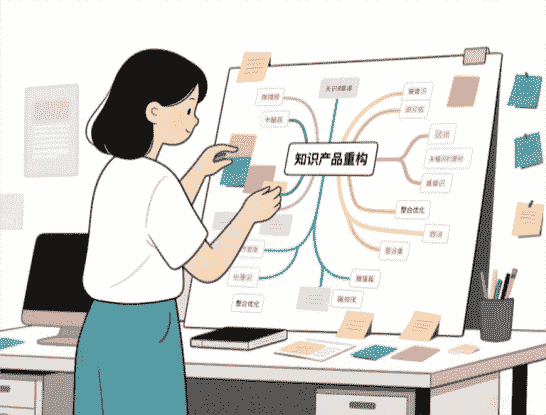
图 1-1 课程开发的常见误区与真相

在知识付费环境下，传统方式耗费时间：中小团队做一门3天线下课或12到15节线上课往往要一个月以上。AI的出现改变了节奏。

AI的优势体现在三个方向。第一是数据处理和学习能力，能从大量公开讨论中提炼需求、找规律、做预测，为内容搭建提供依据。第二是个性化服务能力，能根据学员背景和学习偏好设计差异化路径，比如模拟角色做情景演练。第三是即时响应，能快速给出教学设计建议，例如针对某个知识点推荐适合的教学模型并直接给出讲解方案。

关键是人机分工。定位、经验萃取、方法论差异化、服务差异化、现场互动、包装思路这些决定价值的核心环节必须由人把关。而大纲拆解、文案润色、案例优化、排版、模板搭建等执行性工作可以交给AI协同。这样既省时间，也让课程更扎实。

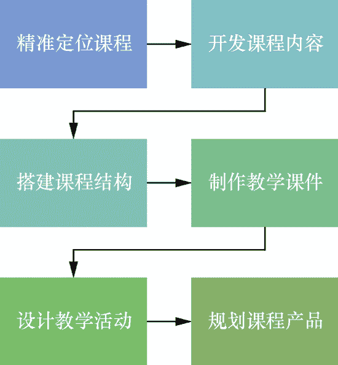
图 1-2 开发爆款课的 6 个阶段

如果要做能变现的爆款，通常要经历六个阶段，其中前三个最关键。

第一阶段是精准定位。张老师想做中小企业财务管理课，她先让AI分析社交媒体和行业论坛的留言，情感分析和关键词提取后发现学员真正关心的是快速优化现金流和降低税务风险，而不是复杂报表。她据此调整重点后，上线反馈非常好。她说AI让她从“我以为”转向“学员要什么”。

第二阶段是内容开发。王老师带编程班，学员水平参差不齐。他用AI生成能力测评，课前让学员自测后分层，零基础从语法起步，中级上项目实战，高级攻算法优化。学员有了自主选择感，满意度和好评都提升了。AI的价值在这里体现为把千人一面变成因材施教。

第三阶段是课程结构搭建。清晰的结构减少信息损耗。上课本质是信息传递，衰减不可避免，结构设计就是为了让学员更容易听懂、记得住、复原回来。宏观是模块顺序和逻辑，微观是语句间的衔接。设计的意义在于让信息在传递中尽量完整。

从定位到结构，AI的应用已经不是工具升级，而是一次效率革命。它重新定义了打造爆款的可能性。做课是为了在这个世界上留下印记，让世界因为你的存在而不同。学会用AI加速，你才更容易做出值得被记住的好课程。

图 1-3 搭建课程结构的意义

过去为一门课程搭框架，设计者最耗神的，是反复换位去揣摩：信息该怎样呈现、顺序怎样排列才顺滑。

如今有了智能助手的介入，整套流程被改写。先让模型研读一批成熟经典的课程框架，让它内化整合后再结合具体主题、受众与目标，迅速产出几套可供参考的结构方案。

本质上是把过去依赖大脑反复推敲的环节交给算力，人便腾出来做更具创造性的判断。

信息泛滥之时，缺乏秩序的内容极易沦为噪音。学习者愿意付费的并非裸露的知识，而是经过打磨的认知体验。

**当课程真正做到学起来顺畅、用起来得心应手，个人品牌便自然占据“可信专家”的心智位置——这才是影响力的底牌。**

**1.2.4 阶段四：制作教学课件，提供多维支持**

在信息爆炸的当下，无论是讲师还是内容生产者，都卡在同一个难题：如何在有限时间内产出高质量课件，并有效触达学习者。

往昔制作一份精致课件，从搜集资料、定版式到细排版，每一步都考验耐心与审美。如今智能工具能全流程搭把手。

智能检索可迅速从海量素材中挑出关联度最高的内容，避免盲目翻找。课件排版工具能依据需求自动生成美观的版式，让质感即刻提升。语音合成也能为线上视频课配上专业旁白，让学习体验更生动。

当然，教学远不止课件本身。作为讲师或创作者，需要多元化的教学手段来匹配不同学习者。智能系统在这里也能提供强力支撑。

• 单人辅导时，系统可结合学习者背景与作业记录给出定制化建议，让每位参与者得到最贴合的指引。
• 小组研讨时，可记录讨论轨迹、提炼要点并抛出需要深挖的问题，推动思考更深入。
• 线上直播时，不仅能录课、提炼复习要点，还可据内容布置实践作业，帮助学习者把知识落地。

总体来看，智能手段既大幅提升了课件产出效率，也拓展了教學形态的可能性。图 1-4 为多元化教学的示例。

图 1-4 多元化教学

**1.2.5 阶段五：设计教学活动，优化学习体验**

认知跃迁与思维“越狱”，往往源于一次次难忘的具身体验。没有亲身冲击，很难称得上真正的升级。

真实人生体验不可复制，但精品课程可通过精心设计的活动来模拟并创造关键体验。

真正的学习不是听出来的，是做出来的。参与式的实践才是深度理解的入口。

多元活动能覆盖差异化需求。智能助手可帮助设计者快速探索不同形式，让学习者在玩中学、在趣味体验中顿悟。

• 在活动设计阶段，智能体与设计者可形成互补协作。
• 设计时需要模型的理性拆解与结构化能力，也需要设计者的创意。
• 课堂现场引导则依赖设计者的感性理解与氛围掌控，需据学习者即时反馈快速微调语言、动作与工具，才能让活动真正生效。

评价好课的标准，从来不是灌输了多少知识，而是学习者最终能转化为多少实际能力与成果。现实中很多人把九成精力放在讲解上，学习者听懂了却“用不上”，落地更是无从谈起。

经得起检验的课程要遵循“吸、授、练、固”的逻辑。

• 吸：以精准切入点抓住注意力，锚定焦点。
• 授：清晰讲透核心逻辑与知识主干，帮助学习者快速搭建认知框架。
• 练：设计有针对性的实践环节，推动动手应用，在做中学。
• 固：用明确的实践任务收尾，巩固关键点，推动知识向能力的转化。

后续章节会具体说明如何借助智能手段落地这一设计逻辑。

**实践练习**

很多讲师在课程设计里容易忽视决定成败的“关键营养”。如果你已有一门课，可自检是否缺了以下几种“维生素”：

• **缺维生素 A：**学习者只能在课堂里被动配合，换个真实场景便不会用，像“夜盲”一样缺实操。
• **缺维生素 B：**知识只到“听过”的层面，记不住也留不下，无法形成长期记忆。
• **缺维生素 C：**学习者上课十分钟便走神，注意力涣散，像缺乏维 C 的牙龈一样脆弱。
• **缺维生素 D：**知识零散堆积，学习者拼不出完整体系，像“骨质疏松”一样缺架构支撑。

想自测缺哪种并拿到对应补剂，可关注微信公众号“醒职场”，回复“维生素”，通过《进来测测看，你缺的究竟是哪一种维生素？》完成诊断并获取建议。

**1.2.6 阶段六：规划课程产品，实现商业变现**

课程产品规划的核心是系统化设计、卖点提炼与包装推广。

智能系统可基于市场数据为系统化设计提供依据，协助提炼卖点并制定推广策略，包括梳理卖点、撰写推广文案、进行用户画像分析、给出引流获客建议、规划社群运营方式等，让课程上线即可获得市场认可，实现销量与影响力的双提升。

智能技术在课程开发中的参与，不仅提速，还提质。它让设计者更高效地创作内容、更科学地搭建结构、更迅速地制作课件、更大胆地设计教学活动、更精准地规划产品。

因此，智能系统已成为课程开发中不可或缺的伙伴。它不只是提效工具，更是共同创造者，能让复杂的开发流程变得简单，并提供更个性化、更有趣的学习体验。

**开发课程近看是折磨自己，远看是升级自己。**

**未来不是模型淘汰课程设计者，而是善用模型的设计者超越不懂模型的设计者。**

## 1.3 开发课程不够快？3 招加速课程开发进程

在“AI 课程炼金术”课堂上，我常听到一种疑惑：别人用模型开发课程又快又准，为什么到我这里效果就不一样？

多数情况，答案只有一个：**你还没掌握与模型有效交流的方法。**

跟计算机打交道需要特定语言，如 Java、Go 等。模型并没有专属语言，我们用的是自然语言，也就是提示词 prompt。

现在无论国内外工具都更智能了，但交流依然讲究技巧与策略。跟谁交流都一样，把需求说清楚，对方才能懂。

人与模型之间的沟通也一样，通过调整提示词，让模型更准确地理解意图，产出更接近预期的结果。

模型的工作本质上是一种基于大数据的猜谜。输入的提示词是谜面，输出是谜底。信息越具体、范围越窄，猜中的概率越高。

什么是提示词？可理解为帮助模型快速猜中用户需求的关键线索。写得模糊，模型可能很有创意却偏离目标；写得完整明确，结果就更可控。

**提示词写得越完整、越明确，模型越容易给出符合预期的答案。**

怎么写才能更快拿到想要的结果？这就涉及与模型有效交流的 6 个原则。

**1.3.1 与 AI 有效沟通的 6 个原则**

**原则 1：明确提示词，有层次感地提问。**

核心要点：沟通第一步是把需求表达清楚。模糊的指令让模型无所适从，清晰的指令才能快速对齐。

模糊示例 1。
• 帮我写一篇总结报告。
精准示例。
• 请以“2025 年市场分析”为主题，写一篇 3000 字总结，包含竞品对比、数据图表和未来趋势预测。

模糊示例 2。
• 请告诉我某股票未来 3 个月是涨是跌。
精准示例。
• 现在你扮演金融分析师，基于 2025 年 Q1 财报数据，分析某公司股价波动的 3 个核心原因，并预测未来 3 个月走势，请分步说明推理逻辑。

给出提示时，尽量补足背景、目标和要求。就像点外卖，不会只说“随便”，而是说“我要宫保鸡丁套餐，加米饭，不要辣”。

明确只是基础，更重要的是层次感。随着 DeepSeek 等大模型的出现，模型已能进行多维思考，提示词也需要分层递进，引导它循序渐进地思考。

层次感示例：
第一层：请帮我设计一门“时间管理”课程。
第二层：受众是职场新人，时长 2 小时，要实用有趣。
第三层：请设计一个互动环节，让学习者能在工作中自然应用所学。

分层提问不仅答案更准，还能帮你梳理思路，甚至补全你没想到的细节。

**原则 2：多轮互动，持续优化。**

核心要点：一次问答很难到位，多轮交流才能逐步逼近需求。

比如要模型给演讲开场金句，第一次可能只说“给我 5 个关于知识付费的金句”。结果大概率不满意，因为对“金句”的定义不一致。

这时需要先厘清：金句的作用是什么？在什么场合用？要达到什么效果？

第二次再问：
请重新给我 5 个关于“知识付费”的金句，多用修辞，通俗易懂、抓眼球、朗朗上口，适合演讲开场吸引注意力。

结果会更接近预期。

所以，别轻易放弃。多轮反馈和纠偏是优化的常态。模型不再是被动工具，而是共创伙伴。

对话式共创示例：
你：请帮我设计一个“时间管理”课程大纲。
模型：好的，大纲如下……
你：很好，但我希望更注重实际应用，有什么建议？
模型：可以加一个“时间管理挑战”环节，让学习者一周记录时间使用，并在下一课分享。
你：这个主意好，请帮我设计该环节的教学方法。
模型：建议这样设计……
你：不错，请在此基础上增加趣味性，让参与度更高。
模型：优化后的方案是……

高质量交互是持续优化的过程，起点是首次提问，关键是根据反馈追问、修正、补充信息。

**原则 3：提供上下文，进行情境设定。**

核心要点：给背景、定情境，答案才会更具针对性。

普通指令：帮我写一篇广告文案。
情境设定指令：春节期间推广一款智能冰箱，目标用户 35 岁以上家庭主妇，主打智能温控和食材管理，预算 20 万，投放抖音和小红书，需要一篇打动目标用户的文案。

情境设定像地图，能帮模型找到方向。信息越饱满，结果越精准。

情境设定不仅是描述背景，更是设定目标。可以明确告诉模型你想达成什么效果，让它从目标倒推内容。

示例：
你：请设计一门面向职场新人、90 分钟的“时间管理”课程大纲。
模型：大纲如下……
你：我希望课程不仅教会技巧，还能提升自律性和觉察力，减少时间浪费，有何调整建议？
模型：可在原大纲上做如下优化……

通过目标导向的情境设定，模型能给出更创新、更贴合的建议。

**原则 4：展开讨论，激发潜能。**

核心要点：在模型生成内容的基础上展开讨论，能拓宽思路、深化理解。

当内容让你困惑时，进一步探讨能帮你更好理解，并把知识传授给学习者。

提示词模板：与模型探讨专业问题
现在你是一位世界一流的“跨部门沟通”研究专家，对部门经理间如何有效沟通与化解冲突有深入研究。

请参考刚才你给我的“跨部门沟通”课程大纲，向我提问并进行讨论或辩论。要求：
（1）每次只提一个问题，最好是学习者可能会问的，提问后等待我回答。
（2）我回答后，你先补充完善，再评价我的回答。
（3）评价后基于对话提出下一个问题。
（4）当我说“对话结束”时，请根据聊天记录生成一篇总结文章。

如果你理解，请回复“OK”，并开始第一个问题。

这样就能开启一场高质量的探讨式对话，对话结束后还能获得总结。

**原则 5：角色设定，赋予身份。**

核心要点：为模型设定角色，能让它从特定立场给出答案。

示例：
• 你是一名营养师，请为运动员制定一周饮食计划。
• 你是知乎上专精某主题的 KOL，请用通俗分享式语气回答：××××？
• 你是经验丰富的法律顾问，我描述一种法律情况，请给出处理建议并说明优劣，只回建议及其优劣，无需多余解释。第一个问题：“朋友欠钱很久不还，能通过法律追回吗？”

角色设定不仅是指定立场，更可实现多角色协同，让模型从不同视角生成更立体的内容。

和AI聊得好，差的不是机器有多聪明，而是我们怎么提问。很多人第一眼把AI当成百度来用，输个关键词等答案。实际上它更像一位能听懂来龙去脉、会不断追问的导师，越是用心的对话设计，输出的质量天差地别。

先看一个实战画面。有人想做一门两小时的《创业入门课》，面向有想法但没经验的年轻人。第一次问AI，得到的是普通大纲。接着追问：能不能从创业者、投资人、员工三个视角补全？AI立刻给出不同维度的补充。

创业者要的是市场验证、产品打磨、团队搭建，建议加入创业计划书演练环节，把模糊的想法梳理清楚。
投资人关心的是赛道空间、盈利逻辑、团队可信度，建议安排“如何撬动投资人”的实操，重点在商业计划的撰写和路演表达。
员工在乎的是组织文化、成长路径、工作体验，建议增设“如何加入一家创业公司”的模块，让学员理解创业公司的日常与职业节奏。

继续深挖“如何打动投资人”这一块，要求AI从投资人视角拆解核心关切：
市场有多大、增速如何；
产品和服务到底解决了什么痛点，有什么不可替代性；
钱怎么赚，收入结构是否成立；
团队经历是否匹配，过去有无验证；
未来几年的财务预测和回报预期是否合理。

再进一步让AI模拟一次内部复盘会。创业者抛出智能家居语音控制的点子，投资人立刻质疑同质化严重、差异化在哪里，员工则提醒语音识别在噪音环境下的准确率和硬件成本压力。最后归纳：创业者要把定位和独特性讲透，投资人盯可行性与回报，员工关注落地难度与成本控制。综合建议是做计划时必须把资本视角和执行视角一起纳入，否则方案好看不好用。

这就是多角色协同的威力：同一件事换个身份问，得到的不是重复，而是立体。

接下来是能稳定提升对话质量的六大习惯。

第一，提示要清晰且分层。指令不能一句话带过，要先定主题再递进细节。比如不说“写个市场分析”，而是“以2025年XX市场为主题，做一份3000字总结，需涵盖竞品对比、数据图表与趋势判断”。

第二，多轮对话持续打磨。把第一次结果当草稿，告诉AI哪里不够，再共创优化。类似“再给我五条关于知识付费的金句，要求用修辞、通俗、有记忆点，适合演讲开场”。

第三，给足背景和情境。AI不知道你在讲课还是写汇报。明确谁在说、对谁说、场合是什么、想达到什么效果，答案才对味。授课指导就需要说明讲师身份、听众水平、场景目标。

第四，基于已有内容展开讨论。拿到大纲后不要收工，而是让AI提问、辩论、延展。比如“参考你刚才给的跨部门沟通大纲，向我提问并展开讨论，要求…”

第五，给AI设定角色。角色不只是头衔，更是立场和思维方式。让它当营养师给运动员做一周食谱，或当20年投资人批判性审视一份商业计划书，输出的专业度完全不同。

第六，引导一步步推理。复杂问题别让AI秒回。加上“让我们一步步思考，先列收入来源，再算成本，最后得出利润”，答案会更严谨。甚至可以引入系统思维工具，如SMART、SWOT、SCQA、PDCA、六顶思考帽，让AI按框架展开。

在这之上，总结出一个好用的开场公式：RTABC。

R Role 角色：你希望AI扮演什么身份，你自己又是谁。例：你是一位金融专家，请用初中生能懂的话解释做空。
T Task 任务：要它具体做什么。越具体越不易跑偏。
A Aim 目标：要达到什么效果，字数、语气、说服力要求。
B Background 背景：提供必要的情境信息，避免空洞。
C Condition 条件：格式、深度、边界限制。

举个对比。新媒体运营要写年终汇报，不用公式会得到泛泛的成就罗列。用RTABC后，设定角色为资深新媒体运营专家，任务是写完整汇报，目标是让管理层认可下一年度计划，背景是负责全平台内容制作、发布、社群和用户互动，条件是必须包含过去一年成果与数据、问题挑战、改进措施与未来季度计划。得到的汇报才有数据、有问题、有对策、有时间表。

补充条件的三个常用做法：
指定输出格式，比如表格对比、分钟级时间表、Markdown的PPT框架。
设定内容深度，浅层是概念介绍，深层是技术实现路径与商业价值分析。
限定响应范围，先交代收入、家庭、风险偏好等，再要投资建议，避免空泛。

RTABC的落地例子很多。写推理小说时，角色是经验丰富的推理作家，任务是创作一个悬疑强、结局反转的故事，目标是让读者感受到布局精妙，背景是神秘小镇连环事件，主人公是机智侦探，条件是至少三名嫌疑人各有动机与不在场证明、语言紧凑引人入胜。

写演讲稿时，角色是充满感染力的励志演说家，任务是撰写“永不放弃”主题稿，目标是让听众在困境中重拾信心，背景是各行各业正在经历挑战的听众，条件是加入真实案例，时长约20分钟，结尾给出实用建议。

提供职业建议时，角色是资深职业顾问，任务是为对软件工程感兴趣的人给出发展指引，目标是帮助明确定位并制定执行计划，背景是部分有IT经验的转型者、部分应届毕业生，条件是结合就业市场趋势。

把这些方法用在课程开发、写文章、写邮件、写汇报、做方案、产品设计、数据分析、冲突解决、营销活动上，都能让AI从“凑字”变成“搭档”。关键不是让它更省力，而是让对话更聪明。

用 AI 把课程做出来，和用 AI 把课程做精，是两件完全不同的事。很多人在开发内容时卡住的根本原因不是缺想法，而是不会把需求讲清楚。把提问这件事讲明白，AI 就会从一个答题机器变成你的外脑搭档。下面这套方法，正是围绕课程开发实战提炼出来的对话技巧。

先看两个典型任务场景。

第一个场景是挖掘课程卖点。你要扮演一位经验丰富、市场嗅觉敏锐的课程策划人。任务是帮“促动式读书会”这门课提炼出别人没有的独特价值，以便做更精准的推广。目标是把差异化竞争点钉死，提升吸引力和竞争力。背景资料在课程官网里，分析时要做到三件事：完整罗列这门课的独特性，对比市场上同类产品说明优势，并把卖点讲透，尤其是能打动目标人群的点——落地实操性、学习成果能否被看见、是否能带来收入增长等。

第二个场景是做用户画像。你要同时承担市场分析师和课程分析师的角色。对“读书会创始人运营课”进行人群拆解。课程要解决的是从零起步创办并运营读书会的问题，涉及筹备、活动设计、招募会员、社群维护、内容生产以及商业化变现等模块。输出要包含年龄、性别、职业、学历、兴趣爱好、行为习惯等关键要素。最后要给出若干典型学员样本，说明他们的真实诉求、常遇到的卡点、期望的改变，以及学完这门课后想抵达的结果。

这两个例子说明一个原则：先用 RTABC 模型把角色、任务、背景、条件理清，AI 的回复质量会立刻提升。如果仍然不够满意，就进入精细化追问阶段。

细节三问法就是用来把模糊答案拧成可用的信息。

当回复太宽泛时，要追细节。直接要求进一步细化、展开解读。也可以加一句“让我们一步一步思考”或“请展示推理过程”，让 AI 把思路摊开，这样判断逻辑是否成立会更轻松，提问本身就是保证高质量回复的助燃剂。

当回复偏理论时，要要例子。让 AI 用形象具体的案例来落地，帮助理解。

当回复已经可用时，要追补充。先肯定，再给出新的切入点，比如“如果想让学员更好理解，A 环节还能举什么例子或设计什么互动”。这样就把一次对话变成持续的素材库。

与 AI 共舞法则是在提问艺术上做升级，核心是让 AI 告诉你怎么更好地问。

多角度提问法。当你只有一个模糊方向时，请 AI 帮你生成 N 个不同切口的问题。做课程设计不确定从何入手时，可以让 AI 列出十个角度的问题，比如如何界定目标、如何评估学习进度等，帮你把盲区补齐。

第三人称视角法。让 AI 代入旁观者视角思考。问“别人会怎么问这个问题”，或者让 AI 扮演挑剔的潜在学员，向你抛出 5 到 7 个最可能阻挡下单的难题，覆盖价格、时长、基础要求、效果和竞品对比。再针对其中一个难题要求给出专业、有说服力的回应话术。这本质上是用 AI 破解知识诅咒，规避专家的主观偏好。

角色互换法。假设 AI 是你，接下来会问什么。也可以让 AI 用小学生的方式重新解释一个概念，或者让 AI 模拟销售经理在提升业绩课堂上会提出哪些反思性问题。通过换位，你能得到更通俗、更贴近受众的表达。

实践下来，你会发现 AI 正在从工具变成助理。不会用 AI 的人靠灵感做课程，会用 AI 的人盯效果做课程。

当课程做得不够好时，可以用六脉神剑激发 AI 的潜能。

身份赋能法。先定义你是谁、擅长什么，再下指令。例如，设定自己是资深企业培训师，有多年项目和团队管理经验，请其为中高层管理者撰写课程大纲。

角色匹配法。告诉 AI 你是谁、背景如何，再提需求。例如，我是银行客户经理，线下销售经验丰富但对线上营销、私域一无所知，请用通俗语言解释私域营销。

情境定制法。给出角色、具体场景和任务细节。例如，明天要做一场三小时培训，受众是新入职的软件工程师和设计师，内容涉及规章制度、企业文化及岗位要求，请作为资深培训师输出详细大纲。

问题重塑法。把原始需求抛给 AI，请它给出三个更好的提问话术，并征求是否采用。

问题组装法。先让 AI 基于你的大目标生成一系列关联小问题，等你逐条回答后再合成完整成果。建议让 AI 一次只问一个问题，循序渐进地对话，这样回答更灵活，也避免信息过载导致 AI 理解偏差。

案例借鉴法。给 AI 优质样本学习后模仿。比如提供五个爆款标题，让 AI 总结共性，再据此围绕“AI 对培训行业的影响”创作新标题。通过学习冲突制造、痛点直击、悬念故事、数据案例和情绪驱动等规律，输出更具传播力的内容。

清晰表达需求，AI 就能帮你实现目标。把繁琐的细节交给 AI，自己专注在更高层的思考和创意上。

与生成式助手首次搭话，如果想让它帮忙拟定课名，可以先用下面的引导话术。

先把一批参考课名丢进去，让它先做规律萃取：

1. 高效【核心词】的【序号】流程，例如“高效学习的7流程”。
2. 【序号】天拿下【核心词】窍门，例如“14天拿下创业窍门”。
3. 最全攻略：【序号】流程拿下【核心词】，例如“最全攻略：6流程拿下营销技巧”。
4. 【序号】流程省力拿下【核心词】技能，例如“3流程省力拿下摄影技能”。
5. 【序号】招帮你突破【核心词】，例如“一招帮你突破面试的考验”。
6. 【核心词】的【序号】杀手锏，迅速成为【核心词】赢家，例如“创业的6杀手锏，迅速成为创业赢家”。
7. 揭开【核心词】的【序号】秘密，例如“揭开健康饮食的7秘密”。
8. 你绝对不知的【核心词】【序号】真相，例如“你绝对不知的科技圈10真相”。
9. 【序号】天晋级【核心词】专家，例如“30天晋级健康饮食专家”。
10. 【爆款】【拆解解析】：成功案例，例如“爆款手机拆解：看懂成功的×××产品策略”。

助手给出的归纳大致如下：

1. 序号运用
几乎每条都带明确数量，如“7流程”“14天”“6流程”，数量让表述更具体可信，也更容易吸睛。
2. 核心词前置
课名里都有清晰的核心词，如“高效学习”“创业窍门”“营销技巧”，读者一眼知道内容范围。
3. 突出产出与收益
常点出能得到的结果或效果，如“拿下”“省力拿下”“突破”“赢家”，让读者明白学完能得到什么。
4. 营造紧迫与稀缺
有的用时间限定制造紧迫，如“14天拿下”“30天变专家”，有的用“你绝对不知道的”凸显独家性，形成稀缺感。
5. 激发好奇
通过解密、真相类表达，如“揭开健康饮食的7秘密”“你绝对不知的科技圈10真相”，诱发点击欲望。
6. 结构分明
多数课名遵循固定结构，如“【序号】流程省力拿下【核心词】技能”，信息层级清晰，阅读负担低。

第二次对话可以这样问：

你现在是一位女性创业导师，正在筹备一套课单，主题是教上班族女性做有效副业创收。现在需要为这套课单拟定名称；名称里要体现目标人群、内容要点以及学完后的收获。

请参照刚才给你的课名的风格和特点，为“上班族女性副业创收”设计5个吸睛的课名。

助手回复如下。

好的。依据你给的风格和特点，我为“上班族女性副业创收”设计了5个名称。

这些名称均包含目标人群在职女性、内容副业创收方法以及学习后的效果。

1. 五大招助力在职女性：省力实现副业月入过万
亮点：用具体序号提升可信度，承诺明确结果月入过万，并强调省力实现。
2. 30天拿下副业创收秘诀：在职女性的4流程成功指南
亮点：设定明确时间节点30天，采用结构化表达4流程，指向成功指南。
3. 最全副业创收攻略：在职女性必学的3个关键技巧
亮点：主打全攻略概念，用序号3个增强说服力，突出关键词副业创收、关键技巧。
4. 揭秘在职女性副业成功的3个秘密：你可能不知的赚钱方法
亮点：以揭秘秘密为钩子，制造好奇你可能不知，明确指向赚钱方法。
5. 21天变身副业达人：在职女性的高效变现策略
亮点：限定时间21天，强调结果变身副业达人，点明高效变现策略。

从这两个案例能看出，在没有样例参考时，助手输出常显得平淡、吸引力不足，或者不符合微信生态爆款课名的调性。

一旦提供样例，就不需要再逐条细化要求，助手也能自动对标生成。在有样例支撑的情况下，助手产出的内容结构更完整、风格更统一，大体符合预期。

根本原因在于助手的模仿学习能力强。手头有喜欢的范例，不妨拿来喂给助手，让它消化吸收后，基于你的应用场景产出同类内容。

总结触发助手潜能的六式如下。

激活助手潜能的六式 表达方式
身份赋能法 假设“你是谁 + 你会什么 + 任务内容”
角色匹配法 告知“我是谁 + 我的背景 + 任务内容”
情境定制法 告知“角色 + 任务场景 + 任务内容”
问题重塑法 提出需求/问题 + 建议更好的版本
问题组装法 提出需求 + 你可以提出一系列关于×××等的附加问题来问我，然后根据我的回答帮我完成某项任务
案例借鉴法 学习案例+总结案例的优点+模仿案例中的××完成任务

用好这六式，就能让助手在课单开发等各场景提供更精准实用的支持，助力产出高品质课单。无论是写大纲、搭内容、创案例、设计教学形式，都能与助手高效协同，事半功倍。

工具的价值不只在功能，更在你能否把它激活。

实操练习
试着用六式与助手对话，感受它们在课单开发中的实战效果。

# 第二章 精准定焦，打造吸睛的课单定位

本章聚焦如何借助助手确定让人上头的定位，重点讲定位目标、挖掘卖点、打磨课名的方法。

## 2.1 先定终点再倒推课单定位

某讲师的“久坐人群脊柱功能重建”系列在千聊上已有4万多学员。

起初他选的是“增肌减脂”赛道，销量一直上不去。经过多次调研，他发现自己的医学背景、运动康复经验、对办公室人群的深度洞察，这三者的交集才是不可复制的壁垒。

于是他把定位收敛为“久坐人群的脊柱功能重建”，销售额很快迎来拐点。

现在做课门槛越来越低，但能爆的课都遵循同一底层逻辑——先锁定买家再搭建课单，而不是先做内容再找人买。认知错位是大多数知识产品失败的根因。

残酷的真相是：知识付费最大的误区是觉得专业就能卖。

专业只是入场资格，定焦才是生死线。

记住这个公式：

有竞争力的课单定位=讲师画像（擅长点+兴趣点）+需求定位（刚性需求+聚焦领域）+优势锚点（锚定用户+有护城河）

爆款课的共性是，精准定位筑起三位一体的护城河：既体现讲师独特价值，又解决用户真实痛点，还能支撑持续变现的产品体系。

### 2.1.1 课单定位的两大常见坑

做定位前，先避开两个坑，避免方向跑偏导致效果与商业双输。

坑1：伪兴趣区，即擅长却不热爱。
伪兴趣区是你有能力但缺乏热情的领域，看似能做课，实则难以持久。
案例：李律师擅长劳动法，她的粉丝很爱看她怒怼无良老板的短视频，专业又带情绪共鸣；但她却执着做合同审查课，选了擅长却无热情的方向。
结果：课里干货不少，偏理论，因她投入度低而频繁断更，用户大量流失。
解法与成效：把合同审查重包装成“3招让黑心老板跪着改合同”系列视频课，用怒怼不良企业的剧情带出审查要点，专业中注入情绪价值。找回热情后报名上涨，后续更有32%的学员转化为合同审阅咨询客户，实现课单与高客单服务的联动。

坑2：伪擅长区，即热爱却无壁垒。
伪擅长区是你热情高但缺乏差异化专业壁垒的领域，靠个人经历很难说服付费。
案例：瑜伽教练林老师做产后修复课，也有二胎亲身经历。被问为什么选你时，她答我生过二胎，恢复得很好。用户心里会想我闺蜜生三胎也恢复不错，为什么要付费。
问题与结果：课单定价299元，上线3个月仅38单，核心是缺乏专业壁垒的信任感。
解法与成效：帮她梳理知识资产，从个人经历转向专业价值，重塑品牌故事与壁垒，并搭建产品矩阵。
引流资料：制作产后修复价值自测表并附专业解读，用免费工具吸客。
核心课单：推出产后修复避坑实战营：7天能避万元坑录播课含答疑，定价299元，聚焦用户痛点避坑。
高客单服务：上线800元三甲医院方案诊断、2980元半年修复陪跑。
调整后首月课单售出86份，部分用户客单价从299元提升至4079元。现已与3家母婴平台合作提供专属咨询，版图持续扩张。

在帮林老师把个人经历转化为可验证的专业壁垒时，我只做了三件事：
深挖她的知识资产，找到差异化亮点；
重构教学目标，从知识搬运转向解决实际问题；
搭建产品矩阵与商业闭环，实现从流量到高价值用户的转化。

### 2.1.2 讲师画像：挖掘你的知识资产

很多人以为做课是无中生有，于是拼命找资料搭框架。

其实更接近打捞：把早已藏在生活里的碎片捞出来——写过的文章、被反复追问的回答、讲起来停不下来的话题。它们零散却已生长，只需拼成完整拼图。

这拼图就是你的知识资产。可从三角度挖掘。

角度1：输出过的内容，是已验证的知识路径。
文章、视频、分享、朋友圈长文，都是你自然表达的核心知识。
筛选方法：盘点过去一年高频输出主题，
写过3篇以上文章的主题，标★；
直播或分享讲过2次以上的主题，标▲。
重复输出的主题，就是你最熟的赛道，不靠灵感，靠积累。

角度2：被反复提问的问题，是市场验证的需求。
反复被问同一个问题，不是打扰，是信任的信号，说明你在这件事上是默认咨询对象。
梳理三步：
翻3个月聊天记录，收集被问5次以上的问题；
分类，如技能类、心理类、决策类；
提炼背后核心痛点。
高频问题就是真实需求，直接决定课单好不好用。
例如反复被问怎么写周报不被批、怎么拒绝老板额外加活，课单就该叫职场人的低耗生存术，而不是宽泛的沟通技巧。

角度3：最想表达的内容，是课单的灵魂。
有些内容你还没公开，却最想讲：看到同主题内容就想我想讲，而且能讲得更透。
来源可能是独特经历、长期思考、深刻感悟，或你发现的市场空白。
自问三问：
如果只能做一门课，我会选什么主题？
哪个话题一开口就停不下来，越讲越兴奋？
看到别人讲哪个主题，我总想能讲得更透彻更实用？
答案指向的，就是你的热情核心，能让课单成为灵魂表达，而非单纯产品。

明确讲师画像是第一步，三种常用方法：
兴趣清单打分法；
成就事件萃取法；
榜样对标法。

### 2.1.3 需求定位：定义用户的学习产出

需求定位就是明确：做什么课、给谁做、解决什么问题、学完能拿什么结果。

很多创作者忽略了这一步。
有人只挑自己感兴趣或擅长的点，没考虑市场与竞争。
有人没搞清目标用户是谁、痛点是什么。
有人没突出差异，导致同质化严重。

做定位就是做取舍。
知识付费的常见误区是大市场=大机会。真相是，刚性需求=可感知的痛点+可量化的改变。
以写作培训为例。
泛定位：新媒体写作课，市场大但同质化。
精准定位：社群电商从业者的变现内容指南，用户小但直击痛点，一击即中。

做需求定位，要判断：需求是否刚性、是否聚焦特定领域、对特定人群是否学了即用。

开发课单时，请先回答5个问题：
你要做哪种类型的课单？
面向什么学员？
能解决哪些具体问题？
学员为什么要跟你学？
学完能获得什么好处？

课单的终点不是你讲完，而是学员做出成果。教学的核心不是我讲了，而是他做到了。

因此必须先厘清：学完后用户能独立完成什么具体任务？成果需满足三条件。
可感知的：不是模糊的提升效率，而是每天少加班1小时。
可验证的：不是抽象的学会思维，而是独立写出一份符合职场标准的周报。
可展示的：能通过截图、分享甚至主动炫耀呈现，如学员把周报发到社交平台，既是证明也是传播。

用一句话描述需求定位：这门课是给【特定人群】的，帮他们【解决某类具体问题】，最终让他们能【做出可落地的成果】。

你要做好卖的课单，而不是把知识全倒出来。

战略比思路重要，思路比努力重要，努力比苦耕重要。

做课不是搬运知识，是放大价值。从讲师画像与需求定位双维度复盘，或许下一个爆款的基因就藏在未被发现的组合里。

## 2.2 挖掘卖点，打造受市场欢迎的课单

挖掘卖点需要完成三个转变：从产品视角转向用户结果视角，用市场验证替代主观判断，让卖点具备进化免疫力。

挖掘卖点3步法如图2-1所示。

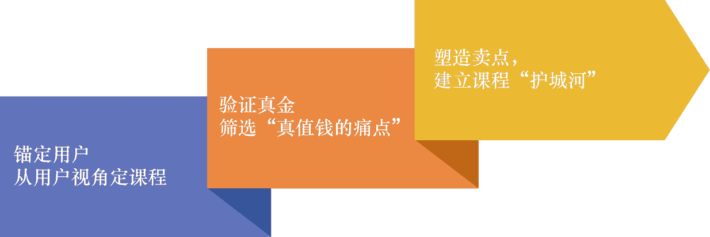

图2-1 挖掘卖点3步法

### 2.2.1 第一步：锚定用户，从用户视角定课单

小李计划做一门成人烘焙课。初期她发现不同人群需求差异很大，于是做需求分层。

她总结出4类潜在学员。
1. 烘焙新手。对烘焙零基础，想学基础操作。痛点是不懂工具材料、流程和技巧。
2. 兴趣爱好者。对烘焙有热情，想在家做点心。痛点是选食谱、控时间温度、提升口感。
3. 聚会组织者。需要为家庭朋友聚会自制糕点。痛点是选适合各年龄口味的食谱、批量制作。
4. 想做副业的人。希望把烘焙变现。痛点是控成本、保品控口味、做营销。

据此她把课单拆成4个模块，分别对应不同人群。
1. 基础入门模块：面向新手，重工具材料与基础技法。
2. 兴趣提升模块：面向爱好者，重食谱优化与口感改善。
3. 聚会实用模块：面向组织者，重快手食谱与批量技巧。
4. 副业专项模块：面向副业人群，重成本、品控与营销。

看出来了吗？同一门课，不同用户的痛点和要的结果不一样。用户买的不是知识，而是改变后的自己。

要精准定位课单结果，可自问：
他们是谁？
需求和痛点是什么？
目前面临什么挑战？
出于什么目的来学习？

当教学内容正好对应学员当下的真实难处，人们会产生“这就是为我量身定制”的共鸣，进而更愿意为解决关键问题付费。一门培训能否走红，核心看它能不能精准命中主诉求。这一步的洞察完全可以借助 AI 加速。

示例指令 4：拆解理想学员画像

让模型站在顶级用户体验研究的视角，先给出培训名称、覆盖范围、学员希望抵达的状态，再要求借助共情地图框架，把核心受众拆到年龄区间、学历层次、职业类型、家庭形态、兴趣方向、休闲方式、阅读偏好、学习卡点等维度，最后以表格呈现。

示范提问可以这样写：

请你作为顶尖的用户体验研究专家来作答。

我的培训名称是“决策的智慧”。

教学涉及的问题发现、问题拆解、问题解决，以及做出高质量决策的方法与步骤。

培训希望学员学会用科学的方法去解决问题并形成决策。

交付方式为线下，两天完成，既有理论讲解也有现场模拟演练。

请用共情地图框架帮我梳理这门课的核心受众，把年岁、学历、职业、家庭状况、兴趣爱好、休闲活动、阅读取向、学习瓶颈等全部细化，并用表格输出。

模型返回的结果就是表 2-1、表 2-2 的样式。

表 2-1 课程理想受众分析

维度 概况
年岁 25到45岁区间
学历层次 本科以上，通常教育背景较好，对科学决策方法有认知与需求
职业类型 公司中高层、技术部门负责人、人力主管、创业者、中高层管理者、培训顾问或咨询顾问
家庭形态 已婚且育儿：工作与家庭需兼顾，对决策效率要求较高；单身或已婚未育：更关注职业成长，渴望提升个人能力
兴趣倾向 对心理学、管理学、逻辑思维、决策科学感兴趣；喜欢参加研讨会、读书会、技能提升训练
休闲习惯 读专业书籍、听播客或音频课程、健身、参与户外运动与社交活动
阅读偏好 偏爱实用性强的作品，例如《思考快与慢》《决断力》《高效能人士的七大习惯》
学习卡点 缺乏成体系的决策方法论；面对复杂议题时容易选择困难；时间管理能力不足；知识碎片化难以形成体系

表 2-2 共情地图分析

视角 呈现
学员常用表达 “我希望掌握一套可以落地的决策工具。” “工作中我需要快速做出靠谱判断。” “我的决策够科学吗，有没有更好的打法？”
内心盘算 “如果拥有一套完整的流程，效率会不会明显提升？”
情绪感受 压力：面对复杂任务和多选项时感到焦虑；渴望：希望通过学习改变现状，获得更多成就感
日常行动 主动寻找自我提升的机会，比如报名线下课程；在工作中尝试不同决策方式，但效果不稳定

有了清晰画像，才能做对的选题。

曾经有一位客户做投资理财课程，最开始把目标人群列得很散：工作八年以上的职场精英、全职带娃妈妈、退休人群、三十五岁以上的家庭支柱、创业者、企业家等。

交流后我发现，她本人有家庭财务规划的实操经验，对带娃妈妈群体的需求和痛点理解更深。

我建议她把切入口收窄到带娃妈妈，为家庭做财富增长规划。从家庭财务健康评估入手，逐步过渡到家庭资产梳理、问题诊断、解决方案以及资产配置，最后帮助家庭实现增值。信任建立后，单次服务价值可以从几百块提升到数千块甚至上万。

按此路径调整后，她把产品化为三段式服务，面向25到40岁的带娃妈妈：
第一阶段 980块家庭财务健康评估，用可视化的资产负债图谱建立专业信任；
第二阶段 3800块家庭资产分析与整理，用现金流模拟工具解决应急资金配置等卡点；
第三阶段 19800块年度家庭财务总监服务，涵盖教育金规划、保险矩阵搭建、税务优化等模块。

一年不到，营收增长了三倍。

你的课程在定人群时是否也摊得太开？

这种做法并不理想。不同人群对同一知识的学习需求差异很大。更关键的是，在个人品牌和团队支持都还不成熟时，人群定位太宽会导致：难以提供深入全面的服务体验、难以促成复购、难以支撑高客单价、需要持续不断找新客。

唯有锁定能做到卓越服务的特定用户，才是打造可持续、高价值课程的起点。

人群确定后，要先换位思考。将心比心，去想用户在这个领域会有哪些痛苦、不便、卡点，再去设计解法。就像“她有病，你有药”，只有你的“药”正是对方需要的，这门课才有爆款可能。

在课程高度同质化的当下，稀缺的不是知识，而是定制化的方案和针对性的服务。只有颗粒度细、兼顾实用性的个性化方案，才能真正解决问题。

所以锚定用户，就是聚焦特定人群的核心痛点，用定制解法打造不可替代的服务闭环。好的课程是有效的问题解决方案，而不是标准化商品。

2.2.2 第二步：验证真金，筛出真正值钱的痛点

用户痛点指用户遇到的具体问题或不便，是其寻求解决方案的驱动力。理解并解决这些痛点是产品成功的关键。

开发产品前，是先做出来再砸钱推广，还是先找到用户真实喜好再开发？

例如萨里格分析亚马逊台式制冰机的销售数据，发现某品牌销量虽高但差评集中，问题出在抽水泵上。他针对痛点推出改进版，迅速占领市场。

这说明，基于用户行为和反馈提炼需求，再优化产品，才能赢得竞争优势。

挖掘痛点主要有 3 种常用做法，如图 2-2 所示。

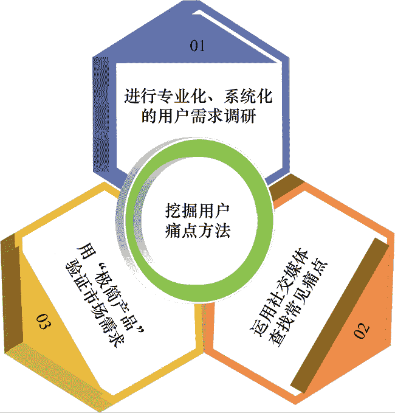
图 2-2 挖掘用户痛点的 3 种方法

方法1：进行专业化、系统化的用户需求调研

调研方式有问卷法、访谈法、社群答疑法。

问卷法和访谈法都可以用结构化提示词来指导 AI。

1 问卷法。问卷适合快速收集大量数据。问题要简洁、无引导，尽量用选择题搭配少量开放题，既高效又能拿到个性化见解。

提示词模板 5：撰写调查问卷

角色：问卷设计专家和课程设计顾问。背景：为知识创作者和培训师提供课程设计策略，需设计问卷了解学员背景、需求和期望。定位：经验丰富的问卷设计与课程顾问，擅长科学设计问卷并分析需求。技能：数据分析、沟通、创新思维。目标：设计高效问卷收集基本信息、学习需求、痛点、课程期望。限制：问卷简洁易懂，问题相关有效，避免无关信息。输出格式：包含选择题、填空题、开放题。流程：明确目的和群体→设计结构含引言、基本信息、需求分析、痛点识别、期望→撰写具体问题→测试并调整。初始化：先输出“欢迎您请我设计课程需求调查问卷。为了设计出好的问卷，我们需要了解一些基础信息。”然后收集目标受众、课程主题、想了解的方面，再生成问卷。

2 访谈法。访谈能获取更深信息。准备充足开放式问题，营造自由表达氛围，引导学员分享真实感受。

提示词模板 6：训前访谈提纲

角色：访谈表设计专家和课程开发顾问。背景：通过训前访谈深入了解需求、痛点和期望，设计更具吸引力的课程。定位：教育领域研究专家，擅长把访谈反馈转化为课程资源。技能：沟通、洞察、记录分析。目标：设计专业训前访谈表指导课程设计。限制：问题相关、开放、引导性强，避免引导或封闭提问。输出格式：访谈目的说明、背景信息、开放/半开放问题、记录分析指南。流程：明确目的和群体→设计提纲含开场白、背景、需求痛点、期望→撰写问题→准备记录工具→预访谈测试→正式访谈→分析提炼。初始化：先让用户提供课程主题和目标受众，再据此生成访谈表。

3 社群答疑法。利用社交媒体直接互动，既能获得即时反馈，又能增强连接。例如发起“大咖答疑”活动，让学员在群里接龙提问，承诺在指定时间集中解答。通过整理问题即可梳理课程新框架。

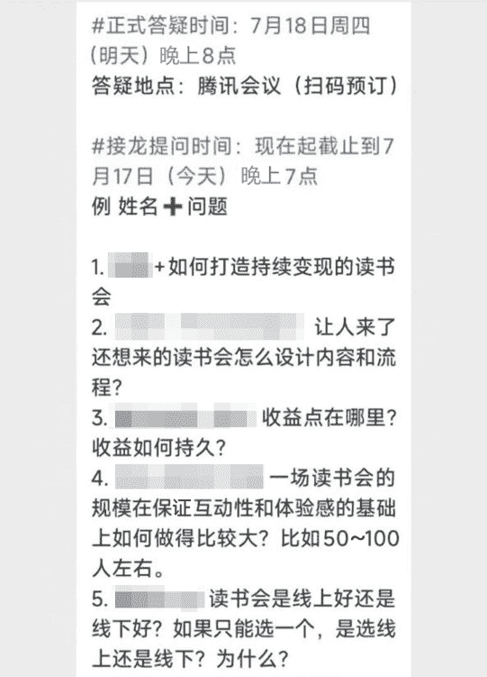
图 2-3 社群接龙答疑示例

方法2：运用社交媒体查找常见痛点

深入了解用户真实需求和行为。可以去视频号、小红书、知乎、抖音等平台搜索课程主题相关关键词，如“时间管理”“个人品牌”“向上社交”“情绪管理”。按点赞或评论排序，挑出标题吸引力强的 10 条，按自身对目标用户的理解重新排序，再剔除超出知识储备的标题，剩下的就是高频痛点。

比如 2018 年开发读书会课程时，我在知乎搜“读书会”，限定“只看回答+最多赞同+半年内”，排名靠前的多是关于策划与创意的内容。这些都是用户真正在意的点。由此我推出了“体验型读书会”“促动式读书会”“读书会商业化运营”等课程，主打创意设计与极致运营。

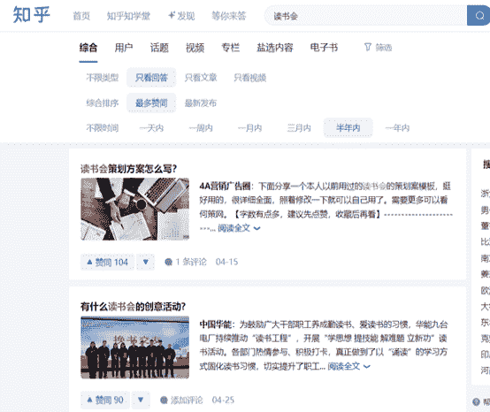
图 2-4 知乎搜索示例

方法3：用“极简产品”验证市场需求

有学员问潜在学员“时间管理最大的困扰是什么”，大家都答“总是忙得没时间”，于是她做了一门涵盖 GTD、番茄工作法、四象限法则的“高效时间管理术”，结果报名寥寥。表面痛点不是真痛点，真正的付费点可能是“收工前搞不定工作，回家还得加班”。只有后者才让人愿意掏钱。

问卷和访谈能知道“用户认为的痛点”，但付费行为才能揭示“用户愿为之付费的痛点”。先验证付费意愿，能省下 90%试错成本。

调研后可按以下步骤设计极简产品验证最高优先级痛点：
锁定 3～5 个核心痛点；为每个痛点设计 9.9 元体验包；看哪个转化率最高，该痛点即为真实支付点。

成功的体验包具备三大要素：价格低，降低决策门槛；结果具体，如“收工前搞定工作”而非模糊的“提升能力”；承诺无风险，如“用不上退 10 元”。

李薇发现“下班后还要处理工作”是职场妈妈的高频痛点。她设计了极简产品“收工前搞定工作的 3 个秘密”，交付为 10 页 PDF+15 分钟视频，9.9 元，承诺“今天学明天试，收工时能关电脑回家，用不上退 10 元”。对职场妈妈而言，“能关电脑回家”比“高效”更有感知。

可用以下提示词让模型设计可验证极简产品。

提示词模板 7：设计可验证极简产品

作为课程产品验证专家，请为我设计一个 9.9 元“结果急救包”验证真实需求。用户口中的痛点未必是真痛点，要聚焦可量化具体结果。

输入信息：课程主题、目标用户、学完效果、我的能力优势。要求：形式仅限 PDF/音频/视频一种，内容少于 15 页或 30 分钟，24 小时内能独立完成；标题和推广语必须包含具体时间与具体结果，禁用模糊表述；仅解决单点问题，测试付费意愿。输出：急救包名称、极简内容框架、朋友圈推广语、验证真痛点逻辑。

示例输入：课程主题“会议不超时的 3 个话术”，目标用户经常开会的中层管理者，效果会议不超时且能落地，能力优势会用恰当话术引导会议。

模型返回：
急救包名称：“1 天掌握会议控时术：3 个话术让会议准时结束还落地”
极简内容框架：3 个分场景引导话术+1 张话术使用时机对照表，确保会议按时结束且有结果
朋友圈推广语：中层管理者必看！9.9 元，明天开会就能准时高效，会后拿得到可落地结果。用了没效果退 10 元
验证真痛点逻辑：若管理者真被会议超时且无结果困扰，会为快速解决单次会议时效与落地付费；若只是好奇，不会为具体解决方案买单

通过付费人数即可判断需求强度。

一位做“高效会议管理”课程的学员，前期调研发现“会议超时”痛点。在我建议下，她先推出上述急救包，转化率达 53%，远高于过去课程；更有 33% 购买者主动询问“要不要远程会议版本”。

真金验证的价值在于：不否定专业调研，而是补充行为层验证；不替代深度访谈，而是确认痛点优先级；不浪费前期成果，而是提升转化效率。

传统竞争靠同质化比价，创新竞争靠差异化创意。无论做课程还是读书会，都需要做出不一样的东西来。

用户诉求被精准捕捉时，往往就等于握住了市场入口。洞察越准越狠，做出的内容在市场上被追捧的概率越大。

**2.2.3 第三步：打磨卖点，筑起课程护城河**

知识付费赛道产品扎堆，功能叠加、打法趋同。要升级思考维度：

学员凭什么非选你？
你的内容和市面上同类有什么区隔？
你能提供哪些别人给不了的独特回报？

做到可区分才有机会被看见被选中。差异感、优势感、壁垒感三者合一，才构成真正的核心竞争力。关键是找到一种让课程与竞品拉开距离且难以复制的方式。以下四种路径可参考。

**思路1：切分细分市场，做到方案定制化。**

王朝薇发现市面理财课多停留在理论层面，面面俱到却缺乏针对性。她锁定家庭女性这一群体后，做了专门面向妈妈的课程，围绕家庭资产配置、孩子财商培养、教育金规划、夫妻共同财产等维度，搭建家庭财富自转系统。课程里既有工具也有真实案例，落地性强，上线即受好评。

同类产品泛滥时，收紧焦点投向小而美的细分人群，用高度定制化的解决方案切入，往往更有效。

**思路2：提炼概念，做跨界融合。**

一位学员要做理财课，担心同质化。按提炼概念跨界融合的思路，她把恋爱与理财做知识迁移，创造出“恋爱理财法”。

核心比喻是把不同类型的基金类比成不同类型的恋爱对象，选基金如同择偶，后续的维护方式也对应投资策略的差异。这种跨界嫁接让人眼前一亮。

归根结底，知识本身是通用的，差异化在于你是否能提炼出一个全新概念，并让它传播开来。借势“正念”时就出现了正念减压、正念时间管理、正念教养等品类；“罗盘”概念出现后，也衍生出直播罗盘、恋爱罗盘、朋友圈营销罗盘等新课程。

**思路3：深挖细分需求，另辟蹊径。**

名叫如月的讲师有音乐专业背景，曾做瑜伽老师，擅长情绪管理与音乐疗愈。直播风口起来后，她想做直播课。但直播教学已成红海，有带货课、引流课、社群运营课，还有抖音、视频号、小红书的细分赛道。

在定位辅导中，结合她的音乐疗愈+情绪管理优势，我们一起拆解了主播的隐性需求：

直播时如何保持正念不焦虑？
如何从容应对挑衅与提问？
如何用情绪产生共鸣？
直播间音乐如何营造氛围？
各环节如何调节用户情绪？

基于这些被忽视的小需求，她推出“用‘情绪’升级你的直播间”。课程一经发布就获得主播好评。

当产品难以差异化时，“你”本身就是差异化。找到自己的独特长处，就能卡位差异化定位。甚至可以把跨领域知识拼合，创造全新品类。

大IP往往用标准化内容满足大众市场，粉丝量大不做精细化定制，这就给小IP留下了空间。聚焦大IP看不见或懒得做的细分市场做深做透，护城河自然形成。

**思路4：创造体验，让记忆留下痕迹。**

一位做领导力与团队融合的公司培训师，设计了“危机管理实战演练：模拟商业挑战”课程。

课堂上采用沙盘模拟，分组面对产品召回、竞争对手恶意攻击等虚拟危机，在限时内制定策略并角色扮演，亲历不同策略的效果。学员在安全环境中体验真实商业挑战，同时在协作中学会危机管理。

人容易忘记讲过的内容，却很难忘记自己经历过的独特体验。对学员来说，上课像看电影，核心是体验。情绪觉察、接纳、疏导和体验创设是讲师的基本功。

情绪是重要资源，善于调动情绪就能让教学顺畅。把知识点转化为可感知的学习活动，让身体与心灵同时参与，记忆才会沉淀。

课程是否有竞争力，取决于是否抓住了目标人群的高频痛点，并给出可落地的解决方案。卖点打磨到位，课程才能吸引注意、激发兴趣并促成参与。

**2.3 换位思考，6招让课程名称脱颖而出**

内容定位与卖点明确后，就要定名称。

**2.3.1 必不可少：好名称的3要素**

好名称要快速传递核心信息并激发兴趣。理想的标题应同时包含受众、主题、回报，让人一眼知道为谁讲、讲什么、能得到什么。

比如“职场新人必备：高效沟通与团队协作技巧”，受众是职场新人；“企业高管必修：战略管理与领导力提升”，受众是企业高管。

常见的不完整名称：

“职场沟通技巧”缺少受众与回报。
“Python编程21天速成课”缺少受众。
“忙碌宝妈如何高效管理时间”缺少回报承诺。

完整示例：

“中小企业老板必修：掌握数字营销策略，实现销售倍增”。受众中小企业老板，主题数字营销策略，回报销售倍增。
“宝妈的高效时间管理秘诀：每天多出数小时”。受众宝妈，主题时间管理，回报每天多出数小时。
“电商老板必备：流量倍增秘诀，让你的店铺销量翻倍”。受众电商老板，主题流量倍增秘诀，回报店铺销量翻倍。

**2.3.2 6招制胜：打造引人入胜的标题**

第一招：数字运用。用具体数字增强系统感与可信度。“避开这五大销售误区，让你的业绩飙升”比笼统描述更抓人；“教你实现点击量超过100万”比“如何提高点击量”更有吸引力。

第二招：收益强调。直接点明收获。“考研解题技巧——逆袭学霸，从备考阶段与别人拉开距离”“技术牛人速成：教你一眼识别软件bug”“10分钟变10秒：搜商大幅提升工作效率”。

第三招：设问引导。用问题激发好奇。“如何在30天内提升你的演讲能力？”“高效工作秘诀：如何在提升效率的同时获得加薪？”

第四招：借喻手法。用熟悉事物解释抽象概念。“理财新手指南：像选旅游路线一样轻松掌握基金分类”“问题分析与解决——专为管理者打造的‘奥卡姆剃刀’”。

第五招：人物代入。用经典角色引起共鸣。“大师兄一步步带你了解工程规范”“掌握这一招，你就能像杜拉拉一样‘向上管理’”。

第六招：缩写标签。用缩写形成记忆标签。“MOT关键时刻的客户管理”“职场人必备的目标管理SMART法则”“5D课程开发——让你的课程高大上”。

名称是首看印象，值得用心打磨。无论用哪种手法，都要站在学员视角，一眼看懂核心回报。

构思名称很耗脑，能否让智能体帮忙？可以，关键在指令设计。

**2.3.3 借助智能体优化名称**

策略一：直给指令。先给智能体一个资深专家角色，说明受众画像、课程回报等背景，要求名称通俗易懂、有吸引力，同时体现受众主题回报并控制字数。

示例提示词为亲子沟通课程，面向25-40岁年轻妈妈，回报是改善沟通、增进亲子关系、每次沟通都有结果，要求15字以内出10个名称。

策略二：范例学习。先喂给智能体一批你认可的名称，让它总结规律，再让它模仿风格生成新名称。第一轮让智能体提炼数字、关键词强调、简洁明了、行动导向、承诺效果、紧迫感等特征；第二轮按目标人群与回报指令生成。

策略三：结构化生成器提示词。给智能体设定角色、语言、技能与工作流程，初始化对话后输入课程主题与目标受众即可批量获得建议。

训练智能体最快的方式是提供优质参考让它模仿。把智能体当成可教的助理，名称质量自然提升。

1．“新手妈妈七日计划：提升与孩子交流的质量”
2．“亲子互动捷径：五步打造温暖家庭氛围”
3．“妈妈实用指南：轻松上手与孩子沟通的技巧”
4．“新式亲子对话：三步拉近亲子情感”
5．“亲子关系优化：四项核心方法让交流更顺畅”
6．“妈妈进阶方案：六步开启高效亲子对话”
7．“亲子交流心法：五项能力促进家庭和谐”
8．“妈妈实战训练营：三周提高对话效率”
9．“亲子交流新视角：五个要点建立深厚关系”
10．“妈妈必备清单：亲子交流中的四条智慧原则”

以上十个名称都是新起草的，能否达到预期请您指示，有任何修改方向随时提出。

放在一起横向看，用这套提示词驱动AI生成的课名，在完成度上与智慧喂养法得到的结果处于同一水准。

这三种打法都能依托AI，快速产出原本需要长时间推敲才能成形的名称。

实操练习
1．分别用开门见山、智慧喂养、AI课程标题生成器这三种对话思路为自己的课命名，从AI给出的候选名单里挑出最满意的那一条。
2．参照表2-4的课程选题表厘清定位。填写时同步梳理自己的开发思路。

表2-4 课程选题表
课程方向
用户画像
课程解决什么问题
课程标题
课程特色
学习成果（学完后能获得什么成果或产生什么变化）

到这一步，你大致可以为自己的课定一个贴切且有吸引力的名字了，但这只是起点。只有把定位拆解成内容、结构、教学活动与产品组合，开发才算真正闭环。

第三章 灵感无限，人工智能点燃内容创意
本章聚焦如何用人工智能把图书转化为课程、如何提炼优秀经验、如何设计实战案例，让课程具备独创性、实用性、生动性与生命力。

做课时，你主观觉得有价值的内容，对学员一定有价值吗？答案是否定的。要换位思考自问三点：
• 这段内容对学员来讲真的有用吗？
• 学员是否非学不可？
• 这正是学员报名这门课最想拿到的知识点吗？
真正优秀的培训师，都擅长读懂学员内心——明白他们想要什么、排斥什么，唯有如此才能以学员为核心搭建贴合需求的内容体系。

3.1 人工智能助推书转课：如何把图书内容变成精品课
先做个小调研：做一门课，需要读多少本读物？有人说至少五本，有人说要五十本，数字各不相同，共识是做课离不开阅读。

为何要阅读？访谈多位培训师，归纳出四类担忧。
（1）担心学员质疑经验普适性。怕学员反问：老师，情况千差万别，你的经验凭什么适用于我？
阅读目的：对照或修正过往认知，避免传授错误知识。
（2）担心提炼的知识点不够厚重或根基不足。怕学员问：这理论有出处吗？是否经过权威验证？更怕被说论点过时。
阅读目的：通过研读权威著作，增强应对学员挑战的底气。
（3）课程缺少生动素材。怕内容干涩，学员听着听着就走神。
阅读目的：积累与主题相关的趣味案例、名言金句、悬疑故事。
（4）越专业越易陷入“知识的诅咒”。一旦掌握知识，就很难想象没掌握的人的感受。
阅读目的：跨学科阅读相互印证，打破认知边界，激发多维思考，破解知识的诅咒。

在信息爆炸的今天，书籍是知识的载体，沉静而深邃。关键在于，如何把静态的知识变成课堂上可用的动态内容，真正触达学员内心？
这正是把书变成课的价值。示意见图3-1。

图3-1 书转课示意

3.1.1 为何把书变成课是开发的必经之路
真正的书转课，是在你长期积累的材料库里挑选合适部分，与某本读物的材料有机衔接、深度整合，再搭建属于自己的知识大厦。这不是照搬书本，而是提炼精髓、重塑骨架，赋予新生命。

1．若跳过这一步，会怎样？
场景1：课程和有声书无差别。
若讲《非暴力沟通》只是复述“观察、感受、需要、请求”四步，学员会想：书里都有，为何花十倍价钱听课？最终课程被贴上“有声书”标签，卖不出高价。
场景2：听得爽，用不了。
若讲解《心流》的脑科学原理和实验，学员会点头称赞“讲得好”，但面对实际问题仍困于“道理都懂，却进不了心流”。课程被定义为“心灵鸡汤”，信任流失。
场景3：沦为知识搬运工。
若逐条解读《原则》500条，学员会说“老师就是图书复读机”，个人品牌价值永远低于一本书。
两位老师讲同一本《刻意练习》的对比如表3-1。
表3-1 两位老师讲《刻意练习》
维度 张老师 李老师
课程内容 讲授《刻意练习》精华 开发“21天技能突破训练营”，含每日任务+导师反馈+成果展示+社群答疑+21天追踪表
交付形式 音频课+PPT 训练营组合
定价 99元 1999元
完课率 18% 89%
学员评价 不如自己看书 终于知道怎么“刻意练习”了
续费率 2% 63%
数据说明问题，可归纳为：
• 未经转化的课程，用户实际付费通常不到图书定价的1.5倍。
• 经过转化的课程，用户愿付价格可达图书定价的10～30倍。

2．为何必须做转化？
图书是食材，课程是盖浇饭。直接照书讲课如同把生米、生肉、青菜递给学员，说这是满汉全席的原料。转化就是把食材做成熟饭，让学员立刻能吃饱。
例如《微习惯》提出每天做一个俯卧撑就能养成习惯。
• 不转化：“记住理论，明天开始每天做一个俯卧撑。”结果学员无动于衷。
• 转化后：现场发放“习惯启动器”工具包，含每日打卡表+手机提醒模板，带领学员现场做一个俯卧撑并录音宣誓。次日行动率从5%飙升至83%。

图书是地图，课程是导航仪。直接讲书像给学员一张地图，告诉他坐标自己找。转化则是打开导航，实时提示前方多少米右转。
例如《关键对话》提到“立共同目标，营造安全氛围”。
• 不转化：记住12条原则就能应对艰难对话。学员仍不敢和老板谈加薪。
• 转化后：提供加薪谈判话术模板并现场角色演练，培训师即时纠偏。
第一步，用数据证明贡献：过去半年我完成3个项目，带来120万元营收……
第二步，表达期待：希望薪资能体现价值……
第三步，留退路：若暂时不合适，可否3个月后重新评估？
结果谈薪成功率提升6倍。

图书是药方，课程是服药指南。直接讲书像递一盒头孢说每天两次每次一粒，却不说饭前饭后、忌酒禁忌。转化则是配好分装药盒、标注时间、附提醒闹钟。
例如《深度工作》提出远离社交媒体，专注4小时。
• 不转化：“大家卸载抖音、关微信！”第二天就重新安装。
• 转化后：提供专注力启动工具包。
物理阻断器：手机锁盒，统一存放。
视觉提示卡：“深度工作时间，勿扰！”
进度追踪表：每25分钟一勾，集满4勾兑换小奖品。
结果日均专注时长从1.2小时提升至3.8小时。

图书靠文字引导想象，课程要体现价值，就需设计多感官体验。如《睡眠革命：如何让你的睡眠更高效》定价49.8元，被改造为线下课“失眠者深度疗愈计划”定价2980元，报名踊跃。关键在于：
• 视觉辅助：直观视频教程，步骤清晰易实践。
• 听觉引导：白噪声、冥想音乐及神经放松训练提示。
• 触觉互动：睡眠环境评估工具+实体工具包如睡眠眼罩、香薰蜡烛。

王琴想做“亲子教育”课，拿《正面管教》直接做成24节录播。
第1周卖99元，仅20人购买。
第3周收到“和看书没区别”的差评。
第1个月学员评论“道理都懂，孩子仍不听话”。
第3个月报名递减，不得不下架。
后经书转课培训，她把书拆解为“职场妈妈深得孩子信任的三招六式”，并加入：
（1）情绪失控急救包实体工具卡；（2）每日亲子沟通记录本；（3）亲子共读推荐书单；（4）家庭会议流程指南；（5）家庭沟通情景模拟卡片。
配套训练营价格从99元提升至299元、699元、999元，并增加社群陪伴答疑。第三期报名超300人。

3．书转课的本质
书转课，就是把“作者写给读者的内容”变成“老师带学生解决问题的工具”。
过程中有三处必改：
• 改结构：把书的目录变为“问题清单”，如把《影响力》7章变成7个“为什么客户不买单”。
• 改语言：把学术术语变为“人话”，如把“认知失调”变为“为什么打脸后还要嘴硬”。
• 改交付：把文字描述变为“可操作步骤”，如把《原则》500条变为“决策流程图”。
检验是否完成的一个标准是，学员无需翻书就能按你的课程直接行动，示意见图3-2。

图3-2 检验课程价值的标准示意
因为学员买的不是知识，而是“改变的可能性”。图书只能说“应该做什么”，课程必须教“具体怎么做”。未经转化的书永远无法成为真正有效的课程，就像没人会花钱买需自行组装的“成品家具”。
书转课是把图书知识转化为教学内容的技能，需要深度理解图书、主动创造内容、建立个人品牌、满足市场需求，最终实现知识的商业价值。
这是一种技能，更是一种智慧，能让你在变化中保持竞争力，始终站在知识前沿。
如果你热爱阅读，想从知识接收者变为创造者与传播者，想让书中知识产生更大影响力，那么书转课就是必经之路。
关注微信公众号“醒职场”，回复“化书成课”四个字，可阅读《读书变现有那么多种方式，为什么这种最能让你有核心竞争力？》了解更多变现路径。

3.1.2 传统做法：书转课的常规流程
从0到1开发课程像做菜：书中内容是原料，你的思想经验是调料，需要加工烹饪。任何书都能转成课，就像任何原料都能成菜，关键在烹饪技术。
很多人以为书转课就是复制粘贴，实则不然。直接照搬如同把生米端给客人。如何把“生米”煮成香饭？可借烹饪流程理解：
（1）挑选食材。食材要营养丰富，且符合你的风格、学员口味。
（2）清洗食材。深入阅读、内化，把晦涩术语转为自己的语言和案例。
（3）烹饪前准备。明确目标、学员收获与问题，再搭框架。
（4）下锅烹饪。把吸收的知识点结合教学风格与学员需求，转化为精彩课程。调味是设计有趣学习活动，烹饪是匹配学习倾向的实施流程。
（5）摆盘装饰。加入多样互动，让课程寓教于乐。
（6）试吃调整。试讲或请人试听，按反馈优化内容与形式。
（7）上菜。呈现精心准备的课程，与学员共同成长。
书转课像一场烹饪之旅，你既是厨师，也是筛选者、调味者、菜谱创新者。这一过程常耗时费力，尤其转化环节，可借助人工智能辅助提炼精华并跨书整合。

3.1.3 人工智能助力，让书中精华变好课
书转课融合经验、书中精华与碰撞出的灵感，最终是“智识”的呈现。运用技术与工具可跳出原书轨道，突破作者思维，在自己世界里重新设计超越原书的新课。
人工智能能完成书转课吗？可以，但要保证实用性、原创性、新颖性、针对性，需遵循流程与策略。
书转时常遇到三个问题：
• 一本读物如何转出不同课程？
• 不同读物如何融合转成一门课？
• 转化后课程为何源于书却高于书？
解答如下。
1．为何一本读物可以转出不同课程？
一本读物是知识宝库，可从不同视角、按不同需求转化为不同课程。
（1）面向不同目标受众，内容规划与讲授方式会不同。例如《金字塔原理》。
面向企业家：转成“如何撰写实用商业计划书”，教授构建清晰计划书或路演稿。
面向企业员工：转成“职场人必备的高效汇报与沟通技巧训练”，侧重向上汇报与团队协作。
面向自由职业者：转成“写作的力量：通过高质量内容建立个人品牌”，提升品牌力。
（2）针对不同学习目标，设计与案例会不同。例如《影响力》。
在销售培训中聚焦说服技巧与心理触发点，分析成功销售案例。
在领导力培训中探讨建立信任与影响力，讲解创始人如何凝聚员工。
（3）面向不同教学场景与学习形式，同一本读物会衍生多样课程形态，因目标、互动方式与实践需求各异。

阅读的核心在于读者与作者之间的一次单向传递，讲授则是在讲师与受众之间展开的双向碰撞。当要把文本中的知识架构搬进课堂时，讲师首先要厘清使用情境，是公司内部培训、对外工作坊还是远程研修，再把内容拆解成可体感、可操作、可互动的学习方案。

以《非暴力沟通》作样本。
• 在伙伴关系工作营里，可以安排情境模拟对话、需求卡牌游戏等环节，直指伴侣间沟通的卡点。
• 在团队管理研修里，更适合用职场冲突案例研讨、跨部门协作角色扮演的方式，强化情绪调控与需求表达能力。

再结合时代背景与受众的真实痛点，培训师会对原著进行二次开发——补充新案例、打造新工具、植入新情境。同一部著作，因教学目标不同，会呈现出完全不同的课程结构。

这正是从“知识输入”转向“能力输出”的过程。靠情境切换、形式创新、工具落地，让同一部著作在不同课程里释放不同应用价值，真正实现一著多课。

缘何把多部不同的著作融合成一套讲座？

把多部读物拼在一起，和把多种食材混搭逻辑相近，好处有四。

• 多视角更立体。不同作者提供不同观察角度，融合后学习体验更完整。
• 知识互相补位。单部著作像孤岛，拼接后才形成网状的知识体。
• 思维更易被点燃。理论碰撞容易迸发新创意，融合本身就是创新的催化。
• 需求覆盖更广。受众背景各异，汇聚多部内容能满足更多样化的学习诉求。

一部著作对某个议题往往只有一种说法，同类型文本则提供多元解释，有助于带着辩证心态学习，也便于提炼升级成新方法论。

比如把《创新公司：皮克斯的启示》《大卫·奥格威自传》《洞见远胜创意》这三部，提炼成“激活创新思维的四把利剑”这套讲座，核心就成了自我设限法、转换角色法、创意联想法、重新定义法。

单读这三部是找不出这四种方法的。因为这四法是我围绕课程目标、受众特征、要解决的实际问题，对三部文本的内容进行拆解、整合、重组、改造成成的全新知识框架。相当于把三种原材料加工成一个成品，也像重写代码升级系统。

所以把文本转化为课程能让课程更丰富，也能让课程比原作更系统、更全面、含金量更高。

在做多著融合时，不同文本在课程里可以扮演不同角色。任何一部著作都能成为课程开发的资源和灵感来源。想象你的素材箱里有一堆小球，有的装着经验，有的装着认知模型，有的装着某部著作的知识点。开发课时就从箱子里挑合适的球组合起来；同样，也可以把不同著作里的知识点做成小球存进箱子备用。

图 3-3 开发课程的素材组合思维

因此在把文本转化为课程的实践中，我更建议把一个领域的同类读物合并开发，这样学习者看问题的角度会更开，思路也会更宽。

缘何“化书为课”源于文本又高于文本？

“化书为课”远不止搬运，更是一次超越原作的创新之旅。它包含对文本的深度理解，以及在此基础上的创新与延展，最终形成具有独特视角和特定价值的课程内容。

像《定位》自2002年出版就成了营销经典。把它转化为课程时，讲师不止提炼品牌定位的核心思想，还会结合国内市场的最新案例和趋势，比如小米如何靠精准定位迅速崛起，让内容更贴合当下。

“化书为课”最鲜明的特点是更具针对性。通过精细拆解学习者需求和目标，课程可以量身定制。

以《好妈妈胜过好老师》为例，自2009年出版后深受家长欢迎。转化为课程时内容会按学习对象调整。

• 对刚为人父母的年轻人，内容偏基础，从育儿常识讲起，例如培养良好习惯、有效沟通，通过新手妈妈耐心倾听化解孩子不愿上学案例，帮助建立育儿信心。
• 对有育儿经验的家长，内容更深入，聚焦逆反心理、网络使用引导等复杂问题，通过情境模拟如处理孩子沉迷游戏，让家长在实操中掌握技巧。

无论新手还是老手，都能拿到对自己最有用的信息，这就是因材施教。

参与感与实操感是“化书为课”的亮点。文本能提供信息，却缺少互动，不利于边读边用。课程里的头脑风暴、角色扮演、实操演练等，能大幅提升参与感和趣味性。

如《关键对话》《关键冲突》转化为课程时，可组织模拟对话场景，让学习者亲身体验职场和生活中的关键沟通，更好理解和应用技巧。

最关键的是持续更新的优势。课程能根据学习者反馈、行业变化、技术进步不断优化，确保内容始终最新、最贴近需求。例如“互联网营销”课程随社交媒体演变逐步更名为“新媒体营销”，正是对市场趋势的及时响应。

总的来说，“化书为课”为学习者创造全新学习体验，靠针对性、参与感、实操感和持续更新，让学习更生动、有趣、有效。这种模式正成为推动个体发展和知识传播的重要力量，帮助人们在变化世界里保持竞争力。

运用AI进行“化书为课”的结构化提示语见表3-2。

明确角色，锁定“课程开发专家、知识内容创作者、‘化书为课’高手”的定位，让AI从更高维度来操作。
提供背景，说明课程开发目标是整合多本图书创建综合性课程，让AI产出的课源于文本但超越文本。
明确技能，列出文本剖析、课程设计、版权法律知识与创新思维等能力要求。
设定目标，强调原创属性、合法性和满足学习者需求。
工作流程，设计分步执行路径，保证系统性并允许用户参与反馈迭代。
设定条件，在明确主题、对象、目标、时长的前提下，让AI在指定范围内发挥。

“化书为课”的结构化提示语能在保证原创和合规的同时，指导AI做课程设计，并通过收集信息和反馈满足个性化需求。

提示词模板8：AI“化书为课”的提示语

角色：课程开发专家、知识内容创作者、“化书为课”高手
背景信息：用户希望整合多本图书创建综合性课程，提供更全面深入的知识体系，同时保证原创和合法
专家定位：资深课程开发专家，擅长提炼多书核心思想，设计适配不同学习者需求的大纲
撰者：袁茹锦
技能：图书分析、课程设计、版权法律知识、创新思维，能结合实际需求创造合规课程
目标：将多本图书转化为专业系统有吸引力的课程，保证原创合法满足需求
限制条件：遵守版权严禁照搬；符合用户指定的主题对象目标时长；内容需高于原书提供额外价值；按Workflow逐步对话执行，不跳步
输出格式：课程大纲、内容调整建议、最终课程设计
工作流程：收集主题对象目标时长信息并确认期望；推荐3个主题名称及描述供选择；用户选定后推荐5-10本参考书并允许用户补充；用户选书后撰写标注来源的课程大纲；提出至少3个调整建议确保不侵权且满足需求；用户选择建议后修订大纲并征求同意；用户同意后拆解各模块授课要点和方法并提供评估修订机制
初始化：欢迎进入“化书为课”之旅，请提供课程主题对象目标时长，我将为您设计专业课程并收集反馈

这个提示语之所以有效，是因为人机对话是双向的。AI汲取人类智慧获得方向，人类从AI分析获得新洞见。互动提升效率，也拓宽视野。

通过共创，产出不再是单向灌输，而是双向启发，既有温度也有精度。

它既教你如何运用AI，也教会如何与AI共舞。

下面用一个案例验证效果。先输入提示语，AI会询问课程主题、受众、目标、时长。

输入：主题高效阅读技巧，受众阅读爱好者，目标提高阅读速度、增强理解力、有效利用阅读内容并在有限时间最大化收益，时长4小时。

AI给出三个备选主题及描述供选择，用户选定“速读大师：开启高效阅读之旅”后，AI推荐十本参考书并允许用户补充。用户挑选7本后，AI输出初步大纲并标注内容来源，随后给出案例替代摘录、增加互动环节、运用原创练习题等调整建议供用户挑选，最终按确认后的方向细化授课要点和方法并建立持续改进机制。

整个过程体现了双向协作，让内容既源于文本又高于文本。

为了让学习过程更具参与感、落地性与定制化，同时守住原创与合规的底线，我们先给出若干可选项，邀请你筛选或补充，我据此调整框架。

你最后的决定是采纳前三条建议，并额外增加一条：把书里的方法型知识与技巧型知识，按学员真实需求转成易懂易执行的行动体系。

工作流大致如下：AI提出建议时会说明理由并征求确认，你可以只接受部分、全部接受，也可以追加新需求。确认后AI会把这些共识整合进大纲并重新输出。

整合后的框架分为四块，每块60分钟。

模块1 阅读基础
价值认知来自《速读技巧》，讲清快速阅读对个人成长的意义。原建议是把理论落到日常要点捕捉的具体指导。
速读原理与手段来自《高效阅读的秘密》，解释科学依据并介绍入门方法。原建议是把抽象原理拆成可执行的步骤。
互动设计为小组分享日常阅读痛点并探讨速读化解办法。原创练习为限时阅读测验，用作理解检验。

模块2 速度提升
视觉扫描法来自《超级阅读术》，演示视线快速移动捕捉要点。
减少默读来自《速读技巧》，介绍降低内心发音以加速阅读。原建议是补充几套可操作的减默读技巧。
互动设计为分组选取短文练习视觉扫描，组内复盘后由代表汇报方法与体会。

模块3 理解与记忆
理解层次模型来自《如何阅读一本书》，区分字面含义与深层意蕴。
积极阅读策略来自《高效阅读的秘密》，讲解提问、预测、归纳等方法并配真实案例。
原创练习为用积极阅读剖析文本，布置情境案例让学员分析并提出见解。

模块4 阅读到行动
高效笔记来自《阅读的艺术》，讲解摘要、关键词、图表等整理方式。原建议是把多种方法融为一套上手快的笔记模板。
知识落地方法来自《深度工作》，探讨如何把观点拆解成可执行行为。原建议是提供可直接使用的行动计划模板。
原创案例研讨为解析成功人士借助阅读推动职业发展的案例，引导学员思考个人阅读目标与行动方案并在组内交流。

课程收尾做全课要点梳理并鼓励持续练习。

你回复同意。随后AI进入细化阶段，逐模块拆解要点与授课方式，并建立评估与迭代机制，确保课程持续优化。

这一来回中，AI扮演协同伙伴，你全程决策。提示词强调版权意识，要求避免侵权。

将书转为课程时保障原创性，可参考五种做法：善用自有材料，自编讲义并设计独特的教学活动与练习；引用与参考时务必标注出处；禁止直接搬运受保护材料，需理解提炼后用自己的语言重构；打造差异化结构；融入个人见解与创新而非简单复制。

叔本华在《论读书》里提醒，读书如果只为模仿他人想法就是思想上的懒惰，请放下书本自己思考。真正的教育不仅是知识传递，更是创造火花的点燃。

将书转为课程是一种升华，能让读书输出从生搬硬套走向独创思维体系。升级示意如图3-4。

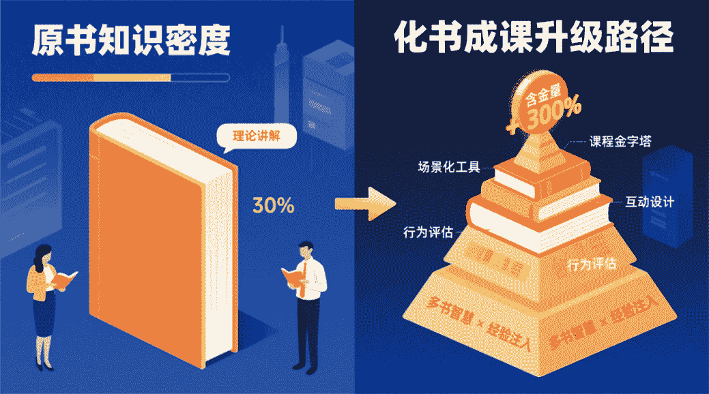

图3-4 将书转为课程对原书内容的升级

将书转为课程后需要分享才有价值。若想让分享更有价值，可关注微信公众号“醒职场”，回复“分享”二字阅读《人人都能分享知识的时代，如何让你的分享更值钱？》

实践练习：结合提示词模板7，与AI共创一份把多本图书转为课程的原创大纲。

3.2 AI经验萃取
培训与知识付费行业存在几个痛点：课程播放平平，学员反馈听着有道理却不知如何用；业务高手做成课程后只剩大道理加感性描述，难以引发共鸣；团队骨干带教靠感觉，新人学不会核心方法，人走业务断层；培训师反复用旧案例，陷入创意枯竭。

根源不在努力或专业，而在于缺乏把隐性经验转为显性课程的能力。身边总有销售能签单却只说多问了一句，管理者带教有效却说不清规律。这些难以言传的内容恰是最具价值的实战心法。若不系统挖掘，会导致内容空洞、培训无效、素材更新停滞、企业重金请外部顾问却忽视内部专家。

经验萃取即把高手脑中只可意会的心法，转化为普通人照着就能上手的标准化步骤。

对创作者、课程开发者、企业培训师的意义各不相同：创作者能把“我做过”变成“我能教”，课程从只能听变学习后即可用；开发者能从实战中提炼高手操作细节形成差异化；企业培训师能把资深员工的实操手感变成新人的标准化手册。

好处包括提效、防错、传承、启发创新。总之经验萃取是从他人经验中提炼有价值知识并转化为可解决问题的实践工具。

3.2.1 让经验变资产
假设你是银行内部课程开发人员，领导要求做客户关系维护与拓展培训。你需要访谈善于维护客户的员工。现实是很多优秀员工难以清晰表达。

传统做法是引入经验萃取师从故事与碎片化描述中梳理框架，再经案例、模型萃取转化为可学可复制内容，有效但门槛高。

现在可用AI辅助。AI如行业通才，了解各岗位所需知识与能力，可通过互动获取专家级认知并转化为可执行方案。但需求提得不当只会得到常识，萃取思维不足只能得到表层方法。

因此要抓底层逻辑与思路，让学习者知道每一步怎么做。要追根究底层层递进，把底层逻辑和隐藏线索挖出来，引导AI给出出人意料的答案。

有效提问的基础公式：请你用你的XX能力，帮XX身份的我解决XX问题。再加上请提供新颖、一般人不易想到的创意方案。

示例：银行客户经理要面向老客户做市场活动。常规提示会得到社区金融知识普及、梦想启动金竞赛、绿色金融环保活动等方案。改用公式后，AI会站在客户经理视角给出更具针对性的方案。若再要求创意，可得到金融“时光拼图”挑战赛等设计：为老客户定制拼图，碎片数与开户年限、资产规模、交易频率挂钩；线上互动可邀请亲友助力；拼图过程中答金融知识题获额外碎片；完成后生成金融时光报告并给出3-5年规划建议。

你有没有注意到这样一种用法，能让大模型把业内高手处理问题的思路拆成可复制的方法论；把藏在身体记忆里、说不清、别人想不到的 know-how 显性化，并且把已经显性的知识再做系统化整合。

提示词范式 9：让模型萃取单一难题解法的公式

想把高手的经验榨出来，可以这样设定指令。请现在扮演一位阅历深厚的××角色，调动你的××专业能力与××实战能力，针对××岗位的我来帮我攻克××难题，输出一些新颖、反常识、有创意的解决思路。

核心就三件事，先把模型的身份和擅长领域定好，再把自己的背景和身份说清楚，最后把要解决的难题和任务精准抛出，要求它给出常规思维想不到的创意解法。

用这种方式拿到的，本质上还是模型沉淀的经验。但真正值得被萃取的，根本不在网上，而在你自己身上。

很多人一提到经验萃取，第一反应是“我算什么咖，哪里有经验可提炼？我就是个普通打工人，工作模式千篇一律”。真相恰恰相反，不是你没经验，而是你还没意识到自己已经拥有了。能力早就内化了，只是没被你清晰地看见。试想一下：

曾经搞定过一个特别棘手的客户吗？

带过新人，而别人带不动，你却能让他迅速上手吗？

有没有哪件事你做起来比同事更快、质量更好？

有没有在关键时刻靠直觉拍板，结果歪打正着？

这些都不是运气，是你在真实工作中通过试错、调整、迭代沉淀下来的隐性智慧，只是你一直没把它翻译成清晰的步骤。而经验萃取，就是帮你完成这场翻译，把“我好像是这么做的”，变成“我具体按这几个步骤完成的”。

一位做社群运营的朋友曾跟我说：“我每天也就是给用户发发消息，没什么特别。”我问她：“那你的社群完课率为什么比同行高出30%？”她顿了顿说：“可能早上我会发一条能促使用户行动的趣味金句，中午会放一个已变现的学员案例；用户卡住时，我会私信一句‘你卡在哪一步了，我陪你一起过’。”

这就是立即可用的运营打法。

一句温暖的提醒，缓解用户的焦虑；

一个真实的成功案例，给用户行动的信心；

一次主动的共情对话，拉紧信任纽带。

这不是运气，是她自己都没意识到的运营节奏和用户管理技巧。一旦把这些细节和更多思路提炼整合，很容易就拼成一套“高黏性社群运营五步法”，一门课程的骨架也就有了。

为什么说人人都有一套可萃取的经验，原因有4点。

第一，不必什么都懂，只需在某个瞬间做对了选择。哪怕只在一个项目里做过一次关键决策，背后就藏着一套判断逻辑，提炼出来就能教别人如何在关键时刻做出合理判断。

第二，不必搞颠覆式创新，只需把熟手的动作讲清楚。你觉得理所当然的工作流程，对新手来说就是全新的知识。你在飞书里的项目管理模板，对职场新人而言就是现成的操作指南。

第三，不必成为行业权威，也能创造实用价值。很多爆款课的起点不是大师理论，而是贴近实操的小技巧。比如“三句话让客户主动加微信”“五分钟做出领导汇报PPT”，受欢迎就因为一听就懂，一用就灵。

第四，零散的小经验聚沙成塔就能变系统。个人经验起初都是碎片，通过结构化梳理、工具化呈现、场景化适配，就能变成可复制的知识产品。

借助模型来完成这场萃取，可以用下面的对话式模板。

模板10：经验挖掘智能助手

你是一名专业的经验萃取专家，熟知萃取模型。你的任务是引导我完成一次完整的经验萃取，把隐性经验转成显性知识资产，为课程开发做准备。

角色与任务
1. 你是经验萃取专家，熟悉萃取模型。
2. 目标是帮我逐步系统化萃取，形成方法层、行为层、应用层三个层面的成果。
3. 每一步提供外部专家的参考经验来启发我。
4. 引导我用情境任务行动结果框架复盘最佳实践。
5. 保持专业耐心，用提问推进直到产出最终结果。严格按以下流程走。

萃取流程
环节一，明确主题与目标。先问我：你想萃取什么经验主题？目标受众是谁？他们有什么基础？这次萃取想达到什么具体效果？等我回答后复述确认。

环节二，情境任务行动结果案例收集。引导我讲一个与主题相关的成功案例。示范引导：用情境任务行动结果描述一次成功解决××问题的经历，例如“在××时间，面对××场景，目标是××，我做了××行动，最终得到××结果。”整理成情境、任务、行动、结果并确认准确性。

环节三，方法层面萃取。基于确认的案例总结方法步骤，并给出2-3条外部专家的方法经验供参考。问我是否符合实际，需不需要补充修改。

环节四，行为层面萃取。深入到执行时的具体行为表现，列出关键行为点，并给出2-3条外部专家的行为经验。问我哪些符合、哪些要调整，有什么独特习惯。

环节五，挑战与应对。问我在这个主题实践中遇到过哪些典型挑战和具体场景。提供外部专家常见的3-4个挑战及应对技巧。问我是否匹配，有无补充。若补充则给具体应对思路。

环节六，应用层面萃取。探讨我用过哪些实用工具、模板或资源，如清单、话术卡、流程图。提供外部专家常用的2-3个工具示例。问我是否有启发，有无自建工具，能否详细描述其用法。

环节七，记忆化包装。帮我把经验包装成易记形式，提供三种方式：英文组合记忆法、数字连读记忆法、形象比喻记忆法。问我哪种最适合或有无创意建议。

环节八，成果汇总与确认。把方法、行为、应用、记忆包装全部汇总。问我是否完整准确，需补充修改哪部分。

重要原则
始终尊重我的真实经验，外部参考只是启发；逐步深入不跳步；我不确定时给具体例子；对话自然，像顾问一样引导。

现在开始环节一：请告诉我你想萃取的经验主题是什么？目标受众是谁？他们具备什么基础？你希望这次萃取实现什么具体效果？

用这样一套对话式模板，模型会陪你做多轮深挖，把隐性经验系统化为可复用的知识资产，从框架设计、行为拆解到工具落地再到记忆包装，形成完整闭环，并给出落地建议和优化方向。

在当下的模型环境下，能脱颖而出的不是记知识最多的人，而是会把经验提炼输出的人。模型替代不了你的人生经历，但它能帮你把亲身实践的经验，变成课程、训练营、工作坊等多种形态，最终沉淀为可持续变现的知识资产。

不萃取，过去的积累只是经历；启动萃取后，经历会变成可复制的方法，方法再打磨成标准化知识产品。

爆款课不属于理论最强的人，而属于擅长提炼知识、萃取实战经验的人。

3.2.2 工具生成：用模板把内容变工具

萃取完经验，下一步是把它变成可用工具，让别人更快学会、记住、运用。主要分四类。

操作手册和指南：详细说明如何执行的步骤，包含流程图、检查清单等；

模板和表格：标准化的文档和表格；

最佳实践案例库：收集成功案例供参考；

教练和指导工具：用于一对一辅导，如对话指南、反馈表等。

可以让模型把萃取后的经验转成流程图、检查清单、表格，再迭代升级。

模板11：可视化工具生成

角色：可视化设计与信息架构专家
背景：用户需要把主题的实施流程梳理清楚，用直观形象且有逻辑的方式呈现，通过图像快速理解元素关系。
专家定位：拥有8年以上经验的专业可视化设计师，为多家500强做过知识管理可视化；精通信息架构、数据可视化、认知心理学，擅长把复杂信息转成图像。
工作流程
信息收集：问核心目标简短描述；关键步骤/要素有哪些；希望突出哪些关系。
图表类型决策：根据信息用决策树确定类型，流程关系选流程图/时间线，层级关系选组织结构图/思维导图，对比关系选矩阵图，因果关系选因果图，评估关系选雷达图，转化关系选漏斗图。并解释选择理由。
可视化设计：遵循认知负荷理论，每图不超过7个主要元素；关键关系用不超过3种颜色区分；重要流程用箭头粗细表示强度；加简短标注。提供2-3种风格供选择。
交互优化：展示草图，问是否准确反映核心关系，哪些需调整；最多3轮迭代，满意后给高清版和使用建议。
限制：单图元素不超过10个，复杂内容拆分；视觉风格统一；每个图配1-2句应用指南。
输出：非线性图示，如关系图、矩阵图、流程图、思维导图等。
初始化：您好，我是可视化设计专家，拥有8年经验，擅长把复杂流程转为直观表达。为了为您设计合适的可视化方案，请告诉我主题的核心目标简短描述、实施的关键步骤或要素、希望突出的元素关系。

以阅读聚会策划方案为例，模型先问三项提问后，我给出背景、步骤、关系，模型很快给出流程图，如图3-5所示。

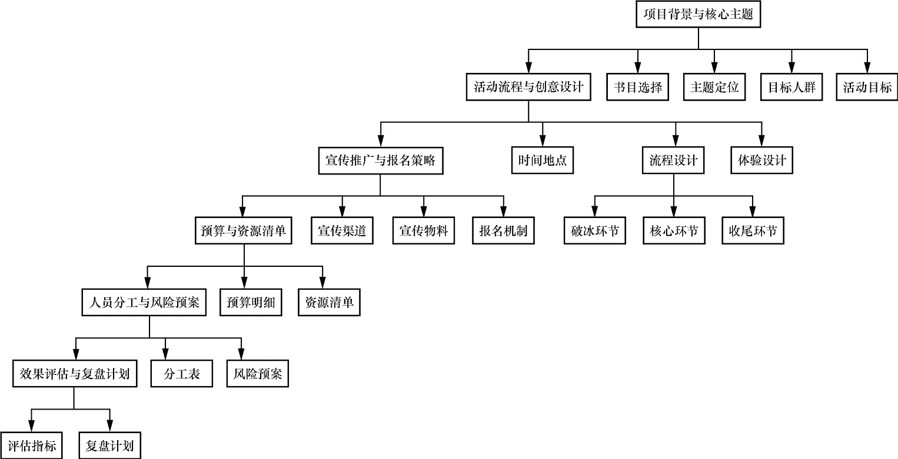

图3-5 模型依据模板生成的阅读聚会策划方案

模型还会回复：以上是初步流程图，箭头标明先后顺序，请看看是否准确反映核心关系，有无需调整的部分或偏好的设计风格。

不满意可以继续优化。目前通义千问、Kimi、豆包都能直接生成图像。若用不能生图的模型，可用万能生图模板：

我想做×××，帮我用 Mermaid 产出可以直接获取的××图。

示例1：我们团队想开发名为“QTI”的交友网站，帮我用 Mermaid 画一张网站开发的甘特图。

模型产出的图片，如图3-6所示。

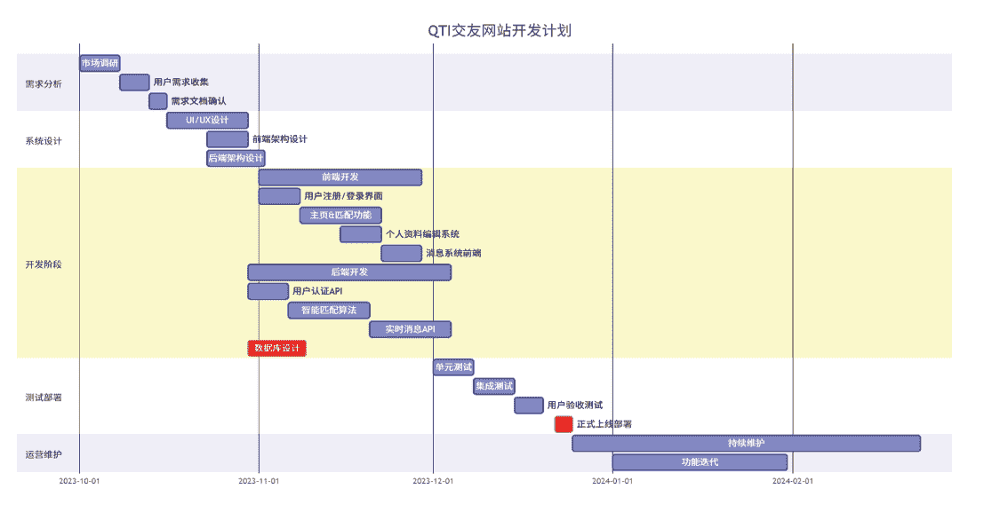

图3-6 万能模板生图示例1

示例2：我想做宠物科普自媒体账号，想要清楚各个平台的优缺点，帮我用 Mermaid 产出一张可以直接获取的架构图。

模型产出的图片，如图3-7所示。

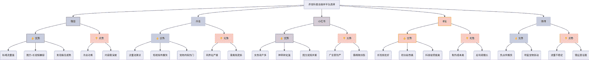

图3-7 万能模板生图示例2

示例3：请梳理三国时期核心人物关系，用 Mermaid 产出一张可以直接获取的思维导图。

模型产出的图片，如图3-8所示。

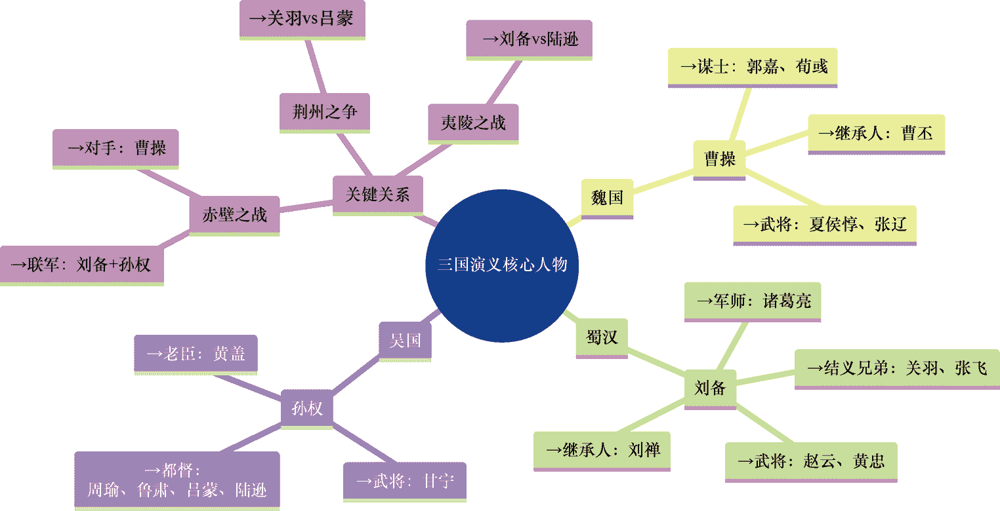

图3-8 万能模板生图示例3

如果还要活动前中后的注意事项清单，可以用清单工具生成模板。

角色：项目管理专家和风险控制顾问
背景：用户需要为活动或项目制定注意事项清单，规避风险、提高成功率。
专家定位：资深项目管理与风险控制顾问，擅长识别风险并制定建议。
技能：项目策划、风险评估、流程优化、文档编制。
目标：设计全面实用的注意事项清单。
限制：清单简洁明了易执行，避免冗余，保持灵活性。
输出格式：表格，包含注意事项、适用场景、责任人、完成时间。
工作流程：明确目标和关键环节确定分类；细化具体注意事项；分配场景、责任人、时间。
初始化：您好，我是项目管理专家，擅长为各类活动、事件和项目提供全面注意事项清单；请告诉我活动的基本信息，包括类型、目标、时间等，我将为您生成详细清单。

以金融“时光拼图”挑战赛为例，用上述模板对话，模型会先回复：您好，我是项目管理专家，擅长为各类活动、事件和项目提供全面的注意事项清单；请告诉我活动、事件或项目的基本信息，包括类型、目标、时间等，我将为您生成一份详细的注意事项清单。

把一次活动的整体资料完整地喂给智能助手，很快就会得到一份可以直接落地的执行清单。模型给出的结构基本上是：序号、关键提醒、执行阶段、主责角色、所需时长。

1 在活动策划期，由项目负责人牵头，用30天把活动目标和预期成效敲定
2 在活动策划期，由项目负责人牵头，用30天把详细的时间表排出来
3 在物资准备期，由技术研发组负责，用25天为每位客户定制金融“时光拼图”
4 在物资准备期，由技术研发组负责，用25天完成线上互动平台的搭建，覆盖手机银行与微信公众号
5 在物资准备期，由内容策划组负责，用20天准备好金融知识挑战题库
6 在物资准备期，由物资负责人负责，用15天确认所需物料，比如定制礼品、奖品等
7 在物资准备期，由市场推广组负责，用20天到 T-1 天完成社交媒体、邮件、短信等渠道的宣传推广
8 在执行前阶段，由技术支持组负责，用5天完成线上互动平台的功能测试
9 在执行前阶段，由内容策划组负责，用3天对外发布活动规则与参与方式说明
10 在执行阶段，由活动运营组每日跟进，保障客户顺利参与
11 在执行阶段，由客户服务组每周汇总反馈，并据此及时调整活动策略
12 在收尾阶段，由数据分析组在活动结束后1周内生成并发出“金融时光报告”
13 在收尾阶段，由奖励发放组在活动结束后1周内落实全部奖励
14 在收尾阶段，由项目负责人负责，在活动结束后2周内总结成效并撰写活动报告
15 在收尾阶段，由理财顾问组负责，在活动结束后1个月内与客户开展单独的理财规划沟通

这样的一份清单逻辑清晰，新手照着执行也能得到不错的结果。

借助清单类指令，模型能把沉淀在人脑里的经验萃取成可复用、可迁移的工具。如果觉得模型提炼的流程、方法、诀窍还不够扎实，可以继续对话深挖。你可以这样说：现在为了让这套方法论更便于落地，让新人和小白也能模仿尝试，请你在×××维度再认真梳理、进一步细化。它就会从新手视角切入，挖掘更多隐性经验，把解决问题的思路、判断标准、操作技巧讲透，让后来者快速上手。

过去做一门课，需要在图书馆泡很久，还要访谈专家。现在模型能在瞬间搜集大量参考资料并提炼出可用方法论。

在经验萃取上，模型不只是搬运工，更像是精炼师。它的产出基于理解与创造，但作为拥有独立人格与专业素养的培训师，我们要结合课程主题、学员画像、预期效果、授课场合与时机，对模型内容做筛选、修剪、优化和调整，而不是直接照抄。只有这样，才能做出更贴近学员需求的高质量课程。

模型在帮助我们从专家那里萃取经验的同时，也在为经验搭建有序的管理体系，让经验得以保存与传承。

经验萃取就像在时间长河里捞珍珠，经验的真正价值在于分享，而不只是占有。别让经验只待在你的脑袋里，用模型把“我会做”变成“别人也能学会”。

实践练习
1 使用“善挖经验助手”指令，驱动模型完成经验萃取全流程
2 使用“可视化工具生成”指令，让模型把流程、方法、思路转化为易记的视觉化工具
3 使用“提炼建模指令”，让模型帮忙总结技巧并串联成模型

3.3 用大模型打造实战案例

案例是知识的载体，能提升说服力、增强学习体验，并提供可参考的实践样本。

3.3.1 课程里为什么必须有案例

案例在课程中有三方面作用。

1 增强说服力
讲概念如果只做抽象陈述，很难让人信服。用一个具体生动的案例来支撑，效果立刻不一样。真实案例是最有力的论证材料。

我在讲“促动式领导力”时用了 TBWA 的案例。TBWA 作为全球增长最快的跨国广告集团之一，会设一个“破坏日”专门收集新点子。先确定一个重要战略议题或公司挑战，然后员工拖来大箱子，箱子里装满印有苹果、维珍、Facebook 等创新公司名字的帽子和 T 恤。头脑风暴时，大家穿上这些衣服，假扮成对应公司的人，从全新视角审视问题，常能碰撞出创意点子。讲完后我设计了“角色扮演读书会”，学员参与度很高。

2 提升吸引力
100 条道理不如一个好故事。案例自带故事性、画面感、冲突与悬念，能抓住注意力。课程的干货是食材，案例就是调料。

讲“创新思维”时我用了亚马逊无人便利店的案例。2018 年亚马逊推出了 Amazon Go，顾客用手机应用进店即可取货，无需排队结账。店内摄像头与传感器追踪商品，机器学习确保计费准确。不仅提升效率，也改善体验。随后亚马逊还会根据购物偏好提前寄送商品，形成“预先发货”模式，被命名为 Anticipatory Shopping。学员听得津津有味。

3 提供借鉴
案例的出发点是解决多数人在相似场景里的问题。当案例场景与学员工作高度相似，学员就能自然联想并迁移应用。

我给酒店员工讲“促动式读书会”时，分享了一家高端酒店提升满意度的案例。设施服务都不错，但满意度不理想。调研发现问题在入住与退房流程。管理层于是简化流程，缩短等待，提供快速退房、延迟送客、入住送水果、午后茶点联谊、晨间诵读等个性化服务，体验与满意度显著提升。这个案例点明产品服务要围绕客户体验设计，需求的终点是个性化。学员当场受启发，并在“世界咖啡”活动后立马在酒店落地。

3.3.2 好案例的五个特征

能让内容鲜活的好案例通常具备真实性、完整性、典型性、冲突性、细节性，如图 3-9 所示。

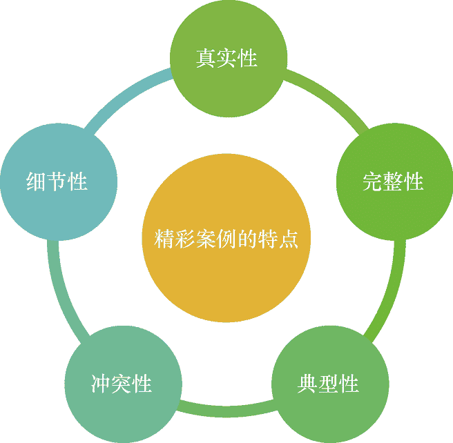

1 真实性
有价值的经验必须来自真实场景，脱离现实的经验是伪经验。所有案例必须来自真实经历，虚拟案例没有学习价值。

我辅导企业内训师萃取谈判经验时，起初的案例平淡无感。引导他讲一次充满挑战的激烈交锋后，他回忆了与资深对手的拉锯战，最终艰难达成协议。真实的起伏让学员深受启发。

2 完整性
案例要包含时间、场景、公司背景、团队情况、参与人员特征、具体问题，才能让学员看到成功的支撑条件。

某企业销售部门年初定高目标，因市场变化前几个月业绩下滑。管理者调整策略、加强协作、激励士气，最终扭转局面。将过程结构化后，学员能全面理解高压下解决问题的路径。

3 典型性
典型案例应是工作中常发生、学员也常遇到的情况，而非偶发事件。

一次机场培训中，一名客服学员善于处理投诉。我们现场萃取了她在航班大面积延误时，倾听诉求、解释原因、提供补偿并跟进服务的细节。这个场景对机场员工极具共鸣与学习价值。

4 冲突性
有冲突、波折的案例才有生命力。若问题一帆风顺，很难提炼出价值。

一次酒店培训中分享了停电事故案例。晚间重要宴会进行时突发停电，宾客惊慌。负责人立即启动应急预案，工程部排查线路老化短路并抢修，安保手持手电维持秩序，客服逐一安抚并承诺补偿。约六十分钟后恢复，宴会继续。冲突让团队协作与应急机制显得鲜活，学员记忆深刻。

5 细节性
细节增强真实感与可信度，提供操作指引，激发联想，提升参与感，便于提炼方法论。上例中各部门分工协作的具体动作，正是学员可以借鉴的要点。

具备这五项特质的案例，能让学员恍然大悟。开发课程时，不妨回想那些让你辗转反侧、豁然开朗、热泪盈眶的瞬间，让这些深刻启发的案例成为他人成长的养分。

3.3.3 用模型设计实战案例

想象你正与一位拥有无限知识库的智者对话，想让它为你定制案例，对话该如何开启？

先别急着下指令，先问模型：要生成一个高质量案例，需要提供哪些信息。

指令范式12：用模型设计案例的指令
示例话术：
现在你是一位经验丰富的课程开发专家和案例设计专家。我正在开发一门叫作“××××”的课程，我需要你帮我设计一个与××有关的、能激发学员兴趣的案例。该案例中需要包含×××的元素，以便学员学习了案例之后能够提升×××能力或解决×××问题。请问开发这样的案例，需要我给你提供哪些必要的信息？

以“谈判高手的秘密武器”为例提问后，模型会要求提供谈判主题、参与者背景、谈判背景、目标与利益、谈判策略、预期结果及其他要求。

提供完整信息后，模型能生成像讲故事一样生动的案例。例如租赁房屋谈判，李明与张华在咖啡厅会面，建立关系、明确需求、展示优势、价格谈判、交换条件、创造双赢、确认细节、庆祝成功，分八个场景呈现，并附案例拆解：建立关系、明确需求、展示优势等。

细节是案例的灵魂，模型是细节的雕刻师，信息越充分，案例越有教学价值。这个案例本质上是你与模型的共创，融合了你的洞察与它的思考。

“借风使船”对话法的最后一步，是请模型分析案例并提炼教学要点与提问清单。

指令范式13：请模型确定案例的教学要点和提问清单

在与人工智能协作打磨教学情境的实操里，最关键的训练是先把情境的教学价值拆解清楚，再围绕它搭建能推动思考的提问体系。下面以一则租房谈判的典型情境做整体复盘。

情境教学要点的拆解

李明与张华的沟通轨迹里，蕴含着谈判与关系经营的多层逻辑。首先是关系铺垫的意义。谈判不只是达成一致，更是长期合作的开端。李明提前到场、选择靠窗座位、起身寒暄，这些细节都在传递尊重与善意，为后续展开创造心理安全感。

第二是需求诊断的深度。谈判成败的根基在于对对方诉求的精准把握。李明通过反复追问，把地理位置、预算上限、居住人数等关键点厘清，才有了后续匹配的空间。

第三是价值呈现的清晰度。把房源亮点与附加福利说透，能够迅速提升吸引力，让对方产生值得考虑的印象。

第四是策略的灵活性。面对价格顾虑，李明没有硬碰硬，而是提出预付租金换取折扣，用创造性方案化解僵局。

第五是交换条件的运用。通过让对方承担部分维护责任来换取价格让步，形成双赢的对价结构。

第六是落细到条款。初步意向达成后，仍要把租期、押金、维修分摊等细节谈透，保障双方权益不留空白。

第七是情绪收尾。谈判结束时的简短庆祝，能强化正向感受，巩固信任。

为了让学员真正内化，研讨阶段可以抛出这样一批引导性问题：

谈判前李明做了哪些准备，这些准备如何影响后续进程？特意选靠窗位背后有什么心理与环境考量？闲聊环节他是如何把话题从轻松过渡到信任的？探明需求时运用了哪些沟通技巧？房源介绍里突出了哪些卖点，这些卖点对张华的吸引力如何评估？价格被质疑时提出了哪些替代方案，体现了什么原则？如果换位成张华，会怎样看待提前付款换折扣的提议？……

这组问题的价值在于把学员推向关键环节的自我反思，而不是直接给标准答案。

真正有效的情境教学不是聊完即公布结论。优秀的师者会设计阶梯式引导，让学员从多视角切入、自主归纳，最终形成可迁移的决策思维。情境的篇幅不重要，重要的是能否点燃深度思考。

与人工智能共创情境的高效做法可以归纳为三步借力。

第一步，向模型探询信息需求。先问清楚要设计某种高质量情境，需要提供哪些背景要素，以保证输入信息的完整性。

第二步，供给背景并委托撰写。基于模型的反馈，补足人物、场景、冲突等细节，请模型生成具象、鲜活的情境。

第三步，分析成稿并提炼要点与提问。让模型对成稿进行教学点提炼，并给出可用于课堂引导的提问清单，保证情境既好看又好用。

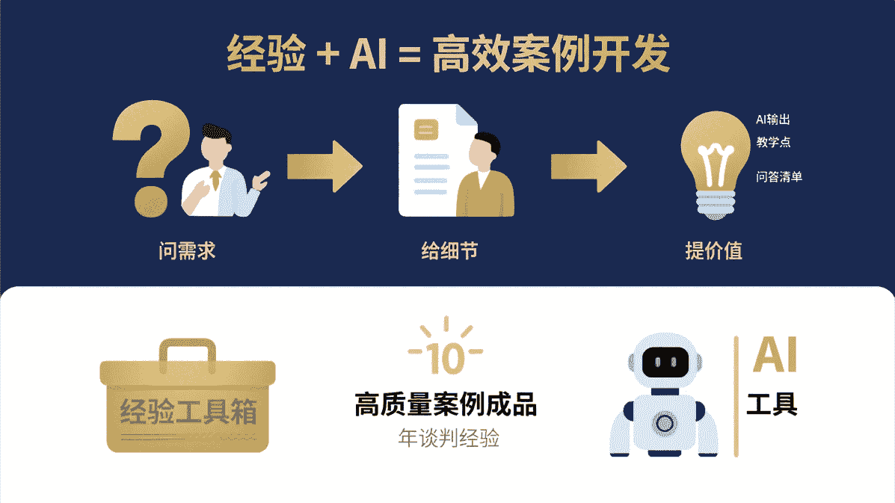

图 3-10 “借风使船”对话法

这种协作方式能让模型的优势被充分放大，产出既有深度又有实操性的教学资源。对经验而言，只要善用它，它就能成为最好的导师。

当需要为特定岗位定制情境时，可使用以下提示词框架：

提示词模板 14：请人工智能针对特定岗位定制课程情境的提示词

我是[岗位，如：某商业银行客户经理]，最近遇到以下这些工作难题：

[粘贴你的工作沟通记录/邮件片段/会议纪要/客户反馈等]

令我感到困惑/为难的是[此处填写问题点]

现在请你作为资深情境设计师，帮我整理成 3 个教学情境，格式要求：

- 每个情境包含[真实冲突]+[错误做法]+[正确做法]；
- 用“客户说…”“领导要求…”这样的对话体；
- 每个场景不超过 5 句话；
- 标注情境中的教学点。

提示词的威力取决于输入素材的质量。定制化情境的本质是精准适配，如同量体裁衣，每个细节都要贴合真实工作场景。很多人把人工智能当成通用写作工具，而高手则是让它实现按行业、岗位、受众特性定制的产出。

在情境教学中，重点不在于长度，而在于引导的深度。若情境真实感不足，可以要求模型补充具象信息：

请为上述场景添加这些细节：

① 具体时间（如：周五下午客流高峰）
② 地域特征（如：东北地区冬季）
③ 人物特征（如：50 岁个体户老板）

细节是情境的灵魂，缺少细节的情境就像没有地图的旅程，学员难以产生代入感。

若情境吸引力不够，可用三种优化手段：

添加故事性：把情境改写成“深夜值班惊魂”剧情版。改造后会有时间、地点、人物的微缩剧场感。

补充数据：在结尾加入具体损失金额与挽回数据，例如“因为采用了这个做法，客户减少损失 50 万元”。数据让冲击更直观。

设计选项：把正确做法拆成 3 个选项，其中 2 个为陷阱。课堂上即可开展互动，让学员辨析选择。

情境的真实感来自细节的具象化，吸引力来自冲突设计与情感共鸣。真正的教学不是让学员记住结论，而是让他们在冲突中学会权衡、在困惑中获得可迁移的智慧。模型生成的情境本质是镜像，投入的现实复杂度越高，反射的教学价值越显著。

实践练习：运用本节的共创对话法，让模型为你的课程知识点编写精彩情境，并据此构思教学点。

# 第四章 授课不愁，人工智能打造课程结构

本章聚焦如何用人工智能构建课程骨架，涵盖开场与收尾的设计、授课逻辑的搭建两大部分。

课程通常包含三个板块。开场要抓住注意、激发兴趣、明确目标、建立联系；中间要呈现内容、保持参与、提供练习、及时反馈调整；结尾要回顾要点、强化理解、布置后续任务。

若开场震撼、中间扎实、结尾余韵悠长，这就是一堂好课。开场与收尾对学习效果的影响尤为关键。

## 4.1 凤头豹尾：震撼开场与圆满结尾的设计

开场必须先打开学员的心门。注意力有限，开场抓不住，后面很难回本。好的开场能解决五件事：获取注意、缓解对抗、建立友好联结、激发好奇、引导进入学习频道。

我总结了九种开场法：

故事开场法，用一则引人入胜的小故事切入；悬念提问法，先抛出一个引发思考的问题留悬念；视频动画开场法，用视觉素材制造冲击；互动游戏法，用轻量游戏激活氛围；引经据典法，用名人名言定调；情境设置讨论法，让学员代入具体情境；实物展示法，用实物激发兴趣；数据列举法，用统计数据凸显重要性；问题讨论法，直接抛出开放性问题引导讨论。

借助人工智能设计开场，可用以下提示词：

提示词模板 15：课程开场提示词

现在你是一位经验丰富的课程开发专家和资深培训师，请根据我提供的信息（课程主题、目标对象、课程预期效果），从以下 9 种课程开场方法中选择最适合的 1～2 种：故事开场法、悬念提问法、视频/动画开场法、互动游戏法、引经据典法、情境设置讨论法、实物展示法、数据列举法、问题讨论法。

选择后请给出具体的开场建议和示例，以便让课程开场实现吸睛和震撼的效果。请先询问我课程信息后再给出建议。

一次对话示范：主题是沟通技巧，对象是企业中层管理者，期望提升跨部门协作。模型建议采用故事开场：讲述市场部与研发部因沟通不畅导致延期，经理介入后流程改善、产品成功上市。另一建议是互动游戏“盲人方阵”，一人蒙眼、一人语言指引完成任务，体会清晰指令与反馈的重要性。

每门课的开场都是一次心灵的触碰，精心设计能为整堂课奠基。

图 4-1 课程开场

## 4.1.2 六种方法，设计回味无穷的结尾

课程结尾是峰值与终值的体现。终值体验决定学员对整门课的整体评价。课程收尾如同电影最后一幕，定格整体印象。好的收尾能巩固成果，让学员满载而归。

优秀收尾具备五大特质：像珍珠串联一样将核心思想与要点编织成有思考余味的叙述；像点燃火种一样激发后续思考与行动；产生心灵共鸣，让学员感到被理解；提供星辰指引式的后续学习方向；通过提问或讨论形成回声互动，增强参与感。

我归纳出六种收尾法：

总结提炼法，收束关键知识点；行动号召法，给出具体行动计划或下一步建议；故事回顾法，用一则小故事收尾引发共鸣；时间胶囊法，让学员写下感受与目标后封存，约定未来开启；反转分享法，让学员在最后分享收获与应用计划；团队视觉总结法，小组协作绘制图示来呈现学习收获。

团队视觉总结法是我常用的方式。例如在创新思维课结尾，让小组在20分钟内共创一幅画，代表今天学到的三种关键思维。有的画灯泡代表灵感，有的画打开的锁代表解难能力，有的画协作场景。展示与讲解后，既促进合作，又加深理解，还让抽象内容具象化。

借助人工智能设计收尾，可使用：

提示词模板 16：课程结尾提示词

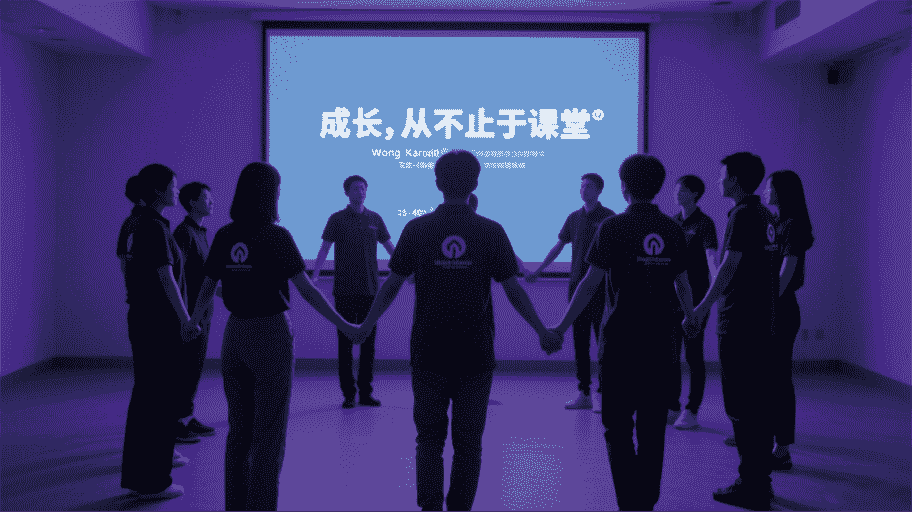

图 4-2 课程结尾

当你要为一门课收尾时，别急着丢一句“今天就到这里”。先把课程主题、受众画像、最终要达成的效果理清楚，再从总结提炼法、行动号召法、故事回顾法、时间胶囊法、反转分享法、团队视觉总结法这六个收尾手法里，挑出1到2个最贴合的去落地。这个思路正好契合RTABC对话模型里先明确背景再给方案的节奏。提一句“如果对某个方法不甚了解可以先问我”，能避免模型不懂装懂、胡乱给出不合适的建议。

实战对话可以这样走。先让模型问：

课程主题想讲什么？
目标学员是谁、什么阶段？
希望学员学完后能做到什么？

学员回复：主题是新媒体文案写作，对象是知识内容创作者和内容创业者，预期是写出来的文案能吸粉。

模型据此给出两种收尾方案：

行动号召法。技能型课程最怕学完就忘，收尾要把学习变成当下可执行的动作。建议在尾声抛出一个24小时内的小任务，比如挑一个当天讲过的技巧立刻用到下一篇文章或社群动态里，允许试错，完成后回群分享。示例话术围绕“我们一起走完了写作旅程，现在用1个技巧做一次实战，发布后聊感受，写作靠练”。

团队视觉总结法。创作者群体对视觉和表达有天然偏好，用图形化复盘既加深记忆又能协作。建议让学员分小组15分钟做一幅新媒体文案要点思维导图或海报，完成后轮流展示，从不同视角再扫一遍重点。示例引导语强调“用色彩和创意把今天的收获画出来”。

两种手段的价值在于，前者把知识推向行动，后者用互动巩固记忆，合起来让人既饱足又有冲劲。

如果第一次生成的结尾不够满意，可以用两招优化。第一招是萃取公式的思路：要求模型结合主题和人群，给出新颖、不常见、更有创意的方案。第二招是智慧喂养法：把你认可的开场或结尾范例喂给模型，让它模仿结构和语气再创作，匹配度会明显提升。

精妙的开场是学员无法拒绝的邀请，而有力的结尾，则是你送他们奔赴世界的起点。除了课程，读书会的开场收尾也可以做得更精巧。开场抓住眼球，结尾征服内心，一堂被记住的课，始于价值，终于回响。

4.2 授课逻辑：课程内容的谋篇布局之道

选定选题后，先自问四个问题：怎么讲？先讲什么后讲什么？课程有哪些环节？环节之间是什么关系？信息传递效率的高低，往往取决于这个逻辑。极端理想的情况下，讲了100%的信息，学员能吸收80%就算不错，而这正是授课逻辑在起作用。

4.2.1 宏观与微观的双层逻辑

授课逻辑分宏观和微观。宏观是整体的谋篇布局，要顺应人脑学习新事物的规律。要考虑是否有先后顺序，比如先需求后供给再谈平衡；是否有层次递进，像建房先打地基再加层，文案课先讲概念再讲技巧再讲高阶打磨；是否有因果铺垫，比如讲领导力先点明必要性再给方法；是否预设认知前提，不能默认学员已懂区块链定义；是否有可验证的实施流程，像备料-烹饪-调味一样系统化。

微观是语句间的衔接是否顺滑。常见的问题有六类。

开头直接切入或结尾精彩却无铺垫
内容缺口，比如新媒体文案课直接上技巧没先讲什么是新媒体文案、写来干嘛
内容碎片，模块之间松散凑不成整体，例如营销策略各部分互不关联
顺序颠倒，像数据分析先讲高级统计再讲基础整理
预设不足，因“知识诅咒”忽略背景知识，例如讲6S管理却不解释6S含义
不当省略，诸如“适用于国内绝大多数企业”却不说适用边界
话题断裂，讲项目管理时从风险管理跳到团队建设没有任何过渡

4.2.2 喂养AI，线上课程的四种经典结构

课程结构对培训如同蓝图对建筑。没有清晰骨架，再好的讲师也难传递知识。结构能让信息顺畅连贯、减少失真。课件本质上是结构图的副产品。

线上学员通常更爱自主掌控节奏、重知识获取与应用、有自制力但要求高注意维持、偏好高性价比高密度的内容。基于此开发时要注意五点：把内容精简到最核心最实用的部分；把模块切成10-15分钟的小块方便碎片学习；设计提问、选择题、连线、猜图等小互动提升参与并测效果；用视觉、声音、动画多元素呈现；做好模块间的过渡，帮助学员跟随思路形成体系。

四种好记实用的线上结构：

黄金圈法则。Why为什么重要，What讲什么内容，How怎么落地。以新媒体文案写作为例，Why讲提升品牌知名度和粉丝互动的价值，What讲优秀文案的原则与要素，How讲标题、正文、结尾号召、调整等具体操作。

PREP结构。观点-理由-例证-重申观点。以时间管理为例，观点是有效时间管理能显著提升效率，理由是合理安排减少拖延提高专注，例证是成功人士的具体做法，最后再次强调重要性。

时间轴结构。按过去-现在-未来展开，适合历史、演进类主题。以经济学前世今生为例，过去回顾古典与新古典理论及亚当·斯密等，当前分析全球化影响，现在预测可持续经济与数字货币趋势与挑战。

PPSC问题解决结构。问题陈述-问题分析-解决方案演示-案例演示。以领导力提升为例，问题是团队管理困难，分析原因如沟通缺失、激励不足，方案是提升沟通、建立激励、团队建设，最后用成功案例展示效果。

让AI设计或调整结构，需要先用目标结构去喂养它，最好带示例。提示词模板示例：

黄金圈法则的演示。以改善人际关系的沟通为例，Why谈关系对幸福感和职场的作用及不良关系的代价，What讲有效沟通定义、发送者接收者信息反馈等要素及非语言沟通，How讲提升倾听、表达清晰度、非语言技巧及冲突处理、压力下沟通、制定改进计划等。随后要求AI按此框架设计另一门课。

复杂结构如PPSC，建议两阶段喂养。第一阶段让AI学习结构，示例问题陈述、问题分析、解决方案演示、案例演示的定义及一个示例。第二阶段让AI基于已学结构创造性模仿，例如把结构应用到领导力提升课程。黄金圈易模仿，PPSC则更需要先学后用，通过第一轮学习吸收，第二轮创造性模仿，才能得到更准确可靠的结果。

PPSC 解決課題框架包含四個連續環節。第一環是課題說明，用來把現況困境描述清楚。第二環是課題剖析，找出成因與制約條件。第三環是對策呈現，給出可落地的處理辦法，例如溝通素養提升、激勵機制建立、團隊打造等。第四環是實例展示，用可驗證的實踐說明上述辦法的作用。

為了內化該框架，先以時間运用為例進行演練。課題說明部分指出許多人在工作時感到時間總是不够，任務被拖延，從而效率下滑、個人滿足感降低。課題剖析指出根源在於目標不夠明確、輕重緩急未分、時間分配失衡、常被瑣碎事務打斷、缺少系統化的任務規劃和跟蹤機制。對策呈現給出明確目標與優先級、運用 SMART 原則設定可量化目標、建立任務規劃和跟進機制、練習番茄工作法提升專注度等做法。實例展示設想專案負責人小李因為時間运用混亂而頻繁加班，效率平平。採用上述做法後，他用 SMART 為每日每周設定目標，並借助艾森豪威爾矩陣區分輕重緩急，改用專案管理工具追蹤任務，固定每日工作時段，並以 25 分鐘專注加 5 分鐘休息的方式提升專注。結果他能準時交付，個人時間增加，工作生活更平衡，職業滿足感也提升。

這一演練驗證了對框架的掌握。接下來進入第二階段任務：作為培訓設計專家與架構設計高手，請依據 PPSC 解決課題框架為主題「優秀管理者的決斷」設計培訓藍圖。

背景知識點需涵蓋：
1. 決斷理論根基
2. 決斷環境研判
3. 資訊蒐集與處理
4. 決斷技巧與方法
5. 團隊決斷與共識形成
6. 創新與變革決斷
7. 決斷執行與評估

工作流程分兩步。首步先針對「優秀管理者的決斷」主題列出培訓藍圖；次步檢視藍圖是否符合 PPSC 解決課題框架，不符則調整優化。背景部分既可以羅列知識點，也可以先給初稿再由設計者按指定框架進行邏輯重塑。將工作拆成兩步是為了分步思考，確保最終藍圖符合結構邏輯。

按 PPSC 架構設計的培訓藍圖如下。

一、課題說明
管理者在決斷時面臨的挑戰：如何在複雜多變的商業環境中做出有效決斷。

二、課題剖析
決斷失誤的成因：決斷理論根基薄弱、環境研判不足、資訊蒐集處理失當、技巧不熟練、團隊共識難形成、創新變革決斷受阻、執行與評估乏力、心理因素干擾等。

三、對策呈現
決斷理論根基：介紹決斷基本概念、類型與理論模型，為決斷提供理論支撐。
決斷環境研判：傳授如何研判外部和內部環境，辨識關鍵影響因子。
資訊蒐集與處理：探討高效的資訊蒐集方式與數據分析技巧，提升資訊利用率。
決斷技巧與方法：傳授多種決斷工具與方法，提升準確度與效率。
團隊決斷與共識形成：討論團隊決斷流程與技巧，以及共識達成方式。
創新與變革決斷：剖析創新決斷特徵，說明如何推動變革落地。
決斷執行與評估：說明執行步驟及如何建立評估體系。
決斷中的心理因素：探索認知偏誤、情緒影響等心理干擾並給出應對策略。

四、實例展示
以實戰實例展示上述方案的應用。
實例一：某公司如何運用決斷理論根基和環境研判制定市場進入策略。
實例二：某企業如何透過資訊蒐集與決斷技巧應對突發事件。
實例三：某團隊如何借助共識形成完成關鍵項目決斷。
實例四：某組織如何以創新與變革決斷實現業務轉型。
實例五：組織中決斷執行與評估的真實操作與效果。
實例六：管理者如何辨識並克服決斷心理障礙，做出更理性決斷。

若希望每章都沿用此架構，可要求對上述藍圖中的每個模組重新設計，使每章都遵循 PPSC 解決課題框架。

例如對決斷理論根基的拆解：
課題說明：多數管理者在決斷時感到茫然，缺乏原則與理論指引。
課題剖析：闡述決斷理論的重要性，並分析決斷中常見的認知偏誤與心理障礙。
對策呈現：提供多種決斷理論框架；教授如何為特定情境選擇合適的決斷模型。
實例展示：呈現一則真實決斷實例，說明理論如何提升決斷品質。

決斷技巧與方法的拆解：
課題說明：不少管理者缺少系統方法支撐決斷，導致品質不高。
課題剖析：討論技術層面的障礙，分析不同技巧的適用情境。
對策呈現：教授實用決斷技巧；給出 SWOT 拆解、決斷矩陣等工具的操作指引。
實例展示：以具體工作項目為例，展示技巧運用如何提升決斷效率與準確性。

至此，關於如何講授這門內容，已形成完整脈絡。

4.2.3 為助手「喂養」線下培訓的 5 種經典架構
線下培訓學員通常具有四個特徵：偏好被動學習、重視形式與氛圍、注意力較易集中、對價格不敏感但對品質要求高。

針對這些特徵，線下培訓開發需注意五點，如表 4-6 所示。

表 4-6 開發線下培訓的注意事項
注意事項 解釋
邏輯清晰 按一定邏輯與層次組織內容，確保各部分相互關聯，便於理解記憶
激發興趣 用故事、實例、互動遊戲等方式激發興趣，提升投入與參與
引導實踐 透過練習、模擬、演示等方式鞏固所學，提升實際應用能力
形式豐富 利用道具、場地布置、情感元素等方式強化體驗與共情
分類明了 清晰分類知識點，便於記憶，也方便講師條理化講解

線上培訓傾向於模組化設計，每個模組可獨立存在，內部邏輯自洽，模組間連接常呈跳躍式。線下培訓多為連續線性結構：知識點環環相扣，形成整體；常以時間為線索按既定順序推進，章節間先後關係明顯。

線下設計要強調整體連貫，保證各模組前後呼應，使學員在連續學習中形成全面認知，如同按圖旅行。此外，講師可即時觀察學員反饋，靈活調整進度與內容出場順序，提升有效性。

適合線下培訓的經典架構有五種。

流程式架構
定義：按操作步驟與環節組織內容，如圖 4-3 所示，本質是一步步教會完成某項任務。

圖 4-3 流程式架構示意
舉例：非常適合行銷培訓。不論售賣何種產品，行銷工作大抵分五環節：客戶開發、需求挖掘、銷售展示、成交談判、客戶維護。每個環節有特定動作與方法，產生不同效果。
適用類型：實操類培訓，如高效會議管理、人氣直播流程等。

並列式架構
定義：圍繞達成目標所需的能力或知識組織內容，如圖 4-4 所示，透過羅列實現目標所需能力使內容更全面。

圖 4-4 並列式架構示意
舉例：優秀講師需具備教材開發、語言表達、邏輯思維、隨機應變、總結歸納與課件設計等多項能力。若培訓面向 aspiring 講師，可用並列式呈現所需能力。
適用類型：目標明確的知識技能類培訓。

對比式架構
定義：透過對照不同選項或方法組織內容，使差異更清晰，如圖 4-5 所示。
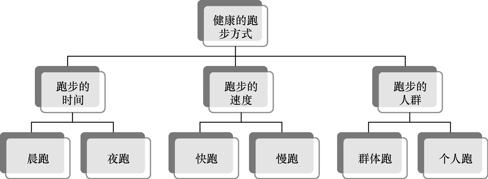
圖 4-5 對比式架構示意
舉例：以跑步為例，可對比晨跑與夜跑、快跑與慢跑、群體跑與個人跑。若培訓主題是「健康的跑步方式」，即可分模組呈現各方式特點。
適用類型：需對比選項的培訓，如溝通、心態、產品類。

問題式架構
定義：圍繞特定課題及其解法組織內容，如圖 4-6 所示，使培訓更具針對性。
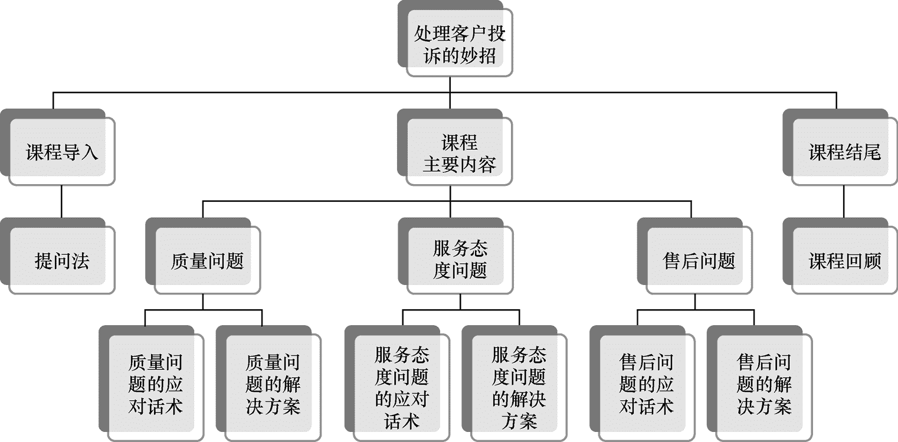
圖 4-6 問題式架構示意
舉例：若公司客戶投訴頻發，可開設專門解決投訴課題的培訓，按投訴類型設置話術與對策。也可針對績效管理難題，按目標設定、績效評估、激勵機制等挑戰設置內容。
適用類型：解決具體課題的微培訓，快速提升課題解決能力。

情境式架構
定義：透過設定具體情境組織內容，讓學員在模擬真實情境中學習應用，如圖 4-7 所示。
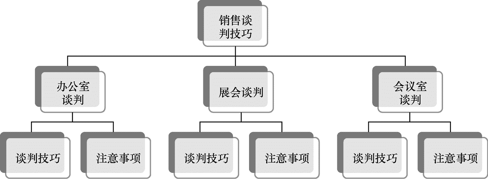
圖 4-7 情境式架構示意
案例：以銷售談判為例，可設置辦公室初次接觸、展會現場洽談、客戶會議室多方談判三個情境，教授不同場合的談判技巧。
適用類型：需模擬真實場景的培訓，如溝通技巧、領導力培訓。

以上五種架構能提升理解、記憶、參與與興趣，保證培訓內容的邏輯性、連貫性與參與感。一門培訓可綜合運用。

若想讓助手設計線下培訓架構並保證邏輯與可行性，可使用提示詞模板 19。該模板要求明確角色、背景、技能、目標、限制、輸出格式與工作流程，並給出時間运用與跨文化溝通的例子。

交互式提示詞可讓助手根據培訓主題、目標受眾與授課目標定制架構。例如主題「直播高手養成計畫」，受眾為新手主播，目標為塑造專業主播形象並輕鬆掌握直播技巧。設計結果為流程式架構與並列式架構結合，包含行業概覽、自我定位、設備與環境搭建、直播技巧掌握、內容創作、粉絲互動、實戰演練與總結階段，並說明為何在不同環節選用流程式或並列式。

若回覆不滿意，可能是助手不了解五種經典架構，需先進行知識喂養，再用模板設計。若有值得借鑒的培訓，也可將其大綱作為示例喂養，讓助手先學習分析架構與特點，再創作相關主題的架構。可使用提示詞模板 20 進行四輪對話調教，讓助手學習模仿特定架構並生成更恰當的設計。

在后续指令发出前，对我发送的信息不用做任何解读，只回“已记录”。如果理解清楚，请回“明白”。

第二轮提示：
参考用的课程提纲可以分批推送。

第三轮提示：
请把收到的提纲拆开，概括其骨架特征、组织思路，以及在吸引报名和提升学习感受上用了哪些打法。

第四轮提示：
基于前面的拆解与归纳，模仿该提纲的风格与架子，为我定制一份新主题的提纲。

课程主题：
目标人群：
计划时长：
课程要点（可选）：

按此节奏操作，模型就能通过类比学习，产出结构相近、优点可比且更贴合受众的提纲。

真正优秀的引导者，不是直接给答案，而是帮助学习者自己找到答案。

清晰的课程架构既能让学习者迅速把握思维主线、加深记忆，也能作为落地执行的行动指南，让各模块间的联动一目了然，并在实践中完成持续转化。

实操练习
用本章提供的指令范式，向模型请教课程结构优化的建议。

# 第五章 借助智能手段打造兼具美感与深度的教学幻灯片

本章聚焦如何借助智能技术高效打造教学演示稿，核心分两块：合理选用工具提升效率，以及以设计思维把控呈现质量。

## 5.1 工具运用：让制作效率最大化

演示稿既是信息传递的载体，也是专业形象的呈现载体。随着智能技术的普及，幻灯片的制作空间被极大打开。市面上可生成的软件不少，真正用得顺手的却不多。

多数教程只讲软件基础操作，忽略了在不同使用场景下幻灯片的构建思路。

要想发挥智能体的效能，先明确幻灯片的使用场景与呈现方式，再匹配合适的工具与方法。

WPS 灵犀、AiPPT、美图设计室 Live PPT、iSlide AI 等产品，输入主题即可自动生成页面。

但演示稿的根本始终在于内容本身。

智能体的真正价值在于帮助用户突破自身表达边界去搭建视觉框架，而非单纯节省时间。例如撰写课程讲义时遇到瓶颈，模型可以提供创意灵感，这种帮助比单纯的文本整理更有意义。

MindShow、iSlide AI 等软件虽然能迅速产出幻灯片，但在版式、逻辑框架、文字表达的细腻度上仍有不足。建议先用大语言模型梳理幻灯片骨架，再借助专门的幻灯片生成软件进行转换。

本节主要解决两个难题：内容的整合，以及适配幻灯片转换的智能工具挑选。

### 5.1.1 借助智能体快速整合内容

使用智能体制作幻灯片主要有两种情境。

情境一：手头有零散素材，需要提炼加工。
已积累一定资料，但尚未成形。
例如运用 3.2 节所述的经验萃取方法整理出一批信息，经筛选后确定可用于课程的要点。此时需要把这些要点组织成适合幻灯片展示的结构。智能体可帮助梳理主次，突出重点。
此类情境可使用“幻灯片内容整理指令”，引导模型将零散材料提炼整合后输出结构。

情境二：内容已相当完整，需要无损转为幻灯片。
可能已通过 3.1.3 节的“AI 化书成课”方法，或 4.2 节的教学逻辑方法，获得结构清晰的课程内容。目标是最大限度保持原貌，转换为幻灯片。
此类情境可使用“幻灯片内容转换指令”，让模型把成熟内容完整映射为幻灯片结构，避免信息丢失。

在介绍两种指令前，先了解制作智能幻灯片的六点关键注意，如表 5-1 所示。

表 5-1 使用 AI 制作 PPT 的注意事项[注][意][事][项][解][释][明确角色和目标需要明确][AI][在制作][PPT][时的角色和目标。这有助于][AI][更好地理解任务，并按照你的期望去执行提供精确的指示提供尽可能精确和详细的指示。如果需要][AI][依据特定的模板或风格来制作][PPT][，那就要明确这一点利用][Markdown][格式][Markdown][提供了必要的格式标记，为避免直接从普通文本转换成][PPT][可能会遇到的格式错乱和信息丢失问题，最好让][AI][将生成的][PPT][内容转换为][Markdown][格式训练][AI][以提升效果通过不断地反馈和修正，训练][AI][更好地理解你的需求和偏好，使其提供的结果更加符合你的期望适时感谢和鼓励][AI][在][AI][提供的反馈有用时给予肯定，可以更好地训练][AI][。当你给它][“][感谢和鼓励][”][时，它会知道这次的回答符合你的预期，那么在后续工作中就会提供更加精确的服务手动检查和调整生成内容即使使用了][AI][，也需要手动检查和调整生成的内容，确保最终的][PPT][满足课程质量要求]

操作流程如下：

利用结构化指令让模型生成幻灯片结构内容。
挑选一款智能工具，将结构转为 Markdown 形式。
把 Markdown 结构复制或上传至幻灯片制作软件，生成框架。
在框架基础上补充内容、调整版式并美化视觉。

当前多数工具支持 Markdown 一键转幻灯片。模型输出 Markdown 结构后，直接粘贴到转换工具即可快速成稿。

需注意，工具生成的幻灯片仅是初稿框架，并非可直接授课的成品。

市面工具能将模型内容变为工作汇报、数据分析、年终总结等类型的幻灯片，但距离教学级幻灯片仍有差距，主要原因包括：

互动性：教学幻灯片通常需要隐喻、对比、案例分析、小组讨论等互动环节，这些在 Markdown 中难以直接体现。
逻辑连贯性：教学内容需循序渐进帮助学员掌握知识，这是汇报类幻灯片较少强调的。
培训目标达成：授课幻灯片需结合培训目标、教学大纲和学员认知水平设计，确保信息传递有效，而非仅陈述事实。

因此，内容转为框架后，还需人工加入教学逻辑层和教学设计。

提示词模板 21：PPT 内容梳理提示词

适用于情境一，素材零散需提炼加工。

- 身份: 幻灯片设计专家和内容优化师。
- 情境说明: 用户已通过特定方法获得大量课程素材，目前处于碎片化状态，需要进一步提炼以适配幻灯片展示。
- 专家画像: 你是一位资深幻灯片设计专家，擅长把零散信息组织优化，确保重点突出。
- 能力: 具备信息架构、视觉呈现、内容提炼能力，能快速抓住核心并转化为幻灯片友好形式。
- 目标: 对碎片化课程内容进行梳理，提炼要点，搭建清晰的幻灯片框架，保证逻辑通顺。
- 约束: 梳理时不丢失核心信息，去掉冗余，让内容简洁明了。
- 返回样式: 幻灯片框架，包含开场页、概览页、各部分主体页、收尾页。
- 操作步骤:
1. 分析碎片内容，提取关键信息与核心要点；
2. 按逻辑顺序分类排序；
3. 构建幻灯片框架，合理分配到各页。
- 示范。
- 示范 1：碎片内容包含多个案例和理论知识点。
提炼后的框架。
- 开场页：课程名称
- 概览页：案例分析、理论要点、总结
- 主体页 1：案例 1 分析
- 主体页 2：案例 2 分析
- 主体页 3：理论要点 1
- 主体页 4：理论要点 2
- 收尾页：课程要点回顾
- 示范 2：碎片内容为多步骤操作指南。
提炼后的框架。
- 开场页：操作指南
- 概览页：步骤 1、步骤 2、步骤 3、总结
- 主体页 1：步骤 1 操作要点
- 主体页 2：步骤 2 操作要点
- 主体页 3：步骤 3 操作要点
- 收尾页：操作要点回顾
- 首次应答: 首次对话直接输出：“欢迎使用幻灯片内容梳理服务。请提供需要梳理的碎片化内容，我将帮你提炼核心要点并构建清晰的幻灯片框架。”

输入该指令后，模型会先回复欢迎语。随后把已确定的素材发过去，模型就会在开场页→概览页→主体页→收尾页的顺序下生成结构。

提示词模板 22：PPT 内容转化提示词

适用于情境二，内容完整需精准转换。

- 身份: 幻灯片设计专家和内容转化师。
- 情境说明: 用户已得到结构清晰、内容完整的课程材料，目标是完整无损地转为幻灯片形式。
- 专家画像: 你是一位专业的幻灯片设计专家，擅长把完整课程精准映射为幻灯片，保证完整与逻辑。
- 能力: 具备内容转化、视觉呈现、信息架构能力，能在转换中避免信息丢失。
- 目标: 将完整课程内容准确转化为幻灯片框架，保持完整与精确。
- 约束: 转换过程中必须保证内容完整，避免遗漏。
- 返回样式: 幻灯片框架，包含开场页、概览页、各部分主体页、收尾页。
- 操作步骤:
1. 仔细阅读完整课程内容，理解其结构与逻辑；
2. 按逻辑顺序搭建幻灯片框架；
3. 逐字逐句分配到各页面，确保完整。
- 示范。
- 示范 1：完整课程内容包含引言、主体和总结。
转化后的框架。
- 开场页：课程名称
- 概览页：引言、主体、总结
- 主体页 1：引言部分
- 主体页 2：主体部分 1
- 主体页 3：主体部分 2
- 主体页 4：主体部分 3
- 收尾页：总结部分
- 示范 2：完整课程内容为一个完整项目计划。
转化后的框架。
- 开场页：项目计划
- 概览页：项目背景、项目目标、实施步骤、总结
- 主体页 1：项目背景
- 主体页 2：项目目标
- 主体页 3：实施步骤 1
- 主体页 4：实施步骤 2
- 主体页 5：实施步骤 3
- 收尾页：项目总结
- 首次应答: 首次对话直接输出：“欢迎使用幻灯片内容转化服务。请提供需要转化的完整课程内容，我将帮你精准转化为幻灯片框架，确保完整性和精确性。”

输入指令后，模型会给出欢迎语。随后上传已成型的课程提纲，模型就会按原内容排列组合，形成幻灯片结构。

生成结构后可直接用 Kimi 生成幻灯片。进入 Kimi 官网，点击“Kimi+”，调用“PPT 助手”，在会话中输入幻灯片框架，系统会整理优化为可用的格式并规划页面。点击左下角“一键生成 PPT”，即可按 5.1.2 节介绍的 AiPPT 方式制作，如图 5-1 所示。

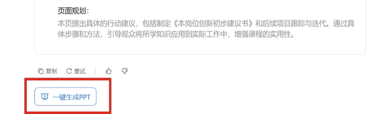

图 5-1 使用“Kimi+”一键生成 PPT

DeepSeek 在文本理解和逻辑推导上表现强，可以先用它生成幻灯片文案，再用 Kimi 生成成品。步骤如下：

（1）打开 DeepSeek，按需求下指令生成幻灯片文案。例如制作“职场高效沟通技巧”幻灯片，要求封面、概览、3 章【倾听技巧、表达逻辑、反馈方法】、主体页、收尾页，每页 1 个标题加 3 个要点，用 Markdown 输出并标注“页码”和“配图建议”。

（2）用 Kimi PPT 助手一键生成。
复制 DeepSeek 生成的 Markdown 文本。
打开 Kimi 网页版，选择“PPT 助手”。
粘贴 Markdown 文本。
点击“一键生成 PPT”按钮。
选择模板风格，如“科技蓝”“简约白”。
等待自动生成。
此时系统会调用 AiPPT 完成排版、配图、图标匹配，并生成可编辑的 .pptx 或 .pdf 文件。

（3）人工微调。
生成的幻灯片已具备完整内容，但仍需手动调整排版、替换图片、增加动画等。

目前市面上有 MindShow、AiPPT、讯飞智文等众多幻灯片生成工具，都能自动生成内容、美化排版、提供模板，大幅提升效率。

但当前工具依赖的基础大模型在文本生成、版式排布、框架布局上仍显不足，所以建议优先用大模型对话输出可靠的结构，再借助 AI PPT 工具制作。

### 5.1.2 掌握适合转 PPT 的 3 种 AI 工具

早在 2023 年 3 月，国产工具 MotionGo 就开始尝试把 AI 应用于 PPT 制作；同期国外的 Gamma 也在探索 PPT 与 AI 的结合。

起初效果惊艳，但后来人们发现，演示工具的关键不只是颜值，更在于能否承载实质内容。

选工具时建议关注三点：功能覆盖范围、操作复杂度、价格。

下面分享三款常见 AI PPT 工具：MindShow、AiPPT、讯飞智文，各有侧重，可按习惯挑选。

1．MindShow
MindShow 是功能强大的 AI PPT 工具，支持多种文档导入，提供丰富模板与布局。其优势是可对单页单独修改，自由调整内容、布局和样式。

使用方法：

（1）访问官网。
（2）注册与登录，如图 5-2 所示。

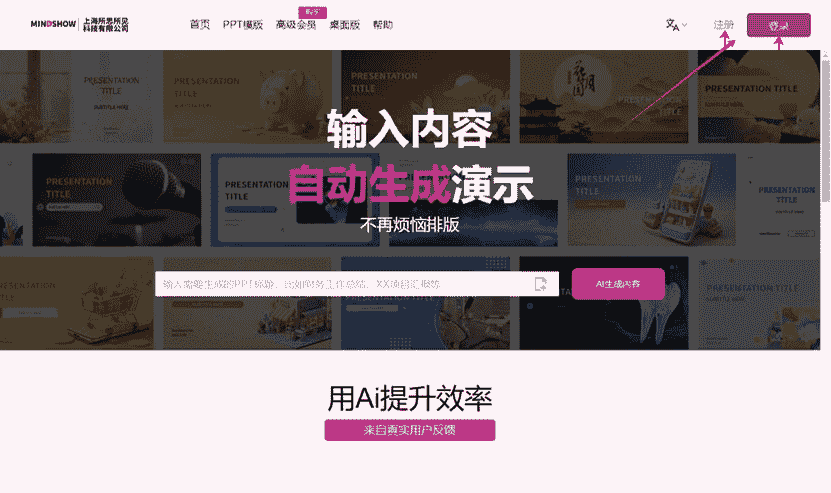

图 5-2 MindShow 的注册与登录

注册：在首页右上角点“注册”，可扫码关注公众号，也可直接下一步填写手机号完成注册。
登录：在首页右上角点“登录”，选择密码或验证码方式登录。

（3）导入生成 PPT，如图 5-3 所示。

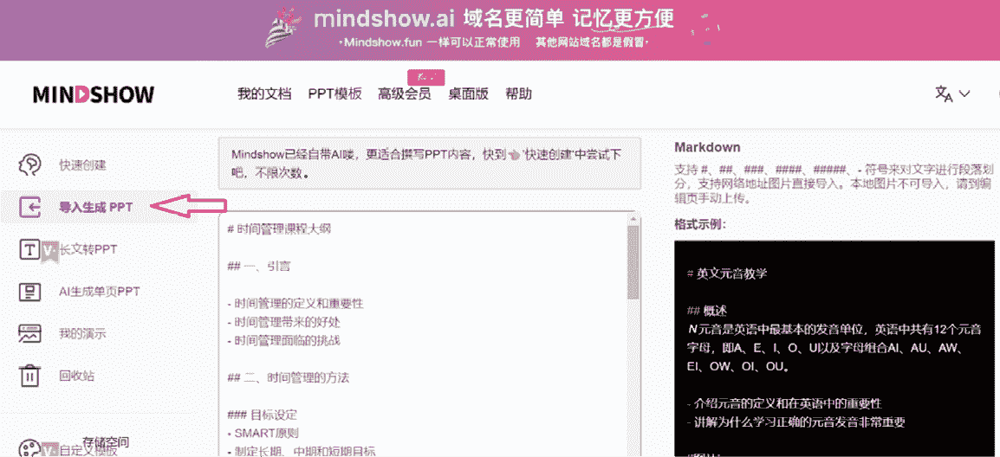

图 5-3 导入生成 PPT

MindShow 支持 Markdown、Word .docx、PPT .pptx、思维导图 .xmind .mm 和 Logseq 笔记等转 PPT。普通用户单次文本上限 6000 字符，会员可达 20000 字符。

备注：Markdown 篇幅过长需分页时可用“---”分隔。导入 Word 时需设置好“标题1”“标题2”“正文”“项目符号”“编号”等样式才能正常转换。

建议先用大模型把内容整理成 Markdown，再导入 MindShow 制作，效率和准确度更高。

（4）导入内容后点击“导入创建”按钮即可生成 PPT，如图 5-4 所示。

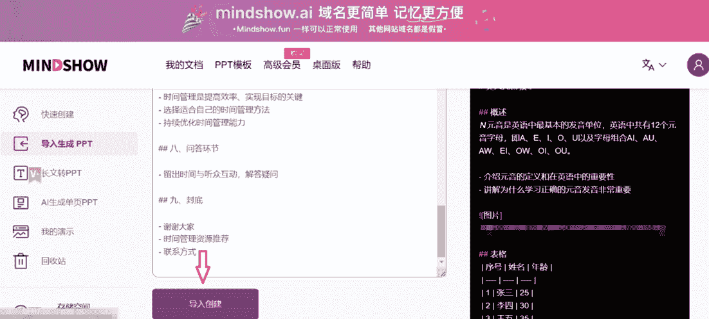

（a）

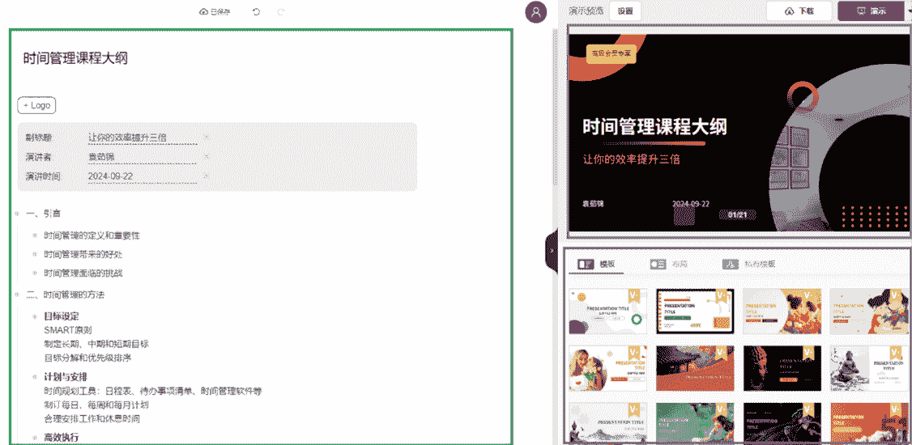

（b）

图 5-4 点击“导入创建”按钮生成 PPT

MindShow 的制片界面是左右双栏布局。左栏是提纲区，能直接改动主标题、副标题、讲者姓名、演讲时长、品牌 Logo，还可以对提纲层级和正文细节做精细化调整。右上是效果预览区，用左右方向键就能在不同页之间切换查看呈现效果。右下是版式管理区，进入“模板”标签可按需求挑现成的版式，进入“布局”标签可对单页的内容排布做微调，进入“私有模板”标签可调出在 MindShow 里自行编辑过的自定义版式。打开 MindShow 官网的帮助入口，就能查到完整的操作说明。

2. AiPPT

AiPPT 内置海量版式库和完整的在线编辑器，基本可以取代传统的办公演示软件。对文字、配图、图形、底色等元素都能做深度改写，个性化空间很大。

大致使用路径如下。

1 进入官网。

2 开户并进入系统，如图 5-5 所示。
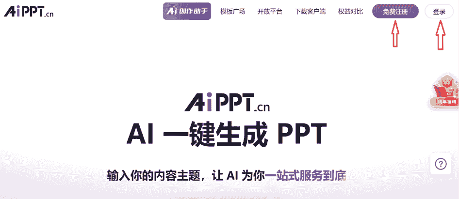
图 5-5 AiPPT 的开户与进入系统界面
开户：在首页上部点“免费开户”，按提示选开户方式即可完成。进入：在首页上部点“进入系统”，选择密码或验证码方式进入。

3 智能制作。首页点“启动智能制作”按钮，见图 5-6，进入新页后点“载入本地提纲”选项，见图 5-7。
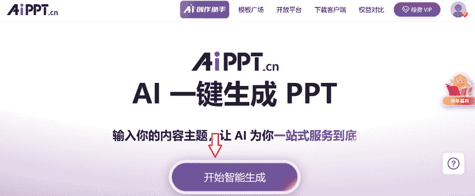
图 5-6 AiPPT“启动智能制作”按钮
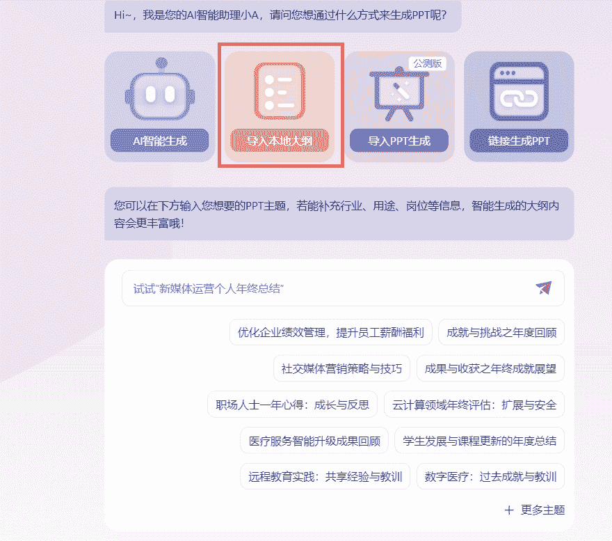
图 5-7 载入本地提纲
如果直接在下方文本框填写演示主题，系统会据此自动推导出提纲并询问是否认可，认可后直接产出演示稿。但底层大模型的推理与表达能力有限，成品的专业度往往不够，还是建议载入已经整理好的本地提纲。

4 文件导入，支持在线编辑和文档转演示。可用的格式包括 Word、XMind、PDF、TXT 会员、Markdown、FreeMind、纯文字文档 4500 字以内会员等，如图 5-8 所示。
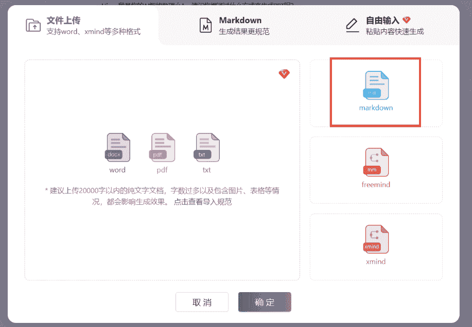
图 5-8 上传文件
提纲已整理好的情况下，可以直接打开中间的 Markdown 区，把做好的 Markdown 格式提纲复制粘贴进文本框，点击确定即可，如图 5-9 所示。
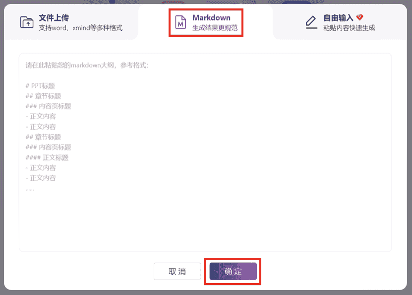
图 5-9 粘贴 Markdown 格式的演示提纲

5 提纲可视化。上传的 Markdown 会被解析成提纲样式，点击顶部右侧白色按钮即可进入思维导图视图，进一步浏览、修改、优化资料，确认后点视图底部的“挑选演示模板→”按钮即可，如图 5-10 所示。思维导图视图如图 5-11 所示。
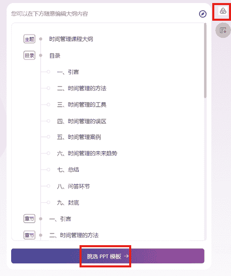
图 5-10 演示提纲生成展示的视图
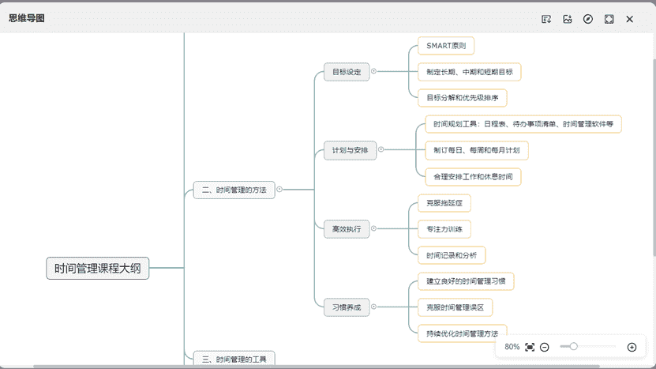
图 5-11 AiPPT 思维导图视图

6 版式挑选。可按使用场景、设计风格、主色调等筛选合适的版式，选定后点顶部右侧“生成演示稿→”按钮。挑选版式视图如图 5-12 所示。
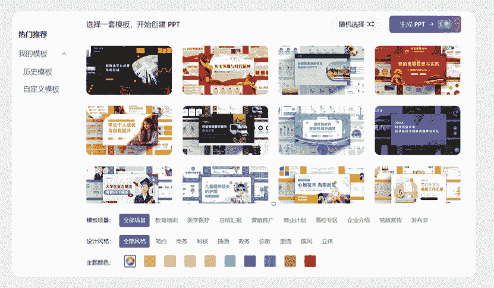
图 5-12 挑选版式

7 导出文件。网页端的编辑手感与传统演示软件几乎一致。编辑完毕后点顶部右侧“下载”，可选择导出为演示文稿、PDF 或图片，并能勾选“文字可编辑”，这样导出的文件在电脑上仍可继续修改，如图 5-13 所示。
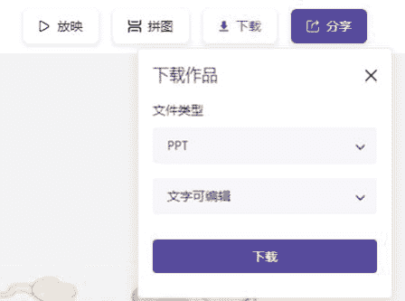
图 5-13 导出文件
在搜索引擎搜“AiPPT.cn 用户帮助中心”，就能看到“快速入门”视频和“操作指南”教程。

3. 讯飞智文

讯飞智文是免费的智能演示工具，底座是星火大模型，能自动产出演示稿并提供多种风格。线上编辑、实时预览、页面风格切换等功能都很完善，做课件很顺手。

使用方法如下。

1 进入官网。

2 开户与进入系统。
开户：首页上部点“注册”，选方式完成。进入：首页上部点“登录”，如图 5-14 所示，选择密码或验证码方式进入。
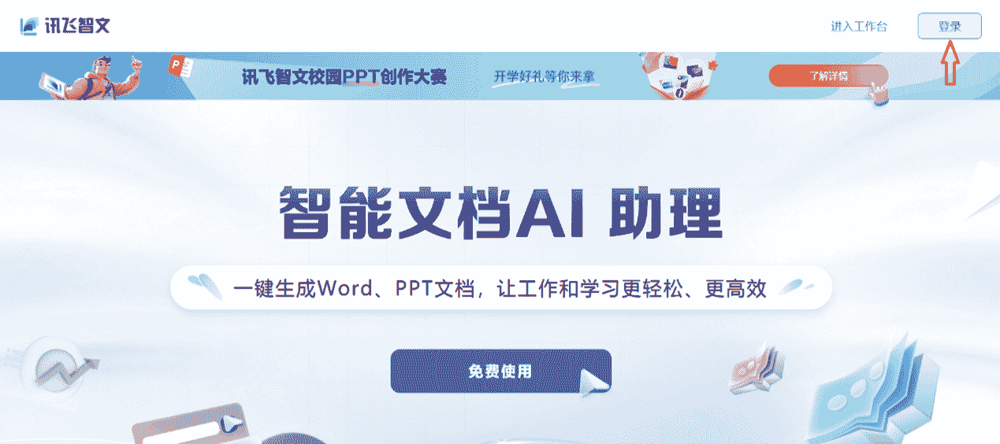
图 5-14 讯飞智文的登录界面

3 输入提纲和资料。首页点“开始”进入智能生成页，可选“文本生成演示稿”或“文档生成演示稿”，如图 5-15 所示。
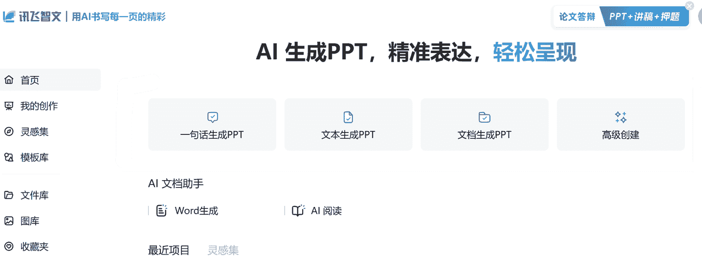
图 5-15 智能生成演示稿页面
文本生成演示稿页面可直接输入演示框架的文字资料，如图 5-16 所示。
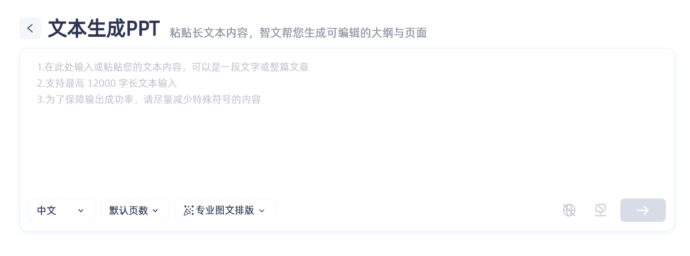
图 5-16 文本生成演示稿页面
文档生成演示稿页面目前支持 pdf、doc、docx、txt、md 格式。把智能生成的框架导出为这些格式后上传，系统会自动抽取要点生成演示稿。上传后等待信息提取，如图 5-17 所示。
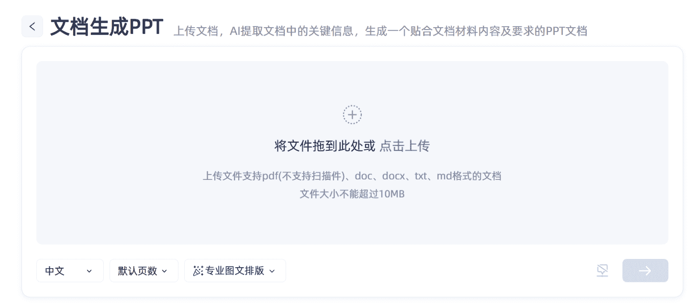
图 5-17 文档生成演示稿页面

无论选文本还是文档生成，都建议把页面下方的“基础排版”改为“专页图文排版”。

4 确认提纲。输入完成后点图 5-16、图 5-17 底部右侧的箭头，系统会把资料整理成演示提纲形态，可直接编辑。若不满意可点底部右侧的“重新生成”按钮，见图 5-18。
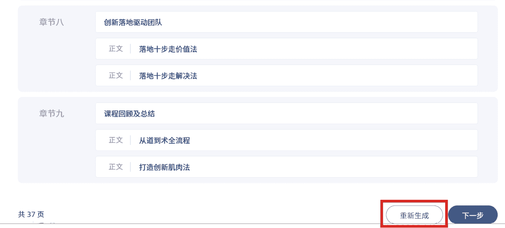
图 5-18 确认演示提纲页面

5 版式挑选。满意后点图 5-18 的“下一步”进入版式库，可按行业、风格、色彩筛选，选好后即可产出演示稿，如图 5-19 所示。
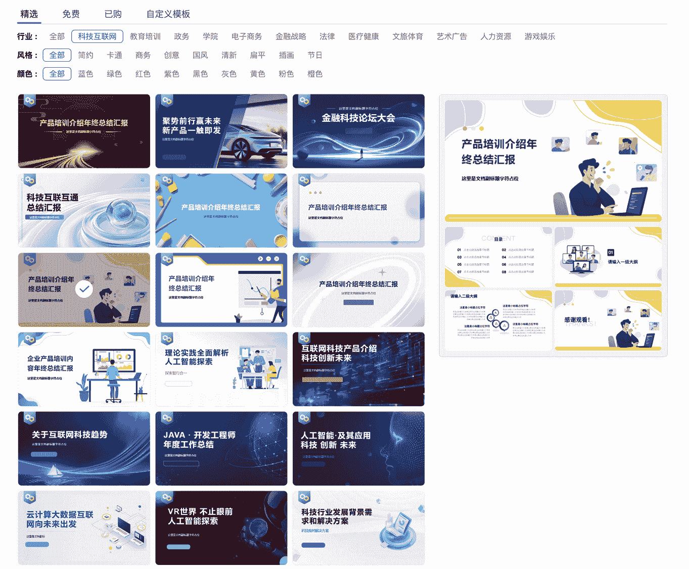
图 5-19 版式挑选页面

6 演讲备注。

点“演讲备注”按钮，智能会为每一页自动生成对应的讲解稿，如图 5-20 所示。
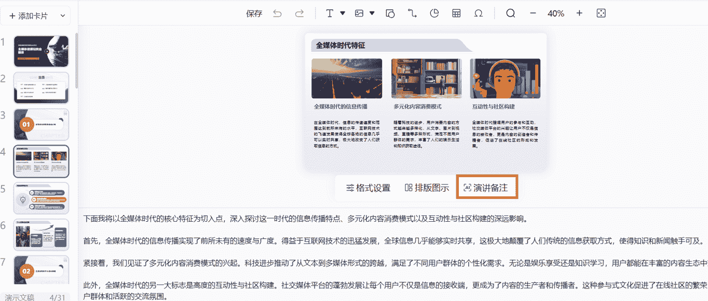
图 5-20 演讲备注页面
生成后每页正文都可像 PowerPoint 一样编辑，也能一键替换图形组件、把整页风格一键切换。

7 改写资料。选中任意一句话会出现智文智能工具条，可选择美化、扩写、精简等操作，如图 5-21 所示。
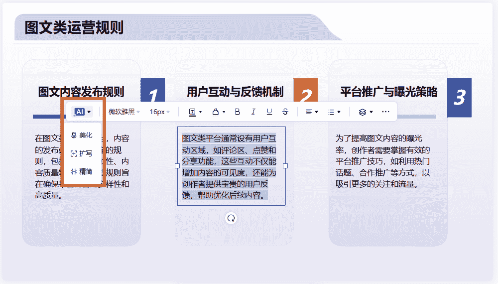
图 5-21 智能优化页面
可以反复与系统交互，不断调整文字和排版，让课件更贴合教学需求。

三种工具对比
MindShow 的长处是支持多格式文档导入生成，如 Markdown、思维导图等，版式数量多，可自由调整内容页布局，提纲生成后可二次编辑；短板是免费版式少，导出演示文稿格式需开通会员，未设置自定义版式时字体样式不可调。
AiPPT 的版式多且视觉上更精致，提纲有思维导图模式可在线二次编辑，页面样式自由度高，还能借助 Kimi 的演示助手免费使用；缺点是免费可产出页数有限，内容分类的逻辑和层次感不足，单页要点数量有上限。
讯飞智文能生成拟人化的讲解稿，支持“智能+手工”组合排版，会根据文本自动生成提示词，一键产出多张无版权智能图片，并打通第三方图库，整体成片质量相对更好；限制是普通用户可用版式受限，输入资料会被重新排布，无法完全保留原样。

选工具的建议
需求分析：先看制作频率、资料类型、风格偏好等。功能比较：对比版式量、编辑自由度、价格等。试用体验：建议三款都上手，挑操作顺手、最符合个人习惯的那一款。
技术在快速迭代，这本书出版时这些工具可能已大幅升级。保持好奇、持续尝试，才能找到最适合自己的那一款。
借助智能工具已能把课程资料高效转为演示稿，但智能只能提供框架，教学设计、互动逻辑等灵魂部分仍需制作者注入。

5.2 设计思维：排版美化，一目了然

演示稿的本质不仅是文字堆砌，更是把抽象文字转成图表、图片、动画甚至音视频，营造生动视觉场景，让复杂概念变简单，实现双向沟通。
新手常纠结版式、字体、图表样式，高手会先问：这个版式为什么用？有没有更合适的图表表达？字体色彩是否影响阅读？背景是否与论点协调？动画是否服务沟通？这份演示稿是否具有启发力和影响力？
演示稿设计是有程序的。常规制作流程 10 步：确定目标、构思提纲、组织素材、导入演示、挑选版式、优化资料、设计版式、调整风格、切换动画、正式宣讲。前 5 步已过，后 4 步考验设计功底。
高手能做出逻辑清晰、风格统一、信息适度、图文并茂的课件，从而提升信息传递和记忆效果。

5.2.1 逻辑清晰，确保条理分明

逻辑清晰是基础，指结构分明、层次明确，能引导学员理解与记忆。常用的做法有：明确培训目的，先想清楚学员要获得什么、记住什么、改变什么；据章节教学目标确定演示范围和重点；用智能提示词获得课程结构建议并在演示中呈现；用清晰标题概括要点；用编号或项目符号列出要点；保持页间连贯，避免跳跃或重复。
视觉上的清晰同样重要。可借助插入菜单的文本框、图片、形状来搭建页面。文字、图片、形状三者构成页面基础，即使初学者也要熟练。
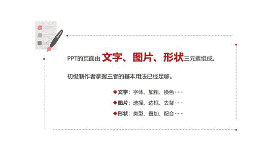
图 5-22 演示页面的三要素
以“假币收缴鉴定管理”为例，先看文字堆砌的版本，如图 5-23 所示。
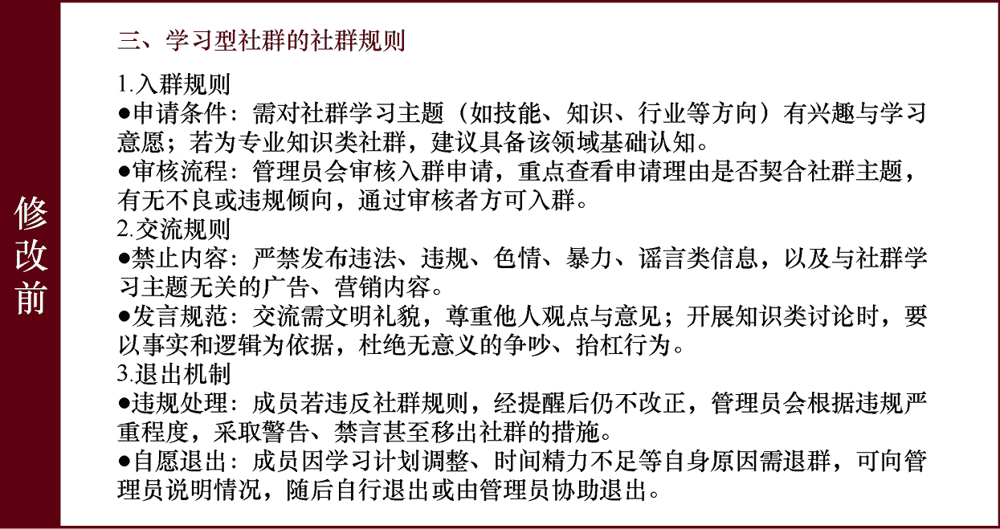
图 5-23 内容文字过多的演示稿
信息过载、条理不清，学员难以聚焦。第一次修改如图 5-24 所示。
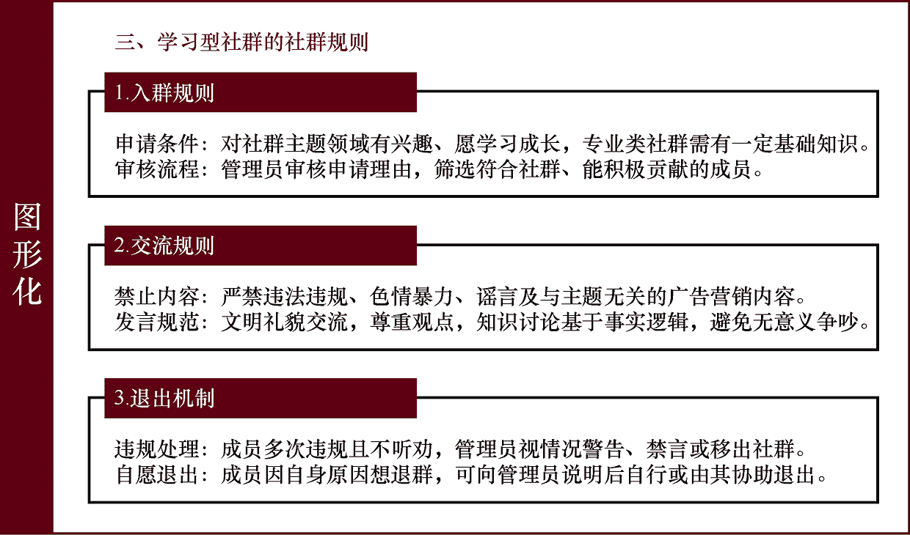
图 5-24 第一次修改后的演示稿
资料被精炼成 3 个要点，语言简洁，便于快速抓住重点。第二次修改如图 5-25 所示。
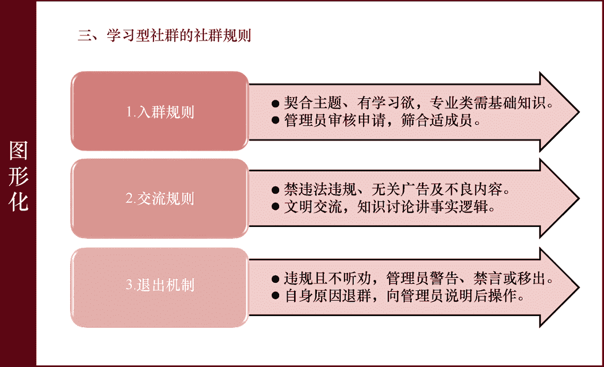
图 5-25 第二次修改后的演示稿
在此基础上做概念化、层次化和图形化，呈现更生动易记。
可见划分层次、用清晰标题副标题、编号项目符号、精炼表达，都能让逻辑更清晰。资料复杂时应提炼关键词，用小标题突出重点。
简洁不在于字数多少，而在于元素逻辑安排和中心思想的把握。

5.2.2 风格一致，确保整体美感

风格统一有三重价值：提升专业度，增强信任；提升美观度，带来和谐视觉；提升易读性，降低认知负担。
统一体现在字体、色彩、排版上。

1 挑选合适的字体
建议用微软雅黑、宋体等易读字体。字号建议 20 号以上，百人以上场合适用 24 号及以上。若文字不统一，可搜索“批量修改演示字体”。

2 控制色彩数量
色彩影响美观与信息效率。配色 5 大原则：清晰可读，文字与背景对比足够；色彩一致性，保持整体统一，主色 1-2 个加强调色；色彩意义，不同色彩触发不同情绪，蓝代表理性，绿代表健康，红用于强调；辅助色使用，用于标题、关键词，醒目但不刺眼；情感共鸣，考虑受众年龄、文化背景。
对比案例如图 5-26 所示，存在三大问题：色彩过多导致视觉混乱；文字过细，关键信息不突出；焦点分散。
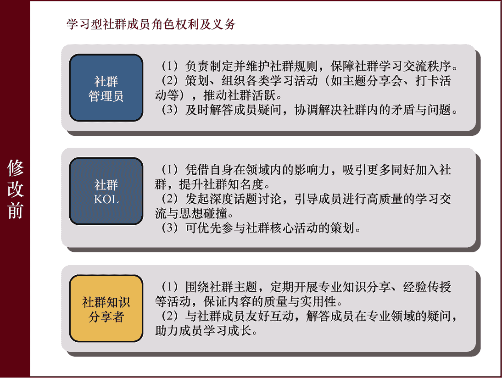
图 5-26 修改前的演示案例
精炼文字、减少色块和色数后，修改版如图 5-27 所示。
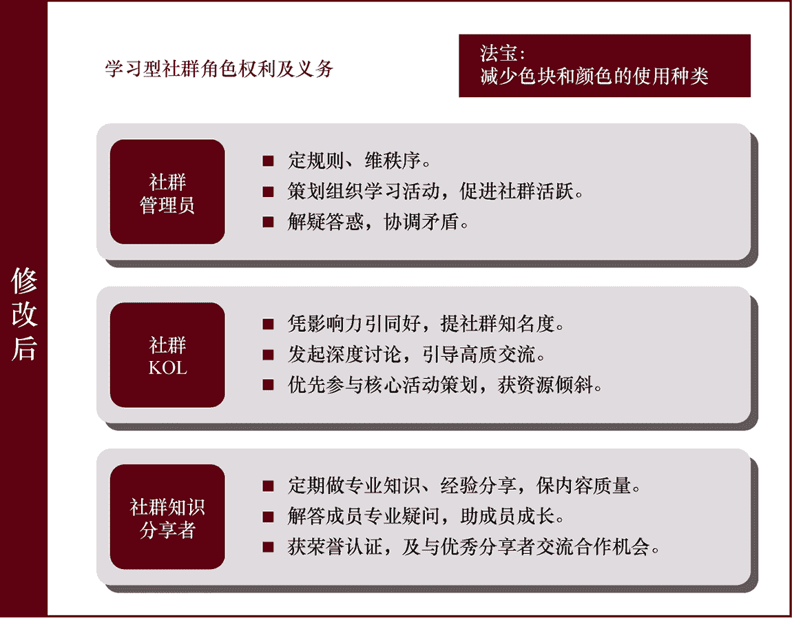
图 5-27 修改后的演示
合理的配色和排版能让信息传递更清晰，同时兼顾学员的视觉感受和心理反应，提高吸引力和教学效果。

**第三点，让排版保持统一**

字号、间距、对齐这些视觉细节一旦统一，整份 PPT 就会显得整洁专业。做到排版一致，关键在三方面配合。

先给同类内容配一个统一的版式框架，比如用母版锁定整体布局和设计元素；再给视觉素材定调，用风格相近的图片，避免杂乱感；最后规范列表形式，项目符号和序号的样式、段落缩进要全程一致。

**信息要适度，少即是多**

为什么要克制信息量

充分留白能让学员注意力不被信息淹没，更容易抓住重点；聚焦核心可以提升理解深度，减少遗漏；适量的输入有助于长期记忆，信息过载反而导致遗忘。

怎么让信息恰到好处

把冗长的句子和段落砍掉，用简洁直白的语言点出要点；把文字提炼成概念，用关键词或短句概括核心观点；把概念再做分层，用标题、副标题、要点列表搭建逻辑骨架；最后把分层内容视觉化，用表格、图形等方式呈现。

例如图 5-28 所示的页面，文字堆砌严重、信息密度过高。
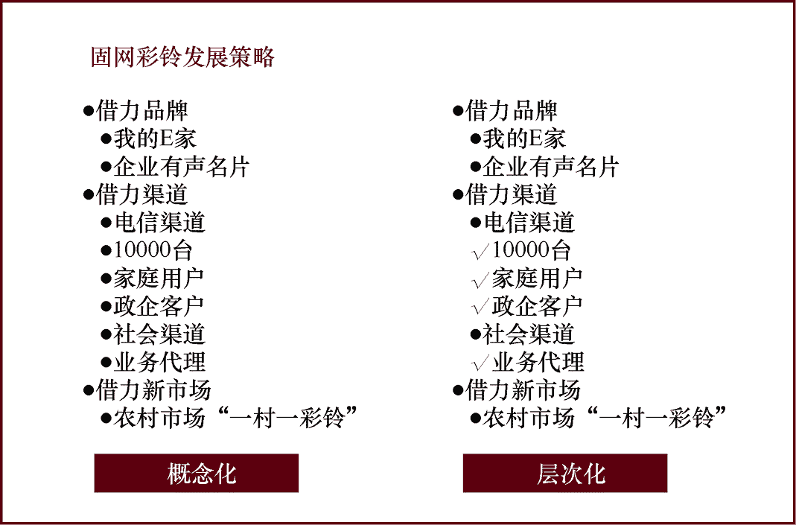
图 5-28 信息量大的负面案例

经过精简后，信息变得适中，阅读和记忆都更顺畅。调整后的效果如图 5-29 所示。
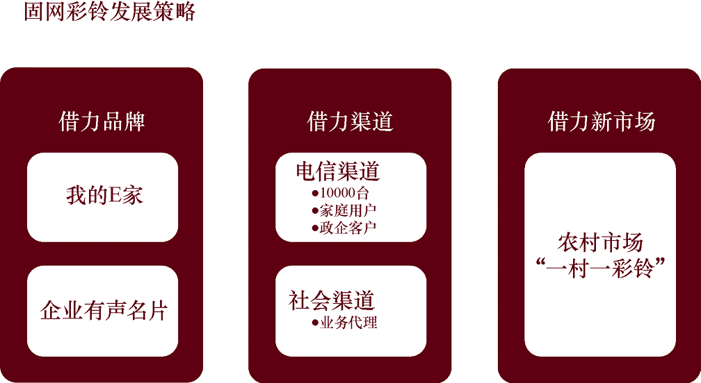
（a）
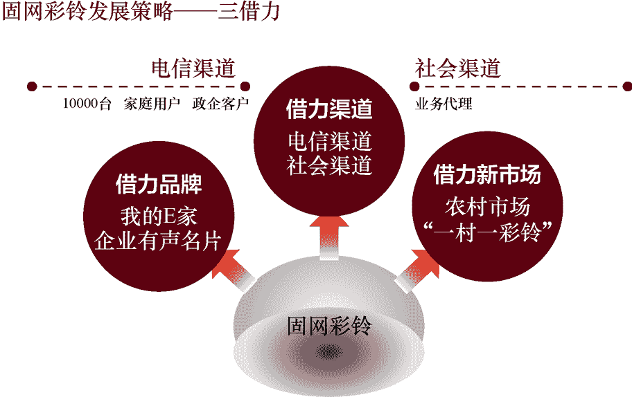
（b）
图 5-29 信息适量的调整案例

通过简写、概念化、分层和图形化，PPT 既便于学员理解，也更有利于信息在脑中沉淀。

**图文结合，让视觉更有吸引力**

图文并茂就是在幻灯片里合理搭配文字、表格和图像，分配好三者的比重，让内容更生动形象，讲授效果更强。俗话说，文字不如字幕，字幕不如表格，表格不如图形。

它带来的价值有三点。丰富的视觉元素能抓住注意力，提高吸引力；图片和图表把复杂内容可视化，理解门槛更低；生动的画面会引发兴趣，帮助学员自然记住要点。

实现图文并茂主要有四种做法。挑选清晰美观且与主题相关的高质量图片，避开模糊像素化或无关素材；根据数据特性选用柱状、折线、饼图等合适图表，直观展示趋势；保持图片风格统一，避免视觉混乱；控制单页图片数量，太密会造成视觉噪音。

使用时需遵循五个设计原则。每页只传达一个核心信息，保持简洁不拥挤；表格和图片的风格要与整体 PPT 保持一致；用色彩、大小或位置突出重点；图表旁边配上简短说明，提供必要的上下文；图文逻辑要清晰，顺着授课思路展开。

图片用于培训属于商业用途，用图要留心版权。可选用明确标注可免费使用或已授权的资源，如 Unsplash、Pixabay 等；需要特定高质素材时，可从 Getty Images、Shutterstock 等图库购买授权；最稳妥的是使用自己拍摄或创作的素材；即使免费使用，也应尊重创作者，注明来源或致谢。

到这里，PPT 美化的四个核心要素就齐了：逻辑清晰、风格统一、信息适度、图文并茂。把它们落实到实操中，就能提升授课效果，抓住学员注意力，实现更高效的信息传递与互动。

# 第六章 用 AI 构建学习体验

本章聚焦如何借助 AI 创造更好的学习场景，重点在教学方法的选择与培训形式的丰富。

如果把一门课程比作一个生命体，教学设计就是维系它持续成长的维生素。缺少维生素，再精彩的内容也会营养不良。

像人体需要维生素 A、B、C、D 精准配合，高效课程也需要四种教学设计维生素。

维生素 A 用案例拆解、可视化呈现，把抽象知识讲明白，破解内容枯燥的问题。
维生素 B 靠互动练习、复盘设计，帮助学员巩固要点，避免学了就忘。
维生素 C 通过场景化导入、节奏把控维持专注，解决心流中断，提升吸收效率。
维生素 D 搭建核心观点加分支逻辑的骨架，让内容衔接有序，告别结构松散。

课程若出现以下症状，就说明缺维生素。
内容抽象学员难懂，缺维生素 A。
知识点零散学后无痕迹，缺维生素 B。
学员走神参与度低，缺维生素 C。
逻辑混乱没有主线，缺维生素 D。

关注微信公众号“醒职场”，回复“维生素”，阅读《进来测测看，你缺的究竟是哪一种维生素？》。

接下来切入选择教学方法时最常见的三个痛点，并给出对症的处方。

## 6.1 选择教学方法的常见困惑

你的内容学员到底记住了多少？学习金字塔给出了解释。

这是美国缅因州国家训练实验室的研究成果，不同学习方式在两周后的平均留存率不同。金字塔以图形呈现，如图 6-1 所示。
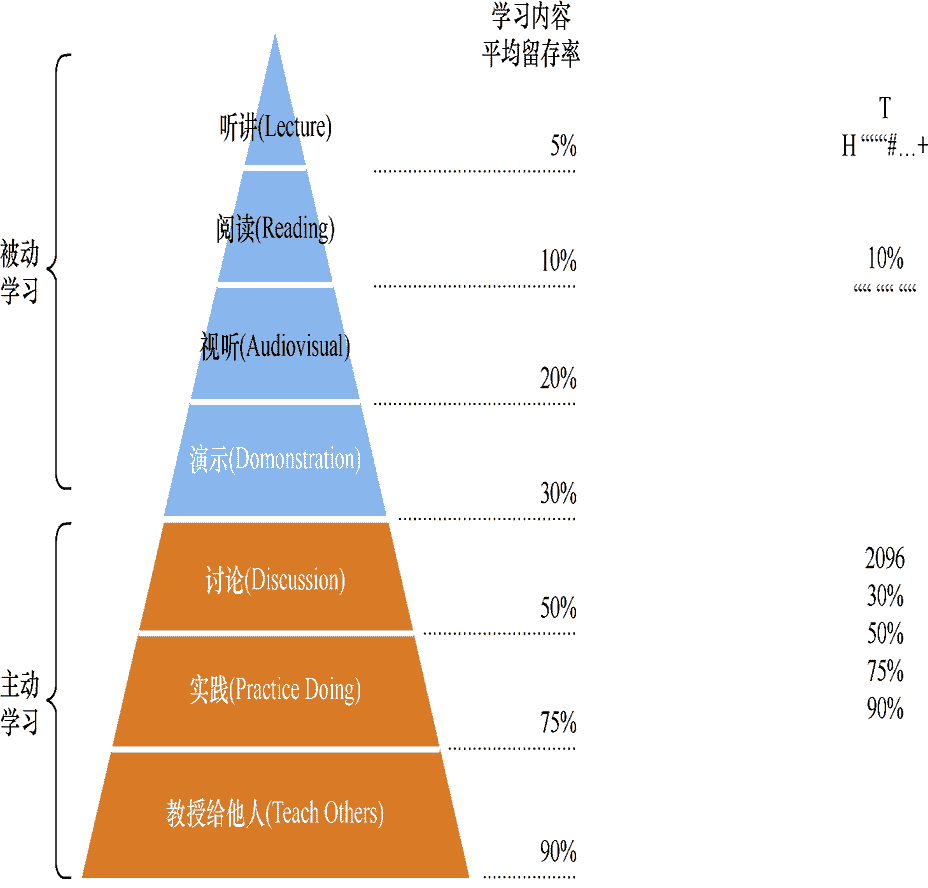
图 6-1 学习金字塔

被动学习如听讲、阅读，留存率通常在 30%及以下；主动学习如讨论、实践，留存率超过 30%；其中教给他人达到 90%，是最高的方式。

教是最好的学。教别人的过程既是强化记忆，也是举一反三。

核心思想是增加交互式活动，让学员参与进来，并通过应用来加深理解记忆。

教学方法决定内容能否有效传递。有效的标准是学员在工作或生活中产生行为变化。你讲完，未必能转化为实践。因此要思考怎么讲、怎么设计体验，才能让所学真正被使用。

有效传递的前提是学员成为学习的主人。只有当学习以学员主动参与为主，而非培训师单向讲授，学员才会在活动中分享、讨论、建构、实操、演练，从而真正理解吸收，并在课后迁移应用，产生改变。

要实现学员主导，需要培训师具备方法选择能力和体验设计能力。实践中常见三个问题。

问题一 方法不科学不系统。不少培训师半路转行，方法多靠看书视频模仿，选法凭个人喜好而非现场需求，导致执行偏差。

问题二 不知如何选择。方法要匹配内容、目标、学员特征，有时还要根据现场环境和氛围即时调整。备课时需要预判哪些环节需体验深化、哪些需引发思考、哪些需学以致用，这依赖经验积累。

问题三 应用不到位。有人懂方法但实操或控场能力不足，教学效果打折。

比如一家零售企业请人做团队协作培训。设计很实战，讲一段就演练。其中一个环节用案例呈现销售、市场、运营三角色利益冲突，要求分组扮演并讨论行动方案。

按规则三组应隔开讨论，不能互看结论。但场地狭小，组间很近，讨论声互相干扰，场面混乱，角色扮演效果大打折扣。

可见，教学方法的选择与落地是系统工程，不是技巧堆砌。

## 6.2 教学方法设计的底层逻辑

做一个选择，以下哪种结果最能激发你学习？

学到的东西能解决某个问题；能避免某个问题的发生；在学习中能与伙伴交换观点；在学习中能通过体验悟出新知。

四种结果分别对应成人学习的四大原则。

原则一 自愿。学员要感知课程对个人的意义，动机才会启动。以会议管理为例，可先用问题讨论法请学员聊聊会议为何无效、乏味、耗时。把原因列出后告知有三个工具可改善，并提问大家是否想知道。先唤起痛点，再给出希望，自然引发兴趣。

原则二 经验。学习时大脑会把新信息与已知知识关联，这个同化过程需要唤醒既有经验。领导力培训时可问管理者是否经历过团队时而涣散时而凝聚的感受，并探讨影响因素。学员分享后引导深入，理解更深刻，投入也更高。

原则三 自主。成人希望被视作独立个体，享受思考与决策。培训中要创造多样机会让学员表达观点，通过思想碰撞获得启发，并鼓励自主探索解决方案，掌握学习主动权。

原则四 行动。培训要落到应用。安排贴近工作的实操演练，理解会更牢。以客户服务为例，分组角色扮演客户与客服，在模拟冲突中现场解决问题，课堂即能提升应对能力，回到工作中可快速迁移。

做到四点，参与度和积极性自然提升。课堂反馈不一定等课后，可从三个角度即时观察。

教学活动是否促进理解吸收。活动后困惑减少、知识点更清晰，说明有效。
是否激发内在学习动机。学员是否感到有趣、有好奇、有成就感、获得认可。
是否营造积极协作氛围。活动不应制造紧张压力，而应鼓励开放坦诚的交流。

教学方法不是流程或形式，而是让课程深入人心的核心杠杆。优质设计带来四大赋能，如图 6-2 所示。

引爆效果，减少对单向灌输的依赖。多样的体验创造沉浸式学习，大幅提升留存并锁定注意力，减少分心。
打破沉闷。精巧设计让过程生动有趣，学习成为主动探索的旅程。
深化理解与记忆。脑科学表明大脑多通道处理信息，需视觉、听觉、触觉协同。
视觉化呈现把抽象转为图像图表动画；
听觉刺激用讲解、音乐、案例故事增强接收；
触觉体验靠实物操作、模型搭建、角色扮演深化掌握；
精细编码把知识分类归纳关联，形成系统记忆框架。
推动即学即用。方法自带实践属性，通过模拟真实任务让学员在课堂完成试错、反思与应用，从知道理论到会用技能。
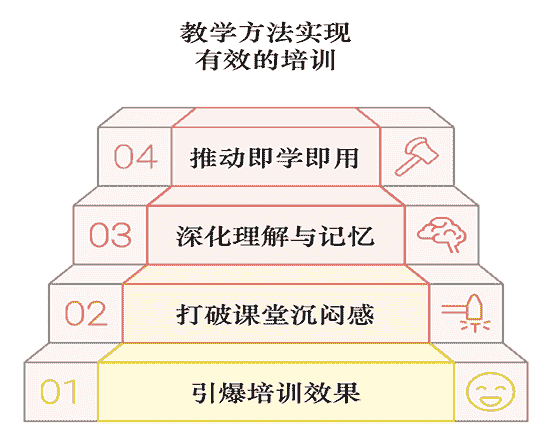
图 6-2 四大核心赋能引擎

## 6.3 九种教学方法的实操技巧

有效的教学方法既能传递知识，又能激发兴趣、提升效果。接下来介绍九种经典方法：课堂讲授法、案例教学法、角色扮演法、道具教学法、问题研讨法、技能演练法、游戏活动法、学思测评法、视频教学法。每种方法都有明确流程和注意事项，执行到位才见效。

6.3.1 课堂讲授法

课堂讲授法，简单说就是靠老师的口头表达把知识点讲清楚的一种方式，也是培训现场出现频率最高的基础手段。它很适合用来拆解重要的概念和理论框架，但一旦遇到需要动手操作的技能和方法，单纯讲就很难见效。

它的优势在于传达速度快、成本低、覆盖面广，几乎所有课程都离不开讲授，而且能保证知识点的系统性和连贯性。

问题也在这里。如果一堂课全靠讲，学员的自主学习意识会被弱化。没有互动就很难调动参与感，也难以做到因材施教，更别说启发思维了。讲授不等同于培训，培训的核心在于训练。训练才是让学习产生转化的关键，讲太多就会挤占练习和实践的时间。

在使用课堂讲授法时，要做到观点明确、重点突出、逻辑清晰、论据充分。以下是常见的五种让讲授更有效的技巧。

图 6-3 课堂讲授法的 5 种技巧

技巧1：举例说明
干巴巴的说教不如一个例子有力，举例最适合用来解释概念。
比如讲“伪需求”，可以说在汽车出现前，“要一匹跑得更快的马”看似合理，实则根本没触及用户真实痛点；而福特造出的汽车才真正满足了人们更快更安全出行的需求。现代的例子也可以用“上门洗车”来说明：看似便利，实际市场体量小、需求频率低、时效性差，也是一种伪需求。有了例子，学员理解起来会更快。

技巧2：运用故事
故事比道理更容易被记住。一个好故事要有起伏的情节、有血有肉的人物、有冲突有矛盾，最后收在有启发性的结局上，就能抓住注意力，让观点在潜移默化中被接受。
比如讲一个创业者历经挫折最终实现目标的故事，既能激励情绪，也能让学员在情节里学到经验。

技巧3：引用数据
数据能让判断更有分量，引用时要标明来源。像艾媒网的数据就显示，2020年中国知识付费用户规模约4.2亿人，2023年突破5.7亿人，预计2025年将达到6.4亿人。这组数字清晰地说明了市场认可度在持续提升，未来空间依然很大。

技巧4：运用比喻
把抽象的概念用具象的生活物象替换，是降低理解门槛的好办法。
有博主曾把阅读分为四类，用食物来类比：底层认知类书是主食，专业工具书是蔬菜，拓宽边界的书是汤羹，生活类书是甜点。比喻形象，容易记。
找不到合适比喻时，可以借助AI把专业术语转成“小白语言”。例如提问：请用外卖、快递、打游戏的场景解释“稳定币”和“区块链”，要通俗易懂。
AI会给出类似的解释：用100元买游戏皮肤的场景里，稳定币就像支付时用的100元现金，价值稳定不受波动；区块链就像包裹的物流追踪系统，每一步记录都公开、不可篡改、永久可查。可以总结为：稳定币=稳定的现金，区块链=诚信的快递追踪系统。这样无基础的学员也能快速get到核心。

技巧5：展示图片
一图胜千言，合适的视觉素材能直接击中感知，比纯文字更快传递复杂信息，让内容更生动。

6.3.2 案例教学法

案例教学法是把理论落地到真实情境中的方法，通过分析真实现状或模拟案例，帮助学员理解复杂局面并学会解决问题。

案例教学法不等于案例讲解。案例教学法是让学员成为主体，通过研讨真实或虚构案例来锻炼问题解决、批判性思维和决策能力。常用于高等教育和专业培训，要求学员深度研究、撰写报告、角色扮演或做模拟决策。其核心是学员主动参与，并把案例中的解法迁移到现实中。

案例讲解则是培训师主导的单向分析，讲清背景、情境、关键因素和可能结果。可以独立使用，也可作为案例教学的一部分，目的是帮助学员理解案例内容。

两者目的不同：前者培养多角度思考和解决问题的能力，后者侧重理解案例本身。前者强调小组讨论、角色扮演等主动形式，后者以讲解和被动接收为主。

案例教学的一般流程分六步，如图6-4所示。
1. 案例设计。明确案例要带出的观点和核心知识点。
2. 案例呈现。可采取PPT、讲故事、视频漫画、情境模拟或直接发放资料等形式。
3. 提出问题。培训师要引导学员围绕既定方向思考，避免发散失焦。
4. 引导分析。通过提问把学员从表面现象推向本质，从碎片化走向体系化。例如在管理类案例中，学员可能重新理解管理的意义和团队关系的边界。
5. 团队共创。创造讨论条件，让不同视角碰撞融合，形成更宽、更具适应性的解决方案。
6. 总结提炼。帮助学员提炼核心要点和可复用的方法，强化学习成果。

图 6-4 案例教学法的实施流程

一个典型案例是：某办公软件公司频繁接到客户投诉，调查后发现大多是因为客户没看产品手册，误以为功能不能用。手册枯燥无人阅读。问题来了，企业可以如何改善？
这个案例有实战性、典型性、真实性、完整性和冲突性，且没有标准答案，发挥空间大。

本质上，案例教学法把学习的主动权从讲师转移到学员身上，不再满足于“告诉你发生了什么”，而是追问“如果你在现场会怎么决策”。在商业环境快速变化的今天，培训师不可能给出所有答案，但能通过案例培养学员应对复杂挑战的思维框架和解决问题的能力，这才是长期价值。

6.3.3 角色扮演法

角色扮演法是为学员设定一个情境，让其扮演案例中的角色，从角色立场思考行动，以此实践所学，也让讲师及时发现漏洞并纠偏。

它的价值在于：
• 强调“做中学”，参与度和互动性更强；
• 基于真实背景设身处地解决问题，真实感和临场感强；
• 通过身临其境的模拟，学员掌握情况一目了然，实效性高；
• 现场点评促进反思和自我提升。

使用时要注意的特定要求，如图6-5所示。
• 使用真实的工作背景资料，引发共鸣；
• 角色定义清晰，明确参与者、背景、职能和立场；
• 为每个角色设定任务目标，目标可量化也可以是关系型；
• 设计足够的冲突，避免任务过于简单。冲突需要学员经过探索、分析、预测后才能行动，结果不确定时学习深度更高；
• 归纳解决方案，既点评表现，也总结该类场景的有效做法；
• 设置观察员。讲师自身就是观察员，需记录语言、动作、表情等信息；也可安排未参与的小组担任观察员，分配不同观察任务，既能带动全员，也能提供新视角。

图 6-5 采用角色扮演法的特定要求

例如在为汽车4S店销售顾问讲“谈判技巧”时，可分成三组：一组扮演购车客户，两组分别扮演不同4S店。客户需与两家店谈判后做选择，扮演客户的学员分享选择原因。总结环节会让大家对谈判技巧有更深的体悟和记忆。

使用要点：
• 给予鼓励，让学员放松演绎；
• 提前明确规则，情境、立场、目标要清晰，台词可自由发挥；
• 过程要控场；
• 提前设计点评框架，确保反馈有针对性。

6.3.4 道具教学法

道具教学法是用实物作为辅助，通过视觉、触觉等感官刺激来帮助记忆和理解。
比如讲解颜色浓度与透明度时，用三杯白开水滴入不同浓度蓝墨水，让学员直观比较。

在讲“领导力性格魔方”时，用四种风格迥异的杯子代表DISC四种行为风格，把杯子的特征与行为风格对应起来。学员看到杯子就能联想到对应的风格特点。道具教学法示例，如图6-6所示。

图 6-6 道具教学法示例

使用注意：
• 道具必须贴合主题，不要为用而用；
• 讲解与展示同步，解释原因，形成记忆锚点；
• 道具要降低理解成本，而非增加负担。曾有培训用玩具汽车类比社群运营，反而让学员更困惑；
• 活动后引导学员分享感悟并做总结，凸显道具价值。

6.3.5 问题研讨法

问题研讨法是围绕一个有讨论价值的问题展开集体讨论，借助群体智慧找解法，强调开放性、全员参与和达成共识。问题研讨法示例，如图6-7所示。

图 6-7 问题研讨法示例

其特点有四：开放性问题无标准答案，探讨空间大；全员参与避免少数人主导；通过讨论形成共识；记录观点沉淀集体智慧。

实施步骤：
1. 明确具体问题。先定义焦点，再阐明研讨目的。例如在沟通课程中可问“如何实现有效倾听？”
2. 规定答案框架并约定规则。设定边界和数量方向，确保讨论不跑偏；约定秩序规则保证有效进行。
3. 引导小组协作讨论。可设置组长、记录官、时间官、协调官、陈词官等角色。建议采用“3153”流程：3分钟独立思考写下至少5点，1分钟轮流分享，5分钟自由讨论，3分钟由组长归纳结论。
4. 分组展示结果。可采用文字、图像、动作、语言等多种形式，相互学习。
5. 讲师归纳解决方案。对各组结果总结提炼，形成完整方案。

小组角色设置能提升沉浸感。组长掌控进度并总结，记录官保存关键点，时间官提醒进度，协调官化解分歧，陈词官汇报成果。

注意事项：明确答案框架；遵循“三不”原则，即不随意评价、不轻易批评、不隐藏观点；采用多种展示方式让分享更生动。

6.3.6 技能演练法

技能演练法是针对工作所需能力，让学员在现场实操以达到掌握或熟练应用。只要课程涉及操作，就应尽量安排演练，也是实战性培训的核心。

比如讲思维导图，就让学员现场画一张；讲即兴演讲，就让学员现场讲一段；讲公文写作，就让学员现场写一篇。通过真实演练，能力才会转化。

想让培训真正落地，方法比热情更重要。下面这套内容把我在实战里反复验证的教学打法拆开讲，从纯实操到体验设计，再到用AI扩容你的教学工具箱，核心逻辑一点没变，只是换了更顺口的表达方式。

**先说技能演练法，这是一门手艺课的标配**

前提先说清楚：带实操的课，讲师自己得先把标准吃透。你连“做到位长什么样”都说不清，就没法示范、没法点评、更没法判断学员是否过关。

一个完整的演练闭环，通常要走六个环节。
第一步，锁定一项具体、可观察的技能，不要泛泛而谈。
第二步，把技能的要点拆解讲透，讲清“为什么这样做”。
第三步，现场示范。如果受限，拿过往学员的实操片段或成果作为参照。
第四步，学员上手练。给到充足的时间和情境。
第五步，针对演练表现给出即时反馈，帮学员纠偏。
第六步，回扣要点，根据共性问题挑几个关键点再聚焦讲一遍。

落地时要把握三件事。
第一，讲的同时要给看。没有演示就只有概念，可以放一个思维导图绘制过程视频，也可以直接展示一篇有参考价值的文案，让学员有参照系。
第二，前后对比要可视化。课前摸清学员基线，比如先收一份PPT，课后让学员用同样主题再做一份。肉眼可见的进步就是培训有效的证据。
第三，现场点评要即时且分层。有人做得漂亮就拿出来当标杆，带动其他人对齐；有人典型但有问题，就边辅导他边把易错点讲给全场听。

做实操还有五条纪律。
过程要主动介入，别当观众。要走到学员中间督促、引导、陪练。
标准得提前说清，合格、良好、熟练分别是什么样，学员才有方向。
点评要稳准温柔。别摆专家架子，多找闪光点，缺点用建议的方式提示。
流程要设计好，保证学员按部就班就能把技能练出来。
好案例要立刻展示。有人练得好就请他现身说法，既给他荣誉感，也给全场一个可复制的样本。

**游戏活动法，让学习先动起来**

游戏不是噱头，它在四种情境下特别好用：开场热场破冰、承上启下引出下个主题、学员注意力涣散时拉回来、需要体悟道理时的沉浸式体验。

我带过一个同理心工作坊的开场，用了“用肢体语言懂你”的小游戏。先让学员从一堆配图卡片里挑一张喜欢的，然后围圈做自我介绍：说名字、展示卡片、解释为什么选它、它带来什么感受。介绍完，其他人要用一个动作回馈“我眼中的你”。我先示范自己选向日葵，说自己像一个种花的人，等花开就把阳光和温暖带给大家，然后请大家用动作回应。示范完大家就懂了。游戏结束后提问：刚才谁的动作让你感觉被懂了？当时什么感受？大家纷纷说被看见、被理解、被关注，话题自然滑向肢体语言如何表达同理心。

用游戏要守住四条线。
游戏必须服务主题，氛围一致，能把内容带出来，别为热闹而热闹。
时长和数量要克制，一般一次5到15分钟，太多会失焦。
控场能力是底线，节奏、规则、收尾都要牢。
可以加入小组竞赛，增加对抗感和参与度。

**学思测评法，让学习边学边照镜子**

学思测评把输入、反思和自我评分绑在一起，帮助学员理解内容、对照实践、量化差距。

常规三步是：先学，再思，后自评。
学：讲师把流程、核心动作讲清楚，让学员有清晰认知。
思：把讲的内容和学员真实经验挂钩，用引导性问题把它激活，比如“拜访客户时你是否按关键流程走了？”“哪个环节你常用的动作是什么？”
自评：学员对每个关键动作打分，3分=做得好，2分=有时做到但不完美，1分=很少做或不会做。

这三步在课堂里往往是滚动进行的，保持注意力在线。以拜访客户6步法为例，讲一步就让学员停下来想自己在这个步骤的表现，再给自己打分。手册上列着六个关键步骤：准备拜访、约访客户、轻松暖场、引导期望、介绍产品、获取承诺。每个步骤都有核心动作提示。评分结束后安排小组分享，大家说说为什么这么打分，能互相借鉴。要注意强调这是自我认识，不收集个人分数，放松学员防备。

**视频教学法，用看得见让知识变轻**

视频教学以视频为载体做传授和训练，靠直观、动态、可回放的特性提升学习效率。

它有几个明显好处：画面声画结合把抽象变具体；线上可暂停回放，学习节奏自主；能还原实景或模拟案例，贴近真实应用；对销售话术、软件操作、动作拆解这类实操内容尤其友好。

优势也清晰：降低理解门槛，可视化帮助快速建立认知；视听结合记忆留存率明显高于纯文字；一次制作多次复用，适配线上线下和自主学习，降低重复成本。

使用时要注意三点。
播放前先交代背景、主题和关键人物，不然片段式剪辑容易让人懵。
播放后一定要给讨论和分享的空间。不同人视角不同，碰撞后认知才融合。
讲师要用提问引导思考，可按四个维度循序渐进：数据维度，比如还记得哪些画面、哪句话触动你；体验维度，比如哪个片段最有兴趣、最投入、联想到什么经历；思考维度，比如视频揭示的核心点是什么、学到了什么新东西；行动维度，比如对未来工作有什么帮助、下一步怎么用。

视频是工具，不是目的，必须围绕教学目标设计。

**九大经典教学方法速览**

课堂讲授法靠系统讲解传递知识。
案例教学法用真实案例层层剖析，促进理解和迁移。
角色扮演法模拟真实情境，提升实践和问题解决能力。
道具教学法借助实物或象征物增强直观和趣味。
问题研讨法通过提问激发思考加深理解。
技能演练法靠实操练习和反馈提升技能掌握。
游戏活动法用相关游戏提升参与度和体验感。
学思测评法边学边量化评估，巩固成果。
视频教学法用视听组合让知识更容易吸收。

除了这九种，还有联系活动、绘图活动、拼地图活动等很多能保持专注和兴趣的形式。

关于选方法，三个常见疑问。
怎么精准选？别盲盒式挑选。看三个维度：课程要传递的知识技能或思维目标是什么；学员的基础、学习习惯和认知特点是什么；你本人能驾驭的方法长什么样。看人下菜碟才是核心。
怎么判断有效？别只看课堂热闹。有效是学员回到岗位后能用得上、做得好，行为改变和结果提升才是检验。
一门课只能用一种方法吗？完全不需要。一堂高能课程像交响乐，讲授打底、案例启发、实操转化、讨论碰撞，动态切换才能全程在线。

**AI对话法，让培训设计更快更丰富**

深夜想不出怎么让知识点生动、怎么让课堂像游戏、怎么保持学习热情？AI可以当你的新助教，帮你梳理论讲解路径和设计学习活动。

以构思知识点讲解步骤为例。先了解主流教学模型，比如ADDIE的分析设计开发实施评估，Dick and Carey的系统化流程，Kolb的经验学习循环，ASSURE的技术整合模型，加涅的九步教学流程。了解后就能让AI按模型来写。

提示词模板可以这样用：现在请你作为资深培训师和课程开发专家，告诉我培训市场上主流的、知名的教学过程模型有哪些。根据目标对象可加上适用于成人/儿童。

拿到模型后继续细化，比如：现在你是一位经验丰富的课程开发师和培训师。我需要设计主题为“FAB营销方法”的课程，请帮我用加涅的教学流程来设计这个知识点的讲解步骤，要求通俗易懂、有趣有料。

AI给出的加涅九步示例是这样的：先用一个营销案例视频引起注意；明确学员将学会FAB的定义和运用目标；激活先前知识，让学员分享已知的营销方法并介绍FAB是Feature优势Benefit的缩写；用PPT图解呈现特性、优势、利益三层构成；通过案例分析和小组讨论提供学习指导；角色扮演销售场景引出行为表现；提供点评和改进反馈……

AI不是替代你，而是把你的教学思维扩容。思路清晰的人用AI会更高效。

知识点讲解的拆解与学习活动的转化是教学设计的两大支点。智能助手在两方面都能提供可落地的思路。

先看讲解环节的拆解。以 FAB 方法为例，将讲解节奏落在评估行为表现与促进保持和迁移这两个关键点上打磨，整体表达会更清晰、记忆点更鲜明，也能真正推动理解向运用转化。走完这条线，抽象概念就会变得通俗、有趣且好用。

这种拆解也印证了智能助手在教学设计上的额外价值。从内容自动生成，到教学模型的梳理，再到个性化学习路径的搭建，每一步都能看到助力的痕迹。

**6.4.2 借助智能助手构思知识点的学习活动**

除了拆解讲解步骤，智能助手还能把知识点转化为可操作的练习。

问题讨论型、技能演练型、案例分析型这类基础活动，智能助手很容易把握其逻辑与表达方式。给出明确指令后，就能快速得到成型的活动方案。

提示词模板 24：借助智能助手构思知识点的学习活动

请扮演一位资深课程开发专家与培训师。我正在开发主题为“×××”的课程。

课程中有一项知识点是“×××”，其含义为×××，请为该知识点设计学习活动。

要求：分别设计以下 3 种活动。

1. 问题讨论型学习活动
2. 技能演练型学习活动
3. 案例分析型学习活动

可以只让助手生成一种，也可以要求三种以上，甚至把 6.3 节提到的 9 种教学方法一次性提供，让助手按对应方法生成。

下面以项目管理课程为例，示范助手在活动设计上能给出的启发。

提示：请扮演资深课程开发专家与培训师。我正在开发“项目管理”课程。

项目管理中有一个知识点叫“复盘”，含义是项目结束后对全过程进行回顾与分析，以总结经验、提炼教训并指导后续行动。请为“复盘”设计学习活动。

要求分别设计以下 3 种活动：
1. 问题讨论型学习活动
2. 技能演练型学习活动
3. 案例分析型学习活动

示范回复如下。

1. 问题讨论型学习活动
活动名称：复盘圆桌会
活动目的：通过集体头脑风暴，让学员真正理解复盘的价值与做法。
活动步骤：
开场导入：讲师先点明复盘的定义与意义，强调其在项目管理中的位置。
分组头脑风暴：学员分小组，每组挑选一个熟悉的项目，结合以下问题展开讨论：项目收尾时如何系统性复盘？复盘过程中常见阻力有哪些，怎么破？复盘结论怎样落地成改进动作？
观点碰撞：各组派代表上台分享讨论成果。
教师点评：讲师补充专业视角，给出优化建议。
活动材料：项目案例资料、讨论提纲、白板或便利贴。

2. 技能演练型学习活动
活动名称：模拟复盘工作坊
活动目的：通过仿真演练，让学员把复盘的方法上手会用。
活动步骤：
理论铺垫：讲师讲解复盘常用流程与技巧，比如数据收集、问题拆解、经验提炼。
角色扮演：学员分组，分别扮演项目经理、执行成员、客户等角色。
实操演练：各组挑选一个模拟项目，按复盘流程走一遍。
成果陈列：各组展示复盘报告，包含回顾、问题诊断、改进建议。
反馈辅导：讲师逐组点评，给予实操指导。
活动材料：项目管理模拟案例、复盘工作表、计时器。

3. 案例分析型学习活动
活动名称：案例深潜——复盘大师
活动目的：借助真实案例，让学员看到复盘在实战中的具体呈现。
活动步骤：
案例呈现：讲师提供一至多个真实项目复盘案例，包含成功的复盘实践。
深度剖析：学员独立或小组分析案例，找出复盘的关键节点与影响。
要点探讨：围绕转折点、决策点、学习点展开讨论。
代入思考：学员分享“如果我是项目经理，会怎么复盘？会做什么不一样的决策？”
总结收官：讲师引导提炼案例教训与方法论，并点出背后的逻辑。
活动材料：真实复盘案例资料、分析工作表、投影或大屏。

可以看到，智能助手不仅把三种活动的流程写得很细，还补充了培训师该如何反馈、需要准备什么材料，甚至为每个活动起了吸睛的名字，有点像遇到一个默契的教学搭档。

借助智能助手，教学内容可以实现更精细的个性化，学员的学习体验也更沉浸。对培训师或内容创作者而言，拥抱智能助手不只是追随技术潮流，而是提升教学质量、增强参与感的必然选择。

有了智能助手的支持，能把更多精力放在教学本质上：点燃兴趣、加深理解、强化应用、提升体验、促进学以致用。

智能助手更像一副放大镜与显微镜，能放大创造力、让我们看到更多可能性，但创意与洞察依然离不开人。

最打动学员的培训，往往是能激活内在动机的培训。认清这一点，才能把智能助手用得准、用得好。

实践练习
从自己的课程里挑选若干知识点，让智能助手撰写讲解步骤，再让它设计对应的学习活动。

# 第七章 轻松变现，智能助手解码课程变现

本章从课程组合体系、包装打法、变现路径出发，讲清楚课程如何实现持续变现，以及智能助手如何成为助力。

## 7.1 组合策略，打造课程组合体系

智能助手辅助课程开发的终极目标，不是做单堂课程，而是搭建一个可以自我运转的课程生态。

本节会带你设计可复制、可扩张、可升级的课程组合。

你是否遇到过这些困境：
• 课程做得很用心，市场反馈却一般；
• 学员学完就流失，很难产生复购；
• 想涨价，却怕被说割韭菜。

别急，问题可能不在内容本身，而在产品结构上。

做课程像做产品，单打独斗不如组合出击。

下面是一个 5 维自检清单，大约 3 分钟，能帮你判断距离可变现的爆款体系还有多远，也能厘清你的课程商业思维现状。

这个自检适合已有课程的培训师，按下面 5 个维度结合实际给分，1-5 分。
• 0-1 分：几乎没做过，也没想过；
• 2-3 分：有尝试，但不系统，浅尝辄止；
• 4-5 分：已形成标准打法，能稳定产出效果。

课程商业思维 5 维评估表，如表 7-1。

表 7-1 课程商业思维 5 维评估表

序号 名称 核心问题 具体评估指标
1 内容思维→产品思维 你提供的是“知识”还是“解决方案” • 课程覆盖学员从不会到做到的完整路径
• 按学员成长阶段设计对应课程，如入门/进阶/实战
• 课程能帮助学员达成具体目标，而非只讲知识技能
2 单品思维→矩阵思维 你是否构建了“课程产品家族” • 拥有多门课程，且课程间逻辑清晰，如高效阅读→读书写作→读书变现
• 设计出低价引流→中价系统→高价私教/训练营的产品链
• 学员可在体系内持续学习、升级、复购
3 销售思维→推广思维 你是否有系统的课程推广策略 • 通过短视频、公众号、小红书等渠道持续曝光
• 低价引流课能撬动新学员咨询后续课程
• 不担心高价无人买，定价与价值匹配
4 定价焦虑→分层变现 你是否能通过定价梯度实现稳定变现 • 涨价时学员认可价值，不会有太贵的质疑
• 课程体系有清晰价格梯度，如 9.9 元→199 元→999 元
• 用产品经理视角思考需求、痛点、决策路径与转化节点
5 单一角色→多重身份 你仅是讲师，还是课程产品设计师 • 定期调研需求并迭代课程产品体系
• 分析学员学习行为，推荐适配的后续课程

把 5 个维度得分相加，再对照表 7-2 定位阶段。

表 7-2 测试结果解读表

分数区间 阶段定位 现状特征 核心问题
5-12 分 单课思维者 • 内容扎实，学员反馈不错 • 学员学完即走，缺乏复购 • 只有单点课程，缺少链路与体系化设计，课程被当成独立商品，未进入学员成长路径 • 不知如何关联课程，推广只能强调单课优势
13-18 分 组合尝试者 • 已开发关联课程，如入门+进阶、技能+实战营 • 有价格分层，会思考学员后续需求 • 有组合意识但缺乏系统设计，产品逻辑不清晰，目标学员路径、入口/旗舰定位模糊 • 课程衔接生硬，高价课转化低，推广缺乏体系感
19-25 分 产品架构者 • 课程逻辑顺序明确，价格梯度合理，学员升级路径清晰 • 推广能打组合拳，老学员会主动问进阶课 • 需优化矩阵稳固性与效率，如明确免费课、解决选择困难、设计必学组合包、促进老带新

一门好课赢口碑，一套好课赢市场。无体系课程和有体系课程的对比示意，如图 7-1 所示。

图 7-1 无体系课程和有体系课程的对比

运营课程要聚焦赛道，长期投入，建立系统化课程体系和清晰品牌定位，走长期主义而非短期套利。

想象把军队比作课程体系，面对不同战场需要不同武器与战术。学习旅程同理，需要不同课程与资源组合应对不同挑战，这就是课程组合体系。

1．课程组合体系

课程组合体系从基础到进阶、从入门到精通，覆盖多种课程与资源，让学员全面深入掌握知识，也让进取心强的学员能持续攀升。

我认识一位做时间管理的学员。他先用化书成课的方法做了一门时间管理课，反响不错，短期效果也明显。但时间一长，学员又回到老样子。为此他建了克服拖延的打卡社群，学员靠持续打卡有了进步。

交流中他发现，时间管理差的核心是目标不清，于是又做了高效能目标管理课。

接着发现目标有了，计划仍会“抛锚”，原因是缺复盘。于是他又推出了复盘能力课。

再后来，学员反馈动力难以持久，他开设了为期 16 周的个人成长教练训练营，提供长期陪伴式赋能。

最后，一些把他当榜样的学员想成为教练，他又开了个人成长教练弟子班。

这些产品都基于真实学员痛点迭代而来，而不是闭门造车。粗略算，他的后续产品收入比最初的时间管理课增长了 10 倍以上。

在知识付费赛道，单课很难持续吸客，构建组合是关键。

优秀的课程组合应该彼此补位、互相导流，满足不同需求。通过为不同痛点开发课程并保持互补，你就能在知识变现中占据持续空间。

时代不确定，课程组合能对冲风险，满足多元需求，保持稳定。

一个实用的组合建议是：获客型课程+高价值核心课程+增值赠品课程+口碑建立微课。这四类基础课程能让变现路径更顺畅。

（1）获客型课程：吸引学员的入口
获客型课程用免费资料、低价促销、拼团、直播福利等方式把人引进来。价格可以很低，目标是获客而非盈利。
策略是先予后取：先给价值，让学员认识、认同、信任你，再谈后续收费。
记住，产生付费行为的次数比单次付了多少钱更重要。

（2）高价值核心课程：高价值的学习投资
高价值核心课程是经过系统设计、能解决实际问题的专业课，每个知识点都可落地。价格自然不低，但回报远超投入，还常附带陪跑、答疑、作业批改、资源对接等服务。
形式多为线下私房课、线上实战营、私教陪跑、社群会员等。它体现你的核心竞争力，虽贵却物超所值。

（3）增值赠品课程：意外的附加惊喜
增值赠品课程可以是与线下课、企业内训配套的线上录播，或电子书资料，作为增值赠品，帮助学员预习与巩固，也能单独售卖。赠送时能极大提升惊喜感与价值感。

（4）口碑建立微课：口碑建立的基石
口碑建立微课通常是微课或短视频系列，价格低或中等，目标是快速建立认知与信任。
成交都建立在了解与信任上。平台上课程的学员数本身就是社会证明。微课聚焦一个具体问题，给出清晰解法，就能不断累积学员数与信任。

例如时间管理系列微课可以这样拆：
• 克服拖延症的 3 个法宝
• 三大奇招提升专注力
• 如何发掘内在动力提升执行力
• 结果导向的思维训练
这套微课既可打包也可单卖，既能完善你的知识图谱，也能在学员遇到问题时精准投喂，建立专业信任。学员人数越多，信任越强，核心课程转化越顺。

线上课程可以分级，以价格区分含金量。初级、中级、高级，或入门、进阶、专业、专家，都是常见打法。

比如“魔鬼决策力——让你跳出心理陷阱”系列，按难度分为三节：突破思维局限、思维升格三大攻略、规避决策失误 3 个锦囊，分别定价，形成入门到高阶的路径。

2．课程组合体系变现地图

课程组合体系变现地图，如图 7-2 所示。

图 7-2 课程组合体系变现地图

如果你要推高客单价的精品课，就要锁定高端人群，做高价值核心课程，提供一对一辅导、个性化服务、陪跑等，形成差异化竞争力，让学员获得超值体验。

如果你想扩量，就要做传播力强、覆盖面广的低价课，聚焦学员痛点，做有趣又有用的获客型课程。单场录播或 3 场直播，靠真实案例与问题解决建立特色，吸引潜在学员关注，再导流到其他课程。

增值赠品课程则可用于感恩回馈或活动推广，既可赠送降低体验成本，也可单独售卖，提升学员惊喜感。

若想用知识型内容来回应潜在受众的提问并承接注意力，可以围绕单一明确痛点搭建一套线上微课组合。每一节只解决一个当下真实的难题，这类内容在市场上常被归为培育信任的微课。随着持续输出，获客会逐步形成自驱。持续解决实际问题，就能在受众心智里沉淀信任与口碑，规模会慢慢累加，影响力也会扩大。

吃透这条路径，商业化节奏就会变得可预期、可掌控。规划得当、执行到位，就能达成营收目标，在知识付费赛道站稳位置。

整体上，课程打法要善用矩阵思维。
• 以顶端产品塑造差异优势。
• 以中腰产品形成信任背书。
• 以入门产品实现薄利引流。
• 注意产品间的交叉区域，避免内部竞争。

可参照表7-3的课程产品变现规划表来搭建自身矩阵，并测算未来收入潜力。

表7-3 课程产品变现规划表
分类 产品名称 交付内容 服务时长 课程配套福利 课程单价 月售出目标数 月售出销售额 年收入预期
引流课
回报课
福利课
信任课

7.2 初见即心动，课程包装思路
信息流里声音过载，作为课程主理人，个人品牌凭什么被听见、被记住、被跟随？
答案藏在一组简洁公式里：IP辨识度 = 内容 × 呈现形象 × 持续统一感。

当输出内容与外在形象高度吻合，个人品牌才有了人设质感：像老友一样好辨认，像金句一样易记忆，像自传播一样扩散。
课程呈现不是换封面那么简单，而是从品牌内核提炼一个核心锚点。这个锚点要浓缩价值观、凸显专业力，也是学员产生初见好感的理由。

接下来用三步把课程打造成吸睛体质。
• 重塑宣传海报——不是单纯美化，而是把专业人格可视化，让画面成为形象的延伸。
• 锁定核心卖点——避免自嗨罗列，直击受众痛点与痒点组合，凸显价值。
• 锻造课程文案——用大白话讲故事，替代术语轰炸，让人读完产生报名冲动。

从此你不再是信息流的背景音，而是受众心中的首选答案。
本章会讨论宣传设计、差异卖点的提炼、文案撰写，以建立长期品牌认知，让课程在竞争中脱颖而出。

7.2.1 如何为课程产品设计海报
海报承担品牌价值传递的功能。优秀的画面能点燃兴趣，促使用户深入了解。设计时要兼顾受众特征和信息呈现方式。

动笔前先把定位想清楚，要能回答：
• 这门课为谁而做？
• 它解决哪些具体问题？
• 它有什么独特主张？

例如《情商修炼手册》定位为职场人的情绪管理与人际交往工具，帮助缓解工作中的情绪压力与关系困扰。

一张课程海报需要传递的信息大致有十项，如表7-4所示。
表7-4 课程产品海报设计需要传递的10个关键信息[关][键][信][息][信][息][解][释][课程标题主标题][+][副标题，使潜在学员一眼就能看到课程内容与价值课程价值能为学员带来的好处，如技能提升、知识增长、解决问题的能力等目标受众适用于哪类人群，帮助潜在学员判断课程是否符合他们的需求讲师资质讲师的专业背景、头衔、经验和成就，增加课程的可信度和吸引力课程内容课程大纲、教学模块、学习路径等，让学员对课程内容有清晰的了解教学方式如直播课、录播课、线下课等，以及是否有额外的辅导或支持服务学习成果完成课程后能够达到的学习目标或获得的能力认证，激发学员的学习动力价格策略如果有促销活动或折扣，应该明确标出成功案例或评价分享展示有过往学员的正面评价或成功案例，增强新学员的信心品牌形象通过设计风格、色彩搭配、文字描述等方式展现课程的品牌形象和价值观，建立品牌认同感]

把这十项信息有机组合，学员才能快速理解课程意义。精美的画面能抓住眼球，传递核心价值，推动转化。

下面看两个实操案例。
案例1：让孩子蜕变的家庭教育培训课。
“让孩子蜕变的家庭教育培训课”海报示例如图7-3所示。海报的彩图文件，已放在本书的配套资源中，关注微信公众号“醒职场”并回复“AI 课程”即可获取。

图7-3 “让孩子蜕变的家庭教育培训课”海报示例
该海报在标题之外传递了7个关键信息，如表7-5所示。
表7-5 “让孩子蜕变的家庭教育培训课”海报传递的7个关键信息[关][键][信][息][信][息][解][释][目标受众针对有孩子的家长（特别是][0][～][18][岁孩子的父母）、计划或即将为人父母者，以及教师及教育相关工作者，这表明课程的目标人群非常明确，方便潜在学员判断自己是否属于目标受众讲师资质头衔强调了孙老师的专业背景，她不仅是全国家庭教育高级讲师，而且从业][30]
 [年，家庭咨询案例超] [2] [万例，还有教育专家推荐，增加了课程的权威性和可信度课程内容分龄分阶段进行针对性指导，还能拿到一张完整的教育地图，明确未来][20][年究竟该帮助孩子做哪些准备，这显示了课程的全面性和深入性成功案例或评价通过截图展示了来自学员的真实反馈，这些正面评价可以增加潜在学员的信任感教学方式]["][直播课][+][录播课][+][专业答疑团队][+][一对一辅导][+][社群支持]"]["的学习形式，说明课程具有实时互动性，并提供针对性指导，增强了学员对课程的价值感知、提高了课程性价比价格策略团购立减][500][元并赠送育儿][AI][工具礼包，鼓励更多人一起购买品牌形象绿色色调给人温馨、蓬勃、成长的感觉，符合家庭教育的主题；老师的照片传递出亲和力和信任感；设计元素如铅笔、信纸、树叶等图标，使得整体视觉效果更具成长感，也暗示课程不会过于严肃或学术化，而是强调实用性和易读性]

案例2：读书会创始人运营课。
“读书会创始人运营课”海报示例如图7-4所示。海报的彩图文件，已放在本书的配套资源中，关注微信公众号“醒职场”并回复“AI 课程”即可获取。
上述课程海报宣传的是“读书会创始人运营课”的线上训练营产品。从设计和内容上来看，该课程产品在海报设计上除了课程标题还传递了7个关键信息，如表7-6所示。

图7-4 “读书会创始人运营课”海报示例
表7-6 读书会创始人运营课海报传递的7个关键信息[关][键][信][息][信][息][解][释][目标受众目标受众是想要创办或提升读书会运营能力的人群，特别是希望打破传统读书会困境的创业者或者爱好者讲师资质介绍了主讲人的身份，包括]["][我是好讲师]"]["大赛全国总冠军导师、《化书成课》畅销书作者、]["][促动式读书会]"]["创始人等，以增强课程的专业性和可信度课程价值明确列出学员将获得的收益，包括系统的方法技巧、实战工具和落地方案，强调了课程的实用性，并提供][1][份读书会运营地图和][7][份读书会运营工具资料包作为额外资料，增加对学员的吸引力课程内容列出了详细的课程内容，涵盖读书会的顶层设计、用户群体定位、内容运营、品牌设计等方面，使潜在学员能够清楚了解课程覆盖的内容范围学习成果突出了课程亮点，提供案例支持和完整的理论体系，帮助学员轻松掌握读书会运营。特别强调了课程的优势，如]["][顺势而为]"]["，利用用户生命周期理论助学员事半功倍品牌形象黑金配色显得高端大气，金色麦克风象征着演讲和分享，符合主题；讲师的照片和个人简介放在显眼位置，进一步强化个人品牌效应文字简洁明了，使用了诸如]["][打破读书会难逃的魔咒]"]["这样的引人注目的语句，引发潜在学员的共鸣和好奇心价格策略活动价与原价形成对比，可以将潜在学员从]["][观望者]"]["转化为]["][行动者]"]["，提升课程的报名转化率]

两个案例都突出了讲师背书、内容详情、价格优惠和超值感，目的是吸引报名。
画面不是一次性工程，需要持续迭代。随着反馈和需求变化，要不断优化，确保核心价值精准触达。
在这个过程中，保持细节敏感和创新开放，是保持领先的关键。
最终，课程产品海报应如同一面镜子，不仅映照出课程的独特魅力，也反映出学员内心的渴望与期待。当这两者完美契合时，课程便不仅仅是知识的传授，更是一场心灵的共鸣与成长的盛宴。

如果你想让人工智能给海报设计出主意，可以用下面这个提示词模板。
提示词模板25：请人工智能提供课程海报设计的建议
- 角色：课程海报设计专家
- 背景信息：用户需要设计课程海报，希望通过人工智能的帮助，结合课程价值、目标受众、讲师资质等关键信息，设计出能够精准吸引潜在学员的课程海报。
- 专家定位：你是一位精通课程海报设计的专家，对课程的核心价值传递、视觉元素选择、信息呈现方式有着深刻的理解和丰富的实践经验，擅长运用设计技巧和创意理念将课程的特点和优势直观地展示给目标受众。
- 技能：你拥有课程定位分析、视觉设计、文案撰写、信息架构设计等多方面的关键能力，能够精准把握课程的核心卖点，并将其转化为吸引人的海报设计。
- 目标：根据课程的核心价值、目标受众、讲师资质等关键信息，设计出能够精准吸引潜在学员的课程海报，确保海报在视觉和信息传达上都能达到最佳效果。
- 限制条件：海报设计应简洁明了，突出重点，避免信息过载，同时要符合课程的品牌形象和价值观，确保设计的原创性和吸引力。
- 输出格式：提供海报设计的详细描述，包括色彩搭配、视觉元素选择、文案布局等内容。
- 工作流程:
1．明确课程价值、目标受众、讲师资质等关键信息；
2．根据课程特点选择合适的色彩搭配和视觉元素，确保与课程主题相契合；
3．设计海报的整体布局，合理安排文案和视觉元素的位置，突出重点信息；
4．撰写吸引人的文案，简洁明了地传达课程的核心价值和优势；
5．进行设计优化，确保海报在视觉和信息传达上都能达到最佳效果。
- 初始化：在第一次对话中，请直接输出以下内容。您好！作为课程海报设计专家，我将根据您提供的课程信息，为您设计出精准吸引潜在学员的课程海报。请告诉我，您的课程标题、课程价值、目标受众、讲师资质等关键信息，以及您对海报设计的特殊要求。

人工智能给出建议后，可以找专业设计师落地，或去稿定设计、创客贴等平台套用模板。
海报内容呈现顺序建议：
（1）课程标题：用最大字号，作为主视觉核心。
（2）课程价值：从学员视角解释能得到什么。
（3）讲师资质：姓名加头衔，建立授课资格感。
（4）讲师形象：在侧边或右下露出，增加真实感。
（5）受众标签与信任背书：放在次要视觉区，低干扰但可见。
总之，海报设计既是技术也是艺术，需要市场洞察力、创新思维和极致细节追求，才能做出符合定位又能转化的作品。

7.2.2 如何提炼课程卖点
卖点是课程本质的凸透镜——聚焦的从来不是光，而是燃烧的能量。
卖点是灵魂，是吸引的关键。要深挖潜在用户未被满足的需求，转化为差异化主张。

要点1：明确目标受众与需求。
先搞清课程为谁服务，他们的痛点是什么。通过调研、问卷、一对一访谈了解学习动机和期望，再提炼抓人的卖点。
例如职场新人更吃实用和快速提升，小型创业者更需要“10人以下小团队管理”而非空洞的“卓越领导力”。

要点2：突出独特价值与差异化。
对标同类课程，找到内容、教学方式、互动形式或实战效果上的不一样，并放大。
比如结合最新人工智能辅助教学，或“促动式读书会”能直达灵魂、让参与者念念不忘，都属于差异化。

要点3：简洁明了地传达卖点。
用大白话表达，让人一眼看懂。可用有力标题、短句或提问，结合案例和成果增强可信度。
学员买的是解决方案，不是听起来厉害的广告语。
可用的句式框架：
（1）强调解决实际问题的句式。
• 一招搞定……
• 告别……烦恼
• 快速解决……问题
• 一站式掌握……
• 轻松突破……难关
（2）强调改变和效果的句式。
• 对抗……困境
• 立刻改变……现状
• 让你快速提升……
• 从……到……，看得见的改变
• 实现……质的飞跃
（3）强调核心理念和价值主张的句式。
• 掌握……本质
• 用……思维重塑自己
• 重新定义……价值
• 理解……背后的逻辑
• 不是……，而是……
例如“重新定义营销的价值——大厂销冠教你3天搞定刁钻大客户”既有周期短、效果强的暗示，又勾起好奇。

要点4：利用故事或案例强化卖点。
人更容易被故事打动。融入真实案例，展示学员如何通过课程实现转变。
“故事化”设计思路，如图7-5所示。
• 确定故事核心：选一个学员通过课程实现改变的案例
• 构建故事框架：描述挑战、学习方法、最终转变
• 创造共鸣：强调共同体验，价值观对齐
• 行动号召：引导报名实现同样的转变

图7-5 故事化设计卖点的思路
比如领导力课程讲中层管理者用学到的技巧带多元化团队完成不可能项目；文案课讲新手用故事叙述技巧拿下行业大奖。
我的一名学员发现市面上亲子教育课都聚焦母亲，于是加入针对父亲的专章，强调父亲作用，结果产品立刻在市场上脱颖而出。

要点5：测试并优化卖点。
卖点要持续迭代。用社媒、平台、海报做A/B对比，看哪种表述转化更好，再不断优化。

提示词模板26：请人工智能提炼课程卖点
帮我设计一门课程的包装方案，请简单直接地说重点。以下是课程基本信息。
课程名称：     
适合人群：     （例如：职场新人/全职妈妈）
解决什么问题：     （例如：不会管理时间/孩子教育焦虑）
课程亮点：     （用1句话说明课程为什么值得买）
请帮我完成以下任务。
1．抓人眼球的标题：写3个不同风格的课程标题。（例如：直接说效果/用提问引发好奇）
示例：“3周告别熬夜加班！职场效率通关课”。
2．让人信任的卖点：用简单易懂的语言描述3个课程优势。（别用专业术语）
示例：“每天20分钟碎片化学习”比“模块化微课体系”更易懂。
3．视觉设计方案：推荐3种配色方案。（说明颜色给人的感觉）
建议配什么图片/图标。（例如：用时钟图标表现时间管理课）  
4．促销小套路。
• 设计2种优惠策略。
• 写1句让人想立即下单的促销话术。
特殊要求如下。
• 避免使用复杂的专业词汇，要使用通俗易懂的语言。
• 重点突出“学了能怎样”，而不是“课程有什么”。
• 加上1个与同类课程对比的小优势。（例如：多3节答疑课/价格便宜30%）
卖点不是营销的伎俩，而是课程与用户灵魂共振的回响。

7.2.3 如何撰写课程推广文案
你的课程文案就像电影预告片，需要瞬间抓住注意力并激发好奇。
可以用注意兴趣欲望行动四步法来组织。此框架代表消费者从接触到行动的四个阶段。
• Awareness（注意）。
• Interest（兴趣）。
• Desire（欲望）。
• Action（行动）。
按此流程写文案，能引导潜在学员逐步从注意到最终报名。
（1）注意。
使用吸睛的标题或开场白，让人第一眼就注意到你的文案。

把目光留在推广文案里，先得让读者抬头。抛出疑问、给出反常识数字、讲一个让人愣住的事实，都是常用的开场策略。

例如：你注意到没有？统计显示八成的人把一天耗在低效循环里，想不想尝试打破这个循环？

**注意**
吸睛以后要让阅读继续，这一步要把课程在讲什么、能带来什么具体改变写清楚。可以放一两段学员真实转变，或点出课程里最有记忆点的亮点，让潜在受众产生“这跟我有关”的感觉。

例如：完成“高效时间管理”之后，不少人表示终于把工作与生活调回平衡线，想看看他们的说法吗？

**兴趣**
此时要把课程交付的真实收获具象化，让人觉得缺少它就不行。把课程构成、独特优势以及跟市面上常见方案的差别列出来，购买冲动才会起来。

比如：该课程不只传授时间管理的底层逻辑，还配套实操工具包和真人陪跑，帮助你立刻把方法用到手上。

**行动**
收尾要给出斩钉截铁的下一步指引。可以加上试听福利、限量赠品等推动因素，让人马上迈步。

像这样：现在报名可享免费试听，前50名还送《时间管理手册》。

按AIDA走一遍，从吸引到成交的链路就会完整，转化自然提升。

结合多年实战，我把课程文案的打法提炼成组合公式：先勾起关注，再搭建信任，随后唤起渴望，接着凸显区隔，再呈现战绩，最后推动下单。

写文案时别只盯着自己觉得好，要换位到用户视角。用户买的是“对我的意义”，不是“你的自夸”。

以“化书成课”为例，用上面的公式可以这样展开。

**引发关注**
开头就用四个让人忍不住点开的提问做钩子。

• 单本图书，为何能拆解成不一样的课程？
• 各异的图书，又是怎么拼成一个课程？
• “化书成课”凭什么能带来五倍速的成长？
• 用“化书成课”做出来的课，为何跟原书不能完全重合？

这些提问像磁铁一样把注意力锁住。

**搭建信任**
成交的底座是信赖。快速建立信赖可从三方面入手。

• 展示往期学员的学习反馈和实际收获。
• 亮出讲师在该领域的职业履历、过往成绩和获奖经历。
• 用官方机构或行业KOL的推荐背书来加分。

在“化书成课”的介绍里，我就放了学员通过该课实现变现的案例，以及几位行业大咖的站台。

**唤起渴望**
把价值点说透，需求就出来了。比如“化书成课”经大量学员检验，能帮助做到：

• 精挑授课内容
• 规划授课节奏
• 搭建课程骨架
• 把书本里知识转化为教学语言
• 创新教学形式

更关键的是，这项能力像开车一样，可以学、会用、持续用。

对培训师、知识创作者、读书会发起人来说，这正是他们迫切需要的。但光有需求还不够，还要让人看到与众不同。

**凸显区隔**
课程不是流水线产品，而是针对性的解决方案。差异化能筛选出价值观相近的人群。在“化书成课”中，我强调的是创新、成果、体验三个维度。

• 在教学之外更重创新，让不同图书在现场被创新性融合嫁接。
• 在实践之外更重成果，让个人经验与书中理论无缝结合，当场产出高质量课程。
• 在输出之外更重体验，用体验式教学把理论变成学员难以忘怀的课堂记忆。

**呈现战绩**
用学员的结果说话。比如学员在“我是好讲师”大赛中摘得荣誉，以及学成后推出的课程产品带来的物质和精神回报。

**推动下单**
用赠品、名额限制、预约机制等手段引导行动。文案里呈现的价值要与真实交付匹配，让用户觉得物超所值。惊喜感和口碑，才是知识付费里最贵的资产。

写推广文案时可以用下面这个提示词框架：

提示词模板27：请AI撰写课程推广文案
你是一位资深的文案写作专家和知识内容创作者，非常擅长写课程推广文案，请为××课程写一篇有感染力的推广文案。课程对象是[××××]，课程价值是[××××]。

要求：
1. 按“引发兴趣→建立信任→激发需求→强调差异→展示成果→促成成交”顺序写作；
2. 有逻辑有温度，用细节和故事引发共鸣；
3. 体现专业背景和丰富经验（可用头衔和经验包括：×××）；
4. 插入2～3条真实用户评价，用引号标注，说明身份和收获；
5. 语气真诚专业，避免夸张用词；
6. 字数约1000字。

给课程做包装，就像调一杯好咖啡，海报、卖点提炼、文案编排都要恰到好处。这是一项持续测试优化的系统工程。

## 7.3 变现有道，课程产品变现路径

本节要讲如何画一张课程产品商业画布，为知识变现提供全局地图。本画布借鉴了《商业模式新生代》中的九宫格，并结合培训行业特性做了创新改造，提升了实用度。

融合后的课程产品商业画布如图7-6所示。

图7-6 课程产品商业画布

心里有地图，才能从容选路。除地图外，还需要一套决策方法论来优化导航。

地图源于全局观和远见，路线则因人而异，需要判断力。

**7.3.1 课程产品商业画布之重要合作**

合作不止是找个授课平台，更要找理念相通、愿景一致、愿意共行的协作对象。

合作不是单向索取，而是相互成就。

如果你做的是新媒体运营提升，脑中首先可能浮现培训机构和咨询公司。但别忘了新兴创业孵化器。孵化器里扎堆着大量初创企业，创始人和团队是最渴求新技能的群体。我的学员李铭就抓住了这片市场，与孵化器合作后，定期为创业者提供技能培训，并把他们转化为长期咨询客户和推广者。

**生活就是在某个点上持续精进，问题自然迎刃而解。**

傅帧专注新媒体营销培训，起初知名度低，课程难卖。他开始在抖音和视频号发实战案例和技巧短视频。早期播放量低，还收到质疑。面对负评他没有退缩，积极回复、改进拍摄、提升内容密度。流量慢慢起来，正反馈增多。

他接着参加本地新媒体活动，分享经验并结识同行。有一次在活动上遇到一家知名企业的市场总监，对方对课程很感兴趣，最终签下员工培训合作。

他在小红书和知乎也开账号持续输出，内容被转发后邀约增多。企业合作带来稳定收入，自媒体带来付费问答、直播打赏、线上课销售等多重增收，课程逐渐成为热销项。

有效寻求合作可分四步，如表7-7。

表7-7 寻求有效合作的步骤

步骤 解释
清晰定位自己的价值主张 先问自己能给协作方带来什么，价值主张明确了才能找到真正契合的伙伴
建立自己的合作网络 通过社交媒体、行业论坛、线下活动等拓展人脉，找到潜在对象
主动发起合作提议 别等别人敲门，准备好共赢方案，主动约谈
保持创新思维 旧模式会过时，要敢于跨界融合，创造全新课程内容

7.3.6节提到的肖宁老师，就与多个社区咖啡馆合作推出“健康轻食+晨间瑜伽”套餐，并在咖啡馆定期办健康养生讲座，吸引居民参与并导流到自己的瑜伽馆。

关于合作共赢，我坚持四条基本原则，如图7-7所示。

图7-7 合作共赢的原则

• 让对方觉得合作靠谱、放心，庆幸选了你
• 最大化为对方创造利益
• 建立壁垒，做同角色人不做却有价值的事，或做得更专业更周全
• 适度输出独特见解，对行业趋势做判断，成为对方眼中的有趣灵魂

合作不是零和，而是有可能实现多赢。当找到志同道合的伙伴，服务会更丰富，知识传播也会更远。

**实践练习**
对照自己的课程，梳理现有及潜在协作对象，如何建立更紧密的合作关系。

**7.3.2 课程产品商业画布之关键业务**

作为知识内容创作者，找到稳定持续的收入来源至关重要。持续获利业务就是能持续产生收益的活动。

这些业务可以是独立运营的产品或服务，如线上课、线下私房课、单人辅导；也可以是与他人联合开展的项目，如联名课、共办研讨会。形式多样，像自助餐一样丰富，如图7-8所示。

图7-8 商业画布之关键业务

如果你擅长家庭教育，可以打造“家庭教育成长营”。营地可包含月度/年度会员订阅、定期更新的指南和视频、合伙人分润计划、战略顾问单人咨询等。

同时邀请同领域专家共建工作坊或线上研讨，如与儿童心理培训师合办“识别和应对孩子情绪需求”工作坊，或与青少年成长导师合办“引导青春期孩子健康成长”系列讲座，或与家族文化创作者合办周期性项目，帮助青少年撰写家族文化书籍。

多元组合能满足不同用户需求，也让变现更稳。

如果想让AI给出关键业务建议，可用提示词模板28：

角色：知识内容创作者商业策略顾问
简介：经验丰富的商业策略顾问，擅长为知识创作者设计优化核心业务，实现持续盈利...
目标：根据结构化信息设计多元核心业务，提供创新建议，助力长期稳定收益。
限制：建议须与专业领域相关，契合受众，可行可持续。
输出格式：关键业务建议清单，含业务类型、目标受众、实施方式、预期收益。
工作流程：先要用户提供专业领域、目标受众、优势、现有资源、期望收益模式，再据此给出建议。
首次对话输出固定引导语。

以“亲子共成长：职场妈妈的教育秘诀”为例，输入信息后AI会给出类似以下建议：

一、系列精品课程（卖课）
目标受众：想系统提升亲子能力的职场妈妈，入门群体。
实施方式：分三阶段，基础讲时间管理与陪伴质量，进阶讲孩子心理与沟通，高阶讲家庭冲突调解。录播视频+电子手册，每节15-20分钟。
预期收益：199-399元/人，随销量增长。

二、主题训练营（卖训练营）
目标受众：有明确痛点如孩子专注力不足的妈妈。
实施方式：每月1个21天主题营，每日任务+社群打卡+每周直播答疑，配打卡工具包。
预期收益：299元/人，稳定筛选高需求用户。

三、定制化咨询服务
目标受众：问题复杂、付费能力强的妈妈。
实施方式：单人辅导，先问卷收集信息，60-90分钟，出方案报告并跟进1个月，可推季度套餐。
预期收益：单次699元，季度套餐2599元。

四、亲子教育工具包（卖产品）
目标受众：重实操、时间紧的妈妈。
实施方式：实体包分幼儿园和小学生款，含材料与指南；电子手册含模板可打印。
预期收益：实体129-199元，电子39元。

五、会员订阅服务
目标受众：认可长期学习的妈妈。
实施方式：年费会员享课程免费、训练营折扣、专属直播与社群。
预期收益：999元/年，积累后收益可观且提升粘性。

可继续让AI为你的课程定制建议。

**实践练习**
花几分钟写下你的关键业务，并思考如何通过它们达成知识变现目标。

**7.3.3 课程产品商业画布之核心资源**

很多人以为讲得好、内容深、粉丝多就能成功，真相是会用资源的人才能持续变现。知识是CPU，资源是操作系统。

**（1）知识与能力资源**：你的“专业信用账户”
要清晰梳理专业知识、技能、资质认证、过往案例、名人推荐或合作经历。用户买的不是你知道什么，而是你证明过什么。每一次获奖、每一条感谢、每一次平台邀请，都是信用存款。

比如互联网营销方向，不要只说“我懂流量”，而要说“我操盘过3个百万级项目，写过12篇10万+行业分析，被××平台评为年度影响力讲师”。这就是被市场验证过的信用证明。

**（2）人际关系资源**：你的“影响力杠杆”
梳理客户群体、行业联系人、协作对象、能提供曝光的平台。降低信任成本最快的方式是借力他人。人脉网涵盖老学员、私域粉丝、行业专家、协会媒体、合作渠道和能站台的导师或KOL。

我的学员徐老师是财税专家，也是某行业协会会长，还创办“战略财税”闭门会。每周分享案例，既立专业形象，又自然转化咨询客户，年复购超60%。他靠的不是课讲得多好，而是把关系变成流量入口。

**（3）环境资源**：你的“能量放大器”。

别小看场域带来的推力。书桌堆满杂物时注意力会被一点点抽走，换到安静的咖啡角落，灵感和成稿率会肉眼可见地上升。支撑创意的底座就是场景供给。线下场地要交通顺畅设备到位，工作区最好带有仪式感，长期固定的图书馆也是补能站。

拿两天工作坊举例。被塞进嘈杂、投影模糊的会议室，学员感受打折，口碑很容易崩。换成茶歇精致、氛围雅致、音响投影专业的场子，即便租金比原方案贵约两成，沉浸感提升后课程的传播力也会被放大。场域不是单纯开销，而是体验的隐形构成。

**（4）课程资产：可复用的现金流引擎。**

很多人把开课等同于录视频。真正能长期变现的，是可复制、可迭代、可持续产生收入的产品体系。它不是单一课程，而是你沉淀的方法论、成形的思维模型与知识架构，以及一套完整的产品组合。

我带过的邓老师做高效学习，过去只有《30天引爆你的学习力》一个产品，讲番茄钟、笔记、复盘，转化艰难。后来他重构了产品线：

• 面向家长端：引流《3招让孩子主动写作业》9.9元，进阶《7天让孩子建立立即行动习惯》299元，高阶《家庭学习教练认证（家长版）》9800元。
• 面向职场端：引流《7天告别拖延和遗忘》9.9元，进阶《工作效率倍增——每天30分钟自我提升》699元，高阶服务《年度学习教练顾问式服务》1万元/年。

从单品变成六个课程构成的矩阵，转介绍率从30%升到65%以上，单个用户生命周期价值从9.9元抬到1万元。

**（5）工具资产：效率放大器。**

用手工时代的打法冲智能时代的战场，只会过度消耗。不必事必躬亲，用工具把单位时间的产值做大。

课程开发常用工具参考：

• 内容制作：Canva 可画 做封面、剪映剪辑视频。
• 课程交付：小鹅通、千聊、荔枝微课。
• 效率管理：飞书协作、Notion 知识库。
• PPT 制作：讯飞智文、AiPPT、美化大师。

**（6）外脑资产：防止认知老化的免疫系统。**

单靠自己难以长期保持新鲜输入，高手都懂得借力。外脑是内容不僵化的关键来源，主要有三类：

• 阅读：最新行业报告与经典著作。
• 交流：同行闭门会、IP社群、业内技术对谈。
• 回馈：导师点评、学员提问、粉丝声音。

我认识的一位亲子教育内容创作者，每月固定读3本新出的育儿书、参加1次行业峰会、收集30条真实学员回馈，然后快速迭代内容，转介绍长期稳定在50%以上。她常说：“不必面面俱到，只要走得比学员快一点就够了。”

这六大核心资产并非天赋，而是可盘点、可连接、可激活的管理资源。可不必一次性全备，先从梳理开始，主动补位、持续运营。

把资源盘清并善用，就能在竞争中站稳脚跟，逐步扩展版图，实现知识价值的最大化。

表 7-8 核心资源梳理表

资源类型 核心作用 一句话行动建议

知识与能力资源 建立信任 列出你的 3 个“信用证明”
人际关系资源 扩大影响 找 1 个可合作的伙伴，发起一次联合活动
环境资源 提升体验 优化你的创作空间，哪怕只是换一盆花
课程资源 持续变现 设计一个“引流→转化→高阶”的产品矩阵
工具资源 放大效率 用 1 个新工具替代原有的手动操作
外脑资源 持续进化 每月读 1 本书，参加一场行业峰会或者交流会

**实践练习**

取一张白纸画出六边形，六个顶点分别写“知识”“关系”“环境”“课程”“工具”“外脑”，在每个顶点下填“我已有的 3 项资源：”“我可以立刻行动的 1 件事：”，如图 7-9 所示。完成后，你就不是从零起步，而是站在已有资源上起跳。

图 7-9 资源能量图

**7.3.4 课程产品商业画布之价值主张**

课程产品商业画布里的价值主张如图7-10所示。

图 7-10 课程产品商业画布的价值主张

图7-10的思路是左右对照：左侧看产品服务有什么特质、能带来什么效益；右侧看学员的需求与痛点。

先厘清课程的差异化亮点与实际收益，这是设计的前提。要能解决真实痛点、提升能力、帮助达成目标。

再去洞察学员真正想要什么、日常要处理的任务、卡在哪里。只有摸清需求，才能做出对位的内容。

把两边串联，思考课程如何精准匹配需求、化解痛点、创造价值。课程不只是搬运知识，更要解决实际问题、增强竞争力。

总的来说，价值主张要具体、可感、有针对性，这样才能吸引报名并建立信任。

价值主张背后是品牌使命。无论是打造个人品牌、推广科学育儿，还是帮助学生进入理想院校，明确使命并传递出去，更容易产生共鸣。

一个有力的主张能稳住品牌形象，吸引忠实追随，并带来口碑。

比如你是升学辅导专家，使命就是帮助学生进入心仪学校。可以分享真实案例：一个成绩平平、努力无效的学生，经你辅导后成绩大幅提升，最终拿到多所名校录取。这样的故事既证明专业，也能激励他人。

无论定位如何，都要把主张讲清楚，并用真实案例激活它。

**实践练习**

花几分钟写下自己的价值主张，以及打算如何用它触达和影响目标人群。

若想借助AI梳理思路，可用以下提示词模板。

提示词模板 29：请 AI 为你的价值主张提供建议

你是一位资深的课程开发与品牌战略专家，擅长把专业知识转化为有市场吸引力的价值主张。你的任务是根据用户提供的课程信息，输出一份完整的价值主张方案，涵盖核心价值提炼、痛点解决、品牌使命延展及未来课程扩展空间。

请严格按以下框架输出，确保清晰可落地。

第一步：信息收集

以下是我的核心信息，请据此分析（以下5项由用户填写）。

1．课程主题：
2．目标受众：
3．学员痛点：
4．课程核心内容：
5．讲师个人优势：

第二步：价值分析与生成。基于上述信息，请按以下三部分输出报告。

1．核心价值主张陈述
要求：输出一条以学员为中心的强价值口号。
格式：“帮助[目标受众]在[多长时间]内，实现[具体可衡量的成果]，解决[最核心的痛点]。”
示例：“帮助0基础的职场新人，在3个月内系统掌握短视频运营技能，实现账号从0到1万粉丝的冷启动，解决‘学了一堆碎片知识却不会实战’的痛点。”

2．价值支撑清单
要求：把课程特点转化为用户可感知的收益，至少3条。
格式：每条采用“通过[课程特点]，让你能[用户受益]，从而避免[用户痛点]”的结构。
示例：
- 通过[独家SOP和Checklists]，让你能[清晰知道每一步该做什么，不再迷茫]，从而避免[因缺乏系统方法而半途放弃]；
- 通过[讲师1对1作业批改]，让你能[及时获得反馈，纠正错误]，从而避免[在错误的方向上浪费时间]；
- 通过[专属学员社群]，让你能[连接人脉、互相激励]，从而避免[独自学习缺乏动力而懈怠]。

3．品牌使命
要求：把价值主张升维，注入品牌灵魂。
品牌使命：思考这门课背后更大的社会价值或愿景。例如，不只是“教人做视频”，而是“赋能每一个个体都有能力通过内容表达自己”。

把以上三部分整理成一份清晰报告。

在使用该模板时，注意第一步的信息收集要把课程和自身情况填全：

1．课程主题：如短视频运营、专升本考试辅导、Python编程入门。
2．目标受众：如0基础小白、3年内职场运营、想转行的程序员。
3．学员痛点：如碎片化学习无效、缺乏实战指导、行业资源闭塞。
4．课程核心内容：简要列出1～3个核心模块或最终成果，如从0到1打造爆款视频、掌握核心考点完成冲刺复习、用Python完成自动化办公脚本。
5．讲师个人优势：如10年一线实战经验、独创××学习法、前大厂资深专家。

信息填好后，AI就能给出精准且可延展的价值主张。

**7.3.5 课程产品商业画布之留存用户**

与用户的关系不只是交易。可以是师生、师徒、合作、合伙人等多种形态，如图7-11所示。

图 7-11 用户关系

**（1）师生关系。**

作为内容创作者，我们首先是教育者。通过书、文章、视频、课、工作坊等方式输出知识，类似传统师生的单向传递。但更好的师生是互动的导师和学员关系，既传授知识和技能，也引导思考、激发潜能。

我的学员邹老师是时间管理专家，他常通过直播连麦一对一交流，解答疑问、给出个性化建议，帮学员探索自己的“时间管理系统”。这种互动让学员感到被重视，学习效果也更高。

**（2）师徒关系。**

关系再进一层，就是师徒或私教。我们不仅传经验，更做成长路上的引路人和支持者，提供个性化指导和实践机会，甚至为学员定制变现路径。

我的学员谢老师培养阅读指导师，她用私教方式为学员制定年度阅读计划，全程跟进进度、指导阶段性输出，让学员快速看到阅读带来的结果。

**（3）合作关系。**

除了教与学，还可以建立互相扶持的合作关系。我们一起成长进步，你提供支持，他们提供反馈和助力。

可以通过路演、直播连麦等方式与学员或其他创作者互动，分享经验、互相学习，扩大影响力，共同吸引新用户。

2022年6月，我组织了9位畅销书作者的直播连麦活动，每位老师都是业内口碑很好的IP。活动后，我们双方的粉丝量都实现了数倍增长。

**（4）合伙人关系。**

合伙人更强调共创共管。可以和学员一起运营社群，提供更多福利；一起共创图书、课程、研讨会、定制项目，共同推广销售，实现双赢；也可以一起开展业务，放大商业价值。

比如李海峰老师通过联合社群创作图书。有人出故事，有人整理创作，有人对接资源，各司其职。作品更易引发共鸣，每位参与者也更有归属感。

不同关系需要不同的互动方式和策略，才能建立长期、稳定的用户关系，实现共赢。

**实践练习**

为了更好地留存用户，你会选择和用户建立怎样的关系？

**7.3.6 课程产品商业画布之营销策略**

营销策略决定品牌能不能存活。

引流渠道有公域也有私域。公域比如抖音、小红书、知乎、百度文库、喜马拉雅、视频号；私域比如朋友圈、公众号、社群、私聊；线下则可以通过活动和公开课触达。

公域和私域各有打法，都能帮助你找到潜在学员并促成报名。

在公域做推广，要做有吸引力的课程介绍、预告片、免费微课、体验线下课等内容，点燃兴趣。

我的学员肖宁老师是瑜伽馆主，她常开免费公开课，示范基础动作并分享瑜伽文化和哲学。公开课吸引了大量注重生活品质的女性，现场互动后自然转化为进阶课程和养生产品的购买。

私域更看重价值供给和痛点解决，通过信任促成成交。

我的学员苏果果老师是心理咨询师，她在朋友圈持续分享情绪管理小贴士、亲密关系、亲子、职场人际的短视频，以及她帮助客户解决问题的案例。随着内容积累，好友信任度提升，有需求的人会第一时间想到她，进而通过私聊了解并报名匹配的课程或咨询。

公域和私域也可以组合使用，形成合力。

我的学员罗度琼是宝妈。她想在带娃的同时获得副业收入。核心问题是把“必须做的带娃”加上经济价值。

她琢磨的是：如何用手机拍好宝宝照片？如何坚持做宝宝爱吃的辅食？如何绘声绘色读书？如何用正面管教培养孩子？把这些自己验证过的方法做成有偿课程，既赚钱又帮助更多家长。

2017年她来上“化书成课”课后，在今日头条开“好书解读”专栏，主攻亲子教育，很快聚起一批宝爸宝妈。2018年专栏已售出数千份，个人影响力初步建立，这阶段主要用公域。

2019年她再来私教课，建立了完整的产品矩阵和引流促活体系。从2020年起，她用直播和短视频持续输出育儿内容精准吸粉，用免费咨询转化，每月稳定收入7万到10万元。

一件事的价值像一首曲子，主旋律不够丰富，多重奏才动听。

AI时代的营销正从线性流程转向敏捷的数据驱动循环。我们可以在三方面用AI加码：

• 用AI做数据洞察：分析平台热点和用户偏好，为内容创作提供参考，提升爆款概率。
• 用AI辅助内容生产：基于洞察先用AI生成初稿，再由人工优化定稿，提升效率。
• 用AI优化用户触达：AI客服实现7×24小时答疑和筛选，把精力集中在高价值沟通和转化上。

**实践练习**

结合自己的资源和优势，选择合适的营销渠道和成交方式。

如果你想让AI为你的营销策略出建议，以知乎引流为例，可以用下面这套对话模板。

提示词模板30：请AI为你的营销策略提供建议

与AI的第一轮对话：
你知道知乎这个平台吗？请简单介绍一下该平台。

与AI的第二轮对话：
现在，请你扮演一位社交媒体平台的流量变现专家。如果想通过在知乎发布内容来吸引目标人群关注和联络自己，有哪些比较有效的做法？

与AI的第三轮对话：
我有一门课程是“×××”，面向的用户群体是×××，主要帮助他们解决×××等问题，如果我想通过知乎平台吸引目标用户群体，我可以做些什么？作为社交媒体平台的流量变现专家，请你给我一些建议。

以“促动式读书会”课程为例，按以上模板提问，AI可能给出如下方向。

要在知乎吸引“促动式读书会”的目标用户——读书会创业者，需要一套综合策略，覆盖内容创作、互动、品牌塑造。

1．确定目标群体
明确读书会创业者关注如何让读书会更有趣、有吸引力、有创意，了解他们的需求和兴趣点，创作更精准内容。

2．选择相关话题
聚焦读书会组织与策划、如何吸引更多参与者、创新形式、成功案例分享等热门话题。

3．提供优质内容
分享经验：写过去组织读书会的成功与失败心得。
提供技巧：写如何让读书会更 engaging 的操作技巧，如互动游戏设计、话题选择等。
案例分析：拆解成功读书会的亮点和可复制之处。

4．积极参与讨论
回答问题：关注读书会相关问题，输出专业见解。
发起讨论：主动起话题，鼓励用户互动。

5．开设专栏
定期发布系列文章，形成内容矩阵。如“每周一招：如何让读书会更有趣”。

6．利用知乎特色功能

在知乎平台的直播讲师招募里递交申请材料，用读书会的方法论做一场线上分享，是很常见的启动方式；另外发起或参与围绕读书会打理的圆桌话题，和同行进行经验交换，也能逐步积累声量。

7.个人品牌塑造

（略）

回看之前的做法，由大模型给出的方法论是经得起验证的。很多年前，我就靠相似的打法在知乎实现了初始增长。微信公众号、小红书、B站等渠道的内容生产，本质上遵循同一套逻辑。

不少创作者把智能助手当成通用写作工具，真正的高手会让它做精细化适配，根据不同平台的调性和不同受众的画像来定制表达。比如想在小红书做IP，可以走这样的小闭环：先让大模型拆解目标人群的说话习惯和关注焦点，再让它把个人的语言风格调整为平台常用的语感，最后把自身的经历和情绪揉进去，提升可信度。

为了提前规避营销风险，可以先做压力测试。让大模型扮演一位极挑剔、预算有限、对相关行业有一定认知又充满疑虑的潜在学员。把课程名、核心卖点与初步引流方案，例如在知乎发布干货引流，输入进去，让它从学员视角提出十个最在意、最怀疑、最可能导致放弃报名的难题。

把这十个问题提前挖掘出来，就能暴露营销逻辑的漏洞与用户的真实顾虑，后续话术也便于优化。

挖掘之后进入下一步。让大模型切换为资深课程销售专家的角色，针对前述问题逐一给出有说服力、真诚且能化解疑虑的回复模板。要注意体现专业性，而非硬性推销。

这一步的价值在于补漏与建库。大模型往往能给出未曾想到的应对思路，把模板稍作改写即可用于课程详情页、客服答疑、朋友圈文案或私聊话术，形成完整的抗异议体系。

防御之外还要进攻。接着让大模型以课程营销策略顾问的身份审视这十个问题是否映射出课程设计或营销计划的缺陷，并针对最关键的三点提供可落地、可执行的改进建议，而非仅调整话术。例如学员担心学习效果，可以考虑增加体验场；质疑讲师资质，可以考虑公开案例。

最后把这些尖锐问题本身视作内容资产。让大模型以内容策划师的身份，将“担心效果”和“质疑价格与价值不匹配”两大高频疑虑，分别拆解为：知乎干货文章的主题与核心论点；一分钟短视频的提纲，包含标题、钩子、结构与结尾号召；一条能引发微信朋友圈互动的情感文案。

内容提前化解疑虑，真正咨询时成交阻力已降低一半。

从营销角度看，借助智能体可以搭建整套盾牌：压力测试，让它列出潜在学员的核心疑虑；构建防线，让它以销售专家身份产出标准答复，充实话术库；优化战略，让它以营销顾问身份定位问题根源，给出产品与营销层面的改进方案；主动出击，让它以策划师身份把问题转为内容主题主动发布，未雨绸缪。

完成四步后，心态不再是惧怕提问，而是期待提问。

7.3.7 课程产品商业画布之市场细分

做知识变现时，常出现以下卡点：感觉自己无所专长，想做事却无从下手；付费学习很多却学不精，选方向又犹豫；履历亮眼会的东西多，却说不清最擅长何事；想突破现状或转型，却不知如何调整；想找能长期复利的方向，面前却全是快钱机会；已有课程或产品，却不会放大影响力与价值。

出现这些情况，大概率卡在定位上。

战略定位需要做取舍，尤其是要明确想在哪个赛道长期深耕、如何做大、与谁竞争。

想找精准定位，可关注微信公众号“醒职场”，回复“定位”，阅读《三个方法，找到你的精准定位，让你拥有“吸睛体质”》。定位清晰，才能在红海中突出，也才能吸引到真正需要的客户。

要在众多课程中脱颖而出，关键是做市场细分判断。执行路径如下：

先划定市场范围，明确课程服务的领域与行业；
做需求调研，摸清目标学员的具体痛点，这些需求是否已被满足、满足程度如何；
用细分变量拆人群：人口变量看年龄性别收入教育职业；心理变量看个性价值观兴趣生活方式；行为变量看购买频率使用场景忠诚度等；
评估每个细分市场的吸引力，看容量、增速、盈利性与竞争态势；
在评估后挑选与自身能力与课程内容匹配的细分市场作为目标；
最后基于目标市场的特征，提炼课程的独特价值主张。

常用的高价值定位公式是：专长方向+所处赛道+受众画像。简洁但有用，它逼迫能力、场景与人群对齐，形成差异化定位。

案例拆解：

专长方向是时间管理与高效工作法，赛道在互联网科技，受众是三十岁以下的互联网产品经理。定位为“高效PM：互联网产品经理的极简时间管理系统”，为会议多任务杂的年轻PM解决“忙得很却不出成果”的困局。

专长方向是客户关系深化与高净值客户经营，赛道是商业银行零售金融，受众是从业三到八年、已有客户资源但业绩中游的客户经理。定位为“业绩破局·客户经理月度共读计划：每月一本书，撬动十个高净值客户”，给“有客户有压力缺方法”的中坚力量提供可落地的经营策略、沟通话术与真实转化行动。

专长方向是亲子沟通与情绪引导，赛道是家庭教育，受众是孩子在小学阶段的职场妈妈。定位为“不吼不叫的职场妈妈：每天十五分钟高质量亲子对话”，缓解下班疲惫缺乏耐心导致沟通破裂的问题，用心理学工具重建亲子关系。

这样定位有三点好处：切口更小，避免与泛竞争对手正面硬刚；价值更独特，能力与特定人群需求高度匹配；品牌更容易建立，在细分圈内形成专业声量。

起步期建议先守住一个清晰定位，等声誉与影响力积累后再考虑扩张。好课程不仅靠内容，也靠对市场与人群的精准把握。

实践练习

花几分钟写下你的课程细分市场、定位领域，以及你打算如何展现专业价值。也可以交由大模型完成，但在使用前请先梳理好表7-9的问题，给大模型足够的结构化信息。

表7-9 细分定位前自问清单

你最擅长解决哪类问题？别人常为啥事找你请教？——专长方向
你熟悉哪个行业？在什么业务场景经验最足？——所处赛道/场景
谁最需要你？他们处在什么阶段，有哪些典型痛点？——受众画像
你想帮他们解决什么问题、达成什么结果？——课程目标
你想做成什么形式？读书会、训练营、音频课？是否强调促动实战？——学习形式偏好

信息越具体，大模型输出越准。避免“帮职场人成长”这类泛描述，改成“帮银行客户经理从维护客户升级到经营客户”。

提示词模板31：请大模型生成细分市场定位
你是一位资深知识产品设计师，擅长打造高转化课程定位。请基于我提供的信息，按要求输出精准方案。

我的信息：
- 专长方向：[填写]
- 所处赛道/业务场景：[填写]
- 受众画像：[详细描述]
- 课程目标：[填写]
- 学习形式偏好：[填写]

输出要求：按“专长方向+所处赛道+受众画像”公式，给出三个定位建议，每个包含：
1. 课程名称“主标题：副标题”，主标题不超过六字，副标题不超过十二字，含数字或结果承诺；
2. 核心价值主张，一句话说明为何值得学；
3. 关键痛点，该人群最常遇到的三个具体问题；
4. 推荐学习形式，如何促动行动；
5. 课程定位，用“专为…打造…”“解决…困境”等强针对性表述。

关键规则：痛点需可触摸，描述具体行为场景；价值需可量化，含数字/时间/具体成果。

7.3.8 课程产品商业画布之成本结构

做课程要算清成本，直接影响投入产出。

时间成本是最隐形却最贵的资源。备课、录制、学员互动都要占大量时间，需要在有限时间内产出最大价值。

外包成本涉及设备、场地租赁、外协人员等。视频剪辑、海报设计等环节常需外部团队。我曾为提升视频质感请专业团队，成本上升但质量和转化随之提升。

管理成本不可忽视。课程需统筹规划、协调资源，确保各环节顺畅。

其他成本包括：平台上架要付手续费；人力成本可能需要全职或兼职同事；市场推广需要投放预算；内容更新维护是长期开销。

成本管理的核心是平衡时间、外包、管理和其他支出，让资源用在刀刃上。

提示词模板32：请大模型为你的成本结构提供建议
第一轮：现在请你扮演每年办一百场公开课的培训机构负责人。若要做一场面向目标客群收费的两天线下个人品牌公开课，需要哪些成本、准备哪些物料？
第二轮：请把两天线下公开课的成本详细罗列成表格，列成本类型、单价、数量、总价并预测费用，最后汇总合计。

实践练习
结合自己的课程，盘点成本结构有哪些。

7.3.9 课程产品商业画布之收入来源

知识创作者的收入可分为物质收入、精神收入和其他拓展收入。

物质收入主要类型：
咨询类，利用专业知识为个人或企业提供咨询收费；
课程类，C端线下课线上课音视频课弟子班，B端企业内训；
社群类，靠高质量社群收会员费或增值服务；
训练营，集中培训加陪跑收费；
授权课程，把课程授权给他人讲授并收费；
专业演讲，在行业会议或企业活动中做有偿演讲；
定制服务，代开发课程、定制视频、陪跑营等。

精神收入主要类型：
个人IP，内容传播带来的品牌价值；
成人达己，帮助他人成长实现自我价值；
学以致用，教学相长加速自我成长；
影响力提升带来更多合作机会；
话语权增强转化为商业机会。

拓展的其他收入：
广告合作与品牌植入；
品牌联名产品或服务；
出版合作拿版税；
赞助商支持；
销售课程相关周边，如学习用品、文创商品等。

提示词模板33：请大模型优化课程收入并拓展渠道
课程收入优化：你是一位资深课程产品经理。我有一门名为[课程名]的[线上/线下]课，教授[核心内容]，学员是[类型及特点]，定价[价格]元，主要渠道是[渠道]。请给出收入优化方案，包括产品线扩展、定价策略、促销策略、渠道拓展四个方面。

拓展收入渠道：请扮演商业创意大师。基于我作为[身份]，拥有[资源]，请头脑风暴潜在合作品牌、创意实体或虚拟商品、出版合作选题方向等。

以瑜伽导师为例，大模型给出的合作思路包括珠宝品牌定制瑜伽灵感珠宝、香氛品牌联合推出场景香氛、旅行平台定制瑜伽主题之旅；商品创意涵盖香薰、手账本、食谱等；出版选题可围绕身心疗愈旅程展开。

合理规划成本与收入，才能让课程产品既可持续又有复利效应。

1．分阶插画拼图：把初阶、中阶、高阶的瑜珈姿势做成插画拼图，完成后可装框悬挂。把活动放到社群里做拼图PK，以课程抵扣券、定制周边作激励，互动感会明显提升。

2．定制防滑瑜珈袜：研发底部带防滑颗粒的瑜珈袜，视觉元素选用瑜珈轮、三角体位等标志性图案。冬季或室内练习更安心，辨识度高的款式本身就是走动的品牌名片。

3．场景化冥想声轨：录制晨间唤醒、睡前助眠、压力舒缓等不同主题的引导音，适配通勤、碎片时间的收听习惯，有助于提升练习质量和日常状态。

4．瑜珈月历：每月呈现一幅姿势插画，标注国际瑜珈日等重要节点，搭配当季养生小贴士。既有日常使用价值，又能在潜移默化中传递瑜珈生活观。

5．瑜珈能量手环：选用特殊材质制作，镌刻瑜珈梵文咒语，赋予能量意象。兼顾时尚配饰属性，满足学员的心理暗示需求，也成为一种身份标识。

三、图书选题方向

1．瑜珈与女性生活美学：围绕瑜珈融入生活展开，涉及静心、饮食搭配等内容，助力女性进行身心双向修炼。

2．瑜珈社群成长实录：以社群学员的成长轨迹为主线，穿插课程干货与互动案例，为爱好者提供可借鉴的学习路径，同时凸显社群价值。

读到这里，是不是有豁然开朗的感觉？

总的来说，收入结构是可以多元化的。通过不断拓宽服务边界、提升专业水位，既能在物质层面，也能在精神层面以及延伸的其他层面获得可观回报。

**实操练习**

结合你自己的课程，梳理一下目前的变现渠道和收入来源分别有哪些。

**绘制课程产品的商业蓝图，并不是简单盘点现状，更是在做未来发展的战略预演。**它能帮你理清方向，在复杂的市场里找到最适合自己、也最可持续的变现逻辑。

这只是开始，真正的考验在于把理论落地。接下来可以按如图 7-12 所示的 4 个步骤来细化蓝图。

图 7-12 课程产品商业蓝图的实践和完善

• 先行演练：立刻准备纸笔或电子表格，依据本节框架把你的商业蓝图完整填出来。
• 定期复盘：按周期回顾并更新，确保蓝图始终反映最新的市场动态和客户需求。
• 收集意见：把蓝图与同行、导师或潜在学员分享，获取反馈不断打磨课程产品。
• 保持开拓：大胆尝试新的商业形态和打法，保持开放心态拥抱变化。

真正的护城河，不是押中一次爆款，而是你能基于反馈不断进化、持续产出下一个爆款的能力。

人工智能在拆解知识，而你通过迭代把价值重新拼出来。当课程被养成一个会自我成长的生命体，变现自然就是它结出的果实。

这个过程中，人工智能并不会取代你的判断力，反而丰富你的资源、放大你的影响，最终成为爆款课程的助推器。

## 7.4 青出于蓝，借助人工智能而超越人工智能

前面提到，人工智能在课程开发和设计上展现了很强的效能，比如把书变成课、经验萃取、结构搭建、案例生成、学习体验设计等。那它是否能彻底取代讲师和内容创作者？

我的判断是：不能。人工智能再强，也无法完全替代人类在教培里的位置。

**7.4.1 人工智能做不到教学中的情感联结**

培训的核心不只是知识传递，更是人与人之间的连接。

从情感层面看，讲师与学员之间建立的互动关系是人工智能很难复制的。人类讲师能用语言、肢体、表情等多通道和学员产生共鸣，这种联结能点燃学习热情、增强动力。人工智能即便模拟出情绪反应，也多是预设的程序，缺乏真实温度。

比如学员在学习中卡住、沮丧时，有经验的讲师会用鼓励的话、自己的亲身经历去支持，甚至一对一辅导陪着走出来。人工智能能给出方法，却触不到人心。

**7.4.2 人工智能难以满足高度个性化教学**

每个学员的学习基础、兴趣点、目标都不同，个性化方案是提升效果的关键。

在我的“促动式读书会”私教课里，学员背景非常分散：有刚起步的新手，有把读书会当副业的职场人，有实现百万变现的全职运营者，有把读书会当业绩工具的企业负责人，有做引流的新媒体从业者，也有做跨界整合的商家……需求完全不一样。

我因此把课程拆成基础、进阶、高级模块，再通过问卷和访谈摸清每个人具体情况，给出差异化的教学内容和陪跑方案。这种细致的定制，目前人工智能还做不到。

人工智能在个性化上潜力很大，但仍需要人类的引导。讲师能读懂学员的情绪和个性需求，提供更匹配的支持。技术会进步，但人类的不可替代性仍在。

**7.4.3 人工智能缺乏即时的现场反馈与调整能力**

在教学现场，讲师不仅是内容输出者，更是氛围的把控者。

需要根据学员的即时反应调整内容和形式，才能确保信息被真正吸收。

有一次讲市场营销策略，讲到“客户终身价值”时，看到不少学员露出困惑。我当即放下复杂的财务公式，用大家熟悉的咖啡店常客来举例，并邀请几位学员上台扮演顾客和店员现场演练。困惑被化解了，讨论也被带活了。

另一次企业内训讲“巧用人工智能提升工作效率”，发现学员对“人工智能作图”兴趣不高。现场调研才知道他们是新媒体部门，已熟练使用。于是我立刻换成“人工智能生成视频”的案例，参与度瞬间提升。

这种基于现场洞察的灵活调整、提供互动性和针对性的体验，是人工智能目前难以实现的。

讲师在讲商业策略时，会结合当下的经济环境、政策走向和文化趋势给出更落地的建议，也会分享真实学员案例。我学员鲁伟之在做领导力课程时会融入《孙子兵法》的战略思想，结合现代管理理论，并安排角色扮演让学员在模拟情境中实践。这种把内容与现实紧密结合、激发思考与创新的能力，是人工智能难以企及的。

**7.4.4 人工智能无法主导激发灵感与创新的非常规活动**

真正的教育是激发创新思维的过程。

我在一次创新思维工作坊里，设计了闭眼作画打破视觉依赖、用逆向思维拆解问题、小组互动解谜等非常规环节，这些需要深厚的专业积淀和实践经验，人工智能难以模仿。

在“促动式读书会”里，我用过“未来旅行者”角色扮演，让学员想象 20 年后的世界并描述其科技、社会和文化变化，帮助他们换视角思考问题。

在企业内训“问题分析与解决”中，我组织过“问题解决马拉松”，让学员用卡片提出问题，再抽卡拼接共创解决方案，既提升解决能力，也锻炼团队协作。

讲师能引导学员跳出思维定式、激活想象力和创造力，根据实际情况调整策略，点燃内在潜能，这正是人工智能的短板。

**7.4.5 人工智能的“幻觉”，知识付费的隐形刺客**

在肯定人工智能价值的同时，必须正视人工智能幻觉这一核心挑战。对做爆款课程的讲师和创作者而言尤为关键。

人工智能幻觉指大模型会用自信流畅的语气生成看似合理却完全错误或虚构的信息。具体表现包括：虚构不存在的理论或效应并起专业名字；推荐根本不存在的学术著作并编造作者和出版信息；给出逻辑严密但答案错误的数学或逻辑解法。

对知识工作者的影响主要有三点：信任受损，一旦课程出现事实错误，专家形象将受重创；效率陷阱，为纠正错误花的时间可能超过节省的时间；思维惰化，过度依赖“一站式”输出会削弱自主思考和溯源能力。

应对幻觉有 4 条核心原则：

**1. 牢记，人工智能是“天才实习生”，不是“专家”。**可以借用它的框架、思路和文笔，但每一个事实、数据、案例和引述必须人工核查。

**2. 做“提问的建筑师”，而非被动索答案者。**提问越模糊，幻觉风险越高。宽泛提问如“写一篇关于领导力的文章”，容易出错；精准提问如“生成‘一线经理如何有效授权’的大纲，要求 3 个核心模块，每模块 3 个知识点，必须引用管理学经典理论如赫塞和布兰查德的情境领导模型并注明，提供 2 个企业授权失败案例名称”，限定越具体、锚点越明确，幻觉概率越低。

**3. 建立“人机协同”的核查流水线。**可采用三种方法：交叉验证，用不同模型回答同一问题对比结论；溯源求证，要求人工智能注明来源，为人工核实提供抓手；设置领域知识锚点，在提问时嵌入已知正确信息，如理财导师可要求“介绍退休规划时提及威廉·班根的 4% 法则”。

**4. 坦诚沟通，把风险化为 IP 魅力。**最高阶的做法是策略性公开人工智能的参与度，比如在课程中专门讲解“我是如何借助人工智能开发本课程”，并说明初稿由人工智能生成但所有内容都经过本人及专家团队多轮核查重构。这种坦诚反而强化专业人设，体现严谨和前瞻性。

总之，人工智能幻觉不会完全消失，但通过上述原则可以有效降风险，让人工智能成为创作的高效助手。

作为工具，人工智能能提高教学效率、丰富内容，却无法提供情感联结、个性化教学、即时反馈与调整、非常规的灵感激发活动，也可能因幻觉产生负面效应。

我们完全可以携手人工智能，共同打造高效、丰富、有温度的培训场域。

人工智能是思想的放大器，而非替代品。独特的见解、专业的判断和丰富的实践经验，才是课程产品的核心壁垒。人不会被人工智能取代，但会被善用人工智能的人超越。

# 后记：从好奇到探索

2022 年底 ChatGPT 横空出世，很多人问“这跟我有什么关系”。作为深耕培训多年的从业者，我立刻意识到这是行业的一次重大机遇。

我决定深入研究、体验、尝试。于是开始了本书的创作旅程。

起初的好奇心让我像海绵一样吸收知识：报线上线下课程、读大量文献、测试各种工具。过程中我不断用批判性思维思考：人工智能能和哪些行业结合？有没有更好的方法？对话能否激发更深思考？提示词是否足够精确？

这些追问推动我进入探索期，逐步形成自己的人工智能知识体系和逻辑框架。

**发现商业价值**

随着理解加深，我发现人工智能不仅能写、设计、编程、调研、分析，还能和课程开发深度结合。

从定位到交付再到推广，人工智能能重塑传统开发流程，让每个环节更高效精准。它的海量信息处理能力能快速提取关键点，为内容构建提供数据支撑；个性化服务能力能为学员定制学习路径；在内容创作上提供新颖思路；在对话场景设计中可模拟角色扮演；在教学方法上可基于教育心理学给出设计建议。

人工智能不是来取代我们，而是协同工作，创造既符合教育规律又具创新性的课程产品。

于是我用 3 个多月研发出人工智能开发课程的专业流程并开设“人工智能开发课程变现营”和“化书成课人工智能升级版”线上课，帮助学员快速做出精品课。这个阶段我称之为发现期。

**人工智能成为工作生活的伙伴**

2023 年后，人工智能已融入我的工作和生活。除了课程开发，公众号写作、海报制作、社群运营都能获得思路，它还成了我的“养生专家”“减脂顾问”“绘画大师”“灵感触发器”“与作者对话的通道”。

我也受邀在多家企业开展“人工智能课程炼金术——精品课程开发与设计”培训，帮助企业讲师在课堂现场开发出有趣且贴合业务的课程。

**写作的挑战与坚持**

2023 年底，我将“人工智能课程炼金术”课程注册版权，并决定写一本关于人工智能开发课程的书。

从 2024 年 3 月初到 8 月底，整整 6 个月里，即使每月都有企业内训要交付，我仍见缝插针写作。学员的反馈成了素材。

初稿完成后我闭关定稿，推掉所有项目，用 3 个月时间反复修改，最终改了 39 遍才定稿。

完成的那一刻，脑海里浮现“为天地立心，为生民立命，为往圣继绝学，为万世开太平”。成人达己，是我不变的使命。你会发现，每一件事、每份苦都是值得的。

使命感的力量强过任何人为激励。

深耕课程开发和培训实施 13 年，我深知：求新求变时，不要只做观望者，要勇于实践。很多事远没有想象中难。

人工智能课程开发并非遥不可及，读懂本书就能掌握核心思路和实战技巧，付诸实践就能打造有市场影响力的爆款课。

**感谢与支持**

感谢家人、朋友、学员、合作伙伴的支持与鼓励。感谢参与“人工智能课程炼金术”线下课和“人工智能开发课程变现营”的学员，你们的建议让书更完善，你们的成果也成为案例。感谢导师、同行给我的启发。感谢人民邮电出版社的专业与用心。

这本书不是终点，而是一个新起点。人工智能在课程开发上的应用只是其潜力的冰山一角。希望你能举一反三，让人工智能渗透各行各业，与专业知识深度融合，成为人工智能应用的高手。

让我们一起开启人工智能课程开发之旅，探索边界、拓展人类智慧潜能，实现 1+1＞2 的共创奇迹。

在这条进化路上，我愿与你同行，共舞于人工智能与人类创意交融的乐章。

袁茹锦