# AI 做课：人人可做的副业

# 内容简介

这本书是写给零团队、零流量的个人创作者看的做课入门指南，立足实操导向，给出能立刻上手的方法。先把做课的基本概念、常见形态、完整路径以及需要的能力讲清楚；再通过真实演练，用案例带路，把从立项到成品交付的全流程摊开，并收录了风尘散人、曾焱冰等一批个人做课者的亲身经历；最后专门讲怎么用 AI 工具提效、省时、打开思路。

书里既有做高质量课程的方法，也有做出爆款的思路。无论你是想靠一己之力做在线教育的新手，还是已经在做内容、想把做课技能升维的知识博主，都能在这里找到可用的参考和启发。

# 前言

**用 AI 做课，开启你的第二职业**

说到做课，我以前和你一样，第一反应是这和我无关。好像只有体制内老师才需要备课、上课，而我们不在学校，凭什么和做课扯上关系。

没想到后来我真的把做课当成了长期事业。

很长一段时间我做平面设计，很享受创作。一次机缘让我进入教育行业，发现设计积累完全可以转化成教学，于是我先做了“平面设计教程”。慢慢体会到做课程产品本身也需要设计思维，两者相通，于是又推出了“用设计思维做产品”。

就像套娃一样，每一阶段的经验都会被带进下一阶段，这就是做课的妙处。

若男也是这样。她做了 8 年写作相关的工作，后来把这些经验沉淀进课程。她说：“开始做课后，才发现过去的写作功夫都派上用场了。”

我们过去默默积累、每天一点点推进的日子，因为选择做课而变得有价值。

做课会上瘾。它让你能回望过去的高光，也能尝到分享带来的满足感。

我亲手操盘过几十门课，越来越确信，做课不需要教师资格证，不需要进学校。每个人都能做。

做课本质上就两步。

第一步：有东西。放心，大多数人低估了自己。每个人在某个领域都有独到的见解，哪怕只是生活里的小心得，比如怎么处理婆媳关系。

第二步：把东西放大。把你的本事讲给更多人听，影响自然会扩大。

现在请你先清空对“讲课”的固有想象。讲课不等于站在讲台上。到了自媒体时代，一部手机、一个语音备忘录，像和朋友聊天那样把经验说出来就够了，门槛很低。

绝大多数人卡在第一步，而现在我们可以迈向第二步。

当然，方法不对会误人。有人会问：我没钱、不会剪辑、没经验、没团队，一个人能做吗？

这本书的读者就是这类个人做课者，不是企业做课团队。

先说这本书怎么设计的。

1. 做减法。舍弃了只适合企业的做法，只留给个人用的。第一次做课怕亏怎么办？没预算用不起高端设备怎么办？作业太多怎么快速点评？这些现实困境书里都有对策。
2. 有真人故事。专门采访了一批无团队无流量的个人做课者，把他们的经历原样呈现，供你借鉴。
3. 说人话。不卖弄术语，用大白话讲清楚。
4. 融入 AI。实操部分会附上 AI 做课的技巧，AI 能帮你省时间、破思维。但AI产出总有瑕疵，需要认真打磨。

阅读逻辑如下，了解后可以按需翻阅。

**第一章：简单启动。** 扫盲做课，弄清概念、类型、流程和能力要求。

**第 2～9 章：实际操练。** 从第二章开始进入实战，每章对应一个环节。以“若男的写作训练营”为例，完整复盘从 0 到 1 的过程：选题、从经验里提炼知识、搭大纲、细化单节内容、录课、服务设计、推广。想看哪块直接看哪块。

**第十章：锦上添花。** 用户调研、产品测试这类加分项。卡住时回来看。

**第十一章：采访故事。** 用访谈形式呈现几位做课者的故事：喜马拉雅播放量 84 亿的小说作者风尘散人、《VOGUE》中国版前主编曾焱冰、《小丰现代汉语广告语法辞典》作者小丰，以及本书两位作者。故事扎实、细节丰富，每个人风格不同。

完美主义可以放一边，做课随时能开始。比如在抖音或小红书发条短视频分享经验，成为知识博主；建个微信群，带着朋友一起坚持一件擅长的事；开一场直播聊聊看法。

至少留个念头：这辈子做一门课，证明你钻研过一个领域，能帮到更多人。

我相信你能做到。

特别感谢若男，她是本书合著者，也是小红书知识博主。我们联合设计的课程月收入长期稳定过百万元，这既靠她的才华，也靠她对自己的苛刻。

范舟
2025 年 1 月

# 第一章 做课第一步

## 1.1 最小启动技巧

从没做过课的人，怎么迈出第一步？

我不建议上来就啃复杂理论，那样容易失去乐趣和灵性。就像会走路的人一旦过度关注脚步，就会走不动了。

先找突破口，用最小启动法，先动手再学习，边做边学，快速上路，再靠实践找感觉。

最小行动可以是任何让你动起来的小事。给你几个可立刻执行的起点。

**1.1.1 从给外行讲一个内行技能开始**

把一个只有圈内人懂的技能讲给外行听，就是此刻就能试的最小动作。

当你能把技能讲到外行也能听懂，说明你已经具备做课的能力，本质上都是让用户听懂学会。

举例，你做公众号运营，想教一个连公众号是什么都不知道的人 10 天做到 1 万粉，就得站在他角度设问，用他能懂的语言，而不是行业黑话。你要先解释什么是公众号，再讲怎么取名、定位、发文、排版、互动……

这个过程会锻炼共情和换位思考。很多课做不好，就是因为讲师无法感同身受外行的困惑。

除了硬技能，也能从有情绪的观点切入，比如“为什么不要过度焦虑容貌”“怎么应对校园霸凌”“是否该原谅出轨”。也可以从你有感触的话题开始，如“给十年前的自己说什么”“什么时候意识到祖国强大”。

先从对外行讲你熟悉的知识或看法开始，别一上来就定目标、写大纲、写逐字稿。降低门槛、持续练习，你会发现做课没那么难。

**1.1.2 把思路写在白纸上**

抛开完美主义，我常对自己说这句话。

总觉得没准备好、名气不够、流量不够、经验不够，于是拖延。结果想法很高，行动停滞。

一张白纸就能开始。把想法先画出来，粗糙也行。比如你擅长职场，就在纸上写下主题，给每个主题画分支，记下知识点、案例、故事，反复细化。书后半部分的很多章节就是白纸上先打的草稿。

初期别纠结是以用户体验为中心还是以收造成绩为中心，先把思路写下来，让课程逐渐变得具体。

**1.1.3 拆解优秀课程，试着模仿**

模仿是学习的必经之路，没读过小说很难写小说。

找一节好课做解构，找到切入点。

怎么解构？如图 1-1 所示。先看选题有什么独特之处；再看开场花了多久、有什么特点、用了什么话术；接着分析视频里有几个观点，每个观点的结构、特点、平均时长；最后看结尾是拔高主题还是做总结。拆得越细，学到的越多。

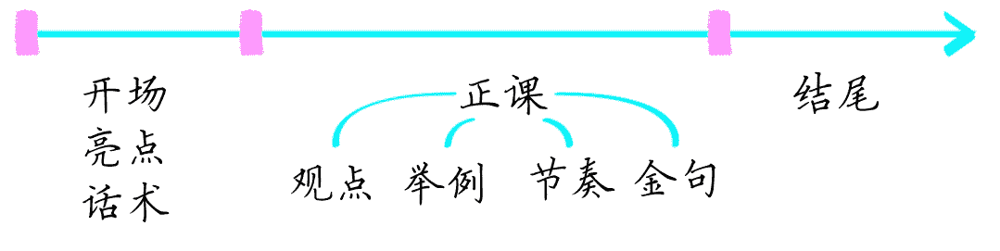
图 1-1

举例，拆解一门“设计思维”课。

开场老师先放一个反例：大家习惯以产品为中心，觉得越完美越好，忽视用户体验。借反例引出主题：设计思维。

进入正文，先讲理论：设计思维是了解市场和用户需求，找到解决方案。随后举创新创业的案例，再抛一个现场实操题。

结尾抛出理念：产品是试出来的，要放弃完美主义。

拆完后，你可以用同样的结构讲自己的知识或观点。

拆解不同类型、不同讲师的课，思考“为什么这样排序”，能快速学到高手的表达方法。

**1.1.4 公开尝试**

组建一个免费或低价的社群，用朋友圈宣传招第一批种子用户。每天在群里用语音分享干货，每周做一次直播。

同时开一个自媒体账号，每隔几天发一条 3 分钟的小课视频。公开试水。内容不必体系完整，确保有价值、有吸引力就行。等流量起来再做付费课。

为什么要公开？

第一，能拿到真实反馈，而不是空想。即使没人看，这个过程也有意义，知道哪些选题回避，哪些讲解不到位。用户用观看量、点赞量、转发量投票，你会更懂他们想要什么。

第二，被看见会倒逼你坚持。有人在看，你不好意思半途而废，责任感和使命感会增强。

第三，有观众时你会更努力做出完整作品，更愿意换位思考，追求共鸣。

我一直思考，怎样的建议才是有效的第一步。回想自己是怎么起步的。我原以为第一步是正式入职做教研的那一刻，后来才明白不是。

在那之前，每次讲故事、每次听课、每次在自媒体上发表观点，都是向做课迈的小步。

第一步很简单，别把它想得太复杂，走出那一步就好。

## 1.2 在线课程的形式

以盈利为目标的在线课程主流形态见表 1-1。

表 1-1

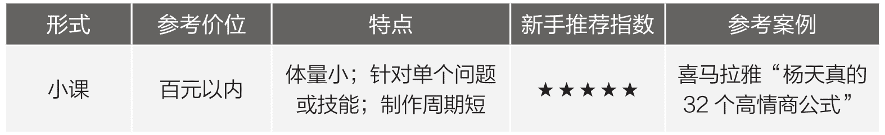
续表

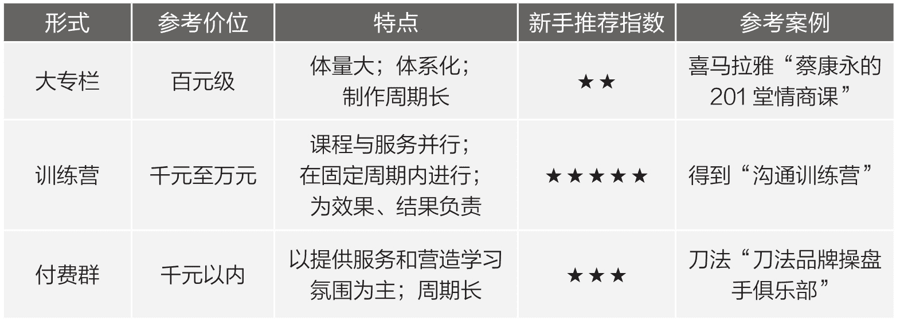

**1.2.1 小课**

小课很常见，比如喜马拉雅的“杨天真的 32 个高情商公式”就是典型。

特点：

1. 内容精炼实用。现在节奏快，成年人要的是能快速消化的微课程。优质小课通常十节左右，结构简洁，体系感不强。每节短小精悍，直击要点，短时间拿结果。
2. 学习效果明显。小课一般只给内容，不配服务，所以每节课都要有立竿见影的感觉，体验感很重要。
3. 定价亲民。通常在百元以内，学习成本低。
4. 制作简便。很适合新手入门，成本低、周期短，讲师能更聚焦核心知识的提炼和传递。

微型课程满足了快节奏下的学习需求，也是一种轻量化的制作方式。

**1.2.2 大专栏**

大专栏是另一种产品形态，比如得到的年度专栏“和菜头·成年人修炼手册”，日更约 300 节；喜马拉雅的“蔡康永的 201 堂情商课”也有 201 节。特点如下：

1. 体量大。课程数量一般 200 节以上，不是一次性录完，而是分批录。它像陪伴，时间上和用户同步，也能根据评论反馈灵活调整内容。
2. 强体系化。小课偏单点解决问题，内容相对独立。大专栏围绕一个大主题，多角度、多层次从入门到精通，课与课之间关联紧密。
3. 讲师有影响力。大专栏需要用户长期追更，讲师必须有足够知名度和信任度。
4. 定价百元级。一般两百元以上，录播不带服务，通常不超过五百元。
5. 纯粹课程体验。只提供内容，不提供额外服务。
6. 需要长期稳定输出。不适合新手，输出周期长，最好和知名品牌、专业教研团队合作。

**1.2.3 训练营**

小课和大专栏偏单向输出，训练营则加入服务，更重效果。类比就是“师傅领进门，修行靠自己”vs“师傅领进门，还在一旁辅导”。比如得到的“脱不花·沟通训练营”。

特点：

1. 解决特定问题。训练营强调在有限时间内把有限知识掌握到什么程度，而不是堆知识点。
2. 课程与服务并重。形成学习—练习—测试—评估反馈的闭环。先学，再练，再测，最后反馈改进。
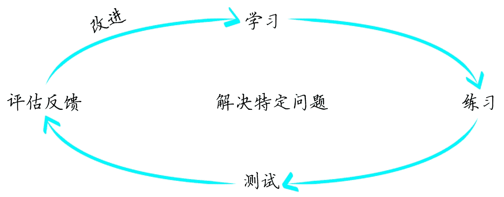
图 1-2
3. 时间集中。在线训练营都有明确周期，通常 21～40 天，不会过度消耗耐力。
4. 限量招生。为保证体验，每期招生有限，班级通常不超过百人。
5. 定价较高。人力时间成本高，价格一般在千元以上，服务强度越高越贵。

训练营收益多元、粘性强、互动多，制作周期短也适合新手，但需要创作者有强责任心，做好服务。

**1.2.4 付费群**

常见形式有付费微信群、QQ 群、知识星球等社区，具备提问、答疑、交作业、点赞评论等功能。

特点：

1. 注重交流。核心是打造学习氛围，把有相似需求的人聚在一起，用群体力量放大效果。
2. 持续活跃。运营者要在群里持续输出见解、资讯、答疑，可借助助手或意见领袖组织活动。
3. 长周期。学习周期通常以年计，价格一般在千元以内，比一次性课程更亲民。

运营付费群是长期投入，需要持续经营。行业知名度不必极高，但要持续用心，才能让用户续费，社群才活得下去。

**1.2.5 引流课**

引流课不以教学盈利为目的，而是营销手段，引导用户购买正价课。好比钓鱼的诱饵。

常见形态有 0 元训练营、1 元训练营、知识短视频、分享直播等，链接往往指向正式课程。

特点：

1. 低门槛。目的不是赚钱，而是吸客，所以多为免费。若需筛选付费意愿，可设百元以内低价。

**引流课要做好的三件事**

**（二）埋下钩子**  
引流课的核心任务是激发用户对正价课的兴趣，所以必须安排足够多的钩子。这些钩子可以是正价课的精华片段、限时折扣信息、真实学员的好评展示等，让人看完就想深入了解。

**（三）做到极致体验**  
引流课的品质和感受必须拉满。只有体验足够顺滑、内容足够扎实，用户才会建立信任，进而对后续的正式课程产生期待。

**（四）围绕转化设计**  
引流课的终点是转化，把试听者变成付费学员。设计和投放时要始终围绕成交率思考，比如用有引导性的话术、在关键节点放清晰的购买入口。

**1.3 在线课程的设计思路**

开课前要先想明白几个前提。

**1. 用学员视角而不是讲师视角来规划**  
课程的价值在于让学员拿到能用的知识与技能。如果全按专家的习惯来做，容易堆理论、缺共情。以学员为中心去设计，才能兼顾他们的起点、兴趣点和学习体验，真正解决问题。

**2. 聚焦少数核心痛点，而非面面俱到**  
一门课不可能包罗万象，贪多就会冗长琐碎，用户容易疲劳。把注意力放在学员最关心的几个关键问题上，深入拆解核心概念和可操作的方法，才能提升理解力和实战力。

**3. 尊重学习的本能损耗**  
学习在某种程度上是反人性的，设计时要更人性化。长时间高度集中会让人疲惫；马拉松式的学习安排会被抵触；枯燥的内容留不住注意力；任务堆砌会变成压力；千篇一律的素材会让兴趣迅速下降。

**1.3.1 做课要兼顾的六个关键点**

**1. 课程主题**  
主题要一眼说清课程在讲什么、解决什么问题。直击痛点才能抓住目标人群的注意力。

**2. 课程大纲**  
大纲是课程的骨架，也是用户判断价值的依据。要把核心要点和学习目标写清楚，让用户迅速get到收获点，方便决策。

**3. 适用人群**  
别只写“适合谁”，更要描绘“学员现在的状态”。把目标用户的现状、困惑写具体，用户更容易对号入座，购买意愿也会提高。

**4. 试听模块**  
试听是让用户先尝后买的入口。通过呈现课程能解决什么问题、解决后的理想状态来制造期待。学员试听后能更直观感受效果，决策更安心。

**5. 录制方式**  
别想着一次性录完。边录边卖、边卖边改的节奏更灵活，能及时根据反馈优化内容，课程质量也随之提升。

**6. 组合销售**  
当课程数量增多时，可以拆分重组。把大课拆成更小的模块主题，用户按需挑选；也可以用买一送一提升性价感，刺激购买。

总体来看，把握好这六点，课程会更灵活，也更容易长期售卖。

**1.3.2 课程研发的常规路径**

先理清全流程，才能制定合理计划、保持全局观，也能把注意力放在当前任务上，避免被不确定性干扰。

很多人急性子，设计初期就写逐字稿，结果后期改动量很大，反而拖慢进度。

研发大致分为启动、中期开发、上线、迭代四个阶段。

**1. 启动阶段**  
◎ 选题立项：确定主题、目标学员、授课人及制作形式。企业内训还需分工，比如指定录音负责人保障音质、课程编辑把控逻辑完整。  
◎ 资源统筹：盘点费用、设备与人力支持，确保开发期间资源不断档。

**2. 中期开发阶段**  
◎ 目标设定：明确整套课程和单节课的具体目标。  
◎ 知识提炼：梳理本节要讲的知识点及讲师可用的实战经验。  
◎ 大纲确定：基于主题和目标搭建框架。  
◎ 课件制作：准备文字、图表等教学素材。  
◎ 内容准备：案例、故事、逐字稿等素材集齐。  
◎ 录制剪辑：完成拍摄并做后期处理。

**3. 上线阶段**  
◎ 课程包装：设计封面、打造讲师个人品牌，提升吸引力。  
◎ 推广运营：制定直播引流、导流计划等推广策略，扩大触达。

**4. 上线后迭代阶段**  
上线后要持续收集评价、问卷等反馈，根据使用情况调整内容，提升学习效果和满意度。

以上是通用流程，具体执行可按实际情况微调。

**1.3.3 三个提升效率的做课技巧**

**1. 不追求一口定音**  
课程研发最怕过早定调。即便临近上线，价格、细节仍可能调整。先完成再完善，下一个环节常会倒逼修改。比如写逐字稿时可能发现大纲不合理，就要回头改。保持动态调整的习惯。

**2. 先做用户能看到的部分**  
不要把精力浪费在用户看不到的调研报告、竞品PPT、厚厚的方案上。直接做出课程详情页、卖点陈述、大纲呈现等可见版本，最省时间也最有效。

**3. 用进度表管控开发**  
用课程设计与开发进度表来跟踪节点。提前规划、严格执行，否则很容易拖成一年都做不完，示例如表 1-2 所示。

表 1-2

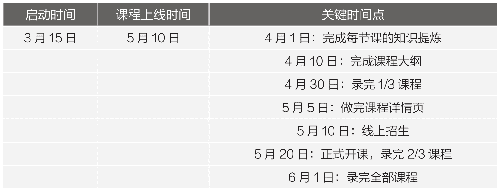

对照上表自己画一份进度表，对整体掌控会更清晰。

**1.4 小步快跑，边做边测**

在一次内部培训上，我问四十多位同事：“谁是完美主义者？举手。”几乎全场举手，我当场捏了捏自己的人中，借此提醒大家：设计课程时不能过度追求完美，也不能死守最初设想。很多想法只是未经验证的假设，不一定是用户真正需要的。

爱迪生发明电灯前做了两千多次试验，被问到是否失败时他说：我从未失败，只是经历了两千次过程。

做课也一样，完美是迭代出来的，不是凭空臆想出来的。需要快速测试、快速验证、快速调整。别再想“闷声发大财然后惊艳所有人”，悄悄憋大招往往适得其反。

互联网里常用的方法就是最小可行产品 MVP 测试。如图 1-3，第一种是闭门造车，先把最终形态想好再逐步实现，像组装汽车一样。这种方式适合成熟生产线的大企业，做课时一旦出错成本极高。

图 1-3

第二种是开放迭代，先有一个概念就快速做出能用的版本验证，再根据反馈升级，像先做滑板满足代步，再升级为滑板车、自行车，最后到轿车。

MVP 就是这种“开发—测试—反馈—迭代”的快速循环。如图 1-4 所示。

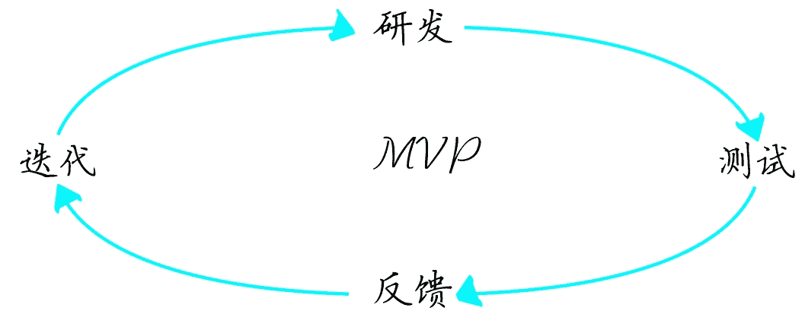

图 1-4

若忽视本质，MVP 会变成只快不准的空转。有效执行要遵循五条原则。

**1.4.1 最小可行性：用最少成本验证**  
用最短时间和最低成本做出可用的产品，采用小步快跑策略。

策略一：先直播后录播  
新手更稳妥的做法是首期全直播。直接录播会消耗大量时间在写稿、搭建、剪辑上，风险也高。直播可以跳过这些步骤。典型路径如图 1-5：
第一步，梳理重点并演练；
第二步，开播授课；
第三步，收集评分、满意度、作业提交率、讲师评分、完播率等数据并调研；
第四步，分析结果；
第五步，制作录播版。

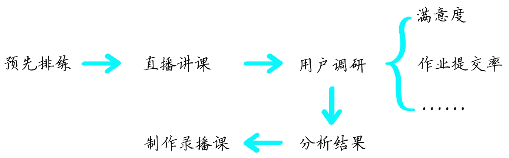

图 1-5

策略二：先模块后体系  
不要一开始就做庞大体系课，先做小而美的模块。先测模块课，再扩展体系。如图 1-6 所示。

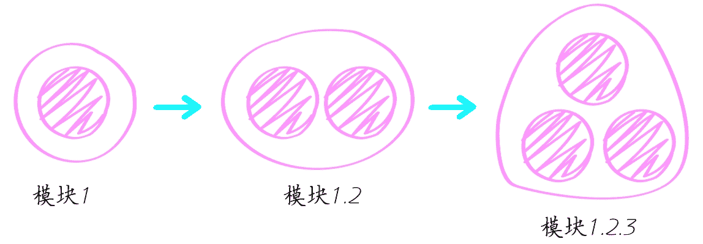

图 1-6

例如想做 200 节课卖 299 元，可先上线 50 节卖 59 元收集反馈，反馈好再补到 100 节卖 199 元，最终完整 200 节再调价到 299 元。新手一定要小步迭代。

策略三：先测概念  
课程想法本身就可以是 MVP。把想法做成海报或思维导图给朋友、目标人群看，问是否感兴趣。概念一出来就能开始验证。

**1.4.2 与终局保持一致，不损核心价值**  
测试必须能反映最终产品的样貌才有意义。早期形式可以粗糙，但要传达的知识和观念必须完整，不能因是测试就面目全非。

MVP 不等于粗制滥造，形式可简，价值不能减。若因体验太差导致好想法被误判，反而会误导决策。

常见偏差：推广渠道变了、目标人群宣传错位、讲师换人等，都会让测试结果失真。所以 MVP 的粗糙只能在形式上，价值必须与最终设想一致。

**1.4.3 用数据保证客观**  
测试时常问自己两个问题：测什么？怎么验证？只靠“好坏”评价太主观，要用数据说话。

在 MVP 测试中，我会用如表 1-3 的表格来梳理目标、用户行为、数据指标，并追踪分析。

表 1-3

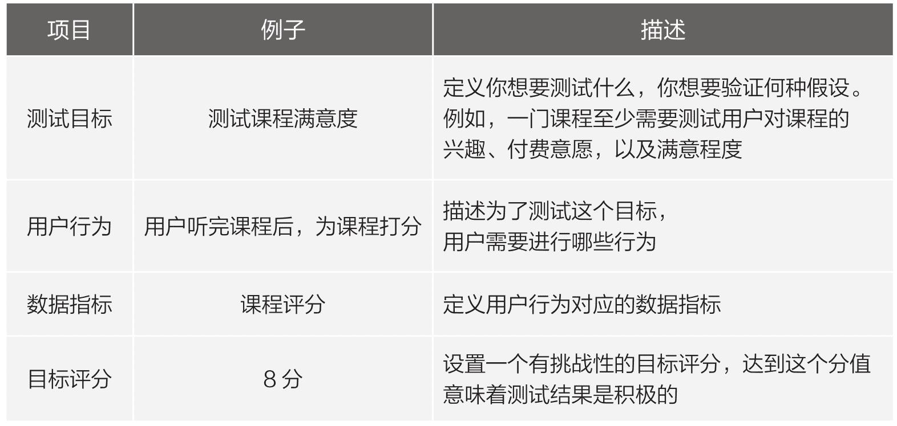

续表

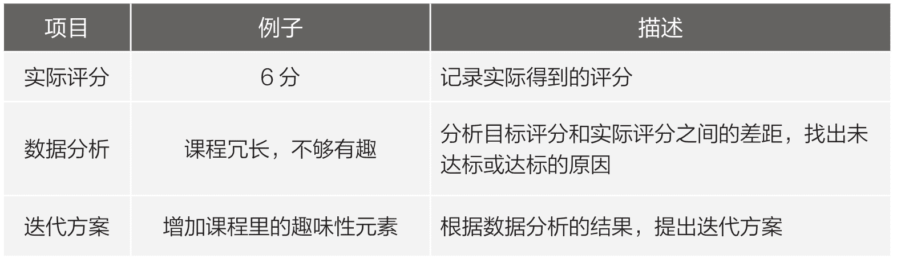

这样能更清晰地定义目标、追踪关键指标，并据此做针对性迭代。

**1.4.4 主动求反馈，别闭门造车**  
做内容工作时，我们每天早上会一起讨论选题，轮流分享主题、原因、网络态度和个人见解。大家从不同角度提意见，常能激发出新灵感。

课程也是如此，想法越成熟也需要外部碰撞。主动“求喷”，让用户和同行提前看到痛点和大纲，并问：“你会买吗？不买的原因是什么？怎么改才会考虑？”多轮调研后建议会很扎实。打磨不必等到成品，边做边改、边聊边调更有效。好课程不是自己觉得好，而是被认可。

**1.4.5 与用户共创**  
MVP 测试中，与其我们是设计者用户是使用者，不如让用户参与设计。用户来自不同背景，能提供独特灵感，只要给予参与感，他们很愿意贡献。

比如在一次写作课的 MVP 测试里，我建了用户群，每天分享技巧、组织接龙、一起创作。用户热情超出预期，提供了三份上千字的课程构思和 69 个写作痛点。数据之外，这些真实体验和建议更有价值。

底层心法是接受资源有限，把手上牌打好。像温州商人那样，先开店再学，边做边精进。我们也很难一步到位拥有专业讲师、充足时间、豪华棚拍，所以要承认有限性，在有限条件下启动。

**1.5 从三个维度长期提升做课力**

课程设计不是会讲课就够了。会讲只是输出，设计是把认知变成产品，大致分三步：

1. 知识获取：需要足够积累。刚毕业的大学生去设计职场领导力课很吃力，因为缺乏实战经验与方法论，靠剧集和书本堆不出可用的内容。  
2. 知识消化：要多角度思考问题，形成独特的解决思路。  
3. 知识输出：把消化后的认知用易懂的方式传递给学员。

缺输入，课程空洞；缺消化，课程平淡；缺输出，传播受限。

**1.5.1 强化知识获取能力**

写作本书时，我脑中不断浮现过往会议、聊天、协作、阅读、听课的片段，这些都是输入。它们平时沉睡，输出时才被唤醒。正因为要输出，才更感恩过去的输入。

做课是长期积累的事，量变到质变需要时间。平时就要持续输入，避免用时才想起储备。

**提升获取深度：实践先行，主动挑战**  
想做高质量的课，先去实践并产出结果。比如要做“如何克服拖延症”课，必须自己打过这场仗并取得成效。

只有在一线执行的人才知道哪些坑是意料之外的、正确思路和惯性思维区别、什么方法难用、什么方法好用。没有实践沉淀的方法论会显得苍白。只学习不实践，只能做知识搬运工，无法落地。

刻意把练习难度往上拉，往更高的维上去挑战。待在舒适区里，认知很难产生实质性跃迁。就拿克服拖延来说，第一次复盘你可能只是做到一周内每天把当天的事清零，下一次就该换一个量级，挑战一个需要长期累积的项目。难度在升高，方法论才会被不断的真实场景检验。

**第二块：拓宽知识入口，兼顾源头与流沙**

单靠自己试出来的方法论天花板很低，精力有限，大多数问题前人早有答案。这时候要主动扩大输入面，找到知识的源头和知识的流沙。

知识源头是知识的发源地，密度高、层次深，经得起检验，能够校准你的方法论。我们很难成为源头，但可以基于自身实践去加工沉淀。常见的获取路径有：研读原始论文与行业前沿报告；读深度思辨类的书；系统学各行业的经典思维工具与模型，MBA领域常见；梳理百度百科等权威科普内容；翻阅大学教材；聆听行业标志性人物的观点。

知识流沙指社会舆论的传播面，虽然碎片化但娱乐性强，能帮助你更懂用户。获取方式主要是刷公众号、小红书、微博、知乎等平台相关话题下的高赞内容和金句。

**第三块：提高输入密度，随时存素材**

死板的输入会把人变成干巴巴的书呆子，课程就会失去灵气。很多好东西都来自生活里微不足道的体悟。

比如在做小说课时，我把头脑风暴和拆盲盒的惊喜感结合起来：每个盲盒里放一句开场白，“五年，整整离开了五年，今天我终于回来了”“有些记忆，永远不会死去”“最开始的时候，我们以为这只是一场再寻常不过的旅行”。学员抽到后以此起笔写一段剧情。这个小玩法一上线，社区里反响很热烈。

看似不相关的两件事，常常撞出火花。课程立项后，多留意生活细节，捕捉它和课程的连接点，马上记录下来，输出时才有可调用的素材。

**1.5.2 强化知识消化力**

消化力其实就是学习力，也是备课最核心的能力。

书看得差不多、经历也相近的人，为什么差距会拉开？就是消化力不同。怎么练？

**1.反思复盘，把每次成长算数**

职场里成长最快的人，像开了增益模式，秘诀就是会复盘。每次经历对他们来说都是基石，复盘后经验才变成资产。没有复盘习惯的人，只是在重复消耗。

想把经验变成课程，就要养成立刻复盘的习惯。可以问自己：这次实践哪儿没做好，下次怎么避开？哪些行为是做对的，值得保留？过程中遇到什么阻碍，怎么规避？问题怎么解决的，还有没有更好的解法？换一个角度或立场会怎么做？我对这件事的理解是什么，本质在哪？哪些细节是我被表象误导的？

注意，结果不等同于过程。赢了不代表每一步都对，输了也不代表全错。只有深挖复盘，经验才有价值。

**2.净化，提炼干货**

消化时要把有价值的部分抽出来，记忆负担会轻，实用度会高。真正有用的干货通常具备三点：能直接解决问题并见效；可被他人复用；去情绪、去主观，只留客观结论。

比如公司刚扛住一次公关危机，就可以把应对流程提炼成可复用的危机公关方法论，供新人直接用。复盘和净化往往同步进行，先复盘再提纯。

**3.结网，建知识体系**

很多人羡慕那种什么话题都能侃侃而谈的人，不是他口才好、记性好，而是他的知识已经结了网。

知识若零散存储，很容易走失。把知识点之间的关联理出来，形成网状结构，就更容易提取和回忆。我发现擅长连接的人，普遍有画思维导图的习惯。常见的关联类型有：流程关系，比如操作步骤、工作流；分支关系，比如一个主题展开几个要点；因果关系，比如A导致B导致C；递进关系，比如从理论到技巧再到应用，从简单到复杂。一旦养成及时画图梳理的习惯，理解和记忆都会加深，输出时自然信手拈来。

**4.举一反三**

举一反三源自《论语·述而》，精髓不是死记硬背，而是主动寻找新知识与已有体系的连接点，实现深度消化。

可自问四个问题：我能用这个知识举一个新例子吗？它能怎么解决我现在的问题？如果放到另一个领域，我会怎么用？它和我已掌握的知识有什么关联？

我常边想边像讲课一样自言自语，虽然费劲，但吃力的程度和消化深度成正比。

比如即兴喜剧的“yes and”原则，要求无条件接纳对方，哪怕荒唐，再在此基础上补充。知道之后，我回想起过去因否定对方而导致聊僵的场景，并模拟如果用“yes and”会怎么回应。随后发现它和沟通中的正向反馈相通，直播时遇到与我相反的评论也能用这套逻辑。这就是结网，不断寻找关联，让知识落地。

**1.5.3 提升知识输出力**

知识吸收和消化后，要靠讲课的方式传递。会讲课的人往往兼具演讲与写作能力，而讲课、演讲、写作在共情力、感染力和语言组织力上高度重合。

**1.共情，用用户的语言讲**

讲课的底层是共情。要先弄清用户是谁、痛点是什么、能听懂什么、有怎样的情绪。给外行讲，就用他们能懂的词；给父母讲，就用生活场景；给孩子讲，就要有趣。要从“我是谁”转向“用户是谁”，用他们的语言讲。

**2.讲故事**

故事有穿透力，能让不同认知水平的人听懂道理。人们天生爱听故事，能讲故事就别只讲道理，能讲案例就别只讲理论。行业里大部分讲师都会去听郭德纲的相声、看脱口秀，提升讲故事和幽默感。

**3.逻辑，用思维导图开讲**

思维导图理清结构后，直接照着讲，语言就会更清晰。我更喜欢说“开喷”而不是“开讲”，更自由，更能激发情绪与灵感。

**4.质感，写逐字稿**

新手一定要写逐字稿来把控质感。尤其是不出镜的音频课，对语言精炼的要求极高，要改到没有一句废话。

本章讲的其实是三种底层能力：获取、消化、输出。它们都需要时间滋养，越早开始越早受益。最关键的是知行合一，看完就要动手，从小习惯开始。

**第二章 从选题开始，打造爆款课程**

**2.1 课程选题的重要性**

选题的重要性常常被低估，直到课程卖不动才后知后觉。

选题至少决定两件事。

**1.选题决定销售潜力**

我一个朋友，2018年做了一门艺术课，定价299元，卖了3万份。即便放到现在也算很不错。团队当时很新手，连逐字稿都是边学边写。

尝到甜头后，他们投入更大、主创更强地做第二门课，销量却连之前的一半都不到。复盘发现，第一门课能爆，是因为选题恰好契合品牌调性，容易被用户信任。

选题决定课程能不能被看见、被购买，品质决定口碑和生命周期。选题错了，再好的品质也没人消费。选择往往比勤奋更重要，电影票房也常由题材决定，超级英雄类天然吸睛，非主流艺术片受众就窄。

**2.选题决定根基是否牢固**

策划选题时要回答三个核心问题：你要为谁解决问题？解决哪些问题？如何解决？

同时要考量市场需求和竞品情况，了解目标人群的真实需求，看市场上已有课程形态，找差异。选题越扎实，根基越稳，后期返工越少。

**2.2 爆款选题的特点**

能真正解决问题的课程都有价值，但要做爆款，就要遵循规律。分析多个销量过万的案例，我总结出爆款选题的铁三角——实用性、普适性、刚需性。

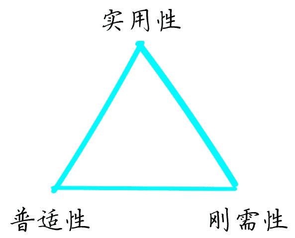
图 2-1

**1.实用性**

能不能解决实际问题，学完能做什么、在哪些场景能用。时间管理课的实用性就是让学员真正把时间用好，提升效率。

**2.普适性**

受众面是否足够宽。培养幽默的课普适性很强，幽默是普遍被认可的能力，且大多数人希望拥有。教相声的课受众就窄得多。

一个现象是，如果需要大段解释才能让人明白课程在教什么，普适性就偏低。

课程大致可分五类：岗位技能，如产品经理、设计师、程序员；兴趣与副业，如摄影、手绘、小说写作、短视频剪辑；职场通识，如领导力、团队管理、项目管理；个人提升，如健身、早起、写作、口才、人脉、阅读、社交、理财；知识普及，如艺术、文化、历史、哲学、心理学、经济学。

**3.刚需性**

指问题是否必须解决。不解决会带来困扰甚至痛苦，解决了能带来质变。

刚需性由三点构成：

**痛苦程度。**用户痛感越强，刚需越强。强痛：不解决影响生活工作；弱痛：痛而不自知；无痛：不痛但变好。

**痛点人群基数。**被同样痛点困扰的人越多，需求越大。

**痛点发生频率。**问题越频繁出现，需求越刚。

根据课程体量，优先锁定最核心的痛点，能放大刚需感。

**2.2.2 选题是可以调整的**

**1.动态调整**

选题不是一成不变的。以前和一家公司合作做传统写作课，AI兴起后，我们立刻加入AI元素，定位改为AI写作课，大纲随之改写。后来根据竞品继续微调。

市场会变，热点、技术、对手都在变，选题必须保持弹性。不要说“选题已定就不能改”。

**2.用测试决定**

面对多个选题，最高效的是做MVP测试，收集各主题的咨询量做横向对比，降低决策失误风险，避免反复纠结。

**2.3 从什么选题出发**

《孙子兵法》说善战者胜，无智名无勇功。泰德·威廉姆斯提出“最佳击球区”，只打胜算高的区。

**2.3.1 找到你的能力圈**

从过往经验出发，既能保证课程质量，也更贴近实操。要回答：你是谁？你擅长什么？你在哪成功过？有什么高光时刻？

可以把能力划分为陌生圈、认知圈、能力圈，外围是未知圈。

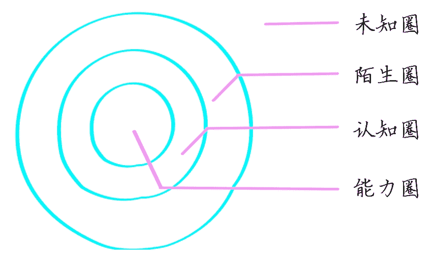
图 2-2

陌生圈是“一知半解”的领域，你大概知道但不擅长。看见别人赚钱就想跟风，很容易踩坑。比如社恐的人做社交课，再火也不适合。

认知圈是你“知道”的领域，听过课、看过书、研究过，但缺实操。没有带过团队就去讲领导力，风险很高。

能力圈是你“长期践行”且取得成果的领域。知识在这里才具备产品化可能，形成可交付的方法论。

回忆高光时刻，画出能力圈。常见自问方向见表2-1。

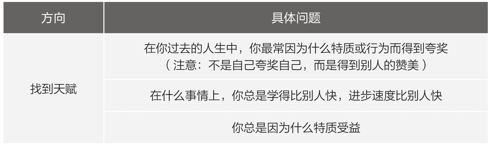
续表
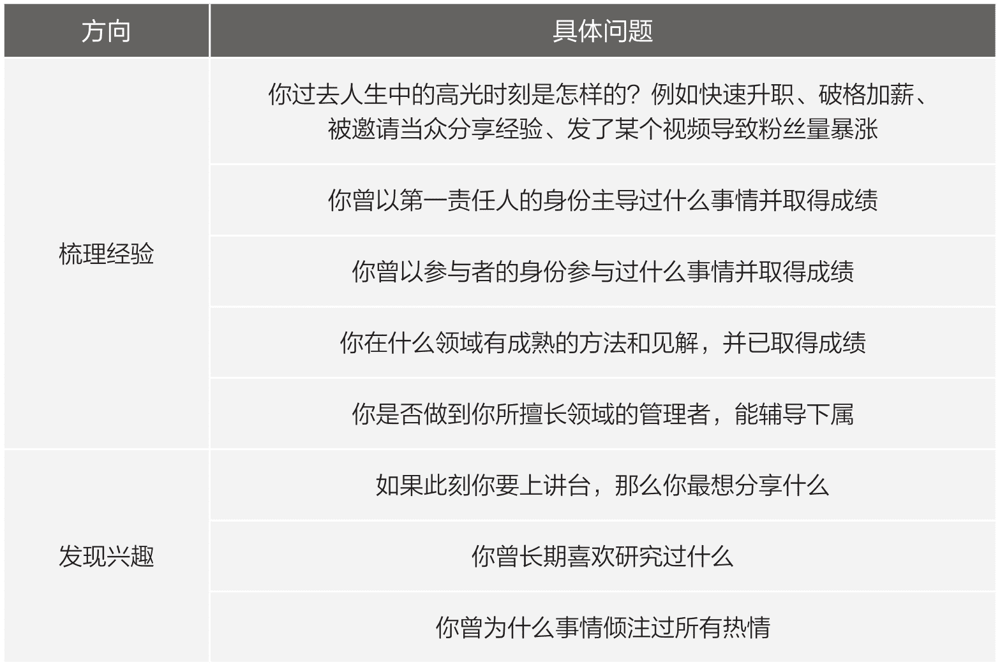

如果你是以第一责任人身份主导并取得成绩，可复盘全局流程；若是参与某个环节，也可单拎出来做深度拆解；若能在擅长领域辅导他人，或已熟练到凭直觉判断，也可产品化。

提醒：梳理能被他人效仿的成功经历。如果你的升职主要靠家世背景，这样的经验很难让人信服。

我们习惯否定自己，但优势更值得放大。与其和劣势较劲，不如让优势发光，并持续精进，成为领域的精钻者。

**2.3.2 品牌贴合度**

定位最好与品牌贴合，顺势而为。一方面借力品牌，另一方面强化品牌。很多做课者为了一时流量做与自己无关的热门课，会被用户质疑“为什么是你来做”，说服成本变高。

每个人都是行走的品牌，别人对你的印象就是品牌。要问自己：用户对你或企业品牌的印象是什么？

想一想，推出哪类课程，对外解释起来最省力、最容易让人信服？又有哪些课程是你比竞争对手更有话语权、更容易打出差异化的？可以从品牌给人的联想、品牌能调动的资源、品牌正在走的战略这三个维度来拆解，如图 2-3 所示。

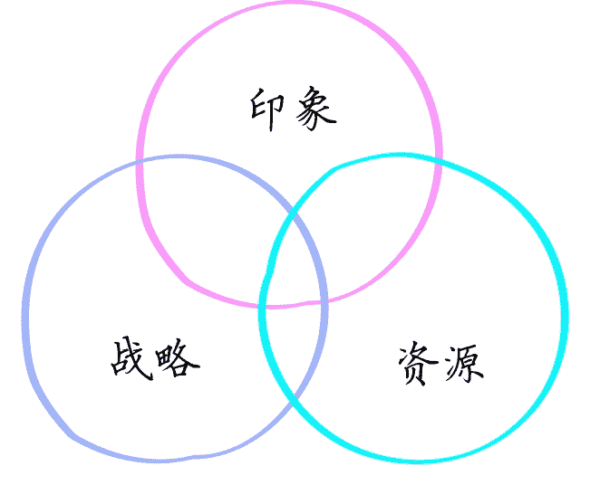

图 2-3

**1. 从品牌印象出发**

品牌印象本质上是用户在提到你时，第一时间蹦出来的那个关键词。这个印象不是自说自话能定的，而是长期积累下来的客观认知。比如你运营的公众号，九成粉丝都是被一篇绘画干货文章吸进来的，可你后来想把账号打造成女性成长阵地，那也很难扭转，用户心里默认的标签仍是绘画。

很多品牌花了几十年才把一个关键词种进用户脑中，并不断强化，所以不要轻易去破坏它。还有一点要清醒：用户对品牌的记忆很精简。我可以把自己的品牌讲得面面俱到，但普通用户最多记住一两个关键词，他不会专门去做品牌研究。

**2. 从品牌资源出发**

做选题时，先盘点家底，能让新课站得更稳、投入更少。品牌资源大致能分成这四类。

◎ 人才储备：讲师、助教、内容专家这些人本身就是课程的核心生产力，要看现有团队的专长能否直接承接。
◎ 内容沉淀：过往的课、案例库、教材、资料都是可复用的资产，梳理整合能避免重复造轮子。
◎ 合作网络：和企业、机构、头部专家的关系，常常能变成联合出品、资源互换的抓手。
◎ 市场体感：品牌当前在哪个赛道、面向谁、对手是谁，这些市场信息直接决定选题是否能打中需求。

比如喜马拉雅做有声课，说服成本就很低，优势也很明显，因为讲师阵地、内容案例、合作通路、市场认知全在它手上。

**3. 从品牌战略出发**

课程不是孤立的产品，它往往是战略落地的一环。战略一旦确定就很难随意更改，所以新课的定位最好和整体战略同频。这样做既能保证长期可持续，也能形成聚焦的投入，最终扩大市场份额。

## **2.4** **课程选题的误区**

我把常见的选题坑归纳为三类，逐个拆开看。

**2.4.1** **误区一：受众越多，课程越好卖**

不少人觉得覆盖面越广越容易卖，于是总想做大而全的普适主题，把目标人群设成“爱学习、追求成长的人”或“所有职场人”。这个思路要改：好课是把一小撮人特定痛点解决好。

一个事实是，主题越宏大、边界越模糊，课堂就越难深入。泛泛而谈很难在真实场景里给出可操作的细节。课程的终点是帮用户解决实际困境，所以要不断自问：这门课真的解决了用户的麻烦吗？

主题太大，用户也找不到自己在哪，反而拉低传播效率。可行的办法是把大主题拆成更细的小主题，虽然人群变窄，但转化会提升。

比如“表达”太大，可拆成公开演讲、口才训练、幽默演说等。面对竞争，把大蛋糕切小块，独特性就出来了。“新媒体运营”不如“小红书运营”更准准，若再聚焦到“小红书美妆赛道的起号打法”，竞争力更强。

另外，定价越高，主题范围必须越收紧。因为高价意味着更高责任。29.9 元的小课可以叫“职场晋升”，覆盖共性痛点即可；2999 元的训练营，就要明确是面向基层员工、小组长还是高管，并做精细化设计。

**2.4.2** **误区二：只看当下热度，不看趋势**

新手容易盯着眼前火不火，却忽略了长期走向。选题既要看当下热度，也要看趋势走向。趋势不同，入场策略也不同。

比如微信公众号，2014 年爆发，2017 年基本饱和，竞争白热化。同样做公众号运营课，2014 年的红利远大于 2017 年。

一个选题的热度大致会经历萌芽、飙升、平稳、衰退四个阶段。

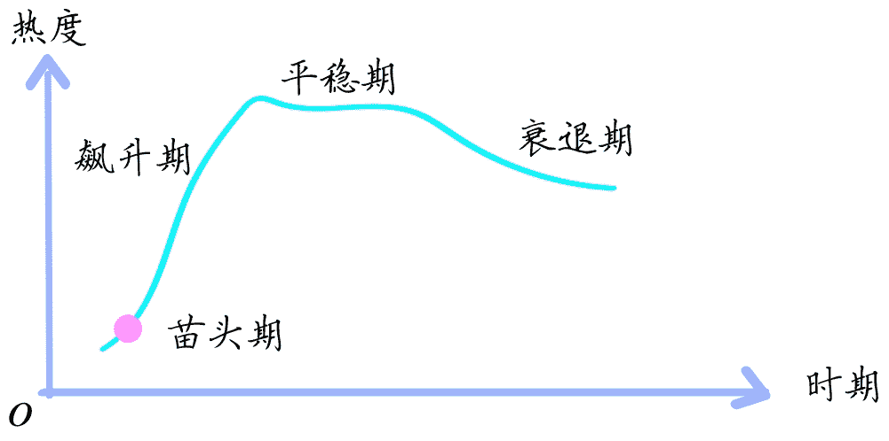

图 2-4

**1. 萌芽期：初露端倪，可先观察**

话题很新、关注者少、公众认知不足。特征是新颖但潜力不确定。如 ChatGPT 在 2022 年底出现，四天注册破百万。但那时多是新鲜感驱动，功能不稳，用户粘性未形成。竞争少，但不是最佳入局点，因为很多风口是昙花一现。站在现在我们知道它会爆发，但当时很难判断。

**2. 飙升期：最佳窗口，参与者涌入**

热度陡升、需求爆发、用户开始产生依赖，体量甚至指数级增长。判断信号很简单：你关注的大 V、意见领袖都在集中讨论时，基本就是飙升期。

ChatGPT 到 2023 年 3 月，写稿、做 PPT、写报告的需求井喷，大家意识到它能替代大量重复劳动。此时得到、喜马拉雅等迅速推出相关课程。即使内容不完美，也建议快速上线抢占先机。同理 2018 年是短视频运营与剪辑的飙升期，比 2023 年再做要占更大便宜。

**3. 平稳期：普及高、竞争白热化，需差异化**

入场门槛降低、新增人数放缓，竞争进入内卷。此时靠同质化很难跑出来，必须靠风格差异。

例如 B 站上有一门编剧课，讲师光头，站在黑板前讲课，用“一本正经的幽默”把硬知识讲通俗，偶尔插段子，大胆点评行业现状。公开课试听后很多人直接付费。编剧课并非刚需，但个人魅力和表达方式形成了购买理由。平台上很多新人 UP 主靠独特风格就能获得付费，说明个性本身就是竞争力。

**4. 衰退期：新鲜感减退，要嫁接新元素**

用户关注度下降，不必硬上。可把老选题和新赛道结合，注入新元素重获关注。

公众号写作本身已过时，但和 AI 写作结合就能再活一次；纯健身课需求疲软，结合智能穿戴、数据分析、AI 制定个性化训练方案就更吸引人；传统财经课结合区块链能制造新鲜感；美食课搭上轻断食、健康生活理念，也能做出新品。过时不等于没需求，只是需要一个新刺激。

**2.4.3** **误区三：选题适合自己，但因竞争激烈而不敢入局**

没有流量时容易被对手吓退。其实市场永远有位置，不要自我否定。四个可操作的方向供参考。

**1. 缩小人群，实现人群差异化**

热门赛道里，职场、个人成长、岗位技能类课程很多。可把人群切得更细。主题越小，针对性越强。

写作课竞争大，可以从文体切入：演讲稿写作、影评写作、采访写作、读书写作等。亲子沟通课可以按孩子年龄分：学龄前家长 vs 青春期家长，需求完全不同。

**2. 找到自身独特价值，实现讲师差异化**

对手讲师头衔耀眼时，不必硬拼知名度。可从个人故事、记忆点入手。甚至一个真实经历就能形成说服力。

比如一位小红书博主卖 99 元、12 节的零基础写作课，400 多份成交。她没有光鲜背景，是 35 岁大专学历的宝妈，全职带娃，半年投稿小有成绩，每月稿酬两三千。她的故事让大量同龄宝妈产生共鸣：黄金年龄已过却重启副业。这种共情就是差异化。

梳理说服力的几个问题：谁会认可我？和竞品讲师比，我有哪些辨识点？可以从头衔、过往职业、身份标签、形象风格、表达风格、励志点等角度挖掘。

**3. 下沉市场，实现渠道差异化**

一线城市红海的赛道，在三四五线城市可能还是蓝海。我常在一线和老家小城两地跑，深感差异。职场提升课在一线已普及，但在下沉市场认知度低。若把目标转向这些区域，就能在竞争少的环境里建立口碑。

**4. 找到竞品短板，实现内容差异化**

看竞品的用户评价，提取未被满足的痛点来补位。比如亲子教育课评论区常抱怨缺少真实场景练习，就把实操场景做深。

若竞品偏理性、缺乏趣味，可在表达风格上加温度；若对手服务流水线化，可在学习体验上做精细服务，提升温度。借鉴对手的优点、补上它的短板，才能知己知彼。

**AI 锦囊：设计选题时，把 AI 当作“启发型军师”**

**①使用要点。**
选题阶段让 AI 来补全你的思路盲区，用启发式反问逼自己想深想透。

**②提问示范。**
**◎AI 指令。**
我想做一门小红书图文笔记写作训练营，请你给我 10 个启发性问题，帮助我理清思路。
**◎AI 回答。**
好的，下面 10 个问题供你梳理小红书图文笔记写作训练营的思路：目标人群是谁、痛点是什么？成功训练营的核心要素有哪些？课程如何系统化教学？除写作技巧外，还要教哪些平台策略？如何考核与认证？线上线下如何选、怎么提升教学质量？推广渠道与策略是什么？理论与实践如何平衡？定价依据是什么？希望学员学完达到什么效果，如何衡量成功？

## **2.5** **设计课程的标题**

爆款课都离不开一个抓人的标题。它有两层作用：快速传递定位，让用户判断要不要了解；激发购买欲望。标题一般分为主标题和副标题。主标题控制在 10 字内，点明主题与定位；副标题用一句话补充卖点，要简练有力。

**2.5.1** **主标题的设计方法**

主标题要直接、理解成本低、瞬间抓住目标人群。常见组合是 2 到 3 个元素：

◎ 课程体量，如《杨天真的 32 个高情商公式》。
◎ IP 讲师+体量，如《蒋勋带你读红楼梦》。
◎ 课程定位，如《读书写作训练营》。
◎ 岗位名，如《产品经理必听的 10 节课》。
◎ 课程代号，如《马东的职场 B 计划》。
◎ 适合人群，如《零基础 AI 设计训练营》。

如果是训练营形式，标题最好加上训练营、计划、集训营等后缀，避免用户预期错位。

**2.5.2** **副标题的设计方法**

副标题是第二轮说服信息，补充主标题未展开的内容。常被当作宣传口号，所以要短、好记、顺口。

**1. 强调改变和效果**
直接点出学完能得到什么、会怎样改变。

举例：《高岚的心理学课：100 堂课读懂性格》——对抗焦虑，学会活在当下；《哈佛幸福课》——改变万千人命运的超级幸福法则；《刘媛媛：30 天搞定当众说话》——让你一开口就成焦点。

这类课往往能改善生活，只是用户未意识到。副标题点出获益就能触发购买，比如冥想可缓解压力提升专注，早起可提升状态等。

**2. 强调解决问题**
突出课程能解决的痛点。

举例：《职场软实力课》——告别职场老实人；《家庭教育课》——一站式解决父母育儿焦虑。

**3. 强调理念**
传递底层思维或价值主张，感染力强。

举例：《创意写作课》——不要浪费你的天马行空；《马东的职场 B 计划》——告别委屈，拒绝死磕；《蔡康永的 201 堂情商课》——被人喜欢是一种能力，你想拥有它吗。

**AI 锦囊：用 AI 设计课程标题**

**①使用要点。**
先把课程要教什么讲清楚，避免 AI 误解。

**②提问示范。**
**◎AI 指令。**
我想做一门“AI 做课训练营”，教大家用 AI 工具把个人经验做成课程或知识产品，请给我 4 组主标题和副标题。
**◎AI 回答。**
主标题一：AI 做课大师班：把个人经验变成知识产品的秘诀；副标题：让 AI 成为你的分身，把经验转化为可变现课程。
主标题二：智慧分享新纪元：AI 助力打造个人知识 IP；副标题：用 AI 做课，让知识更有价值，IP 从此发光。
主标题三：AI 做课实战营：把经验变成畅销课；副标题：掌握 AI 做课方法，让你的故事成为市场热门。
主标题四：AI 赋能知识变现：经验课程化之旅；副标题：AI 让你轻松把经验做成课，变现不再难。

## **2.6** **选择合适的课程呈现形式**

线上课程的主流形态是音频、视频、直播。可以先定形态，再定制作方式。

**2.6.1** **音频**

做一门课，先想清楚用什么形式呈现，比急着开录更重要。

**音频课，适合纯知识讲解**

当课程不需要演示操作步骤，也不需要大量图片、视频和案例佐证，只是做概念和原理的讲解，音频是最轻的载体。历史、心理学这类偏讲授的内容就很适合。

和视频比，音频对声音质感和讲述连贯性的要求更高。做音频一定要写逐字稿，逐句过关。因为学员听不到画面，全靠耳朵接收，口误、卡顿会立刻被放大。很多时候，音频课的前期准备比视频课更费心。

录制方式主要有两种。

◎棚录。对音质要求高时首选棚录。喜马拉雅、蜻蜓这类平台对音质有硬性要求，棚录能保证专业水准，但成本也会上去。

◎自录。预算有限可以靠录音软件或手机完成。关键在做好降噪、保证清晰度，让信息能顺畅传达。

**视频课，几乎能承载全部内容**

视频能用画面、声音、文字一起呈现知识点，直观感和代入感都更强。

选视频后，不必写逐字稿，课件加讲义提纲就够了。这样讲起来更流畅、互动感更强、也更真实，只是要多排练几遍找到节奏。

可以出镜也可以不出镜。不出镜就靠课件，常见的是PPT。选择出镜，可以把讲解和课件结合，学员既能看到你的状态，也能看到内容。

录制形式分两类。

◎出镜棚拍。在影棚里搭团队，化妆、摄影、录音、灯光都要配齐，效果最好成本也最高。适合定位高端、需要用专业气质来背书的课。

◎电脑录屏。预算友好。如果课程本身是操作演示，实操比重高，像Photoshop、PPT、思维导图、电子表格的使用，这种内容音频和棚拍出镜都不合适，录屏一步步演示才清晰。

**直播课，适合高客单价和强互动**

做高客单价的产品，建议把直播放进去。直播能带来即时互动、更强的沉浸感，单位时间学习效率更高。只做录播，往往达不到高付费学员的预期。

强实操的品类很需要直播，比如语言、编程、设计，学员操作时问题会随时出现，直播里即时答疑和指导是刚需。

需要即时反馈的课也适合直播，比如表演、演讲，老师能立刻点评并给出建议。

涉及热门和新题目的课，比如最新行业案例、行业动态，直播能快速把时效信息送达。

做MVP测试时可以用小鹅通App的录屏直播，准备一份课件就能开讲，成本很低。这个阶段的目标是尽快验证有没有人买、快速拿到反馈再迭代，不必做得精致，课件+讲解即可。录屏直播同样需要课件，不需要逐字稿，但要提前彩排，不能拿内容开玩笑。MVP只允许形式粗糙，内容必须保质。

小贴士：形式要跟着课程特性走。

### 第三章 洞察用户群体

定品定位时先回答三个根本问题：用户是谁？用户在痛什么？课程的终点是什么？想透这三点，后面写大纲、做宣传页、设计内容才不会跑偏。如果地基没打好，再怎么装修也撑不住。做课像盖楼，地基稳大楼才稳。

**3.1 洞察需求，筛出目标人群**

选题确定后不要立刻写教案，先把用户需求和目标人群搞清。

明确人群在三个环节特别关键。

◎研发时更有针对性。知道服务谁，就能研究他们的真实需求、痛点和学习场景，设计出能解决具体问题的课程。

◎推广时更精准。知道为谁做，可以在文案里直接点名人群和收获，潜在学员自检是否匹配。

◎找对渠道。不同人群聚集的地方不同，年轻人多在社交媒体，老年人可能更看传统媒体。找到人群才不会浪费投放预算。

怎么确定目标人群，有两点要抓住。

**3.1.1 先画画像，再提炼核心需求**

很多人一上来就做超详细的画像，比如28到45岁、月入6000、自驱力强、住二线城市、爱看抖音爱网购。信息越多越容易迷路，用不上。

就像医生开药，只问症状，不问收入和梦想。做课也一样，要关注能驱动购买的核心需求，以及能区分适合与否的关键标签，而不是全量信息。

需求是买课的根本动机，可以是量化目标、待完成的任务，也可以是某种渴望。不同需求决定不同决策。

需要把核心需求一条条列出来，举例：

◎乙方品牌人主要是为甲方做品牌策略、设计、推广。核心需求是更好地读懂甲方、提升提案和服务力，补足品牌策略、市场研究、定位、传播等知识技能。

◎自媒体人想要提升内容创作和推广能力、扩大影响力和粉丝量、用数据分析和用户研究更精准把握趋势、掌握各平台流量方法。

◎初创品牌方想要洞察用户、精准定位、提升知名度、塑造形象、打造爆品、提升黏性、扩大规模。

◎初具规模的企业想要提升美誉度、扩大市场份额、增强影响力、处理好公关。

◎已有市场影响力的企业想要维护品牌形象和价值、建立品牌管理体系、提升忠诚度、加强危机应对、了解前沿理论和实践。

想洞察需求，最好亲自去做。观察、问卷、访谈都行。我们总以为用户和自己一样，不去验证就会把假设当真伪需求。有真需求才有市场。

**3.1.2 用感性的语言还原用户处境**

别只给标签，要用有画面感的语言描述用户正在经历的场景，和他们产生共情。这样脑子里才有真人，设计课程时才知道用什么案例、什么语气。

比如准备写作训练营，我会想象对面坐的是我县城的表姐。全职妈妈，小城市生活，没接触精英文化，听不懂商务黑话，读过的文学不多但知道余华、莫言，没写作经验但感知力不差、想表达。当有了这种对象感，案例选择就清晰了，不会用高冷的外文学术，而是引用董宇辉、伊能静在直播间的卖货语录，学员更有代入感。

另一个例子，朋友做品牌运营课时，我们把目标人群的挑战写成场景：

◎场景一：在创业公司做创意策划，要做爆款实现病毒传播，还要用小预算撬动大渠道，兼顾声量和销量，需要创意脑、流量脑和变现脑。

◎场景二：公司起步，老板总分享头部案例，预算人力都少，定位却没想清楚，要帮他规划产品矩阵。

◎场景三：品牌部门和业务部门割裂，大家觉得品牌就是烧钱务虚，协作难，话语权难建立。

◎场景四：公司成熟但遇到瓶颈，品牌包袱重，想一炮而红，压力大。

◎场景五：短视频博主想做个人IP，不知道怎么选赛道、内容和变现如何兼顾、不懂平台规则。

◎场景六：公司高管要做战略规划，从执行落到决策和节奏，像下棋要知道下一步怎么走，需要宏观布局。

◎场景七：乙方营销背负创意、刷屏、点赞、转化率等KPI，比甲方压力还大。

◎场景八：公司突发危机事件，2小时内必须回应，没公关部门，品牌部门要立刻出全链条方案。

**3.1.3 用排除法收缩人群**

一门课不可能满足所有人，面面俱到就会四不像。人群越准，越能打中要害。

我们做过零基础配音课，调研发现学习目的分3类，如表3-1所示。

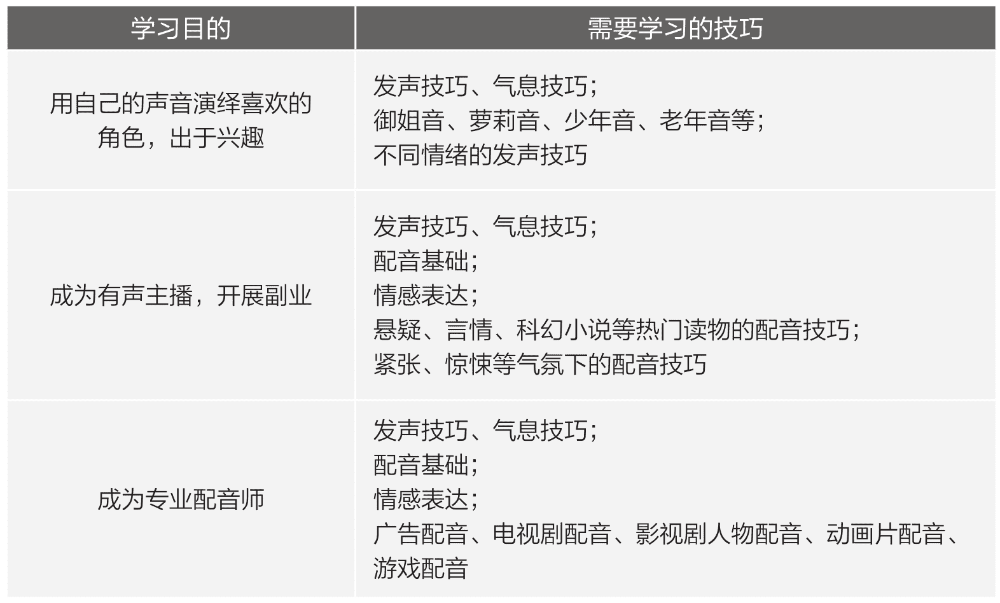

最后我们只选第一类作为核心用户。

如果一时筛不出目标，就先排除非目标。泰德·威廉姆斯说过，知道不打什么球，才算真正开始打球。可以排除自己搞不定的需求，或需求过于小众的需求。

以自由灵魂书写计划为例，目标需求是记录生活小确幸、抒发感悟、探索内心、释放压力找到平静。被过滤的需求是写出10万+阅读、靠写作赚钱、精钻文学创作写小说。结合自身优势，定位才逐渐清晰。

注意，目标不能太窄，否则售卖会很吃力。

**3.2 基于画像设计教学目标**

设定教学目标像规划旅行，要有起点和终点。起点是学员现在的知识和能力，终点是课程结束后能掌握什么、达到什么程度。

目标要具体，别说“了解舞台剧表演”，要说“能够理解并应用基本的舞台剧表演技巧”。

教学目标有三个作用：像指南针防止内容发散；可评估结果是否达成；能点燃学习热情，给出方向感。

设计时遵循五大准则。

**3.2.1 只解决部分需求**

一门课不可能满足所有人。配音课有人想做职业配音师，有人只想兴趣玩玩，目标完全不同。

我们做过零基础网络小说写作训练营，调研把学习目的分为4类，如表3-2所示。

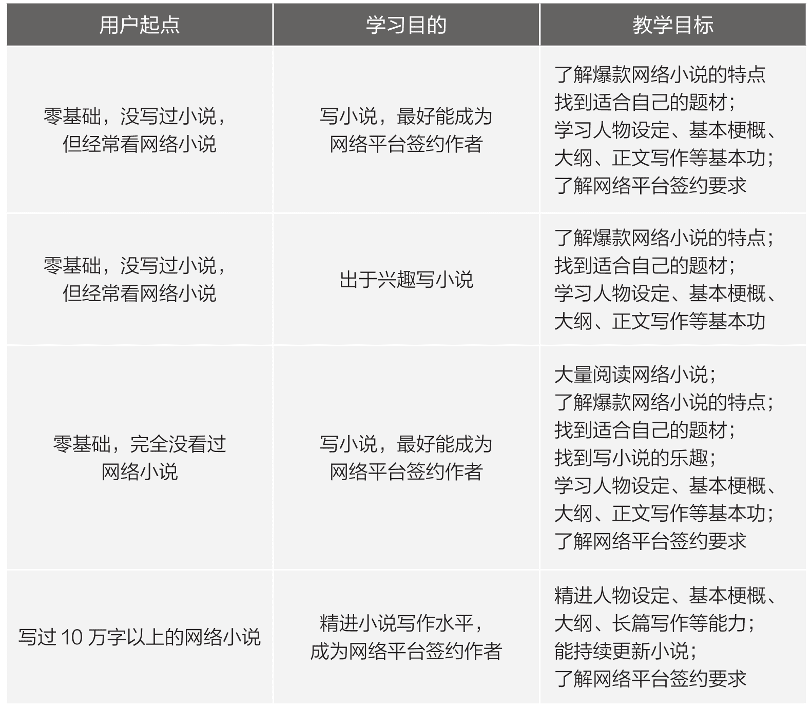

由此可见，起点相同目的不同目标不同，起点不同目的相同目标也不同。

**3.2.2 明确起点**

不能服务所有人，体验差太多。极端例子，教奥运冠军基础游泳没意义，教80岁不会游泳的人危险。

尤其是训练营，计划固定，人要在同一时间学同一内容，完成同样练习，难度感受不能差太多。相当于设入学门槛，筛选掉不合适的。

要回答：学员最好具备什么条件？谁会觉得太简单？谁会觉得太难？交付越高，起点越要清晰。

比如声乐训练营。轻服务899元的兴趣课，面向想提升唱歌的人，可以不设门槛，不同起点都能获益。若定位重服务5999元，面向想做才艺主播或考级的人，门槛可设为五音全、无明显乡音，以保证效果。

声乐训练营目标示例：起点零基础；目的用自己的声音演绎喜欢的角色，出于兴趣；掌握发声气息技巧，能长时间配音不发颤；掌握御姐音、萝莉音等发声技巧；掌握不同情绪发声，日常可用配音秀等App练习。最好使用过配音秀App；年龄60岁以上或乡音明显的人会觉得有难度。

零基础网络小说写作训练营目标示例：起点零基础，没写过小说但经常看；目的想写小说，最好签约；交付实操技能和训练，让至少10%学员达到签约门槛；定价2899元/4周；目标是了解爆款特点选题材、掌握人物设定大纲开篇技巧、了解平台签约标准，能写6000字以上正文。最好看过5本以上网文；写过10万字或在连载的人会觉得太易；没看过网文、不擅长打字的人会觉得难。

**3.2.3 按定价设计交付边界**

不同价位解决的问题程度不同，边界要清晰，宣传时也要把握尺度，如表3-3所示。

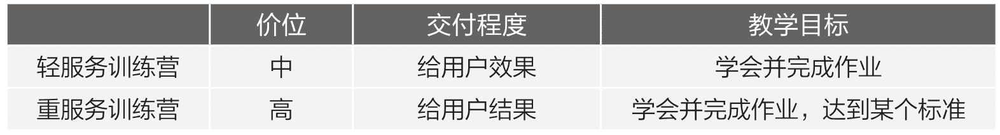

500元中等价位轻交付轻服务，教学目标写上“搞定就业”就不合理，要么夸大要么亏本。8000元高价重交付重服务，若没有实战成果就不符合预期。

上万元的高价课会承诺明确结果，这类交付价值高但不建议新手轻易尝试，很难保证所有人达成，需要完善的补偿机制和严格的运营。

我参与过近2万元的注册会计师课程，承诺不过可续学一年，再不过退费。年销售额千万元，退费率不到10%，背后需要严格的用户、服务、财务管控。新手如果无法严控过程，就不要承诺结果。

**3.2.4 难度要“踮脚可及”**

目标太难会挫败放弃，太易会无聊放弃。学习不能让人脱三层皮。

比如写作训练营不会教所有文体，也不会几周把新手变成月入过万的撰稿人。目标设定为“能写出达到收稿要求的文章”。

每周目标也要合理，前两周热情最高，安排5节课，实践任务轻，每周200到400字小作品，先建立信心再加难度。

课程进入中后期后，上课频率会主动放缓，通常一周只安排两到三节，原因很简单，用户的新鲜感和学习热情会出现自然回落。与此同时因为能力在累积，实操的比重会加大，作业量一般会抬升到每周八百字上下。这个分量正好落在“踮起脚尖就能触到”的区间，每一周都能够完成，整期结束时学员会积累到清晰的获得感。

如果每周都要求两千字输出，这个难度基本是不可达的。

有人会问，周期拉长是不是就该把目标调高？并不是。训练营的时长最好控制在七周以内，时间过长容易逼近用户的承受极限，教学规划一定要在有限周期内完成。

**3.2.5 只能围绕一条主线展开**

一门课程的主攻方向只能有一个。

之所以很多课程达不到预期，往往是因为过程里的小目标太多而且彼此关联弱。比方说一门写作课，把目标写成“学会高流量写作法则、提升沟通表达、打造个人IP、玩转社群运营”，学员一看就会无所适从。课程不能做成一本百科全书，我们不可能一次性解决所有问题。

越追求大而全风险越大，对学员真正的负责，就是只保留一条主线。

**3.3 拆解用户痛点，搞清楚付费动机**

什么是痛点？在我看来就是困难。有困难才会有付费学习的需求。

比如上台讲两句话就大脑空白，所以要学演讲；人脉匮乏影响事业发展，所以想学人脉经营；房间永远乱糟糟，所以想学收纳；孩子青春期叛逆让人头疼，所以想学家庭教育。

我们很容易沉浸在自己的专业兴趣里，却忽略了用户在真实场景里遇到的具体阻碍，这会让课程失去解决问题的能力。

确定教学目标之后，下一步就是依据目标去拆解用户痛点，弄清楚在达成目标的路上会碰到哪些坎。

为什么要做这件事？课程大纲不是凭空拍脑袋来的，而是围绕真实问题来设计的。每节课都要解决一个关键问题，每解决一个，用户就更进一步。

拆解的过程可以分成三步。

一是全面调研用户痛点，避免遗漏。
二是筛选出课程必须解决的问题，优先处理最关键的。
三是诊断痛点，挖到本质原因，本质清晰了方案自然出来。

下面分别说说每一步的操作思路。

**3.3.1 调研用户痛点**

首要任务是对目标学员做深度调研，摸清他们具体想解决什么。问卷调查在效率上可行，但局限明显。第一份问卷能承载的问题有限；第二用户填问卷的耐心有限，收上来的一多半是仓促应付的结果。

举例来说，做一门公开演讲课，问卷里可能会收集到诸如不会选主题、结构混乱、开场冷场、收尾尴尬、紧张忘词、不会即兴、音量失控等反馈。这些描述都偏宽泛，而且基本都在预期之内。所以在调研方式上，一对一访谈的价值更高。

还有一个现实难题：用户如果没实操过，怎么知道自己会卡在哪？我的建议是挑选一个关键环节，做真实场景模拟，让用户在挑战中自己撞出问题。

以小说写作为例，直接问“你写小说会遇到什么困难”，用户很难说清。让用户先试着做构思这一环，在过程中捕捉“抓耳挠腮”的瞬间，观察他们的卡点、局限、弯路，再对比优秀作品的差距，这样得到的信息才具体可信。

比如某品牌运营课的调研就汇总出这些真实困扰：投入产出比失衡，花钱却赚得少；不懂平台规则白花钱；预算收紧做不出爆品；渠道选错发挥不出效能；小品牌卡在0到1；腰部品牌想破局；想提占有率却不知从何下手；不会讲品牌故事，难以触动人心；曾有爆品但后劲不足；流量高转化低，老板不认可；团队想法脱离实际；信息闭塞跟不上变化；不会拿捏年轻人的情绪；讲使命容易空洞。

做调研时要注意三点。

**1.分辨真痛点与假痛点**
表面看起来严重的问题，往往不是真正阻碍学习的核心。学英语时很多人抱怨词汇量不够，深入访谈后会发现真正的卡点是缺乏高效记忆方法和实际运用策略。给一堆生词不如教一套记忆和使用的打法。

**2.把抽象问题变成具体问题**
“写开头写不下去”太笼统，可以拆成对主题理解不深、缺乏启动技巧、对开头结构不清晰、完美主义拖延等具体表现。问题越具体，解法越精准。

**3.借用过来人的预判**
用户调研不可能覆盖所有潜在问题，有些问题只有走到一定阶段才会暴露。设计健身课时，新手关心计划怎么制定，老手才会问怎么调强度防伤病、怎么结合饮食。所以和经验丰富的用户、行业专家深度交流，提前预判风险点，是必要的补充。

**3.3.2 筛选课程要解决的问题**

筛选的关键问题时，四条原则能提升竞争力。

**1.优先解决高频痛点**
问题的紧迫性和出现频率不一样。有的不解决会极度不适，有的无所谓；有的大部分人都有，有的只是少数；有的天天出现，有的偶尔发生。可以结合定价和规模，挑选最值得投入的问题。

表 3-4 是一个评估痛点指数的示例。

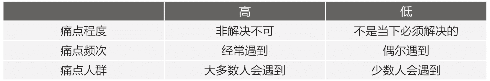

**2.优先解决竞品没解决好的关键问题**
建议仔细看竞品评论区，重点看差评和提问。差评能暴露未被解决或解决不彻底的问题，提问能反映用户的疑惑和期待。能把对手没做好的点补上，课程才有差异化。

**3.优先解决竞品让用户获得感强的问题**
多看竞品的好评，分析用户因为哪些问题的被解决而满意，从中提炼需求。

**4.用过滤准则保定力**
保证每节课的问题都和整体目标强相关，与定位偏离、关联性弱的问题要果断舍弃。

**3.3.3 诊断痛点**

找到问题的本质才是最关键的诊断环节，就像医生先确诊再开方。表面现象背后往往藏着更深层的原因，需要往下挖。

以我正在规划的小说写作课为例，发现不少用户构思的故事老套平庸，光看现象没用。要追问为什么。

可能的原因包括：阅读量不足，审美停留在旧时代，无法满足读者对冲突和高潮的期待；人物扁平单一，故事缺少灵魂；思维固化，缺乏突破和创新。

找到根因后，教学设计就能对症：引入现代爆款案例和书单拓宽视野；教有血有肉的人物塑造；用游戏化练习打破思维定式，激发想象力。

表 3-5 以课程“如何构思小说情节”为例，拆解现象背后的本质原因。

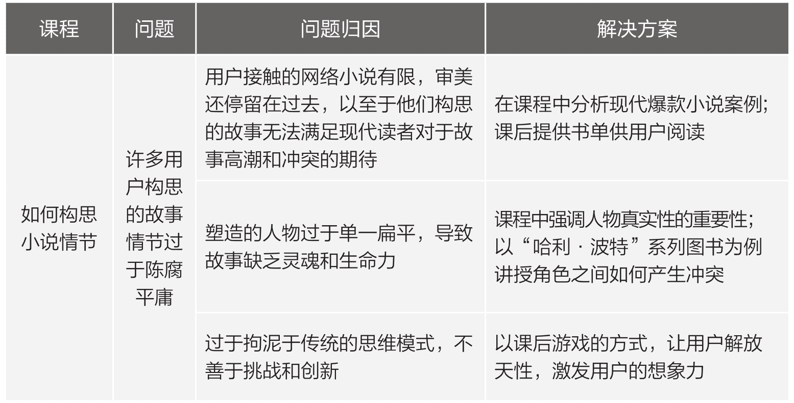

**AI 锦囊：用 AI，调研用户痛点**

①使用要点。
把 AI 当作调研助手，换位思考用户在真实使用时的困难。

②提问示范。
◎AI 指令。
我是一个“小白”，如果做小红书短视频，会遇到哪些困难呢？
◎AI 回答。
首先，你可能会感到迷茫，不知道如何开始。你需要了解平台的规则，掌握视频剪辑和配音的技巧，还需要寻找创作的灵感并确定自己的风格。
其次，你可能会遇到内容创作的难题。如何创作出吸引人、有趣且有价值的短视频内容，是每个“小白”都会面临的挑战。你需要挖掘自己的创意，同时了解受众的喜好和需求，才能打造出爆款短视频。
再者，推广和变现也是一大痛点。即使你制作出了优秀的短视频，但如果没有好的推广策略，就很难让更多人看到。同时，如何将短视频变现，实现商业价值，也是你需要考虑的问题。

# 第四章 课程大纲设计

**4.1 课程大纲设计的底层逻辑**

课程大纲相当于课程的目录，列出了学习过程中要听、要看、要做的全部内容。可以把大纲想象成一棵树，每节课是枝干，每个知识点是叶子。

我们可以在大纲里按顺序列出各节主题，方便用户按需安排学习，如图 4-1 所示。

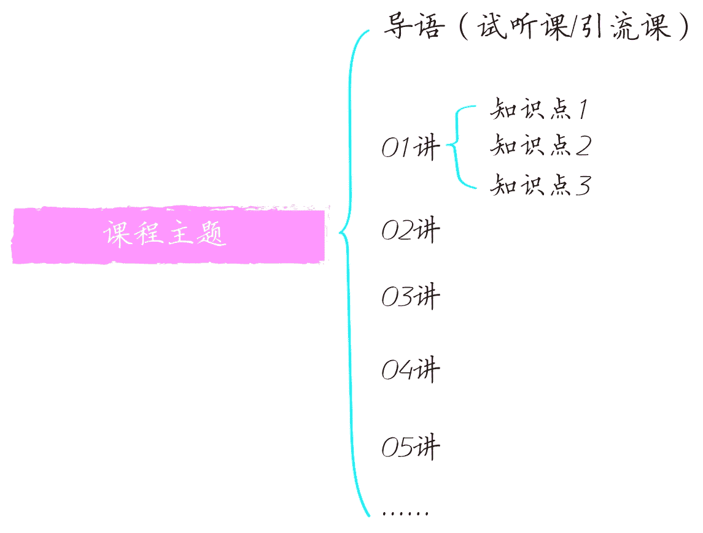

图 4-1

普通课程侧重传授知识，训练营更强调结果。训练营会提供辅导、答疑和实操机会，并明确不同时间段的学习安排，确保在周期内达成目标。

图 4-2 为训练营的经典课程大纲。

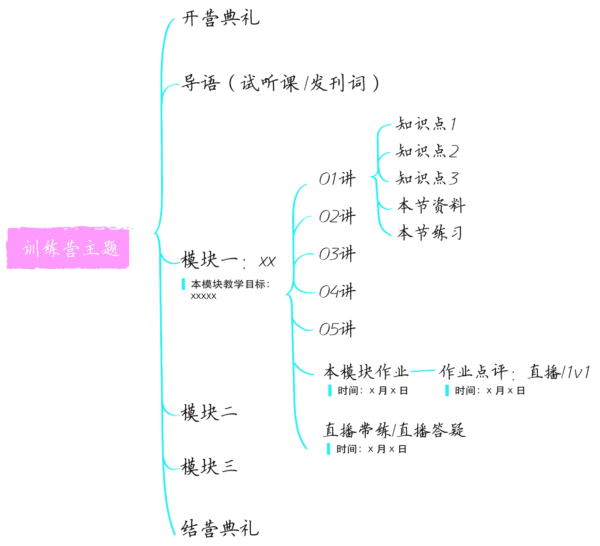

图 4-2

表 4-1 详细阐述了普通课程和训练营在课程大纲设计上的差异。

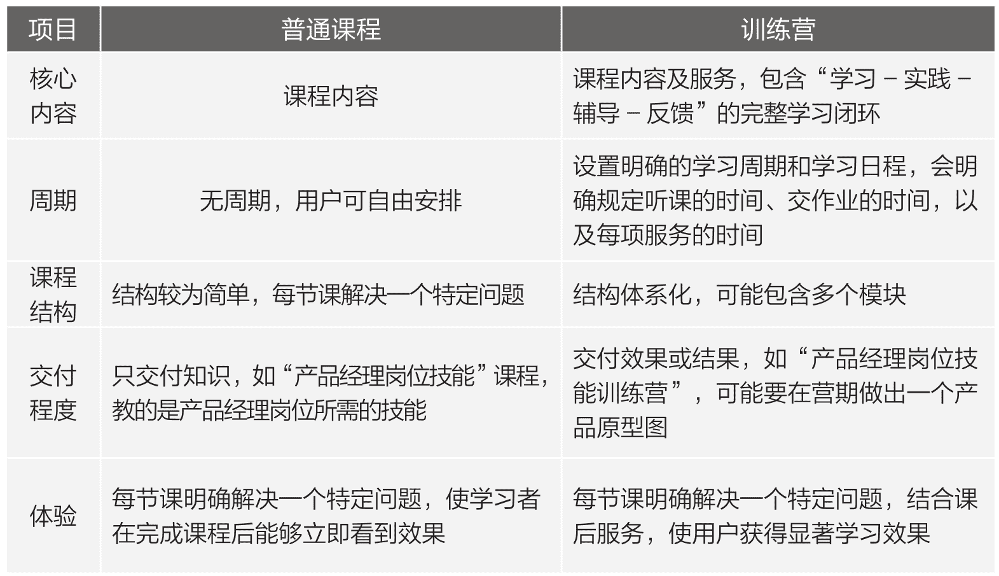

设计大纲有两个核心出发点：解决问题和用户体验。

课程存在的意义就是帮用户解决问题。大纲设计首先要围绕教学目标展开，决定学什么以及学什么顺序。

◎学习内容：筛选出必须解决的问题，确保学员拿到关键知识和技能。
◎学习顺序：考虑难易程度，找到最顺畅的掌握路径。

在剖析痛点并筛选知识点后，如图 4-3 所示。

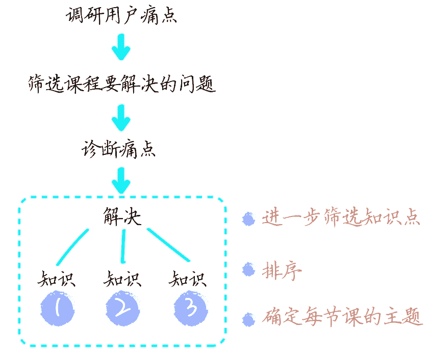

图 4-3

做大纲时还要进一步精简每节课的知识点并排序，最后确定每节主题。

以用户体验为出发点来做大纲很容易被忽略。课程要兼顾用户从购买时的兴奋、中途的倦怠到最后的成就感。人不是机器，学习节奏必须尊重人性，否则再严谨的计划也会失效。

**4.2 优质课程大纲的 5 个标准**

**1.目标感**
每节课、每个服务都要有效推动问题解决。大纲的每个部分都要有明确目标，而且我们有能力帮助实现。教学目标像指南针，帮助不断校准。

很多讲师做大纲时开始很清晰，后来慢慢偏题，觉得“这个也可以教、那个也有用”，最后变成百科全书。判断是否有目标感，可以自检：大纲里有没有无关内容？是否是最直接有效的达成路径？是否解决了实现目标的关键问题？每节内容是否紧扣主题？

就像迷路时要不断问自己：我要去哪？目标是什么？邓亚萍说过，比赛最后阶段教练不再讲复杂战术，只说把球打在台子上。

**2.必要性**
课程容量和周期有限，不能浪费在无关内容上。要确保每节课都击中核心问题。你可以自问：遮掉这一节，整体目标还能达成吗？如果可以，这节可能没必要。碎片化知识点不适合放在课里，可以放到资料或社群。

**3.吸引力**
每节标题要一眼看出讲什么，整体大纲像精心包装的商品，能激发购买欲和好奇心。很多大纲像大学教材目录，专业但让人头大，切割过细、学术感强，对忙碌的成年人不友好。

评估吸引力可以看：标题是否清晰？学员会觉得有趣值得投入吗？和市面上课程比是否物有所值？是否紧凑不拖沓？切忌把一个主题拆成无数小节，比如“如何写出令人拍案叫绝的金句-1、-2、-3、-4”，很容易让人厌倦。

**4.体验感**
学习过程中负面情绪要少，要有成就感和适当减压。不要用疲劳战术。自检点包括：开场白能否激起好奇和挑战欲？开头难度是否适中？难度是否循序渐进？每节能否做到立竿见影？是否有知识沉淀物如卡片、课件？前期是否带来求知乐趣？每周必修任务是否在6小时以内？每周是否有足够成就感？重要实操是否有对应练习？

**5.难度稳定**
每节难度不能跳跃太大。自检：所有主题是否在同一层级？比如“如何与听众建立连接”和“紧张到忘词怎么办”差距很大，不宜同列。颗粒度是否一致，避免时长和深度忽大忽小影响体验。

**4.3 课程大纲设计三步法**

做大纲前要明确目标用户是谁、基础如何、为什么学。

**4.3.1 确定大纲内容**

比如设计一个小说训练营，大纲可如表 4-2 所示。

表 4-2

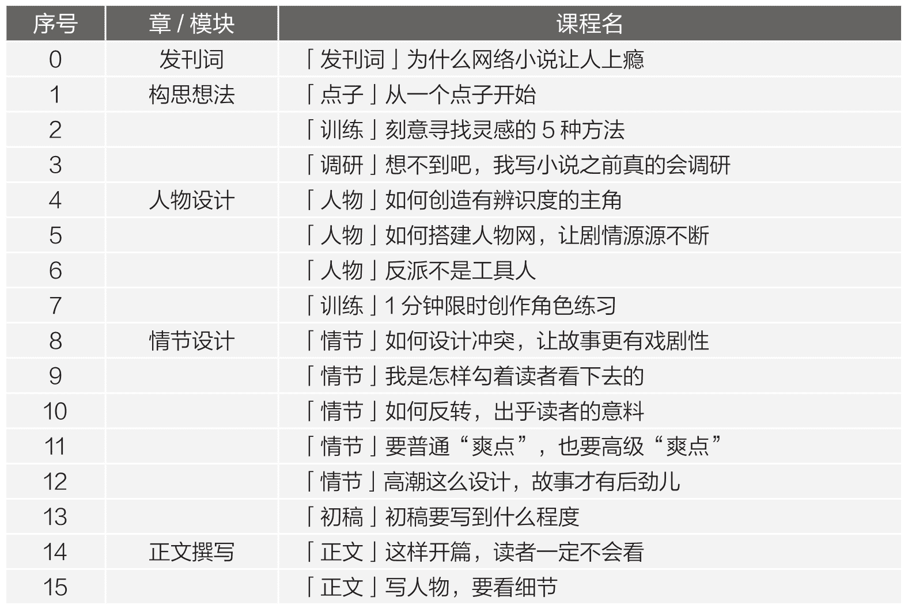

续表

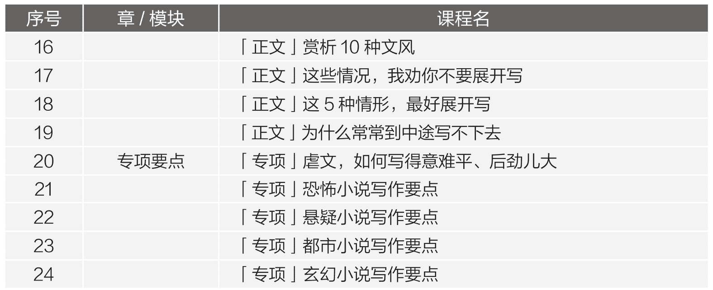

以“如何创造有辨识度的主角”为例，痛点、原因和解决方案如表 4-3 所示。

表 4-3

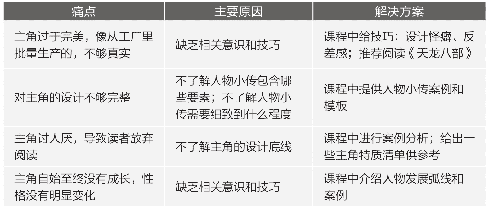

可以看出，每节课都在解决一个具体问题，知识点就是解决方案。

接下来要调整顺序，确定结构。常用四种结构：

**1.流程式**
按步骤或时间顺序展开，适合需要按流程完成的课程。比如课程制作要按选题、设计大纲、写逐字稿、录课、剪辑、包装、营销、推广的顺序走；历史课也可以按时间线讲。

小说训练营的流程式大纲示例：
01 讲：寻找写作北极星|确定方向
02 讲：新手指南|如何巧妙选择小说题材
03 讲：爆款秘籍|小说案例深度解析
04 讲：动手实战|提交独特的小说选题
05 讲：构思大师|掌握小说构思的八步法
06 讲：角色工厂|设计独一无二的角色
07 讲：剧情大厨|用角色的过去“烹饪”剧情
08 讲：实战挑战|提交小说梗概
09 讲：大纲宝典|掌握大纲的黄金模板
10 讲：高潮制造者|设计令人痴迷的高潮剧情
11 讲：动手实战|提交完美的小说大纲
12 讲：开篇之道|小说开篇案例精析
13 讲：节奏大师|把握开篇节奏的艺术
14 讲：代入感魔法师|如何提高代入感
15 讲：剧情继续|如何持续推进剧情
16 讲：实战挑战|提交精彩的正文开篇

课程的搭建方式直接决定学习感受，选对组织逻辑，学员才觉得顺畅、可记、能用。下面把几种常用组织思路重新梳理，并给出可直接借鉴的写法。

流水线式走的是递进动线。每完成一个环节就能拿到可见产出与即时回馈，推动感强，成就感来得快。

**平权式**

平权式的特点是各单元权重相当，顺序可以调换不影响整体效果，适合按需取用。

典型排布有两组。

知识小课“精读八本书”的编排如下。

导语：每天听一本，你能得到什么
01讲：通透人生|被讨厌的勇气：学会课题分离的艺术
02讲：通透人生|人生由我：尊重自我，理解内心的感受
03讲：通透人生|《通透》：如何活出清醒的人生
04讲：高效人生|《高效能人士的七个习惯》：实现事半功倍的生活
05讲：高效人生|为什么精英都是时间管理控：重塑你对一天24小时的认知
06讲：高效人生|起床后的黄金一小时：一日之计在于晨的生活智慧
07讲：幸福人生|断舍离：给生活做减法，找回真我
08讲：幸福人生|四千周：接纳生命的有限性，活出无悔的人生

知识小课“提升学习力”的编排如下。

导语：8节课，成为学霸
01讲：怎样制定合理的学习计划
02讲：怎样根治拖延
03讲：高效记忆的方法
04讲：专注力的提升
05讲：有效归纳总结
06讲：让笔记更清晰好记
07讲：用费曼法自学
08讲：三天打鱼两天晒网该怎么办

平权式的目录让学习者自主挑选主题与节奏，个性化空间很大。

**阶梯式**

阶梯式是循序上坡的编排，由浅入深、由点到面，先建理论框架再落到实操，知识点逐层累加。

“脱口秀训练营”就是典型。

发刊词：每场脱口秀，都是对过往人生的一次打包
第一周：重新认识脱口秀
实践任务：将生活中发生的一件小事讲得有趣，并录成5分钟短视频
01讲：怎样找到故事里的喜剧灵魂
02讲：讲故事更有幽默感的技巧
第二周：初阶创作
实践任务：录一个5分钟脱口秀
03讲：脱口秀结构的设计
04讲：脱口秀包袱的设计
第三周：进阶创作
实践任务：写毕业作品逐字稿
05讲：反讽与夸张的运用
06讲：反转的设计
第四周：毕业表演——完成一场脱口秀
实践任务：修改逐字稿，录10分钟表演视频
07讲：逐字稿修改技巧
08讲：上台前的排练技巧
09讲：怎样找到自己的风格

这种编排让学习者先粗后精，从概念到上手，效果逐步放大。

**总分总**

总分总在课程里通用，既能套整门课，也能套单节。先给全景，再拆细节，最后收束。

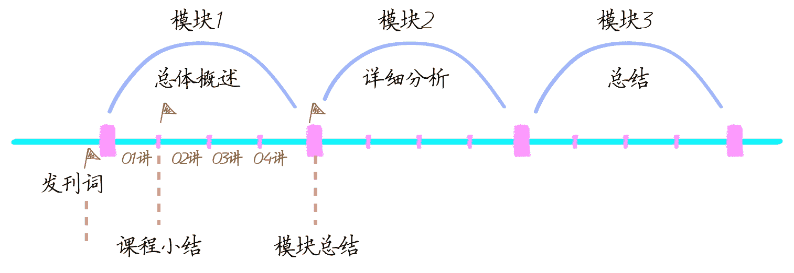

图4-4

常见两种用法。

1. 经典总分总
多数课都需要开场定调与收尾复盘。
◎导语：讲清为什么学、学到什么、讲师凭什么。
◎回顾：把已学要点串起来复习。如“超级个体”课程每个单元都配“单元导语”和“精华回顾”。

2. 项目制总分总
单元围绕一次实操项目时，先亮案例，再分步讲解，最后复盘。
◎总：拿出本单元产出范例，让学员明白要做什么、怎么做、关键在哪。
◎分：按实操流程逐层讲解。
◎总：带学员复盘，把知识点连成网。

以“课程设计训练营”为例。

发刊词：学会做课，卖掉你的思考
第一单元实践任务：完成一款知识小课的课程设计
01讲：拆解爆款知识小课案例，剖析设计要点（总）
02讲：用户与竞品调研
03讲：怎样设计教学目标
04讲：怎样设计课程大纲
05讲：怎样设计一节课的细纲
快速回顾本单元（总）
第二单元实践任务：完成一款训练营的课程设计
06讲：拆解爆款训练营案例，剖析设计要点（总）
07讲：怎样设计教学目标
08讲：怎样设计训练计划
09讲：怎样设计一节课的细纲
10讲：怎样设计服务细纲
快速回顾本单元（总）

实操中四种结构常混用。

案例一：阶梯式+总分总
改良版“脱口秀训练营”整体呈阶梯，难度逐级上升；每个单元内部用总分总，先拆案例再教技巧再回顾。

序章：每场脱口秀，都是对过往人生的一次打包
第一单元：重新认识脱口秀
实践任务：将生活中发生的一件小事生动讲述，并录成5分钟短视频
01讲：逐段拆解脱口秀故事片段（总）
02讲：怎样找到故事里的喜剧灵魂
03讲：怎样讲故事更有幽默感
本单元快速回顾（总）
第二单元：初阶创作
实践任务：录一个5分钟脱口秀视频
04讲：拉片拆解脱口秀案例（总）
05讲：怎样设计脱口秀结构
06讲：怎样设计脱口秀包袱
本单元快速回顾（总）
第三单元：进阶创作
实践任务：完成毕业作品逐字稿
07讲：拉片拆解脱口秀案例（总）
08讲：怎样运用反讽与夸张
09讲：怎样设计反转
本单元快速回顾（总）
第四单元：毕业表演
实践任务：修改逐字稿，录10分钟脱口秀表演视频
10讲：拉片拆解不同风格的脱口秀表演（总）
11讲：逐字稿修改技巧
12讲：排练技巧
13讲：怎样找到自己的风格
回顾全部学习内容（总）

案例二：流水线式+阶梯式
写作小课主线用流水线，内部呈阶梯关系，从单点到综合。
第一部分01-06讲用单点突破，按写作流程讲选题、标题、素材、结构、大纲、开篇、金句；第二部分07-08讲做类型综合，练影评与两性情感文。

01讲：“单点突破”策划爆款选题的5大技巧
02讲：“单点突破”3个方法，教你写一个好标题
03讲：“单点突破”怎样快速收集文章素材
04讲：“单点突破”怎样设计文章的大纲
05讲：“单点突破”4种方式，写出吸睛的开篇
06讲：“单点突破”怎样写出令人拍案叫绝的金句
07讲：“类型写作”怎样写影评
08讲：“类型写作”怎样写两性情感文章

做大纲时要兼顾情绪曲线，分三段设计。

◎激发兴趣段：开篇通常是序章或导语，任务是点燃好奇、交代逻辑与目标。学员此时兴奋、好奇、斗志满格，不宜直接上硬核技术。先打通底层逻辑，给出全局观，再下细节。反例是把“怎样做课程选题”放第一节，体验感会打折。

◎难度渐进段：第一阶段任务要轻易完成，建立信心；进入提升期时难度像爬楼梯一样均匀递增。某个台阶过高会劝退，过低会无聊。可在评论区评选优质留言给予奖励，提升参与热情。

◎终局段：小课结尾要做全面回顾，帮学员看见成长。复盘核心概念，鼓励在评论区分享收获，形成积极的收官记忆。

### 单元化设计

训练营常采用单元化，可归纳为阶梯模型。

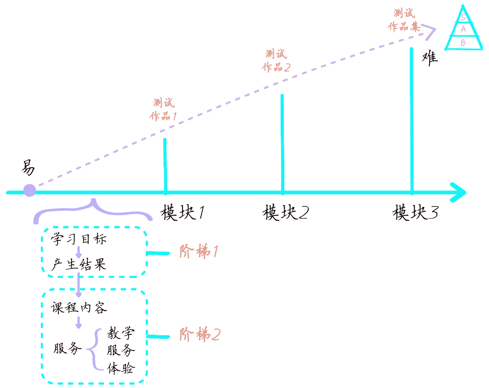

图4-5

单元化要做到三点。

◎目标独立：每个单元有明确目标与可展示成果，最后拼成作品集，成就感强。
◎完整闭环：从输入到输出，一个单元自成学习循环。
◎单元测验：学完即测验，巩固效果。

用单元化的原因在于成人需要阶段性反馈，靠实践与即时回馈把远期目标拆小。建议每周聚焦一个单元，避免过载。

设计单元分三步：定单元目标和产出、从用户视角设计服务、排训练日程。

1. 设计单元目标和产出
确定总目标后，思考学习顺序与对应产出。两种思路。

按实操步骤拆。以毕业作品为锚点，把达成步骤拆成单元，适合长期实践型课程。

例“零基础网络小说写作训练营”，毕业作品是小说大纲+2000字开篇。

用户起点：零基础，没写过小说，但爱看网文
学习目的：写小说，争取签约
交付程度：给技能与训练，让至少10%学员达到签约门槛
初步定价：2899元/4周
总教学目标：读懂爆款小说特征，选对题材；掌握人物、大纲、开篇写作；了解平台签约标准，写出2000字以上正文
用户最好具备：看过5本以上网络小说
会觉得太容易：写过10万字以上或在连载的人
会觉得有难度：没看过网文、打字不熟练
第一单元目标：了解爆款特点，选定题材
实践任务1：确定小说选题
第二单元目标：掌握人物设定和梗概
实践任务2：构建故事梗概
第三单元目标：掌握大纲技巧
实践任务3：编写小说大纲
第四单元目标：掌握开篇写作
实践任务4：撰写小说第一章

同理“脱口秀训练营”毕业作品是录制10分钟脱口秀，前置单元先讲小事、再录5分钟、最后打磨逐字稿，难度逐步抬升。

从单角度到多角度。每个单元任务相似，随着深入技巧叠加。例“声乐训练营”，先用第一单元技巧唱一首歌，再叠加第二单元技巧唱另一首，反复强化。

用户起点：大白嗓、五音不全
学习目的：KTV唱得更好
交付程度：实操技巧+训练
初步定价：1288元/2周
总教学目标：养成正确发声习惯，掌握高音、颤音、换气
第一单元目标：找到唱不好原因，练气
实践任务1：演唱《青花瓷》并上传
第二单元目标：掌握颤音、换气、高音
实践任务2：演唱《红豆》并上传

设计产出要满足：精准考核单元知识点、不超纲；用时控制在2小时内；标准明确。可使用SABC分级公开标准。S超预期，A良好，B合格，C待提高，并设定目标比例用于校准课程难度。

2. 站在用户角度设计服务
别先定形式再填内容。推演用户实操路径，预判卡点，再设计抓手。像“21天早起光芒打卡计划”在中途设群内复盘，老师梳理常见问题并给出对策，就是在关键时刻拉一把。

跳舞的例子也一样：听课学动作→跟音乐实操→老师点评纠正→每日基本功练习→舞友PK。流程出来了，对应服务就清楚了。

3. 合理安排训练日程
要为每个时间点的体验负责。

分散安排学习密度，如一天交实践任务一天听直播，每周留休息日。

把控时长。优秀计划每周必要学习不超过6小时。例3节20分钟录播+1节120分钟直播+2节60分钟带练+1小时实践任务=6小时。要求10小时学习看似扎实，实则易导致放弃。

设计单元节奏，首周任务要低门槛好上手。比如写作训练营首周若要求写3000字，学员会畏难；改成随笔练习就容易建立信心。

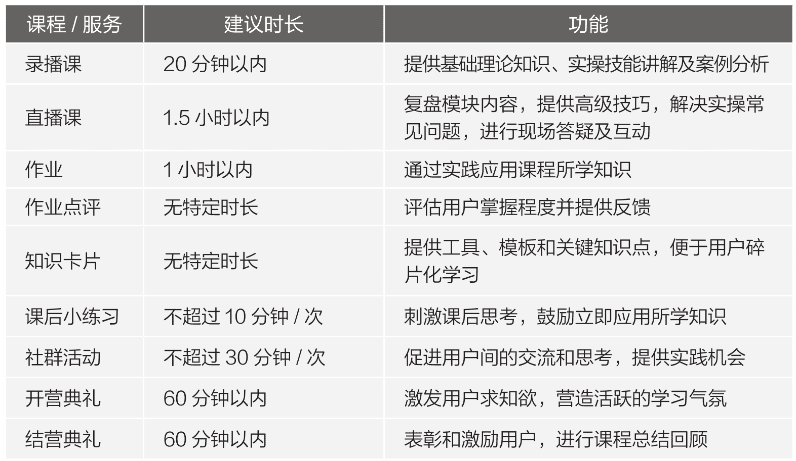

表4-4

做好结构、情绪、节奏和服务，课程才既好学又好卖。

给素材换一个说法，但内核不变，这套课程设计的方法论依然能完整呈现。

**用镜头感去抓故事，远近兼顾**

写作的感知力可以像电影一样训练。第一周的小练习叫敏锐度训练，分远景和近景两个方向。

远景练习是打开微博热搜，从最近发酵的大事里挑一个最触动你的案例用简短文字复述一下。情绪可以是感动、愤怒、惊讶，也可以用明星事件来做示范。

近景练习是把目光收回到身边的人。选一个朋友、家人、爱人或同事的瞬间定格下来，写出让你想笑、感动或觉得幸福的那一刻。比如看到公司洗手间里实习生在哭；孩子第一次据理力争的场景；每次出门远行，姥姥总在楼上目送你离开。

**进入难关时，用激励把人留住**

第一模块学完后难度会自然抬升，这也是学员最容易倦怠、想退出的节点。此时要主动设计激励机制，把内在驱动力点亮。

常用的做法有两种。公开表扬能放大成就感，让优秀被看见从而带动学习劲头；竞赛机制则让学习带上游戏感，在良性对拼中提升状态。每周点评完作业后，把挑出来的好作品放到课程群里晒一晒，或者在直播课上现场展示，就能形成持续的向上的推力。

**日程必须可视化，否则就乱套**

训练营每一步动作都要落到具体时间点上，否则学员会迷茫、被动，老师也会被各种进度咨询拖住。看真实排期就明白了。

表 4-5
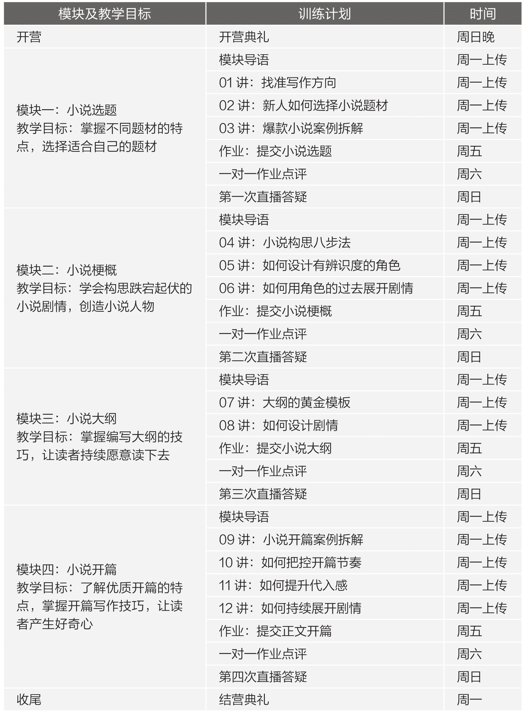
就是“零基础网络小说写作训练营”的完整时间表。

再看“脱口秀训练营”的排法，表 4-6
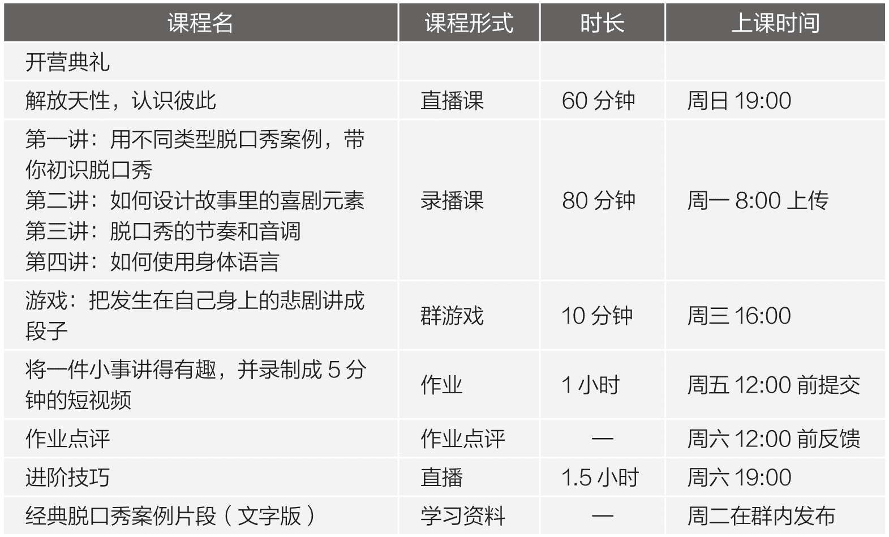
里，第一模块的任务很清晰：讲一件身边有意思的小事，并把它拍成五分钟的短视频。

**AI 只负责抛砖引玉，大纲不能照搬**

AI 锦囊：用 AI 给你大纲思路

使用要点。能直接把课程的定位和人群告诉 AI，让它帮忙搭一个框架。提醒一下，AI 提供的只是启发，不能直接拿来用。

提问示范。
AI 指令。
我要做一门小红书短视频内容创作课程，10 节课左右，售价 99 元，请你帮我设计课程大纲，我希望课程标题能使用网络语言。

AI 回答。
课程标题：“短视频制作达人修炼手册：小红书爆款秘籍 99 元速成班”

课程大纲：
第一节：短视频入门秘籍
短视频平台解析与定位、短视频内容创作灵感挖掘
第二节：视频剪辑与配乐
高效剪辑技巧大揭秘、热门配乐选择与运用
第三节：视觉冲击力打造
画面构图与色彩搭配、特效与滤镜的使用技巧
第四节：文案与配音
吸引人的文案写作技巧、配音与口播的注意事项
第五节：短视频内容创意
创意内容生成方法、热门话题与趋势跟踪
第六节：短视频优化与推广
关键词优化技巧、短视频推广策略
第七节：数据分析与调整
短视频数据解读、根据数据调整内容策略
第八节：实战案例分析
爆款短视频案例解析、失败案例反思与避免
第九节：短视频变现秘籍
广告合作与品牌植入、短视频电商引流技巧
第十节：总结与展望
课程内容回顾与巩固、短视频发展趋势探讨

**价位决定服务形态，预期也跟着变**

课程定价不同，学员要的也不一样。

5000 元以上：要的是重度服务，比如一对一教学、资源扶持。
500～5000 元：要的是陪伴式服务，比如社群督学、社群游戏、实操项目。
500 元以内：要的是认知和工具，比如学科案例、理论要点、实操模板。

市场已经很明确。高价课的买家不只是兴趣，更要技能的明显跃升，所以必须结果导向，给出细致的教学和高频互动；中价段学员同样想要实打实的能力提升，但对个性化深度的要求会低一些，录播+基础社群督学就能满足；低价课不代表可以随意，靠高质量的案例、指南和可直接用的工具来撑起价值感，反而更受认可。

**11 种经典教学形式怎么选**

1. 录播课
几乎所有课程都有。用户把它当作课程存在的默认项，详情页也会用案例数、模型数来宣传。要注意的是，训练营的真正价值不在录播多，而在服务跟不跟得上。300 元的大课可能有 200 多节录播，3000 元的训练营可能只有 20 节。核心作用是随时学、系统授课、复习巩固、附带课件讲义、提升体感。最好有背书，比如最新研究、实战沉淀、稀缺方法。

2. 直播课
高价训练营标配。录播可以反复售卖，直播每次都要投入时间，所以含金量更高。学员期待沉浸感、能实时提问、集体氛围、以及第一手的行业更新。核心作用是即时互动、营造课堂氛围、讲师即时反馈、实战演练、现场案例拆解。常见形式有小班带练，讲师带少量学员在直播间练习，保证每人被点评，适合高客单；还有大班直播，面向全体付费学员讲课答疑，每周 1.5 小时左右是常规做法。

3. 作业点评
多数训练营的标配，也是用户最看重的环节之一。每周一次的点评能起到四两拨千斤的效果。核心作用是快速反馈、个性化建议、看到进步从而保持动力、师生和同学之间的交流。

4. 线上社区
像贴吧一样自由交流的知识星球、小鹅通等。创作类课程常用。核心功能有打卡挑战、经验分享、一对一答疑、优质内容加精、发布学习任务。

5. 社群
几乎必备，是课程的“家”。即时互动让成员关系更紧密。核心作用是学习交流、社交互动、通过目标和竞赛保持动力、增强归属感、小规模班级能提供更细致的辅导，但人力成本高，多见于高价课。

6. 毕业比赛
部分课程会设结业作品赛。不是购买理由，却能大幅提升体验。核心作用是在有限时间内激发潜能、强化竞争意识、把所学落地。

7. 课后即练
每节课后给一个思考或实操任务，比如配音课的绕口令练习。成本低，高低价都适合。核心作用是及时复盘应用、提供交流平台、带来成就感。

8. 学习资料
课件 PDF、图片、题集、案例汇编、知识卡片等。不是决策点，但能加分。核心作用是拓展知识点、给实践指导、提供典型案例。资料包要克制，避免堆 5G、10G 的无用信息，每份都要能用。

9. 实物礼品
与课程相关的工具、参考资料、纪念品或奖励。学员喜欢能晒朋友圈的小东西。核心作用是辅助学习、奖励激励、增强记忆、成为二次传播。

10. 私董会
私人董事会，成员多为企业高层。非正式组织，提供建议和咨询。很多用户为此付费。核心作用是决策建议、经验互换、人脉资源对接、提供战略财务市场等咨询。

11. 资源扶持
高端营会给学员提供难得的机会，比如写作营的出书投稿渠道、技能营的大厂内推。核心作用是加速目标达成，提供指导、实践机会、人脉和行业信息。表 4-7
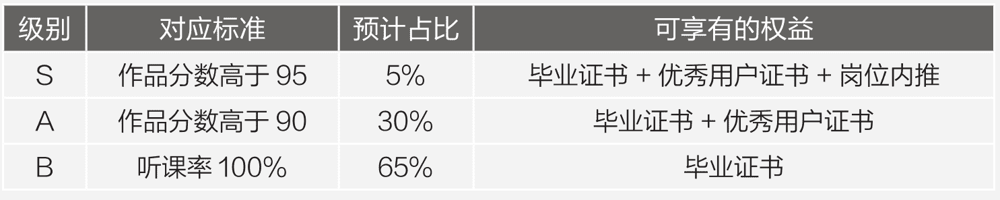
里列出了一些权益样本。扶持要有门槛和名额限制，唯有表现突出者才能获得，才有含金量。

提醒一下，上述形式可以让课程看起来更值，但真正决定口碑的是内在的“内秀”。宣传再好看，如果交付的内容和承诺不匹配，外表再华丽也撑不住。

学员的好评，往往来自内在价值：
“班级群就是我的动力源，每次想放弃看到大家还在坚持，就又燃起来了。”
“老师讲的我都知道，但从没这么清晰过。”
“课程直击要害又很全面，回头再看像灯火阑珊处蓦然回首。”
“让我换了看世界的新角度，心态更稳了。”
“之前模糊的问题被具体化、系统化了。”
“结识了一群志同道合的伙伴，上海还建了校友会。”
“助教超用心，担心我跟不上学习吸收。”
“每周两次实战课加一对一作业点评，反馈及时，技巧用在了公司演讲上，提升很明显。”

我们的目标不是让课程看起来更划算，而是让学员学完时真心觉得课有所值。

**4.5 7 种方法打造吸睛的课程标题**

做大纲时很多人只盯着专业和体系化，却忽略了标题的吸睛力。

课名就是一门课的门面招牌。招牌写得乏味、提不起兴趣，哪怕内部干货满满，也很难被点开。好比顶级食材做出的菜品，摆盘清淡无味，再好吃也会先让人退缩。

学员在付费前能看到的首先是每节课的名称。对还在观望的人而言，一个带冲击力的名称能快速点燃好奇心，促成购买意向。对已购课的人而言，清晰的名称能帮助他迅速判断本节要破解的具体困惑。

当前同质化严重，“怎么提升英语口语”“怎么高效管理时间”这类表述早已审美疲劳，区分度低，很难打动内心。

以下七种打法，可以帮助你快速做出让人记住的课时名称。

**1.直击痛点**
把学员正在经历的困境直接写进名称，让人一看即对号入座，产生“这不就是讲我的吗”的感受。痛感越强，吸力越大。先厘清目标学员在本节会卡在何处，再把问题原样抛出来。比如：

◎反复掉坑却总记不住教训，怎么破局？
◎在团队里经常被甩锅，要怎么自证？
◎领导三天两头变卦，该怎么应对？
◎表达常让人觉得不顺畅，要怎样更流畅？
◎孩子写作业就往厕所跑，家长该怎么处理？
◎人多时脑袋空白，要用什么方法自救？

**2.立场鲜明**
在名称里直接亮出判断与立场。关键是观点要有穿透力与辨识度。学员一旦觉得想法新颖，或者能解决当下困惑，就会产生兴趣。比如：

◎别人向你倾诉，不必急着回“我懂”
◎“为你好”往往是控制的借口
◎换个角度看，危机也能成转机
◎别把自我价值寄托在他人评价上
◎接纳平凡，才是和解的起点
◎你越想息事宁人，对方越得寸进尺
◎当废物也需要一定的天赋

**3.留下悬念**
故意留白，不把结论摊开。未知的张力会驱使人点进详情。比如：

◎情商低的人，通常藏着这三类特征
◎大众对自律的理解普遍有误
◎九成职场人都在用错 KPI
◎老是自责？可以试试这个思路
◎朋友吐槽时，为什么别急着给建议？
◎请别把“我都行”挂在嘴边，原因在这里？

**4.身份点名**
在名称里点出身份标签，让特定人群瞬间识别出内容为自己定制。比如：

◎七到十岁孩子家长的沟通指南？
◎二胎妈妈如何兼顾两个宝宝？
◎空降主管怎样迅速立威？
◎青春期孩子突然厌学该怎么办？
◎刚升职的小主管，下属不买账怎么破？

**5.反常识**
刻意打破既有认知框架，用反直觉的说法制造冲突感。常见做法是站在主流观点的对立面。比如：

◎惩戒孩子，有时也是保护
◎你一直误读的时间管理

**6.数字量化**
名称里带数字，会显得更具体、更有获得感。数字可以是技巧数量，也可以是学习时长。比如：

◎四步准备一场带货直播
◎选题没灵感？这五类可借鉴
◎自问四问，化解无谓焦虑
◎五招提升记忆表现
◎三分钟学会一场直播带货
◎掌握四原则，让沟通越来越顺
◎房间收纳十要点

**7.结果导向**
直接点明学习后能获得什么好处，制造向往。注意不可夸大，要可信。比如：

◎用此方法，让时间管理效率翻倍
◎掌握十个知识点，投资回报望提升
◎告别富贵包，练出天鹅颈

以上只是常用套路。你也可以去腾讯课堂、喜马拉雅等平台拆解高播放量的课程名称，观察句式与用词，再做迁移改造。

**AI 锦囊：用 AI 仿写课时名称**

①使用要点。
设计名称时，可以把自己喜欢的名称喂给 AI 让它模仿，也能把已有名称交给 AI 做润色升级。

②提问示范。
◎AI 指令。
我要开一门关于起文章标题的课程，请参考“在职场总是记吃不记打？怎样才能避免反复掉坑”，仿写八个课程名称。
◎AI 回答。
以下是仿照“在职场总是记吃不记打？怎样才能避免反复掉坑”这个名称，为您撰写的八个关于如何起文章标题的课程名称：

写作时总是抓耳挠腮？如何巧妙构思引人入胜的标题

文章标题如何抓人眼球？让你的作品脱颖而出

标题创作平淡无奇？解锁标题的吸睛密码

写作新手如何秒变标题大师？掌握这些技巧就够了

文章标题千篇一律？教你打造独特风格的标题

为什么你的文章标题无人问津？揭秘背后的原因与改进方法

如何让文章标题一针见血？直击读者痛点

标题创作难以下手？这里有你需要的灵感与技巧

# **第五章** **每节课的内容设计**

## **5.1** **用四步法设计一节课**

想让学员真正听懂一节课，就要在课堂上带他走完一趟完整的学习闭环：先被勾住→弄明白→动手试错→复盘总结。

由此归纳出课程设计的四步流程：激发兴趣、讲解知识、实践练习、知识巩固，如图 5-1 所示。

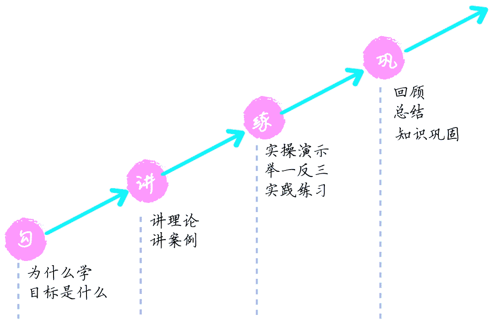

图 5-1

怎么理解这四步？以我的授课为例。

激发兴趣：在讲知识前先点燃兴趣。比如先点出学员的痛点，或强调本节能解决什么问题、学完会有什么变化，让人产生期待。

讲解知识：随后用最简洁的方式讲清理论和定义，最好一句话说透。再讲原理，用学员熟悉的例子把关键点讲清楚。

实践练习：如果是实操类内容，就出几道贴近场景的题目现场示范。示范时同步指出易错点和要点。

知识巩固：最后做一次简要收束，再进入下一个知识点。

无论是整门课还是单个知识点，都可以用“勾、讲、练、巩”来搭建。不同形式课的比重不一样，非实操类比如历史解读，可以没有练；实操类则要围绕主题反复练习，确保能迁移应用。

下面分步展开。

**5.1.1** **第一步：勾**

开场要先抓住注意力。核心是让学员明白为何要学这节、能收获什么，激发求知欲和好奇心。若上来就讲课，学员容易迷茫。只有先理解意义，才能进入状态。

设计开场要兼顾三件事：传达意义、激发兴趣、植入目标。实践中比较有效的开场有四种。

**1.颠覆认知式**
用强烈冲击打破刻板印象。当学员发现自己原来想错了，求知欲会被放大。

比如很多人对“读书博主”有刻板印象：觉得必须学富五车、写万字长文。其实在小学写读后感时，我们就已经在做读书博主了。先打破这种畏难想象，学员才会想继续听下去。

颠覆不是全盘否定，而是给出新视角。发现学员对主题有误解时，开场直接点破，能立刻制造好奇。

**2.戳痛点式**
开场就罗列学员的真实困境，传递“我懂你、我来过、我能帮你”的共情感。

当问题普遍且棘手时，用痛点开场共鸣最强。学员会觉得“老师说中我了”。

例如讲“如何搭建结构，提升文章逻辑性”时，我会先说：新手写作常想到哪写到哪，东一榔头西一棒槌，读者看不懂，作者意图也模糊，这就是逻辑差的表现。

再如讲“如何起标题”，我会说：以前带团队时发现，大家写文章用10小时，起标题用1分钟，文章很用心标题很随意，阅读量自然惨淡。如今酒香也怕巷子深，标题不抓人内容白搭。

**3.案例故事引入式**
人天然爱听故事和看结果。好的案例能抓住注意力、引发共鸣，还能把抽象概念具象化。

讲解克制式表演时，先放一个外放夸张的错误示范，再放一个收放自如的正确示范，对比之下优劣分明，概念立刻清晰。

在讲“如何收集素材提升说服力”时，我提出一篇文章60%靠素材，并把自己过去的一篇文章截图在课件上，用线标出素材部分，让学员直观看到比例。

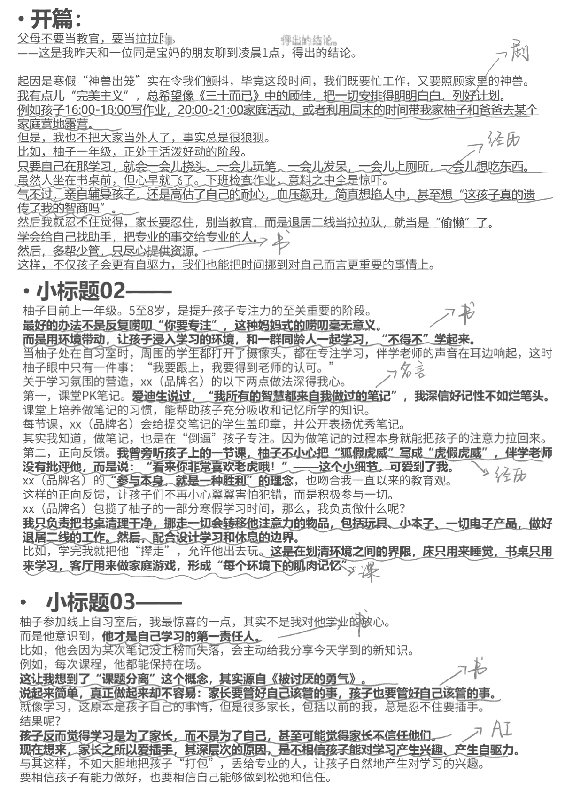

图 5-2

主题越抽象，故事案例越有效。

**4.提问引入式**
用提问引导思考和互动。杨澜曾在演讲开场问：“第一次公众演讲你会紧张吗？”全场共鸣。

线上课同理。讲“如何提升感知力，让文字更有灵气”时，我先问：“看到玉米，你会想到什么？”随后用董宇辉卖玉米的文案说明他感知到了童年、职场辛苦和返璞归真的渴望。先让学员思考再给答案，吸收效果更好。

**5.1.2** **第二步：讲**
讲就是把知识点讲透，让学员真正理解。设计时要从“用户如何理解”出发，而非“我如何讲解”。

比如讲数字形象化，不能只走定义-案例-要点流程，而要想：怎么让用户重视？概念难不难？我用什么例子最代表？实践需要哪些技巧？

设计时关注三点。

**1.简洁明了地陈述理论或定义**
最好用一句话大白话说清。需要一大段才能解释的概念，往往说明自己还没讲透。

**2.设计案例**
案例能把理论讲深。分为主案例和辅案例。

表 5-1

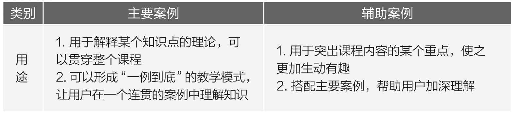

续表

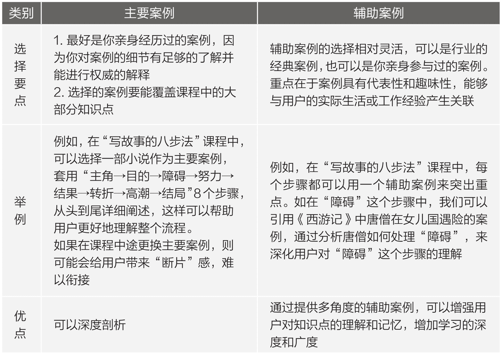

主案例要深度剖析，辅案例点到即可。主案例最好是自己主导或参与过的项目，能讲清来龙去脉。比如讲“一篇文章是如何诞生的”，我就用自己写过的段落还原思考路径。别人的项目只能猜，不适合当主案例。辅案例可选用代表性强的公开案例，如讲解标题时展示大量小红书爆款标题。

**3.提供辅助工具**
把关键知识整理成表格或清单，避免学员课后大海捞针。

例如讲“如何做小说人设”，可以列出常见反差设定及案例：身份与表象反差、刻板印象与真实性格反差、外在性格与隐藏人格反差、内心与外在行为反差等。放到课件或课后发给学员当参考。

在讲“如何给小红书笔记起标题”时，我整理了一批高频爆款词：下饭剧、神剧、慎入、宝藏、炸裂、刷爆、骨灰级、闭眼入、拯救、词穷、氛围感、高级感、极简、不为人知的秘密、含金量等，供作业时直接调用。

**5.1.3** **第三步：练**
讲完就练，把方法放到场景里用。

通常会构造真实应用场景现场演示，并在过程中点出用户可能踩的坑和解决办法。为什么不提前说？因为很多问题只有动手时才会暴露，如图 5-3 所示。提前全列出来，学员缺乏代入感，容易忽略。

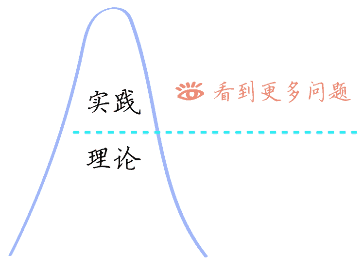

图 5-3

具体做法有三步。

（1）设计实操题目。用30秒说清题目，紧扣刚讲的方法，不能超纲。难度适中，最好和课后作业同源。

（2）实操演示。用刚才的方法示范，以提问方式引导学员思考，自己动手，而不是直接给答案。

（3）剖析问题。复盘操作中常见的困难，给出经验和技巧，帮助内化，如图 5-4 所示。

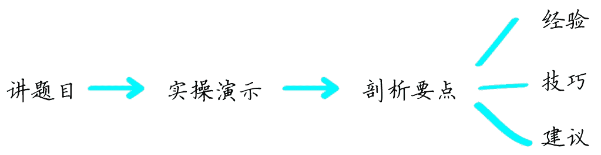

图 5-4

举例：讲完“用热播剧收集素材”后，我现场提问：想论证“女人的温柔也是一种力量”，《三十而已》里能用什么人物或桥段作为素材？让学员主动联想。

做题时要注意：

◎多样性。难度可递进或覆盖不同场景。
◎聚焦知识点。排除干扰，只考查当节内容。
◎不过度复杂。课堂是简易测验，不是考试。

若不确定练什么，可以反问自己两点：（1）新手阶段我会卡在哪？根源是什么？怎么治本？（2）我踩过哪些坑？经验是什么？把答案放进练习环节。

**5.1.4** **第四步：巩**
勾讲练之后要收束，把知识刻进记忆。

有效方式有两种。

**1.总结+升华+呼吁行动**
结尾效应强，印象最深刻。流程是：回顾知识点→分享有情绪的内容如观点、金句、祝福→引导最小行动，做一件当下能完成的小事。

例如写作课结尾我会说：就算写得粗糙也立刻动笔，先接受不完美的开始。干货戛然而止会让人疲惫，结尾要提神。

**2.留个可带走的“礼物”**

把一堂课的干货变成学员能带走的礼物，效果会完全不同。建议把整节课里出现的案例、工具包、模板以及手绘笔记等内容整理成一份复习资料包，在课程收尾时明确告诉学员领取路径。这样既制造了惊喜的获得感，也给课后复盘提供了抓手。

如果这节课正好收束一个模块，不妨额外录一段大约五分钟的串讲小课，把本模块的知识线重新捋一遍，帮助学员快速回连。

**AI 锦囊：把 AI 当成案例生产助手**

**使用要点**
备课时离不开方法论、案例和实操练习，这时可以让 AI 充当创造搭档。以若男的写作训练营为例，课程周期紧任务重时，我就多次让 AI 生成案例，有时返回的内容会跑题或达不到讲课标准，这时直接在 AI 的输出上加工即可。

向 AI 提问时建议把握两点。
◎把用途说明白。比如要生成案例，就要指明这个案例用来佐证哪个知识点。
◎一次要多套方案。让 AI 至少提供两到三个版本，方便挑选和组合。

**提问实战**

以若男的写作训练营“如何修改文章”一课为例，我想突出主谓宾的重要性，于是求助 AI。
AI 指令：本课要强调修改时关注主谓宾，请解释主谓宾的概念及写作应用，并给出三个修改案例。
AI 回答要点：主语是句子的陈述主体，谓语是动作或状态的陈述，宾语是动作的承受者。案例：原文“他高兴地跳跃着。”主语他，谓语跳跃着，高兴地是状语。改写为“他的高兴表现为跳跃。”此时“他的高兴”作主语，“表现为”作谓语，“跳跃”作宾语，更突出高兴这一动作。

提升网感的提问。
AI 指令：做自媒体怎样提升网感，请给切实可行的建议。
AI 回答：保持高频更新持续互动；多渠道采集信息拓宽视野；紧跟时事热点快速解读；用数据和调研了解受众；锻炼从信息噪音中提炼趋势的洞察力。

演示金句四步法。
AI 指令：请演示金句的写作流程。第一步锁定主题与核心观点，第二步搜集相关金句，第三步引用，第四步润色完善。
AI 回答：以“成功与毅力”为主题，核心观点是成功需要坚持。找到爱迪生“天才就是1%的灵感加上99%的汗水。”引用后通过过渡和解释与正文衔接，润色时补充“成功并非一蹴而就，需要大量努力……正如爱迪生所说……”形成连贯段落。

打磨金句的迭代。
AI 指令：请举三例展示金句的打磨过程，依次使用“不是而是”句式、增加细节、加入修辞。
AI 回答：初始句“坚持就是胜利。”第一次“只有坚持不懈，才能收获胜利的果实。”第二次加入背景与人物特征：“在漫长的人生旅途中，唯有 불畏艰辛、坚持不懈的人，才能品尝到胜利的甜美果实。”最终版加入比喻：“人生如逆旅，我亦是行人。唯有坚守信念、勇往直前者，方能在风雨后见彩虹，品味胜利的甘甜。”

有网感的案例。
AI 指令：自媒体的网感很重要，请提供一个有网感的案例。
AI 回答：文章《为什么年轻人越来越爱“躺平”？》选题紧贴社会热议，语言接地气并使用网络流行语，结合网友真实评论增强互动与代入感。网感体现在选题抓热点、语言拉近距离、引用评论提升参与和传播力。

**5.2 设计每节课的知识点**

备课前需要做一次深度自我对话，像挖矿一样“掘地三尺”地从经验库里提炼核心。很多人具备专业技能却难形成方法论：说不清成功的要素、忽略新手的真实困难、把长期形成的直觉当成理所当然的知识。所以更需要把技能转化为可迁移的知识。

**5.2.1 定义问题**
以用户为中心共情拆解。
◎用户想解决的具体问题是什么？
◎问题解决后，下一步想做什么？
◎解决过程中最大的卡点在哪？
◎用户对这个议题已经有哪些认知？

以“如何设定具有辨识度的人物”为例。
用户想学的是设定独特且好记的人物。学完后要完成作业：为小说设定一个主角和两个配角。
难点在于角色特性如何不刻板、背景如何可信且共鸣、人物关系如何有戏剧张力、角色成长如何推动情节、角色行为如何与剧情咬合。
用户已有基础的外貌、性格、背景设定，但不清楚如何让设定产生辨识度和推动力。

**5.2.2 提炼方法**
经验是过去事件沉淀的知识、技能与态度。讲课前要反复追问，让经验如星点闪现，挑选精华作为知识点。
例如讲“公众号标题怎么写”，就需要复盘从初学到熟练的全过程：起初的困境、学到的技巧、新手快速上手的路径、方法的局限及破解方式。

自我追问实质是备课者、过去的自己与学员的三方对话：知识是否能用、是否遗漏、是否与目标一致。

外行到内行的追问清单：新手常见误区是什么？根源是知识缺口还是经验误读？会带来什么负面影响？真实情况如何？如何让新手懂？怎样提供纠偏策略？有哪些被忽视但重要的信息？内行与外行的核心差别在哪？

新手到高手的追问清单：本场景下最成功的案例是什么？关键成功因素及收益？若学员不具备前提条件如何解决？新手可能卡在哪？根因是什么？如何从根本上破局？你遇过哪些问题学员也会遇？怎么解决？高手与新手的处理差异？从新手到高手的关键转折点？对新手的专项教学策略？如何帮助新手掌握高手技巧？

解决局限性的追问清单：你帮用户解决问题时的边界在哪？会怎样影响教学效果？经验传授时如何补齐短板？有哪些重要但你不擅长的知识或技能？打算怎么处理？如何在课堂上让学员理解并接受你的局限？

经过追问得到的答案往往不能直接上课，需要去主观化。小习惯：日常把经验中可复用的知识、技能、态度沉淀为材料库，随时调用更新。

**5.3 验证知识和方法论的合理性**

前一步提炼的知识常带情绪和主观偏好，需提纯增纯度，确保可复用、可落地。

**5.3.1 排除经验归因错误**
追问时的常见陷阱是误判成功关键因素。
①换立场结论会否改变？同一课程的成功，讲师归因于内容，运营归因于包装，销售归因于策略，高层归因于资源配置。需多视角复核。
②归因时是否忽略关键要素？个人基础、个人特质如努力坚持、资源禀赋如财力人脉团队、运气与时机、行业大势与竞争格局。若剥离这些因素结果是否大变？必须在课程中坦诚前提。
例如富二代讲创业，若去掉启动资金与人脉，经验是否仍成立？否则应把主题缩小为“在资源充足条件下我做对了什么”。
③是否过度放大单一因素？如销售高手只强调话术，忽略产品与市场。
④去掉自认关键因素，结果变化多大？变化显著才算真关键。

**5.3.2 及时弥补局限性**
优质知识需理论支撑、可验证。讲师都有短板：实战派理论不足、学院派缺实践、执行者视野局限、管理者缺细节。意识到局限后要补救或调整目标。

表 5-2

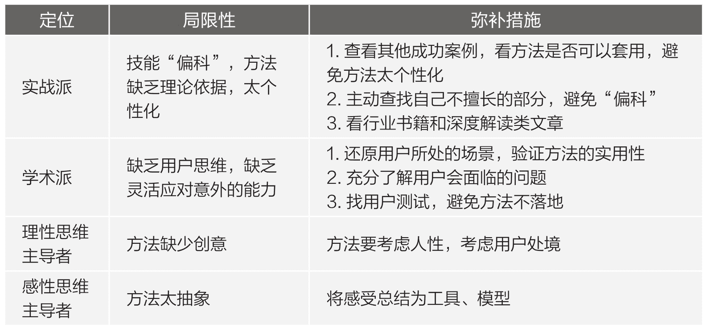

**AI 锦囊：用 AI 弥补方法论的局限性**
可把 AI 当作会纠错、会给建议的伙伴。
以若男的写作训练营“如何写故事，让文章更有感染力”为例，我总结了还原关键场景、营造画面感、提升故事价值三种做法，想避免过于主观，希望 AI 补充。
AI 指令：我要讲写作课《如何写故事，让文章更有感染力》，我已总结还原关键场景、营造画面感、给故事提升价值，请再补充一些方法。
AI 回答补充：情感共鸣，挖掘人性共通情绪，让角色经历引发共鸣；设置悬念与冲突，制造好奇与张力；运用比喻与象征，把抽象情感具象化；结尾留余味，可用开放式收束引发思考。

**5.4 3 个技巧，将知识工具化**
经验总结若呈流水账，学员能听懂却记不住。知识压缩不是压缩价值，而是压缩记忆成本。
例如有位老师要分享“如何克服虚荣心”的经验，他是这样总结的：

学会欣赏自己已经拥有的东西，而不是一味去和别人比较而把自己的满足感丢掉。用感恩来压制虚荣的冲动。独立去思考，形成自己的判断，更多关注内在的修养和成长过程，不要太轻易被外在的物质、名位、声誉换来的短暂满足牵着走。要清楚自己的价值和边界，接纳并不完美的自己，不让虚荣心主导自己，坦然承认缺点和错误，放弃对完美的不切实际追求，因为完美根本不存在。

从上面这段话可以提炼出三个核心：懂得知足、聚焦内在价值、接纳不完美。上课时可以围绕这三个点展开，但记住关键词就够了，用户只要带走这三点。

知识压缩是为了降低记忆负担，下面这三种压缩手段比较常见。

**5.4.1 模板化**

模板化就是把一套做法总结成固定流程，按步执行就能得到想要的结果。

比如小品里把大象塞进冰箱，分三步：打开冰箱门、把大象塞进去、关上冰箱门，这就是一个可复用的模板。

把方法做成模板的例子很多。

（1）写作模板：五段式写法包含开头、论点一、论点二、论点三、收尾。

（2）销售演讲模板：AIDA 模型涵盖抓住注意力、培养兴趣、制造渴望、促成行动。

（3）设计模板：画同理心地图、界定问题、搭建原型、收集反馈等环节。

（4）演讲模板有几种常见形态。
◎解题型：点明问题、探究成因、给出对策、归纳结论。
◎三段式：用过去—现在—未来、问题—方案—结果这类三段呈现。
◎情报型：先勾起兴趣、抛出疑问、调研展示数据、引出结论。

复杂知识很适合做成模板，既好记也能快速上手。

做模板的前提是先拆解知识，找到关键环节和要点，再按逻辑整理成步骤或表格。

**5.4.2 口诀化**

口诀化就是把知识浓缩成押韵好记的说法。

常用做法是把首字母或关键词组合成缩写。比如 MBA 里常用的 4P 营销，分别是产品、价格、促销、渠道。再比如 5C 分析，包含公司、顾客、竞争对手、渠道、环境。也可以直接提炼关键词，比如 5.1 节提到的“勾讲练巩”四步，分别是激发兴趣、讲解知识、实操练习、巩固记忆。

口诀化一般分三步走。
（1）梳理知识点，挑出最重要的几项。
（2）把每项提炼成一个关键词。
（3）按韵律把关键词串起来，形成易记的口诀。

**5.4.3 模型化**

把知识整理成模型会更直观。逻辑复杂的主题，靠干巴巴的文字很难让人快速get到。

好模型能清晰呈现知识的内在逻辑和结构。最典型的黄金圈模型，用三个同心圆对应 WHY、HOW、WHAT 层次，如图 5-5 所示。

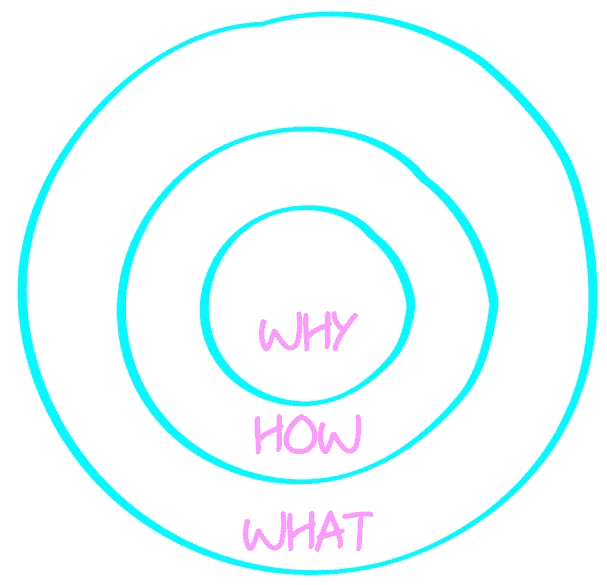

图 5-5

MBA 里的经典模型很多，比如图 5-6 的 SWOT 分析，包含优势、劣势、机会、威胁四块。

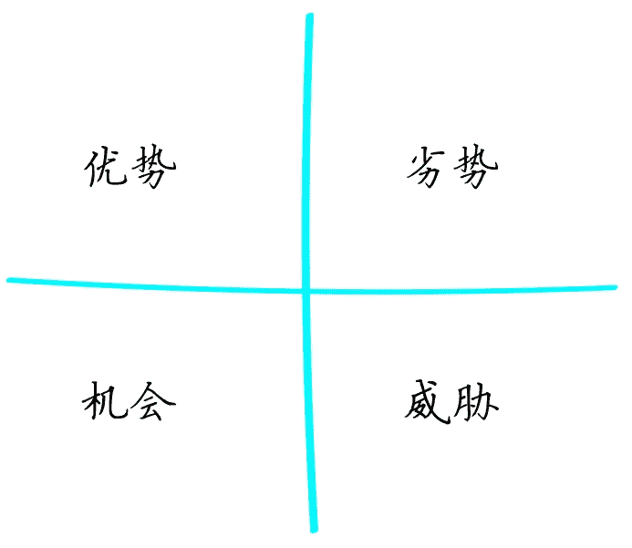

图 5-6

把复杂知识模型化的步骤如下。
（1）拆解实现步骤和内在逻辑。
（2）用表格、流程图、示意图等方式呈现，常见的还有坐标系、金字塔等形态。

**小贴士：**建议平时多看 MBA 里的模型、模板、口诀，先模仿起步。

**AI 锦囊：用 AI 把散乱的知识点模板化**

**①使用要点。**
直接把杂乱的知识点丢给 AI，让它帮你做成口诀。

**②提问示范。**
**◎AI 指令。**
我希望你能帮我把以下知识点做成容易记忆的口诀，知识点是：写故事要有画面感；要突显人的心理活动；写故事要有起因、挑战、冲突和高潮。
**◎AI 回答。**
写故事口诀短，画面内心不可少；起因挑战冲突高，结构完整才精妙。

# **第六章 把一节课讲明白**

## **6.1 达到这 5 个标准，课程会令人上瘾**

做课之前，先把优质课的标准想清楚。

标准起什么作用？一方面是审美准则，课程的灵魂是审美，知道什么是好内容才有可能做出好内容。另一方面是质检线，有“达不到标准就不上线”的底线意识，就像食品上市前必须过检一样。

好课的标准从哪里来？别站在讲师角度想，容易上头。标准来自用户真实的评价和感受，因为用户的反馈最真实。

下面每个标准都会先用弹幕的形式，呈现用户在夸和吐槽时常用的说法。

**6.1.1 目标明确，逻辑清晰**

没达标的弹幕：“听完我都不知道这节课到底讲什么”“你到底想说什么”“这课好乱”。

达标的弹幕：“老师条理很清楚”“听完我就知道该怎么做了”。

课程必须有明确目标，比如解答一个困惑、解决一个实操难题、练成一项技能、完成一件作品。目标清晰，用户才会有求知欲和成就感。目标模糊、逻辑混乱，用户会迷路。

目标确定后，课上的内容都要和目标强关联。课程跑题到极致的情况很少见，用户觉得混乱的根源多是主次不清、发散过度。

比如小笨要讲“如何高效阅读”，四个要点是边看边记、从感兴趣的章节入手、读后及时输出、别只追求速度。这四个点本身没偏离目标。但小笨讲“边看边记”时，花了五分钟讲自己小时候做笔记被老师表扬的故事，他讲得high，用户却晕了，开始怀疑这节课到底要讲什么。

要做到目标明确、逻辑清晰，需要注意两点。
◎直达目标、主次分明，次要内容别节外生枝。
◎不发散、不跳跃，别东一下西一下。

另外，讲师聊自己的经历和成绩时容易兴奋，但大概率和目标关联不强。

**6.1.2 建立新知**

未达标弹幕：“你讲的我都知道，浪费时间”“这课就是在水时长”“这还需要你教吗”“好像什么都说了，又好像什么都没说”。

达标弹幕：“醍醐灌顶”“听得特别过瘾”“我之前的想法错了”。

用户负面评价的核心，是课程没能挑战和颠覆既有认知，也没带来新知识新观念。

打开课程的人都是带着好奇来的，他们期待认知被刷新。如果你讲的都是他们已知的，等于占用时间。好课要提供新思路、挑战观点、给出新案例、提供新解读或新视角。

可以用以下路径帮助建立新知：未知到已知；感受到工具方法；旧知到新知；抽象到具体。

**6.1.3 有情绪节奏，听起来不犯困**

负面弹幕：“快睡着了”“听着听着走神了”“太无聊听不下去了”。

正面弹幕：“讲得太有意思了”“这老师像个段子手”“好幽默”。

课程枯燥乏味是用户最容易流失的原因。再好的内容，没有吸引力也白搭。

优秀课程要精心设计节奏，提前预判用户何时会无聊、何时需要放松、何时会挫败、何时需要共情，然后加入调味料。

调味料可以是好笑的段子、有冲击力的画面、引人入胜的故事、精辟的金句、鼓励的话，甚至是心灵鸡汤。它们能调动情绪，让学习更有愉悦感，提升动力。

人是感性的，学习不只是理性思考，还需要情绪体验。

**6.1.4 内容精短**

负面弹幕：“内容不错，就是听不下去”“我累了”“太挑战极限了”。

正面弹幕：“意犹未尽”。

很多讲师都有“我要把所有知道的都塞进一节课”的冲动，结果适得其反。要做减法，筛出关键信息，去掉冗余。什么都讲等于什么都没讲。

常见的是这类课：一节课塞 4 种类型、6 种方法、5 个技巧、3 条原则、10 个渠道……信息过载，用户既记不住也消化不了，反而自责记忆力差。

病毒式和满天星式是内容过多的结构，如图 6-1 所示。病毒式是知识点不断延伸扩散；满天星式是内容平铺直叙，没有主次，像星空一样密密麻麻。

更适合吸收的是单线式和宇宙式。单线式是沿同一逻辑层层推进；宇宙式是知识点围绕一个核心展开，像行星绕太阳。

我常问团队两个问题：
◎如果这节课只能讲一个知识点，是什么？
◎这个知识点一年后用户还记得吗？

做课最难的是减法，做加法容易，做减法考验魄力。

注意力会随时间递减，超时即便内容再好，用户也会坐立不安，如图 6-2 所示。

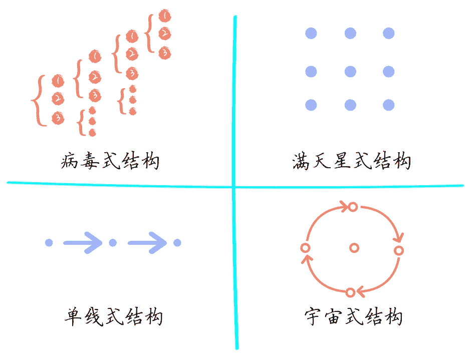

图 6-1

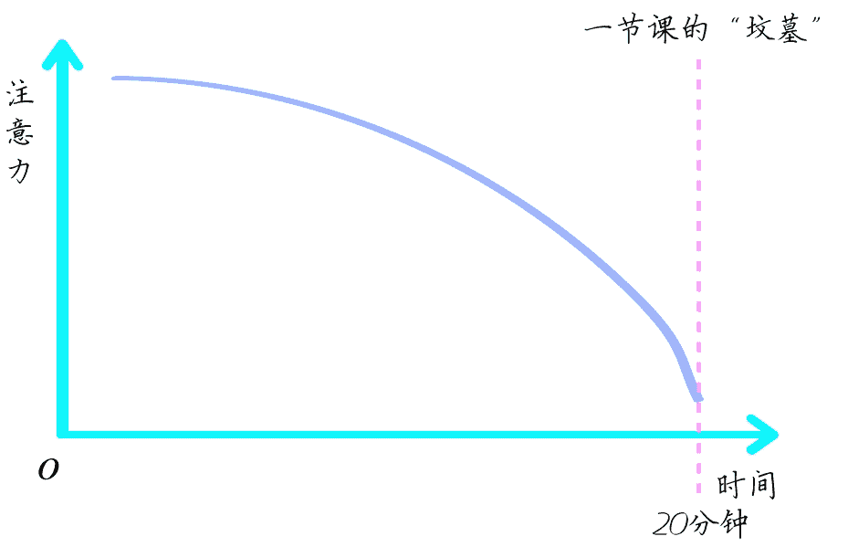

图 6-2

我们要管理用户的时长，也要管理精力的消耗。目标不是让人硬撑到结束，而是让用户在最集中的时段听完。

表 6-1 为不同形式课程的建议时长，供参考。

表 6-1

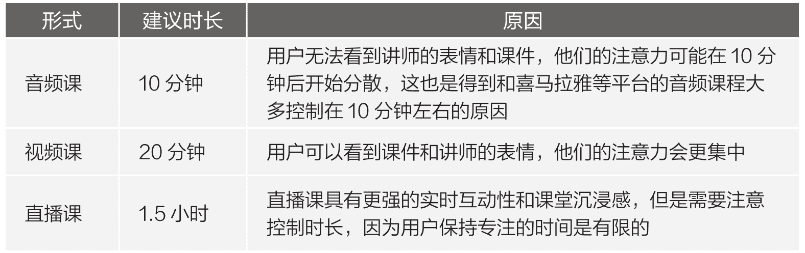

**6.1.5 通俗易懂接地气**

负面弹幕：“听不懂”“有人和我一样吗”“他在说什么”。

正面弹幕：“以前不懂，你一讲就明白了”。

目标是做用户能学会的课，而不是让人仰望的课。风格可以不同，但都要接地气、好理解。

最佳难度是“比用户高半个头”，别卖弄、别故弄玄虚。讲得太深，用户的时间就白花了。

能口语化就别用学术词；能一句话说清就别用两句；能说大白话就别用黑话。把复杂变简单、抽象变具象、理论变生动、黑话变白话，降低理解成本。

比如我做过一门零基础小说写作课，有一节是“如何写大纲”。我总结过一个视觉冲击很强的构思工具，但对新手太难就没用。最后只讲了一个简单方法：先设计三个角色，让他们过去有交集、立场有冲突，从而碰撞出下一阶段剧情。

道理简单，执行难，因为需要克制。克制小小的虚荣心，克制想秀专业的冲动，用最低理解成本的语言讲知识。

标准其实不难，难的是坚守。记住三字诀：别双标。

作为用户你会想：这不是废话吗？作为讲师却容易双标。
作为用户你会想：怎么这么啰嗦？作为讲师却觉得：我说的都有用，不听是态度问题。
作为用户你会想：老师怎么像念稿子？作为讲师却想：想学的人不会在意这些。
作为用户你会想：讲得真枯燥。作为讲师却想：用户又不是小孩，要什么有趣？

## **6.2 两种讲课形式**

设计课程前先确定讲课形式，不同形式准备不一样。

准备不足会导致录课时频繁暂停、边录边改，团队协作时更会拖慢效率。

讲课形式分脱稿和带稿两种。

**6.2.1 脱稿讲课前必须做的 3 件事**

脱稿讲课指录课时面前没有逐字稿，需要现场发挥。可以配合课件，课件能起到提示作用。

脱稿更适合直播，直播需要强互动，讲师要根据弹幕即时调整，念稿会很僵。

视频课也可以脱稿，我身边很多兴奋型选手喜欢脱稿，一对镜头就兴奋，讲得更生动，即兴内容更多，念稿反而限制发挥。

脱稿不等于没准备。至少要做三件事。

**1.列出讲课提纲**

提纲就是一节课的结构和关键点。我习惯在正式讲课前先列提纲，让课在脑子里“活”起来，再不断修改。

可以用图 6-3 的模板来列提纲。

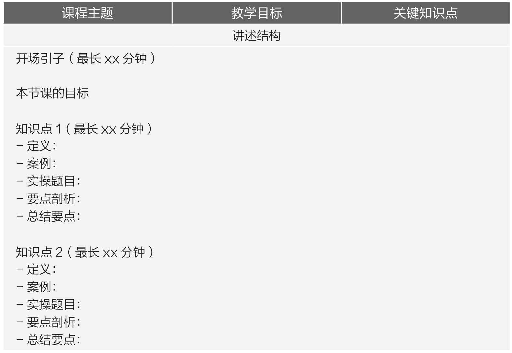

图 6-3

模板包含两要素。
◎内容结构。包括课程主题、教学目标、关键知识点，时刻提醒自己不跑偏。还包括每部分的精华和关键点，如知识点定义、案例、实操题、要点剖析、金句。总之必须出现的内容要列出来。
◎时长节奏。课程是有节奏的，重点多给时间，次要少讲，复杂深入，简单点到。脱稿可以即兴，但不能随意。

可以先划定每部分最大时长，让主次分明更有节奏。比如 10 分钟课，开场不超过 2 分钟；第一个知识点复杂，最多 5 分钟；第二个简单，最多 3 分钟。

**2.试讲迭代**

列完提纲先试讲一遍，讲边改。

第一次可能磕绊，别苛责自己，重点是把逻辑顺一遍。过程中能识别出讲不透、太冗长、太枯燥、太跳跃的地方，也可能迸发灵感，及时记录。

团队会做围听会，制作人按提纲试讲，其他人提问反馈，再迭代。个人做课最快的是在朋友面前试讲，观察反应。

高效迭代可以用引导性提问：
◎你的困惑解决了没？哪些没解决哪些解决了？
◎你还记得主要方法吗？能复述一下吗？
◎让你立刻用，你能做到吗？
◎哪些没听懂？
◎哪些突兀？
◎从哪个地方开始不想听了？
◎哪个地方印象最深？

如果用户眼神涣散，可能内容过载；如果不再点头，可能没听懂；如果段子没笑点，可能设计尴尬。

几个可复用的追问：
◎“听完你还记得讲了什么吗？”记不住可能是方法复杂、缺乏记忆点、信息密度过高、逻辑需优化。遗漏可能是讲不透、缺少巩固。
◎“从哪里开始听不下去？”可能是该部分信息过密、前面逻辑需调整。
◎“哪里听不懂？”可能是案例不足、衔接不强、实操指导不够。
◎“给收获感打几分？”低于 7 分可能是信息密度低或“湿货”过多。

**3.反复排练**

对着镜头反复排练，直到不再刻意想下一句，且每部分不超时。脱稿就是前期留 90 分，现场留 10 分。

**6.2.2 带稿讲课前必须做的 4 件事**

带稿讲课指用逐字稿录课，一字不差，保证准确性，避免遗漏或偏差。逐字稿也能保持思维连贯。

音频课更需要逐字稿，用户看不到画面，对节奏要求更高。新手建议先准备逐字稿，降低风险。

很多知名讲师也带稿讲课，用来严格把控品质。

准备逐字稿按四步走。

**1.列出提纲**

和脱稿一样，先列提纲。

很多人以为写逐字稿要从第一个字开始，其实高效做法是扩写：先搭框架再填细节。从第一个字写起，一旦大问题出现修改成本极高。写逐字稿像盖楼，先设计好框架再施工。

**2.扩写逐字稿**

扩写时可以先语音讲，再用钉钉、讯飞语记或微信语音等工具转文字，最后删掉冗余，这样写得更快，也更口语化。

很多人会把写逐字稿和写文章划等号，其实二者走的是完全不同的路子。书面文字是给眼睛看的，逐字稿是给耳朵听的。这一点决定了用词和表达方式。

书面语讲究凝练精致，口语化稿子则要顺口好念。用词上要平实直接，别用偏书面化的表达，比如“沉鱼落雁之美”听起来很书面，换成“长得很俊”或“长得漂亮”立刻就松弛下来。句子也要拆开来写，比如“我们成功地将作战物资运往海拔三千米的山顶”偏书面，改成“我们成功地把作战物资送到了山顶，那座山有三千米高”才像人说话。口语还有一个特点，就是需要互动的语气词和停顿，比如“唉，你看”“你说是不是”这类表达，书面里很少出现。

**3. 控制字数，把握节奏**

逐字稿的快慢直接由字数决定。跟自由讲课不同，写稿时必须有字数边界，普遍参考值是一分钟约200字。更稳妥的做法是自己先测一下常态语速，一分钟大约能说多少字，以这个数作为基准来写。

**4. 排练**

光重复练是低效排练，能熟练却做不到优化。真正有效的排练是边念边改边做标记。

稿子写完后一定要大声读几遍，读的时候同步调整，因为写的时候顺眼，念出来可能就拗口。很多讲师都会遇到写时觉得完美，上镜一读就别扭，最后只能边录边改的情况。

在排练阶段，可以把逐字稿里的关键词、金句、案例单独标注出来，这样上课时就能有意识地调整语速语调，把重点凸显出来。

## 6.3 4种经典的开场方式

很多付费课都配有免费试听，比如喜马拉雅的部分课程允许试听每一节的前180秒，用户往往靠这短短几十秒决定买不买。开场能不能抓住人，服务整体转化。常说酒香不怕巷子深，实际上再好的内容也得在开头让学员闻到香味。

开场重要，节奏更要兼顾。以一节10分钟的课为例，开场最好控制在2分钟左右，逐字稿大约400字。

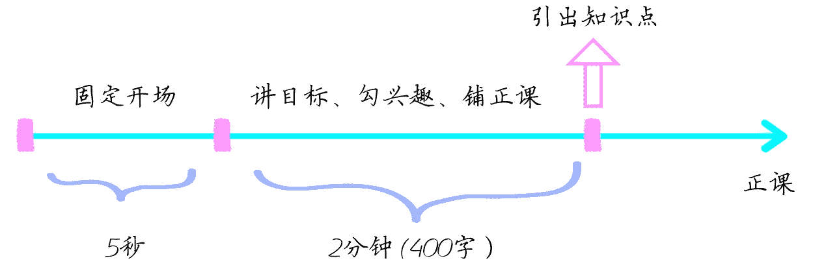

图 6-4

常用的开场可以归为颠覆认知式、戳痛点式、案例/故事引入式、提问引入式四类，下面逐一拆解。

**6.3.1 颠覆认知式**

先想想，学员对这个主题有没有固定印象或从众心理。

有两种做法比较管用。

方法一，用“不是……而是……”的句型。

比如讲写作感知力的课，可以这样开：我发现很多人已经掌握了技巧，写得也很有质感，却很难打动人。写出来的多是老生常谈，人人都懂的大道理。为什么？其实问题不在技巧，而在感知能力。大家一定看过董宇辉的直播，我每次都是笑着进去哭着出来的。他感知力太强，能体会到农民的不易，能想象深夜外卖小哥骑车时的心思。只有真正感知到了，文字才有共情。这节课我们就来聊如何培养感知和发现力。

这个套路先抛出大众的刻板印象，再重新定义，从而制造认知反差。

再举两个变体：很多人以为高情商就是让人喜欢、说好话。我倒觉得，高情商不是取悦别人，而是取悦自己。如何在自洽的同时照顾他人感受，这就是今天的内容。我们也常因为别人的负面评价而不快乐，其实难过不是因为评价本身，而是因为我们允许它进入自己的世界。

方法二，善用否定词。

如“其实不然”“其实不见得”“我倒不这么认为”“这未必”等。

例如：很多人觉得管理者必须是强势外向、雷厉风行。说实话，我不认同，性格内向的人一样能做好管理。那不同性格的人如何找到合适自己的管理风格？这就是本节课要解决的问题。

这种开场容易抓住注意力，也为后续铺路。

小贴士：颠覆认知不是抬杠，观点必须经得起推敲，且真和学员既有印象不同，否则容易虎头蛇尾。

**6.3.2 戳痛点式**

先思考学员听这节课会卡在哪些地方，哪些最棘手，适不适合放开头。

想用这个方式，要把握三点。

关键点一，设定场景，唤醒痛点。没有具体场景就很难代入。比如讲如何快速给领导留下好印象，可以设想：你坐进电梯，里面只有你和公司CEO，怎么破冰？这时你可能想保持沉默，也可能想等对方先开口，还可能想假装看手机。把“你”摆进场景里，代入感立刻起来。

关键点二，做“嘴替”。替学员说出他在场景里的真实想法和困扰，用口语化的表达去复述。越口语，越有共鸣。

比如：设想你第一次见客户，眼前就要见面了，你准备聊什么？有同学说“我社恐，不知道看哪”，有同学说“微信还好，一见面就怂”，也有同学说“直接说事不就行了”。我想这些都是常见反应，很正常。其实我也曾被这种事困扰过，但因为工作需要被迫学会快速破冰，次数多了就发现是有技巧的。这节课我把经验分享给你。

做嘴替还能降低学员的防御心理，提高接受度。

比如在“如何做小说选题”的课上，可以说：我知道很多同学一腔热血，恨不得跳过选题马上写一万字。这种心态我理解，但该稳的时候要稳，学完这一节，保证你写得停不下来。

关键点三，痛点要能关联目标。你列的问题必须是本节课能解决的，别只为共鸣而共鸣。否则学员会产生“开头说的那些，最后都没解决”的落差。开场好不好，要放到整节课里看。

**6.3.3 案例/故事引入式**

先想想课程主题相关的有趣故事或案例能否前置。

这类开场有两种做法。

方法一，正反案例对比。通过对比让学员直观看到学与不学的区别，适合容易被低估或比较抽象的主题。

比如讲演讲时用数据类比，可以先描述：“iPod存储量达5GB”。再描述：“把1000首歌装进你的口袋”。哪个更震撼？后者立刻能感受到容量，而前者只是数字。同样的数据，加一点类比就鲜活了。这节课就讲演讲里怎么描述数据。

正反对比的优点是直观。注意两点：控制变量，只改变和本课相关的那个因素；先反后正，先展示不理想的再展示好的，更有冲击力。案例要简洁，别讲得太长。

方法二，故事或案例引入。可以讲经典案例，也可以讲自己的经历。

我曾听过一节冥想课，老师开场说：刚工作的几年我常焦虑失眠、情绪失控，会因为别人的错惩罚自己。后来我慢慢和自己和解，状态也稳定下来。是冥想改变了我。它能减轻压力，让大脑专注当下。

我也开过“如何收集写作素材”的课。开课时我先读了一遍自己的文章，并指出哪些素材是从何处收集的。学员立刻看到一篇文章里超过八成内容来自积累，也意识到没有素材的观点很单薄。建立感知后，再讲方法就顺了。

故事比说教更有代入感，能自然进入主题。

**6.3.4 提问引入式**

先想想能让学员会心一笑或引发思考的“灵魂拷问”。

提问可分封闭式和开放式。

方法一，设计封闭式问题。有预设答案，如是非题、选择题。目的不是考对错，而是拉互动。

比如讲拖延症技巧，可以问：你有拖延症吗？我猜大部分人都会点头，我也有。网上有个段子，把一件事拆成十份，前九份开心玩，最后一份再拆十份，前九份忧心玩，直到最后一刻才爆发。这个段子戳中很多人。拖延是人性，但可应对。

哈佛公开课《正义应该怎样做》的开场经典问题是火车轨道困境：五名工人和一名工人，你会如何选择？让大家举手时，全场都在高速思考。答案不重要，思考的过程才是课程的起点。

设计时注意：不评判对错，避免挫败感；每个答案都要能连回主题；别问“重不重要”这类空问题。

方法二，设计开放式问题。没有标准答案，用来激发思考和参与。

比如讲亲子关系，可以问：你认为最好的亲子关系是什么样的？我来分享我的理解。

再如讲当众反驳，可以问：在会议上你提出想法，有人情绪激烈反对，你会怎么做？这种场景很常见，考验反应力。接下来我分享我的处理方式。

别问太大太难的问题，否则学员会卡住，后续难以集中。

小贴士：无论哪种开场，都要把课程目标讲清楚。开场结束要告诉学员学完后能做什么、作业是什么。

例如讲“产品经理如何做原型图”，可以说：画原型图是产品经理的基础技能。我们先看什么是原型图……本节课一定要认真听，课后作业是为指定产品设计一张原型图。

展示作业时注意：开场展示的作业要和课后作业同模板，有参考价值，最好是贯穿整节课的案例，逐步拆解，避免提供太多版本让学员眼花。

**另外一个开场技巧：卖关子。**

给知识点加背书，学员会更好奇也更信任。

比如“电梯里偶遇领导该说什么”的开场：设想电梯里只有你和CEO，怎么打破尴尬？你可能会想沉默、等对方先说、假装看手机。其实我也常和领导同乘电梯，尬聊无数次，好在现在进步了。这件事是可以提前准备的。怎么准备，就是接下来要讲的。

背书角度可以是：方法亲测有效，我反复测试并用它做成了……；方法有依据，某个实验或书里提到，结合实践总结；方法有独特价值，别人讲得太复杂或太学术，我的版本简单好记。

**AI 锦囊：用 AI 写开场逐字稿**

1. 使用要点
备课时把关键词和要点丢给AI扩写成口语稿。提问时注意三点：声明要口语化不是书面语；明确希望的开场方式，如颠覆认知、戳痛点、案例引入或提问式；可以用语音输入指令，口语化输入即可。

2. 提问示范
以“若男的写作训练营·如何提升感知力”为例，语音指令如下：
请把下面这段课程逐字稿润色得更口语化，同时颠覆学员对感知力的认知：同学你好，我是若男，这节课教你提升感知力，让文字更有灵气。感知力就是写作前先对世界有感知，你感知到了才写得出。我觉得这是写作最核心的能力，新手第一步就该练。甚至如果课程只剩一节，我会留这节。因为没了感知力，技巧都是空的。

AI给出的回答更生活化，用“摸摸世界”“魔法棒”等意象，把感知力讲成写作的桥梁，并用闭眼感受的指令增强代入感。

## 6.4 如何讲好案例和实操

再好的课程讲不好，学员也记不住。关键在讲述方式。

**6.4.1 如何讲解案例**

讲解案例要注意三点：把案例讲清楚、及时做总结、有互动感。

1. 介绍清楚案例
很多人担心念案例费时间，会让学员自己看屏。其实缺少沉浸感。譬如讲“如何仿写小红书短视频脚本”，我会先完整播放一遍要模仿的视频，再展示文字稿，一边念一边拆解开篇、递进、收尾。

2. 及时总结，案例能学到什么
案例只是案例，必须和知识点绑定才有价值。讲完后要明确点出通过这个案例能得到什么结论和操作方法，才能形成记忆点。

很多课堂教学的痛点都藏在细节里。把别人的经验拆开再重新组装，你会发现真正让人上头的内容，从来不是堆知识点，而是怎么讲、怎么带人一起走。

先说选题怎么做出辨识度。我曾在课堂上拿自己的小红书视频“高敏感人反自救指南”做示范，讲的就是选题时我做了哪些对的事。第一步是看话题的起势时间，“高敏感人”是什么时候开始被讨论的，黄金期有没有过去。过了红利期就不能再跟风，得去扒一遍同行都说了什么，找一个别的角度切进去。只有把踩点和找差别的逻辑讲清楚，学员才能在案例里带走方法。

再说课堂的互动感。想把抽象的数字讲活，可以用数字类比这个招。我会先问大家：晚上跑步，软件跳出“你消耗了100卡路里”，你有什么体感？多数人会卡壳，100卡路里到底多大。换一种说法：“你消耗了100卡路里，相当于少吃两个苹果。”一下子就通了。数字类比就是把数字绑到一个可感知的参照物上。名人们演讲很爱用，关键要选生活里常见的东西，让人脑中能立刻出现画面。

光讲概念不够，实操必须能上手。承接数字类比，我会直接带大家练：公司要推一款仪器，重150克，你怎么描述？A.150支铅笔的重量；B.一个芒果的重量；C.一部手机的重量。我敢打赌多数人会选C，因为手机是天天拿在手上的参照物。类比要选“可感”的东西才成立。

实操环节要让人真参与，因为我们看不见学员在不在状态，只能持续拉他进来。比如唱歌课开练前我会说：“答应我，你跟着我一起开口，哪怕唱得不像回事，敢开口就成功一半了。”练完立刻点赞：“非常好！”这些细微的牵引，能把参与率拉很高。

常用话术也可以提前备好。练习前：“答应我一起练，这样才有效果；答应我大胆试，试了就算成功一半。”练习中：“给3秒想一下该怎么做；你的答案是什么？”练习后：“给你点个赞；是不是没想象中难？很多事只有上手才知道。”

一节课怎么收束？先复盘，再提炼，最后推行动。之前我们讲了数字类比法和数据对比法，这两个只是表达的“术”，本质的“道”是换位思考——你说出的每个数字，对方能不能懂，懂了才有意义。最后留一个思考题让大家写进评论区，这就是课程的出口。以上就是本节内容，我们下次再见。

6.5 8个技巧，让课程更生动有趣
上课时间一长，注意力必然走神。所以要主动管理注意曲线，用“湿货”时不时点燃兴奋点。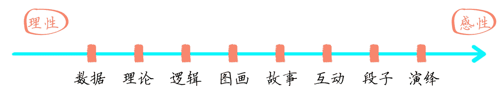

图 6-5
一方面要提供干货，即理性内容：逻辑拆解、数据运用、理论探讨、推理思考，能带来深刻理解，但长期吃干货会腻。另一方面需要湿货，即感性内容：画面展示、情绪表达、故事讲述，感染力强，能抓住注意力。

怎么两全？如图 6-6 所示，开场先上湿货，用一个抓人的故事或一个挑战性问题把人拉进来。紧接着明确本节主题，列清楚学习清单，重点画出他们能得到的收获，这步不能省。然后在心里搭好一栋内容大楼，让章节之间逻辑清晰。

讲章节时要干湿交替，每抛一段干货就丢一点湿货，让学员“深呼吸”。收尾前再放一句有分量的金句，提升价值感。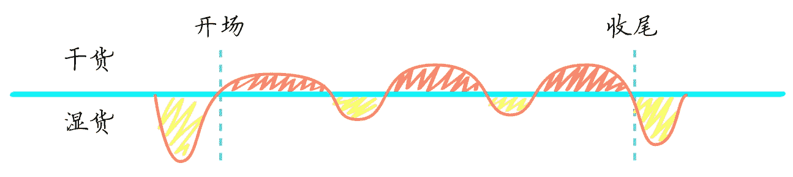

图 6-6
湿货元素清单大概有这八类：故事、金句、演绎、多媒体元素、幽默元素、互动游戏、形象比喻、现场道具。

6.5.1 故事
人天然爱听故事。讲故事能把人迅速拽进场景，不知不觉接受观点。怎么讲好？

1. 先定目的。是为了引出概念、观点还是引发思考？目标定了再去找料。比如要表达“为自己创造仪式感”，我就用《蒂凡尼的早餐》里的女主：每天穿黑小礼服戴假珠宝站在蒂凡尼橱窗前优雅吃早餐，像最重要的事一样，经济拮据也买不起一件首饰。

2. 关键细节要展开。细节带来画面感和共鸣。我曾讲过“办法总比困难多”。去年圣诞前后，公司钉钉群通知出现密切接触者，2000多人要集中隔离48小时，困在3栋楼里不能出门。第一天没经验，大家铺在地上睡，耳朵贴地走路声像地震，呼噜声一片。第二天就变聪明了，有人占会议室桌子自称“大床房”，有人抢隔音最好的录音室自称“五星级酒店”。办法确实比困难多。

3. 表达情绪。讲故事时用感性思维把感受讲出来，最稳妥的就是讲亲身经历，不需要华丽辞藻，只用日常语言把看到的经历说出来。目的、细节、情绪，三件齐了故事才活。

6.5.2 金句
金句短小但传播力强，能升华主题、号召行动。课末放金句，记忆最深。

1. 引用经典名言。写作训练营里我曾用李笑来老师的话收尾：“学习能力也好，执行力也罢，核心只有一个——在刚开始的时候平静地接受自己的笨拙。”

2. 引用影视文学。像《野草莓》的“人生苦短，我要荒唐到底”，《进击的巨人》的“生命不息，战斗不止”，大众接受度高。

3. 发表个人感悟。成功是试出来的，是我对成功的理解。受访嘉宾风尘散人说：每位内容创作者都应该有“老子天下无敌”的气势，既是风格也是魄力。

6.5.3 演绎
1. 现场展示才艺，用专长给学员独特体验。
2. 模仿反面案例。在讲仿写小红书图文笔记时，我夸张演绎了“文字抠两小时，封面随便拍”的行为，让大家直观看到错在哪儿。适度“戏精”能缓解疲劳。
3. 角色扮演。我和讲师研发有声主播课，用愤怒、遗憾、抱怨、喜欢、自暴自弃五种情绪读同一段练习文本，直播间弹幕立刻炸了，演绎比讲解更抓人。

6.5.4 多媒体元素
图像、视频、音频比文字数据更吸睛。比如放TED经典演讲片段学表达，放综艺配音片段看表现力差异。动画、图表、漫画都能把知识点可视化，提升效率。

6.5.5 幽默元素
幽默能破冰放松。可以用适度自嘲、调侃行业现象、讲网络流行段子。风尘散人开场就说：“我靠脑袋和手吃饭，上帝给我开了门别的门都焊死了，声音不磁性像公鸭子还请多包涵，评论区不许笑，憋不住就偷笑。”幽默反而拉近距离。

6.5.6 互动游戏
互动能瞬间提神。写作课上我放过27个毫不相关词的图，让学员挑3个即兴写故事，这个小游戏后来还在知识星球流传。

图 6-7

6.5.7 形象比喻
一个好比喻让人会心一笑。选课题就像谈恋爱，得谨慎。学新技能像烧开水，前期慢，坚持就会沸腾。团队合作像演奏交响乐，各自不同却要协调一致。

6.5.8 现场道具
道具把抽象变具体。讲小红书种草笔记时，我拿起带小王子图案的杯子讲解如何用故事赋予产品寓意。做普通话课时用口腔模型演示n和l的区别。人物也可以当道具，声乐课请一位常破音的同事示范，反面教材喜剧效果满分，还能给学员勇气。

新东方也用学员评分考核讲师，幽默风趣的分往往高。但学员不傻，没实质收获，再多段子也白费。好课一定是干货与湿货并存。

6.6 如何修改逐字稿
逐字稿是改出来的，不必推倒重建，靠细节打磨。6个锦上添花技巧加1份自检清单，能减少返工。

1. 加衔接词提升结构感。首先……其次……再者……最后……；前面……接下来……；总的来说；因此/所以；此外；一方面……另一方面……。小词起大作用。

2. 用“你”“我们”拉近距离，减少“我”的使用，代入感更强。

3. 标注逐字稿。提前规划语气节奏，避免念成流水账。表 6-2

续表

4. 熟读找感觉。写完后大声读三遍以上，最好录下来再听，一边听一边在稿上标感受和灵感。不读稿上台容易：语言不顺现场改、节奏失控、像机器人、断句错误改变意思、沉迷稿子忘词。

5. 加入口语词。像和朋友聊天更放松。常用有：你看……；诶，你发现没有……；我这么说你可能就懂了……；其实啊……；仔细想想……；那有同学可能会说了……；不过呢……；你知道吗……；你有没有觉得……；有趣的是……。比如“你有没有发现很多课程都是精华却听不下去。”

6. 加入个性化元素。课程里要展现真实的自己。学员在你讲经历、价值观、初心时最专注。风尘散人曾在课上说关于文化输出的信念：中国文化被侵略被边缘化，网络小说可以做文化输出，把老祖宗的哲学用有趣方式呈现是使命。真诚真实，分寸合适，个性元素不会盖过知识价值。

7. 逐字稿自检清单
开场：是否清晰传达课程目标给方向感；时长是否3分钟内；是否激发兴趣。
正课：深度是否合适；理论是否结合案例；实操步骤是否够细是否解答疑问；每个知识点后是否有小结。
结尾：是否起整体巩固作用；若需实操是否落到具体任务；时长是否2分钟内。

◎ 课件核查
单张幻灯片是否承担引导功能，让受训者明确此刻处在哪个进度节点；信息焦点是否突出，避免文字密集堆叠；幻灯片与口述是否形成互补，而非简单复述；切换频次是否得当，避免同一张停留过久且缺乏动态呈现。

◎ 整体核查
表达中是否出现指代词累赘、语气词冗余等口头习惯；用词是否贴近日常对话，规避超长复合句与书面化表达；教学脉络是否顺畅；是否具备趣味性，能否融入案例、趣闻、互动等元素；是否形成可记忆的金句，塑造记忆锚点。

AI 小贴士：用 AI 反复打磨逐字稿

① 使用思路。
逐字稿定稿后，可交由 AI 进行润色。修正病句、梳理逻辑、口语化处理、增强情绪价值。

② 参考提问。

◎ 示例指令。
请把下面课程逐字稿改写得更口语、情绪更饱满，不要太拘谨。

大家好，今日我们要聊的是文章开篇。开篇是文章的重要部分，决定读者是否继续读下去。好的开篇要抓住兴趣点，引导进入主题。那么怎样写出此类开篇？首先要明确开篇目的，需与主题紧密相连。其次语言要简明，避免冗长句子与复杂词汇。最后要具备吸引力，可用引人入胜的故事、名人名言或提问来激发好奇。

◎ 示例回复。
各位，咱们聊聊文章写作里最重要的开篇！开篇好比门面，布置得好看，读者才愿意进来看看。想想看，若开头平淡，读者一眼就走，之前投入全白费。

该怎么写？第一，先搞清开头要实现什么，必须和主题牢牢绑定。就像请客吃饭，先说明要点什么菜；开头也要先点明本文谈什么。

第二，表达要简洁易懂，别绕弯。用大白话像聊天一样，读者马上能get。

第三，要有吸引力！讲个有趣小故事，抛一句名言，或提个让人好奇的问题，读者就会被牢牢抓住。

# 第七章 录制课程

## 7.1 五项方法，提升镜头前感染力

谈到授课，许多人会产生畏惧。你可能在想：我性格内向，公开发言都紧张，何况讲课；缺乏经验，能否胜任。

曾听一位知名讲师回忆：进入录播间时，看见工作人员忙碌，并不紧张。可临近开录时，灯光打在脸上，摄影师比出开拍手势，那一刻台词全忘，录播间像刑场。

实际上这种场合紧张很正常。讲课没有捷径，只能靠实操磨炼。人类授课与机器读稿的最大差异在于感染力。机器再智能，也缺乏情感，无法感知反馈，也传达不出个性与温度。普通话是否标准不重要，人有热情、信念、个性，还能互动。互动包含语言，也包含眼神、面部、身体，共同构成感染力。缺乏感染力的课，不如机器读稿省事。

作为讲师，必须提升感染力。归纳出可快速上手的五项能力：对象感、声音起伏、情绪放大、手势、首要任务。

7.1.1 对象感
对象感是让学员感到你在与他对话。线下可看见反馈，线上看不见，需用策略营造交流感。

1.像与朋友闲聊
把授课当成闲谈，用平稳自然语气，别刻意追求抑扬顿挫或慷慨激昂。稿子里多加互动与口语化表达，更易进入聊天状态。

2.把镜头视作观众
把注意力从自身移向受众。录制视频时别用自拍模式，看镜头而非屏幕。可把镜头想象成一双眼睛，像与朋友单人沟通。刚上镜时很多人会紧绷、视线发散，这是尚未适应镜头。排练时务必点开录制，只有真实录制才能适应镜头。

3.半看逐字稿
镜头会放大微表情，念稿时目光左右移动受众可感知。最好加入适度即兴，让视线不总粘在提词器。可在稿上加粗放大关键词，正式录制时围绕关键词展开。

7.1.2 声音起伏
说话无起伏，听众很难抓住重点。声音起伏并非刻意抑扬顿挫，而是让声音有变化，避免平淡如水。

1.停顿
停顿能管理注意力，帮助吸收。建议：重要点或关键词后停顿给回味时间；讲金句时停顿助记忆；切换主题或章节时停顿让思路衔接；强调观点时停顿相当于提醒注意；提问后稍作停顿给思考时间。稿中可用“/”标记停顿。

2.重音
适度使用重音可突出重点、增强语气、提升兴趣。强调关键点时用重音，表达强烈情感或观点时可提高音量。可在稿中加粗重音词，但勿滥用，否则易疲劳。

3.控制整体音量
授课音量不要过高，避免扯嗓。线上授课可想象对着两米外学员说话。

7.1.3 情绪放大
把情感表达幅度提升到150%。觉得有趣就开怀大笑引发共鸣；深思时皱眉偶尔抓头；无奈时耸肩摊手；被打动时让声音激动起来。别压抑情绪和肢体语言，大胆展现真实感受。部分戏剧化表现反而效果很好，甚至可设计表演环节，比如模仿错误发声位置或破音来强调发声要点。

无情绪怎么办？小技巧是略微睁大眼睛、嘴角微微上扬，即使内心平静也要呈现积极向上的状态。

7.1.4 手势
手势能提示重点，也让讲解更自然有表现力。

手掌向上：传递友好开放氛围，课末致谢或祝福常用。
指向课件或拇指食指捏合：强调重点或提问时使用，引导注意力。
开放手势：双手向外展开，适合需要学员发挥想象的场景，像在描绘大画面，营造包容自由的学习感。
手势模拟：讲解复杂概念或流程时用手势演示，帮助理解。
掌心向下：需要安静、集中注意或强调严肃内容时使用。
手势要与内容和语气一致，才能最大化效果。

7.1.5 首要任务
直播时无逐字稿、忘词或错过设计动作，最重要的是记住首要任务：受众需要记住什么、理解什么。
目标不是成为台上明星，也不是把排练内容完整表演一遍，而是让受众听懂。意外难免，别惋惜上一秒，关注下一秒如何做得更好。

## 7.2 如何自行制作音频课程

本节指导在家录制剪辑音频课。许多人认为音频课就是准备好逐字稿从头读完上传就行，实际并非如此。现场听到的声音与录制出来的声音不同，录音里可能混进吞口水声、衣物摩擦声、椅子移动声、鼠标点击声、窗外车流声、手机震动声等，这些噪音会让课程显得不专业。

制作流程分准备、正式录制、剪辑三步。

7.2.1 准备
为保证音质注意以下点。

选址：择安静封闭隔音良好空间，最好20平方米以内，窗户门关闭拉上窗帘。避免大会议室或客厅，以免回音。
隔音设备：房间隔音不足可加装专业麦克风防风罩、话筒隔音板、隔音窗帘，价格多在百元左右。
录音时段：选安静时段如清晨或夜晚，避免施工、车流、哭闹干扰。
设备状态：录音前拔掉电器，手机调成静音，避免运行噪音。
逐字稿：尽量不用纸质稿，用电脑或手机显示，避免纸摩擦、翻页声。

设备与软件可选：

领夹麦克风：手机录音时可配合百元价位无线领夹麦克风，把设备插手机充电口，麦克风夹在领子上即可。

图 7-1
专业录音软件：Adobe Audition 既可降噪录音也可剪辑，提供高采样率与比特率、噪声回声抑制，以及麦克风增益调节等灵活处理。
手机备忘录加耳机：无专业设备时可作为备选。无论用哪种工具，都要在安静环境下录音。

7.2.2 正式录制
手机备忘录和录音笔操作简单，此处略。

Adobe Audition录制步骤：
（1）下载安装并打开软件。
（2）点左上角加号，弹出列表选“新建音频文件”。

图 7-2
（3）对话框中设采样率44100Hz、位深度32位浮点、主控立体声双声道，点确定。

图 7-3
（4）点小红点录制按钮开始录制。

图 7-4

为减少后期剪辑工作量：
避免人为杂音：尽量不产生衣物摩擦、桌椅移动、键盘敲击、手机铃声等，可穿摩擦小的衣物，录音期间手机静音。
用掌声标记失误：录音出错时拍掌标记，剪辑时可快速定位修复。
录音前预留5秒空白：记录环境噪音，通过波形判断是否有干扰，有波动即存在噪声。
保持合适话筒距离：嘴巴距话筒约一拳，防止喷麦。若波形超轨说明过近，且全程保持距离稳定，避免忽大忽小。

7.2.3 剪辑
音频剪辑通常包括剪掉口误、降噪、加背景音乐、加声效、导出并检查。

手机剪辑较简便，推荐Videoleap或剪映，操作友好、内置草稿箱不易丢失文件。

以Videoleap为例：
（1）下载Videoleap App。
（2）把录好的音频发到微信自己。

图 7-5
（3）在微信聊天界面打开音频，点右上角三点选“用其他应用打开”。

图 7-6
随后在选项卡中选择“Videoleap”。
（4）在Videoleap中通过波形找到掌声标记的失误并删除。

图 7-7
也可点“音频”添加配乐、音效或录制画外音。

剪辑时保证句与句、段落与段落节奏顺畅，避免剪掉呼吸换气声，保持听觉自然。若换气声过大，可适当降低音量，避免产生窒息或气息不足感。

## 7.3 如何自行制作视频课程

视频课制作同样分准备、正式录制、剪辑三步。准备重在场景与着装，录制关注软件选择、眼神交流与逐字稿阅读、简化后期；剪辑关注软件使用、文本特效与字幕。建议录制时要求严格，后期会轻松，避免录制随意剪辑头疼。

7.3.1 准备
背景选择：背景简洁干净，避免杂乱分散注意力，白墙或书架都很安全。如想改善肤色，可加打光灯或在电脑前放台灯。
灯光：良好灯光是关键，可购专业打光灯或用台灯补光。
服装：尽量避免格子装，镜头前可能产生奇怪视觉效果。
降噪参考7.2.1节。

7.3.2 正式录制
按是否出镜和设备分两种情况：

讲师出镜需看逐字稿且可能美颜，推荐剪映App，提供美颜与提词器功能，可把逐字稿传到提词器边看边讲。
需展示课件并操作，推荐软件直播伴侣或Filmage Screen，可清晰录制电脑屏幕。

用剪映App：
（1）打开剪映点“提词器”选项导入逐字稿。

图 7-8
（2）点“去拍摄”选项。

图 7-9
（3）点“美颜”选项呈现更好状态，此处也可调提词器滚动速度。

用Filmage Screen软件：
（1）下载安装Filmage Screen。
（2）打开软件点“电脑屏幕”按钮。

图 7-10

图 7-11
此时屏幕提示“点击任意处开始”，点任意处即开始录制。
（3）录制开始后屏幕右下角出现工具栏。

图 7-12
注意小喇叭图标后下拉菜单中的麦克风、系统声音、系统声音和麦克风。若课件含音频视频需播放，选系统声音和麦克风；只录人声选麦克风。

图 7-13
屏幕尺寸建议1920×1080 16∶9，适配电脑手机横屏。
分辨率最好选4K或1080P，画面更清晰。
帧率建议30fps以上，播放更流畅。
（4）打开要演示的PPT，点红色录制按钮开始录制。

图 7-14
想重录点键盘ESC键退出。

7.3.3 剪辑
视频剪辑常包含：剪掉口误片段、添加字幕、调整画面比例、声音降噪、添加背景音乐、添加声音视频课件画面素材、添加花字、导出并检查视频。

这里同样建议你用 Videoleap 或剪映去完成剪辑，剪映的操作路径是这样的。

（1）启动剪映 App，点击“开始创作”，把需要处理的视频素材导入进来。

（2）进入编辑界面点开“文本”入口，如图 7-15 所示。随后在弹出的面板里选择“识别字幕”，如图 7-16 所示。

图 7-15

图 7-16

（3）对识别出的字幕做校对，把错别字改过来，并控制每行字数最好别超过 15 个字。

（4）把录制时出现的口误、停顿和空白段落剪掉。

（5）进入导出设置，分辨率、帧率、码率数值越高，最终成片越清晰，观感也越好。

（6）点右上角的“导出”，剪辑就完成了，如图 7-17 所示。

图 7-17

# 第八章 课程服务的落地

## 8.1 服务落地，为细节雕花

课程里的大多数投诉，本质上都是服务没做到位。训练营的口碑，很大程度上由服务质量决定。学员一周最多听两小时课，却要在每一天里感受到我们的服务。

服务到底是什么？

从宏观看，服务就是商品详情页上写明的那些承诺，比如 3 次作业点评、4 次直播答疑、社群不定期讨论等。可几乎任何课程都能开出相似的配置。从微观看，服务是成千上万件琐碎的小事：班主任回不及时、通知说得清不清楚、沟通是否真诚……这些很难全部写进详情页，却是学员心里那杆秤会去称量的东西。拉开课程差距的从来不是宏观设计，而是细节。

服务怎么做好？大致可以分成三层。

第一层是把详情页承诺的全部兑现，让用户预期得到满足；第二层是在兑现的基础上给惊喜；第三层是换位思考。冷漠的人很难做好课程服务，我们的追求是在前两层的基础上，尽可能触达第三层。

服务不仅要“多做一点”，也需要“少做一点”。对公司来说，好的服务需要成熟的管理制度、人员培训体系和可复制的服务方案；对个人来说，需要能长期坚持的执行方式和真诚的态度。所以我们主张，让每次服务都能被留存、被复用。

### 8.1.1 做好服务的底层心法

在动手之前，先统一三个理念。

**1. 把用户当成完全不懂的人**
把学员视作对课程内容一无所知的人看待，能帮我们避开“想当然”的坑，更能体会对方的真实感受。

**2. 把自己当成会偷懒的人**
服务第一批用户时可能全情投入，到了第五批，新鲜感没了、热情降了、耐心被磨掉了，敷衍就成了常态，这是人性。我们要设想的不是“精神饱满时如何服务”，而是“在懒惰疲惫时，如何依然能轻松把服务稳定交付”。必须搭建可持续的服务模式，哪怕自己累了、用户厌倦了，机制仍能运转。

**3. 不要相信表面的平稳**
沉默或满分评价，不等于服务真的做得好。学员对讲师有本能的敬畏，会尽量维持体面的师生关系。只要没碰到底线，细节再差，他们也可能选择忍而不是立刻提意见，甚至还会打高分。

这种表面和谐，可能只是还没触及底线、不满还没累积到临界点，或还没有“最后一根稻草”。所以不能被动等问题爆发，也不能赌最坏情况不会发生，而要主动预判、提前解决。

### 8.1.2 设计服务线，制造关键感受

最好按时间轴，把学员会经历的每件事都列出来：什么时候发生、会有什么感受。可以先在纸上画出感受路线图，如图 8-1 所示，先做粗糙版再逐步细化，不要花时间去美化。

图 8-1

不必每天都高强度服务，双方都会累。更聪明的做法是在学员记忆点上加重投入，制造关键感受。人对第一印象和最后印象最敏感，在这两个节点制造惊喜效果极好，失望则后果严重。

比如民宿，聪明的老板会在客人入住时帮忙拎行李、送甜品水果，退房时再送一份伴手礼。首尾印象都好，五星好评自然来。

再看迪士尼。入园先看到粉色巨型城堡，视觉冲击带来很好的第一印象；路上会遇到可互动的动画人物；白天两次花车巡游是一天的精神高光；离园前坐在城堡前看烟花，最后印象梦幻。出园时人虽累，却记得这些关键时刻。

服务同理，我们要为学员设计“好感积分”。积分多，小失误会被原谅；积分少，一件小事就可能引爆情绪。

以 100 分计，服务大概分为四个区间。

◎0～20 分：试探底线。绝不能碰底线，否则好感会断崖式下跌，甚至产生负面印象。
◎20～60 分：主动解决基础问题。提前预判疑问，被动应对会让好感逐步流失。
◎60～80 分：满足本能预期。比如听课的本能预期就是能“听到”，如果只发文字，预期就落空了。
◎80～100 分：制造惊喜。像零售商送下午茶、开营寄实物礼品，都是在预期之外增加好感。

总结起来就是：疑问要主动解、预期要必须满足、惊喜要保持频次、底线绝不试探。

梳理细节时，始终站在学员视角：每个关键时刻可能有哪些疑问？每个环节的预期是什么？底线在哪？体验还能怎么优化？

## 8.2 三步法拿捏第一印象黄金 48 小时

第一印象最牢固，往往占整体印象的一半以上。好的开头会有“滤镜”加成，差的开头则需要很多补救。

我归纳的三步是：主动扫盲、发起破冰、凝聚时刻。

### 8.2.1 第一时刻：主动扫盲

很多人以为正式上课才开始形成印象，其实从首次接触起就开始积累了。起步阶段最重要的是不是锦上添花的惊喜，而是主动扫盲，解决刚需：接下来会发生什么？我该做什么？

先看反面案例。
学员买了训练营，加了班主任微信。两小时双方无动静，失望 1。学员问什么时候开营，班主任回 20 天后，失望 2，又沉默。
开营前三天班主任把人拉群，群里空无一物，失望 3。拉群断断续续持续一天，频繁提醒，失望 4。
全部进群后有人问接下来做什么，班主任说稍后通知，失望 5。20 分钟后才发当天的日程，失望 6。
开营当天让大家自我介绍，几乎无人响应，好感被透支，有人开始退费。

问题有三：被动等待提问、等待时间过长、每一步都低于预期。失望累积就会退费。

再看正面案例。
学员扫码加班主任，刚通过就收到开营预告图，并告知何时拉群，主动消除疑惑，同时发一封精美的开营信作为额外惊喜。学员知道三天后开典礼，安心等待。
开营当天上午，班主任一次性把所有人拉入群，第一时间发群公告、群规、后续日程表，主动消除疑惑。
下午邀请自我介绍，大家积极参与。

对比可见，主动扫盲多重要。很多训练营口碑差、退费多，不是课不行，而是开头服务不主动，把信任耗光了。

需要把握两个“第一次”去扫盲。
用户加班主任微信的第一时刻，至少说明：
◎开课时间、听课方式、课程安排；
◎自己的身份和能为对方做什么；
◎需要提前下载的软件。
加分项：若开课时间较远，可赠送预习资料。

用户进班级群的第一时间，提前做好群公告再统一拉人，拉群别拖太久，群名可提示“看公告”。公告至少包含：
◎群规。第一时间明确，减少不友善言论、广告、跑题刷屏等破坏氛围的行为。
◎活动预告。提前告知下一次活动，避免学员焦虑反复询问。
◎必做事项。涉及 App 下载、小程序提交作业等关键动作，要写明并要求学员在群里报备完成，以便追踪和私信提醒。只发公告不跟进就是不负责。全部进群后，再次重申公告。

### 8.2.2 24 小时：发起破冰

建群后的 24 小时是黄金期，学员好奇心最强、活跃度最高。错过这个窗口，后面再激活就难了。

所有人进群后，建议 24 小时内发起自我介绍。选在工作日中午/晚上或周末，别影响休息。

班级是学习共同体，不熟悉就难互相督促。自我介绍的目的是彼此认识。除了姓名，可引导分享共同兴趣点：
◎健身类：城市、健身目标；
◎管理类：职位、所在城市、能为同学提供的价值；
◎写作类：所在城市、对写作的情怀；
◎沟通类：所在城市、职业、最欣赏的人；
◎阅读类：最喜欢的书、每日阅读计划。

提供简洁模板，例如：
【昵称-城市-职业】
【目标】
【最喜欢的书名】

自我介绍能满足表现欲，给学员“发光”的机会：立目标、写座右铭、用一句话谈对主题的理解。注意模板要简洁，耗时别太长；职业信息除非商业/管理类课程，否则不强制。

### 8.2.3 48 小时：凝聚时刻

在某个集中时段把学员凝聚在一起，提升归属感、鼓舞士气。

学校开学典礼就是“燃”的典型，设定积极基调，典礼结束新学期才真正开始。训练营同理，开营典礼可直播进行，也可在群里用语音+文字完成，直播仪式感更强。

建议建群后 48 小时内办开营典礼，工作日晚上或周末，控制在 45 分钟内。

典礼分三部分：自我介绍、学习日程介绍、鼓舞士气。

**1. 自我介绍**
主讲人先介绍称呼、背景、能给学员什么帮助，可简单讲个小故事。

**2. 讲解学习日程**
不是把课程表念一遍，那样浪费时间且无效。要讲清楚接下来具体做什么、怎么参与、什么时候排时间。最好把日程做成图片或表格放在直播课件里，一目了然，如表 8-1 所示。

紧接着逐项说明参与方式并给出示范图。比如作业部分，错误示范是“一个月四次作业，主题是……均有點评”，这和详情页一样，学员仍会问在哪写、在哪交、何时截止。

正确示范是：
一个月四次作业。
每周一 12:00 在 XX 平台布置。
完成后在 XX 平台上传，截止每周五 16:00。
我会在周日 19:00 前陆续点评。
下面看一下点评形式。

小技巧：任何事项都要给出明确时间、地点，否则等于没说。

**3. 鼓舞士气**
整场直播的高燃段。传递营期价值观，呼吁行动、坚持、班级凝聚，互相打气，可分享励志故事。
结尾做互动：把学习目标发群里或评论区、集体开摄像头合影、直播连麦等。

典礼结束后，第一时间把课件和回放发群，并预告次日/次周日程。正式学习就此开始。

## 8.3 规范作业的 5 个关键点

有了作业点评，就必须先立规矩，否则点评压力会爆炸。

比如写作训练营每周交一篇文，若不设限制，可能有人写 1000 字、有人写 10000 字，有的是散文有的是影评。主题风格篇幅都不同，横向对比几乎不可能。

因此作业要规范化，五个关键点如下。

### 8.3.1 缩小命题范围
常见做法：设定主题、确定题材、明确场景、选定主体。

缩小范围不是限制思维，而是提高效率。不同赛道评判标准不同，科幻和言情的评分维度完全不同。范围收窄后能更有针对性地准备点评，在同一标准下评判，也便于横向比较，学员间学习价值更高。

缩小时可思考：
◎学员对要求可能产生哪些误解？
◎哪些创新发挥是允许的？
◎评选优秀作业时如何更好地横向对比？

举例，视频作业可做美食、旅行、电影解说、美妆，需先定一个方向，如美食类。再如讲故事作业，若不限定时间地点人物，每个故事都天差地别，可限定为“春节期间发生在你身边的故事”。

### 8.3.2 垂直考核能力
作业设计要聚焦单项技能的深度提升。明确本次作业要提升和考核哪项具体能力，同时要清楚哪些能力不在本次考核范围内。

以配音作业为例，若目标是提升配音能力，直接给出配音文本即可。学员不必花时间找素材，能专注于配音练习，你也能更精准评估进步。

### 8.3.3 量化
涉及创意类作业如写文章、做视频、设计海报、直播，最好量化指标，避免点评混乱。常见量化方式：字数、时长、数量、尺寸。

量化要选合适的度量单位。以讲述故事视频为例，5 分钟通常足够，10 分钟所能表达的内容并不会更好，而 5 分钟更能倒逼高效表达。

### 8.3.4 模板化
如果课程里已有作业模板，设计作业时直接要求套用模板即可。

设计作业的时候，很多人只盯着前半段：课程讲了什么，作业怎么跟上。其实更关键的是反向推演——点评的时候你要怎么看、怎么说。思路通了，学员的执行力会上去，作业的完成质量会上去，你的点评效率也能大幅提升。

因为模板定了通用的评判维度，学员在同一个框架里做事，你在同一个框架里打分，问题自然会趋同。举个常见例子，课堂上用 PREP 拆解观点，作业里就直接规定必须用 PREP 来表达。点评时也就顺着 Point、Reason、Example、Point 四块走：观点是否足够清晰有辨识度，理由是否能让人信服，案例是否具体易懂，收尾的再强调是否和开头呼应并且有升华。条理一清，学员也知道怎么改，你也不用从零开始想。

### 有没有示范，决定理解会不会跑偏

无论要求写得多清楚，没有样本，学员的脑补就会千人千样。示范被低估的价值在于两点：它既是你的点评参照系，也是学员的第一印象参照系。所以示范必须和作业要求、和点评标准完全咬合。

拿 PREP 的作业来说，示范文也得是 PREP 结构，不要让学员猜。示范不一定是行业大神的作品，那种距离感太大难以模仿。身边真实案例、往期学员的优秀作业，反而更有说服力。设计作业，本质上是同时设计“做”与“评”两个环节，让它们互相照应。

### 点评是付费服务的核心，三步走更稳

千元以上的课，几乎都在卖点评。录播能给到知识输入，但真正内化靠的是点评中的纠偏和反馈。很多学员花大价钱，核心诉求就是一份靠谱的作业点评。点评做得细，能让学员清楚自己会了什么、缺什么、接下来怎么补；做得敷衍，反而会让学员觉得努力被辜负，进而抵触甚至退课。

我习惯用三步走：先肯定，再挑问题，再给做法。

比如一段演讲作业的点评：
恭喜你交上这次作业。这段时间你每节课都在听，还会主动把心得发群里，是班里很踏实的代表，先给你点赞。

这次演讲整体结构清晰，主次分明，过渡也流畅。演绎上你加入了夸张的处理，很敢放开自己，这一点很可贵。

如果再优化两个细节会更出彩：
第一，整场下来缺少一点和观众的连接感，内容和听众的关系没被点出来。建议把演讲想象成对好朋友说话，多在心里问一句“他能不能听懂”。
第二，手势出现得比较频繁，容易分散注意力。建议做减法，只在关键处出手。

继续加油，期待你的下一次突破。

**先给赞美**
人需要被看见优势才能扬长。点评不只是找茬，肯定同样重要。辛苦完成的作业如果只收到批评，收到的只会是心凉和自我怀疑。赞美先卸下防备，后面的建议才听得进去。

赞美可以分四类来准备：
技能类：作业里出现了金句、有画面、有新颖角度，说明本周的知识点已经掌握。
特质类：对热点嗅觉敏锐、善于从小事里捕捉美好、观察力和感悟力突出等。
态度类：第一个交作业、持续打卡分享、执行力强等。
内容类：某个观点能引发共鸣、某个故事描写有画面感等。

关键是具体到细节，避免“写得很好”“整体不错”这类空话。也不要违心夸奖，错过纠正机会。通过表象看到特质，让一句赞美成为继续的动力。

**再指问题**
问题要清晰，最好分条列出。常用句式：
以下几点调整会更好：
1. 在 XX 方面，……
2. 在 XX 方面，……

注意六个原则：保持客观且有标准，标准来自教学目标；问题必须锚定课程知识点，超出范围学员无从下手；抓大放小，一针见血，别只挑标点措辞；说清为什么要改，让学员明白意义；描述要具体，给出细节而不是“不好”“不足”；少用否定词，用“可以更好”代替。

**最后给建议**
建议不是为这次作业收尾，而是帮学员下次不再犯。站在现在看问题，面向未来给路径。比如对象感不足，不要只在本次稿子里改几处，而是提醒以后都把表达对象具象化，自我提问“对方能听懂吗”。

建议要落地到最小行动。说“多练几次”没意义，说“用‘不是……而是……’的句式写三个金句”才可执行。行动越明确，越容易落地。

为了提升效率，建议做点评存档。把高频问题及通用建议、常用的开场白和结语、知识点对应的评价标准都整理好。写作课可以这样存：标题是否吸睛、开篇是否用故事热点带入且和标题关联、观点是否统一且有新角度、语言是否接地气有代入感、排版是否清爽金句加粗、结构是否虎头猪肚豹尾、是否具备可共鸣金句、结尾是否升华、是否字里行间有情感案例有代入感。存档是为了统一和公正，但不能简单复制粘贴，只有高频重复问题才适合复用。

归根到底，点评的“术”可以千变万化，“道”只有一个：尊重。尊重作品、尊重付出、尊重感受，真诚自然会出来。

### 班级群的氛围怎么养

学习需要场域。一个人健身容易放弃，有伙伴就更能坚持。班级群就是放大器。

群氛围大致分四层，如图 8-2 所示。

图 8-2

第一层混乱，冷淡且纪律失控；第二层冷淡，群主发消息像对墙说话；第三层稳定，纪律还行，能按时交作业但没热度；第四层积极，成员有凝聚力爱分享，形成良性竞争。

新群起步往往在稳定层，时间一久新鲜感减退会滑向冷淡，再不维护就混乱。想往上走，抓住四个要点：坚守规则、动静结合、维系领袖、思维引导。

**坚守规则**
广告、恶语攻击、发无关内容、发表过激观点引发争吵、无关投票点赞、私下骚扰、私下建群，这些都会破坏学习氛围。群规公布后总会出现挑战者，必须立刻处理，否则规则失效，群主威信也跟着掉。

**动静结合**
热闹不等于好。群里一天没人说话很正常，用户不是 24 小时在线。刻意刷热闹会变成少数人的狂欢、多数人的负担。好的群是能安静也能爆发，关键是设定活跃节奏，每天固定时间集中做一件事，形成共同话题和习惯。

表 8-2

工作日两个时段可以安排固定活动，保证质量而不是数量，尽量让所有人参与而不是单向输出。每天集中活动不超过两次，参与成本要低。若担心刷屏，可分禁言群发关键信息和交流群供自由讨论。

**维系领袖**
每个班都有行为领袖，影响力不亚于班主任。找到他们，氛围就有了发动机。常见类型：分享达人爱整理笔记，勤奋达人坚持打卡，权威达人有专业背景，正义达人维护纪律，热心达人乐于答疑。

别把师生关系变成雇佣关系，别让他们替你干活。做法是及时公开认可，给予展示机会，学期末给予表彰或小礼物。想往哪个方向发展，就大声夸奖哪类人。注意，领袖是双刃剑，服务若有问题，他们也会带头质疑，所以先把自己管好。

**思维引导**
群体有旋涡效应，要引导正向旋涡。核心是三种思维：正向反馈，鼓励“你的尝试值得肯定”“我能学到什么”而不是嘲讽；成长型心态，接纳不同观点，从冲突中学习；空杯心态，起点高低都能谦虚学习，不自卑也不自傲。坚持倡导，多数人会自发维护氛围。

### 结营，决定最终记忆

人对一件事情的终评，往往取决于结尾。结营和开营不一样，开营要鼓舞士气，结营要给学员成就感、纪念感、意义感。仪式感很重要，比如结营典礼、颁发荣誉证书，让学习长出一张可被记住的尾巴。

让用户主动为你吆喝，最好的时机就是结营。这一刻的情绪浓度最高，收获感最饱满，用户最愿意把这段经历讲给身边人听，而他的真实成长，本身就是最有说服力的口碑。关键是别逼他分享，而是设计出一个既舒服又有记忆点的收官体验，让推荐成为自然流露。

下面这四层结营打法，帮你做到这一点。

**一、把成就感做出来，也让它被看见**

成就感分两步：先让用户感受到，再让用户想晒出来。

1. 结业证书
证书是整个训练营的收尾印章，也是对用户投入的正式认可，越快发出越好。最好有主讲人亲签或机构盖章，权威感会明显提升。得到的做法是结课后自动生成电子证书给达标学员。如果暂时没法自动化，也可以用人工设计的电子版私聊发放。证书的视觉质感很重要，好看的证书天然自带传播属性，很多用户收到后会直接发朋友圈。

2. 学习时长报告
把付出变成可量化的成绩单。比如下一段话这样的呈现：本期你坚持学习30天，累计听课10小时，完成作业4次，参与直播8小时。用数据说话更有重量，做成一张图方便保存和分享。

3. 公开表彰
值得表扬的不仅是成绩，还有态度和行为。比如主动带动班级氛围的领袖型学员、乐于分享的、特别勤奋的、经常帮助新人的。表彰要公开透明，并说清理由。最好配上可传播的电子勋章或实物奖品，没有奖品的表彰就不够份量。

4. 成长对照图
把学员的第一份练习和最后一份作品并排放给他看。虽然制作耗时，但冲击力极强，用户能直观看到自己走了多远，也成了课程最硬的宣传素材。

**二、办一场有仪式感的结营典礼**

结营典礼是和学员一起为这段学习画上圆满句号，并回望收获的时刻。不必单独开一场直播，直接嵌入最后一节课即可。

流程可以这样安排：

1. 往日回顾
用图片和短视频快速回顾营期的高光片段、作业打卡、群内互动，让大家一起重温付出。直播结束后把这份回顾打包发给学员当纪念。

2. 表彰颁奖
不要只颁给分数最高的。可以选几个有代表性的故事，比如高龄坚持到底、学完就落地变现、每天带动班级讨论的领袖。真实故事比奖项更打动人。

3. 学员连麦分享
邀请几位学员上麦讲感受和成长，直播间人少的话就让每人用30秒做简短复盘。

4. 讲师寄语
讲师真诚表达感谢和祝福，鼓励大家保持节奏继续走下去。

5. 共同留影
提前预告，结尾集体开摄像头合影，或让学员在评论区写一句想对自己说的话。讲师可以截屏发回，作为共同回忆。

**三、用惊喜打破预期**

超出承诺的交付就是惊喜。

1. 送周边
定制带有课程元素的周边，结营前3天寄出，确保典礼现场能收到。礼物要适合拍照，上面最好印有课程名，晒图即宣传。

2. 延长服务
结束不是断掉联系。可以让班级群再保留7-15天，额外赠送资料包或几节回放课，人数较少时还可以额外赠送一次一对一答疑或一次作业点评。

3. 收官赛事
当大家以为已经结束时，推出一个周期短的实践赛，既是回馈也是传播点。设计容易自发分享的节点，比如为每人生成作品海报、公开排行榜链接、颁发可发朋友圈的荣誉证书。

**四、给老学员转介绍的理由**

复购权益是最直接的促活手段。可以给老学员发放专属优惠券，也可以设计老带新机制，推荐成功后奖励其他课程的抵扣券。

小结：结营发出的所有物料，质感必须在线。越精致，用户越愿意分享，曝光自然就越大。

# 第九章 课程运营推广

做完内容就要做生意。内容再醇厚，不推也无人问津。课程要“开花”，需要“蝴蝶”主动来。

核心公式很简单：
课程收入 = 流量 × 购买率 × 定价

先聊流量。流量跟素材是否吸睛、投放力度、粉丝体量、粉丝粘性都有关。比如在抖音卖课，账号粉丝量、粉丝活跃度、短视频质量共同决定来了多少人。流量不够，后面谈转化都是空谈。10个人看视频没人买，购买率10%和20%区别不大，样本太小没有意义。

有流量基础后，再看购买率。购买率受课程本身设计、营销打法、推广素材影响。课程没有卖点，再怎么推也卖不动；课程定价一万只靠一支视频宣传，也很难成交；广告文案说不清楚亮点，转化自然低。

售卖前要先校对定价。价值和价格不匹配，购买率上不去。策划阶段可以反复调整，试运营中可以发现大纲10节变8节就该降价。但一旦开卖，价格就不能降，降价对老学员不公平，也等于承认之前定价虚高。定价要稳，不冒进。

**9.1 如何确定课程价格**

容易踩的两个坑：以为做完课才能定价；以为品质好就能高价。定价不是拍脑袋，而是市场环境和选题类型共同决定的。需要对标同类课程的价格和销量，找到可落地的区间。

定价可从四个维度判断：

**1. 价值感**
价值点越多，用户心理接受度越高。用户不怕贵，怕买亏。课程若只是纯讲授，定价不宜过高；如果叠加答疑、作业点评、社群陪跑，溢价空间就打开了。

价格必须贴合价值，虚高不仅卖不动，还会招来投诉退费。要横向研究竞品的交付和价格，从用户视角判断性价比。

**2. 需求强度**
需求越刚、人数越多，定价弹性越大。
兴趣类选题如K歌、历史文化，受众出于爱好，定价偏中性，走量为主；技能类选题如Java工程师，职业刚需强，用户愿意为成长付费，可承受更高价格；小众选题如音乐治疗、冥想，受众窄认知低，定价过高会劝退，建议保持适中。

**3. 引流能力**
信任基础决定价格天花板。已有稳定流量或知名度的人和机构适合做高价产品；新手建议从千元以下训练营或百元内的知识小课起步。信任需要时间积累。

**4. 运营成本**

课程成本分启动成本和运营成本。录制、后期属启动成本，一次性投入。推广费、服务费属运营成本，每一期都要付。

定价时重点看运营成本。
推广费举例：投3万广告带来100个咨询，10人成交，人均引流成本3000元，单价就不能低于3000。
服务费举例：企业训练营定价500元，招200人分4班，配2名班主任月薪2万。一期营收10万，服务费4万，利润还要覆盖推广。个人做课没工资，但时间也是成本。
定价不是一锤定音，先按当前价跑一期算清收支，再迭代。第一次别定得太高，留出向上调整空间。价格只能涨不能降，涨价是增值，降价是伤害老用户。

**9.2 设计高转化体验课**

体验课就是把正式课的精华提出来，让用户先尝后买。

设计路径分四步：设计广告做第一次筛选 → 设置付费门槛做第二次筛选 → 开展体验课做第三次筛选 → 针对意向用户做销售。

**1. 广告设计**
广告既要引流也要过滤。明确目标人群，用他们在乎的痛点说话。
情商课短视频脚本可这样写：是不是总无意得罪人还觉得委屈？嘴笨、情绪失控、和同事相处困难？我们推出高情商训练营，三天掌握核心心法，9.9元报名，资深心理学家带教，送聊天技巧资料。
写作课App横幅文案：零基础写作5天体验营，宅家写文章多一份兼职，9.9元体验。
宣传必须真实，吸引来的才是精准人群。反面案例：想卖沟通课却用进群领红包做噱头，来的全是薅羊毛的，转化惨淡。

**2. 付费门槛**
详情页要清晰写明课程定位、适合人群、能收获什么、训练计划。越具体越精准。
写作体验营示例：
如果你卡在：想法多写不出、阅读量低、文章不打动人、一直被说文笔差，那这期适合你。
5天收获：100分钟直播、5个写作模板、产出小作品经验。
计划：Day1找方向、Day2 8步写故事、Day3让故事有画面感并完成200字作品、Day4写作变现直播、Day5作业点评。
讲师背景+9.9元购买。
9.9元不是为了赚钱，是筛选出愿意为知识付费的人。

**3. 体验课执行记住三点**
以成交为目标。体验课的每一环节都要引导用户更信任、更向往正式课，不要到最后才推销，会吓跑人。
提供情感价值。用户靠感觉买单。体验课要互动，有作业、有群内发言、有即时反馈，避免变成单向输出，让群死掉。
保证学习效果。用户要学到真东西，否则不仅不买，还会差评拉黑。设计上要能让用户快速见效，建立信任。

写作体验营一周安排：
第一天先导课帮找方向，同步开营仪式。
第二天录播：8步写好故事，配案例拆解资料。
第三天录播：让故事有画面感，配爆款段落资料。两天内容尽量即学即用。
第四天16:00交作业200字故事，19:00直播讲写作变现。
第五天陆续一对一点评作业。
第六天19:00结营仪式。
用快速反馈和可见进步，让用户在体验后主动想继续。

第四天我们会做一场直播推课，所以整体的交易基本都集中在这一天集中释放。
第五天的作业回馈不仅能让学员的写作水平再往上走，也为我们继续跟尚未报名正价版的学员保持对话提供了窗口，可以逐个攻破。

**1.设计日程**

安排时间表要卡准学员付费冲动最强的节点，所以先要读懂付费意愿的走势。
以一个五天营为例，从图 9-4 可以看出，付费意愿会随时间先走高、达到最高点后回落。

图 9-4

我们当然希望冲动一直攀升，但现实不允许，新鲜感会被时间稀释，冲动也会自然衰减。
于是需要按真实节奏搭建一条可执行的付费意愿曲线，它由爬坡阶段、高峰阶段、衰减阶段组成。
爬坡阶段：营开始的前三天，学员正处在新鲜期，付费意愿正在爬坡。这段时间适合不断点燃求知欲、制造小成就、加深对内容的认同，也可以在内容里埋下伏笔，为后期的转化做准备。
高峰阶段：当付费意愿达到最高点时，就要果断出手，比如做一场直播推课，把集中成交的机会抓住。
衰减阶段：新鲜感一过，意愿会慢慢滑落。进入这个阶段适合做收尾和补位，比如陆续进行单独的跟进沟通。
为什么不第一天就卖？学员来主要是学习，一上来就推销会很反感。为什么不拖到最后一天？那时新鲜感早没了，黄金窗口也错过了。

**2.设计课程内容**

试学营和正价课一样，教学目标必须清晰具体，不能模糊。不同的是，试学营周期短，目的是让学员学完就产生立即报名正价课的冲动，所以必须在短时间内给到可感知的成就感。
因此要把精力集中在一个技能或知识点上讲透，让学员能立刻上手、立刻见效。
先做学员学习痛点的调研，再结合目标人群的需求锁定主题。
每一节都要解决一个真实问题，让学员马上感受到效果，成就感才会建立。
课程内容的整理可以参考表 9-2 的思路。
表 9-2

也可以从正价课里挑出几节能达成目标的内容来做试学营。
试学营的大纲不必和正价课一样繁复，但一定要聚焦。一会儿讲故事、一会儿讲观点、一会儿讲影评，会让学员觉得凌乱吃不消。

**小提示：**
◎ 试学营和正价课的讲师最好保持一致，否则学员会质疑正价课讲师的水平。
◎ 试学营的质感要与正价课持平。很多团队为了冲销量把试学营做得极致精美，结果正价课拉胯，学员会产生被欺骗感，品牌就会受损。
◎ 难度要适中，太难会产生畏难情绪，直接劝退。

**3.设计服务**

为了提升体验和参与感，要配置一些配套服务，比如开营仪式、作业回馈、课后资料发放。
正价课里有哪些服务，试学营最好同样提供，前后体验才一致。
回到案例，每节课后都会发放学习资料，第四天要交一篇200字的小故事，第五天做作业回馈，这其实就是照搬了正价课每周的节奏。

**4.在课程中埋“钩子”**

埋钩子就是在试学过程中用各种方式抓住潜在购买者的注意力，慢慢点燃购买意愿，或主动让他们了解正价课。试学营一开始就可以启动。
比如在每节课里穿插正价课的介绍，在社群里每天置顶正价课亮点，还可以主动分享往期的优秀学员案例来吸引眼球。
常见的钩子形式和做法如下。
◎ 课程中自然带出正价课：讲到“本节我们讲了XXX，正价课里还会延伸到XXX”。
◎ 创造销售和学员单独接触的机会：比如单独发资料、单独点评作业、单独咨询。
◎ 分享正价课学员成长案例：在社群、直播中讲往期学员如何达成目标的故事。
◎ 分享讲师成长故事：在社群、直播中讲讲师如何从新手到高手的经历。
◎ 发放限时优惠券：在直播或社群里发放，联系销售后使用。
◎ 分享正价课精华片段或干货到社群。
◎ 展示正价课的销量数据：在页面或社群里营造热度。
◎ 展示正价课学员的好评截图：提升可信度。
◎ 设计实践环节提升参与感：在引流课里安排实践作业。

钩子不是越多越好，关键看学员是否真的参与。如果学员不买账，埋得再多也只是自嗨。所以埋钩子时要兼顾节奏感。
举例：写作课试学营的钩子节奏

第一天：群内开营典礼
埋钩子：介绍训练计划、师资阵容、学员成长案例

第二天：录播课《8 步写出一个好故事》
埋钩子：课中植入正价课介绍

第三天：录播课《让故事更有画面感》
埋钩子：课中植入正价课介绍

第四天：提交作业，写一篇200字故事
埋钩子：写作业的过程让学员感受到成长变化
直播卖课：普通人也能做到的写作变现路径
埋钩子：正价课介绍、发放优惠券

第五天：陆续单独点评作业
埋钩子：制造销售人员和学员单独触达的机会

第六天：结营

实际操作中可以根据自身需求灵活调整。

**9.2.4 销售课程**

不必对所有学员同等用力，可以按购买意向把学员分成三个梯队，采用不同的跟进策略，如表 9-3 所示。
表 9-3

即便当下不买，也可以把关系往上提一层，主动问问对方对课程的建议。这样学员身份就从“未购买者”变成了“提建议者”，关系升级了，未来转化机会还在。同时也能为下一期试学营优化提供参考。

一轮试学营结束要及时做数据复盘，分析买家画像，总结未购买的原因，不断提升试学营效果和转化率。
很多人只看整体购买率，太粗糙。要拆到每个环节的数据才有针对性，切忌一概而论。
表 9-4 列出了数据分析指标、算法及影响因素的参考。
表 9-4

续表

**9.3 直播卖课**

直播更适合带量，能在短时间内集中投放信息，抓住注意力。
很多人担心一提销售就会流失学员，于是宣传时写“只讲干货”，闭口不谈卖课，结果往往适得其反，学员发现开始卖课会觉得被骗，直接离开。
更稳妥的做法是直接把直播命名为“XXX 产品发布会”或“XXX 答疑专场”，让内容和预期一致，学员更有准备，也更愿意留下来。
一场直播卖课的流程可以参考图 9-5。

图 9-5
各环节要点如下。
◎ 身份共情：先做自我介绍，可以讲自己的故事。避免高高在上，要传递“你现在的问题，我过去也遇到过”的信号。
◎ 正向反馈：直播前已有学习行为的听众，要给予肯定，晒出优秀作业，让学员感到被看见。
◎ 勾起需求：通过埋钩子激发学习需求，比如讲行业名人的成长、往期学员的成功故事，让学员产生“他们能行，我也能行”的信念。
◎ 介绍课程：需求被激活后，再介绍课程的学习路径、大纲、服务、讲师资历，并用过往学员效果、销量做背书。
◎ 互动问诊：现场解答学员提问，本质上是进一步勾起购买需求，让学员相信自己的问题正价课可以解决。

**小提示：**直播间一定要做限时优惠，形成紧迫感，减少犹豫。直播后价格一致，学员就会选择等到直播后再买，转化率会大幅下降。

**9.3.1 身份共情**

最好的自我介绍不是“我比你强”，而是“我懂你，因为我走过”。
有两个小技巧：
◎ 相同的身份。例如家庭教育类课程：“我现在有两个身份，一个是讲师，另一个和大家一样，是孩子的家长。我家的‘熊孩子’也让我头疼，我太清楚你们的痛点了。”身份相同，距离瞬间拉近。
◎ 相同的起点。如果你的成就已经很高，可以找一个更低的起点共鸣：“我学历不高，没上过大学。你们很多人的起点比我高，但我踩的坑可能更多。如今把经验做成课程，希望帮到大家。相信你们会做得比我更好。”

**9.3.2 正向反馈**

如果学员上过试学营，这段时间一定要给到正向反馈。
一方面让学员知道努力被看见，另一方面为卖课造势。
例如：“这段时间我一直在群里，看着大家的成长。凌晨交作业的学员一定很用心。群里主动反思总结的学员越来越多，甚至有些作业已经达到正价课水准，很欣慰。”
言外之意是：试学营都能学到这个程度，正价课会更强。
呈现时可用课件展示真实截图。正向反馈要落到具体行为，不能只说“大家很棒”。

**9.3.3 勾起需求**

在介绍课程前先点燃需求，有四个常用技巧：名人故事、学员故事、直击痛点、氛围造势。

1. 名人故事——我也想成为他
比如讲梅耶·马斯克的故事，她出版《人生由我》，培养出埃隆·马斯克等优秀子女，31岁单亲破产后辗转多国、获得双硕士，60岁重返模特舞台。这样与课程相关、极具代表性的案例会激发学员向往。

2. 学员故事——他可以，我也可以
讲起点低的学员如何通过课程实现晋升、逆袭。前后对比越清晰，信心传递越强。

3. 直击痛点——我想解决这些问题
直接罗列学员接下来要面对的挑战，适合刚需类课程。

4. 氛围造势——课程这么火，我也想加入
适合已有销量基础的课程。提前公布累计服务人数、好评率、学习时长，并配真实好评截图，提升信任。

**9.3.4 介绍课程**

当需求被点燃，就要“开药方”。介绍时要注意三点：站在学员角度、加入感性元素、互动问诊。

1. 站在学员角度介绍课程
不要设计师口吻罗列大纲、服务、讲师、定价。要按时间顺序讲清楚训练计划，让学员有代入感。
如图 9-6 所示。

图 9-6
差的讲法：“大家好，课程名字是……目标是……我们设计了三周，第一周作业是……”

好的讲法：“入营第一天你将学到……第一周直播我们会帮你答疑……”把学员当主角。

2. 加入感性元素
感性更容易打动人。就像董宇辉讲玉米时，用夜风、树叶、冰镇西瓜唤起乡愁，最后卖爆。
直播中可用的感性话题：课程初心、亲身经历、励志故事、对学员的祝福、感恩、感动等。
例如：“我以前很内向，是写作让我的青春从灰色变彩色，给了我自信。我相信很多人和我一样，敏感细腻、渴望表达。这种渴望就是我做这门课的初心。”

3. 互动问诊
在评论区回答提问，看似答疑，实则是深度营销。学员的提问往往正价课就能解决，回答时要找到衔接点。
小公式：给思路 + 引导购买。
例如学员问“我写文章总没灵感怎么办？”可以答：“感知力不足是主因，爱写作的人擅长捕捉日常细节。正价课里专门有感知力训练，方法是XXX。”
答疑不是单独的，而是给所有人听。一个问题的答案往往解决一群人的困惑。

**9.4 制作课程详情页**

详情页是学员快速判断课程是否适合、价值如何的重要入口。它相当于课程的名片，第一印象全靠它。
要传达的核心信息是：为什么学、适合谁、课程独特之处、学习方式、讲师介绍。信息足够有力，学员甚至不需要单独销售就能下单。

做详情页常见的两个误区：
一是过度追求文案吸引力，导致期望过高、实际落差大。详情页是“化妆”，不是“P图”，必须与实际内容一致。
二是想把所有信息都塞进去，结果页面臃肿。学员平均停留只有半分钟，只能记住几个关键词，目标是让学员快速理解并记住，而不是尽可能详细。
表 9-5 是对详情页的深度拆解，每个板块配有文案和设计建议。整体逻辑是让学员在最短时间内get到核心价值，激发购买欲。
表 9-5

下面分步骤讲解。

**1.浓缩版简介**

包括课程名、广告语、亮点。课程名要一眼定位，广告语控制在一句话，亮点最好量化，比如180分钟直播+16个实战模板+50张知识卡片。
这个版块通常放在详情页头屏，左文右图。
举例：
课程名：零基础也能学的写作课
广告语：教你写出直击人心的好文章
亮点：23个实战模板、3次作业+3次点评、畅销书作家亲授

课程名形式多样：可带周期，如“28天早起写作计划”；可带传播点，如“人人可操作的PPT设计课”；讲师知名可署名，如“XX带你玩转PPT”。
参考案例：
“撕掉单词语法书，改变你的传统英语学习”——超人气英语课，教你轻松学英语
“听蒋勋讲红楼梦”——带你剖析人性，解读众生百态
“简单易懂的理财实战课，银行行长教你驾驭金钱”——超实用实战理财课，个人财富进阶之路
“教你玩转Excel，收获高效人生”——Excel才是建立数据思维的永动机
“高情商沟通课，轻松化解表达难题”——让你成为高情商、会说话的超能人士
“小学生高效作业课”——让孩子主动学习，摆脱磨蹭拖拉
“30个哈佛学霸高效学习法，打造超强学习力”——让你收获众多学霸的宝贵学习经验

**2.勾起需求**

这部分的核心在于精准描摹课程的受众画像和他们当下的痛感。用大白话把“为什么现在就要学”讲透，让目标用户看完立刻产生“说的就是我”的共鸣。

可以先把用户常遇到的卡点摊开来，让人对号入座；再点明课程是为谁准备的，让人快速确认自己是否在范围内。比如：

写作能力想提升，却总找不到方法吗？

·动笔之前就怯场，不知道第一句怎么写起？
·说起来头头是道，一写成文字就掉价？
·表达总绕弯，意思想清楚了句子却理不清？
·作品发出去冷冷清清，缺乏打动人的力量？
·文章写得不错，却没人愿意转发传播？
·手握一门好手艺，却不会变现成额外收入？
·脑子里知识很多，只能用在本职工作里？
·被要求给同事做经验分享，却连讲稿都无从准备？

如果你正在被以上状况困扰，这门课就是为你准备的。

·知识博主：把所学系统化输出，持续吸粉引流。
·技能型专家：把专业经验打包成可售卖的知识产品。
·职场人士：强化向下辅导与向上沟通的能力。
·教育培训从业者：升级课程设计与内容交付的能力。

**3.你将得到什么**

这一块要把课程价值讲明白，用户能清晰感知学完能拿走什么、能变成什么。排版时建议用图标点缀，视觉更抓人。例如：

你将带走——

◎23套即学即用的操作模板，直接上手。
◎8小时线上答疑时段，直击你的个性化难题。
◎沉浸式实战演练，让学习“真刀真枪”。
◎28天写作打卡机制，和志同道合的人一起坚持。

**4.学习方式**

前面唤醒了需求，这里要给出可信的解决方案，专业感要拉满。

学习路径最好做成阶梯式进阶图，一眼看懂课程逻辑，如图 9-7 所示，能直观感受安排的合理性。

图 9-7

如果篇幅允许，可以把具体课表打开，让用户清楚每节课讲什么。

**5.讲师介绍**

用户心里往往更在意“谁来带我学”。讲师介绍是建立信任、凸显权威的关键。

介绍时要突出辨识度，既有硬核专业标签，也要有亲和记忆点。比如我是一位连续创业者，与范舟老师在在线教育赛道合作已超十年。我曾创办并成功退出一家估值上亿的公司，累计在线教学时长超过1800小时，尤其在OMO mix 纯线上知识付费领域经验深厚。我也曾在知名企业担任内训导师，并担任清华大学启迪创业营的指导老师。职业经历上，我曾任一家市值约100亿元的互联网公司教育业务副总裁，主导上线一款月活达4亿级的产品。

介绍时要做筛选，只保留与课程强相关的标签，例如1800小时在线教学经验、互联网公司教育板块副总裁、知名企业内部教练等。若只有履历容易显得生硬，还需加入人设化补充，如“会讲段子的教学型讲师”。再搭配往期学员的真实评价佐证，既专业又有温度，更容易让人选择。

**6.价格呈现**

定价环节的核心是制造稀缺紧迫感，让用户觉得这是难得的优惠窗口。用限时限量来推动决策。

比如在详情页价格区加一句：本期特惠仅赠前100位名额，优惠只到今天。简单一句就能激发焦虑，担心错过而加快下单。同时也能让产品显得更稀缺。

实际落地时，还可叠加学员好评截图、课程实拍、累计销量等社会证明，进一步提升说服力。

做好详情页后，建议用三条标准自检。

◎文字密度：新手常想把所有信息都塞进页面，结果密密麻麻难以取舍。过量文字会增加认知负担，建议用阶梯图、趋势图等图形化替代部分说明，并让图文交替出现，保持页面呼吸感。
◎广告法合规：文案避免使用“最好”“最高”“唯一”“第一”“王牌”等极限词，防止违规风险。
◎理解门槛：详情页是静默阅读，用户听不到讲解。尽量少用缩写和行业黑话，考虑受众是否能轻松读懂。例如课程主题若是“提升视频完播率”，不如改写成“让你的视频被更多人看完”，更直观。

**AI 锦囊：用 AI 搭卖课文案框架**

①使用要点。
在推广期，可先用本章的详情页结构，让 AI 快速生成广告页文案、营销话术的1.0版本，作为灵感起点。

②提问示范。

◎AI指令。
我要做一期AI写作训练营，请按“适合人群、核心痛点、早买理由”三个维度，帮我搭建课程详情页文案。

◎AI回答。

一、适合人群

√职场文案新手：刚入行需要频繁写材料，却缺乏方法的人。
√内容创作者：自媒体、博主、网站编辑，想让创作更高效更有深度的你。
√营销从业者：用AI辅助快速产出吸睛广告、产品说明，提升转化与业绩。
√创业者与企业主：借助AI讲好品牌故事，提升企业传播力。

二、核心痛点

╳效率太低：传统写作费时费力，应付不了大量需求。
╳灵感枯竭：常卡在瓶颈，写不出新意。
╳表达不准：担心文笔平淡，意思传达不清。
╳同质化严重：信息爆炸下，如何脱颖而出。

三、早买理由

抢占先机：AI迭代快，早学早用，建立职场优势。
性价比高：早鸟价更友好，还能额外获得资料与1v1辅导。
成长更快：系统化训练，写作水平明显跃升。
社群加持：加入学习圈子，交流共进，拓展人脉。

立刻行动，开启AI写作升级之路！

# **第十章 锦上添花**

## **10.1 AI做课全流程**

**1.市场调研**

让AI帮忙做初步调研可以这样问：请列出腾讯课堂平台上销量靠前、口碑不错的写作类课程10个。

回答示例。

以下是腾讯课堂平台上热销的写作类课程参考：

1 从零开始学写作技巧课
2 小清新写作实战课
3 作家修炼之道：小说写作全流程课
4 写作提升课：文采与修辞技巧
5 高效商业文案写作课
6 名校老师教你如何写作课
7 语文素养提升班：写作篇
8 科技文案写作实战课
9 写作技巧提升课：通用写作篇
10 投资理财文案写作课程

这些课程覆盖从基础到垂直领域的写作需求，均由资深讲师授课，提供案例与个性化指导，适合想提升写作能力的学习者。课程热度会随时间变化，建议直接去平台核验最新信息。

**2.选题细化与灵感挖掘，选择切入点**

提问模板：你是一名资深写作导师，我想做一门小说写作方向的课程，这个领域有哪些细分主题可以切入？

回答示例。

感谢信任，以下是小说写作课程可选择的细分方向：

1 小说结构：情节、人物、时空、主题的拆解与搭建，如何设计抓人的故事骨架。
2 人物塑造：性格、动机、成长弧线，如何让角色立体可信。
3 描写与语言：细节、意象、对比等表达手法，情感与思想的语言化。
4 对话与场景：自然生动的对话创作，氛围感场景的营造技巧。
5 篇幅与节奏：控制篇幅、把控节奏，设置高潮与转折点。
6 真实性与可信度：世界观、情节、人物的一致性与代入感。
7 后期编辑与修改：精修技巧，提升质量与可读性。
8 出版与推广：渠道选择与传播策略，触达更广读者。

可根据目标人群进一步拆解细化。

**3.生成课程大纲**

提问模板：基于主题“新手如何写小说：小说结构、人物塑造、描写与语言、对话与场景、篇幅与节奏、真实性与可信度、后期编辑与修改”，帮我设计一门在线课程大纲，需包含课程名、亮点、目标用户、章节、推广渠道。

回答示例。

好的，基于你给的主题，为你设计如下大纲：

课程名称：新手如何写小说：小说结构、人物塑造、描写与语言、对话与场景、篇幅与节奏、真实性与可信度、后期编辑与修改

课程亮点：

◎资深小说作家主讲，实战经验丰富。
◎案例解析结合互动讨论，理解更透彻。
◎提供个性化点评反馈，助力技能提升。
◎结课可完成小说初稿，并具备修改能力。

课程目标用户：

◎对小说写作感兴趣的新手或入门者。
◎希望提升写作水平的学习者。
◎想在写作领域深耕发展的人。

课程章节：

1 小说结构：情节、人物、时间、空间、主题的分析与构建。
2 人物塑造：人物特质、个性、动机、成长，打造说服力强的角色。
3 描写与语言：运用细节、情感、意象、对比等实现生动表达。
4 对话与场景：自然有趣的对话写作，营造感官氛围的场景。
5 篇幅与节奏：控制篇幅与节奏，高潮与转折点的设置。
6 真实性与可信度：构建可信世界观与人物，提升读者代入。
7 后期编辑与修改：提高文本质量与阅读体验。

课程推广渠道：

◎腾讯课堂、学堂在线等在线教育平台。
◎社交媒体、博客等网络渠道传播。
◎广告、公关等传统媒体投放。

总之，本课程帮助学员掌握小说写作基础并深入各环节，提升写作素养，适合想系统学习小说写作的人。

**4.细节生成**

针对大纲中的每个模块深入追问，让AI展开说明并整理成细节内容。

提问模板：以“从情节、人物、时间、空间、主题等方面组织，构建引人入胜的小说结构”为内容，写一个课程讲稿。

回答示例。

好的，以下是小说结构课程的讲稿示例。

开场白：

大家好，欢迎来到本次小说写作课。今天我们聚焦小说结构，将围绕情节、人物、时间、空间、主题展开讲解，探讨如何搭建一个引人入胜的故事框架，开始吧。

第一部分：情节

1.1 情节的定义与作用
情节是小说的骨架，推动故事前进。我们先厘清什么是情节，以及它在作品中的作用。

1.2 情节的分类与构成
情节可分主线与副线。主线是核心，副线用来丰富主线。构成上包括起因、发展、转折、高潮等环节。

1.3 情节的设置与处理
设置时需注意逻辑、合理与连贯。通过合理编排，推进故事并提升阅读体验。

第二部分：人物

2.1 人物的定义与作用
人物是小说的灵魂，推动情节并承载主题。

2.2 人物的分类与塑造
分主角、配角、反派，不同角色塑造方式不同。需刻画特点、性格、动机与关系。

2.3 人物的成长与变化
人物要有完整成长线，更具可信与吸引力。变化过程推动情节与主题表达。

第三部分：时间与空间

3.1 时间的设置与运用
时间是情节与人物发展的基础，需设计跨度与顺序。

3.2 空间的描写与运用
空间是行为发生的背景，通过场景设定与细节描写增强真实感。

第四部分：主题

4.1 主题的定义与作用
主题是作品的核心思想与价值观。

4.2 主题的提炼与表现
主题需通过情节、人物、语言呈现。

4.3 主题的探究与传达
深入挖掘并通过文本传达价值观与思想。

结尾：

今天我们梳理了小说结构的四个关键维度，希望大家能融会贯通。下一讲我们将继续深入其他写作技巧，期待再见。

**5.章节转成PPT课件**

提问模板：把上面这一章节的内容整理成PPT逐页文案，要求包含主标题、副标题、正文、话题标签。

回答示例。

以下是小说结构课程PPT的逐页文案。

Slide 1：
主标题：小说结构
副标题：情节、人物、时间、空间、主题
正文：欢迎来到小说结构课。今天我们将讲解如何构建引人入胜的故事框架。
话题标签：小说写作，故事结构，情节，人物，时间，空间，主题

Slide 2：
主标题：情节
副标题：定义与作用
正文：情节是小说骨架，推动故事发展。分主线与副线，主线为核心，副线为补充。
话题标签：情节定义，情节作用，主线，副线

Slide 3：
主标题：情节
副标题：分类与构成
正文：情节由起因、发展、转折、高潮构成。主线承载核心，副线增强效果。
话题标签：情节分类，情节构成，主线，副线

Slide 4：
主标题：情节
副标题：设置与处理
正文：情节需逻辑合理、连贯统一。合理设置能推进故事并提升阅读体验。
话题标签：情节设置，情节处理，故事推进，阅读体验

Slide 5：
主标题：人物
副标题：定义与作用
正文：人物是故事灵魂，推动情节并传达主题。需塑造特点、性格、动机与关系。
话题标签：人物定义，人物作用，人物塑造，人物刻画

Slide 6：
主标题：人物
副标题：分类与塑造
正文：人物分主角、配角、反派。不同角色采用不同塑造策略，提升可信度。
话题标签：人物分类，人物塑造，主角，配角，反派

Slide 7：
主标题：人物
副标题：成长与变化
正文：人物需有完整生命历程，推动故事并承载主题。
话题标签：人物成长，人物变化，故事推进，主题

Slide 8：
主标题：时间与空间
副标题：时间的设置与运用
正文：时间是情节与人物发展的基础，合理安排时间跨度与顺序。
话题标签：时间设置，时间运用，故事推进，阅读体验

Slide 9：
主标题：时间与空间
副标题：空间的描写与运用
正文：空间是情节与行为的背景，细节化描写使故事更生动。
话题标签：空间描写，空间运用，故事生动

Slide 10：
主标题：主题
副标题：定义与作用
正文：主题体现作品核心思想与价值观，是作品精髓。
话题标签：主题定义，主题作用，价值观，思想

Slide 11：
主标题：主题
副标题：提炼与表现
正文：主题需通过情节、人物、语言多维度呈现，增加内涵。
话题标签：主题提炼，主题表现，作品深度

Slide 12：
主标题：主题
副标题：探究与传达
正文：深入探究主题，通过文本传达核心思想。
话题标签：主题探究，主题传达，价值观，思想

Slide 13：
主标题：结语
正文：感谢聆听。下一讲我们将继续探讨其他写作技巧，期待再见。
话题标签：小说写作，写作技巧，故事结构

可直接复制到PPT，或借助工具一键生成。

**6.细节完善**

添加案例、参考资料，人工润色，或让 AI 围绕某个细节展开改写与续写，也能把 PPT 的内容做细化，把逐字稿沉到备注里。

## 10.2 用户调研

用户调研这个词大家并不陌生，几乎所有行业都在用。“没有调查就没有发言权。” 调研好比十月怀胎，解决问题则是一朝分娩。

课程设计亦然，不能脱离调研，也不能脱离用户。调研并不是设计流程里独立的一站，而是贯穿始终的必要动作。

现实中却很容易走偏：很多人设计课程时靠自己想象，主观臆测用户要什么，自以为是地把自己当成用户。不少企业员工甚至从未真正做过调研，听一句领导的指示就开干。

要先想清楚，我们服务的用户不是我们自己。那怎么把调研做得有效？

我把做法归纳为五步：目标→提纲设计→提问→整理→分析。

**1. 目标**

调研的本质是为了解决问题。每次启动前必须明确在解决哪件事。比如：
调研课程的短板在哪里，以便迭代；调研用户最急迫想解决的问题，以便定大纲；调研用户为何不买课，以便优化售卖策略。

不同设计阶段的调研指向也不同。

◎ 选题阶段：通过调研吃透用户的购买动机、使用场景和人群画像，实现精准定位。
◎ 知识提炼阶段：通过调研摸清用户的起点、期望的终点和当下卡点，从而设计能解决问题的课程。
◎ 课程大纲设计阶段：通过调研明确学习起点、理想终点和现实问题，梳理清晰的学习路径。
◎ 课程内容设计阶段：通过调研收集试讲反馈，据此调整逐字稿。
◎ 服务落地阶段：通过调研了解退款与差评原因，为课程迭代提供依据。
◎ 推广阶段：通过调研弄清用户不下单的原因，反哺销售策略迭代。

做调研时要特别注意两点。
◎ 调研必须能指导决策，而非走个过场。我见过很多调研做得很漂亮，却与决策脱钩，调研和决策各做各的。
◎ 调研的目标不该是来证明原来的设想是对的，否则客观性就很难保证。

**2. 设计提纲**

目标清晰后，就要搭调研提纲。这一步包含三个关键：筛选对象、确定形式、设计问题。

（1）筛选调研对象
选对人是效率的起点。

技巧1：面向真实用户。
Buzz 上线前，谷歌曾找近两万人测试，多数是内部员工。大家都说好用，结果公测后真实用户大量吐槽。因为调研对象错了，员工是开发者，真实使用者来自各行各业。必须对将服务的人群做调研。

技巧2：找有代表性的用户。
比如想了解对课程的体验与建议，就该挑敢讲真话的人，甚至是公开表达过不满的人，而不是只听粉丝声音。

技巧3：做用户分层。
调研对象要多样化，避免单一偏颇。可给不同类型用户打标签、建表记录，分析时更清晰。如表 10-1 所示。

例如要定“职场初阶管理课”的大纲，就需要找到“想晋升初级管理层但尚未晋升的执行层”，以及“已成功晋升的初级管理者”。标签设计时要避免重叠。

（2）确定调研形式
做课常用的是问卷和一对一访谈，两者在优劣与适用场景上各有差异，如表 10-2 所示。

（3）设计问题
无论是访谈还是问卷，都要依目标设计问题，把要探索的信息先梳清楚。

技巧1：避开引导性。
1982 年可口可乐在美国十城访谈两千人，问的是“如果配方微调更柔和，你会喜欢吗？”一半以上说会。真改配方后，传统用户强烈抵制，最后只能复原。引导性问题就是这样踩坑。

技巧2：用大白话。
问题要用户能懂、愿意答。比如别直接问“你的痛点是什么”，可问“你在做 XX 时遇到了哪些困难？”或“你在做 XX 时有什么不满或烦恼？”更贴近日常对话。

技巧3：给问题加情境。
没有情境的问题容易答不上来。比如别问“你对这门课有什么建议？”改成“在学习这门课的过程中，你遇到了哪些具体问题或困扰？”更具指向性。
调查问卷和一对一访谈的问题类型与数量建议如表 10-3 所示。

**3. 提问**

提问时要关注当下，而不是死守提纲。因为受访者可能表达不清、顾虑多、需要热身。需要掌握沟通技巧。

注意事项：
（1）一对一访谈要提前约时间，说明调研背景和预计时长，尽量控制在 20 分钟内，采访前半小时再次确认。
（2）问课程建议时，要让用户卸下防备，强调没有对错，主讲人最好不在场。
（3）多倾听，打开话匣子，别抢话。
（4）掌控方向，跑题时及时拉回。
（5）区分事实与情绪。用户常把情绪当事实，如对课程不满，要追问具体哪个环节体验不佳。这是心理咨询常用的追细节手法。
（6）为避免偏差，可复述自己的理解请对方确认。
（7）可当场抛出解决方案，问对方是否有效。
（8）访谈结束表达感谢。

**4. 整理**

最好按受访者标签分类整理，如性别、年龄等。如表 10-4 所示，“用户回答”栏要保留原始原话，不加工、不总结。

做课程调研不一定做 PPT，但简单整理是必须的，比如统计性别比例。

标注时注意：
◎ 标注与研究目标直接相关的重要结果；
◎ 标注建设性建议，尤其是被忽视的细节；
◎ 标注极端反馈，过于负面或极度正面的情绪。

**5. 分析**

调研是为了找到问题根因，分析是为了给出解决办法。决策要基于调研，但不能全靠调研。

◎ 决策应该基于调研结果，不能先定结论再做形式化调研去验证，意义就没了。
◎ 不应完全依赖调研结果。用户未必清楚自己真正需要什么，除非产品摆在面前。因此需要想象力和创造力。

比如早年大家习惯按键手机，如果当时调研“要不要只剩一个按键的手机”，大多数人会说不要。照此决策，iPhone 可能就没了。

案例：课程设计阶段的用户调研
调研背景与目标：团队计划做一门管理类课程，目标用户是初次晋升管理层、对职责不熟悉的初级管理者，以及有一定经验、渴望快速晋升的基层员工。为确定教学目标与大纲，需要了解两类人群的挑战、痛点和学习动机，于是启动调研。

调研形式：一对一访谈。
调研对象：保证全面公正，多角度选择，避免偏向某企业或岗位。
◎ 职级：初级管理者、基层员工
◎ 所属企业：事业单位、互联网初创、互联网大厂
◎ 岗位：服务型、专业型、综合型
信息收集与整理表见：

计划访谈 20 人，3 天内完成。

问题示例：
◎ 你的下一步职业目标是什么？设定了什么时间期限？
◎ 目前最棘手的问题是什么？通常在什么情况下出现？
◎ 跨部门合作常遇到哪些困难？能举例说明你的想法和感受吗？
◎ 管理团队时有无力不从心的时刻？能举例吗？
◎ 谁是决定你晋升的关键人？与他共事时常遇到哪些困难？能举例吗？
◎ 希望这门课解决哪些问题？你觉得自己最缺什么能力？
◎ 你欣赏的行业领袖是谁？他们的哪些特质让你欣赏？最想拥有哪几项？

分析要点：
◎ 依据用户期待设计教学目标
◎ 聚合高频共性问题作为课程需解决的核心
◎ 深挖每个问题的本质原因，制定对应方案，别只停在表象
◎ 反思本次调研的局限并尝试弥补。本次对象主要是初级管理者与基层员工，他们对成熟管理者所需技能可能并不清晰，不能仅凭此结果定大纲。

## 10.3 持续迭代课程和售卖方案

第一期结束后必须复盘迭代，原因有三。

一是复盘能从经验中吸取教训，指导下一步前行；二是我们倡导先行动后完善，房子建到一半再改，成品才更接近完美；三是竞品会越来越多，对手也在拆解你的课，只有持续迭代才能保持竞争力，不然就是刻舟求剑。

随着课程演进，迭代节奏可放缓。如得到 App 中脱不花的“沟通训练营”历经多次迭代趋于完善，老用户还能免费看新版本。

我习惯做一份迭代表，记录用户购买前后行为与数据，分析目标与实际的差距、原因并给出方案。
表 10-5 为示例。

用户视角是先看到广告再购买，对应广告点击率、购买率；买课后会听课、写作业、看直播，对应完播率、作业提交率等；体验完后可能点赞、差评、投诉、退课、推荐或复购，对应差评率、推荐率等。

每个指标都有目标。目标要合理且有挑战，目的是迭代而非自我安慰。若实际值达标用红色标注，未达标用绿色标注，分析更直观。

无论达标与否，都要在“原因分析”列写可提升点。表 10-5 因篇幅做了简化，实操时越具体越好。

迭代方案要从根上解决原因分析里的问题。还有一点很关键：盈亏。若评分很高但亏本，也必须迭代。

总体看，课程可从三个维度迭代：销售角度、用户体验角度、盈亏角度。

**10.3.1 课程销售角度**
主要看广告曝光量、广告点击率、课程购买率。

1. 广告曝光量
推广短视频或公众号文章播放量、阅读量低，可能因为：
◎ 素材不吸睛，标题平淡、视频过长、文案抓不住人
◎ 平台选错，目标用户不活跃
◎ 平台本身流量不足

2. 广告点击率
短视频带链接点击率低，可能因为：
◎ 素材没触及用户需求
◎ 吸引来的不是目标人群

3. 课程购买率
卖课是需要匠人精神的课题，任何细节点都可能影响成交。

购买率低的可能原因：
◎ 课程价值感不够。可找未购买用户聊聊：没时间？周期太长？大纲不符预期？价值不匹配？或对比竞品的差距。
◎ 人群定位不准。素材吸引来的是 B 而不是目标 A，需检查文案是否误导。
◎ 销售话术说服力不足。人工销售时要复盘话术。销售本质是为对的人提供合适方案，真诚是底色，关键是是否理解痛点、是否突出课程特色。
◎ 引流课不吸引。检查引流课体验周期、体验感、卖课时机。分析其评分、听课率、作业提交率。若都不佳则需优化引流课。用户可分层，已听课或完成作业的人购买意愿更高，若这部分仍不买，问题在课程价值。
◎ 课程详情页不吸睛。检查页面美观度、文案力度、卖点是否清晰、是否击中痛点。

**10.3.2 用户体验角度**
优化体验是迭代的关键。

影响因素包括：
课程完播率：趣味性、时长、易懂度
单节评分：趣味性、节奏、易懂度、讲师表现
讲师评分：表现力、状态、干货比例、资质
作业提交率：实操性、难度、日程合理性
优秀作业率：难度、用户基础
退课率、差评率、总评分、推荐率反映整体体验，可定向咨询原因。

我常用的做法是先发问卷再做一对一回访。问卷设计见表 10-6。

续表

注意表格中“填空”处需填写。

回收后，对打分最低、答案有实践意义、超出预期的用户重点回访。一对一访谈问题设计见表 10-7。

**10.3.3 盈亏角度**
盈亏与销售相关，但涉及成本与人数。

小课只有录播，即使短期亏本也不必恐慌，持续迭代体验与销售即可。

训练营有服务成本，每期盈亏都很重要。一次性启动成本如录课可不计入，每期都亏，模式就不健康。

营收=课程价格×用户基数×课程购买率

课程到底好不好，卡点往往不在内容设计上，而在于增长能否打通，以及真实的成本能否走得通、算得清。

市场上最常见的两类困境，一种是转化本身不差，能到五成以上，问题出在触达面太窄，整体盘子起不来。这种情况下要做的事是把前段的曝光和点击效率放大，让更多匹配的人看见。另一种是流量进来不少，兴趣也挺足，但最后付费掉链子，这通常意味着打法、价值表达、人群画像需要一起重新校准。

单期真实的开销可以拆成两块：获客花费和交付花费。

获客侧，多数团队会选择抖音等短视频平台做投放。如果投放金额吃得重，就要算单客账。举例来说，广告花了三万，最终成交一百单，平均每个成交用户花掉三百。接下来要看这三百占售价的比例有多大。比例偏高，往往指向受众不够准、素材不够抓人、渠道选偏了三类原因。

交付侧，一个产品要靠服务、运营、销售协同运转。要算每个用户平均的交付成本。如果这个数值明显高于预期，不能简单压人，先要提升团队做事的能力，再回头审视选题和产品策略是否需要调整。

迭代不是一次性的优化，而是长期反复的功课。很多时候只有控制变量、持续试错，才能逼近真正的原因。过程会慢，但方向对了就有意义。

做高效迭代，可以从四个维度自检。

数据要真实可信。不要为了好看而夸大影响力，核心是让产品长期健康运转，而不是报表漂亮。

把用户体感到位。数据是冰冷的，使用时的真实感受才是热的。只盯报表容易跑偏。

对细微波动保持警觉。标题里一个词的差别就能带来巨大结果，比如“自媒体写作三天训练营”与“零基础写作三天训练营”，面向的人群和转化效果完全不同。像蝴蝶效应一样，要捕捉这些细节并据此做精准调整。

控制启动期的投入。起步阶段如果一次性砸太多资源，一旦方向有偏差，调整成本会非常高。堵车时开跑车未必比步行更快。

# 第十一章 做课的真实故事

我很爱看各行各业的深度访谈，因为真实。喜欢有情绪、有细节的经历，好奇那些把事情做成的关键人物背后有什么信念在支撑。你大概也对人和故事有好奇。

本章出现的三位受访者都没有系统学习过如何做课，但都做成了。这说明做课既需要方法，也需要心法。

他们的起点很有意思。曾焱冰老师起初是抱着试试看的心态进入，越做越上头；小丰老师直言一开始只是想打发时间；风尘散人老师是朋友邀请来的，不好推辞，后来一边上课一边琢磨怎么退出。这种真实的起点反而让人信服。

下面按每位嘉宾的特点做拆解，方便对照自己的场景。

## 11.2 独自操盘两款训练营，回购占比达六成

曾焱冰老师的产品给人一种有生命力的感觉。

别的训练营老师要挥小皮鞭催作业，学员不情愿完成；而她的群里，大家笑着把目标实现了。别的训练营群里只有老师在发声，冷冷清清；而她的群每天都很热闹，甚至会组织云品酒、云聚会。别的训练营结营时学员会有松口气的感觉；而她的营结营时学员意犹未尽，催着开下一期。有学员说，二十一天结束了，我们还要一起走过二百一十天。

于是就有一批人跟着她连上了八期，整体回购比例达到六成。亲身参与过的人才知道这种现象有多罕见。如今我自己也回购了五次，下一次大概率还会继续。

可她的起步流量并不高，21天早起光芒打卡计划和自由灵魂书写计划的价格也并不便宜。好奇之下做了这次访谈。她没有高谈阔论，全是琐碎的具体细节。比如她会兴奋地说，有一天她把一张咖啡风打卡封面换掉了。

她没有照搬市场上的方法论，每个设计都有自己的逻辑，始终从共情出发。她说自己常常“附身”到用户身上，想她们在想什么，需要什么体验。

能做到这样细致，已是用户体验设计的高手。可以自成一派。

如果只从方法论出发，产品像提线木偶，四平八稳。若能从人心出发，产品才有灵魂，才会有超过预期的效果。

**人物小档案**
曾焱冰，作家，出版《爱就是在一起，吃好多好多顿饭》《没完没了的好时光》《你是这世间所有的美妙》《生活朴素，且散发光芒》。当当影响力作家，置爱品牌创始人，曾任VOGUE中国版编辑部主任。视频号/小红书/微信公众号：曾焱冰。

**项目信息1**
项目名称：21天早起光芒打卡计划
内容构成：16次时间管理线上课、3次复盘作业+辅导点评、21天早起打卡活动、21天每日早读分享、21天每日探讨训练
团购价：699元
回购比例：60%

**项目信息2**
项目名称：自由灵魂书写计划
内容构成：35天写作打卡活动、2次命题写作+辅导点评、8次文学下午茶拓展阅读、30节线上课程、35天微信群沉浸式陪伴
团购价：999元
回购比例：55%

**从一个灵感到产品**
是什么让你想到做早起训练营？
曾焱冰：我从2019年开始每天四点半起床，坚持至今。2020年疫情期间身边很多人作息紊乱，我建了一个“四点半起床俱乐部”微信群，没想到百余人加入。很吃惊，觉得这么“变态”的作息居然有人感兴趣。
大家在群里很兴奋地定目标，但兴奋归兴奋，起不来的还是起不来。真正能坚持早起的人很少。那时我就觉得渴望早起的人需要一些引导，于是有了做课的念头。有需求，我有经验，这就是一个最简单的供需。

内容是怎么构思的？
曾焱冰：先想人群和定位。那个微信群里绝大多数是30到50岁的女性，也有退休的。她们生活品质普遍较高，看重成长和持续学习。
这个年龄段的女性一部分要兼顾工作、育儿、升学，压力很大，苦于没有自己的时间；另一部分已摆脱育儿重担，状态更松弛，早起是为了更好的作息和个人成长空间。所以产品基调不是激进的，而是从容、愉悦、有启发的。早起不是为了更忙，而是为了更从容。在城市苏醒前那段独处时间里，做点令自己愉悦的事：画画、写字、做精致早餐、运动、阅读、冥想。
早起只是手段，让人生向好才是目的。核心是：如何为早晨时间做完美计划，如何让早晨成为高质量独处，如何提升早起后的专注力，如何养成习惯，如何管理一天的时间，如何区分主次，如何规划人生。
定位想清楚后，我大量阅读了与早起、时间管理、个人成长、心理学相关的书。很多观点与我的实践不谋而合。我像选品师一样挑出自己践行后觉得有价值的内容，与早起实践融合，让理论能落地。

你做事有个规律：先有小念头，先去试受众，有就做大，边做边研究。
曾焱冰：对，有个念头就先做起来，空想没用。有个“鲁莽定律”：先把事情搞起来，就成功了一半。

做课的第一步该干什么？
曾焱冰：我做早起营是从思考送什么本子开始的，因为这是最让我兴奋的。其实第一步做什么都行，从感兴趣的部分入手，能哄着自己行动最重要。

当时做课的初心是什么？
曾焱冰：我憧憬一种氛围：一个房间里有花香、有蛋糕，早上和早起的朋友互相分享小成就。初心不必世俗意义上的崇高，能让你有动力就好。有人做课想证明学术水平，有人想展现行业地位，有人就是想赚钱，都没问题。坦诚面对内心的真实欲望最重要。

**先决定不做什么**
自由灵魂书写计划和市面主流不同，当时如何定位？
曾焱冰：我从不做什么开始想。
研究后发现市面写作课分两类。第一类是写作变现类，偏新媒体写作，目的性很强，21天让你写出10万+阅读，或月入上万。我做不到，也不符合我的客户群，适合刚毕业想多赚钱的年轻人。
另一类是文学性强的，写书评、影评、小说、人物采访，偏专业，用户多为文字从业者，也不对口。
一直信任我的人和早起营的群体一样，学写作不是为了变现，也不是为了从事文字工作，而是记录生活、抒发情感、更好表达自我。所以定位是生活类写作，自由抒发，享受文字的愉悦。

排除法很妙。
曾焱冰：想清楚不做什么，有时比想清楚要做什么更重要。产品定位不能太贪，服务好一类人群已很难得。

定价前怎么思考？
曾焱冰：也是先想不做什么。市面大概有三种价格。高价训练营五千元以上，有课程也有重服务，需要庞大团队，一般大平台能做。相对低价训练营两千元以内，有课程有服务，小团队可运作。百元以内小课，无服务。
我分析过自己，首先不适合做特别便宜的课。虽然小课轻松，录完就卖，但适合粉丝基数大的平台，我当时核心粉丝才三百左右。高价训练营也不适合，我没有专业团队承接重服务。比较适合我的是千元左右，可以提供好服务、好互动、好内容，运营能力也匹配。

**重视体验，从共情出发**
回购比例很高，有什么方法论？
曾焱冰：起初没想过回购比例，也没想到有人会反复买八次。当时每天做的事，就是把自己附身在用户身上，想她们在想什么、需要什么。所以方法就是从共情出发。

用户都说性价比高。
曾焱冰：我是摩羯座，买东西看性价比。早起营也不算便宜，团购价699，怎样不辜负用户呢？外在性价比是21天，16次线上语音、21天打卡、2次班会、3次作业一对一点评、21天早读分享和群陪伴。我比较满意。
但外在性价比远远不够，市面上框架都差不多。要让用户体验后也觉得值，核心竞争力是体验，是最后一公里。

群氛围为什么那么好？
曾焱冰：人加入群不只是学知识，群本质是一个群体。大家渴望被看见、被尊重。
早起营每天四点到八点打卡，鼓励发打卡图，晒精致早餐、健身、画作，像一场视觉盛宴。秀出来才有动力坚持。我会真诚赞美每个人的成果，慢慢形成互相赞美、鼓励的氛围。每个人体验到当主角的快乐，更愿意坚持。友好被传染，就是良性循环。

我看到你会用用户拍的照片做打卡背景。
曾焱冰：我把系统自带图换掉了，每天不一样。比如今天是INS风咖啡美图，明天是早餐图，每期一个主题。群里用户都是生活美学家、艺术家，我从她们发的早餐、花艺、手绘里挑优秀作品做打卡图，这是最好的激励。打卡本身不值钱，联动氛围和细节就与众不同。

回购用户是不是冲着氛围来？
曾焱冰：回购用户早就听过我所有课程。价格优惠不是关键，群氛围才是每天“沸腾”，从早嗨到晚，交流本身就是重要学习。

老用户自发帮新用户很神奇。
曾焱冰：可能有吸引力法则，一个人主动帮忙，其他人跟着帮。群里有些很热情的用户，像精神领袖，氛围就好。有光芒的人我会格外关注，邀请她当班委，免费参与下一期，用光芒照亮新用户。

作业点评怎么做到对人这么了解？
曾焱冰：报课时我们会让用户填课前调查表，包括职业、对早起的诉求、21天目标，我会存档。报名那刻起我就开始关注她，平时也会观察群里状态。点评时我有对象感，不只基于课程，也基于对她的了解和判断。

用户很感动于点评，有什么技巧？
曾焱冰：真诚就好。两次半命题作业，每篇文章我都认真读，揣摩作者想表达的意思，顺着原意给修改建议，不强加己见，也不空泛赞美，一定从专业角度提出建议。包括的、地、得混用和标点错误也会指出。有时700字的文章，点评1500字。作为用户时我很看重老师亲自点评，所以也以己之心待人。

## 11.3 小丰老师

小丰老师著有《小丰现代汉语广告语法辞典》。他做过付费群组“小丰广告研习社”，知识星球上用户自发交流。他做的《小丰现代汉语广告语法辞典》讲书课，目前在帆书平台评分高达4.8。

如果你要做小课或付费群组，这节值得重点关注。

## 11.4 风尘散人老师

风尘散人代表作是悬疑小说《摸金天师》和《寻龙天师》，前者在喜马拉雅播放量达88亿。他曾讲授小说写作课，好评率达90%，结营那天很多用户哭了，不舍，这是罕见现象。

如果你想从经验中萃取知识，这节可以重点参考。

## 11.5、11.6 作者的做课经历

第十一章的最后两节，是本书作者自己的做课经历。这些故事和经验，相信能给你带来直接启发。

做课没有唯一的标准答案，但有共同的底层逻辑：先看清增长瓶颈，再算清真实开销，然后用长期迭代和对人的体感，去把一个项目做成有温度、有回购、有生命力的产品。

点评这件事，落脚点在于持有哪种心态。若把反馈当成待办清单冲刺，一份作業也能迅速蓋章通過，可學員並非應付的對象，敷衍的味道立刻會被聞出來。反過來，當點評被視為一次真實的交流，對方同樣會感受到那份用心。将心比心，始终是最直接的檢驗標準。

曾焱冰自己當過學員，印象最深的永遠是老師回饋的質量。學水彩時跟過諸多訓練營，只要老師能做到單獨且認真的回應，整門課的體感就完全不同。助理代班、或每回只丟一句真不錯色彩越來越好，失望感會排山倒海。所有課程裡，回饋是最核心也最值錢的環節，人們花時間打磨作業，本質上就是在等一份專業的建議。

人人都渴望被看見、被尊重，這是根植於人性的需求。

不跟人性對著幹

我們群裡的學員從不靠廢寢忘食硬扛，都是笑著把目標達成了，這背後是什麼。有學員的評價很直白：過去做計劃、早起是為了完成任務，累到堅持不下去。現在在曾老師的引導下，這段時間成了完完全全個人的放鬆，像一段只屬於自己的美好時光。

曾焱冰的說法很乾脆：我不跟人性過不去，人性是客觀存在，必須承認。我不做反人性的引導。很多人以為早起靠嚴格自律和強大意志，其實能長期維持的人極少只靠毅力。有句話叫無利不起早，人會持續下去的前提是先嘗到好處。這種好處可能是早起後的獨處清爽與從容，是利用安靜時段做事的成就感，是早睡早起給身體帶來的良性回饋，等等。

如果在苦水裡硬衝，靠逼自己自律，短期或許有效，長期根本撐不住。在我的課程理念裡，早起也好寫作也好，都是終身要做的事，不是做一個月的事。要先找到這件事給自己帶來的利，順著這份利去做，才能堅持住並突破，沒有必要因為一時做不好就陷入自責。

做不到或堅持不下去，第一反應不該是責怪自己，而是想想是否沒找到讓人上頭的享受點，或這個方向本身就不太匹配。要從根源上解決。中國的學生不管多大年紀都特別容易自責，成長環境讓我們總覺得自己勤奮不足、毅力不足。但從人性看，努力、毅力、堅持的背後都是樂趣在支撐。成年人學任何東西，前提都是樂趣。所以做課程不能只對用戶的問題負責，也要對人負責。

怎麼點燃興趣

寫作課裡有個置愛文學下午茶，用線上文學沙龍的形式拓展閱讀興趣。每周三14點，帶大家端著咖啡在群裡聽故事聊作品。

有一次主題是文學與酒。從海明威的解放麗茲酒店講起，聊他偏愛的馬提尼、巴黎之花香檳，順著這條線展開小說裡關於酒的描寫。過程中也會聊八卦，比如海明威在麗茲常點的勝利之酒到底是哪一年的香檳，毛姆刀鋒裡讓索菲喪命的伏特加喝起來是什麼味道。

語音講述時我會把相關資料和配圖同步發到群裡，大家同步聽看，像看電影一樣。這個環節很受歡迎，一方面點燃了對其中作品的好奇，會跟著書單去讀；另一方面也用輕鬆的方式拓寬了文學視野，對作家和作品有了新的認識。

這個做法从何而来，也是從人性出發。人都討厭枯燥、討厭板著臉照本宣科，更喜歡聽故事、談八卦。我們童年的語文課都很死板，幾乎起不到培養文學興趣的作用。如果老師能講一個故事，裡面串起三四冊內容，再帶點八卦，很可能就會有人因為一個細節被勾住，進而去讀那些書。這種興趣是無定向發射的，可能被八卦點著，也可能被知識點著，只要能激發閱讀欲望就夠了。

我發現自己聊天很實在，課程裡也沒有黑話。曾焱冰說，自己也有一陣子想學點黑話，看起來專業高级，後來發現沒意義。與其堆術語，不如去研究自己真正想做的事。置愛的用戶基本都和我審美相近，才會聚集在這裡。她們向往美好、渴望上進，不想聽賦能抓手這類大詞。我可以在任何套路之外，只要做的事情實在，大家喜歡就好。

邊做邊學

21天早起光芒打卡計劃和自由靈魂書寫計劃裡有很多音頻課，還配了舒緩的音樂，這背後有什麼考慮。我自己也是學習者，聽過不少語音課、上過各種形式課。決定用語音授課後，我專門去聽了大量音頻課。發現自己不是專業播音員，聲音有瑕疵，語速偏慢，有點催眠的感覺。第一課錄完發給朋友試聽，朋友說中间要加間隔，不然理解能力一般的人聽著都吃力。於是我開始用音樂增加節奏感和間隔感，用背景音樂來修正內容的結構。

這些課是自己剪的嗎。現學現賣。音頻剪輯是邊做邊學的，買了錄音設備，用免費軟體剪。團隊很小，很多活必須自己幹，反而更能掌控品質。

會寫逐字稿嗎。會，但寫完還要邊念邊改。因為寫出來和讀出來感覺完全不一樣，寫時覺得通順，讀時就很别扭，所以錄和改是同步进行的。

16堂課前后花了差不多兩個多月。每期營結束後我會复盘數據，如果有課被反覆回聽，就說明這部分值得保留。讀到好書，也會把解讀補充進課程裡，保持更新。

我好像也放棄完美主義了。我一直勸學員放下完美主義，自己也在慢慢改變。完成比完美重要，怎麼都不可能完美，有不足下一期再補就行。放棄完美不等于停止進步，我的原則是，這一期一定要比上一期好，每次好一點点、貼心一點点。

從兩個用戶起步

新手沒流量，做課怎麼起步。我覺得還是先解決流量問題。比如想在公眾號開課，粉絲只有三個，一個是我，兩個是我爸媽，那還是別開了。

當然不是要十萬百萬的量，而是先有一小圈認可你、信任你的人。幾十人也好幾百人也好，先把這個圈子建立起來。

這個圈子最小基數是多少。最少兩個人吧。一個用戶有點單薄，兩個就好一些，三個還能湊個小組。

我一個朋友是自由畫家，不善社交。她跟我說，不行我得支棱起來，我要做課，哪怕就倆人我也要開班。我說這就對了。只要有人願意跟你走就能開課，口碑起來後這些人會帶來更多人。用戶數就是一点点攢起來的。可以先從一個微信群開始，在群裡做免費分享，建立認可度，再慢慢擴大流量、開正式課程。

第一次做課最該想清楚什麼。做課的立足點，也就是為什麼你能做課，你的課有什麼價值。前提是，確保你的特長能說服人。比如我做21天早起光芒打卡計劃，因為我已經堅持早起很多年，也能把相關知識系統化。

寫作課的立足點我找了很久，今年才敢做。以前有心理障礙，總覺得教寫作這件事很高大上，只有余華、莫言那樣的大家才配，一般人不够格。雖然我出過書、做了十几年編輯，但也不敢指代什麼。後來我找到自己的切入點。我出書都圍繞生活美學，記錄生活裡的微小確幸，随意抒發感想。而且我幹了十几年改稿編輯和主編，特別清楚怎麼讓一篇文字呈現得更好。這些就是我能給用戶群體的價值。

任何人，就算沒有特別耀眼的成績，也會有特長。比如擅長做手工、特別會理財、或者擅長處理婆媳關係。只要你相信这是你擅長的，對別人有價值就可以做。

給想做課的人三點唯心建議：第一，立住一個信念。告訴自己，這件事我比很多人做得好，別人跟著我學也會變好。有了這個信念，就能一点点證明自己，在證明的过程中你已经啟程了。第二，别放过任何心动的瞬间。如果一個念頭讓你興奮得睡不著，就大膽告訴身邊的人，自然會有人幫你，可能有人介紹用戶，有人給建議，有人提供平台，这是吸引力法則。第三，一定要堅持到第四期。我的老師也這麼說，前三期通常賣給熟人，第四期才是真金白銀的實力。把人情刷完後，還願意繼續跟隨的人才是真正的消費者。前面要咬牙挺過去，哪怕只有一個人，也要把課上完。

先虎胆後匠人

小丰老师是个話不多但極狠的狠角兒。一旦決定做事，不糾結、不在意是不是第一個吃螃蟹，也不跟外界解釋，直接把結果做出來。

二十年前他把積蓄花光，只為出一本小丰現代漢語廣告語法辭典，那筆錢当时在北京能買一套房。後來這本書的二手簽名版最高被炒到近三千元，一年印五次，現在他還在為二十周年紀念版做修訂。

之後他創辦了北京世紀瑞博品牌策劃公司，低調服務過六十多個項目。五年前付費知識社群剛起步，他就創立了小丰研習社文案社群，如今學員的熱情比他還高。一年前，他出了小丰現代漢語廣告語法辭典講書課，評分高達4.8，評論區全是長篇的真心好評。如今他正在打磨新的寫作訓練課。

他做事轟轟烈烈是必然，後勁大到人傳人，狠在膽量也狠在品質。每件事他都會親手雕刻，在一錘一釘中試探極限。不瘋魔不成活，所以他常說自己是瘋子，只是這些過程他很少對外說。有魄力有膽識用在他身上都顯得扁平了，他是先虎胆，后匠人。

為什麼要講這些看似與做課無關的事。因為課程就是一個人為人的鏡子，課程的紮實度也映射出創作者對待自己的態度。浮躁的人做不出紮實的課，對自己有要求的人，課也不會差。大多數人包括我自己，都做不到對自己那麼狠，但可以有這樣的追求。

採訪讓我對他的印象完全被颠覆。他說話惜字如金，每句都有力，沒有廢話，分析問題一针见血。他並沒有把狠體現在做課方法上，反而把方法講得簡單易懂、直擊要點，還很體諒新手。他的話可能有点戳人，但在做課前看到這些，對新手是幸運的。

人物小檔案：小丰老師，中央戏剧学院畢業，長江商學院EMBA，小丰現代漢語廣告語法辭典作者，世紀博瑞公司創始人，知識星球小丰廣告研習社創始人，小丰現代漢語廣告語法辭典講書課制作人。

採訪要點：線下課講什麼、多久。只講自己能力圈的事，主题集中在品牌傳播和寫作，比如社會化媒體大變革，人生的第三部語法。個人極限連續授課三小時，也是聽課人的極限，學習耐心和時長成反比。第一次講課緊張嗎。肯定緊張，先緊后張。以前做廣告提案要面對十几個人，講課面對更多人，於是暗示自己這就是聽眾更多的提案，提案過就能簽大單，反而興奮起來，講開了就越講越激昂。課前準備。先明確聽誰、要達成什麼目標，聽眾決定內容和方式。然後逐頁做PPT，自我梳理要點。PPT要點亮點就夠了，有些話留給現場發揮。一節課的結構。很簡單：提出問題、現場互動討論、聚焦問題、解決問題。喜歡化繁為簡。節奏比結構更重要。節奏基本是起承轉合，承轉之間頓一下做互動。內行給外行講課最容易出什麼問題。不能高估理解能力，也别低估學習決心。心得一：要當科普來，勿追求過度深入專業，對牛彈琴錯的是彈琴的人。心得二：講大白話，少用專業術語，更别用行業黑話，收起賣弄欲望。講課本質就是把專業知識轉成聽眾能懂的語言，讓知識內化。做課越來越卷、黑話越來越多，怎麼直擊本質。講的人功利、聽的人浮躁，是普遍現象。速成快速變現都是營銷話術。我會坦誠告訴學員，學習是辛苦的，需要持續付出，沒捷徑沒神藥。當然我也會總結提效方法。知識星球入會簡介裡寫得很清楚：求秘籍仙丹者禁入。不能只講方法工具，要講原理心法，否則學員只能模仿學皮毛。講真話講真諦，不討喜也難見效，但要堅持。沒有卷不卷，只有高低。講課者對自己要求高，就不會卷。要堅守底線，這才是長期主義。市場初期對有操守的講者不友好，但這是必經之路，會慢慢變好，需時間。新手第一步該做什麼。新手做課和外行做課不一樣。有底子沒經驗的新手，我很鼓勵嘗試。三點建議：一先做線上課，做好再做線下課；二尽量和專業平台合作，借經驗避坑；三选题選自己最擅長最熟悉的，不熟不做。如果做課者自己都一知半解，我只有疑問：外行為什麼要做課。外行教外行，這是純外教嗎。辭典講書課籌備時怎麼想。當時發現不少聽眾是寶媽，零基礎且我不熟悉。講課先要連接再傳授。所以做了兩個設計：一是加入寶媽生活場景，如輔導孩子寫作文；二是舉她們熟悉的例子，比如甜過初戀。對不熟悉的群體，别亂猜痛點，除非你能調研。逐字稿標準。不能太潔癖。寫完要逐字講給自己聽，人肉驗證順不順、爽不爽。標準是精致大白話。講過一遍後再改，儘量做到精致。知識星球怎麼設計的。我沒把它當商業產品，更像個怪癖俱樂部。賺錢是把玩好做到位後的自然結果，不能本末倒置。首先我自己愛來，釋放文案癖；其次朋友也愛來，我有四十位實戰派朋友都在星球裡講過課。用戶也能發主題，我的學員為辭典每節都寫了讀書筆記，兩位學員每人七十余篇。還增加了點對點問答，讓大家玩的同时解決痛點。現在星球裡有一千多條主題，幾百個問答，已經成了一個小宇宙。為什麼能堅持很久。不是意志如鐵，是懶惰如泥。不輕易開始一件事，減少事的負擔。會堅持把事做漂亮，要感謝完美病。開始了就要做完，不做完生理不適，這是完整感，還要完美。最近在做的寫作訓練課，逐字稿十二萬字，已改三分之二，重寫了六萬字。主觀上不想這麼折騰，但有点不由自主。別純靠意志幹活，會很痛苦。長期事要判斷有沒有獎勵，金錢或精神都行，沒有就自己設獎勵。我是偽意志派，有獎勵才堅強。少干事，不干純靠信念的事，干有獎勵的事，容易出結果。沒起步流量怎麼辦。正常，誰都這麼過來的，當練習，練好了自然起步。給新手三句唯心話：第一，原來人都是好為人師的。第二，不順的時候多看國王的演講。第三，會聽，才會講。

首次出圈

得知要和小说作家風塵散人老師合作小說寫作課，我既興奮又忐忑。興奮是因為他的戰績太夸張，單本小說播放量九十億。他的長篇懸疑摸金天師在喜馬拉雅播放量高達九十億次，常年穩坐熱播榜前列，訂閱人數五百八十八萬。五百八十八萬意味著每兩百個中國人裡就一個是他的聽眾，這個數字比某些明星粉絲還驚人。這樣的头部作家方法論一定很多，合作就像挖金礦。忐忑的是刻板印象：越頂級的作家越難共情新手的困難，他們會默認寫作基本功本該具備，無須再教。

把最顶尖的作家放到新手面前，画面感其实有点吓人。

好比让米其林大厨手把手教一个连灶台都没摸过的人下方便面，还得先解释水烧开以后调料包为什么要放进去；好比让拿奖的画家面对从没碰过画笔的学员，第一课不是美学谈资，而是教握笔、控笔。

光是设想这个落差，我都替讲师捏一把汗。

结果我们推出的第一门课，反响完全出乎预料，好评率直接冲到九成。 

我当时只有一种感慨：这人真是什么都拿得起放得下。

更关键的是，课堂情绪很饱满，有人边笑边记笔记，有人听完直接哭了。甚至有学员在留言里说，这辈子就跟定这个师傅了。

学员怎么说：

“这种真心用心做的课才是课。老师换位走心，顾其虑，解其释，伤其怀，忧其足。”

“做一回老师的学生，已经很值了。这是我写作路上的第一位老师，以后如果能在这条路上走下去，一定不会忘记老师。”

“不管什么时候，我都要保持这一份傲骨。不能给老师丢脸。”

“最后一堂课，听得我涕泪横流，一节课把我一个大男生都给搞哭了。”

“很幸运能够遇到你。老师，以后就认真追你的作品作为回报吧。可能在这条路上走过很久，会在某个瞬间想到你。”

“真的太值了，不虚此行。没想到在网上能听到这样有情怀有格局的课程。就因为这个，这门课程就值得买。这一课千值万值。”

“课程让我近距离了解了这位位于网文巅峰的作家，他的格局和人格魅力非常吸引我，课后的寄语给我很大的鼓舞。今后的路可能会遇到不少困难，但这是一个破茧成蝶的过程。听不厌，还想继续听老师的课。”

顶尖写手怎么把小白带明白？我去问了风尘散人老师。

人物小档案
风尘散人老师
长篇小说《摸金天师》在喜马拉雅播放量 88 亿次。
曾担任小说课讲师，满分好评率 90%。

听说您当初接小说写作课时，还想过溜走？
风尘散人：
哈哈，说来话长。一开始我压根没打算讲课，是被一位很重要的朋友硬拽上船。那晚他跟我聊了一通，煽情程度不输小说高潮。被感动得稀里哗啦，我拍胸口接了下来。真开始准备才发现麻烦一大堆，备课、录音，每一步都头痛。好几次我都想悄悄开溜，想到朋友那眼神就怂了，只能硬扛。

后来您不仅没跑，还越讲越上瘾？
风尘散人：
是的，完全打脸。刚开始我以为讲课就是端坐念经，满嘴术语。真正上手才发现可以很松弛，可以讲段子、可以开玩笑，还能顺带把自己的情绪和想法倒出来。那些所谓的束缚，其实多半是自己脑补的刻板印象。看着原本写作一脸懵的人慢慢开窍，我会有一种在前面等着他们的踏实感，很有成就感。

对您来说，最大的坎是什么？
风尘散人：
把自己从作家的位子上拽下来，乖乖当教书匠。以前想的是下一段情节怎么炸裂，现在要琢磨对面那个懵的人能不能听懂。就像武林高手要教连马步都不会的学徒，先从握剑姿势讲起。
写网文很多时候是意识流喷出来的，灵感一来故事自己蹦，连自己都纳闷这是我写的。现在得把本能拆成可复制的步骤，还要回想十年前自己抓耳挠腮的困境。学员那些灵魂追问——为什么我的脑洞这么大、大纲怎么蹦出来的——也把我问懵了。还有对麦克风的恐惧，嗯啊的口头禅，改录到崩溃，都得硬扛。

怎么把自己的野路子变成正经方法论？能举个例子吗？
风尘散人：
比如大纲。为了教大纲我差点掉了几根头发，我写小说从来不列大纲，习惯先捏一个活人，故事像滚雪球一样自己长。总不能跟学员说别整大纲了跟我学玄学吧。
于是我逼自己问：为什么造个人物故事就自动有了？后来发现核心是角色的真实感。现实里有血有肉的人自然会发生故事，这其实是跟生活学的。光说要真实太空，于是我定了几条硬指标：性格、性别、过往经历、动机、职业、原生家庭、做事风格、人际关系网、口头禅。
做课的内在逻辑就这三步：先解构本能，把吃饭的家伙拆成零件；再找公约数，筛出对多数人适用的规律；最后具象交付，把玄学变成能填的表格。这才是知识产品化。

结营那天很多人哭，您是怎么做到的？
风尘散人：
没什么玄机，就是真诚和将心比心。来听课的人都很单纯，就是想把心里的话写出来。我想着不能辜负他们的梦想，就把压箱底的经验全掏出来了。一回自己的复盘，可能帮他们省十年弯路，这买卖划算。互相成就的感觉很好玩。

讲课时您保留了哪些自己的东西？
风尘散人：
愤怒、脑洞、自黑、情怀，一个没丢。愤怒体现在我不会为了高情商委婉，看到套路剧情我会直接说你这结局我闭眼都能猜到。真诚的批评比假夸有用。自黑是我的公鸭嗓，经常拿自己开涮，放松了大家才学得进去。情怀是我一直强调的，中国作家要敢写，写出世界看得懂的作品，建立文化自信。讲课不装，平常什么样上台就什么样。

反馈怎么用？
风尘散人：
每轮直播后我都会把评论和提问过一遍。第一次直播就有同学说节奏太快、内容太难。测试的价值就在于早发现早改。看作业、加直播很费劲，但都是麻烦而正确的事。写作课不能光嘴上说，得真帮人解决问题。

给新手出圈的建议？
风尘散人：
四点教训。
第一，别按本能讲。你觉得常识，对新手可能是天书。学员感受才是真理。
第二，逼自己追问为什么。角色塑造以前我全凭感觉，做课才发现每一步都能拆方法。就像做菜，火候调料顺序都有讲究。
第三，别迷信经验。我擅长男频悬疑，对女频不熟，就得放下身段去研究、对比、找规律。做课像侦探，不能吃老本。
总结就是从学员出发，解构本能、超越经验、死磕细节。过程像自虐，但看到学员长出来时，香。

11.5 亿元级课程主导人范舟——创业圈的做课专家，讲课界的段子手

为什么在工作中能把知识点讲清，一做课就别扭？因为很多时候是你太钻进方法里了，像盯着脚走路，连路都忘了。做课不必一板一眼，抓到精髓，乱拳也能打死老师傅。

范舟在教育行业摸爬滚打近二十年，辅导过上千人做课，却没有半点老学究气。他的方法是快刀斩乱麻，化繁为简。形象不是青灯伏案的学者，也不是白衣高人，更像穿着黑T恤、偶尔袖口带猫和老鼠的实战派。

他创业八次，两次成功，懂设计也懂做课。既看重设计感，也看重专业度，还要有大局观。他是典型的学习怪物，能快速吃透一个行业并提炼成可产品化的方法论。

人物小档案
知识变现教练范舟。
创新设计创造院 IDT 创办人。
高管辅导教练。
通过创业，从月入 5000 元到年入 1000 万元，曾担任喜马拉雅喜播教育教研总监。
独立筹划过多个月 GMV 过千万元的课程。
主导过 10 多个月 GMV 过百万元的课程的全流程运营。
培养了超过 200 位一线讲师。

关于启动做课
AI 会是危机吗？
范舟：
大模型确实让制作人焦虑，用户直接去问 ChatGPT 很方便。但机器终究是机器，教学核心是点燃兴趣和热情，需要互动、示范和引导。AI 只能在枯燥的环节辅助。自动驾驶不等于司机消失，市区复杂路况仍需要真人。危机是机遇，老师要提升专业、驾驭新工具，思想品质和热情的培养，仍是人不可替代的。

谁可以做课？
范舟：
公司教研不一定厉害。能做课需要三件事：真正懂领域，有丰富的实践经验；有条理，能把知识点组织成逻辑脉络；会讲，至少有在公开场合分享的经历。没有经验就从小范围开始练。

新手该养哪些习惯？
范舟：
多观察多问为什么，比如刷短视频时想为什么这个会火。上课就能用鲜活例子。
多总结，抓住知识的主线和重点，分清先后。
多练表达，参考 TED、开会发言、朋友圈发短视频都可以。
持续学习，行业一日千里，课程必须跟上。

带团队最怕什么？
范舟：
第一，老师变油腻。讲多了就变成老油条，准备敷衍，效果一塌糊涂，要一直保持新手心态。
第二，太学术。听起来像论文，用户根本听不懂。要保持灵气，用故事和案例。

新手常见误区？
范舟：
完美主义害人，想做出超完美课程反而复杂难懂。
以为内容越多越好，关键点几个例子就够了，信息过载会分散注意力。
直接念稿子，听起来像朗读。最好只记细纲，现场发挥更有感。

关于知识萃取
怎么快速把经验变成方法论？
范舟：
热情最重要。研究 ChatGPT 那阵子我每天看资料，完全沉浸。热爱能让学习速度百倍。
把握大局，不纠缠技术细节，研究它解决什么问题、设计理念、和其它方案的区别。
举一反三，跟已知的知识做对比。
多练，知道和动手做是两回事。
热情加视野加迁移思维再加至少十次实践，就是秘诀。

关于讲课
线下课第一次紧张吗？
范舟：
第一次手脚冰凉脑袋空白。后来学会两件事：正视紧张把它变成兴奋，强准备了解用户。
我为 12306 培训时上台前五分钟想跑路，开场扛过去后互动起来像聊天。热场环节很重要，比如让学员用流行词介绍工作，全场笑起来气氛就起来了。讲故事也能把自己放松下来。
强准备也能降焦虑。给海底捞做培训前，我调研流程标准，还去店里吃饭观察服务员细节。越懂用户，台上越自信。

讲课前 24 小时做什么？
范舟：
先温习大纲要点，内容要了然于心。
预判学员会问什么，提前准备答案。
搜案例、找故事，比如海底捞技术员用设计思维优化服务的真实案例，让理论变鲜活。
设计一两个互动，让学员分享自己的案例。
把开场白和总结语过一遍，多排练几次。

长期发展怎么规划？
范舟：
做好长期战准备。入行容易，优秀需要时间，新手期困难多更要韧性。
持续升级能力。教育更新快，要学新理念新技能，拿专业认证，把新知用进课堂。多看国外设计理念，多参加行业峰会，让教学一直在线。

别只盯着讲课这一件事。课程之外，直播和写书都是可以试试的赛道，既能让收入更稳，也能为职业发展多开一条路。

**你觉得要怎样才能把课程做得长久？**

**范舟：**

想把课一直做下去，老师自己得有四种底色。

第一是真诚。把学员当自己人，想他们在想什么、卡在哪，才能设计出真正能用的内容。

第二是敬畏。教人是良心活，你每一次输出都在影响别人。抱着敬畏去不断学习，才能把好东西交出去。没了敬畏很容易自满，质量也就掉下来了。

第三是热情。教学离不开热情和耐心，尤其是遇到难缠的学员。老师愿意调整方法、一个个回复疑问，热情也会传染，带动学员学习的劲头。

第四是持续学习的习惯。知识迭代很快，AI也在变，你必须跟上，把新东西及时融进课里，课程才不会过时。

**最后想和读者说一句？**

**范舟：**
相信自己。能开课，说明用户已经认可你。在做课的过程中，你会发现自己的上限远比想象的高。

## 11.6 小红书两个月涨粉7000人，把自己逼成知识博主

以前我特别艳羡那些知识博主。他们在抖音、小红书有稳定的粉丝，不用朝九晚五、不用来回通勤，工作地点随心，还能边旅行边卖课。更让我心动的是，他们把知识变成体面的变现方式，有幸福感。

看到他们我总会说“看看人家”。我也曾做过白日梦，幻想有一天能成为他们。后来我问自己：为什么不直接试一试？大不了失败，总比原地空想强。

真正动手后才发现，没想象中难。幻想时总会把困难放大，脑子里全是变现、引流、课程怎么做这些空泛的焦虑。行动起来，答案就一个个出现了。

我的起步很笨，是靠一次次试错撞出来的。

流量不知道怎么来，我就先开个小红书号发一条试试感觉。直播怕尴尬，我就先定目标直播五分钟，挺过五分钟再说下次一小时，不谈结果不下播就算赢。镜头不适应，我就强迫自己盯着摄像头，直到不害怕为止。

我们缺的不是灵感，而是那个“先乱来”的契机。

现在回头很感谢那段误打误撞。两个月从零到7000粉丝，单篇阅读从一百做到三十万，课程也收到了不少好评。现在在手的两门课是和教育品牌合做的“自媒体AI写作训练营”，以及我自己的“高敏感人逆袭课”。

粉丝涨的快感是短暂的，学员来一句好评却能让我回味很久。有人自己听完还把课转给马上要高考的女儿，我就觉得这事有意义，真的帮到人了。

学员的反馈里有这些声音：

有学员说第二节课讲的“用感知力写作”是高手心法，总结成万物皆可感知，百态皆有启发。

有学员说老师讲的方法，自己摸索要花很久。

有学员把那节课也给了女儿，女儿听完说很有用。

有学员觉得老师直播和讲课判若两人，佩服能把两面都做到位的人。

有学员把课反复听了三遍，做饭都在放，说喜欢老师娓娓道来的案例讲解，还想从头串一遍。

有学员猜得到做课件花了多少心血。

有年过花甲的学员说文学梦像少年时代，遇到老师太快乐，甚至忘了年龄。

那我到底是怎么一步步做到的？

**1. 选题要有冲击力**

和企业合作时，要先看企业的战略，而不是只顺着自己的喜好。

比如和某教育品牌合作时，对方明确要做AI教学，于是课程就定为“自媒体AI写作”。大方向不动的前提下，我把内容做得更专业、更好玩。

自己做课时，选题必须有网感、有记忆点、有个人辨识度。

什么叫网感和冲击力？反面就是老学究，只讲学术没特点，像一本厚字典。

判断标准就两条：你能不能摸清潜在买家会在什么冲动或憧憬下下单；你能不能讲一个打动人的故事，关于初心或亲身经历。

我马上要在小红书推的“高敏感人逆袭课”，初心就是让和我一样底色善良、不够圆滑的老实人、高敏感人群也能发光。

我敢定这个题，是因为有流量验证。每当我分享高敏感相关故事，播放和互动都很高，有条视频一度50万人看、2万人点赞。其他话题流量就平平。

那么买家会在什么场景下买单？我总结了四个常见瞬间：在职场因道德底线高被低底线同事欺负时；内向老实不适应环境又想改变时；性格柔软却有野心，不想让位给攻击性强的人时；从小被说“你太敏感”“你太内向”而自卑，想靠高敏感天赋翻盘时。

这些都是高敏感人群的痛点，我懂他们，课就为他们设计。课程的故事，我会用自己的经历来讲。

**2. 大纲设计时把用户放在第一位**

我设大纲时最在意学员的体感。总觉得生活已经够累了，学习就得更轻松些，于是我在体验上花了心思。

第一，前1到2节要做成有游戏感的设计。我的写作课前两节不讲技巧也不讲基本功，而是让学员放开天性去感知世界。

一来开端要先找乐趣培养灵气，二来写作的核心是感知力，学会在烟火里找小确幸、共情、透过现象看本质、对身边事物保持敏感。没有感知，技巧都空。

很多领域刚开始需要的也不是术，而是灵气。所以前两节就别太板正，设计点能“打通任督二脉”的内容。

第二，大纲里要埋新鲜点。学习一段时间容易疲乏，就像喝中药要配颗山楂。

我的写作课分基础和进阶两大块。基础15节，每节打通一个知识点：标题、框架、故事、金句等。进阶15节如果继续按知识点讲会腻，于是改成仿写课。每节拆解一个作品，一边拆一边教仿写，一边复盘基础点。

这么做是因为我调研过学员。学完基础后大家普遍有一种“知识点很多却无从下手”的无助感。他们不是缺知识，而是缺应用。于是进阶就是15次重复应用，让他们模仿就能写出来，减少选择焦虑。

要强调的是，新鲜感必须建立在需求上，不能为创新而创新。

第三，大纲是用来推翻的。先画的框架在具体填内容时一定会发现不合理，所以别太当真。

**3. 录课：先接受初期的笨拙**

我不是讲课天才，更像是地才。第一次录课，我把自己关在家里，对着镜头嘴瓢、忘词、脑空白，还追求完美，一个片段录近20遍。从早录到晚，嘴都肿了，心态崩了。那天我被自己的笨给笑到。

之后我对录课室产生了恐惧，称它为“刑房”。但慢慢有了转变。录到第三部分，卡壳少了；到第五部分，面对镜头从恐惧变兴奋，还会临场加段子；到第十部分能一条过；录完20小时后，可以不靠逐字稿全程脱稿越讲越顺。

这段从笨到顺的经历，给我四点体会。

第一，开始时平静接受自己的笨。

第二，镜头紧张靠脱敏。看多就好了，紧张和内向没必然关系。罗永浩也说过，他在新东方大教室讲课时紧张到一身汗，还假装咳嗽掩饰。能成事的人不是不怕，而是敢上。

第三，几个实操小技巧。

小声开讲像说悄悄话，保护嗓子，开讲久了才不会中途断掉。

前三分钟多录几遍，开顺了就有正反馈，会越录越顺。

在课件批注里写下必须记住的句子，用演讲者视图就能看到。

正式录前先录三秒空段，检查有没有声音，免得录半小时发现没声。

卡壳就拍手或口头说“刚刚那段删掉”，剪辑时好找。

别做完美主义。第一二节课注定用来后悔的，60分就60分，能力到了80分再回头重录。

讲课别有朗诵感，这是底线。

**4. 从零做流量：先发再说**

做课的人最怕没流量。我的做法是：别写计划，有念头就开号发作品。

我曾“计划”做小红书两年，逢人就说要做，一个作品也没发，脑子里演练无数次。这就是嘴上巨人，行动矮子。

其实很多知识博主都是从零起步，犹豫一天就耽误一天。想的时候全是问题，做的时候全是答案。

我真正all in小红书时，没告诉任何人，不发宏大计划，直接开干。两个月涨6000粉，出了两个爆款。我能做到，你也能。

最后想说，事有所激才能有所成。截止日期是第一生产力。没deadline的完美主义者会一直拖。想做个人IP就对自己狠一点，先把课程预告发出去，商品先上架，让自己退无可退。

接下来一个字：干。

# 后记

**一个有趣的现象**

我发现身边做课的人，看着都比同龄年轻，自带朝气。想想是因为予人玫瑰手有余香。成就别人的同时也在成就自己，做课不是苦差，是幸福事。

**做课像一面镜子**

课程就是你的镜子。善良的人更容易把课做好，因为懂得学员的时间和钱来之不易。做课考验敬畏心，任何环节忽略用户诉求都可能引发投诉。做课也考验决策层的克制，看到红利就见钱眼开疯狂扩张，后果很坏。我相信选择做课的人都是善良的，愿不忘初心、守住底线。

**别灰心**

给独自做课的人加油。一个人也能像一支队伍。现实里我们很难有资源、团队、启动资金和充足试错时间，在一地鸡毛里摸索才是常态。希望这本书能帮你在有限条件下做出小而美的课，顽强闪耀。

**感谢**

感谢为本书出点子的智囊团和一路启发我的人。感谢曾焱冰老师、小丰老师、风尘散人老师提供案例与经验。感谢伙伴蓝兰、佀曼曼、吴月、张惜珏提供的点子。感谢王东带来的思维启发。感谢曾经的领导邓炜、兰飞让我懂得教育的重量。

愿你读完后有“磁铁”体质，随时吸住讲课灵感，不浪费任何灵光一现。

星星之火可以燎原。愿我们用自己的小力量，为中国教育再点一根火柴，利己利他利时代。

若男