# 人工智能全能整合 ChatGPT+DALL·E+Midjourney+SD+PS+剪映+可灵

# 内容简介

本书围绕当前最火的七大智能创作工具——ChatGPT、DALL·E、Midjourney、Stable Diffusion、Photoshop、剪映、可灵，搭建从文本撰写、图像生成、图像优化到短视频剪辑制作的完整实操体系，助力读者在一套教程中掌握七款软件的核心用法。

全书共分八个专题，由账号注册、软件安装、功能调用逐步推演到成品输出。重点呈现借助ChatGPT撰写文案、借助DALL·E作画、借助Midjourney出图、借助Stable Diffusion做特效、借助Photoshop修图、借助剪映剪辑、借助可灵生成视频等核心场景，最后以一个融合案例串联全部七款工具，让学习成果能够融会贯通、举一反三。

八大专题讲解 + 一百零六个操作案例拆解 + 超过一百三十分钟配套教学视频 + 五百余张操作图解，书后还附赠近百组引导词资源。每章案例均配二维码，扫码即可观看视频讲解，即使是零基础的读者也能迅速开启。

内容讲解透彻、案例形式多样、配图精美，适合人群包括：对智能工具感兴趣的探索者；希望一册掌握ChatGPT、DALL·E、Midjourney、Stable Diffusion、Photoshop、剪映、可灵的读者；从事人工智能文案、人工智能绘图、人工智能摄影、人工智能特效、人工智能修图、人工智能短视频、人工智能电商设计的创作者。

# 前言

随着生成式人工智能加速渗透生活与工作，智能工具已成为内容创作的重要助力。本书以“人工智能全能应用整合”为主题，系统介绍当前主流的人工智能平台与工具——ChatGPT、DALL·E、Midjourney、Stable Diffusion、Photoshop AI、剪映AI、可灵，助力读者迅速掌握各工具，实现智能能力的全覆盖。

# 本书的主要特色

综合性与完整性：覆盖ChatGPT、DALL·E、Midjourney、Stable Diffusion、Photoshop AI、剪映AI、可灵等主流智能工具，提供一套完整的学习方案，横跨文本生成、图像创作、视频编辑等多个方向。

海量演练：除基础原理介绍外，还配套一百一十余个可直接操作的练习案例，便于在真实场景中加深理解、提升熟练度。

资源加赠：随书提供近百组引导词、130多分钟教学视频以及500多张图解，视听结合，随用随取。

# 本书的细节特色

- 8章实操精讲：体系完整，围绕不同软件的使用方向展开8个专题实操讲解，涵盖ChatGPT、DALL·E、Midjourney、Stable Diffusion、Photoshop AI、剪映AI、可灵及综合案例。
- 106个精悍实例演练：将人工智能功能拆解细分，通过上百个实例的制作思路与方法展示，助你在掌握基础的同时探索商业化应用，提升创作力。
- 130多分钟视频伴学：部分实例配有语音演示视频，总时长超130分钟，可结合图文与视频同步学习，效率倍增。
- 500多张全程图解：采用五百余张配图对操作步骤进行全流程可视化，让内容更通俗直观，一目了然。

# 温馨提示

- 版本变动：本书截图标注时依据的是当时各工具的界面与功能，从编辑到出版存在时间差，功能与界面可能会更新，请以思路举一反三学习。其中ChatGPT对应4与4o版本，DALL·E对应3版本，Midjourney对应V5.2与V6版本，Photoshop对应2023版本，剪映对应6.0.1版本。
- 引导词差异：同一引导词在不同时段生成的文案、图像或视频成果会有所不同。
- 引导词定义：引导词也常被称作关键词、描述词、输入词、代码，坊间多称“咒语”。
- 会员说明：ChatGPT 4、DALL·E、Midjourney需订阅会员后才能完整体验，建议爱好者开通会员以获得更多功能。

# 获取本书的素材

读者可通过微信扫描下方二维码获取图书配套资源。

扫码获取资源

# 本书的作者信息

本书由谢智博主编，郭华、刘伟燕、史谦、刘允竞、曾理参与资料整理。因时间仓促，书中难免有疏漏，欢迎读者来信指正。

著者

# 目录

第1章 ChatGPT 起步与案例
1.1 ChatGPT 迅速开启
1.1.1 注册并登录ChatGPT
1.1.2 切换ChatGPT的版本
1.1.3 ChatGPT的使用方法
1.1.4 新建聊天窗口
1.1.5 重命名聊天窗口
1.1.6 删除聊天窗口
1.2 ChatGPT 引导框架
1.2.1 选择合适的引导词
1.2.2 确定具体的主题
1.2.3 加入限定语言
1.2.4 模仿语言风格
1.2.5 提供参考例子
1.2.6 指定受众人群
1.2.7 使用不同视角
1.2.8 加入种子词
1.3 ChatGPT 实操案例

第2章 DALL·E 起步与案例
2.1 DALL·E 迅速开启
2.1.1 DALL·E的特点
2.1.2 搜索并安装DALL·E
2.1.3 DALL·E的使用方法
2.1.4 引导词执行能力
2.1.5 引导词处理能力
2.2 DALL·E 核心使用
2.2.1 提升照片摄影感
2.2.2 逼真的三维模型
2.2.3 制作虚拟场景
2.2.4 提升照片的艺术性
2.2.5 光线追踪效果
2.2.6 体积渲染效果
2.2.7 光线投射效果
2.2.8 物理渲染效果
2.3 DALL·E 实操案例

第3章 Midjourney 起步与案例
3.1 Midjourney 迅速开启
3.1.1 常用指令
3.1.2 以文生图
3.1.3 以图生文与以图生图
3.1.4 混合生图
3.2 Midjourney 核心使用
3.2.1 混音模式
3.2.2 一键换脸
3.2.3 种子换图
3.2.4 添加标签
3.2.5 平移扩图
3.2.6 无限缩放
3.3 Midjourney 实操案例

第4章 Stable Diffusion 起步与案例
4.1 Stable Diffusion 迅速开启
4.1.1 使用网页版Stable Diffusion
4.1.2 下载LoRA模型
4.2 Stable Diffusion 核心技巧
4.2.1 使用LoRA模型
4.2.2 使用ControlNet插件
4.3 Stable Diffusion 实操案例

第5章 Photoshop AI 起步与案例
5.1 Photoshop AI 迅速开启
5.1.1 什么是Photoshop AI
5.1.2 AI对Photoshop的影响
5.1.3 了解Photoshop AI的应用场景
5.1.4 掌握Photoshop AI创成式填充功能
5.2 Photoshop AI 核心使用
5.2.1 使用“选择主体”功能更换背景
5.2.2 使用“生成式填充”命令智能修图
5.2.3 使用“内容识别填充”命令快速修图
5.2.4 使用“内容识别缩放”命令缩放照片
5.2.5 使用“自动对齐图层”命令合成全景图
5.2.6 使用“天空替换”命令合成天空
5.3 Photoshop AI 实操案例

第6章 剪映AI 起步与案例
6.1 剪映AI 迅速开启
6.1.1 智能转换视频比例
6.1.2 智能识别字幕
6.1.3 智能抠像功能
6.1.4 智能补帧功能
6.1.5 智能调色功能
6.2 剪映AI 核心技术
6.2.1 使用AI编辑人声
6.2.2 使用AI处理音频
6.2.3 使用图文成片功能写文案
6.2.4 使用图文成片功能生成短视频
6.3 剪映AI 实操案例

第7章 可灵 起步与案例
7.1 可灵 迅速开启
7.1.1 安装并登录手机版可灵
7.1.2 进入并登录网页版可灵
7.2 可灵 核心功能
7.2.1 延长视频时长
7.2.2 剪同款
7.2.3 AI创作
7.3 利用可灵生成短视频案例实战
7.3.1 手机版可灵文生视频
7.3.2 网页版可灵文生视频
7.3.3 手机版可灵图生视频
7.3.4 网页版可灵图生视频

第8章 综合案例：《航拍卡点视频》
8.1 运用ChatGPT生成文案
8.1.1 生成对话前提
8.1.2 生成视频文案
8.2 运用DALL·E绘制图像
8.2.1 绘制图像效果
8.2.2 设置图像比例
8.3 运用Midjourney优化图像
8.3.1 进行以图生文
8.3.2 进行以图生图
8.4 运用Stable Diffusion制作效果
8.4.1 添加LoRA模型
8.4.2 生成图像效果
8.5 运用剪映制作与剪辑视频
8.5.1 导入图像素材
8.5.2 制作视频效果

第1章 ChatGPT 起步与案例

ChatGPT由OpenAI打造，依托自然语言处理与深度学习技术，可实现流畅的人机对话。本章从基础操作到案例演练，带你熟悉各项功能。

人工智能全能整合：ChatGPT+DALL·E+Midjourney+SD+PS+剪映+可灵

## 1.1 ChatGPT 迅速开启

ChatGPT建立在生成式预训练变换器GPT架构之上，专为生成类人文文本回复而设计。借助海量文本预训练，模型能理解并产出自然语言。本节详细介绍基础操作，助你迅速上手。

### 1.1.1 注册并登录ChatGPT

使用前需先创建OpenAI账号。注册流程如下：

步骤 01 在浏览器打开ChatGPT官网，进入首页后点击左下角“注册”。
> ★ 专家提醒 ★
已有账号的用户可在此处点“登录”，输入邮箱与密码即可进入。
步骤 02 进入“创建账户”页，填入邮箱，也可选择谷歌、微软或苹果账号一键登录。
步骤 03 在下方输入框设置密码。
步骤 04 点击“继续”，按提示完成邮箱确认、姓名填写与手机验证，即可注册成功并开始使用。

### 1.1.2 切换ChatGPT的版本

OpenAI会持续迭代GPT模型，不同版本在性能与应用上存在差异，可根据需求切换。

步骤 01 进入ChatGPT首页，点击左上方ChatGPT 3.5旁的下拉箭头▼，展开版本列表。
人工智能全能整合：ChatGPT+DALL·E+Midjourney+SD+PS+剪映+可灵
**步骤02** 选择GPT-4选项，即可切换到ChatGPT 4。
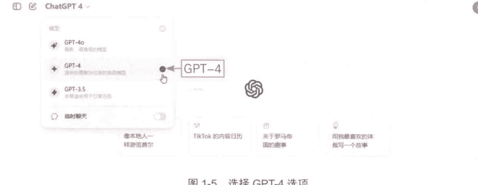
图 1-5 选择 GPT-4 选项
★ 专家提醒 ★
GPT-3.5是基于GPT-3的进阶版，2022年推出，在代码理解、复杂问题处理与文本连贯性上均有提升。
GPT-4是2023年发布的重磅版本，参数更庞大、训练算法更复杂，理解深度与生成多样性显著增强，多语言、创意写作与专业表达均实现质变，适用场景更广。需订阅ChatGPT Plus会员，每月20美元。
GPT-4o是GPT-4的提效版，优化算法与硬件适配后响应更快、能耗更低，保持生成质量的同时提供更流畅的实时交互体验。

### 1.1.3 ChatGPT的使用方法

掌握基本信息后，即可开始生成文案。在聊天框输入引导词，模型会据此作答。


**步骤01** 进入ChatGPT主页，在底部输入框输入引导词，例如“请为一款电冰箱写一段宣传文案”，如图1-6所示。

图 1-6 输入相应的提示词
**步骤02** 点击发送按钮或按【Enter】，ChatGPT会依据引导词生成对应文案，如图1-7所示。
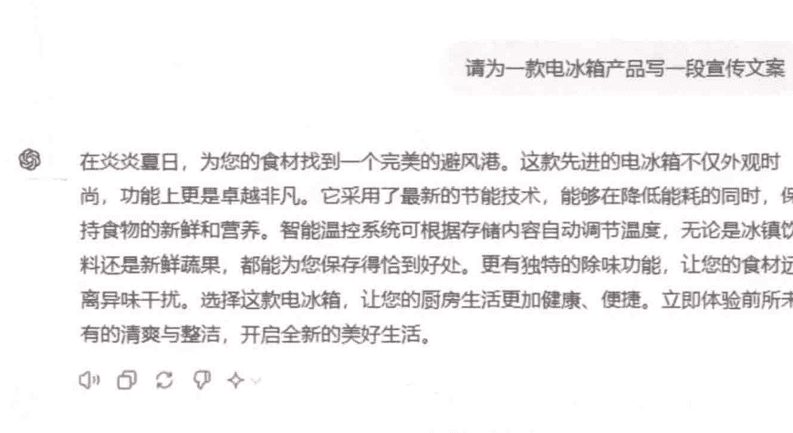
图 1-7 ChatGPT 生成相应的文案
> ★ 专家提醒 ★
模型输出并非百分百准确，偶尔会出现偏差，使用时需结合实际情况甄别与校对。

### 1.1.4 新建聊天窗口

登录后默认进入新对话，历史记录保存在左侧侧边栏，可新建、重命名、删除窗口。


合理管理对话窗口能让使用更有序高效。当需要开启新主题时可新建窗口保留历史记录。
**步骤01** 打开ChatGPT并进入已有对话，点击侧边栏上方“新聊天”按钮，如图1-8所示。
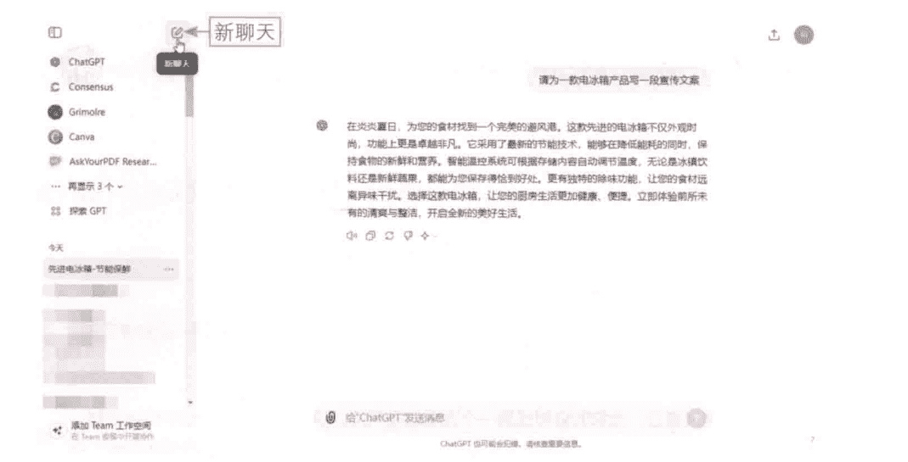
图 1-8 单击“新聊天”按钮
**步骤02** 新建窗口后在输入框填入引导词，如“请提供一段关于雨季的文案，50字以内”，如图1-9所示。

图 1-9 输入相应的提示词
**步骤03** 按【Enter】确认，ChatGPT会按要求生成文案，如图1-10所示。

图 1-10 ChatGPT 生成的文案

### 1.1.5 重命名聊天窗口

生成对话后窗口会自动命名，不满意可手动修改。


**步骤01** 以新建窗口为例，在侧边栏点击窗口旁的“选项”按钮…，如图1-11所示。
**步骤02** 在弹出菜单中选择“重命名”，如图1-12所示。
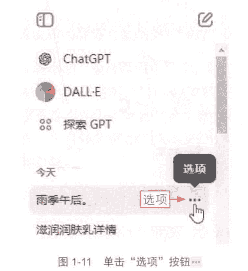
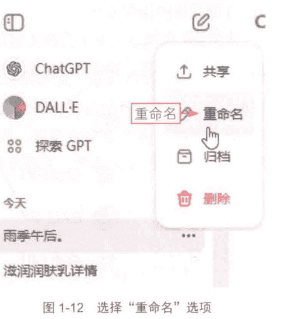
**步骤03** 随后出现编辑框，修改名称后按【Enter】确认，即可完成重命名，如图1-13所示。
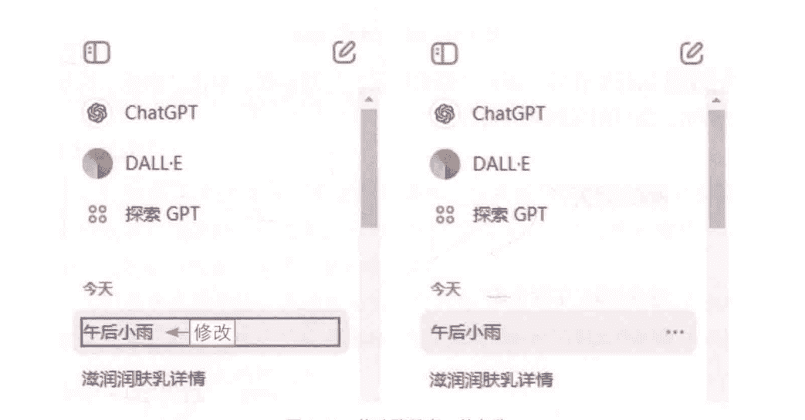

### 1.1.6 删除聊天窗口

对话结束后如需清除记录，可删除窗口。

**步骤01** 在侧边栏点击窗口旁的“选项”按钮...，选择“删除”，如图1-14所示。
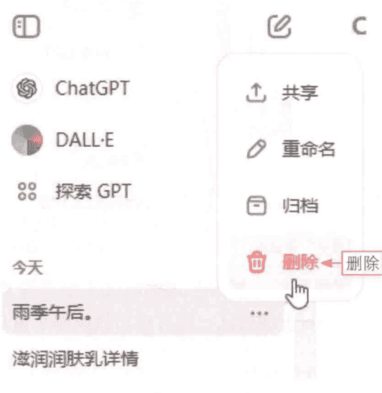

**步骤02** 触发删除指令后，界面会弹出“删除聊天？”的确认窗口，点选“删除”即可结束当前对话，示意图见图1-15。

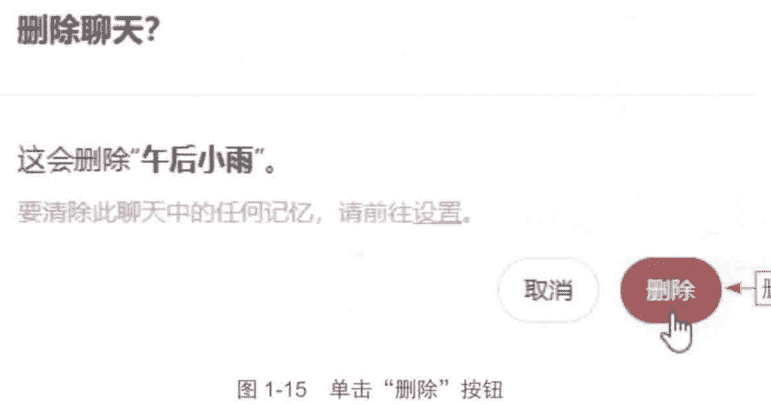

★ 专家提醒 ★

确认要移除当前对话时请点“删除”，如果只是误触想保留内容则点“取消”即可。

## 1.2 ChatGPT 提示框架

提示词本质上是发给模型的任务指令，直接决定返回结果的好坏。提示框架是指用户在对话中对这些指令进行组织的方式，结构设计得当能让交流更顺畅，产出也更符合预期。下面从实践角度展开说明。

### 1.2.1 选择合适的提示词

写出有效的指令关键在于表达简洁明晰、条理分明，并与实际目标保持一致。措辞的细微差别会让模型给出截然不同的答案。下面用宽泛提问与具体提问的案例进行对比。


**步骤01** 在ChatGPT的输入框中输入比较宽泛的提示词，相关的提示词和回复内容如下。

> 提问

请写出10个家具产品的宣传文案。

> ChatGPT

1. 极简主义办公桌：简洁而不简单，这款极简主义风格的办公桌以干净的线条和无瑕的白色表面，为您的工作空间带来现代感的同时提升工作效率。完美融合功能与美学，是您理想的办公伙伴。

2. 豪华皮质沙发：沉浸在无与伦比的舒适中，我们的豪华皮质沙发采用顶级皮革，经典的设计与现代的触感相结合，不仅可以提升您的居家格调，也能给您带来长久的舒适享受。

3. 多功能咖啡桌：创新与实用并重。这款多功能咖啡桌不仅外观时尚，还内置收纳空间和可调节高度功能，适应您的每一个放松时刻。

4. 现代风床架：睡眠质量的革命者。这款床架采用简洁的现代设计，不仅坚固耐用，更以其低调的奢华感提升您的卧室环境，每晚都能让你沉浸在深度睡眠中。

5. 复古书架：回归经典，书写未来。这款复古书架以传统木工艺术为灵感，为您的藏书提供坚固而幽雅的展示空间，每一层都诉说着故事的力量。

6. 创意儿童床：为孩子的想象力插上翅膀！这款创意儿童床集安全、舒适与乐趣于一体，为孩子带来了充满创意和趣味的睡前体验，让孩子的每一晚都充满梦想。

7. 现代吧台椅：提升您的家庭吧台体验。这款现代吧台椅以其流畅的线条和舒适的座位，为您的家庭聚会增添时尚与舒适的双重享受。

8. 户外休闲椅：在自然中找到舒适的角落。这款户外休闲椅采用耐候材料制成，无论是阳光充足的午后，还是庭院中的惬意夜晚，都是放松身心的最佳选择。

9. 智能衣柜：整理衣物，智能高效。这款智能衣柜配备最新的分类储存技术，不仅节省空间，更使得衣物管理变得轻松而有序，每天的着装都无忧无虑。

10. 折叠餐桌：灵活的空间解决方案。这款折叠餐桌设计精巧，能够根据需要轻松展开或收起，非常适合空间有限的现代家庭，实用且也不失美观。

这些文案适用于网站、广告或者产品手册等多种场合，您都可以根据实际需要进行稍微调整。希望这些文案能为您的产品营销带来帮助！

**步骤02** 在左上方单击“新聊天”按钮，新建一个聊天窗口，输入比较具体的提示词，相关的提示词和回复内容如下。

> 提问

请写出10个沙发产品的宣传文案。

> ChatGPT

当然，以下是10个针对不同风格和功能的沙发产品的宣传文案，可以帮助展示每款沙发的独特之处。

1. 经典皮革沙发：经典之选，时尚永存。这款皮革沙发采用优质材料，手感舒适，耐用性强，为您的客厅增添一抹永恒的优雅。

2. 现代布艺沙发：现代家居的理想选择。柔软的布料与流线型设计相结合，打造出既美观又舒适的休息空间，让家变得更温馨。

3. 多功能沙发床：空间与功能的完美结合。这款沙发床设计精巧，可以轻松转变为床铺，无论是家用还是客人临时过夜，都能提供完美的解决方案。

4. 角落组合沙发：最大化利用您的空间。适合任何角落的设计，不仅节省空间，还能提供额外的座位，是小户型的理想选择。

5. 豪华电动按摩沙发：在家享受专业级的放松体验。这款电动按摩沙发，提供多种按摩模式和深层放松功能，让您每天的疲惫都烟消云散。

6. 简约风格单人沙发：简约而不简单。这款单人沙发以其独特的现代设计和舒适的坐感，成为所有现代家居空间中的亮点。

7. 复古风格沙发：复古风情，现代舒适。这款沙发以经典的复古设计为灵感，搭配现代的舒适感，为您的家居环境增添一抹艺术气息。

8. 儿童主题沙发：专为小朋友设计的趣味沙发。色彩鲜艳，形状可爱，安全又舒适，是儿童房间的完美搭配。

9. 户外休闲沙发：户外的最佳伴侣。使用防水抗晒材料制成，不仅适合所有天气条件，还能提供最佳的舒适度，让您的庭院生活更加精彩。

10. 创意设计沙发：打破常规的创意设计。这款沙发以其独特的外观和创新的材质使用，为寻求不同的您提供一个与众不同的选择。

这些文案可以用来吸引潜在客户的注意，提升产品的吸引力，适合用于广告、网站、社交媒体等多种营销渠道。希望它们能为您的营销活动带来助力！

从两次输出可以看出，模型对泛化指令和具体指令的理解不同，反馈也随之变化。泛化提问时，回答偏概念、覆盖面广；具体提问时，回答更贴近意图。两者各有价值，具体选用取决于实际需求。

### 1.2.2 确定具体的主题

通常情况下，宽泛的表达适合获取概括性信息，而聚焦的表述更适合得到可操作的建议。学会写出有针对性的指令，首先要把核心主题确定下来。


例如，用户想通过ChatGPT生成一篇有关夏季驱蚊指南的短视频文案，那么“夏季驱蚊指南”便是提示词的主题，而“一篇短视频文案”则是用户的需求，组合在一起，就可以得到要输入的提示词——“请帮我写一篇主题为夏季驱蚊指南的短视频文案”。在ChatGPT的输入框中输入相应的提示词并发送，便可以得到ChatGPT生成的回复，相关案例如下。

> 提问

请帮我写一篇主题为夏季驱蚊指南的短视频文案。

> ChatGPT

这是一篇关于夏季驱蚊的短视频文案，包括开场、内容展示和结尾部分，适用于教育和推广自然驱蚊方法。

【开场】

将镜头缓慢推进，展示夏季郁郁葱葱的后院。

旁白：“夏天到了，蚊子也不远了！如何在享受美好夏日的同时，远离蚊虫的困扰呢？跟着我们一起来看看！”

【内容一：植物驱蚊】

将镜头对准几种植物，如薄荷、薰衣草和柠檬草。

旁白：“你知道吗？有些植物是天然的驱蚊剂。种植薄荷、薰衣草、柠檬草不仅能美化你的花园，还能帮你驱赶蚊子！”

【内容二：DIY驱蚊剂】

展示自制驱蚊剂的制作过程：将驱蚊植物的精油与水混合。

旁白：“自制驱蚊剂，既环保又有效。只需要几滴薰衣草油或茶树油，加入水中，就能制作出安全的驱蚊喷雾。”

【内容三：驱蚊蜡烛】

在镜头中展示自制或市售的驱蚊蜡烛。

旁白：“晚上在户外时，点上一两支驱蚊蜡烛，不仅营造了温馨的氛围，还能有效驱蚊。”

【小贴士展示】

快速展示几个实用的驱蚊小贴士，如避免穿深色衣物、使用风扇、保持皮肤干燥等。

旁白：“记住这些小贴士，让你的夏天更加舒适！”

【结尾】

镜头回到美丽的花园，夕阳西下。

旁白：“用这些自然友好的方法，让你的夏日无忧，远离蚊虫的烦恼。享受夏日，从‘驱蚊’开始！记得关注我们，获取更多生活小技巧！”

这个文案结构清晰，既有实用信息，也不乏生动的视觉和语言表达，适合在社交媒体上吸引观众的注意力。

总体而言，若希望模型产出更灵活的观点性内容，就要在指令里明确主题，并将其限定到具体领域、行业或话题。

### 1.2.3 加入限定语言

若主题已明确但输出仍不满意，可通过增加限制性词汇或附加条件来缩小范围。


**步骤01** 在ChatGPT的输入框中输入主题为手机壳产品推广文案的提示词，相关的提示词和回复内容如下。

> 提问

请提供两条手机壳的产品推广文案。

> ChatGPT

当然可以！这里有两条针对手机壳的产品推广文案。

【产品一：环保透明手机壳】

内容：“探索透明的美丽与环保的力量！这款手机壳采用100%可回收材料制成，结合坚固耐用和轻巧透明的完美设计。它不仅保护你的手机免受日常磨损，还展示了你对地球的关爱。选择我们的环保透明手机壳，让你的生活更加绿色，时尚步伐更稳健！”

【产品二：个性彩绘软壳】

内容：“让你的手机与众不同！这款个性彩绘手机壳采用柔软耐用的材料，提供全面保护，同时装点你的生活。从独特的艺术作品到你喜爱的图案，每一个设计都是为了表达你的个性和品位。加入我们，选择一款真正属于你的手机壳，让色彩点亮你的每一天！”

这些文案适用于网站、社交媒体或电子邮件营销，通过突出产品的环保属性和个性化设计，引起目标客户群体的兴趣。

**步骤02** 找到已发出指令旁的编辑图标，点击后补充限定表述再发送，具体界面见图1-16。

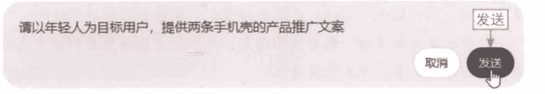
图 1-16 单击“发送”按钮

**步骤03** 完成修改并发送后，模型会依据新的指令产生回应，示例如下。

> 提问

请以年轻人为目标用户，提供两条手机壳的产品推广文案。

> ChatGPT

针对年轻人的手机壳产品推广文案，我们可以着重突出设计新颖和个性化的元素，同时强调产品的实用性和质量。以下是两条可能的推广文案。

1. 解锁你的风格：选择设计独特的手机壳，让你的手机与众不同。无论是街头涂鸦风、精致简约风还是奢华闪耀风，总有一款是你的标签。耐用材料保护你的手机免受日常碰撞与划伤，时尚外观让你成为人群中的焦点。现在就来选择属于你的那一款！

2. 彰显个性，从手机壳开始：这款手机壳不仅是保护装置，更是你个性的展示窗。多样的图案选择，从复古卡通到现代抽象，定能找到让你心仪的款式。超薄设计，手感舒适，为你的手机提供全方位的保护。让你的手机壳成为你时尚态度的象征，立即体验不一样的个性魅力！

这两条文案都尽量融入了年轻人追求个性和时尚的心理，同时也没有忽略产品的保护功能。

**步骤04** 再次点开编辑入口，在原指令中补充更具体的条件后重新发送，新的输出如下。

> 提问

请以年轻人为目标用户，提供两条手机壳的产品推广文案，要求突出产品的亮点，有吸引力。

> ChatGPT

当然可以！这里有两条为年轻人设计的手机壳产品推广文案，突出产品的亮点和吸引力。

1. 创新遇见时尚：抓住眼球的手机壳在这里！这款手机壳采用环保材料制成，质感细腻，配以独特的液态滑动沙效果，让你的手机在手中流光溢彩。不仅防摔防刮，而且每一个角落都经过精心设计，完美贴合你的手机。选择这款手机壳，让你在人群中脱颖而出，展现不凡风采！

2. 科技与艺术的结合：为你的手机穿上科技盔甲！这款手机壳集成最新的热敏变色技术，颜色随手温变化，每次触摸都是独一无二的艺术表达。超薄设计，不增加手机重量，确保持久耐用。选择这款手机壳，让科技成为你个性表达的一部分，随时随地彰显你的独特品位。

这两条文案都注重展现产品的创新性和个性化特点，希望能够吸引年轻消费者的注意力。

> ★ 专家提醒 ★
输出效果与指令的详尽程度密切相关，描述越具体、条件越明确，获得理想结果的可能性就越大。

### 1.2.4 模仿语言风格

如果不确定如何组织指令，可以直接指定一种文体风格，让模型模仿某位作者或角色的语言习惯来写作。


> 提问

请以余华的语言风格，创作一篇400字以内的小说。

> ChatGPT

余华的写作风格以其简洁而富有深意的语言和对日常生活的深刻洞察而著称。以下是一篇模仿他风格的短篇小说。

在一个久旱的夏天，小镇的河水干涸了，大家的脸上都挂着焦急。张老汉独自坐在干涸的河床上，手里拿着一根已经看不出原形的旧钓鱼竿。他的钓鱼竿上没有鱼线，没有钩，也没有饵，但他每天都会坐在那里，好像在等待着什么。

镇上的人开始嘲笑他，说他疯了。但也有几个孩子，好奇心驱使他们围坐在他周围，听他讲述过去河水丰盈时的故事。张老汉的眼中仿佛还能看见水面上跳跃的鱼影，他的话语中充满了对那些日子的眷恋。

“你们看，”他指着河床，“河水会回来的，鱼儿也会回来的。”孩子们听着，眼睛里闪烁着光芒，他们开始想象那些从未见过的景象。

终于有一天，久违的暴雨如期而至，河水渐渐回涌。当大家还在庆幸能再次看到流水时，张老汉却已经不在了。他的钓鱼竿静静地躺在新涌来的河水中，仿佛他的等待终于得到了回应。

小镇的孩子们从此经常聚集在河边，他们学着张老汉的样子，拿着各自的钓鱼竿。他们知道，等待并不是无谓的，每一个梦想终将触及现实的岸边。

这个故事在小镇流传开来，成了一种激励人心的传说：即使在最干涸的日子里，也有希望在沉默中孕育，只待时机涌流而出。

### 1.2.5 提供参考例子

在提问时提供一个参考样例，模型更容易把握需求并给出符合预期的结果。


**提问**

旅行类短视频的标题文案通常是文艺且富有诗意的，如“踏过千里，寻觅灵魂的栖息地”，请提供10个类似的标题文案。

**ChatGPT**

以下是10个文艺且富有诗意的旅行类短视频标题文案：

1. “漫步云端，与世界轻声对话”

2. “遥远的风景，近在心间”

3. “山河广阔，心之所向”

4. “风吹过的路侧，是旧时光的低语”

5. “星辰大海，我与世界仅一步之遥”

6. “穿越古老森林，探寻岁月的秘密”

7. “在世界的尽头，寻找未知的开始”

8. “沿海的呼吸，灵魂的归宿”

9. “每一程山水，都是心灵的疗愈”

10. “远行，为了内心的宁静与自由”

### 1.2.6 指定受众人群

明确受众群体可以帮助模型更准确地理解意图，从而输出更贴合的文案。


**提问**

请针对长时间坐在电脑前的上班族创作一篇有关人体工学椅的产品推广文案，要求突出产品的质量和实用性，不超过300字。

**ChatGPT**

在忙碌的工作日里，长时间坐在电脑前可能导致背部和颈部的疲劳。为了解决这个问题，我们推出了一款专为上班族设计的人体工学椅——座享椅。座享椅采用国际先进的人体工学设计，不仅能够有效支撑您的脊椎，还可以根据您的坐姿自动调整，确保每一个坐姿都是最佳姿势。

我们的椅子采用高品质材料制作，经久耐用。座垫使用记忆棉，可以减少臀部压力，提升坐着的舒适度。椅背的透气网格设计让您即使在夏日也能保持清爽，避免长时间坐着出汗的尴尬。

座享椅不仅关注您的健康，更是办公室的时尚选择。简洁的设计与任何办公环境都完美融合，既实用又不失格调。选择座享椅，让您的工作时光更健康，工作更有效率。立刻体验不一样的工作感觉，让您的每一天都充满活力和舒适！

### 1.2.7 使用不同视角

写作时变换叙述视角能让内容更鲜活，将这一做法运用到指令设计中，也能提升创作质量。


AI全能应用七合一：ChatGPT+DALL·E+Midjourney+SD+PS+剪映+可灵

**提问**

请以第一人称视角创作一篇美食街探店的开场旁白文案。

**ChatGPT**

大家好，我是你们的美食探索者！今天，我空腹带着满满的好奇心，来到了这条闻名遐迩的美食街。这里，每一步都有惊喜，每一摊都有故事。从传统小吃到创新料理，从早餐到宵夜，美食街的每个角落都散发着诱人的香气和无限的风味。跟随我的脚步，一起探索这条美食街的每一道美味，寻找那些只属于我们的独特食物记忆。准备好了吗？让我们的味蕾启程，开启这场美食的冒险之旅吧！

### 1.2.8 加入种子词

种子词是指希望在正文中出现的关键词。将它们写进指令里，有助于模型更快锁定相关素材，从而给出更合适的回答。


**提问**

请根据种子词生成一篇手提袋产品的推广文案，不超过500个字，种子词：便携、时尚、精致。

**ChatGPT**

手提袋产品推广文案

随身携带，尽显时尚，品味精致生活——这正是我们为您精心打造的手提袋所带来的体验。

在如今快节奏的都市生活中，一款好的手提袋不仅是储物的工具，更是您时尚品位的象征。我们的手提袋设计注重“便携、时尚、精致”三大核心元素，旨在为都市男女提供一个完美的携带解决方案。

便携：轻巧的材质，合理的尺寸设计，让您无论是出行工作还是休闲旅行，都能轻松携带，应对各种场合。内部结构的巧妙布局，可容纳您的手机、钱包、化妆品等日常必需品，同时保持包包的轻盈与便捷。

时尚：我们的设计团队深入研究国际时尚趋势，将经典与现代元素巧妙融合，每一款手提袋都是对时尚理解的一次探索和呈现。多样的颜色与图案选择，无论是商务正装还是休闲装扮，都能完美匹配，彰显您的独特风格。

精致：选用优质材料，每一道工序都经过严格监控，确保每一个细节都达到尽善尽美。精细的缝合线条、光滑的拉链、精致的五金配件，每一处细节都体现出我们对品质的不懈追求。

另外，我们郑重承诺提供完善的售后支持，力求为每位用户带来理想的购物感受。挑选我们的手提包，意味着你不仅拥有工艺精良的单品，更在践行一种自在、前卫、注重细节的生活方式。现在就加入我们，开启专属的时尚旅程。

## 1.3 对话助手实战演示

前几章已经梳理了智能对话工具的基础操作与实用技巧，帮助大家快速上手。本单元进入实操演练，通过典型案例让大家熟悉该模型更丰富的应用能力。

### 1.3.1 撰写首图文案

首图文案通常指电商详情页主视觉旁边的文字注解，其作用是抓住潜在买家的注意力，并提炼商品的特质、功能或卖点，促使其进一步了解并下单。借助该助手可以高效产出这类文案，具体流程如下。


步骤01 在输入框内输入相应提示，引导模型输出目标人群的需求画像，示例对话如下。

> **提问**
请解析年轻人选购洗发水时关注的核心点。

> **ChatGPT**
年轻群体对洗发水的偏好受个人习惯、生活方式、环保意识和健康考量等多方面影响，总结如下。

1. 偏好无添加天然配方：他们更在意成分表，倾向挑选不含化学添加的天然或植物萃取产品，认为对发丝和头皮更温和。
2. 注重可持续与环保：对环境问题敏感，更愿意选择可回收包装、可持续生产的产品。
3. 追求个性化解决方案：希望产品能匹配不同发质与需求，如干性、油性、卷曲或受损发质的专项配方。
4. 品牌调性与传播影响：品牌形象、广告宣传和社交媒体对其购买决策有较大影响，会选择与自身价值观契合的品牌。
5. 价格与性价比考量：虽部分人愿意为高端产品买单，但多数仍关注价格适中、性价比高的选择。
6. 香气体验：部分用户会被洗发水的香味吸引，偏好特定香调。
7. 使用便利性：快节奏生活下，2合1产品或旅行便携装更受欢迎。

总体看，年轻人的需求多元，品牌需洞察这些偏好制定更贴合的产品与营销策略。

步骤02 仍在同一对话窗口追加指令，请模型结合前述画像，提炼修护型洗发水的核心卖点，示例对话如下。

**提问**
基于上述人群画像，请总结修护型洗发水的核心卖点。

**ChatGPT**
针对年轻用户的修护型洗发水，可提炼以下亮点。

1. 天然修护配方：以天然成分和植物萃取为基础，有效修护受损发质，滋养头皮，契合对无害成分的偏好。
2. 多维修护功效：可改善干枯、断裂、分叉等困扰，让头发恢复柔软、有光泽与弹性。
3. 深层滋养保湿：添加滋养成分，能深层润养并形成持久保湿，缓解毛躁。
4. 外部损伤防护：形成保护膜抵御紫外线、污染等外界侵害。
5. 温和不刺激：配方温和，无有害化学物质，敏感头皮也可安心使用，洗护体验舒适。
6. 香氛愉悦：调配天然香调，提升使用时的感官享受。
7. 环保包装：采用环保材料，呼应用户对可持续的关注，体现品牌社会责任。

步骤03 再次在同一窗口输入指令，请模型依据以上信息撰写修护型洗发水的电商主图配文，要求语言简练突出亮点，示例对话如下。

> **提问**
请依据以上要点，为修护型洗发水创作一条简洁的主图文案，突出亮点。

> **ChatGPT**
主图：展示一瓶精致的修护型洗发水，背景为清新自然场景，并配发丝顺滑效果图。

文案：

· 从此刻开始，焕回秀发健康！
· 天然修护配方，轻抚即顺，守护发根！
· 深层滋养告别毛躁，拥抱水润轻盈！
· 双重防护屏障，抵御外界伤害！
· 温和配方呵护敏感头皮，洗护零负担！
· 宜人自然香氛，带来沐浴般护发享受！
· 环保包装，与你共同守护地球！
· 每一次洗发，都是对秀发的细心呵护！

该文案简明扼要，突出了修护型洗发水的核心优势。

### 1.3.2 制作短视频脚本

视频脚本是描述视频内容与细节的文稿，会详细说明场景、动作、表情及特效等要素。用户可向助手提供视频的核心概念、主题、人物设定等信息，由助手生成结构化脚本草案。此方式能大幅提升创作效率，同时拓展创意视角，具体操作方法如下。


步骤01 先在输入区提交对话前提，确认助手是否了解视频脚本，示例对话如下。

> **提问**
什么是视频脚本？

> **ChatGPT**
视频脚本是影视制作的专业文档，详细描述视频的每个部分，包括对白、场景、动作和视觉特效。脚本是导演、演员、摄影师及制作团队共同参照的蓝图，确保各环节按预设剧情与风格执行。

通常包含以下要素。
1. 场景编号：便于制作管理。
2. 场景设定：地点与时间，如“外景，白天，海滩”。
3. 动作说明：角色行为与环境变化。
4. 对白内容：角色台词。
5. 视觉特效：特效、转场、风格描述。
6. 音效与音乐：何时使用特定音效或配乐。

撰写需考虑目标受众、传达信息及预期视听效果，是制作的关键环节。

步骤02 为助手设定角色，让其按要求产出视频脚本，示例对话如下。

**提问**
你是一名专业的摄影博主，正在写一个关于音乐歌舞会的视频脚本，脚本需包含当下短视频的热门元素，开篇5秒快速抓眼，文案侧重情绪表达，用表格形式呈现。

**ChatGPT**
以下是一个音乐歌舞会视频脚本概要，采用表格呈现，聚焦开篇吸睛元素和情绪表达。

| 序号 | 场景描述 | 动作和视觉效果 | 对话或文案 | 音效和音乐 |
| :--- | :--- | :--- | :--- | :--- |
| 1 | 开篇，夜晚露天舞台 | 快速剪辑：人群脚步、舞者穿梭、灯光闪烁 | “今夜，我们共舞”旁白 | 动感电子乐起，节奏强烈 |
| 2 | 舞台中央聚光灯下 | 主舞者亮眼装扮，现代舞动作 | 无对白，以情感表达为主 | 音乐节奏加快，更具感染力 |
| 3 | 观众视角 | 年轻观众、情侣随节奏摇摆 | “让心跳随节奏律动”屏幕弹出 | 背景音乐混现场欢呼 |
| 4 | 高空航拍 | 无人机拍摄舞台与观众全景 | 无对白，情绪高涨 | 舞曲推向高潮，音量加大 |

该脚本开篇视觉听觉冲击强，通过现场动感与观众参与营造浓厚情绪氛围，可作为灵感参考。

### 1.3.3 生成风格插画

该模型能解析详细文字描述，创作出逼真的图像，可据此生成不同艺术风格与主题的插画，效果如图1-17所示。

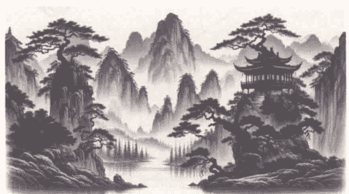

图 1-17 模型根据提示词生成的插画效果

下面介绍生成风格插画的具体操作方法。

**步骤01** 在输入区输入对应提示词，让其生成水墨风插画，如图1-18所示。

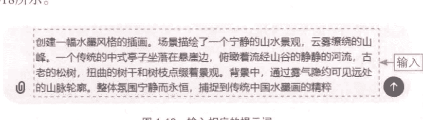

图 1-18 输入相应的提示词

**步骤02** 按【Enter】键确认，随后模型将根据用户提供的提示词，生成相应的水墨风插画。

### 1.3.4 解析图像内容

ChatGPT 4o 版本能更好地理解和解析图像中的内容，还可生成图像描述、回答相关问题，并结合文本提供多模态输出，下面介绍具体使用方法。

**步骤01** 单击主页左上方 ChatGPT 4 旁的下拉按钮▼，在弹出的下拉列表框中选择 GPT-4o 选项，如图1-19所示，即可切换至 ChatGPT 4o 版本。

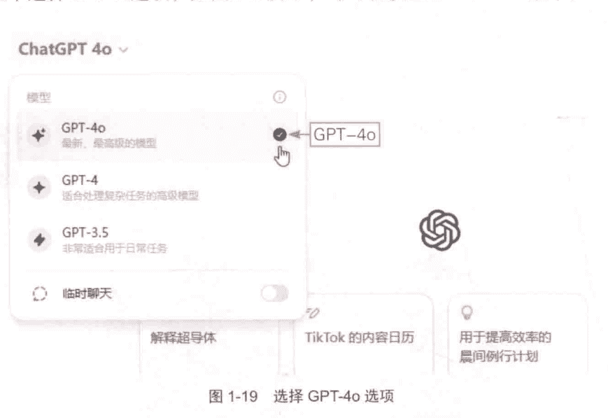

图 1-19 选择 GPT-4o 选项

**步骤02** 单击 ChatGPT 4o 输入框左侧的⊕按钮，在弹出的面板中，单击“从电脑中上传”按钮，如图1-20所示。


图 1-20 单击“从电脑中上传”按钮

**步骤03** 弹出“打开”对话框，选择需要分析的图片，然后单击“打开”按钮，如图1-21所示。

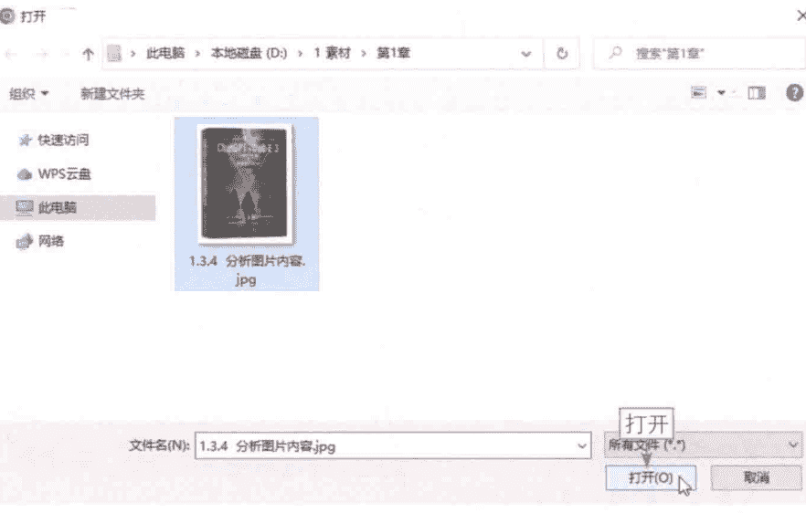

图 1-21 单击“打开”按钮

**步骤04** 输入相应的提示词，如图1-22所示，让模型分析图片内容。

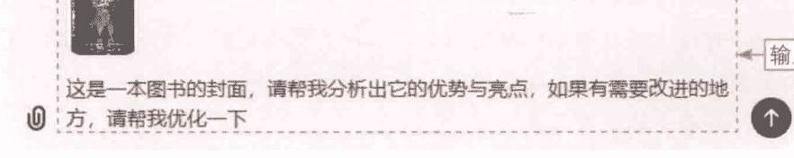

图 1-22 输入相应的提示词

**步骤05** 按【Enter】键确认，随后模型将分析用户提供的提示词和图片，提供封面建议，相关的回复内容如下。

**ChatGPT**

这本图书的封面设计具有以下优势与亮点。

**优势与亮点**

1. 强烈的视觉吸引力
   - 封面图像采用了两个探险者进入森林的场景，背景是神秘的森林和明亮的光源，营造出探险和未知的氛围，吸引读者的好奇心。
   - 颜色对比鲜明，深色的森林背景和亮色的光源形成强烈的视觉冲击。

2. 明确的标题和副标题
   - 以“ChatGPT+DALL·E 3”作为主标题，明确传达了本书的主题，即人工智能生成内容的提示和技巧。
   - 副标题“AI提示文案与绘画技巧大全”进一步阐述了书的内容，告诉读者这是一本关于AI文案提示和绘画技巧的综合指南。

3. 内容丰富的说明
   - 封面上列出了“150多分钟教学视频+1130多个实操案例解析”，展示了书的实用性和丰富的学习资源。
   - 提到“海量资源赠送”以及具体的资源内容，增加了书的吸引力。

4. 清晰的出版社信息
   - 封面底部展示了出版社的相关信息，使读者知道这是由专业机构出版的，有一定的权威性。

**需要改进的地方及优化建议**

1. 排版调整
   - 文字信息较多，可以考虑优化排版，使文字更易读。比如，增加标题与副标题之间的间距，突出主要卖点信息。

2. 增加清晰的购买或扫描引导
   - 封面上有扫描二维码的图标，但没有明确说明二维码的用途。可以添加简短的说明，如“扫描二维码获取更多信息或资源”。

3. 封面上的元素过多
   - 封面上的图像和文字信息都比较多，容易让读者感到信息过载，可以考虑减少一些次要的信息，将重点放在书的主要卖点上。

**优化后的封面设计建议**

- 简化文字信息：将主要卖点“150多分钟教学视频 + 1130多个实操案例解析”放大突出，次要信息如资源赠送可以放在背面或内页。
- 优化排版：增加主标题和副标题之间的间距，使主要信息更加清晰。
- 明确二维码用途：在二维码旁增加简短的说明，如“扫描获取更多资源”。
- 视觉引导：在封面下方添加一个箭头或其他视觉元素，引导读者注意到二维码和扫描说明。

这样调整后，封面不仅保持了原有的视觉冲击力和信息的丰富性，同时也更易读，信息传达更加明确。

### 1.3.5 进行市场分析

模型可用于收集、解析和理解市场相关数据与信息，处理大量文本，从而提供深入见解与建议。通过对话交互，用户可提出具体问题，获取即时分析结果，帮助企业在快速变化的市场环境中做出更明智决策。下面介绍操作方法。

步骤01 让模型生成可供市场分析的文本，相关的提示词和回复内容如下。

**提问**
请给我一段可供ChatGPT进行市场分析的文章样本。

**ChatGPT**
这里有一段市场分析文章样本，可作为模型处理类似主题的参考。

市场分析
2024年全球智能手机市场趋势

随着技术不断进步和消费者需求日益增长，全球智能手机市场在2024年呈现显著增长。据市场研究机构最新报告，预计2024年全球智能手机销量将达15亿台，较2023年增长约5%。

市场细分
高端智能手机份额持续增长，主要得益于消费者对高质量摄影与长效电池的追求。

## 地理分析
从地理看，亚洲市场因中产阶级扩大和移动互联网普及，成为销量增长最快的区域。此外，北美和欧洲在更新换代需求和企业需求推动下，也呈现稳定增长。

## 市场挑战
尽管前景看好，智能手机行业仍面临供应链不确定性、全球经济波动以及隐私和数据安全问题加剧等挑战。

## 结论
总体来看，全球智能手机市场在2024年将继续增长，但企业需关注技术革新与市场动态，以应对不断变化的竞争环境和需求。

该文为企业提供全面洞察，有助于制定更有效的市场策略与决策。

步骤 02 在输入框中输入相应的提示词，让模型根据给出的文章样本进行市场分析，相关的提示词和回复内容如下。

## 提问
根据上面的文本进行市场分析。

## ChatGPT
根据上述文本，可从以下关键方面了解2024年全球智能手机市场情况与趋势。

- 1. 市场增长预测
预计2024年全球智能手机销量将达15亿台，年增长率约5%。增长表明市场需求依然强劲，尤其随技术进步和消费者需求提升。
- 2. 市场细分
高端手机份额持续增长，主要受消费者对高质量摄影与长效电池追求推动，显示用户更倾向功能更强、性能更优的高端产品。
### 3. 地理分布
亚洲市场，特别是中国和印度，因中产阶级增加和移动互联网普及，成为增长最快的区域。北美和欧洲也显示稳定增长，主要由消费者更新换代需求和企业需求推动。
### 4. 面临的挑战
行业面临供应链不确定性、全球经济波动以及隐私与数据安全问题，可能影响市场稳定性与企业长期发展。
### 5. 结论
总体看，全球智能手机市场呈现积极增长趋势，但企业需密切关注技术革新与市场动态，以适应竞争环境与需求变化。这要求企业在产品和技术上创新，同时优化供应链管理，应对经济与安全挑战。

此类分析有助于企业制定更精准高效的市场策略，保持竞争优势。

### 1.3.6 生成曲线分析图

曲线分析图用于展示数据点间变化趋势与关系，通常由一系列点连成的曲线构成，可清晰显示数据在一定时间或不同条件下的变化。使用模型可快速生成曲线分析图，具体操作如下。

步骤01 在输入框中输入相应的提示词，让模型提供一份可供生成曲线分析图的文本，相关的提示词和回复内容如下。

> 提问
我想使用ChatGPT生成曲线分析图，请你向我提供一个假想的公司在过去12个月中每月的销售额变化。

> ChatGPT
这里是一个假想公司过去12个月的销售额数据（单位：万元）：

AI全能应用七合一：ChatGPT+DALL·E+Midjourney+SD+PS+剪映+可灵

一月：120
二月：125
三月：150
四月：130
五月：160
六月：170
七月：180
八月：175
九月：165
十月：190
十一月：200
十二月：210

这些数据可用于观察销售趋势、分析季节性变化等。可使用图表软件或编程工具绘制曲线分析图，展示每月销售额变化趋势。

步骤02 在输入框中输入“请你根据以上内容生成曲线分析图”，按【Enter】键确认，模型将绘制出相应的图表，效果如图1-23所示。

接下来，我将用这些数据来生成一张销售额变化的曲线分析图。请稍等一下。

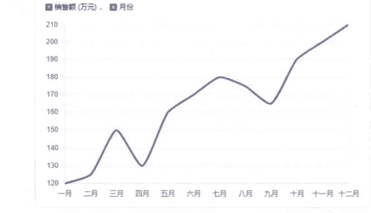

这是根据假想公司的销售额数据生成的月销售额变化图。如图所示，公司在过去十二个月中的销售额有明显的上升趋势。如果有其他需求或需要进一步的定制，请随时告诉我！[+]

图 1-23 模型绘制的曲线分析图效果

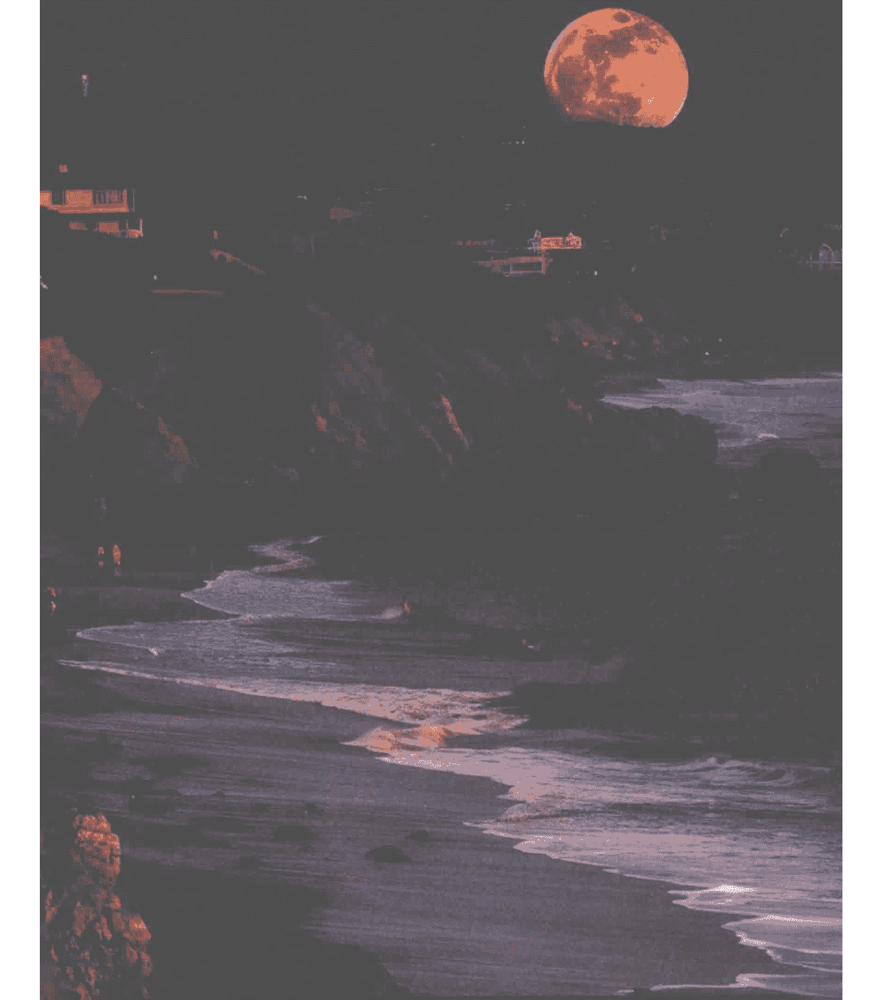

# 第 2 章 DALL·E 入门与实战

DALL·E是由OpenAI开发的图像生成模型，目前已更新到第3代，它能够将文本提示作为输入，并生成新图像作为输出。本章将向大家详细介绍DALL·E的使用方法与使用技巧，帮助大家更快地了解DALL·E。

## 2.1 DALL·E 快速上手

2021 年初 OpenAI 首次公开了 DALL·E 首版，借助大规模图文对齐的神经网络把自然语言描述映射成视觉图像。几年后 DALL·E 3 正式发布，理解能力与成像水平均实现明显跃升，可在多种艺术风格下产出高品质稿件。以下内容按上手路径与核心要点展开梳理，便于快速掌握实操。

### 2.1.1 DALL·E的特点

DALL·E 的核心在于把文字指令转译为画面。归纳其主要特质如下。


- 1. 指令转图：用户提供文字说明后，模型会据此生成语义对应的视觉结果。
- 2. 风格多元且想象力强：可输出写实、抽象等多种美术语言，兼顾单一主题与多元素复合场景的创作。
- 3. 细节丰富与质感逼真：依托海量图文训练，成图通常具备细腻纹理与可信材质。
- 4. 应用场景宽泛：广告概念、工业设计、艺术创作、教学辅助、娱乐内容等均可覆盖。设计师能快速产出概念草图，创作者可借此激发灵感，教育者可制作生动的视觉素材。
- 5. 版本持续迭代：产品经历多次更新，性能不断提升。以 DALL·E 3 为例，相较前代，成图品质与指令理解的精度均有显著进步。

总体来看，DALL·E 是一款把文字描述转化为视觉艺术的生成工具，为创意实践与落地应用提供双重助力。

### 2.1.2 搜索并安装DALL·E

OpenAI 推出了可定制的 ChatGPT 变体，命名为 GPT，可按个人需求打造专属智能助手。无论是整理邮件的高效伙伴，还是提供灵感的创意伙伴，都能实现。


简单说，GPT 允许用户按需搭建专属模型，模型本身也常被称作 GPT。而 DALL·E 正是官方上架的 GPT 之一，只需在 GPT 商店里找到它即可启用。下面说明具体流程。

**步骤01** 打开 ChatGPT 首页，点选左侧边栏的「探索 GPT」入口，如图 2-1 所示。

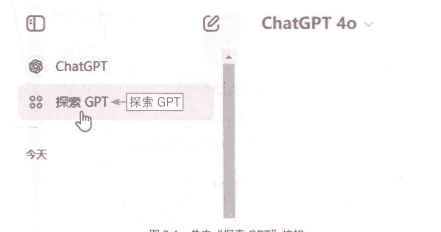

**步骤02** 进入商店页面后，可浏览推荐或直接在检索框内键入名称快速定位。以键入 DALL·E 为例，从弹出列表中挑选中对应的项目，如图 2-2 所示。

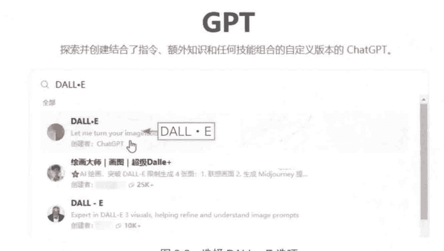

**步骤03** 弹出详情卡片，可查看该 GPT 的介绍与功能说明，点按「开始聊天」按钮，如图 2-3 所示。

**步骤04** 跳转后进入对话界面，点击左上方 DALL·E 旁的下拉箭头 ▼，在菜单中选择「保留在边栏中」，如图 2-4 所示，便可固定到侧栏，下次调用更便捷。

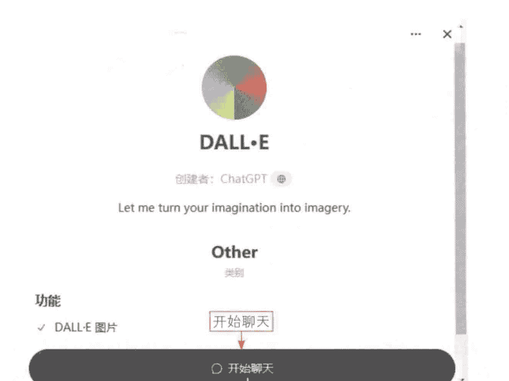

图2-3 点按开始聊天按钮

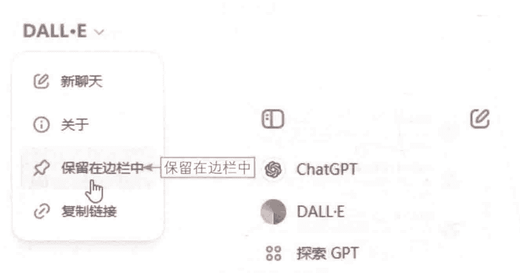

图2-4 选定保留在边栏中选项

步骤 05 如需收起侧栏中的条目，点击该条目右侧的控制键，在弹出的面板中点选「从边栏中隐藏」，如图 2-5 所示，即可将其收起。

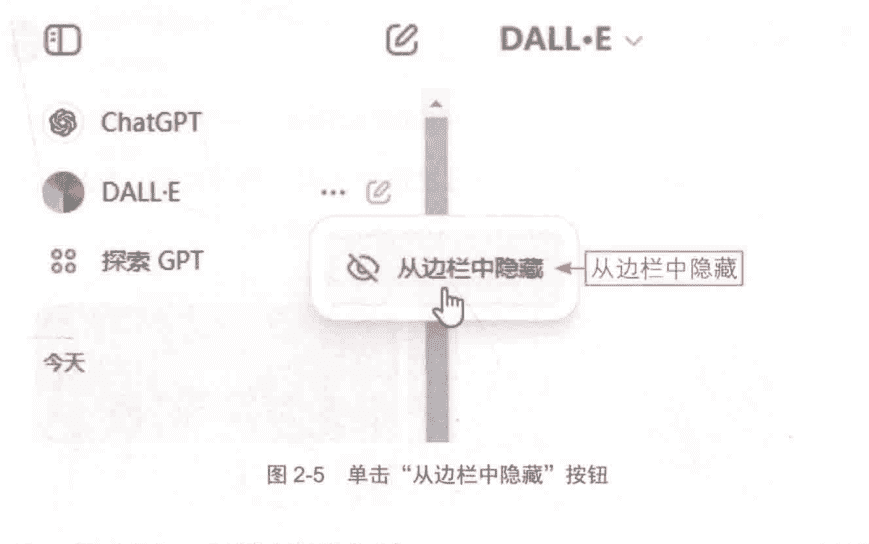

图 2-5 点按从边栏中隐藏按钮

### 2.1.3 DALL·E的使用方法

【效果展示】操作逻辑与常规 ChatGPT 相似，只需在底部栏填入描述文字，模型就会据此生成对应画面，效果见图 2-6。

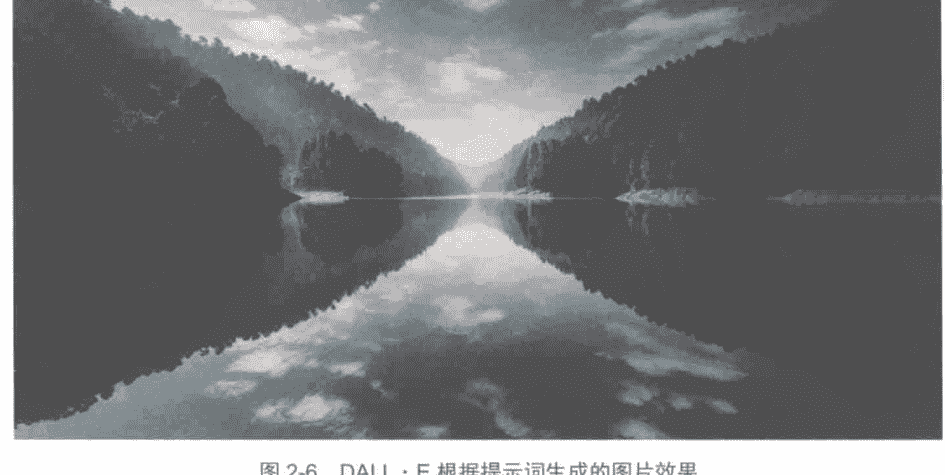

图 2-6 DALL·E 依据描述生成的图像效果

下面分步说明常用操作。

**步骤01** 在页面底部的输入区撰写描述，例如「宁静湖面，对称构图」，如图 2-7 所示。


图2-7 键入描述文字

**步骤02** 按下回车发送，稍作等待，系统会依据描述产出图像，效果见图 2-8。

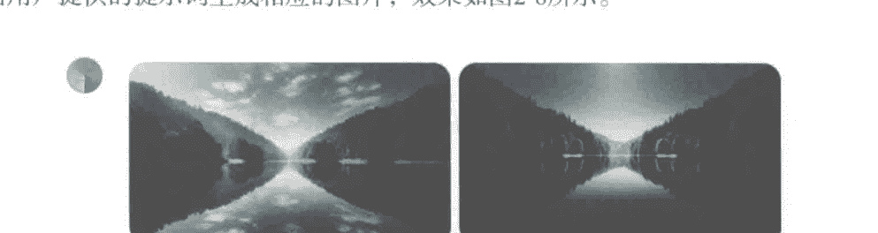

这里有两幅宁静湖面的对称构图图像。希望它们符合你的预期，让你感受到湖泊的宁静和美丽。

图2-8 DALL·E 依据描述生成图片

**步骤03** 若要保存，可点选其中一张图放大预览，再点右上角的「保存」按钮，如图 2-9 所示。示例中选取第 1 张。

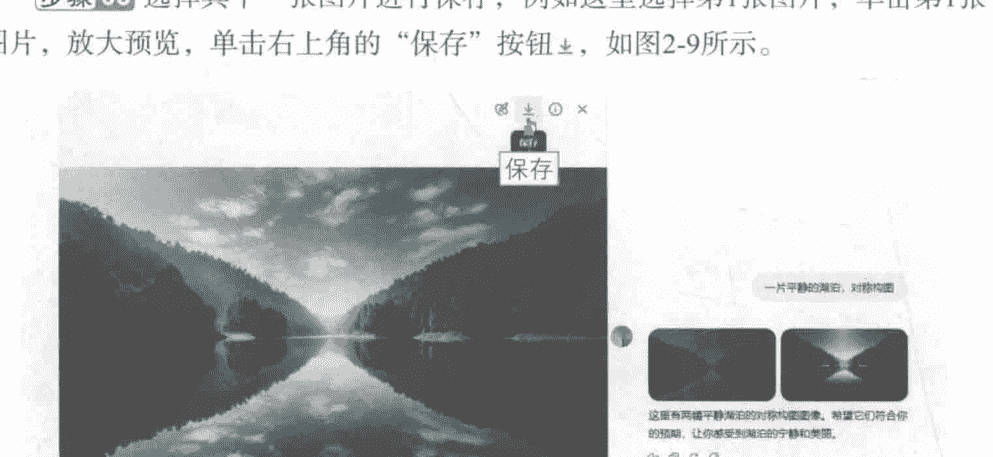

图2-9 点按保存按钮

36

步骤04 随后弹出「另存为」对话框，选定存储路径后点击「保存」，如图 2-10 所示，图片即完成下载。

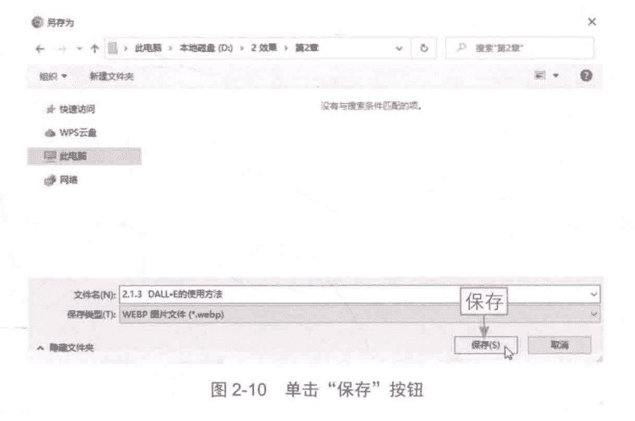

图2-10 点按保存按钮

### 2.1.4 提示词执行能力

【效果展示】成图质量与细节表现突出，同时具备扎实的指令遵循力。官方说明其较过往系统更善于捕捉细微差别，让想法更精准地落地为图像。提供相应描述即可得到高度契合的画面，效果见图 2-11。

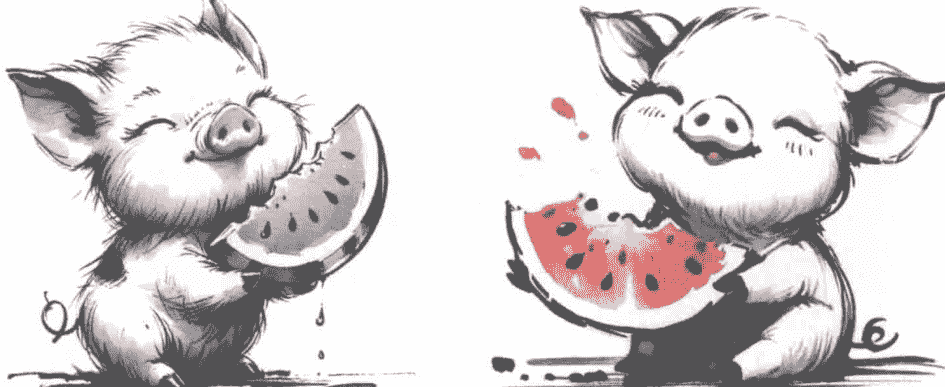

图2-11 DALL·E 依据描述生成的图像效果

以下以案例演示指令执行力。

**步骤01** 进入 ChatGPT 的 DALL·E 界面，在输入区填入对应描述，如图 2-12 所示。


图 2-12 键入描述文字

**步骤02** 确认发送后，模型会依据描述生成两张图，如图 2-13 所示。

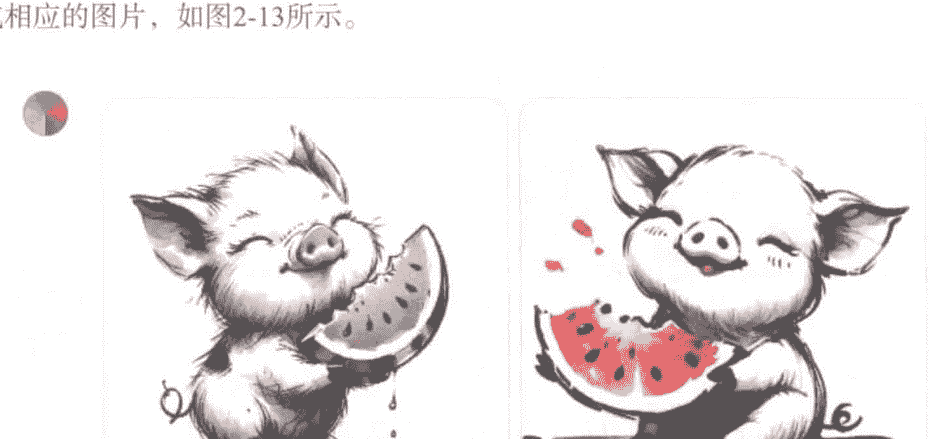

这里有两幅水墨速写风格的插画，描绘了一只小猪高兴地咬着西瓜的场景。希望你喜欢这两幅轻松愉快的作品。

图 2-13 DALL·E 依据描述生成两张图片

> ★ 专家提醒 ★
从图 2-13 可见，模型能准确解读「闭着眼睛高兴地咬了几口」这类口语化描述，并忠实呈现人物细节。

### 2.1.5 提示词处理能力

【效果展示】模型可解析复杂文本，涵盖抽象概念、细节描写与多重指令。面对较长、较复杂的描述，也能把各项元素完整表现于画面，效果见图 2-14。

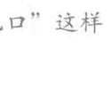

扫码看教学视频

38


图 2-14 DALL·E 依据复杂描述生成的图像效果

下例展示复杂描述的承载力。

**步骤 01** 在输入区中键入一段较为复杂的描述，如图 2-15 所示。

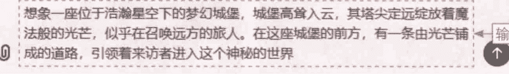

图 2-15 键入复杂描述

**步骤 02** 发送后模型会据此生成图像，如图 2-16 所示，可任选其一保存。

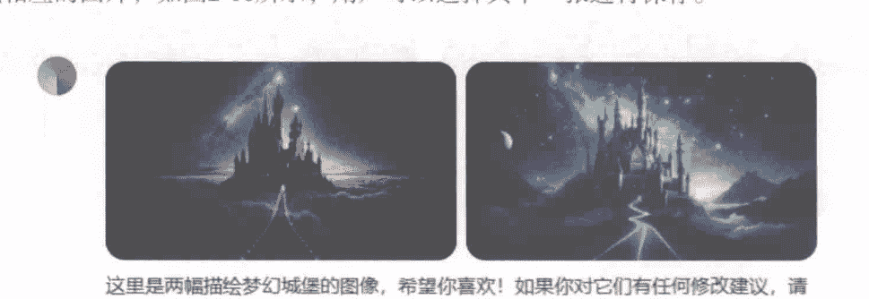

这里是两幅描绘梦幻城堡的图像，希望你喜欢！如果你对它们有任何修改建议，请告诉我。

图 2-16 DALL·E 依据描述生成两张图片

## 2.2 DALL·E 核心使用

生成图像时，提供与主题相关的描述即「绘画指令」，有助于模型锁定主体并激发创意。本节以案例形式介绍如何借助描述提升 DALL·E 3 的渲染质感，从而增强 AI 作画的艺术性与专业度。

### 2.2.1 提升照片摄影感

【效果展示】加入关键词 photography 能显著强化摄影质感。它模拟相机对静物、动态或自然景观的捕捉，并通过光圈、快门、感光度等参数影响亮度、清晰度与景深等成像效果，效果见图 2-17。

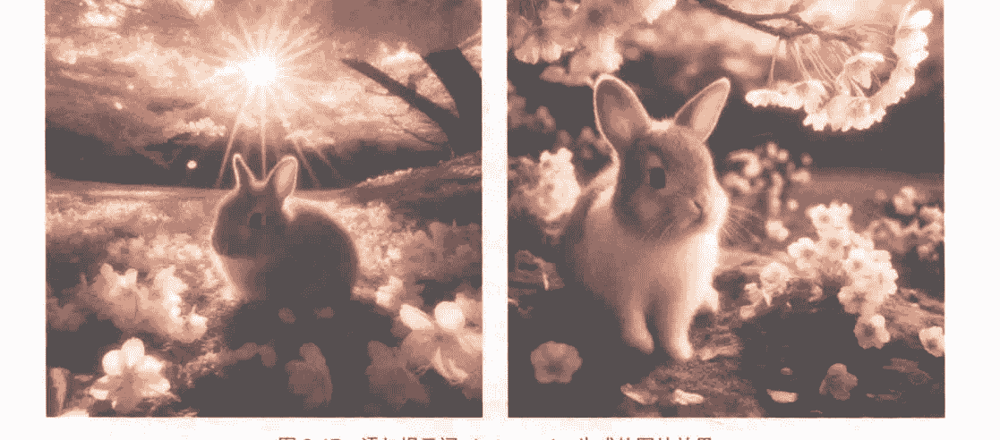

下面演示具体用法。

步骤01 在输入区填入描述，例如「阳光下，樱花满地，一只小兔子，极致的细节，photography」，如图 2-18 所示。


步骤 02 确认发送后，带 photography 的画面即生成，如图 2-19 所示。高光与暗部均保留丰富细节，色彩层次也更饱满。

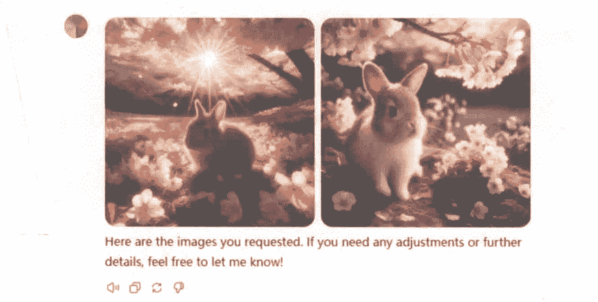

图 2-19 DALL·E 依据描述生成的图片效果

### 2.2.2 逼真的三维模型

【效果展示】在 AI 作画时加入 C4D Renderer 可获得高度逼真的三维模型质感，并支持定向光照、阴影与反射等处理，呈现出专业级视觉效果，见图 2-20。


图 2-20 添加关键词 C4D Renderer 生成的图片效果

操作方法如下。

**步骤01** 键入描述，例如「一个3D效果的卡通人物，穿着背带裤，可爱梦幻，C4D Renderer」，如图 2-21 所示。


图2-21 键入描述文字

**步骤02** 发送后即可得到带 C4D Renderer 效果的图像，如图 2-22 所示。

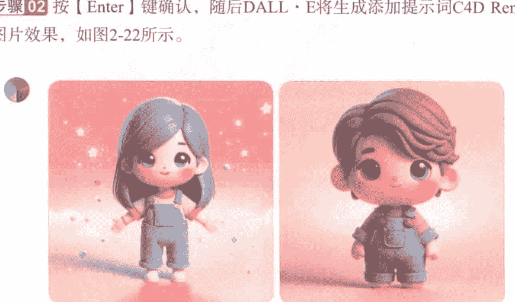

这里是两个3D效果的卡通人物形象，穿着背带裤，非常可爱梦幻。希望你喜欢！如果需要进一步调整或修改，请告诉我。

图2-22 DALL·E 依据描述生成的图片效果

> ★专家提醒★
C4D Renderer 指 Cinema 4D 的渲染引擎，是一款提供物理、标准、快速等多种渲染模式的三维制作软件，广泛应用于影视、广告与游戏等领域。

### 2.2.3 制作虚拟场景

【效果展示】Unreal Engine 擅长产出高品质三维画面。在 DALL·E 中加入该关键词，可在虚拟环境里构建多样场景，逼真度大幅提升，见图 2-23。


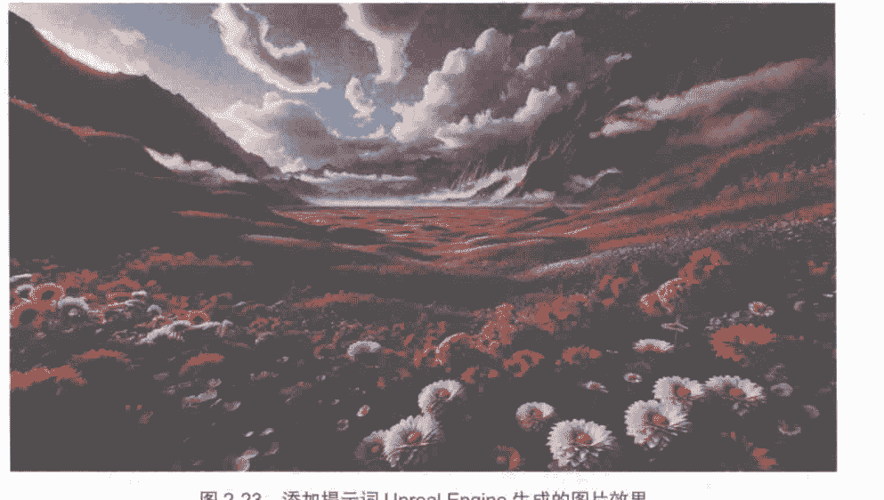

图 2-23 添加关键词 Unreal Engine 生成的图片效果

下面介绍生成虚幻场景的步骤。

**步骤 01** 在输入区填入描述，例如「广袤花海，超高清，风景，云，层次分明，色彩丰富，Unreal Engine」，如图 2-24 所示。


图 2-24 键入描述文字

**步骤 02** 发送后即可得到带 Unreal Engine 质感的图像，如图 2-25 所示。

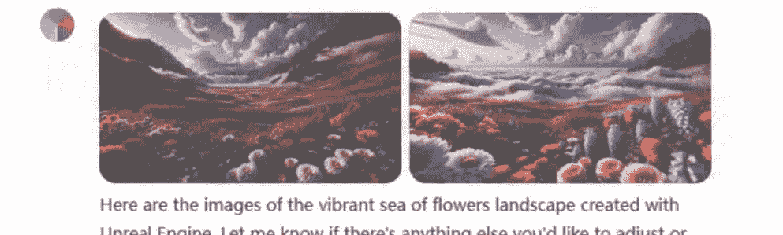

Here are the images of the vibrant sea of flowers landscape created with Unreal Engine. Let me know if there's anything else you'd like to adjust or add!

图 2-25 DALL·E 依据描述生成的图片效果

### 2.2.4 提升照片的艺术性

【效果展示】Quixel Megascans 收录大量真实世界的三维模型、材质与纹理，广泛用于游戏、影视与建筑可视化。生图时加入 Quixel Megascans Render 可增强真实感与艺术质感，效果见图 2-26。


图 2-26 添加关键词 Quixel Megascans Render 生成的图片效果

具体操作如下。

步骤 01 键入描述，例如「一位女性坐在图书馆里，真实的摄影照片，背面的拍摄角度，温柔安静，长发，蓝色长裙，温柔的阳光，细节清晰，Quixel Megascans Render」，如图 2-27 所示。


图 2-27 键入描述文字

> ★ 专家提醒 ★
Quixel Megascans Render 一般指基于 Megascans 素材进行渲染的流程。

步骤 02 确认发送后即可得到带该关键词的成图，效果见图 2-28。


这两张图片展示了一个女孩坐在图书馆里的温柔场景。阳光透过窗户洒进来，细腻地照亮了她和周围的书架。她有着长长的头发，穿着蓝色长裙，从背后看去，显得安静而沉静。

图 2-28 DALL·E 依据描述生成的图片效果

### 2.2.5 光线追踪效果

【效果展示】Ray Tracing 引擎能更精确模拟光线与物体的交互，带来更高真实感。加入该关键词可让 DALL·E 画面更自然、更写实，效果见图 2-29。

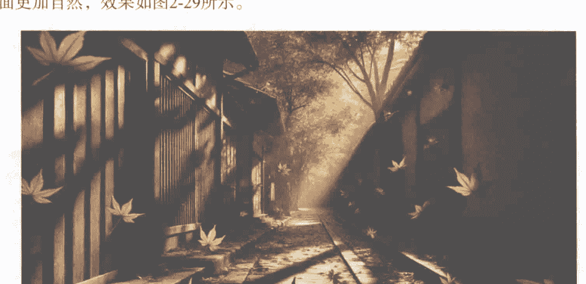

图 2-29 添加关键词 Ray Tracing 生成的图片效果

操作步骤如下。

步骤 01 在输入区填入描述，例如「一条安静的小巷，飘落着枫叶，自然光，专业拍摄，Ray Tracing」，如图 2-30 所示。


图 2-30 键入描述文字

步骤 02 确认发送后，带 Ray Tracing 的图像即生成，效果见图 2-31。

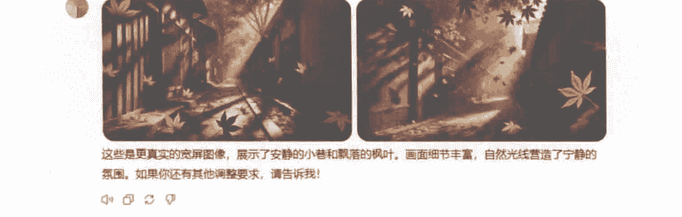

图 2-31 DALL·E 依据描述生成的图片效果

### 2.2.6 体积渲染效果

【效果展示】Volume Rendering 主要模拟三维空间中的物质形态，在科幻影视中常见。借助该技术，DALL·E 可产出高真实感画面，提升视觉美感，效果见图 2-32。


扫码看教学视频

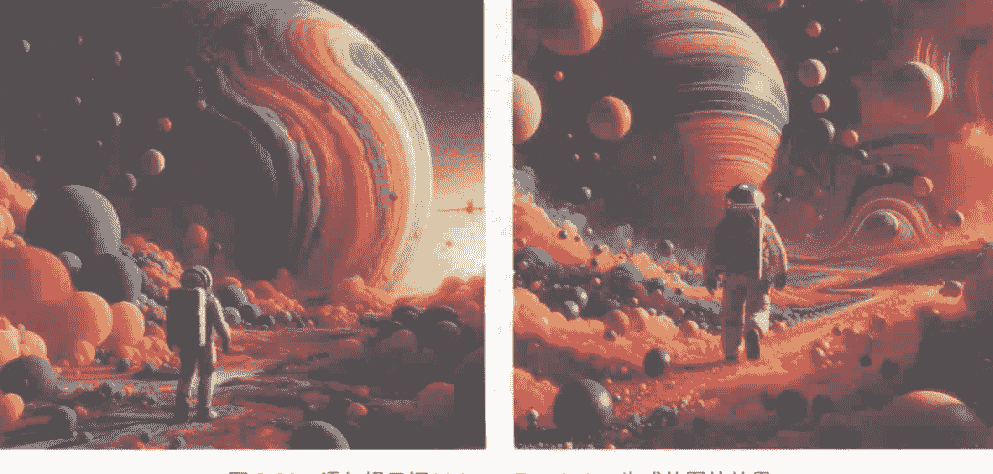

图 2-32 添加关键词 Volume Rendering 生成的图片效果

操作方法如下。

**步骤01** 在输入区键入描述，例如「一位身着太空服的人漫步在五颜六色的星球上，8K分辨率，轻弹，怪诞的梦境，Volume Rendering」，如图 2-33 所示。


图2-33 示例输入
第二步 按下回车后，系统依据携带 Volume Rendering 的指令完成合成，效果对照图2-34。

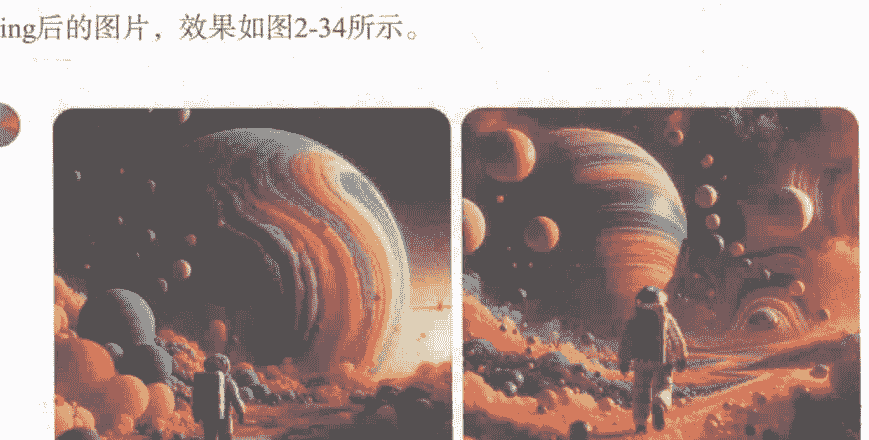

下方给出两张合成图，主体为太空服人物在彩色星球表面行走，整体呈现怪诞梦境氛围并带有体积表现。效果如预期。

图2-34 生成样例

> ★创作提示★
体积表现于DALL·E常用于塑造逼真烟雾、火焰、水体、云层。借助该关键词，模型可更细致捕捉物体内外产生的亮度、色彩层次与材质纹理。

### 2.2.7 光线投射效果
【效果演示】引入 Ray Casting 关键词，可更精准呈现空间与物体间的光线互动，也可在虚拟场景里调节光源、视角、景深，实现逐像素光照模拟，获得更写实画面，参见图2-35。

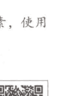

多工具组合：ChatGPT+DALL·E+Midjourney+SD+PS+剪映+可灵

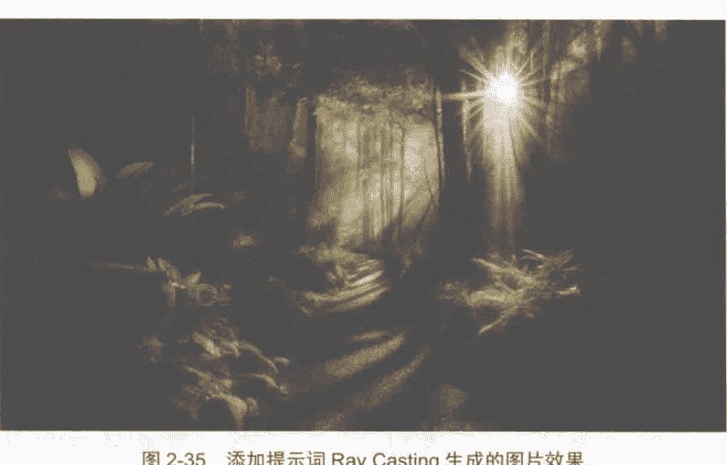

图 2-35 添加 Ray Casting 后的呈现

操作说明如下。

第一环节 打开DALL·E输入区，填写所需描述文字，示意见图2-36。

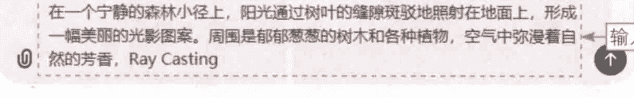

图 2-36 描述填写示意

第二环节 确认后按下回车，系统依据携带 Ray Casting 的描述生成画面，结果见图2-37。

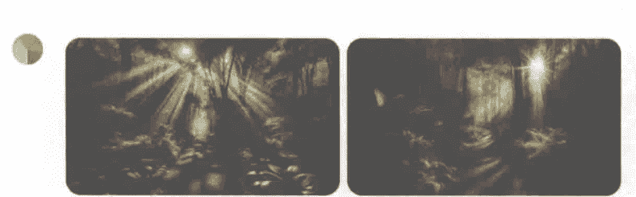

此次输出两张画面，展示宁静林间小径，阳光透过叶隙洒落地面形成斑驳光影，周边植被繁茂，空气弥漫自然清香。祝观感满意。

图 2-37 输出样例

48

### 2.2.8 物理渲染效果
【效果演示】Physically Based Rendering 能让模型更贴近真实世界光照逻辑、材质表现与表面反射规律，从而产出更具真实感的图像，如图2-38所示。


图 2-38 添加提示 Physically Based Rendering 后的呈现

★ 创作提示 ★
该渲染方式依赖物理模型计算光线传播与交互，可更精确还原不同光源、材质、着色器在现实中的表现。

使用方法演示。

第一环节 于DALL·E输入区填写描述，例如“一只精致水晶玻璃杯置于光滑木桌上，室内柔和阳光自窗户斜射，产生绚丽光谱反射与透明阴影，环境温馨宁静，Physically Based Rendering”，参考图2-39。

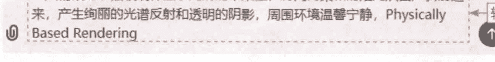

图 2-39 描述填写示意

第二环节 回车确认后，DALL·E产出加入 Physically Based Rendering 的图，结果如图2-40。

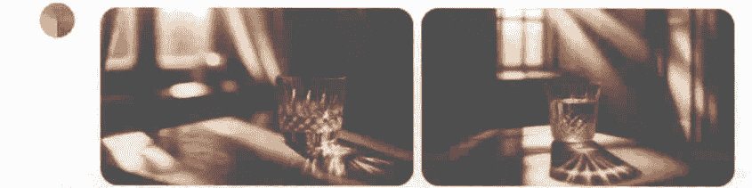

这两幅画面中，水晶玻璃杯于阳光下呈现绚丽光谱反射与透明阴影，整体环境温馨宁静。希望结果令你满意。

图 2-40 输出样例

## 2.3 DALL·E 实战案例

DALL·E 不仅能激发灵感，还可用于艺术插画、海报、工业设计、品牌标识等场景，帮助提升效率、降低成本并拓展创作边界。以下通过多个领域的实操演示流程。

### 2.3.1 生成风格油画
【效果演示】油画风格强调用色彩与构图传达作者情绪与个性，输入合适描述即可让DALL·E绘制对应效果，如图2-41。


图 2-41 油画风格插画样例

操作步骤如下。

第一环节 于DALL·E输入区填写描述，例如“生成油画风格插画：明亮星空背景、波光粼粼大海、远处帆船、星空下月亮。强调夜晚宁静神秘，突出星星与波浪细节”，效果参考图2-42。


图2-42 描述填写示意

第二环节 回车提交，DALL·E依据描述绘制油画风格插画，结果见图2-43。

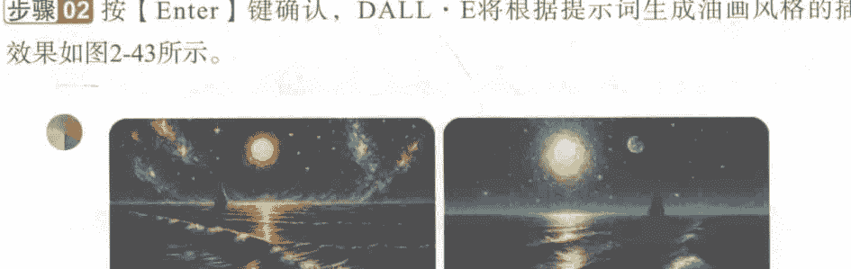

图2-43 油画风格插画样例

★创作提示★
DALL·E能依据文字描述产出具备油画特质的视觉作品。油画风格通常色彩饱满、层次分明、肌理感突出，多层颜料叠加与细腻笔触造就厚重、立体且富有艺术氛围的画面。

### 2.3.2 生成电影海报
【效果演示】电影海报是吸引观众注意、传递影片主题与情感基调的重要视觉载体。借助DALL·E可快速完成海报设计，示例如图2-44。

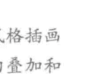

多工具组合：ChatGPT+DALL·E+Midjourney+SD+PS+剪映+可灵

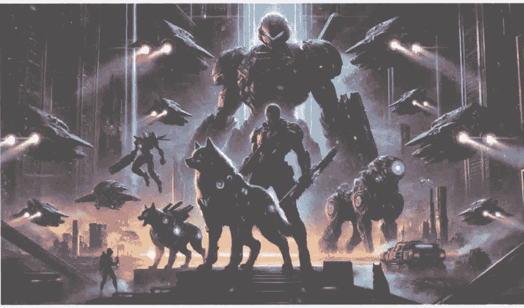

图 2-44 电影海报样例

具体操作如下。

第一环节 于DALL·E输入区输入“生成科幻题材电影海报”，示意见图2-45。


图 2-45 描述填写示意

第二环节 回车确认，系统产出对应海报，如图2-46。

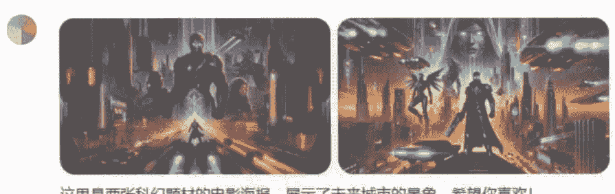

这里是两张科幻题材电影海报，展现未来城市景象。希望你喜欢。

图 2-46 电影海报样例

第三环节 接着于输入区续写“给海报加入主题，主题内容为‘战斗机械犬’，要求突出主题风格特点”，回车确认，DALL·E产出加入主题后的海报，如图2-47。

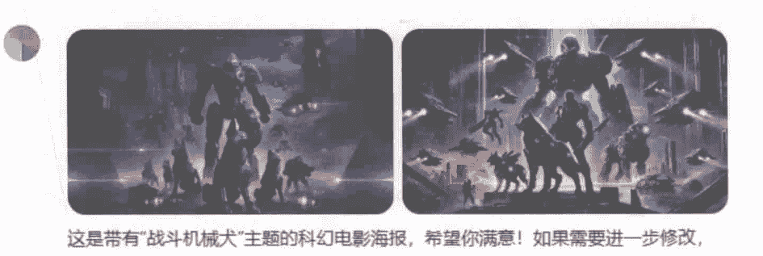

这是带有“战斗机械犬”主题的科幻电影海报，希望满意。如需进一步修改，请告知。

图 2-47 加入主题后的海报样例

### 2.3.3 生成美妆品牌LOGO
【效果演示】标识是品牌识别核心，智能创作助手能迅速给出多种设计方案，加速创作流程，效果如图2-48。


图 2-48 美妆品牌标识样例

操作流程如下。

第一环节 于ChatGPT输入区输入“请提供一段美妆品牌标识的图像生成提示，60字左右，要求突出品牌特点”，回车确认，ChatGPT给出可用绘画提示，具体问答如下。

多工具组合：ChatGPT+DALL·E+Midjourney+SD+PS+剪映+可灵

# 提问

> 请提供一段美妆品牌LOGO的AI绘画提示词，60字左右，要求突出品牌的特点。

# ChatGPT

> 请生成一个美妆品牌的LOGO，突出自然、优雅和现代感。使用柔和的色调，搭配精致的花卉元素和流畅的线条，体现高端、环保和可持续的品牌理念。

第二环节 将上述提示词复制到DALL·E输入区，如图2-49所示。


第三环节 回车确认，即可产出美妆品牌标识，效果如图2-50所示。


### 2.3.4 生成民俗节日插画
【效果演示】民俗节日插画用于呈现特定文化传统相关视觉元素，帮助庆祝并传播节日意义。DALL·E可快速完成此类创作，效果如图2-51。


图 2-51 民俗节日插画样例

操作步骤如下。

第一环节 向ChatGPT请求民俗节日插画的图像生成提示，问答示例如下。

> **提问**

请提供一段民俗节日插画的AI绘画提示词，60字左右。

> **ChatGPT**

明亮圆月高挂夜空，桂花树下摆放精美月饼与茶壶，月光洒在湖面，湖中倒映月亮，旁点缀莲花灯笼，营造宁静祥和节日氛围。

第二环节 将获取的提示词填入DALL·E，回车确认，系统产出民俗节日插画，结果如图2-52。


这里是两幅描绘中秋节美景的画面，希望喜欢。月光皎洁，桂花树下精美月饼与茶壶，湖面倒影与莲花灯笼，营造宁静祥和节日氛围。

图 2-52 民俗节日插画样例

### 2.3.5 生成台灯产品图片
【效果演示】产品设计涵盖想象、规划与实现，涉及材质、尺寸、色彩等细节。DALL·E可快速进行产品可视化，效果如图2-53。


图2-53 产品图片样例

操作流程如下。

第一环节 于ChatGPT输入区输入“产品设计中有哪些常见产品类型？”回车确认，可获取相关信息，示例如下。

> 提问

产品设计中有哪些常见的产品类型？

ChatGPT

+   在产品设计中，常见的产品类型包括以下几类。

1. 消费电子产品：
   - 智能手机、平板电脑、笔记本电脑、智能手表等。
   - 这些产品通常需要考虑用户界面设计、外观设计和功能设计。

2. 家用电器：
   - 电视、冰箱、洗衣机、微波炉等。
   - 设计时需要考虑用户体验、能效、外观和耐用性。

3. 软件产品：
   - 移动应用、桌面软件、云服务等。
   - 重点在于用户界面设计、用户体验、功能和安全性。

4. 汽车及交通工具：
   - 汽车、自行车、电动滑板车等。
   - 设计需要考虑人体工程学、安全性、性能和美观。

5. 医疗器械：
   - 医疗监测设备、手术工具、个人护理设备等。
   - 设计需高度注重安全性、功能性和用户舒适度。

6. 家具和家居用品：
   - 椅子、桌子、灯具、装饰品等。
   - 设计时要考虑美观性、舒适性和功能性。

7. 工业设备：
   - 工业机器人、机械设备、工具等。
   - 设计重点在于功能性、耐用性和易维护性。

每种产品类型在设计时都有特定的考虑因素和设计规范，设计师需要综合考虑用户需求、市场趋势、技术限制和生产成本等多方面因素。

第二环节 继续于ChatGPT中输入“请根据以上信息，提供一段台灯的图像生成提示示例，字数在80字左右”，回车确认，可生成对应提示词，示例如下。

> **提问**

请根据以上信息，提供一段台灯的AI绘画提示词示例，字数在80字左右。

> **ChatGPT**

设计一款现代台灯，风格简约时尚。灯体纤细，采用哑光金属材质，带有可调节灯臂用于定向照明。灯具使用暖色 LED 光源，底座上有触控控制面板。将台灯置于光线充足房间内干净白色桌上。

第三环节 将提示词粘贴到DALL·E输入区，回车确认，即可产出台灯产品图，效果如图2-54。

多工具组合：ChatGPT+DALL·E+Midjourney+SD+PS+剪映+可灵


这里是两款宽屏比例现代化台灯设计。如需调整或进一步修改，请随时告知。

图 2-54 台灯产品图片样例

### 2.3.6 生成建筑设计效果
【效果演示】建筑设计涉及功能、耐久性与环境互动，DALL·E可快速出图辅助方案推演，效果如图2-55。


图 2-55 建筑设计样例

操作步骤如下。

第一环节 向ChatGPT询问建筑设计类型，于输入区输入“有哪些类型的建筑设计？”回车确认，可获得分类信息，示例如下。

# 提问

有哪些类型的建筑设计？

# ChatGPT

建筑设计有很多种类型，主要包括以下几类。

1. 住宅建筑设计
   - 独立住宅：单户独立房屋。
   - 联排住宅：多户连排房屋。
   - 公寓建筑：多层、多户住宅楼。
   - 别墅：较为豪华的独立住宅。

2. 商业建筑设计
   - 办公楼：用于商业办公的建筑。
   - 商场和购物中心：包含多个商铺的综合商业建筑。
   - 酒店：提供住宿和其他服务的商业建筑。
   - 餐饮建筑：餐馆、咖啡馆等餐饮服务场所。

3. 公共建筑设计
   - 教育建筑：学校、大学等教育机构建筑。
   - 医疗建筑：医院、诊所等医疗机构建筑。
   - 文化建筑：博物馆、图书馆、剧院等文化设施。

4. 工业建筑设计
   - 工厂和制造厂：用于生产和制造的建筑。
   - 仓库：用于存储货物和物资的建筑。
   - 发电厂：用于生产能源的建筑。

5. 景观建筑设计
   - 公园和花园：城市和乡村中的绿地和休闲空间。
   - 纪念碑和雕塑：具有纪念意义和艺术价值的建筑和结构。

每种类型的建筑设计都有其独特要求和特点，设计师需要根据功能、使用者的需求和环境条件等因素进行设计。

第二环节 继续于ChatGPT中输入“请根据景观建筑设计的信息，提供一段公园的建筑设计图像生成提示示例，字数在80字左右”，回车确认，可得到景观提示词，示例如下。

# 提问

请根据景观建筑设计的信息，提供一段公园的建筑设计AI绘画提示词示例，字数在80字左右。

# ChatGPT

设计现代公园，包含广阔绿地、蜿蜒小径、丰富花卉与树木，设有喷泉、凉亭与木质长椅，包括健身区与小湖泊，整体氛围自然宁静。

第三环节 将提示词输入DALL·E，回车确认，即可产出景观建筑图，效果如图2-56。


这两幅现代公园设计展现广阔绿地、蜿蜒小径、丰富花卉与树木，设有喷泉、凉亭与木质长椅。公园还包括健身区与小湖泊，整体氛围自然宁静。希望喜欢这些设计。如有调整需求，请告知。

图 2-56 景观建筑设计样例


## 第 3 章 Midjourney 入门与实战

Midjourney 是一款基于人工智能的绘画创作工具，用户可通过文字、图片等提示与 AI 机器人交互，自动生成符合需求的图像。本章主要介绍 Midjourney 的基础操作与绘画技巧，帮助读者熟练掌握 AI 绘画。

## 3.1 Midjourney 快速上手

能否生成高质量图像，关键在于指令的输入。若想获得理想效果，需要大量训练模型并掌握艺术设计相关知识。本节将介绍 Midjourney 中常用的指令与操作，帮助快速上手。

### 3.1.1 常用指令

使用 Midjourney 进行图像生成时，用户可通过各种指令与 Discord 社区上的 Midjourney Bot 交互，告诉机器人想要的图像效果。Midjourney 指令主要用于创建图像、修改默认设置以及执行其他任务。


如表3-1所示为Midjourney中常用的图像生成指令。

Midjourney 指令全景速览与实战玩法，把官方手册里的硬核操作，翻译成新手也能立刻上手的手感笔记。

先把常用指令过一遍，记住这张清单，之后大部分场景都不用再翻文档。

表 3-1 Midjourney 里高频使用的指令一览

指令 /ask（问） —— 用来向机器人提问并拿到即时解答。
指令 /blend（混合） —— 把两张甚至多张图无缝融合出新图。
指令 /daily_theme（每日主题） —— 开关 #daily-theme 频道的更新推送。
指令 /docs（文档） —— 在官方 Discord 服务器里一键生成对应用户指南的链接。
指令 /describe（描述） —— 上传一张图后，自动产出 4 条可直接使用的提示词示例。
指令 /faq（常见问题） —— 在官方服务器里快速拉取热门提示词技巧频道的常见问答链接。
指令 /fast（快速） —— 切换到快速渲染模式。
指令 /help（帮助） —— 查看 Bot 的基础介绍和使用提示。
指令 /imagine（想象） —— 用文字提示词生成图片的核心指令。
指令 /info（信息） —— 查看个人账号状态及排队中或正在运行的任务。
指令 /stealth（隐身） —— 专业版订阅用户可切到隐身模式。
指令 /public（公共） —— 专业版订阅用户可切到公开模式。
指令 /subscribe（订阅） —— 为账号页面生成专属链接。
指令 /settings（设置） —— 查看并调整 Bot 的各项设置。
指令 /prefer option（偏好选项） —— 新建或管理自定义偏好。
指令 /prefer option list（偏好选项列表） —— 查看当前生效的自定义偏好。
指令 /prefer suffix（喜欢后缀） —— 为每条提示词统一加上结尾后缀。
指令 /show（展示） —— 通过图像任务 ID 在 Discord 重新调取作业。
指令 /relax（放松） —— 切换到放松渲染模式。
指令 /remix（混音） —— 切换到混音模式。

### 3.1.2 以文生图

【效果展示】Midjourney 的绘画核心就是 /imagine 加上精心撰写的提示词，官方更建议使用英文输入。模型对大小写不敏感，但多个关键词之间要用英文逗号或空格隔开即可。 

下面用一套最清晰的动手流程说明文生图是怎么跑起来的。

步骤 01 在频道底部输入框敲下 /，从弹出菜单里点选 imagine 指令，如图3-2所示。 

**步骤02** 在 imagine 后的 prompt 框里填入你想要的描述词，如图3-3所示。 
图3-3 输入相应的提示词

**步骤03** 按回车确认，Bot 立刻开始工作并实时显示生成进度，如图3-4所示。等待片刻后会一次性给出 4 张初稿。

**步骤04** 点一下 V1 按钮，如图3-5所示。V 系列按钮的作用是以当前选中的画面风格为基准，再产出 4 张同类变体，每张从左到右对应 1、2、3、4 号。 


图3-4 显示图片的生成进度

图3-5 单击V1按钮

**步骤05** 执行后系统会以第 1 张为模板重绘 4 张新图。若都不满意，可点 🔄 重做按钮，如图3-6所示。 

**步骤06** 触发重做后，Midjourney 会基于原提示词再来一轮生成，如图3-7所示。

**步骤07** 从 4 张里挑出最喜欢的一张，例如第 2 张，点击 U2 按钮，如图3-8所示。

**步骤08** 执行后 Bot 会对第 2 张进行精细刻画并放大，得到大图，效果如图3-9所示。 


图 3-6 单击重做按钮

图 3-7 重新生成图片


图 3-8 单击 U2 按钮

图 3-9 放大图片

步骤 09 在大图下方可以点 Vary Subtle 产出变化很小的 4 张微调版本，或点 Vary Strong 产出差异更大的 4 张版本，如图3-10所示。 

图 3-10 重新生成变化较小和变化较大的图片

# ★ 专家提醒 ★

U 按钮就是放大细节的入口。4 张缩略图里只要对哪张满意，就用 U1～U4 选中并生成高清大图。

### 3.1.3 以图生文与以图生图

【效果展示】在 Midjourney 里先用 describe 指令上传原图，Bot 会反推出 4 条描述性提示词，这就是以图生文。把这些提示词配合原图链接再生成新图，就是以图生图，也常被称为垫图，效果如图3-11所示。 

图3-11 效果展示

下面是具体操作路径。

步骤 01 在输入框敲 /，从列表里选择 describe 指令，如图3-12所示。 

图3-12 选择 describe 指令

步骤 02 弹出选项后点选 image，如图3-13所示。 

图 3-13 选择 image 选项

步骤 03 随后出现上传面板，可以拖拽图片进去或点上传按钮，这里演示点上传，如图3-14所示。

步骤 04 弹出“打开”对话框，定位到本地图片后点“打开”，如图3-15所示。 


图 3-14 单击上传按钮

图 3-15 单击“打开”按钮

步骤 05 上传成功后按回车，Midjourney 会给出 4 段基于原图的提示词，如图3-16所示。可直接复制使用，或点底部的 1～4 按钮以原图为参考再生成。

步骤 06 点开下方的缩略图，在预览下方点“复制垫图网址（自动加逗号）”按钮，如图3-17所示，完成链接复制。

步骤 07 在图下方点 1 按钮，弹出 Imagine This! 对话框，在 PROMPT 文本框的提示词前粘贴刚才复制的图片链接，如图3-17所示。注意链接与提示词之间留一个空格。 


步骤 08 点提交，即可以参考图为基准生成 4 张新图，如图3-19所示，点击 U1 放大第 1 张，就得到最终效果。 

图 3-19 生成 4 张图片

### 3.1.4 混合生图

【效果展示】blend 指令支持一次性上传 2~5 张素材，系统会提炼各自特点后合成一张全新画面，效果如图3-20所示。 

图 3-20 效果展示

操作步骤如下。

步骤01 在输入框输入 /，从菜单里挑选 blend 指令，如图3-21所示。 

图 3-21 选择 blend 指令

步骤 02 进入后会出现两个图框，点左侧上传按钮，如图3-22所示。 

图 3-22 单击上传按钮

步骤 03 弹出“打开”对话框，选择一张素材后点“打开”，如图3-23所示。

步骤 04 成功上传后用相同方式再传第二张，如图3-24所示。

步骤 05 都上传完后按回车，Midjourney 会自动混合并给出 4 张结果，如图3-25所示。 


图 3-23 单击“打开”按钮

图 3-24 上传两张图片


图 3-25 生成 4 张新的图片

步骤 06 点 U1 放大第一张即可得到最终成品。

## 3.2 Midjourney 核心使用

掌握几个进阶技巧，能让画面质量和可控度大幅提升。

### 3.2.1 混音模式

【效果展示】开启 Remix mode 后可以在生成后阶段修改提示词、参数、模型版本或宽高比，让创作过程更灵活，案例效果如图3-26所示。 

图3-26 效果展示

具体做法：

步骤01 在输入框敲 /，从列表里选 settings 指令，如图3-27所示。 

图3-27 选择 settings 指令

步骤02 回车打开设置面板，下面把面板内容做了中文对照，如图3-28所示。注意直译有时不够准确，多练几次更熟。

步骤03 点一下 Remix mode 按钮，如图3-29所示，按钮变绿即表示已开启。

步骤 04 通过 imagine 输入提示词 “A bicycle was photographed in the city background, with a bright red color, bold curves, and the edge of the city（大意为：拍摄了一辆城市背景中的自行车，颜色鲜艳，曲线大胆，城市边缘）”，得到如图3-30所示的效果。 


步骤 05 点 V4 按钮，弹出 Remix Prompt 对话框，如图3-31所示。 


步骤 06 适度改写提示词，例如把 bicycle 改成 motorcycle，如图3-32所示。

步骤 07 点提交，画面中的自行车就会被替换为摩托车，效果如图3-33所示。 


图 3-32 修改提示词

图 3-33 重新生成相应的图片效果

### 3.2.2 一键换脸

【效果展示】InsightFaceSwap 是 Discord 官方的人像插件，能精准替换人脸而不影响背景与构图，案例效果如图3-34所示。 

图 3-34 效果展示

协同 Midjourney 使用的流程：

步骤 01 在输入框敲 /，从左侧插件区点选 InsightFaceSwap 图标，如图3-35所示。

步骤 02 在列表里选择 saveid（保存 ID）指令，如图3-36所示。 


步骤 03 输入 idname（身份名称），如图3-37所示。名称限制 8 位以内英文或数字。

步骤 04 点上传按钮，上传一张面部清晰的人物照，如图3-38所示。 


步骤 05 回车确认，idname 创建成功，如图3-39所示。

步骤 06 接下来用 imagine 生成一张人物肖像并放大其中一张，效果如图3-40所示。

步骤 07 在图片上右键，选择 App | INSwapper（替换目标图像的面部）命令，如图3-41所示。

AI全能应用七合一：ChatGPT+DALL·E+Midjourney+SD+PS+剪映+可灵


图 3-39 创建 idname

图 3-40 放大图片

**步骤 08** 执行后人物面部即被替换，效果如图3-42所示。

**步骤 09** 也可以直接在输入框敲 /，从列表里选择 swapid（换脸）指令，如图3-43所示。 


图 3-41 选择 INSwapper 选项

图 3-42 替换人物面部效果

**步骤 10** 执行后输入已创建的 idname，并上传想换脸的底图，如图3-44所示。 


图3-43 选择 swapid 指令

图3-44 上传想要替换人脸的底图

第3章 Midjourney入门与实战


★专家提醒★

使用 InsightFaceSwap 需先邀请 InsightFaceSwap Bot 加入自己的服务器，邀请链接可通过搜索引擎获取。

另外可用 /listid 列出现有 idname，/delid 删除指定 idname，/delall 清空全部 idname。

步骤11 回车后机器人会自动调用已保存的脸部替换底图，效果如图3-45所示。 

图3-45 替换人脸效果

### 3.2.3 种子换图

【效果展示】每张 Midjourney 图片都会随机生成一个种子值，也能用 --seed 参数手动指定。相同种子配合相同提示词可以复现一致的风格，便于制作连贯的人物或场景，案例效果如图3-46所示。 

下面介绍用种子值操控画面的一步：

步骤 01 在 Midjourney 中生成图片后，点消息上方的“添加反应”按钮，如图3-47所示。 

第2步 前置操作完成后，界面会弹出响应面板，参考图3-48。

第3步 在搜索框里键入 envelope 即信封，再从搜索结果中点选信封图标，位置见图3-49。


图 3-48 “反应”面板

图 3-49 单击信封图标

第4步 此时 Midjourney 机器人会给用户推送一条私信，点击底部的机器人私信入口即可打开查看，如图3-50所示。


第5步 进入私信后能看到机器人回复的作业编号 Job ID 以及对应的图像种子值，展示见图3-51。

图 3-50 单击 Midjourney Bot 私信图标

第6步 使用 imagine 命令，在提示词尾部加上 --seed 随后填入刚才获取的种子数值，再次出图，效果见图3-52。


图 3-51 Midjourney Bot 发送的种子值

图 3-52 生成新的图片效果

第7步 按下 U1 放大第一张画面，即可得到最终成片。

AI 全能组合：ChatGPT、DALL·E、Midjourney、SD、PS、剪映、可灵

### ★ 专家提醒 ★

Midjourney 绘图时先出现模糊噪点再逐渐清晰，这个初始噪点的来源就是 seed，模型据此构建视觉噪声场作为首张图像的起点。

### 3.2.4 添加标签

【效果展示】在 Midjourney 绘画时，可用 prefer option set 把常用提示词收进一个标签，后续作图就无需重复输入，相关案例效果见图3-53。


下面说明 prefer option set 的使用流程。

第1步 在 Midjourney 输入区敲下 /，从弹出的列表里选择 prefer option set，如图3-54所示。

第2步 执行后在 option 文本框中写入期望的标签名称，如图3-55所示。


第3步 点按输入区右侧的“增加1”按钮，在上方“选项”下拉列表中选择 value，即参数值，如图3-56所示。


图 3-56 选择 value 选项

第4步 随后在 value 输入框中填写需要固化的提示词，如图3-57所示。注意，这里填写的内容即为希望固定的指令。


图 3-57 输入相应的提示词

第5步 回车确认后，即可把上述提示词存入 Midjourney 服务器，如图3-58所示，从而为这些提示词打上统一标签，标签名为 XXX2。


图 3-58 储存提示词并添加标签

第6步 用 imagine 命令输入对应提示词，并在其后加上刚才存储的标签指令，即调用该标签提示词，如图3-59所示。


图 3-59 调用标签提示词

第7步 确认回车后即可生成画面，效果见图3-60，可见 Midjourney 作图时会自行加上标签中的提示词。

AI 全能组合：ChatGPT、DALL·E、Midjourney、Stable Diffusion、Photoshop、剪映、可灵


图 3-60 生成相应的图片

第8步 点按 U2 放大第二张图片，便可得到最终效果。

### 3.2.5 平移扩图

【效果展示】平移扩图可在原图之外延伸场景，通过点按上、下、左、右箭头来决定扩展方向，相关案例效果见图3-61。


图 3-61 效果展示

下面介绍平移扩图的操作方式。

第1步 先用 imagine 生成一组图像并放大其中一张，随后点按下方左箭头按钮⬅，如图3-62所示。

第2步 执行后 Midjourney 会在原图基础上向左侧进行平移扩图，效果见图3-63。


图 3-62 单击左箭头按钮

图 3-63 向左平移扩图

第3步 再选一张图像放大后，点击下方右箭头按钮➡，Midjourney 将在原图基础上向右侧扩图，如图3-64所示。


图 3-64 向右平移扩图

第4步 操作完成后，选择第4张图片放大即可得到最终成片。

### 3.2.6 无限缩放

【效果展示】Zoom out 缩小功能可将镜头拉远，让画面覆盖范围更大，周边细节得以生成，案例效果见图3-65。


扫码看教学视频

AI 全能组合：ChatGPT、DALL·E、Midjourney、Stable Diffusion、Photoshop、剪映、可灵


下面介绍无限缩放的用法。

第1步 用 imagine 生成一组图像后，选择其一放大，在画面下方点击 Zoom Out 2x，即缩小到原来一半大小的按钮，如图3-66所示。


第2步 随后 Midjourney 会在原图基础上生成 4 张画面缩放至两倍大小的效果图，挑选其中一张放大，效果见图3-67。


图 3-67 画面缩放两倍的效果

第3步 用同样方法继续缩放，如图3-68所示为画面缩放 4 倍与 6 倍的效果。


图 3-68 将画面缩放 4 倍效果和 6 倍效果

## 3.3 Midjourney 实战案例

Midjourney 既能为艺术家提供灵感，也可用于风光摄影、插画设计、人像摄影等领域，提升工作效率并降低成本，拓展创作可能。本节通过实战案例帮助读者更熟悉 AI 绘画。

### 3.3.1 生成专业摄影照片

【效果展示】专业摄影照通常具备高质量、艺术性与技术性，多为商业、艺术或个人需求而拍。本案例采用对称构图生成专业摄影照，效果见图3-69。


图 3-69 效果展示

下面介绍生成专业摄影照片的操作方法。

第1步 在 Midjourney 中通过 imagine 输入主体描述并加上尺寸参数，例如“Night, Bridge, Take Photos，意为夜晚、桥梁、拍摄照片 --ar 4:3”，如图3-70所示。


图 3-70 输入相应的提示词

第2步 回车确认后生成图像，效果见图3-71。


图 3-71 生成相应的图片效果

第3步 为照片增加细节，在前例基础上追加“Starry sky, reflection, moon, light and shadow effects，意为星空、倒影、月亮、光影效果”，使画面更丰富，生成效果见图3-72。


Night, Bridge, Take Photos, Starry sky, reflection, moon, light and shadow effects --ar 4:3

图 3-72 生成添加画面细节后的图片效果

第4步 采用广角镜头优化画面并改用对称构图，通过 imagine 输入相应提示词，效果见图3-73，主要是在上一步基础上增加了“panoramic lens, Symmetrical composition，意为全景镜头、对称构图”。

AI 全能组合：ChatGPT、DALL·E、Midjourney、Stable Diffusion、Photoshop、剪映、可灵


Night, Bridge, Take Photos, Starry sky, reflection, moon, light and shadow effects, panoramic lens, Symmetrical composition --ar 4:3

图 3-73 生成添加镜头类型和构图方式的图片效果

第5步 挑选合适的一张放大即可获得最终效果。

### 3.3.2 生成粒子火花特效

【效果展示】粒子特效可模拟火焰、烟雾、水滴、火花、爆炸碎片等在虚拟环境中的行为，效果见图3-74。


图 3-74 效果展示

下面介绍生成粒子火花特效的方法。

第1步 在 Midjourney 中通过 imagine 输入主体描述，例如“A dynamic scene characterized by vibrant particle sparks should manifest as tiny bright particles emitted from the center point，意为以充满活力的粒子火花为特征的动态场景，应表现为从中心点发射的微小明亮粒子”，生成效果见图3-75。


图 3-75 生成相应的图片

第2步 在上一步提示词基础上加上“Forest Scenes，意为森林场景”，并设置画面尺寸，以此为特效添加场景，生成效果见图3-76。


图 3-76 生成添加场景后的特效图片

第3步 选择满意的一张放大即可得到最终效果。

### 3.3.3 生成黑白风格插画

【效果展示】黑白风格插画以黑白为主色调，通过强烈对比吸引注意力，能更简洁纯粹地表达主题与情感，案例效果见图3-77。


下面介绍生成黑白风格插画的操作。

第1步 在 Midjourney 中通过 imagine 输入合适提示词，例如“White and black, color removal effect, architecture, photography, high-resolution, surrealist style，意为白色和黑色、去色效果、建筑、摄影、高分辨率、超现实主义风格 --ar 4:3”，如图3-78所示。


第2步 回车确认后，Midjourney 会按提示生成黑白插画，效果见图3-79。


图 3-79 生成相应的图片

第3步 将画面改为对称构图，在上一步基础上追加“reflection, symmetrical composition，意为反射、对称构图”，生成效果见图3-80。


图 3-80 设置对称构图后生成的图片效果

第4步 挑选合适的一张放大即可获得最终效果。

### 3.3.4 生成小清新风格的艺术肖像

【效果展示】人像摄影涵盖肖像、时尚、家庭、职业头像、纪实与艺术肖像等多种风格。本例介绍制作小清新艺术肖像的流程，效果见图3-81，让读者对 AI 绘画有新认识。


图 3-81 效果展示

下面介绍生成小清新艺术肖像的方法。

第1步 在 Midjourney 中通过 imagine 输入提示词，例如“A girl wearing a white shirt, photo shoots, denim decorations, grassland background，意为穿着白衬衫的女孩、摄影照片、牛仔装饰、草原背景 --ar 4:3”，回车确认，生成效果见图3-82。


图 3-82 生成相应的图片效果

第2步 在上一步基础上增加光线描述，如“Diffused Lighting，意为散射光”，使光线更均匀柔和，生成效果见图3-83。


A girl wearing a white shirt, photo shoots, denim decorations, grassland background, Diffused Lighting --ar 4:3

图 3-83 设置光线角度后生成的图片效果

第3步 随后为画面设定摄影风格，在上一步基础上追加“Documentary，意为纪实摄影”，生成效果见图3-84。


A girl wearing a white shirt, photo shoots, denim decorations, grassland background, Diffused Lighting, Documentary --ar 4:3

图 3-84 设置摄影风格后生成的图片效果

第4步 选择合适的一张放大即可得到最终效果。

### 3.3.5 生成日用品包装设计

【效果展示】日用品包装旨在保护产品、方便运输存储、吸引消费者并提供信息。本案例以 Midjourney 生成简约风格纸巾盒包装，效果见图3-85。


下面介绍生成日用品包装设计的操作。

第1步 在 Midjourney 中通过 imagine 输入提示词，例如“Daily necessities packaging box, tissue box physical model, simple form, ultra-high definition image, open design, smooth surface，意为日用品包装盒、纸巾盒物理模型、形式简单、超高清图像、开放式、表面光滑 --ar 4:3”，生成的图片效果见图3-86。


```
Daily necessities packaging box, tissue box physical model, simple form, ultra-high definition image, open design, smooth surface --ar 4:3
```

**步骤 02** 想让画面重点更突出，给色彩做一点点调整就够了。在上一轮指令的末尾补上“The style of light indigo and green, 32K ultra high definition（大致意思为浅靛蓝加绿色的视觉风格，32K 超清）”，产生的画面可参见图3-87。


图 3-87 调色后的生成样张

**步骤 03** 从多张候选中挑选合适的一张放大，就能得到最终成片。

### ★ 专家提醒 ★

日常用品的包装通常追求简明扼要，简洁的呈现方式可以迅速把品类、成分与使用方法传递给消费者。针对不同客群和市场需求，包装也在不断求新求变，各品牌会借助不同的造型、纹样与配色来凸显产品特点与品牌调性。


# 第 4 章 Stable Diffusion 初识与实战演练

Stable Diffusion 如今是极为火热的文转图工具，对初学者而言学习曲线并不平缓。本章整理了一些快速起步的关键点和具体案例，帮助大家认识 SD 并熟悉其基础能力。

## 4.1 Stable Diffusion 快速起步

SD，即 Stable Diffusion，是一款开源的深度学习图像合成模型，能够依据任意文字描述产出高质、高分辩率且逼真的画面。该模型在代码、数据与参数层面均开放，体量适中，普通显卡即可运行并做精细微调。

本节介绍 SD 的基本使用方式，助你迅速上手并发挥这款 AI 绘画工具的潜力。

### 4.1.1 网页版 Stable Diffusion 的使用

SD 的魅力在于把文字描述转化为生动逼真的画面。网页版绘图平台的出现，让创作免去繁琐的安装配置，一键即可进入 AI 绘画的世界。


例如 LiblibAI 就是一个备受欢迎的 AI 绘画站点，底层采用 Stable Diffusion 扩散模型，能够依据用户输入的描述词迅速产出匹配度很高的高质量图像，效果如图4-1 所示。


下面说明网页版 Stable Diffusion 的具体操作流程。

**步骤 01** 打开 LiblibAI 主页，点按左侧的“在线生图”入口，如图4-2 所示。


**步骤 02** 进入“文生图”页面后，在 CHECKPOINT 大模型下拉框里挑选一个基础算法模型，如图4-3 所示。


**步骤 03** 在“描述词”与“负向描述词（也称排除词或反向词）”文本框中填入对应说明，如图4-4 所示。精心撰写的描述词能引导模型理解意图，产出更符合预期的结果。


图 4-4 描述词输入界面

**步骤 04** 页面下方把“采样策略 Sampler method”设为 DPM++ 2M Karras、“迭代次数 Sampling Steps”设为 30、“宽度 Width”设为 512、“高度 Height”设为 768，可让 AI 产出更精细高分辩率的画面。点按“执行绘制”即可得到结果，效果如图4-5 所示。


图 4-5 生成图像的示例效果

### 4.1.2 下载 LoRA 模型

在 LiblibAI 中还能下载更多模型来提升绘画表现。如图4-6 所示的“模型广场”里，可通过标签筛选所需模型后下载。


下面介绍 LoRA 模型的下载方法。

**步骤 01** 在模型广场右侧点开“全部类型”下拉按钮，选择 LoRA，即可把范围限定在 LoRA 模型类别，如图4-7 所示。


**步骤 02** 根据缩略图挑选合适的 LoRA 模型，进入详情页后点按右侧的“下载”按钮，如图4-8 所示。


图 4-8 点按下载按钮

**步骤 03** 弹出“另存为”对话框，选择合适的保存路径后点“保存”，即可完成 LoRA 模型的下载，如图4-9 所示。


图 4-9 点按保存按钮

## 4.2 Stable Diffusion 核心技巧

SD 凭借创新的图像合成能力重塑数字艺术。集成 LoRA 模型可实现合成过程的精细调控，丰富细节表现；ControlNet 插件的加入则进一步拓展创作自由度。本节探讨两者如何协同释放 SD 潜力。

### 4.2.1 使用 LoRA 模型

【效果展示】LoRA 是一种为模型微调而设计的深度学习神经网络结构，下面以 4.1.1 的效果为基础，追加一个专用 LoRA 增强包装呈现，如图4-10 所示。


图 4-10 效果展示

使用 LoRA 的具体操作方法如下。

**步骤 01** 切换到“模型”选项卡，选择 LoRA 分类并载入对应模型，如图4-11 所示，该模型专用于产品场景图绘制。


图 4-11 选择对应的 LoRA 模型

**步骤 02** 切换到“绘图”选项卡，勾选“高分辨率修复”，把“放大算法”设为 R-ESRGAN_4x+，用于放大生成图像，如图4-12 所示。

**步骤 03** 点按“执行绘制”，可在两倍放大输出的同时让瓶中水元素更突出，效果如图4-13 所示。


### 4.2.2 使用 ControlNet 插件

【效果展示】ControlNet 是图像合成模型的附加控制工具，能对合成过程做更细致把控。例如选用 ControlNet 中的 Depth 控制类型，可有效掌控光影关系，提升视觉效果，如图4-14 所示。


使用 ControlNet 的具体步骤如下。

**步骤 01** 展开 ControlNet 区域，上传原图并勾选“启用”“完美像素”“允许预览”，系统会自动匹配预处理器分辩率并预览处理结果，如图4-15 所示。

**步骤 02** 在 ControlNet 区域下方选中“Depth（深度图）”单选按钮，并选择“depth_zoe（ZoE 深度估计）”预处理器和对应模型，如图4-16 所示，该模型能精准估算图像各像素的深度信息。


**步骤 03** 点按 Run preprocessor 运行预处理器，即可生成深度图并较好地还原场景景深关系，如图4-17 所示。


**步骤 04** 点按“执行绘制”即可产出结果，可借助 Depth 控制物体阴影投射方式、光线方向及景深关系。

## 4.3 Stable Diffusion 实战案例

【效果展示】SD 借助先进算法可帮助设计师产出优秀作品。本节以网页版 SD 设计中式风格服装画为例，效果如图4-18 所示。


图 4-18 效果展示

### 4.3.1 使用正向描述词绘制画面内容

SD 中的正向描述词是指能引导模型生成符合需求图像的说明性语句，可涵盖全部画面信息。下面以服装效果图为例说明操作。


**步骤 01** 进入“文生图”页面，选择一个写实风格大模型，输入正向描述词说明画面主体，如图4-19 所示。


图 4-19 输入正向描述词

**步骤 02** 页面下方把采样策略设为 DPM++ 2M Karras、迭代次数设为 33、宽度 512、高度 768，并勾选“面部修复”以提升质量与分辩率，点按“执行绘制”即可得到结果，效果如图4-20 所示。


图 4-20 生成图像示例

### ★专家提醒★

正向描述词可以加入多种提升质量的词，如 masterpiece、best quality 等，可依据需求定制，帮助模型产出更高质量的图像。

### 4.3.2 使用负向描述词优化出图效果

即便开启面部修复并提高迭代次数，上例仍会出现脸部、手部不自然等瑕疵，此时可用负向描述词优化，具体操作如下。

**步骤 01** 在“文生图”页面的“负向描述词”文本框中填入不希望出现的特征，如图4-21 所示。负向描述词能让 SD 更精准地满足需求，避免生成冗余内容。


**步骤 02** 保持其他参数不变，点按“执行绘制”，在符合描述词说明的同时，画面质量会有所提升，人物细节更清晰完整，效果如图4-22 所示。


### ★ 专家提醒 ★

负向描述词用于描述不希望出现在生成图像中的特征或元素，可帮助模型排除特定内容，使结果更贴合需求。需要注意的是，负向描述词会带来一定限制，需根据具体情况权衡调整。

### 4.3.3 添加 LoRA 模型绘制服装

生成礼服图像时，可尝试结合不同 LoRA 模型探索更具创意的方案，操作如下。


**步骤 01** 切换至“模型”选项卡，选择 LoRA 并载入对应模型，如图4-23 所示，该模型专用于服装绘制。


**步骤 02** 再追加一个改变人物风格的 LoRA 模型，并把权重设为 0.70，使人物形象更生动逼真，如图4-24 所示。


步骤 03 切换至“绘图”选项卡，勾选“高分辨率修复”，设置放大算法为 R-ESRGAN_4x+、重绘幅度为 0.25，用于放大生成图像，点按“执行绘制”。AI 既能把文化特色融入服装设计，又能赋予人物独特气质，效果如图4-25 所示。


图 4-25 生成图像效果


## 第 5 章 Photoshop AI 入门与实战

Photoshop 是功能强大的图像处理软件，修图与设计是其核心。随着 Photoshop 2024 的发布，软件集成了更多 AI 功能，其中最突出的是生成式填充。本章重点讲解 AI 生成式填充的实操技巧。

## 5.1 Photoshop AI 快速上手

在正式学习前，先了解 Photoshop AI 的基本概念，包括其含义、AI 带来的影响以及典型应用场景，为后续学习打基础。

### 5.1.1 什么是 Photoshop AI

Photoshop AI 指 Photoshop 中嵌入的人工智能技术，如生成式填充、移除工具及 Neural Filters 滤镜等，用户可借助这些技术创作艺术作品。它涵盖计算机视觉、深度学习、生成对抗网络 GAN 等技术。Photoshop 可学习艺术风格，并据此帮助用户创造全新作品。

【效果展示】Photoshop AI 绘画本质是在原图基础上绘制新内容，产生更有趣的画面，同时做智能化修图，通过去除不需要元素、添加虚构元素并提升整体美感，呈现更具创意与艺术性的效果。如图5-1 所示为使用生成式填充更换人物服装的案例，描述词为“紫色的裙子”。


AI 多工具合集：ChatGPT+DALL·E+Midjourney+SD+PS+剪映+可灵

> ★ 专家提醒 ★

Photoshop AI 绘画是利用人工智能技术进行图像生成的数字艺术形式，通过计算机算法和模型模拟人类艺术家创作行为，自动生成肖像、风景、抽象画等。它具有快速、高效、自动化等特点，核心在于利用人工智能技术处理和创作图像，实现艺术风格融合与变换，提升绘画创作体验。

### 5.1.2 AI 对 Photoshop 的影响

【效果展示】Photoshop 的图像处理经历了“调照片”“修照片”阶段，如今在人工智能影响下进入“想照片”新阶段。例如，用户可想象“海边风光”场景，利用生成式填充即可将其变为真实照片，如图5-2 所示。


图5-2 根据想象场景生成的照片

在这个阶段，人工智能可自主识别拍摄场景并自动化调整生成照片；后期制作中，AI 能智能分析与处理图像，进一步提升表现力。借助智能识别，图像处理更具多样性。因此，在人工智能持续推动下，“想照片”的 AI 模式正成为新的艺术潮流。

> ★专家提醒★

近年来AI技术正深度渗透进日常与生产环节，图像处理正是受益最明显的赛道之一。随着算法成熟，AI驱动的图像处理在速度、真实度与个性化调控上远超传统手段，作品质量和交付效率同步提升，用户体验也随之改写。

### 5.1.3 了解Photoshop AI的应用场景

Photoshop AI正获得持续关注与研究投入，其绘画能力已被投用到摄影创作、电商陈列、广告设计、影视制作、游戏美术、教学演示等多个方向。在这些场景里，AI绘画可显著加快产出节奏并拉升艺术表现水准。整体来看，Photoshop AI对诸多产业的渗透影响将愈加深远。

【效果展示】借助Photoshop AI能快速合成电商主图，如图5-3所示，使用的描述词为“血珀色红玛瑙手链细节图”。


图5-3 生成电商产品主图

> ★专家提醒★

AI绘画可用来在设计前期生成虚拟样稿，让设计师更直观地预览呈现效果并及时收集反馈进行迭代。

AI全能应用七合一：ChatGPT+DALL·E+Midjourney+SD+PS+剪映+可灵

### 5.1.4 掌握Photoshop AI创成式填充功能

创成式填充本质上是AI绘画在位编辑的体现，它既能基于现有画面绘制新内容，也能对画布进行扩展补充，同时兼具智能修图能力。下面通过案例帮助读者熟练掌握该功能的使用逻辑。

#### 1. 移除画面中不需要的内容

【效果展示】Photoshop的创成式填充可以一键抹除画面里的杂物或任何干扰元素，通过AI重绘被框选区域来完成补全，其自然度明显优于旧有的“内容识别”或“相似取样”，原图与处理后对比见图5-4。


扫码看教学视频


图 5-4 原图与效果图对比

操作流程如下。

步骤 01 执行“文件”|“打开”调入素材，工具栏选用套索工具，如图5-5所示。

步骤 02 以套索工具在不需要保留的元素边缘按住左键拖曳，勾勒出目标区域，如图5-6所示。


图 5-5 选取套索工具


图 5-6 框住画面中的相应元素

> ★ 专家提醒 ★

套索工具用于手工绘制不规则选区，可在选区内执行编辑、移动、删除等操作。操作时按住左键描边即可精细控制选区范围。

步骤 03 松开鼠标即生成不规则选区，在下方浮动工具栏点击“创成式填充”按钮，如图5-7所示。

步骤 04 在浮动工具栏中点按“生成”按钮，如图5-8所示，等待片刻即可完成选区内容的AI填充与移除。


#### 2. 在风光照片中生成动物元素

【效果展示】PS的创成式填充支持对局部区域进行AI绘画，只需对画面某处进行框选并输入文字描述，就能生成匹配的内容，原图与结果对比见图5-9。


AI全能应用七合一：ChatGPT+DALL·E+Midjourney+SD+PS+剪映+可灵

具体做法如下。

步骤01 通过“文件”|“打开”载入风光素材，用套索工具制作一个不规则选区，如图5-10所示。

步骤02 在底部浮动工具栏点击“创成式填充”按钮，并在左侧输入框写入提示词“老鹰”，如图5-11所示。


图5-10 创建不规则的选区

图5-11 输入提示词

步骤03 点击“生成”，即可得到对应效果，如图5-12所示。值得注意的是，即便提示词相同，每次生成的画面也会存在差异，可在生成图层的“属性”面板“变化”区切换不同版本。


图5-12 生成相应的图像效果

> ★专家提醒★

创成式填充依托先进的AI推理与图像识别，会从周边环境推断缺失内容并进行智能补全，让元素移除与破损修复更省时省力。

#### 3. 扩展室外场景的右侧区域

【效果展示】在PS中先放大画布后，使用创成式填充能够自动填补空白并与原图无缝衔接，原图与效果对比见图5-13。


操作要点如下。

步骤 01 用“文件”|“打开”调入素材，菜单栏选择“图像”|“画布大小”，如图5-14所示。

步骤 02 在弹出的“画布大小”对话框中选择定位方向，并把“宽度”设为1500像素，如图5-15所示。


步骤 03 点“确定”即可向右侧扩展画布，结果如图5-16所示。

AI全能应用七合一：ChatGPT+DALL·E+Midjourney+SD+PS+剪映+可灵

步骤 04 工具箱选用矩形选框工具，在右侧新增空白区建立矩形选区，如图5-17所示。


步骤 05 在下方浮动工具栏点击“创成式填充”按钮，如图5-18所示。

步骤 06 随后在浮动工具栏点击“生成”按钮，如图5-19所示。


步骤 07 等待片刻，空白区域会生成与原图风格一致且自然融合的内容。

## 5.2 Photoshop AI 核心使用

在图像修复与平面设计中，掌握PS常用AI修图手段是提升效率的关键。本节集中介绍几类AI修图方法，帮助实现更轻松的编辑与更强的视觉冲击。

### 5.2.1 使用“选择主体”功能更换背景

【效果展示】“选择主体”基于机器学习训练，能自动识别画面中的主要对象并生成选区，便于抠图合成，原图与效果对比见图5-20。


操作步骤。

步骤 01 用“文件”|“打开”载入素材，图层下方浮动工具栏点击“选择主体”按钮，如图5-21所示。

步骤 02 执行后人物主体即被自动选定，如图5-22所示。


AI全能应用七合一：ChatGPT+DALL·E+Midjourney+SD+PS+剪映+可灵

步骤03 按【Ctrl+J】复制新图层并隐藏背景层，同时按住【Ctrl】单击“图层1”缩略图建立选区，再按【Shift+Ctrl+I】反选，如图5-23所示。

步骤04 点击“创成式填充”按钮，在输入框填入提示词“房间”，点击“生成”即可完成背景替换，效果如图5-24所示。


### 5.2.2 使用“生成式填充”命令智能修图

【效果展示】“生成式填充”与“创成式填充”同源，均能基于AI生成与原图融合的内容，原图与效果对比见图5-25。


使用流程。

步骤 01 用“文件”|“打开”导入素材，套索工具在需要修复的位置建立不规则选区，如图5-26所示。

步骤 02 菜单栏选择“编辑”下的“生成式填充”命令，如图5-27所示。


步骤 03 弹出“创成式填充”对话框，无需输入内容，直接点击“生成”按钮，如图5-28所示。

步骤 04 处理完成后即可看到新效果，如图5-29所示，可在“属性”面板的“变化”区切换不同生成结果。


> ★ 专家提醒 ★

在“创成式填充”对话框的“提示”文本框中输入中文或英文描述词，点击“生成”即可得到符合指令的画面。

### 5.2.3 使用“内容识别填充”命令快速修图

【效果展示】“内容识别填充”能清除复杂背景中的杂物并支持区域扩展，实现干净的智能修复，原图与效果对比见图5-30。


操作步骤。

步骤 01 用“文件”|“打开”载入素材，矩形选框工具在画布右侧空白处建立矩形选区，如图5-31所示。


步骤 02 选择“编辑”|“内容识别填充”，在右侧点击“自动”按钮进行自动采样修复，如图5-32所示，点“确定”即可完成快速修图。


图 5-32 自动取样修补画面内容

### 5.2.4 使用“内容识别缩放”命令缩放照片

【效果展示】“内容识别缩放”在放大时可最大程度保留细节并合理重建画面，避免放大失真，原图与效果对比见图5-33。


图 5-33 原图与效果图对比

操作流程。

步骤 01 用“文件”|“打开”导入素材，点击“背景”图层右侧🔒解锁，选择“图像”|“画布大小”，在对话框中将“宽度”设为1400像素，如图5-34所示，以扩展画布。

AI全能应用七合一：ChatGPT+DALL·E+Midjourney+SD+PS+剪映+可灵

步骤 02 点“确定”后左右两侧画布被扩展，如图5-35所示。


图 5-34 设置“宽度”参数

图 5-35 扩展画布

步骤 03 用矩形选框工具在人物周边建立选区，右键选择“存储选区”，如图5-36所示。

步骤 04 在“存储选区”对话框中将名称设为“人物”，如图5-37所示，确认后取消选区。


图 5-36 选择“存储选区”命令

图 5-37 设置选区的“名称”为“人物”

> ★ 专家提醒 ★

创建选区后，也可通过菜单栏“选择”|“存储选区”打开对话框进行保存。

步骤 05 选择“编辑”|“内容识别缩放”，调出变换框，在工具属性栏“保护”下拉列表中选择“人物”，如图5-38所示。

步骤 06 调整变换框覆盖整个画布，如图5-39所示，点击“完成”即可放大整图且人物不受变形影响。


### 5.2.5 使用“自动对齐图层”命令合成全景图

【效果展示】“自动对齐图层”可自动校正多张图层的位置关系，适合拼接无缝全景或复杂合成，效果如图5-40所示。


操作步骤。

步骤 01 用“文件”|“打开”导入素材，全选所有图层，如图5-41所示。

**步骤02** 菜单栏选择“编辑”|“自动对齐图层”，在对话框中勾选“自动”单选按钮，如图5-42所示，点击“确定”即可一键合并全景。


**步骤03** 处理后使用裁剪工具进行适当裁切，如图5-43所示，按【Enter】确认，完成全景合成。


### 5.2.6 使用“天空替换”命令合成天空

【效果展示】在风景后期中，天空质感对画面情绪影响很大，PS的“天空替换”提供简便的解决方案。


该命令内置多款高质量天空模板，也支持导入自定义图片，同时保留原图的景深层次，原图与效果对比见图5-44。


图5-44 原图与效果图对比

操作流程。

- 步骤 01 用“文件”|“打开”载入风景素材，选择“编辑”|“天空替换”，在对话框中点击“天空”右侧下拉按钮，如图5-45所示。
- 步骤 02 在列表中挑选合适天空模板，如图5-46所示，点“确定”即可完成天空合成。


图5-45 单击下拉按钮

图5-46 选择相应的天空图像模板

## 5.3 Photoshop AI 实战案例

掌握上述基础技巧后，下面通过四个案例展示Photoshop AI在不同领域的实操方法，便于举一反三完成更专业的图像与广告设计。

### 5.3.1 调整人像摄影照片

【效果展示】人像拍摄常伴随瑕疵与不理想细节，PS强大的修复与美容功能可有效消除缺陷，让人物呈现近乎完美的状态。本案例的最终呈现如图5-47所示。


下面是一组关于人像调色的实操思路，适合快速上手。

先经文件菜单调入一张原片，参考图5-48。
图层面板内按下 Ctrl+J 形成一个副本，命名为图层1，见图5-49。
随后经窗口菜单打开调整模块，点开预设下拉，选择更多入口进入人像分组，挑选阳光预设，见图5-50。
应用后画面带上暖调阳光氛围，参考图5-51。


切换到电影分组选用忧郁蓝预设，人像即呈现冷调蓝氛围，参考图5-52。
为滤镜调整层把密度调到25%，再让明暗反差调整层设为明度-15、反差13，冷感更明显，见图5-53。


用 Ctrl+Shift+Alt+E 合并可见层形成图层2，调用 Camera Raw 滤镜。亮度区把反差设20、高光-23、阴影-19；效果区把锐度设10、去雾9，面部细节更通透，见图5-54。


### 5.3.2 调整草原风光照片

成果预览：本例演示草原景观的创意增补思路，通过补添水面、换天、增添飞鸟来丰富层次，最终画面见图5-55。


下面介绍草原景观的后期处理流程。

先调入素材，用套索在画面上勾出任意形状区域，见图5-56。
选中区域后点开生成式填充，提示框里写进“暗蓝色湖泊”，随后点生成，见图5-57。


生成后区域内出现深蓝湖水，为画面增添视觉焦点，见图5-58。
用 Ctrl+Shift+Alt+E 合并可见层形成图层1，再用修复笔刷对湖面细节做修饰，见图5-59。


图 5-58 深蓝湖面生成效果
图 5-59 湖面细节修整

调用编辑菜单的换天功能，在弹出窗口里点开天空选项下拉，选择合适天空模板，见图5-60。
确认后新天空融合进画面，见图5-61。


图 5-60 天空素材选择
图 5-61 新天空合成

再用 Ctrl+Shift+Alt+E 合并可见层形成图层2，选用椭圆框并开启累加模式，在画面上绘制若干椭圆区域，随后点开生成式填充，见图5-62。
提示框填入“飞鸟”，点生成，天空出现鸟群点缀，见图5-63。


### 5.3.3 生成珠宝宣传广告

成果预览：本示范说明如何制作珠宝推广视觉，突出材质质感与工艺细节，最终成片见图5-64。


下面介绍制作珠宝推广物料的流程。

先调入基础素材，见图5-65。
进入图像菜单调整画布尺寸，窗口里设定定位，宽1363、高1769，见图5-66。


确认后画布得到扩展，见图5-67。
用矩形框在新增空白处勾出多个矩形区域，见图5-68。


在编辑菜单调用内容感知填充，确认后区域自动补全，见图5-69。
用 Ctrl+Shift+Alt+E 合并可见层形成图层1，通过明暗对比功能，亮度设30、反差10，整体更明亮，见图5-70。


图 5-69 内容感知填充结果
图 5-70 明暗对比调整

使用横排文字输入主标题并排版，见图5-71。
再输入英文副标题并调整格式，见图5-72。


图 5-71 文本输入
图 5-72 英文文本输入

同样方式在合适位置添加核心文案并排版，见图5-73。
在样式面板打开描边选项，大小1像素、颜色黑色，确认后文字更醒目，见图5-74。


图 5-73 核心文案排版
图 5-74 文字描边

### 5.3.4 生成包装袋效果图

成果预览：包装袋可作为品牌移动广告，独特设计能提升辨识度，本案例成图见图5-75。


二维码观看教程视频


图 5-75 成果展示

制作流程如下。

先调用文件菜单新建画布，命名为包装袋、宽593、高768、精度150ppi、背景白，确认创建，见图5-76。


选用渐变笔，套用预设渐变，双击渐变条打开编辑窗口，设定由青绿0、126、128过渡到深绿0、63、64，确认，见图5-77。
新建层1切到径向渐变，从画面中心向下拖动填充渐变，效果见图5-78。


把案例第一素材拖入画布，使用位移工具调整尺度与位置，见图5-79。
为素材添加外部描边，宽度3px、白色，效果见图5-80。


图5-79 素材缩放与定位
图5-80 描边效果

打开案例第二素材图像，见图5-81。
在图层区选中文字层，复制后粘贴回包装袋画布，见图5-82。


图5-81 素材打开
图5-82 文字粘贴

上方用矩形框勾出区域，点击操作区生成式填充按钮，图5-83。
提示框里输入相应文字，点击生成，图5-84。


生成后得到对应视觉，见图5-85。
右下角再选一块区域，打开生成式填充输入提示并生成，图5-86。


完成后呈现新效果，图5-87。
合并可见层形成图层3，打开第三素材复制文字层粘贴到画布，见图5-88。


图 5-87 第二次生成效果
图 5-88 文字素材粘贴

调入本案例第四素材图像，见图5-89。
确保包装袋画布为当前，按快捷键盖印生成图层3，图5-90。


图 5-89 素材打开
图 5-90 盖印操作

使用位移工具把图像拖到第四素材窗口，自动创建 Layer1，按 Ctrl+T 调整尺度与位置后确认，见图5-91。
使用编辑菜单的扭曲功能，下拉右上控制点、抬起右下控制点进行变形后确认，见图5-92。


图 5-91 尺度位置调整
图 5-92 扭曲变换

导入第五素材拖入当前窗口并微调位置，见图5-93。
在背景层上方新建 Layer3，用钢笔绘制一条曲线，转为选区后用描边功能以3px白色描线，取消选择后见图5-94。
复制该层得到拷贝并移至合适位置，见图5-95。
复制 Layer1 得到拷贝，Ctrl+T 后右键垂直翻转并微调，见图5-96。


图 5-93 位置微调
图 5-94 曲线描边


图 5-95 拷贝移动
图 5-96 翻转与定位

再次调出变换框，右键选择斜切，把光标移至右侧控制点向上拖曳完成斜切，按 Enter 确认，见图5-97。
为 Layer1 拷贝添加蒙版，用渐变工具从下至上填充黑白线性渐变，制作倒影，见图5-98。


复制 Layer2 得到拷贝，按相同方法调整位置并制作倒影，见图5-99。
在图层列表选中除背景外的所有图层，按 Ctrl+G 编组为组1；复制组1 得到拷贝，适当调整位置后按 Ctrl+H 隐藏辅助线，见图5-100。


## 第 6 章 剪映 AI 入门与实战

随着版本迭代，剪映内置的生成式剪辑能力越来越丰富，可以明显提升剪辑节奏、压缩制作时长、提高整体工作效率。以下内容围绕实际操作路径展开，帮助读者快速建立使用手感。

## 6.1 入门实践

剪映的生成式剪辑模块让视频处理更省心，稍作等待即可获得令人满意的画面。本部分围绕基础级功能展开，为后续进阶打下基础。

### 6.1.1 画面比例自动转换

【效果展示】借助比例一键转换，可以在横竖屏之间迅速切换，同时让主体人物始终保持在画面中心并自动跟随。把横向片段转为竖向后更适合手机端浏览，还能自动裁掉多余边缘，原片与处理后对比见图6-1所示。


操作思路概括如下。

其一 启动桌面版，进入首页后点选“智能裁剪”进入裁剪入口，如图6-2所示。


AI全能应用七合一：ChatGPT+DALL·E+Midjourney+SD+PS+剪映+可灵

其二 弹出智能裁剪面板后，按下“导入视频”控件，如图6-3所示。


图6-3 单击“导入视频”按钮

其三 在弹出的文件选择框中定位素材文件夹，选中目标片段并确认打开，完成载入。

其四 载入完成后勾选 9：16 比例实现横屏到竖屏的转换，随后展开“镜头稳定度”旁的下拉菜单并指定“稳定”选项，如图6-5所示。


图6-4 单击“打开”按钮

图6-5 选择“稳定”选项

其五 再展开“镜头位移速度”旁的下拉菜单，指定“更慢”以进一步稳住画面，最后按下“导出”控件，如图6-6所示。

其六 在另存为对话框中指定保存位置，按下“保存”控件，即可把成片输出到对应文件夹。


> ★ 专家提醒 ★

> 剪映中的智能转比例属于会员权益，未开通会员无法使用，部分其他智能功能同样需要会员权限，可按需订阅。

### 6.1.2 AI 字幕识别

【效果展示】使用生成式字幕识别后，文本会自动排布在画面下方。注意片段必须包含清晰的人声，否则无法识别；方言或外语识别成功率有限，效果参考图6-8。


接下来演示字幕识别的流程。

AI全能应用七合一：ChatGPT+DALL·E+Midjourney+SD+PS+剪映+可灵

其一 打开桌面版，在首页点按“开始创作”控件，如图6-9所示。

其二 进入媒体区，切换到本地标签页，按下“导入”控件，如图6-10所示。


图6-9 单击“开始创作”按钮

图6-10 单击“导入”按钮

其三 在请选择媒体资源对话框中定位素材文件夹，选中片段后确认打开，完成素材载入。

其四 点选片段缩略图右下角的“添加到轨道”控件，将素材送入时间线，如图6-12所示。


图6-11 单击“打开”按钮

图6-12 单击“添加到轨道”按钮

其五 打开顶部“文本”入口，进入文本功能区，切换到智能字幕标签页后按下识别字幕区域的“开始识别”控件，如图6-13所示，等待片刻即可生成字幕轨道。

其六 在音频轨道选中字幕片段，点击右侧“文本”控件进入文本区，再切换到气泡标签页，如图6-14所示。


图 6-13 单击“开始识别”按钮

图 6-14 切换至“气泡”选项卡

其七 挑选合适的气泡样式并适当缩放，即可为字幕添加气泡装饰，如图6-15所示。


图 6-15 给字幕添加气泡效果

### 6.1.3 AI 抠像

【效果展示】生成式抠像可将人物从原背景中分离，并替换为新场景，实现背景更换，效果见图6-16。


扫码看教学视频

AI全能应用七合一：ChatGPT+DALL·E+Midjourney+SD+PS+剪映+可灵


具体步骤如下。

其一 在本地标签页载入背景片段和人物片段，按下片段右下角“添加到轨道”控件，如图6-17所示，将素材分别加入时间线。

其二 载入完成后，把人物片段拖到背景片段上方，形成叠加层，如图6-18所示。


其三 选中人物片段，在画面功能区切换到抠像标签页，勾选“智能抠像”复选框，等待片刻即可完成人物提取并自动更换背景，如图6-19所示。


### 6.1.4 AI 补帧

【效果展示】在唯美画面中常使用慢动作，制作降速时配合生成式补帧可让慢放更流畅。以行走素材为例，能营造出氛围感的慢动作，展示如图6-20。


下面说明补帧的使用方法。

其一 在本地标签页载入片段，按下缩略图右下角“添加到轨道”控件，如图6-21所示。


其二 载入后素材会出现在时间线上，如图6-22所示。


AI全能应用七合一：ChatGPT+DALL·E+Midjourney+SD+PS+剪映+可灵

其三 按下“变速”控件进入变速区，在常规变速标签页将倍速设为0.2x，并勾选“智能补帧”复选框，稍等片刻即可得到流畅的慢动作效果，如图6-23所示。


图6-23 选中“智能补帧”复选框

其四 为片段配上一首合适的音乐，可观察到变速后片段总时长也随之变化，如图6-24所示。


图6-24 视频时长发生变化

> ★ 专家提醒 ★

> 变速操作中，降速会拉长时长，提速则会缩短时长。

### 6.1.5 AI 调色

【效果展示】当画面过曝、欠曝或色彩黯淡时，可用生成式调色进行自动优化，用户还能手动微调参数让画面更亮丽，对比见图6-25。


第6章 剪映AI入门与实战


图6-25 原视频画面与调整后的视频画面对比

下面讲解调色的操作步骤。

其一 在本地标签页载入片段，按下缩略图右下角“添加到轨道”控件，如图6-26所示。


图6-26 单击“添加到轨道”按钮

其二 载入后素材进入时间线，如图6-27所示。


图6-27 将视频素材添加到视频轨道中

AI全能应用七合一：ChatGPT+DALL·E+Midjourney+SD+PS+剪映+可灵

其三 选中片段，按下“调节”控件进入调节区，勾选“智能调色”复选框执行自动调色，如图6-28所示。


图 6-28 选中“智能调色”复选框

其四 若需进一步润色，可将“色温”设为15、“色调”设为30、“饱和度”设为10、“光感”设为3，使画面偏紫暖调、色彩更鲜明、整体变亮，如图6-29所示。


图 6-29 设置相应的参数

> ★ 专家提醒 ★

> 生成式调色处理时，还可调节“强度”参数来控制整体调色幅度。

## 6.2 核心技术

本节介绍更多进阶生成式功能，涵盖人声编辑、音频处理、图文成片写文案与生成短视频，帮助读者掌握剪映核心用法。

### 6.2.1 人声编辑

剪映生成式能力能智能处理视频音频，提升音效效率并节省时间。下面介绍人声编辑技巧。

- 1. 人声分离

【效果展示】当音频同时包含人声和背景音时，人声分离功能可单独保留人声或背景音，效果展示如图6-30。


下面介绍人声分离操作。

其一 打开桌面版，在本地标签页载入片段，按下缩略图右下角“添加到轨道”控件，如图6-31所示。


AI全能应用七合一：ChatGPT+DALL·E+Midjourney+SD+PS+剪映+可灵

其二 素材被加入视频轨道，如图6-32所示。


图 6-32 把视频素材添加到视频轨道中

其三 按下“音频”控件进入音频操作区，勾选“人声分离”复选框，选择“仅保留人声”选项，即可分离并移除背景音，如图6-33所示。


图 6-33 选择“仅保留人声”选项

- 2. 音色转换

【效果展示】若对原声不满意或想实现变声效果，可使用生成式音色转换。本例将男声转为女声，效果见图6-34。


扫码看案例效果


图 6-34 视频效果展示

下面介绍音色转换的操作方法。

其一 打开桌面版，将片段加入视频轨道，如图6-35所示。


图 6-35 将视频素材添加到视频轨道中

其二 按下“音频”控件进入音频操作区，切换到声音效果 | 音色标签页，选择“广告男声”选项，即可改变人声音色，如图6-36所示。


图 6-36 选择“广告男声”选项

AI全能应用七合一：ChatGPT+DALL·E+Midjourney+SD+PS+剪映+可灵

- 3. 口播剪辑

【效果展示】生成式剪口播可快速识别口播片段中的语气词和重复用语，批量删除后提升片段质量，该功能仅支持电脑版，效果展示如图6-37。


下面介绍剪口播的操作。

其一 在本地标签页载入片段，按下缩略图右下角“添加到轨道”控件，如图6-38所示。

其二 素材加入时间线后，右键点选片段，在快捷菜单中选择“智能剪口播”命令，如图6-39所示。


其三 弹出文本面板，按下“标记无效片段”下拉控件，系统会自动勾选不需要的语气词或重复语，确认后按下“删除”控件即可批量移除冗余片段。

其四 在第一段与第二段素材之间按下“转场”控件，进入转场功能区，切换到叠化标签页，按下“叠化”转场右下角的“添加到轨道”控件，如图6-41所示，即可添加转场。


图6-40 单击“删除”按钮

图6-41 单击“添加到轨道”按钮（2）

其五 在转场操作区按下“应用全部”控件，如图6-42所示，可在所有片段间统一添加相同转场。


图6-42 单击“应用全部”按钮

### 6.2.2 音频处理

【效果展示】在音频的场景音标签页提供多种生成式声音效果，本例添加“回音”适合空旷画面，效果展示如图6-43。


扫码看案例效果

AI全能应用七合一：ChatGPT+DALL·E+Midjourney+SD+PS+剪映+可灵


图6-43 视频效果展示

下面介绍音频处理的操作方法。

其一 打开桌面版，将片段加入视频轨道，如图6-44所示。


图6-44 将视频素材添加到视频轨道中

其二 按下“音频”控件进入音频操作区，切换到声音效果 | 场景音标签页，选择“回音”选项，即可制作回音效果，如图6-45所示。


图6-45 选择“回音”选项

160

### 6.2.3 图文成片写文案

创作短视频时，常遇到文案撰写效率低、难以精准匹配需求的问题。剪映的图文成片功能可以快速生成符合需求的文案。

下面以美食教程文案为例说明操作。

其一 进入桌面版首页，为生成美食教程文案按下“图文成片”控件，如图6-46所示。


图 6-46 单击“图文成片”按钮

其二 弹出图文成片面板，切换到美食教程标签页，输入“美食名称”为“蛋炒饭”、“美食做法”为“葱香味做法”，设置“视频时长”为“1分钟左右”，按下“生成文案”控件，如图6-47所示。


图 6-47 单击“生成文案”按钮

**步骤 03** 稍等片刻即可得到对应脚本，详见图6-48。若想在多条脚本间来回查看，可触发▶控件；若要另起一批，可点选“重新生成”。

AI多能整合七合一：ChatGPT+DALL·E+Midjourney+SD+PS+剪映+可灵


图6-48 生成相应的文案结果

### 6.2.4 使用图文成片功能制作短片

剪映自带的图文合成模块能把文字与画面快速拼成短视频，即便文案相同，不同次生成的画面也会存在差异。下面提供一套操作思路，帮助掌握图文合成出片的要点。

- Step 01 登录剪映 PC 版首页，定位“图文成片”入口并启动，参考图6-49。

- Step 02 面板展开后，找到“自由编辑文案”并激活，参考图6-50。


图6-49 单击“图文成片”按钮

图6-50 单击“自由编辑文案”按钮

- Step 03 若希望由剪映自动拟写脚本，点按“智能写文案”控件，如图6-51所示。

162


图 6-51 单击相应的按钮（1）

Step 04 默认勾选“自定义输入”单选框，在其中填入“如何拥有健康的身体？100字左右”，随后按下 → 键，如图6-52所示。


图 6-52 单击相应的按钮（2）

Step 05 耐心等待片刻，文案即会产出。若对结果满意，点击“确认”，如图6-53所示。


图 6-53 单击“确认”按钮

Step 06 选择合适的配音音色，点按“生成视频”控件，在弹出的选项里挑选“智能匹配素材”，如图6-54所示。

AI全能应用七合一：ChatGPT+DALL·E+Midjourney+SD+PS+剪映+可灵


图 6-54 选择“智能匹配素材”选项

Step 07 再等一会成片即完成，如图6-55所示。若成片不理想，可先把已产出的脚本复制下来，再粘贴回重新产出。


图 6-55 生成的视频效果

## 6.3 剪映 AI 实战案例

近年短视频呈爆发式增长，已成为大众获取信息的主要渠道，并逐步取代长视频。本节通过几组实操案例，帮助把所学功能落地运用。

### 6.3.1 生成AI演示视频

【效果展示】剪映升级的 AI 绘画功能，输入提示词后系统可基于描述输出 4 张图像。借助该能力可省去手绘环节，在剪映内一键出图，并对生成图像进行编辑加工，制作成动态视频，效果见图6-56所示。


下面详解 AI 演示视频的制作流程。

**Step01** 进入剪映 PC 版编辑界面，在“本地”标签中按下“导入”控件，如图6-57所示。


AI全能应用七合一：ChatGPT+DALL·E+Midjourney+SD+PS+剪映+可灵

Step 02 弹出“请选择媒体资源”窗口，在对应文件夹内按【Ctrl+A】全选所有图片素材，再按“打开”控件，如图6-58所示，完成导入。


图6-58 单击“打开”按钮

Step 03 为一次性按顺序上轨道，点击首条素材右下角的“添加到轨道”，如图6-59所示。

Step 04 将整组图片全部拖入视频轨道，如图6-60所示。


图6-59 单击“添加到轨道”按钮

图6-60 把所有的图片素材添加到视频轨道中

Step 05 若需加入文字，按下“文本”控件进入文本区，再按“默认文本”右下角的“添加到轨道”，如图6-61所示。

Step 06 在“文本”操作区输入所需视频脚本，如图6-62所示。

166

第6章 剪映AI入门与实战

Step 07 点按“朗读”控件进入朗读区，选择“知识讲解”风格，再按“开始朗读”，如图6-63所示。


图6-61 单击“添加到轨道”按钮

图6-62 输入视频文案

Step 08 片刻后音频生成完成。若需移除不需要的文字，选中该文字素材并按“删除”控件，如图6-64所示。


图6-63 单击“开始朗读”按钮

图6-64 单击“删除”按钮

Step 09 若要使用文稿匹配，在“文本”功能区切换至“智能字幕”标签，于“文稿匹配”区域按下“开始匹配”，如图6-65所示。

Step 10 弹出“输入文稿”对话框，填入演示视频对应的脚本后按“开始匹配”，如图6-66所示，即可生成字幕。

Step 11 选中首段文字，调整样式，在“文本”操作区更换字体，将“字号”设为6，如图6-67所示。

167

AI全能应用七合一：ChatGPT+DALL·E+Midjourney+SD+PS+剪映+可灵


图6-65 单击“开始匹配”按钮（1）

图6-66 单击“开始匹配”按钮（2）


图6-67 设置“字号”参数

### 6.3.2 生成AI宣传视频

【效果展示】城市宣传片既能助力招商引资，也可做文旅推广和形象展示。时长不必过长，重点呈现城市文化符号，让观众感知城市之美，进而增强文化自信。本节以城市美食为主题制作宣传视频以吸引游客。制作时可先用剪映图文成片实现文生视频，再在剪映中进行后期完善，最终得到完整宣传片，效果见图6-68所示。


扫码看案例效果

168


下面介绍用 AI 制作宣传视频的具体做法。

- **Step01** 打开剪映 PC 版首页，按下“图文成片”控件，如图6-69所示。

- **Step02** 面板弹出后，按下“自由编辑文案”控件，如图6-70所示。


- **Step03** 若想基于提示词生成脚本，按下“智能写文案”控件，如图6-71所示。

AI全能应用七合一：ChatGPT+DALL·E+Midjourney+SD+PS+剪映+可灵


图6-71 单击“智能写文案”按钮

Step 04 默认选中“自定义输入”单选框，输入“写一篇关于介绍长沙美食的文案，200字”，按下 → 控件，如图6-72所示，稍等片刻。


图6-72 单击相应的按钮

Step 05 脚本生成后按下“确认”控件，如图6-73所示。由于剪映每次生成的脚本均有差异，后续操作可能略有不同，但思路一致，可按实际情况微调。


图6-73 生成文案结果

Step 06 按展开控件，在列表中选择“小姐姐”选项，如图6-74所示，更换朗读音色。

Step 07 若要出片，按下“生成视频”控件，在弹出的列表中选择“智能匹配素材”选项，如图6-75所示。

第6章 剪映AI入门与实战


图6-74 选择“小姐姐”选项

图6-75 选择“智能匹配素材”选项

Step 08 稍等片刻视频即可生成，如图6-76所示。


图6-76 生成视频效果

### 6.3.3 生成AI口播视频


口播视频的特点是画面人物在进行文字播报，同时画面同步展示对应文字。因为画面多为固定，脚本字数需精简，后期剪辑会更顺畅。

【效果展示】口播类视频的声音多采用真人配音，很少使用文本朗读，因而观看体验更亲切。制作时可借助剪映的 AI 写脚本功能提升效率，效果见图6-77所示。

171

AI全能应用七合一：ChatGPT+DALL·E+Midjourney+SD+PS+剪映+可灵


图 6-77 效果展示

下面演示 AI 生成口播视频的操作步骤。

**Step 01** 进入剪映 PC 版首页，按下“图文成片”控件，如图6-78所示。

**Step 02** 面板弹出后，按下“自由编辑文案”控件，如图6-79所示。


图 6-78 单击“图文成片”按钮

图 6-79 单击“自由编辑文案”按钮

**Step 03** 输入提示词生成脚本，按下“智能写文案”控件，如图6-80所示。


图 6-80 单击“智能写文案”按钮

**Step 04** 默认选中“自定义输入”单选框，输入“写一篇关于智慧人生的哲学文案，简短，180字”，按下 → 控件，如图6-81所示。

172

第6章 剪映AI入门与实战


图 6-81 单击相应的按钮

Step 05 片刻后脚本即出，如图6-82所示，将其复制下来。


图 6-82 生成文案结果

Step 06 进入剪映 PC 版编辑界面，导入视频素材并添加到轨道中，如图6-83所示。


图 6-83 将视频素材添加到视频轨道中

Step 07 若需使用文稿匹配，按下“文本”控件进入文本区，切换至“智能字幕”标签，于“文稿匹配”区域按下“开始匹配”控件，如图6-84所示。

Step 08 弹出“输入文稿”对话框，填入口播视频对应的脚本后按下“开始匹配”控件，如图6-85所示。

Step 09 匹配成功后，视频轨道上方会自动生成字幕素材。在“文本”操作区选择合适的字体，将“字号”设为6并略微放大，如图6-86所示。

173

AI全能应用七合一：ChatGPT+DALL·E+Midjourney+SD+PS+剪映+可灵


图6-84 单击“开始匹配”按钮（1）

图6-85 单击“开始匹配”按钮（2）


图6-86 设置“字号”参数为6

Step10 勾选“背景”复选框，如图6-87所示，为文字添加黑色底，即可完成制作。


图6-87 选中“背景”复选框


# 第 7 章 可灵入门与实战

随着 AI 技术加速发展，视频生成模型正从概念走向实用，可灵 AI 视频生成模型凭借强劲的技术实力引领变革。本章围绕可灵展开介绍，帮助更深入了解该模型。

AI全能应用七合一：ChatGPT+DALL·E+Midjourney+SD+PS+剪映+可灵

## 7.1 可灵快速上手

可灵 AI 提供两个版本，手机版即快影 App 内的“AI 生视频”，网页版即 KLING 官网。两者均可进行 AI 视频生成，本节主要介绍可灵的基础认知。

### 7.1.1 安装并登录手机版可灵

可灵 AI 的手机端集成于快影 App 中，因此使用手机端生成短视频前需先安装并登录快影 App。下面介绍具体步骤。


Step 01 打开手机，按下桌面上的“软件商店”图标，如图7-1所示。

Step 02 在商店搜索框输入“快影”进行搜索，按下“快影”右侧的“安装”控件，如图7-2所示，开始安装。

Step 03 App 下载完成后，“安装”控件会变为“打开”控件，按下“打开”，如图7-3所示。


图7-1 点击“软件商店”图标

图7-2 点击“安装”按钮

图7-3 点击“打开”按钮

Step 04 进入快影 App，会弹出“用户协议及隐私政策”面板，按下面板里的“同意并进入”控件，如图7-4所示。

Step 05 进入快影 App 的“剪辑”界面，按下界面中的“我的”控件，如图7-5所示，切换界面。

Step 06 进入“我的”界面，勾选相应复选框，按下“使用快手登录”控件，如图7-6所示，进行登录。


图7-4 点击“同意并进入”按钮

图7-5 点击“我的”按钮

图7-6 点击相应的按钮

Step 07 弹出“‘快影’想要打开‘快手’”提示，按下“打开”控件，如图7-7所示。

Step 08 跳转到快手 App 相关界面完成账号登录，若“我的”界面显示账号信息，即代表登录成功，如图7-8所示。


图7-7 点击“打开”按钮

图7-8 账号登录成功

AI全能应用七合一：ChatGPT+DALL·E+Midjourney+SD+PS+剪映+可灵

### 7.1.2 进入并登录网页版可灵

使用 KLING 生成 AI 短视频同样需要先登录账号。下面介绍登录流程。

**Step01** 在浏览器如谷歌中搜索 KLING，按下搜索结果中的 KLING 官网链接，如图7-9所示，进入官网。


图7-9 单击KLING的官网链接

**Step02** 进入官网后，按下页面右上方的 English 控件，在弹出的列表中选择“简体中文”控件，如图7-10所示，让页面以中文显示。


图7-10 选择“简体中文”按钮

第3步 语言切换完成后，页面以中文呈现，触发“马上体验”控件，示意见图7-11。

第4步 进入可灵AI主面，右上角提供登入入口，打开后完成身份核验，示意见图7-12。


图 7-11 单击“立即体验”按钮


图 7-12 单击“登录”按钮

第5步 此时弹出“欢迎登入”浮窗，支持手机号或扫码两种方式。以手机号为例，填入号码与验证码后按下“立即创作”控件，即可使用KLING账号，示意见图7-13。


图 7-13 单击“立即创作”按钮

## 7.2 可灵核心能力概览

可灵集合了片长延展、模板复刻、智能玩法等多项能力，能让用户高效产出艺术类短片。作为国内领先的影像生成大模型，在技术、功能与商业化层面均表现突出。以下聚焦使用技巧，介绍各项能力。

### 7.2.1 片长延展

【效果预览】先用可灵生成一段素材，再借助“延长”功能拉长时长，效果见图7-14。


下面说明在可灵环境下延长片长的操作路径。

- 第1步 打开快影应用的“处理记录”，找到目标封面右侧的“预览”入口进入预览页，再于“作品信息”面板中触发“延长视频”，见图7-15。
- 第2步 弹出设置面板后，可沿用原提示词直接延展，也可先修改再延展。以下以沿用原文为例。

在此情形下，只需按下“确认延长”控件即可，见图7-16。

第3步 完成后若“处理记录”中出现新的记录，则代表延展成功，见图7-17。随后可为影像添加背景音乐提升质感。


图7-15 点击“延长视频”按钮 图7-16 点击“确认延长”按钮 图7-17 短视频延长成功

> ★ 专家提醒 ★

在快影应用里，每次最多可为短片增添4.5秒。若仍嫌不足，可重复操作。截至2024年7月，经快影应用的可灵AI生成的片长最长可达3分钟。

显示差异提示：5秒片段延展后，快影内显示为9秒，导出到手机相册后会显示为10秒。这并非时长变化，而是两端统计规则不同，快影取整展示，相册做了四舍五入。

### 7.2.2 剪同款

【效果预览】快影应用的“剪同款”板块提供大量模板，挑选合适的模板即可快速制作符合需求的智能短片，效果见图7-18。


图 7-18 使用快影 App “剪同款” 功能制作的短视频效果

下面说明借助快影应用“剪同款”制作短片的具体路径。

**第1步** 启动快影应用后，触发“剪同款”入口，见图7-19，切换页面。

**第2步** 进入“剪同款”页面后，触发顶部搜索框，见图7-20。


图 7-19 点击 “剪同款” 按钮

图 7-20 点击界面上方的搜索框

**第3步** 在搜索框内输入模板关键词，触发“搜索”控件，见图7-21，开始检索。

**第4步** 检索完成后，挑选所需模板并触发，见图7-22。

**第5步** 进入模板预览页，可查看该短片模板的具体呈现，见图7-23，完成挑选。


**第6步** 在预览页触发“制作同款”控件，见图7-24，启动制作。

**第7步** 进入“相册”页面，选择要上传的素材文件，触发“选好了”控件，见图7-25。

**第8步** 素材上传后即可基于其生成同款短片，并在界面中预览效果，见图7-26。

**第9步** 制作完成后，触发“做好了”控件，见图7-27，开始导出。

**第10步** 弹出“导出选项”面板，触发其中的下载控件，见图7-28。

**第11步** 快影应用随后进行导出并显示进度条。当新页面提示“视频已保存至相册和草稿”时，即表示导出成功，见图7-29。

AI全能应用七合一：ChatGPT+DALL·E+Midjourney+SD+PS+剪映+可灵


### 7.2.3 智能创作

【效果预览】快影应用内置众多“智能创作”玩法，按需选择即可快速产出创意短片，效果见图7-30。


图 7-30 使用快影 App “AI 创作” 功能制作的短视频效果

下面说明使用快影应用“智能创作”功能制作短片的操作路径。

- **第1步** 进入快影应用的“智能创作”页面，触发上方的“智能玩法”控件，见图7-31。
- **第2步** 在“智能玩法”选项卡中挑选合适的玩法，例如在“AI瞬息宇宙”板块触发“导入图片变身”控件，见图7-32，即可选用该玩法。
- **第3步** 选定玩法后进入“相机胶卷”界面，选择所需素材，触发“选好了”控件，见图7-33。


图 7-31 点击 “AI 玩法” 按钮


图 7-32 点击相应的按钮


图 7-33 点击 “选好了” 按钮

AI全能应用七合一：ChatGPT+DALL·E+Midjourney+SD+PS+剪映+可灵

**第4步** 操作后即可基于素材生成“分屏次元”短片，见图7-34。

**第5步** 在预览界面中，可切换不同的“AI瞬息宇宙”玩法，见图7-35，对效果进行微调。

**第6步** 调整完成后可重新生成一条短片，完成智能玩法视频的制作，见图7-36。保存影像即可结束制作。


图7-34 生成“分屏次元”短视频

图7-35 选择合适的玩法

图7-36 重新生成一条短视频

> ★ 专家提醒 ★

用“智能创作”制作好短片后，可导出到手机相册保存使用。

## 7.3 利用可灵生成短视频案例实战

可灵能依据用户提供的提示词创作出细节丰富、画面流畅的影像。本节分别介绍可灵手机端和网页端的实战案例。

### 7.3.1 手机端文生视频

【效果预览】借助快影应用中“智能生视频”的“文生视频”功能，可用文本快速生成短片，效果见图7-37。


下面说明手机端可灵进行文生视频的做法。

**第1步** 打开快影应用，在“剪辑”界面触发“智能创作”控件，见图7-38，切换页面。

**第2步** 进入“智能创作”界面后，触发“智能生视频”板块中的“生成视频”控件，见图7-39，进入可灵AI手机端。


第3步 进入“智能生视频”的“文生视频”选项卡，触发“文字描述”下方的输入框，见图7-40。

第4步 在输入框中填写提示词，见图7-41，描述影像内容。

第5步 依据需求设定影像质量、时长、比例等生成参数，见图7-42。


> ★ 专家提醒 ★

初步生成影像后，可用快影应用对画面进行精细调整，进一步提升整体效果。

第6步 触发界面中的“生成视频”控件，见图7-43，开始生成。

第7步 生成完成后会跳转到“处理记录”界面，触发对应短片封面右侧的“预览”控件，见图7-44。

第8步 进入新的“智能生视频”界面，可查看初版生成效果，见图7-45。

第9步 触发“智能生视频”界面中的“去剪辑”控件，见图7-46。

第10步 进入快影应用的剪辑界面，触发“音频”控件，见图7-47，为影像添加背景音乐。

第11步 触发二级工具栏中的“音乐”控件，见图7-48。


第12步 进入“音乐库”界面，触发所需音乐对应的控件，如触发“轻音乐”控件，见图7-49。

AI全能应用七合一：ChatGPT+DALL·E+Midjourney+SD+PS+剪映+可灵

**第13步** 进入“热门分类”的“轻音乐”选项卡，选择背景音乐后触发“使用”控件，见图7-50。

**第14步** 若时间线窗口中已出现对应音频素材，则表示背景音乐添加成功，见图7-51。保存影像即可完成制作。


图7-49 点击“轻音乐”按钮

图7-50 点击“使用”按钮

图7-51 背景音乐添加成功

### 7.3.2 网页端文生视频

【效果预览】KLING即为可灵的网页版，其“文生视频”功能同样能快速生成智能短片，效果见图7-52。


扫码看教学视频


图7-52 运用KLING文生视频功能制作的短视频效果

下面说明网页端可灵进行文生视频的操作流程。

**第1步** 进入可灵AI首页，触发“AI视频”控件，见图7-53，调用可灵大模型的视频生成能力。


图7-53 单击“AI视频”按钮

**第2步** 进入“文生视频”页面后，输入提示词并设定生成参数，触发“立即生成”控件，见图7-54，开始制作。


图7-54 单击“立即生成”按钮

**第3步** 操作完成后，系统会依据提示词和参数初步生成一条短片，见图7-55。

**第4步** 触发对应影像下方的下载控件，见图7-56，将影像保存到电脑默认位置，完成制作。


图 7-55 初步生成一条短视频


图 7-56 单击下载按钮

> ★ 专家提醒 ★

KLING生成的影像默认无声，为提升观感通常需要配上背景音乐，例如导入剪映中添加音乐。

### 7.3.3 手机端图生视频

【效果预览】借助快影应用“智能生视频”的“图生视频”功能，只需上传图片并做简单设定即可快速生成短片，效果见图7-57。


扫码看教学视频

# 第7章 可灵入门与实战

图 7-57 运用可灵 AI 图生视频功能制作的短视频效果

下面说明手机端可灵进行图生视频的做法。

**第1步** 打开快影应用，进入“智能生视频”的“文生视频”选项卡，触发“图生视频”控件，见图7-58，切换到图生视频。

**第2步** 进入“图生视频”选项卡后，触发“选择相册图片”控件，见图7-59，上传素材图片。

**第3步** 进入“相册”界面，挑选需要上传的图片，见图7-60。

图 7-58 点击“图生视频”按钮

图 7-59 点击相应按钮

图 7-60 选择需要上传的图片

**第4步** 执行后系统会导入素材并显示导入进度，见图7-61。

**第5步** 当“上传图片”板块中出现刚选的图片素材时，表示上传成功，见图7-62。

图 7-61 显示素材的导入进度

图 7-62 图片素材上传成功

**第6步** 在图片下方输入影像内容的提示词，见图7-63。

**第7步** 触发“高表现”控件设定影像质量，见图7-64。

**第8步** 触发“生成视频”控件，见图7-65，开始生成。

**第9步** 生成完成后会跳转到“处理记录”界面，并显示对应短片，见图7-66。

图 7-63 输入短视频内容的提示词

图 7-64 点击“高表现”按钮

**第10步** 触发短片封面右侧的“预览”控件进入“智能生视频”界面预览效果，再触发“去剪辑”控件，见图7-67，进行切换。

**第11步** 进入快影应用剪辑界面，触发“音频”控件，见图7-68，添加合适的背景音乐。保存影像即可完成制作。

### ★ 专家提醒 ★

以下要点有助于优化提示词，提升生成效果。

- （1）简洁精炼：提示词过长可能导致模型混淆，应保持简洁而精准。
- （2）平衡全局与细节：在描述细节的同时兼顾整体概念，确保提示词既有宏观指向又有关键细节。

创意激发手段：可借助比拟与象征化的表述来点燃生成模型的想象空间，从而得到更具辨识度的画面，比如“时间的河道，历史的波纹”。

### 7.3.4 网页版可灵 图像转短片
【演示示例】借助KLING的图像驱动视频模块，只需提供一张源图并填写创作说明，即可迅速得到一段短片，样例见图7-69。

下面以网页版可灵进行图像转短片为例说明操作流程。

- 环节一 在文生视频页面点入图像转视频入口，如图7-70所示，切换到图像转视频标签。
- 环节二 进入图像转视频界面，点入“点击/拖拽/粘贴”控件，如图7-71所示。

图 7-70 单击“图生视频”按钮

图 7-71 单击“点击/拖曳/粘贴”按钮

- 环节三 在弹出的“打开”对话框里挑选要导入的图像资源，点入“打开”控件，如图7-72所示。
- 环节四 回到图像转视频界面，若能看到刚才选中的图像，则说明载入成功，如图7-73所示。

图 7-72 单击“打开”按钮

图 7-73 图片素材上传成功

- 环节五 在图像转视频界面填写短片的文字描述，并对相关参数进行配置，如图7-74所示。
- 环节六 填入希望排除的画面内容，点入“立即生成”控件，如图7-75所示。

图 7-74 设置短视频的参数信息

图 7-75 单击“立即生成”按钮

- 环节七 执行后，系统会基于已载入的图像与设定信息先行合成一段短片，如图7-76所示。

图 7-76 初步生成一条短视频

> ★ 专业建议 ★
> 先将合成的短片保存，再导入剪映加入合适的背景音乐便可完成制作。

## 第 8 章 综合案例：《航拍卡点视频》
在熟悉各项人工智能工具的基础用法与核心能力后，本章通过一个实战案例，演示怎样将这些技术有机串联，制作出吸睛的航拍卡点短片，让创意与技术无缝融合，开启人工智能创作之旅。

## 8.1 借助 ChatGPT 撰写文案
制作无人机航拍短片，文案是首要环节。下面介绍借助 ChatGPT 撰写制作思路的方法。

### 8.1.1 建立对话前提
先让 ChatGPT 建立对无人机航拍的认知，询问与回复要点如下。

> **询问**
> 你知道什么是无人机航拍吗？
> **ChatGPT**
> 无人机航拍是利用无人机进行高空摄影摄像的技术。机型上多旋翼灵活适合小范围精准操作，固定翼适合大范围长时间飞行。相机多为高分辨率，部分带云台稳定。用途覆盖影视、广告、新闻、自然记录、地产展示、农业监测、环境保护等。操作需熟练技巧和控制系统认知，通过遥控器或移动设备操控路径与角度。需遵守飞行高度、禁飞区、隐私保护等法规。技术持续演进，可从不同高度角度捕捉广阔景观与细节，提供独特视觉效果。

### 8.1.2 撰写视频文案
明确需求让 ChatGPT 按描述给出可用于生成照片的人工智能指令，示例如下。

> **询问**
> 你是一名专业的无人机航拍摄影师，我现在要生成一张位于森林上方的航拍照片，请你帮我生成一段可供生成这种照片的AI提示词，要求突出画面的景色。
> **ChatGPT**
> 生成一张森林上方的航拍照片。画面呈现郁郁葱葱的树冠，阳光透过叶隙形成斑驳光影，远处隐约可见连绵山峦增强纵深，天空湛蓝点缀白云，整体色调自然，突出绿色生机与活力。

## 8.2 借助 DALL·E 绘制图像
DALL·E 具备图像合成能力，可把上一步获得的指令直接用于绘制航拍视频素材。

### 8.2.1 绘制呈现
【演示示例】把 ChatGPT 给出的指令交给 DALL·E 绘制，呈现如图8-1所示。

操作如下。
**第一项** 将获取的指令填入 DALL·E 输入框，如图8-2所示。
图 8-2 输入相应的提示词描述
**第二项** 按回车确认，DALL·E 依据描述合成图像，呈现如图8-3所示。
图 8-3 DALL·E根据提示词生成的图片效果

### 8.2.2 调整图像比例
【演示示例】把画面纵横比调为横向，获得更开阔视野，呈现如图8-4所示。
图 8-4 效果展示
操作如下。
**第一项** 在输入框右上角点按“宽高比”控件，从列表选择“宽屏”选项，如图8-5所示。
图8-5 选择“宽屏”选项
**第二项** 确认后按回车，DALL·E 将输出宽屏尺寸图像，呈现如图8-6所示。
图8-6 DALL·E生成宽屏尺寸的图片

## 8.3 借助 Midjourney 优化图像
为进一步提升精细度，可用 Midjourney 的以图生图功能对图像进行优化。

### 8.3.1 以图生文
先用 describe 指令把 DALL·E 的图像转为文本，即以图生文。
扫码看教学视频
**第一项** 在 Midjourney 中通过 describe 指令导入由 DALL·E 合成的图像资源，如图8-7所示。
图8-7 上传图像素材
**第二项** 按回车确认，Midjourney 会为导入图像生成4段指令，如图8-8所示。
图8-8 生成4段提示词

### 8.3.2 以图生图
【演示示例】获取指令后执行以图生图，优化呈现如图8-9所示。
扫码看教学视频
图 8-9 效果展示
操作如下。
**第一项** 复制上一节生成的指令中的一段，粘贴到 imagine 后合成，呈现如图8-10所示。
图 8-10 Midjourney 生成的图像效果
**第二项** 若对结果不满意，可点击重做控件🔄，让 Midjourney 重新合成。

## 8.4 借助 Stable Diffusion 合成图像
将 Midjourney 生成的指令复制到 Stable Diffusion，利用其强大的文生图能力输出效果图。

### 8.4.1 加入 LoRA 模型
合成前先挑选适合航拍素材的 LoRA 模型。
**第一项** 在“模型广场”页面右侧点按“全部类型”控件，在弹出面板中选择 LoRA 选项，如图8-11所示。
**第二项** 根据缩略图挑选合适的 LoRA 模型，进入详情页后点击右侧的“加入模型库”控件，如图8-12所示。

### 8.4.2 合成图像
【演示示例】加入合适 LoRA 后即可输出图像，呈现如图8-13所示。
操作如下。
**第一项** 进入“文生图”页面，选择合适的大模型，输入 Midjourney 生成的指令，如图8-14所示。
**第二项** 在下方配置采样方法为 DPM++ 2M Karras、迭代步数为20、宽度为1024、高度为576、图像数量为3，如图8-15所示。
**第三项** 切换到“模型”选项卡，选择刚加入的 LoRA 模型，点击“开始生图”即可输出对应图像，呈现如图8-13所示。不满意可多次合成后下载保存。

## 8.5 借助剪映制作与剪辑视频
【演示示例】最后一步，用前面合成的图像资源制作卡点短片，主要依靠剪映的剪辑功能与素材库对图像进行加工，呈现如图8-16所示。

制作前可参考可灵输出的样例获取经验。若图像有瑕疵，可用 Photoshop AI 修复，提升质感。

### 8.5.1 导入图像资源
把合成的图像导入剪映以便后续操作。
**第一项** 打开剪映电脑版视频编辑界面，在“本地”选项卡导入图像资源，点击第1张资源右下角的“添加到轨道”控件，如图8-17所示。
图 8-17 单击“添加到轨道”按钮
**第二项** 执行后即可将图像资源加入视频轨道，如图8-18所示。
图 8-18 将图像素材添加到视频轨道中

### 8.5.2 制作视频呈现
加入轨道后即可进行创作。
**第一项** 添加一段合适音乐，根据节奏设定图像资源时长，如图8-19所示，然后剪掉多余音乐。
图 8-19 设置图像素材的时长

AI全能应用七合一：ChatGPT+DALL·E+Midjourney+SD+PS+剪映+可灵

**步骤 02** 给视频加上转场，在第1段与第2段资源之间点击“转场”控件，进入“转场”功能区，切换到“叠化”选项卡，点击“叠加”转场右下角的“添加到轨道”控件，如图8-20所示。


图 8-20 单击“添加到轨道”按钮

**步骤 03** 在“转场”操作区中点击“应用全部”控件，在所有资源之间统一添加同一个转场，即可完成视频的制作。

# AI全能应用七合一

ChatGPT+DALL·E+Midjourney+SD+PS+剪映+可灵


# 本书配套资源获取方法

- 1. 登录https://cip.com.cn/Service/Download（化学工业出版社有限公司官网）搜索书名下载书中配套资源

- 2. 关注“智荟界”公众号，回复“47554”，即可获取相应资源。


“龙飞摄影”微信公众号


“构图君（龙飞）”个人微信号

销售分类建议：计算机/人工智能

ISBN 978-7-122-47554-1


定价：98.00元