# 智能文书：从手忙脚乱到游刃有余

# 推荐序

## 迎接智能浪潮，重塑文书新格局

当ChatGPT的推理魅力与DeepSeek的学习潜力让人惊叹时，一场关于办公开效和岗位技能的静默变革已经渗入组织每一个角落。行政文书，过去长期被视作笔杆子的专属领地，如今在智能加持下正迎来前所未有的转折。许晓波先生的《AI公文写作》正诞生于这一节点，为职场人破解撰写瓶颈提供了兼具前瞻性与可操作性的行动方案。

## 从个体书写到人机合作的必然进阶

职场文书的本质，是信息的快速流通和价值的精准传递。

在传统模式下，撰写者常把七成工时耗在排版校对、数据比对和资料搜集，真正用于深度思考的比例不到三成。这种重体力轻创造的工作方式，在智能时代遭遇颠覆。

正如书中强调，DeepSeek等智能方案不仅能迅速产出高质量初稿，还能按场景自动切换语言风格，并通过数据学习持续优化表达。这意味着曾被当作护城河的技能正被技术改写。

智能的意义并非替代人，而是催生人机配合的新范式。文书领域里，智能负责格式统一、语句润色等基础环节，人则聚焦政策研判、逻辑搭建和思想表达。

这并非对传统的否定，而是人尽其才理念的回归。智能时代的核心竞争力，是用技术放大思考，让文字成为思想的载体。

## 精耕细作，打磨一本破局之作

作者许晓波本身就是资深写手，既有行政一线高频撰写的实战积累，也有秋叶写书私房课体系训练的专业底蕴。为成此书，他梳理市面上同类读物，搜集大量智能落地资料，并深入拆解20类职场常用文种，最终形成完整方法论。

本书并非简单罗列智能用法，而是先夯实传统根基。从通知的要素清单到通报的结构拆解，从工作计划任务拆分的逻辑到工作总结数据提炼的方法，均以场景化案例揭示撰写密码。

根扎得深，才能判断智能边界，避免被模型幻觉带偏。更可贵的是作者对方案特性的研究。书中筛选多款智能产品，并实现文种和方案的精准匹配：用Kimi办公助手起草通知初稿，用讯飞文书对通报进行智能核验，用通义实现工作计划语音转写和PPT转化。方案特性、文种需求、场景诉求三维对齐，体现了对智能生态的深度掌控。

## 全场景覆盖，20种文书的智能加持地图

打开本书，宛如一本文书智能应用百科。作者以基础应用、沟通表达、规划执行为脉络，遴选20个高频文种，构建全场景撰写指南。

每类文种均遵循传统技法解析、智能操作演示、迭代优化路径的路径，并搭配情境体验、任务卡、小试牛刀等实训环节，让读者在模拟中掌握人机配合要领。

以通知为例，先拆解标题、发文字号、主送对象、正文等七大要素，再以职工技能培训会议通知为样本演示定标题、列对象、写正文、提要求、明身份五步法，随后对比Kimi办公助手与讯飞文书，最后以技能加油站强化目标导向与创新呈现。这种理论、案例、方案、思维的四层递进，既讲清怎么做，也讲清为什么这样做。

会议纪要的生成同样具有示范意义：用智能语音转写提取关键决策，再以迭代优化路径生成任务分解表和跟进节点。抽象技术被转化为可复制的职场技能。

无论是职场新人还是资深笔杆子，都能从中获得颠覆性启发。当文书遇上新型生产要素，追求思想深度的初心不变，抵达路径已然不同。

这是职场生存手册，也是办公范式指南，助力从撰写者跃升为价值创造者。

秋叶

# 前言

## 当文书撞上新型生产要素

二十多年前电脑入户，我一键一键敲字，看见网页图片与文字时满心惊喜。互联网像骤然开启的窗，让世界触手可及。当时并不知道，手写信变邮件、商场上网，生活正悄然改写。如今回望智能时代入口，景象相似——新技术如春雷，唤醒万物，促成新生。

从ChatGPT面世到DeepSeek爆火，智能浪潮早已是进行时。DeepSeek以更低成本、更高效率和更强学习力出现，信息处理和问题解决的方式随之改变。

我观察到许多行业从业者开始反思定位，有律师、有作家、有教师。一位律师朋友感慨，多年积累的案例库曾被视为护城河，如今数秒或可越过。这种变化带来效率跃升，也带来不得不面对的挑战。智能让知识获取更便捷，也倒逼我们重新评估那些护城河技能的价值。

作为多年文书撰写实践者，我深切体会这种冲击。行政文书需要严谨逻辑、精准表达和对政策数据的深刻理解。智能正重塑这一领域。DeepSeek等方案能快速生成初稿，按场景和受众调整风格，并基于用户数据深度学习、持续优化。

或许你会担忧饭碗是否稳妥。忧虑无用，不如调整心态拥抱变化。当重复劳动交给智能，自己持续提升创造力与洞察力时，便是新型生产要素带来的转型契机——工作更高效，也能创造新可能。

新型生产要素不仅是技术飞跃，更意味着人机结合成为常态，渗透工作与生活。如制造业的智能产线大幅提效，医疗的智能辅助诊断让判断更准；文书撰写中，智能助你更快完成高质量稿件，从而腾出更多时间思考与调研。

拥抱智能、拥抱变化不是口号。本书教你用智能写文书、用方案提效，但绝非偷懒。它提炼传统技法、适度融入创意，引导你理解文书、靠近文书、优化文书甚至改造文书。

书中循环优化机制指撰写过程中规划层、生成层、精修层间的定向信息反馈机制。据文种特性，拓展层可作为可选模块接入循环。层层优化、动态调整，直至完成，而非机械循环，保证高效与适配。

写书时我反复叩问：技术会变，方法不变。智能更新极快，但在文书撰写中，掌握循环优化机制这一法宝，方案再变思路不乱。就像混天绫，柔软却能搅动乾坤。我们要练的正是这种以柔克刚的本事。

文书遇上新型生产要素，时代翻开新页。无论在校憧憬、初入职场或已成笔杆子，持续学习都是应对变化的不二法门。

为此我准备了附赠资源包，含智能文书模板库、标题急救包、智能提示词实战补充包、撰写雷区、效率工具包与互动问答库等。关注微信公众号晓波者也，对话框输入AI公文写作，即可免费获取下载链接。

书中操作力求捕捉最新状态并内置循环优化机制以应对变化，但智能界面或功能仍可能更新。公众号会及时同步动态，欢迎交流实操难题。我也会定期分享干货与资讯。

愿我们携手探索，在人工智能时代用文字书写无限可能。

# 第一部分 开启你的高效智能文书之旅

## 第1章 传统在左，智能在右

### 引子

还记得第一次写文书的样子吗？怀揣用清晰报告博得认可、方案理顺思路、函件化解难题的期待，却常被深夜加班击碎——反复调格式、对数据、改措辞，字数统计变成折磨，灵感与热情被耗尽。

这种感受并不陌生。被批重点不突出时的无力，因格式被打回的尴尬，以及灵感枯竭的焦虑，困住过无数撰写者。

但转机已至。智能进入文书撰写，能否减少重复劳动，让思考回归本质，让创意摆脱琐碎束缚？

#### 1. 深夜的自我对话

深夜办公室，键盘声敲碎寂静。你盯着屏幕的报告，摇头：这是第三版了，还没过。领导批注明确——主送格式错误、政策依据需补附件。这些反馈像冷水，浇灭初写热情。

白天同事分享的报告印象深刻——结构清晰、数据精准、数语道明半年趋势。羡慕中夹着焦虑。

这并非能力问题。调查显示，传统撰写中新人常把七成精力用在格式调整、数据核对与资料查阅，深度思考不足三成。

我该怎么办？焦虑、恐慌、灵感匮乏，最终化作加班与熬夜。

#### 2. 与DeepSeek相遇

转折在邂逅智能那个午后。DeepSeek火了，你抱着试试的心态输入要点，十几秒后得到一份格式工整的报告。略作替换与补充，便能准时下班。

但这只是开始。用R1模型深度思考分析数据，它不仅给建议，还预判撰写风险。V3模型不点深度思考时，能快速生成结构完整且有金句的初稿。起草汇报时，它可按领导偏好切换精简版与详细版。曾让人熬夜的机械劳动正被技术接手。

惊喜藏在细节。一次工作总结被夸有深度，实则是你在此基础上加入了创新思考。紧急会议拿出方案背后，是智能完成的实时数据分析。你明白：智能不是对手，而是雕琢思想的刻刀。用好它，工作更出彩。

#### 3. 清醒的博弈

技术两面性。有人迷恋智能的完美文本，却忽略局限：它能写出把握稳的要求，找准进的方向，盯住高的目标，谱写新的篇章，却难以捕捉陪新员工吃饭式的温暖；能罗列用户满意度提升10%，却看不出差评背后管理漏洞。

职场人需在机器高效与人文温度间找到支点。

一位资深笔杆子分享经验：每次智能出稿后，他自问三个问题——这组数据想传递什么信号？领导最关心什么？落地会卡在哪里？正是这三个问题让报告兼具快、准、狠。

智能能整理会议纪要，但只有你懂会议室那句未被记录的叹息背后的深意；它能生成政策摘要，但只有走访过现场的人才知优化流程需拆解为多少动作。

#### 4. 改变

苟日新，日日新，又日新。本书将以此思考陪伴读者走三段旅程。

第一段，放下恐惧。战略上藐视，战术上重视。把文书看作任务，智能就是新式武器，能统一格式、快速迭代初稿，成败仍在思想。读完本书，格式规范、表达精准、创新立意三驾马车皆可驾驭，恐惧化为从容。

第二段，拿起笔杆。本书精选20类常用文书，匹配多种智能方案，并设计循环优化机制与沉浸式情境体验。部分章节的技能加油站增设职场思维启蒙，提供超越技法的启发。

第三段，创造价值。文书不仅要领会精神、吃透政策，更离不开调研。陆游说工夫在诗外。拥抱智能，关键是保持勤勉思考与撰写意图的深度探索。让思想融进去，文字既开花也结果，花是文字，果是思想，统一方能创造价值。

#### 5. 出发前的话

若你仍因领导批注自我怀疑，因截稿焦虑不安，因他人文稿心生羡慕，请记住：撰写终极意义不在写完，而在写透——透政策、透问题、透人性考量。

本书不提供速成捷径，却赠两把钥匙：一把传统根基，助你在技术浪潮中站稳；一把智能助力，助你摆脱重复枷锁。让我们启程，在智能时代找到属于自己的节奏。

开启智能文书之旅，此刻正当时！

## 智能文书：你必须知道的事

文书撰写不易，亦有方法可循。智能时代提效已成必然。但使用智能助力时，需思考如何驾驭，实现人机配合，既防脱缰，也充分发挥优势，成为称心小助手。

本书涉及20种常用文种，分基础应用、沟通表达与规划执行三大类。设计思路可归纳为三个关键词：

第一，根。根是扎实技法。辅助撰写第一步不是提问，而是掌握传统方法。只有打牢基础，才能辨对错，不被模型幻觉误导。传统技法部分占书一半篇幅，从格式规范到用词贴切，扎根方能辨向。

第二，变。智能变化极快，模型从1.0到4.0迭代迅速。本书提出文书撰写循环优化机制，针对文种设计工作流。如通知可切换风格，工作总结可配套PPT。从单一文本到多元呈现，从思维聚焦到落地全流程，便于应对变化。掌握传统技法并结合循环优化机制，无论方案如何变，都能以不变应万变。

第三，新。新体现在内容新意和文书与职场结合的创新思考。职场思维启蒙专栏跳出技法，聚焦思维启发，从宏观视角理解职场与撰写的内在联系。文书核心是完成任务、实现目标，需与实际工作结合，展现灵活性与实用性。

智能时代，保持独立思考至关重要。可让智能处理重复规律性事务，人专注复杂创造性部分。唯此，才能锻造不可替代的核心竞争力。

# 第二部分 基础应用类文书：职场关键技能

## 第2章 通知与通报

### 如何写出秒懂的通知

快节奏环境下，信息传递必须迅速准确。职场新人会发现，一份清晰简洁的通知能提升效率、减少误解。秘诀很简单：抓住重点、简化语言、每个字都有价值。

#### 从零掌握通知撰写要点

依据党政机关公文处理工作条例，通知是15类法定文种之一，发行量最大、使用最频繁。日常多见发布、转发、批转、指示、事务及任免类通知，其中事务类占比最高，是重中之重。

为便快速把握要点，我整理了一份简化版要素清单，作为撰写备忘。

| 文书要素 | 说明 |
|---------|------|
| 标题 | 简明扼要点出主题，如关于XX的通知 |
| 发文字号 | 服务归档检索与管理，格式为发文机关代字〔年〕×号 |
| 主送对象 | 明确接收通知的具体人员或群体 |
| 正文 | 分段落，每段围绕一中心思想，重点信息分层列出 |
| 行动要求 | 具体说明需采取的行动、截止时间等，提醒携带必要材料 |
| 联系方式 | 提供至少一种咨询渠道 |
| 落款 | 注明发布单位与日期，清晰标识身份与时间 |

表2-1 通知要素备忘

掌握基础要素后会发现，撰写告知类文书的难度并不高，但要做到打开即明、收到即行，还需要一些落地技巧。下面用一个真实的办公情境来演练思路。

场景代入
你现在是甲单位办公室的行政助理，领导临时布置：要在最短时间内完成一份关于近期职工技能培训会的告知稿。这是入职后的首个硬性指标，必须高质量完成，让全体同事及时知晓并提前准备。负责人着重叮嘱，要提醒与会者携带记录设备，培训前准备好发言材料，并留下可咨询的联系方式。

对新人而言，多条件并行的任务容易手足无措。别慌，下面这套从要素表提炼的五环节流程，能帮你快速理顺思路，写出条理清晰、易读易行的稿件。

环节一，拟题。取一个短小直指核心的题目，直说主题。
环节二，锁定受众。明确写明文稿面向哪些人群或部门。
环节三，撰写主体。分段推进，每段只承载一个要点。关键信息建议层级罗列，条理分明，阅读顺滑。
环节四，明确诉求。把需要对方执行的事项讲清楚，含截止时点、需携带物品、联系方式等行动指引。
环节五，署名落款。落款标明发文单位或部门，并写明发布日期，保证来源可溯。

按此顺序，整篇文书的骨架就稳了。现在结合前面的要素表，一起看五环节在实操里的呈现。

| 阶段 | 说明 | 文稿内容 |
|:---|:---|:---|
| 拟题 | 直指主题 | 举行职工技能培训会议的告知函 |
| 锁定受众 | 指定接收对象 | 收件人：全体同事 |
| 撰写主体 | 分段撰写，包含时间、地点及其他要点 | 一、时间：20××年××月××日 星期× 上午××； 二、地点：甲单位二楼会议室； 三、培训内容介绍：主题、主讲人等。 若设有互动问答交流等环节，也可在此处体现 |
| 明确诉求 | 明确行动要求并附联系方式 | 可补充注意事项，再将要点列出： 1. 请携带笔记本电脑或其他记录工具； 2. 请提前准备好发言材料并确保能在会议上分享。 如有疑问请联系综合办公室，附上联系电话 |
| 署名落款 | 落款标明单位和日期 | 发布单位/部门：甲单位办公室 发布日期：20××年××月××日 |

表2-2 告知文稿五阶段的实际运用

讲到这里，成稿思路应该已清晰。再用几个实操提醒收尾会更稳。

小贴士
求精简，杜绝长句和绕弯表达，直奔要点。
复核细节，时间、日期、地点等核心信息必须准确无误。
行动要清晰，用明确表述告诉读者具体要做什么，避免模糊。
检验可读性，请同事通读一下，确认能否快速理解并执行。
建立模板库，把高频文稿归档成模板，后续复用效率更高。

如何利用智能助手提升撰写效率
掌握基本要素和技巧后，借助智能助手可把全流程加速，让起草更快更准。

先厘清手工撰写与智能辅助的差别。
手工模式强调线性步骤，像盖楼一样先打地基再逐层搭建，每步任务明确，流程可控。
智能辅助则把撰写拆成多个层级：规划、生成、精修，部分文种还会涉及拓展，形成持续迭代的智能闭环，我称之为闭环思维。

借助表2-3可直观理解闭环组成。

| 层级名称 | 定义说明 | 核心功能 |
|:---|:---|:---|
| 规划层 定位 | 明确写作目标和核心信息，梳理需求 | 收集信息、设定框架、锁定关键要素 |
| 生成层 创作 | 助手生成内容并调整风格，完成核心创作 | 文本生成、调节语气风格、优化逻辑 |

表2-3 智能辅助公文撰写闭环思维

| 层级名称 | 定义说明 | 核心功能 |
|:---|:---|:---|
| 精修层 校准 | 对可直接使用的基础成果进行基础质检及内容优化 | 校对格式、基础排版、智能润色 |
| 拓展层 增值 | 提供延伸服务，凡事多想一步，提升成果价值 | 生成演示文稿、演讲稿、风险预案、思维导图 |

续表

简单说，规划层回答写什么，生成层回答怎么写出，精修层回答怎么改，拓展层回答还能做什么。

回到日常。告知是最常见的公文之一，接到领导要求最短时间内产出高质量文稿时，可让助手当助理。核心是熟练运用规划层、生成层、精修层三个层级，形成高效闭环。

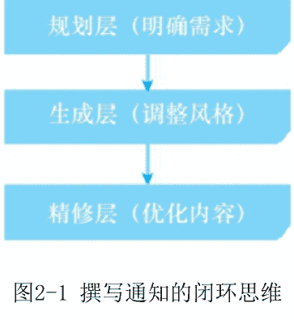

图2-1 撰写告知的闭环思维

规划层 明确需求：让助手吃透具体需求，含文稿类型、目标读者、关键信息等。
生成层 调整风格：基于分析结果，让助手选择合适的风格和语气。
精修层 优化内容：借助工具对初稿进行语法、创新点、内容准确性等多维度优化。

具体怎么操作？先领取任务卡明确需求，再让智能小助理演示实际流程。

任务卡
公司基于人才发展战略，需要对部分员工岗位进行调整，领导要求你马上起草一份岗位调整告知。

为了解当前市面上主流的智能公文写作工具，本书在综合类和专业类各选一种——Kimi办公室笔杆子和讯飞文书。

Kimi办公室笔杆子
登录Kimi官方平台，进入办公室笔杆子模块，在Kimi+界面的辅助写作里找到办公室笔杆子，输入指令：
你是一名办公室笔杆子，现在需要完成一份岗位调整的告知。

获取的要素信息见图2-2。

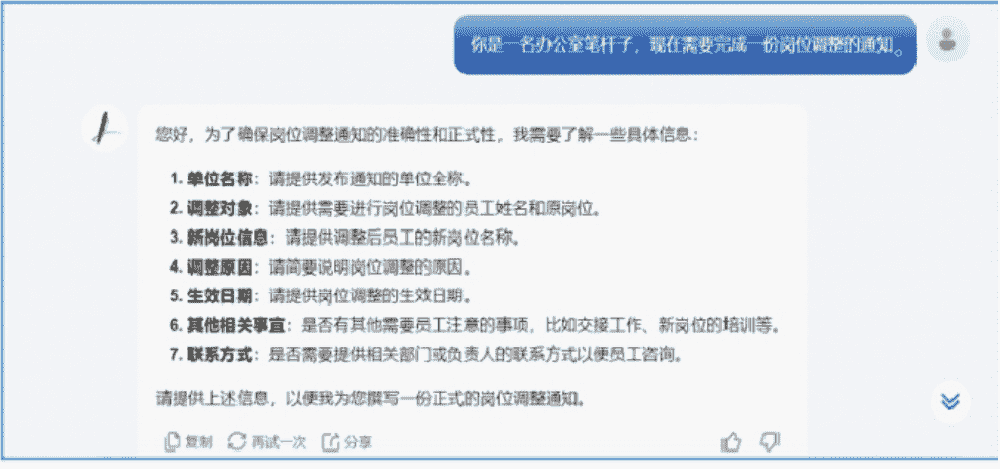

图2-2 岗位调整告知信息要素采集模板

此时Kimi会自动解析需求，你只需按提示填入对应信息即可。

以下是Kimi办公室笔杆子的回答。

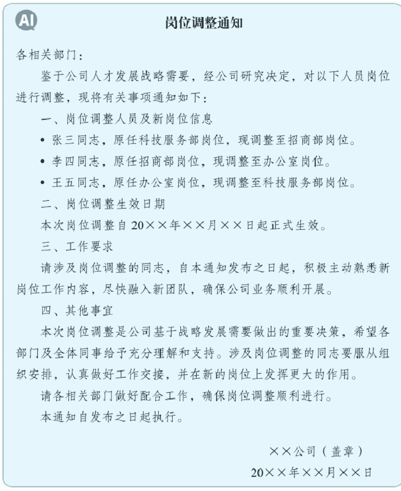

初看，Kimi办公室笔杆子给出的答案已属可用，只需人工微调即可完成任务，但我们可以提出风格和语气方面的调整要求，如要求风格更正式，语气更积极。

以下是Kimi办公室笔杆子的回答。

关于岗位调整的通知
公司各部门：
为进一步落实公司人才发展战略，优化人力资源配置，经公司研究决定，对部分员工岗位进行调整。现将有关事项通知如下：
一、调整人员及新岗位信息
1. 张三同志，原任科技服务部岗位，现调整至招商部岗位。
2. 李四同志，原任招商部岗位，现调整至办公室岗位。
3. 王五同志，原任办公室岗位，现调整至科技服务部岗位。
二、调整原因
本次岗位调整是根据公司人才发展战略需要，旨在更好地发挥员工的专长和潜力，促进公司业务的持续发展和创新。
三、生效日期
本次岗位调整自20××年××月××日起正式生效。
四、其他相关事宜
请上述同志在调整生效后，以积极主动的态度熟悉新岗位工作，尽快融入新团队，确保公司业务顺利开展。同时，各部门要积极协助调整人员做好工作交接，保证工作连续性和稳定性。
公司对各位同志在新岗位上的表现充满期待，相信通过大家的共同努力，我们能够实现公司的发展目标，共创辉煌。
本通知自发布之日起执行，未尽事宜，由人力资源部负责解释。
××公司人力资源部盖章
20××年××月××日

对比可以看出，这一版和之前的版本在细节上差异明显，经过风格语气调整后的文稿在措辞上更显成熟。

如果选用调整后的版本，还可以进一步做内容优化。比如想让核心信息——岗位调整一览，一眼就能抓住，可以借助Kimi办公室笔杆子的醒目呈现方式，比如用表单 见图2-3，重点信息更突出。

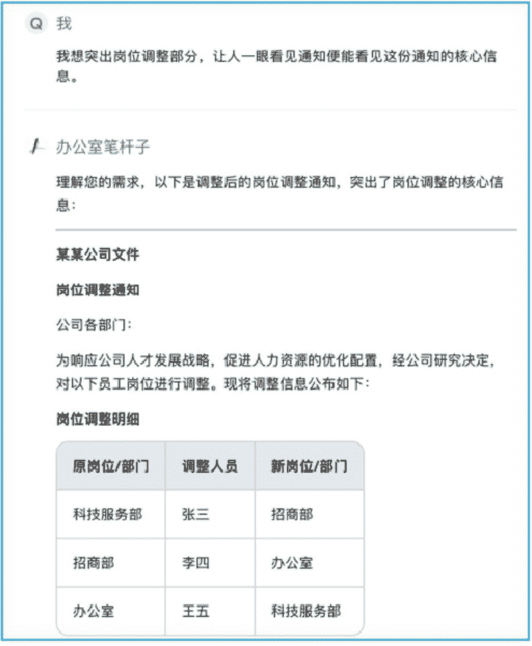

图2-3 Kimi办公室笔杆子的智能优化

对于常用公文，建议仍做人工审核和微调，智能工具生成的格式和语句目前还不算完美，但人工成本很低。

讯飞文书
登录讯飞文书官方平台，选择深度创作，按页面提示选择公文类型并填写对应内容。页面采用模块化设计，按提示填入即可。也可使用AI帮填进行智能润色，再人工修改以贴合实际。

以下是讯飞文书的回答。

关于张三等三位同志岗位调整的通知
各部门：
根据公司的人才发展战略需要，经过认真考虑和评估，决定对张三、李四、王五等三位同志进行岗位调整。具体安排如下：
一、调整对象
本次岗位调整涉及的对象为张三 原科技服务部、李四 原招商部 和王五 原办公室。
二、新岗位信息
张三同志调至招商部，李四同志调至办公室，王五同志调至科技服务部。
三、调整原因
本次岗位调整是为了更好地发挥员工的专业技能和工作经验，提高工作效率，促进公司业务的发展。
四、生效日期
本通知自发布之日起执行。
五、其他相关事宜
请各位同事积极主动地熟悉新的工作内容和环境，尽快融入新的团队，确保公司的业务能够顺利开展。同时，也希望各位同事能够以积极的态度对待这次岗位调整，为公司的发展贡献自己的力量。
六、联系方式
如有任何疑问或需要帮助的地方，可以随时联系人力资源部。
特此通知。
××公司人力资源部
20××年××月××日

在风格语气调整上，可用以稿写稿功能，通过接入的智能模型调整结构或内容；也可选择素材参考，对照素材库和知识库手工润色。

智能优化方面，讯飞文书无需额外指令即可修正语句、错别字、标点，并检测敏感词 见图2-4。

需要创新元素时，可跨平台组合使用，比如把讯飞生成的内容导入Kimi办公室笔杆子进行优化增色；反之亦可把Kimi的内容导入讯飞进行审稿核稿。

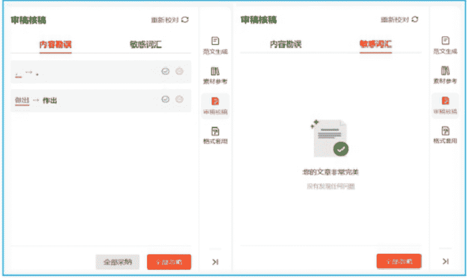

图2-4 讯飞文书审稿核稿界面

智能工具论剑
从以上操作可见，对告知这类公文，智能工具基本能覆盖全流程。在语感润色上，Kimi办公室笔杆子的表现更智能；在专业属性和人工仿写上，聚焦公文领域的讯飞文书值得尝试。

职场高频的告知撰写，切忌做懒人，人工审核仍是关键，尤其在格式规范和措辞精准度上需要精雕细琢。

技能加油站
职场思维启蒙
写告知看似简单，实则大有讲究。动笔前先问自己：这份文稿的核心信息是什么？这种以终为始的思考正是目标导向思维。比如会议告知，必须确保时间、地点、议程、准备事项齐全，让读者一眼抓住重点。领导通常希望文稿简明却全面，这正是职场中既要又要的典型——在多重限制下找最优解。

告知是正式文体，不代表不能创新。职场创新常体现在常规事务的呈现方式上。比如用列表、图表优化信息呈现，能让文稿更吸睛。创新不仅帮助信息传达，也能在标准化工作中体现个人价值。

主动思考是提升质量的关键。比别人多想一步：站在接收者角度，他们最关心什么？如何让信息更贴合需求？好的文稿不仅传达准确，还能引导行动，为后续工作铺路。

最后，技能靠练成。无他，但手熟尔。职场成长是认知迭代的过程。多练习多复盘，这种结构化思维能迁移到汇报、沟通、协调等场景。从告知练起，投入时间思考，进步会超出预期。

练一练，更出色
告知是职场信息沟通的交通信号灯，要做到清晰传递、避免误解。格式和措辞规范的前提下，明确就是高效，精准就是专业。现在轮到你实操了！结合以上指导，开始撰写。

小试牛刀
请结合本节所学，用AI写作+人工优化的方法起草一份关于调整夏季办公时间的通知。
场景：公司决定6月1日起实行夏季办公时间，工作时间调整为8:30—17:30，午休1小时。
提示：
可从明确调整起止日期、具体时间、适用范围三部分入手；
可考虑增加人性化关怀，如弹性条款、温馨提示等；
重点检查是否遗漏执行细节。
告知要达成的沟通效果是减少反复确认。需预判可能的疑问提前解答，条件允许时加入人性化关怀，效果会更好。

如何高效撰写通报
职场中通报虽不如告知常见，但在特定场景下作用关键。对新人来说，初次接触通报容易困惑：通报是什么？跟告知有何区别？怎么写才清楚？别担心，下面带你梳理要点。

从要素提炼到成稿落地
通报是用来表彰优秀、指出问题或传达重要消息的正式文件，主要分表彰性、批评性、事务性三类。表彰性通报在日常工作中较为常见。通报像一块公告牌，能快速传播内部重要信息，并通过合理结构确保相关人员轻松理解并响应。

借助表2-4可掌握通报的核心构成，这份表单在撰写和审核时很有帮助。

| 通报要素 | 描述 |
|:---|:---|
| 标题 | 直接反映通报的核心主题。例如：关于具体事情的重要通报 |
| 主送对象 | 清晰指明接收通报的具体人员或群体，也可称为主送机关 |
| 缘由 | 简短说明事件背景或决策原因，解释为什么这很重要 |
| 正文 | 分段落详细描述关键信息，关键事项可以分层列明要点，确保逻辑清晰 |
| 行动要求 | 提供具体的行动要求，明确告知收件人需要采取的具体行动，包括时间节点和准备事项 |
| 落款 | 写上发布单位/部门名称及日期，确保信息来源透明且可信 |

表2-4 通报要素表单

熟悉要素后，撰写通报就有章可循。下面总结规律与技巧。

情境体验
不久后，主任又交给你一项任务：撰写一份表彰优秀职工的通报。主任特别强调要突出优秀个人及团队的具体事迹，明确表彰意义，并号召全体员工学习。

有了写告知的经验，这次会更从容。依据表2-4，可提炼出通报撰写五步法。
第一步：定标题。选择简洁明了的标题，直接反映通报的核心主题。
第二步：列对象。明确指出接收通报的具体人员或群体。
第三步：写正文 重缘由。简短说明事件背景及其重要性，随后分段落详细描述关键信息，关键事项可分层列明要点，确保逻辑清晰、易于阅读。
第四步：提要求。提供具体的行动要求，明确告知主送对象需要采取的具体行动及时间节点。
第五步：明身份。标明发布单位或部门名称及日期，确保信息来源透明可信。

按此五步，可把通报要领全部掌握。下面借助表2-5看实际运用。

| 步骤 | 说明 | 通报内容 |
|:---|:---|:---|
| 定标题 | 选择一个简洁明了的标题，直接反映通报的核心主题 | 关于表彰具体事迹优秀职工的通报 |
| 列对象 | 明确指出接收通报的具体人员或群体 | 主送对象：全体职工 |
| 写正文 重缘由 | 简短说明事件背景及其重要性，随后分段落详细描述关键信息，关键事项可分层列明要点，确保逻辑清晰、易于阅读 | 缘由：为表彰在具体项目中表现卓越的个人和团队，激励全体员工提升工作质量和效率，特此通报表彰  正文：在过去的一年里，我们单位涌现出了一批杰出的个人和团队，他们在工作中展现了非凡的责任感和创新能力特别是姓名/团队，在具体项目中克服了重重困难，成功完成了具体成果 |

把通报写得清楚，信息在组织内部就能更快、更准地流通。下面是一套可直接使用的写作思路，让通报更有分量。

| 提出要求 | 明确告诉主送对象需要做什么、做到什么程度、什么时间完成 | 1. 号召全体职工向标杆学习，提升敬业与创新意识 2. 积极参与各项工作，为共同目标持续发力 |

| 标明出处 | 写清发文单位和发文日期，确保来源可追溯、可信 | 发布单位/部门：××单位办公室 发布日期：20××年××月××日 |

表2-5 通报撰写的实践路径

### 实操要点

- 1. 用语得当：采用正式且通俗的表达，减少生僻术语，表述明晰。
- 2. 突出意义：不仅交代发生了什么，更要说明对受众的实际影响。
- 3. 站在读者角度：先讲与读者相关的部分，再展开细节。
- 4. 视觉分明：按公文规范排版，分段清晰，重点信息一目了然。
- 5. 复核把关：成稿后请有经验的同事审阅，防止遗漏与差错。

### 如何借助智能系统提效写通报

吃透传统写作要点，是用智能工具提效的前提。通报对内容深度与逻辑严谨度要求很高，在公文体系中占据重要位置。掌握要点后，可探索借助智能系统加速产出。

通报与通知在框架上部分重合，但使用场景与传达目的不同。借助闭环思路说明如何高效完成通报，见图2-5。

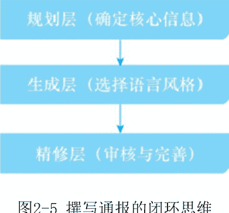

图2-5 通报撰写的闭环思路

准备阶段，厘清核心要素：在让系统动笔前，先明确需传达的事实与目的，使系统把握重点。

生成阶段，匹配语言风格：依据用途与受众选择合适语气与正式度，保证风格符合预期。

润色阶段，核对与完善：对初稿做事实核对与逻辑校验，进行必要的增删润色。

接下来进入实操。通过领取练习任务，可明确本次通报的具体要求，随后智能助手会演示分步完成流程。

##### 练习任务

近期安全巡查发现多项隐患，管理层决定立即整改并强化培训。要求立刻起草一份《隐患治理与培训通报》。

本次演示选用两款产品，其一为智谱清言，其二为擅长通知撰写的Kimi办公室笔杆子。

##### 智谱清言

登录智谱清言官网，进入智能体中心新建智能体。智能体可聚焦公文格式、内容与风格，帮助持续跟踪优化写作效果，见图2-6。

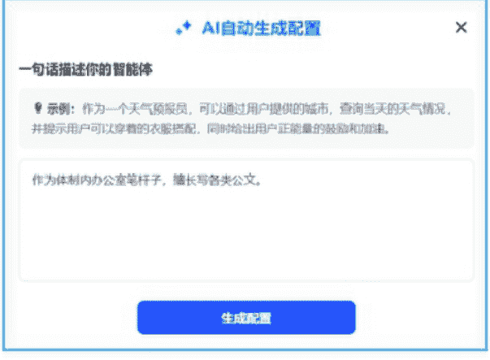

图2-6 智谱清言智能体创建界面

进入智能体后，可先输入指令让其梳理本次通报的关键要点，为后续判断与调试奠定基础，见图2-7。

图2-7 智谱清言智能体解析任务

智谱清言智能体的回复如下。

通报的主旨要素与主要目的为：

要点：
- 1. 巡查发现隐患概况：简要罗列近期检查中发现的主要问题。
- 2. 整治举措：详述企业即将采取的具体行动，包括设施修复、设备更新、制度完善等。
- 3. 培训方案：说明即将开展的安全培训主题、时间、场所、参训对象及预期目标。

篇幅所限，以下内容略。

确认要点无误后，可让智能体匹配语言风格并生成完整通报，见图2-8。

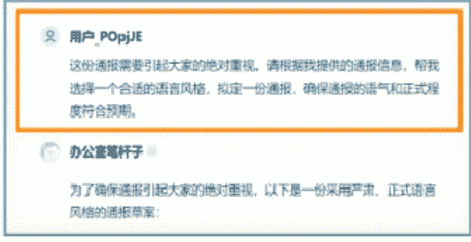

图2-5 语言风格智能匹配界面

智谱清言智能体的生成如下。

###### 【企业名称】关于隐患治理与培训的通报

各科室、全体同事：

依据近期开展的安全巡查，排查出以下隐患：
- 1. 消防设备呈现老化与损坏。
- 2. 部分生产设备操作未按规程执行，存在操作风险。
- 3. 安全管理制度不够完善，部分员工安全意识薄弱。

为保障安全生产、预防事故发生，管理层决议立即采取以下整治措施：

####### 一、整治措施
- 1. 迅速对消防设备进行全面检查、维修与更换，确保设施正常运行。
- 2. 对生产设备开展风险评估，加强操作规程培训，规范员工行为。
- 3. 完善安全管理制度，强化安全生产责任制，对违规行为严肃处理。

####### 二、培训安排
- 1. 培训时间：20××年××月××日
- 2. 培训地点：企业会议室
- 3. 培训内容：消防安全知识、生产设备操作规程、安全管理制度解读
- 4. 参与人员：全体员工
- 5. 培训目标：提升员工安全意识，掌握基本安全操作技能

请各科室高度重视，严格执行通报要求的整治事项，并确保全体员工参训。企业将跟踪督查整治进展，对未按要求落实的科室与个人将严肃追责。

> 安全生产，人人有责。携手共建安全稳定环境，为企业发展贡献力量。

特此通报。

［企业名称］

［发布日期］：20××年××月××日

请各科室负责人签收并传达到位。

附件：隐患治理与培训实施细则

从智能体输出来看，初稿已基本达标。然为让内容更贴合实际，仍需人工复核并进一步优化，见图2-9。智能体的优势在于可在设定的角色与情境下持续产出专业内容。

图2-9 内容持续优化功能界面

###### Kimi办公室笔杆子

可沿用撰写通知的方法，让Kimi办公室笔杆子先做智能需求分析，生成框架后再填入细节；也可让其识别通报的关键信息与主要目的。两种方式对比见图2-10。

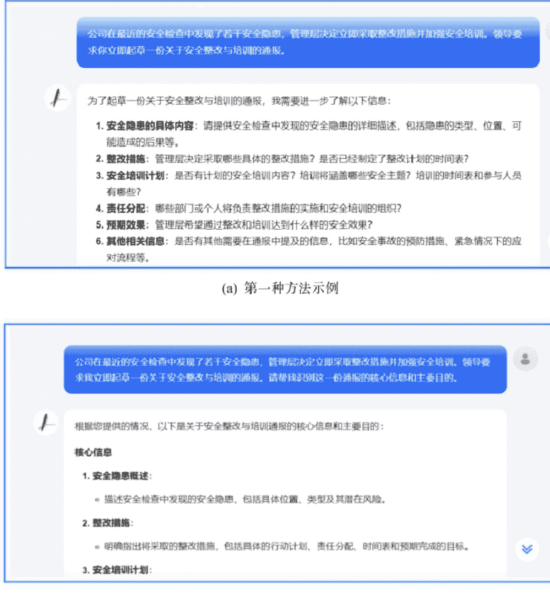

随后可让其调节语言风格。例如，本次需求是引起高度重视，见图2-11。

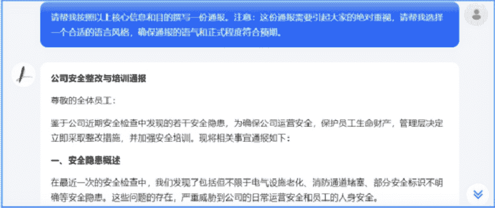

图2-11 语气风格调节界面

Kimi办公室笔杆子的回复如下：

###### 一、隐患概述

最近一次安全巡查中，发现包括电气设备老化、消防通道受阻、安全标识不清等在内的多项隐患。这些问题严重威胁日常运营安全与员工人身安全。

###### 二、整治措施

为彻底消除隐患，管理层已制定以下措施：
- 1. 电气设备整治：立即对全部电气设备进行全面检查，两周内完成必要维修与更新。
- 2. 消防通道清理：确保所有消防通道畅通，本周内完成清理。
- 3. 安全标识更新：对所有安全标识全面检查，三日内完成更新。

整治工作由安全管理科监督执行，各相关科室需全力配合，确保按期完成。

以下内容略。

从上述文字可见，Kimi办公室笔杆子在结构与措辞上基本符合要求，但从实务角度仍需完善。可采用“角色+指令”方式让其优化。

- 假设你是资深公文图书编辑，请检查通报格式是否规范、有无错别字，并精简篇幅，使通报更凝练。

智能系统可依据提示词持续优化内容。同时可借助专业智能系统智能核验错别字等，确保准确规范，见图2-12。归根结底，持续学习与实践是保持学习状态的关键。

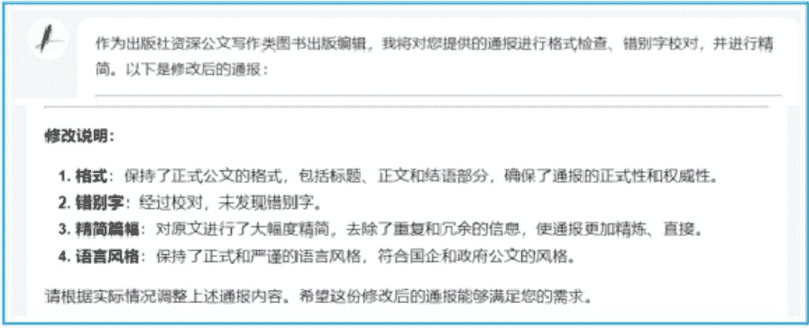

图2-12 智能优化界面

#### 智能系统“对决”

在通报撰写过程中，两款智能系统均表现突出，显著提升了效率。智谱清言的智能体在格式规范与专业润色上表现尤为突出，能持续跟踪并保持高质量输出。Kimi办公室笔杆子在界面操作舒适度上占优，尤其在电脑端使用流畅。

尽管智能系统能提供高效高质量的初稿，人工完善依然不可或缺。对背景的深度理解、对语言的精准把握、以及符合领导具体要求的细节处理，都需要人工参与。智能系统是工具，人的智慧与经验才是赋予内容灵魂的关键。

#### 技能加油站

- 1. 职场思维启蒙

写通报看似平常，实则有讲究。高质量通报既要说清事实，也要懂得换位思考，如同照镜子。

开头至关重要，好比文章的面孔。职场通报不是自说自话，第一句话就要让读者明白“这事与我何干”。例如“关于××项目进度延误的通报”，紧接着“涉及所有使用A系统的科室”，这种写法体现的是用户视角，先说对方关心的，再说想表达的。

正文要交代三点：发生了什么、为何发生、接下来怎么办。分析原因时，职场高手懂得“对事追根，对人留面”。例如“未执行双人复核”后补充“当时夜班仅一人可调配”，这不是推脱，而是让整治更具可操作性。

结尾避免空喊口号，而应把“要你改”转化为“我们一起改”。例如不说“质检部三天内整治”，而说“质检部本周调整排班，同时向办公室申请增加夜班储备人力”。这种表述既明确责任，也提供支持。

通报用词要精准，但不必冰冷。公文讲求正式，却可以保留温度。表扬时多些鼓励，批评时附上改进方向。

只要心中有温度，文字就不会干涩。加油！好通报不是靠笔写出来的，是靠同理心“熬”出来的。通过不断练习，你一定能写出高质量通报。

##### 2. 练一练，更出色

用事实说话，用方案开路，既能警示问题，也能凝聚共识，这是优秀通报的制胜之道。通报部分已讲完，接下来请付诸实践，尝试写一份通报。

#### 小试牛刀

请结合本节所学，用“智能写作+人工优化”方法拟定一份《关于项目进度延误的通报》。

场景：某项目因需求变更未及时同步，导致整体延期两周。

提示：
- （1）可按“延误原因+影响范围+整治措施”结构撰写；
- （2）可适当加入正向引导，如“对提前完成补救的团队给予奖励”；
- （3）整治事项要具体明确，如“三日内提交修正版”。

一份好的批评性通报应做到“对事不对人”。避免定性表述如“态度不端正”，聚焦事实与解决方案。职场上，批评性通报应体现“以危机换改进”，即以问题为契机推动全面优化，既清晰说明问题，避免猜疑，又展现积极主动态度，为后续发展奠定基础。

## 第3章 工作计划与工作总结

### 工作计划快写小妙招

在公文体系中，工作计划虽非独立文种，却是职场人士必备的“办公利器”。它帮助明确目标、规划时间，培养高效习惯，并在年终总结时发挥价值。对职场新人而言，学会快速撰写工作计划，可在起跑阶段占得先机。

实用计划如何炼成？

个人工作计划可以报告、请示等形式呈现，或作为年度总结的一部分，也可按实用度调整为文字与表单两种形式。在日常办公中，工作计划多以表单呈现，该表单也将成为快速撰写的“秘密武器”。

无论何种形式，工作计划都要求清晰呈现工作思路。可参考表3-1的要素清单，确保全面可执行。

在撰写时，每个要素都有其关键点。工作事项有轻重缓急，可根据实际情况灵活增减。掌握此技巧，便能快速写出直击核心的工作计划。

| 要素 | 描述 |

|---|---|

| 明确目标 | 清楚项目总体目标 |
| 分解任务 | 将大目标拆分为具体可管的小任务 |
| 时间规划 | 为每个任务设定合理时间范围 |
| 资源评估 | 评估人力、物力、财力等资源可用性 |
| 风险评估 | 识别可能影响实施的风险并确定应对方式 |
| 责任分配 | 明确每个任务的责任人 |
| 设定关键节点 | 为各阶段设定检查节点，便于跟踪进度 |
| 沟通机制 | 建立定期会议等沟通渠道，保持信息畅通 |

表3-1 工作计划的要素清单

#### 情境体验

你刚完成一份表彰优秀员工的通报，主任随后交给你新任务：为即将举办的大型庆典活动撰写初步工作计划，并强调要明确步骤、时间安排及责任分工。本周将召集各科室会议展示该计划。

此时，一份清晰的工作计划模板将助你高效完成任务。

第一步：选模板。选择涵盖事项、内容、时间节点、负责人、主责科室等关键要素的表单模板，可参考表3-2结构，根据任务灵活调整。

| 序号 | 事项 | 内容 | 时间节点 | 负责人 | 主责科室 |
|:---:|:---|:---|:---|:---|:---|
| 1 | 活动场地细节环境 | 舞台音响、灯光、话筒等设备 | 设定完成时间范围 | 具体个人 | 具体科室 |
| 2 | 物料设计制作 | 邀请函、席位卡、舞台背景、签到墙、入场地毯等 | 设定完成时间范围 | 具体个人 | 具体科室 |
| 3 | 舞台搭建 | 立式演讲台包边、舞台鲜花、舞台屏幕等 | 设定完成时间范围 | 具体个人 | 具体科室 |

表3-2 庆典活动前期工作计划表

注：模板仅展示部分内容，下表同。

运用表单模板可根据实际任务灵活变通。若每周有撰写工作计划的习惯，年终总结时会事半功倍，重要事项与节点已被记录，所谓“好记性不如烂笔头”，见表3-3。

| 序号 | 上周工作完成情况 | 序号 | 本周工作事项 |
|:---:|:---|:---:|:---| 
| 1 | 具体事项 | 1 | 具体事项 |
| 2 | 具体事项 | 2 | 具体事项 |

表3-3 周工作计划表模板

注：如需精简，可按大类划分事项。

第二步：填内容。按实际任务逐项填写关键要素，确保每项表述清晰具体，避免模糊。

第三步：调结构。依据工作重要性与紧急性对事项排序，复杂任务可拆分为若干小任务，确保计划可执行。检查表单完整性与逻辑性，避免遗漏关键信息。

通过以上三步，可快速撰写一份清晰实用的工作计划。

#### 小贴士

- 1. 模板先行：使用现成模板直接填充内容，节省时间并保证结构清晰。
- 2. 简明扼要：避免冗长，直入主题，用简洁语言表达关键信息。
- 3. 用表单记录周计划：每周用表单记录任务与进展，为年终总结提供依据，便于跟踪进度。
- 4. 灵活应对变化：保持计划弹性，适时调整以适应变化，确保现实可行。
- 5. 获取反馈：与上级、同事讨论初步方案，听取意见完善细节，确保计划全面实用。

#### 手把手教你用智能系统写工作计划

掌握表单撰写工作计划是重要技能，也是一种需在日常中不断培养的习惯。当需以书面形式呈现或向领导做高逻辑汇报时，可充分利用智能系统辅助。

在智能系统辅助撰写时，融入闭环方法至关重要。撰写工作计划的闭环思维见图3-1。

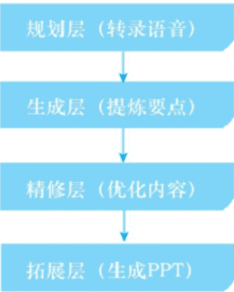

图3-1 撰写工作计划的闭环思维

准备环节，转录语音：使用语音识别系统将口头指令、想法或讨论实时转为文本，形成初步草稿。

输出环节，提炼要点：利用智能系统提取任务、时间等关键信息，整理为结构化计划。

润色环节，优化内容：根据实际需求通过精准指令优化内容。

拓展环节，生成PPT：如需汇报演示，让智能系统将计划转化为PPT。

具体操作如何？先领取练习任务，再通过智能小助手完成定制版工作计划。

##### 练习任务

企业为打造学习型组织，计划开展内部读书会活动，领导初步沟通思路后，让你拟定一份读书会工作计划并汇报。

本次选用功能丰富的通义和讯飞旗下的讯飞听见、讯飞星火。

###### 通义

在通义主界面点击“实时记录”开始录音。只需手机或电脑在手，随时可将想法说出，通义将化身“贴身秘书”实时记录，见图3-2。

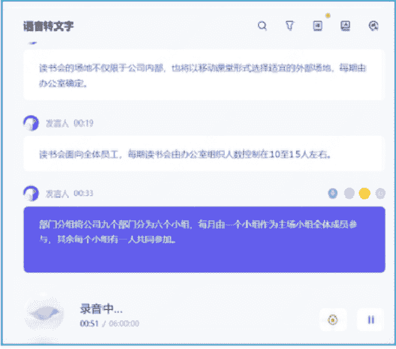

图3-2 语音实时转写界面

语音录制完成后，可生成语音记录的要点内容，见图3-3。

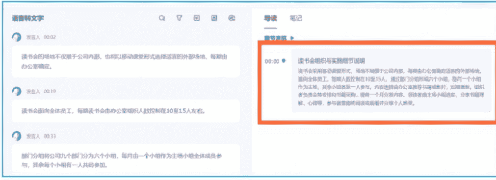

图3-3 智能要点提取界面

系统抽取的要点可直接整批搬进文档。粘贴完成后即可调用通义阅读助手展开处理，助手支持 Word、PDF、JPG 等多种载体，会对全文进行智能拆解并把要点重组成条理分明的工作方案（见图3-4）。使用时只需给出清晰指令，例如：

- ► 请基于以上材料，为我拟一份呈报领导的工作方案，要言简意赅、抓住要点。

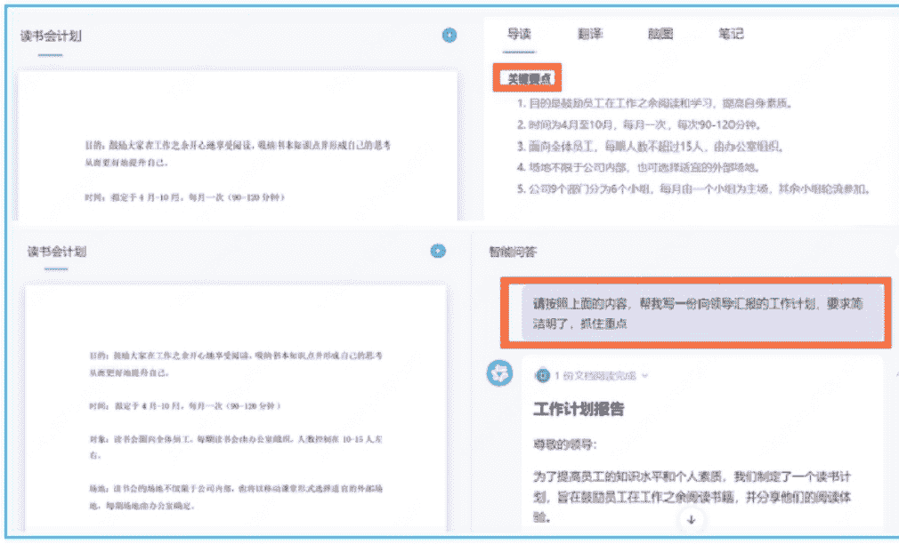

图3-4 工作方案智能生成界面

以下是通义给出的示例回复。

尊敬的领导：

为提升团队知识储备与综合素养，我们拟定了一项读书会方案，鼓励大家利用业余时间阅读并交流收获。

具体安排如下：

- 按月组织一次读书会，时长控制在 90～120 分钟，向全体员工开放，每期规模约 10～15 人。
- 会场不局限于公司内部，还将以移动课堂形式挑选合适的外部场地，具体场馆由行政部门负责确定。
…………

活动周期为每年 4—10 月，按月举行。

当月具体时间与地点将在月初对外发布。

我们相信该读书项目对员工成长会产生积极作用。

随后，可通过向模型发出更精准的指令或人工校对的方式持续打磨，直至方案达到预期水平。若这份方案既用于书面或口头汇报，又要在会议上讨论，则需要配套的汇报 PPT。通义的“PPT 创作”功能可实现一键生成（见图3-5），并且支持导出与在线演示。

图3-5 通义的 PPT 一键生成界面

PPT 一键生成完成后，最关键的环节是人工复核与微调。模型虽极大提升了效率，但最终的质量把关仍离不开专业判断与细致润色，只有这样才能做到画龙点睛，让 PPT 在内容与呈现上都达到最佳。

##### 讯飞听见、讯飞星火

先登录科大讯飞的智慧办公 SaaS 平台，进入讯飞听见。实时录音并同步转写后，系统会自动产出语音文字的要点摘要（见图3-6）。

进入智能分析环节时，可打开讯飞写作，输入指令：

- 请依据上述要点，撰写一份呈报领导的书面任务方案，要求简洁、抓重点。

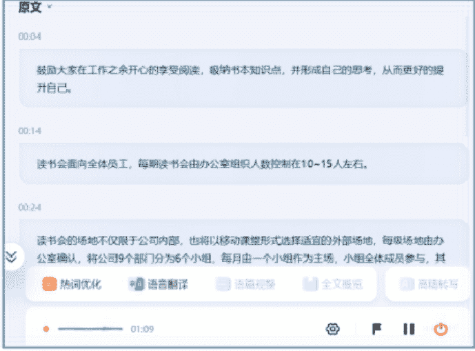

图3-6 语音转写与智能摘要界面

以下是讯飞写作的回复：

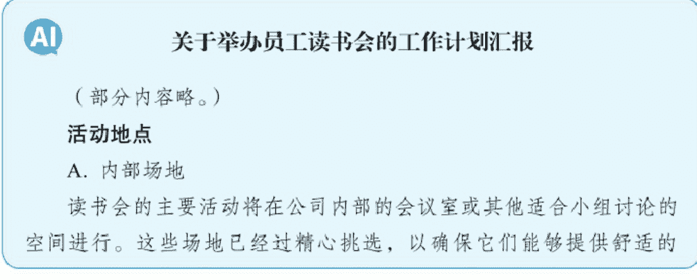

环境适宜长时间深度讨论。譬如我们的多功能厅配备了先进的音响与投影系统，很适合大型讲座和小组研讨。另外考虑到部分同事需要安静空间专注阅读，也会提供若干小型阅览室作为备选。

###### B. 外部场地（移动课堂）

除内部场地外，还计划借助外部空间来丰富读书会形式与趣味性。我们正探讨与当地图书馆、咖啡馆或书店合作，在户外或半户外举办读书活动。

###### 分工安排

####### A. 组织者职责

行政部门将承担主要组织工作，负责策划流程、确定参与名单、采购推荐书目，并在活动前一个月向参会者发放阅读资料。

####### B. 领读者角色

领读者是活动的核心，需在活动前一个月自行研读指定书籍，并在现场围绕理解、心得与推荐理由进行分享。

####### C. 分享者任务

分享者即全体参会成员，除聆听领读者讲解外，还需提前阅读书籍或观看相关影片，并在活动中表达个人感受与想法。

与通义相比，讯飞写作处理文本时更偏向扩写，其中不乏启发性表述。随后可以对内容进行优化。讯飞写作的“AI 工具”里提供了“全文缩写”等多种功能（见图3-7），能为优化提供便利。

最后来看 PPT 生成。此时需进入讯飞星火官网，选择 PPT 生成功能，按指引挑选模板后输入指令即可。讯飞星火免去了模板设计的工作，帮你搭好框架，但“灵魂”注入仍需依靠自身的思考。

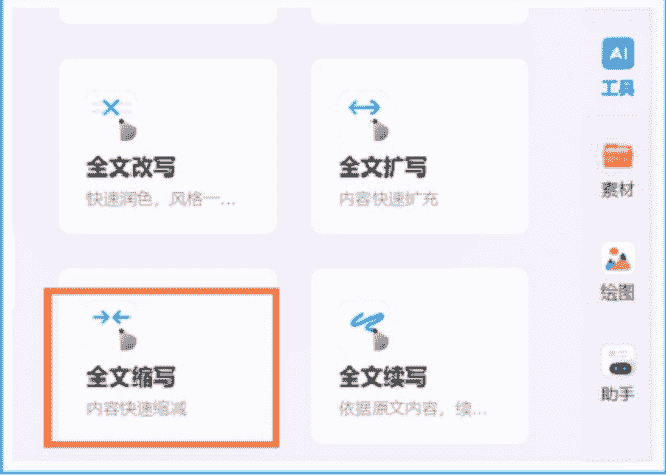

图3-7 多维度智能优化功能面板

#### AI 工具“论剑”

从闭环起点——语音同步转文字，到闭环终点——PPT 生成，智能助手让日常办公更高效、任务处理更从容。本节介绍的通义与讯飞听见、讯飞星火智能化程度高，可称得上“九段秘书”，能全方位满足办公需求。

具体而言：在语音同步转文字方面，讯飞听见侧重会议录音，产出偏向纪要，优化耗时相对较长；而通义应用场景更广，通用性更强。在智能分析与优化方面，讯飞写作功能丰富、工具属性强；通义生成的内容则更贴合实际工作场景，实用性更突出。在 PPT 生成方面，通义提供的模板选择更多，灵活性更高。综合来看，从节省时间与效率角度出发，两者都能很好地满足基本需求。

总之，无论是通义还是讯飞系产品，都能显著提升工作效率，可依据个人场景与偏好选择。

#### 技能加油站

- 1. 职场思维启蒙

撰写任务方案并非只是罗列已做事项与待办清单，而是帮助自己厘清目标，对工作进行跟踪与闭环。即使领导未要求，坚持每周写方案的人，往往更能掌控工作节奏，并在写回顾时更具优势。

- （1）先弄清手头资源。

别急着定宏大目标，不妨先审视三点：完成这件事需要多久？需要哪些同事配合？最大难点是什么？尽量从可控范围内着手，避免列出超出权限或缺乏资源的目标。职场新人最稳妥的做法，就是用权限内的事练手。

- （2）给常规工作增添新意。

不必把“创新”想得太难，尝试将“完成领导交代的任务”升级为“每次多做一个小尝试”。比如整理文件时顺带建立分类标签，收集数据时额外记录“同事常问的问题”。好的方案应从小处着眼，通过融入新意，让工作更有动力。

- （3）学会拆解大目标。

很多人写方案时易陷入两极：要么只盯琐碎日常，要么被大目标压垮。真正的职场高手，会把年度目标拆成一个个可触摸的节点。例如负责一个三月项目，可先列关键节点——第一周完成调研框架，第二周输出初稿方案，第三周征求部门意见……每完成一个节点，就用不同颜色在方案表上标注进度。这样既能清晰感知推进节奏，也能在突发状况时快速定位问题环节。

列方案时要牢记：再大的目标也能拆解，关键在于把“我要做到”转变为“我现在能做什么”。任务方案的本质不是自我束缚，而是帮助我们在忙碌中理清思路。当写方案成为习惯，你会不再焦虑于“还有多少事没做”，而是专注享受“每一步都在靠近目标”的踏实感。这种思维转变，才是最宝贵的成长印记。

- 2. 练一练，更出色

在职场中，坚持撰写每周甚至每日方案，堪称卓越习惯。任务方案不仅是给领导看的，更是你把控进度的关键工具。当你学到新知识时，最好的运用方式就是多加练习。下面就大展身手吧！

#### 小试牛刀

请结合本节所学，用“智能写作＋人工优化”的方式撰写一份《客户答谢会筹备方案》。

场景设定：活动安排在 9 月举办，需明确预算、流程、分工及应急预案。

提示：

- （1）可按目标、预算、流程、分工、风险预案五个模块撰写；
- （2）也可按任务拆解（负责人＋时间）、进度跟踪（重要事项标注）、汇报结构（已完成/进行中/待解决）三步走，确保可执行、可追踪；
- （3）记得加入备选方案，如“如遇暴雨，备用场地为 2 楼 201 大会议室”；
- （4）记得设置关键节点，如“××月××日前完成嘉宾邀请”。

任务方案的核心在于可执行、可追踪，将脑中想法转化为落地行动。需明确具体责任人、时间节点与风险预案，细化到“谁在何时做什么”。

### 如何撰写让人印象深刻的回顾文稿？

在职场进阶中，撰写回顾文稿是必备一环。无论是月度、半年度还是年度回顾，都是衡量成果的重要标尺，也是展示职业能力与成长轨迹的常用文书。回顾文稿不仅是对过往的回顾，更是对未来的规划。

不少人认为回顾文稿容易陷入固定套路，缺乏新意，这是误区。大多数人能抓住完成的任务、达成的目标等共性要素，却忽略了个体独特价值，即文稿中的个性。

一份出彩的文稿不仅要条理清晰、重点突出，更要融入个人独到见解与深刻体会，体现你在面对挑战时的思考过程与解决方案，以及由此获得的成长与进步。

#### 避开误区，掌握全流程

要写出让人难忘的文稿，避免常见误区很关键。这些误区会削弱影响力，甚至给领导留下不专业的印象。因此撰写前，了解并警惕易出现的典型问题很有必要。表3-4 为回顾文稿中的常见误区。

| 常见误区 | 示例 | 改进建议 | 正确示范 |

|---|---|---|---|

| 过于口语化 | “这周我做了好多事情，感觉特别累。” | 使用正式用语，避免日常对话词汇与句式 | “本周完成多项任务，包括但不限于：项目 A 初步调研、客户 B 需求分析等。” |

| 缺乏具体细节 | “参与了几次会议。” | 提供详细描述，含会议主题、讨论内容及共识 | “参加三次部门会议，重点讨论项目进展并提出优化建议，形成下一步行动计划。” |

| 忽略成果与影响 | “负责了一个项目。” | 强调完成成果及其对公司或组织的积极影响 | “成功交付项目 A，提前两天完成，提升客户满意度，为公司赢得良好口碑。” |

| 没有自我反思 | “这个月工作很顺利。” | 对问题进行客观分析并提出改进措施 | “本月整体进展顺利，但在时间管理上仍有提升空间，未来将更注重效率，合理规划每日任务。” |

| 过度强调个人贡献 | “所有工作都是我一个人做的。” | 平衡个人贡献与团队协作，突出集体力量 | “在团队支持下共同完成任务 Y，确保项目按时交付，体现团队协作重要性。” |

| 忽视改进建议 | “没有遇到什么问题。” | 针对问题提出切实可行的改进建议 | “针对沟通不畅问题，建议引入更高效机制，如每周固定时间召开进度会，提升效率。” |

表3-4 回顾文稿中的常见误区

| 常见误区 | 示例 | 改进建议 | 正确示范 |

|---|---|---|---|

| 忽略数据支持 | “今年业绩增长了不少。” | 用具体数据与指标支撑结论，增强说服力 | “财务报表显示，今年销售额同比增长 15%，达 5 000 万元。” |

| 不重视格式规范 | 文字排版随意，无段落划分 | 使用合适字体、字号与行距，分段清晰，标题明确 | 第一段综述，随后分段，每段简述具体事项，如：一、主要工作完成情况；二、存在问题及改进方式；三、下一步工作思路与计划 |

续表

接下来，本书将结合具体情境，探讨如何在实际工作中灵活应用这些建议，写出更具个性、更令人印象深刻的文稿。

#### 情境体验

你端着咖啡坐在办公桌前，手边放着刚完成的大型庆典初步方案。这时视线扫到角落堆放的文件——那是过去半年撰写的各类材料，有入职后的第一份职工技能培训通知、表彰通报，还有刚完成的活动方案。于是你决定趁热打铁，写一份半年度回顾。

开始敲下第一行时，你想起一位办公室“笔杆子”给你的建议。你闭眼回忆他的经验分享。

“笔杆子”的经验见表 3-5。写出一份令人印象深刻的回顾，30% 依赖清晰架构，剩下 70% 取决于深入分析、具体数据支撑与点睛创新。

| 关键步骤 | 说明 |

|---------|------|

| 第一步：理思路 | 撰写前回顾半年工作历程。新建文档，列出主要工作节点，并为每个节点简要描述当时情境、面临挑战及取得成绩，便于有序组织信息 |

| 第二步：抓重点 | 突出几个关键项目，用具体数据与事实证明成效。例如组织一次超大规模培训，吸引超 300 名员工参与，或在社交媒体获得超 5 万次互动，都是值得强调的成果 |

表3-5 回顾文稿的关键步骤

| 关键步骤 | 说明 |

|---------|------|

| 第三步：看问题 | 分析工作中遇到的问题及解决方案。如筹备活动时供应商交货延迟，后续重新审视流程，制定更严谨筛选标准。这种反思既展示解决问题能力，也为未来提供经验 |

| 第四步：精表达 | 在文稿中尝试运用图表、数据可视化或简短案例分析增强说服力。如用图表展示项目进度、关键数据变化，或用案例说明成果实际影响。插入图片或讲述故事时，确保与主题紧密相关，语言简洁专业。例如配活动现场照片时，加简短说明突出与成果关联。这种表达既能吸引领导兴趣，又能更好地传递情感价值，同时保持专业性 |

| 第五步：核细节 | 初稿完成后，细心检查每句话，删去不必要修饰，确保语言简洁易懂。特别关注段落间逻辑连贯，保证全文流畅自然 |

续表

掌握关键步骤，文稿的骨架与灵魂兼备。在日常工作中，写好文稿应成为基本功。当你希望领导了解并记住你在单位的作为时，一份印象深刻的文稿便是可用的“秘密武器”。

#### 小贴士

- 1. 挑战与创新：除描述解决问题的过程外，重点突出面对困难时展现的创新能力。可提及尝试的新方法，以及这些改变为团队或公司带来的积极变化。
- 2. 成长与学习：强调个人成长的同时，关联对公司或行业的理解加深。说明新获得的知识如何转化为实际行动，并对未来工作计划有何指导意义。
- 3. 批判性自我评估：坦诚分析自身不足，并提出具体改进措施。展现愿意接受批评与持续进步的决心。
- 4. 积极正面的语言：即使讨论挑战或失败，也要保持建设性语气。如可说“这个教训教会了我们……”而非“我们犯了错误”。
- 5. 结尾展望：以对未来的展望收尾，包括个人职业规划与对公司的期望。这样的结尾既体现雄心，也表达对公司发展的信心。

#### 手把手教你用智能体写回顾文稿

上文介绍了回顾文稿易踩的“坑”与出彩方法。接下来探究如何借助智能体高效完成撰写。

讲解操作前，先练习闭环思维。当领导要求你提交回顾文稿时，你会想到哪些步骤？首先回顾整理过往工作内容。接着思考如何组织与润色成条理清晰、论证有力的文字。你以为到此结束？其实并没有。若领导要求当面汇报，还需准备 PPT 及演讲稿。图3-8 展示了撰写回顾文稿的闭环思维。

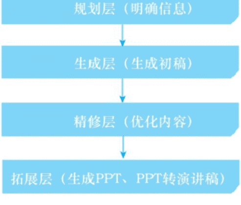

图3-8 撰写回顾文稿的闭环思维

规划层（明确信息）：按智能体提供的模板填入相应信息。
生成层（生成初稿）：智能体自动生成回顾草稿模板，可据此整理零散工作事项。
精修层（优化内容）：将整理后的事项反馈给智能体，让其智能润色，并就语言风格、逻辑连贯性、重点突出等方面优化。
拓展层（生成 PPT、PPT 转演讲稿）：确认内容优化后，可生成 PPT，自动匹配模板与设计元素，将文本转为幻灯片。智能体还可据 PPT 内容辅助生成演讲稿，提供每张幻灯片要点说明，助你提前准备逐字稿。

以上四步看懂了吗？具体怎么做？请领取任务卡，在智能小助理帮助下完成本节挑战！

##### 任务卡

一年一度的公司总结大会即将召开，你需要提前完成一份回顾文稿，该文稿既要提交给领导，也要向领导做口头汇报。

本环节的两个智能产品为 WPS AI 与通义。

###### WPS AI

在电脑端下载安装 WPS Office，确保功能齐全。最便捷的方式是新建一个 WPS 文档，打开后会看到“AI 帮我写”入口。点击进入后可选择公文类型。若需更多类型，可在“灵感市集”中搜索。在“灵感市集”搜索框输入“工作总结”后，可选择“写年终总结初稿”。点击“使用”后，按提示输入详细需求，让智能体帮你完成初稿（见图3-9）。

值得注意的是，WPS 文档中有一个易被忽略的“公文模式”按钮。生成内容前记得点击它，进入“公文模式”，以确保内容更正式、严谨（见图3-10）。

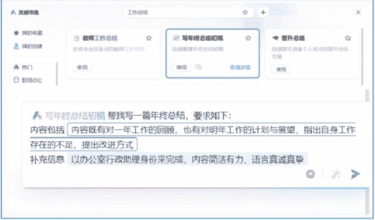

图3-9 公文框架快速搭建界面

图3-10 公文模式选择提示界面

以下是 WPS AI 的回答。

####### 一、工作回顾

######## 1. 日常行政管理

过去一年，我负责办公室日常行政管理工作，包括但不限于文件整理归档、办公用品采购与管理、会议室预订与布置等。通过有效组织与管理，确保办公室高效运转与良好工作环境。

####### 2. 会议与活动组织

我参与组织多次公司内部会议与对外活动，从前期策划到后期执行，均确保各环节顺利进行。通过精心安排与协调，这些活动均取得预期效果，获得公司领导与参与者的认可。

…………

###### 二、挑战与反思

####### 1. 挑战

过去一年，我面临多项挑战。例如组织大型活动时，需协调多个部门与外部供应商，要求具备出色沟通与项目管理能力。此外，随着公司规模扩大，行政管理工作愈加复杂多样。

####### 2. 反思

回望近期履职，我清楚感受到在时段掌控与事务轻重排序上的短板。当碰到刻不容缓又关键的任务时，方案的调整常常滞后，反应速度跟不上，整体产出因此受牵连。

###### 三、改进方向

####### 1. 排期管理

为了提升执行效率，我打算引入更系统的时段管控思路，比如借助数字化日程助手与成熟的工作方法，把各类事项按价值与紧迫度分层安放，确保核心任务优先落地。

............

###### 四、远景与规划

####### 1. 个人成长

新一年我将把能力建设摆在首位，涵盖办事效能的提升、沟通协作的加强以及专业知识面的拓宽。坚信通过持续学习与实践，能更贴合岗位需要，为企业发展贡献更大价值。

####### 2. 工作规划

在任务层面，我为自己明确了方向：优化行政管理流程、提升会议与活动的组织执行力、强化人力资源的支撑作用，以及配合财务部提高预算管控的精准度。达成这些目标，有助于办公室整体运转更为顺畅。

###### 五、收尾

盘点过去一年，既充实又富有挑战。感谢组织给予的机会和同事的助力，使我在行政助理岗位上持续成长。展望未来我信心十足，相信通过不断学习与优化，能更从容应对工作，为公司发展添力。也期待与企业共同迎接新挑战，取得新成果。

若对生成文本感受不到位，可借助底部菜单栏进行微调，智能润色、扩写、缩写等功能可同时启用。针对需优化的段落，WPS会给出具体改进建议（如图3-11）。

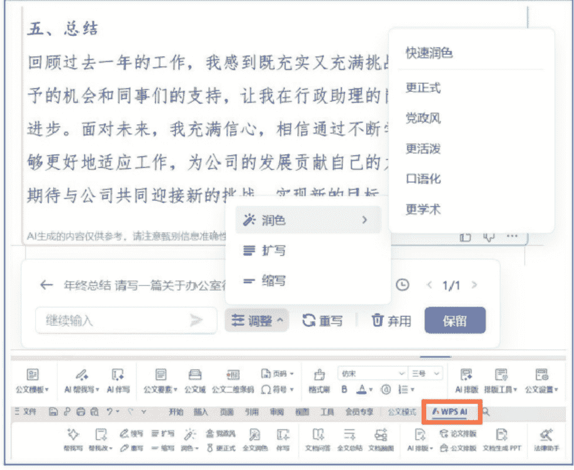

图3-11 内容智能优化界面

随后可利用WPS智能助手的一键式PPT制作功能，既可上传文档也可直接操作。系统会自动产出大纲，确认后即可挑选模板快速成稿，并可进一步美化（见图3-12）。

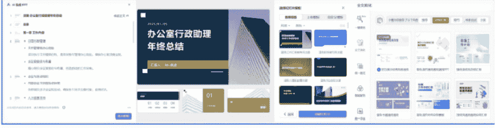

图3-12 PPT智能生成与美化界面

生成PPT后，最后一步是产出演讲稿以备不时之需。WPS智能助手支持在对话框中快速生成备注文字。若想在领导面前表现更出彩，可通过功能界面的“帮我写”来生成并润色演讲稿，相较自动生成的文本会更细致（见图3-13）。

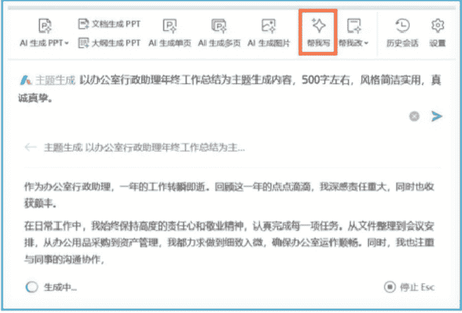

图3-13 演讲稿一键生成功能界面

按以上流程，一份工作总结即可高效完成。智能框架帮助我们理清思路、整理材料；智能润色助力内容进一步打磨；PPT与演讲稿的自动化生成，让我们能把更多精力投入到内容深度与创新上。

###### 通义

登录通义官方平台，在对话框输入指令（见图3-14）：

- 请以办公室行政助理身份，撰写一份约500字的年终工作总结，要求风格简洁实用、真诚真挚。内容包括日常行政管理、文件整理、会议安排、用品采购等。

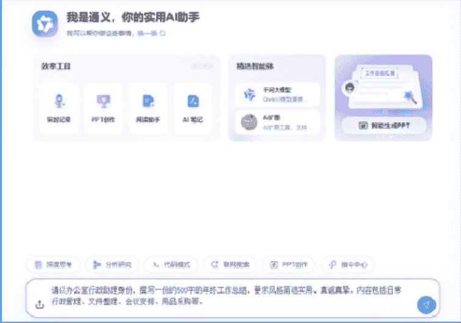

图3-14 输入指令界面

也可以将整理好的工作事项以文档形式上传，再输入指令，这样生成的工作总结初稿会更具体。

以下是通义的回答。

###### 个人小结

时光流转，一年工作即将收官。在行政助理岗位上，我经历了很多，也收获颇多。现对过去一年的工作做个小结，并对今后进行规划。

####### 一、工作回顾

######## 1. 日常行政管理

过去一年，办公室的日常行政管理工作主要由我负责。文件归档整理是保障公司信息有序存储和快速检索的关键环节，我制定了详细的文件分类标准和归档流程，使各类资料都能妥善整理保存，便于同事查阅使用。

办公用品的采购与管理虽琐碎却关键。我会定期盘点库存，根据实际需求制定采购计划，既保证供应充足又避免浪费。同时与多家供应商保持良好合作，通过比价比质为公司降低了采购成本。

会议室的预订与布置同样考验细心。我会依据会议性质与规模提前预订场地，并精心布置会场，确保环境整洁舒适、设备齐全。在有效组织管理下，办公室运转更高效，也为同事营造了良好的工作氛围。

（以下内容略。）

生成初稿只是第一步，还需通过精准优化提升质量。

在对话框中继续输入定制指令：

- ①将模糊表述转化为量化成果；②检查是否存在口语化表述，对口语化表述进行专业修正；③补充 1～2项具体反思；④给出修改注释。

指令中心上方可以保存指令，方便日后调用（见图3-15）。

图3-15 指令快捷调取界面

通过通义的“PPT创作”即可实现PPT生成。通义可完成模板选择、PPT大纲、内容生成及演示等全流程，能明显提升效率（见图3-16）。

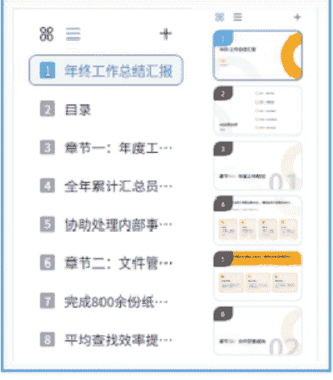

图3-16 PPT创作界面

最后，把导出的PPT转为PDF格式反馈给平台，通义可以智能解析并提取要点。在对话框中输入如下指令：

- 请帮我根据工作总结要点写一篇演讲稿，用于向领导的现场报告，字数500字左右，语言真诚真挚，内容言简意赅。

演讲稿即刻生成，只需再做少量优化即可（见图3-17）。

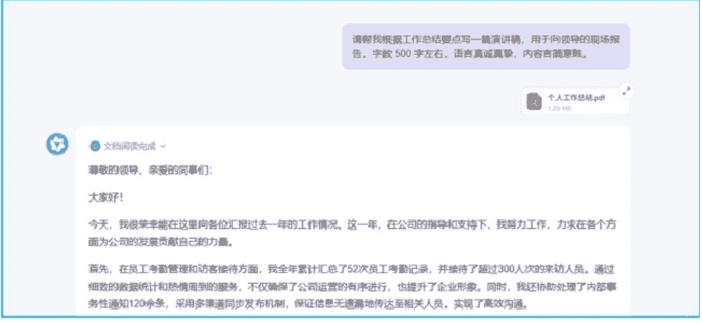

图3-17 演讲稿内容生成界面

从闭环思维看，智能撰写工作总结能让我们更灵活地调整优化，达到事半功倍的效果。只是工作的个性化部分，还需靠自己思考补充。

#### AI工具“论剑”

WPS智能助手和通义界面简洁、操作逻辑清晰、用户友好度较高。在内容生成层面，两者都支持模板与指令输入实现智能创作，提升写作效率。但优化侧重点不同：WPS智能助手更侧重办公场景下的文档处理与格式兼容，通义在公文写作方面更突出，用词严谨、结构清晰。

#### 技能加油站

- 1. 职场思维启蒙

刚入职场的你，或许为工作总结发愁：怕写得太平淡体现不出努力，又怕用词夸张被认为爱表现。其实不必担心，记住四个朴素道理，就能写出有温度又有价值的总结。

##### （1）真实是最好的名片。

工作总结不需要塑造完美人设，曾经的失误与付出都是宝贵经历。有位同事在季度总结里写道：“前两个月因流程不熟常加班到深夜，后来整理了常见问题清单，现在能提前两小时完成周报。”这份坦诚让领导看到了她的成长，也争取到了培训机会。真实的记录比华丽修饰更打动人，领导想要看到的是进步。

##### （2）用细节丈量成长。

工作总结不是成绩罗列，而是用细节呈现价值。比如把“完成客户调研”写成“走访15家客户，收集20条产品改进建议”，把“协助项目推进”改为“协调3个部门完成5次方案对接，节省30%沟通时间”。看得见的细节比空洞的“积极努力”更有说服力。

##### （3）在反思中找到方向。

总结不仅要记成绩，也要反思不足。与其掩盖失误，不如坦然呈现。如：“本月项目因需求确认不充分导致延期，现已建立双人复核机制，确保不再发生。”承认不足是展现解决问题的能力与成长决心，每一次反思都是下一次出发的准备。

##### （4）总结也可以传递温暖。

工作总结里最动人的往往不是数据，而是温暖瞬间。把“感谢同事帮助”写成“特别感谢李姐陪我在办公室逐页核对数据到凌晨”。具体的时间、地点和事件，会让感谢更有画面感和温度。职场不是单打独斗，帮助过你的人值得被真诚记录。

写工作总结不是应付差事，而是梳理成长的过程。用真实经历说话，用具体细节证明，用反思态度进步，用感恩心态记录。回首过往，你会发现踏实与努力早已为自己搭建了向上的阶梯。

##### 2. 练一练，更出色

工作总结是职场必备技能，有人形容：“写工作总结不是为了交差，而是给自己办个颁奖典礼，让每份付出被看见。”学习了撰写方法，也借助智能助手拓宽思路，来做专属练习吧。

#### 小试牛刀

请结合本节所学，用智能助手写一份让人印象深刻的个人半年度工作总结，向身边朋友演示PPT并讲解。

场景设置：回顾半年度工作开展、团队协作、问题改进等情况，突出亮点与反思。

提示：

- （1）可参考“已完成工作事项＋取得成绩＋成果展现＋提出问题＋改进计划+下一步行动方向”的分层设计撰写；
- （2）可用“动作＋数据＋对比”的格式来优化成果，增强说服力，如“新增5家客户，同比增加40%”；
- （3）可在总结中加入反思细节，如“未能实现对100家企业的实地走访，导致供需信息资料库更新不及时”；
- （4）可通过智能助手生成 PPT，每页聚焦一个核心点，可配数据图表与简短金句。

一份好的工作总结“用数据夯实成绩，用故事打动人心”。加入具体案例与情感共鸣点，能达到最佳效果。工作总结被形容为“用过去看未来”，它不仅是对工作的回顾，更是价值的传递。

## 第4章 会议纪要与工作汇报

### 如何写出高水平的会议纪要？

“会议纪要”的“纪”指记载、整理，“要”指要点、重要事项。会议纪要即是记载会议核心要点的公文，作为法定文件在内部沟通、决策跟踪和责任落实中发挥关键作用。高质量会议纪要背后有哪些关键要素？

破局：精准捕捉与高效传达

撰写高质量会议纪要，需对格式与内容精准把握。标题、文号、主持人、参会人员名单等每一个细节都是完整纪要的重要构成。下面通过表4-1明确会议纪要的格式、内容及注意事项。

| 要素 | 格式和内容 | 注意事项 |
|:---|:---|:---|
| 标题 | "会议名称+纪要"（如："20××年度工作总结会议纪要"） | 标题应简洁明了，准确反映会议主题 |
| 文号 | [单位简称]+[年份]+[序号]（如：××字〔20××〕×号） | 文号用于标识公文的唯一性，便于归档和查询。具体视使用单位情况而定，要特别注意括号的使用 |
| 会议时间 | 20××年××月××日××时××分至××时××分 | 使用24小时制，确保时间清晰准确 |
| 会议地点 | 完整的会议室名称或地址 | 地点描述要具体，便于日后查询 |
| 主持人 | 主持人姓名及职务 | 写明姓名及职务，以体现权威性 |
| 参会人员 | 列出所有参会人员姓名及职务 | 按照职务级别或姓氏笔画排序 |
| 缺席人员 | 列出缺席人员姓名及原因 | 如有缺席，注明原因，以便了解情况 |
| 会议议程与讨论内容 | 按照会议实际进行顺序列出议题及讨论要点 | 简洁明了地记录每个议题的讨论重点，避免冗长 |
| 决定事项 | 列出会议形成的决定事项 | 使用动词开头，表述具体，如："批准××项目实施方案。" |
| 责任落实 | 明确责任人、执行期限、验收标准等 | 详细记录，如："由张三负责，20××年2月底完成，验收标准为……" |
| 其他事项 | 记录会议中提及但未形成决策的事项 | 简要记录，以备后续参考 |
| 结尾 | 会议总结或号召性语句 | 简洁有力，提出期望或号召。如："本次会议对单位下一阶段的工作方向和重点任务进行了明确部署。我们期待各部门严格按照会议决策事项执行，共同努力实现年度目标。感谢各位同事的积极参与和宝贵意见，让我们携手并进，共创美好未来。" |
| 附件 | 相关文件、资料等 | 如有附件，注明名称和数量，并在纪要中说明如何获取 |

表4-1 会议纪要要素

明确关键要素后，即使是职场新人也能心中有数。如何将知识转化为操作技能？接下来通过情境体验帮助你掌握技巧。

#### 情境体验

新的一天开始，你整理好桌面准备迎接挑战。主任叫你到办公室，安排你下午参加一次由领导组织的部门沟通会并做记录，撰写一份项目进展的跨部门协调会议纪要。主任要求纪要详略得当、要点突出，便于传阅领会精神。

主任给你一个锦囊：“写好会议纪要并不难，心里没底就打开它。”走出办公室你深吸一口气，不停默念“我能写好这份会议纪要”，最终还是打开锦囊。

锦囊里的内容是表4-2所示的六大步骤。

| 步骤 | 说明 |
|------|------|
| 第一步：做准备 | 提前阅读会议议程及相关文件，了解会议目的、议题和参会人员名单。这有助于你在会议中更好地捕捉关键信息 |
| 第二步：备模板 | 根据公司标准或个人习惯，提前准备好一个简洁而全面的模板，确保涵盖所有必要信息点。模板应包括标题、文号、时间地点、主持人、参会人员、缺席人员、会议议程与讨论内容等要素 |
| 第三步：抓要点 | 参考表 4-1 中的会议纪要要素，确保涵盖所有必要信息点。特别注意记录会议的主要议题、讨论重点、达成的共识以及任何具体行动 |
| 第四步：勤记录 | 在会议期间保持高度专注，使用简洁明了的语言快速记录每一个讨论要点，尤其是领导强调的内容及相关重要决定。对于重要事项，立即标记出来，确保不会遗漏 |
| 第五步：填内容 | 会议结束后立即整理笔记，比如可以设计思维导图，趁记忆新鲜时捕捉更多细节。按照之前设计的模板格式化文档结构，逐一填充每个部分的内容 |
| 第六步：核细节 | 确保语言表达清晰流畅，逻辑严密。对于不确定的地方，及时联系相关负责人确认细节，力求做到精准无误。确保纪要格式符合公司标准，各层级字体、行距、编号等保持一致，保证专业性 |

表4-2 会议纪要的关键步骤

主任还提供了一份参考样例：

#### ××项目进展协调会会议纪要

时间：20××年××月××日

地点：××会议室

主持人：×××

出席人：×××、×××、×××、×××、×××

记录人：×××

为××，更好××，助力××项目顺利开展。20××年××月××日，××项目进展协调会在××会议室召开。会上着重讨论了××。××（职位＋名字）认真听取汇报并对本次会议进行总结，具体纪要如下：

- 一、××项目开展情况（略）
- 二、下一步工作思路（略）
…………

××（职位＋名字）对××项目开展工作表示肯定，他指出××，他强调××，最后××提出××。（结尾部分要做升华，如：××希望各部门默契配合，各负责人严格把关，保障××项目的顺利开展，努力推动××工作朝着更好、更高的方向阔步迈进。）

有了技巧和充分准备，提交给主任审核后获得高度评价。主任还分享了九种会议纪要的表述性提示词用法（见表4-3），便于之后撰写时准确使用。

| 提示词 | 使用说明 | 适用场景 | 示例 |
|--------|----------|----------|------|
| 会议认为 | 用于表达会议对某一事项或问题的共识性判断。适用于需要对议题进行评估和决策的场合 | 决策会议、评估会议 | "会议认为，基于市场分析，扩大产品线是公司未来发展的正确方向。" |
| 会议指出 | 用于强调会议中提到的关键信息、问题或事实。适用于需要提醒注意或解决问题的场合 | 问题分析会议、工作汇报会议 | "会议指出，生产部门的效率低下是影响整体业绩的主要原因。" |

表4-3 九种会议纪要的表述性提示词用法

| 提示词 | 使用说明 | 适用场景 | 示例 |
|--------|----------|----------|------|
| 会议强调 | 用于突出会议中的重点指示、原则或要求。适用于需要重申重要事项或原则的场合 | 工作部署会议、政策宣贯会议 | "会议强调，所有项目必须严格遵守环保法规，确保可持续发展。" |
| 会议决定 | 用于记录会议做出的决定或决议。适用于需要做出明确决策的场合 | 决策会议、董事会会议 | "会议决定，将于下月启动新产品的研发项目。" |
| 会议要求 | 用于提出会议对相关方的要求或指令。适用于需要分配任务或提出具体要求的场合 | 工作分配会议、管理会议 | "会议要求，各项目经理必须在下周一前提交项目进度报告。" |
| 会议建议 | 用于提出会议的建议或推荐措施。适用于需要提出改进意见或建议的场合 | 改进会议、策划会议 | "会议建议，通过增加员工培训来提升客户服务技能。" |
| 会议审议 | 用于记录会议对报告、计划或提案的审查过程。适用于需要对文件进行审查和批准的场合 | 审批会议、规划会议 | "会议审议并通过了下一财年的市场营销预算。" |
| 会议通报 | 用于传达会议中的重要信息或通知。适用于需要分享信息或更新动态的场合 | 信息分享会议、全体员工大会 | "会议通报了公司即将实施的新员工福利政策。" |
| 会议总结 | 用于概括会议的主要内容和成果。适用于会议结束时，需要总结会议成果和下一步行动的场合 | 总结会议、年度会议 | "会议总结了本季度销售业绩，并制定了下季度销售目标。" |

续表

#### 手把手教你用AI写会议纪要

职场里开会几乎是绕不开的常态，从刚入行的小白到浸淫多年的资深人士，都离不开把讨论沉淀成可查证、可执行的文字。会后记录写得专业，往往就成了加分项。先把会前会中会后的思路理顺，再借助智能工具加速，普通的讨论就能变成推动业务和协作的杠杆。

坐在桌边做记录时，片段会慢慢拼成轮廓。难点在于把口头的信息快速整理成完整准确的文本。把撰写拆成可循环的路径，用智能手段辅助每一步提质增效，才是值得反复打磨的方向。下面这套闭环可作为参考见图4-1。

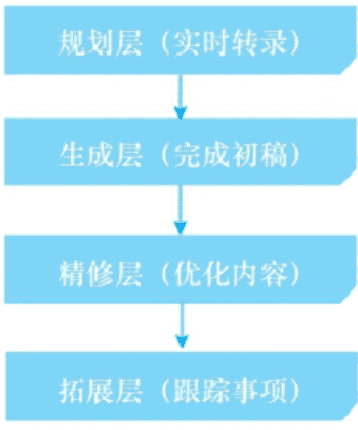
图4-1 撰写会议纪要的闭环思维

规划层，实时转写。会议伊始就打开语音识别类工具，把发言即时转为文字。散会后立刻把生成的文字存档，作为底稿。

生成层，完成初稿。对上一步的文字做深度加工，利用模型自动抽取任务分配、决策点、关键日期等要点，并产出一份通顺的纪要初稿。

精修层，优化内容。借助工具做语法与风格的润色，同时核对一致性和完整性，保障成稿的专业度与信息无遗漏。

拓展层，跟进事项。纪要的真正价值在于落地。可用智能手段从纪要中识别待办，自动派发给对应责任人，并持续跟踪进展。

任务卡已经就绪，AI小助手在待命，我们马上进入本章的实战环节。

任务卡
为让公司、部门与个人目标保持一致，推动战略落地，领导要求你召集多部门参加一次目标对齐头脑风暴，并把讨论整理成可直接执行的纪要。

本次上场的两套工作流组合如下。

飞书妙记+DeepSeek+飞书多维表格

需要实时语音记录时可先用飞书。登录后进入工作台，找到飞书妙记，点击麦克风开始录音。妙记会把音频同步转成文字，并自动给出会议关键词见图4-2。

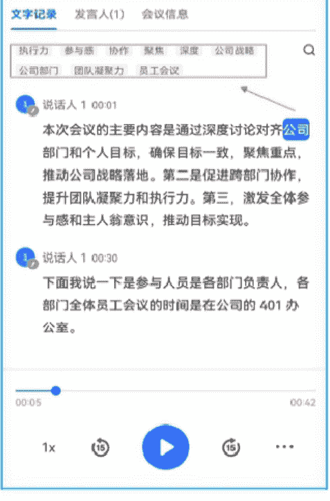
图4-2 语音实时转写与同步记录界面

文字稿完成后建议先复制到本地备份。随后由DeepSeek接手。把文档上传并给出明确指令，让其按规范生成纪要见图4-3。DeepSeek提供两种模式可选：打开深度思考即R1，更擅长复杂推理；不打开即V3，更适合文本类任务。

我们保持默认使用V3，系统很快按指令交付了一份完整的初稿。

图4-3 DeepSeek操作界面

目标对齐头脑风暴会议纪要

会议时间：20××年××月××日星期六，上午 9:00—12:00

会议地点：401 会议室

主持人：朱总

参会人员：各部门负责人及全体员工

一、会议目标
- 1. 通过深入讨论，对齐公司、部门和个人目标，保证目标一致，聚焦重点，促成战略落地。
- 2. 加强跨部门沟通协作，提升团队凝聚力与执行力。
- 3. 激发全体参与感与主人翁意识，推动目标达成。

以下内容略。

接下来做文字打磨，于是继续向DeepSeek发出新指令：
- 请对这份纪要做优化。首要保证格式规范，其次风格以务实为主，开头补充一段过渡性文字。

DeepSeek返回的润色版本如下。

目标对齐头脑风暴会议纪要

会议时间：20××年××月××日星期六，上午 9:00—12:00

会议地点：401 会议室

主持人：朱总

参会人员：各部门负责人及全体员工

一、会议背景
为贯彻公司战略规划，确保公司、部门及个人目标保持一致，资产管理部、企业服务中心、科技服务部于 20××年××月××日联合召开目标对齐头脑风暴会议。会议通过深入讨论明确未来一年的工作重点，推动战略落地，同时促进跨部门协作，提升团队执行力。

二、会议目标
- 1. 目标对齐：确保公司、部门及个人目标一致，聚焦核心工作，推动战略落地。
- 2. 跨部门协作：促进部门间沟通与协作，提升团队凝聚力与执行力。
- 3. 全员参与：激发员工主人翁意识，推动目标实现。

以下内容略。

润色后的质量明显提升。需要强调的是，无论哪款智能工具生成的公文，都必须在风格、用语、规范等方面做人工精修，才能达到公文的高标准。

前三步已完成。最后一步是让纪要中的任务真正落地并可实时追踪。飞书多维表格能实现这一闭环。

进入飞书工作台，选择多维表格，可新建表格，或直接用智能模板一键生成任务表单见图4-4。

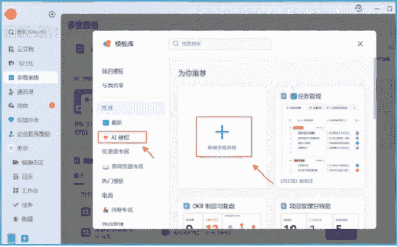
图4-4 任务项表单智能生成界面

飞书多维表格已接入DeepSeek R1大模型，可批量生成任务项并分析痛点给出建议。例如把纪要要点转化为待办，输入事项后点击查看详情，在探索字段捷径下拉菜单中接入DeepSeek R1见图4-5，就能实现待办的智能化追踪与处理。

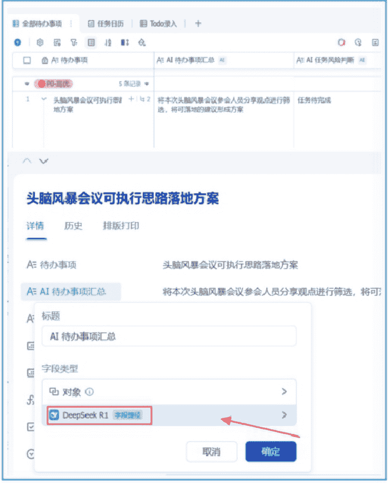
图4-5 批量任务处理工作界面

借助飞书多维表单，可把纪要中的事项分派下去，设定节点监督，遇到难点直接让DeepSeek深度剖析，完整实现纪要在职场中的闭环。

钉钉闪记+豆包+钉钉多维表

打开钉钉工作台，新建文档后在右上角下拉菜单选择“闪记语音速记”，进入界面右侧点“开始录音”见图4-6。闪记可实现实时语音录入并同步文字。

进入豆包官网，上传文字稿并给出明确指令，豆包能快速抓取要点并生成纪要初稿。

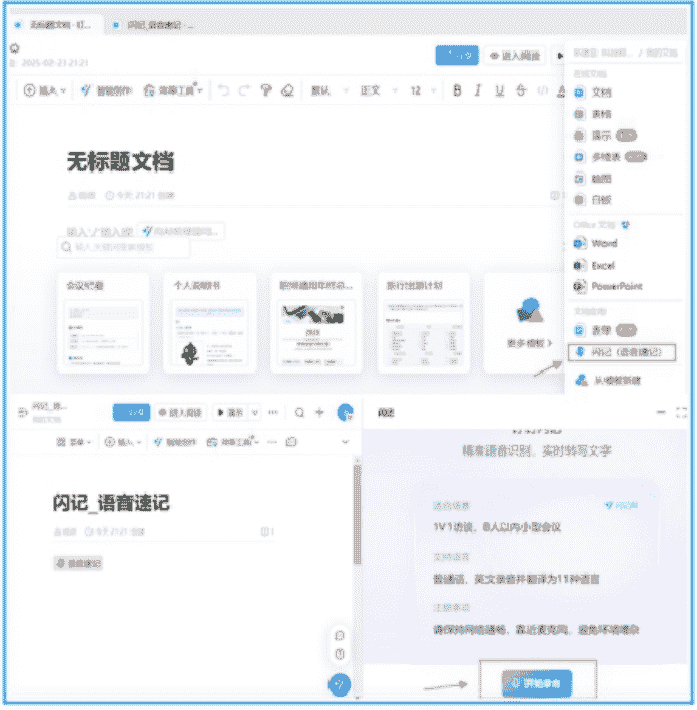
图4-6 语音速记功能启用界面

任务卡内容相同，这里不再重复展示纪要。需提醒的是，豆包界面支持语音输入指令，可直接口述。另外若涉及保密会议，思路不清时可先让模型生成基础框架，豆包写作支持纪要框架的一键生成见图4-7。

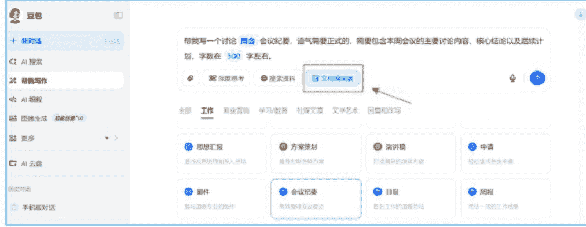
图4-7 会议纪要快速生成界面

如图4-7所示，选择“会议纪要”后按提示输入信息，即可一键生成模板。注意勾选底部“文档编辑器”，生成后仍可在编辑器里做全文润色与长度调整。

对于任务明确且复杂的纪要，建议先由智能工具生成初稿，再人工优化，优化时可借助工具完成局部润色。

纪要完成后，还可通过钉钉多维表跟进执行。进入钉钉选择“多维表”后新建，每个待办项均可接入DeepSeek R1模型，实现任务的深度思考见图4-8。

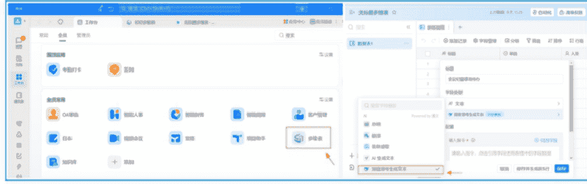
图4-8 智能数据管理界面

从语音实时录入到生成纪要再到待办跟进，组合使用智能方案能更高效地完成公文撰写。

智能方案论剑

针对会后纪要类公文的撰写，组合应用备受关注。从文字表现看，DeepSeek V3在不开启深度思考时能很好地完成指定任务，精准提炼核心要点并生成清晰的待办，极大简化撰写流程。飞书妙记与飞书多维表格配合顺畅，尤其接入DeepSeek R1后，以往耗时的工作可在短时间内完成，效率显著提升。

从隐私保护角度看，豆包的“一键生成纪要模板”可迅速搭建完整框架并优化结构，只需填充内容即可。

钉钉与飞书都是常用办公软件，部分功能相近，均已接入DeepSeek R1，可按个人需求选取。

技能加油站

1. 职场思维启蒙

无论体制内外，写好纪要都是基本生存技能。接到任务时常纠结记什么不记什么？脑中全是领导金句却抓不住重点？掌握三点即可写出推动决策落地的工作纪要。

- 开会前有目标
提前静下心准备。搜集资料，了解会议主题涉及部门、当前讨论事项的痛点。可列清单，把议题拆成“要解决什么问题”“谁存在分歧”“有哪些数据支撑”等维度。
- 开会时做筛选
领导拍桌子的话未必是重点，反复强调的才是关键，记住“必须”“加快”“务必”等关键词。记录时把反复强调的关键词标注星号突出重点；对模糊表态做好标记，会后及时核实。
- 开会后促转化
记完不是终点。建议用两种颜色笔分类：黑色写事实谁说了什么，红色写结论接下来做什么。第二天趁热整理成落实清单，为每个任务标注截止日期和负责人。小技巧：用手机备忘录随手记灵感，晚上梳理时零散想法可拼成完整方案。

给新人的暖心建议：别怕写不好。初期可用“会议目标＋达成共识＋需跟进事项”公式练习。

高质量的纪要能帮团队省时间少走弯路。当你做到会前会中会后带着思考执行，纪要写作能力已过及格线。

2. 练一练，更出色

通过前文学习，相信你已掌握核心要点。下面留时间巩固。

小试牛刀

请结合本节所学，用“智能写作＋人工优化”撰写一份员工季度培训计划讨论会纪要。

场景：部门讨论下季度员工培训安排，需明确课程、讲师、预算等事项。

提示：
- 可参考“培训主题＋参与人员＋达成共识＋待办事项”结构；
- 待办事项需带负责人和截止时间，如“张三负责联系讲师，××月××日前确认”；
- 忌用模糊表述，要具体，如“尽快落实”改为“××月××日前完成××事项”；
- 核查是否遗漏关键信息，如预算金额、培训地点。

会后文档的最终目的，是把会议决定转化为可具体落实的行动步骤。巧用智能工具抓取关键任务，人工确认责任人和时间，纪要才能真正推动执行。

怎么写作汇报，才能让努力被看见？

每一位努力工作的员工都希望付出得到认可。光靠默默耕耘不够，关键在于把努力有效传达给上级。工作汇报就是载体，既是信息传递工具，也是展示价值、推动进展的重要文件。如何撰写才能让努力被看见？

破解无效汇报

写好汇报的关键在于掌握格式和灵活运用逻辑框架。格式较简单，一般包括标题和正文。

标题构成公式：主题名称＋核心内容＋文种。如：关于××项目阶段性工作情况的汇报。

正文需突出重点、逻辑通畅，要写清汇报目的、当前工作情况概述、存在问题、原因分析、改进措施及建议、下一步工作计划及结语。以下为样例模板。

一、标题
关于××项目阶段性工作情况的汇报

二、正文
汇报目的：根据上级部门关于项目推进的工作要求，现将项目执行情况汇报如下。

一 当前工作情况概述
- 1. 项目进展情况：
  - 1 完成了××任务；
  - 2 实现了××目标；
  - 3 取得了××成效。
- 2. 工作亮点：
  - 1 创新了××工作方法；
  - 2 提高了××工作效率；
  - 3 加强了××方面的合作。

二 存在问题
- 1. ××方面存在不足；
- 2. ××资源配备有待加强；
- 3. ××政策支持尚需进一步明确。

三 原因分析
- 1. ××因素影响；
- 2. ××条件限制；
- 3. ××协调机制不够完善。

四 改进措施及建议
- 1. 加强××方面的工作力度；
- 2. 优化××资源配置；
- 3. 积极争取××政策支持。

五 下一步工作计划
- 1. 完成××任务；
- 2. 达到××目标；
- 3. 确保××成效。

结语：请领导给予批示，并对我们的工作提出宝贵意见。

熟悉格式后，下一步是掌握逻辑框架。表4-4所示的四个维度及“公式＋样例应用”可在不同场合选择合适表达方式，确保每次汇报效果更佳。

掌握基础后，如何迅速提升汇报质量，使之更专业高效？接下来通过“情境体验”揭示工作汇报快速上手的技巧，帮助你在实际应用中脱颖而出。

维度 说明 公式 + 样例应用
站位准确 了解汇报对象的需求和偏好，调整汇报层次和风格，确保报告既传递信息又赢得认可 公式：背景 + 重点 + 建议
样例应用：
1. 背景：根据最新政策；
2. 重点：我们部门的重点工作是提升服务效率；
3. 建议：今年特别加强了在线服务平台建设，显著提高了用户满意度。建议在接下来的工作中进一步扩大该平台的服务范围

维度 说明 公式 + 样例应用
量化成果 用具体数据和指标证明工作成果，不要只讲做了什么，更要展示带来的具体变化和进步 公式：数据 + 分析 + 展望
样例应用：
1. 数据：本年度共完成100个项目，其中85%按时交付，群众满意度达到92%；
2. 分析：项目完成量较去年增长15%，主要得益于优化审批流程、引入新的服务管理工具以及加强部门间协作；
3. 展望：预计明年通过持续改进服务流程和进一步提升团队服务水平，能够将项目完成数量提升到120个，并保持或提高群众满意度至95%以上

维度 说明 公式 + 样例应用
细化内容 深入挖掘工作细节，分享解决实际问题时的经验和心得 公式：任务 + 经验 + 启发
样例应用：
1. 任务：针对以往审批流程冗长的问题，我们启动了审批流程优化项目；
2. 经验：通过引入自动化审批系统和简化不必要的审批环节，成功将平均审批时间从原来的5个工作日缩短到2.5个工作日，减少了50%的时间；
3. 启发：这一经验不仅提升了内部工作效率，也为其他部门提供了宝贵参考

维度 说明 公式 + 样例应用
创新思考 提出新想法和建议，展现前瞻性思维，并提供切实可行的实施方案 公式：想法 + 论证 + 实施
样例应用：
1. 想法：考虑到信息技术的发展趋势，目前正在评估引入智能化管理系统；
2. 论证：初步测试显示，这将使工作效率提高约30%；
3. 实施：下一步计划选择几个关键部门作为试点，验证其长期效益后逐步推广

情境体验

两天前，你出色完成了主任布置的纪要任务，主任的锦囊也让你信心倍增。当主任再次把你叫到办公室时，你心里默想：“这次我一定能做得更好。”

主任拿出一份文件夹放在办公桌上，缓缓说：“今天我们有一个新任务，同样重要。”他解释道：“明天将举行一次高层管理会议，而你需要在会上做一个简短但精准的工作汇报。”这个汇报将围绕上周跨部门协调会议的主要内容展开，重点在于项目进展、遇到的问题以及提出的解决方案。主任希望能通过你的汇报，让高层管理者更清晰地了解当前项目的实际情况以及办公室团队做出的努力。

主任交代任务的同时，给你的邮箱发送了邮件，叮嘱你仔细查看。

撰写高质量的工作汇报，不仅需要清晰的逻辑框架，还需要掌握实用写作技巧。当你打开邮件，才发现主任在四维逻辑框架基础上，帮你提炼出了六种写作技巧见表4-5。接下来我们将结合主任的指导，逐步解析工作汇报的撰写全流程。

写作技巧 说明 你的应用
背景设定法 开篇介绍工作的背景和目的，为后续内容铺垫基础 为了确保汇报能够有效地传达信息并引起关注，你决定从介绍项目的最新背景和目标开始：
“各位领导，在过去的一周里，我们召开了关于[项目名称]的跨部门协调会议，讨论了项目目前的进展情况。此次会议汇聚了各部门的意见和建议，旨在加强协作效率，解决现存问题，并为未来的发展规划奠定坚实的基础。”
主旨提炼法 明确全文的核心思想，提供清晰指引 使用“主旨提炼法”来明确全文的核心思想：
“我们的团队始终秉持‘高效、透明、责任’的原则，致力于每一个细节的优化，以确保项目的顺利推进。今天的汇报将展示我们在推进项目方面所做出的努力，并提出具体的改进措施。”

职场上让人记住的汇报，本质是把因果和数据讲成一个完整的故事。下面这份梳理在保留原有逻辑的基础上，换了一种更贴近自媒体阅读的表达。

### 汇报撰写的常用思路

**对比呈现**：借助前后变化或横向参照，把成果和痛点同时立起来。想提升说服力，先把数据备齐，呈现推进前后的落差。例如：“推进过程中虽遇到不少阻力，通过精细化管控和技术升级，项目周期缩短10%，费用节约8%。细节可从若干关键指标或典型案例展开。”

**结论前置**：先把判断摆出来，牵引听众注意力。面对多议题时，开篇点明核心，帮助对方迅速抓住要点。例如：“近期服务品质出现波动，已组建专项小组，应对动作包括强化培训和优化考核机制。”

**案例落地**：用真实事例把抽象观点具体化，让汇报更生动。比如：“招商部门通过多场主题活动，有效提升了项目品牌认知；技术部门攻克了长期困扰的系统稳定性难题，工作效率得到明显改善。”

**收束展望**：结尾抛出后续思路，体现前瞻性。例如：“未来一年，持续深化数字化转型，挖掘更多智能化应用场景，提升用户使用体验；同时策划一系列服务升级举措，进一步提高满意度。”

表4-5 工作汇报的六种写作技巧

| 写作技巧 | 说明 | 你的应用 |
|:---|:---|:---|

| 规划收尾法 | 收束时提出后续工作设想和规划，展现前瞻性思考 | 最后对汇报收尾做了专门设计，提出了后续设想和规划：“未来一年，将继续深化数字化转型，探索更多智能化应用场景，为用户提供更加便捷的服务体验；同时，计划推出一系列新的服务举措，进一步提升用户满意度。” |

续表

环节一：搭骨架。动笔前先回溯汇报的版式与逻辑，一个清晰的骨架能帮助思路更有序，内容更条理、重点更突出。

环节二：融方法。结合表4-5中的六种写作技巧，对材料逐项提炼，既能提升专业度，又能增强说服力和吸引力。

环节三：理脉络。把优化后的内容整合起来，确保各部分围绕同一主题展开，逻辑顺畅、重点集中。核对各模块是否相互呼应，避免重复或缺漏。

环节四：审校细节。初稿完成后逐项检查，语言是否简洁，数据是否准确，格式是否统一。

把润色好的材料发送给主任后，很快收到肯定回复。会上顺利陈述项目进展与团队付出，获得领导高度评价。

汇报结束后，主任提出一个问题：“工作总结和工作汇报，到底有什么区别？”稍作整理后，用表4-6作答，主任点头认可。

| 维度 | 工作总结 | 工作汇报 |

|:---|:---|:---|

| 目的 | 当工作进行到一定阶段或告一段落时，回头分析研究，梳理成绩，找出问题，归纳经验教训，提高认识，明确方向，以便进一步做好工作 | 针对特定对象，对一定时期内或某项工作的具体进展情况进行归纳并报告，通常是为了请示、通报或寻求指导 |

表4-6 总结和汇报的区别| 维度 | 工作总结 | 工作汇报 |

|------|----------|----------|

| 时间 | 阶段性（如项目结束、年末、完成重要任务后），通常在特定的时间点进行 | 定期（如每周、每月）或不定期（如项目关键节点），通常根据需要而定 |

| 对象 | 不一定有特定的对象，用于自我提升或内部沟通 | 有特定的目的和对象，一般是下级对上级，目的是让对象了解最新动态并获得反馈 |

| 格式写法 | 更加灵活，注重深度分析和反思 | 结构化，明确列出关键点，便于快速阅读和理解，更侧重说明 |

### 用智能助手提升汇报效率

掌握汇报的四维逻辑是基础，清晰条理、重点突出决定质量。但写作时常会卡壳，这时善用智能助手打开思路很有效。

我们先弄清楚传统技巧、汇报与总结的区别，下面聚焦如何借助助手提升效率和质量。同样采用闭环思维串联撰写要点（见图4-9）。

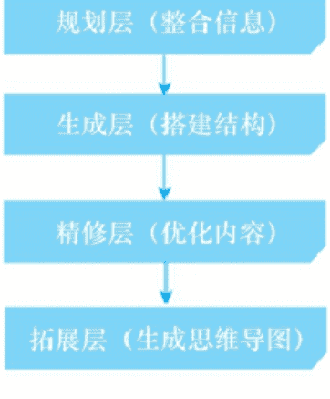

图4-9 撰写工作汇报的闭环思维

整合信息层：把手头的数据、进展、问题等交给助手梳理，形成基础素材。

搭建结构层：给出明确目的和需求，让助手生成合适框架，如总分总结构。

内容精修层：依据指令和风格要求，让助手润色整体，补充衔接词，使表达更顺畅。

思维拓展层：让助手把汇报转成层级清晰的思维导图，便于记忆要点，防止现场紧张忘词。

具体怎么操作？领取任务卡，助手助你完成。

##### 任务卡

公司筹备重大项目，你在筹备组，需向领导汇报近期进展、存在问题及后续安排。

两位主角是DeepSeek与腾讯元宝，结合Xmind生成思维导图，实现撰写闭环。

##### DeepSeek 搭配 Xmind

登录DeepSeek官网，命令框里不点“深度思考”（R1模型），选用更适合文本任务的V3引擎进行信息梳理。

可用前文提到的语音记录工具记录，随时同步文本。记录内容哪怕凌乱，直接输入指令：

- 我现在要写一份现阶段的工作汇报，需要让领导迅速了解重点，以上是我目前工作的基本情况，请帮我梳理出核心要点。

以项目一、事项二为例，DeepSeek梳理出的要点如下。

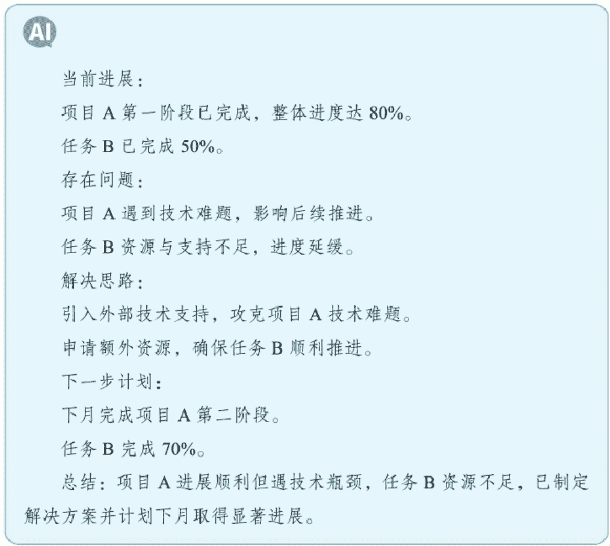

敲定要点后，进入下一步，让DeepSeek搭建整体框架。注意：建议在助手框架上人工微调，而非全盘照搬。可针对性加入分析和见解，保留灵活性，让汇报更有温度、更打动人。

继续输入指令：

- 请根据当前内容做调整和优化，保留核心要点，生成工作汇报框架，确保符合公文规范和标准。

DeepSeek很快给出框架。

###### 工作汇报框架

**标题**：关于项目一及事项二进展情况的汇报

**正文**：

**一、工作进展情况**

项目一：

第一阶段工作已完成，整体进度达80%。

现阶段正按计划推进第二阶段工作。

事项二：

已完成50%的工作任务，但因资源不足，进度有所延缓。

**二、存在的问题**

项目一：

遇到技术难题，影响后续工作推进。

事项二：

资源与支持不足，导致进度延缓。

**三、解决思路**

项目一：

计划引入外部技术支持，集中力量攻克技术难题。

事项二：

申请额外资源，优化资源配置，确保任务顺利推进。

**四、下一步计划**

项目一：

计划于来月完成第二阶段工作。

事项二：

力争将事项二完成70%。

**五、总结**

当前项目一和事项二总体进展符合预期，但存在技术难题和资源不足的挑战。已制定针对性解决方案，并计划来月取得阶段性成果。后续将继续加强协调与资源调配，确保工作按计划完成。

补充具体数据后，可让DeepSeek给出注意事项。例如：

- 我需要这份汇报既能在短时间内说清楚核心要点，也能打动人心。

DeepSeek给出七点提示，其中两点如下：

> **AI**
>
> 强调解决方案的可行性：
> 在“解决思路”部分，补充具体措施的执行细节（如已联系的外部技术支持团队、申请资源的具体需求），展现行动力和解决问题的决心。
> 例如：“已与××技术团队达成初步合作意向，预计下周开始技术攻关。”
>
> 总结部分画龙点睛：
> 在总结中简要回顾核心内容，并表达对未来的信心和决心，给领导留下深刻印象。
> 例如：“当前工作虽面临挑战，但团队已制定切实可行的解决方案，并全力推进。我们有信心在下一阶段取得突破性进展。”

第三步，用DeepSeek整体润色。以“项目一第一阶段完成，项目一进度为80%，事项二完成50%”为例，输入润色指令：

- 原句：项目一第一阶段完成，项目一进度为80%，事项二完成50%。
- 智能润色后：目前，项目一第一阶段已顺利完成，整体进度达到80%，展现了团队的高效执行力；事项二也已完成50%，尽管面临资源不足的挑战，但团队依然稳步推进，为后续工作奠定了坚实基础。

最后利用Xmind生成思维导图，轻松应对现场。

在对话框输入：

- 帮我将上面的工作汇报生成思维导图，以Markdown 文本输出。

复制内容，新建记事本文件，将后缀改为md，确认后粘贴，打开Xmind官网导入文件即可。

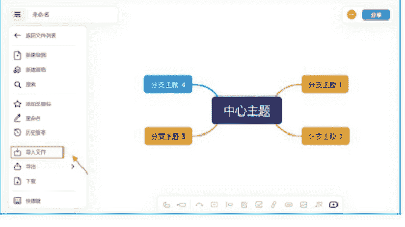

图4-10 Xmind支持导入md格式的思维导图

导入后一键生成导图（见图4-11）。

DeepSeek与Xmind覆盖四大步骤，实用性强，既提效又启发思路。

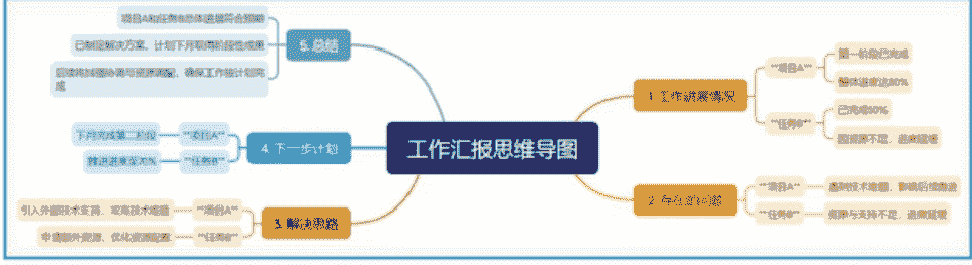

图4-11 思维导图生成效果

##### 腾讯元宝 搭配 Xmind

登录腾讯元宝，可见混元模型Hunyuan和接入的DeepSeek（见图4-12）。选用Hunyuan演示。

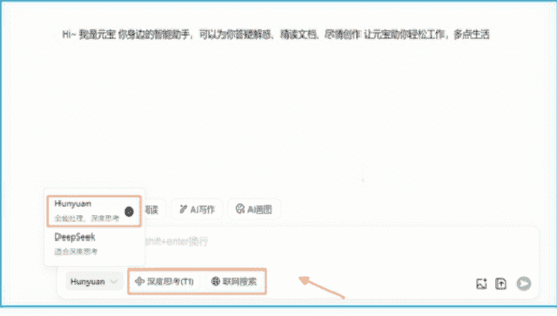

图4-12 腾讯元宝的AI模型选择界面

输入指令：

- 我现在要写一份现阶段的工作汇报，需要让领导迅速了解重点，以上是我目前工作的基本情况，请帮我梳理出核心要点。

以项目一、事项二为例，选择“深度思考（T1）”与否的对比如图4-13所示。

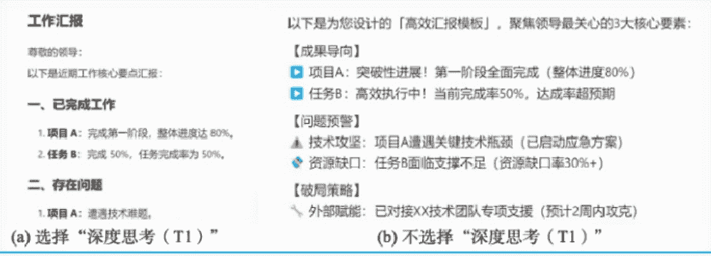

图4-13 生成内容对比

“深度思考（T1）”更擅长推理和给出方案；不开启则文本更贴合实际需求。

为提升说服力，可用SWOT拆解提炼要点。输入指令：

- 请基于以下工作背景生成SWOT框架，要求分“优势、劣势、机会、威胁”四部分，每部分包含两个具体条目，语言风格保持客观严谨。

项目一：已完成第一阶段（进度80%），存在技术难题。

事项二：完成率50%，面临资源不足问题需突出阶段性成果价值、问题解决思路，并预测潜在影响。

参考格式：

优势1. 项目推进成果（具体说明）；

优势2. 问题应对能力（具体策略）。

腾讯元宝回答如下。

###### 优势

项目推进有一定成果：项目一已完成第一阶段，整体进度达到80%，事项二也已完成50%，说明团队具备一定的项目执行能力和专业技能，在前期的工作中取得了阶段性的成绩，为后续工作奠定了基础。

应对问题的思路明确：针对项目一的技术难题和事项二的资源不足问题，已经有了清晰的解决思路，即引入外部技术支持和申请额外资源。这种积极主动的态度和解决问题的方法有助于克服当前的困难，确保项目继续推进。

###### 劣势

技术难题影响进度：项目一遇到技术难题，可能导致后续阶段的开发难度增加，开发周期延长，影响整个项目的交付时间。如果技术难题无法及时解决，还可能引发连锁反应，对其他相关任务和项目产生负面影响。

资源与支持不足：事项二所获资源与支持不足，后续开展进度延缓。资源短缺可能会限制团队的工作能力和效率，导致任务无法按照计划完成，影响项目整体进度和质量。

（以下内容略。）

SWOT有助于提升深度和前瞻性。继续输入：

- 请以这份SWOT分析为参照，帮我生成工作汇报框架，要符合公文规范和标准。

腾讯元宝给出框架。

###### 关于项目一、事项二工作情况的汇报

**一、工作进展概述**

**（一）项目一**

截至目前，项目一已完成第一阶段，且整体进度达到80%。各项前期任务均按计划顺利推进，为后续阶段的开展奠定了坚实基础。

**（二）事项二**

事项二已完成50%，完成率达到一半，取得了阶段性的成果。

**二、优势分析**

**（一）成果基础扎实**

项目一和事项二的阶段性成果表明团队具备良好的执行能力、专业素养和项目推进能力，为后续工作提供了有力支撑。

（以下内容略。）

SWOT后的框架更扎实。人工微调后，可用腾讯元宝的文本润色功能，或输入：

- 请结合原文特点和公文写作规范进行润色，重点关注语言的简洁性、逻辑的连贯性和信息的完整性，使最终文本专业、规范、实用、高效传达信息。

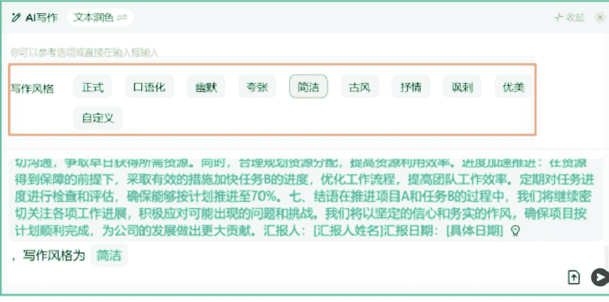

图4-14 优化功能操作界面

也可点击“分享”转腾讯文档在线编辑。生成思维导图时建议切回DeepSeek V3引擎，Xmind对部分Markdown 文本兼容性更好。

#### 助手使用对比

DeepSeek V3在文本类任务上表现稳定，框架生成和语句润色都很顺手，需注意公文格式和指令的精准度。腾讯元宝同时提供自研混元模型和DeepSeek接入，并配有AI写作、AI阅读等细化优化功能，让汇报更精致。

#### 技能加油站

- 1. 职场思维启蒙

除了文字稿，可配一份精致PPT提升印象分。更重要的是汇报前想清三件事：

  - （1）领导最关心什么？（如总经理关注民生工程，副总重视流程创新。）
  - （2）这次汇报要解决什么问题？（避免写成流水账。）
  - （3）潜在延伸需求是什么？（提前思考资源争取和可能被问的敏感点。）

万能应急公式：当前进展＋存在问题＋解决建议＋需要支持。无灵感时可用此填充。

正式汇报前注意两点：

  - （1）防止忘词。PPT备注或便签纸写下核心数据。
  - （2）充分准备。领导说“再想想”时，可回“是否需要补充这几个方面的分析？我已整理详细资料”，做到多手准备。

重要汇报建议提前打印精简材料。领导临时要数据或方案时，准备好的材料能赢得信任。

- 2. 练一练，更出色

汇报不该是应付作业。数据不漂亮也能讲出价值感。掌握方法后，用“AI写作＋人工微调”写一份部门月度汇报小试牛刀。

#### 小试牛刀

请结合本节所学，用“AI写作＋人工微调”撰写一份你所在部门的月度工作汇报。

场景：向上级汇报重要工作事项进展及下一步计划。

提示：

- （1）可参考“核心成果＋问题分析＋下一步计划＋工作需求”结构；
- （2）核心成果用“动作＋数据”公式，如“举办3场××活动，新增20家客户”；
- （3）加入对比数据增强说服力，如“较上月客户转化率提升12%”。

汇报职场暗语是“用上级关心的数据，换你想要的资源”。AI整理基础信息后，人工微调时突出“我多做了什么”，而非“我做了什么”。

## 第5章 规章制度与管理法

### 揭开规章制度的“面纱”

规章制度与管理办法是组织高效运作的基石，却常被复杂术语吓退。本节带你拆解其本质与逻辑，消除畏难情绪。

#### 如何制定有效的规章制度？

起草任务来临时，先熟悉构成要素（见表5-1）。理解加深后会发现并非高不可攀。

| 构成要素 | 说明 |

|---------|------|

| 总则 | 包含规章制度的主旨、目的、适用范围等概述性信息。确保语言简洁明了，避免使用过多的专业术语 |

| 职业道德 | 明确规定员工应当遵循的职业操守，如诚信、保密、尊重同事等 |

制度能不能真正跑起来，关键看顶层框架是否把核心支柱都放进去了。

条款拆分，是把不同业务主题或职能单元的规则单独拎出来写，比如财务、人事、行政、安全等方向。每条都要落到可对照执行的颗粒度。

正向激励与反向约束并重，既要设计奖励来强化好行为，也要把违规的后果写清楚，尺度公平，引导才有效。

收尾部分负责给整份文件兜底，包含启用时点、修订方式和其他补充说明，让文件可以随环境变化持续迭代。

表5-1 制度组成要素

搞清楚构成只是起点，能不能顺畅推行更取决于设计思路和文字表达是否到位。记住下面几个写作要诀，就能让文件更好读、更好用。

要诀一，表述宜精炼易懂。少用生僻术语，用通俗语言把意思讲透，让非专业人员也能迅速明白。

要诀二，用动词开头的指令。如“严禁”“须”“应当”，要求更直接，执行起来也更清晰。

要诀三，全文风格与版式保持一致。字号、行距、标题层级统一，专业感和连贯性才会出来。

要诀四，关键信息单独突出。对核心内容做明确标注，避免大段堆砌，让阅读者迅速抓住重点。

要诀五，时间节点写明白。启用时间与修订流程必须清晰，文件才有实效性和灵活性。

下面用一份初稿和优化稿来对照要素与要点的落地效果。

##### 初稿示例

**概述**

- 1. 该规范覆盖公司全体在编人员。
- 2. 人员须遵守公司机密保护要求，不可向无关人员透露。
- 3. 费用报销须附原始单据，并填写费用报告表。
- 4. 表现优秀的人员公司会给予表彰与奖励；违反纪律者可能被解除。
- 5. 文件自发布之日起生效，变动时需提前通知全员。

读完这版，结合前文的组成与写作要诀，可以归纳的不足有：

- 结构松散，缺少分层与标题，内容堆在一起阅读体验差。
- 表达不够精炼，部分句子拖沓。
- 指令性弱，开头动词不足，说服力不够。
- 用词与格式不统一，有时用“正式员工”，有时只用“员工”。
- 重点不鲜明，核心信息被淹没。
- 时间表述模糊，生效与修订程序说得不清。

##### 优化后版本

**章一 序论**

**条一 目的**

为保障公司与人员的合法权益，营造积极向上的工作氛围，依据××等相关法规，制定本规范。

**条二 适用范围**

本规范适用于本公司全部人员。

………

**章二 职业道德**

一、人员应诚实守信，保守公司秘密，任何形式不得向外部泄露机密。

二、尊重同事，严禁任何形式的歧视与骚扰。
………

###### 章三 行政管理

- 一、工作时间：严格遵守作息，迟到早退按规定处理。
- 二、着装要求：工作日着装得体，符合企业形象。
- 三、行为准则：保持办公区整洁，爱护公共设施。
………

###### 章四 财务管理

- 一、费用报销：所有费用报销须附原始单据，并完整填写费用报告表以便审核。
………

###### 章× 激励约束

####### 条× 奖励

- 一、对连续三个月表现优异的人员，公司将公开表彰并给予适当物质奖励。
………

####### 条× 约束

- 二、违反公司规定者，按情节轻重给予警告至解除劳动合同处理。
………

###### 章× 补则

####### 条× 修订

公司保留修订本规范的权利，修订内容将及时告知人员。

####### 条× 实施

本规范于20××年××月××日起实施。

掌握核心逻辑后，用一个情境来加深理解。

#### 情境体验

主管走到你桌前递来一杯咖啡，说：“今天有新任务，要起草一份全新的职工行为规范，让人一看就懂、好执行。”

你心跳加速，压力陡增。主管察觉后微笑补充：“任务不轻松，但我相信你能完成，我会全程指导，手把手教你写出高质量的文件。”

主管拿出纸笔，分享经验。

环节一 明确边界。先明确文件要解决什么问题，比如构建和谐环境、促进同事关系。明确对象，覆盖正式人员和非正式人员。

环节二 搭建框架。先搭好整体结构，思路清晰，阅读者也能快速定位。

环节三 编写序论。开篇用简洁语言说明文件目标和适用对象，是阅读者入门的关键。

环节四 细化条款。逐条细化职业道德标准和具体规则，让日常行为与公司价值观匹配。

环节五 建立机制。设立激励与约束机制，提升积极性，营造公平透明氛围。

环节六 拟定补则。明确生效时间、变更程序及补充条款，保证文件可更新。

环节七 复核细节。初稿完成后交法律专家和管理层审阅，按反馈修改，确保合法合规。

学会方法后，你很快完成初稿。这已是你接触的第七类公文，挑战感与期待感并存。

#### 手把手教你用智能系统写规范

规范文件是企业实现管理目标的重要抓手。学完序论、细则到补则的内在关联，你可能会问：“思路不清晰时怎么办？”这正是智能系统发挥价值的场景。下面介绍如何借助智能系统高效完成整体撰写。

很多人习惯套模板。现在有了智能系统，不仅能套模板，还能快速生成逻辑清晰、规范合理的框架，并结合行业特点、管理目标提供定制化内容，甚至做初步合规性校核。

在文件设计中，可用闭环思路覆盖规划到实施，并为后续优化预留接口，保证文件的持续适应性（见图5-1）。

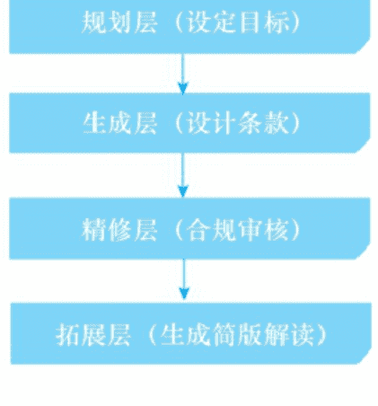

图5-1 撰写规范的闭环思路

**规划层（设定目标）**：让系统分析文件使用场景，明确目的、适用范围和预期成效。

**生成层（设计条款）**：基于分析结果编写具体条款，优化结构提升逻辑与可读性。

**精修层（合规审核）**：借助系统知识库核查条款是否符合现行法规与政策。

**拓展层（生成简版解读）**：输出通俗简版，便于培训或快速了解。

练习单已准备就绪，智能助理在待命。我们以办公用品使用管理为例开始实操。

##### 练习单

公司需制定新的办公用品使用规范，以规范使用与管理。

本次引入两位智能助理：检索能力强的秘塔检索平台，以及深度思考的纳米系统。

###### 秘塔检索平台

进入秘塔检索平台官网，选择“研究”模式下的“先想后搜”（见图5-2），系统会先搭建思路再整合资料。在对话框输入指令：

- 目前我需要为公司制定一份办公用品的使用规范，请结合使用情境进行分析，明确这一规范的具体目的、适用范围及预期效果并给出目前可以作为案例的对应模板作为参考。

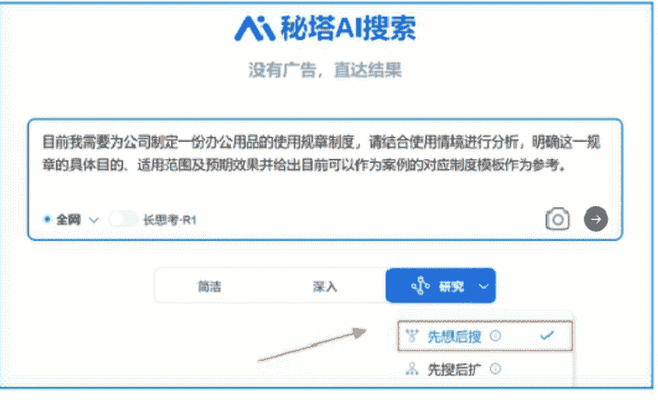

图5-2 智能检索界面

说明：秘塔检索平台默认全网检索，“长思考·R1”采用DeepSeek架构，文本任务可不勾选。三种模式中，“研究”模式输出更全面深入，对公文类任务效果更好。

以下是秘塔检索平台的输出。

####### 办公用品使用规范制定方案（基于情境分析）

######## 一、规范制定的核心目的

**成本控制与资源优化：**

通过统一采购、预算审批、库存监控等手段，实现年度办公用品费用降低15%～20%（案例参考：某地市局通过精益管理实现持续降本）。

避免因个人囤积、私用导致的隐性浪费，如某医疗健康机构因未规范按摩椅采购导致非必要开支。

………

######## 五、情境化实施建议

**初创企业适配版：**

- **简化分类：** 仅分“设备/耗材”两类，采购权限下放至部门经理。
- **云采购模式：** 接入××企业购、××办公等平台，实现48小时到货。

**生产制造企业特别条款：**

- **车间专用品：** 如防油污笔记本、抗静电文件夹，需单独建账。
- **安全管控：** 涉及图纸打印的部门，硒鼓回收需粉碎处理。

（以下内容略。）

可以看到系统结合情境做了全面拆解，并给出参考资料与针对性建议。通过思考过程（见图5-3），可见其对资料进行需求适配。

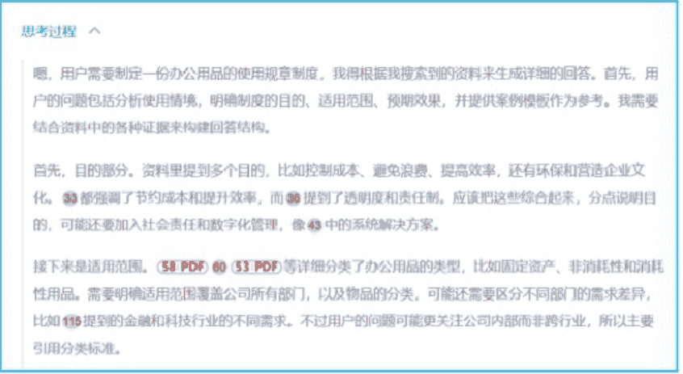

图5-3 秘塔检索平台的思考过程展示

接着使用“追问”功能（见图5-4），输入指令：

- 现在我需要补充具体条款，并撰写完整的办公用品管理规范，请你润色和调整上面的分析与模板框架，这份管理规范需要包括序论、职业道德、细则、激励约束、补则。

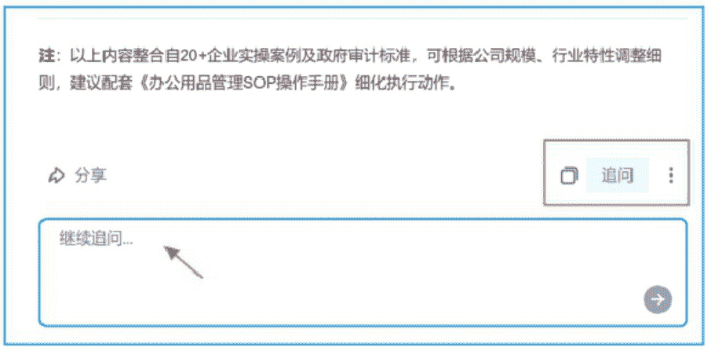

图5-4 智能追问功能界面

秘塔检索平台的回答如下。

####### ××公司办公用品管理规范

######## 章一 序论

………

######## 条二 适用范围

适用对象：公司全体人员（含正式人员、实习生、外包人员）、各分支机构及关联部门。

适用物品：固定资产（单价≥2000元）、低值易耗品、IT专用耗材等12大类（详见附件1《分类清单》）。

………

######## 章二 职业道德

######## 条四 行为准则

人员在使用办公用品时须遵守以下道德规范：

1. 禁止私用公物：不得将公司物资用于私人事务（如打印个人文件、携带文具回家等）。
2. 数据真实性：严禁虚报采购需求、伪造领用记录或篡改库存数据。
………

######## 章三 细则

######## 条十一 绿色办公

1. 推行无纸化办公，非必要文件双面打印，单面废纸需二次利用为草稿纸。
2. 电子设备下班以后必须断电，违反三次以上者通报批评并取消年度评优资格。
………

######## 章四 激励约束

######## 条十三 奖励机制

1. 节约标兵奖：年度办公成本节省超标的部门，按节省金额的10%发放团队奖金。
2. 合理化建议奖：人员提出管理优化方案并被采纳的，给予500~2000元奖励。
………

######## 章五 补则

######## 条十五 生效与修订

1. 本规范自20××年××月××日起执行，旧版规范同时废止。
2. 每年由行政部牵头修订，修订稿需经职工代表大会审议通过。

此时需要人工介入，结合实际情况补充修改并微调措辞。

修改条款后，可请秘塔检索平台做初步合规审核，例如是否符合法律规定、是否涉及敏感内容。

系统结论：现行草案在采购程序、处罚权限、合同管理等方面存在五项高风险条款，需按建议修订以确保合法性。修订后应提交法务部、人力资源部、审计部三方会签，并在职工代表大会公示后生效。

可先按系统建议做初步调整，再交专业部门全面复核。

最后，为培训准备简版解读，可输入指令：

- 请帮我生成简版解读，便于人员培训或新人快速了解。

秘塔检索平台给出的简版解读令人眼前一亮（见图5-5）。

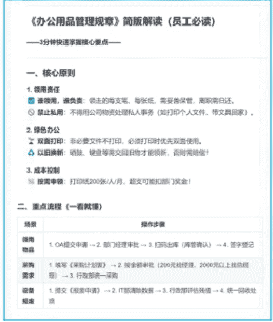

图5-5 秘塔检索平台生成的简版解读

###### 纳米系统

进入纳米官网，左侧选择“大模型”，默认DeepSeek架构（见图5-6）。输入指令：

- 目前我需要为公司制定一份办公用品的使用规范，请结合使用情境进行分析，明确这一规范的具体目的、适用范围及预期效果并给出目前可以作为案例的对应模板作为参考。

图5-6 纳米的深度思考及联网搜索界面

纳米提供“知识库”功能，可一键保存答案便于复用。

纳米的回答如下。

####### 一、使用情境分析与制度设计要点

**高频场景与风险管控**

- 日常领用：笔、纸张等易耗品易出现超额领取，建议采用月度配额制（如每人每月限领三支笔）。
- 设备借用：投影仪、移动硬盘等需建立“借用登记—归还验收”流程，避免资产流失。
- 跨部门协作：打印机等共享设备需明确费用分摊规则，按部门使用量核算成本。

**具体规范目的**

- 减少年度办公费用10%～20%（通过采购比价、以旧换新等机制实现）。
- 实现资产全生命周期管理，建立“采购—领用—维护—报废”闭环。
- 杜绝私人用途消耗，如限制打印纸张单日领取量。

**适用范围**

- 人员：全员覆盖，包括外包人员（领用需额外审批）。
- 物品：明确区分消耗品（如纸杯）与固定资产（如碎纸机），执行不同管理标准。

（以下内容略。）

纳米从情境分析、核心框架、配套工具三方面给出建议。随后输入指令：

- 帮我生成一份完整的管理规范，按照序论、职业道德、细则、激励约束、补则的框架来呈现。

答案如下。

####### 办公用品管理规范

（20××年××月××日生效）

######## 章一 序论

………

######## 条三 管理原则

- 统一采购、分级审批。
- 谁使用、谁保管、谁负责。
- 节约优先，环保可追溯。
………

######## 章二 职业道德

######## 条四 人员义务

1. 严禁将办公用品用于私人事务（如打印个人文件、携带回家等）。
2. 主动维护设备正常使用，发现故障24小时内报修。
3. 离职前需完成资产交接，未归还物品按原价1.5倍赔偿。
………

######## 章三 细则

######## 条六 采购管理

1. 申购流程：
   - 每月25日前提交《月度申购单》（含品名/数量/用途）。
   - 行政部门比价后选择三家及以上供应商竞价，建立黑名单淘汰机制。
………

######## 章四 激励约束

######## 条九 表彰机制

1. 年度节约奖：部门办公费用同比下降15%以上，奖励预算结余的20%。
2. 创新提案奖：优化用品管理方案被采纳者，奖励500～2000元。
………

######## 章五 补则

######## 条十一 解释与修订

1. 本规范由行政部负责解释，修订需经总经理办公会审议。
2. 生效时间：20××年××月××日

指令精准时，纳米可提供完整框架，再由人工优化贴合实际。

注意：务必让系统帮你核查敏感内容与风险（见图5-7）。

######## 1. 劳动关系相关风险

- **问题条款：**
  - 第十条处罚标准中“扣除当月绩效20%”未明确绩效基数计算方式，可能违反《工资支付暂行规定》第16条（扣款不得超过月工资20%）
  - 人员离职时“未归还物品按原价1.5倍赔偿”未考虑折旧，与《民法典》第1184条（财产损失按实际价值赔偿）冲突
- **修订建议：**
  - 明确绩效扣减以基础工资为上限，且总额不超过月收入的20%
  - 赔偿标准改为“按物品采购价×（1-已使用年限/折旧年限）”，固定资产折旧年限参考《企业所得税法实施条例》

####### 二、敏感内容规避建议

**1. 数据安全：**
- RFID定位追踪条款需补充“仅限办公区域使用，下班时间自动关闭定位功能”
- 删除“全公司通报批评”等可能侵犯名誉权的表述，改为“书面警告并记入档案”

**2. 劳动权益：**
- 外包人员领用审批条款需与劳务派遣单位签订补充协议，明确管理权责
- 增加异议申诉通道：“人员对处罚决定有异议可向工会申请复核”

**三、关键条款修订对照表**

| 原条款 | 风险点 | 修订后条款 | 法律依据 |

| 原始表述 | 风险点 | 合规表述 | 法规依据 |
|---|---|---|---|
| 逾期未归还物品须支付原价的1.5倍 | 赔偿倍数过高且未作折旧考量 | 补偿金额=采购价×（1-使用年限÷5） | 《民法典》第1184条 |
| 本月绩效下调两成 | 扣减基数没有说明 | 扣减比例最高不得超过基本工资20% | 《工资支付暂行规定》 |
| 制度变更须总经理办公会通过 | 修订程序不符合法定要求 | 草案应公示5个工作日并征求各方意见 | 《劳动合同法》第4条 |

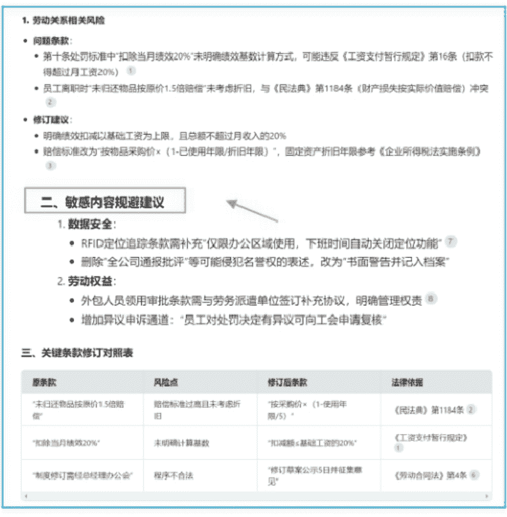

图5-7 智能合规筛查界面示意

在既定要求下，纳米智能体调动 DeepSeek R1 引擎完成了一轮文本合规核查，覆盖面包括法律适配要点、敏感内容规避建议、重点条款对照修改方案以及合规水平提升建议等。仅从初审维度看，完整度已经相当可观。

接下来输出精简解读，见图5-8。

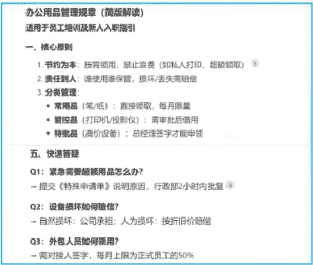

图5-8 纳米智能体生成的精简解读页面

该精简版解读语气更正式，并在交互上加入了即时问答等巧思。

#### 工具对决

规章制度闭环思维共四步，秘塔检索与纳米智能体均可覆盖。纳米智能体除接入 R1 外，还对接了文心一言、通义千问等，操作更便捷。若单独看检索能力，秘塔深耕细分赛道，参考资料更丰富精准，后续人工打磨也更顺手。

总体来看，纳米智能体适合快速完成常规内部规范类任务；对个性化要求高、复杂度大的规范制定，则更适合先用秘塔检索打底。

#### 技能加油站

##### 1. 思维启蒙

我仍记得起草考勤初稿时写满“禁止迟到早退”等刚性表述，被领导反问：这和把条文贴墙上有什么区别？多年后才悟到，优秀的内部规范要刚柔相济——既守住管理底线，也要预留人情味缓冲。

起草时建议双视角自检。

使用者视角：还原场景检验合理性，如模拟新人入职、项目临时加急采购等情境；避免全文堆砌“禁止”“必须”这类高压词，可适度加入“鼓励”“倡导”等引导表述。

管理者视角：标出易引发争议的节点，厘清各环节审批权限；条件允许时，为每条规则标注法源依据。

刚柔相济的文本往往更有温度，例如在“严禁吸烟”后补充“指定吸烟区设在B座楼下”。

接到内部规范撰写任务时，可用“4W1H”框架梳理思路：

- why目的：制定理由是什么？
- what内容：规范哪些具体事项？
- who主体：涉及哪些部门和岗位？
- when时限：何时推行？过渡期多久？
- how执行：如何监督落实？违规如何处置？

很喜欢彼得·德鲁克的一句话：“制度的终极价值是唤醒自律。”这也印证了他的管理哲学。职场“笔杆子”应具备共情力，有共情的文案走得更远。

##### 2. 实操练习

一提内部规范很多人就头疼，别被繁琐条款吓退。方法对了，智能助手就能把难题拆简单。此时回想前文提到的闭环思维，开始实战，你会发现写好规范并不难。

#### 小试牛刀

请结合本节所学，用“智能生成＋人工润色”方式起草新版《员工考勤管理制度》。

情境：公司推行弹性工时，需明确打卡时段、迟到处理、外勤登记等规则。

提示：1、可拆成“弹性打卡”“迟到处理”“外勤报备”三大板块，采用条款式写法；2、可加入人性化表达，例如把“迟到三次扣款”改为“当月迟到超三次启动绩效面谈”；3、注意执行细节是否遗漏，例如“外出作业需提前一天审批”。

内部规范是管理手段之一，条件允许时做到刚柔相济，加入更多人情味内容，能有效避免执行僵化。

### 管理办法撰写实战：从框架到细节

“职场如战场”形容节奏之快。文件任务层出不穷，管理办法的撰写就是其中常见项。面对密密麻麻的条款是否觉得无从下手？别担心，本节正是为此而来。下面用最直接的方式带你把握管理办法写作要点。

#### 轻松搞定撰写全流程

在信息过载的时代，“时间短就是效率高”。看到“五分钟掌握写作精髓”可能会怀疑，但掌握方法后真的可行。

第一阶段：快速浏览表5-2，了解管理办法的构成要素，这是基础。

第二阶段：通过表5-2记住速记公式，之后就能迅速组织思路。

第三阶段与第四阶段：掌握表5-3的“撰写地图”，明确每一步该怎么写。

第五阶段：按“撰写地图”完成初稿，你会发现结构完整、逻辑清晰。

以下是按该地图完成的《××公司财务报销管理办法》正文样例。

| 构成要件 | 说明 | 速记公式 |
|---|---|---|
| 标题 | 简洁明了，体现核心内容 | 管理对象 + 管理内容 + 办法 |
| 发文机关、时间 | 标题下方括号注明，体现正式性权威性 | 发文机关 + 成文日期 |
| 正文 总则 | 概述基本原则和适用范围 | 基本原则 + 适用范围 |
| 正文 分则 | 规定操作流程、职责分配、标准要求 | 操作流程 + 职责分配 + 标准要求 |
| 正文 附则 | 说明生效时间、解释权归属 | 生效时间 + 解释权归属 |

表5-2 管理办法的构成要件

| 导航定位 | 目的地 | 导航点 | 地图备注 |
|---|---|---|---|
| 起点 总则 | 第一步 概述基本原则 | 基本原则 | 强调公平透明、简化流程、合规 |
| 起点 总则 | 第二步 定义适用范围 | 适用范围 | 指定对象及特殊情形 |
| 路段A 分则 | 第一步 详述操作流程 | 提交申请 | 规范提交时限与材料 |
| 路段A 分则 | 第一步 详述操作流程 | 审批流程 | 明确各层审批步骤 |
| 路段A 分则 | 第一步 详述操作流程 | 支付处理 | 描述支付时间与方式 |
| 路段B 分则 | 第二步 明确职责与标准 | 员工责任 | 清晰列出责任，言简意赅 |
| 路段B 分则 | 第二步 明确职责与标准 | 主管责任 | 清晰列出责任，言简意赅 |
| 路段B 分则 | 第二步 明确职责与标准 | 财务责任 | 清晰列出责任，言简意赅 |
| 终点 附则 | 第一步 确定生效时间 | 生效时间 | 规定具体生效日期 |
| 终点 附则 | 第二步 声明解释权归属 | 解释权归属 | 指明解释权归属部门 |

表5-3 管理办法的“撰写地图”

##### 《××公司财务报销管理办法》正文样例

###### 总则
**基本原则：** 公平透明、简化流程、确保合规。
**适用范围：** 适用于[公司名称]全体员工因公费用报销，含差旅、会议、培训、办公用品等。

###### 分则
**操作流程：**
- 提交申请：费用发生后×个工作日内填写《费用报销申请表》并附原始票据。
- 审批流程：直接主管初审、财务复审、高层终审。
- 支付处理：终审通过后交财务部办理现金或转账。

**职责分配与标准要求：**
- 员工责任：确保事项真实，按时提交材料。
- 主管责任：审核项目合理性，及时反馈意见。
- 财务责任：核查单据合法完整，确保支付安全准确。

###### 附则
**生效时间：** 自发布之日起施行。
**解释权归属：** 最终解释权归[公司名称]财务部。

#### 情境体验

主任拍拍肩说：“办公室要立刻起草职工考勤管理办法，你来挑战吧。”温习构成要件与撰写地图后，主任分享了他的上手技巧：

第一步，明原则，清楚目的与核心价值观。
第二步，调模板，不要重复造轮子，找到合适的模板再调整。
第三步，搭架子，先建框架再填充内容。
第四步，定流程，细化每一步骤并明确责任。
第五步，精语言，多方审阅，确保语言简洁明了。

最终高效完成初稿。

#### 职工考勤管理办法

##### 第一条 总则
为提高工作效率、严肃工作纪律、确保工作有序高效，特制定本办法。

##### 第二条 工作时间
工作日：周一至周五
上午：8:30—11:30
下午：13:00—17:00

##### 第三条 出勤规定
1. 员工须按时到岗离岗，不得迟到早退，工作时间内不得擅自离岗。
2. 特殊情况不能到岗，应提前电话请假，事后提交书面说明至办公室备案。

##### 第四条 迟到、早退与旷工
1. 上班后5至30分钟到岗按迟到，超30分钟按旷工半天。
2. 提前30分钟内离岗按早退，超30分钟按旷工半天。
3. 记录将影响年度绩效考评。

##### 第五条 禁止行为
工作时间禁止打游戏、打牌、炒股等与工作无关或有损形象的行为。

##### 第六条 活动参与
参加公司会议培训等，有事应提前向组织者请假。

##### 第七条 因公外出
因公外出需事先报部门领导同意；出差、调休、事假须按规定提前批准并登记至办公室，无记录按旷工。

##### 第八条 处罚措施
违反第五、六条者，取消本年度先进个人评选资格。

##### 第九条 附则
本办法自发布之日起试行。

#### 小贴士
1. 明确目标与原则：第一条点明提高效率、严肃纪律的目的。
2. 借鉴模板并定制：参考现有规范，简化语言贴合实际。
3. 先搭架子再填细节：先构建总则、工作时间、出勤等框架再细化。
4. 详述流程并明确责任：清晰界定迟到早退标准，明确请假流程。
5. 多方审阅优化表达：语言简洁，便于理解执行。

#### 手把手教你用AI写管理办法

管理办法比规章制度更具弹性，在明确目标流程的同时允许灵活调整。写好管理办法的关键是明确目标并抓住工作痛点。因此用AI设计时需构建闭环：设定目标、搭建框架、填充内容、优化完善，见图5-9。其中优化环节要多想一步，可用AI模拟不同场景下的执行效果，发现潜在问题并针对性改进，确保实用高效。

图5-9 撰写管理办法的闭环思维
规划层：明确效率提升、风险防控等目标，获取AI参考意见。
生成层：输入目标与关键问题生成初稿框架，再结合企业文化规模行业特性调整语言与条款。
精修层：用AI模拟执行场景，预估问题并优化。

##### 任务卡
公司需制定新项目管理办法，规范流程、提升执行效率、防控风险。

选定工具：文心一言、智谱清言。

###### 文心一言
登录平台并选择“文心大模型4.5 Turbo”，输入指令：
“现在需要制定项目管理办法，规范流程、提升效率、防控风险。请明确管理目标并给出参考意见。”

返回结果：
一、管理目标
1. 规范项目流程：确保启动到收尾各环节有明确标准，减少误解延误。
二、参考意见
1. 绘制流程图：涵盖各阶段关键活动、责任人、节点，作为手册参考。
2. 建立风险管理体系：设立风险小组，识别评估监控应对，制定应对策略。
3. 实施质量控制计划：明确检查点、验收标准、责任人，定期审查。

继续输入指令生成框架：
“请润色上述意见，生成含总则、分则、附则的项目管理办法框架，采用填空形式。”

生成的框架包含总则第一至三条、分则第一章项目流程规范第四条细化启动、规划、执行、监控、收尾节点，附则第二章其他规定第十四至十五条说明解释权与生效时间。

人工调整后，针对AI项目并保持刚柔相济特点继续优化。

###### 项目管理办法框架（针对AI项目，刚柔相济版）
总则
第一条 为规范AI项目流程、提升执行效率、防控风险，同时保持灵活性与创新性，特制定本办法。
第二条 本办法适用于公司所有AI项目管理，团队须遵循框架同时鼓励积极探索创新管理方法。
第三条 管理应遵循科学规范、高效、风险可控，同时注重协作沟通激励，确保按时按质完成并促进技术持续进步。
分则
第一章 项目流程规范

写一份能用的项目治理细则，表面是条款罗列，实质是把一套可落地、可复盘的工作机制讲明白。以下这套思路，能把干巴巴的制度变成真正好用的操作指南。

工作的闭环其实是立项、细化、实施、跟踪、收尾五个递进环节，且要允许结合实际适度微调。

立项时要把目标、边界、交付物和智能技术落点说清楚，同时把跨学科的人手拉齐，拿出可执行的初稿计划。细化环节要把任务拆小、资源配足、时间表定准，并提前排查技术、市场、法律等风险点。实施阶段按表推进，定期通报进展，遇到技术波动或需求变化就及时回拨计划。跟踪阶段要盯进度、盯风险、保按期，同时保持对技术风向的敏感。收尾阶段交付成果、做技术归纳、评估成效、提炼得失，形成可复用的资产。

附则部分同样关键。回顾与迭代优化机制要建立起来，对执行中的得失做系统性总结和前瞻性研判，做到会后有审视、有改进。课题结束必须召集团队复盘，盘点亮点与短板；复盘结论要转化为改进方案，持续优化管理方式，为后续工作提供参考。细则由公司项目管理部门负责解释与迭代，鼓励一线反馈意见。细则自发布之日起生效，与旧规冲突以新细则为准；涉及特殊或创新型智能课题，经项目管理部门批准后可适度灵活处理。

初稿完成后，不要急着定版。让文心一言做一次场景化压力测试，预判落地时会踩什么坑。作为输入，可以这样提问：请模拟以下项目治理细则在不同场景下的执行效果，并预估可能出现的问题。把最终确认的细则原文附上。

文心一言跑了三类典型情境，问题暴露得很清晰。

第一类情境常规智能课题。容易出现的状况有：流程被过度依赖，虽然细则写了可适度调整，实操里团队还是习惯按部就班，灵活性不足；工具选型与团队实际匹配度不高，管理工具用不顺手，效率提升打折；风险盘点不全面，尤其技术风险和市场风险的识别存在盲区。

第二类情境创新型智能课题。风险特征不同：调整尺度失控，追求灵活反倒导致管理松散、不确定性增加；创新伴随高技术与高市场风险，预估和应对往往不足；资源向创新倾斜时容易分配失衡，核心任务得不到优先保障。

第三类情境跨部门协作的智能课题。痛点集中在组织层面：部门间目标冲突，协作阻力大、决策拖延；沟通机制虽有，但文化与工作习惯差异带来理解偏差；责任边界模糊，出现推诿，影响推进节奏。

看到问题清单后，回头针对性补强条款，细则才更实用。

接下来换一个工具视角。登录智谱清言，点击左侧AI搜索入口，输入指令让它帮你厘清目标、提供参考。AI搜索面板会实时在右侧给出关键词，点击“行业最佳实践”等关键词，就能调出相关资料做深度分析，为你提供有说服力的佐证。
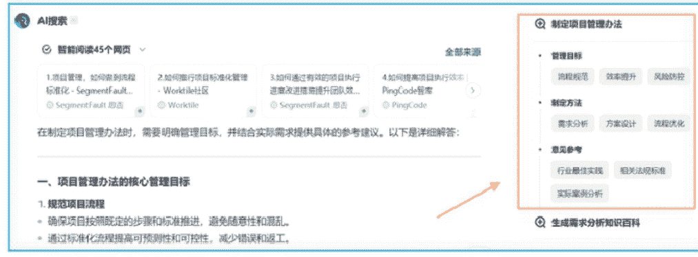

图5-10 便捷资料搜索界面

思路明确后，可以让模型先搭框架。示例指令是：请根据以下管理目标生成项目治理细则的初步框架：1. 提升执行效率，确保按时交付。2. 防控风险，降低失败可能性。3. 规范流程，提高管理的透明度和可追溯性。

智谱清言会快速给出框架草图，并在右侧附上可供查阅的资料关键词，形成思路与素材的闭环。
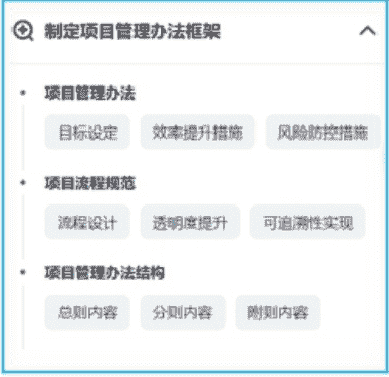

图5-11 智谱清言生成的关键词

框架有了，进入内容打磨。以AI行业且“刚柔并济”的表达风格为例，下面是智谱清言给出的优化样本。

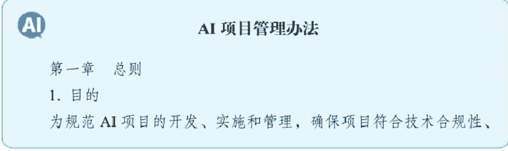

数据安全及伦理规范，特制定本办法。

####### 2. 适用范围

本办法适用于公司内部所有 AI 项目，包括研发、应用及服务类项目。

............

####### 第二章　项目启动

######## 1. 立项审批

- （1）项目需经过伦理委员会的初步审查，确保符合伦理规范。

- （2）立项申请需明确项目目标、预期成果、技术路线及资源需求。

............

####### 第三章　项目执行

######## 1. 动态调整机制

- （1）项目团队可根据实际进展，对目标、计划或资源配置进行动态调整。

- （2）调整需遵循"风险可控、资源适配"的原则。

............

####### 第四章　项目监控与评估

######## 1. 绩效监控

- （1）建立项目绩效监控机制，定期跟踪项目进度、质量及成本。

- （2）监控结果应及时反馈给项目团队，以便调整管理策略。

............

####### 第五章　项目收尾

######## 1. 复盘与总结

- （1）项目结束后，项目团队需进行复盘，总结经验教训。

- （2）复盘结果需形成文档，供后续项目参考。

............

####### 第六章　伦理与合规

######## 1. 伦理审查

- （1）设立伦理委员会或引入第三方伦理审查机制，确保 AI 项目的开发和应用符合伦理规范。

- （2）伦理审查需贯穿项目全生命周期，覆盖数据采集、模型训练及成果应用等环节。

……

####### 第七章　附则

######## 1. 变更管理

（1）项目管理办法的变更需经过审批流程，确保变更的合理性和必要性。

（2）变更需及时通知相关方，并做好宣贯工作。

######## 2. 解释权

本办法由公司项目管理办公室负责解释。

这份生成内容比较完整，既涵盖启动、执行、收尾的基础条款，也加入了伦理与合规的风险防控维度。你要做的，是结合真实工作把细节补足。

最后一步做仿真。借智谱清言的AI搜索，你可以调取真实案例作为参照，看细则在不同情境下的表现。

图5-12 智谱清言给出的模拟执行效果及典型案例

有了智能助手的加持，写治理细则不再是闭门造车。过去靠人脑往往受限于经验定式，现在模型既能破局也能启发，提供新视角与新解法。借助这一流程，你能高效产出兼具时效与实用性的制度文本。

#### 智能助手“论剑”

文心一言与智谱清言都能覆盖分析、搭框架、定制内容、场景模拟全链路，各有绝活。文心一言指令识别更精准，擅长生成填空式框架，使用门槛低；智谱清言的资料检索更便捷，能快速汇聚参考素材，助你发散思考。

在模拟环节，两家的场景输出会略有差异，建议结合实际挑选最契合的内容。需要强调的是，模型只负责初稿，人工优化不可替代。人机协作下，借助人工的细致打磨与专业判断，才能让治理细则真正贴合需求并顺利落地。

#### 技能加油站

##### 1. 职场思维启蒙

初看治理细则，容易觉得离日常很远。其实里面藏着职场思维密码。

- 系统思维。制度里有清晰流程与责任分工，提醒你工作中要保持全局感。处理事务时，不仅要做好本环节，还要思考上下游衔接。比如筹备会议，不仅要定议程，还要兼顾设备、资料、通知等配套环节。
- 边界意识。新人容易想靠超量工作证明自己，但制度里明确的责任划分说明专业工作需要清晰边界。面对临时加需求，可以说：我正在推进A课题方案，这项材料是否需要调整优先级？适度保护不是冷漠，是对质量负责。
- 主动意识。常被忽略的“解释权”条款，恰是职场课题。当新制度引发困惑时，收集疑问、结合实操整理建议，往往会被采纳。规则不是只能被动接受，也可以主动参与完善。

公文写作中养成的规则意识，会成为你的职场铠甲：繁忙时保持清醒，压力下守住底线，约束中找好下一步。

##### 2. 练一练，更出色

规章与治理细则的差别，现在应该能分清了。细则写细一点，能减少误解与争议。下面是实践环节。

#### 小试牛刀

请结合本节所学，用“模型写作＋人工优化”方法拟定一份《部门报销管理办法》。

场景：规范差旅、办公用品等报销流程，需明确标准、审批人及审批时限。

提示：
- 报销细节可拆为“费用标准”“审批流程”“违规处理”三大块；
- 避免模糊表述，如“特殊情况特殊处理”改为“超标费用须附书面说明，经分管领导签字”；
- 明确禁止事项，如“餐饮发票不得连号”。

好制度既堵漏洞、保规范，也开绿灯、促创造。

# 第三部分 沟通表达类公文：让你的职场影响力更上一层楼

## 第6章 请示与批复

### 请示怎么写才能畅通无阻？

在职场里，请示是向上沟通的桥梁。不管是申请资源、求助难题还是对齐认知，都需要一份清晰的请求性公文。写得好，既能把事说透，也能维系上下级关系。

请示写作需要文笔和技巧双在线。下面拆解通过率高的关键细节。

请示的基本构成包括：标题、主送机关、正文、结语、落款。标题可为“××局关于×××的请示”或《关于×××的请示》。主送机关要写明直接上级部门全称。正文分事由与事项，事由要说明原因依据与重要性，事项要条理清晰，遵循“一文一请”。结语多用“特此请示，请批复”或“以上请示妥否，请批示”。落款写发文机关与日期。

正文是核心。常见问题与改进举例：冗长铺垫，应言简意赅直入主题；表述模糊，应给出时间、地点、金额等具体信息，避免“一些”“大概”等词；情绪化表达，应保持客观理性，适度展示信心即可。

情境体验：打印机频发故障影响办公。你调查后整理数据，准备请示。高效请示的五步法：明目的，开门见山点明请求；炼要点，用数据呈现现状；提问题，明确痛点；给方案，提出可行措施与细节；修结尾，表达信心并写规范结语。

内部请示单示例：呈送公司领导，部门办公室，事由关于更换办公打印机的请示。内容说明近期故障频发影响效率，统计每月故障次数、维修成本、耗材浪费率；指出设备老化、成本高、耗材不规范；建议更换老旧设备、优化耗材采购、增加维护频次；表达解决问题的必要性与预期效果；附件明细表；结语“以上请示妥否，请批示”。

规范是基础，适度创新能提升针对性。

小贴士：剩下的关键靠“胸有成竹”与“时机精准”。胸有成竹指对背景、政策、可能问题心中有数；时机精准指在领导关注度高、有时间讨论时递交。请示前先与领导身边同事沟通，了解关注点与态度，再做针对性精炼，通过率会明显提升。

#### 手把手教你用AI写请示

理解请示要素后，用模型提效会更顺畅。无论是提炼核心信息还是优化表达，模型都能提供全流程支持。结合不同场景生成贴合实际的文本，能让请示更高效、更出色。

起笔前先问自己，这份呈报想实现什么结果。说到底是要赢得领导的认可、指引与批准，让后续事项顺利推进。很多人误以为这只是照搬模板填空，实际上能获得肯定的文稿，往往要经历政策搜集、依据梳理、框架构建、语气调节、格式校验等环环相扣的步骤，任一环节出现偏差都可能拖累成稿品质，甚至把原本清晰的诉求弄得模糊。

所幸当下智能辅助工具已相当普及，能把上述繁复流程变得更轻快。可参照的思路模型为请示撰写的闭环框架。

图6-1 撰写请示的闭环思维
闭环整体可拆成三层运作。第一层偏筹划与资料搜集，借助模型快速调取相关政策、规范以及往期工作支撑，为成文提供数据底座。第二层是起草，让模型先把事由、依据等主体框架搭出，形成可用雏形。第三层是打磨与备选方案，通过模型一次性输出两套以上可选路径并做优劣对比，给决策者选择余地；同时按场景微调措辞，分寸得当，核查标题、收文单位、正文、结语、落款等要素是否齐全，像“妥否，请批示”这类惯用收尾是否到位。

实操环节开始，助手已就位。

任务卡要求很清晰：向上一级单位申请启动一次以提升办公效率为目标的 AI training 项目。这次选用在公文写作上口碑较好的两款产品——文小言与 CueMe。

文小言提供电脑版与移动版，电脑版操作更顺手。进入对话区后，建议把模型模式设为“自动模式”，让系统自行判断最合适的处理方式。第一步指令可以这样下达：请查询关于开展 AI training 的行业趋势、前期工作依据，为材料提供数据支持。

联网检索结果如下：

####### 一、行业趋势

######## 1. 市场需求激增

（1）产业快速发展：随着AI技术的不断成熟和应用领域的不断拓展，全球AI市场规模持续增长。据预测，2025年全球教育AI市场规模约为173.2亿美元，到2034年将达到1105.5亿美元，复合年增长率（CAGR）为22.87%。

（2）人才需求旺盛：企业对AI专业人才的需求日益迫切。为了提升员工的技能水平，增强企业竞争力，越来越多的企业开始重视并投资于AI培训。

（3）培训赛道崛起：AI培训赛道有望成为所有培训赛道中的最大赛道，取代之前的领导力、沟通能力等通用课程。

...........

####### 二、前期工作依据

######## 1. 政策支持

（1）国家战略引领：我国高度重视AI技术的发展，将"深入实施科教兴国战略，提升国家创新体系整体效能"列为十大任务之一，并推进"人工智能+"行动。

（2）地方政策推动：各地政府积极响应国家号召，出台了一系列政策措施推动AI培训的发展。例如，北京市教育委员会发布了《北京市推进中小学人工智能教育工作方案（2025—2027年）》，要求从2025年秋季学期开始，全市中小学校开展人工智能通识教育，每学年不少于 **8** 课时。

（以下内容略。）

从文小言给出的回答中，我们可以看到，通过联网搜索，AI所提供的答案能够为我们提供一些有价值的数据和参考信息（请注意对数据进行核查，确保其严谨可靠）。在此基础上，如果我们能够进一步融入自己搜集到的资料，请示的内容也将更加丰富且更具说服力。

将回答输入文小言中，请求它生成请示初稿。例如："请根据以下行业趋势、前期工作和数据，生成关于开展AI training 项目的请示初稿。"（输入行业趋势、前期工作和必要的数据。）此时，文小言可以生成一份详细版的请示初稿。如果根据实际需要，希望保留核心要点，生成一份更加清晰明了的请示，则可以让文小言进行内容精简。拿到请示初稿后，我们仍需进行人工调整，以确保请示更契合实际需要。

紧接着，就是请示的"重头戏"——多想一步，为领导提供多个方案。我们可以在对话框中输入：

- 请根据以下行业趋势、前期工作和数据（输入具体信息），生成两个或更多关于开展 AI training 项目的可行路径，并分析各自的优劣。

我们还可以补充一句：

- 以上内容我将放入完整的请示报告中，请注意表述符合公文规范。

我们来看看文小言的回答。

**方案一：全方位 AI 技能培训方案**

####### 一、背景概述

随着 **AI** 技术的迅猛发展，其在各行各业的应用日益广泛。为了提升企业竞争力，培养适应新时代需求的高素质人才，本企业决定开展全方位 AI 技能培训方案。该方案旨在通过系统化的培训，提升员工对 AI 的认知水平，掌握 AI 相关技能，提高创新能力和解决问题的能力。

####### 二、培训必要性

- 1. 技术更新迭代快。AI 技术日新月异，员工需要不断学习新知识、新技能，以保持竞争力。

- 2. 市场需求旺盛。随着智能化转型的加速，企业对掌握 AI 技术的专业人才需求日益增长。

- 3. 提升员工素质。通过培训，提升员工的专业技能和综合素质，为企业发展提供人才保障。

####### 三、培训计划

- 1. 使员工了解 AI 的基本原理、应用场景和发展趋势。

- 2. 使员工掌握 AI 相关技能，如数据分析、机器学习、深度学习等。

- 3. 培训方式：

  - 线上课程：利用网络平台，提供丰富的在线课程资源。

  - 线下培训：邀请专家进行面对面授课，组织实操演练。

  - 企业内训：根据企业需求，定制化开展内训课程。

- 4. 时间安排：培训周期为×个月，每周安排×次课程，每次课程时长为×小时。

- 5. 费用预算：

  - 线上课程开发与购买费用：××万元。

  - 线下培训场地租赁与设备费用：××万元。

  - 讲师费用（包括内部讲师与外部专家费用）：××万元。

  - 管理与运营费用（如平台维护费用、资料印刷费用等）：××万元。

  - 总计：××万元。

###### 方案二：重点领域 AI 技能培训方案

####### 一、背景概述

随着 AI 技术在医疗、金融、教育等领域的深度应用，这些领域对掌握 AI 技术的专业人才需求日益迫切。为了提升员工在特定领域的应用能力，本企业决定开展重点领域 AI 技能培训方案。该方案旨在通过针对性的培训，使员工能够熟练掌握 AI 在特定领域的应用技能。

####### 二、培训必要性

- 1. 行业需求明确。医疗、金融、教育等领域对人工智能技术的应用需求明确，员工需要掌握相关技能以应对工作挑战。

- 2. 提升服务质量。通过培训，提升员工在特定领域的应用能力，从而为客户提供更优质的服务。

- 3. 保持竞争优势。掌握 AI 技术在特定领域的应用能力，将使企业在市场竞争中保持领先地位。

####### 三、培训计划

- 1. 使员工了解 AI 在特定领域的应用场景和发展趋势。

- 2. 使员工掌握在特定领域的 AI 应用技能，如医学影像分析、金融风险评估、智能教学等。

- 3. 培训方式：

  - 线上课程：利用网络平台，提供丰富的在线课程资源。

  - 线下培训：邀请专家进行面对面授课，组织实操演练。

  - 企业内训：根据企业需求，定制化开展内训课程。

- 4. 时间安排：培训周期为×周，每周安排×次课程，每次课程时长为×小时。

- 5. 费用预算：

  - 线下培训场地租赁与设备费用：××万元。

  - 行业专家讲座费用：××万元。

  - 线上辅助学习材料开发与购买费用：××万元。

  - 项目实施所需资金（如合作项目开发费用、测试费用等）：××万元。

  - 总计：××万元。

- 6. 预期效果：

  - 员工在特定领域的应用能力得到提升。

  - 企业的服务质量和客户满意度得到提高。

  - 企业在市场竞争中保持领先地位。
可以看到，借助基础信息，输出了两套路径，结构都包含背景、必要性、计划。

图6-2 文小言的提示问题
若提供的背景信息不够具体，系统会自动给出提示问题帮助完善。路径确定后可嵌入正文。接下来继续做语气润色和格式校验，确保措辞正式、谦逊、得体，标题、收文单位、正文、结语、落款等要素齐备。

最终生成的材料如下：

###### 关于开展全方位及重点领域 AI 技能培训方案的请示
××公司
随着AI技术的快速发展与广泛应用，其在提升企业竞争力、优化工作流程、创新服务模式等方面发挥着日益重要的作用。为积极响应时代变革，培养适应新时代需求的高素质人才，我公司拟开展全方位及重点领域AI技能培训。现就相关方案向上级机关请示。
一、培训背景及必要性
（一）全方位AI技能培训
1. 技术迭代迅速，员工需不断学习新知识新技能以保持竞争力。
2. 市场需求旺盛，企业对掌握AI技术的专业人才需求日益增长。
……
四、预期效果
1. 员工专业技能和综合素质全面提升。
2. 企业的创新能力和市场竞争力显著增强。
3. 形成良好的学习氛围，促进知识共享和技能互补。
综上，我公司认为开展全方位及重点领域AI技能培训方案对提升整体竞争力、满足市场需求、培养高素质人才具有重要意义。
妥否，请批示。
（公司/部门名称）
（日期）

需要权威参考时，文小言移动端的工作台里有“智能体”入口，可调用学习强国智能体检索政策、重要讲话、指示精神，进一步夯实论据。

转到 CueMe。登录官方平台后界面直观，先输入：现在我需要写一份请示，请查询关于开展AI培训的行业趋势、前期工作依据，为材料提供数据支持。

图6-3 CueMe的操作界面
很快给出检索结果。追加指令：我需要可靠的数据来支撑这份报告，提高通过率。系统会在每一段加入来源数据。

图6-4 调整前后的部分内容对比
有了数据底座，直接让其生成初稿：请结合以上内容，写一份关于开展AI training 项目的初稿，包括事由、依据，这次培训的目的主要是提高办公效率。

生成的初稿如下：

####### 关于开展人工智能培训项目的请示

[具体部门名称]：

######## 一、事由

随着 AI 技术的快速发展，其在提升办公效率方面的应用日益广泛。为了提高我司员工的办公效率，优化工作流程，我司计划开展一次针对全体员工的 AI 培训项目。此次培训旨在通过系统化的教学和实践，使员工掌握 AI 的基本理论和实际操作技能，从而有效提升工作效率，降低运营成本，增强我司的市场竞争力。

…………

######## 四、预期效果

- 1. 提升员工利用 AI 工具进行数据分析、自动化办公的能力。

- 2. 增强团队协作效率，优化决策流程。

- 3. 培养内部 AI 专业人才，为公司长远发展奠定基础。

- 4. 提高工作效率，降低运营成本，提升整体竞争力。

######## 五、结语

开展 AI 培训项目对于我司适应技术发展趋势，提升办公效率具有重要意义。我们恳请上级部门批准本项目，并提供必要的支持和指导。我们将确保培训项目的顺利进行，以实现预期的目标和效果。

妥否，请批示。

请示单位：[单位全称]

请示日期：[具体日期]
若不提供详细背景，也能按检索信息给出框架，可在此基础上细化。

####### 关于开展 AI 培训项目的可行方案框架

######## 方案一：全面综合型培训方案

######### 1. 方案概述：

- 提供全面、综合的 AI 培训，覆盖从基础理论到高级应用的各个方面。

- 结合线上与线下教学，确保理论与实践相结合。

######### 2. 费用构成：

- 课程开发费用：包括教材编写、课程设计等，预计××××元。

- 师资费用：聘请行业专家及讲师，预计××××元。

- 设施与设备费用：包括教室租赁、电脑设备等，预计××××元。

- 平台使用费：在线学习平台及相关技术支持，预计××××元。

######## 方案二：定制化模块培训方案

######### 1. 方案概述：

- 采用模块化培训，根据学员需求定制个性化的学习内容。

- 学员可根据自身兴趣和职业规划选择相关模块。

######### 2. 费用构成：

- 模块化课程设计费用：根据模块数量和复杂度，预计××××元。

- 按需配置的师资费用：根据所选模块的专业需求，预计××××元。

- 特定模块教材与设备费用：针对每个模块的特殊需求，预计××××元。

- 灵活的学习平台支持费用：适应不同模块的学习平台维护，预计××××元。
把路径嵌入材料后，可让其输出两个版本：方案作为附件的简版和方案内嵌的详细版，并请其以资深笔杆子身份校验措辞与格式。

部分结果如下：

######## 版本一：方案作为附件的请示

######### 二、培训方案概述

我们已制定了一份全面的 AI 培训方案（见附件），该方案包括以下几个核心部分：

- 1. 培训内容：涵盖基础理论、前沿技术、实践操作及案例分析。

- 2. 培训对象：主要面向我司技术开发人员、产品经理及相关部门的骨干员工。

- 3. 培训方式：结合线上线下资源，采取讲座、工作坊、项目实操等多种形式。

- 4. 预期成果：提升员工专业技能，增强团队协作能力，推动实际项目的实施与发展。

（以下内容略。）

######## 版本二：方案嵌入请示的详细版请示报告

######### 二、详细培训方案

########## （一）培训内容

- 1. 基础理论：包括机器学习、深度学习、自然语言处理等基础理论知识的讲解。

- 2. 前沿技术：介绍计算机视觉、强化学习等前沿技术的发展现状与应用。

- 3. 实践操作：通过实际项目操作，提升员工的编程能力和问题解决能力。

- 4. 案例分析：分析行业内成功案例，探讨 AI 在不同业务场景中的应用。

########## （二）培训对象

- 1. 技术开发人员。

- 2. 产品经理。

- 3. 相关部门的骨干员工。

########## （三）培训方式

- 1. 线上线下结合：利用在线平台进行基础理论教学，结合线下工作坊和实操训练。

- 2. 专家讲座：邀请行业专家进行专题讲座，分享最新研究成果和实践经验。

- 3. 项目实操：组织团队参与实际项目开发，通过实战提升技能。

- 4. 小组讨论与分享：促进员工间的交流与协作，分享经验和心得。

（以下内容略。）
通过两版对比，能明显看出生成思路和表达方式的差异。最后的检验环节给出了具体的格式和用语建议。

图6-5 CueMe的检验结果
当指令思路足够清晰，整个从目标界定到细节打磨的过程就能被有效承接，保证内容准确、逻辑自洽。两者均可覆盖资料检索、初稿起草、方案对照、润色校对的完整链条。

就专业性而言，偏向公文场景的文小言表现更规范，结合学习强国智能体可迅速获取权威支撑；就易用性而言，CueMe上手更快，适合处理日常性文稿。综合来看，文小言的精准与规范更贴合体制内写作习惯，CueMe的多变灵活则更适配多样化的写作需求，二者协同使用能让成稿更稳妥、更高效、更合宜。

在企业日常运作中，向上级呈报事项的频率与发布通知的频率几乎相当。表面看门槛不高，实则极易在细节处失分。只有把每个环节都想透，这类上行文书才能真正发挥作用。要怎么吃透细节？下面以更换打印机这一常见场景来拆解。先把核心诉求钉住，比如要更换打印机，再用“三问法”来理清思路：

- 原因：换掉的根本动因是什么；
- 影响：若不处理会带来哪些负面后果；
- 受益：最终谁能从中获益。

思路理顺后，写出的申请就能直指重点，不绕弯路。

写申请时，这三个优化做法很管用。

第一，别让审批人去猜。文书要开门见山。比如别写“拟优化办公设备”，要写清楚“拟更换财务部频繁宕机的那台打印机”。
第二，问题描述要可感知。别只说“效率受影响”，要写“工作日午后打印高峰，平均等待约30分钟”；别只说“经常卡纸”，要写“日均卡纸约5次”，把痛点钉牢。
第三，把更换后的收益算明白。比如“新机每年可节约八千张A4用纸”，让效果量化、可感知。

写得好的申请本质是诉求转译——把基层的真实需求，转译成管理层关注的战略表述。会做这种转译的人，往往在琐碎事务里悄悄攒下“靠谱”的职业形象。

做起来并不容易。只要反复打磨，你也能成为领导眼中的申请高手。

##### 2. 练习提升

别把写申请当成低头求助，而要看作争取资源、推动工作的契机。从某种角度看，申请是职场向上沟通的核心工具。你若能提供扎实的数据支撑，并给出几套备选方案，诉求就更容易成为领导的优先事项。仍觉得写不出高通过率的申请，就回头再梳理一遍上面的关键点。

#### 小试牛刀

请结合本节要点，用“AI起草＋人工精修”的方式，拟一份关于采购会议设备的申请。

场景：部门的老投影仪和音响急需更新，预算控制在3万元。

提示：

- 至少给出两套以上方案做对比，明确推荐最优解供上级择优；
- 原因要场景化，把使用痛点讲透；
- 用预期效果提升说服力。

写好申请千万别照搬模板去套，而要学会“借力”。通过方案对比，让阅读者产生“小投入办大事”的感觉。一旦你在方案里有意识地凸显投入产出比，就已经在沟通中占据了主动。

本章所讲的“批复”特指基层为上级机关代拟的初稿，正式下发需经领导签发。

### 什么样的批复才能赢得领导信任？

批复是上级对下级申请的正式回复，属于下行文，针对性强、指导性强。一份准确清晰的批复，不仅能把棘手问题落地，还能让下级感受到专业的分量，进而增强协作信任。什么样的批复才让人信服？下面揭晓。

#### 批复拟写“快车道”

先认识批复的分类。实践中常见的有三类：指示性批复、表态性批复、审批性批复。三类各有侧重，可根据情境灵活组合。下面是速记表。

| 批复类型 | 说明 | 应用场景 | 速记公式 |
|---------|------|---------|---------|
| 审批性批复 | 对申请的具体事项作出正式批准或不批准，并附带执行条件与要求 | 项目立项、资金划拨、机构设置、人事任免等具体事项审批 | 批示意见+具体执行要求及条件 |
| 指示性批复 | 对政策性或原则性问题作出答复，并给出指导意见和操作要求 | 政策执行、工作方法、业务流程等需指导的事项 | 批示意见+具体指导意见(要求)和操作步骤 |
| 表态性批复 | 仅对申请事项表明同意或不同意的态度，通常简短，不展开执行细节 | 重大决策、人事任命等需明确态度的事项 | 批示意见+简要理由(如不同意) |

表6-4 常用批复类型的区别

批复用得不算频繁，但掌握好能明显加分。它既能帮你处理申请，也能彰显专业。下表是一份写作地图，帮你快速定位要素。

| 要素 | 格式 | 要求及注意事项 |
|:---|:---|:---|
| 标题 | 发文机关名称+事由+批复，如：××局关于×××项目立项的批复 | 1. 简洁明了，体现批复核心； 2. 表态性批复宜前置决定意见，如：××局关于同意×××事项的批复 |
| 主送机关 | 申请或报告发文单位全称，如：××市××局 | 1. 用全称； 2. 不用“贵单位”等口语化称呼 |
| 正文-引述来文 | “你单位《关于×××的请示》收悉” | 1. 简要引述，点明对象，语言精炼； 2. 审批性批复需注收文号，如“你单位《关于×××的请示》（××〔20××〕×号）收悉” |
| 正文-批示意见 | 表态性批复同意如“同意你单位提出的×××事项，请按计划执行”；不同意如“经研究不同意……理由如下：……”；指示性如“原则同意，但需注意以下几点：……”；审批性如“经审查符合×××规定，准予审批/许可/备案”“根据《×××办法》第×条，同意核发×××资质” | 1. 语言正式、表述明确； 2. 必须明确同意或不同意，不同意需说明理由； 3. 审批性批复需引用法规依据 |
| 正文-具体要求 | 指示性批复如： 1. 同意×××事项； 2. 请加强×××管理； 3. 定期汇报进展 | 要求分条列明，逻辑清晰，具体可操作，避免模糊 |
| 正文-具体要求 | 审批性批复如： 1. 请于×日内到××部门领取批准文件。 2. 定期提交××报告 | 需明确后续流程，如领证时间、公示要求等 |
| 正文-结语 | 常规如“此复”或“特此批复”；需跟进如“请于××月××日前书面反馈落实情况” | 1. 简单情况用规范结语； 2. 需后续跟进要写明时限； 3. 涉及政策实施加“请认真抓好贯彻落实” |
| 落款 | 发文机关名称+成文日期，如： ××市人民政府 20××年××月××日 | 1. 日期用阿拉伯数字； 2. 落款规范统一 |

表6-5 拟写批复的核心要素

注：本表为代拟稿要求，正式批复需经领导签发后以机关名义下发。

掌握类型与要素后，基本就能写出让领导放心的批复。下面用情境来巩固。

#### 情境体验

今天11:30，OA弹出提醒——三日前递交的《关于更换办公打印机的请示》已进入批复流转，领导已批示“请办公室牵头落实”。你作为经办人，需在14:00前完成拟稿。

时间紧，先判断类型：此批复属审批性批复，速记公式为批示意见+具体执行要求及条件，需给出审批结果并下达操作指令。

步骤如下：

第一步：审申请。通读申请，抓住核心诉求、背景依据，判断批复类型。
第二步：明态度。明确同意或不同意，不同意要简述原因。
第三步：提要求。按需提出可执行的具体要求，让对方清楚怎么做。
第四步：调语气。依据事项性质和层级调整语气，既显权威又不生硬。对下可用“请按上述意见执行，确保工作顺利完成”，重大事项可用“请务必严格执行，确保万无一失”。
第五步：核细节。检查格式、标点、用词是否规范，内容是否准确。

示例效果如下。

#### 总经办关于同意更换办公打印机事项的批复

××办公室：

《关于更换办公打印机的请示》（××〔20××〕×号）收悉。经总经办会议研究，现批复如下：

一、同意更换故障率最高的两台打印机。
二、设备采购纳入第三季度固定资产购置计划，单台限价不超过10 000元，须通过公开采购平台实施招标。
三、新设备应于20××年××月××日前完成安装调试，旧设备经信息科核验后，提交《固定资产报废鉴定书》至资产管理部按《××固定资产处置办法》第×条规定进行报废。
四、请参照现行《办公设备管理办法》认真落实日常维护工作。

附件：固定资产报废鉴定书模板

此复。

××公司（印章）

202××年××月××日

学完以上内容，批复的要义应该已清晰。批复看似简单，拆开看却暗藏门道。下面口诀助记。

#### 小贴士

#### 批复拟写五步口诀：

审阅申请明问题，明确态度表同意，提出要求要具体，调整语气要得体，审核完善保规范。

#### 三种批复类型口诀：

审批性批复：批示意见要明确，执行要求需具体，条件清楚不模糊。
指示性批复：指导方向要清晰，操作步骤需详细，重点突出易执行。
表态性批复：回应问题要精准，内容表述要简洁，态度友好显诚意。

#### 手把手教你用AI写批复

我们先用AI写申请，再来闭环。批复正是申请的回音，掌握其写法能更好理解上级意图，也能提升协作效率。

下面探索如何用AI高效拟写高质量批复。无论新手还是老手，闭环思维都能提供清晰指引。

图6-6 批复拟稿的闭环思维

规划层（解读意图）：借助AI深入理解批复的核心意图和诉求，确保内容精准回应申请。
生成层（判别权限与生成内容）：用AI核查批复权限，依权限范围生成初稿，确保合法合规，避免越权。
精修层（调整文体）：用AI按公文规范调整语言和风格，提升专业正式度。
拓展层（评估风险）：借助AI资源库做风险评估，提出后续行动建议，增强前瞻性和实用性。

理解要点后，领取任务卡，与AI小助理实战演练。

##### 任务卡

有部门向总经办提交《关于开展人工智能培训项目的请示》，请据此拟写批复。

本次出场的AI小助理有文心一言和新华妙笔。

###### 文心一言

登录文心一言官方平台，选择最新4.5版本。先让它快速提炼申请要点。

图6-7 文档要点智能提取界面

上传申请文件后输入指令：

- 请深入理解关于开展人工智能培训项目的请示，分析其核心意图和具体诉求。

文心一言迅速解读并清晰呈现核心意图和具体诉求。

图6-8 文心一言总结出的申请核心意图

下一步，让它核查批复权限并据此生成初稿。指令可为：

- 请根据给出的核心意图和具体诉求，检查批复权限，并生成一份完整的批复。

文心一言先给出权限分析，再据此生成批复。

####### 批复权限分析

1. **权限范围：**
   - 批复者需评估是否有权对请求作出决定。
   - 通常基于组织架构、岗位职责和权限分配。
2. **政策与规定：**
   - 需对照组织相关政策、流程，确保批复符合标准。
   - 如预算增加需符合财务政策和预算管理流程。
3. **资源可用性：**
   - 需评估资金、人力、时间等资源是否充足以满足诉求。

图6-9 文心一言对于批复权限的智能分析

文心一言生成批复如下。

###### ××公司总经办关于同意开展全方位及重点领域AI技能培训方案的批复

××部门：

《关于开展全方位及重点领域AI技能培训方案的请示》（××〔20××〕×号）收悉。经总经办会议认真审阅并研究，现批复如下：

####### 一、明确申请核心问题

针对申请中提出的关于开展全方位及重点领域AI技能培训的需求，总经办认为，随着AI技术的快速发展，提升员工在AI领域的专业技能对于增强企业竞争力具有重要意义。因此，总经办同意实施该培训方案。

####### 二、给出明确态度

为积极响应时代变革，培养适应新时代需求的高素质人才，总经办全力支持开展全方位及重点领域的AI技能培训，并期待此次培训能够取得显著成效。

######## 三、提出具体要求

1. 培训方案应涵盖全方位及重点领域的AI技能培训，确保员工能够全面了解AI的基本原理、应用场景和发展趋势，并掌握相关技能。
2. 培训对象应包括企业内部全体员工及从事医疗、金融、教育等领域工作的员工，以提升整体团队的专业素质和应用能力。
3. 培训方式应灵活多样，结合线上课程、线下培训、企业内训等多种方式，确保培训效果。
4. 培训费用应控制在预算范围内，单项费用需经过严格审核，确保资金使用的合理性和效益。
5. 请××部门在培训结束后，对培训效果进行全面评估和总结，形成书面报告报送我单位备案。

此外，针对培训方案中的时间安排、费用预算等具体细节，总经办提出以下要求：

1. 全方位AI技能培训的时间安排应合理，确保员工能够在不影响日常工作的前提下参与培训。
2. 重点领域AI技能培训应注重实践应用，通过项目实战等方式提升员工的应用能力。
3. 费用预算应详细列明各项支出，并经过财务部门审核确认，确保预算的合理性和准确性。

######## 四、后续行动与监督

请××部门严格按照本批复的要求执行培训方案，加强培训过程中的管理和监督，确保培训质量和效果。同时，要加强与参训员工的沟通与交流，及时了解他们的需求和反馈，不断优化培训内容和方式。

此复。

××公司（印章）

20××年××月××日

从内容看，文心一言把批复拆成四个模块并标注，但模块标题需优化，部分措辞不符公文严谨性，如“积极响应时代变革”“期待显著成效”等。

提醒：AI生成总有瑕疵，人工介入必不可少。提供传统模板给AI喂入，输出会更规范。

接下来让文心一言调整语气并检验公文规范。指令：

- 请帮我优化这份批复的措辞，使其既体现权威，又避免过于强硬或随意。并以二十年公文笔杆子身份检验以上批复内容是否符合公文规范，不能出现任何纰漏。

文心一言支持快捷“创建指令”，保存后可复用。

图6-10 自定义指令管理界面

优化后内容如下：

###### ××公司总经办关于同意开展全方位及重点领域AI技能培训方案的批复

××部门：

《关于开展全方位及重点领域AI技能培训方案的请示》（××〔20××〕×号）收悉。经总经办会议认真审阅并研究，现批复如下：

一、原则同意你部门开展全方位及重点领域AI技能培训方案。当前，AI技术发展迅猛，开展此项培训对于提升员工专业技能、增强企业竞争力意义重大。

二、具体要求

（一）培训内容应全面且突出重点，既要涵盖AI的基本原理、应用场景和发展趋势，又要针对医疗、金融、教育等重点领域进行深入培训，使员工能够系统掌握相关技能。

（二）培训对象应广泛，包括企业内部全体员工，尤其要注重对从事医疗、金融、教育等领域工作的员工进行培训，以提升整体团队的专业素质和应用能力。

（三）培训方式应灵活多样，可结合线上课程、线下培训、企业内训等多种方式，确保培训效果。同时，要合理安排培训时间，确保员工能够在不影响日常工作的前提下参与培训。

（四）培训费用应严格控制在预算范围内，单项费用需经过财务部门审核确认，确保资金使用的合理性和效益。

（五）培训结束后，××部门应对培训效果进行全面评估和总结，形成书面报告报送总经办备案。

三、后续行动与监督

××部门请按照本批复的部署落实培训方案，在执行全流程中强化监管，确保培训品质与成效。也要与参训人员保持持续沟通，快速掌握需求与反馈，不断优化教学内容和方式。

特此批复。

××公司（印章）

20××年××月××日

把优化前后的批复并排对照，规范程度的提升一眼可见。接下来进入批复的“多想一步”环节，用文心一言做风险研判（见图6-11）。可给出的操作提示为：

- 对上面这份批复做风险研判，并给出可落地执行的后续处置建议，避免空泛描述，要求具体可行。

图6-11 文心一言生成的风险研判及后续处置建议

拿到研判结果后，可与决策层进一步沟通，为其提供参考依据，再次打磨批复文本，使其更贴合实际、更具可执行性。

###### 新华妙笔

打开新华妙笔“热门工具”栏目，按推荐进入“场景写作”。在“写作场景”里，先在分类选择“许可”，再在类型点选“批复”（见图6-12）。

图6-12 新华妙笔的公文创作界面

按提示填写相关要素，也可导入请示材料，点击“开始生成”后，初稿即刻产生。

查看新华妙笔给出的正文片段：

> 鉴于××公司对提升员工能力、顺应科技发展趋势，以及解决人民最关心最直接最现实利益问题的高度重视，总经办在深入研究并充分讨论关于全方位及重点领域人工智能技能培训方案后，决定予以批准并全力支持。这不仅是对党的二十届三中全会精神的积极响应，也是以实际行动践行以人民为中心的发展思想，推动公司高质量发展，培育和发展新质生产力的关键举措。
>
> 我们认识到，人工智能培训是企业提升核心竞争力、实现数字化转型的关键路径。通过开展全方位及重点领域的智能技能培训，能够帮助员工掌握前沿技术、提高工作效率，更好服务广大用户，解决他们在数字化时代的需求，真正实现守正创新、奋发有为。
>
> （以下内容略。）

作为专业属性较强的公文平台，新华妙笔输出的文本深度与其他模型有明显差异。该稿中专业表述较多，如“守正创新，奋发有为” 等。综合对比：文心一言的批复在可操作性上更强，但需人工优化结构、提升规范性；新华妙笔的批复用语偏典，实用性不足，不宜直接作为指导性文件，尤其对新人而言。

因此对新人建议借助新华妙笔中接入的DeepSeek来优化内容（见图6-13）。流程如下：

先用DeepSeek起草批复初稿。

再基于初稿，通过新华妙笔的智能润色与智能校对功能进行整体提升。如图6-14所示，可将右侧DeepSeek产生的初稿复制到左侧文档编辑。左手负责专业公文优化，右手负责智能分析，既能保证批复的专业规范，也能使其更符合实际需求。

下一步无需额外指令，直接使用智能润色进行逐句语言优化（见图6-15）。

图6-13 智能辅助界面

图6-14 双模式协同工作界面

图6-15 一键式文本优化界面

可依据优化方向、语言风格、篇幅要求进行文字润色，操作简便，效果理想。

同样可一键完成批复格式的校对（见图6-16）。

最后借助DeepSeek进行风险研判。

图6-16 智能格式校对界面

#### 智能工具“论剑”

文心一言4.5 Turbo在公文写作上对新手更友好，界面简洁、操作便捷，能快速生成基础框架与内容，帮助新手快速上手；而新华妙笔是资深写手的福音，专业度与深度明显更强。需注意新华妙笔为付费产品，读者可结合自身需求与预算判断是否采用。

通过上述手把手教学，可利用闭环思维，以单一平台或平台组合方式完成高质量批复撰写。在语言润色与格式校对方面，新华妙笔更出色、更显专业；在功能选择上，文心一言提供更多样化选项。

总体来看，文心一言适合新手起步，而新华妙笔与DeepSeek的组合有潜力成为公文写作的黄金搭档，适合进阶人员使用，该组合兼顾专业性与深度，也能在表达与格式规范上精益求精。

#### 技能加油站

1. 职场思维启蒙

批复思维是培养新人决策视角的隐形阶梯。就像棋手研读棋谱未必成大师，却能读懂棋局走势，掌握批复思维能帮助你快速理解组织决策的底层逻辑，是提升公文立意与大局观的重要路径。两种可落地训练方法如下。

方法一：政策对照练习。在政府官网找一份批复及其对应的请示，对比两文差异，标注新增、删减、保留之处。

方法二：文件溯源训练。选取批复中引用的政策文件，找到原文，重点阅读被引条款，思考“该条款为何适用于此事项”。

最后分享撰写批复的三种练习思路。

（1）从阅读者进阶为解读者：将收到的每份批复作为教学案例，标出决策关键词（原则同意、暂缓实施）、约束条件（不得超过、应当符合）、创新空间（鼓励探索、试点开展）。

（2）建立政策敏感度：每日花五分钟记录上级文件的高频词、领导讲话的新提法、兄弟单位被驳回的请示类型，积累后便能读懂批复背后的密码。

（3）在常规工作中找切口：写材料时涉及“相关要求”时，可尝试引用上级批复表述，用“参照××批复精神”替代模糊表述，将冗长要求转化为言简意赅的核心要义。

分享一则真实案例：某实习生在评审会上指出：“该方案可能触及××月××批复中的限制条款。”全场惊讶于其政策敏锐度——这正是批复思维的职场应用，看似平淡却能在关键时刻赢得关注。

##### 2. 练一练，更出色

“光说不练，假把式。”现在请你站在领导角度思考问题。

#### 小试牛刀

请结合本节所学，用“智能写作＋人工优化”的方式批复《关于采购会议设备的请示》。

场景设定：领导同意采购，但要求优先选用本地供应商。

提示：

- （1）开头务必明确批复结果，如“同意采购”；
- （2）明确执行细节，如将“请尽快办理”细化为“请于××月××日前完成比价”；
- （3）做好监督机制说明，如“验收时需工程部参与检测”或“由办公室全程把控”；
- （4）结尾可用合规语气鼓励高效执行。

若以职场思维拆解，批复的本质是“授权＋管控”。明确态度的同时要考虑好执行细节与监督机制，形成闭环思维。

## 第7章 函与公文书信

### 撰写函的关键所在

在公文体系中，函可称“沟通使者”。它不像请示那样带有浓厚的上级色彩，也不像报告那样偏重单向传递信息。函是平行公文，主要用于平级单位、无隶属关系单位或存在业务主管关系的单位之间的沟通协调。它如同公文领域的轻车快马，以简洁明快的语言迅速完成沟通任务，高效实用。

或许你曾因格式、措辞问题对写函心存顾虑，但不必担忧。我们将一起揭开函的面纱，从不敢写迈向流畅写。下面揭示隐藏在简洁文字背后的要点，帮助你在日常沟通场景中游刃有余。现在满怀信心开启探索之旅。

#### 从“不敢写”到“流畅写”

先梳理函的种类。公文领域函的类型多样，包括商洽函、询问函、答复函、告知函、请求批准函、邀请函、感谢函等。日常工作中最常用的是前四种，涵盖了大部分沟通需求。下面通过表7-1了解这四种函的用途与场景。

| 类型 | 用途 | 应用场景 |
|:---|:---|:---|
| 商洽函 | 协商合作、征求意见 | 跨部门协调资源、联合发文 |
| 询问函 | 咨询政策、请求解释 | 向上级单位问流程、问标准 |
| 答复函 | 回复询问、反馈意见 | 回答其他单位的问题 |
| 告知函 | 通知事项、说明情况 | 告知合作方变更事宜、活动安排 |

表7-1 常用函类型及应用场景

掌握常用类型后，你可能会问：“如何书写？”下面是函撰写要素表，表7-2，掌握后即可应对各类函的撰写，具体仅在内容上差异。

| 要素 | 核心要求 | 注意事项 |
|:---|:---|:---|
| 标题 | 发函机关+事由+函（文种） 事由+文种（函） | 标题应完整、规范且精练，如“关于申请资金的函”中的“关于”不可或缺 |
| 主送机关 | 全称或规范化简称 | 使用全称或规范化简称，如“××公司财务处”，避免模糊称呼，如“财务处” |
| 正文 | 缘由 | 简要说明写函的背景或依据，如“根据我单位与贵单位签订的合作协议……”或“鉴于当前项目进展情况……” | 需有充分背景或依据，避免无说明直接提要求 |
| 正文 | 事项 | 具体阐述请求或事项，如“现特向贵单位申请资金支持……” | 语言清晰具体，避免模糊表述 |

表7-2 函撰写要素表

| 要素 | 核心要求 | 注意事项 |
|:---|:---|:---|
| 正文 | 结语 | 商洽函 恳请研究函复 | 结语应规范得体，避免不当表达 |
| 正文 | 结语 | 询问函 请予函复为盼 | |
| 正文 | 结语 | 答复函 特此函复 | |
| 正文 | 结语 | 告知函 特此函告 | |
| 落款 | 发函机关名称+成文日期 | 日期格式为“20××年××月××日”，避免“20××.××.××” |

续表

借助表7-2即可迅速掌握核心要点。或许你会问：“任务紧急，有没有更快办法？”有的！下面展示四种常用函模板，可按需调整。

#### 常用函模板（可按需调整）

##### 1. 商洽函

针对【事由】的商洽函

【主送机关】：

根据我单位与贵单位签订的合作协议（简要说明背景或依据），现商请贵单位协助办理【具体事项】。

恳请研究函复。

【发函机关名称】

【成文日期】

##### 2. 问询函

针对【事由】的问询函

【主送机关】：

我单位在【场景】中遇到【问题】，现特向贵单位咨询【需求】。

请予函复为盼。

【发函机关名称】

【成文日期】

##### 3. 答复函

###### 针对【事由】的答复函

【主送机关】：

贵单位《关于【具体事项】的函》收悉。经研究，现将有关情况答复如下：

【答复内容】

特此函复。

【发函机关名称】

【成文日期】

##### 4. 告知函

###### 针对【事由】的告知函

【主送机关】：

根据【具体依据】，现就【具体事项】函告如下：

【具体内容】

特此函告。

【发函机关名称】

【成文日期】

要素表与模板双重助力，可提升写作信心。接下来通过“情境体验”巩固所学。

#### 情境体验

还记得前两周拟写的那份批复吗？批复明确同意更换故障率最高的两台打印机，并要求办公室负责实施。

总经办下发批复后，办公室迅速行动并公正确定供应商。面对即将进行的安装调试，你意识到需要起草告知函，向中标供应商说明安排，确保其了解并做好准备。

此时对照表7-2拆解写作步骤：

- 第一步：定标题。先确定函的类型，再定标题，勿漏写“关于”，保持简洁明了。
- 第二步：写缘由。简要说明背景或依据，避免无说明直接提要求。
- 第三步：明事由。具体阐述事项，语言清晰具体。
- 第四步：选结语。按函类型选择合适结语，保持规范得体。
- 第五步：核细节。审阅内容，确保语言简洁、逻辑清晰、格式规范。

> 办公打印机更换安排的告知函
>
> ××公司：
>
> 根据我单位总经办的批复，我单位已通过公开招标确定贵公司为办公打印机的供应商，现将具体安装和调试安排告知贵公司，以便贵公司做好相关准备：
>
> 1. 新打印机的型号和功能：【具体型号及功能描述】。
> 2. 安装调试的具体时间：【具体日期】。
>
> 请贵公司在指定时间内完成新打印机的交付、安装和调试工作。
>
> 特此函告，顺祝商祺！
>
> ××公司（印章）
> 20××年××月××日

依此五步即可完成告知函撰写，也可基于模板快速调整。

图7-1是“实用工具”——函的简化记忆图。掌握后即可驾驭流畅写作技巧。

图7-1 函的简化记忆图

#### 手把手教你用AI写函

日常办公中撰写函常依赖模板。前文已提供多种模板可应急，但从公文质量看，仅靠模板不足。也许你会说：“函不就是格式化文本吗？”有了智能助手，可突破模板局限，让函更生动、更有亮点。巧用技术与创意结合，每份函都能专业且富有韵味。

实战前回顾商洽函、询问函、答复函、告知函的基本功能与结构。熟悉区别是高效撰写的基础，若仍困惑，智能助手可协助识别与定位。

按撰写函闭环思维（见图7-2），过程拆解为四部分——分析、初稿撰写、语言润色、经验积累，环环相扣。

图7-2 撰写函的闭环思维

规划层（判定关系）：输入相关信息，让助手分析双方关系，明确函用于询问、答复、请求、告知或其他，即判定函的类型。

生成层（生成内容）：助手据关系性质与函类型生成主体内容，亦可梳理关键要点，确保信息完整无遗漏。

精修层（润色语言）：使用智能工具对函进行语言润色，检查并调整用语，使其准确、清晰、得体，符合函的格式要求。

拓展层（积累素材）：将优质函存入模板库或平台，设定便于查找的名称或标签。后续撰写类似函时，可直接输入关键词或选择标签快速复用。

四步操作并不复杂。下面领取任务卡，与智能小助理实践。

##### 任务卡

定期组织员工健康体检是关爱员工、保障健康的重要举措。现需向合作医疗机构发送函，沟通年度员工健康体检活动相关事宜。

针对函的特点，本次出场的智能小助理为Kimi办公室笔杆子和WPS AI。

###### Kimi办公室笔杆子

展示Kimi办公室笔杆子易被忽略的两个功能——常用语功能和快捷指令功能。

第一步判定关系。可通过对话框发出清晰指令：

- 请分析以下信息，判定双方关系，并明确目的及告知我需要写哪一种函。
- 1. 我单位计划举办年度员工健康体检活动。
- 2. 我单位希望与贵医疗机构合作，了解体检套餐和安排。

Kimi办公室笔杆子分析后判定此为商洽函（见图7-3）。

图7-3 智能分析判别函种

接着让Kimi办公室笔杆子据关系性质与目的生成商洽函主体内容，并梳理关键要点，确保信息全覆盖。

以下是Kimi办公室笔杆子生成的完整版商洽函。

####### 开展年度员工健康体检活动的商洽函

贵医疗机构：

您好！

为切实关心员工身体健康，增强员工凝聚力，我单位计划于近期举办年度员工健康体检活动。鉴于贵医疗机构在医疗专业领域内的卓越表现和良好声誉，我单位希望与贵方建立合作关系，共同开展此次体检活动。现就相关事宜与贵方进行商洽，具体如下：

######## 一、体检对象

我单位全体员工，预计参与人数为××人。

######## 二、体检时间

初步计划安排在××月××日至××月××日，具体日期可根据贵方的实际工作安排进行协商确定。

######## 三、体检套餐

希望贵方能提供适合不同年龄段、不同岗位员工的多样化体检套餐，并详细列出各套餐所包含的体检项目、费用标准以及对应的检查科室等信息，以便我单位根据员工实际情况进行选择。

######## 四、体检安排

- 1. 请贵方提供体检流程的详细说明，包括员工到达体检地点后的报到流程、各体检项目的先后顺序以及注意事项等，确保体检活动能够高效、有序地进行。
- 2. 为保障体检工作的顺利开展，希望贵方能安排专业的医护人员和先进的医疗设备，并提前做好相关准备工作，确保体检结果的准确性和可靠性。
- 3. 对于体检过程中发现的异常情况，希望贵方能及时为员工提供专业的医学建议和后续的跟踪服务，如需要进一步检查或治疗的，能给予相应的指导和协助。

######## 五、费用结算

请贵单位明确体检费用的结算方式以及具体的付款节点，我方将按照双方协商确定的办法准时支付。

贵机构在医疗领域的专业水准是我方挑选合作伙伴的重要依据，十分期待与贵方建立长期稳健且富有人情味的协作，共同守护员工的身心健康。恳请贵方审阅后给予回复，并于××月××日前与我方取得联系，就后续细节进一步商谈协商，尽快敲定合作方案，促成体检活动顺利落地。

感谢贵单位的理解与配合！

××公司（盖章）

20××年××月××日

从上述函件可以看出，Kimi办公文案助手不仅输出了一份可直接套用的草稿，还自动进行了要点提炼并以图示呈现（见图7-4），凭借这份清单能够对照检查是否遗漏，让洽谈函件更为严谨周全。

图7-4 要点提炼与智能推荐

初稿完成后，可借助Kimi办公文案助手对细节进行打磨。核心在于语言优化，核查表述是否准确清晰得体，同时保证格式符合洽谈函件的规范。

在润色时的提示可以这样表达：请对前述内容进行语言优化，要求正式而不僵硬，亲切友好，措辞精准清晰得体，符合函件格式，修改之处请加粗标注。

Kimi办公文案助手给出的润色结果见图7-5。

随后关注格式合规性，可下达指令：请以专业编辑身份，检验该函的格式是否符合公文规范，关键信息是否存在缺失。

Kimi办公文案助手完成的检验与反馈见图7-6。

图7-5 加粗展示修改内容

######## **格式合规性核查**

- 1. **标题**：主题明确简洁，能够概括函件核心，符合洽谈函件标题写法。
- 2. **称呼**：采用“贵医疗机构”的尊称，符合公文礼貌习惯，体现尊重。
- 3. **正文**：
  - **开头**：先阐明举办年度员工健康体检的初衷和合作意向，自然引出商洽事项，符合开头规范。
  - **主体**：选用分条罗列方式，把体检对象、时间安排、套餐内容、执行细节及费用结算等要点逐项写清，逻辑清晰层次分明，便于阅读理解，符合主体写作要求。
  - **结尾**：使用“恳请贵方研究函复”的敬语，表达了期待回复的意愿，同时给出回复时限和沟通诉求，符合结尾写法。
- 4. **落款**：包含发函单位名称、成文日期及盖章，符合公文落款要求。

######## **信息完整性核查**

基于洽谈函件的写作标准和本次合作的实际需求，该函件覆盖了以下核心要素：

- 1. **合作意向**：清晰表达与贵医疗机构合作开展年度员工健康体检的愿望。
- 2. **合作细节**：详细列出体检对象、时间节点、套餐方案、实施安排和费用结算等关键事宜，为后续磋商奠定基础。
- 3. **沟通要求**：明确回复期限和沟通意愿，方便双方高效推进后续工作。

总体来看，这份洽谈函件在格式上规范，在信息上完整，能够满足合作商洽的使用需求。

图7-6 从规范到完整性的智能分析截图

函件打磨完毕后，下一步是进行模板沉淀，这是“多想一步”的关键，能让后续写函更高效。这里必须提到Kimi办公文案助手的两项隐性能力。

第一是常用语功能。可以把高频使用的问候语、结束语等设为常用语，下次起笔时快速调用，省时省力（见图7-7）。

图7-7 添加常用语界面

第二是快捷指令功能。其前提是保存当前对话页面。这样日后撰写函件时，可直接调取已保存的页面。

例如把一份整理好的洽谈函件复制到对话框，再向Kimi办公文案助手发出明确指令：当我输入“调用洽谈函件模板”时，请直接输出以上内容。

之后只要在当前页面输入指令，Kimi办公文案助手就会立即调出该模板（见图7-8）。

图7-8 模板的快捷调用

从要点分析到模板快速调取，Kimi办公文案助手基本覆盖了撰写函的全流程。但写函终究是细节活，人工把关是画龙点睛，细处打磨才能让函件不显模板化，而是有生命力。

###### WPS 智能助手

借助WPS自带的智能功能也十分便捷，只需新建一个WPS文档即可快速上手（见图7-9）。输入的指令可以是：请根据以下信息判断双方关系，并在明确目的后告诉我该写哪类函。①我单位拟组织年度员工健康体检活动。②我方希望与贵医疗机构合作，了解体检套餐与安排。

图7-9 WPS AI快捷操作界面

点击图7-10箭头所示图标，WPS智能助手会自动对指令进行优化，让回答更精准。

图7-10 WPS AI的一键优化指令功能

经优化后的指令，WPS智能助手的分析结果如下：根据提供的信息，双方属于潜在商业合作关系，即我方为委托方，贵医疗机构为服务方。函件目的是表达我方希望与贵医疗机构合作，商讨年度员工健康体检的套餐及安排。因此适合撰写洽谈函或合作意向函。

接着让WPS智能助手基于简要信息生成一份洽谈函件草稿。

####### 洽谈函件

致：贵医疗机构（请填写具体名称）

自：我方单位名称（请填写具体名称）

日期：20××年××月××日

主题：关于年度员工健康体检活动合作洽谈

尊敬的贵医疗机构负责人：

您好！

我方单位（请填写具体名称），鉴于对贵医疗机构在医疗服务领域的专业能力和良好口碑的认可，特此致函，就我方计划举办的年度员工健康体检活动，寻求与贵方的合作。

######## 一、我方单位基本信息

单位名称：（请填写具体名称）

联系人姓名：（请填写联系人姓名）

联系电话：（请填写联系电话）

电子邮箱：（请填写电子邮箱）

######## 二、合作事宜

1. 我方计划于 20××年××月××日（请填写具体时间）举办年度员工健康体检活动，旨在关爱员工健康，提升团队凝聚力。
2. 我方希望与贵医疗机构建立合作关系，了解贵方提供的体检套餐内容、价格、预约及体检流程等相关安排。
3. 双方可就体检项目、时间、地点（建议在我方单位或贵方医疗机构进行，具体可协商）等细节进行深入沟通，以确保体检活动的顺利进行。

######## 三、期望回复

我方期待贵方能在收到此函后，尽快回复并提供详细的体检套餐信息、报价单及合作流程，以便我们进一步商讨合作事宜。

接下来就可以用WPS智能助手进行润色和公文排版。点击文档顶部或快捷菜单栏的“润色”即可（见图7-11）。

图7-11 WPS AI润色界面

润色时可以挑选不同风格，WPS智能助手会据此调整用词。值得一提的是全文润色功能，点击“全文润色”，WPS智能助手会在文档中进行修改并添加批注（见图7-12）。

图7-12 WPS AI的全文润色功能展示

排版方面，若想让函件版式更正式严谨，可选择顶部菜单栏的公文排版（见图7-13）。

####### 图7-13 WPS AI功能菜单选项

点击“公文排版”后弹出选择框，选择对应公文类型，WPS智能助手就会按模板自动排版（见图7-14）。

####### 图7-14 WPS AI的公文排版功能

最后，建立函件素材库。WPS智能助手可以保存为文档，也能导出为PDF或图片，甚至一键生成思维导图或PPT。对函件来说，直接保存文档最方便，方便下次查阅调用。

#### AI工具“论剑”

从确定函件类型到建立模板库，两款智能工具基本实现了全流程覆盖。Kimi办公文案助手在公文写作上表现全面，内容质量扎实，还藏着不少提效小技巧；WPS智能助手在润色和排版上更顺手，与文字处理软件无缝衔接，使用体验流畅。

综合来看，两者各有优势，可以组合使用。先用Kimi办公文案助手确认函件类型并生成高质量初稿，再借助WPS智能助手做快速润色与排版，让函件在专业性和可读性之间取得平衡。

#### 技能加油站

##### 1. 职场思维启蒙

刚接手写函任务时，我总好奇为什么有经验的同事能把洽谈函写出温度，把告知函写出力度。后来看到领导把“务必于三日内回复”改成“诚盼贵单位于5月20日前指导反馈”，才明白函贵在细节。写函就像在组织间跳舞，既要有制度的底音乐，也要有情感的舞步。

给职场新人两点思维建议：

- （1）拆解往来函：用笔标记礼貌修饰词如承蒙、谨致，实质性要求如务必、原则上，以及弹性空间如可视情况、另行商定，你会发现看似强硬的催办函里藏着协商的暗线。
- （2）建立金句库：做个有心人，积累函用语。比如口语“急着要”，函语可写成“时效要求较高”；“不能让步”可写成“需严格遵循××规定”。这样跨部门沟通会更专业。

另外两个实操注意点：

- （1）时间要留余地：规定时限建议按实际所需时间的约1.5倍考虑。如需三天完成，写“请于五个工作日内反馈”。
- （2）抄送要有策略：新人易犯漏抄或滥抄，记住涉及跨部门协作必须抄送双方分管领导，敏感函只抄送直接相关方。

愿你把这支舞跳好！

##### 2. 练一练，更出色

函的核心功能是沟通，跨部门跨单位的沟通考验职场智慧。你已经具备通过函件完成考核的能力。

#### 小试牛刀

请结合本节所学，用“智能撰写+人工优化”的方式起草一份《关于联合举办客户沙龙活动的洽谈函》。

场景：公司计划与合作伙伴共同举办客户沙龙，需明确活动时间、分工、费用分摊等事项。

提示：

- （1）可按“开头说明合作意向，分点列出我方建议，结尾征询对方意见”的逻辑来写；
- （2）适当加入柔性表述，体现商洽诚意，如“若有调整需求，可随时沟通协商”；
- （3）注意敏感内容筛查，避免出现“我方预算上限”等敏感信息。

写洽谈函的精髓是“明确需求，留有余地”。不同函件要保持专业与礼貌，按场景灵活变通，直击要点。写好一份函，也是提升沟通表达能力的机会。

### 探寻公文书信中的密码

从古代飞鸽传书到现代电子邮件，书信始终是沟通的重要载体。公文书信兼具正式性和灵活性，是公务往来不可或缺的桥梁，既传递信息，也承载情感。

把公文书信写作当成一门艺术，需要清晰的逻辑和恰当的表达。每个字、每句话都承载信息或情感，细节就是公文书信的密码，掌握细节就能精准传达意图。

#### 三把钥匙攻克公文书信痛点

日常工作中最常用的三种公文书信是感谢信、慰问信和介绍信。很多新人困惑如何驾驭，答案藏在细节里。先看表7-3，了解常用公文书信的用途和注意事项。

| 类型 | 用途 | 注意事项 |
|:---|:---|:---|

| 感谢信 | 用于表达对个人或集体的帮助、支持、关心、服务等的感激之情，增进彼此的感情和友谊 | 1. 语气要诚恳，感情要真挚，避免夸大或言不由衷； 2. 重点突出，具体说明感谢的原因和事件，避免笼统 |
| 慰问信 | 用于向遭受困难、挫折、不幸或在特殊时期的人们表达关心、问候和鼓励，给予精神支持 | 1. 语言要亲切、温暖、富有感染力，让收信人感受到真诚的关怀； 2. 注意分寸，避免过于煽情或使用不当的言辞 |
| 介绍信 | 用于介绍本单位、本组织人员身份、任务、权限等信息，以便对方单位或个人了解情况并给予配合 | 1. 内容要真实、准确，不得虚构或夸大事实； 2. 如涉及重要事项，有效期要明确，避免过期使用或滥用 |

表7-3 常用公文书信的用途和注意事项

我们来挖掘细节中的关键钥匙。

先看感谢信。三大要点是什么？看一份完整示例就能找到：

#### 感谢信

××公司：

贵公司在××项目中提供了关键技术支持，累计解决12个技术难题，项目效率提升30%，为项目按时交付提供了有力保障。贵公司的专业精神和高效协作，不仅确保了项目的顺利进行，也为我公司积累了宝贵的经验。

衷心感谢贵公司对我公司事业发展的支持与厚爱！我们期待未来能有更多的合作机会，共同创造更多的价值！

××公司

20××年××月××日

感谢信的行文公式可以概括为：**感谢信＝事件＋数据＋致谢**。

- （1）事件：贵公司在××项目中提供了关键技术支持；
- （2）数据：累计解决12个技术难题，项目效率提升30%；
- （3）致谢：衷心感谢贵公司对我公司事业发展的支持与厚爱。

这样既有事实支撑，又有情感温度。接下来看慰问信。

#### 慰问信

尊敬的××单位全体抢险员工：

惊悉贵单位在××事故中遭受重大损失，我局深感关切。在此，向贵单位全体员工表示诚挚的慰问。

为支持贵单位的抢险工作，我局已紧急调拨200顶帐篷（附清单），希望这些物资能为贵单位的抢险工作提供帮助。全体员工的坚守和努力彰显了国企的担当和责任，令人钦佩！

期望贵单位上下齐心，共同努力，早日克服眼前的困难。我局将不遗余力地提供必要的支持和协助，让我们共同迎接胜利的曙光。

××市××局

20××年××月××日

慰问信的公式为：**慰问信＝关怀＋举措＋鼓励**。

- （1）关怀：惊悉贵单位在××事故中遭受重大损失，我局深感关切；
- （2）举措：我局已紧急调拨200顶帐篷；
- （3）鼓励：全体员工的坚守和努力彰显了国企的担当和责任，令人钦佩。

三大要点让慰问信充满力量。

最后看介绍信。

#### 介绍信

××市××区××局：

兹介绍我单位××部门的××同志（职务：项目负责人；身份证号：××××××××××××××××××××）前来贵单位办理××调研相关事宜。

××同志此次前来，主要是查阅2018—2023年的相关档案资料，以便更好地开展××调研工作。望贵单位予以接洽和支持，提供必要的协助。

此介绍信有效期为×天，自签发之日起计算。

××市××局

20××年××月××日

介绍信的公式为：**介绍信＝身份＋权限＋时效**。

- （1）身份：姓名＋职务＋身份证号；
- （2）权限：可查阅2018—2023年档案；
- （3）时效：有效期×天。

掌握三种书信各自的三大要点后，可以进入情境实操。

#### 情境体验

你完成告知函后，供应商按时完成两台打印机的安装调试，工程师还额外协助处理了几台笔记本电脑故障。

使用一段时间后，办公室收到反馈：新设备基本零故障，打印效率较之前提升2倍。主任要求你起草感谢信。

思路整理：回忆感谢信三大要点，分六步写作。

第一步：定标题。标题直接反映感谢对象或事由，也可用“感谢信”三字。

第二步：列对象。明确感谢的具体人员或群体。

第三步：记事件。详细说明感谢的具体事件，包括时间地点细节。

第四步：呈数据。用数字展示对方贡献，增强可信度。

第五步：表感谢。用真挚语言表达感激，并提及未来合作期待。

第六步：明身份。写明发信单位或个人姓名职务及成文日期。

具体运用参考表7-4。

| 步骤 | 说明 | 感谢信内容 |
|:---|:---|:---|

| 定标题 | 确定感谢信的标题，可直接用“感谢信”，也可简洁写出感谢主题 | 感谢信 |
| 列对象 | 明确展示感谢谁 | 尊敬的××公司 |
| 记事件 | 明确感谢的原因和背景 | 在最近完成的两台打印机安装调试过程中，贵司不仅按时完成了任务，还额外帮助我们解决了数台笔记本电脑的故障问题 |
| 呈数据 | 增强感谢信的事实依据 | 自新设备投入使用以来，设备运行稳定，打印效率较之前提升2倍，极大地提高了我们的工作效率 |
| 表感谢 | 表达感谢 | 衷心感谢贵司的支持。感谢不是形式，而是对每一次支持的真实回应，期待未来能有更多合作机会，共同推动双方事业的发展 |

| 明身份 | 落款处标明发布单位和日期 | ××公司 20××年××月××日 |

表7-4 感谢信拆解步骤的实际运用

完成并发出一封致谢函后，对官方函件的掌控感会明显增强。实操层面，只要方法运用得当，写好各类公务文书并不困难。牢记三个该做与三个该避，就能让写作更顺畅，成品质量更稳。

#### 要点提炼

##### 应做之事

- 1. 像调研员那样先厘清目的——目标明确
先把文书的撰写意图梳理清楚，依据文种差异把重点内容凸显出来。
- 2. 像搭建桥梁那样求稳——结构清晰
保持文书层次分明、逻辑连贯，确保信息传递准确无误。
- 3. 像律师拟写诉状那样求证——表述有据
保证文书里每句话都有事实支撑，避免主观臆断。

##### 需避事项

- 1. 避免散文式写法——简练直白
杜绝冗长与华丽辞藻，直截了当地传达核心信息。
- 2. 避免含糊表达——表述明确
不使用模棱两可的说法，让收件方能迅速get到你的意图。
- 3. 避免自我感动——客观中立
少用主观评价，保持客观中立，让事实自己说话。

#### 如何借助智能软件撰写公务信件

公务场景里接触最多的是致谢函与慰问函。谈到信件创作，很多人第一反应是追求真挚情感。信件本就是载情载意的工具，能打动人心。智能软件虽不具备人类情感流露，却能在框架搭建和语言选择上提供坚实支撑。在初稿生成的基础上，再融入个人感受，把只有自己能体会的瞬间以文字定格。

下面就来探一探技术与情感结合时写公务信件的玩法。

前文重点讲了三种公务信件：致谢函、慰问函、介绍函，并用三把钥匙归纳每种文种的技巧。撰写公务信件的闭环思路见图7-15。

图7-15 撰写公文书信的闭环思维

规划层（选取风格）：按信件类型与情感/目的挑选合适风格，并搭好内容骨架。

生成层（补充细节）：借助智能软件完善称呼、落款等细节，并按发件人个性与受众偏好做个性化调整。

精修层（审核＋优化）：对成稿做全盘审校与优化。

拓展层（使用金句模板库）：用金句模板库提升表达效果与个性化程度。

若此刻仍感迷茫，无妨领取任务卡。AI小助理会给出具体指引，通过实操你会逐渐熟练，看到每一步如何落地。

##### 任务卡

你被安排撰写致谢函：面向长期合作的业务伙伴，表达多年支持与帮助的谢意。

我们尝试做一次创意组合，把公文专业度高的两款智能软件串联起来，看看能否碰撞出火花，提升撰写效率与质量。

下面先用文小言完成信件的前两步操作，再交由新华妙笔完成后续环节，检验这种组合的效果。

###### 文小言

请示环节我们曾用过文小言电脑版，这次改用文小言移动版，两端数据互通。

打开应用后进入底部“助手”，在对话框输入指令：

- - 请根据以下信件类型、情感色彩和撰写目的，选取合适的风格，并构建信件的内容框架。①信件类型：感谢信；②情感色彩：感激、尊重；③撰写目的：感谢长期合作的伙伴多年来的支持与帮助。

文小言很快输出了致谢函初稿（见图7-16）。

图7-16 文小言App操作界面

生成初稿后有两种润色路径：一是通过文小言自带的导出功能导出后人工编辑；二是通过“智能体”中的“公文润色助手”一键润色（见图7-17）。“公文润色助手”可按清晰指令快速调整初稿并使其符合公文规范。

进入公文润色助手后，把之前生成的致谢函粘贴到对话框，补充指令：

- - 请润色这封感谢信，使其在正式性基础上增加文采，情感真挚饱满！

确认后智能体会按要求完成全文优化（见图7-18）。

图7-17 公文润色助手智能体

图7-18 公文润色助手操作界面

至此，文小言已高效完成前两项任务，充分体现其效率优势。移动应用的最大特点是灵活性，随时随地皆可写作，不受时空限制。

###### 新华妙笔

接下来由新华妙笔接力。

登录新华妙笔官方平台，选择AI校对功能，对文稿进行智能检查，涵盖用语是否贴切、格式是否规范等（见图7-19）。可上传文件，也可直接复制内容。

图7-19 新华妙笔的AI校对工作界面

核对完成后，校对结果页会展示问题与建议（见图7-20）。

图7-20 新华妙笔的校对结果界面

最后进行人工优化并补充细节，借助新华妙笔的素材库为信件点睛。在首页左侧“妙笔文库”中打开“素材库”，搜索“感谢信”，即可弹出各类金句，合适者直接复制使用。

图7-21 新华妙笔的素材库

此外，还可借助新华妙笔丰富的公文范文资源，查找优秀感谢信范文作参考。范文能提供思路、格式规范与灵感启发。

#### 智能工具“论剑”

本次不是简单横向对比，而是将两款智能软件组合使用，探究强强联合的效果。实践证明组合效率很高。撰写不同公文时，掌握闭环思维并善用各工具的独特优势，能搭建高效工作流，高质完成任务。

文小言与新华妙笔联动，从资料检索到公文润色均表现优异。尤其是新华妙笔，凭借深厚公文功底、丰富模板库与AI校对功能，为精细打磨提供多维选择。它们能够助力使用者从新手成长为高手。

#### 技能加油站

- 1. 职场思维启蒙

刚入职时我一直不解：明明电话可解的问题，为何要用公文书信？想必你也有同样困惑。直到一次为领导起草致客户感谢信，对方负责人特意复印装裱，在年会现场展示给所有供应商。那一刻我才明白，有些温度唯有文字能长久保存。

公文书信如同一面镜子，映照职场真实。看似平常的文字里往往藏着职场密码。若以笔杆子身份给新人建议，有两招可助你培养感觉。

第一招，建立书信档案夹：收录3～5封让你眼前一亮的正式书信，思考触动你的点与被尊重感，信中是否藏有具体细节描写。可在思考中锻炼情感观察力。

第二招，每周一次“感知细节”练习：假设要感谢保洁阿姨，尝试两种表达。

- （1）普通版：“感谢您一直以来的辛勤工作。”
- （2）细节版：“上周暴雨天，您特意把防滑垫放在大厅入口，这份细心让我们安心。”

训练能帮助你分辨空话与真正触心的表达。

公文书信的魅力在于感知细节，能很好锻炼职场沟通与协调能力。平淡文字也能散发独特光芒，让你在职场更有好人缘，跨部门协作更顺畅。

- 2. 练一练，更出色

公文书信不仅传递信息，也是关系的润滑剂。学会感谢信、慰问信等写作，就能在该领域独当一面。现在开始练习吧！

#### 小试牛刀

请结合本节所学，用“AI写作＋人工优化”方法撰写一封给团队成员的感谢信。

场景：项目成功上线，需感谢团队辛苦付出。

提示：

- （1）开头点明感谢缘由，结尾表达未来期待，可用具体事例描述每位成员贡献；
- （2）增加个性化表达，避免模板化，如“在此表达衷心感谢”可改为“深夜办公室仍然亮着的灯光，映照着你们的努力与坚持”；
- （3）避免夸张表述，如“史上最优秀的团队”。

感谢信的核心是“具象化才能保有温度”。除了事实，还需补充真实细节，让每个名字都有故事，这才是职场优秀感谢信的模样。

## 第8章 发言稿与致辞

### 如何撰写让领导眼前一亮的发言稿？

发言稿是领导在特定场合传递思想、部署工作、凝聚共识的核心载体。优秀稿件需兼顾思想高度、逻辑深度与表达温度，既能精准落实组织战略，又能引发思想共鸣，推动工作落地。然而许多职场新人撰写时常无从下手：内容空洞抓不住注意力，结构混乱难以清晰表达，语言生硬缺乏感染力。结果反复返工，加班熬夜常态化，效率与状态双降。

面对这些痛点，该如何破局？如何做到一稿过？本节带你掌握技巧要点，把稿件质量从合格提升到精彩。

#### 打造发言稿的“高光时刻”

在重要场合的发言稿任务面前，很多人容易陷入平庸，尤其时间紧任务重时压力更大。好稿不仅需要文字功底，更需要关键写作技巧，才能让领导眼前一亮，高效完成任务，避免尴尬返工。突破点在哪里？

先修炼第一层：拿到任务后如何快速搭框架？表8-1可助你心中有数。

| 要素 | 核心方法 | 示例 | 避坑提示 |

|:---|:---|:---|:---|

| 标题 | 关键词叠加法：场合+主题+动作（如：在××会议上的讲话） | 《在20××年营商环境优化推进会上的讲话》《××项目开工仪式致辞》 | 避免使用"某领导讲话稿"等模糊表述 |

| 开场白 | 三步定位法：（1）致敬听众；（2）点明主题；（3）阐明价值 | "今天我们把大家请来，就是要面对面解决政策落地'最后一公里'问题，让惠企政策直达企业！" | 忌用"下面我简单讲几句"等无效开场 |

| 主体内容 | 模块拆解法：现状分析+问题剖析+对策部署+总结展望 | 现状："当前我区市场主体同比增长15%，但企业满意度仅68%"对策："开展'三减一优'专项行动（减环节、减材料、减时限、优服务）" | 避免问题与对策比例失衡，将过多篇幅集中在某一部分 |

| 数据引用 | 故事化包装法：数据+类比+主题关联 | "把4.2亿元研发经费分解到一年中的每一天，相当于每天投入115万元。正是这种持续投入，让我们平均每10天诞生1项专利，每项专利带动产业链增收超千万元。" | 忌堆砌原始数据且不加解读，应通过类比和主题关联，让数据更有说服力和感染力 |

| 过渡句 | 上下衔接法：上段关键词+下段核心词 | "解决上述问题，必须打好三场攻坚战：第一战，制度创新突围战……" | 避免用"接下来""另外"等词过渡 |

表8-1 发言稿速通指南

| 要素 | 核心方法 | 示例 | 避坑提示 |

|:---|:---|:---|:---|

| 结尾号召 | 行动号召法：时间节点+量化目标+情感共鸣 | "同志们，到今年底，我们要实现'三个百分之百'：惠企政策知晓率100%、符合条件企业兑现率100%、企业诉求回应率100%，用实际行动赢得企业的'五星好评'！" | 慎用"让我们共同努力"等空泛口号 |

续表

有了速通指南就不至于手足无措。接下来修炼第二层，表8-2列出常见问题与破解之道，助你做到笔下无误。

| 常见问题 | 破解方法 | 错误示例 | 优化示例 |

|:---|:---|:---|:---|

| 站位不准 | 三查定位法： （1）查上级最新文件关键词； （2）查领导近期批示高频词； （3）查会议主题核心诉求 | "我们要抓好安全生产。"（空泛表态） | "对照省委'十五条硬措施'，以'四不两直'方式开展为期30天的隐患清零行动。"（具象化落实上级部署） |

| 结构混乱 | 模块化组装： （1）问题分析（为什么）； （2）任务部署（干什么）； （3）保障机制（怎么干） | 工作部署与问题分析交叉混杂，段落间无过渡句 | 当前面临三大矛盾（为什么）→今年重点实施四大工程（干什么）→建立三项机制（怎么干） |

| 语言违和 | 风格适配三步走： （1）分析三篇领导的历史讲话稿； （2）统计句式/词汇使用频率； （3）提炼个性化表达标签 | 给务实型领导写："在历史与现实的交响中谱写新篇章。"（抽象化） | "用三张清单说话：任务清单每周晒进度，问题清单每月复盘记录，成绩清单季度评估考核。"（量化表述） |

| 数据堆砌 | 数据故事化公式： 数字+类比+价值提炼 | "全年招引项目37个，总投资280亿元"（像总结） | "引进的37个项目，相当于为每个乡镇新增1个亿元级'产业引擎'，可带动超2万人就业。"（场景化解读） |

表8-2 发言稿常见问题及破解方法

- （1）“站位不准”要避免空话，要结合上级要求与具体举措，让内容更具针对性。
- （2）“结构混乱”要分三部分，先问题后任务再保障，逻辑更清晰。
- （3）“语言违和”要按领导风格书写，务实型领导宜用具体量化表达，避免抽象词汇。
- （4）“数据堆砌”不要仅罗列数字，要把数字变成故事，说明其意义与价值。

解决四个问题后是否已掌握核心要义？若仍有犹豫，还有更高层修炼。下面是一份不同类型发言稿及其应用场景的框架拆解（表8-3）。

| 类型 | 适用场景 | 核心特点 | 示例框架拆解 |

|:---|:---|:---|:---|

| 部署型 | 工作推进会、专题协调会 | **重指令性：** 为什么干 + 干什么 + 怎么干 | 形势判断 具体任务 明确解决办法 |

| 动员型 | 攻坚行动启动会、誓师大会 | **重鼓动性：** 危机感 + 使命感 + 奖励机制 | 典型案例 目标任务解读 奖惩措施 |

| 总结型 | 年度总结会、阶段表彰会 | **重对比性：** 数据化呈现进展 + 可视化经验提炼 | 指标完成情况 3~5条经验总结 具体案例 下阶段计划 |

| 座谈型 | 企业家/专家座谈会 | **重回应性：** 问题导向 + 现场互动 + 承诺背书 | 感谢贡献 直击焦点问题 解决措施 后续跟进 |

| 应急型 | 突发事件发布会、抢险调度会 | **重权威性：** 事实通报 + 措施透明 + 情绪安抚 | 事件定性 已采取措施 后续安排 沟通方式 |

表8-3 发言稿类型与应用场景指南

实际写作可按三步走。

第一步：先定位场景类型。依据写作场景判断属于哪种发言稿。

第二步：对照“核心特点”校准方向。确保内容符合类型要求，如动员型需突出鼓动性，总结型需注重对比性。

第三步：套用“示例框架”搭建结构。按框架逐步填充内容，如总结型即“指标完成情况—经验总结—具体案例—下阶段计划”。

稿件从合格到优秀需层层打磨。技巧能助你快速入门，但要写出契合领导心意、直击听众痛点的思想金句，还需沉下心搜集材料、开展调研，才能在有限篇幅中精准传递核心思想，让稿件有形更有魂。

下面通过情境体验来夯实知识点。

#### 情境体验

上周你凭借出色表现完成感谢信撰写。今日主任召见，表扬鼓励后递给你一份材料。

翻开一看，是领导即将参加的“智改数转”分享交流会资料。会议汇聚行业专家、企业家与政府人员，共探智能化改造与数字化转型经验。领导作为企业代表将在会上发言，分享实践见解，表达对政策支持的感谢并展望未来。主任把此重要任务交给你，既是认可也是锻炼机会。

结合上文类型指南，你对发言稿撰写思路清晰，可按六步推进（表8-4）。

第一步：定标题。用“场合＋主题＋动作”关键词叠加法，确保标题清晰。

第二步：开好头。采用“致敬听众、点明主题、阐明价值”三步定位法，迅速抓住注意力。

第三步：明现状。通过现状分析明确当前情况与问题。

第四步：剖问题。深入剖析问题根源，为对策提供依据。

第五步：提对策。提出具体可行措施，确保逻辑严密层次分明。

第六步：要行动。用“时间节点＋量化目标＋情感共鸣”行动号召法激发积极性。

| 步骤 | 说明 | 发言稿内容 |

|:---|:---|:---|

| 定标题 | 采用"场合＋主题＋动作"的关键词叠加法，确保标题清晰传达核心信息 | ××"智改数转"分享交流会发言稿 |

| 开好头 | 致敬听众、点明主题、阐明价值 | "尊敬的各位领导、专家、企业家朋友们：大家好！今天，我们围绕'智改数转'这一热门话题展开交流。在数字化浪潮中，'智改数转'已不单单是'选择题'，而是一门'必修课'……希望通过今天的交流，我们能够共同探索'智改数转'的新思路、新方法，为企业的发展注入新的动力。" |

把讲稿写明白，本质是把表达意图拆成受众、场景与表达顺序三个维度来处理。下面这条路径，源自一次关于智能化改造与数字化转型的交流实战，后续叠加生成式助手的闭环，再把同一套思路迁移到祝词创作，也能摆脱空话套话。

一、从盘点当下到给出解方的骨架

先做减法，聚焦核心逻辑。

把握当下态势：数字化转型已进入深水区，政策利好持续，地方企业也在探索，但落地层面技术吃得不深、专业人才缺口大、资金压力明显。

探究症结：往下追溯，多数团队对转型方向模糊、信心不足；叠加市场竞争加剧与技术迭代加速，观望情绪更浓。

提出应对路径：主线大致有四。企业要持续学习对标，结合自身画出清晰路线图；政府扶持要更精准落地；人才供给要跟上；产学研要真联合，让高校与科研机构为企业提供技术底座。

把这套逻辑落到讲稿步骤，就是收尾的行动呼吁。要明确时间节点与量化目标，用情感带动。示例式收束为：“接下来一段时期，我们希望大家按图推进……让我们携手共进，共同迎接数字化时代的机遇与挑战，为企业发展创造更美好的未来！”

二、讲稿通用的自检心法

题名定基调，引言要吸睛，正文重逻辑，数据能说话，过渡要紧凑，收束要留印；先辨文体，再描场景。记住不惧、不误、不慌七字，就是快速自检清单。

三、用智能助手把撰写变成闭环

很多人一碰到写讲稿就发怵，灵感枯竭。生成式助手恰好能把模糊需求变成可执行流程。

规划层：先锁定场合、主题、听众与领导想传递的核心信息，让助手判断立意高度。
收集层：让助手检索相关报告、新闻、政策文件，作为素材库。检索后必须人工筛选验证，尤其敏感数据要二次确认。
生产层：基于信息与资料生成初稿，包含引言、正文、收尾。
精修层：做语法与句式优化，并按领导风格微调语气：正式、亲切或带点幽默。
拓展层：准备备选稿。不同时长下核心信息如何取舍，提前备好，避免现场超时或时间被压缩。

实战任务卡
场景：重大项目启动大会，领导需要向区政府、项目团队与合作伙伴致谢，并把项目背景、目标讲清，还要展望未来，同时准备至少三份不同长度的版本以防时间变化。

黄金组合是文小言负责分析与资料收集，讯飞文书负责出稿与润色。

文小言侧：先做一次立意分析。指令示例：场合是项目启动大会，主题是新项目启动与展望，受众是区政府领导、公司全体员工及合作伙伴，核心信息是项目背景、目标、预期成果与团队信心。请给出落地建议。工具会给出写作高度与落地建议，还会推荐优秀范本供参考。

资料收集时，学习强国公文助手对政策敏感。提问示例：本次项目涉及人工智能算力，需要政策支撑，请给出在学习强国公文助手中可用的搜索关键词。返回的关键词包括AI算力政策支持、AI算力发展政策、算力基础设施建设政策、国家AI算力政策等，并能提供部分政策原文做支撑。

讯飞文书侧：登录后用“深度创作”模块化输入。先让它生成大纲，确认后再一键生成全文。

两家开头的风格对比明显。文小言的开头偏意境化：尊敬的各位领导、同事们、合作伙伴们，大家好！在这个充满机遇与挑战的新时代，我们齐聚一堂，共同见证一个关于AI算力重大项目的启动。这个项目不仅承载着我们对未来的美好憧憬，更承载着推动社会进步、促进产业升级的历史使命。

讯飞文书的开头更具落地感：尊敬的各位领导、各位同事、合作伙伴朋友们，大家上午好！今天，我们齐聚一堂，共同见证××集团AI算力项目的正式启动。在此，我谨代表集团公司，向莅临指导的××市委、市政府领导，向长期奋战在一线的全体员工，向给予鼎力支持的合作伙伴，致以最诚挚的感谢！当前，国家正深入实施《新一代人工智能发展规划》，将算力基础设施建设列为新型基础设施建设的重点工程。我们启动的这个项目，正是贯彻落实党中央决策部署的具体行动，是把握数字经济时代机遇的战略选择，更是推动人工智能技术与实体经济深度融合的重要实践。

润色时可借助讯飞文书的素材库。

图8-4 讯飞文书的素材库

再用“审稿核稿”功能做内容勘误和敏感词检测。

图8-5 讯飞文书的审稿核稿界面

最后做应急方案。将润色后的稿子丢回文小言，指令：请基于此稿再出两个版本，分别是精简版保留核心要点、创意版加入适度互动。

图8-6 文小言生成的不同版本发言稿

助手跑完流程后，仍需人工优化，把领导的思路和细节补齐。

四、工具配合与职场关键思维

文小言+讯飞文书的配合在实操里很顺滑。讯飞文书生成有深度，金句、敏感词检测是加分项；文小言在政策检索和权威性把握上更有优势。分析+资料+专业写作+润色+人工校准，稿子质量可达高水准。

技能加油站里有几个提醒：

建立角色转换意识。先梳理领导近期的高频表述、会议意图、参会人员关注点，再下笔。
锤炼全局思维。同一主题可准备激昂版和务实版，会前根据参会构成切换。
平衡表达思维。敏感问题用“虽然……但是……”结构，既肯定成绩又指出攻坚点。
果断去套话。用现场细节替代口号。比如把“畅通农产品销售渠道”改成“上周走访，老乡说路修好了，山货还在窖里堆着，接下来要解决运输车进山后的最后一公里冷链仓储”，瞬间有温度。

五、祝词怎么写才声入人心

祝词与讲稿不同，更强调感谢、祝贺、欢迎的情感传递。容易沦为千篇一律的套话，核心在于抓住要素。

表8-5拆解如下：题名可用场合+性质，或主题+愿景；引言用“三感”法则：亲切感、现场感、价值感；正文做“谢、讲、盼”三段：感谢贡献方，讲背景和价值，盼合作方向；收束做双驱动：情感共鸣+行动号召。

差异化技巧见表8-6：温度破冰可用“三个一”开场，一句问候+一个场景细节+一组数据；适配场景，商务祝词突出利，政务祝词突出责，庆典祝词突出情；打磨金句可用排比、比喻、经典引用、动词串联；余韵收尾可用展望式、引用式、互动式。

情境体验里，领导要去高科技企业全球新品发布会致辞，标志是一艘船。于是以航海为线索展开四步：题名明、引言暖、正文实、收尾响。题名示例《智启新航程 共绘数字海图——在××科技公司全球伙伴大会上的致辞》，引言用问候+现场细节拉近距离，正文围绕感谢、背景、展望，收尾简洁有力并号召行动。

最后留一个练习：用智能助手起草+人工优化，写一份部门季度总结会讲稿。思路是回顾成绩+分析问题+宣布计划+激励团队，避免“再创辉煌”等空话，用可量化目标和具体人物细节增强感染力。收尾配行动号召或互动，让听众听得进去、记得住。

职场沟通里，致辞和发言稿是新人最常卡壳的两类文书，练好了就是快速进入团队、赢得信任的通行证。今天把致辞拆解、AI写作闭环、以及招商稿的说服力打法一次性梳理清楚。

**致辞怎么写，拆开看就清晰**
一场让人记住的致辞，通常由点睛的细节描写、意义拔高和扎实的主体三个部分托起。细节上，用画面感的现场描述带出名言共鸣；意义上，把一次产品或活动上升为产业远征。主体部分围绕感谢、背景交代和未来展望展开。

比如在项目庆祝或新品发布场景里，感谢板块可以落在“作为研发见证者，三年前的战略签约小船已长成拥有12项专利、服务超2000家客户的数字旗舰”。背景介绍要把新品比作船舵上的自动驾驶，点出“软硬协同、全域智控”正在重写传统产业航海日志。展望时把工业互联网与生成式AI的碰撞形容成暗礁与宝藏并存的新海域，并提出“以生态为舰队，共抗惊涛骇浪”的行动主张。结尾要简短有力收束重点并发出号召，如共探AI生态、共享机遇、祝大会圆满、祝大家安康。

**致辞和发言稿，到底差在哪**
使用场合不同：致辞多在庆典仪式宴会，表达谢意祝贺欢迎告别；发言稿多在会议报告演讲，用来传递信息分析问题提出建议。语言气质不同：致辞庄重温暖重情感和文采，发言稿正式严谨重逻辑和实用。内容侧重不同：致辞偏情感祝福展望，追求感染共鸣；发言稿偏事实数据分析，追求条理性。

结构上，致辞一般是开场白+核心内容+收尾，核心打情感；发言稿是开场白+主体+收尾，主体重逻辑层次。技巧上，致辞爱用排比比喻等修辞和情感词，发言稿爱用数据案例政策作论据。

一句话速记：致辞情，发言理；致辞短，发言长；致辞暖，发言刚。

**用AI写致辞，走闭环思维更稳**
撰写致辞可以分成四层闭环。

规划层是建大纲。输入背景信息让AI归纳逻辑结构，划分段落层次，产出包含开场、要点、收尾的大纲。

生成层是出初稿。基于大纲生成完整文稿。

精修层是做亮点。提炼观点、强化意义、设计金句，同时校对措辞语法逻辑，提升流畅度。

拓展层是做压力测试。让AI从更高更前沿的角度审视稿件，预演不同观众反应和突发状况，补充应对话术。

实操中DeepSeek与新华妙笔组合效果很好。以项目交付庆祝会为例，先用DeepSeek V3按场合、参与人群、基调、目的输出大纲，再据大纲生成符合公文规范的初稿。随后把初稿交给新华妙笔做逐句润色和金句植入，利用其金句素材和改写功能提升文采。最后回到DeepSeek开启深度思考做场景模拟，提前发现风险点。

图8-7 撰写致辞的闭环思维

全能型工具能覆盖全流程，但专业型工具在立意深度和金句打磨上更有精度。DeepSeek V3适合写稿，R1适合分析梳理思路，新华妙笔擅长逐句润色和金句融合，两者协同能兼顾效率与质感。

**致辞的职场思维进阶**
致辞本质是搭建组织与受众的价值桥梁，完成仪式使命的同时实现隐性价值传递。核心不是堆砌华丽辞藻，而是平衡多重张力。

从单项表达到唤醒共识，不要只说“感谢支持”，而要把听众转化为价值共创的主体，比如把掌声转化为城市对创新的渴望。

从完整闭环到开放思考，适当留白比把话说满更有余味。比如用提问“智能工厂更应关注机器替代比例，还是人在新模式中的创造力”来激发后续讨论。

两个实战小诀窍：一是收集领导近半年讲话，标注价值观核心词和反复出现的场景化表达，找到规范与个人风格的平衡点；二是初稿完成后做文字断舍离，删去约三成的形容词和自我感动的抒情段，留下的穿透力更强。好的致辞是把战略价值观翻译成普通人听得懂的烟火话。

**从致辞到招商稿，说服力怎么造**
招商稿的核心是通过精准数据、政策优势和合作愿景撬动投资决策。写作可遵循三层锤炼。

第一层心中有物，形成亮身份、秀实力、表诚意的黄金三角。亮身份要点明产业定位和政策红利；秀实力要用GDP增速、土地、人才等量化指标说话；表诚意要给出从审批到运营的全周期服务清单。

第二层见招拆招。标题要提炼金句点明主题；开篇亮身份可抛砖引玉，用数据和政策文件强化站位；正文秀实力分维度呈现政策科技人才配套，避免空洞形容；表诚意要逻辑清晰，每点配具体措施；结尾强调优势、发出邀请并表达祝愿。

第三层画龙点睛。常用句式包括具象场景+集体记忆、对比反差+哲理思考、数据支撑+实际成果、个人故事+社会价值、愿景展望+情感共鸣、政策红利+发展机遇。

情境落地可归纳为六步：提金句定标题、亮身份做定位、秀实力量化优势、表诚意列措施，再配合开场定位、正文展开、结尾收束，形成可复用的写作路径。

致辞与招商稿都是价值传递的载体。把事实讲透，把情感点燃，把行动讲清，才能在关键场合里既显高度又留温度。

做招商型推介时，倚靠一套循序渐进的表达顺序，整场陈述会更沉稳。整体可拆解为六个递进动作，其中后两步对收口与转化作用最明显。

第五步是勾勒远景。借助对未来的描绘把吸引力拉高，增添整体好感，突出成长空间与长期可能。
第六步是发出邀约。进入行动环节，给出明确的参与指引，传递合作诚意，促使目标对象迈出下一步。可执行的号召加上真诚的态度，才能把兴趣转化为实际行动。

把这六个环节串起来，无论是撰写招商致辞还是搭建招商方案，都能条理分明。表9-4 就是一个可以直接落地的拆解示范。

| 步骤 | 说明 | 招商稿内容 |
|:---|:---|:---|
| 提金句 | 用一句话概括合作价值 | 主标题：共掌舵·齐破浪·同赢未来 副标题：××科技开放10大核心技术接口 |
| 亮身份 | 三句话讲清企业底色 | 作为智能硬件领航者（工业和信息化部认证），我们已护航200余家企业完成数字化转型，累计创造市场价值超50亿元 |
| 秀实力 | 以“三个一”量化优势 | 一套系统：物联网开发平台日均处理数据1亿条 一队专家：30名国家级认证工程师驻场 一笔基金：每年投入2000万元扶持生态伙伴 |
| 表诚意 | 给出可触摸的保障 | 1. 前3个月免技术服务费 2. 共享200家渠道商名录 3. 联合参展补贴最高5万元 |
| 展未来 | 明确合作方向与目标 | 2026年：建成人工智能物联网开发者社区 2027年：培育10家亿元级伙伴 2028年：启动海外技术灯塔计划 |
| 邀合作 | 提供合作路径与入口 | 扫码领取《业务合作指南》 选择合作模式： 1. 技术赋能 2. 渠道共享 3. 联合研发 |

表9-4 招商稿拆解步骤的实际运用

关键在于，清晰的逻辑、可验证的数据和真诚的态度是核心。写作时始终站在投资人视角，以“为何选择这里”为说服主线。便于记忆，这里用一个三点口诀概括说服要点。

小贴士
- 准：对标目标企业的核心诉求；
- 实：每个亮点都配可核查的案例；
- 诱：设计差异化、可感知的举措。

### 用智能体把招商稿效率拉满

传统功底打底后，智能体能让效率再上一层。招商稿的“黄金三角”是政策吃透、需求精准、表达到位。借助智能体可以加速分析、提炼与成稿。撰写一份招商稿是系统工程，需要熟悉政策走向、深入调研项目情况。一组数据、一个案例，都建立在对项目深度理解之上。参考闭环思维见图9-1。

图9-1 撰写招商稿的闭环思维

规划层【政策梳理】：先让智能体解读相关政策并梳理要点，再提炼项目的核心要素，包括背景、体量、定位、前景、亮点、合作条件等。
生成层【初稿撰写】：明确目标与受众后，让智能体起草初稿，把项目基本情况、亮点特色、合作邀请融合进去。
精修层【润色优化】：用智能体锤炼语言，提升精炼与生动度，同时优化结构，确保衔接顺畅、逻辑严密。
拓展层【PPT生成】：让智能体基于成稿输出简洁的PPT，涵盖项目介绍、核心优势、合作条件等。

有了这套方法，下面通过任务卡演示招商稿如何诞生。

任务卡
一个新商业项目即将落地，需要为领导撰写招商稿，吸引商家与投资者，详细介绍背景、优势与合作条件。
本次选用文心一言与智谱清言组合作业。文心一言负责政策分析、初稿撰写与润色，智谱清言负责PPT生成。

文心一言
登录文心一言官网，选择文心X1 Turbo模型。上传一份公开不涉密的政策文件，让模型梳理可用于招商推介的信息。

在对话框输入指令：
- 请帮我分析并提取文件中可用于招商推介的相关信息。
底部记得勾选“联网搜索”和“调用工具”，让模型更好地分析对比，见图9-2。

图9-2 文心一言的对话框操作界面
很快模型给出多维度解读，从重点支持领域、政策竞争力、招商话术建议等角度输出，见图9-3。

图9-3 文心一言给出的多维度分析
梳理完核心信息后，用文心一言生成初稿。指令示例：
- 请结合上面梳理出的核心信息，帮我写一份招商稿。背景信息如下：这是一个用于新的商业项目落地时领导使用的招商稿。这份招商稿需要包含以下几个部分——提金句、亮身份、秀实力、表诚意、展未来、邀合作。
这六个模块正是前文提到的写作要点。从图9-4可见，模型能智能解析提示并精准执行。

图9-4 文心一言的部分思考过程

以下是文心一言回答的部分内容。

##### 提金句
> "新机遇、新政策、新未来——携手共创商业新辉煌！"

##### 亮身份
尊敬的各位企业家、投资者：

大家好！我是【领导姓名】，代表【项目名称】招商团队，向您推介这一由【政府/机构名称】重点支持的商业项目。作为【区域名称】产业升级的战略核心，我们致力于打造一个开放、创新、共赢的投资环境。

##### 展未来
远景规划清晰：未来【具体年数】年，我们将重点发展【具体产业领域】（如 AI、物联网），打造【具体目标】（如千亿级产业集群、国际级科技创新中心），与您共享发展红利。

合作潜力无限：随着【区域名称】在【具体领域】（如科技创新、国际贸易）的快速发展，您的投资将在这里获得无限的合作潜力与增长空间。
（以下内容略。）

图9-5 文心一言的润色界面
从上面的文字可见模型按模块拆解并填入信息。这时可用更擅长文本创作的文心4.5 Turbo模型完成整体润色。
进入文心4.5 Turbo，选择“创意写作-文章优化-润色”，见图9-5。指令示例：
- 帮我将这份招商稿整体润色，避免不恰当的语句描述，符合公文规范性，适当增加一些金句，让这篇招商稿更具吸引力。
还可通过“一言百宝箱-创建指令”建立指令模板库，按不同招商需求保存复用，见图9-6。

图9-6 文心一言"创建指令"界面
润色后的片段对比：
润色前：
大家好！我是【领导姓名】，代表【项目名称】招商团队，向您推介这一由【政府/机构名称】重点支持的商业项目。作为【区域名称】产业升级的战略核心，我们致力于打造一个开放、创新、共赢的投资环境。
润色后：
大家好！我是【领导姓名】，谨代表【项目名称】招商团队，满怀诚意地向您推介这一由【政府/机构名称】鼎力支持的商业瑰宝项目。作为【区域名称】产业升级的战略引擎，我们矢志打造一个开放包容、创新驱动、互利共赢的投资热土。
下一步需人工增补细节，让文案更具说服力。

智谱清言
定稿后制作PPT辅助推介。登录智谱清言官网，选择“清言PPT”。
可粘贴文本或上传文件，按提示选择格式与要求，见图9-7。

图9-7 清言PPT生成要求界面
确认大纲后点击“生成 PPT”，左侧显示大纲，右侧为对话区，见图9-8。

图9-8 清言PPT制作界面
制作时可挑选模板，完成后支持大纲编辑、模板替换与元素插入。
整套流程里最难的是政策分析，政策复杂多变、区域差异大，需要从海量文件里提炼要点并做对比，突出优势。这一环节需智能体辅助加人工把关，其他部分可借助智能体大幅提效。

#### 智能体“论剑”
文心一言与智谱清言的组合在招商稿场景下配合高效。文心一言X1 Turbo借助联网搜索与工具调用，能快速抓取政策要点并做对比分析；润色方面支持一键优化与指令模板化。智谱清言凭借智能体与清言PPT展现了公文写作的综合能力。

#### 技能加油站

1. 职场思维启蒙
初入行时总以为堆砌政策和数据就能打动人。直到一次随团拜访，投资人指着材料问：“区位优势人人都在写，我凭什么选你们？”瞬间明白：招商稿不是说明书，要像情书一样传递真诚。三个提升点供参考：
（1）从“证明自己”到“理解他人”。新人易陷入自说自话，资深写手会把“我们最专业”删掉，换成“我们知道您在平衡短期回报与长期布局”。某园区在方案中加入“员工通勤调研”，打动犹豫的生物公司。说服力源于对对方处境的共情。
（2）把数据变成故事。“租金优惠15%”是冰冷数字，加上“去年某企业用这笔钱多招了2名工程师，研发周期缩短30%”，数字就有了温度。
（3）把担忧化作真诚的台阶。越光鲜的方案越要主动暴露风险：“为预防市场波动导致产能不足，我们已准备三套应急预案。”坦诚反而增强信任。

掌握这些思维后，你会从机械写材料转向与潜在伙伴对话。招商稿的本质是传递“我懂你的焦虑，也准备了解决方案”的诚意。

2. 练一练，更出色
要写好招商稿，需学会巧用数据与案例。现在请你尝试撰写一份招商稿，看能否把目标客户从“好奇”推向“行动”。

小试牛刀
结合本节所学，用“AI写作+人工优化”方法撰写关于××商业街商铺的招商稿。
场景：××商业街新开业，需吸引餐饮零售品牌，突出地段与政策。
提示：
- 开头可点明地段，如“毗邻地铁口，日均客流量2万人次”；
- 主体分租金优惠、扶持政策、入驻流程三部分；
- 结尾附成功案例，如“已签约品牌：××咖啡单月营业额破20万元”；
- 政策要具体，如“前三个月免租，第四个月起租金减免30%”；
- 增加数据，如“方圆3公里常住人口10万，消费潜力强”。

招商稿虽非法定公文，却是职场的加分项。熟悉政策、洞察痛点、善用数据与案例，才能写出有感染力的文案。

### 如何写出真正实用的宣传稿？

从政府到企业，宣传稿都是传递信息、凝聚力量的重要载体。它虽非法定公文，却价值突出。本节通过创意设计带你掌握宣传稿的三重境界。

宣传稿的三重境界
王国维《人间词话》三境界同样适用于宣传稿写作。
表9-5展示了三重境界。

| 境界层级 | 核心目标 | 说明 |
|:---|:---|:---|
| 第一重：认知层 | 清晰传递信息 | 直击核心事实，用简洁语言传递关键信息，避免冗长。确保读者快速抓住重点，如同望尽天涯路，明确方向 |
| 第二重：架构层 | 逻辑严密说服 | 采用“问题+对策+成效”结构，使结构清晰、逻辑严密，如同层层推进 |
| 第三重：升华层 | 引发情感共鸣 | 通过情感连接产生互动，引导升华，如同蓦然回首找到答案 |

表9-5 宣传稿写作的三重境界
第一重完成基础传递，第二重实现逻辑说服，第三重达到情感共鸣。表9-6以“老厂区改造”为例展示技巧。

| 要素 | 提炼公式 | 示例 |
|:---|:---|:---|
| 标题 | 核心信息+情感连接 | 《从"工业锈带"到"生活秀带"！××老厂区改造惊艳收官》 |
| 导语 | 冲突/数据开篇+核心价值 | "曾经机器轰鸣、钢花四溅的老厂区，一度因产业转移而沦为荒废之地；如今，这里摇身一变成为集艺术展览、创意工作室于一体的新兴文化地标——老厂区如何实现华丽转身？" |
| 正文 | 问题+对策+成效 | 问题："过去，××老厂区由于传统产业的衰退，导致大量厂房闲置，区域环境恶化，居民生活质量下降……"  对策："通过政府引导与社会资本合作的方式，启动了老旧厂房改造计划，引入文化创意产业，并对公共空间进行了全面升级……"  成效："盘活闲置厂房共计12万平方米，成功吸引53家文创企业入驻……" |
| 结尾 | 升华价值+行动邀请 | "昔日作为工业废弃地的××老厂区，如今宛如城市中心的文化绿洲，散发着独特的魅力。来吧，漫步其间，你可以欣赏由废旧工厂改造成的艺术展厅，品味创意工作室的手工艺品韵味，深入体会文化创意与历史沉淀的完美融合……" |

表9-6 宣传稿写作技巧
在掌握三重境界后，需用亮点句式点睛。表9-7给出创作公式。

| 公式 | 示例 |
|:---|:---|
| 具象场景 + 集体记忆 | 曾经的烟囱林立，如今的艺术殿堂，这里承载着几代人的工业记忆 |
| 对比反差 + 哲理思考 | 曾经机器轰鸣，今日静谧如画，岁月流转中见证的是城市的心跳 |
| 个人故事 + 社会意义 | 李阿姨的手作工作室不仅为她带来了收入，也为这片土地注入了新的活力 |

| 公式 | 示例 |
|:---|:---|
| 细节描绘 + 共同愿景 | 走进创意园区，每一个角落都散发着艺术的气息，每一步都是对未来生活的憧憬 |
| 历史回顾 + 未来展望 | 从"工业锈带"到"生活秀带"，我们见证了历史的变迁，也迎来了更加美好的明天 |

续表
接下来进入情境体验，检验宣传稿撰写水平。

情境体验
还记得你几天前用心写的招商方案吗？企业负责人很满意，他表示只需技术部加一点技术细节就可直接定稿。这时主任又把你叫去办公室，沙发上坐着本地知名杂志社的主编。主任跟你说道：“本次的约稿重任，交给你来完成。”

根据领导下达的工作安排，本轮需要挖掘能够体现本单位女职工坚韧品格与智慧能力的典型事迹，并在此基础上完成对外传播文本，通过真实故事呈现她们在平凡岗位上的付出与贡献。

参照传播写作的三层要义，对撰写流程进行再梳理，将整篇材料的打磨拆分为五个递进环节，详见表9-8。

第一步：定主题。把握传播的核心信息，用简洁明了的表述把要点讲清。
第二步：搭框架。以“困境＋行动＋成效”为基本逻辑组织内容，可根据实际情况微调，用分模块的小标题引导，确保脉络严谨。
第三步：讲故事。引入具体案例或人物情节，增强稿件真实感与感染力，让读者产生情感共鸣。
第四步：炼金句。提炼简短有力、便于传播的语句，与社会价值相联结，激发情感共鸣，提升吸引力。
第五步：升价值。对主要成果进行概括归纳，上升到更广阔的社会意义层面，启发读者思考并付诸行动。

| 步骤 | 说明 | 宣传稿内容 |
|:---|:---|:---|
| 定主题 | 借助主副标题点出核心价值 | **主标题**：柔肩担重任 智慧破困局 **副标题**：××公司“半边天”工作纪实 |
| 搭框架 | 依“挑战＋行动＋成果”结构分层展开 | **挑战**：20××年初，行业面临技术升级与突发公共事件的双重考验……  **行动＋成果**： 1. 技术攻坚组：7位女工程师暴雨夜抢修系统 2. 客户守护者：客服团队48小时搭建远程服务平台 3. 爱心接力站：自发组建互助资源网络 |
| 讲故事 | 选取典型人物或场景提升感染力 | “夜里十点，王姐在医院陪护患病的孩子，同时用手机远程修改方案。‘孩子生病我很焦虑，但看到团队都在冲关，我不能缺席。’这位研发二部主管，最终带领小组提前半个月完成了智能系统升级。” |
| 炼金句 | 提炼三到五条易传播的激励表达 | 1. 数据里有温度，细节处见担当 2. 左手托起责任，右手织就希望 3. 没有天生的超能力，只有不甘落后的行动力 |
| 升价值 | 将成果与社会意义相连接 | “这些闪光时刻既助力公司技术革新，也印证一个事实：当女性智慧深度参与产业发展，传统职场边界正被重塑。每一次坚守都在为行业生态注入柔性力量。” |

#### 表9-8 宣传稿拆解步骤的实际运用

在价值升华部分，还可依据具体情境与受众互动。例如讲述人物事迹时可用“为巾帼力量点赞”作收束；宣传地方旅游时可用“来吧，踏入这片天地，揽山川秀色入怀”作号召。

最后归纳出“三真双感”原则，帮助判断文案是否实现破圈传播。

小贴士

#### “三真双感”

真实数据：以具体数字或统计结果佐证成效，如“改造后游客量增长了50%”。
真实案例：讲述具体人物经历或成功范例，如“李阿姨的手作工作室月收入突破2万元”。
真实情感：用真切的语言传递情感，如“这片土地承载着无数人的回忆与希望”。
共情体验：描绘具体场景或记忆，如“推开窗见青山，家门口有乡愁”，引发读者共鸣。
参与驱动：鼓励读者参与并描述预期感受，如“欢迎前来探索这片重生的土地，感受文化创意与历史沉淀的完美融合”。

#### 手把手教你用智能助手写文案

掌握了文案的三个层次，就把握住了撰写核心要义。从清晰传递信息，到增强说服力，再到引发情感共鸣，一篇优秀的推广材料既能客观呈现事实，也能流露情感，触动内心。

有时文案对时效性要求较高。当时间紧迫又想保持质量时，智能程序就能发挥作用。借助智能程序可以激发创意灵感、快速梳理思路，也能对初稿进行优化，提升写作效率，让你在繁忙中把精力集中在提升吸引力与打动人心的部分。

从认知、架构到升华，写好一份文案有着独特的闭环思维，见图9-9。

##### 图9-9 撰写宣传稿的闭环思维

规划层：收集资料。用智能程序精准厘定文案目标与注意事项，确保契合体制内外需求，并可利用智能程序从新闻资讯、过往案例等渠道汇集素材，为创作提供丰富内容。
生成层：生成初稿。借助智能程序智能提炼文案亮点与特色，用准确生动的语言表述，形成初稿，保证吸引力与说服力。
精修层：排版美化。文案多用于公开传播，微信订阅号或服务号发布是常见方式。内容审校完成后，可利用智能程序的自动排版功能完成排版，便于平台展示。

明确上述方法后，接下来进入实操，看看文案需经怎样的锤炼才能彰显价值。

##### 任务卡

需为即将举办的“绿色生活 美好家园”环保推广活动撰写文案，并通过微信公众号推广，吸引公众参与。

本次任务仍采用智能组合。涉及排版环节，引入新工具。本次选用公文写作口碑较好的通义，配合美化排版表现突出的96编辑器。通义负责内容创作，96编辑器负责排版设计，强强联合提供全流程支持。

###### 通义

打开通义官方平台。针对文案这类常用文体，较为理想的人机协作模式是“喂”给智能程序一份样稿或示例，让其分析后按此构建框架。

具体操作如下：先通过对话框导入整理好的材料，再输入指令：

- 请为即将举行的“绿色生活 美好家园”环保推广活动撰写文案，分析所给材料的结构，使文案宣传效果最佳。

这时候，通义就会分析材料，解析图片文字并按要求生成文案的大致框架，仅展示部分内容。

> 在这个快速发展的时代，我们享受着科技带来的便利，也面临着环境问题的严峻挑战。空气污染、水体污染、垃圾围城……这些问题不仅影响着我们的生活质量，更威胁着地球生态系统的平衡。因此，倡导绿色生活方式，保护我们共同的家园，已经成为每个人的责任。

1. 减少使用一次性塑料制品：选择可重复使用的购物袋、餐具等，减少塑料垃圾的产生。
2. 节约用水用电：养成随手关灯、合理使用水资源的习惯，减少能源浪费。
3. 垃圾分类：正确分类垃圾，促进资源回收利用，减轻环境污染。
4. 绿色出行：尽量选择公共交通工具或步行、骑行等方式出行，减少碳排放。
5. 参与植树造林活动：通过种植树木，为地球增添一抹绿意，改善空气质量。

（以下内容略。）

接下来可检索环保相关政策、新闻等信息，以激发创意、丰富素材。点击通义的联网搜索按钮，通义会理解需求、进行全网检索并整理答案，见图9-10。

图9-10 通义的联网搜索界面

检索完成后，对信息进行人工梳理整合，导入对话框后让通义据此生成完整文案，见图9-11。需注意：文案要符合公文规范，并严格依据提供的资料生成内容。

图9-11 通义给出的完整版宣传稿

在完整版基础上进行人工优化，加入细节性描写，提升情感细腻度。

###### 96编辑器

对外推广文多发布于网站或官方微信公众号，因此需完成美化排版。打开96编辑器官网，进入AI排版界面，见图9-12。

图9-12 96编辑器的AI排版界面

将已完成的文稿粘贴至左侧对话框，点击自动生成后，可按平台提供的模板进行选择，见图9-13。

图9-13 96编辑器AI排版的模板选择界面

选定合适模板后，可勾选智能配图，由已有资料图自动匹配。此时可看到完整排版内容，不仅能手机预览，见图9-14，也可同步调整图片或文字。

图9-14 96编辑器AI排版后的预览

美化排版完成后，点击右侧的“复制到微信”，见图9-15，实现快速复制。

展望未来，“绿色生活”将成为社会主流价值观。随着环保意识提升与政策法规完善，我们有理由相信一个更清洁美丽的地球将呈现在世人面前。

图9-15 96编辑器的微信复制功能

最后打开微信公众号后台，在草稿箱选择“写新图文”并粘贴，见图9-16，按提示上传封面照片并输入标题，即可完成文案美化排版全流程。

图9-16 微信公众号后台界面

从资料收集、初稿生成到排版美化，一篇文案经层层打磨后，方能以崭新面貌呈现在公众面前。

#### AI工具“论剑”

通义完成了大部分工作。从数据分析到资料收集，再到初稿生成，均能应对公文不同任务。此外还具备实时记录、PPT创作、阅读助手等功能，展现了智能助力公文写作的潜力。

美化排版环节需交由专业编辑器完成。在新媒体时代，文案呈现形式多样化，视觉效果愈发重要。过去排版耗时不少，随着技术进步，接入DeepSeek的96编辑器高效排版能力令人印象深刻。

#### 技能加油站

##### 1. 职场思维启蒙

写文案常被视作“技术活”。但在职场中，写出真正有效的文案离不开职场思维的理解。技巧已聊过，现谈如何用职场思维让文案“活”起来。

- （1）先做“听众”，再动笔。
许多文案生硬，是因为作者只顾输出，忽略了“这篇稿子给谁看”。面向内部员工，重点应聚焦任务目标或团队价值；面向客户的对外材料，则要突出产品优势或合作诚意。职场思维核心在换位思考——设想自己是读者，想他们真正想获取什么信息。精准抓住核心需求，内容才有实际意义。
- （2）把“冗长拖沓”变成“精简有力”。
职场人常抱怨：“领导讲话三小时，PPT却只有一页。”文案也需删繁就简，去掉冗长背景介绍，直接点明核心行动或成果；突出重点，借助短句、小标题或关键词，让读者迅速抓住要点。职场如战场，时间即资源。能用一句话讲清的事，绝不用三句话。
- （3）用“故事力”代替“说教感”。
文案并非说明书或会议纪要，需让读者产生共鸣甚至被触动。例如公司年会文案，与其罗列流程，不如描述一位员工在活动中的感动瞬间。同时，用数据说话更具说服力，如“项目提前两周完成，为客户节省成本50万元”，比空喊“我们很努力”更能打动人。
职场思维告诉我们：理性需感性辅助，冰冷的数字和事实，加上一点温度，才能让人记住。
- （4）“主动思考”比“被动执行”更重要。
许多文案沦为“领导要求的材料”，内容空洞、缺乏亮点，背后是思维惰性。撰写前多问一句“为什么”：为什么要写这篇稿子？目的是传递信息、激励团队，还是吸引合作？写完后提前预判效果：能否引发读者行动，如点击链接、参与活动、朋友圈转发？职场中，主动思考者总比被动执行者走得更远，文案的价值也藏在深度思考里。

一篇好的文案，能折射出写作者的职场能力——是否懂得换位、是否注重效率、是否具备洞察力。它不仅是文字表达，更是思维能力的体现。

##### 2. 练一练，更出色

文案应用范围广泛，从旅游推介到相关会议都可借助其提升曝光度。某种意义上，文案是政策的“翻译器”，也是信息的“放大镜”，需让读者看得懂、看得明、记得住。接下来练习撰写一篇优质文案，让文字传播更大价值。

#### 小试牛刀

请结合本节所学，用“智能写作＋人工优化”方法撰写一篇关于推进社区直饮水设施建设的文案。

场景：民生工程，需向社区居民说明直饮水站点建设规划、水质保障措施及惠民意义。

提示：
- （1）可采用“背景＋内容＋价值”结构搭建思路；
- （2）可引用相关政策作为权威依据；
- （3）避免纯概念描述，细节可结合数据、案例增强说服力；
- （4）尽量不使用专业术语，让文字更加通俗易懂，如“水质COD检测”可直接调整为“水质检测报告”。

无论体制内外，宣传工作都不可或缺。写好一篇文案，就相当于做了一次精准高效的“发声”。智能工具助力，如同为笔杆子装上“创意接收器”。但需注意：一篇广为流传的经典文案不可能是智能写出来的，一定建立在对内容的深度理解与独特表达之上。“真实＋共鸣”，是写好文案的制胜法器。

# 第四部分 规划执行类公文：塑造职场竞争力

## 第10章 意见与决议

### 如何让你的意见成为决策的关键？

意见是一种极具分量的建议性文书，承载着为重大问题“精准把脉”与“开出药方”的使命。意见适用范围广泛，无论是向上级呈递的上行文，向下级发布的下行文，还是与同级单位交流的平行文，均可使用。

在竞争与机遇并存的职场舞台上，提出有深度、有见地的意见，是展现个人能力与价值的绝佳途径。关键在于，如何让你的意见在众多声音中脱颖而出，成为决策的重要参考？本节从公文规范专业视角出发，剖析撰写有影响力意见的实用技巧，揭示背后的职场思维。

#### 跨越三道关卡，写出有影响力的意见

要让意见具备影响力，需跨越三道关键关卡。首先是基础框架关卡，决定意见基本结构与布局，是根基所在。其次是写作技巧关卡，掌握增强影响力的具体方法，让意见脱颖而出。最后是核心要义关卡，“靶向准、方案实、语言稳”，三者是意见灵魂，也是落地生根的关键。

首先看第一道关卡，通过表10-1深入了解意见构成，尤其重点掌握正文要素。

| 要素 | 说明 |
|:---|:---|
| 标题 | 发文机关名称+事由+意见（文种），如《××部关于×××的意见》 |
| | 事由+意见（文种），如《关于×××的意见》 |
| 正文 | 引言：简要介绍背景、目的和重要性，明确发文目的和意义 |
| | 主体：**问题分析**：详细阐述问题现状和影响 |
| | **解决方案**：提出具体解决方案，并说明其优势 |
| | **实施计划**：说明解决方案具体实施步骤和时间表 |
| | 结语：总结全文要点，强调意见重要性，可选择是否写结语 |
| 落款 | 发文机关名称+成文日期（20××年××月××日） |

##### 表10-1 意见要素表

顺利跨越第一道基础框架关卡后，意见基本骨架已搭起。但要真正具备强大影响力，还需跨越第二道关卡——写作技巧。这相当于为意见注入“灵魂”。表10-2揭示如何运用巧妙语言技巧，让意见表达更具感染力与说服力，提升影响力。

| 写作技巧 | 说明 | 示例 |
|:---|:---|:---|
| 使用数据 | 确保数据来源可靠，引用权威机构统计数据，避免模糊数据 | “根据最新统计，改进后的审批流程缩短了30%，提高了服务效率。” |
| 引用案例 | 选择与目标受众相似的成功案例，详细描述背景、措施和结果，增加可信度 | “在××市的实践中，该方案使得公共服务满意度提升了25%，投诉率下降了20%。” |

##### 表10-2 撰写意见的语言技巧

| 写作技巧 | 说明 | 示例 |
|:---|:---|:---|
| 突出利益 | 明确指出意见对整体战略目标的支持作用，强调短期利益和长期利益 | “这项改革不仅能减少运营成本，还能提高员工的工作满意度，从而降低人员流动率。” |

#### 续表

熟练掌握写作技巧、开启第二道关卡后，便来到第三道关卡——撰写意见的三大要点，见表10-3。此三要点是意见写作核心精髓，对前面技巧的深化升华，犹如意见的“定海神针”，确保传达精准。接下来深入探讨三大要点，它们将与第二道关卡的写作技巧相辅相成，让意见在关键时刻发挥关键作用。

| 要点 | 说明 | 示例 |
|:---|:---|:---|
| 靶向准 | 明确指出问题所在，避免泛泛而谈 | “基层重复填表现象突出，导致工作效率低下。” |
| 方案实 | 提出具体解决方案，并分解为不同层次操作步骤 | **政策级：**“建议出台统一的数据共享平台政策。” **执行级：**“各相关部门应按月度汇报数据更新情况。” **监督级：**“设立专项小组定期检查数据共享落实情况。” |
| 语言稳 | 用词表达需正式严谨，避免过于绝对化表述 | **原句：**“建议探索减少重复填报的工作机制，原则上应逐步取消不必要的重复填报。” **优化后：**“建议建立并完善减少重复填报的工作机制，逐步取消不必要的重复填报流程。” |

##### 表10-3 撰写意见的三大要点

在学习了意见写作技巧和三大要点后，已掌握撰写有影响力意见的理论知识。但知识只有在实践中才能转化为能力。接下来进入情境体验环节，实践所学，将写作技巧和三大要点运用到具体情境中，看看一份有影响力的意见是如何打磨成形的。

#### 情境体验

《柔肩担重任，智慧破困局》这篇稿件见刊之后，领导安排我为全员做一次文字写作的内部分享。接下任务后我本想翻看往期归档资料做准备，没想到检索过程异常费力。

恰在这时，主任找我商讨一件事情，拟以科室名义向上呈报《关于规范电子文件存档管理的意见》。近段时间大家对文件管理的吐槽此起彼伏，有人说一份合同要翻遍多个文件夹，有人说上周的采购资料在流转中就不见了。混乱的管理已经在拖慢办事节奏。跟主任对过思路后，我主动把起草工作揽了下来。

要让一份建议书真正有分量，我给自己设了三道关卡：先把骨架搭稳，再把表达打磨，再把关键意思提炼准。按这个顺序推进，成文的路径就清晰了，参见表10-4。

第一步 拟标题。建议书的标题通常由发文单位、议题和文种组成，要简洁明了，一眼看出主题。
第二步 写起笔。简要说明来由、目的与重要性，让读者立刻明白发文意图。
第三步 找症结。把问题现状和影响摆出来，并剖析成因，才能具备说服力。
第四步 提对策。给出可落地的解决办法，并点出预期收益。
第五步 排进度。把行动拆成时间节点和责任人，确保可执行。
第六步 收尾。再次强调价值，呼吁相关方重视并跟进。
第七步 标出处。落款写明发文单位和日期，保证正式性。

表10-4 意见拆解步骤的实际运用

步骤 说明 意见内容
定标题 建议用“单位+议题+意见”的组合 《××公司办公室关于规范电子文件存档管理的意见》

写引言 建议三段式：1用数据说明严重性 2关联公司战略 3点明发文目的 数据：据20××年二季度OA日志，员工平均每周花费3.2小时检索文件，因版本混乱导致的业务停滞累计37小时 关联：落实《公司数字化转型三年行动纲要》 目的：现就规范电子文件存档管理提出如下实施意见

找问题 用事实和数据说话，建议“量化+案例”并行 1命名不规范导致查找困难 2多版本并存 3缺乏统一归档位置

提方案 分三级：定制度、明规则、设检查 （一）制度层面 修订《电子文件管理规范》，新增命名规则条款 （二）操作层面 1命名标准：20××0801-工程部-安全生产检查报告 2存储路径：NAS系统/部门名称/年月 （三）办公室按月抽查10%文件，结果纳入绩效考核

订计划 列时间表、分责任、控进度 一、责任分工 1办公室：8月1日前完成手册编印 2后勤部：8月5日完成NAS系统测试 3各部门：8月10日前指定文件管理员 二、进度管控 1每周五17:00前提交进展简报 2办公室于8月20日开展首轮抽查

作结语 突出收益，建议算两笔账：1省多少时间/钱 2对公司战略的帮助 参照招商部20××年电子合同管理试点数据，本方案实施后可实现文件检索效率提升40%，此系落实《数字化转型三年行动纲要》第×章第×条规定，建议自20××年××月××日起实施

明身份 发文单位和日期 ××公司办公室 20××年××月××日

续表

情境演练后再对照步骤拆解，撰写意见的门道就通了。一份有影响力的意见，既要指准问题，也要给出可落地的解法。为了便于记忆，这里有一份撰写顺口溜。

小贴士

撰写意见“三字经”

- 标题明，引言精。
- 问题清，对策细。
- 计划全，结语重。
- 数据真，案例实。
- 利益显，语言稳。

手把手教你用AI写意见

用三道关卡的比喻把意见的格式、技巧和核心要点串起来，认识就系统了。写好意见并非难事，沉下心掌握规律就能把想法变成条理清晰、逻辑严谨的材料。掌握传统技巧还不够，学会巧妙利用智能助手提效是下一步关键。

思考：若借助智能助手写一份意见，需要经历哪些环节？有人说直接指令生成，有人说先整理资料再润色。但真正高效规范的辅助流程要更完整，下面是撰写意见的闭环思维，见图10-1。

图10-1 撰写意见的闭环思维

规划层 定位问题：精准锁定核心议题，确保意见有的放矢。输入相关背景资料，通过智能助手分析并提炼问题的关键矛盾点及影响因素。

生成层 生成多元方案与初稿：通过精准提示，让智能助手列出3～5个具体解决办法，并结合实际情况筛选出最符合实际、能落地的最优方案。依据定位的问题和选定的解决方案，生成初稿。

精修层 智能校对与优化：利用智能助手对意见稿进行全面校对，检查语法、拼写、格式等基础错误，确保文稿的准确性。

下面领取任务卡，借助智能助手撰写高质量意见。

任务卡

社区垃圾分类问题严重，居民投诉率高，需针对“垃圾分类管理不规范”问题撰写一份关于加强社区垃圾分类管理的意见，这份文稿需结构规范、措施可行。

本次选用腾讯元宝、通义两款智能助手，并采用协作模式，充分发挥它们各自的优势，以进一步提升文稿的专业性和质量。

腾讯元宝

首先登录腾讯元宝官方平台。为了撰写有深度的意见，需要快速分析背景资料，提取核心矛盾和影响因素，所以推荐进行优劣机危评估。

需要输入背景资料，例如，社区垃圾分类现状：居民分类意识薄弱，混投率超60%；垃圾桶分布不合理，部分区域无分类标识；督导员仅白天工作，夜间无人监管。可以上传附件，也可以在对话框直接输入。

接着输入指令：
- 请基于SWOT评估法，从“优势、劣势、机会、威胁”四个维度，分析以上社区垃圾分类问题。
输出要求：
- ①核心矛盾（保持精练，20字内）；
- ②影响因素（分多层面）；
- ③改进机会点（分多维度）。

很快，腾讯元宝用一句话总结了核心矛盾：分类体系各环节协同失效导致执行效果差。关于影响因素的回答见图10-2。

图10-2 腾讯元宝基于SWOT的分析结果

接着可以通过智能助手提供方案并拓宽思路。可以尝试以“要求＋分列项”来写指令，更具针对性。
- 根据上述问题，提出3～5个低成本、可落地的解决方案，需包含：①具体措施（如增设标识）；②成本估算（如2万元）；③预期效果（如混投率降至30%）。要求分点列出，措施需具体。

腾讯元宝根据指令很快给出了四种解决方案，每一种都包括具体措施、成本估算和预期效果。图10-3为其中一种解决方案。

图10-3 通过智能助手给出解决方案示例

通义

对于AI生成的方案，可以先不急着优化，而是通过智能助手来帮我们“多想一步”——筛选方案。

筛选方案这一步交给通义来处理。操作方法可以利用地区的相关政策法规来对照分析。例如输入指令：
- 根据以下方案（输入前面生成的方案），结合《××市垃圾分类管理条例》，筛选2个最优方案。
政策要求：①标识必须全覆盖；②督导需覆盖夜间。
请给出：①筛选结果；②政策合规性分析。

通义会根据你给出的相关条例做对照分析（见图10-4），并结合分析，对比优势，给出明确答案。

####### 图10-4 通义的部分方案分析内容

接下来生成初稿。将之前生成的“核心矛盾”和经筛选后的“推荐方案”粘贴到通义。可以这样输入指令：
- 根据以下信息，生成《关于加强社区垃圾分类管理的意见》，要求：①使用“意见”文体，分点陈述；②引用《××市条例》条款；③针对“社区居委会”这一对象，语气正式但易懂；④添加时间节点（如20××年××月前完成）。

通义很快完成了意见的初稿，包括参考条例的依据等内容，语气表达上更贴近要求。

尊敬的社区居委会：

鉴于当前社区内垃圾分类管理不规范的问题，导致居民投诉率居高不下，严重影响了社区环境及居民生活质量，为切实改善这一状况，依据《××市生活垃圾分类管理条例》的相关规定，特提出以下意见，以期通过具体措施强化社区内的垃圾分类管理工作。

####### 一、优化垃圾桶设施布局及标识（依据条例第十七条）

1. **全面评估与调整**：对社区现有垃圾桶分布进行全面评估，并根据实际需求合理调整垃圾桶位置，确保每个居民聚集区均设有方便投放的垃圾桶，2025年6月前完成。

2. **专题讲座**：每月组织一次垃圾分类知识讲座或现场演示活动，邀请专业人士讲解垃圾分类知识，并设置互动环节解答居民疑问。从2025年4月开始，定于每月最后一个周末举行。

…………

####### 四、引入智能垃圾分类设备作为试点（视条件而定）

考虑到成本因素，建议在条件允许的情况下，在社区部分区域试点安装智能垃圾分类设备。这些设备具有自动识别垃圾种类、语音提示等功能，可以引导居民正确分类投放垃圾。同时安排专人负责设备的维护和管理，确保其正常运行。此方案可根据社区实际情况适时推进。

我们相信，通过上述措施的有效实施，能够显著提升社区垃圾分类管理水平，减少居民投诉，共同营造一个更加清洁、美丽的生活环境。希望社区居委会积极支持并配合以上建议的落实，共同努力推进垃圾分类工作的顺利开展。

最后是智能校对与优化。可以通过通义来操作。可以这样输入指令：
- 请检查这篇公文：①修正错别字和标点；②确保符合“意见”的公文格式规范；③确认政策条款引用无误并将修正后的内容说明并列出。

当确保格式、内容无误后，可以进行人工优化与细节补充，让这篇意见更加完善、更具针对性和可操作性。

意见最重要的是在撰写之前确定好方案。一份好的方案无疑是需要经过细致分析和充分论证可行性的。现在，借助智能助手，你可以更加高效地完成这一过程。

#### 智能助手“论剑”

从定位问题、生成方案到完成初稿及校对优化，腾讯元宝和通义都能实现全部流程。但它们各自有其优势。将二者作为工作流组合，正是为了充分发挥它们的互补作用。

腾讯元宝适合快速分析和生成框架，通义擅长政策合规检查和深度优化。因此，在意见中最关键的方案生成部分，结合它们各自的优点，可以实现辅助工作的最优化。在方案生成阶段，腾讯元宝能够迅速梳理问题、提炼要点，快速生成初步方案框架，为后续工作提供高效起点；随后，通义凭借其对政策法规的精准理解和深度优化能力，对初步方案进行合规性审查和细节打磨，确保方案在符合政策要求的基础上更具专业性和可操作性。

将智能助手组合运用，相比较运用单一助手而言，更能确保公文的内容深度。但前提是，你需要充分了解每一种助手的功能及优势，以便合理安排它们在工作流程中的角色，发挥出“1＋1＞2”的协同价值。

#### 技能加油站

##### 1. 职场思维启蒙

还记得意见的三道关卡吗？撰写意见的诀窍是穿越三道关卡，而意见的职场思维启蒙则是掌握三个“破”。以下内容，尤其在体制内工作的朋友，一定要认真看完。

在机关单位工作中，提意见的本质是突破思维舒适区的修行。身在职场，要想提出好的意见，让自己产生职场影响力，一定要注意思维方法。

###### （1）破“绝对正确”的执念

工作中常出现观点冲突，本质上是不同岗位立场的差异。例如审批流程优化时，业务部门关注风险控制，窗口部门侧重办事效率。成熟的职场思维不是非此即彼的争论，而是找到平衡点。建议养成思考习惯：先认可现有方案的合理性，再补充“特殊场景下的补充措施”或“可优化的衔接细节”。

###### （2）破“完美方案”的困局

如意见涉及改革内容，需讲究循序渐进。与其追求面面俱到，不如聚焦可操作的突破点。例如推进信息化项目时，可将复杂方案拆解为基础数据整理、核心功能开发、试点运行反馈三个阶段。先集中资源完成基础模块，通过阶段性成果争取支持，再逐步完善整体方案。记住：能落地的建议往往是从一个具体抓手切入的。

###### （3）破“即时反馈”的焦虑

有价值的意见需要政策环境与执行条件的配合。例如某预算改革方案历经三年终获实施，关键在于第三年政策导向与方案高度契合。建议建立“动态储备”机制：对暂时未被采纳的意见，定期结合新政策、新数据进行优化，形成可快速调用的方案库。

在职场中，提意见的本质是思维能量的定向释放。即重要的不是意见本身被采纳，而是通过持续的意见表达，在组织中建立起可识别的影响力。这种影响力会成为你职业成长的隐形路标，当遇到重大机遇时，领导层自然会联想到：“这个问题，该找那个有独到见解的同志谈谈。”这种思维影响力的积累，往往比某次意见被采纳更具长远价值。

##### 2. 练一练，更出色

在职场，提意见并非挑刺，而是推动问题解决或改变现状的机会。学会利用事实“开路”，利用方案“搭桥”，你的声音完全可以被更高层听到。在完成相关内容的学习后，你需要练习如何将细微观察或问题反馈转化为书面意见。

#### 小试牛刀

请结合本节所学，用“AI写作＋人工优化”的方法起草一份关于优化报销流程的意见。

场景设置：员工反映报销流程烦琐，应当简化步骤，缩短审批周期。

提示：
- （1）可按照“现状问题＋解决方案＋实施计划或预期效果”的结构撰写意见；
- （2）可用数据说明痛点，如“平均报销耗时五天”；
- （3）解决方案需具体，如“优化审批”修改为“小额报销（500元以下）免部门领导签字”；
- （4）忌出现指责用语，如“财务部效率低下”。

在职场，学会思考并提出问题只是第一步。如果你能将问题转化为书面意见，那你就有了一把开启职场影响力的“钥匙”。提意见的秘诀在于“用问题换答案，用数据换信任，用方案换支持”。当你以清晰的问题为导向，用翔实的数据支撑观点，并附上切实可行的解决方案时，你的意见将更具说服力，也更容易被高层采纳并付诸实践。

### 如何撰写有效的决议文件？

在工作与生活的诸多场景中，我们常常需要凝聚众人的力量来达成目标，而决议就如同一把关键的钥匙，能够开启集体行动的大门。它是一种法定公文，承载着集体的共识性，将大家的共同意见汇聚成文字，形成明确的行动方向，更具备强大的执行力，为后续工作的推进提供坚实依据。

然而，很多小伙伴却对撰写决议感到迷茫，不清楚它究竟有何用处，也不明白为何要掌握这项技能。其实，在团队协作、项目推进等过程中，一份有效的决议能避免分歧、提高效率，让每个人都朝着同一个目标稳步迈进，也能让你在领导面前彰显专业能力。那么，怎样才能跨越从"不会写"到"精准写"的鸿沟，实现决议写作零失误呢？

#### 做到零失误的关键细节

对于许多职场新人来说，决议就像是一片陌生的海域，充满了未知。由于缺乏了解，在撰写决议时很容易出现错误。决议由多个规范要素构成。不熟悉这些要素的新手稍有不慎，就可能让整个决议文件偏离正确的方向。那么，如何才能避免这些错误呢？我们可以通过表10-5来对决议的核心要素进行拆解，深入了解从标题到结语各要素的写作要求。

| 要素 | 说明 | 示例 |

|------|------|------|

| 标题 | 会议名称＋事由＋决议（文种），如《××市人民代表大会关于×××的决议》 | 避免缺少会议名称，如《关于经济工作的决议》，应补全会议名称，如《××常委会关于经济工作的决议》 |

| 成文日期 | 在标题下方居中位置用括号注明，如（20××年××月××日××市第×届人民代表大会第×次会议通过） | 避免使用模糊表述，如"近日通过"，应当使成文日期精确到日，并注明会议名称及届次 |

| 正文 | 主体 | 决议依据：应简明扼要，突出会议审议的主要内容和通过程序 | 避免混淆"会议认为""部分代表建议"等讨论性内容，应当仅保留结论性表述，如："会议听取并审议了《××市数字经济发展报告》……" |

| 正文 | 主体 | 决议事项：应分条或分段列明，具体明确，便于执行和监督 | "一、设立数字经济专项基金……" |

| 正文 | 结语 | 应明确执行要求，具有可操作性，确保工作落实到位 | "全市各级机关单位应将此项工作纳入年度考核，确保工作落实到位。" |

表10-5 决议核心要素拆解

了解了决议的核心要素，这只是基础。常见决议有三种，分别是批准性决议、公布性决议和工作部署性决议。它们各自承担着不同的职责，帮助我们处理各种事务。那么，这三种决议有何特点？又该如何正确运用它们呢？表10-6为我们揭示了这三种决议的内涵，让我们了解它们的作用以及在实际工作中的应用方法，帮助我们更好地运用它们来完成各项任务。

通过表10-6，我们对三种常用决议有了清晰的认识。批准性决议如同给方案盖上"官印"，但要注意避免使用绝对化表述，如"必须百分百完成"，应留有一定的弹性空间，以应对可能出现的特殊情况。公布性决议像是法规生效的"官宣帖"，明确告知大家某项法规或重要事项的生效时间，让所有人都能及时了解并遵守。工作部署性决议像是一份任务分解的"军令状"，它有着黄金结构，即目标量化、责任到人和节点管控，通过明确具体的目标，将任务分配到具体的负责人，并设定时间节点，确保工作的有序推进和有效完成。

| 决议类型 | 作用 | 应用指南 |

| --- | --- | --- |

| 批准性决议 | 对某项议案、报告或工作事项表示肯定或否定意见，公布审议的具体进程和结果 | 依据段可提及相关法规或授权，结语段可提出执行要求或期望，避免使用绝对化表述。示例：根据《××条例》相关规定，批准设立…… |

很多同仁在起草集体决策文书时，最容易在开头就走偏——把本该代表集体意志的决定写成了流水式的议程记录，甚至出现“张书记强调”“李主任指出”之类的个人化表达。决议的本质是全体审议后的权威定音，主语只能指向审议主体，而非任何具体的人。厘清这一点，再结合类型与写法，就能让文件既规范又有执行张力。

关于形态，目前使用最广的两类。第一类是公布类，用来对外发布法规、方案或重大事项，关键在于明确生效节点。事项部分简要交代公布对象，结语部分必须落款生效日期，例如“现公布《××管理办法》，自20××年××月××日起实施”。第二类是部署类，用来对某项工作做具体安排，要讲清做法、责任方与完成时限。事项部分点明牵头单位与具体任务，结语部分给出截止时间，例如“由市××局牵头负责，相关单位配合，20××年××月底前完成”。

决议与议程记录最易混淆，差异体现在五个层面。性质上，前者是经集体审议通过的重大决策，具有法定效力；后者是对会议过程与议定事项的纪实记录，偏重过程。场景上，前者多见于党代会、人代会等正式场合的表决结果；后者适用于各类正式会议的记录。格式上，前者的成文日期置于标题下方括号内；后者则置于正文末尾右下角。表述上，前者必须以“会议”为唯一主语；后者可采用“会议认为”“与会同志指出”等多元说法。内容上，前者只呈现决策结论与执行要求，不展开讨论过程；后者则需包含讨论经过与议定事项，甚至不同意见。

在掌握分类后，操作上最稳妥的是五段拆解法。首项拟定题名，要把会议全称、事由与文书类型完整呈现。第二项标注时点，在标题下居中用括号注明通过日期与会议届次。第三项写清依据，简要说明审议了哪份文件、形成什么共识、按何种程序通过。第四项列明事项，把目标、责任、时限拆分为条目，便于执行与监督。第五项明确要求，将考核、监督、兜底条款写入，确保落地。

以总经理办公会推进智慧服务AI场景应用为例，题名可为《××公司20××年第×次总经理办公会关于推进智慧服务AI场景应用的决议》，时点标注为“（20××年××月××日××公司20××年第×次总经理办公会通过）”，依据写“会议审议了《智慧服务AI场景应用建设方案》，认为其符合××部门‘数字化转型三年行动’工作要求，现决议如下”，事项写“成立AI场景应用专项工作组，组长××，责任部门××，20××年××月××日前完成”等，结尾要求“本决议执行情况纳入年度绩效考核，负责部门每月10日前书面汇报，办公室全程监督数据安全合规性”。

归纳起来，起草此类文书有三条铁律。第一，主语唯一性，只认集体不认个人，所有结论要集体化。第二，讨论不上台面，只呈现最终决策结果，不写“部分同志建议”等过程性话语，保持简洁。第三，执行要量化，把时间、数字、责任主体绑定，形成可操作要求。

自检可对照五点：题名是否包含完整会议名称；成文日期是否即为会议通过当日；正文是否通篇以“会议”作主语且无个人表述；事项是否分条列明；是否删除了讨论过程痕迹。

关于效率提升，目前AI闭环已相当成熟。规划层，先用通义App做实时记录，把语音转为文字作为底料。生成层，输入指令“提炼核心决策事项，生成决议初稿，要求分点陈述，包含决策依据和责任部门”，得到雏形。拓展层，让WPS灵犀把初稿转为思维导图，按设施、监管、宣传做一级节点，二级节点落到责任部门、时间节点、具体措施，理顺逻辑。精修层，再用指令做智能润色：把“建议”改为“决定”，消歧义，补上“20××年××月××日前完成”这类具体时限，并标注修改点。

情境演练可围绕社区废弃物分拣管理展开。混投率长期偏高，居民代表会议需要一份《关于加强垃圾分类管理的决议》。先用通义转录要点，再用WPS灵犀的AI文书-决议功能生成规范初稿，人工优化格式与政策合规性，再生成思维导图辅助执行，最后做润色对比。例如原句“社区居委会应立即对现有垃圾桶分布进行全面评估，并根据实际需求合理调整垃圾桶位置”优化为“设施布局调整：社区居委会须于2025年6月30日前完成全社区垃圾桶分布评估，并按居民密度及投放需求重新规划设置标准化分类投放点”。标识、检查维护等条款同理，写作从四色体系到季度检查频次全部量化。

工具组合的价值在于互补。通义的实时记录让你随时随地不漏点，WPS灵犀的文书模板保证公文规范性，再配合思维导图和逐句对比润色，全流程形成从无到有、从粗到精的闭环。

从职场思维看，起草时要能在矛盾中找平衡，把不同诉求归到共同目标；要在政策红线内保留创意空间，把禁止性要求转化为可操作设计；最关键的是强化落地，把任务拆成步骤与支撑措施，选对人、设节点、及时反馈。决议的价值，就是把“我该怎么做”的困惑变成“我们共同行动”的方法。

练习方向可以是《关于实施远程办公试点的决议》。建议按适用对象、考勤规则、设备支持、监督机制展开，分条表述，限制性内容写清如“单次连续远程办公不得超过五天”，并标注责任人如“办公室张三负责月度效果评估”。写完后人工校核责任人与时间节点，避免文书沦为一纸空文。

第11章转向调研报告。常见痛点是“有调研无分析、有数据无结论、有问题无方案”。一位社区工作者调研停车难半年，报告被三次打回：第一次像数字流水账，第二次问题描述模糊，第三次建议空洞。写好调研报告要先有框架：标题用公文式或主题式，都要避免模糊和过长；正文由引言、主体、结语构成，引言交代背景目标方法，主体按现状、原因、对策呈现，篇幅建议3:3:4，结语给出具体可行建议和预期效果。

写作流程是先定方向，再收集素材、结构化、撰写、复核。定方向要回答三个问题：调研什么、给谁看、要什么结果。随后在现状呈现中用数据说话，原因剖析要挖根源，对策要针对性强。规避典型问题：背景无数据支撑、方法描述模糊、重问题轻对策、建议空泛无法落实。

把决议的严谨和调研的深度结合起来，职场文书能力会明显提升。决议训练决策者的系统思维，调研训练问题的穿透力，两者都是从碎片到系统的能力，越练越能从容掌控工作节奏。

写调研报告，很多人卡在开头，其实是没搞清“写给谁看、为了解决什么、要拿到什么结果”。把调研当成一场精准沟通，而不是流水账堆砌，方法就通了。

先定锚点，再搭骨架，再塞血肉，最后给答案，这就是一套可复制的实战路径。

第一步，定方向。开工前先回答自己三个关键问题：这次是在查什么问题？报告递到谁手里？最后要换来什么决策或资源？方向卡住了，整篇报告才有靶心。比如社区停车调研，主题是解决居民投诉，读者是街道办领导，预期是拉到改造资金。引言就可以这么写：20××年本社区车辆保有量达×辆，本次调研聚焦停车难题，采用问卷与实地走访，目的就是为争取资金提供依据。

第二步，搭框架。用“现状＋成因＋对策”三段式来建骨架，且篇幅别失衡，理想配比是3∶3∶4，别把大半篇幅都用来哭诉问题。停车案例的提纲就是：现状车位缺口38%投诉集中；成因规划滞后管理缺位；对策增位优化管理。

第三步，填内容。每一段落都用“观点＋数据＋案例”三件套来撑。观点要一针见血，数据要说话，案例要真实。比如观点写停车难已成社区治理痛点，数据配街道专项调研：80%受访居民找车位超20分钟，同比上升40%，采购20万以上的系统47%半闲置。案例就是45岁业主李先生每天绕行3到4圈，半年里因找车位耽误了多次。

第四步，提建议。建议必须能落地，三要素缺一不可：谁牵头、怎么做、何时完成，再配量化预期。别写“加强管理”这种空话，要写“建议由××街道办牵头，20××年底前完成：协调周边商场开放夜间车位、扩建社区停车场”。预期也要能量化，比如预计缓解60%压力。企业AI调研里，规上企业建议走定制化系统＋专项培训，小微企业建议走轻量化工具＋场景化案例，责任部门、培训场次、完成时限、目标使用率提升至65%以上、成本降20%全部写清。

写到这里，常见坑就避开了。数据堆砌要改成提炼结论，比如把200份问卷变成“早晚高峰缺口38%”。问题描述要量化，别写“很多居民反映难”，要写成“80%受访者日均找车位超20分钟”。建议空泛要细化。结构失衡要控制篇幅。

做个情境演练。领导让你做“AI工具助力企业提质增效”专项调研。第一家企业负责人一句“花重金买的AI设计系统成了摆设”，立刻把问题从“用没用AI”转向“怎么用好AI”。调研发现大企业要定制，小企业要开箱即用，于是报告按规模和应用阶段分层。

按照拆解思路，定方向就锁定主题为企业AI工具应用实效性，读者是分管领导，成果是分类指导方案。引言交代区里企业AI平均使用率不足40%，本次用实地走访＋效果评估＋对比分析来找落差。

搭框架按三段式展开，现状分规上企业68%覆盖率、小微23%覆盖率、使用效果32%投入产出不达标；核心问题是83%小微企业要开箱即用、平均每家缺1名AI应用专员；分类建议给规上企业定制＋培训，给小微企业轻量化＋案例。

填内容时观点说AI工具水土不服，需建适配评估机制。数据呈现采购超20万的系统47%半闲置，72%企业匹配度不足60分。案例是个300人制造企业，20××年投×万元上AI质检，误判率18%，经二次开发降到3.5%，印证专业适配的重要性。

提建议由××部门牵头，20××年××月底前做十场分规模实操培训、编制《企业AI应用指南》，预期使用率升到65%以上，平均应用成本降20%。

为了让写作更稳，有个“三字诀”便于自检。一看准：问题定位准，数据用得准且有来源。二看实：建议措施实，谁来做怎么做何时做；案例素材实，是调研的真实反馈。三看清：逻辑条理清，现状问题对策层层递进；表达语言清，通俗不堆术语。

现在有了AI，效率可以再上一层。调研报告的闭环可以分成三层：

规划层靠AI快速收素材、找关键影响因素，明确主题和核心问题。

生成层让AI对素材做深度分析，提炼结论和趋势，生成规范初稿。

精修层人工结合AI润色，保证逻辑和公文规范。

图11-1 撰写调研报告的闭环思维

实操一遍就明白。养宠家庭增多，社区出现宠物随地大小便、噪声扰民、卫生清理难，需要出一份《社区宠物饲养管理调研报告》。这次用“秘塔AI搜索＋文小言”组合。

先用秘塔AI搜索做问题扫描：输入指令分析社区宠物饲养管理的常见问题，提取高频词和通用案例。得到卫生清理、噪声投诉等高频词，案例包括济南社区制定公约设专用收集箱、深圳试点文明养犬小区限制遛狗时段、武汉百步亭社区制定公约并成立志愿队监管。

图11-2 秘塔AI搜索的一键生成海报功能

接着让秘塔收集结构化素材：行业白皮书、试点效果数据、行为培训参与率、公约与活动区划分等方案。它会自动整理并生成可导出的分析表单。

图11-3 秘塔AI搜索的资料收集与整理

再让它提炼结论：管理难点是居民责任意识不足、设施不完善；成功案例共性是公约＋硬件＋科技赋能＋多元共治。人工再把这些结论和实地访谈结合，提炼核心观点。

最后交给文小言生成初稿，指令是按背景、现状、问题、建议分章节生成报告，随后用“公文润色助手”优化语言，确保符合公文规范。

图11-4 文小言生成的调研报告初稿

图11-5 智能体中心的"公文润色助手"

秘塔擅长资料检索、政策分析、案例挖掘，文小言擅长文本生成、结构整理、格式优化，两者互补，相当于双剑合璧。AI不能替代判断和决策，但能把资料搜集、要点提炼、初稿生成提速，剩下的深度打磨仍需人来做。

最后补一点职场思维。调研的起点不是问卷，而是观察细节：休息室里实习生抱怨流程绕，周会上业务反复提审批卡点，这些都是信号。观察要经三步验证：记录问题、追溯原因、确认影响。好的调研思维会让你透过现象看本质，把抽象的抱怨变成可执行的方案。

练手题也来一个。匿名调研显示员工对食堂和晋升机制不满，需要写员工满意度调研报告。可以用调研背景＋问题分析＋改进建议结构，用图表呈现，比如食堂满意率仅45%。痛点要具象化，别写“晋升困难”，要写“70%以上员工认为晋升标准模糊”。数据加故事，报告才有分量，也才有决策力。

调研的厚薄直接决定报告的分量。单纯堆数据难以支撑，有温度的叙事与细处的挖掘才能托底。那些常被忽略的现场细节，往往是提升说服力与感染力的关键。在职场里养成深挖数据背后逻辑和场景的习惯，能让报告更立体、洞察更强，为决策提供真正可用的参照。

### 让方案写作更具创新视角

方案是目标清晰、路径可行的计划性文书，对某项工作或活动做系统部署，通过有序安排确保推进与达成。你可能会问，写方案真的很重要吗？重要。因为无论是项目管控、活动策划还是日常推动，一份靠谱的方案往往决定成败。

把调研报告比作诊断书，方案就是处方单。前者用数据揭示问题本质，后者用行动给出解决路径。但不少新人容易陷入模板依赖：照搬上层文件，或罗列空洞口号。这种方案缺乏针对性，很难解决实际问题。如何做到既规范又创新？思路如下。

#### 如何写出让领导认可的可执行方案

小文刚交了一份社区停车难的调研报告，数据分析得到肯定，但领导追加要求：72小时内拿出具体实施方案。小文一时困惑：方案和报告到底有什么区别？是不是把建议部分再抄一遍？

两者关系密切，但定位不同：调研报告重在诊断，通过数据找根因并指明方向；方案重在治疗，把诊断结论转化为可落地执行的措施。

以一份典型的工作部署方案为例，应该怎么入手？先把握整体框架（见表11-5）。

| 模块 | 核心要点 | 说明 |
|:---|:---|:---|
| 标题 | 主体名称+事由+方案 事由+方案 | 要简洁直观，快速点明主题 |
| 正文 | 引言 交代背景目的依据 | 简要交代制定原因和依据，为主体展开做铺垫 |
|  | 主体 目标明确 | 清晰表述期望达到的具体结果 目标要具体可衡量，为任务拆解提供方向 |
|  |  | 任务拆解 将工作细化为步骤或阶段，明确流程时限和责任人 让每项任务内容清晰，避免执行脱节 |
|  |  | 保障措施 提出资源监督等支持手段 确保方案能稳定落地，防止意外干扰 |

表11-5 工作部署方案基础框架

框架确定后，还需要一套可操作的写作路径，具体见表11-6。

| 步骤 | 关键动作 | 应用示例 | 速记口诀 |
|:---|:---|:---|:---|
| 定目标 | 量化核心指标：明确方向预期成果及完成时限 | 20××年底前新增停车位200个，居民停车投诉同比下降50% | 指标模糊，落地困难 |
| 拆任务 | 模块化分解：划分实施领域明确责任主体及节点 | 一硬件改造：××部门负责6月底前完成边角地改造新增车位80个 二管理优化：××部门负责9月底前签订错峰停车协议释放车位120个 | 职责不清，推进受阻 |
| 配资源 | 统筹保障要素：预算来源人员配置制度支撑 | 总预算×万元街道自筹×万元加区财政补贴×万元，成立专项工作组成员张三李四，建立月度联席督办机制 | 投入不足，纸上谈兵 |

| 步骤 | 关键动作 | 应用示例 | 速记口诀 |
|:---|:---|:---|:---|
| 防风险 | 预判矛盾隐患：制定针对性应对预案 | 风险：居民反对施工噪声 措施：提前公示方案并召开听证会，施工时段限定工作日9:00至17:00 | 隐患未察，执行受阻 |
| 排进度 | 设计推进节点：设置阶段性目标及验收标准 | 3月底前完成方案审批，6月底前完成场地硬化，9月底前完成设备安装，12月底前组织竣工验收 | 节点不明，结果难料 |

续表

写作流程清晰展现了方案的细化程度与创新空间。按此流程操作时，新手常犯的典型错误汇总在表11-7。

| 问题类型 | 原文 | 改进方法 |
|:---|:---|:---|
| 目标虚化 | 解决社区停车难问题 | 用目标倒推法明确任务并设定可衡量效果 例20××年底前新增车位200个，投诉量同比下降50% |
| 责任泛化 | 由相关部门协调推进 | 明确责任主体与分工 例××部门负责硬件改造，××部门负责商户协调 |
| 预算笼统 | 需约×万元经费支持 | 细化资金来源与用途 例总预算×万元街道自筹×万元加区财政补贴×万元 |
| 进度模糊 | 按计划尽快完成 | 制定阶段节点 例20××年6月底前完成场地硬化，9月底前完成设备安装 |

表11-7 工作部署方案常见问题及其改进方法

掌握框架流程和避坑要点后，会自然产生疑问：实际工作中除了工作部署方案，活动方案怎么处理？两者在撰写逻辑上是相通的，差异在侧重点，可通过表11-8对比。

| 对比维度 | 工作部署方案 | 活动方案 |
|:---|:---|:---|
| 核心目标 | 解决长期复杂问题如新增车位 | 完成短期专项任务如举办一次活动 |

| 对比维度 | 工作部署方案 | 活动方案 |
|:---|:---|:---|
| 重点模块 | 任务拆解资源保障风险预案 | 流程设计人员分工应急预案 |
| 时间跨度 | 数月到数年 | 数天到数周 |
| 评价标准 | 是否可执行可督查如每月新增20个车位 | 是否可落地可复制如参与人数达标 |
| 细节调整 | 强调任务阶段性资源长期调配风险持续监控 | 强调流程设计人员即时协调突发事件快速响应 |

续表

一套组合拳下来，方案撰写的要领基本清晰。接下来通过情境演练加深理解。

#### 情境体验

完成AI工具助力企业提质增效专项调研后，领导布置新任务：制定企业AI应用推广活动实施方案。要求更高：既要把调研发现转化为可执行方案，又要设计出企业愿意参与的活动形式。

小文创新性策划了AI应用体验月，包含工具市集案例工坊专家诊断三个核心环节。

工作部署与活动方案写作路径共通，很快确定了清晰步骤（见表11-9）。

第一步 定目标。锁定活动核心目标与预期成果，设定可衡量指标，同时勾勒主流程框架。
第二步 拆任务。将总目标拆解为具体执行任务，细化各环节流程，明确分工与时限，保证衔接顺畅。
第三步 配资源。统筹预算人力与制度支持，确保资源在活动周期内有效匹配。
第四步 防风险。预判潜在风险并制定应对预案，降低影响。
第五步 排进度。制定时间表，明确各阶段目标与关键节点，保证有序推进。

#### 表11-9 活动方案拆解步骤的实际运用

| 步骤 | 说明 | 活动方案内容 |
|:---|:---|:---|
| 定目标 | 量化核心指标：明确活动方向预期成果及完成时限 | 标题 ××单位关于开展AI应用体验月活动的实施方案 |
| 拆任务 | 细化分解任务时强调角色分工，包括流程设计及人工分工 | 一活动目的 为落实关于加快推进企业数字化转型的指导意见部署，切实解决企业AI工具不会用用不好的问题，特制定本方案 二活动目标 1组织规模：参与企业100家其中规上企业30家小微企业70家 2转化效果：现场签约率≥40% 3长期成效：6个月内工具日均使用率提升50% 三执行明细 一工具市集 1工作内容：精选10款工具3天一场 2责任部门：×× 3完成时限：××月××日前完成厂商合作协议签订 二案例工坊 1工作内容：邀约5家标杆企业 2责任部门：×× 3完成时限：××月××日前确定议程 三专家诊断 1工作内容：组织AI领域专家提供一对一问诊服务 2责任部门：×× 3完成时限：××月××日前完成专家邀请 |
| 配资源 | 统筹保障：预算来源人员配置制度保障等 | 四保障措施 1经费保障：×万元含场地宣传专家费 2人员保障：组建10人专项小组组长王五 3制度保障：实行每日17:00工作简报制度 |
| 防风险 | 预判矛盾隐患：制定针对性风险应对预案 | 五风险防控 1风险事项：企业参与积极性不足 2应对措施： 1开展需求调研20××年××月××日前完成 2提供个性化邀请方案 3设置最佳应用案例评选环节 |
| 排进度 | 设计推进节点：设置阶段性目标及验收标准 | 六实施步骤 一筹备阶段20××年××月 ××月××日前：完成方案报批 二实施阶段20××年××月 ××月××日前：举办主会场活动 三总结阶段20××年××月 ××月××日前：形成总结评估报告 |

把抽象想法落到具体环节，方案就有了执行的质感。方案是本书最后一个公文类型，从通知起步到复杂综合方案的制定，完成了一次专业成长。下方的三做三忌或能助你提效。

#### 小贴士

##### 三做三忌

做 痛点要挖得深：用数据说话，精准定位问题。
做 路径要画得准：步骤清晰责任明确可操作。
做 资源要算得清：经费人员时间等需求列明。
忌 空喊口号：避免高度重视等虚词，务实表达。
忌 纸上谈兵：每项任务都要有落地抓手。
忌 主次不分：聚焦核心突出重点保持条理。

#### 手把手教你用智能助手写方案

体制内外开展活动都离不开活动方案。我们已掌握工作部署与活动方案的写法。对于兼具灵活度与创新性的方案，保持思考与创意是关键：目标明确化步骤具体化，并结合实际灵活调整。

撰写时，一方面可借助经验与模板库快速搭框架，另一方面可借助智能助手进行资料收集数据分析与内容优化，提升可行性。左手经验右手智能，创新在此交汇。

写好高质量方案，需要方法也需要创意思维。先问自己两个问题：为什么要写这个方案？要达到什么目的？能快速回答，就说明目标已清晰，这是成功的起点。

过去方案写作高度依赖个人经验与团队智慧，耗时耗力。现在智能助力大幅缩减撰写时间，让我们把精力放在优化与创新上。如何利用智能助手辅助？图11-6的闭环思维可作参考。

图11-6 撰写方案的闭环思维

规划层收集资料：用智能助手分析资料，提炼创新点与灵感，为方案注入新思路。
生成层分解目标与规划任务：确定总体目标，利用智能助手将其拆分为清晰可衡量的子目标，并为每个子目标规划任务顺序节点与责任人。
精修层打磨细节：用智能助手生成细化内容，包括资源需求与执行标准，优化流程衔接，提升可操作性。

接下来亲自上手，借助智能助手撰写高质量方案。

##### 任务卡

随双碳目标推进，社区二手物品回收率低资源浪费严重，需设计社区二手物品智能回收系统推广方案，要求：利用智能技术提升回收效率，激发居民参与热情，确保方案可落地可复制。

在方案撰写环节，合理使用智能助手能显著提升效率。本次选用文心一言的文心X1模型，其联网搜索可实时获取前沿信息，调用工具让操作更便捷。配合实用性强的WPS智能组件，在文本编辑格式优化上表现突出。下面探索两者协同效果。

###### 文心一言

将整理好的资料上传至文心X1，在对话框输入指令：
根据社区二手物品智能回收需求，生成创意方案，要求：结合智能技术如智能识别物品自动估价，提出激励机制如积分换购碳积分兑换，生成三个创新方案框架。

勾选联网搜索和调用工具后，文心一言不仅给出框架，还提供对比与落地建议（见图11-7）。

图11-7 文心一言提供了方案对比与落地建议

进入目标分解与任务规划阶段。若总目标确定为6个月内实现社区二手回收率提升50%，继续输入指令：
将6个月内回收率提升50%分解为子目标，要求：每个子目标包含时间责任人衡量标准，生成表格格式。

文心一言迅速生成分阶段执行表并附建议（见图11-8）。

图11-8 文心一言给出的分解表及行动建议

文心一言将指令拆解为理解需求确定关键子目标分配时间责任人设定衡量标准生成表格，抓住了核心要点。

下一步细化任务规划，仍选用文心X1。智能助手不仅能生成任务清单，还能直接生成图表，便于理解记忆。

输入指令：
根据目标分解表，生成任务清单与甘特图，要求：每个子目标对应3个任务，明确顺序时间节点和责任人，输出甘特图。

文心一言调用代码解释器工具，智能写代码生成图片（见图11-9）。

图11-9 文心一言调用代码解释器工具

生成的图片可下载，随后文心一言附上关键说明（见图11-10）。

图11-10 文心一言生成的甘特图

从目标分解到任务规划，文心X1既能智慧分析，也能灵活调用工具，为方案撰写创造条件。

###### WPS AI

进入打磨细节阶段，轮到WPS智能组件发挥作用。点击AI帮我写，选择去灵感市集探索，搜索方案相关关键词，即可快速找到模板（见图11-11）。

图11-11 WPS AI按提示输入信息后可一键成稿

打磨细节建议以人工为主。WPS AI生成初稿后，结合前期创意人工修正补充，确保内容精准且有创意。再将修正稿放入WPS AI进行风格调整与智能润色，提升表达。最后通过智能排版优化公文格式，方案即可保存使用。

#### AI工具论剑

方案撰写的起点是灵感激发与资料收集。文心一言X1凭借联网搜索与数据分析能力，能快速梳理海量信息，提炼有价值创意，为方案注入活力。

将文心一言与WPS AI组合，能在不同阶段各展所长。初稿完成后，WPS AI的公文排版风格调整一键润色功能可显著提升规范性与流畅度。

当然，作为方案的灵魂，人工雕琢不可缺。智能助手辅助生成后，人工深度参与能确保方案更贴合实际更具针对性与可操作性。人机协作既发挥智能高效优势，也保留人类智慧的深度与温度，让方案真正落地。

#### 技能加油站

##### 1. 职场思维启蒙

在日常工作中，方案是难度较高的公文。无论是工作部署还是活动方案，都需要思维活跃。前文已揭示写作技巧，这里打开一扇窗，让你看到方案写作蕴含的三种职场能力。

用提问整理思路。

写方案，说白了就是把一个模糊的想法拆成能落地执行的步骤。想把方案写好，第一步是把背景和目的吃透，第二步是把思路理顺，第三步是反复自问这件事能不能真做成。方案写到最后，其实就是帮自己把混乱的想法梳理清楚。

思路不够清晰的时候，别硬写，先提问。问自己：这件事最核心的矛盾点在哪？现在最要紧的环节是什么？哪些节点决定成败？把一个大问题拆成小问题，答案自然就出来了。

1. 先学会站在全局看
一份活动方案，光有流程表是不够的，场地能不能用、多少人手、物资是否到位、预算怎么走，每一环都连着另一环。工作里也是这样，领导抛来一个新想法，第一反应不该是马上点头或摇头，而是先通盘盘一遍，前后左右会牵动什么。习惯从整体出发看问题，才不会只盯着眼前那一小块。

2. 给方案留好弹性空间
框架是死的，现场是活的。天气突变、关键同事临时请假、供应商延迟到货，这些突发都是常态。靠谱的方案会在主计划之外，提前写好B方案。接到任务后，先把逻辑理顺、再把全盘想透，最后把可能的坑和对策一起写进去。遇到状况时，你才能从容应对，而不是手忙脚乱。

真正有用的方案，不是画一个完美的蓝图，而是把思考一点点变成结果。写方案的最大收获，也可以总结为三点：会提问题、能抓全局、肯想周全。从小处着手，把每一步走实，把每个细节想明白，事情自然会往好的方向走。

练一练，才能更出色
方案就像落地的施工图，既要敢想，也要能一步步推进。千万别让方案停留在纸面上，用具体的细节和可执行的预案，去证明你对这件事考虑得够不够深。

小试牛刀
用“AI先搭框架，人手后优化”的方式，自己练一份公司十周年客户答谢会的执行方案。
场景要点：客户答谢会，需要覆盖流程、预算、应急等。
拆模块来写会更清晰：活动目的、流程安排、预算明细、应急预案。
注意做到位：
要精确到数字和时间，比如保温杯定制500个，9月1日前到货；
应急预案要具体，比如遇暴雨就转场到B场地，并通过短信群发通知；
每个环节都要有人负责，比如签到组由王五带队加两名志愿者。
方案的核心价值就是让意外可控。预设最坏情况，并把对应措施绑定在流程里，是职场里最能体现专业度的能力。无论是哪种类型的方案，都要全面推演各种可能性，让自己在突发时能迅速调整。养成写细、写全、写有弹性的习惯，是提升职场竞争力的关键。

附录部分也给出了实操参考，整理了AI公文写作的常用工具清单和指令模板，方便在起草、优化、校对环节快速调用。