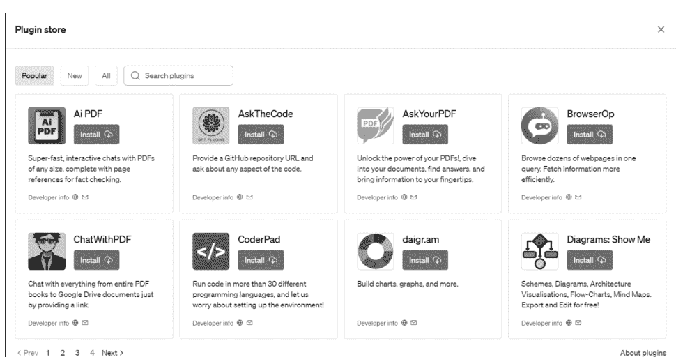
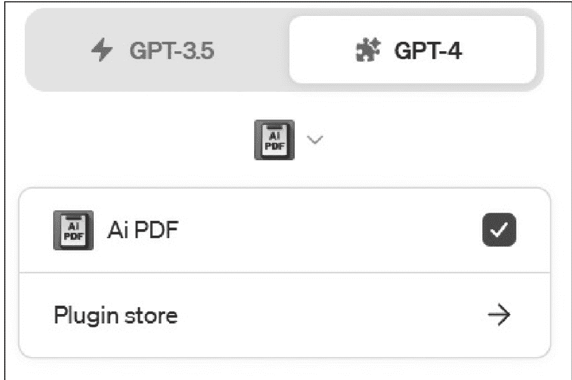
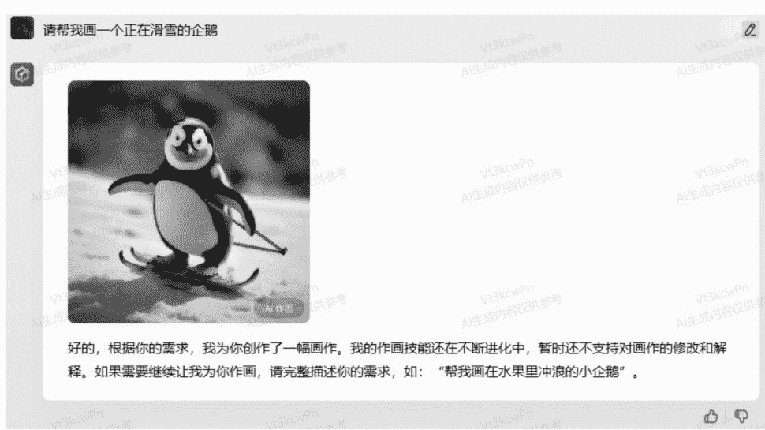
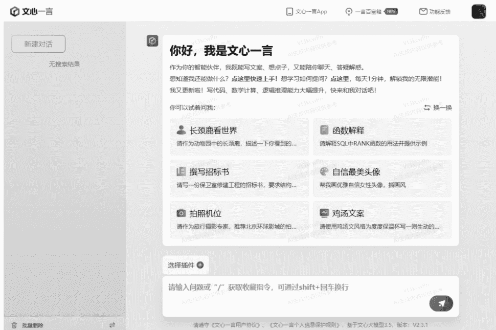
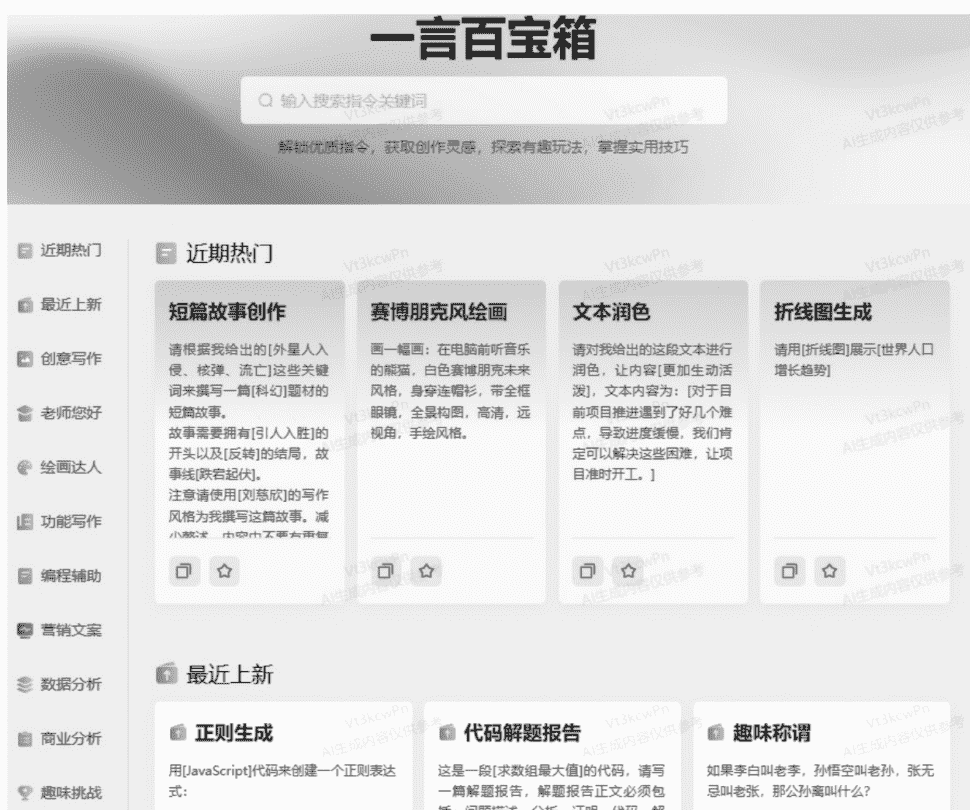
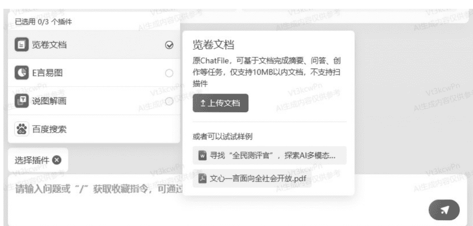
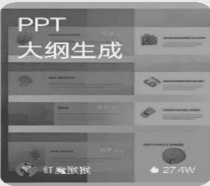
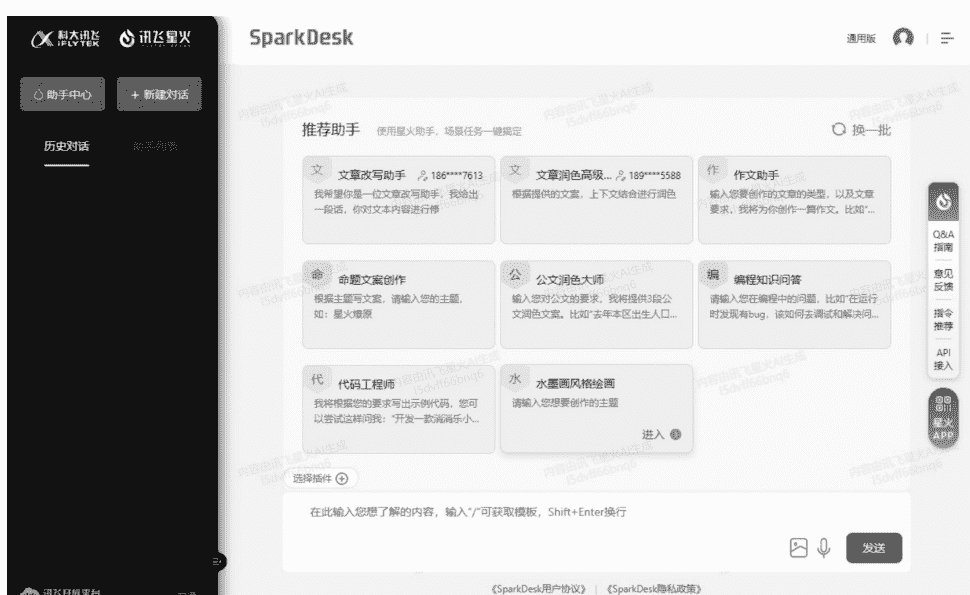
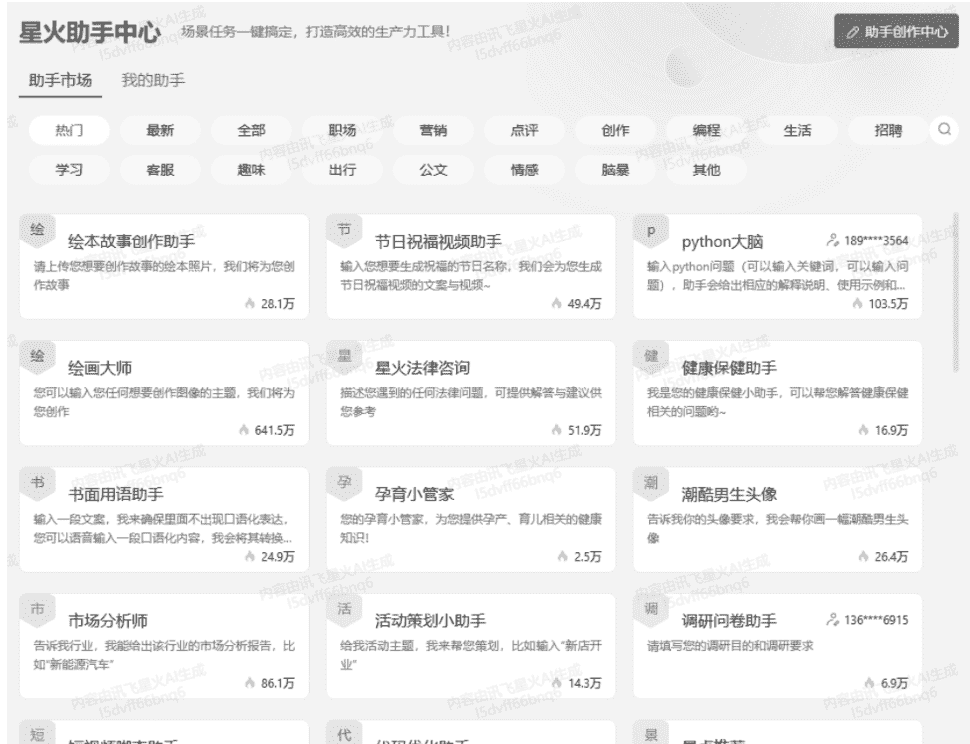

# AI 让公文写作更准更快：ChatGPT 与文心一言实战全攻略

写公文几乎是所有机关、企事业单位行政岗的必修课。可现实里，人工起草总绕不开几个痛点：错别字、漏字这类低级失误频出；不同人笔下的用词、格式、语气参差不齐；格式固定、内容重复，导致大量时间消耗在机械性劳动上，效率被严重拖累。

在生成式 AI 快速落地的今天，公文工作完全可以迎来一次升级。借助 AI，拼写与排版失误能被大幅压缩，文字质量更稳；通过持续对齐提问，AI 的输出风格可以保持高度统一，帮助组织对外呈现稳定专业形象；重复性高的框架性工作交由 AI 处理，写作者的工作节奏明显加快。

这本《AI 公文写作一本通：用 ChatGPT 和文心一言提高公文写作质量和写作效率》就是围绕这一思路展开的实操指南。

## 这本书讲什么

全书共 17 章。第一章以《党政机关公文处理工作条例》为依据，系统梳理公文的本质特征、核心作用、写作关键点以及 15 大文种的划分。第二章盘点当下常用的 AI 写作工具及使用门槛。第三章至第十七章则围绕同一套工作闭环——先用真实公文范本训练模型，再撰写写作指令，再优化指令，最后精修初稿——分别详解 15 类公文的 AI 撰写方法。对应每一类文种，章节里都配有常用句式与金句参考，便于直接迁移使用。

本书面向党政机关与企事业单位的行政人员、文书岗位，以及所有希望提升公文写作能力的学习者。读完可以做到：熟练调用 AI 工具提升效率；夯实公文基础知识与规范意识；针对不同文种快速产出专业、合规的稿件。

为了便于在办公场景落地，书中配套了 15 类公文的数十篇范文，以及近千条常用句式与金句的电子资料，可按需下载使用。

## 前言：传统公文写作的三大困境与 AI 的解决路径

公文是组织传递信息、形成决策、实现协同的核心载体，记录着运营与管理的轨迹。因此，规范、统一、高效的文书工作对组织运转的重要性不言而喻。传统方式下，主要存在三类问题。

一是易出错。人工起草难免出现拼写、打字失误，对重要文书而言影响甚大，往往需要投入大量人力进行校对与审核，耗时耗力。

二是风格不统一。不同撰写者对用词、语气和格式的把握存在差异，同类文书前后不一致，容易削弱组织的外部形象。

三是重复度高、效率低。公文格式相对固定，内容存在一定重复性，写作者常被琐碎的重复劳动占据时间。

AI 的出现为这三个问题提供了新解法。AI 可以在很大程度上降低错漏，提升稿件文字质量；通过反复的问答对齐，输出风格可以保持一致，助力组织形象稳定；AI 在处理重复性、框架性任务上效率突出，能够显著释放人力。

本书的核心目标，就是手把手教读者如何用 AI 工具提升公文写作的质量与效率。先搭好公文与 AI 的基础认知，再进入实战：决议、公告、通知等 15 类常见公文，每类占据一整章，包含五个模块：如何用公文范本训练 AI 认识格式与风格；如何撰写有效的写作指令；如何对指令进行优化，使要求更精准；如何精修 AI 初稿，弥补模型短板；各文种的常用句式与金句。

与其争论 AI 是否会重塑行业甚至替代岗位，不如先学习、适应新工具。希望本书能帮助你更好地运用 ChatGPT 与文心一言，提升写作能力，获得更多职业成长。

## 第一章 公文的基本面：特点、要点与分类

### 公文的特点与作用

公文是组织用于传递信息、作出决策、管理事务的正式文书，其定位决定了它的一系列特质。

从性质与功能看，公文具有正式性，依托法定格式与规范语言，具有权威性与法律效力；兼具组织属性，是内部沟通与对外联络的桥梁；同时承载决策属性，体现政策导向与组织立场。

从形式看，公文格式高度规范，包含发文机关、文种、日期、标题、正文、签署、印章等要素；语言正式、术语统一，避免口语化；编排强调逻辑清晰，常借助章节、编号、项目符号实现条理化呈现。

从内容看，公文常用于传达政策与指导思想；涉及人事、财务、工作计划等内部管理；承担通知、公告、会议告知等信息发布功能；也承担国际合作、合同协议等对外交流职能。

从写作要求看，公文必须准确，以防误导决策；表达要清晰简洁，避免歧义；须符合规范流程与格式标准；并体现发文单位的权威性。

公文的作用涵盖信息传递、管理事务、制定政策与法规文件、作为决策依据、记录历史轨迹、具备法律约束力、体现组织文化、支撑对外交流与合作、促进社会各方沟通与信息共享。可以说，公文是组织管理与社会运行不可或缺的支撑。

### 公文写作要点

行文规则方面，需遵守法律法规、保证信息真实准确、遵循保密与机密分级、保持时效性、明确决策来源与授权、使用正式格式、倡导沟通协作、做好文件管理与存档、及时撤销作废文件、追求效率与流程简化。

表达方式方面，应使用正式用语与规范术语；表述明确简洁，一句一意；专业术语与缩写首次出现需解释并保持统一；遵循逻辑顺序并使用过渡词；分段清晰、标点得当；严格遵循版式规范；全文语言与格式统一；开头简要概括主题与目的，结尾总结要点并给出后续动作；用词审慎，避免争议；文风平稳中性，避免过度修辞。

### 15 类公文的分类与特点

本书参照《党政机关公文处理工作条例》第八条，覆盖决议、决定、命令令、公报、公告、通告、意见、通知、通报、报告、请示、批复、议案、函、纪要，共 15 种。

决议侧重正式性、决策性、规范性、明确性与合法权威，常见细分为公布性、批准性、阐述性三类，结构一般为标题、成文日期、正文。

决定强调严肃性、强制性与明确性，细分为法规性、指挥性、奖惩性、变更性等，结构包含标题、主送机关、正文、署名、日期并加盖印章。

命令令适用于重大行政措施，具有重要性、权威性与最高强制性，常见类型有发布令、行政令、嘉奖令、任免令，结构含标题、令号、正文、发令机关与日期。

公报级别高、公开性强、新闻性突出，细分为刊物公报、会议公报、统计公报、联合公报等，结构为标题、成文时间、正文、签署。

公告具有广泛影响，强调一文一事的单一性，兼具公开与新闻特征，细分为要事性、政策性、任免性、法定性公告，结构含标题、发文字号、正文、署名、日期。

通告法规性强、实务指导性突出、面向内外，细分为知照性、办理性、禁管性通告，结构为标题、正文、署名、日期。

意见多向性明显，针对性强，应用多样，细分为指导性、实施性、呈报性、呈转性意见，结构为标题、正文、署名、日期。

通知应用场景广、受众面宽、具有指导意义与时效要求，细分为批转性、转发性、发布性、事务性、任免性、告知性等，结构为标题、主送机关、正文、署名、日期。

通报强调典型性与引导性，具有时效与真实要求，细分为表彰通报、批评通报、情况通报，结构为标题、正文、署名、日期。

报告单向向上、概括性强、基于实践，细分为工作报告、情况报告、建议报告、答复报告、报送报告，结构为标题、主送机关、正文、署名、日期。

请示具有回复对应性、单一性、针对性、超前性与可行性，细分为求示性、求准性、求助性请示，结构为标题、主送机关、正文、署名、日期。

批复被动生成、针对特定请示、权威性强、表述简明，细分为批示性、批准性批复。

掌握以上特点与规范，再结合 AI 的训练、指令、优化与精修流程，就能在保证质量与合规的前提下，实现公文写作的提效升级。

批复在外在构成上一般由标题、主送机关、正文部分（引述原由、具体答复、收尾语）、发文单位署名及成文日期等要素组成。

### 1.3.13 议案

议案在实际运用中通常呈现以下特质。

1. 指向明确。议案多由同级人民政府呈报给本级人民代表大会或其常务委员会。
2. 决策关联度强。所涉内容一般属于须提交人大审议并作出决定的事项。
3. 会期约束。提案时间通常受限于同级人大或其常务委员会的会议召开周期。

依据事项性质可划分为立法类议案、决议类议案、任免类议案。

形式上一般包含标题、主送单位、正文、落款并注明签发人姓名及亲笔签名、制发日期等项目。

### 1.3.14 函

函的共性可归纳为三点。

1. 平等属性。常用于没有隶属关系的机构之间进行正式往来、协商或答询，体现双方地位对等。
2. 适用面广。各类组织机构的正式文书往来均可采用，使用主体覆盖范围大。
3. 事由单一。一份公函通常只处理一件具体事务，表述应简练明晰。

根据用途可分为告知函、商洽函、询问函、答复函、请批函等。

版式一般由标题、收文单位、正文、落款、制发日期构成。

### 1.3.15 纪要

纪要的突出特点为。

1. 求真。记录内容必须真实可信，与会议实际进程及通过的事项一致。
2. 提炼。要求抓住要点，以简明扼要的方式传递核心信息。
3. 条理。结构需清晰，对素材进行合理的归纳与总结。

按会议性质可分为工作会议纪要、代表会议纪要、座谈会议纪要、联席会议纪要、办公会议纪要、汇报会议纪要。

格式通常涵盖标题、正文含会议概况与议定事项、出席人员、请假人员、列席人员等栏目。

# 第2章 常用的AI写作工具

本章介绍的写作助手本质上都是大语言模型，即利用海量语料训练的深度学习系统，能够产出自然语言文本并理解语义。

在使用之前，先明确提示词的概念。简言之，提示词即发送给模型的指令或提问。要得到优质回复，需要提出优质问题。一般而言，好的提示包含任务目标与相关背景信息，如输出格式、示例等。

掌握概念后，还应熟悉与模型协作的基本方法，有助于更准确把握需求，撰写高质量公文。

- 技巧1：为自身或模型设定具体明确的角色。
- 技巧2：提供详尽的背景资料。
- 技巧3：提出清晰具体的输出要求，如格式等。
- 技巧4：若效果不佳，可请模型协助优化提示本身。
- 技巧5：必要时用分隔符例如###或****划分不同部分。
- 技巧6：必要时给出详细的执行步骤。

## 2.1 ChatGPT

全称为 Chat Generative Pre-trained Transformer，是 OpenAI 推出的基于大语言模型的对话程序。

上线后表现突出，吸引大量关注，推动了大模型浪潮。随后其他互联网公司纷纷推出自家模型，形成了业界热议的千模竞争。

### 2.1.1 特性与能力

核心特性归纳如下。
- 训练语料规模庞大。基于海量文本训练，因而能理解并生成自然语言。
- 多层 Transformer 架构。由多个 Transformer 层堆叠，可捕捉文本的复杂模式与关联。
- 预训练加微调。先进行通用预训练，再针对具体任务微调，以提升如对话等场景性能。
- 生成与理解兼备。既能产出文本，也能理解输入，从而实现更有效对话。
- 用途多样。除对话系统外，还可用于摘要、翻译、问答等自然语言处理任务。
- 输出质量较高。生成的文本通常可读性、一致性与准确性较好，但也可能出现失准或无关情况。
- 前文感知。能理解前文语境，据此生成或回应内容。
- 无监督学习。预训练阶段采用无监督方式，从大量未标注文本中学习。
- 可扩展性强。架构可通过增大规模提升性能。
- 局限与倾向。训练数据可能含社会文化偏见，输出或会反映这些倾向。
- 知识固化。训练完成后知识静态，无法实时更新或获取最新信息。

这些特性使其成为功能强大且多样的自然语言处理工具，同时存在一定局限。

主要能力体现在。
- 文本生成。能产出自然流畅连贯的文本，在生成任务中表现优异。
- 对话管理。虽非专门设计，却能有效参与并管理多轮对话。
- 语境理解。可捕捉长序列依赖，进而理解语境并据此回应。
- 问题解答。能基于给定语境回答具体问题，但准确度不及专业问答系统。
- 文本摘要。能理解长文本并提炼简洁摘要。
- 语言翻译。具备一定翻译能力，但不及专业机器翻译系统。
- 内容推荐。基于语境推荐相关信息或行动。
- 文本分类与标注。虽为生成模型，也可用于部分分类或标签任务。
- 情感分析。可识别文本中的情感倾向，如正面、负面或中性。
- 自然语言推理。可完成基础逻辑推理，但不及专用推理模型。
- 创意写作。凭借生成自然一致文本的能力，可用于创意写作与故事创作。
- 代码生成与理解。能生成简单代码片段，并在一定程度上理解代码。

该产品兼容多种语言的输入输出，支持多种文本输出格式，包括纯文本、Markdown、HTML、代码等。

目前并不支持直接语音输入或文件上传，但 GPT-4 版本支持丰富插件，可通过插件实现语音输入、文件上传等功能。

### 2.1.2 使用方法

现阶段仅提供网页端访问，注册账号登录后即可使用基础功能。

网页端提供两个版本，GPT-3.5 和 GPT-4。GPT-3.5 面向全体注册用户开放，提供基础功能；GPT-4 仅面向付费用户，需订阅 ChatGPT Plus 后使用，提供测试中的高级功能，如插件、高级数据分析等。

网页端首页简洁，如图2-1所示。

图2-1 ChatGPT网页首页

首页左区为对话管理侧栏，顶部设“新对话”与“侧栏收起/弹出”控制，点击“新对话”可开启新对话，点击侧栏控制可收起或展开侧栏；中部为对话列表，选中条目后右侧会出现对话标题编辑控制与删除控制，分别用于修改标题与删除历史对话；底部为设置控制，点击后弹出设置菜单，设置项较为简单。

首页右区顶部有两个标签，分别为 GPT-3.5 与 GPT-4。若为 ChatGPT Plus 订阅用户，可通过点击标签切换版本；若非订阅用户，点击 GPT-4 标签会弹出付费提示。

首页右区底部展示推荐提示词，底部为聊天输入框。

订阅 ChatGPT Plus 后，将鼠标悬停于 GPT-4 标签上会弹出快捷菜单，见图2-2，菜单包含“默认”“高级数据分析”“插件”三个选项。选择“默认”不启用任何高级功能；选择“高级数据分析”启用高级数据分析功能；选择“插件”启用插件功能。

图2-2 GPT-4版本可启用高级功能

与同类产品相比，一大优势是拥有活跃的插件商店，可通过插件扩展能力。选择“插件”后，GPT-4 标签下方会出现“未启用插件”控制，见图2-3，点击该控制弹出快捷菜单，其中包含“插件商店”选项，点击后进入插件商店页面，见图2-4。

图2-3 “未启用插件”控制

图2-4 “插件商店”页面

插件商店页面顶部设有“流行”“新品”“全部”三个标签，可切换查看不同类别插件。用户也可通过搜索框查找插件。找到合适插件后点击“安装”即可完成安装。

以 Ai PDF 为例，安装完成后首页 GPT-4 标签下的控制会显示为 Ai PDF 图标，见图2-5，点击后弹出的快捷菜单发生变化，可勾选或取消勾选启用或停用插件。

Ai PDF 插件可让系统具备阅读 PDF 文档的能力。可向系统咨询该插件的具体使用方法。也可安装其他插件并同时启用多个插件，进一步拓展功能。

图2-5 安装插件后相关控制和快捷菜单发生了改变

## 2.2 文心一言

百度是国内较早深耕大模型的互联网企业。文心大模型是一系列预训练模型，可应用于文本分类、情感分析、问答系统等自然语言处理任务。这些模型基于飞桨深度学习平台与文心知识增强技术，具备高效、准确、灵活的特点。

文心一言是基于文心大模型技术推出的生成式对话产品，通过与用户的交互不断优化模型，提供精准自然的对话服务。

### 2.2.1 特性与能力

具备以下特性与能力。
- 语言理解力强。能够理解自然语言的含义与上下文，并根据用户问题或需求给出准确回答与解决方案。
- 多语言支持。支持中文、英文等多种语言，可为全球用户提供服务。
- 知识储备丰富。基于海量语料库与知识库训练，知识面广，能提供相关知识与信息。
- 个性化交互。可依据用户输入与交互历史进行个性化互动，提供精准服务。
- 实时更新。可实时更新知识库与模型参数，保持高效与准确，随时提供更新信息。
- 安全合规。注重用户隐私与数据安全，严格遵循相关法规，保护用户敏感信息。

支持多模态生成，除文本外还能生成语音与图像。例如，可要求其生成唐诗《咏鹅》的语音，见图2-6，也可让其生成一张企鹅滑雪的图片，见图2-7。

图2-6 文心一言支持生成语音

图2-7 文心一言支持生成图像

在文本生成方面，支持多种输出格式，包括纯文本、Markdown、HTML、代码等。例如，可要求其生成一段在屏幕上显示“hello，world/”的 Python 代码，见图2-8。

图2-8 文心一言支持输出程序代码

### 2.2.2 使用方法

目前支持网页端与客户端访问，注册百度账号登录后即可使用各项功能。

百度账号注册流程较为简单，此处不再赘述。

#### 1. 网页端
网页端首页如图2-9所示。

图2-9 文心一言网页端首页

页面顶部右侧有“文心一言App”“一言百宝箱”等链接，点击“文心一言App”可下载手机客户端，点击“一言百宝箱”可进入工具集合页面，见图2-10。

页面左区顶部设“新建对话”控制用于开启新对话，下方设“批量删除”控制用于批量删除历史对话。

页面右区顶部展示简介与提示信息，下方为聊天框与“选择插件”控制，聊天框用于发出指令即提示词，点击“选择插件”可选择支持的插件，见图2-11，以扩展功能。

图2-10 “一言百宝箱”页面

图2-11 文心一言支持的插件

#### 2. 客户端
客户端首页如图2-12所示。

图2-12 文心一言客户端首页

页面顶部左端为对话管理控制，点击后进入“我的对话”页面，见图2-13，用户可在该页面新建对话、查看或删除历史对话；顶部中间有“对话”“社区”“发现”三个标签，点击可切换页面。其中“社区”页面展示其他用户作品，见图2-14，“发现”页面包含针对不同应用场景的实用模型，见图2-15，相当于具备不同专长的专属助手；顶部右端为用户管理控制。

暂无更多记忆
+ 新建AI会话
图2-13 “我的对话”页面

对话 社区 发现

动漫头像
旺财清奇脑回路 428

AI体验:AI为我作幅画
大道至简wxm 1817

文心一言看病
山林野茶 378

帮我画一个美女
i_Hao 699

阿Q，精神胜利器
胖总爱胖璞 739

图片位置信息推断
烫手的杯子
图2-14 “社区”页面

对话 社区 发现
热门 角色 创作 绘画 生活 职场 学习 娱

古诗赏析
短视频
## 图2-15“发现”页面

页面中部为对话区域；底部左端为“提示词工具”控制，点击可快速选用内置提示词，见图2-16；底部中间为聊天框，聊天框内右侧有上传图片控制；底部右端为语音输入控制。

## 2.3 讯飞星火

科大讯飞是国内 AI 领域知名企业，此前主要聚焦语音识别、机器翻译等方向，推出过讯飞录音笔、讯飞听见等受欢迎产品。讯飞星火认知大模型也是国内较为流行的模型之一。

请选择想使用的提示词
### 提示词工具
- 行业研究方式 6.3W
- Slogan生成器 6.5W
- 华山论剑PK剧情 3.0W
- 简历优化 1.9W
- 原神角色答复告白 3.7W
- 挑战食堂阿姨 4.5W
- 减肥计划 4.3W
## 图2-16 提示词工具

### 2.3.1 特性与能力

具备以下特性与能力。
- 多语言支持。支持中英文等多语言交互，实现跨语言沟通。
- 知识图谱。构建了包含多实体关系与属性的知识图谱，可从海量文本中自动抽取知识并结构化表示。
- 深度学习技术。采用深度学习技术，对海量文本数据进行特征提取与学习，从而实现强大的自然语言处理能力。

认识星火AI的能力画像与上手要点，以及如何借助大模型把决议写得规范

一、能力概览
这款AI工具在可扩展性上表现突出，随着训练素材的扩充与算力的提升，整体性能与功能边界会同步放大。
应用面比较广，智能客户服务、智慧问答、自动翻译、文本创作等场景都能见到它的身影。
语言与呈现形式都很友好。输出可覆盖汉语、英文、日文、韩文等多种语言，结果可呈现为纯文字、Markdown、HTML 等形式。
素材处理上，系统能够接收文档、图片等资料并解析其中内容，如下图所示，当前暂不支持把结果以文件形式直接返回。

图2-17 讯飞星火可以理解图片中的内容

依托科大讯飞在语音识别上的深厚积累，星火提供口述转写能力，能把口头指令迅速准确地转成文字指令，如下图所示，目前仍未提供语音形式的直接输出。

图2-18 讯飞星火可以将语音指令转为文本指令

二、上手路径
目前服务已在浏览器版、桌面程序、小程序与 H5 页面开放。用户只要在讯飞开放平台完成注册并登录，即可调用各项能力。
小程序与 H5 的操作逻辑与桌面程序接近，但功能相对精简，下面重点围绕浏览器版与桌面程序展开。

1. 浏览器版
浏览器版首屏布局见图2-19。左区集中了会话管理与助手管理，提供助手枢纽、新建会话等入口，以及往期记录与助手清单两类列表。点开助手枢纽会进入星火助手中心页，如图2-20，里面集合了众多专业助手；点新建会话可开启新交互。往期记录与助手清单分别记录过往会话与曾用助手。

▲图2-19 讯飞星火网页端主页面

## 图2-20 “星火助手中心”页面

右上方放置账户管理与发音人设置入口，右侧提供问答指引、指令建议、星火App 等快捷链接，其中星火App 可下载桌面客户端。
中部区域会推荐若干热门助手，下方为输入区及接入扩展按钮。通过接入扩展可为当前会话挂载系统支持的扩展工具，如图2-21所示，进而拓展能力。输入区内置资料导入与口述入口，便于直接投喂素材或进行语音提问。

图2-21 讯飞星火支持的插件

2. 桌面程序
桌面程序首屏见图2-22。顶部左侧有两个切换标签“会话”和“助手”，切换后进入对应页面。“助手”页展示了丰富类型的助手，用户也能在此自建专属助手，如图2-23。

## 简单三个步骤 创建您的专属助手！

1. 使用PC访问星火官网（xinghuo.xfyun.cn）

2. 登录后选择左上角“助手中心”

3. 在新页面点击“助手创作中心”即可开始创建

> 您创建的个人助手，将在这里展示并可直接使用

▲图2-23 “助手”页面

页面右侧为新建会话和历史查看两处操作。点新建会话即可启动交互，点历史查看可进入历史管理页查看会话历史与助手历史，如图2-24；同时可点设置进入设置页进行个性化配置，如图2-25。
中部为会话展示区，底部为输入区、口述入口和接入扩展按钮，如图2-26，点后可选取已支持的扩展工具。输入框左侧另设图片导入入口。

▲ 图2-22 讯飞星火客户端主页面

讯飞星火

134xxxx6740

设置

对话历史

助手历史

您还没有创建对话

新建对话

▲ 图2-24 历史管理页面

### 设置

当前发音人

聆小琪

语音播报

开启后语音提问会自动进行语音播报

### 常用功能

- 通用设置

- Q&A指南

- 意见反馈

- 投诉举报

- 关于我们

### 隐私政策

- 隐私政策摘要

- 服务协议 & 隐私政策

- 个人信息收集清单

- 第三方共享清单及SDK目录

▲ 图2-25 “设置”页面

### 选择插件 0/3

### 全部插件

- **简历生成**

  输入岗位、个人信息等关键词，自动生成简历模版

  工具 使用示例

- **PPT生成**

  简单高效，一句话生成高质量PPT模版

  工具 使用示例

- **文档问答**

  强大的知识问答工具，上传文档，进行提问

  工具 使用示例

## 图2-26 讯飞星火客户端支持的插件

# 第3章 手把手教你用大模型写决议

## 3.1 首个阶段，让模型熟悉决议的框架与排版规范
在借助模型起草决议前，先做一次格式训练很有必要。部分模型虽有公文常识，但往往不完整、不规范，直接出稿会产生大量修改，与提效初衷相悖。
这一步看似耗时，实则是磨刀不误砍柴工。模型具备记忆能力，完成一次训练后，同一类公文的后续生成即可跳过。

#### 1.首次对齐
训练方法很直接。选取一份符合规范的范例，按格式重写的方式提问即可。以党代会批准类决议为例，先给出范文的标题与正文结构，要求模型参照该结构生成另一份决议。这一轮交互的目标并非直接可用稿，而是让模型把握用户期望的样式。
当前对话式模型依托大模型构建，上下文记忆较强，完成交互后就能稳定复现所要求的决议样式。

#### 2.再次对齐
决议大致可分为公布类、批准类、阐述类三类。上例属于批准类。再以上市公司股东会决议为例，给出包含会议依据、出席情况、决议事项清单、股本结构、章程修改、选举免职、委托办理等要素的范文，要求模型严格参照结构重写。阐述类决议的框架与前两者基本一致，仅正文因主题不同而变化。

## 3.2 第二阶段，为模型提供撰写决议的关键提示
从结构上看，决议一般包含标题、成文日期、正文。正文再细分为决议依据、决议事项、结语，部分文种还会出现发文机关署名及印章等可选要素。
提问时提示词应对应这些要素，越细化越好。例如指定标题、日期、依据的报告名称、报告要点、结论要求、落款机关与时间等。模型据此生成的初稿会更贴近预期。

## 3.3 第三阶段，根据初稿优化提示
上述初稿语言通顺、语法无误，但仍存在两类问题：一是格式与规范决议存在细微差异且出现冗余表述，二是前后逻辑关系处理不当。
提示中本意是因收费项目停止导致收入减少而需调整预算，而模型输出未能清晰体现因果链，需要进一步明确逻辑与表述。可要求正文分段表述、避免罗列条目，并把因果关系写在前面。优化后模型输出的逻辑会更清晰。

## 3.4 第四阶段，人工审校与格式调整
提示词优化后，初稿已大致符合公文基本要求，但仍需人工二次处理。
其一，模型基于概率生成文本，难以真正理解语义，常出现看似流畅却违背常识或逻辑的内容，需人工审校。
其二，主流模型难以直接输出复杂排版，除非指定 Markdown 格式，但这对用户有门槛且无法一步到位。因此仍需手动调整格式以符合公文规范。

## 3.5 决议中的常用句式与表达

### 3.5.1 党政机关决议中的常用句式与表达
党政机关决议的句式需要体现决断性与庄重性。常用表达如下。

**强调决定的权威性和决心时**
- 本机关/党组决定……
- 我们充分认识到，这项决议对于……
- 为确保……，特此决定……

**表达决议的目的和背景时**
- 考虑到目前的局势，为了……
- 鉴于过去的经验，为更好地……
- 根据党的方针政策，为了推动……

**强调决策的重要性时**
- 这一决定具有极其重要的战略意义。
- 此举对于人民的利益至关重要。
- 决心要在此事上付出最大的努力。

**提出具体措施和目标时**
- 我们决定采取以下措施……
- 我们制定了明确的时间表和实施计划。
- 力争实现……的目标，并取得显著成果。

**强调党的领导地位时**
- 党的领导是我们决策的指导思想。
- 我们坚信，只要有党的坚强领导，我们就能取得胜利。

**提醒党员和干部职责时**
- 各级党员和干部必须牢记党的使命，尽职尽责。

怎么写好一份决定，从句式库到AI实战，这套方法可以直接上手。

决定类文本的核心在结构清晰、表述庄重、指向明确。先把不同场景的语言质感梳理清楚，再用AI按部就班训练，效率会高很多。

**一、公文与党务表达的常用语感**

党员层面，强调主动担当。党员干部要自觉践行党的宗旨，在本职岗位上当好先锋、作出示范。

强调团结时，语气要凝聚向上。只要党、军、民拧成一股绳，就能跨越任何难关；要持续强化内部合力，以共同态度迎接各种挑战。

强调决议分量时，语气要庄重坚定。该项决议具有划时代的历史意义；全体同志必须鼓足干劲，绝不后退半步。

**二、公司股东会决议的表达体系**

体现权威与决断力。股东会形成一致决议如下；结合现实态势，股东会正式作出如下决定；为保障企业长期稳健运行，股东会明确表态。

交代背景与目的。顺应企业战略导向，为实现……；基于当前财务态势，为进一步……；依据章程相关条款，为推进……

点明决策分量。该决议关乎企业未来走向；此项安排直接影响竞争实力与可持续经营；董事会在审议中高度认识到决策的时效性。

落到措施与目标。股东会决议实施下列行动；已拟定具体的执行方案与时间节点；股东会致力于达成……目标，力争取得优异业绩。

兼顾治理与权益。股东会始终恪守良好治理准则；高度关注股东合法权益的维护；立志保持经营透明与合规运作。

明确股东责任。希望各位股东主动承担股东责任，积极参与各项决策；欢迎股东依法行使权利，及时提供建设性建议。

强化协同。唯有全体股东同心协力，才能渡过眼前面临的挑战；要强化协作，共同推动企业走向成功。

号召落实。该决议必将对企业发展轨迹产生长远作用；股东会呼吁全体股东坚定拥护并严格落实。

**三、手把手用AI写决定的四步法**

决定整体结构是标题加文件号，主送机关，正文，发文机关署名与成文日期。正文由缘由依据目的意义的开头，具体条目式的主体，以及要求号召或说明事项的结尾构成。

第一步，让AI先学会结构与格式。先用奖惩性决定的范文喂给模型，要求它严格按照原范文的排版与逻辑重写一篇同类文本。模型会保留标题格式、缘由说明、评审过程、条目化决定事项、落款时间的完整脉络。随后用变更性决定的范文再训练一次，学会“总述调整背景——经审议决定——分条任命——说明生效时间与交接要求”的写法。法规性与指挥性决定格式相近，篇幅更长且与具体条款挂钩，原理相同不再展开。

第二步，给AI提供撰写要素的提示词。提示要拆成标题、正文开头、条目内容、结尾要求、落款时间五部分。例如需要拟一份管理层变更决定，就明确标题方向，正文开头说明为保持队伍年轻化、激活人才，经董事会批准作出任免决定；条目列出甲因达退休年龄不再担任副总经理、乙由销售总监升任副总经理、丙由北方区销售经理升任销售总监；结尾对新任命人员提出期望；落款与日期固定。模型输出后语句通顺但标题不够规范，段落偏长。

第三步，优化提示词提升质量。将标题固定为“关于A公司管理人员任免的决定”，要求开头用一段话简要交代缘由目的，结尾用一段话简要提出希望与要求，避免冗余叙述。优化后文本更紧凑，层级清晰，符合公文规范。

第四步，人工审查调整。即使提示词优化后仍需人工校对。把“我们进行了管理层的变动”调整为更书面化表达，条目中“升任”替代“提升”，结尾明确生效日期与期望表述，去除口语化感谢语，整体更符合正式决定的语感。

**四、决定类型常用句式速查**

法规性决定。开头用鉴于、为了确保、根据法律规定等；陈述规定与禁止时用规定、禁止、必须遵守、不得违反；强调责任用所有相关方有责任、承担法律责任、有义务确保；处罚表述用违反者将受到、依法追究刑事责任；审批表述用必须经过、必须获得主管部门批准；期限表述用必须在×天内完成、截止日期为；权利保障用保障公民权利、确保合法权益；权威性用本法规具有法律约束力、自公布之日起生效；递进用鉴于此，进一步强化；重要性用具有重大影响，必须严格遵守。

指挥性决定。任务内容用请立即、×××执行以下任务、负责完成；步骤时间用按照以下步骤行动、在期限内完成、第一步第二步；责任分配用由×××负责、指派×××为负责人；紧急性用鉴于紧急性请立即行动、时间紧迫不得拖延；合规要求用必须遵守公司政策、请遵循标准操作程序；结果期望用预计将带来、期望短期内看到改善；报告要求用请定期汇报进展、报告必须在日期前提交；警告用不执行将产生严重后果、必须遵循指令否则后果自负。

奖惩性决定。表彰用特此表彰、鉴于杰出表现颁发奖励；奖金福利用将发放奖金以示表彰、奖励包括……；期望用期望继续保持卓越表现、希望继续作出杰出贡献；感谢鼓励用感谢辛勤工作与无私奉献、请继续树立榜样；处罚用根据公司政策不得不采取措施、鉴于不当行为将执行；影响用将影响职业生涯与地位、处罚将对工作产生直接影响；合规用请确保严格遵守政策、行为不会被容忍；后果用再次违反将导致更严重后果、希望吸取教训避免重犯。

变动性决定。缘由目的用为适应新市场需求、考虑到战略调整、为提高工作效率；必要性用是为了确保可持续发展、将有助于提高效率与质量、符合长期目标与愿景；人事任命用公司决定任命×××为……、调整为……、填补空缺；组织架构用重新安排部门职能与结构、成立新团队负责……、取消××职位并入……

掌握句式库，配合结构化提示，决定类文书就能快速达到规范、可信、有力。

## 人事调整沟通表达参考

**面向新任职者的期许表达**
肯定候选人过往的业绩与能力，并表达希望该表现延续到新岗位。
期盼新团队内部协作顺畅，共同达成组织既定的目标。
相信此次人事变动有助于整体竞争力提升。

**争取团队协作的表达**
平稳完成交接离不开全体同事的积极参与。
请各位理解支持本次安排，一起推动公司向前。
员工的正面支持是各项工作落地的关键依托。

**生效时间说明表达**
本次调整自约定日起正式生效。
请留意，相关负责人将从约定日起正式履职。

**收尾用语参考**
该事项已获管理层审议通过。
感谢大家的理解与配合。
期待组织在新架构下取得更大突破。

## 用AI起草命令类文书的操作思路

### 5.1 先让模型掌握命令类文书的骨架
起草前先训练模型熟悉命令类文书的通用框架与书写规范。
党政机关与企事业单位常用类型有发布令、行政令、嘉奖令、任免令，以发布令为例进行演示。

首次训练示例
提示要点
下面是一份符合规范的发布令范例
> 【机关名】令
> 
> （文号）
> 
> 《【规范性文件名称】》已由【会议名称】于【日期】通过，现予公布，自公布之日起生效。
> 
> （署名人）
> 
> 【日期】

请严格参照上述版式与结构，重新拟写一份发布令。
模型输出示例
#### 发布令
（令号）
《关于【事项】的决定》已由【会议】于【日期】审议通过，现予公布，自公布之日起施行。
（署名）
【日期】

二次训练示例
再以嘉奖令进行训练。
提示要点
下面是一份嘉奖令范例
# 【企业名】对甲乙丙三位同志的嘉奖令
企业各部门：
【日期】是企业举办开业庆典的重要日子，管理部的甲同志、财务部的乙同志、宣传部的丙同志在筹备期间表现突出……
鉴于此，企业决定：给予甲乙丙三人通报表扬一次，并分别发放2000元现金以资鼓励。希望三位同志今后继续努力。同时号召其他员工向这三人学习，共同进步。
【企业名】
【日期】
请严格按上述版式与结构重写一份嘉奖令。
模型输出示例
# 【企业名】对甲乙丙三位同志的嘉奖令
企业全体员工：
【日期】是本企业举办庆典的重要日子。在庆典活动中，甲乙丙三位同志表现突出，为企业树立了榜样，取得显著成绩。
企业经审议，决定予以嘉奖：通报表扬甲乙丙三人的积极表现，并发放2000元现金奖励，以示认可和鼓励。同时期望他们今后保持拼搏精神，为企业发展贡献力量。企业呼吁其他员工向甲乙丙三人学习，共同努力，为企业更大成功而奋斗。
【企业名】
【日期】

行政令多用于宣布重大行政措施的推行，接触较少；任免令的结构与发布令、嘉奖令相近，此处不再展开。

### 5.2 把关键要素拆解成指令
命令类文书通常包含标题即签发单位、事由、文种，令号，嘉奖令等类型令号有时可省略，主送单位在标题落款体现明显时可省略，主体内容，署名及落款日期。
提问时应把指令拆分为上述要素并具体化。

提示词示范
我是某省政府的工作人员，需要拟一份某县甲同志的嘉奖令。
请先拟好标题，包含签发单位、事由和文种。
收件单位为“各地市人民政府”。
主体内容需写明甲同志在【日期】的洪灾救援行动中置自身风险于不顾，竭力营救出十余名受困居民。因此决定授予甲同志嘉奖章及荣誉证书，由某县召开大会授予奖章证书，并号召党员群众学习其精神。
落款签发单位是某省政府。
发文日期是【日期】。

模型输出示范
标题：某省政府关于嘉奖某县甲同志的通知
签发单位：某省政府
文种：通知
各地市人民政府：
甲同志是我省干部队伍中的突出代表，他在【日期】的洪灾救援行动中展现出非凡的勇敢与担当。面对洪水肆虐，甲同志毫不犹豫投入危险的救援工作，无视自身风险，英勇营救出十余名受困居民，将他们从洪水中解救，保护了生命安全。
甲同志的突出表现不仅是对党员的高度忠诚和担当，也是对事业的无私奉献的生动体现。其英勇行为为某县的救援工作树立了榜样，为全省的防灾救灾工作作出突出贡献。
鉴于甲同志在救援中的突出表现，省政府决定授予其嘉奖章及荣誉证书，以表彰其英勇行为和杰出贡献。奖章证书将由某县政府在即将召开的大会上授予，以示高度尊重和嘉奖。
同时号召其他党员和全体群众向甲同志学习，共同弘扬救援精神，积极投身灾害救援，为保卫人民生命财产安全、为国家的安定繁荣不懈努力。
某省政府
【日期】

### 5.3 对初稿提示词做精细化优化
上例初稿内容充实但版式不够规范，重点也不突出。可以通过更细化的指令来弥补。

优化后提示词
我是某省人民政府的工作人员，现在需要拟一份某县甲同志的嘉奖令。
标题为“嘉奖令”。
标题下方写明收件单位“各地市人民政府”。
主体第一段写明甲同志在【日期】的洪灾救援行动中无视自身风险，竭力营救出十余名受困居民。
随后分条列出嘉奖事项：第一，决定授予甲同志嘉奖章及荣誉证书；第二，由某县召开大会授予奖章证书，并号召党员群众学习甲同志的精神。
落款签发单位是某省政府。
发文日期是【日期】。

模型输出示范
# 嘉奖令
各地市人民政府：
甲同志是我省党员的杰出榜样，【日期】，在某县洪灾救援的关键时刻，甲同志无视自身风险，毅然投身救援工作。他英勇无畏，坚韧不拔，成功营救出十余名受困居民，保护了他们的生命安全。
为表彰甲同志的贡献，某省人民政府决定：
一、授予甲同志嘉奖章及荣誉证书，以表彰其在洪灾救援中的英勇表现和卓越贡献；
二、授权某县政府召开正式大会，向甲同志授予嘉奖章及荣誉证书，以示嘉奖；
三、号召全省党员和广大群众向甲同志学习，共同弘扬其高尚精神和崇高事迹，为保卫人民的生命安全和财产安定、推动全省的繁荣和稳定贡献更多力量。
某省人民政府
【日期】

### 5.4 人工审校与版式调整
提示词优化后初稿基本符合公文要求，还需人工修订内容与版式。

修改后文稿示例
# 某省人民政府文件
×政〔【年份】〕×号
# 嘉奖令
各地市人民政府：
甲同志是我省党员的杰出榜样，【日期】，在某县洪灾救援的关键时刻，甲同志无视自身风险，毅然投身救援工作。他英勇无畏，坚韧不拔，成功营救出十余名受困居民，保护了他们的生命安全。为表彰甲同志为人民群众尽职尽责的精神，某省人民政府作出以下决定。
一、授予甲同志嘉奖章及荣誉证书，以表彰其在洪灾救援中的英勇表现和卓越贡献。
二、某县政府召开大会，向甲同志授予嘉奖章及荣誉证书。
三、号召全省党员和广大群众向甲同志学习，共同弘扬其精神，为保卫人民的生命安全和财产安定、促进全省的繁荣和稳定贡献更多力量。
【日期】
抄送：【单位A】，【单位B】，【单位C】，【单位D】。
【单位】【日期】印发

### 5.5 命令类文书常用表述与金句

#### 发布令
开头常用表达
依据【部门】的决议，特此发布以下命令。
引言常用表达
鉴于【情况】，为维护【目标】，特此发布。
考虑到【情况】，为确保【目标】的实现，现发布以下命令。
出于对【事项】的重视，特制定本令。
表述规定常用表达
根据【依据】，【部门】决定如下。
为保障【权益】，特发布下列规定。
强调常用表达
各相关部门单位应严格执行本令，切实履行职责。
违反本发布的单位和个人将依法追责。
本令自【日期】起施行。
结尾常用表达
请各相关单位务必贯彻落实，确保规定落地。
【部门】将跟踪执行情况并视情调整，确保令行有效。
感谢各方支持配合，共同推动【事项】顺利进行。
金句示例
坚守初心砥砺前行，续写更加美好的篇章。
在新起点上传承【精神】，奋力开创辉煌。
信心坚定勇于进取，必将迎来更大胜利。
携手并进共为【事业】繁荣发展贡献力量。

#### 行政令
开头常用表达
根据相关法律法规，【部门】现发布以下命令。
基于【原因】，【机关】发布令如下。
引言常用表达
鉴于【情况】，为维护【权益】，特此发布。
出于对【事项】的高度重视，特制定本令。
考虑到【情况】，为确保【目标】实现，现特发布。
结尾常用表达
请相关部门单位严格执行，确保规定切实贯彻。
【部门】将持续监督并适时调整，以保证命令有效实施。
感谢大家支持配合，共同维护【事项】良好运行。
金句示例
发布此令旨在更好地落实相关法规。
令的执行需要各级政府和公众共同参与。
让我们共同努力，为国家繁荣和法治建设添砖加瓦。

#### 嘉奖令
开头常用表达
为彰显【对象】在【领域】的突出贡献，特发布此令。
鉴于【对象】表现卓越，特予嘉奖。
引言常用表达
【对象】在【领域】中表现突出，为大家树立了标杆。
【对象】的贡献在【领域】中意义重大。
说明嘉奖事项常用表达
【机关】决定授予【对象】奖章和证书，以示表彰。
我们为【对象】的卓越成就感到骄傲，特授予荣誉称号。
【对象】的贡献将长久留在我们记忆中。
鼓励学习常用表达
本次嘉奖既是对【对象】的肯定，也是对全体人员的激励。
鼓励大家向【对象】学习，追求卓越。
【对象】的事迹激励我们为更美好的未来努力。
结尾常用表达
让我们共同庆祝【对象】的成就，并以其为榜样。
愿【对象】的光辉事迹持续激励我们奋勇向前。
嘉奖是对个体的认可，也是对他人的鞭策。
金句示例
杰出者的光芒照亮前行之路。
嘉奖是对过去的认可，也是对未来的期许。
携手奋进，为更美好的明天而努力。

#### 任免令
开头常用表达
根据【依据】，【机关】决定如下。
为更好开展工作，特发布以下任免令。
引言常用表达
鉴于【对象】的履职表现，现决定任命其担任【职务】。
基于对【对象】工作的考量，现宣布如下任免。
【对象】在以往工作中表现优异，为【单位】树立了榜样。
说明任免事项常用表达
现决定任命【对象】担任【职务】，主要职责包括……。
根据工作需要，决定免去【对象】的职务。
【对象】继续担任现职，负责【工作】。
强调常用表达
本任免自【日期】起生效。
新岗位需要【对象】承担更多责任，期待继续出色。
希望【对象】在新职位上发挥优势，为【事业】发展作出更大贡献。
结尾常用表达
发布此令旨在更好服务机关部门与社会，望大家积极响应。
祝愿【对象】在新岗位上再创佳绩。
金句示例
每一次任免都是前行一步，职业生涯新篇章。
责任重大，使命光荣。
此次任免既是对【对象】的认可，也寄予未来期望。

## 用AI撰写公报的操作思路

### 6.1 先让模型了解公报的基本结构与格式
公报发布机关层级较高，内容多为重大事件。按内容可分为刊物公报、会议公报、统计公报、联合公报。下面以统计公报作为示范。

提示词示范
下面是一份统计公报范例，包括标题、成文时间和正文第一段及各级标题。
【年份】年全国教育事业发展统计公报
【日期】
【年份】年是党和国家历史上极为重要的一年。党的【大会】将教育作为全面建设社会主义现代化国家的基础性、战略性支撑进行系统谋划，极具战略意义和深远影响。面对内外部环境的深刻变化，教育系统在党中央、国务院坚强领导下，坚持以【思想】为指导，深入学习贯彻党的【大会】精神，积极推动教育事业取得新进步、各项工作有了新成效、教育面貌发生新变化，奋力走好教育强国建设的历史新征程，为全面建设社会主义现代化国家、全面推进中华民族伟大复兴作出教育新的贡献。
# 一、综合
（略）
# 二、学前教育
(略)
请完全参照上述格式与结构重写一份统计公报，包括标题、成文时间、正文第一段，以及之后的一级标题。其他正文内容可省略。

模型输出示范
# 【年份】年全国卫生健康发展统计公报
【日期】
【年份】年是卫生健康领域发展的重要一年。党的【大会】明确了全面建设社会主义现代化国家的目标，卫生健康事业在其中扮演着至关重要的角色。在党中央、国务院的坚强领导下，我国卫生健康事业坚持以【思想】为指导，深入学习贯彻党的【大会】精神，积极推动卫生健康事业取得新进步，各项工作有了新成效，为全面建设社会主义现代化国家、全面推进中华民族伟大复兴作出新的贡献。
# 一、综合发展
(略)
# 二、基层卫生健康
(略)

刊物公报体例规范，会议公报和联合公报多由专门机构起草，接触较少，此处不再展开。

### 6.2 给出撰写公报的关键指令要素
公报结构主要包括标题、成文时间、正文引言及一级标题，联合公报还需签署。

提示词示范
我是工业和信息化部的工作人员，现在需要根据行业统计数据拟一篇通信行业的统计公报。
标题是“【年份】年通信行业统计公报”。
发布时间是【日期】。
请帮我拟好公报正文的第一段和后续的一级标题。

模型输出示范
【年份】年通信行业统计公报
发布时间：【日期】
尊敬的各位领导、各界朋友：
## 一、全面发展和主要经济指标
(略)
## 二、5G网络建设
(略)

### 6.3 根据初稿优化提示词
模型训练数据截止2021年，初稿缺少2022年后重大事件，需进一步细化指令并加入重点表述。

优化后提示词
我是工业和信息化部的工作人员，现在需要根据行业统计数据拟一篇通信行业的统计公报。
标题是“【年份】年通信行业统计公报”。
发布时间是【日期】。
请帮我拟好公报正文的第一段和后续的一级标题。第一段引文应包含“贯彻党的【大会】精神”的内容。正文的一级标题应包括有关行业整体运行状态、用户规模变化、网络基础设施建设等方面的内容。

模型输出示范
【年份】年通信行业统计公报
【日期】
通信行业作为信息化建设的重要组成部分，在党的【大会】精神的指引下，【年份】年取得了显著的成就，为我国数字经济的崛起和社会发展的现代化提供了强大支持。以下是通信行业【年份】年的统计公报。
## 一、通信行业整体运行状态
(略)
## 二、用户规模变化与服务质量提升
(略)
## 三、网络基础设施建设与技术创新
(略)

### 6.4 审校与定稿
经提示词优化，初稿已基本符合公文要求，还需人工修订内容与版式。

修改后文稿示例
# 【年份】年通信行业统计公报
【日期】

在党的××大精神指引下，通信业作为推动信息化建设的支柱力量，积极推动数字经济与实体经济融合向深处拓展。5G网络和千兆光网等新型信息基础设施的建设速度明显加快，数字化应用的普及程度持续走高。××××年度，行业整体收获了稳健的成果，为我国数字经济的快速成长和全社会现代化进程提供了坚实支撑。

## 一、行业整体运行情况
（略）

## 二、用户规模变化及服务质量改进
（略）

## 三、网络基础设施建设与技术创新
（略）

## 四、信息安全与数据治理
（略）

## 五、国际合作与交流
（略）

## 6.5
### 公报撰写参考表达

## 6.5.1
### 统计公报撰写要点

撰写统计类公报时，借助固定表达可使条理更清晰、说服力更强。参考用法如下。

**起笔概述**
- 本份公报对……作出梳理与概括
- 结合近期统计成果，可归纳出以下判断……

**数据呈现**
- 统计结果表明，×××行业在上一年出现明显增长
- 近期测算显示，×××的规模已达到×××

**时段与区域对比**
- 相较上一年同期，本期增速提高了××个百分点
- 区域表现分化明显，其中×××地区更为突出

**动因与走势说明**
- 上述增长态势主要归因于×××因素
- 数值呈现出较强的季节性特征，与×××密切相关

**重点意义强调**
- 该数据反映出×××领域的发展对经济平稳运行发挥关键作用
- 该指标既体现×××的健康水平，也对社会稳定与可持续发展产生长远影响

**可参考佳句**
- 信息数据为科学决策提供支撑，也是实现目标的重要抓手
- 统计成果能够为前瞻规划提供依托，也可为政策优化提供参照
- 让数据引领方向，共同建设更美好的未来
- 每一组数据都记录着进步，每一个指标都凝结着努力
- 于数据中发现挑战，于数据中捕捉机遇，这正是成功的要义

## 6.5.2
### 会议公报撰写要点

**阐明背景与目的**
- 本次会议召开的核心目的在于……
- 按照×××的部署安排，会议适时落地

**介绍议程安排**
- 会议围绕若干主线展开，涵盖……
- 为期两天的交流将重点聚焦以下议题……

**介绍发言内容**
- 会议邀请行业专家对×××议题发表见解
- 各位代表将分别汇报本领域进展与挑战

**描述研讨成果**
- 与会者围绕×××展开深入交流，形成多项建设性建议
- 各方积极建言，为后续工作提供了重要参考

**概括会议结论**
- 经充分协商，各方形成以下共识……
- 会议圆满收官，各项决定将得到有效落实

**可参考佳句**
- 会议是智慧汇聚的平台，也是共识形成的桥梁
- 会上群策群力，为未来发展指明方向
- 会议既是交流合作的契机，也是激发创新、推动进步的引擎
- 每一位参与者都是会议成功的重要推动力量
- 让我们将会议成果转化为行动，共同为实现目标而不懈努力

### 公报范文及常用句式、金句

## 第7章
### 手把手教你用AI写公告

## 7.1
### 第一环节，让AI掌握公告的基本结构与格式

公告的使用场景较为广泛，大致可分为要事性、政策性、任免性、法定性四类。以政策性公告为例，可按以下方式向AI提问，使其理解公告的基本构成与排版。

#### 1. 首次提问
提示词示例。

以下是政策性公告的范文，包含标题、发文字号与正文。

关于增值税小规模纳税人减免增值税政策的公告

财政部 税务总局公告××××年第××号

为进一步支持小微企业和个体工商户发展，现将延续小规模纳税人增值税减免政策公告如下。

- 一、对月销售额10万元以下（含本数）的增值税小规模纳税人，免征增值税。
- 二、增值税小规模纳税人适用3%征收率的应税销售收入，减按1%征收率征收增值税；适用3%预征率的预缴增值税项目，减按1%预征率预缴增值税。
- 三、本公告执行至××××年××月××日。

特此公告。

财政部 税务总局

xxxx年xx月xx日

请参照以上范文的格式与结构，创作一份政策性公告。

模型给出示例。

# 关于公司员工福利政策的公告

示例公司公告示例年第xx号

为提升员工福利待遇，改善工作与生活的平衡，现将员工福利调整政策公告如下。

- 一、公司将增加员工的年度假期。自示例年xx月xx日起，全体员工的年假将调整为xx天。
- 二、公司将为员工提供更全面的健康保险计划，覆盖范围将扩大至家庭成员。
- 三、鉴于员工的忠诚与辛勤工作，公司将推出新的员工奖励计划，以表彰杰出员工并提供额外福利。
- 四、我们将持续关注员工反馈与需求，积极改进福利政策，以确保工作环境更加舒适。
- 五、如有任何疑问或需要进一步了解福利政策的具体细节，请随时联系人力资源部门。

特此公告。

示例公司

示例年xx月xx日

#### 2. 再一次提问
下面以要事性公告为例，继续对模型进行训练。

提示词示例。

以下是要事性公告的范文，包含标题、发文字号与正文。

示例局关于发布《示例标签管理规定》的公告

（示例年第xx号）

为进一步规范中药饮片标签的管理，根据《中华人民共和国药品管理法》等法律、行政法规和规章，示例药监局组织制定了《示例标签管理规定》，现予发布，自示例年xx月xx日起施行，其中，保质期的标注自示例年xx月xx日起施行。

特此公告。

附件：示例标签管理规定

示例局

示例年xx月xx日

请参照以上范文的格式与结构，重新撰写一份要事性公告。

模型给出示例。

关于公司重要合作伙伴调整的公告

# 示例公司公告示例年第××号

为更好地提供服务，维护合作伙伴的权益，我公司决定进行重要合作伙伴的调整，具体如下。

- 一、示例公司与合作伙伴公司签订战略合作协议，共同探索市场机会，提升合作效率。
- 二、在此次合作伙伴调整中，示例公司将调整某些业务合作的内容，以更好地满足客户需求。
- 三、我们将继续保持与现有合作伙伴的密切合作关系，确保服务水平不受影响，维护客户的权益。
- 四、如有任何疑问或需要进一步了解合作细节，请随时联系我们的客户服务团队。

特此公告。

示例公司

示例年××月××日

任免性公告的格式与以上两类公告一致，此处不再展开。法定性公告一般均由专门的国家机关发布，大部分人平时接触得比较少，在此也不再赘述。

## 7.2
### 第二环节，为AI提供撰写公告的关键提示要素

公告在形式结构上主要包括标题、发文字号、正文、发文机关署名和成文日期。其中，正文又包括公告事由、公告事项和结语。

在向AI提问时，提示词也需要分为相应的几个部分，越具体越好。下面举例说明。

提示词示例。

请帮我写一份要事性公告。

标题是“示例局关于发布《示例标签管理规定》的公告”。

发文字号是“示例年第××号”。

正文需要包括这些内容：根据《中华人民共和国药品管理法》《中华人民共和国药品管理法实施条例》《药品说明书和标签管理规定》等法律、行政法规和规章，示例局组织制定了《示例标签管理规定》。实施时间是示例年××月××日。保质期标注规定自示例年××月××日起施行。公告还要列出附件“示例标签管理规定”，附件内容可以省略。

落款是示例局，示例年××月××日。

模型给出示例。

示例局关于发布《示例标签管理规定》的公告

发文字号：示例年第××号

根据相关法规要求，示例局制定了《示例标签管理规定》。

## 一、规定内容
《示例标签管理规定》旨在规范示例标签的管理，确保标签内容真实、准确、完整，反映示例的质量、性状、用法用量、适应症、注意事项、生产企业等信息，防止虚假、夸大、误导等不当行为。

## 二、实施时间
本规定自示例年××月××日起正式实施。示例的保质期标注规定将于示例年××月××日起开始执行。

示例局特此发布公告，提醒各级药品监督管理部门、示例生产企业、销售单位及相关从业人员，按照《示例标签管理规定》的要求积极配合并切实履行监督管理职责，确保示例标签的合规性和信息准确性。对于不符合规定的情况，示例局将依法采取必要的监管措施，以维护药品安全和市场秩序。

附件：示例标签管理规定

特此公告。

示例局

日期：示例年××月××日

## 7.3
### 第三环节，根据AI输出的初稿优化提示词

上面输出的初稿，虽然内容比较充实，但格式还不是很规范，有一些冗余词，段落也有些多，不够简洁精炼。

优化后的提示词如下。

请帮我写一份要事性公告。

标题是“示例局关于发布《示例标签管理规定》的公告”。

标题下面另起一行写明发文字号“示例年第××号”。

正文请用一段来表述这些内容：《示例标签管理规定》是为了规范示例标签管理，根据《中华人民共和国药品管理法》《中华人民共和国药品管理法实施条例》《药品说明书和标签管理规定》等法律、行政法规和规章，由示例局制定的。实施时间是示例年××月××日。保质期标注规定自示例年××月××日起生效。特此公告。

公告还要列出附件“示例标签管理规定”，附件内容可以省略。

落款是示例局，示例年××月××日。

模型给出示例。

示例局关于发布《示例标签管理规定》的公告

示例年第××号

《示例标签管理规定》旨在规范示例标签管理，根据相关法规由示例局制定。该规定将于示例年xx月xx日起正式实施。保质期标注规定将于示例年xx月xx日起生效。

特此公告。

附件：示例标签管理规定

示例局

示例年xx月xx日

## 7.4
### 第四环节，审查、调整初稿

经过提示词优化，AI输出的初稿已经大致符合公文写作的基本要求，但我们还需要进一步完成内容修订和格式调整的工作。

改后的文稿如下。

# 示例局关于发布《示例标签管理规定》的公告

（示例年第××号）

为规范示例标签管理，根据《药品管理法》《药品管理法实施条例》《药品说明书和标签管理规定》等法律、行政法规和规章，示例局制定了《示例标签管理规定》。

该规定自示例年××月××日起施行。保质期标注规定自示例年××月××日起施行。

特此公告。

示例局

示例年××月××日

## 7.5
### 公告中的常用句式及金句

## 7.5.1
### 要事性公告中的常用句式及金句

要事性公告通常需要简明扼要地传达重要信息，以确保内容易于理解。以下是一些常用句式及金句。

**标题的常用句式如下。**

- 关于……
- 就……发布公告
- 针对……

**宣布重要决定时的常用句式如下。**

- 我们很高兴地宣布……
- 经过深思熟虑，我们决定……
- 在仔细考虑后，我们已经决定……
- 经过广泛的咨询和讨论，我们作出了以下决定……

**说明日期和实施时间时的常用句式如下。**

- 该决定将于[日期]生效。
- 从[日期]起，将开始实施……
- 我们将于[日期]正式启动……
- 请注意，自[日期]起将会有如下变更……

**强调目的和原因时的常用句式如下。**

- 此举旨在……
- 我们之所以这样做，是为了……
- 我们的目标是……
- 我们作出这一决定的核心原因是……

**表达感谢和期望时的常用句式如下。**

- 感谢大家的支持和合作。
- 我们期待着您的积极反馈。
- 希望这一决定对实现我们的共同目标有所帮助。
- 感谢您的理解和合作。

**提示查看附件或详细信息时的常用句式如下。**

- 附件包含了更多的详细信息。
- 请查看附件以获取更多信息。
- 附录提供了更详细的解释。

**结束语的常用句式如下。**

- 我们期待着更加成功的未来。
- 我们深信这一决定将有助于实现我们的共同目标。
- 如有任何疑问或需要帮助，请随时与我们联系。

**金句示例如下。**

- 这一决定标志着我们的新起点。
- 我们的目标是确保安全和持续的发展。
- 在这个重要时刻，我们需要您的支持和合作。
- 我们相信，这个决定将带来积极的改变。

## 7.5.2
### 政策性公告中的常用句式及金句

**标题的常用句式如下。**

- 就……发布政策
- 有关……
- 针对……

**引言的常用句式如下。**

- 我们宣布……
- 经过慎重考虑，我们决定……
- 为了……，我们制定了以下政策……
- 作为[机构]的一项重大政策，我们宣布……

**说明政策目的和意义时的常用句式如下。**

- 这项政策的目的是……
- 这项政策旨在解决……
- 我们相信这项政策对于……
- 这项政策的核心目标是……

**说明政策内容时的常用句式如下。**

- 这项政策的主要内容包括……
- 我们将采取以下措施……
- 根据这项政策，我们将……
- 具体政策条款如下……

**说明实施时间时的常用句式如下。**

- 这项政策将于[日期]起生效。
- 自[日期]起，我们将开始执行这项政策。
- 请注意，自[日期]起，这项政策将开始实施。

**说明政策影响和利益时的常用句式如下。**

- 这项政策将有助于……
- 我们相信这将带来以下好处……
- 这项政策的实施将提高……
- 我们期待着这项政策将为社会和经济带来积极变化。

**表示欢迎咨询或反馈时的常用句式如下。**

- 我们欢迎公众的意见和建议。
- 请在指定时间内提交您的反馈。
- 我们将认真考虑各方的意见，并在必要时修订政策。

**结束语的常用句式如下。**

- 这项政策的实施将给我们的社会带来显著变化。
- 我们感谢您的理解和支持。
- 我们期待着大家共同努力，实现这项政策的目标。
- 这项政策的发布标志着我们的承诺和决心。

**金句示例如下。**

- 这项政策的核心目标是促进社会公平和经济的可持续发展。
- 这项政策将创造更多的就业机会，并促进创新和发展。
- 我们期待着与公众和利益相关方共同推动这项政策落地。
- 这项政策将为未来的发展奠定坚实的基础。

## 7.5.3
### 任免性公告中的常用句式及金句

**标题的常用句式如下。**

- 关于……
- 任命/升职/辞职/解聘……
- 人员变动……

**引言的常用句式如下。**

- 我们很高兴地宣布……
- 经过仔细考虑，我们已经决定……
- 为了更好地满足组织的需求，我们作出了以下决定……
- 由于个人原因，……

**宣布人员变动时的常用句式如下。**

- 我们宣布任命×××为……
- 从现在起，×××将担任……
- 请欢迎×××，他/她将在[岗位]上工作。
- ×××已经辞去……

**说明变动理由时的常用句式如下。**

- 这一决定是为了更好地实现我们的目标。
- 由于……，我们不得不做出这一人事变动。
- 这是根据个人表现和组织需求作出的决策。
- 我们相信×××能够在新的岗位上发挥更大的作用。

**评价被任免者时的常用句式如下。**

- ×××在过去的工作中表现出色，具备丰富的经验和专业知识。
- 我们对×××的工作表示高度赞赏，相信他/她将继续取得成功。
- ×××在……方面的贡献不可估量，他/她将继续为组织作出杰出贡献。
- 我们衷心感谢×××在过去所作出的努力和奉献。

**表达期望和祝愿时的常用句式如下。**

- 我们期待着×××在新职位上取得更大的成就。
- 我们祝愿×××在新的工作中取得巨大的成功。
- 希望×××继续取得卓越的成就。
- 我们向×××表示祝贺和支持。

**结束语的常用句式如下。**

- 这一任免将为我们的组织带来更大的成功。
- 我们感谢所有员工的辛勤工作和支持。
- 请在新职位上加油，我们期待着共同实现更多目标。
- 我们相信这一人事变动将为我们的组织带来积极影响。

## 7.5.4
### 法定性公告中的常用句式及金句

**标题的常用句式如下。**

- 关于颁布/修订/废止……
- 关于[法律法规]的通告……

**引言的常用句式如下。**

- 按照《中华人民共和国××法》的规定，我们在此宣布……
- 根据《中华人民共和国××法》的要求，我们发布……
- 鉴于……，我们制定以下规定……
- 本公告旨在……

**说明法规内容时的常用句式如下。**

- 根据这项法规，以下规定立即生效……
- 经过详细考虑和广泛咨询，我们制定了……
- 请注意以下细节……
- 这项法规的内容包括……

**说明法规目的和意义时的常用句式如下。**

- 颁布这项法规的目的是……
- 这项法规旨在……
- 这项法规对……具有积极的影响，有助于……
- 我们期待着这项法规将为社会带来……

**说明法规实施时间时的常用句式如下。**

- 这项法规将于[日期]生效。
- 自[日期]起，这项法规将正式执行。
- 请注意，根据新法规，……将在[日期]之前发生变化。

**说明法规影响和利益时的常用句式如下。**

- 这项法规的实施将为公众/行业/组织带来以下影响……

想让 AI 一把帮你写出能直接用的通告？最大的坑不是模型不行，是你没先教会它“通告长什么样”。下面这套四步实操，就是把一篇像样的通告拆成 AI 能听懂的训练路径。

**第一步 先让 AI 看懂通告的骨架和写法**

通告本质上就三类：知照类、办理类、禁管类。结构基本固定：标题、发文号、正文、发文机关和日期。正文里要先说明为什么发，再列具体事宜，最后收尾。

训练时不要空讲，先给范文喂进去。

比如先用禁管性通告练手。给 AI 看一篇符合规范的《××市人民政府关于全面禁止猎捕陆生野生动物的通告》，缘由里引用野生动物保护法等法规，主体分十一条列出禁猎区、禁猎对象、特许情形、禁止工具、禁止行为、放生要求、属地责任、部门职责、举报义务、法律责任和施行时间。AI 学会这个框架后，换一个主题让它复刻，结果就能生成《××市人民政府关于全面禁止露天焚烧秸秆的通告》，从保护环境的缘由到禁烧范围、部门责任、处罚依据，格式完全对齐。

再用知照性通告补一课。知照类更强调时间地点信息的清晰度。给一篇《××发〔××××〕××号》关于防空警报试鸣的通告，包含试鸣时间、范围、三种警报的鸣放方式和市民须知。学会后让它写市民防空演练通告，也能按标题、发文号、时间、地点、内容、要求、收尾的顺序完整展开。

**第二步 把需求拆成明确的提示词模块**

学会格式后，要给具体任务。提示词越拆越细，成品越稳。

可以这样分块告诉 AI：
我是××市环保局的工作人员，要起草市区道路交通管理措施通告。标题请按规范拟写。正文开头说明依据和目的，比如提升道路安全、减少机动车排放。主体分条目列出：限行禁行措施、不受限制的车辆类型、特需车辆申请流程、绕行路线、实施时间。落款写环保局、公安局、交通委、城管局、建委，成文日期自定。

按这个指令，AI 会先给标题，再写缘由，最后分条列明措施。虽然语气通顺，但初稿往往缺少发文字号，也容易把政策依据写得笼统。

**第三步 根据初稿的短板优化提示**

第一版的问题通常是要素不全、依据缺失。针对这一点优化提示词，效果会明显提升。

在原指令基础上补充：标题下方加上发文字号“×环文〔××××〕××号”，正文开头必须写明法律依据，如道路交通安全法、城市道路交通安全管理条例、大气污染防治条例等，再写缘由和目的。保持条目清单不变，落款和时间不变。

优化后AI会补上法规依据，发文号也完整呈现，逻辑更像一份正式公文，而不是说明文。

**第四步 人工审校，补齐公文细节**

即使提示优化了，AI 还是需要人工收尾。把发文号、文件标题、主送、抄送、印发日期等要素按单位规范排好，正文里的空缺项如具体车辆类型、绕行线路要手动填实，结语改得更简洁克制。最终稿才具备发布条件。

最后送你一个自媒体常用的话术库，写通告时直接套用。

知照类：强调通知时间地点、提醒注意、宣布消息、表达感谢并提供联系方式。结尾多用“请留意”“特此通告”。

办理类：说明办理事项、提供流程细节、明确截止日期、列所需材料、说明办理渠道和联系方式。结尾鼓励及时办理。

禁管类：用“根据相关法规决定实施禁令”“基于公共安全考虑决定”等开头，明确禁止行为表述，强调违反后果和监督责任。

掌握骨架训练、细节拆解、迭代优化和人工校对这四步，AI 写通告就不会跑偏，从初稿到可用稿，效率会高很多。

全体居民及相关职能单位都需严格落实本禁令各项要求。

若出现违规情形，将依法追究相应责任并给予法律制裁。

## 关于执行期限的常规表述

该禁令自对外发布之刻起正式施行，延续执行至……截止。

自指定日期起，执法将转入强监管阶段。

## 关于制定动机的常规表述

制定此项禁令的根本考虑是为了维护公共安全、推进环境治理等公共利益实现。

本次出台主要针对……所带来的风险挑战进行应对。

## 关于违规后果的常规表述

凡违反本禁令的行为，都要承担法律后果并接受相应处置。

不按规定执行可能带来……等负面影响。

## 关于动员社会配合的常规表述

诚邀广大市民积极参与协作，共同推动禁令落地。

公众的配合是保障禁令有效运行的关键力量。

感谢理解并鼎力支持，这对实现公共利益至关重要。

## 结尾提示的常规表述

请留意，相关部门将持续跟进监督，确保各项要求真正落地见效。

感谢共同努力，携手维护社会秩序与公共安全。

## 公文范例与高频表达汇编

## 第九章

## AI辅助撰写意见操作指南

## 9.1

## 第一步，让模型先掌握意见的框架与规范

在借助AI起草意见初稿之前，需要先对模型进行训练，使其熟悉意见的整体架构与书写规则。以实施性意见为例，可先挑选一篇符合官方公文规范的范文，按以下方式向模型提问。

### 1.首次提问

示范提示词。

下面是一篇实施性意见的范文。

国家税务总局关于实施绩效管理的意见

税总发〔xxxx〕xxx号

各省、自治区、直辖市和计划单列市国家税务局、地方税务局，局内各单位：

为深入贯彻落实党中央、国务院关于推进政府绩效管理的部署要求，进一步提升税收工作站位、增强税务部门公信力和执行力，税务总局研究决定实施绩效管理。现提出以下意见。

### 一、充分认识实施绩效管理的重要性和紧迫性

绩效管理是创新政府管理方式的重要举措。xxx以来，党中央、国务院对政府绩效管理提出一系列要求。党的xx大报告提出“创新行政管理方式，提高政府公信力和执行力，推进政府绩效管理”。xx届x中全会审议通过的《中共中央关于××××的决定》强调“严格绩效管理，突出责任落实，确保权责一致”。新一届国务院工作规则明确规定“国务院及各部门要推行绩效管理制度和行政问责制度”。自××××年国务院批准试点以来，目前已有××多个国务院部门、近××个省（区、市）政府以不同形式开展绩效管理或考评工作。推进政府绩效管理工作，既是党中央、国务院的战略部署，也是建设创新型、法治型、廉洁型、服务型政府的大势所趋。

我国正处在一个深刻变革的伟大时代。税收工作在推进国家治理体系和治理能力现代化，实现民族复兴“中国梦”的征程中处于重要地位。税务部门作为国家重要经济管理和税收执法部门，实施绩效管理，是适应政府管理改革大势的迫切需要，是服务经济社会发展大局的内在要求，是带好税务系统百万大军的有效抓手。特别是在新的历史条件下，税务干部队伍面临许多风险考验，亟待创新管理理念方式，激发干部队伍动力活力，进一步提高工作效能效率。

实施绩效管理，是税务部门开展党的群众路线教育实践活动的重要成果。通过制定考评指标、落实工作责任倒逼职能转变、工作改进，又通过评价工作业绩、强化结果运用切实体现出干与不干、干多干少、干好干坏不一样，提振税务干部精气神，释放税收工作正能量，树立税务部门良好社会形象。各级各部门和广大税务干部要把思想统一到税务总局党组的决定上来，增强责任感和主动性，扎实做好绩效管理。

### 二、实施绩效管理的指导思想、基本原则和目标规划

- （一）指导思想（略）
- （二）基本原则（略）
- （三）主要目标（略）
- （四）三年规划（略）

### 三、遵循绩效管理规律，确保有序规范实施绩效管理

实施绩效管理，要按照制订绩效计划、实施绩效监控、开展绩效考评、运用考评结果和加强绩效改进的基本流程推进。

- （一）科学制订绩效计划（略）
- （二）全面实施绩效监控（略）
- （三）严格开展绩效考评（略）
- （四）有效运用考评结果（略）
- （五）重点抓好绩效改进（略）
- （六）注重绩效工作沟通（略）

### 四、凝心聚力，密切协作，积极稳妥推进绩效管理工作

实施绩效管理，是一项重大任务和系统工程，要发扬钉钉子精神，稳扎稳打，步步为营，务求实效。

- （一）加强组织领导（略）
- （二）严格责任落实（略）
- （三）广泛宣传培训（略）
- （四）强化科技支撑（略）

运用现代科技手段，增强绩效管理信息化程度，充分发挥信息保障、技术支撑、业务引领的作用，不断提高绩效管理工作质量和效率。税务总局将开发运行绩效管理信息系统。各级各部门要把绩效管理信息系统与税收综合征管信息系统、税务综合办公信息系统等有机衔接，深度利用信息系统，积极实行计算机考评，切实增强绩效管理的客观性、透明性和公正性。

国家税务总局

xxxx年xx月xx日

请依据以上范文的格式和结构，重写一份实施性意见。

模型返回的示例结果。

## 国家环境保护局关于实施生态保护工程的意见

环保发〔xxxx〕xxx号

各省、自治区、直辖市环境保护局，国家环境保护局驻各地特派员办事处，局内各单位：

为深入贯彻党中央、国务院关于生态环境保护的决策部署，积极应对生态环境问题，进一步加强我国生态环境保护工作，国家环境保护局研究决定实施生态保护工程。现提出以下意见。

### 一、充分认识实施生态保护工程的重要性和紧迫性

生态保护工程是应对我国生态环境问题的关键举措。党中央、国务院多次强调加强生态文明建设，提高生态环境质量。新时代我国正面临环境污染、生态破坏等问题，亟须采取更有力的措施加以解决。实施生态保护工程，是落实党的xx大提出的绿色发展理念，推动生态文明建设，确保人民群众健康和生态环境安全的迫切需要。

生态保护工程的开展，旨在建设美丽中国，促进经济社会可持续发展。我们要深刻认识到，生态保护工程不仅关系到环境质量，更直接关系到国家安全、经济发展和人民幸福。因此，实施生态保护工程是国家治理体系和治理能力现代化的迫切需要，是保卫和建设好我们的家园的迫切需要。

实施生态保护工程，是落实党的群众路线教育实践活动的重要举措。通过改善生态环境、保护生态资源，提升人民群众的获得感和满意度，增强国家生态文明形象。各级各部门和广大环保干部要紧密团结在党中央的周围，深刻领会实施生态保护工程的重大意义，充分认识责任重大，使命光荣，勇于担当，锐意进取，全力以赴，推动生态保护工程深入开展。

### 二、实施生态保护工程的指导思想、基本原则和目标规划

- （一）指导思想（略）
- （二）基本原则（略）
- （三）主要目标（略）
- （四）三年规划（略）

### 三、遵循生态保护规律，确保有序规范实施生态保护工程

实施生态保护工程，要按照制订生态保护计划、实施生态监测、开展生态保护评估、推进生态保护工程、强化生态保护改进的基本流程推进。

- （一）科学制订生态保护计划（略）
- （二）全面实施生态监测（略）
- （三）严格开展生态保护评估（略）
- （四）有效推进生态保护工程（略）
- （五）重点抓好生态保护改进（略）
- （六）注重生态保护工作沟通（略）

### 四、凝心聚力，密切协作，积极稳妥推进生态保护工程

实施生态保护工程，是一项涉及面广、关系深远的工程，需要各级环保部门紧密协作，发扬钉钉子精神，扎实推进，确保工作落实落地。

- （一）加强组织领导（略）
- （二）严格责任落实（略）
- （三）广泛宣传培训（略）
- （四）强化科技支撑（略）

运用现代科技手段，增强生态保护工程信息化程度，充分发挥信息保障、技术支撑、业务引领的作用，不断提高工作质量和效率。国家环境保护局将开发运行生态保护工程信息系统。各级各部门要把生态保护工程信息系统与生态监测系统、环境执法信息系统等有机衔接，深度利用信息系统，积极实行计算机监测，切实增强生态保护工程的客观性、透明性和公正性。

国家环境保护局

××××年×月××日

### 2.再次提问

意见大致可分为指导性、实施性、呈报性、呈转性四类。指导性与实施性多用于上行下达的工作部署，呈报性与呈转性多用于下级向上提出建议。下面再用一份指导性意见进行训练。

提示词示例。

以下是一则指导性意见范文。

## 国家税务总局关于进一步动员社会力量深入开展税收志愿服务的指导意见

××发〔××××〕××号

国家税务总局各省、自治区、直辖市和计划单列市税务局，国家税务总局驻各地特派员办事处，局内各单位：

税收志愿服务是社会化纳税服务体系的重要组成部分。近年来，税务机关协调动员社会力量，组织开展税收志愿服务活动，缓解纳税服务资源不足，取得了一定的成效。为落实中央全面深化改革委员会第××次会议审议通过的《关于××××的意见》，适应税收改革发展需要，满足纳税人和缴费人日益增长的服务需求，推动构建现代化税费服务体系，依据《××××条例》等相关规定，现就进一步动员社会力量深入开展税收志愿服务提出如下意见。

### 一、总体要求（略）

### 二、服务内容

根据税收重点工作及日常税费服务需要，可开展以下税收志愿服务活动：

- （一）在办税缴费服务场所提供辅助性服务；
- （二）在××××热线、税务网站等线上渠道提供咨询服务；
- （三）通过纳税人学堂、“进园区、进校园、进社区”等形式开展公益性宣传活动；
- （四）上门为老年人、行动不便者等特殊困难群体提供办税缴费帮扶服务；
- （五）参加办税缴费服务体验活动，提出改进意见；
- （六）其他税收志愿服务。

### 三、主要措施

- （一）广泛动员社会力量参与（略）
- （二）做好税收志愿服务项目发布和志愿者招募工作（略）
- （三）加强税收志愿者培训（略）
- （四）完善税收志愿服务保障（略）
- （五）规范税收志愿服务管理（略）
- （六）健全税收志愿服务激励机制（略）
- （七）培育税收志愿服务文化（略）

### 四、组织保障

- （一）坚持党建引领（略）
- （二）健全工作机制（略）
- （三）加强沟通协调（略）
- （四）强化技术支撑（略）

将税收志愿服务纳入全国志愿服务体系，依托全国志愿服务信息系统，实现税收志愿服务注册、招募、记录、评价等方面的全过程信息化管理。

国家税务总局

xxxx年xx月xx日

请严格参照以上范文的格式和结构，重写一份指导性意见。

模型给出的示例结果。

## 国家文化和旅游局关于加强旅游志愿服务的指导意见

文旅发〔xxxx〕xx号

各省、自治区、直辖市文化和旅游局，国家文化和旅游局驻各地特派员办事处，局内各单位：

旅游志愿服务是旅游业发展的重要组成部分。近年来，文化和旅游部门积极开展旅游志愿服务，提升旅游服务品质，推动旅游业的繁荣。为进一步推动旅游业发展，提高旅游服务水平，满足游客日益增长的服务需求，现就加强旅游志愿服务提出以下指导意见。

### 一、总体要求

（一）指导思想：全面贯彻党的xx大和xx届x中、x中全会精神，积极响应乡村振兴、文化旅游融合发展的政策部署，充分发挥旅游志愿服务在促进文旅产业发展、提升游客体验、传承优秀文化等方面的积极作用。

（二）基本原则：坚持党建引领，广泛动员社会力量参与，规范志愿服务管理，激发志愿者的热情和创造力，推动旅游志愿服务不断迈上新台阶。

（三）总体目标：建设一支组织有序、服务高效、文明规范、充满活力的旅游志愿服务队伍，服务范围覆盖全国各类旅游目的地，提供高品质、多样化的志愿服务，助力文化旅游业持续健康发展。

### 二、服务内容

根据旅游业发展需要和游客需求，可开展以下旅游志愿服务：

- （一）提供游客接待和导览服务；
- （二）组织文化体验、手工艺制作等活动；
- （三）展示文化传承，推广当地特色文化；
- （四）协助景区进行环境保护和垃圾分类工作；
- （五）举办文化活动、演出表演；
- （六）推进文旅融合发展项目；
- （七）其他旅游志愿服务。

### 三、主要措施

- （一）组织广泛动员社会力量参与旅游志愿服务，建立志愿者队伍。
- （二）明确志愿服务项目，发布志愿者招募信息，开展志愿者培训。
- （三）加强志愿服务监督和管理，建立志愿者奖惩制度，确保志愿服务的规范化和高效性。
- （四）为志愿者提供保障，包括交通、食宿等方面的支持。
- （五）鼓励志愿者参与文化旅游知识和技能培训，提升服务质量。
- （六）加强志愿服务宣传，传播志愿服务文化，营造尊重、关爱志愿者的氛围。
- （七）建立志愿服务数据统计与评估体系，推动志愿服务工作不断改进。

### 四、组织保障

- （一）加强领导推动，将志愿服务工作纳入文化和旅游局年度工作计划。
- （二）建立工作机制，明确责任分工，加强协调沟通，推动志愿服务项目的顺利实施。
- （三）加强技术支持，推动志愿服务信息化管理，提高服务效率。

请各级文化和旅游部门积极组织和推动旅游志愿服务，共同打造更具文化内涵和服务精神的旅游体验，为文旅融合发展作出积极贡献。

国家文化和旅游局

××××年××月××日

呈报性意见和呈转性意见属于上行文，因发文机关层级较低，一般不设发文字号。呈报性意见主要用于向上一级反映具体工作情况，不必然要求批复；呈转性意见在汇报的同时还需上级批准转发，以便相关部门贯彻执行。这两类意见涉及情形较多，后续章节会举例说明。

## 9.2

## 第二步，为AI提供撰写意见的核心提示要素

意见的形式结构主要包括标题、主送机关、正文、署名和成文日期。正文通常包含发文缘由、具体意见和结语。在向AI提问时，提示词应围绕这些要素进行细化，越具体越好。例如：

提示词示例。

我是××市农业委员会的工作人员，现在需要拟一篇发展观光旅游农业的呈转性意见。

请帮我拟好这篇意见的标题。

正文部分的开头介绍发展观光旅游农业的目的，比如，为科学有效地开发利用农业资源，促进农村经济发展，现就发展我市观光旅游农业的有关问题，提出如下意见。

分条目列出如下内容：指导思想、任务目标与原则，区域布局与重点项目，具体的政策措施。

结尾强调如无不当，请批转各县（市）、区及市各部门执行。

落款是××市农业委员会。

时间是××××年××月××日。

模型输出的示例结果。

## 关于加强和推动观光旅游农业发展的意见

正文部分：

随着社会经济的不断发展，观光旅游农业作为一种融合了农村风光和现代休闲旅游的发展模式，已在我市农村振兴战略中崭露头角。为科学有效地开发利用农业资源，促进农村经济发展，现就发展我市观光旅游农业的有关问题，提出如下意见。

### 一、指导思想、任务目标与原则

指导思想：

贯彻乡村振兴战略，以生态保护、绿色发展为导向，充分挖掘本地农业文化特色，积极推动观光旅游农业发展。

任务目标：

- 制定全面的观光旅游农业发展规划，实现全市农村旅游业收入年均增长率不低于××%。
- 建设一批有特色的观光旅游农业示范区，提升农村旅游基础设施水平。
- 培育一批具有影响力的观光旅游农业品牌，提高产品质量和市场竞争力。
- 推动农村居民增收致富，改善农村居民生活水平。

原则：

生态优先原则，保护和修复农村生态环境，维护农村生态安全。

开放包容原则，鼓励多元投资主体参与观光旅游农业开发。

市场导向原则，根据市场需求和旅游季节灵活调整产品和服务供给。

政策支持原则，提供税收、资金、土地、用电等多方面政策支持。

### 二、区域布局与重点项目

区域布局：

- (1) 重点支持我市具有潜力和特色的县市区，优先发展观光旅游农业。
- (2) 在山区、水乡和田园等不同地理环境中布局观光旅游农业示范区。
- (3) 整合资源，构建农村旅游产业链，形成区域发展合力。

重点项目：

- (1) 打造一批生态农庄，提供住宿、餐饮、休闲等多元化服务。
- (2) 推动特色农产品采摘活动，吸引游客参与亲子互动。
- (3) 建设农村文化体验中心，展示本地农村文化和工艺。
- (4) 促进乡村文化旅游和乡村民宿，提高农村旅游接待能力。

### 三、政策措施

支持农民将农房用于观光旅游农业。

提供税收优惠政策，鼓励企业投资观光旅游农业项目。

设立发展基金，支持农村旅游业基础设施建设。

提供农村旅游从业者培训，提高服务水平。

加强宣传推广，提高我市观光旅游农业的知名度和吸引力。

### 结尾：

为推动我市观光旅游农业的发展，提升农村旅游业水平，促进农村经济繁荣，请各县（市）、区及市各部门认真贯彻执行上述意见，积极开展相关工作，如无不当，请批转。

××市农业委员会

××××年××月××日

## 9.3

## 第三步，基于初稿对提示词进行优化

上述初稿语句通顺、内容充实，但仍存在问题：一是标题不够规范，二是正文层级不够规范，三是结语中的呈报对象不准确。

针对这些问题，可对原提示词进行优化。

优化后的提示词示例。

我是××市农业委员会的工作人员，现在需要拟一篇关于发展我市观光旅游农业的意见。

正文部分的开头介绍发展观光旅游农业的目的，比如，为科学有效地开发利用农业资源，促进农村经济发展，现就发展我市观光旅游农业的有关问题，提出如下意见。

分条目列出如下意见内容：指导思想、任务目标与原则（下级内容分条目），区域布局与重点项目（下级内容分条目），具体的政策措施（下级内容分条目）。

结尾强调批转执行部门。

落款是××市农业委员会。

时间是××××年××月××日。

去掉正文中的“标题：”“正文部分：”“结尾：”等辅助说明。

模型输出的示例结果。

## 关于发展我市观光旅游农业的意见

发展观光旅游农业，是为了科学有效地开发利用农业资源，促进农村经济发展。现就发展我市观光旅游农业的有关问题，提出如下意见。

## 一、指导思想、任务目标与原则

### 1. 指导思想

贯彻乡村振兴战略，以生态保护、绿色发展为导向，充分挖掘本地农业文化特色，积极推动观光旅游农业发展。

### 2. 任务目标

- （1）制定全面的观光旅游农业发展规划，实现全市农村旅游业收入年均增长率不低于××%。
- （2）建设一批有特色的观光旅游农业示范区，提升农村旅游基础设施水平。
- （3）培育一批具有影响力的观光旅游农业品牌，提高产品质量和市场竞争力。
- （4）推动农村居民增收致富，改善农村居民生活水平。

### 3. 原则

- （1）生态优先原则，保护和修复农村生态环境，维护农村生态安全。
- （2）开放包容原则，鼓励多元投资主体参与观光旅游农业开发。
- （3）市场导向原则，根据市场需求和旅游季节灵活调整产品和服务供给。

关于加快推进我市观光旅游农业高质量发展的意见

为科学利用农业资源资源、做强乡村经济，现就全市观光旅游农业发展提出如下意见，供各部门贯彻落实。

一、指导思想、任务目标与基本原则

指导思想
以乡村振兴战略为牵引，坚持生态保护与绿色发展并重，深挖本土农业文化特色内涵，全面提速观光农业旅游发展。

任务目标
1. 编制覆盖全市的观光农业旅游发展蓝图，确保农村旅游综合收入逐年稳步增长，年均增速达到××%及以上。
2. 聚力打造一批各具特色的观光农业示范园区，不断完善农村旅游的基础配套和服务设施。
3. 扶持一批知名度高、影响力大的观光农业品牌，持续提升产品品质与市场竞争能力。
4. 带动农民群众增收致富，切实改善乡村居民生活品质。

基本原则
1. 坚守生态优先底线，强化农村生态修复与保护，筑牢乡村生态安全防线。
2. 秉持开放包容的态度，欢迎各类社会资本参与观光农业项目开发。
3. 紧贴市场需求变化，按旅游淡旺季动态优化产品供给和服务内容。
4. 构建多维度的政策保障体系，在税收、资金、用地、用电等方面给予倾斜支持。

二、区域布局与重点项目

区域布局
1. 优先扶持具备资源禀赋和特色优势的县市区，率先布局观光农业旅游。
2. 依托山区、平原水乡、田园风光等多元自然景观，分区域打造观光农业示范基地。
3. 盘活整合各类资源，串联形成完整的乡村旅游产业链条，凝聚区域协同发展合力。

重点项目
1. 建设一批生态宜居型农庄，集成住宿、餐饮、休闲娱乐等复合型服务功能。
2. 兴办特色果蔬采摘体验项目，增强亲子互动趣味性，吸引家庭客群。
3. 兴建乡村文化展示馆，集中呈现本地民俗文化与传统手工艺。
4. 加快乡村文化游和民宿经济培育，提升乡村旅游的接待承载能力。

三、政策举措

1. 允许农户依法把自有农房用于观光农业经营。
2. 推出税收减免等优惠举措，撬动企业加大对观光农业的投资力度。
3. 设立专项发展基金，专项用于乡村旅游公共设施和配套建设。
4. 组织开展乡村旅游从业人员技能培训，全面提升服务质量与专业素养。
5. 加大对外宣传推介力度，不断提升我市观光农业旅游的品牌知名度和市场吸引力。

望各相关单位切实担起责任，扎实推进各项举措落地见效，扛起推动乡村振兴的历史责任，助力全市农村经济蓬勃发展。

××市农业委员会
××××年××月××日

抄送：××××××，××××××，××××××××，×××××××××。
×××××××××× ××××年××月××日印发

关于国庆节放假安排的通知

为便于大家提前规划出行、交通及节日期间的生产经营事务，A公司现就国庆假期相关安排统一说明如下，请全体同事知悉并相互转告。

一、放假时间
国庆假期定为xxxx年xx月xx日（星期x）至xxxx年xx月xx日（星期x），共计x天。

二、假期生产经营工作安排
1. 请各部门在节前统筹好生产、项目推进及订单衔接工作，确保各类事项妥善交接，假期结束后各项工作能够无缝衔接、平稳运行。
2. 生产线安排的值班同事务必按排班表履职，保证核心设备稳定运转，维护现场安全生产秩序。

三、假期安全生产工作安排
1. 节日期间全体员工务必强化安全防范意识，严格杜绝一切可能诱发安全事故的行为，保障自身和他人的安全。
2. 值班人员需严格落实安全巡查机制，确保各类安全设施设备保持正常状态，发现隐患要第一时间排查处置，及时应对突发情况。

四、假期值班工作安排
为保障公司基本运营不受影响，公司将组织足够人力进行轮岗值守，快速响应紧急事件和突发事项。
1. 值班人员要坚守岗位，按时完成职责范围内的各项工作，确保公司日常运转顺畅。
2. 值班期间请保持通讯畅通，以便在遇到突发状况时能够及时联络和处置。

请各位同事积极配合公司安排，遵守假期安全要求，度过一个安心愉快的国庆假期。感谢大家长期以来的辛勤付出与坚守，正是有了每个人的努力，A公司才能稳健前行。祝愿大家国庆佳节快乐，阖家幸福！

A公司
xxxx年xx月xx日

关于近期各部门工作检查情况的通报

近期公司对各业务部门进行了一轮专项督查，部分事项暴露出明显不足，现集中通报如下，请各部门高度重视、限期整改。

生产部：本轮作业期间，该部门连续发生两起安全事件，直接干扰了生产排期，也对现场员工的人身安全带来风险。要求生产部将安全培训和现场管控作为重点工作抓实抓细，从源头消除隐患，坚决保障生产过程可控可信。

研发部：项目进度报告多次未按时提交，导致研发整体节奏滞后，影响交付。要求研发部建立规范有效的项目管理机制，完善进度跟踪与报送流程，确保项目始终按节点推进。

客户服务部：近期收到较多客户反馈，主要集中在服务响应慢、问题处理不及时。要求客户服务部强化日常沟通机制，优化投诉受理与闭环处理流程，持续提升服务质量和客户体验。

市场营销部：市场调研数据的更新出现滞后，造成市场分析结论失准、决策依据不足。要求市场营销部加强数据收集、整理与分析工作，建立定期更新机制，保证市场信息的及时性和准确性。

采购部：在采购环节中发现违规操作行为，相关情况需进一步核查处理。责令采购部开展全面自查自纠，严格遵守合规要求，确保采购活动公开、透明、合法。

以上内容为近期检查中发现的典型问题。各部门务必正视问题、积极整改，以实际行动确保公司各项工作有序推进。希望全体部门负责人带领团队履职尽责、协同共进，为公司持续发展贡献更大力量。

特此通报

××公司
××××年××月××日

春节临近，各级对假日期间的安全与应急提出了明确要求。区应急局自××××年××月××日起提前结束休假，全体干部职工全部返岗在岗，以“安全生产无小事、责任扛在肩上”的姿态投入到隐患排查和事故防范工作中。现将假日期间的履职情况梳理如下。

一、执法巡查更扎实
围绕中央及市、区两级部署，我局把执法检查作为确保平安的关键抓手，多措并举推进。
• 组建督导组赴全区各乡镇街道开展春节安全服务保障专项督查，推动各项防范举措落地见效。
• 重点围绕危险化学品、工业生产、人员密集场所、涉氨制冷以及白酒制造等高风险领域开展全覆盖执法检查，对发现的隐患坚决查处整改。
• 同步开展法治宣传和业务培训，提升基层干部职工的守法意识，进一步夯实法治基础。

二、服务保障更精细
在区委区政府统一领导下，我局印发了《关于加强春节期间安全服务保障工作的通知》，细化任务分工和落实标准。同时抽调精干力量组建应急值守队伍，在客流高峰和重点时段保持在岗在位，确保信息上传下达、应急处置等环节畅通无阻。

三、信息报送更及时
严格落实领导带班和24小时应急值守制度，全天候保持应急响应能力。每天对城市运行态势进行收集研判，跟踪各类安全风险，对可能关联突发事件的信息第一时间报告处置。

四、成效
在全局协同推动下，春节期间全区安全生产形势平稳有序，未发生生产安全事故，也未出现重大及以上突发事件。执法检查和信息报送工作发挥了重要作用，为全区居民安心过节提供了坚实保障。

五、下一步安排
保持当前的工作劲头不动摇，持续加大执法检查力度，深化安全生产治理举措，坚决守住人民群众生命财产安全底线。

××区应急局
××××年××月××日

最近在整理公文写作提效的方法时，手上正好有一个很典型的案例可以先抛出来。××市林业局曾向省林业厅汇报过森林防火远程监控系统的建设进展，整个来龙去脉说清楚了，也正好能说明为什么现在各部门都在往信息化、现代化上靠。

话说×××起，市委市政府一直把林火防控放在突出位置，现代化建设的节奏明显加快。预警难、巡山难、组织扑救难、现场调度难，这几块短板一直卡着工作效率。于是××××年××月，市政府正式拍板，同意启动森林防火远程监控系统一期工程。市县两级自筹××××万元，近半年集中施工，到××××年年初就已经建好并进入试运行。

这套系统现在已经能玩转六件大事：火情远程看得见、市县视频能连起来、移动指挥能随时用、热点信息能快速传、车辆位置能定位、防火人员手机也能定位。覆盖的林地有×××万亩，差不多占全市林地的××%。实现这些靠的是在重点林区布了××个野外图像采集点，再用微波、光缆把画面第一时间推到市县××个监控中心。

上面的案例就是传统请示的典型写法。对应到AI实操上，写请示、批复、议案其实可以用同一套打法，先让模型认清结构，再喂精准提示词，然后迭代优化，最后人工复核。

先说请示。先让AI吃透格式：标题、主送机关、正文、署名、成文日期，正文内部要分请示缘由、请示事项、请示结语。第一次给提示词时，要把角色、缘由细节、事项要求、预算时间、结语措辞都写死。比如张三要给行政部写电脑采购请示，就明确标题、主送对象单独一行、不加敬语、正文三段、预算3000元、周期一周、结语固定写法。模型第一次出稿就会出现标题啰嗦、主送对象重复的问题。

这时候就进入第二次优化。把标题定死为“关于紧急采购办公计算机的请示”，主送只写“行政部”一行，去掉“尊敬的行政部领导”，缘由补充外部专业检测结论，事项里把涉及财务预算的说明补全。模型第二次输出就干净多了。再人工微调措辞和格式，就得到可用的初稿。

请示里常用的表达也可以提前沉淀下来。说缘由时可以说“鉴于当前情况，我提出以下请示”“鉴于事项的特殊性/紧急性，特此请示”“最近执行××任务遇到问题，需要指导”。说事项时可以说“在您批准下我们计划下一步”“请您批准预算/方案/决策”“为确保任务顺利，特请示是否可调整方案”。结语常用“以上请示，请予批示”“敬请审阅并指示下一步行动”。

求准性请示和求助性请示的开头、缘由、事项、结语也有固定套路，比如“敬请审阅以下关于事项的请示”“在准备工作中发现需要行动/资源”“特此请求批准”“为确保项目顺利，特此请示并请求批准”。

再看批复。批复是请示的回音，先让模型学会格式。用一份批准性批复范文训练结构，标题、文号、主送、正文批复条目、署名、日期。随后把之前写好的请示作为输入，让模型针对性回批。第一次输出通常会带上虚拟文号和“本批复自即日起生效”这类多余表述。优化提示词时直接要求删除文号和生效时间表述，去掉不必要的限定。人工再把措辞收紧，比如“须保留发票和购买证明”“以后请务必注意计算机维护”，逻辑就更顺。

批复里常用的句式也好归纳。开头“你单位的《关于××的请示》已收悉”“我们已审阅你部门提交的建议”。说明核心“根据……规定，现批复如下”“经研究评估，现作如下批示”。指示部分“批准按照所提方案执行”“请按照新规定操作”“请尽快完成手续并在日期前提交报告”。强调责任“请务必按期完成，逾期将追责”。批准性批复则多用“我们已审阅申请”“经过研究现予批准”“请按照本批复执行”“预算已批准金额为××万元”。

最后是议案。先喂一篇规范的预算调整议案范文，让模型掌握提请审议的起承转合。议案一般要说明法律依据、背景情况、资金用途、债务管理，再提交审议并附报告。模型学会后就能按同样骨架生成主题不同的议案。

整体下来，AI写公文的闭环就很清晰：先让模型知道公文长什么样，再给它足够具体的任务参数，再根据第一次输出的问题点回炉提示词，最后人工做内容校对和格式收敛。把这套流程跑顺，请示、批复、议案都能从零到可用，效率会提升一大截。

用AI写议案、写函，关键不是让它直接出稿，而是先教会它“长什么样、怎么说、哪里要改”。下面这套实战路径，把从模仿到精修的全流程拆开了，议案和函的写法都通用。

**一、先让AI吃透公文的骨架和语感**

先喂一篇格式规范的范文，让AI按同样的结构去重写不同主题的内容。举例来说，用市市场监管局关于电梯检验检测方式调整的函做模板，AI就能复现出市环保局关于全市水质监测改进工作的函：文号位置、致送单位、事由依据、具体事项分条说明、落款日期全部对齐。先学会“形”，后面才有“神”。

**二、议案写作：从初稿到可用稿的四步打磨**

议案分立法性、决策性、任免性。拿任免性议案举例，核心诉求是任命×××同志为A县教育局局长并免去原局长职务，同时任命×××同志为A县市场监督管理局局长并免去原局长职务。

第一次给提示词，AI会出一个语句通顺但有瑕疵的初稿：标题写成《A县人民政府关于提请审议任免职务方案（草案）的议案》，文号用A政函字〔××××〕×××号，还自带了三份附件。问题很典型：标题不规范、文号格式不对、附件多余。

这时做第二次优化，直接指令修改三处：标题改为《县人民政府关于提请任免×××等同志职务的议案》，文号改成××函〔××××〕××号，删除附件。AI出来的版本就干净多了。

仍不够。人工再审一遍，完成格式微调和表述收敛。最终成稿的排布是：发文机关+文号+标题+收文机关，依据《地方各级人民代表大会和地方各级人民政府组织法》及其他有关规定提出任免需经人代会常委会审查批准，列出四项人事调整，说明已过政府领导班子讨论一致、相关部门初审，认为调整符合工作实际，有助于教育改革和市场监督工作推进，最后依据该法第五十条请予审议。附件全部去掉。

再看一份决策性议案的典型素材。××市××区政府提请审议当年教育改革方案草案，依据《教育法》和《××市××区教育发展与改革办法》，对涉及教育质量提升的重要事项需编方案提请人代会常委会审查批准。

当年工作原则是全面发展、注重质量、保障平等、创新先行。市里已批复教育改革专项资金××亿元，细分到基础教育质量、职业教育与成人教育、特殊教育改革发展、教师培训发展四块。截至当时，已下达××亿元，其中首批××亿元已编入预算调整并经区人大常委会会议审议通过，本次新增下达××亿元作为预算调整事项。此外还批复了××亿元教育改革风险应对基金，用于应对各种不稳定因素，纳入政府预算管理。

政府按要求起草了议案和方案草案，依据《地方各级人民代表大会和地方各级人民政府组织法》第五十条报请区人大常委会审议，附带方案草案和综合报告两份材料。

**三、议案写作的句式工具箱**

为了让AI生成的议案更像人写的，可准备几类可替换表达。

说明背景：依据《××法》第××条规定……；鉴于当前社会经济文化态势……；为更好落实……；经过充分研判……。
说明目的：本案旨在……；我们期望通过此案……；方案的核心意图是……。
说明措施：我们建议采取……；实现目标需……；具体分步推进……。
说明依据：符合《××政策》……；参照专家部门评估……；与指导意见一致……。
预期成效：此举有利于……；预计会带来……改善；长远看将……。
收束呼吁：因此建议审议批准；特请予以审议采纳；为公共利益和长远发展请支持。

任免性议案常用表达也独立成类：基于《××法》和相关规定……；结合当前岗位需求和人事布局……；鉴于×××同志的工作表现和能力条件……；建议任命/免职……；免职并非否定工作表现，而是因岗位调整、个人意愿或健康等原因……；程序已履行、已获初步审核……；一旦获批即公告执行……。

**四、函的写作：发函与复函的闭环**

函的训练同样分四步。先让AI学习范文结构，电梯检验检测调整的函学会后，就能写出水质监测改进工作的函，定期监测规则、网上申报流程、报告有效期等关键要素完整保留。

发函做完后让AI写复函。以第三方水质检测公司回应的场景为例，初稿标题、文号、称谓、结语都略显啰嗦，还有不需要的附件。优化指令是：标题改为《××环境检测有限公司关于《××市环境保护局关于全市水质监测改进工作的函》的复函》，去掉文号，称谓从“尊敬的”改为“××市环境保护局”，结语把“谨此致敬”换成“特此函复”，删除附件。

优化后复函的要点是：确认收到函件并研读评估，表示认可改进工作的意义并愿意配合；定期监测方面承诺按国环保××字文件和地方新方案执行，报告按期完成并标注下次监测检查日期；网上申报流程方面已在智慧水质监测管理平台注册账号，承诺及时响应报检请求，按流程示意图操作；希望保持沟通协作确保工作顺利进行。落款为公司全称及日期。

最后人工再审，把“深感重要性”改为“深知重要性”，语气更稳，段落小标题统一，结尾去冗余的“敬请查收，如有疑问请联系”。这样一份复函既合规又简洁。

总结下来，AI写公文的稳定产出=范文喂结构+精准提示词+定向优化+人工把关。每一步都在把“能写”升级为“写得对、写得准、写得像”。把这套方法沉淀下来，议案、函件都能快速达到可上会、可发文的标准。

如尚有未尽事项，欢迎随时与我方取得联系。

顺颂商祺

××环境检测有限公司

××××年××月××日

# 信函沟通的实用表达与提亮语句

### 通知类信函常用写法

可依实际场景增删调整的参考句式。

**开头部分常见写法。**
- 我方已于[日期]收悉贵方寄来的……
- 多谢您在[日期]就[主题]与我方沟通。
- 现正式告知，关于[主题]的决议已确定。

**正文部分常见写法。**
- 依据相关规章/政策/协议约定，我方作出如下决定……
- 敬请特别留意以下若干要点……
- 为保障流程顺畅，已提前采取下列措施……
- 基于上述情况，建议贵方……
- 经审慎研判，我们的判断是……
- 预计在[日期]前完成[某项任务/活动]。
- 请于[日期]前提交全部必需文件。

**结尾部分常见写法。**
- 如有任何不解，欢迎随时联系。
- 期待您能在[日期]前完成各项必要步骤。
- 由衷感谢您的配合。
- 感谢理解与支持。
- 请严格遵循以上流程。

**提亮语句参考。**
- 共同遵守上述要求，有利于兼顾各方利益。
- 我们高度重视每位客户/伙伴的反馈。
- 为避免影响整体进度，烦请务必按期执行。
- 如有任何调整，我们将第一时间通知。
- 全方位的协助与服务是我们始终的承诺。

### 商务洽谈类信函常用写法

**开头常见写法。**
- 很高兴知道您对我们的产品/服务产生兴趣。
- 参考您上次的咨询，现提供以下信息。
- 我们了解到您正在寻找符合需求的产品/服务/方案。

**正文常见写法。**
- 我方产品/服务的主要优势是……
- 在满足以下条件前提下，我们愿意开展合作……
- 经内部商议，建议如下……
- 为更贴合需求，我们拟提供……
- 有意与贵司探讨后续合作可能。
- 对产品/项目/合作做了全面市场调研，我们的看法是……
- 近期拟推出新产品/服务，诚邀关注。

**结尾常见写法。**
- 如有其他问题或需补充信息，请随时联系。
- 非常期待建立长期稳定的合作关系。
- 诚挚邀请您莅临工厂/办公场所/展会参观。
- 敬请审阅我方建议，方便时回复即可。

**提亮语句参考。**
- 我们坚信双方在[某方面]存在广阔合作空间。
- 优质服务与极具竞争力的价格是我们给出的承诺。
- 机遇稍纵即逝，让我们共同把握眼前商机。
- 您的满意永远是我们的首要追求。
- 期待回音，以便尽快推进项目。

### 咨询类信函常用写法

**开头常见写法。**
- 对贵司的产品/服务/项目深感兴趣，希望了解更多细节。
- 在浏览贵司网站后，对某产品/服务尚存疑问。
- 针对即将开展的活动/项目/计划，我们想进一步核实信息。

**正文常见写法。**
- 烦请详细介绍产品/服务/项目的主要特点与优势。
- 为作出充分考量，需要您提供以下资料/文件。
- 恳请提供该产品/服务的报价单及付款条件。
- 想了解贵司在[某方面]的经验与专长。
- 可否分享部分成功案例或客户评价。
- 我方希望在[日期]前完成决策，请在此之前回复。

**结尾常见写法。**
- 如需关于我方需求的更详细说明，请随时联系。
- 期待贵司的回复。
- 敬请在[日期]前提供详细答复。

**提亮语句参考。**
- 贵司的产品/服务高度契合我方需求，期待深入交流。
- 以贵司的声誉与经验，相信能提供最专业建议。
- 时间较为紧迫，恳请尽快回复，不胜感激。
- 此次询问有望成为双方长期合作的开端。
- 贵司的专业知识与经验是我们的重点考量，烦请详述。

### 回复类信函常用写法

**开头常见写法。**
- 感谢您对我方产品/服务/项目表达关注。
- 已收悉您关于[主题]的询问，谨此致谢。
- 对您在[日期]来函中提出的问题，我们高度重视。

**正文常见写法。**
- 就您提出的问题，回复如下……
- 经过内部研究讨论，我们建议您……
- 关于您提及的想法/提议/疑问，我方立场是……
- 很高兴通知您，关于[主题]的最终决定为……
- 您所问涉及产品/服务/项目的核心环节，我方已……
- 全部必要文档/信息已备妥，如需请告知。
- 在满足以下条件情况下，我们愿意进一步商谈……

**结尾常见写法。**
- 如仍有其他疑问，请随时与我们联系。
- 期待与您建立长期互利的合作关系。
- 敬请考虑我方回复，期待您的反馈。

**提亮语句参考。**
- 您的满意是我们工作的最大动力。
- 提供优质产品与卓越客户服务是我们不变的承诺。
- 我们始终致力于满足客户需求并解决问题。
- 期待有机会深化双方合作的探讨。
- 相信在双方共同努力下将实现共赢。

### 申请批示类信函常用写法

**开头常见写法。**
- 鉴于[某事项/情况]，现提出以下请求/建议……
- 在综合考虑了[某因素]后，有意申请……
- 经内部研究讨论，决定向您呈报以下建议/请求……

**正文常见写法。**
- 建议采取以下措施以改进/提升[某方面]。
- 申请[资源/预算/人员等]以推进某计划/项目实施。
- 该建议/请求已获某部门/专家/顾问支持与认可。
- 为确保[目标/结果]达成，需要您的批准与支持。
- 已准备完整的执行方案供您审阅。
- 我们保证严格按照相关规定/标准执行该任务/项目。
- 如获批准，拟于[日期]启动实施。

**结尾常见写法。**
- 期待您尽快批复，如需补充信息随时提供。
- 恳请批准，敬候指示与建议。
- 如有疑问，请随时联络。

**提亮语句参考。**
- 该请求/建议与公司的长期战略与目标相符。
- 我们相信此举将显著提升[某方面]的效率与成效。
- 时机已成熟，需迅速行动把握机会。
- 我们承诺全力以赴，确保任务/项目顺利完成。
- 您的支持是我们成功的关键。

# 人工智能辅助纪要撰写的实操攻略

## 首个环节，让模型先学会纪要的版式与结构

在让模型生成初稿前，先做结构训练。用一份符合单位公文规范的纪要范文做样板，提示模型按其版式重写主题不同的纪要。

示例提示：

以下是某纪要范文，请严格依照范文的版式与结构，重写一篇主题不同的纪要。

范文样板要点为：联席纪要编号、议题、时地、主持、参加、记录、会议内容及议定事项、会议指出、会议强调、议定事项分条、参会人员名单。

模型输出的示范将保持编号、议题、时地主持参加记录、会议要点与决议清单、参会名单等结构一致，仅把职业病防治主题替换为环境保护和可持续发展主题，内容对应替换为环境监管、空气水废弃物生态等议题，且增设城市规划局和交通局为成员单位。

## 第二个环节，为模型提供撰写纪要的关键指令

日常更多是办公会议纪要，可把详细记录发给模型提炼要点。

示例提示：

请根据以下办公会议记录撰写一份办公会议纪要。

记录要点为：××公司2023年第三季度办公会议记录，主题为第三季度业绩回顾与第四季度战略规划，时间2023年9月20日下午2:00-4:00，地点××公司10楼会议室，主持人张明总经理，记录人李华行政助理，与会人员市场部王红陈刚，产品部刘文赵芳，技术部李强吴昊，财务部周涛。议程包括业绩回顾、各部门工作报告、财务分析、战略规划。核心要点：销售额上涨15%，净利润下滑5%，主因原材料成本上升和营销开支增加；市场部建议加强社交媒体广告；产品部提议第四季度推出新版本；技术部已解决上季关键技术问题并进行优化；财务部指出利润空间被压缩；战略强调提升质量和控制成本。决定：加大社交媒体广告投入负责人王红；新产品版本10月15日前发布负责人刘文；成立成本控制小组负责人周涛。

模型输出的纪要包含议题、时地主持记录、参与人员、会议要点与决议清单、会议决定和行动计划、下次会议安排及完成日期等要素。

## 第三个环节，基于初稿做指令优化

初稿语句通顺但存在编号与下次会议安排不必要、完成日期需调整的问题。可追加优化指令。

示例提示：

请删除纪要编号及下次会议安排，将纪要完成日期改为“9月22日”。

优化后输出去除了编号与下次会议安排，完成日期更新为2023年9月22日，其余结构与要点保留。

## 第四环节，审校与定稿

AI工具在提示词打磨后，输出的纪要初稿已经能满足基础公文的体例要求，但离可用版本还有距离，还需要人工介入做内容增删和格式梳理。下面是一份经过二次润色的范例，以及可直接套用的纪要表达库。

优化后的纪要范例

××公司2023年第三季度办公会议纪要

议题：回顾三季度业绩，部署四季度策略
时间：2023年9月20日星期三 14:00-16:00
地点：××公司10楼会议室
主持人：总经理张明
记录人：行政助理李华

参会人员
总经理 张明
市场部 王红、陈刚
产品部 刘文、赵芳
技术部 李强、吴昊
财务部 周涛

会议内容与形成事项
1. 三季度业绩回顾
三季度销售额环比增长15%，净利润却回落5%。利润收窄主因是原材料购进价格攀升叠加营销投入加大。
2. 各部门工作汇报
市场部：新品市场反馈积极，建议加大社交媒体投放力度。
产品部：拟于四季度推出产品新版本。
技术部：上季度遗留的关键技术难题已解决，正进入产品优化阶段。
财务部：财务数据显示三季度盈利空间被明显压缩。
3. 四季度战略方向
会议提出以提升产品品质、强化成本管控为核心目标。

会议决议与行动安排
1. 追加社交媒体广告预算，提升品牌声量与产品影响力。责任人：王红
2. 四季度新产品版本须在10月15日前上线。责任人：刘文
3. 成立专项成本管控小组，推动降本工作落地。责任人：周涛

纪要定稿日期：2023年9月22日
纪要定稿人：李华
17.5

纪要写作常用表达与点睛句

17.5.1 工作会议纪要常用表达
说明开场与人员：
- 本次会议由×××主理，纪要由×××执笔。
- 会议于[日期和时间]准时开启。
- 与会人员名单为……
- 会议核心议题围绕……展开。

说明汇报与讨论：
- ×××部门率先汇报了上季度工作进展。
- 针对[问题]，×××给出了如下建议……
- 经过充分交流，参会者认为……
- ×××特别强调了……的重要性。
- 多数意见倾向于×××的看法。

说明决议与行动：
- 经表决，会议确定……
- 与会者一致认为应立即行动。
- 针对[问题]，会议提出……的解决思路。
- ×××负责推进……的完成。
- 有关×××的决议待下次会议复议。

总结与收尾：
- 所有议题均得到全面研讨。
- 下一步工作安排已明确。
- 下次会议拟于[日期/时间/地点]召开。
- 会议于[日期和时间]结束。
- 感谢各位的积极参与与贡献。

金句参考：
- 会议的价值在于找解法，而非追责任。
- 把注意力集中在可执行的行动方案上。
- 优秀团队允许分歧，但更擅长化解分歧。
- 失败是经验的来源，要善于总结教训。
- 只有全体协力，预期目标才有可能达成。

17.5.2 代表大会纪要常用表达
开场与分工：
- 代表大会由×××主持，纪要编制由×××负责。
- 大会于××××年××月××日上午××时正式开始。
- 列席代表包括……
- 本次大会主要讨论……

汇报与提案：
- ×××回顾了过去一年的工作成绩。
- ×××提交了关于……的提案，由×××作补充说明。
- 综合讨论后，多数代表认同×××的观点。

讨论与建议：
- 关于[议题]，以下意见获得一致认可。
- 就[问题]展开了热烈讨论。
- 大会一致认为×××的决策需更多数据支撑。

决议与行动：
- 经全体表决，×××提案正式通过。
- 大会强调针对[问题]必须马上行动。
- ×××、×××被任命为后续行动的牵头人。

收尾：
- 本次大会取得实质性成果。
- 下届大会计划于××××年××月××日召开。
- 感谢各位代表的投入，会议于××××年××月××日下午××时闭幕。

金句参考：
- 代表大会是民意汇聚与行动转化的节点。
- 集体智慧能带来更好解法。
- 每位代表都体现着组织的力量。
- 用行动实现目标，而非空谈。
- 只有一致行动才能推动组织前进。

17.5.3 座谈会纪要常用表达
开场与人员：
- 座谈会由×××主持，纪要由×××负责。
- 会议于××××年××月××日在[地点]举行。
- 参会嘉宾/代表/专家有……
- 座谈主题为……

观点阐述：
- ×××先对主题做了简要介绍。
- ×××从×××视角分享见解。
- ×××就[问题]提出几点看法。

互动讨论：
- 现场多数人对×××的观点表示认同。
- 针对[问题]，出现了不同建议。
- ×××提出了一个值得深入探讨的问题。

建议与结论：
- 会后形成以下几点共识。
- ×××建议对[问题]采取以下措施……
- 会议认为×××议题需进一步研究跟进。

结束语：
- 座谈会达成预期目标，取得实效。
- 感谢各位嘉宾的热情参与与宝贵建议。
- 座谈会于××××年××月××日××时圆满结束。

金句参考：
- 集思广益才能解决问题。
- 座谈既是观点交流，也是方案生成过程。
- 开放与尊重是有效对话的基础。
- 每个观点都可能是解决问题的拼图。
- 通过座谈，问题被看见，出路也更清晰。

17.5.4 联席会议纪要常用表达
开场与人员：
- 会议于××××年××月××日在[地点]召开。
- 会议由×××主持，×××负责记录。
- 出席单位/人员有……
- 主要议题为……

议题汇报：
- 首先，×××对[议题]作了详细汇报。
- 随后，×××单位介绍了最新进展。
- ×××单位就[议题]提出若干建议……

讨论情况：
- 针对[议题]，×××单位表达了不同看法。
- ×××单位就[议题]给出具体解决建议……
- 各方围绕[议题]进行了深入交流。

建议与决定：
- 讨论后形成以下共识……
- [问题]的跟进由×××单位负责。
- 会议决定由×××和×××共同执行×××。

结束语：
- 会议达成预期目标，后续行动安排明确。
- 会议于××××年××月××日××时结束。
- 下次联席会议拟于××××年××月××日召开。

金句参考：
- 协作是破解复杂问题的关键。
- 信息共享、资源整合、目标一致。
- 合作的力量不可估量。
- 前提清晰、责任明确、执行有力。
- 沟通与合作是成功的基础。

17.5.5 办公会议纪要常用表达
开场与人员：
- 会议于××××年××月××日在[地点]召开。
- 会议由×××主持，×××负责记录。
- 参会人员有……
- 会议重点讨论了……

议题与汇报：
- ×××首先就[议题]作出详细说明。
- 针对[议题]，×××部门提供了最新数据。
- 讨论围绕[议题]展开。

讨论情况：
- 在[议题]讨论中，×××提出不同观点。
- 针对[议题]，×××提供若干可选项。
- 讨论[议题]时各方达成一致。

建议与决定：
- 讨论后达成以下共识……
- 会议确定由×××跟进×××项目。
- 与会者同意×××的下一步行动为……

结束语：
- 会议于××××年××月××日××时结束。
- 重要决定与行动计划将由×××汇总发布。
- 下次办公会议预计于××××年××月××日召开。

金句参考：
- 高效会议需要目标明确、准备充分。
- 讨论的目的是形成共识，而非单纯表达。
- 决策靠数据，行动靠担当。
- 并非所有会议都要拍板，但每个会议要有明确目的。
- 良好沟通是合作成功的基石。

17.5.6 汇报会议纪要常用表达
开场与人员：
- 汇报会于××××年××月××日在[地点]召开。
- 主持人是×××，记录员是×××。
- 参会人员有……
- 会议目的是汇报[项目/议题]进展与成果。

汇报内容：
- ×××部门/小组首先汇报了×××项目的最新进展。
- 针对[议题]，×××提供了详细数据与分析。
- ×××介绍了工作计划与预期目标。

问题与答疑：
- 汇报后进入问答环节。
- ×××就×××项目提出疑问，由×××解答。
- 针对[议题]，×××提出改进建议。

决策与行动：
- 讨论后形成以下决策……
- [某部门/个人]将负责×××项目的推进与跟踪。
- 下一步行动包括……

结束语：
- 会议于××××年××月××日××时结束。
- 纪要将由×××整理并在××日内发送参会者。
- 下次会议预计于××××年××月××日召开。

金句参考：
- 优质汇报体现透明度与责任心。
- 数据说话，结果为先。
- 每个成功项目背后都有一场清晰汇报。
- 信息共享是团队协作的前提。
- 知识既要指导决策，也要推动行动。