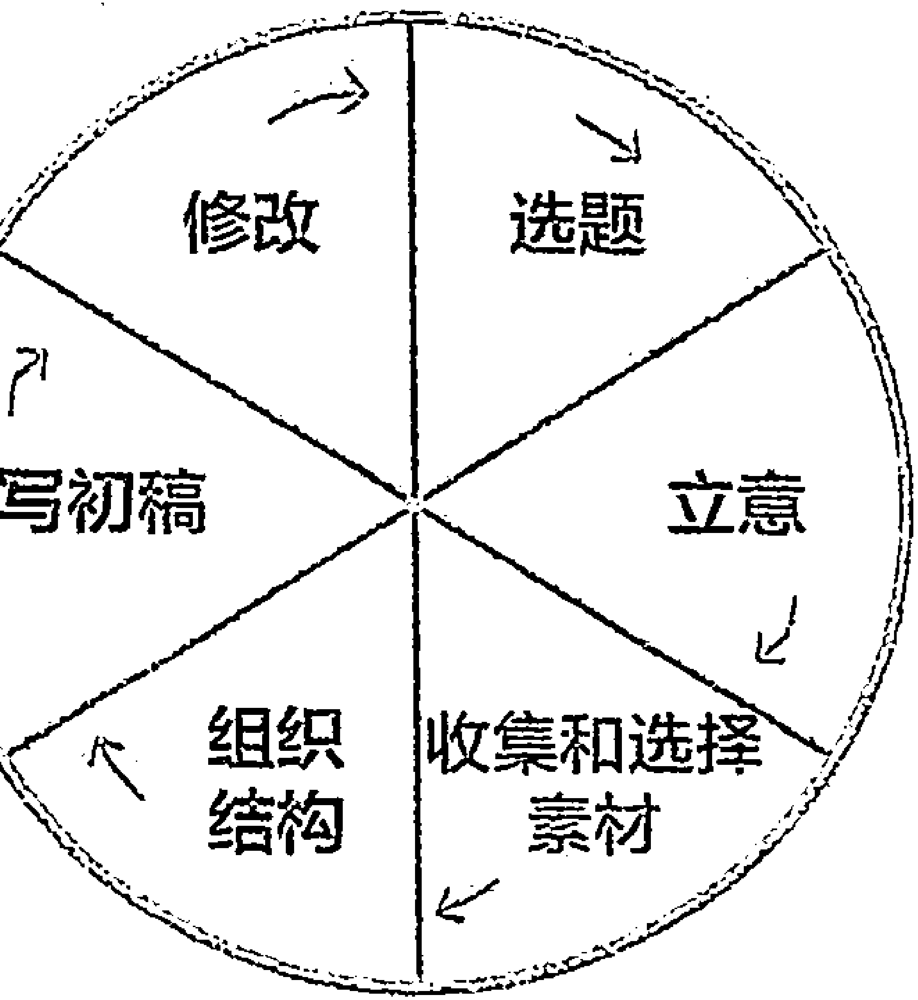
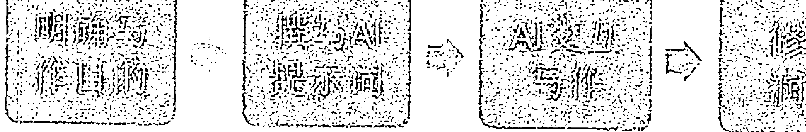
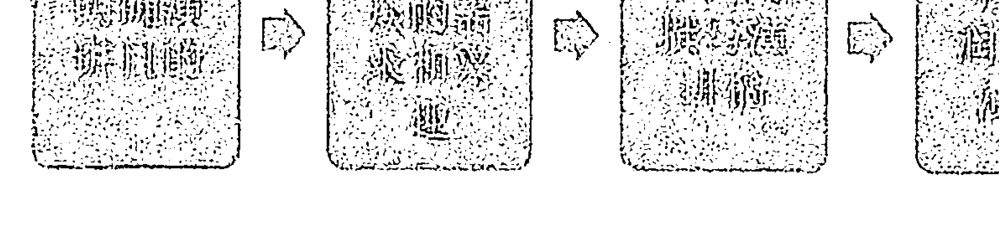
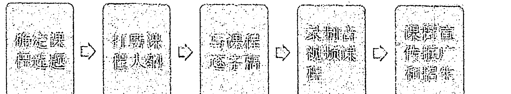
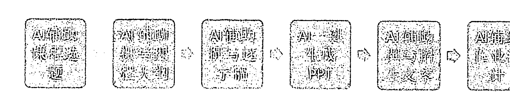
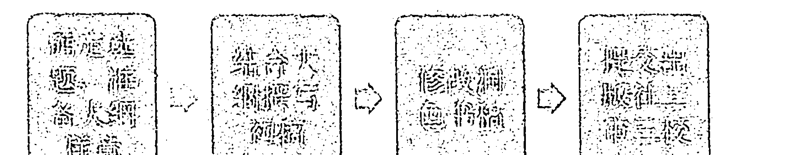

# AI写作宝典：如何成为AI写作高手

# 序章 如何乘上AI写作的红利波

2023年，ChatGPT① 以迅雷不及掩耳之势闯进大众视野，成为全民讨论的焦点。以它为代表的新一代人工智能在内容创作上的突破，让无数写作者既兴奋又不安。

AI时代来临，我会不会失业？这种念头在创作者圈子里蔓延。

AI能自动产出高质量文章，写作者的差异化价值在哪里？
会被AI完全取代吗？
内容竞争会不会变得更残酷？
AI都能写文章、画画、写代码了，写作还有学下去的必要吗？

这些疑问让不少人陷入迷茫。

焦虑的背后，正是巨大的机遇。写这本书，就是想带大家一起抓住这波红利。

我是畅销书作者，至今出版了4本著作：《读书变现：如何成为一名读书博主》《精进写作：如何成为一名写作高手》《从零开始______ 学写作：个人增值的有效方法》《时间的格局：让每一分钟为未来增值》。连续三年荣获当当年度影响力作家，签约多平台，文章多次破百万阅读，被人民日报、十点读书等头部账号转载。

写作之外，我创立了弘丹写作，累计陪伴超过十万学员进入写作。很多学员在我的课程里学会了投稿变现、搭建个人品牌，实现了个人与商业的双重跃迁。

AI的爆发，让我清晰看见自己的优势。

我并非科班出身的文字人，而是从IT工程师转身的写作者。本科学自动化，研究生就读于浙江大学控制科学与工程学院，专业常年位居全国前列。身边的同学大多在顶级互联网和科技公司做工程师、程序员。

2015年我从零跨界写作，到现在已有八年新媒体实战。期间打造多门爆款写作课，全网学员十万余人，主办写作训练营一百多期，连续六年运营年度写作社群，帮助很多人圆了写作梦。

理工科的训练给了我逻辑与结构，新媒体的实操给了我方法论，教学的沉淀给了我复盘能力。AI时代，这三者意外地连成了最顺手的组合。

正如乔布斯在斯坦福演讲时说的：人生经历像一串珍珠，当你找到那根线，全部会被串成项链。

# 从工科生到写作人的突围

我是怎么把写作做成事业的？完全是无心插柳。

2015年1月3日，读到朋友的一篇文章，主角想用写作记录内心世界。那份初心打动了我，第二天一早我便提前一小时起床，在书桌前写下四百字的日记。

从四百字日记到签约简书，从首本出版到成为当当年度影响力作家，在内容这件事上我坚持了整整八年。

很多人问我为何能坚持。我的答案很简单：只有热爱能抵挡岁月漫长。看着自己的思想被文字定格、传播，并影响他人变得更好，那种成就感让我停不下来。

八年里，我累计写下千万字、发表百万字，出版四本书。2020年至今的一千天里，仅搜狗输入法的打字量就达631万字。写第四本《读书变现：如何成为一名读书博通过0到成为读书博主》时，我曾连续一天写了十一小时。在小黑屋云写作的最高纪录里，我一天纯键盘敲出三万多字，这是没有AI、没有语音辅助的真实输出。

躬身投入让我踩中了多个风口：

2015—2016年，抓住简书红利，成为签约作者；
2015—2018年，抓住公众号红利；
2019—2022年，抓住知识付费与在线教育红利；
2016—2022年，抓住私域流量红利；
2020—2022年，抓住视频号与直播红利；
2023年，抓住AI红利，启动AI产品体系。

我归纳出一个王炸公式：热爱＋科技＋风口红利。

深耕热爱的赛道，坚持就不会觉得苦；真正在场才能感知风口、抓住风口；拥抱科技，因为科技是第一生产力。

很多人说要等自己足够厉害再开始。我一直告诉学员：不是厉害了才开始，而是开始了才厉害。先行动，先抓住机会，你才会越做越强。

《为什么伟大不能被计划》里讲的踏脚石模型很形象：因热爱持续做事，下一块踏脚石会自然出现。只要迈出第一步，顺着热爱走到底，你总能看见下一步，成绩会水到渠成。

当你真正入局，不仅能抓住风口，还能引领风向。这个世界总是偏爱行动力强的人。

# 我与AI写作的四个阶段

我与AI写作的关系，也经历了四次心态转变。

第一阶段，是漠不关心。
2023年3月ChatGPT爆火，我只是旁观者，心里想这跟我有什么关系。很多人此刻也有同样的疑问。

不行动，往往因为觉得与己无关。当时平台上AI产品销量暴涨，上万人在短时间内涌入学习。我却没动。两个原因：认知没到位，不知道AI能用来干嘛，也不知道第一步怎么迈。怕麻烦，就选择了等待。

第二阶段，是深深后悔。
2023年4月，参加一场商业线下课。导师课后说了一句话：“一定要重视ChatGPT，它的冲击不亚于第二次工业革命。”这句话像当头棒喝。

回去后我立刻开启AI写作，才发现原来它如此简单又强大。为自己之前的拖延和怕麻烦感到懊悔。

第三阶段，是幸运感。
四月开启，五月便上线“AI写作训练营”，五天内200多人报名。我一边学习一边教学，以教促学，速度极快。

六月萌生写书的念头，七月酷暑，我每天坐十小时以上写稿，一个月完成初稿。八月反复打磨十几遍才定稿。这是迄今我出书最快的速度。

这件事给我两个认知：
第一，你觉得与己无关，它就真的与你无关。错失风口的人，多半是因觉得不相关而不尝试。对新事物保持开放，先去体验，机会往往在行动中出现。
第二，人赚不到认知之外的钱。认知不改，金矿在前也看不见。改变认知才会改变行动。那句震撼的话，就是我行动的起点。

学习AI不只是学技能，更是认知升级。认知变了，世界就变了。

八年个人品牌创业让我明白：别做旁观者，要躬身入局，别嫌麻烦。AI写作并不难，读完本书就能上手，践行就能成为高手。

AI写作只是冰山一角。AI可渗透到各行各业。将AI与自身专业结合，就能成为行业的AI高手。我是写作专业，做成AI写作高手；你也可以做AI+HR、AI+编程等。

互联网+是互联网思维与传统产业融合，AI+是用人工智能赋能产业升级。

AI会迭代加速，未来是人机合一的时代。勇气是最重要的品质，敢于试错，敢于走出舒适区，才会拥有全新天地。

2023年对我而言是重新出发之年。很多创作者因怕被取代而恐惧AI。我自己每天都在用AI写作，速度与素材丰富度确实力压多数人。

打不过就拥抱，我反而看到机遇。两个月内，“AI写作训练营”报名超400人。

有人担心AI会让人变笨。我的看法是：你强它更强，强强联合，人机合一。

很多人把AI当搜索引擎用，因为提不出好问题。没有积累与思考，就提不出有效指令。只有自己更强，才能用好AI。

未来淘汰的不是内容创作者，而是不会用AI的人。

AI能帮你批量生产小红书笔记、撰写课程逐字稿、准备演讲稿。它还能成为你的私教、创业导师、育儿导师、导游、个人品牌顾问。每个人都需要一个顶级智囊团，而AI是最强的智囊团。

让我们拥抱AI写作，实现人机合一，用它提升效率、增加财富、扩大影响力。

弘丹
2023年7月26日于上海

① ChatGPT 是由人工智能技术驱动的自然语言处理工具，能基于预训练阶段的模式与统计规律生成回答，并根据对话上下文进行互动，接近人类聊天，甚至能完成写邮件、脚本、文案、翻译、代码等任务。

# 第一章 认识AI写作，掌握AI写作四步法

AI出现后，创作者的角色在加速迭代。与AI强强联合，是当下必修课。

AI的应用已远超写作，编程、绘画、设计、文案等均可赋能，教育、医疗、商业、艺术、娱乐等行业都在被重塑。

AI带来挑战，也带来商业价值与创新可能。工具的价值取决于使用者。能力强的人，AI会放大成倍；能力弱或不重视的人，改变微乎其微。关键不在工具，在你自己。

要与AI强强联合，需要四个转变：
从执行者到创新者与决策者。把可执行的环节交给AI，自己负责脑洞、创新与决策，把清晰指令交付给AI。
从解决问题到提出问题。在AI时代，提好问题比解题更重要。
从编程语言到自然语言编程。过去编程门槛高，现在用日常语言对话就是编程。
从记忆理解到跨界创新。AI处理信息，人的价值在于跨领域整合与创新。

完成这四个转变，才能抓住时代红利，创造新价值。

从事新媒体写作八年，我一直在寻找高效写作方法。我的第二本《从零开始学写作：个人增值的有效方法》曾详细拆解写作六步：选题、立意、收集与筛选素材、组织结构、写初稿、修改。

很多作者会卡在选题或素材收集，写着写着就拖延。AI时代可以更简化。

我总结出AI写作四步法，轻松产出优质文章。

AI写作流程更简洁，难度也大幅下降。核心在于写好提示词，提示词往往几句话就能搞定，有模板可循。

第一步，明确写作目的。要先确定体裁与发布平台。不同平台风格不同，明确后让AI按指定风格输出，比如模仿小红书种草笔记的语气来写。

第二步，撰写AI提示词。提示词就是指令，精准度决定输出质量。AI时代比拼的是提示词能力。我提出RRBE提示词创作法，帮助快速写出高质量指令，具体在第二章展开。

第三步，AI交互写作。输入指令后生成初稿，通常一次问答不够，需要多轮补充与调整。这个人机协同的过程，能逐步逼近预期效果。

第四步，修改润色。AI生成后仍需人工把关，调整逻辑、语气与细节，让文章更贴合人味与品牌调性。

掌握这套流程，AI就成了你的高效创作搭档。

AI初稿只能算半成品，真正能用的内容必须经过人工的二次打磨。审视推敲机器输出，调整语感、理顺逻辑，让表达贴合自己的写作习惯和目标人群的需求；加入真实经历和个人观点，才能赋予温度和辨识度；同时要核查事实，避免错误信息混入。润色完毕后搭配合适的配图，就能完成一篇可直接分发的自媒体稿件。

下面以一篇小红书笔记的制作过程为例，拆解完整的工作流。

① Notion AI 是 Notion 于2023年2月上线的模块，依托大语言模型与海量数据，可自动整理笔记、纠错别字、提炼重点、翻译文本、生成表格等。

# 010·AI写作宝典

先想清楚要写什么

这次的目标是为弘丹的小红书账号产出一篇关于自律的爆款笔记。明确平台、主题和受众后，再让AI介入辅助创作。

# 第二步，设计指令

目的、主题、平台确定后，就要把需求写成提示词。

我用的指令是：你是一位小红书博主，请模仿爆款笔记的语感，写一篇《自律一年，让我脱胎换骨，重获新生》的笔记。可以加入表情符号，围绕学习、工作、早起、理财谈自律方法，并推荐10本书和10部电影。

发出指令后，AI很快就给出了初稿，整体框架还算可用。

# 第三步，上下文联写

AI具备记忆上下文的能力。前面聊天时提过10本书，后续生成的初稿直接沿用了这10本。10部电影是AI自行匹配的，巧合的是我都看过。

机器内容并非零瑕疵。10本推荐书单里有几位作者的名字写错了，发号前必须修正。联写过程中可以反复追问、迭代优化，这次输出质量尚可，没有继续让AI返工。

# 第一章 认识AI写作，掌握AI写作四步法·011

# 第四步，手改细化

基于AI初稿做三件事。

# 一、纠错信息

AI给的书单里作者信息出错，例如《纳瓦尔宝典》正确作者是埃里克·乔根森，《小狗钱钱》正确作者是博多·舍费尔等，全部核对更正。

# 二、植入个人化叙事

把开头改得更具抓取力，并加入自身的自律故事。

马上进入2023年下半年，你敢不敢用半年时间彻底改造自己！我是弘丹，过去很迷茫焦虑，做着不喜欢的工作，每天两点一线，看不到希望。我用半年时间逼自己改变，找到了全新的发展方向。我的自律始于早起阅读写作，每天早上6点起床，阅读写作两小时，已经坚持了7年，期间出版了4本书。

# 三、优化标题与收尾

修改结尾：坚持半年，你会明显感觉焕然一新、脱胎换骨，生活也会回馈你丰厚的回报。2023年，让我们狠下心、卯足劲逼自己一把，你比想象中更强大！

修改标题：《自律6个月，让我脱胎换骨，重获新生》

经过以上处理，笔记才算成型。AI产出的小红书稿件自带平台排版特征，有表情、序号1、2、3、4等，几乎不用再排版，效率很高。通过这个案例，AI写作四步法就清晰了。

# 012 · AI写作宝典

借助AI写作用时更少、用力更省，还能提升成稿质量。但AI并非替代人类，而是强力的助手，人类仍要负责创意、观点和故事供给。

# 1.3 AI写作四阶段，实现人机合一

使用过程中大致会经历四段状态。

第一阶段：探索期。
刚接触AI时在熟悉工具和功能，反复试不同提示词、对话互动。功能新鲜、有趣，充满好奇。

第二阶段：磨合期。
越用越熟，却发现生成结果常不达预期。文章呆板枯燥，甚至出现错漏。会与AI产生“摩擦”，这是互相理解、共同磨合的阶段。

第三阶段：熟练使用期。
度过磨合后，你学会用精准提示词获得满意结果，AI越来越懂你的偏好。它逐渐变成每日离不开的工具。

# 014 · AI写作宝典

第四阶段：人机合一期。
长期高频使用后积累足够经验，你提供创造力和想象力，AI负责把想法落地执行。此时AI像是外接大脑，协同作战创造更大可能。

从探索到磨合，再到熟练，最后达到合一，不是一蹴而就，需要持续投入。很多人起初热情高涨，后因困难放弃，循环躺平。能坚持到最后的人很少，希望你成为其中一个。

# 第一章 认识AI写作，掌握AI写作四步法·015

# 1.4 AI时代，内容创作者的六项精进能力

在AIGC时代，创作者需重点提升的能力有：

第一，拆解力。
多拆解优质文章，先模仿方法后超越。AI时代更要把爆款选题、结构、素材、风格、金句拆开，用AI进行仿写训练，让自己和模型都掌握底层逻辑。

第二，选题力。
AI可辅助写作，但选题仍由人定。好选题自带流量，要敏锐捕捉热点、社会议题、行业趋势，并找到独特切口做出爆款。

第三，提问力。
提问的质量决定输出的质量。精准的提示词是让AI满足需求的关键，需刻意练习提问能力。

# 020·AI写作宝典

人类创作能引发情感共鸣，让人读后难忘，这是AI难以企及的。

第三，人类的想象力、创造力和独创灵感。
写作需要作者的思考和观点，不能把主题直接丢给工具。刘慈欣的《三体》构建宏大宇宙观，对外星文明的描绘体现丰富想象，也涉及哲学与人类命运探讨，展现了独特的创作灵感。想象力、创造力与原创灵感是AI难以取代的。

未来一定是人机强强联合。人擅长想象、共情、真实体验；AI擅长速度快、资料广、逻辑严。优势互补，走向人机合一。

同时要认识局限。

第一，引用来源不清晰。
AI训练数据来自公开网络，生成内容无法标注具体出处，难以追溯原始来源，不适合做严谨学术写作。

第二，可能出现错误或杜撰。
AI会一本正经胡说八道。例如让它推荐时间管理书，它曾给出《精进时间管理》，实际并不存在。专业领域如医学、法律更需严格核查。

第三，信息不够新。
模型无实时检索能力，基于训练截止点预测。ChatGPT3.5的训练数据截至2021年9月，无法提供之后资讯。写热点内容需配合搜索引擎。

第四，存在数据泄露与隐私风险。
外部AI使用可能导致机密外泄，部分企业已限制员工使用。写作时需注意信息保护，未来或将出现内部专属AI工具。

# 022 · AI写作宝典

# 第二章

# 02

AI写作提示词，创作高效精准的指令

# 2.1 提示词核心方法，RRBE提示词模型

要做好AI写作，先要做好指令撰写。RRBE模型包含四个要素：

+ Role角色：AI扮演什么身份。
+ Request要求：明确具体的任务需求。
+ Background背景：提供情境与背景信息。
+ Expectation期望：表达对结果效果的期待。

第一，角色设定。
赋予AI特定身份，如自媒体博主、美妆达人、资深记者、心理咨询师、工程师、科幻作家等，帮助其对齐表达方式。

第二，明确要求。
下达清晰任务说明，包括主题、视角、技巧等。若要求模糊，AI会按自身理解生成，难以命中预期。

第三，提供背景。
背景信息让AI更全面理解需求，如小说发生地人物关系，或简历的目标岗位等。

# 2.2 RRBE提示词在各行各业的运用

RRBE适用于写作、旅行、职场、简历、代码、健身、翻译、礼物挑选、职业探索等场景。

1.你是一位旅行专家，请为我制定一份去云南的5天4晚深度游攻略，让我能更好体验当地风土人情。
2.你是一位职场写作高手，请帮我写一封给老板的加薪邮件。我在公司工作3年，近期完成多个重要项目取得显著业绩，希望语言得体、理由充分。
3.你是一位软件工程师，请生成一段Python代码，实现抓取网站信息并导出CSV的爬虫，要求易读易改。
4.你是一位小学语文老师，请批改我儿子的作文《我和我的小伙伴》，给出具体建设性反馈帮助提升写作。
5.你是一位购物顾问，请为摄影爱好者的朋友挑选生日礼物，要求与摄影相关且他会喜欢。

# 2.3 AI提示词的四大作用和四大原则

提示词本质是对AI的指挥。

第一，引导意图理解。精准提示让AI明白目的，生成符合预期的内容。
第二，限定范围与风格。可控制主题聚焦和表达风格，如简洁清晰、接地气、人性化。
第三，激发创造性。好的提示能促使AI从多角度思考生成。

# 2.4 提示词公式，学会高效提问

使用同款工具结果不同，关键在提问方式。

简单提问是直接抛问句；进阶提问是提供背景和具体要求，即RRBE。

# 简单提问的举例

1. 请推荐5本关于写作的书籍
2. 请制定上海2天1夜旅行攻略
3. 请介绍罗宋汤的材料和做法
4. 请介绍隐形眼镜的佩戴方法
5. 如何提升写作效率
6. 孩子的暑假怎样安排

# 下面是一些简单提问的公式。

# 第一，疑问词+具体要求。
用为什么、如何、是否、有哪些等引导信息，如为什么健康饮食重要、如何制作巧克力蛋糕。

# 第二，列举和描述。
要求列举或描述以获取细节，如列举3种有效沟通技巧、描述最喜欢的旅行地。

# 第三，建议或解决方案。

把AI从“能写”变成“写对”，核心就在于指令的打法。素材里拆解的是一套从提问方式到体系化沉淀的完整方法，换一种说法就是：先学会问得准，再学会喂得对，最后把方法变成可复用的资产。

**先把提问分层，用对的情境把AI带进轨道**

第一类是求助型指令。让AI做参谋、给建议、解难题时，关键词就是“有什么建议”“怎么处理”。比如想解决写作拖延，就直接问AI怎么破局；想提升自信，就让它给出可操作的路径。问题越具体，答案越落地。

第二类是情境限定型指令。用“在……情况下”“如果……场景”“设想……”来框定边界，AI才不会飘。比如“面试时怎样留下深刻印象”，“假设要达成一个重要目标会怎么跨过障碍”。有了场景，生成的文字天然就有代入感。

**给AI看样本，它才会写出你想要的味道**

指令再好，不喂样本也难对齐风格。给AI一个模板或参考稿，它就能抓住语感和结构，自己去套新主题。

新媒体写作尤其适用这种方式。拿爆款文的片段当范本喂进去，AI会模仿节奏和表达，却用新的内容填充。想让AI贴近自己的笔调，就直接把自己写过的东西放进提示词，让它先学后写。

金句创作就是典型。提示里说明用对比法，并给出两三个对比句的范式，AI就能按同一逻辑产出自律类金句。也可以让它改写名人名言，比如把尼采的“每一个不曾起舞的日子…”换成写作主题，改写后的句子既保留原结构，又贴合新议题。

风格模仿同理。提供一段小红书视频脚本的语感样本，让AI按“敢不敢用一年彻底改变自己”这个主题续写600字左右，情绪张力、起承转合、起伏的口吻都会被保留。把弘丹的脚本喂进去，要求写“30岁养成这5个习惯，人生逆袭”，字数、钩子、习惯拆解的推进方式都会被学习。

甚至可以借名家笔法。给AI张爱玲的文章片段，让它总结语言特征后，创作一篇上海背景、一见钟情却无果的爱情小叙事。给朱自清《背影》的处理方式，让它写端午送别、父母不舍的散文。样例越细，模仿越准。

**把好的指令沉淀成自己的提示词库**

一次性的指令用完就丢，效率最低。建立属于自己的提示词库，才是长期打法。

第一步明确目标。先想清楚要收集什么：自己验证过的高效指令、别人家的好指令。按使用场景细分：发布平台有公众号、小红书；应用场景有短视频脚本、职场干货；体裁有小说、散文；内容有生活、育儿、旅行。分类越细，取用越快。

第二步持续收集。写作时遇到效果好的指令，立刻归档到对应分类；也可以主动搜索同行的指令。举例来说，书评类的指令可以是“以《高效能人士的七个习惯》为题，介绍作者、核心内容并配例子”，美食类可以是“你是米其林主厨，讲清罗宋汤食材和关键步骤”。

第三步分类检索。常用的分类法有按主题、按使用频率、按具体任务。写作任务里单独建“选题”“素材筛选”“语言润色”等子类，检索时直接命中。

提示词库不是一次性工程，要像维护素材库一样持续更新，才会成为AI写作的加速器。

**把AI嵌进完整的写作流程**

新媒体写作的六个环节是选题、立意、素材收集与筛选、结构、初稿、修改。AI可以配合每一个环节。

写之前先做构思表，明确文章类型、主题、结构方式如总分总、递进式、黄金圈，素材类型如热点、个人经历、名言，语言风格、开头方式、结尾方式、标题方式。带着这张表去对话，AI的输出才不会跑偏。

**用AI把选题难关打开**

选题决定打开率。日常选题、热点选题、书影视选题三大类，每类下都有可延展的方向：职场干货、职场现象、职场焦虑；生活常识、生活经历、生活态度；个人成长、思维方式、感悟；圈层人物、身边人、陌生人。

不会写时，用RRBE式的指令让AI排题。比如“你是一名职场博主，给我10个有爆款潜质的职场选题，并附写作思路，要求接地气”。AI会给出具体题目和切入点，挑一个后继续让它出大纲，再按前面的全流程完成成稿。育儿、情感、个人成长等领域都可以用同一套办法先找题，再找角度。

总结下来，精准指令靠情境限定和样本喂养，长期竞争力靠提示词库沉淀，实战能力靠流程化协作。把这三层打通，AI就不再是简单的代笔工具，而是能稳定产出爆款的创作搭档。

AI写作已经进入从灵感到成稿的全流程赋能阶段，真正能把效率拉满的不是让AI代写，而是把它当成选题策划师、热点雷达、大纲设计师和素材库用好。下面是一套可直接落地的自媒体写作打法，从找方向到定标题，环环相扣。

**一、把模糊想法变成可爆的选题池**

很多人卡在第一步：知道想写什么，却不知道怎么写才有吸引力。AI在这一步的作用是扩散和细化。

先给一个大致方向，AI就能给出十个差异化切口并配上写作思路。比如围绕育儿中“不吼不叫”这个痛点，能拆出《从咆哮到平静：如何保持冷静教育孩子》《非暴力沟通：如何有效地解决孩子的问题行为》等不同角度；读书博主聊《爱的五种语言》，可以从解读爱情密码、用对方式表达爱等切口展开；影评作者写《肖申克的救赎》，就能从绝望里找希望、挖掘被忽略的细节等角度切入。书单、亲密关系推荐也同理，先给书目，再围绕书单做升级关系、温馨陪伴等主题包装。

提示词上可以参考RRBE模型，把角色、背景、要求、示例都写清楚，AI给出的选题会更贴合爆款逻辑。

**二、用AI追热点，永远有东西可写**

热点是自媒体的流量入口，可分两种。

可预期的热点像春节、情人节、女足亚洲杯、冬奥会这类，日历上就能提前圈出来，提前搜集资料写好底稿，临近时再结合当下细节微调发布。

突发的热点像热搜登顶的事件，因为AI没有实时联网，需要创作者先提供事件来龙去脉和背景，再让AI围绕这些信息做角度挖掘和内容创作。

追热点要用工具。百度指数能看关键词搜索量走势；微博热搜能捕捉社会话题和娱乐风向；知乎热榜反映用户真实提问；小红书发现页的热门标签则代表生活方式类关注点。逛一遍这些平台，筛选出与自己定位匹配的话题，就能持续获得选题素材。

**三、搭好框架，文章才有逻辑筋骨**

选题定下来后，先搭大纲。常见的结构有总分总、并列、黄金圈等。亲密关系类选题可以用Why-How-What：先讲为什么要提升关系，再给具体做法，最后描述达成后的效果。

新媒体文章的通用骨架是开头+若干小标题+结尾。每段小标题下都需要观点支撑的素材和一句金句。素材要按结构分类使用：开头适合名人名言、简短故事、热点数据；观点段适合案例、方法步骤、金句；结尾用升华金句收尾。

**四、素材要真实、可信、会搭配**

AI可以批量生成方法论和名人故事，比如爱的五种语言、积极倾听等提升亲密关系的方法，以及扎克伯格与普莉希拉每周约会的案例。但生成的素材必须自检：是否紧扣主题、是否有新意、是否具有代表性、是否真实有依据。

好素材要用后还要优化。第一，精简，删去冗余细节，只留核心事实；第二，转述，用自己的语言讲热点，避免直接复制新闻；第三，注明来源，特别是书籍和名言。素材之间要有过渡的讨论，不能堆砌。

使用技巧有三类：正反对比，先摆反面再摆正面，冲突更突出；双例叠加，用两个正例或反例强化观点；混搭使用，一个观点下配金句+直接案例+间接案例，说服力更强。

**五、标题决定打开率，把关键词往前放**

标题要内容匹配又能让人点开。常用的组合手法有结合热点、带上数字、借助名人、提出疑问、设置悬念、提供福利。核心关键词最好前置，因为读者是先左后右扫。

让AI写标题时，要指定风格和约束。比如要求用提问方式并加入数字，AI就能产出《想知道如何提高自律力吗？揭秘7种方法》《你的学习方法高效吗？揭秘8种科学的高效学习技巧》这类可模仿的类型。再结合爆款案例做学习，效果更好。

把选题扩散、热点雷达、大纲搭建、素材调配、标题包装这五步串起来，AI就不再是简单的写手，而是内容生产的加速器。关键是人来定方向和判断，AI来补全可能性，最后用自己的语感把内容打磨成有温度的自媒体表达。

在自媒体时代，一篇稿子的生死往往取决于开头的几十秒和结尾的最后一句。AI能帮我们快速起稿，但要让内容真正有人看、有回响，还是需要一套清晰的写法和改法。下面把开头、结尾、提示词用法以及落地到小红书的操作逻辑，重新梳理成一条可执行的路径。

**一、开头决定完读率，六个常用切口**

读者被标题拽进来后，第一眼就是开头。开头乏力，两三句就划走，后面写得再精彩也白费。行之有效的开头主要有六种打法。

热点切入：用当下有热度的人物、事件、影视或话题开场，把主题搭在共鸣点上。关键在于选的热点足够大众、讨论度高。

痛点直击：直接点名读者正在烦恼的点，用情绪共鸣把人拉住。要先摸清受众的真实困扰，再用直白的语言把痛感摆出来。

故事导入：用亲历或听闻的小故事开场。故事必须和主题贴合，能迅速建立信任感和代入感。

开门见山：第一句就亮出观点或态度。不绕弯子，让读者瞬间知道文章立场和核心信息。

提问引入：抛一个让读者心里响起的问题，激发好奇，再在正文里给出答案。

悬念设置：先给一个未解的情境或反常识的片段，让人想往下看找解释。

标题制作时同样可以借助提问法和悬念法，例如让AI为自我提升类文章生成七个提问式标题，或为探险类文章生成十个带悬念的开头句式。

**二、结尾的四种收束手法**

开头负责把人带进来，结尾负责让记住并传播。

总结点题：回扣开头，对全文做提炼，再把核心观点拔高，让主题更有分量。

金句收尾：用一句有记忆点的表达收束，容易被收藏和转发，起到二次传播的作用。

引用名言：借用与主题高度相关的名人名言来强化说服力，给文章提升格调。引用必须贴合，不能硬套。

引导行动：尤其在情感或干货类文章中，在结尾发出明确的行动号召，促成读者从阅读到行为的转化。

用AI写结尾时可以明确指定手法。比如写自律主题，要求用引导行动法收尾，控制篇幅几句话，既要有情感共鸣又能激发行动。用这一思路生成的示例强调自律是通向自由的桥梁，呼吁当下就握紧钥匙迈步，并反问读者是否准备好迎接自由的挑战。

另外四类常见结尾提示可作为模板：用总结点题写AI写作的价值升华；用金句法写压力管理并创作一句可共鸣的缓压金句；用名人名言收束创业类文章；用引导行动号召读者为环保行动。

**三、AI写出来要改，好的文章是改出来的**

AI初稿往往需要五步打磨。

第一步校观点：核对观点是否贴合主题，是自己想表达的意思。必要时让AI替换观点并同步更换支撑素材和案例。

第二步调素材：检查素材是否切题、能否论证观点，删掉无关内容。可把个人经历或真实案例植入进去，让文章更有血肉。

第三步清错漏：通读全文核查人名、地名、书名、年份等细节，甄别案例的真实性，删除AI虚构或“一本正经胡说八道”的内容。

第四步改三件套：标题、开头、结尾是重点。标题多生成几版，选择最有点击欲的，也可以投票筛选；开头要更抓人，结尾要更具记忆和传播力。

第五步近风格：AI语言偏说明化，需要改成自己的表达习惯。可以在写作前把自己的文章喂给AI学习模仿，减少啰嗦和重复。大声朗读能有效发现不通顺、用词不准的地方。段落控制在50字左右，重点句加粗，排版清晰。

自检清单可涵盖：标题是否吸睛且概括中心；开头是否吸引、铺垫适度且有场景代入；内容是否切题、案例不少于三则且能论证；结构是否清晰、小标题顺序合理；结尾是否给力、能促转发和互动；金句是否足够且名言引用恰当；配图是否相关且正版；排版是否易读、留白合适、封面有吸引力、署名和原创标注齐全。

**四、把AI用在小红书，抓红利做增长**

小红书截至2022年月活超2亿，90后占72%，一半用户在一二线，4300万以上分享者。平台对素人友好，低粉也能出爆款，实现低粉变现。

账号需要清晰定位，如美妆、穿搭、育儿、读书、旅行、知识等，越垂直越容易变现。变现方式包括广告、品牌植入、专栏、直播带货、私域引流。

AI在小红书创作有四重价值：一是辅助爆款选题，拆解高赞笔记规律；二是生成标题和封面文案，提升点击；三是创作正文，笔记字数限制1000字内，要符合平台风格；四是自动化排版，加入表情符号、空行、数字序号，让笔记更清爽。

爆款笔记核心要素是标题、封面图、封面文案。标题底层逻辑包括：吸引眼球、简洁明了、体现价值、引发好奇、符合平台女性化亲切语气、带关键词、触发情感共鸣。拆解点赞5000以上笔记，从选题、内容、封面、标题多维度复盘，才能复刻爆款。

把以上方法落地，AI负责提效，人负责判断和打磨，才能在内容红利期稳定产出、持续涨粉。

一年前，我还只是挤早高峰地铁、加班到深夜的普通上班族，自我怀疑和拖延几乎成了标配。365天后，我成了那个能早起写作、持续输出的自律者，还意外跨界做了新媒体博主，出版了第一本书。这一年没有奇迹，只有把小事做到位的选择。

这一路并不顺。中间有无数次想松手，有段时间进度卡住、情绪低落到想全部推倒。但我给自己立下规矩：只有咬牙走完，才有可能抵达。于是哪怕再累、再烦，我都没有把“放弃”两个字兑现。撑过去的每一天，后来都成了底气。

支撑我的是一个固定节奏。每个月我会停下来复盘一次，盘点离目标还差多少、哪个环节在拖后腿，然后立刻改方案。这种及时纠偏的习惯，让我不会在错误的方向上浪费太多时间。渐渐地，反思成了我的成长雷达。

更重要的是，我学会了在过程中找滋味。改变本身很折腾，但每当我看到自己写完一篇稿子、养成一个新习惯、收到读者的反馈时，那种“我在变成想要的样子”的踏实感，会带来很纯粹的满足和快乐。

两个作品成了我的精神伴侣。一本是《原子习惯》，它让我明白，改变不必一蹴而就，用微小的改动累积复利，目标会自己靠近。另一部是电影《当幸福来敲门》，看完后我被那种“只要有决心和勇气，生活就能被改写”的力量深深打动。

所以我想问你，敢不敢用一年，重新塑造自己，完成一次几乎无痛的逆袭？只要你肯下决心，愿意迈步，改变一定会发生。

如果你觉得这篇分享还有优化空间，其实可以交给AI来迭代。我的实操方法是先给AI一个明确的改写指令，比如把开头换成普通上班族一年逆袭为自律创作者的故事，让整体更具代入感。

在小红书上做内容时，我也会用一套创作拆解表来理清思路。先定文章类型和主题，比如分享读书变现；给标题、封面话术定位；再选文章结构、素材来源、开头切入方式、金句风格、结尾收束方式以及标题技巧和话题标签。这样每一步都有抓手，也能快速让AI辅助选题、产出10个爆款标题、生成正文初稿和排版建议。选题、标题、正文、评论区互动，都可以人机共创不断打磨，效率和成片率都会明显提升。

从个人成长到内容变现，本质都是自律的复利。愿你也敢于开始。

#自律成长 #一年改变自己 #读书博主 #副业 #新媒体写作 #写作赚钱 #女性成长 #自媒体

AI写作已经从工具变成了创作搭档，今天就把实战中最常用的几套玩法拆开讲清楚，从朋友圈经营到小说散文日记，思路全在这里。

自我成长类书写，核心是先立态度再举例。书中讲的第一个习惯就是主动担当，面对棘手甚至看似无解的问题，不要等外部推力，而是自己先行动。用一位企业家在业务遇困时如何迎难而上、寻找破局之法的故事来落点，比空讲道理更打动人。

写书评时AI能帮忙润色标题、开头、结尾和金句，操作逻辑和公众号排版类似。但AI生成的书评不可全信，里面容易出现事实偏差或过度演绎，改写前一定要对照原文核实核心论点和关键情节。如果遇到AI不熟悉的书，直接把书籍要点、作者观点、章节结构喂给AI，再结合自己的阅读体悟一起共创，出来的内容才扎实。

朋友圈文案打造私域人设

微信仍是日常社交的主战场，朋友圈既是生活展示窗也是个人品牌的私域阵地。除了公域内容沉淀，私域的温度感和持续互动同样关键。朋友圈支持图文、短视频、外链等多种呈现，也能设置可见范围。

常发的朋友圈大概分三类。生活向，晒旅行、家庭、萌宠、美食等真实片段；知识向，输出专业见解、学习总结、文章或视频号切片、书单推荐等；带货向，分享用过的好物、自己的课程或产品。

想获得更多互动，时间点很重要。用户刷手机的高峰就是发圈的黄金窗口。早上7:30-9:00通勤路上；中午11:30-13:00午餐与午休；傍晚17:30-20:00晚高峰通勤，晚8点左右是很多课程投放的集中时段；夜里21:30-23:00睡前放松，情绪更柔软，对营销信息抵触更低，更容易产生转化。

有吸引力的朋友圈具备两个特质。一是真实且有个人印记，不刻意迎合，观点和生活方式鲜明，更容易引发共鸣。二是内容形态多样，横跨生活、知识、娱乐、文化，让关注者每次打开都有新鲜感。

小说创作从零到一

很多人想写小说却卡在起步。《30天写小说》实践者曾用一个月完成10万字首作，并带团队零基础学员完成首本书。加了AI后，这件事门槛大幅下降。

借助AI写小说的流程大致是：先明确主题和创作目标；把人物设定、情节梗概、写作难题输入AI写作工具获取灵感；通读AI输出，挑出有用的对话、描写或转折；把这些素材融入自己的大纲，进行取舍和改写；整理结构，确保逻辑闭环和节奏顺畅；多次与AI反馈打磨；最终的润色和情感注入必须由人来完成；初稿完成后人工校对文笔、语法、人物一致性。

举例提示词：请你扮演小说家，写一篇微小说，故事发生在上海，男主是富豪之子，女主是清贫女大学生，一见钟情却最终分开，要求情节曲折带悬疑感。AI能快速产出可读性强的片段，但发布到小说网站前一定要人工审校，避免不自然的表达和版权风险。日更压力也可以靠AI辅助保持稳定，但质量把控仍靠作者。

散文诗歌与日记复盘

散文诗歌类创作，AI能提供不错的初稿，尤其在模仿《背影》这类经典笔法时，可以把场景、情绪、人物关系写清楚，让AI延展成1500字左右的思念文本。旅行后把所见所感喂给AI，也能快速生成文笔优美的记录。比如云南之旅的感悟结合石林、洱海、大理、雪山等意象，生成五言绝句。再如用戴望舒《雨巷》的意境写一场雨夜漫步。

日记和复盘的价值常被低估。第一是自我觉察，梳理想法与行为，看到优缺点；第二是情绪疏导，把压抑的情绪写出来能减压，心理学上也常用此法；第三是深度思考与复盘，复盘成功与失误，让成长可追溯；第四是目标管理，把目标写进日记并持续追踪，提升执行力。AI写日记提示词示例：你是日记高手，帮我整理今天的日记。7月1日周六，早上6点起床写书两小时，上午直播《AI时代如何成为写作高手》，十几人报名训练营。结束后带孩子去失重餐厅，孩子对轨道送餐很兴奋…AI能把流水账提炼成有温度的叙事。

亲子共创故事

给孩子讲故事时，AI能成为“行走的故事机”。比如5岁孩子喜欢的小兔子冒险记，先确定主角和小咪咪的性格，AI再补全情节。更高级的玩法是孩子先口述主题、主角、关键情节，家长整理成文字喂给AI，由AI润色成完整故事再讲述，锻炼孩子的表达与想象力。

植物大战僵尸类的定制故事也一样。把迷糊菇咬气球僵尸、被飞贼僵尸抓走、植物学校分三路救援等设定交给AI，AI就能生成适合5岁听的版本。

工作写作与邮件的高效法则

确定读者和写作目的后，用RRBE模型给AI下明确指令，背景信息要细化但避免泄露隐私。职场文字讲究逻辑，可要求AI用总分总或金字塔结构，先给结论再展开细节和案例，最后收束要点。AI初稿完成后必须人工修改润色，检查流畅度、逻辑和个人风格是否匹配。

发送前养成检查清单习惯：标题、附件、收件人、关键信息是否齐全。邮件代表做事风格，多读几遍再发出，能避免低级失误，也为职场积累隐性优势。

AI是放大器，不是替代者。灵感启发、初稿加速交给它，核实、润色、情感注入、价值观判断都必须由人把关，这样才能产出经得起检验的好作品。

在职场里，写邮件几乎是每天的必修课。能不能把事情说清楚、把礼貌做到位，直接影响协作效率和个人专业形象。邮件写作的底层逻辑其实就是清晰传达，写作方法里提到的主题提炼、标题设计、结构安排同样适用于一封封工作邮件。写作能力越强，职场竞争力越明显。职场邮件的打法，投递投稿、私人沟通里一样好用。

先说怎么把一封邮件写出质感。

第一封面要一眼看懂。用一句话概括内容放到标题里，是打开率的决定因素。我们打开邮件先看名字再看标题，企业邮箱一般默认实名，不用刻意强调；私人邮箱可以自定义显示名。标题模糊，对方无法预判内容，自然会往后排。好的标题就是用最精炼的表达告诉对方这封邮件在说啥，比如给领导的邮件写成“××公司××项目策划方案”，主题一目了然。别忘了，空标题是最容易拉低专业度的细节。

第二正文用总分总推进。先称呼，英文习惯用 Hi Jimmy / Dear Jimmy，中文可用“尊敬的王总”。开篇先抛结论，说明写这封信的意图，再展开具体事项。每段只讲一件事，分段清晰。语言上多短句少长句，多用常用词少用生僻词。需要协作时，把任务和截止时间列清楚，结尾再做一次要点复盘并附上祝福语。正文中截止日期等关键信息加粗处理，一眼就能抓住。

第三排版要干净利落。时间宝贵，提前做一套邮件模板既省时间也显得专业。字体、字号、颜色、行间距可按个人习惯设定。常用的设定是思源字体12号黑色，落款写“顺祝商祺”，英文用“Best Wishes”，再加上署名、公司名、手机号、Logo。模板建好后自动套用，只需填充内容。

到了 AI 时代，写邮件的效率可以被放大。AI 能快速生成准确专业的初稿，节省大量时间，还能做语法校对、语气优化，让表达更得体。

用 AI 写高质量邮件可以分三步走。

第一步先把目的和对象说清楚。告诉 AI 这封邮件要干嘛、发给谁，给 AI 一个身份定位，比如你是 HR 专员，给新员工发入职通知并表示欢迎。角色、目的、收件人越明确，生成的语气和内容越对路。

第二步给出精准的指令。清晰具体的提示词才是好指令。例如让 AI 写一封给团队的邮件，概括下周项目会议安排并提醒提前准备。内容较长时不要一次性要全篇，先生成一段、调整后再续写，用逐步提问的方式迭代质量。

第三步把控语气和礼貌度。AI 能保持统一语气，提供正式得体的商业表达。很多写作工具还自带校对，能检查语法拼写并给出更优表达，让邮件更专业。

示范场景里，工程师给项目经理汇报进度，说明已完成约70%，系统集成测试遇到技术挑战，预计延后两天；行政人员回复员工年假政策，告知全职员工年假天数，需提前报备直线经理获批，详细说明见员工手册或内网 HR 专区。

不同用途的提示词也可以做成模板。

请求类邮件：向【收件人角色】请求【具体内容】，并说明原因和价值。
回复询问类：回复【收件人角色】关于【具体内容】的咨询，给出详细解答并附资源建议。
进度更新类：向【收件人角色】汇报【状态或进度】，同时说明问题与可行解法。
会议安排类：给【收件人角色】发会议时间、地点或议程调整通知并说明理由。
群发通知类：通知【群体】关于【事项】，明确下一步动作。
上级汇报类：向【上级姓名】汇报工作进展，包含已完成、挑战、解决思路。
任务布置类：给【团队成员】布置【具体任务】，说明目标、截止时间与汇报方式。
客户回复类：回复【客户姓名】关于【具体问题】的咨询，保持专业友好并欢迎追问。
邀请类：邀请【对方姓名】参加【会议或活动】，给出时间地点议程及参与价值。
合作伙伴更新类：向【合作伙伴】更新项目进展，包含已完成、下一步计划及需配合事项。

写工作总结很多人会拖延到截止前才草草交差。其实总结是回看和复盘的机会，能帮你梳理做成了什么、碰到什么挑战、怎么解决的、接下来目标是什么，也能量化工作效率，识别哪些做法有效、哪些需要改进。高质量的总结能让领导看到你的成果与能力，是非常加分项。

AI 辅助写总结可以这样做。以 HR 专员半年总结为例：先明确总结目标，是项目盘点还是个人表现盘点；再收集里程碑、关键决策、成果数据、反馈意见等素材；把材料喂给 AI 生成初稿，如有格式风格要求一并告知；人工审校确保准确完整连贯；最后再用语法检查或文本优化工具润色。

操作上先把目标浓缩成主题句，比如“过去半年在人力资源部门的工作总结，含主要成就、学习与挑战”。再把总结拆成引言、主要成就、学习成长、未来规划四个部分，给每个部分单独下提示词，最后合并并用 AI 润色。

以与 B 公司合作《爱的五种语言》训练营为例，项目总结可这样呈现：项目概述，联合举办训练营，招募超 200 人，参与热情高；项目成果，报名 220 人，打卡 180 人，打卡率 81%，体现持续性；策略方法，提前制定全套 SOP 与社群话术约 3 万字，运营期间每日私信推动学习；挑战与对策，吸引参与与文化传播仍需新宣传方式；项目收获，感受合作方的专业与利他文化，坚定为学员提供优质学习环境的信念；未来建议，全年规划提前招募，多渠道宣传，训练营中更多介绍合作方文化与举办目的。借助 AI 能让汇报更有吸引力，但最终审核与隐私保护仍需人工把关。

简历写作同样遵循写作四步法。目的就是让 HR 在 15 秒内get 你的核心信息并给出面试机会。HR 每天看上百份简历，是模块化关键词阅读，所以简历要模块清晰、关键词明确、排版统一。建议一页 A4 内收敛，文件名用“岗位-姓名-电话”的格式便于归档。

排版上字体字号颜色统一，行文对齐，行间距段间距舒适，专业模板更省心。基本模块包括基本信息、教育背景、工作经历、技能等，要站在 HR 角度呈现快速可判断的信息。

模拟面试可以提前演练，AI 会给出专业反馈，帮助你在正式场合更从容。

演讲稿打磨也能借助 AI。很多人惧怕公众演讲，但一堂好演讲能传递思想、留下印象，提升影响力与晋升机会。

AI 辅助撰写演讲稿参考职场写作四步法。

第一步，明确演讲目的。不同场合目的不同：业务演讲是介绍产品优势，培训演讲是传授知识技能，启发性演讲是激励内驱力。目的清晰，内容才有方向。

第二步，了解听众需求和兴趣。思考听众是谁、他们想从演讲里得到什么、希望听完后采取什么行动、如何引发共鸣。与听众相关的内容才有吸引力。

第三步，借助 AI 撰写初稿。给出主题、听众画像、时长等背景信息，结合 RRBE 提示模型下达明确指令，生成初稿。

第四步，修改润色并演练。结合自身风格调整语言，多次朗读熟悉内容，录制演练观察表情、语速、肢体语言，也可请有经验的朋友点评。每一次演讲都是梳理与成长。

以“AI 引爆个人品牌”为主题的打磨过程：先确定吸引力标题，如“AI 引爆个人品牌：8 年抓住 6 次风口，实现持久变现的核心心法”，再压缩到 20-25 字，例如“AI 引爆个人品牌：8 年 6 风口，持久变现的核心心法”。确定大纲后，用英雄之旅模型讲述个人品牌创业故事，提炼核心心法，给听众信心、勇气与力量。

好的职场写作，本质上是把清晰的思考做成清晰的表达。用好结构、用好工具、保持人文审校，你的工作沟通就能持续加分。

一场打动人的演讲，先要把个人品牌的创业历程讲清楚。

开场就用目的和主题点题，简短回顾自己的创业故事，迅速点燃好奇心。随后进入第一幕：从迷茫到笃定。先摊开那段IT女工程师的迷茫现场，讲清当时遇到的困境与转折点，再说明为何最终决定放弃舒适区去做个人品牌，最后呈现转型路上怎么啃下新技能、如何找准定位的实操过程。

# 第六章 用AI把职场写作效率拉满

讲到这里就会发现，这个演讲框架做得很扎实。它按照时间轴，结合英雄之旅的叙事逻辑，把个人品牌从0到1的路径梳得清晰，也提炼出了可复制的心法。

落地到稿件，流程一般是三步走。

先把大纲定死。定好之后，让AI来起草演讲稿的第一版。常用的指令是：你是一名演讲教练，请围绕“AI引爆个人品牌：8年抓住6次风口，实现持久变现的核心心法”这个题目，结合我做个人品牌的真实经历、对AI时代的思考，以及普通人如何借助AI打造品牌、把效率提升十倍的思路，写出一份约4000字的演讲稿。

实际上AI在字数上很难一次达标，往往只给出一千来字。这时要即时反馈：内容太简短了，我需要三千字以上，请把每个板块展开补充细节，再出一版更完整的稿子。AI会再填充，但依然不够饱满。

于是进入第四步，人工精修。初稿出来后必须结合自己的经历再打磨，明确告诉AI需要增补哪部分、调整哪种语气。最后把稿子完整读一遍，做口语化润色，让语言更贴合自己的表达习惯，观点更鲜明、案例更独特。

## 6.6 自动翻译，让多语协作变得轻松

如今职场基本都在全球化节奏里跑，和不同国家同事协作，语言切换是常态。我刚入职外企时，收到的邮件几乎全是英文，看着吃力，只能靠传统翻译工具硬撑。

现在有了AI，邮件、报告、会议纪要、文档这些都能一键搞定，跨国沟通顺畅了很多。操作也很简单：在工具里粘贴原文，写清楚目标语言，模型就会直接输出译文。关键是译文要复核、润色，确保用词和语境都对。

几个高频场景举例：

收到英文工作邮件 “Dear team, please remember that the deadline for the project submission is next Monday. Make sure you complete all tasks on time.” 输入后得到中文大致意思是：亲爱的团队，请注意项目提交截止在下周一，请务必按时完成各项任务。

看英文产品说明 “This advanced laptop features an Intel Core i7 processor, 16GB of RAM, and a 512GB SSD.” 翻译出来就是：这款高端笔记本搭载了英特尔酷睿i7处理器、16GB内存和512GB固态硬盘。

读英文新闻 “Apple Inc. announced its latest iPhone model at an event yesterday, featuring a significantly improved camera and faster processor.” 会被译为：苹果公司昨日发布会推出了最新iPhone，摄像头和处理器都有明显升级。

学术句子 “The experiment demonstrated a clear correlation between the level of physical activity and mental health.” 的译文是：实验清楚地表明了身体活动水平与心理健康之间的相关性。

社交动态 “Had a great time at the beach today. The weather was perfect!” 翻译为：今天在海滩玩得很开心，天气完美。

如果对风格有要求，可以在提示词里直接限定语气和句式。

# 翻译类常用提示词

你是一位资深翻译，请把下面这段英文译成中文，要求准确传达原意，中文表达通顺易懂，多用短句，避免过长累赘。

通用模板：你是一位翻译专家，请把[源语]内容译成[目标语]，要求意思准确、地道易懂。

同传式：你是一位出色的同传，请把以下中文译成英文，要求准确、地道、易读。

法语转英文：你是一位翻译专家，请把以下法语内容译成英文，要求意思准确、表达自然。

日常还能用在学习场景里，比如要GRE高频词、IT英语词汇、德语常用表达，或进行商务会议口语模拟、韩语问候对话、旅行菜单对照等，都可以用类似的指令快速获取。

# 第七章 用AI引爆个人品牌，成为超级个体

### 7.1 批量创作，让产量提升十倍

很多人想做个人品牌却迟迟不动手，卡在内容创作的门槛上。AI把这个门槛拉得很低，只要愿意输出，就能持续获客。

内容就是流量，能稳定产出优质内容，关注自然会来。对超级个体而言，关键是高频、持续、多平台分发。前面几章讲的都是如何用AI把高质量内容快速生产出来。

创作灵感会断档，所以更靠系统。批量创作是解法：集中一天做选题，一天集中写作，再统一修改，一周的内容提前备好，按节奏发布。

短视频尤其适合批量。拍摄前要化妆、打扮、布置场景，成本高，一次拍5到10条，能覆盖1到2周的更新量。拍完后用碎片时间剪辑，剪映、秒剪、快影这些工具可以调尺寸、换背景、剪片段、加字幕和配乐。剪好后再分发到各平台。

源源不断的内容带来源源不断的关注，关注转化为影响力和收入。

### 7.2 打造爆款课程，实现变现

个人品牌变现的常见路径是做课程或运营社群。我从2016年首期21天写作营开始，至今已累计开过100多期不同主题训练营；2018年起的年度写作社群也已持续6年。2021年做了个人品牌的高端产品如私董会、私教班、闭门会，2023年抓住AI写作红利推出“AI写作训练营”，两个月报名超400人。同时在荔枝微课、千聊、喜马拉雅等平台上架爆款写作课，全网学员超过10万人。

有经验后发现，课程研发的底层逻辑和写文章、写书一样，都是内容创作，学会一个就能迁移。

和写文章一样，做课程首先要选对题。要能解决用户真实痛点，同时贴合自己的专业优势。做之前一定要做用户调研，挖掘真实需求，而不是凭想象。选题决定销量，热门且刚需的选题更容易爆。我做过的爆款就有《18节易上手的读书变现课》《26堂轻松易上手的写作变现课》等。课程做出后还要会卖，招生文案、朋友圈短文案、海报宣传缺一不可，酒香也怕巷子深。

## AI在课程研发中的六个作用

第一，辅助选题。让AI给出细分方向和标题，比如：你是一位课程主讲老师，想开发“小学生写作”课程，请给出5个细分方向和课程名，要求有吸引力、能提升语文写作能力。AI会给出像“一起绘制故事：创意写作训练”“走进名著：儿童文学阅读与欣赏”这类方向，供筛选。

第二，辅助写大纲。确定选题后，让AI生成10节课的大纲，通俗、有吸引力、能解决学习问题，再人工优化。

第三，辅助写逐字稿。每节课先定思路再写稿。常见结构是固定开场白、痛点引入、本节概括三个要点、要点详解、总结收尾或布置作业。提示词可以是：请以“小学生如何提升语文学习能力”为主题写逐字稿，涵盖语文重要性、底层逻辑、如何培养兴趣，要生动有趣、举例说明。AI初稿后要加入自己的案例和教学方法。

第四，一键生成PPT。逐字稿完成后可用MindShow、WPS AI等工具转为PPT。

第五，辅助写招生文案。提示词可包含课程价值、讲师介绍、大纲亮点、学完收获、报名方式和优惠等，要求2000字以上、有说服力。海报设计也可交给AI辅助。

第六，辅助作业设计。为巩固学习效果，设计课后作业和测试。提示词示例：为三年级学生设计一节课后的10-15分钟小作业，要求有趣易完成。也能让AI出测试卷，比如10道填空、10道选择、1道作文。

按照以上步骤，一门录播课就能在AI加持下快速成型。直播课逻辑类似，只是增加现场互动和即时调整。

借助AI，课程研发周期大幅缩短，质量反而提升，更快实现品牌变现。

### 7.3 高效写书，出版自己的畅销书

出书是很多人的梦想。我在写作1000天后于2017年出版了第一本《时间的格局：让每一分钟为未来增值》，到现在已出五本。即使有经验，写书依然消耗大，这也是很多人签约后拖延多年落不下笔的原因。

AI时代写书，AI只能辅助，原创性和准确性仍需作者把控。

第一步，定选题、搭大纲、出样章。先调研同类书，找自己的差异化优势。确定选题后做目录规划，再写1到2节、约3000到4000字作为样章。向出版社提交材料通常包括作者简介、选题定位、目标读者、书籍亮点和价值，以及样章。选题通过后签约，要仔细看版税、交稿时间、违约条款等。

第二步，按大纲写初稿。签约后按规划创作，过程中大纲也会迭代。不要追求一次性完美大纲，边写边调是常态。书名和目录是关键，好的名字提升购买率。

写书有两种节奏：集中一个月闭关写完初稿，或把写作融入日常，利用早起或下班后的1到2小时持续推进。有人百天完成，有人需要几年，取决于投入时间。

第三步，修改润色。重头戏在改，我的习惯是初稿集中写完，再集中修改。因为出版对质量要求高，反复打磨才能成书。边写边改容易打击信心，集中修改效率更高。

把选题、大纲、初稿、修改四步跑通，就能在AI辅助下更高效地完成一本书的创作。

写书这件事，外人看是四个步骤，实际走下来，每个环节都是体力活+脑力活。

打磨稿子这一关就够让人崩溃。目录要挪位、章节要重组、正文的行文与用词都要一遍遍推敲。真正能成书的稿子，少说七八次大修，难的项目二十多遍都正常。

修完之后才到出版社那一关。稿子交出去要走三审三校，编辑会把内容层面的问题都挑出来反馈回来。审稿通过还不够，还要经过编辑的梳理加工、三轮校对，才能最终定稿。说白了，写书看起来就四步，每一步里面藏着的活都是海量的，耗时耗心远超想象。

书出来了不是终点。上市后必须配合推广和营销去推，酒香也怕巷子深，卖出去才是关键。出版只是开始，后续的传播与运营更考验人。

## 用AI做助攻，写书的卡点变少了

创作卡住的时候，AI能当个好帮手。大纲搭建、资料收集、内容推进，AI都能给到启发。比如在搭大纲时，直接让AI先抛一个框架出来。

**写作提示参考**

你是一名畅销书作者，打算写一本面向小学生的创意写作书，请围绕这个主题帮我生成全书目录和大纲。整书共7章，请给出每章的一级目录、二级目录和三级目录。

AI给出的框架往往跟自己的真实想法有差距，这时候要把自己的思路喂给AI，让它融合，也可以用AI的版本做底稿自己再动手改，最终确定下来。

书稿撰写阶段AI同样有用。让它提供对应的素材案例和写作灵感。

> 你是一名畅销书作者，正在写“用五感体验描写法创作”这一部分，请给我一些写作启发。

**写作启发：用五感体验描写法创作**

引子：在创作里，调动五感描写是让作品鲜活、真实、打动人的核心。细致呈现角色的视觉、听觉、嗅觉、味觉、触觉，读者才能更沉浸、更有共鸣。接下来介绍如何用五感把场景和人物写得更吸引人。

一、视觉描写
- 用具体细节画面化：把环境、人物外形和动作写具体。
- 比喻与隐喻：用生动的比喻提升感知。
- 用色彩渲染情绪：借色彩烘托氛围，带出情感。

如果你觉得这个思路可用，就让AI基于此生成初稿，作为参考。

> 请结合以上思路，写一篇约3000字的稿件，详细讲“用五感体验描写法创作”的方法与步骤，并配具体例子。要求通俗易懂，小学生也能学会。

**用五感体验描写法创作：给故事注入生动细节！**

引子：写作是一件奇妙的事，而五感体验正是让故事细腻可感的关键。通过描摹角色的视觉听觉嗅觉味觉触觉，让读者身临其境、代入角色。

**视觉描写法：画出一幅缤纷图**

在五感学习旅程里，小学生首先进入视觉描写的花园，学会用细节绘景，让故事更鲜活。

老师：园子里花开了很多种，用形象的词形容一下吧。

小明：我看到一朵玫瑰盛开，颜色红得像火，花瓣边还泛着粉，像用粉笔轻轻点上去的。

通过这样的训练，孩子学会了用细节描画画面，故事立刻生动起来。

……

AI辅助写作能打开思路、提供素材、加快进度。但一定要谨慎。出版对原创性和准确性要求极高，写作时要保持趣味性，让读者读得下去。AI生成的内容偏说明文，语言风格必须人手再优化。

## 7.4 低风险创业，做超级个体

开启内容创作，本质上就是开启一种低风险的内容创业。

内容创业没那么难，完全可以利用业余时间做。图文、视频、直播都行，几乎零成本，主要是时间、精力与创意。现在有了AI，效率更高。

我自己做内容创业三年，算上副业期有五年多，整体八年经验。

这个过程经历了三个阶段。

**第一阶段：养成系博主，从零到副业年入百万**

很多人觉得自己没特长没爱好。其实我也一样。

可以从零培养一个爱好，并把培养过程公开分享，这就是在打造个人品牌，属于养成系博主。让用户看着你成长，你也陪着用户成长，信任感会很强。

我就是从零培养写作爱好，并在各平台分享自己如何提升写作能力，吸引了一批写作爱好者。大家好奇我一个工科女工程师，为何跨界写作并坚持下来……

**第二阶段：深耕C端，拥抱B端**

与B端合作主要分三块：
1. 原创内容或直播合作。比如公众号、小红书、书评类文章，听书稿、拆解稿，以及线上读书会直播等。
2. 线上课程或线下培训合作。训练营、讲座、企业内训等。
3. 线上社群操盘。企业若有读书会、训练营需要运营，我们有成熟团队，运营多期训练营，活跃度与口碑都不错。

B端合作看重专业、团队与结果可视化。我们操盘一个7天训练营，SOP会写上万字，运营动作和话术全提前准备供审核。正是靠专业和口碑拿下长期合作。深耕C端再拥抱B端，两条腿走路更稳。

**第三阶段：全面拥抱AIGC，AI赋能超级个体**

2023年是我个人品牌创业的第8年，也是2.0版本。

那年AI写作爆发，我迅速开设AI写作训练营，并用AI升级产品体系。全面拥抱AIGC后，内容生产体系被重塑。AI帮助完成小红书笔记、公众号文章、短视频脚本、直播逐字稿、演讲稿、课程研发，创作效率大幅提升，能在更短时间内产出更多优质内容，并多平台分发。

我把AI实战经验注入AI写作训练营和个人品牌私董会，帮助大家把效率提升数倍，借AI点燃个人品牌。2023算是AI写作元年，未来价值只会更大。

2016到2023年，我实现了持续变现。个人品牌要的不是一时的爆红，而是长期经营。

总结四条做事底层心法：

第一，提升标准，做1%的少数人。你觉得自己是什么样的人，你就会成为什么样的人。要全力以赴做好分内事。学生时代读书改变命运，进500强外企获得认可跨界写作后，400小时写作成为签约作者并深耕。这种高标准才能在领域里站到头部。有目标就要仰望天空的同时脚踏实地。

第二，成功会累积，积小胜为大胜。不要总想着一招逆袭。道德经说天下难事必作于易，天下大事必作于细。我写作起步就是写400字日记，很容易坚持，正向反馈让我越走越远。先做好小事，积累经验，成功会带更多成功。

第三，成长产品化，而非只卖课卖货。纳瓦尔讲要把自己产品化。成长产品化就是把自己做成会的事变成产品。我提升了新媒体写作，就开发写作训练营；学会AI写作，就开AI写作训练营；靠内容打造个人品牌，就开个人品牌私董会。用户是因为喜欢你才付费，先活出丰盛的生命状态，才能影响更多人。

第四，一定要看重自己。无论外界声音如何，都要坚守初心。成绩时不骄傲，低谷时不放弃。别人不看重你，你也要看重自己。你只能改变自己。打造个人品牌是成长与突破的过程，要拥抱科技顺势而为。你会越来越有生命力，持续精进。

如果你想开启低风险创业，用AI提升创作效率，成为超级个体，用生命影响生命，你的内容也能让更多生命变得更好。人生是一段旅程，享受每一个美好时刻，你值得自由而绚烂的生命！

## 后记 拥抱AI写作，实现写作梦想

写后记时我重翻了之前出版的四本书，每本都见证成长。还回看2016年用30天写成的10万字小说。虽然情节和文笔稚嫩，但每读一次仍被打动。

创作需要一点冲动。内心有渴望就要立刻行动，这是人类的优势。AI没有情感共鸣、思想创新和独一无二的人生经历，我们的作品才独一无二。

每个人内心都有表达的渴望，都想被看见。借助AI，每个人都能自由表达，写得又快又好。想写小说却不知如何下笔？可以和AI共创。写散文也不难，把日常生活写成优美文字即可。

以前写书很难，现在有AI辅助就不难。可以共创生命故事，还能用AI绘画配图。我用AI写作与绘画为孩子做了原创绘本，孩子很喜欢，也教给学员制作，大家都做了自己的绘本。

AI写作时代已开启。通过本书希望和大家一起探索更多可能，成为AI写作高手。AI是双刃剑，便捷与风险并存，要谨慎使用，保持敬畏。

作为人类，AI越强，我们越要回归人本身。记忆、背诵、重复性工作AI更擅长。我们要在AI无法取代的领域深耕：体验、人与人的情感联结、陪伴。AI时代，做自己更重要。不要追求跟别人一样，要勇敢做自己，活出无限可能。

爱是生命延续的力量。AI时代，人的爱的能力、获得快乐的能力更重要。学会爱自己、爱家人、爱他人。让自己快乐，让身边人快乐。

完成《AI写作宝典》后，我将开启孩子们的创意阅读与创意写作之旅。未来会教孩子精准提问、用AI写作，培养好奇心，让他们爱上写作、自由表达。

AI写作才起步，应用场景会越来越多。我们要掌握AI写作，发挥人类创作者优势，与AI强强联手，快速高效创作，避免被替代。

祝大家拥抱AI写作，成为高手，探索更多可能，实现写作梦想。

## 致谢

本书成稿离不开各方支持。

感谢AI写作训练营、弘丹写作社群、弘丹个人品牌私董会的学员，感谢你们的支持与热爱，驱动我不断迭代。

感谢我的先生长期支持我的写作事业；感谢我的孩子，你对故事的热爱让我开始AI讲故事的尝试；感谢公公婆婆帮忙照顾孩子，让我有创作时间。

感谢本书编辑提出宝贵建议，让书更完善。

最后感谢阅读这本书的你，感谢信任与支持。希望书能带来收获和成长，也愿AI写作提升你的效率，让AI成为你的最强助手。