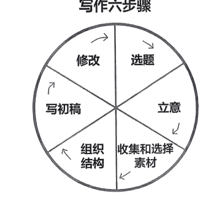
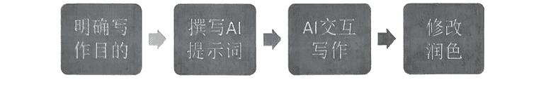

# AI写作宝典：如何成为AI写作高手

## 序

### 如何抓住AI写作的红利，成为AI写作高手

### 01

2023年，ChatGPT一夜爆红，整个行业都把目光投了过去。以ChatGPT为代表的新一代智能体在内容生产上的突破，让不少创作者心里发紧。

有人开始怀疑，在人工智能的时代，我们是不是要失业了。

AI能自动产出高质量的文字，写作者的差异点在哪？会被替代吗？未来内容赛道会不会更卷？AI都能写文章、画画、写代码了，我还要坚持写作吗？

这些疑问让很多人迷茫甚至恐慌。

AI带来的不仅是焦虑，更是巨大的机会与红利。

这本书就是为了带大家抓住AI写作时代的机遇而写。

我是一名畅销书作者，已出版4本：《读书变现：如何成为一名读书博主》《精进写作：如何成为一名写作高手》《从零开始学写作：个人增值的有效方法》《时间的格局：让每一分钟为未来增值》。连续三年获当当年度影响力作家，签约多平台，产出过百万阅读量的稿件，曾被人民日报、十点读书等大号转载。

在写作之外，我还是弘丹写作的创办人，累计陪伴10多万学员走向写作之路。许多学员学成后通过投稿变现、打造个人品牌，实现了商业与个人价值的快速跃升。

AI的爆发，让我看清了自己的独特优势。

我并非科班出身的文字人，而是IT女工程师。本科自动化，研究生就读于浙江大学控制科学与工程学院，同学大多是顶尖的工程师与程序员。2015年我从零跨行做新媒体写作，到现在已有8年实战经验，开发了多门爆款写作课，全网学员超10万，累计开办100多期训练营，连续6年运营年度写作社群。

理工科思维加上新媒体实战与教学经验，在AI时代意外形成了组合优势。就像乔布斯在斯坦福演讲时说的，人生经历像一颗颗珍珠，总有一天会找到那根线，把它们串成项链。

## 02

很多人好奇，工科背景的我，是怎样把写作变成事业的？

一切源于机缘巧合，无心插柳。

2015年1月3日，我读到朋友的一篇文章，作者想用写作记录自己的所思所想。那份纯粹的初心触动了我，第二天清晨我早起一小时，在书桌前写下了400字的日记。

从400字日记到简书签约作者，从第一本书到当当年度影响力作家，内容创作这条路我走了8年。

问我为何能坚持，答案只有一句：热爱可以抵挡漫长岁月。看着自己的思想被文字记录、传播并影响他人，让我拥有强烈的成就感。

过去8年，我累计写下千万字，发表百万字，出版4书。2020年至今的1000天里，用搜狗输入法敲出631万字。在写《读书变现：如何成为一名读书博主》时，我曾一天写11小时。小黑屋云写作的最高纪录是一天3万多字，纯键盘打字，非AI、非语音。

躬身下场让我踩中了多个风口。

1. 2015—2016年，抓住简书红利，成为签约作者；
2. 2015—2018年，抓住公众号红利；
3. 2019—2022年，抓住知识付费与在线教育红利；
4. 2016—2022年，抓住私域流量红利；
5. 2020—2022年，抓住视频号与直播红利；
6. 2023年，抓住AI红利，推出AI产品体系。

我提炼出一个“王炸”公式：热爱＋科技＋风口红利。

在热爱里深耕，坚持就不难。因为下场，所以能感知风口并抓住风口。同时拥抱科技，科技才是第一生产力。

很多人说等自己厉害了再开始，我常对学员说：不是厉害了才开始，是开始了才厉害。先行动抓住机会，你才会越做越强。

《为什么伟大不能被计划》提到踏脚石模型，因热爱持续行动，下一个落脚点自然会出现。

先迈出第一步，跟随热爱坚持到底，你总能看见下一块踏脚石，成果也会自然到来。

下场后，你不仅能抓住风口，还能引领风向。行动力强的人，这个世界会大力奖赏。

### 03

开启AI写作，我经历了四个阶段。从漠不关心到奋起直追，转变非常快。

第一阶段，觉得与自己无关。

2023年3月ChatGPT爆火时，我没有立刻行动，只是旁观，心想这跟我有什么关系。很多人现在对AI写作也是这种心态。

不行动，常常是因为觉得这事与我无关。当时我看到不少AI产品销量暴涨，短时间内报名破万人，却仍冷眼旁观。原因有二：一是认知不到位，不清楚AI能做什么，也没想到AI与写作的结合；二是“怕麻烦”，不知道第一步怎么迈。

第二阶段，深感后悔。

2023年4月，我参加一位大咖的线下商业课。课后老师说：“一定要重视ChatGPT，它的变革不亚于第二次工业革命。”这句话震撼到我，回程就开启了AI写作。

很快发现AI写作如此简单强大，为之前因“怕麻烦”困在舒适区而后悔。

第三阶段，觉得很幸运。

4月启动AI写作，5月推出“AI写作训练营”，5天内超200人报名。我一边研究一边教学，以教促学，极速掌握方法。6月萌生写书的念头，7月炎夏里几乎每天坐10小时以上，用一个月完成初稿。8月反复修改十几遍才定稿，这是我出书最快的一次。

这件事给我两点认知：

第一，你若认为与自己无关，它就真的与你无关。错失风口的核心，就是觉得自己不相关。对新生事物，先开放尝试，哪怕暂时看不出关联，行动中往往能发现机会。

第二，人挣不到认知之外的钱。认知不变，金矿在前也认不出。认知改变后，行动才会改变。我之所以立刻行动，是因线下一句话击中了我。

学习不仅是提升技能，更是改变认知。认知变了，世界就变了。

个人品牌创业8年，我坚信：不要当旁观者，要躬身入局，别嫌麻烦。很多事没有想象中难。AI写作也不难，看完本书就能学会，践行就能成为高手。

AI写作只是冰山一角，AI可渗透各行各业。将AI与自身专业结合，你就能成为行业的AI高手。如同我把AI与写作结合，HR可成为AI人力专家，程序员可成为AI编程高手。

“互联网+”是互联网思维与传统产业融合。“AI+”则是用人工智能赋能各产业升级。AI会持续迭代，未来是人机合一的时代。勇气最重要，敢于尝试、敢于失败，踏出舒适区才有全新天地。

## 04

2023年对我而言是重启之年，AI写作带来新风口。

许多内容创作者面对AI充满恐惧，担心被取代。我自己高频使用AI写作，它在速度和素材丰富度上确实超过大部分创作者。

打不过就拥抱，我不觉得会被取代，反而视作难得机遇。于是迅速研究并上线“AI写作训练营”，两个月内超400人报名。

有人问：有了AI，还需要自己写、自己读书思考吗？会不会变笨？

我的观点是：你强它更强，强强联合，人机合一。

很多人把AI当成搜索引擎用，是因为不会提问题。若没有积累与思考，就无从有效提问。只有自己更强，思考更多，才能更好驾驭AI。

未来不是AI淘汰创作者，而是会用AI的人淘汰不会用AI的人。

AI可用来写小红书笔记、开发课程逐字稿、准备演讲稿。AI还能当私教、创业导师、育儿导师、导游、个人品牌顾问。每个人的智囊团都应有顶级高手，而AI是最强的智囊团。

让我们拥抱AI写作，强强联合，人机合一，用AI提升创作效率，增加财富与影响力。

弘丹
2023年7月26日 于上海

## 第一章

### 01

认识AI写作，掌握AI写作四步法

#### 1.1 AI写作四大优势，又快又好创作

写作是工作生活的刚需，但常会遇到无从下笔、卡壳的情况。

职场人写策划方案、年终总结、工作汇报，往往拖到截止前才匆忙赶工。

现在有了AI写作这把利器，能在多种场景下快速高效完成输出。

AI写作即人工智能写作，利用自然语言处理技术理解人类指令，并根据主题或提示词生成连贯逻辑的文本。

拿我自己说，以往写2000字文章需一个多小时，借助AI在提示词精准的情况下，十几分钟即可完成。效率提升十分明显。

试过辅助写作的人都会发现，AI大幅提升效率与质量，并拓展创作边界。

AI写作降低了门槛。很多人怕写作是因文笔差、逻辑乱。现在只需用朴实语言表达想法，润色、结构调整、案例补充交给AI即可。给出精准提示词，就能优化成优秀文章。创作者可更专注创意，而不必耗在资料搜集与文字打磨上。

更关键的是，AI解决了写作拖延。写文章最耗时的是拖延，面对空白文档无从下手，AI能迅速启动写作流程。

AI写作的四大优势：

第一，生成速度快。像超级打字机，几分钟甚至几秒完成你几小时的工作。写一篇关于人工智能的论文，手动需数天收集与撰写，AI只需相关提示词即可立刻生成深度内容。

第二，文体与领域全覆盖。告诉AI具体要求，它能生成新媒体文、小说、诗歌、散文、科研报告、论文、产品文案、品牌故事等。我擅长的内容类型有限，AI让我尝试小说等新体裁。它也能覆盖教育、医疗、科技、商业、文学等各个领域，而大多数写作者只精通少数赛道。

第三，提供无限创意与灵感。写作痛点是没灵感。有了AI，把关键词丢进去，就能获得多种创意方向，总有一个能点燃创作欲。比如要写科幻小说大纲，让AI先生成梗概与框架，再在此基础上修改优化。

第四，24小时在线。早起派或深夜派都能随时使用。AI不需要休息，任何时间需要辅助，它都能即时响应。

有人说AI这么强，还要学写作吗？当然要。你掌握基础技巧，才能写出更精准的提示词，并懂得如何修改AI产出。

本书融合AI与新媒体写作技巧，帮助你双线提升并融会贯通。借助AI的力量，我们能又快又好地创作。

AI时代的角色转变，与AI强强联合

AI的影响已远超写作，深入工作生活的方方面面。编程、绘画、设计、文案都能发挥巨大价值，适用于教育、医疗、商业、艺术等。

AI带来挑战，也带来机遇与商业价值。AI能发挥多大作用，取决于使用者。

能力越强，AI越能发挥价值。能力不足或不够重视，改变就很小。关键不在工具，而在人。

AI时代需要四个转变，才能更好联合AI：

**第一，角色转变，从执行者到创新者与决策者。**
过去很多人是执行者，按指令办事。现在大量执行可交给AI打工。我们要升级为创新者与决策者，用脑洞打开方向，让AI落地执行，并把决策拆解为清晰指令。

**第二，能力转变，提问比解决问题更重要。**
过去强调解决问题的能力，AI时代提出正确问题更关键。由你提问，AI找解法，这才是强强联合。若不会提问，即使AI再强也发挥不出价值。

**第三，编程方式转变，从编程语言到自然语言编程。**
我本科研究生学过C++、Java，门槛很高。现在用自然语言就能编程。与AI对话本身就是自然语言编程，用日常语言告诉AI要做什么，它就执行。

**第四，学习方式转变，从记忆理解到跨界创新。**
传统学习重记忆背诵。AI时代更重视跨界与创新。AI能处理海量信息，遇到不懂即可询问。在AI辅助下，多领域自学与融会贯通成为可能，从多个领域获取灵感，进行跨界创新。

完成这四个转变，才能适应AI时代，抓住风口红利，创造新商业价值。

## 1.2 AI写作四步法，轻松写出好文章

从事新媒体写作8年，我一直在探索更轻松高效的方法。

我第二本书《从零开始学写作：个人增值的有效方法》第三章讲过写作六步：

- 第一步，选题；
- 第二步，立意；
- 第三步，收集和选择素材；
- 第四步，组织结构；
- 第五步，写初稿；
- 第六步，修改。

在这六步骤中，很多人卡在选题、立意、素材收集等环节，不知道写什么、选什么，导致拖延。在AI时代，我们可以用更简化的流程高效产出优质文章。

我总结出AI写作四步法，帮助你轻松高效写出精彩内容。

AI写作的流程更简单，难度也大幅下降。

核心在于撰写提示词，提示词通常是几句话或几段，还可参考模板，写起来并不难。

下面详细展开四步法的每一步。

第一步，明确写作目的。

写作前先明确目的。不同体裁方式不同。同时要明确发布平台，不同平台风格差异很大。明确后可让AI按指定风格写作，比如模仿小红书爆款笔记风格，AI就会用“种草”语气创作。

第二步，撰写AI提示词。

AI写作的关键是提示词的精准度，提示词就是指令。文章不达预期，大概率是提示词不够清晰。

在AI写作已经成为常态的今天，比拼的已经不是谁的资料库更大，而是谁的提示词更准。提示词的精准度直接决定AI产出的贴合度。基于大量实战，笔者归纳出RRBE提示词创作法，用来快速打磨出高质量指令。提示词本身就是AI写作的发动机，第二章会专门展开方法的细节与可套用的模板。

有了好指令才能进入实操。作者在书里把整个流程拆成四步走。

第三步是AI交互写作。确定好指令后就可以让模型开工，可选的工具有ChatGPT、文心一言、Notion AI①等，本书的案例主要以ChatGPT为主。把指令丢进工具，模型会先吐一段落或一篇成稿。一次提问很少能一次完美，通常要来回几轮对话来逼近预期，这就是人机共同打磨的AI交互写作。交互的过程中，提示词会不断被补充、调整，让模型更懂你的指向，输出也更经得起检验。

第四步是修改润色。AI的初稿需要人工再加工。要通读检视语言是否顺畅、逻辑是否清晰、调性是否符合目标读者，还要植入自己的经历和观点，提升独特性和温度。信息准确性也要核对，剔除模型可能出现的事实偏差。润色完成后再配图，就能成一篇能上各平台的新媒体文。

下面以一篇小红书笔记为例演示四步法。

第一步，明确写作目的。这次的目标是为弘丹的小红书账号写一篇有关自律的爆款笔记，借助AI辅助完成自律主题的笔记创作。

第二步，撰写AI提示词。目的和平台确定后就写指令。我当时用的指令是：你是一位小红书博主，请模仿小红书爆款笔记的风格，写一篇“自律一年，让我脱胎换骨，重获新生”的笔记。可以适当加表情符号，在学习、工作、早起、理财方面展开自律，结合推荐10本好书、10部电影。

指令发出后模型迅速生成了一篇笔记，整体框架还算可用。

第三步，AI交互写作。因为模型有上下文记忆，前面提到的10本书被直接沿用，10部电影则由模型自行挑选，恰好我都看过。但AI产出也会出错，推荐的书单里有几本作者署名写错了，发布前必须修正。交互写作里可以反复追问优化，这次的质量尚可就没继续迭代。

第四步，修改润色。润色分三块。一是纠错：比如《纳瓦尔宝典》的作者是埃里克·乔根森，《小狗钱钱》的作者是博多·舍费尔等，均做了核实更正。二是增加个人化内容：开头改得更抓人，并加入自己的自律经历。马上就到2023年下半年了，敢不敢用6个月彻底改变自己！我是弘丹，曾经迷茫焦虑，在一份不喜欢的工作里重复上班下班，生活看不到希望。我用半年时间挑战自己，找到了新的事业方向。我的自律从早起读书写作开始，每天早上6点起，读书写作两小时，已坚持7年，累计出版4本书。三是优化标题与收尾，提升吸引力。结尾改为：坚持6个月，你会焕然一新、脱胎换骨，生活也会回馈厚礼。2023年，让我们狠下心、铆足劲，逼迫自己一把，你比想象中更强大！标题改为：《自律6个月，让我脱胎换骨，重获新生》

经过上述处理，笔记就成型了。AI生成的小红书文天然带有表情、序号1、2、3、4等排版习惯，修改后基本可直接发布，省掉了大量排版时间，效率很高。这个例子也说明了AI写作四步法的可用性。

借助AI可以大幅提升创作效率与质量，但AI不是替代者。内容创作者仍要提供创意、观点、故事，发挥不可替代的人类价值。

### AI写作的四个成长阶段
使用AI写作的人会经历四个阶段。

探索期。刚接触工具，了解功能，各种提示词随意尝试，和模型互动充满好奇和新鲜感，好玩的事不少。

磨合期。随着熟悉度上升，发现模型输出常不符合预期，文章偏生硬、枯燥，甚至出现事实错误。会有摩擦感，但这是掌握方法的必经过程。

熟练使用期。熬过磨合期后，提示方式逐渐成熟，能让模型稳定产出满意内容。AI开始真正读懂需求，成为日常不可或缺的工作伙伴。

人机合一期。长期高频使用后积累大量经验，人负责创造力与想象力，AI负责把想法落地执行。AI像外脑一样强大，人机协作产生更大可能。

从好奇到合一并非一蹴而就，需要持续投入。很多人半途热情下降，需要你能坚持到底的人，才能最终收获。

### AI时代内容创作者的六项精进能力
要成为AI时代的写作高手，需要持续打磨六项能力。

拆解力。拆解爆款文章是快速进步的捷径，先学方法后求超越，AI时代拆解更关键。筛选爆款拆解选题、结构、素材、风格和金句，用AI模仿训练，学会爆款底层逻辑，同时训练模型。

选题力。虽然AI能写，但写什么由人决定。选题决定流量，要培养对热点、社会议题、行业趋势的敏感度，并找到独特切口。

提问力。爱因斯坦说提出好问题比解决问题更重要。AI写作的核心就是精准提问。把需求写成清晰指令，建立提示词库，不断刻意练习。

整合力。将多源观点、信息、资源有机融合。AI交互产出不是成品，需要整合、取舍、重写，才能让读者喜欢。

修改力。AI初稿离发布还有距离，需要用个人风格、经验、故事去润色提升质量。AI也可辅助校对语法、优化句式，但最终打磨靠人。

平台运营力。创作目的最终指向影响力与变现。了解各平台规则和爆款特征，针对用户偏好调整标题、配图与呈现方式，实现涨粉与转化。

坚持培养这六项能力，才能在AIGC时代脱颖而出。

### AI写作的局限与人类的优势
内容创作已从PGC走向UGC，现在进入AIGC。PGC是专业生产内容，UGC是用户生产内容，AIGC是人工智能生成内容，效率大幅提升。

李彦宏曾划分AIGC三个阶段：助手阶段辅助生产，协作阶段出现虚拟人形成人机共生，原创阶段独立创作。目前仍处助手阶段。

人类相对AI的优势有三点。真实的经历与体验，AI基于模型生成，无个人生命故事。像蔡磊的《相信》、各类名人传记，都源于真实人生。情感共鸣，AI文本更像客观说明，缺少引发共情的温度。想象力、创造力与灵感，如刘慈欣《三体》的宏大宇宙观，是人类独有。

AI的优势是速度快、资料多、逻辑稳。强强联合是未来方向。

AI写作也有明显局限。一是来源不透明，难以标注引用出处；二是易出现错误或杜撰，比如会虚构不存在的书名；三是信息滞后，模型训练截止点决定上限，无法提供最新资讯；四是隐私与数据泄露风险，使用外部工具需谨慎。

做到扬长避短，人补AI之短，AI放大人效能，才能实现真正的人机合一。未来AI或将像互联网一样成为基础设施。

第二章专门聚焦提示词。成为AI写作高手，先成为提示词高手。RRBE模型提供一个通用框架。

Role角色。给模型一个身份，让它清楚扮演谁。可能是自媒体博主、小红书美妆达人、资深记者、心理咨询师、科幻作家等。角色设定引导表达方式与语言风格。

Request要求。把任务说明写具体，包括主题、视角、技巧。AI按指令运行，越模糊越容易跑偏，越具体越可控。

Background背景。提供情境信息帮助模型理解全貌。如写微小说，给出地点、人物关系、情节梗概；写简历，提供需呈现的经历。

Expectation期望。明确对结果的效果期待，让输出方向更聚焦。

这四个要素共同构成RRBE提示词模型，能让指令更高效、精准。

期望，本质上就是在提示词里提前告诉AI你想要的呈现结果，比如篇幅长短、语言调性、表达方式、最终要达到的效果。

写小说时可以明确说要“情节波折、带悬疑感的爱情故事”。要小红书标题时可以要求“带表情符号、走爆款风格、强点击”。总之，你希望AI产出什么样子的内容，就直接写在指令里。

用RRBE模型写提示词时，可以根据实际需要做取舍，不一定四个要素全用，有时一两个就够了。

提示词也可以极简，只有要求。比如“给我推荐5本关于写作的书”、“给我一份上海两天一夜的旅行攻略”。
提示词也可以是角色加要求，比如“你是一位资深导游，请推荐几条徒步路线”。

如果想让AI更懂你，就用完整版的RRBE：角色+要求+背景+期望。

比如小红书爆款标题：
你是一位小红书博主，请模仿下面这些爆款标题的写法，帮我创作10条关于“读书变现”的标题。具体要求参考标题要带表情、吸睛、促点击。
参考背景标题：干货，读书博主如何从零月入过万；读一本书就小赚几千你会更爱读书吗；把读过的书变成钱，12种写作变现方法……

小说创作：
你是一位小说作家，请写一篇微小说。背景是上海的爱情故事，男主是富豪少爷，女主是清贫女大学生，一见钟情但最后没在一起。请基于这个信息，写出情节曲折、带悬疑色彩的爱情微小说。

新媒体创作：
你是一位公众号作者，请写一篇“100天，如何改变自己”的文章。结构用总分总，分三段，并穿插中外的案例。风格要温暖、接地气、人性化，例子要戳中读者痛点。

朋友圈文案：
你是一位朋友圈文案高手，请写一条关于AI写作创富训练营的种草文案。背景是课程已超400人报名，能用AI写朋友圈、小红书和新媒体文章，提升创作效率。要求简短有力，吸引报名。

RRBE模型不只是写文章，旅行、职场、简历、论文、代码、健身、翻译、送礼、职业规划都能用。

旅行专家：请为我制定一份去云南的5天4晚深度游攻略，让我能真正体验当地风土人情。
职场写作高手：请帮我写一封向老板申请加薪的邮件。我在公司三年，近期完成多个重要项目业绩提升。邮件要得体有理，有说服力。
软件工程师：请帮我生成一段Python代码。需求是抓取网页信息并导出CSV。要好用、易读易改。
小学语文老师：请帮我批改一篇“我和我的小伙伴”的作文。是我儿子的作业，请给出具体建设性反馈，帮助提升写作。
购物顾问：请帮我挑一份送朋友的生日礼物。朋友是摄影爱好者，希望送他喜欢的摄影相关礼物。

无论写作还是其他任务，都可以用RRBE：给AI一个角色，说明具体要求，提供背景信息，明确期望结果。

AI提示词的四大作用

第一，引导意图。好的提示词能让AI明白你要做什么、要达到什么目的，从而产出符合预期的内容。
第二，限定范围和风格。提示词可以框定主题和角度，并控制语言风格，比如要求“简洁清晰、接地气、人性化”。
第三，激发创造力。巧妙的提示能引导AI换角度思考，产出更有趣、更独特的表达。
第四，优化迭代。第一次生成不一定完美，通过反馈和调整提示词，能让结果越来越准。

撰写提示词的四大原则

第一，准确性。要清晰明确，避免模糊不清。模糊如“给我写一个篮球比赛报告”，AI会不知所措。精准如“写一份湖人对阵凯尔特人NBA决赛的比赛报告”，AI才能发挥。

第二，详细性。给足上下文。模糊如“写一篇健康饮食文章”。详细如“写一篇健康饮食文章，需包括：健康饮食的重要性、基本原则、推荐食材、影响与益处、三个简单食谱。结构清晰、语言生动简洁。”

第三，多维度。从不同角度丰富主题。旅行可涵盖目的地、行程、文化、美食；健康生活可涵盖饮食、运动、睡眠、心理。维度越多，内容越全面深入。

第四，反馈与迭代。写作是对话过程。假设要写AI在职场办公的应用，第一次提示要10个选题，AI给出偏学术的题目。反馈“要更接地气、有趣、读者爱看，像‘用好这个AI工具，提升10倍工作效率’这种”，第二次就会更贴近。继续细化大纲和例子，反复优化，质量就会提升。

提示词公式，学会高效提问

AI提示词分两种：简单提问和RRBE提问。

简单提问就是直接问句：请推荐5本写作书；请给我上海两天一夜攻略；请介绍罗宋汤做法；隐形眼镜怎么戴；如何提升写作效率；孩子暑假怎么安排。

常见公式：
疑问词+具体要求，如“为什么健康饮食重要”“如何做巧克力蛋糕”。
列举和描述，如“列举三种有效沟通技巧”“描述你最喜欢的旅行地”。
建议或解决方案，如“如何克服写作拖延给点建议”“怎么提高自信心”。
特定情境或条件，如“面试时如何留下深刻印象”“设想实现一个重要目标会如何克服困难”。

提示词中提供样稿，能让生成更精准

想让风格更对味，就在提示里给参考模板或样稿，特别是新媒体写作，给爆款做参照，AI会借鉴风格再创作新内容。训练自有风格时，也可以用自己的文章喂给AI。

AI创作金句：请参考下面对比法的金句形式，用对比法写3句关于自律的金句。参考：悲剧将有价值的东西毁灭给人看，喜剧将无价值的东西撕破给人看；理想很丰满，现实很骨感。生成的金句会保持对比结构。

改写名言：请改写“每一个不曾起舞的日子，都是对生命的辜负”，写成关于写作的金句。

模仿个人风格：给出自己写的短视频脚本，让AI学习语气和节奏，再创作全新主题的脚本。提供样稿后，AI产出的文字会更接近你的习惯，再做微调即可使用。

模仿名人作家：可以让AI模仿张爱玲、朱自清等风格。先让AI总结其特点，再要求模仿其风格写上海爱情小说或端午散文。给到作家原文做参照，效果会更准。

多收集爆款模板，拆解后作为样稿喂给AI练习，AI就能越来越懂你要的感觉，产出也越来越符合预期。

把自己的成文作品拿去当训练样例投喂给AI，模型就会抓住你的用词习惯和节奏，之后产出的稿子就会更像出自你手。

## 2.6 用个人提示词库把AI写作效率拉满

长期用AI写作的人都会发现，好的提示词像好素材一样珍贵。把用着顺手的指令收集起来，形成自己的提示词库，就是AI时代的素材库。

有了库，写任何垂类内容时都能先检索到现成的指令，稍作改写就能开写，AI的回应会更精准、更快。具体怎么建，有三步可走。

### 第一步，先想清楚库要用来解决什么问题

建库是为了什么？想沉淀自己验证过的精准指令，还是想收录同行好用的用法，都要先定下来。把自己常写的赛道梳理清楚，比如发布阵地有公众号、小红书，应用场景有短视频脚本、职场干货，体裁有小说散文，主题有生活、育儿、旅行等。按照这些维度先搭框架，再把常用指令填进去。

在线文档最适合做库，石墨文档、腾讯文档、印象笔记、有道云笔记都支持随时检索，打开就能用。

### 第二步，边用边收，持续填充

写作过程中碰到效果好的指令，立刻归档到对应分类，也可以主动搜集别人的用法。举两个例子。

要写书评，可以存一条“请以《高效能人士的七个习惯》为主题写篇书评，先介绍作者背景，再概括核心内容，最后结合三到四个具体事例展开”。归到书评影评类。

要做美食教程，可以存一条“你是一位米其林主厨，请详细拆解罗宋汤的做法，从食材采购到关键火候一步步说明”。归到美食类。

用得越久，库越厚。

### 第三步，给指令打标签，方便找

库建起来后就需要分类。常用的分法有三种。

一是按主题分，健康、学习、旅行等各自成区。

二是按使用频率分，高频常备和低频备用分开，放前面优先用。

三是按任务分，把选题、素材筛选、语言润色等写作环节相关的指令聚在一起，形成工作流。

提示词库不是一次性的工程，需要持续更新维护，它会成为你AI写作的强力外挂。据我了解，整理好的100条AI写作常用指令小册也可以直接借鉴模版来搭建自己的库。

# 第三章 把握AI写作方法，成为高手

## 3.1 走通AI写作全流程，稳定输出满意稿件

我在《从零开始学写作：个人增值的有效方法》里讲过新媒体写作的六个环节：选题、立意、素材收集与筛选、结构安排、写初稿、修改。任何一个环节卡住，写作都会拖延。

AI的价值在于每个环节都能共创，门槛大幅下降。写之前先自问几个问题：要写哪类文？立意是什么？用什么结构？用什么素材佐证？怎么开头收尾？

我常用的AI写作构思表，把这些要素拆开：文章类型、主题、结构、素材类型、语言风格、开头方式、金句手法、结尾方式、标题方式。填完这张表，思路就清晰了，也能直接让AI据此来帮你搭框架。

AI写作不是一次提问就搞定，而是逐步追问、逐步共创。下面是五步实操法。

**第一步，让AI一起定选题和立意。**

指令示例：你是一名新媒体博主，请围绕“读书变现”给出10个有吸引力、贴近读者的差异化选题和思路。

AI会返回类似“从书中赚钱：10种不为人知的变现技巧”“在家变现：阅读如何助你成为自由职业者”等方向。可从中挑选，满意就让AI出大纲，不满意就继续要5到10个。

**第二步，让AI搭大纲。**

指令示例：我锁定“从书中赚钱：10种不为人知的读书变现技巧”，请用总分总结构，给出大纲，要求列出10种方法并附操作要点。

AI会先总述阅读的价值，再分述每种方法，最后收束。如果某个点不合适，可以反馈修改，比如把“写读书笔记赚钱”改为“写听书稿赚钱”，把“做读书博主”改为“成为读书主播直播带货赚钱”。AI会据此重写。

**第三步，按大纲写初稿。**

指令示例：基于以上思路和大纲，请为公众号写一篇2000字左右的《从书中赚钱：10种不为人知的读书变现技巧》，用轻松温暖的语气，每个方法都要展开说明并举例。

这时AI能快速生成成体系的稿件，框架基本达标，但信息可能有偏差，需要人工校对。

**第四步，修改润色。**

可以直接指出修改点，如“请在书评部分补充免费领书实现看书自由的案例”。也可以让AI扮演写作教练，指令示例：你是一名新媒体写作导师，请帮我润色这篇文章，要求逻辑更顺、案例更丰满、表达更有吸引力，标题开头结尾更抓人，并提炼金句。篇幅较长时分段提交。

**第五步，单独打磨标题、开头、结尾和金句。**

正文定稿后，重点优化吸睛位置。开头可要求“用故事+个人经历切入”，结尾可要求“引用名人名言收束，再自创一句关于读书赚钱的金句”。把个人经历融进去，风格更像自己，也更容易吸粉。

按这五步逐步提问，就能稳定产出合格的新媒体稿，并直接分发到各平台。

## 3.2 用AI策划选题，持续产出读者想看的内容

选题决定点击率。很多创作者卡在“写什么”，AI正好能补上这块。

选题大致分三类：日常选题、热点选题、书影视选题。每类下还能再细分。

我在选题分类表里做了梳理：职场可分干货、现象、焦虑；生活可分常识、经历、态度；个人成长可分认知学习、思维方式、感悟；朋友同事陌生人可分圈层、身边人、陌生人；书影视可做推荐、笔记、书评；热点可分突发和可预期。

有了表，找方向就不盲目了。

**日常选题的AI用法。** 用RRBE模型提问。例如：你是一名职场博主，请结合爆款职场选题，给出10个接地气、有爆款潜质的选题及思路。AI会给出打造人脉、提升沟通等方向。育儿同样适用：你是一名育儿博主，请给出10个育儿爆款选题及思路。确定了大方向还可以再细化，比如聚焦“不吼不叫教育”，让AI给出更具体的10个子话题。

**书影视选题的AI用法。** 把看过的作品变成素材库。例如：你是一名读书博主，请围绕《爱的五种语言》给出10个爆款书评选题和思路。影评同理：请围绕《肖申克的救赎》给出10个有吸引力的写作角度。又或者做书单推荐：请给出10个书单选题思路，再指定一个方向如“提升亲密关系”，让AI列出10本书并配5个选题。

有了提示词库和选题方法，AI就能从灵感到成稿全程陪跑，持续产出读者爱看的内容。

AI 已经从工具进化成创作搭档，把选题、找热度、搭框架、找素材、定标题这整条链路都变得更高效，下面这套实操方法论就是把零散经验梳理成可复用的流程。

先从选题策划说起。AI 擅长把模糊的需求变成清晰的清单。比如给读书博主做亲密关系的书单，很快就能得到十本可推荐的书目，《爱的五种语言：创造完美的两性沟通》在开头、《亲密关系》紧随其后、《婚姻：从冲突到深度对话》也在其中，借助书单还能衍生出五个可写的角度，比如《打造亲密关系：10本让你关系升级的书籍》，思路就是从书单里挑书并解释每本如何帮助读者改善关系。

同理换到影视也可以。要求AI扮演影评作者，输出一篇约2000字的经典爱情影单，标题定为《穿越时光的爱情：10部经典爱情电影》。开篇点出爱情是人类永恒的追问，然后按影片依次展开，《泰坦尼克号》由詹姆斯·卡梅隆执导，以灾难为背景承载杰克与罗丝的生死之恋，成为现象级爱情记忆。这样的影单写法既有共情也有信息量。

选题之外，热点是自媒体的流量入口。AI 可以辅助追踪和拆解热点。热点大致分两类：一类是可以提前预埋的，如春节、情人节、中秋节，以及女足亚洲杯、北京冬奥会这类赛事活动。提前在日历上标记，下个月的主题提前收集素材，发布时结合当天细节微调即可。另一类是突发性的，如热搜上突然冒出的冠军话题，这类需要抢时效，越快越占位。

要找热点可以借助平台数据。百度指数能看到关键词一段时间的搜索量判断热度；微博热搜能捕捉当下用户在聊什么，每条话题下的讨论本身就是灵感；知乎热榜列出大众关心的提问清单；小红书的发现页则汇总了热门标签和话题，进入标签页可进一步观察用户关注点。把这些信息筛选整合，就能提炼出适合自己的切口。

突发热点因为AI本身不联网，需要先提供背景。可以用 RRBE 提词方式，先把事件的来龙去脉和关键背景喂给模型，再让它基于此创作。比如 ChatGPT 爆火的案例：2022年11月由旧金山 OpenAI 发布的全新聊天机器人，能基于上下文对话并完成任务；马斯克在社交媒体上称其好得吓人；上线两个月用户突破1亿。基于此背景，要求AI从 ChatGPT 与写作的角度给出十个有吸引力的选题，例如《AI与写作：ChatGPT 如何帮助我们提升写作技能》，思路是介绍它如何提供思路、优化表达；再如《ChatGPT 如何改变我们的写作习惯》，分析它如何加速产出并影响写作节奏。

有了选题就要批量准备内容。很多创作者会集中一周甚至一个月的时间把选题和初稿提前备好，短视频博主也是集中拍摄、集中剪辑。批量操作节省时间，也保证持续输出。

确定选题后先搭框架。常见的写作骨架有四种。总分总是开头点题、中间展开分论点、结尾呼应升华，公式可理解为开头点题加三个子观点再总结。并列式结构用多个并列观点来论证主题，讲故事加讲道理最后收束，典型的故事1+故事2+故事3+评论。黄金圈法则从Why、How、What 由内向外展开，先说为什么需要，再讲怎么做，最后呈现效果。SCQA 结构则是情境引入、冲突呈现、问题提出、答案给出。

实际使用时可以先确认模型是否理解结构，再让它按结构产出大纲。例如让 AI 用 SCQA 写职场沟通文章，或用总分总写育儿主题《从咆哮到平静：如何保持冷静教育孩子》，大纲会先用真实的咆哮案例引入，中间拆解咆哮的负面影响、冷静沟通的方法、练习方式，结尾重申冷静教育的价值。黄金圈法则用于情感主题《如何提升亲密关系》时，先解释提升关系的必要性，再给具体做法，最后描述关系改善后的状态。内容要接地气，用具体案例支撑才有爆款潜质。

框架确定后就要喂素材。一篇文章基本是观点加素材的组合。开头适合放名言金句、提问、简短故事或热点数据；观点段落需要故事案例、方法步骤、金句；结尾用金句或名言收束。以《女人最高级的活法：慢、清、静》为例，开头用约翰列侬的名言加新闻和热播剧，观点一用寓言、蒋勋和林海音的说法以及书籍方法支撑；观点二用李小龙名言和电影台词；观点三用亦舒名言加亲友故事和名人故事。

让 AI 找素材时可以明确要求真实有趣不虚构。比如情感博主写提升亲密关系，AI 会给出爱的五种语言理论、积极倾听方法，并提供扎克伯格与普莉希拉陈每周约会的真实故事。早起主题也能得到蒂姆库克凌晨3点45分起床处理邮件再健身的真实例证。

素材拿到手不能直接贴，要做三层优化。第一是精简删减，去掉细节描写、重复对话，只保留核心事实。第二是用自己的语言转述，避免照搬新闻原文。第三是注明来源，特别是书籍引用。筛选素材要自检是否贴合主题、有没有新意、是否典型具代表性、是否真实可核查。

素材搭配也有技巧。正面反面对比能突出观点，先讲反面再讲正面效果更明显；两个例子叠加可以强化一种观点；多种素材混搭避免单一，同一观点可用金句加直接素材加间接素材共同支撑。素材之间要用过渡讨论串联，不能堆砌。

最后是标题。标题决定打开率。常用的爆款写法有结合热点、带数字、借助名人、提出疑问、设置悬念、提供福利等。例如《长津湖》厉害的才不是顶配阵容、《写作选题没灵感？这5个方法可以模仿》、《莫言：人生最坏的结果，不过是大器晚成》、《如何才能摆脱又穷又忙，过真正有意义的人生》、《如何假装成为一个好妈妈》、《他刷了10遍《老友记》，总结出一套万能口语公式，请自取》。标题要与内容风格一致，同时制造好奇。

把选题、热点追踪、大纲搭建、素材提炼、标题打磨串联起来，AI 就能从灵感提供者变成全流程的协作伙伴，帮助写作者更稳定地产出有观点、有温度、有流量的内容。

用AI写文章，最怕的就是写完一堆平平无奇的内容。真正能让人点进来、看下去、转出去的，永远是标题、开头和结尾。把这三块打磨好，再配合系统性的修改，AI生成稿也能变成有传播力的好文。

**一、标题要会组合拳，关键词放前面**

爆款标题很少靠单一招数硬撑，更多是几种写法混搭出来的效果。数字+提问、名人+悬念、干货+福利……把方法叠加，吸引力会指数级上升。组合之外还有个铁律：核心词一定要挪到前半段。用户是自左向右扫读，前半句决定要不要点。

交给AI写标题时，把要求写清楚比空泛下指令更有效。可以直接指定写法，并喂几条对标案例让它模仿。

比如在写自律主题，可以这样约稿：我正在写关于自律的稿子，请给我10个爆款标题，要求用提问制造好奇，同时带数字。下面这些是参考方向。AI就能给出诸如《自律力怎么提升？这7个细节很多人忽略》《30天变自律，这5个关键动作先做起来》《干货：培养自律的5种习惯，让效率翻倍》之类的方向。

同理写高效学习，也可以先说需求再给范式：我需要10个高效学习标题，提问+数字，参考《写作没灵感？这5个套路可以直接抄》《聪明的孩子都会做的7件事，你家占几条？》，AI就会产出《你的学习方法真的高效吗？8个科学技巧揭秘》《30天成为高效学习者？试试这7个步骤》等新标题。

常用的标题指令模板包括：结合热点法、数字法、借名人法、提问法、悬念法、提供福利法。选定方向后，配合案例喂给AI，出来的结果会更贴需求。

**二、开头决定完读率，6种起手式可直接用**

标题把人骗进来，开头决定他会不会留下。开头乏力的人，三两句就划走，即便后面再精彩也看不到。开头要负责收割注意力，所以需要一个有力的凤头。

常见的起手方式有六种：

热点引入，开篇用当下有热度的新闻、人物、影视或话题切入，关键在于选一个大众熟知且能共鸣的切口。
戳中痛点，直接点出读者的普遍困扰引发情绪共鸣，关键是把痛点提炼准确并直观呈现。
故事引入，用一个小故事开场，亲历、转述或网络案例均可，关键是故事有趣且与主题贴合。
开门见山，第一句就亮明观点态度，不绕弯，让读者立刻知道立场。
提问引入，抛一个引发思考的问题吊起好奇，关键是问题要贴近读者日常，让人感觉文章为他而写。
强调价值，开头就概括文章能给到什么干货，用精炼语言把精华亮出来，让人觉得值得看下去。

用AI写开头时，也要明确告诉它用哪种起手式。比如写自律，指令可以是：请用故事引入的方式写开头，要有好奇心，能促使用户读完。AI可能会讲一个日本寿司大师小野二郎的自律故事。故事太长时再让它精简，快速收束到主题自律上。也可以要求模仿某个爆款开头风格，把提问、共鸣、价值收尾的节奏复制过来。

**三、结尾要留终值体验，四种收束方式**

文章被评价为凤头猪肚豹尾，豹尾就是结尾。很多读者因为收尾糟糕而给整篇文章打低分。把文章当产品经营，就要在结尾制造终值体验，让人记住并愿意分享。

好结尾通常有四个特征：简洁有力，不拖沓几句话收束；能升华思想，把观点拔高一层；有金句，朗朗上口便于转发；能引发情绪共鸣并推动行动。

可用的结尾写法有四类：

总结点题，呼应开头对全文收束，重申核心观点并做升华。
金句结尾，用一句凝练的话点题，方便读者引用转发。
名人名言，借用与主题相关的名人话语增强说服力，提升调性。
引导行动，在情感处落脚号召读者马上做，让改变发生。

AI同样可以指定写法。比如写自律，用引导行动收尾，指令强调要简短、有共鸣、有行动感，AI就会产出关于自律是自由桥梁、从此刻行动等收束段落。也可以模仿某一段落的风格，让AI在保持语感的同时替换主题。

**四、AI稿必须改，精修五步走**

AI初稿只是起点，真正的好文是改出来的。修改时间往往远大于写作时间。

第一步，校观点。先确认文章立场是否与主题一致，是否想表达的意思。可以让AI替换某一点并同步更新论据。
第二步，换素材或补个人案例。检查素材是否相关且能支撑观点，删掉偏离的内容。需要自己的故事就把具体经历写成提示让AI植入。
第三步，核事实。AI容易写错人名、地点、年份、书名。案例真实性必须人工复核，避免张冠李戴。
第四步，重点打磨标题、开头、结尾。站在整篇角度思考哪个标题更想点，哪个开头更抓人，哪个结尾更让人转发。标题可多生成几条备选投票。
第五步，统一语言风格。AI文偏说明，读起来啰嗦重复。删减赘句，调整语序，朗读检查流畅度。段落控制在50字以内更适合移动端。也可以先把自己的过往文章喂给AI，让它学习你的语感再改写。

修改自检清单可以对照：标题是否吸睛、是否用了爆款方法、能否概括中心；开头是否抓人、铺垫是否合适、能否代入；内容是否贴题、案例是否3个以上、能否论证观点；结构是否清晰、小标题顺序是否合理；结尾是否给力、是否促转发、是否引导互动；金句是否包含名言、有无3条以上原创金句并加粗。

标题、开头、结尾是流量入口，精修是质量保证。把AI当成效率工具，把控好组合写法和修改节奏，你的文章才有机会从信息流里脱颖而出。

| 文章配图 | 1. 插图需与正文主题呼应 2. 插图与整体呈现协调 3. 选用可免费商用的正版素材以免侵权 | 通过 / 未通过 |

| 文章排版 | 1. 版面清爽阅读顺畅 2. 行距段距留白合理 3. 关键句做加粗或变色处理 4. 文末附作者介绍 5. 发布时标明原创 6. 封面视觉清晰且具吸引力 | 通过 / 未通过 |

## 第四章

## 04

利用智能工具做短视频内容，涨粉并实现变现

### 4.1 进入平台，抓住流量窗口

该生活方式社区的用户活跃度很高。到2022年，月活已超2亿，90后占72%，约半数用户集中在北上广深等城市，内容生产者超过4300万。

它已演变为年轻人展示日常、参考消费的重要入口，众多品牌借此触达精准人群。

对内容创作者而言，此时入局时机不错。笔者为22年与23年的会员分别开设过训练营，手把手带学员从零搭建账号，多位学员粉丝突破一万，也有学员通过商业合作实现收入。

平台对素人友好，哪怕粉丝仅数百，也能产出阅读破万的笔记并完成转化，即低粉出圈、低粉变现的路径是可行的。

注意力在哪，创作就该跟过去。若想打造个人IP，经营该平台账号是必要动作。

内容形态以图文和短视频为主，创作过程可借助智能工具提效。该社区的表达调性独特，写作时可让模型模仿其语感输出。

做内容前先明确定位，决定做美妆、穿搭、育儿、阅读、旅行、知识等哪类账号，从自身兴趣与擅长中挑选一个方向持续深耕，才能形成辨识度。

定位直接影响商业化，越垂直越容易变现，常见方式有广告投放、品牌露出、专栏、直播带货、私域导流等。

打造个人IP时定位必须清晰，笔者在辅导时都会进行一对一沟通，帮助学员找到精准方向并发挥长处。

### 4.2 智能助手的四个作用

创作中智能体能提供哪些支持？

一、选题支持。选题很大程度上决定播放与阅读，可用模型拆解爆款主题，提炼共性后生成新方向。

二、标题与封面文案支持。标题和封面文案决定点击率，可让模型学习爆款的表达风格并批量产出方案。

三、正文支持。该平台正文上限千字左右，风格独特，可让模型学习社区语感与爆款特征，产出符合调性的草稿。

四、排版支持。该平台排版偏好表情符号点缀、版式简洁清晰。提示词中要求模型按社区排版规范输出，可直接复制使用，实现半自动排版，让笔记更整洁。

模型可按需求快速生成初稿，再结合个人风格微调后发布，解决想日更却时间不足的问题，实现智能助力日更。

### 4.3 爆款笔记的核心要素与底层逻辑

创作前不要闭门造车，要先拆解平台上的热文。爆款是可以复用的，一个爆款会孵化更多爆款，很多主题具备跨平台传播力，因为契合人性容易引发共鸣。

要系统收集分析热文并拆解。想做某一垂类，先看该垂类最火的50篇，找出高频出现的头部主题，围绕相似方向创作才有机会出圈。

筛选热文可参考点赞5000或1万以上的笔记，点赞与收藏是重要参考。

可从主题、内容、封面、标题等多维度拆解，了解平台打法，也让模型学习其风格。

最重要的三大要素是：标题、封面视觉、封面文案。标题和封面抓不住眼球，正文再好也无人点击。

可让模型拆解爆款标题和封面文案的特征。

该平台爆款标题的共性与底层逻辑：

1. 吸睛：运用生动词汇、独特形容词抓注意力。
2. 简洁明了：短时间内传达核心信息。
3. 有价值：教技能、给信息或分享故事。
4. 吊好奇心：提问、给惊人信息或暗示故事。
5. 符合社区调性：偏轻松、亲切、女性化语言。
6. 植入关键词：便于搜索发现。
7. 引发情绪共鸣：让人快乐、激动或感动。

整体逻辑是抓注意力、提供价值、激发好奇与共鸣、优化搜索。

> 参考以上特点为主题“敢不敢用一年改变自己，无痛逆袭”生成十个吸睛标题并配表情符号。

示例方向包括“一年时间，你敢不敢和我一起逆袭？”、“敢不敢接受挑战？一年改变自己的旅程开始了！”、“一年时间，我做到了！你敢不敢试试？”等，均围绕挑战、时间、逆袭展开。

> 作为高流量博主，总结封面视觉和封面文案的特点。

封面视觉和文案是用户首次接触内容的入口，核心逻辑如下：

1. 视觉吸引力：用鲜艳色彩、清晰画面、吸睛设计快速抓住眼球。
2. 信息传递：迅速传达内容核心，用户浏览很快，信息要一目了然。
3. 内容一致：封面承诺的内容需正文兑现，否则易造成反感。

整体逻辑是吸引注意、快速传递信息、引发好奇与共鸣、符合社区调性、保持与内容一致。

> 参考上述特点为同一主题生成五个封面文案并描述封面图。

示例：
封面文案：一年，365个机会，你敢不敢挑战自己？ 封面图可用法式日历或时钟视觉，强调时间流逝。
封面文案：无痛逆袭，一年的时间，你准备好了吗？ 封面图可用人物站在起跑线，象征新挑战开始。

若不熟悉社区风格，可挑选几篇爆款投喂模型，让模型总结特征后按此风格生成内容。

> 拆解一篇爆款笔记的特点。

该笔记呈现了：个人故事与经验分享、实用可操作建议、积极鼓励的情绪基调、关键词与标签的使用、书籍或产品推荐、语言直接简洁、聚焦普遍痛点解决问题、结构清晰。此外还需注意表情符号的适当使用增强生动性，以及短句配合空行或数字分割实现清晰排版。

参考以上要点，为主题“敢不敢用一年改变自己，无痛逆袭”撰写一篇融入个人经历、推荐书籍电影的爆款笔记。文中可设定目标、制定计划、坚持不懈、反思调整、享受过程，并推荐《原子习惯》《当幸福来敲门》等，最后带话题引导互动。

若对初稿不满意，可让模型优化迭代，例如修改开头为普通白领一年蜕变为自律新媒体博主、畅销书作家，并确保文末带话题。

### 智能创作构思表

| 文章类型 | □种草文 ☑干货文 □测评文 □清单体 □推荐类 □其他 |
| 笔记主题 | 分享读书变现的方法 |
| 标题 | 靠读书变现百万，我总结了5个读书变现方法 |
| 封面文案 | 手把手教你 读书变现的5种渠道 我靠读书月入6位数 |
| 文章结构 | ☑总分总 □并列式 □黄金圈法则 □SCQA □递进式 □正反对比 |
| 素材类型 | □热点素材 ☑个人经历 ☑故事/案例 ☑书籍影视 □网络素材 □数据/调研报告 □其他类型 |
| 开头方式 | □热点引入 □生活场景 □故事引入 □开门见山 ☑提问引入 □反差对比 |
| 金句 | □改写名言警句 ☑套用固定句式 □类比法 □排比法 □其他 |
| 结尾方式 | ☑总结点题 □金句结尾 □名人名言 □引导行动 □提问结尾 |
| 标题方式 | □热点法 ☑数字法 □疑问法 □名人法 □悬念法 □福利法 □其他 |
| 带标签 | □读书博主 □读书 ☑读书变现 □女性成长 □副业 □自媒体 □写作赚钱 |

### 4.4 笔记创作轻松出圈

智能工具可辅助完成选题、标题、封面文案、正文、排版全流程。

选题策划：多刷发现页收集热文选题，结合自身定位策划。例如提问模型生成关于自控的五个选题方向，可得到“自控秘诀：掌握成功人士自我管理技巧”、“构建自控日常习惯：从早晨到晚上的自控力”等方向。

爆款标题：可让模型批量生成带表情符号的标题，如“打造自控力：成为自己的超级英雄”、“激发内在动力：掌握自控秘诀”等。标题不超过20字，适当加表情提升点击率，生成后可挑选或融合优化。

正文创作：可让模型模仿爆款风格写读书笔记、书单文等，如以《把时间当作朋友》为例写《好书推荐，这是一本值得读10遍的书》，包含作者简介、书籍介绍、时间管理方法；或生成8本书书单推荐并拟定吸睛标题。

还可让模型将已有文章改写成图文笔记，指定主题如《自律一年，让我脱胎换骨，重获新生》，要求说明自律定义、列出10本好书10部电影，并讲解学习、工作、早起、理财方面的自律方法，实现从内容到发布的全流程提效。

干货攻略：零基础也能月入过万，手把手教你写书评文章💰📚

姐妹们！我真的被自己惊到了，纯小白靠写书评在小红书稳步起号，现在已经能靠内容吃饱饭了！全靠这套6步法 + AI提效，完全可以日更不卡壳。

先说变现逻辑：小红书赚钱的方式真的太多了，广告合作、笔记带货、直播卖货、引流到私域、开通小店都行。核心就一个，内容为王，好内容永远稀缺。先把个人品牌立起来，优质内容自然会给你带来持续的收入和影响力。

有了AI帮忙，选题、成稿、润色一条龙，日更小红书根本不是梦。我这边就是用这套模板复刻的，今天把书评写作的底层框架直接拆给你。

✅ 6步把书评写出爆款感

1️⃣ 先抓人，再引入主题
开头3秒必须留住人。可以讲一个你被这本书戳到的真实小故事，也可以丢一个自己踩过的坑、一个反常识的提问，再或者搬一句名人名言作引子。目标是让读者马上想知道“这本书跟我有什么关系”。

2️⃣ 用一段话讲清全书在讲什么
别流水账。直接说书里主线是什么，作者到底想解决什么问题，核心观点一句话总结到位。让没看过的人也能秒懂这本书的价值。

3️⃣ 给作者一个小名片
简单交代作者是谁、擅长什么、有什么代表作或经历，顺便提下大众评分和读者口碑。这一步增加信任感，也显得你很专业。

4️⃣ 只挑3个点讲透，别贪多
一本书十几万字，书评不需要面面俱到。提炼出3个最有干货的小标题，把书里的方法讲吃讲透。每讲一个观点就配一个例子，每讲一个方法就说清楚怎么落地。让读者看完就能用起来。

5️⃣ 加一点你的真实体感
讲完书里干货后，用100-200字说说你读完后的收获和改变是什么。别写成抒情读后感，结尾要收束，最好用一句金句或名言收尾，干净利落。

6️⃣ 标题决定点击率
写完先别发，标题单独打磨。可以用“书名+核心观点”的形式，也可以用提问式+数字，制造好奇。让人一眼看出书名，又想点进来。

小tips：AI写书评有个前提，就是要先给它喂信息。经典书AI一般都知道，但新书可能一脸懵，先简单介绍书名、作者、你想突出哪个观点，AI才能跟你一起共创，效率翻倍。

这套方法我现在就是批量用，写书评也能实现看书自由，很多博主靠写评测拿到出版社赠书，一年读几十本不要钱。零基础也能上手，先动笔再优化，坚持下来就是你的个人品牌资产。

收藏这篇，下期我把我常用的AI提示词也分享出来～

AI写作已经进入了一个人人可用的阶段，它不是要取代创作者，而是把原本卡在起点的灵感、结构、表达都托起来，让写作这件事变得更顺手、更有产出。关键在于怎么用：给对的指令、保留自己的判断、做最后的人工润色。下面把几个高频的写作场景拆开说清楚。

**用AI把书评写得专业又有人味**

写书评本身就是一个拆解-重组的过程，AI很适合帮你把每一步跑通。比如围绕《高效能人士的七个习惯》做选题，先让它从不同切口给出5个有差异的选题思路：第一人称实践记录、个人与职业成长的对照解读、习惯拆解与案例结合等。

选定方向后，让它按总分总搭出提纲：开头讲这本书对你的实际影响，中间围绕三个核心观点展开，每点配真实案例，最后收束到行动建议。写稿时给风格要求，有趣、温馨、个性化，公众号体。

AI生成的初稿一定会用，但要留两个人工环节：一是核对书中核心要点，避免它臆造人物和情节；二是把口吻调成自己的。如果它对某本书并不熟悉，就先把你对书的理解、关键金句、自己的阅读体验喂给它，再共创，成品才可信。

**朋友圈：用对内容和时间，让私域更鲜活**

朋友圈是个人品牌的私域阵地，除了展示日常，还能传递价值、实现转化。有吸引力的朋友圈通常具备真实个性化、多样多元、视觉在线、有趣观点、强互动、有价值实用这几个特质。

发圈也有黄金时段，7:30-9:00早高峰通勤刷屏、11:30-13:00午休用餐、17:30-20:00晚高峰通勤与晚间放松、21:30-23:00睡前感性时段，这几个窗口的触达率更高。

内容上可以分生活类、知识类、带货类轮换。比如父亲节，可以结合一段和父亲同框的视频，配上回忆细节，邀请朋友晒自己的故事，真实感比夸张祝福更易共鸣。端午回老家，则把陪爸妈过节、共享田园的变化、童年记忆的对比串起来，用画面感和情绪收尾，并引导评论区交流家乡故事。

做课程或好物朋友圈，核心是短、钩子前置。第三期AI写作创富课倒计时1天，已有400多位同学报名，上完课输出详细复盘笔记，收获明确这种社会证明比长篇介绍更有效。要避免直接复制长文被折叠，多生成几个版本挑一个最贴近自己口吻的，必要时精简删减。

**小说创作：从零到一的加速器**

很多人想写小说却卡在开头，AI能提供快速的起点和迭代循环。

操作路径大致是：先明确创作目标和主题；输入情节梗概、人物设定等给AI写作工具，获取灵感段落；阅读分析AI文本，提取有用的对话、描写或情节转折；把可用部分融入自己的结构，做修改和拓展；整理故事结构，确保逻辑连贯；反复用AI做反馈修正；最后由自己完成人工润色，注入个人风格和情感；初稿完成后人工编辑审校，确保文笔、语法、人物一致性。

比如让它写上海背景的爱情微小说，给定富豪少爷与清贫女大学生一见钟情最后没在一起的设定，要求情节曲折带悬疑。它能在很短时间内产出可读的故事框架，你再负责情绪落地和细节真实。日更平台也可以借助AI保证更新频率，但质量把控和版权合规始终要自己来。

**散文诗歌与游记：把生活经验变成文字**

散文诗歌的价值在于情绪的细腻表达，AI能帮你把零碎记忆扩写成完整意象，前提是提供足够的背景信息：发生了什么、在什么场景、你的情绪是什么。

比如目送孩子回老家，告诉AI暑假送站、牵着行李箱、舍不得的心情，它就能模仿《背影》式的笔触写出约1500字的散文。云南旅行从昆明石林到大理洱海再到丽江玉龙雪山，给出行程和观察，它能参照名家游记风格写出风景与感受的结合体。

诗歌创作同理，给它旅行感悟，它会生成自由体；要求五言绝句，它也能压缩成凝练的格式。外出漫步、城市观察，都可以把看到的景、听到的声、内心的波动丢给AI，让它记录你的美好瞬间，关键是后期加入自己的真实细节。

**日记与复盘：让成长看得见**

写日记的人常觉得像流水账而坚持不下去。日记的价值其实在四个层面：认识自我、情绪管理、思考深化与复盘、目标设定与追踪。

借助AI可以提升日记的质量和深度。设定主题后，让AI模仿你喜欢的作家、记者或诗人的风格重写当日记录；再让它提问：这个问题的原因可能是什么？有哪些解决思路？对生活产生了什么影响？这些追问会把流水账推向复盘。

写日记的步骤也很清晰：先确定主题，工作、情绪、学习或复盘皆可，再让AI扩写润色，最后用提问式对话挖掘深层洞察，形成行动指南。

总的来说，AI是放大器不是代笔。书评需要核对要点、朋友圈需要真实克制、小说明晰结构与审校、散文诗歌需要个人情感加持、日记复盘需要自我提问。把指令做细、保留最后的人工判断，你才能真正用AI把写作变成持续的创作力和变现力。

锁定一个清晰的主题，能让日记写作更有方向，同时也给AI一个明确的锚点，帮助它把握你要记录的核心与意图，从而产出更贴合预期的内容。

第一步，定好主题。
有了主题，日记不再是流水账，而是有主线的记录。

第二步，搭建提示词。
上手阶段不必追求复杂，先用最朴素的方式复盘一天发生了什么、遇到了什么。

第三步，让AI参与共创。
提示词确定后，AI会按你的要求生成初稿。你可以指定风格，比如向名家散文靠拢、模仿记者的客观笔触，或用诗意的写法。AI的首版通常不完美，及时给出反馈进行迭代，就是在和AI一起打磨，这正是共创的精髓。

第四步，给予反馈并深度挖掘。
在AI生成的文本基础上对照自己的需求提出修改方向。你还可以主动提问，引导AI深挖背后的动机，比如为什么做出某个决定、行为习惯和性格特质是什么。把AI当成一个旁观者来对话，能获得外部视角的反馈和建议，让日记的层次更丰富、更有趣，也更容易养成坚持的习惯。

第五步，定期复盘。
写日记的意义不止于记录，更在于通过回看看见自己的变化与突破。那些一次次克服困难、取得进展的痕迹，会成为信心的来源。每一篇日记都是独一无二的生命档案。AI在其中可以扮演提问者、反馈者、教练、编辑等多种角色，你只要把需求说清楚、把信息给足，就能得到高效的辅助。期待你能持续记录，留下宝贵的生命轨迹。

AI辅助写日记提示词参考

你是写日记的高手，请协助我完成今天的日记。

今天是2023年7月1日，周六，早上6点起床开始AI写书，专注写作两个多小时。

9点半开启直播，一直播到11点多。今天直播的主题是AI时代下如何成为AI写作高手。直播期间有十几位同学报名了AI写作训练营。

直播结束后和家人带着孩子去了失重餐厅，孩子玩得很开心。那是一家很有科技感的餐厅，菜品由小汽车沿轨道送达，孩子看见送餐车非常兴奋。

……

2023年7月1日，周六

清晨六点，大多数人还在熟睡，我已经醒来，开启了一场沉浸式的AI写作。完全投入其中的状态，让我感觉触摸到了知识的边界，每一个黎明都是新的起点，也是创作的源泉。

我既是AI写作的实践者，也是分享者。今天上午稍晚些开始直播，主题围绕AI时代下如何成为AI写作高手。直播中自我实现的满足感很强，有十多名学员报名训练营，这是对我努力最好的回应。我意识到，分享能让自己成长，也能点亮他人。

午饭时间全家带着孩子去了极具科技感的失重餐厅。餐厅里有机器人服务，还有轨道小汽车送餐，孩子爱不释手。我真切感受到，科技不仅是创新的引擎，也是带来欢乐的生活方式。看着孩子的笑容，我更坚信要把科技与生活紧密结合，为孩子塑造更好的未来。

……

5.7 亲子共创故事，会讲故事的妈妈

借助AI讲故事，对很多妈妈来说极具吸引力。

我家孩子特别爱听故事，动不动就问：妈妈，给我讲个故事吧。我几乎成了随身的故事机。

外出游玩走累时，孩子想让大人抱。我会问他是想被抱还是自己走，如果自己走我就讲故事。他基本会毫不犹豫地选择自己走，一边走一边听故事，就不觉得累了。

孩子都喜欢故事，AI可以帮我们成为更会讲故事的妈妈。

请给5岁的小朋友，讲一个小兔子冒险记的故事。

AI可以为你创作一个适合五岁儿童收听的小兔子冒险记。

从前有一只可爱的小兔子叫小咪咪，住在美丽的森林里，拥有勇敢好奇的心。

一天，小咪咪为了探寻森林奥秘踏上冒险。她蹦跳着进入茂密树林，穿过高草，越过林间，来到一望无际的草原。

……

与AI共创故事时，可以先让孩子确定主题和主角，再确定情节走向。家长把孩子的口述整理成文字发给AI，让AI按孩子的设定完成创作，再讲给孩子听。这个过程能锻炼表达、想象和讲故事能力，是很好的亲子共创。

下面是我家五岁孩子提出的故事梗概，我把信息作为背景交给AI，由AI生成完整版。

你是一个擅长讲故事的老师，请给五岁小朋友讲一个植物大战僵尸的故事。

主角是迷糊菇，它先咬了气球僵尸，气球僵尸变得迷糊，走向仙人掌被刺破爆炸。迷糊菇不小心被飞贼僵尸抓走。植物学校里的植物发现迷糊菇不见了，于是兵分三路寻找。原始豌豆去僵尸老巢，火爆辣椒去抓僵尸博士，坚果去垃圾桶找，最后坚果在垃圾桶里找回了迷糊菇。

请给五岁小朋友讲这个故事。

AI会为你编一个适合五岁小朋友听的植物大战僵尸故事。

从前有一所可爱的植物学校，里面住着许多勇敢的植物朋友，其中有一朵迷糊菇，经常做出搞笑的事。

一天，迷糊菇不小心咬了气球僵尸，气球僵尸变得晕晕乎乎，不知道该往哪去。迷糊菇觉得好玩，却把气球僵尸引到仙人掌旁，刺破了气球，气球僵尸爆炸了。

随后迷糊菇自己也闯祸了。飞贼僵尸趁机把它抓走，带到僵尸老巢。植物们发现迷糊菇失踪，十分担心。

……

有AI加持，每个妈妈都能成为会讲故事的妈妈。共创的故事还能打印成册，配上AI绘画的插画，就成了孩子独一无二的绘本礼物。

第六章 AI职场写作，提升十倍工作效率

6.1 AI职场写作四步法，轻松搞定职场

很多人误以为写作就是文学创作或写稿赚钱，其实严重低估了写作在职场的应用价值。邮件回复、策划方案、简历撰写、年终总结等，都是高频的职场写作场景。

职场写作形式各异，但内核相通：用简洁清晰的语言把事情讲明白，让对方迅速理解并高效沟通。清晰的文字能节省跨部门沟通成本，甚至缩短会议时间。

职场写作不求文采华丽、不求新颖独特，求的是逻辑清晰、用词精练，能用一百字说清就不写一百零一字。

以年终汇报为例，四个步骤通用。

第一步，明确写作目的。
任何文章都先问为什么写。写年终汇报不是为交差，而是向领导呈现业绩与能力，影响绩效与晋升。因此要思考如何用结果说话，可借助图表、数据、客户评价等来佐证。

第二步，明确读者与受众。
写给谁看，写法就不同。对领导，要突出成绩、整体进度、重大风险、需要的资源，格局要宏观。对同事，则要补充细节与操作步骤，甚至列出任务清单与截止时间。

第三步，由AI生成初稿。
目的与受众明确后，可借助AI起草。提示词可参考RRBE模型，背景信息要详尽但注意保密。建议要求AI采用总分总或金字塔结构，先给结论再展开细节，最后收束并点出需要跟进事项。

第四步，修改润色。
AI初稿需要人工校对，确保语句通顺、逻辑闭环、风格统一，并符合受众期待。发送前务必检查标题、附件等细节。养成分多读几遍再发送的习惯，能体现专业素养。可准备一份检查清单逐项核对，长期坚持会形成隐形优势。

6.2 高效写邮件，轻松搞定沟通

邮件写作是职场基本功，每天都在进行。

第一，用一句话概括内容作为标题。
收件人先看标题，标题决定打开意愿与处理优先级。标题要简短明确，一眼可知事由。例如给领导的邮件标题可写××公司××项目策划方案。切忌空标题。

第二，正文采用总分总结构。
开头称呼，然后先交代邮件核心与目的，再分段阐述，每段只讲一件事，多用短句简词。需要协作时列出具体任务与截止时间，结尾再次总结并强调待办事项，重要信息可加粗。祝语与签名保持规范。

第三，保持简洁排版。
设计统一的邮件模板，设置字体字号与落款信息，提升专业感。AI可辅助快速生成专业内容并进行语法校对，调整语气得体。

AI写邮件三步提升效率

首先明确目的与受众，赋予AI发件人身份与角色，说明收件人是谁、邮件要达成什么。
其次撰写精准提示，让指令具体明确。内容较长时可分段生成，逐步优化。
最后注意语气与礼貌，保持一致且得体的表达，可利用AI校对功能提升专业度。

示例

角色：工程师
场景：项目经理询问进度
提示词：写一封回复邮件，汇报项目进展，并说明遇到的问题与解决办法。

尊敬的×××，

关于当前项目进度向您汇报。目前已完成约七成工作。但系统集成测试阶段出现技术难题。

我们正在积极攻关，预计需额外两天时间。解决后会第一时间更新进展。

感谢理解与支持。

顺祝商祺
×××

角色：行政员工
场景：员工咨询年假政策
提示词：回复邮件，概述年假政策，并指引查阅详细文件。

亲爱的×××，

您好，关于年假政策说明如下。全职员工每年享有××天年假，可在经直线经理批准后灵活使用。

详细条款请查阅员工手册或内网人力资源板块。

如有其他疑问随时联系。

Best Wishes!
×××

十个常用邮件提示模板

请求邮件：写一封向收件人角色请求具体内容的邮件，并说明原因与好处。
回复询问邮件：回复收件人角色关于具体内容的咨询，给出详细解答并附资源建议。
状态更新邮件：向收件人角色更新具体状态与进度，说明问题与解决方案。
会议安排或更改邮件：通知收件人角色会议时间地点议程的调整，并说明理由。
群发通知邮件：向群体通知事项并告知下一步行动。
向上级汇报进度邮件：向上级汇报已完成部分、挑战与对策。
任务布置邮件：向团队成员布置具体任务，说明目标、截止时间与汇报方式。
客户回复邮件：回复客户姓名关于具体问题的咨询，给出专业友好解答。
邀请邮件：邀请对方参加会议或活动，包含时间地点议程与价值。
合作伙伴更新邮件：向合作伙伴通报项目进展、下一步计划与需要参与的部分。

6.3 工作总结，让你脱颖而出

工作总结常被拖延，却是复盘成长、量化效率的重要机会。它能帮助你审视成果、反思挑战、明确下一步，也能让领导看到你的能力，带来加分。

AI可辅助高效完成高质量总结。

AI辅助撰写工作总结技巧

以人力资源专员半年总结为例。

一、确定总结目标：是项目总结还是个人表现总结，目标决定框架。
二、收集信息：梳理里程碑、关键决策、成果数据、反馈意见等。
三、使用AI生成初稿：把信息输入AI，明确格式与风格要求。
四、修订完善：检查准确性、完整性与连贯性。
五、再次借助AI精炼：语法检查与文本优化，完成最终润色。

逐步提问示例

先明确目标：向领导展示半年在人力资源部门的工作成绩与成长。
简化为提示词：撰写一份过去半年人力资源工作的总结，涵盖主要成就、学习收获与面临挑战。

职场写作最怕的不是没素材，而是卡在怎么开口、怎么写得专业又不千篇一论。现在借助AI，总结、简历、演讲、翻译这些高频场景都能从零到成稿提速，但前提是先把思路理清，再让AI去填充，最后自己把关。先从最常见的工作总结说起。

写工作总结最怕写成流水账。拆块推进会更清晰，也有利于给AI下指令。常见的四块分别是：一个简短的开场概括半年整体态势；一个成果板块，把招聘、培训、员工关系等核心工作量化呈现；一个成长板块，讲在处理挑战时学到了哪些新方法新技能；一个规划板块，说明接下来半年的工作重点和期待。把这四块分别丢给AI生成初稿，再统一做语言和逻辑的润色，能省掉大量构思时间。

比如社群运营操盘手的视角，就能把一次B端合作写得很清楚。我们和B公司联合打造《爱的五种语言》训练营，最终招募超过200人，现场参与度和反馈都很积极。

训练营项目总结

致B公司伙伴：

能与贵司一起落成这次训练营，对我们团队来说是次宝贵的协作经历，也很期待把合作价值放大。下面对项目做个复盘。

一、项目概况
我们共同落地了《爱的五种语言》训练营。本期共吸引220人报名，180人完成全程打卡，打卡率达到81%，学员参与热情和坚持度超出预期。

二、主要成果
报名与留存数据亮眼，打卡率81%充分体现了学员的投入。

三、执行方法
复盘下来，提前规划和标准化作业是关键。运营前我们准备了一整套SOP和社群沟通话术，累计约三万余字，保证执行不掉链子。运营期间坚持每日私信触达，用轻量互动持续点燃学习动力。

四、难点与应对
最突出的难点是扩大参与面，同时把贵司的品牌文化更好地传递出去。后续我们会探索更多元的宣传触点和传播打法。

五、合作收获
在合作中切身感受到贵司的专业度、专注力和利他文化，这对我们坚持“为学员提供最好学习体验”的初心是很大鼓舞。

六、后续建议
期待未来能提前排期整个年度训练营计划，提前开启招募；宣传招生上打开更多渠道，提升声量；训练营过程里加强贵司文化理念和办营初衷的呈现。

这次项目既为学员提供了优质内容，也为团队积累了可复用的方法论。期待继续深化合作，为更多人创造价值。

AI可以把上述结构快速变成初稿，但成稿前一定要人工复核，确保数字、事实、语气准确反映真实工作，也要注意隐去涉及个人和公司的敏感信息。

6.4 简历，让HR 15 秒就看懂你

很多人写简历痛苦、投递无回声，根因往往是没站在HR视角。HR一天要筛上百份简历，单份停留约15秒，都是模块化扫读、靠关键词做判断。所以简历要模块化、可扫描。

排版上保持一页A4，美观统一，字体字号颜色对齐，行距段距舒服。文件名建议用“岗位-姓名-电话”的格式，便于归档。

标准结构四块：基本信息放顶部，姓名性别照片出生年月籍贯电话邮箱地址；教育背景按最高学历向前倒序，成绩突出可补充相关课程和绩点；工作经历或实习经历用STAR描述，情境S+任务T+行动A+结果R，最好量化；技能与荣誉放最后，荣誉写含金量，比如省赛一等奖前3%、奖学金前7%，并用括号标注比例。岗位相关技能也要点明，比如外企岗位就突出英语能力、托业分数或口译证书。

AI提示词示例：作为求职者，想申请新媒体小编，有三年公众号经验，产出过多篇10万+文章，请生成符合岗位的简历。用AI生成后，再针对模板填充细节，反复迭代到满意，也能顺手让AI帮忙写求职信或个人陈述。

面试准备也可以让AI扮演面试官出题，或进行模拟问答并给出反馈，比如“我是产品经理候选人，请结合经验给我5道面试题”，或“做模拟面试，我说下一题再继续”，提前演练能显著降低临场紧张。

6.5 演讲稿，从怕开口到圈粉

公众演讲的价值在于传递观点并建立影响力。准备时可分四步：先定目标，明确这是业务介绍、知识培训还是激励动员；再梳理听众画像，他们的职业背景、痛点和期望收获是什么，演讲后希望触发什么行动；第三步用AI写初稿，可以用RRBE框架下指令：赋予角色+具体要求+背景信息+结果期待。例如“你是一位演讲教练，需要做30分钟的AI引爆个人品牌的主题演讲，听众是对个人品牌感兴趣的人，请生成通俗幽默、有独特见解的稿子”。AI会给出初稿，字数往往不足，需要反馈补充到3000字以上；最后人工润色并演练，多朗读、录像复盘表情语调肢体语言，甚至请有经验的朋友点评。

以“AI引爆个人品牌”为题的打磨过程就很典型：先要一个吸睛标题，从“AI引爆个人品牌：8年创业，6次风口，揭秘成功背后的关键策略”精简到“AI引爆个人品牌：8年6风口，持久变现的核心心法”，再搭英雄之旅的大纲，从迷茫转型到心法提炼，最后让AI按大纲扩写并反复打磨。

6.6 自动翻译，跨语言协作更顺畅

全球化协作中邮件、报告、会议纪要常需要多语互通。AI翻译流程很简单：输入原文，指定目标语言，AI即时出结果，但一定要人工校验再润色。

常见场景举例：英文邮件“We need the project report by Friday”会译成“周五前请提交项目报告”；产品说明“This laptop has i7, 16GB RAM, 512GB SSD”会译成“该机搭载i7处理器、16GB内存、512GB固态硬盘”；新闻“Apple unveiled a new iPhone with better camera”会译成“苹果发布了新增优异摄像头的iPhone新品”；学术句子“The study shows correlation between exercise and mental health”会译成“研究显示运动与心理健康存在相关性”；社媒帖子也能快速互转。

总体来看，AI是职场写作的强力副驾，能迅速把框架、初稿、翻译跑通，但判断力、准确性和隐私保护仍要靠人。先理清目标和受众，再用结构化指令引导AI，最后人工校对打磨，才能既高效又靠谱。

在社媒上刷到一句话：“Had a great time at the beach today. The weather was perfect!”直接丢给翻译模型，出来的结果往往是：“今天在海滩上玩得很开心。天气真是太完美了！”

效果能用，但不够精。想让译文更对味，关键就在于指令。只要在提示词里把风格、口吻、难度说清楚，出来的结果立刻不一样。

比如让你当翻译官，把英文转成中文，重点是意思准确、中文顺畅、好懂。还要求用短句，句子过长就拆开。反过来把中文转成英文也一样，你是一位资深同声传译，要求意思精准、表达地道、通俗易懂。

语种也可以换，法语转英文、法语转中文都行。通用的模板是：你是一位翻译专家，请把【源语言】内容翻译成【目标语言】，要求意思准确，表达地道易懂。

AI还能当外语私教，跟你用目标语言对话。常见的实战指令有：备考GRE，给我100个高频词带中文释义和记忆用法；学英语要IT词汇，给我一批单词短语并教我怎么记；想扩充德语量，给我生活常用词和短语；提升职场英语口语，扮演客户跟我做一次市场营销模拟会议，全程英文；提升韩语口语，从问候自我介绍聊到韩国文化，你先开口；出国旅行，给我餐厅菜单的常见菜名和食材中英对照。

【第七章】

07 AI点燃个人品牌，打造超级个体

7.1 批量生产内容，创作效率翻十倍

很多人想做个人IP却一直卡在起步，因为写东西、拍东西门槛高。现在AI把创作门槛拉低了，借助AI就能把个人品牌做起来。

核心逻辑就是内容即流量，能持续产出优质内容，就能不断吸粉。

对超级个体来说，必须保持高频输出，多个平台同步更新。可以靠AI快速生成吸睛内容，再做全平台分发。前面几章讲的就是如何用AI高效产出高质量内容。

创作者通常灵感来了才写，但灵感不稳定，更新就断档。我们可以用AI做批量创作，把效率拉满。比如每周空出一天集中做选题，集中写文章，集中审稿，一天把接下来一周的内容提前备好，按计划发布。

批量创作在短视频上更明显。先集中写脚本，再集中拍摄。拍摄一次要化妆、搭配，准备成本高，不如一次拍5到10条，把一到两周的素材一次性拍完。拍摄完后用碎片时间剪辑，剪映、秒剪、快影这类工具都能调尺寸、换背景、剪掉废段、加字幕和配乐。剪完再分批上架。

源源不断的内容，才能带来源源不断的关注，关注多了，影响力和收益自然跟着来。

7.2 打造爆款课，实现IP变现

做IP变现，一条路是做自己的课程或社群。

我从2016年首期21天写作营开始，到现在累计开过100多期主题训练营。2018年起做年度写作社群，到现在已持续6年。2021年做个人品牌高端项目，比如私董会、私教班、闭门会，孵化超级个体。2023年抓住AI写作红利，开了AI写作训练营，两个月报了400多人。

同时在荔枝微课、千聊、喜马拉雅等头部平台上线爆款写作课，全网学员十万多人。课程研发经验也越来越丰厚。

很多人想做课却不知从何下手，有了AI，研发难度大幅下降。下面讲爆款课的打法。

和写文章一样，做课先要定选题。选题要同时满足两点：能解决用户的真实痛点，和自己的专业强项重合。上课前必须做用户调研，挖出真实需求，而不是靠臆测。选题决定销量，需求越旺，买的人越多。

我做的爆款课有《18节易上手的读书变现课》《26堂轻松上手的写作变现课》。读书变现课全网卖了5万多份，仅荔枝微课浏览量就25.35万人次，完课率76.22%。读书写作是我擅长的领域，也有长期积累，这两门课是平台邀请合作，从选题到大纲到内容到逐字稿反复打磨，每个课都花了4到6个月。

选题定好后要打磨大纲。大纲就是每节课的标题，要在标题上就让用户看到价值，越抓眼球越好。写作思路可以用痛点+解法，列出用户会遇到的难题，用短句概括，再配上具体解决办法，两者结合就是有吸引力的标题。

比如《26堂轻松易上手的写作变现课》部分标题：1. 克服障碍：对症下药，克服写作前的五大障碍；2. 开始动笔：爱上创作，一个方法教你提笔就写；3. 写作规划：轻松日更，高效写作时间和精力管理；4. 选对主题：巧击用户痛点，迅速打动读者主动转发；5. 搜集素材：如何搜集？储备取之不尽的素材库。这些标题都是反复打磨的结果。

节数多的话要分篇章。26堂课我分了基础篇、变现篇、福利篇，基础篇再分预热和技巧，变现篇分初级和进阶。这样结构清晰，学员一眼能看懂交付内容。

大纲创作分两步。第一步拟定大纲，确定要讲哪些内容，先列出初稿，多次打磨到有吸引力。第二步在逐字稿写完、正式录制前，根据实际内容再优化标题，确定最终版。

大纲定好就写逐字稿。每门课录制前都要写详细的逐字稿，几万到十几万字不等，依据课时而定。精品课都是打磨出来的。写作要提前规划，别拖延，立刻行动。课程一般提前排期，有倒计时，必须高效完成。

跟平台合作的话，逐字稿写完要发给负责人，根据反馈修改定稿，再录音或录像。音频课门槛低，手机录音软件就能录，想音质好点再配设备。视频课有PPT配音或真人出镜两种，真人出镜要求更高，录制剪辑更耗时。

录完还要剪辑。音频剪掉口误加背景音乐就行，视频用剪映这类软件，自动字幕会有错别字，需要逐字核对。

这就是课程制作全流程。音频、视频、直播、训练营、线下课，准备思路都相通。

如果自己平台发售，还要做推广。宣传物料至少包括：封面图、详情页长图、海报。详情页要涵盖开课原因、讲师介绍、大纲、亮点、学员口碑、收获、适合人群、报名方式。海报要精致，最好请专业设计师。

除了物料，还要有文案：公众号招生成文、朋友圈短文案。做课和卖课是两回事，好课不推等于没做。酒香也怕巷子深，宣传到位用户才买单。

结合AI做课程研发，效率能再提升。

第一，AI辅助选题。想做某个领域课程，可让AI给出细分方向和标题。

例如：你是一位课程讲师，想开发“小学生写作文”课程，请生成5个细分选题方向和课程标题，要求有吸引力，能提升语文写作能力。AI会给出“让我们一起绘制故事：创意写作训练”等方向，结合其建议筛选出自己的选题。

第二，AI辅助写大纲。选题确定后，让AI按需生成大纲。

提示词示例：你是一位课程讲师，结合“让我们一起绘制故事：创意写作训练”这个选题，生成10节课程大纲，要求通俗易懂有吸引力，能帮小学生提升写作能力。生成后结合自己的思路调整优化。

第三，AI辅助写逐字稿。大纲确定后，先让AI给写作思路，再写稿。逐字稿结构一般是：固定开场白、痛点引入、本节概括三个核心要点、详解要点、本节总结、布置作业或固定结语。

提示词示例：你是一位课程讲师，以“小学生如何提升语文学习能力”为主题写一篇逐字稿，要求涵盖语文学习的重要性、语文学习的底层逻辑、如何让小学生爱上语文学习，生动有趣、举例说明。AI生成后要融入自己的经验和独到观点。

第四，AI一键生成PPT。逐字稿写完可用MindShow、WPS AI等工具转成PPT。

第五，AI辅助写招生文案。课程做完要招生，AI能帮忙写文案。

提示词示例：你是一位课程文案高手，请为“小学生创意写作”课程写招生成文，需包含开课原因、讲师介绍、大纲内容、课程亮点、可学收获、报名理由、报名方式及优惠活动，2000字以上有吸引力。海报设计也能借助AI快速出稿。

第六，AI辅助作业设计。为提升吸收率，要设计课后作业和测验。AI可帮忙出题和设计问卷。

提示词示例：你是一位课程讲师，为“小学生如何提升语文学习能力”设计课后作业，面向三年级，要求有趣简单能独立完成，10到15分钟做完。考试卷示例：你是一位小学三年级语文老师，出10道填空、10道选择、1道作文的测试题。

按以上步骤，借助AI就能完成一门录播课的研发。直播课思路类似，可边讲边互动，根据学员反馈调整。AI让课程开发更快更好，变现个人品牌更高效。

7.3 高效出书，出版畅销书

很多人梦想出书。我在写作1000天后，2017年出版第一本《时间的格局：让每一分钟为未来增值》，现在在读的正是我的第五本。

写过五本后我知道，写书并不轻松。很多人签约后拖延数年。AI时代，AI只能辅助，书籍对原创和准确度要求极高。

写书流程如下。

第一步，定选题，准备大纲和样章。不要直接开写，先选定领域和选题，调研同类作品，找自己的优势和差异化。选题确定后做书的大纲，即拟定目录，规划章节。确定后先写1到2节，约3000到4000字作为样章。

准备好选题、大纲和样章后联系出版社编辑。选题申请资料要包括：作者简介含写作和专业能力及粉丝量；选题和目标读者、目录特色亮点及价值；样章供编辑评估。

选题通过后签出版合同，注意版税、交稿时间、违约责任等条款。

第二步，结合大纲写初稿。签约后按大纲撰写。报选题时的大纲是拟定的，写作中会产生新灵感，可调整。最好先把大纲初步定好再开写，但创作中大纲仍会变。写完整书后再梳理目录，书名和目录是关键，能影响购买决策。

很多人觉得写书难，写作中断。文章2000字，书要10万字以上还需体系化。两种写法：第一种集中创作，抽一个月闭关写初稿；第二种融入日常，每天早起1到2小时或下班后写，空闲时补充。有人100天完成，有人几年，取决于速度和投入。

第三步，修改润色。初稿不等于完稿，重头戏是修改，修改时间比初稿长。我的做法是集中写完初稿后集中修改。很多人边写边改，容易打击信心。修改包括目录调整、章节调整、文字表达优化。一本书至少改七八遍，多则二十多遍。

第四步，提交出版社三审三校。修改完终稿交给编辑，三审提出修改建议，尤其是内容。审通过后经编辑加工和三校流程，最终定稿出版。

写书只是开始，后续推广营销更重要。新书上市要配合宣传，酒香也怕巷子深，卖出去才是关键。

AI辅助写书的流程

在创作中一旦遇到瓶颈，把AI当成一个搭档来用，往往能打开新的思路。无论是搭建框架、搜集素材，还是落笔成文，AI都能给出可供参考的初稿。比如在定大纲的时候，只需要给它一个明确的方向，它就能先抛出一个可用的目录雏形。

**AI辅助做大纲**

可以这样给AI下指令：你是一名畅销书作者，正在筹备一本面向小学生的创意写作指导书，请围绕这个主题输出一本七章结构的书籍目录，要求列出每章的一级标题、二级标题和三级标题，参考常规的层级写法即可。

AI会快速生成一套目录，但它毕竟不了解作者的真实想法。于是就需要把自己的积累和偏好告诉它，让它把个人视角融合进去；也可以先接受它的版本，再结合自身经验手动调整，最后确定下来。

**AI辅助写正文**

进入书稿阶段，AI同样能派上用场。比如让它按既定思路先写一段示范，作者再在此基础上润色、改写。

最近一次尝试的是《用五感体验描写法创作》这个思路。开篇先点明：充分调动视觉、听觉、嗅觉、味觉、触觉的细节描写，是让作品更鲜活、更打动人的关键。读者借由角色的感官体验更易进入情境、产生共鸣。下面就以视觉为例，拆解可操作的方法。

视觉描写的训练分三层：一是用具体的细节把画面堆出来，环境、人物长相与动作都要有可感知的特征；二是善用比喻和隐喻，让意象更立体；三是调动色彩来渲染情绪与氛围。

如果这个方向可行，就让AI按照同个思路扩写成范文，供小读者和老师参考使用。提示可以是：请结合上述五感写作思路，写一篇约三千字的讲稿，系统介绍五感写作的方法和步骤，并配上具体例子，语言要浅显，小学生也能轻松掌握。

**课堂里的五感实操**

文章的引子强调：故事创作本身很有趣，五感描写则是让故事细腻的关键。通过对角色感官的精细刻画，让读者真正沉浸其中。

视觉描写的部分可以这样呈现：先带小学生进入一个“视觉花园”。老师抛出问题：这片花园里花朵各不相同，你们能用形象的词来描绘吗？

小明回答：我看见一朵盛开的玫瑰，红得像火焰，花瓣边沿泛着淡淡的粉，像用粉笔轻轻晕染的。

通过这样的小练习，孩子们学会了用具体细节搭建画面，让场景立刻鲜活起来。下面还可继续展开听觉、嗅觉、味觉、触觉的练习。

AI能帮作者拓宽思路、补充素材、加快进度，但使用时需要保持清醒。图书出版对原创性和准确性要求很高，AI生成的文本往往偏说明文，语言会显得平淡，作者仍需在风格、温度、逻辑上做二次打磨。

**写作反哺低风险创业，成为超级个体**

开启内容创作，本质上就是开启一种低门槛的创业方式。内容创业看似高大上，其实人人可试。白天有本职工作，晚上抽出碎片时间写图文、拍视频、做直播即可。几乎零成本，投入的就是时间、精力与创意。如今叠加AI，生产效率被进一步放大。

我自己在这条路上走了八年。辞职前五年做副业，辞职后三年全职，累计约八年的内容创业经验，经历了三个阶段。

第一阶段是养成系博主，从零到副业收入百万。很多人觉得自己没有显眼的特长。其实我也一样。办法是从零培养一个爱好，并把成长过程公开分享，借此塑造个人品牌。用户看着你一点点改变，你也在陪伴用户成长，信任感自然建立。

我从零开始喜欢上写作，并在各个平台记录自己如何提升写作力。很多人好奇，一个工科女工程师为何跨界写作。起因很偶然。2015年我读到朋友的一篇文章，主人公想记录所思所想，触动了我。第二天清晨我就写了400字日记，写作之路由此开启。这对我的人生轨迹是一次意外转折。原本我的人生规划是毕业后进入500强外企IT部门做工程师。

变现是在2016年发生的。樊登老师在《低风险创业》里提到，创业的本质是解决社会问题并获得回报。我当时并未读过这本书，但方向不谋而合。2015年6月，我还是素人，没有粉丝，就发起了一个名为“百日日更”的社群。因为看到很多人想写却迈不出第一步，我想帮他们行动起来。

这个社群免费做了六期，过程中发现大家不仅想行动，更想提升技巧。于是2016年7月推出了第一个付费产品“21天爱上写作训练营”。此后陆续开设了上百期训练营、年度会员，以及与头部平台合作的爆款课程。很多产品并非事先规划，而是用户需求催生的。

个人品牌创业的出发点不应是想创业或想赚钱，而是要找到真实需求并解决问题，这样风险才低。千万不要裸辞创业，压力会非常大。创业需要运气和认知。内容创作是我最具竞争力的能力，我几乎没有投放广告，也很少互推，靠内容积累了三十多万粉丝，八万私域流量，吸引的都是精准用户。

第二阶段是个人品牌创业，升级商业模式，打造小而美的团队。2015到2020年，写作对我而言仍是副业。很多人以为我已全职，其实那五年我每天早起两小时写作，白天八小时上班，晚上服务社群、直播授课。回想起来并不觉得苦，反而乐在其中，因为做的是喜欢的事。低成本、线上轻创业，没有太大压力。

2020年辞职全职后做了两件事。一是升级产品线。之前以单月训练营和年度会员为主，之后增加了个人品牌IP营、个人品牌私董会、个人品牌私教班等高端产品，还开设了线下闭门会和私房课，辅导学员出书。出书是最好的名片。

以学员私董明媚为例，她2019至2022年连续四年是年度会员，2022年加入私董会。一年半时间里，她打造个人品牌，实现百万营收。年度会员从40人涨到170人，从零启动万元级高端产品，招募80人，启动私董会招募20多人。单月训练营转化率做到90%。

二是拥抱B端。这些年我们深耕C端、拥抱B端。旗下聚集了大量优质作者：新媒体作者、书评作者、听书稿作者、短视频脚本作者等。合作包括与某听书平台合作600多篇听书稿，与某育儿平台合作2000多篇育儿稿，累计为多个平台和公司供稿8000多篇。

出版方面，与多家出版社深度合作，累计为学员赠送4000多本书。企业合作方面，与一家家喻户晓的500强企业合作三年，2023年签署年度合作协议。

与B端的合作主要分三类：原创文章或直播合作，如公众号、小红书、书评、听书稿、拆解稿及线上读书会直播；线上课程或线下培训合作，如课程、训练营、讲座、企业内训；线上社群操盘，如读书会、训练营的运营。我们有专业团队，七天训练营的SOP会写数万字，运营动作和话术提前准备并审核，确保结果可视化。良好的口碑带来了长期合作，形成C端与B端双轨发展。

第三阶段是全面拥抱AIGC，AI赋能超级个体。2023年是我个人品牌创业的第八年，也是创业2.0的开启。恰逢AI写作火爆，我迅速开设AI写作训练营，并用AI升级整个内容体系。

在AIGC时代，我的内容创作涵盖小红书笔记、公众号文章、短视频脚本、直播逐字稿、演讲稿和课程研发。AI大幅提升效率，让创作者用更短时间产出更多优质内容，实现多平台运营。我把AI实战经验赋能给训练营和私董会，帮助伙伴数倍提升效率，用AI引爆个人品牌。

2016到2023年，个人品牌持续变现。我们追求的不是一时的爆红，而是长期经营。总结四条底层心法。

第一，提高标准，成为前1%的少数人。你认为自己是什么样的人，你就会成为什么样的人。要不断抬高标准。比如学生时代，我做好本分，通过读书改变命运；毕业后进入500强外企获得认可，实现升职加薪；跨界写作后，通过400小时写作成为简书签约作者，并在领域持续深耕。想要做出成绩，就要用高标准要求自己，成为头部。

我有目标也有梦想，但会一步步实现。在仰望的同时踏实做事。

第二，成功会带来更多成功，积小胜为大胜。《道德经》说：天下难事必作于易，天下大事必作于细。我写作始于400字日记，很容易坚持，正向反馈让我越走越远。高手擅长先做小事取胜，再逐步放大。成功是累积的。

第三，成长产品化而非单纯卖课卖品。《纳瓦尔宝典》提到要把自己产品化，找到独特性与专长。成长产品化就是把自己做到的事开发成产品。我提升新媒体写作后开发写作训练营，学会AI写作后开设AI写作训练营，自己靠内容打造个人品牌后开设个人品牌私董会。用户因喜欢你而付费，而不仅为课程。

第四，看重自己。无论环境如何，都要看重自己。创业过程中会有各种声音，甚至负面声音，要坚守初心。取得成绩时不骄傲，低谷时不放弃。当别人不看重你时，你仍要看重自己。我的人生中多次被忽视，但我始终自我肯定。

打造个人品牌是一个不断成长、不断突破的过程。要拥抱科技，顺势而为。你会变得更有生命力，持续精进。如果你想开启低风险创业，可以借助AI提升效率，成为超级个体。用生命影响生命，相信你的内容能让更多人变好。

人生是一场旅程，享受每一个美好瞬间，你值得自由而绽放的生命。

**后记**

重读自己出版的四本书，每一本都记录着成长与蜕变。2016年用三十天写完十万字小说的经历也常被翻看。情节和文笔或许不成熟，但每次回读仍会被打动。

创作有时需要冲动。内心涌起写作欲望时就应立刻行动，这是人类创作者的优势。我们有情感共鸣、思想创新和独一无二的人生经历，作品因此独一无二。

每个人内心都有表达渴望。我们都希望被看见、被倾听。即使工作繁忙、照顾家庭劳累，在独处时依然想表达。借助AI，每个人都能自由表达，且写得更快更好。

AI写作能帮我们实现写作梦想。想写小说却不知如何下笔，可以与AI共创。散文也不难，把生活点滴写成优美文字即可。

以前觉得为自己出本书很难，如今在AI辅助下并不难。可以与AI共创生命故事，还能用AI绘画工具配图。我用AI写作和绘画为孩子制作原创绘本，孩子很喜欢，也把方法教给学员，大家都做了自己的绘本。

AI技术快速发展，写作进入新时代。这本书希望与大家一起探索AI写作的更多可能，望我们都能成为高手。

AI是一把双刃剑，带来便利也带来风险。要谨慎使用，保持敬畏，避免滥用和盲从。作为人类，AI越强，我们越要回归人本身。记忆、背诵、重复性工作AI更擅长。我们要在AI无法替代的领域深耕，比如体验、人与人的情感联结，陪伴是顶级奢侈品。

AI时代，做自己更重要。每个人独特，拥有独特的品质与经历。不必追求与别人一样，要勇敢做自己。

爱是生命延续的力量。爱能化解矛盾，疗愈创伤。AI时代，人类爱的能力、获得快乐的能力更重要。学会爱自己、爱家人、爱他人。学会让自己快乐，让身边人快乐，给更多人带去快乐。

完成《AI写作宝典》后，我将开启孩子们的创意阅读与创意写作之旅。未来可教他们精准提问、AI写作，培养好奇心，爱上写作，借助AI自由表达。

AI写作时代才刚开始。应用场景会越来越多，价值会更大。我们要掌握AI写作，发挥人类优势，与AI强强联合，又快又好地创作内容，避免被替代。

祝愿大家拥抱AI写作，成为高手，不断探索更多可能，实现写作梦想。

**致谢**

本书的完成离不开各方支持。感谢“AI写作训练营”“弘丹写作社群”“弘丹个人品牌私董会”的所有学员，感谢你们的支持与信任，你们的热爱与探索推动我不断迭代。

感谢我的先生多年支持写作事业，无条件付出家庭责任。感谢我的孩子，你对故事的热爱让我尝试AI讲故事。感谢公公婆婆帮忙照顾孩子，让我有更多创作时间。

感谢本书编辑提出的宝贵意见，让书稿更完善。

最后感谢阅读本书的你，感谢信任与支持。希望这本书带来收获与成长。愿AI写作提升你的创作效率与工作效率，成为你的最强助手。