# AI写作指南改写版

## 书中精华速览

生成式人工智能 AIGC 正掀起一轮科技浪潮，以它为核心的智能技术正在以爆发式节奏重塑日常。AIGC 对科研写作的冲击在社会科学领域尤为剧烈，完全可以充当研究团队的多面手，大幅提速写作流程。展望未来三年，谁能在社科赛道率先吃透这些技术、融会贯通，谁就有可能把自己升级为一个团队，成为所谓的超级作者。本书围绕正确使用 AIGC 的方法论展开，阐明了在学术伦理与研究逻辑框架内合理运用的思路。

## 学术伦理承诺

我郑重声明，《AI 写作指南》全部内容源于本人独立研究与原创思考。撰写期间严格遵守学术道德规范，不存在剽窃、抄袭、篡改或造假等不当行为。对他人观点、理论、数据及资料的引用或借鉴，均已明确标注并规范引用，未标注部分均为个人独立成果。本书符合相关法律法规与学术伦理要求，尊重并维护他人知识产权。

刘东

2023年8月1日

## 未成年人思想道德建设文件摘录

中共中央、国务院 2004年2月26日向各省区市党委政府、中央国家机关各部门、军委总政治部、各人民团体下发《关于进一步加强和改进未成年人思想道德建设的若干意见》。文件强调，加强和改进未成年人思想道德建设是全党全社会的共同责任，各级党委政府要高度重视，建立党委统一领导、党政群共同参与的机制。

《关于进一步加强和改进未成年人思想道德建设的若干意见》指出，为贯彻十六大精神，全面提升未成年人思想道德素质提出要求。我国18岁以下未成年人约3.67亿，其思想道德状况关乎民族整体素质与国家未来。改革开放以来工作有所加强，但道德失范、诚信缺失、封建迷信邪教、黄赌毒、成年人价值观扭曲等负面影响仍在侵蚀青少年，互联网等新媒体有害信息也带来腐蚀。文件中指出的薄弱环节包括领导重视不足、社会环境不优、学校重智轻德、家庭教育缺位、体制机制与观念形式手段队伍经费政策等方面尚不适应时代要求。

指导思想坚持马克思列宁主义、毛泽东思想、邓小平理论和“三个代表”重要思想，贯彻十六大精神，落实《爱国主义教育实施纲要》《公民道德建设实施纲要》，结合全面小康实际，坚持以人为本，引导未成年人树立中国特色社会主义理想信念和正确世界观人生观价值观，培养德智体美全面发展的建设者和接班人。

## 序言 你想成为超级作者吗

亲爱的读者：

我们正处在一个令人振奋的时代，每个人都有机会成为新时代的引领者。并非指披上外衣打击邪恶，而是指一种全新的身份——超级作者。

“超级作者是什么？”这正是本书所回答的问题。能够熟练驾驭 ChatGPT 进行科研论文撰写的群体，即是这一角色的扮演者。乍听像是科幻情节，实则是正在到来的现实。

ChatGPT 之名听起来高深，实则像一位智商极高、有趣偶尔有点怪的伙伴。它能解答棘手难题，润色动人论文，在你卡壳时提供灵感。最关键的是，它能助你成为渴望成为的超级作者。

本书不仅是操作教程，更是通往未来的路线图。带你进入 ChatGPT 的世界，学习如何借助这一强力工具提升写作水准，让论文在深度与广度上同时升级。

跟随书中步骤，你有望在科研领域占据领先，成为前5%的超级作者，同时体会到更轻松愉快的写作体验。

准备好你的电脑，让我们一起开启智能写作之旅。本书是起点，而非终点。

让我们玩转科技，成就未来！

ChatGPT

术语解释：ChatGPT 是一款人工智能对话机器人，最初基于大型语言模型构建。

## 前言 以科技驱动学术突破

生成式人工智能正主导一场科技革命，其核心技术正以前所未有的速度改变生活。AIGC 对科研写作，尤其是社会科学写作的影响深远。以 ChatGPT 为代表的技术已成为科研团队的得力助手，显著提高效率。但仅靠工具直接生成有价值文章的想法过于天真，AI 时代对人的创造性要求只会更高。

未来三年，社科领域率先将这些技术吃透的人，有望把个人能力扩展为团队实力，成为超级作者。预计科研市场将出现90%的论文由5%的作者发表的格局。谁不希望成为那5%呢？

术语解释：人工智能Artificial Intelligence指人工系统展现出的学习、理解、适应、自我改进和问题解决等类智能行为。

为把握趋势，掌握 ChatGPT 对科研工作者和学生而言变得关键。本书聚焦 ChatGPT 写作技巧，涵盖使用边界、相关产品、选题辅助、写作方法、文献检索与归纳、引言与理论框架撰写、讨论推理展开、论文润色等内容。讨论中严格遵循国际学术伦理，并在文中明确标注工具生成部分。第十一章还收录68条学术写作常用提示词。

本书方法将大幅提升写作效率，助你在竞争中脱颖而出。我们正从“互联网+”迈向“AI+”时代，唯有积极拥抱，成为时代弄潮儿。

需要强调，本书提供的技巧仅为辅助写作、提升写作能力的手段，核心始终是作者本人的思想。请依据期刊或学位论文要求，在规定范围内正确使用 AI 工具。

刘东

中国人民大学明新楼

## 目录

1. 第一章 如何合规使用 AI 工具
7. 第二章 论文写作与 AI 相关产品
15. 第三章 选题策略
31. 第四章 引言与理论框架构建
49. 第五章 质性研究方法的变革
83. 第六章 量化研究设计
113. 第七章 讨论部分写作
129. 第八章 统稿润色与修正
153. 第九章 投稿与修稿
165. 第十章 写作细节应用
179. 第十一章 论文写作20个场景与68条口诀
195. 第十二章 AI 工具论文写作常见4类问题
205. 参考文献

# 第一章 如何合规使用 AI 工具

比尔·盖茨：ChatGPT 就像一位白领助理，能完成阅读写作推理等任务，如销售、文档处理与客户服务。

伊桑·莫利克：这确实是突变，在 ChatGPT 世界里我们需要以新方式完成许多有意义事业，但我相信能解决在这种环境下教写作的问题。

一、论文写作能否借助 AI 生成工具

先要厘清论文写作的本质。核心目标是创造新知识，而非展示写作技巧。技巧只是辅助，论文价值在于创新与认知改变，和中学生作业有本质区别。

科研工作者精力有限，写作过去耗费大量时间。但创新与写作并非必然正相关。ChatGPT 释放了大量时间，可用于深度思考。

一位十年以上研究者深知选题重要性，好选题相当于好起点。顶级实验室每年在《自然》《科学》发文，除了经费与智力，更因花费大量时间解决前沿问题。社科研究者应学习此点，至少一半时间用于思考与筛选问题。ChatGPT 帮助我们摆脱繁琐写作，腾出思考空间，从而推动高质量论文产出。

二、合理使用 AI 的三原则

使用 ChatGPT 生成学术内容涉及知识产权、透明度、责任与道德问题。随着技术渗透，我们更应关注如何用，而非简单封禁。部分高校短期全面禁止，但牛津研究团队用 ChatGPT 撰写 AI 在医疗伦理论文并被《自然机器智能》接收，作者列为共同作者并披露使用情况。

原则一：AI 工具不可列为论文作者。COPE 声明 AI 不满足作者身份要求，工具等同于电脑、实验仪器，输出取决于输入与程序，创新归属使用者。

原则二：使用 AI 写作必须在论文中明确声明，维护透明与公正。

原则三：AI 可节省时间，但不能替代创新与思考。人类才能完成真正的科学创新，需对生成内容审校修改并遵守学术规范。

总体原则是可借助 AI 辅助写作，但不可替代自我。随着认知深化，专门规范将逐步完善，届时仍可遵循这三条。

本章小结：AI 工具可节省时间，让科研人员聚焦创新。需遵循三原则：不列为作者、明确声明使用情况、审校修改并遵守规范。合理使用可带来明显收益。

# 第二章 论文写作与 AI 相关产品

埃隆·马斯克：AI 技术进步速度极快，除非直接接触 Deepmind 类团队，否则体会不到其指数级增长。

李飞飞：作为技术人员，我看到 AI 与第四次工业革命将影响生活的方方面面。

当前基于 ChatGPT 的产品正以爆炸速度扩张，每天都有新功能发布。AI 正肉眼可见地渗透生活。本书基于2023年5-6月技术基础介绍辅助论文写作方法。

一、首类工具：GPT-4

ChatGPT 目前提供 GPT-3.5 与 GPT-4 两个版本。官方称 GPT-4 在模型规模、训练数据、训练技巧与零样本学习能力上均有所提升，准确性、稳定性与适应性更强。日常使用差别可能不明显，但科研建议优先使用 GPT-4，原因包括准确性更高，错误率显著降低，在对抗性事实评估中得分远超 GPT-3.5。科研对文字准确要求高，GPT-3.5 常与事实不符。书中大量练习显示，部分任务如第五章模拟访谈，GPT-3.5 与 Claude 均无法完成。

二、第二类工具：检索工具

ChatGPT 于2023年5月开放联网插件与第三方插件，但实测显示插件仍难以在谷歌学术等学术搜索引擎上有效采集文献。因此需要第二类 AI 工具——搜索工具，如新版必应。

使用新版必应需安装微软 EDGE 开发者版浏览器，浏览器提供 COPILOT AI 助手。点击浏览器右上角“必应”可弹出侧边栏，提供 Chat 功能等。


图 2-1 EDGE 浏览器的 COPILOT 功能（示例）

### 三、PDF 智能对话类工具

在论文阅读环节，提炼 PDF 里英文原文信息往往是最耗时的。市面上能直接与文档对话的在线助手里，ChatDOC 与 ChatPDF 的使用频率较高。日常阅读的文献绝大多数以 PDF 保存，若让 ChatGPT 解析原文并抽取要点，阅读耗时可以被压缩到原来的一小部分。目前口碑较好的方案就是 ChatPDF 和 ChatDOC。

ChatGPT Plus 在 2023 年 5 月中旬开放第三方插件接入，之后也可以选用 AskYourPDF 插件把论文投递到对话窗口，通过提问的方式让模型读取文件，示意图见图 2-2。

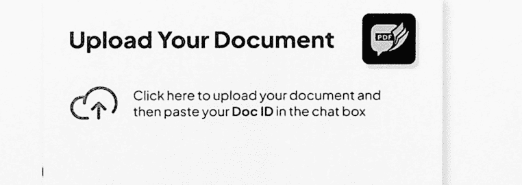

图 2-2 AskYourPDF 读取 PDF（示例）

文件上传后系统会返回一个唯一的文档编号，例如 doc_id: 44967331-fc66-4497-bd2d-092e992f6395。随后在 ChatGPT 内部唤起 AskYourPDF，即可下指令让模型对该篇文献进行解读。相比独立站点的 ChatDOC 与 ChatPDF，插件方案更贴近 ChatGPT 原生体验，操作更顺手。需要留意的是，ChatPDF 与 ChatDOC 均设有每日免费额度，想解除限制需要付费，比如 ChatPDF 的订阅价是 5 美元/月。

本文梳理了论文写作中常用的 3 套与 ChatGPT 相关的工具。随着技术迭代，后续还会出现更多科研辅助产品。为帮助读者跟进最新动向，我们会在本书官方微信公众号 ID：AI 写作指南 上持续推送信息，助力写作水平提升。

### 本章小结

支撑论文创作的 3 种 AI 工具：

- 1. GPT-4；
- 2. 新版必应对话；
- 3. CHATPDF、CHATDOC 以及 AskYourPDF 插件。

# 第三章 做选题

人工智能已经成为当下科研领域的关键力量，既带来想象空间，也带来新的判断难题。在学术研究里，如何借助人工智能完成选题，是一个值得系统讨论的话题。本章演示一种基于 ChatGPT 的选题流程，并对其优劣做出分析。“科学不仅是知识累积，更是一种思维习惯。”因此不能盲目依赖模型，必须结合自身创造力与批判性思考，才能产出有价值的研究。

选题决定了一篇文章能走多远，好题目是好论文的前提，尤其在社科写作中更为关键。但现实里很多同学正好倒置，把精力都放在成文上，对题目草草带过，随意定一个标题就开始写；也有同学根本提不出方向。根源都在于文献阅读不足。

有质量的选题都建立在既有文献之上。只要大量阅读并反复琢磨，灵感会自然涌现。为什么很多人不愿读文献？因为这是一件极耗脑力的苦活，尤其刚进入新领域时，单篇英文论文的信息抽取可能要花好几天。

如今 ChatGPT 普及后，这类重复劳动可以交由 AI 分担。本章从文献搜索、选题启发、选题判断三个层面说明如何利用 ChatGPT 做选题。

## 一、文献检索

首先打开 Bing 新版对话界面，示例见图 3-1。建议把对话模式调为“精确”，在新主题中直接输入需求即可。

检索时使用中文，返回的主要是中文文献；使用英文，则检索范围转向英文文献。

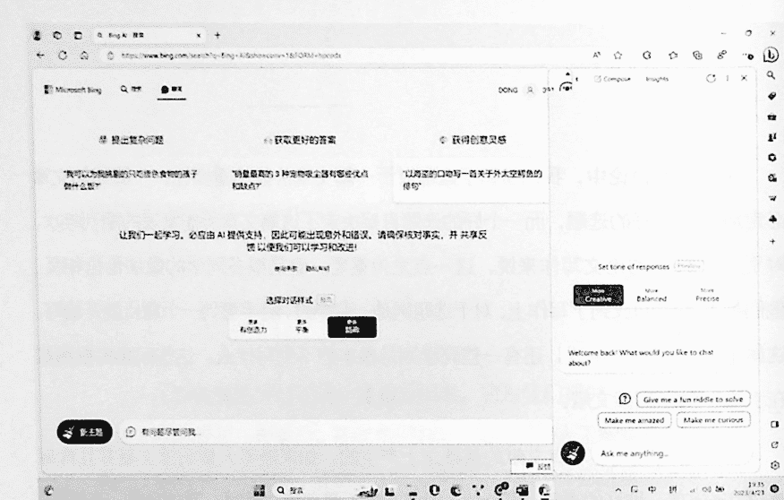

图 3-1 新版必应对话界面（示例）

比如要写一篇关于电子游戏对老年人心理健康影响的文章，需要 AI 帮忙查找该方向的最新文献，可在对话框这样提问。

> 示例输入 我想写一篇关于玩电子游戏对老年人心理健康影响效应的文章，请你帮我在百度学术上查找这个领域最新的文献。

prompt I would like to write an article about the effect of playing video games on the mental health of older adults, please help me find the latest literature on Google Scholar.

要注意，使用中文提问时，新版必应无法在谷歌学术完成最新文献的检索，改用英文提问则可以。如图 3-2、图 3-3 所示，输入语言必须与搜索引擎匹配，否则结果会偏差。最好明确标注使用的学术搜索引擎，否则必应容易只返回非学术网站的内容。


图 3-2 新版必应英文检索文献（示例）

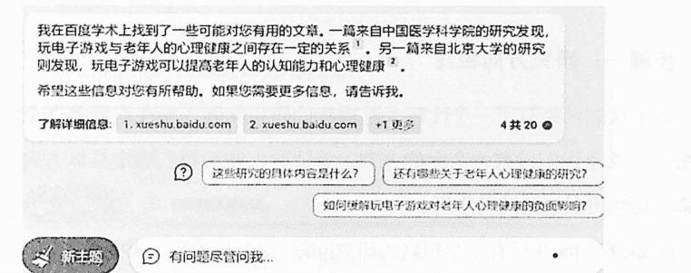

图 3-3 新版必应中文检索文献（示例）

实际使用能看出，必应的文献检索能力有限。我们限定了老年、游戏、心理健康，返回结果里却出现了青少年人群的文献。因此使用必应检索文献时必须人工复核，结果未必精准。

当然可以更换提问词来缩小范围，如下图所示。

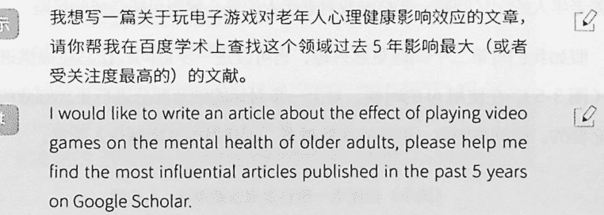

总体而言，还是建议以学术引擎为主，如谷歌学术、中国知网、Web of Science 等，再由人工定位高影响力文献。现阶段 ChatGPT 产品在文献检索上只能作为参考，人工检索的工作暂时无法被取代。

## 二、选题启发

### 步骤一、研究方向粗筛

如果手上只有宽泛模糊的研究问题，需要细化，或仅有一个大方向想让 AI 帮忙拆解，Bing 新版对话就能起到抛砖引玉的作用。

比如目前只有个粗略想法，这时可把对话样式切换为“有创造力”，输入如下示例。

> 示例输入 我想写一篇关于玩电子游戏对老年人心理健康影响的文章，你能帮我找出这个主题的几个具体问题吗？

prompt I would like to write an article about the effect of playing video games on the mental health of older adults, can you help me find several specific questions on this topic?

必应会列出若干可能的细分方向，如图 3-4 所示，例如：①游戏或许能改善老年人的记忆表现；②游戏对老年人身心健康可能带来的风险。

若对第二个方向更感兴趣，还可以继续追问，获取更进一步的信息，如图 3-5 所示。在使用 AI 时，对上一轮回答的关键细节做持续追问非常重要，追问越细、次数越多，得到的答案越有价值。

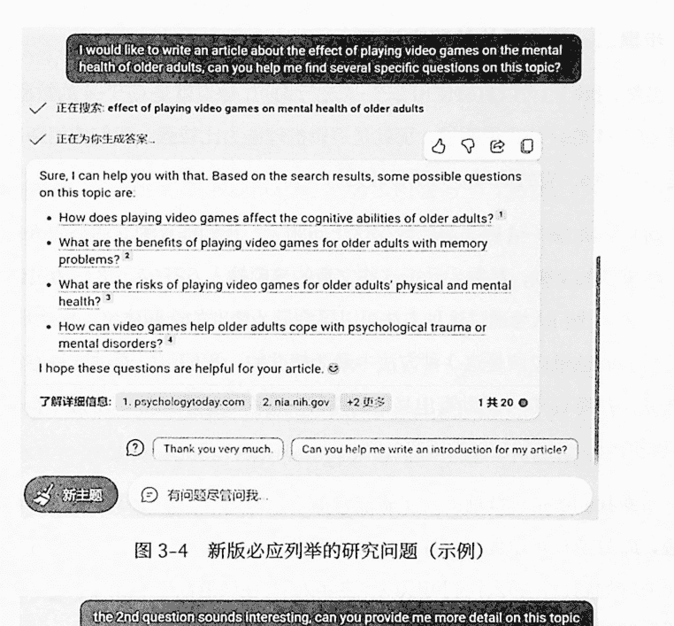

图 3-4 新版必应列举的研究问题（示例）

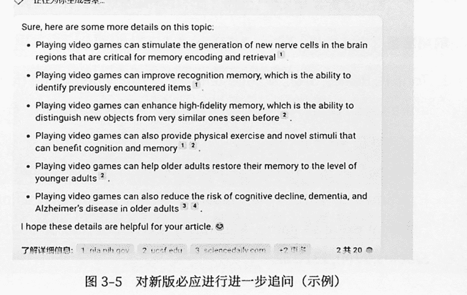

图 3-5 对新版必应进行进一步追问（示例）

### 步骤二、确定具体的研究问题

也可以直接向 GPT-4 提问，缺点是 GPT-4 没有联网，数据时效性受限。但它的优势在于逻辑推理更强。我们在必应上调用的是 GPT-3.5，推理能力明显弱一些。

如何弥补 GPT-4 缺少最新数据的问题？推荐做法是先人工检索最新最重要的文献，手动把摘要贴给 GPT-4，再让它基于这些材料给出选题建议。我们认为这种混合方式能得到最精准的选题。我们可以用它锁定最终研究问题，并借助 GPT-4 辅助拟定题目。前面的粗筛阶段无需人工查文献，只能得到比较宽泛的方向。

下面延续前面的例子进行演示。假设我们对图 3-5 中的第四个方向感兴趣，即游戏可促进锻炼并改善老年人的认知与记忆，并想围绕此定题，那么可以用“老年人”“在线游戏”“电子游戏”“认知与记忆水平”“锻炼身体”作为关键词在谷歌学术中检索。

经过筛选，我们锁定了以下 5 篇文献。

### 前期准备

1. Toril, P., Reales, J. M., & Ballesteros, S. (2014). Video game training enhances cognition of older adults: A meta-analytic study. Psychology and Aging, 29(3), 706-716.

2. Pyae, A., Liukkonen, T. N., Saarenpää, T., Luimula, M., Granholm, P., & Smed, J. (2016). When Japanese elderly people play a finnish physical exercise game: A usability study. Journal of Usability Studies, 11(4), 131-152.

3. Cota, T. T., Ishitani, L., & Vieira Jr, N. (2015). Mobile game design for the elderly: A study with focus on the motivation to play. Computers in Human Behavior, 51, 96-105.

4. Lagana, L., Sosa, G., Nakhla, M. Z., & Toscano, D. (2018). Cognitive gains from video game use in older age: A review of the literature corroborating them. International Journal of Family & Community Medicine, 2(1), 11-17.

5. Basak, C., Boot, W. R., Voss, M. W., & Kramer, A. F. (2008). Can training in a real-time strategy video game attenuate cognitive decline in older adults? Psychology and Aging, 23(4), 765-777.

这 5 篇文献并非随意挑选，需要研究者在泛读摘要和结果后做出判断。选定这 5 篇作为基础资料后，下一步要提炼每篇的研究方法、核心结论与不足。

直接拿摘要来用是否可行？不建议。很多摘要并未提及研究的缺陷，因此需要重新撰写总结。

这一步可以用 CHATPDF 完成。上传文献后，可以像下面这样提问。

> 示例输入 你能否总结一下这个 PDF 中文章的方法、主要发现和不足？

prompt Can you summarize the method, main finding, and limitation of this article in this pdf?

CHATPDF 会把方法、结论和局限都梳理出来，见图 3-6。

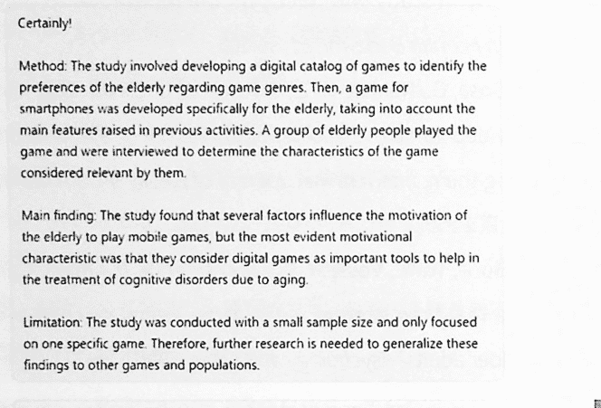

图 3-6 CHATPDF 总结文献（示例）

用同样的方式把 5 篇文献逐一总结，并汇总在一起。

### 前期准备

STUDY 1: Pyae et al. (2016) found that the Finnish Skiing Game was a suitable game for elderly Japanese people because of its simple interface, easy game action, and friendly game context. The participants were interested in the gameplay and agreed that digital games could be an effective way of exercising. The limitations of this study include...

STUDY 5: This meta-analytic study (Toril et al., 2014) analyzed individual studies published on the topic of video game training and cognitive functioning in healthy older adults since 1986. A total of 20 studies were included in the analysis, comprising 474 trained older adults and 439 control participants. Funnel plots were used to assess publication bias. The overall meta-analysis revealed that ...

收集完所有相关文献的精炼总结后，就能把材料交给 GPT-4，让它基于现有文献生成最有趣或实践价值最高的研究问题供参考。

> 示例输入 你现在是一名专注于研究老年人玩视频游戏影响的教授。你的一般研究问题是，玩视频游戏是否可以增强老年人的身体锻炼，从而进一步提高他们的认知能力。我在谷歌学术搜索了相关的文章，找到了 5 篇最相关的文章，这是它们的总结。

> “STUDY 1

> ...

> STUDY 5”

> 根据你的知识和这 5 篇论文，你能否让我的问题更具体、更有趣，并且对老年人的生活更有价值？

> prompt You are now a professor focusing on the effect of elder people playing video games. Your general question is to study whether playing video games can improve the exercises of elder people and further improve their cognitive ability. I searched google scholar and found the five most relevant articles, here are their summaries,

> “STUDY 1

> ...

> STUDY 5”

> Based on your knowledge and these five papers, can you make my questions more specific, more interesting, and more valuable for elder people's life?

ChatGPT 给出的反馈如下。

什么类型的电子游戏对提高老年人的认知能力最有效，这些游戏在不同文化和地理区域之间有何不同的？

不同的视频游戏持续时间和频率如何影响在老年人中观察到的认知益处，以及最大化认知改善的最佳游戏时长是多少？

视频游戏的社交方面，例如多人互动或在线社区，如何影响老年玩家的动机和认知益处？

老年人从视频游戏中获得的认知益处在多大程度上转移到现实世界的任务和日常生活活动中？

视频游戏干预如何根据老年人的个人认知和身体能力进行调整，以最大限度地提高参与度和有效性，同时最大限度地减少潜在的负面影响，如沮丧或过度劳累？

# 第三章 做选题

基于视频游戏的认知训练是否有助于延缓与年龄相关的认知障碍（如阿尔茨海默病或其他形式的痴呆症）的发作或减缓其进展？

视频游戏开发人员如何结合无障碍功能和以用户为中心的设计原则来创建对不同技术水平的老年人更具吸引力和有益的游戏？

GPT-4 给出的题目比必应更细致，细节更丰富，且更具可操作性。至此，研究的具体问题基本可以敲定。例如对第三个问题感兴趣，就可以进一步让 GPT-4 帮忙生成几个供定题参考的标题。

示例输入 我对第三个问题感兴趣。你能为我的论文构思几个标题吗？

ChatGPT 反馈的回答如下。

心灵相通：探讨社交互动在老年人视频游戏及认知能力提升中的作用

建立联系，增强大脑：探索老年人视频游戏中的社交层面对认知提高的影响

游戏的力量：视频游戏中的社交参与作为老年人认知益处的催化剂

共同老去：调查多人视频游戏对老年人认知表现和社会福祉的影响

数字社交网络：通过视频游戏互动提高老年人认知能力和社会联系

在线社区与衰老大脑：社交视频游戏在老年玩家认知健康和社会支持中的作用

跨越屏幕：社交因素与老年人视频游戏认知收益之间的相互作用

到目前为止，我们手上已经有几组看上去不错、可以拿来当参考的研究题目，但千万别急着敲定最终版本。更稳妥的做法是先把所有数据分析完、把结果呈现方式想清楚、把整篇论文的研究主线梳理出来之后，再结合实际的分析结果去对照这些备选题目，提炼出一个最贴合全文发现、也最能体现论述脉络的题目。

三、如何判断选题值不值得做

我们承认，像 ChatGPT 这样的生成式 AI 可以在选题阶段提供辅助，但它始终只是辅助角色，而不是决策者。

真正想在一个细分领域挑到好题目，海量的文献阅读是绕不开的基础。前面为了演示方便只摆了 5 篇文献做例子，真实写作中仅凭 5 篇是远远不够的，设计一个扎实的研究，往往要过目上百篇、甚至几百篇的文献。不少人会问，能不能用 CHATPDF 快速把一篇英文文献的核心信息抓出来？当然可以，工具确实能把阅读速度拉快，但它替代不了研究者的思考，也替代不了对细节的精读。CHATPDF 更适合做快速泛读，借助它可以在很短时间内扫遍上百篇文献，迅速进入一个陌生领域，但它不可能完全取代精读。对于真正关键的文献，还是要反复通读、做详细笔记，才能把领域的脉络吃透。随着理解层级不断加深，你才能更准确地分辨 GPT-4 给出的选项里哪些有价值，也能在它的参考答案之上发展出更成熟的解决方案。

相较理工科，社会科学的选题难度往往更高，因为很多社会科学议题很难与生产生活产生直接的落地应用，普遍被认为是“常识性”问题。基于长期积累，我们归纳出三条可操作的选题价值判断标准。

- 第一类是能够直接服务于生产实践的题目。例如，如何借助人工智能工具提升新闻行业的生产效率。
- 第二类是研究结论具有反常识特征的题目。比如沉默的螺旋理论指出，个体因担心观点与主流相悖而选择沉默，反而让少数声音在公共舆论中被放大，形成看似主导的虚假舆论，这与“多数人的意见会自然成为舆论主流”的直觉相悖。
- 第三类是能够推动理论发展的题目。这类选题占整体的 90% 以上，学术价值相对有限但可发表性强，目前发表在 SSCI 期刊上的大部分论文都属于此列，甚至顶级期刊也不例外。前两类属于可遇不可求的机会，一旦发现务必抓住，也许下一个被灵感击中的就是你。

本章结束时想强调一句话：利用 AI，但不依赖 AI；受 AI 启发，但要保留自己的思想；最终决策自己负责。最理想的选题绝不会是 AI 直接生成的，而极有可能是在 AI 与资深研究者经验结合的碰撞中产生的。

NOTES

本章小结

- 1. 当前 AI 对中文的理解比较模糊，容易出现偏差，输入语言最好与所用搜索引擎保持一致。
- 2. 用 AI 检索文献时必须人工复核，AI 给出的结果不一定精准。
- 3. 手工检索在现阶段仍无法被 AI 取代。
- 4. 追问得越多，得到的答案越可采纳。
- 5. AI 能提升效率，但不能替代思考。

第四章

引言与理论框架的构建

学术写作中如何巧妙地借助人工智能来搭建引言和理论框架，仍是一个有待开拓的领域。本章将介绍一种以 ChatGPT 为载体的引言与理论框架构建思路。史蒂文·斯皮尔伯格曾说：“灵魂的存在无法被想象或言说，更无法被任何算法所创造。”我们非常认同这一观点。ChatGPT 再智能，也无法为文章注入灵魂。因此下面介绍的方法是：作者掌控文章的核心灵魂，ChatGPT 负责填充与完善细节。这种做法既尊重了创作灵感的来源，又充分发挥了人工智能的效率优势。

上一章讲了如何借助 ChatGPT 进行选题，它可以扮演导师角色提供参考。下面正式进入论文写作环节，看看 ChatGPT 在这里能发挥多大作用。

一、引言要怎么写

社会科学论文的正文通常由引言、方法、结果、讨论四大部分构成，再加上摘要、参考文献和图表。写作难度大致是讨论 > 引言 > 方法 > 结果。若按常规顺序从引言起笔，往往会一开始就卡在难度最高处，心态容易受影响。类比数学高考卷子，若从难题入手容易被拖住，写作也应先易后难。更实用的策略是从中间向两边推进：先写结果和方法并做出图表，再回头写引言，最后完成讨论，把各部分逐一击破后再整体通读。当然这是个人经验，若你有自己的习惯亦可沿用。为方便阅读，本书仍按常规顺序讲解，方法与结果部分安排在下一章，本章聚焦引言写作。

引言包含研究背景、研究问题、理论框架和研究目的。研究背景要简要介绍领域的历史脉络、既有研究、现状以及尚未解决的难题，并由此引出研究问题的合理性。这一部分多出现在文章的前两段，通常从宏大的社会现象或现实问题切入，再逐步收束到具体的学术议题，并交代该议题在现有文献中的解决程度与研究空白，即哪些已被回答、哪些仍待回答。

讲清背景、提出问题之后，就要搭建理论框架。理论框架可视为一篇社会科学论文的灵魂，好的框架能让整篇文章提升一个层次。审稿人反复强调的也是这一点：清晰明确的理论框架有助于界定研究问题、提出假设、选择研究方法与分析数据，同时能把研究发现置于更宽广的理论语境中，加深解释力。阅读审稿意见时最致命也最常见的一条就是：缺乏理论框架或框架不匹配。很多人不明白什么是理论框架。直白地说，写社会科学论文就像讲故事，好的故事有一条贯穿始终的主线，把人物、事件、冲突串联起来。论文也需要这样一条主线，它可以用一句话概括，把研究问题、数据与结论紧密连起来，形成前后呼应的逻辑。与讲故事不同的是，社会科学的主线往往不是凭空创造，而是承接前人的脉络在此基础上发展。

二、理论框架如何构建

理论框架的选择本身就是一件困难的事。能否借助 ChatGPT 来建构与筛选？下面提供几种可操作的思路，供参考。

1. 如何用 AI 定位关键文献

确定研究问题后，下笔前需要先收集领域文献，尤其是关键文献。文献搜集是件苦活累活，文献浩如烟海，即使借助搜索引擎，从中筛选出所需文献也往往需要一周以上。我们需要反复检索 Google 学术、Web of Science 及相关期刊。那么 ChatGPT 能否完成这项工作？答案是目前还不能。但我们提供了一个替代工具 ELICIT，如图 4-1 所示，它是一款科研 AI 工具，只需把问题输入对话框即可自动定位关键文献。我们试用过多个研究问题，其定位的准确度相对较高，可作为高效的文献检索辅助。

以“在线游戏对盲人和视力受损人士的心理健康有什么影响？”或英文表述 “What is the effect of online gaming on mental health for blind and vision-impaired people?” 为例，输入后等待 3 至 5 分钟，系统会返回相关文献。左侧实线框内是基于 4 篇文献的简要综述，右侧虚线框列出聚焦该问题的文献。点击其中一篇，会弹出对话框，如图 4-3 所示。右侧是该文摘要，左侧是互动区，可就该文提出任何问题，ELICIT 会基于原文信息作答，功能与 CHATPDF 类似。下拉左侧对话框可见图 4-4 的交互提问界面。此外，它还能展示其他文献对该文的引用，这对撰写综述或讨论非常有用。

此外，ELICIT 还提供文献特征提取工具。点击图 4-2 左侧“寻找论文信息”，会弹出包含样本特征、结果特征、方法学特征等在内的文章属性面板，如图 4-5。

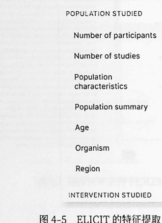

图 4-5 ELICIT 的特征提取（示例）

例如选择“局限性”特征，主界面右侧会生成一栏，汇总所有文章的局限性，这对批量阅读与撰写文献综述极有帮助。尽管 ELICIT 的自动定位与特征提取很有用，但它也有两个短板：一是响应较慢，通常需要 3-5 分钟，影响使用体验。若对速度要求高，可改用 CHATPDF；二是主要面向英文文献，对中文文献支持有限。另外，即便借助 ELICIT 定位关键文献，若想获得全面资料，仍建议手动在 Google 学术、中国知网等学术引擎中补充检索。

2. ChatGPT 的专业化训练

一般而言，ChatGPT 在一个小领域吸收的信息越多，表现越好。理论上只需把所有相关文献喂给它就能实现专业化训练。实践中需要考虑两个问题：输入多少篇文献比较合适？各文献权重是否相同？我们认为，核心参考文献不可或缺且应赋予较高权重，其他文献可多但权重宜低。下面以一篇文章为例演示训练过程，并与未训练版本做对比。

案例论文研究盲人玩游戏的动机，以及电子游戏对其心理健康和社会性指标的影响。因 ChatGPT 在文献检索上的局限，我们手动在 Google 学术、Web of Science 等平台收集了 40 篇相关文献。

步骤一：用 CHATPDF 汇总文献
从中筛选出最重要的 4 篇，先用 CHATPDF 做提炼。需注意，检索与筛选全部由人工完成。完成后再把总结输入 CHATPDF，提示词如下：

文字提示：请总结这篇研究论文的主要发现和意义。分析该论文的优缺点，特别是方法部分。描述该研究的理论框架及其与研究发现的关系。列出该研究的限制并提出未来研究方向的建议。
prompt: Please identify the key findings and implications of this research paper. Analyze the strengths and weaknesses of this paper, especially for the method part. Describe the theoretical framework of this study and how it relates to the finding. List the limitations of the study and suggestions for future research direction.

按此指令，CHATPDF 可提取 4 篇文献的核心信息。

步骤二：将 ChatGPT 设置为专家
把上述信息再输入 ChatGPT，并设定角色。提示如下：

文字提示 你是一位社会科学教授，专注于研究盲人或视力受损人士在线玩电子游戏的社会或心理影响。
prompt You are a professor in social science focusing on the social or psychological effects of playing video games online for blind or visually impaired people.

图 4-6 显示了 ChatGPT 的回答，可以看到它把该领域议题归纳为 5 类主题，说明专家角色设定已生效。

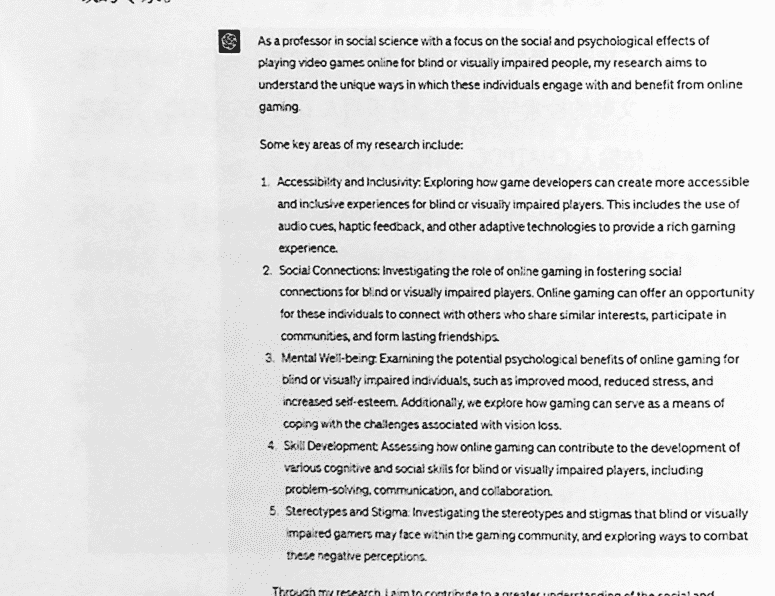

图 4-6 ChatGPT 的回答（示例）

步骤三：发送最新文献
随后可把最新文献的总结发给 ChatGPT，提示如下：

文字提示
以下是该领域最新发表的 4 篇文献的总结。
“STUDY 1
...
STUDY 4”
你能简单总结一下这 4 篇论文吗？
prompt
Here is the summary of 4 recently published papers in this area.
“STUDY 1
...
STUDY 4”
Can you briefly summarize these 4 papers?

若 ChatGPT 能做出简述，说明信息读取成功。
有人会问，为什么不直接把整篇文章上传给 GPT-4？GPT-4 确实支持 PDF 上传，可使用 AskYourPDF 插件逐篇上传后按 CHATPDF 提示词总结，如图 4-7 所示。其缺点是每次只能处理一篇，处理完即时总结。

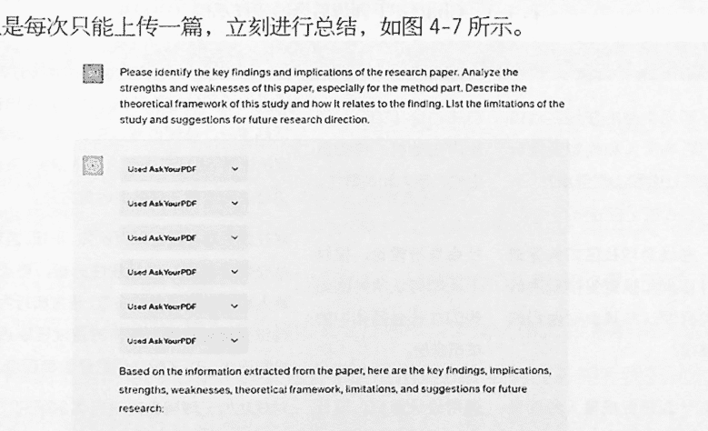

步骤四：用 ChatGPT 设计选题
读取信息后，可让 ChatGPT 协助设计选题，提示如下：

文字提示
根据这 4 篇论文的局限性和你在这个领域的知识，请提供 3-5 个最有价值的下一步研究问题。请提供回答这些问题所使用的理论框架和研究方法。请以表格形式展示答案，包括 3 列：研究问题描述、理论框架描述和研究方法描述。
prompt

把生成式大模型当作小众学术领域的协作伙伴，落点其实在三处：文献怎么喂、写作怎么站位、以及它对质性研究的改造。

先从选题说起。只喂了四篇核心文献，训练后的模型给出的问题密度和专业度就明显拉开。被细化的研究方向有五个：

① 不同类型网络游戏对视障群体的社会与心理福祉会产生怎样的差异。理论抓手用自决理论，聚焦自主、胜任、联结三类内在动机，研究设计走纵向混合路线，用问卷、深度访谈与行为观察配合。

② 网络游戏社群如何营造包容氛围并削弱歧视。理论用社会认同，解释归属感与偏见的形成。方法上对论坛、游戏内聊天、社媒小组做质性解读，再辅以焦点讨论与个体访谈，听取视障者与视力正常玩家的双向经验。

③ 促成游戏真正可用的关键设计要素是什么。理论底座是通用设计，研究用案例剖析成功的无障碍作品，数据来自开发者访谈、使用者反馈和专家评鉴。

④ 文化、社会、经济条件在不同国家如何塑造游戏体验与可及性。框架用交集性，揭示多重身份与不平等叠加效应。方法采用跨文化混合研究，通过跨国问卷、访谈与小组讨论比较差异。

⑤ 基于游戏的干预能否改善特定认知、社会或心理结果。理论依托认知与社会学习，强调观察、模仿与强化。做法是开发针对问题解决、沟通、自尊等结果的游戏干预，用前测后测对照设计收集标准化指标、自我报告与质性资料进行验证。

反观未经过训练的输出，题目基本停留在“网络游戏对心理福祉有何作用”“有何社会情感益处”“对人际关系有何影响”，理论只点到社会认知、自决、社交交换，方法写成调查、访谈、混合，粗糙而且操作空间很小。

差别不在文献堆砌。低质量、低相关性的论文塞进去只会干扰生成。真正有效的是人工筛选，把近三到五年里代表性强的文献挑出来喂入模型。相关性高、质量高的文献，数量越多迁移越明显。训练完成后模型会为不同问题匹配不同理论，作者再按自己的终究问题挑选框架搭建。

弄清选题，再看写作姿势。网上流行的“一键出提纲、一键写全文”教程看似省事，实际天花板低，也触及学术规范风险。引言必须由人主导，人工占比最好不低于八成。提纲不能交出去，先通读二三十篇文献，吃透脉络再动笔。骨架搭好后，大模型可以用来核对概念、解释理论、补足细节，参考式写作可以看，但不能直接照搬。

以“网络游戏对盲人群体的社会心理效应”为例，人手工搭建的引言漏斗很清晰：盲人玩家在扩大，游戏成为娱乐入口，问题重要性由此展开；先交代现状，现有无障碍技术产品有限，声音辅助与画面增强两类玩法并存；再梳理文献，普通人群研究结论冲突，视障群体研究多见正向效应如学习增进、自主感、娱乐质量，也存在挫败感，动机在效应产生中起中介作用；随后引入社会认同解释视障者通过游戏结识同类、建立身份认同；最后明确两点研究目的，构建动机测量工具、检验动机对福祉的效应。

让模型生成同类提纲，结果是背景、动机、心理福祉、研究目标、研究意义的流水线结构，格式化严重，理论衔接生硬，缺乏巧思，顶多本科中段水平。骨架必须人来立，主干也要逐字写。AI的角色是把已有灵魂、骨架、肌肉的稿子从256的清晰度放大到1028，把血肉补齐。自下而上的全自动生产会让人变懒，也会丢掉灵魂。

这一章的要点可以归纳为：大模型能扮演导师角色辅助选题，ELICIT类工具帮助定位关键文献，用高质量文献训练模型可做领域专属写作，自上而下的配合才是可持续的学术用法。

第五章 对质性研究方法的变革

“这种人工智能技术出现的重大历史意义，不亚于互联网和个人电脑的诞生。”——微软创始人，比尔·盖茨

社会科学分质性与量化两大类，质性工作的核心是文本的整理与分析。AIGC正把这个环节从半自动化推向全自动化，访谈、焦点小组、内容分析、扎根理论、文本分析都在被重塑。

先看访谈法。访谈是通过单人对话收集资料，可结构化、半结构化或非结构化。完整流程十步：明确目的与问题、选类型、设计提纲、确定对象、安排时间、执行、转录、分析、呈现、反思评估。其中设计问题、模拟访谈、排期、整理记录、数据分析、结果呈现六项都能获得AI助力。

以“网络游戏对视障者心理福祉的影响”为例，先让模型生成结构化访谈大纲，再细化开场白与具体提问。确认问题后，用模拟访谈做压力测试。为角色设定地点、职业、性别、年龄等具体标签，模拟效果会很接近真实情境。

假如你是一名在按摩店工作的盲人师傅，每天工作 8 小时，社交圈子主要是周围的人。我现在要花半小时问你一些问题。你会用手机打游戏吗？每天打多长时间？你为什么要玩这个游戏呢？

在模拟访谈中，你需要为角色设定非常具体的特征，这些特征一般包括地点、职业、性别、年龄等。这个模拟结果与真实访谈结果非常相似。模拟人物甚至提到了玩的主要是音频游戏，玩游戏的两个主要目的一个是放松，另一个是认识新朋友。

这和我们访谈的结果几乎一致。在开展真实访谈之前，我们可以通过进行模拟访谈的方式来改进访谈问题。

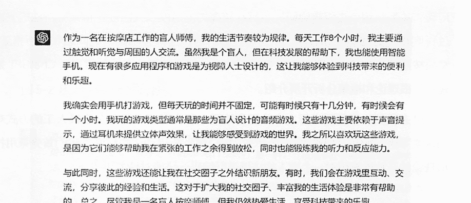
作为一名在按摩店工作的盲人师傅，我的生活节奏较为规律。每天工作8个小时，我主要通过触觉和听觉与周围的人交流。虽然我是个盲人，但在科技发展的帮助下，我也能使用智能手机。现在有很多应用程序和游戏是为视障人士设计的，这让我能够体验到科技带来的便利和乐趣。

我确实会用手机打游戏，但每天玩的时间并不固定，可能有时候只有十几分钟，有时候会有一个小时。我玩的游戏类型通常是那些为盲人设计的音频游戏。这些游戏主要依赖于声音提示，通过耳机来提供立体声效果，让我能够感受到游戏的世界。我之所以喜欢玩这些游戏，是因为它们能够帮助我在紧张的工作之余得到放松，同时也能锻炼我的听力和反应能力。

与此同时，这些游戏还能让我在社交圈子之外结识新朋友。有时，我们会在游戏里互动、交流，分享彼此的经验和生活，这对于扩大我的社交圈子、丰富我的生活体验是非常有帮助的。总之，尽管我是一名盲人按摩师傅，但我仍然热爱生活，享受科技带来的乐趣。
[/PRE0]

拿到文本资料后，分析路径主要有两种。扎根理论是从资料中扎根生成新理论，强调深度理解与解释，编码分开放式、轴向、选择性，过程迭代反复。框架分析更偏向组织与分类，用既有理论框架指导分析，步骤包括熟悉、建框架、索引、图表化、映射、解释，重在系统性和结构化处理。

AI不会替代研究者判断，但它能把质性研究的效率和颗粒度推到新的水平。

在质性调研里，Grounded Theory 和 Framework Analysis 走的是两条完全不同的路线。

前者像在野外探路，每走一步概念、分类、关联都在动态调整，研究者要不断试错、回旋，创造力与灵活性是基本功。后者更像按蓝图施工，问题意识与分析框架先行，后续资料进来后按既定流程与固定顺序处理，整体更稳定可预期。

把 ChatGPT 拉进来做助理，两条路线都能提速，尤其在文本标注环节。过去对话记录出来全靠人工逐句标码，现在可以借助对话式模型实现半自动化。下面以视障玩家玩互动娱乐的对话为例，演示一套可复制的操作思路。

先把模型角色钉死。对话稿来自语音转写，错别字、口语冗余、排版混乱都很常见。第一步给模型一个身份定位：你是一名社会科学研究者，擅长访谈与 Grounded Theory，精通对对话稿做标注，明白吗？模型确认后才开始喂料。

喂料必须切片。ChatGPT 一次能稳定处理的输入大约 3 500 字，超了就要分段。把第一位视障受访者关于互动娱乐的对话拆成两块，先确认是否收到第一块，再让它先做概括。模型会提炼出结识某位老玩家、长期玩两年左右的地下城类互动产品、手机端操作、主要为了放松消遣等要点。

第二块补上声音互动产品的体验。对话者追问重复感、操作逻辑、人际互动变化等。

```
This is the second part of the interview text with blind person B. Have you received it?
“...”
```
是的，我收到了这段盲人A访谈文本的第二部分。在这一部分，访谈者询问了盲人A关于他玩声音游戏的经验，以及游戏如何影响他的生活。盲人A表示，虽然这个游戏很重复，但它确实帮助他结识了很多朋友。在游戏中，他可以通过语音提示进行操作，并通过调整语速来提高游戏体验。他谈到了这个游戏的一些有趣功能，例如通过吹气来提高攻击力。虽然这款游戏不是特别复杂，但盲人A表示，它在一定程度上满足了他的需求。

盲人A还提到了他所了解的其他一些适用于盲人的游戏，例如《三国名将》《鸿蒙天书》《风云再起》和《青秀江湖》。他表示，《清流江湖》稍微有趣一些，但其他游戏可能需要在吸引力和完善性方面进行改进。

此外，盲人A表示自己喜欢探索新事物，喜欢阅读关于历史、军事和政治等方面的书籍。他认为，接受教育程度较高的盲人更倾向于对这些领域感兴趣。

收到两段后进入 Open Coding。指令是把每个标签与原文出处逐条对照，整理成清单。第一次产出会得到娱乐形态、操作逻辑、语速的微调、生活层面的变化、适配清单、吹气机制等若干初步标签。若觉得颗粒度不够，可追问再细化一次，模型会补充出受众规模、内容重复性、声音设计、指引方式、人际互动效果、心理层面感受等更细节点。

这里有几个踩坑经验。有人想把所有对话一次性倒进去让模型一次性标完，不建议。首先上下文窗口有限，后面内容会挤掉前面信息；其次脏数据批量输入会让错误率飙升；再者 GPT-4 的使用额度有限，文本一多容易被迫降到 GPT-3.5。经多次对比，GPT-3.5 的标注准确度明显低于 GPT-4。

比较稳妥的做法是控量。单人对话在 1 000 字以内时，可同时放 4~5 个受访者一起处理；总体上单次输入最好控制在 1 万字以内，分批导入。批量指令可以这样设计：现在你收到了视障玩家甲、乙、丙的对话记录，请对三人的对话做 Open Coding，并把每个标签与文中具体语句出处一一对应，一个标签可对应多个语句，整理成清单，清单包含标签、语句出处、该标签对应的出处数量、所属受访者四个字段。

如果对话很长，宁可一人一次、过长再拆分。想快速核对节点也可以直接让模型列出全部标签与对应的原句。

标签有了，下一步是 Axial Coding。先让模型对比三人标签的共性与差异，找出共享议题与个性议题。共享层面通常包括互动娱乐对生活的整体作用、人际互动与友情的建构、以及产品内部的挑战与应对。个性层面则会体现个人侧重：甲可能突出克服挑战与自我效能，乙可能偏向身份探索，丙可能更强调竞争与人际互动。

随后进行归类。指令可以要求把所有节点归到合适的议题下，允许跨议题归属，一个议题下再细分子议题。例如互动体验可拆为娱乐性与挑战性，人际维度可拆为结识、维持、情感支持等。模型会给出议题树，研究者再人工校对、合并、升维。

总结下来，ChatGPT 适合做重复性高的初筛与分拣，但质性研究的审慎与理论敏感度仍要研究者把控。设定好角色、分批喂料、迭代细化标注、最后人工做轴向整合，这套组合拳能让 Grounded Theory 和 Framework Analysis 都跑得更快、更稳。

在质性研究里，ChatGPT已经可以当半个研究助理用了。下面这套实战笔记，把扎根理论和框架分析两条线拆开讲，最关键的编码、聚类、选择性编码、框架调整，全用盲人在线游戏访谈这个案例走一遍。

先看轴向编码的片段。素材里提到游戏复杂性和挑战性被归在A2，游戏活动的挑战性在C3，游戏重复带来无聊在C5。社交线则集中在友谊与支持，A4、B5以及C10、C11、C14、C15都指向游戏里的朋友关系与陪伴。图5-9就是ChatGPT产出的轴向编码示例。

在这些编码之上，模型自行提炼出一级主题共六个：游戏体验、社交体验、自我认知、游戏对生活的冲击、游戏与现实的交叉、对盲人社群的认知与感受，并在此之上给出二级分类，用文本图的方式把一级和二级的关系拉开。对应的提问是请用文本图表呈现这六类主题和具体编码的对应关系。

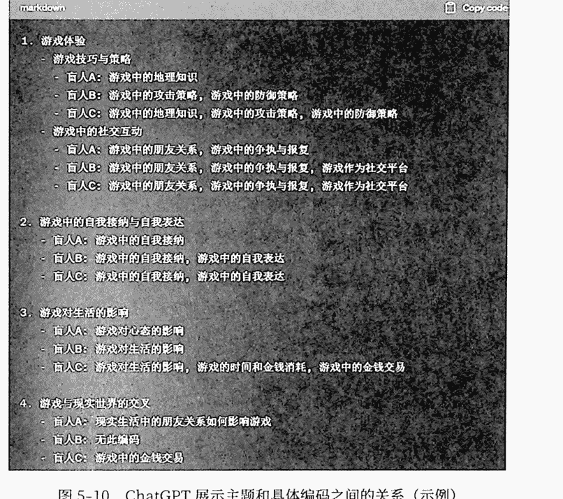

图5-10展示了主题与编码的连线图。对人工编码做对比会发现，ChatGPT的归类更全面、更客观，而人工编码质量波动很大，平均水平很难追上模型。

有同学会问机器挖的主题会不会漏？怎么挖得更全？可以让ChatGPT做概念聚类来补充。聚类结果可以作为后续归类和选择性编码的参考，有时甚至会冒出新的类别。这里要区分一下，统计软件的聚类是基于距离或相似度对数据点做数学分组，而ChatGPT的聚类是基于它已做过的编码主题的语义相似与差异做概念归并。

一句可直接用的提示是：请把盲人A、B、C访谈的所有编码节点进行聚类。

注意一个细节，如果前面已经做过主题归纳，再聚类很容易得到高度相似的结果。想换一批视角，可以让它先忘掉之前的归纳：我要求你忘记你前面做过的主题归纳分析，利用盲人A、盲人B、盲人C的所有开放式编码，重新进行一次聚类。

多跑几次，对比差异。想要更大跨度的变化，最好新开对话，先重新做开放式编码再聚类。

### 选择性编码：锁定核心故事线

选择性编码是把已有的类别串起来，形成理论框架的核心步骤。研究者要先挑一个核心类别作为主线。

这里选定的主线是“在线游戏对盲人社交互动和心理健康的影响”。提示词是：现在的编码主题是在线游戏对盲人社交互动和心理健康的影响，你需要对盲人A、盲人B、盲人C的访谈记录进行选择性编码并生成表格。

图5-11是模型生成的对照表。盲人A的编码包括游戏中的朋友关系、游戏中的争执与报复、游戏中的自我接纳、游戏对心态的影响，分别附了原文引用；盲人B除了朋友关系、争执与报复，还出现了游戏作为社交平台、自我接纳、自我表达等节点。

### 框架分析：从既有框架出发

框架分析由里奇和斯彭塞1994年提出，常用在社会科学、公共政策和健康研究。它的逻辑和扎根理论相反，是先有理论框架再按框架编码，步骤包括熟悉资料、确定主题框架、索引数据、图表化、解释提炼。

本案例从第三步建立索引开始，先设定分析框架：

1. 在线游戏对盲人心理健康的效应
2. 在线游戏对盲人社会发展的价值
3. 盲人玩在线游戏的动机
4. 游戏动机与游戏效应之间的关系

实操对话分七步走。

第一步设定角色背景：你是一名社会科学学者，擅长使用访谈和框架分析，擅长对访谈文本进行编码，你明白吗？

第二步建立索引：现在我们要做一个框架分析，框架主题是在线游戏对盲人的心理健康的效应、在线游戏对盲人的社会发展的影响、盲人玩在线游戏的动机、在线游戏动机和游戏效应之间的关系，你需要结合这个分析框架对盲人A的访谈记录进行编码，建立索引数据。

第三步汇总：你能把盲人A、盲人B、盲人C的编码汇总吗？

第四步修正框架：你能根据盲人A、盲人B、盲人C的编码和分析中的发现，对原有主题框架进行调整，使其更加贴近实际情况吗？

模型给出的调整思路是把心理健康效应拆成正面如娱乐减压和负面如焦虑依赖；把社会发展影响拆成社交技能和社会融入；把动机细化为挑战性、社交性、平等竞争环境等吸引点；把动机与效应的关系改为探讨动机如何塑造游戏体验和结果。图5-12记录了这轮调整。

第五步进一步细化调整后的框架。

第六步做矩阵呈现。提示词是请把三位受访者的编码做成矩阵，受访者为行，框架主题为列，把每人在每个主题下的经历与观点填入对应格子。图5-13给出的示例用A1.1、A1.2等编码占位，表示盲人A在“心理健康效应”下的具体观点。

矩阵只给了编码编号，还需要追问：你能提供每个编码代表的内容吗？

第七步生成类属树叶图。提示词是请整合盲人A、B、C的编码索引，建立完整编码索引，并把编码索引生成树叶图，以层次结构文本图展示。

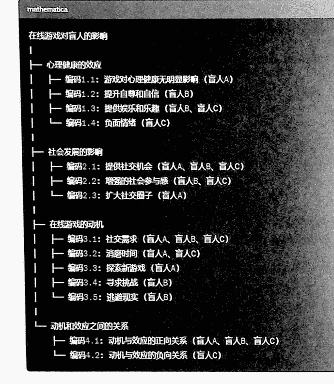

图5-14是模型生成的文本树图。通过扎根和框架两条线的对比可见，GPT-4在归纳和演绎两类任务上都能给出相当靠谱的结果，而同样的提示在GPT-3.5上错误率明显升高。

最后再看内容分析的应用。内容分析是对文本符号材料做系统、客观的量化描述，步骤包括数据收集、预处理、编码方案定义、文本编码、数据分析、结果呈现与解释。

以“金融时报对中国新能源车报道态度的时代变化”为例，研究问题是报道态度是否随时间迁移。由于上网与付费墙限制，资料搜集仍需人工完成，但编码方案的设计可以交给模型。

提示词是：我现在要做一个内容分析，研究问题是金融时报对中国新能源汽车的报道态度是否随着时代发生了变化，请协助我设计一个详细的编码方案。

图5-15即为模型给出的方案雏形。

整体来看，ChatGPT在编码辅助、主题归纳、聚类发散、框架对齐等环节，都能显著提升质性研究的效率，关键在于提示的清晰度和迭代次数。

大规模语言系统正在改写依赖文本解读的定性研究作业流，可重复性与处理效率同步放大。以下把文本编码、话语检视与量化前置设计的常规操作做了换表述重述，信息节点与原素材一致，表述完全不同。

先谈文本编码框架的搭建。以“金融时报对中国电动汽车的立场是否随时间偏移”为例，建框大致可分三步。

第一步划定边界。先锚定时间跨度，比如自新能源车进入公众视野的年份起至当下；再在该区间内从目标站点抽样，可按年挑选若干代表性稿件，也可纳入全部相关文章。

第二步归类主题。为便于归类需预设主题维度。常用维度有政策、技术进展、市场表现、环境影响，可依研究需要增减。

第三步设定态度度量。态度多经正负性捕捉，可从形容词、副词等语言线索判断，采用五点量表，1为最负面，5为最正面。再叠加报道深度，1代表仅简单提及，5代表多角度深入展开，同样用五点量表。

图 5-15 ChatGPT 设计内容分析编码方案（示例）即为此类示范。依此思路人工细化后，操作表变为：

前期准备
1. 发表时间：记录文章年份。
2. 报道主题分类：政策、技术、市场或环境。
3. 观点的正负性：依语言判断正负，中性亦在其中，五分制。
4. 报道深度：从轻描淡写到系统深挖，五分制。

框架确定后，先用“中国新能源”在目标站点检索，共拿到4篇：《中国新能源汽车之惑》《中国新能源政策冲击全球》《中国为何支持新能源汽车》《中国新能源股被看好》。把文章逐篇提交给模型，提示语很简短，例如“下面是第一篇文章，你收到了吗？”随后指示按上述四项指标打分，生成表格见图5-16。

| 文章编号 | 发表时间 | 报道的主题分类 | 观点的正负性 | 报道的深度 |
|---|---|---|
| 1 | 2022 | 市场 | 4 | 3 |
| 2 | 2023 | 技术 | 5 | 4 |
| 3 | 2014 | 政策 | 3 | 4 |
| 4 | 2021 | 市场 | 4 | 4 |

图5-16 ChatGPT内容分析生成表格（示例）

表外模型还会附带每篇的简短归纳。篇幅所限这里只展示结构。若觉得维度不足，可继续追问模型“作为有十几年内容分析经验的专家，基于研究问题和现有四篇报道，还能补充哪些标注角度？”

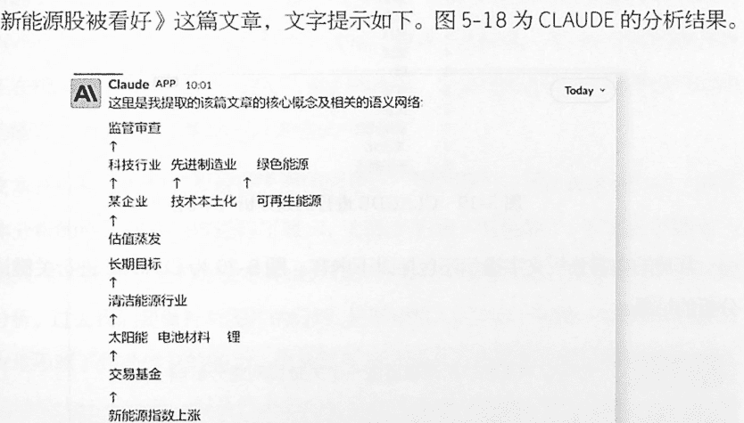

大模型在文本编码上的突破，很大程度上体现在情感打分的准确度。情感打分常用于社交媒体、评论、市场研究、品牌管理，也用于政治传播和舆情追踪。几条微博就能看出效果，提示语是“请对下面微博做五分制情感打分，1极负面，5极正面，3中性”，得到的结果见图5-17。

基于5分评分制进行情感分析，以下是评分表：

| 微博内容 | 情感分析得分 |
|---|---|
| 啊 我死啦 谁懂毕业论文死活写不出来 好不容易交个初稿 现在二稿三稿改不出来 真的很痛苦啊啊啊啊啊啊啊！ | 1 |
| 在线接格式修改和公式录入，支援深夜心碎大学生哈哈哈 | 4 |

图 5-17 ChatGPT 情感分析生成表格（示例）

文本编码里常用的词频、关键词网络、词性分析等，当前版本的ChatGPT并不支持。想做这些，可转用CLAUDE，它完全支持词频、语义网络等功能。以《中国新能源股被看好》为例做语义网络分析，提示与结果见图5-18。

图 5-18 CLAUDE 生成语义网络（示例）

词频分析的提示与结果见图5-19。关键词网络分析的结果见图5-20。

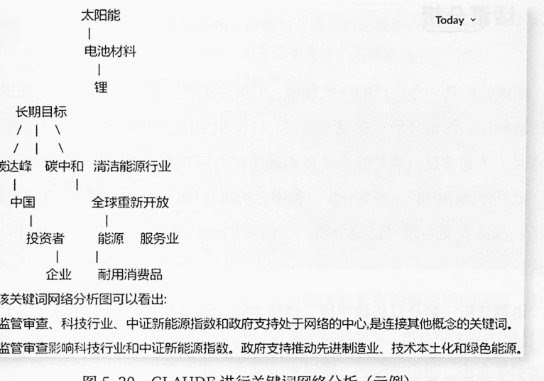

从该关键词网络分析图可以看出：

1. 监管审查、科技行业、中证新能源指数和政府支持处于网络的中心，是连接其他概念的关键词。
2. 监管审查影响科技行业和中证新能源指数。政府支持推动先进制造业、技术本土化和绿色能源。

图 5-20 CLAUDE 进行关键词网络分析（示例）

这份输出精度已超过多数传统质性软件。传统软件在语言理解上与新一代大模型仍存差距，复杂量化或精细统计仍建议在ATLAS.ti或NVIVO中完成。值得一提的是，ATLAS正在快速融合ChatGPT技术，传统软件正获得自动编码能力。

文本分析和内容分析重叠度高，前文已基本展示。这里额外提醒一个方法学亮点：面向图片的文本分析。过去须人工逐图查看，现在AI可自动抽取图文信息并分析，尚不完美但发展很快，未来有望成为常规质性方法。

## 五、话语分析

话语分析关注真实社会交际中的语言单元，揭示语言、社会、文化互动，以及话语在意义建构、信息传递、社会关系维系和权力表达中的作用。包括对话分析、批判性话语分析、语篇分析、叙事分析等。ChatGPT可辅助对新闻、对话、演讲进行话语分析。

语篇分析可从修辞手段、话语主题、语境背景、话语类型、关键词、受众设定、导向、对话性、符号隐喻等方面切入。图 5-21 为示例。

1. 修辞手段：可能采用个人故事叙事，通过描写返乡创业者生活工作场景，凸显其勇气与决心，同时用对比、排比强化积极影响。
2. 话语主题：聚焦年轻人返乡创业及如何以自身优势和创新思维助力乡村振兴。
3. 语境和背景：当前中国乡村振兴大背景与年轻人就业压力，返乡创业被视作一种出路。
4. 话语类型：信息传播型话语，向公众传递相关信息和故事。
5. 关键词：返乡创业、年轻人、乡村振兴、创新、创业经历等。
6. 听众设定：关注就业、乡村振兴、创业创新的公众，尤其是年轻人和政策制定者。
7. 导向：强调创业创新的价值，对乡村振兴持积极乐观态度。
8. 对话性：通过个人故事和观点呈现人物互动，体现创业者与乡村社区的联系。
9. 符号隐喻：用创业产品、创新项目等象征元素隐喻乡村振兴和青年创业精神。

图 5-21 ChatGPT 话语分析（示例）

请从修辞手段、话语主题、语境和背景、话语类型、关键词、听众设定、导向、对话性、符号隐喻等多个方面对《返乡创业的年轻人》这篇新闻报道进行篇章分析。

Please analyze the news report on “young people returning to their hometowns for entrepreneurship” from various aspects such as rhetorical devices, discourse themes, context and background, discourse types, keywords, audience settings, ideological awareness, conversational style, and symbolic metaphors.

叙事分析关注叙事性话语的结构、内容与功能，对象包括小说、影视、传记、历史纪实等。可从情节、角色、主题、叙述者与视角、时间结构、空间设置、符号象征、对话与语言风格分析。请从情节、角色、主题、叙述者和叙述视角、时间结构、空间设置、符号和象征、对话和语言风格等多个方面对《返乡创业的年轻人》这篇新闻报道进行叙事分析。

Please analyze the news report on “young people returning to their hometowns for entrepreneurship” from various aspects such as plot, characters, themes, narrator and narrative perspective, time structure, spatial settings, symbols and symbolism, dialogue, and language style for narrative analysis.

批判性话语分析旨在揭示话语与权力关系、社会实践的互动，通常从话语结构、内容、功能、生产与接受、社会实践入手。可采用提示语对报道进行批判性话语分析。

## 六、总结

大语言模型最擅长对语言文本进行分析，这与质性研究的内在需求高度契合。越偏重语言解读、越依赖人工的方法，现在受AIGC影响越深。过去20年量化研究占SSCI约九成，因其规范化与高自动化。但随着AIGC普及，文本分析难度下降，规范更统一，写作效率提升，质性研究占比有望升至约三成。

笔者认知有限，欢迎在各自领域多尝试，优化提示词，做出更好研究。

做实验设计时，很多人都会先去翻旧文献，把过往类似研究的思路拆解出来，再结合自己的问题做增改。也有人看文献很熟，能直接上手。但对大多数同学来说，阅读同类研究几乎是必经之路。今天就用一篇 2018 年发表的聊天机器人情感支持研究 Liu & Sunda 为例，聊聊怎么借助 CHATPDF 和 ChatGPT 把一篇论文快速拆成可用素材，再在此基础上做新设计。

这篇文献的核心是在探究聊天机器人的情感支持效果以及用户对交互体验的主观感受。我们先用 CHATPDF 把论文里的关键信息抓出来，比如实验是怎么搭的、样本多少、操作细节等。CHATPDF 能在很短时间内把整篇实验研究的结构性信息提炼出来，适合做快速浏览。常用的提问角度可以这样设置：

让模型完整梳理论文的实验架构；询问第一项实验的样本量与招募方式；请模型复述整个实验的操作流程；列出研究里检验了哪些假设；说明第一项实验包含几个实验组和对照组、各组接受了怎样的处理；解释数据分析的步骤与逻辑；哪些假设得到了数据支持、哪些没有；实验一和实验二之间是什么关系；第一项实验用了哪些因变量以及如何测量；概括实验一的主要结论。

这些提问方式可以自由组合、调整。需要注意的是，系列性实验较多时，可以把提问限定到“第 1 个实验的分析如何开展”之类。CHATPDF 提取的框架常常存在偏差，只能当引子，真正吃透还得精读原文。

借助这些提问可以快速知道该文做了两项研究。研究一里 158 名参与者阅读的是聊天机器人与人类用户之间的对话文本；研究二里 88 名参与者则直接与真实聊天机器人互动。两项研究都围绕三种移情表达——同情、认知性移情、情感性移情——考察它们对用户对服务和机器人看法的塑造。结果显示，相较于完全不提供情感支持，提供同情或移情表达更受青睐，这一现象与计算机即社会行为者范式是一致的。

在这一基础上，我们可以把原来的单因素设计升级为双因素设计，加入人性化这一维度。两个自变量分别是共情与人性化，各取高低两个水平，研究目的是看它们如何共同影响人机交互体验，并计划用 ChatGPT 作为对话机器人实现逐步验证。

先在 CHATPDF 里搭一个简易框架，再让 ChatGPT 填充细节。提问可以是：如果把原研究的单因素改成双因素，共情和人性化各有两个水平，想要考察它们对用户交互体验的影响，基于 ChatGPT 设计两个递进的实验，请给出详细方案。

在 ChatGPT 中可以直接提问：我想做一个双因素实验，研究共情和人性化对人机交互体验的影响，两个因素均为高低两水平，用 ChatGPT 作为对话机器人，请帮我设计一套系列实验逐步回答问题。

一个典型的设计思路大致如下：

先界定共情和人性化的操作化方式，共情体现为机器人对用户情绪的理解与关怀，人性化体现为语言的自然、趣味与幽默感；
制作四版机器人，分别对应低共情低人性化、低共情高人性化、高共情低人性化、高共情高人性化四种组合。由于 ChatGPT 本身不能直接调节这两个维度，通常需要准备四套不同的训练语料并做微调来生成四个模型；
招募具有多样背景的参与者，可线上可线下；
随机分派参与者进入四个条件之一，与对应版本的机器人进行问答、讲故事或自由对话；
实验结束后收集体验反馈与评价数据。

做完框架后，还可以继续追问因变量的测量问题，让模型给出量表题目与操作方法。

二、准实验与干预研究
准实验是指研究者只能部分控制实验过程，无法对所有影响结果的变量做完全掌控。最典型的限制是无法随机分配被试到实验组与对照组，也就难以排除混杂因素。研究者往往只能选取自然存在的条件进行干预，观察变化。例如想检验新教学法对成绩的影响，却无法把学生随机分到新旧教学法组，这就属于准实验。

在这种设计里，混杂变量会干扰自变量对因变量的真实作用，容易产生选择偏误。比如估计教育对收入的影响时，教育水平本身就与智力、社会阶层、地域等也有关联，若不加以控制，得出的因果估计就会失真。虽无法完全随机，但可以通过统计手段降低干扰：

配对设计，把实验组被试按年龄、性别、健康状况等关键特征与对照组被试一一匹配；
协方差分析 ANCOVA，在模型中把量化的混杂变量作为协变量纳入，以削弱其影响；
倾向评分匹配，用接受处理的概率作为评分，比较评分相近的实验组和对照组被试；
中断时间序列设计，在干预前后多个时间点收集数据，通过趋势对比来减少混杂干扰。

ChatGPT 可以大幅降低这些设计的搭建难度。举例，研究假设为大学生用 ChatGPT 学英语效率更高，需要一个干预研究来验证。基本框架是设一个大一干预组和一个大一对照组，用倾向评分匹配来控制混杂。

可先请模型设计准实验与干预研究的具体框架，明确干预组和对照组的大一学生背景、匹配逻辑等。随后追问在干预前需要采集哪些背景信息来计算倾向评分，要求尽可能全面。

模型给出的背景变量通常包括：基本信息如年龄、性别、国籍、母语；教育背景如专业、所在院校；英语学习背景如学习年限、既往方法、海外经历、是否参加托福雅思及成绩；学习动机与目标；日常学习习惯与时长；技术熟练度，如电脑与互联网使用熟练程度、是否用过类似学习工具；个人特质，如外向性、坚持性、偏好独立或合作学习等。

再让模型细化干预措施。干预组会先接受 ChatGPT 功能与使用方法的介绍，按英语水平和目标定制个性化学习计划，要求每天定时使用并在空闲时练习，定期收集使用体验与学习进度反馈以调整方案。对照组则提供传统学习材料如教材、词汇卡、语法练习册，同样定制学习计划、要求规律学习并做定期反馈与调整。

通过上述关键词的追问，准实验研究中的匹配变量、干预细节都能快速成型，再在此基础上完善方案即可。

做一份问卷通常要处理三类内容：如何引导受访者、采集基础人口统计、再去捕捉心理与行为特质。真正难的是最后一环，因为想法和行为属于隐变量，无法直接触摸。

人口统计只需一两个题就能搞定，比如性别年龄。但隐变量没法靠单题精准探测，需要一组含义相近的题目共同来反映，这就是编制尺度的基本思路。打磨一套尺度比较费工夫，要先做访谈提炼概念、搭初步题目稿、收集数据后用因素分析剔除不合适的题和维度。好在学术界已有不少成熟工具可以直接借用，不必每次都从零开始。

在这个环节里生成式助手能明显提速。第一种用法是按研究议题检索合适的工具。比如想研究毕业季大学生焦虑程度，就可以让助手列出业界常用的焦虑测量工具。第二种用法是直接索要已有工具的条目。比如要求提供社交互动焦虑尺度 SIAS，助手通常会给出约20个条目、0到4的五点计分说明，并展示代表性题目。

当面对一个全新的概念时，助手也能帮忙起草初稿。以“算法素养”为例，这是一个新兴概念尚未有现成工具。可以让助手模拟访谈程序员、大学生、外卖骑手等不同背景的20人，并基于概念定义与维度框架生成初版题目，要求每个维度至少5题。得到的结果往往是一个包含理解、应用等维度的35题草案。这类输出只能作为起点，没有真实访谈支撑不能直接使用。

如果已经完成了真实访谈，价值会更高。以老年人在线游戏动机为例，先让助手对访谈文本做编码，提取与动机相关的语段，结合文献归纳出动机类型，之后再据维度定义和编码文本生成每维至少5题的初稿。这样的工作流大致是：先靠真实访谈提炼维度与文本材料，再用助手生成可参考的初版题目，最后用因素分析筛选不合格的维度与题目。

除了出题，助手在数据分析环节也很实用。社会科学常用 SPSS、R、Mplus 基本能覆盖需求。它现在无法直接操作软件，但可以按需求写分析代码，也能把统计结果解释清楚，这对提升科研效率很有帮助。

Mplus 在结构方程领域应用很广，也支持回归、因素分析、潜类别、生存分析、多层数据等。以验证性因素模型为例，假设一份35题的工具分属7个维度：1-7题维度1，8-12题维度2，13-15题维度3，16-23题维度4，24-27题维度5，28-31题维度6，32-35题维度7。可以让助手生成对应的语法。

以下是一段可直接使用的 Mplus 示例，用于构建验证性因素模型，VARIABLE 部分负责把题目映射到各自的潜变量。
```
TITLE: Confirmatory Factor Analysis;
DATA: FILE IS data.dat;
VARIABLE:
    NAMES ARE q1-q35;
    USEVARIABLES ARE q1-q35;
    MISSING ARE ALL (-999);
ANALYSIS: TYPE = GENERAL;
MODEL:
    f1 BY q1-q7;
    f2 BY q8-q12;
    f3 BY q13-q15;
    f4 BY q16-q23;
    f5 BY q24-q27;
    f6 BY q28-q31;
    f7 BY q32-q35;
OUTPUT:
    STANDARDIZED;
    MODINDICES(ALL);
```
图 6-6 Mplus 验证性因素模型语法示例

拿到语法后通常需要做小幅调整，比如数据文件名和缺失值标记。假设数据文件名为 poke.dat，缺失值用空白表示，可以让助手检查修改。

适配后的代码如下：
```
TITLE: Confirmatory Factor Analysis;
DATA: FILE IS poke.dat;
VARIABLE:
    NAMES ARE q1-q35;
    USEVARIABLES ARE q1-q35;
ANALYSIS: TYPE = GENERAL;
MODEL:
    f1 BY q1-q7;
    f2 BY q8-q12;
    f3 BY q13-q15;
    f4 BY q16-q23;
    f5 BY q24-q27;
    f6 BY q28-q31;
    f7 BY q32-q35;
OUTPUT:
    STANDARDIZED;
    MODINDICES(ALL);
```
图 6-7 Mplus 语法适配示例
```
MODEL FIT INFORMATION

Number of Free Parameters        126

Loglikelihood

        H0 Value                       -11603.222
        H1 Value                       -10997.215

Information Criteria

        Akaike (AIC)                   23458.444
        Bayesian (BIC)                 23926.789
        Sample-Size Adjusted BIC       23527.181
            (n* = (n + 2) / 24)

Chi-Square Test of Model Fit

        Value                          1212.014
        Degrees of Freedom                   539
        P-Value                        0.0000

RMSEA (Root Mean Square Error Of Approximation)

        Estimate                       0.064
        90 Percent C.I.                0.059  0.069
        Probability RMSEA <= .05       0.000

CFI/TLI

        CFI                            0.946
        TLI                            0.940

Chi-Square Test of Model Fit for the Baseline Model

        Value                          12949.046
        Degrees of Freedom                   595
        P-Value                        0.0000

SRMR (Standardized Root Mean Square Residual)

        Value                          0.059
```
图 6-8 Mplus 运行结果示例

运行后若对结果难以解读，可以把输出贴回去请助手解释。
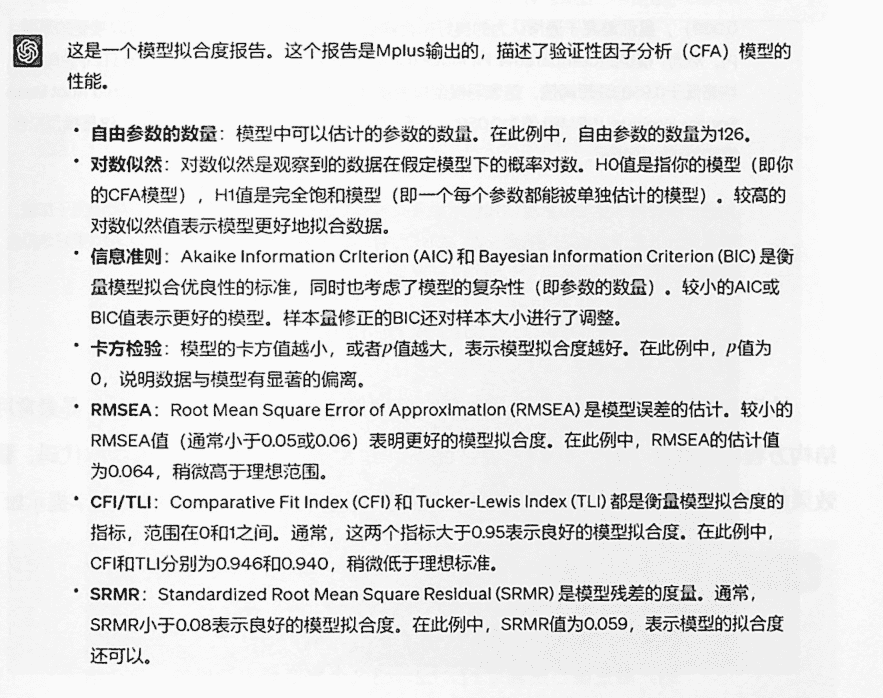

解释完毕，还能请它把结果写成论文语言。比如让它在结果部分报告拟合指标：卡方、RMSEA、CFI、TLI、SRMR 等，并给出简要评价。

总体来看，生成式助手擅长快速检索工具、起草新尺度、生成分析语法并解读输出，但真实访谈、理论校准和统计检验仍是工具成立的底线。

要让模型对数据的贴合度更好，往往需要对既有设定做些微调，比如重新设定因子载荷的数值，或允许部分测量误差之间存在协方差。总体来看，眼下的结构方程设定仍有改进余地，需要继续打磨。

图 6-10 ChatGPT 报告 Mplus 结果（示例）

在当前社科期刊的实证研究里，结构方程建模几乎成了默认的技术路线，而 Mplus 则被学界广泛认可为实施该方法的核心平台。我们试着用一个很简化的中介模型来验证 Mplus 代码的自动生成效果。模型的基本构想与给出的自然语言指令如下。

> 文字指令要求扮演一名数据分析师，构建一个包含潜构 A、B、C 的结构方程模型。A 由观测指标 a1 a2 a3 反映，B 由 b1 b2 b3 反映，C 由 c1 c2 c3 反映。结构部分包含两条回归：C 由 A 与 B 共同预测，B 由 A 预测。请据此输出可用于 Mplus 的语法。
> prompt 大意是让模型生成三潜变量、每潜变量三指标的中介结构，并明确 C 被 A、B 预测、B 被 A 预测的路径。

ChatGPT 给出的参考输出见图 6-11。

```
TITLE: Structural Equation Model;
DATA: FILE IS data.dat;
VARIABLE:
    NAMES ARE a1-a3 b1-b3 c1-c3;
    USEVARIABLES ARE a1-a3 b1-b3 c1-c3;
ANALYSIS: TYPE = GENERAL;
MODEL:
    A BY a1 a2 a3;
    B BY b1 b2 b3;
    C BY c1 c2 c3;
    C ON A B;
    B ON A;
OUTPUT:
    STANDARDIZED;
    MODINDICES(ALL);
```

图 6-11 ChatGPT 生成 Mplus 结构方程模型代码（示例）

从该例子可以看出，完整的结构方程同时包含测量部分与结构部分，前者描述潜构与其观测指标的关系，后者描述潜构间的因果路径。在 Mplus 的书写习惯里，通常先写测量模型再写结构模型，二者顺序与模型逻辑一致。撰写指令时，测量部分要交代模型涉及哪些变量以及潜构如何被指标捕捉；结构部分要按 Mplus 语法明确回归的数量、因变量与自变量的对应关系。

把上述代码中的变量名改为 grades.dat 后执行，顺利得到输出。我们只提取整体拟合信息与标准化参数估计两块内容，分别以 MODEL FIT INFORMATION 与 STDY Standardization 开头。将这两段结果交给 ChatGPT，即可让它撰写报告正文，甚至延伸到讨论。

### 2. R 语言代码（实用度：★★★★★）

R 是一款开源的统计计算与可视化环境，能够覆盖社会科学领域绝大多数模型需求，包含结构方程与多层模型。我们沿用先前的倾向得分匹配案例，指令为在 R 中完成倾向得分分析并给出可运行脚本，图 6-12 为模型回复效果。

> 文字指令 请在 R 中实现倾向得分分析并生成代码。
> prompt 请为 R 生成倾向得分分析脚本。

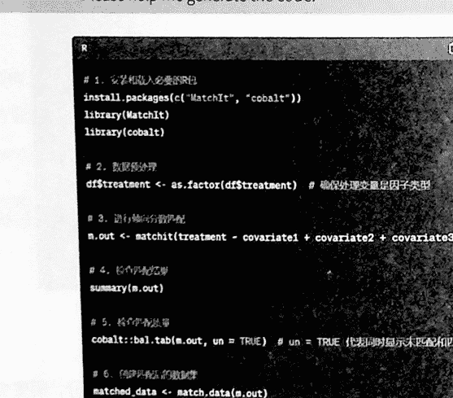

图 6-12 ChatGPT 生成 R 倾向评分代码（示例）

ChatGPT 不仅提供了可运行的 R 脚本，还附带了逐段说明，这类解释对实际编码帮助很大。

### 3. SPSS 脚本（实用度：★）

我们也尝试让模型生成 SPSS 脚本，但错误率偏高，不建议直接依赖。更稳妥的做法是按菜单逐步操作。以双因素实验为例，当交互作用显著时往往需要进行简单效应分析，该流程难以仅靠点选完成，于是让模型生成整段语法，指令为在 SPSS 中对 A 因素不同水平下 B 的差异做简单效应检验，数据集名为 XXX，A 有三水平，B 有两水平，使用 GLM 模块。

> prompt 请用 GLM 模块对两因素实验做简单主效应分析，数据文件为 XXX，A 三水平、B 两水平。

下面是人工校对后的正确语法，可供对照。

```
GLM
  DV NAMES BY A B
  /METHOD = SSTYPE(3)
  /INTERCEPT = INCLUDE
  /PRINT=ETASQ HOMOGENEITY
  /PLOT = PROFILE(A*B B*A)
  /CRITERIA = ALPHA(.05)
  /DESIGN = A B A*B
  /EMMEANS TABLES(A*B) COMPARE (A)
  /EMMEANS TABLES(A*B) COMPARE (B).
```

实际运行后会发现，ChatGPT 生成的 SPSS 脚本多处报错，无法完成任务。而人工编写的脚本一次即可输出主效应、简单效应与交互图。这个对比说明，ChatGPT 更适合指导在 SPSS 界面中操作，而非直接产出可用脚本。

### 4. Python 代码（实用度：★★★★★）

ChatGPT 生成 Python 代码的准确度整体偏高，通常经小幅修正即可使用。计算传播学中常需要爬虫抓取微博热搜、B 站弹幕等文本。我们让它写一段抓取微博热搜榜的脚本。

> 文字指令 写一段抓取微博热搜榜的代码。
> prompt 请给出抓取微博热搜榜的 Python 片段。

在 PyCharm 中运行得到的代码，见图 6-13，现场未返回结果。

图 6-13 Python 运行 ChatGPT 提供的代码（示例）

随后加入日志调试，图 6-14 为调试版本。

图 6-14 Python 进行代码调试（示例）

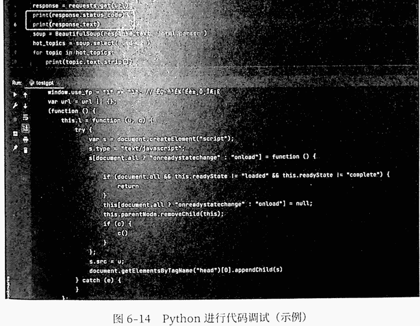

加入调试日志后发现返回的 response 中并无热搜内容，推测是缺少请求头与 Cookie，需补充。

在 Chrome 打开目标 URL 并切到调试模式，见图 6-15。

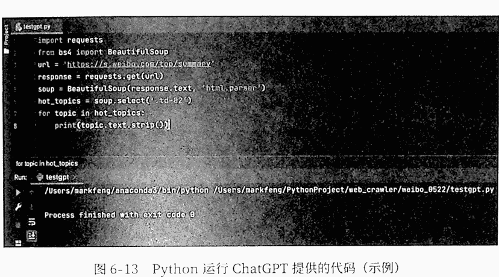

图 6-15 ChatGPT 生成 Python 代码调试（示例）

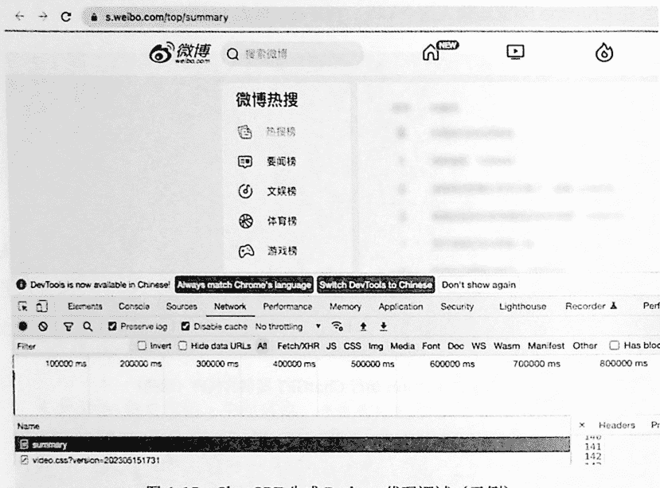

选中 Network 面板中的 summary 链接，右键 Copy as cURL。

图 6-16 ChatGPT 生成 Python 代码调试（示例）

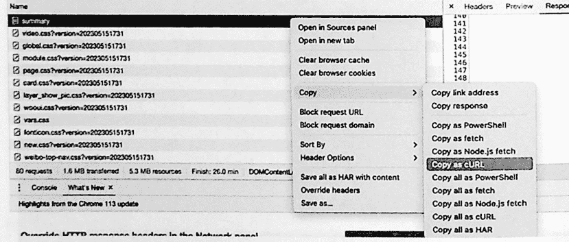

将 cURL 导入转换网站。

图 6-17 ChatGPT 生成 Python 代码调试（示例）

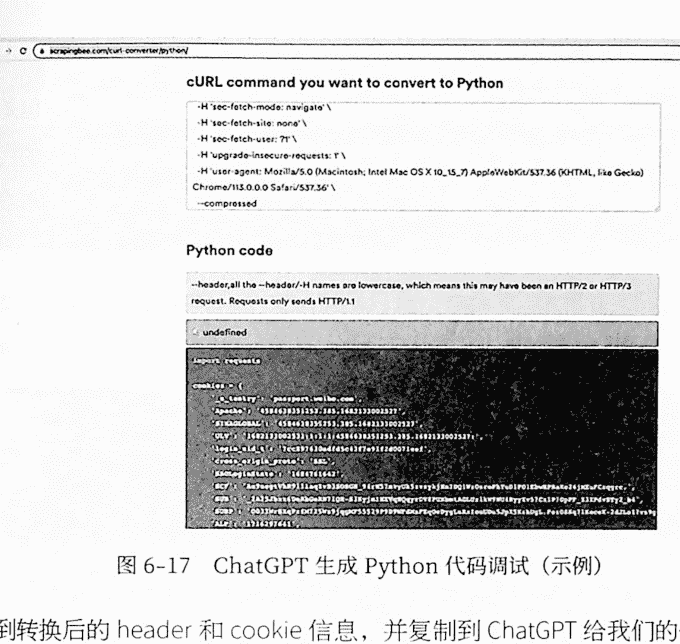

拿到转换后的请求头与 Cookie 后粘贴回代码。

图 6-18 ChatGPT 生成 PYTHON 代码调试（示例）

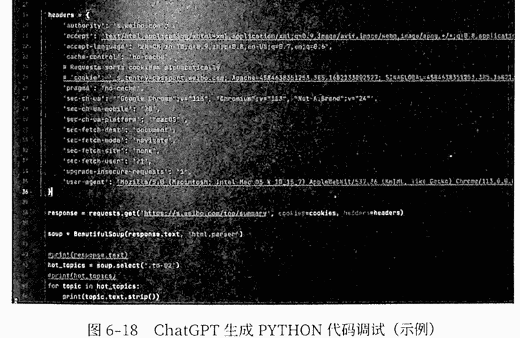

再次运行即可获取榜单数据。

由此可见，ChatGPT 能先给出骨架代码，但要真正跑通往往需要反复调试。爬虫类任务改动量更大；若仅用于可视化或简单的数据分析，代码的可用性会更高。

## 六、数据分析自动化

OpenAI 官方的代码执行工具 CODE INTERPRETER 可把数据分析做成流水线。上传数据后即可直接清洗、建模、绘图与探索。下面列几条实用指令供参考，本质上也是基于 Python 运行。

- 文字指令 你是一名数据科学家，能否基于当前数据集思考可做的分析？请逐步思考并给出可靠结论。
  prompt As a data scientist, can you think about the possible analyses that can be done based on the current dataset? Please think step by step and provide reliable answers.
- 文字指令 请做描述性分析。
  prompt Please perform descriptive analysis.
- 文字指令 请做相关性分析。
  prompt Please conduct correlation analysis.
- 文字指令 请用 DV 为因变量、IV1 IV2 IV3 IV4 为自变量建立随机森林预测模型。
  prompt Please establish a random forest prediction model using DV as the dependent variable and IV1, IV2, IV3, IV4, etc., as the independent variables.

以上仅为示例，实际使用可按需定制模型与图表。

- 文字指令 请根据销售数据中的区域变量绘制柱状图。
  prompt Please create a bar chart based on the regional variable in the sales data.

截至本书定稿，CODE INTERPRETER 尚未全面开放。在量化研究领域，GPT-4 的冲击主要体现在研究设计与代码生成两端，让过去繁琐的分析流程变得轻量化。而 CODE INTERPRETER 的加入，更是让统计分析接近全自动，大幅降低了量化研究的门槛。

# NOTES

### 本章小结

1. ChatGPT 在量化研究中主要发挥两大作用，一是辅助生成研究设计方案，二是自动生成统计分析代码。
2. 插件 CODE INTERPRETER 已能实现数据分析的自动化闭环。

# 第七章 讨论参考版本

> 宾夕法尼亚大学沃顿商学院副教授伊桑·莫利克已在其所有课程中引入 ChatGPT 与人工智能。他规定学生必须使用人工智能工具来提升学习与创造力。他认为教育工作者需要与时俱进，教导学生如何适应新的人工智能时代。在他的课堂上，部分学生借助 AI 写出了更有创意的文章。
> ——迪格南（Dignan）

讨论部分往往是论文的核心，也是写作难度最高的一环。它需要把结果与既有文献对话，拓展结论在理论、政策与社会应用层面的价值。通常放在全文最后。

讨论的可写性与结果质量高度相关。结果越扎实、越具启发性，讨论就越好展开。因此降低写作难度的关键在于选题与研究框架是否过硬。若选题平庸、结果薄弱，再怎么堆砌也显得空洞。建议在资源充足时先筛选好题目与结果，再进入讨论环节。

规范的讨论一般包含五块：

- (1) 归纳核心发现 开头先用通俗语言复述最重要结果。注意与结果章节不同，结果部分偏统计表述，讨论部分要更易懂。
- (2) 理论贡献 结合近五年的文献，说明本研究发现对理论发展的意义，要与引言形成呼应。文献一般选 8~15 篇，且以近五年高水平成果为主，文献筛选无法外包给 AI。
- (3) 实践价值 超过九成的社会科学论文意义停留在理论层面，很难直接落地到政策与实践。与工科不同，这部分可视关联度长短书写，不必硬凑。
(4) 不足与展望 再好的研究也存在局限。收尾时要坦诚列出 1~2 条不足并给出改进方向，过多会削弱文章说服力。
(5) 结论重申 讨论最后要再一次点题。有人会问，开头不是已总结了吗？两者功能不同。开头的总结是承上启下，帮助读者进入讨论；结尾的总结是对全文推理的收束，让读者离开文章后仍能记住核心信息。

清楚结构后，如何借助 ChatGPT 加速讨论写作？回溯到引言，引言最好由研究者主笔，AI 只负责细节补充。比如可用 AI 快速给出概念界定或理论对比，但整体框架与关键段落仍需基于大量阅读自行撰写。有人不明白为何不能直接让 AI 扩写。原因有二，其一，GPT-4 虽智能，但在细分领域仍缺乏最新文献与写作风格数据，即使给出细化大纲，输出也易出现风格漂移。其二，引言是整篇论文的起点，起点必须由作者亲力亲为。若把论文看作推理链，引言是前提假设与条件，方法与结果是对假设的检验，讨论则是在此基础上进一步推演。GPT-4 的优势在于推理，它能基于前言、方法、结果进行合乎逻辑的推演，并结合现有文献延展讨论内容。它的推理水平大致接近一名高三毕业生。

讲真，在有了 GPT-4 之后，最让人意外的不是引言变快，而是讨论部分反而成了整篇论文里最顺手的环节。原因很简单：前面的引言、方法、结果，实际上就是在为模型喂一小份训练数据，而讨论就是基于这份“训练数据”做出的预测。正是基于这个逻辑，前三大部分我会坚持逐字人工完成，然后再让模型去延续你的写作风格。操作得当的话，能一次性产出几个不同角度的版本供你挑选。下面用一个真实案例来拆解整个思路。

案例我们选的是 2017 年 Yang & Liu 发表的《动机很重要：玩口袋妖怪 Go 的动机及其对健康的影响》。口袋妖怪 Go 是一款基于 AR 的手游，玩家靠 GPS 在真实街区里搜集、培养、对战虚拟精灵，通过手机屏幕滑动来捕捉。研究对 262 名玩家做问卷，最终提炼出 7 种驱动力，并据此搭建了《口袋妖怪 Go 动机量表》，核心结论是：想明白用户为什么玩，对数字媒体研究至关重要。

要让模型写讨论，第一步不是直接下指令，而是先把讨论的骨架搭好。有人喜欢把这个过程叫做“定型”，就像给盆栽套上模具，骨架越细，模型跑偏的空间就越小。这个骨架最好细化到段落层级，而不是一句“写个讨论”。

如果手上没有现成细纲，可以先用通用框架起步。

中文常用的四步是：
- 先把结果里最重要的发现捋一遍
- 把这些发现放到近期文献里看能推动什么
- 坦诚研究的边界在哪里，未来可以怎么补
- 最后收束，点出学术价值和实际意义

对应的英文思路也差不多：
- 1. Summarize key results
- 2. Link findings to recent studies and state contribution
- 3. Discuss limitations and future directions
- 4. Conclude with significance and practical implications

如果你对文献很熟，就能做出更具体的提纲。以本案例为例可以这样展开：
- 先梳理研究里出现的 7 种动机：逃避现实、求成就、社交、探索、运动、怀旧、收集，并指出它们与年龄、性别存在关联
- 再谈不同动机对健康的差异化作用：运动和社交导向的玩家身体指标更好，逃避现实和怀旧导向的玩家心理指标偏弱，收集欲则与幸福感有关
- 接着点出局限：只盯 Pokémon Go 一款产品，样本集中在美国，未来可扩展到其他移动游戏并扩大地域
- 这样模型才有抓手。

骨架搭好后，别急着让它开写。先把讨论会用到的核心文献用 CHATPDF 或 AskYourPDF 整理成摘要。输入前让模型确认接收，像这样确认：“你是一名在游戏领域工作多年的心理学家，下面是我写的论文前言方法结果部分，题目是 Motives Matter... 你收到了吗？只需要回答收到或未收到。”前文太长就分批喂，每批喂完再告知下一批文献要点。

提示举例可以是：“这是两篇关键参考文献的要点总结，你收到了吗？”随后附上 Billieux 等人关于 World of Warcraft 动机与行为的研究摘要等。文献量控制在 10 篇左右，宁缺毋滥，越核心越好。

确认模型已记住背景后，再下写作指令，比如请结合这两篇文献，用英文为上述论文续写约 1500 字的讨论，并给出段落级大纲。图 7-1 就是这种操作产出的样稿，能看到参考文献已经被自然嵌入。注意实际 SSCI 论文讨论通常在 1500-2000 词，模型一次难以拉满，长文就拆成小节分别生成。

这里有个常见坑：把前面三部分做成 PDF 直接丢给 AskYourPDF，让它通读再写讨论。我们试过，结果几乎都是空话套话，细节全丢。所以分段人工喂养、明确告知每段内容是什么，才是保细节的做法。

即使骨架到位，第一次生成的讨论往往还是泛泛。这时有两个补救办法。第一是模糊指令多轮生成。用通用大纲让模型反复写几次，每次措辞略有差异，再把各版本里写得好的句子拼到一起。案例里第一次和第二次生成的两段，各有亮点，就能取长补短。

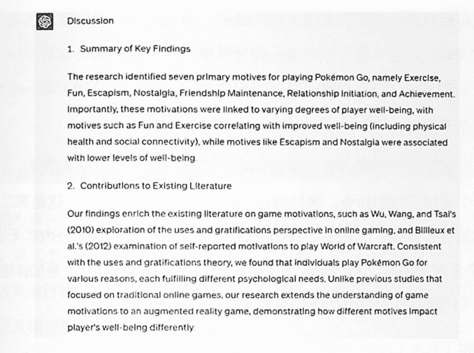

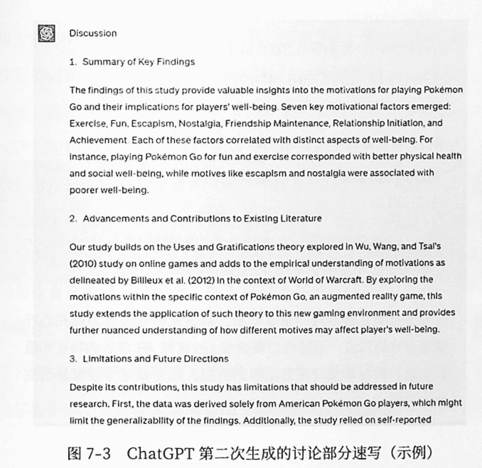

第二是针对薄弱点做精细化指令。比如讨论第二部分不够具体，就把表格数据喂回去：“请从 Table 2 的相关系数里挑出显著的结果，并据此扩展第二部分的论述。” 或者给出理论锚点：“社会交互是线上游戏的核心动机，对社会发展和心理健康有正面效应，请结合 AR 游戏特征和最新文献，谈本研究对现有成果的补充。”

生成后一定要人工定稿。模型的讨论能当参考，但不能直接交。需要重点校对三点：第一，文献补齐，模型只能引用你给的几篇，真正的水分靠你手动补全；第二，思路校准，模型容易滑向它熟悉的套路，有些你真正想强调的点会被忽略；第三，事实核查，生成内容里常出现自洽的“伪事实”，必须逐句核对。

我们把整套流程画成图 7-4，可以归纳为四步：先用详细大纲生成主版本，其余用通用大纲多生成几个版本挑选亮点，最后把优点整合进主版本，并在主版本上做精修补文献。

总之，讨论部分不是让 AI 替你思考，而是用一个预先定好的模具把你的思路放大、整理。骨架、文献、多次迭代、人工精修，四步走完，效率和质量都能同时提升。
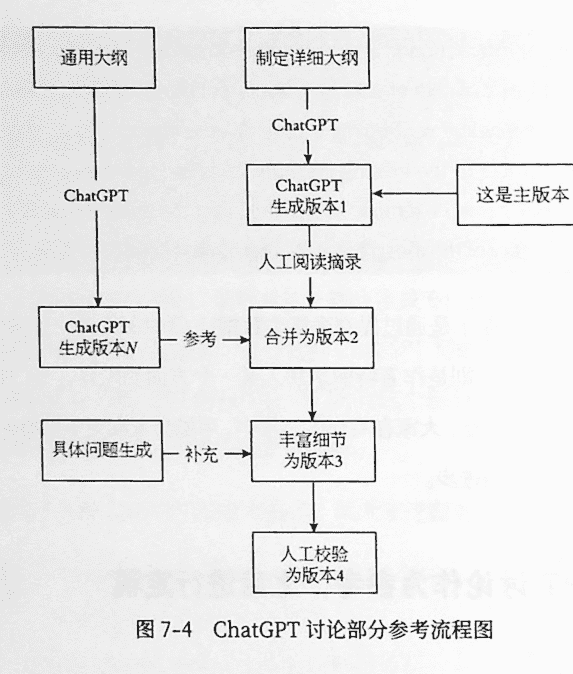

图 7-4 ChatGPT 讨论部分参考流程图

把这个过程拆成四个环节，最核心的是第一步：用详细大纲生成主稿，随后用通用大纲刷出多个备选，把其中写得漂亮的片段摘出来补充或替换，最后在这个基础上做学术级润色。按这个节奏走，讨论再也不怕写不出来。

在前面的基础上，讨论部分的精细化仍然需要作者自己向下深挖。哪怕提供了一份比较完整的讨论提纲，GPT-4 给出的结果往往也只是一个可用作骨架的框架，里面的血肉细节仍是空缺的。这时可以针对想要补强的具体问题向 ChatGPT 逐条追问，用以填补细节并对有价值的结果做进一步延展。最终成稿前，仍必须回到人工环节做修补与校验，形成定版。需要特别强调的是，本章介绍的方法仅能作为讨论写作的参考，真正写好讨论，关键仍在作者自身的写作思路。

# NOTES

### 本章小结

- 1. 当引言、方法与结果都已由人工完成时，配合写作提纲和参考文献把任务交给 ChatGPT，就能获得一份可供参考的讨论草稿。
- 2. 建议让模型多生成几轮，3 到 5 次左右，从不同版本中挑选有用的片段作为终稿参考。
- 3. 讨论定稿后仍需多次人工校准，排查逻辑和细节层面的问题。

# 8

Chapter Eight

# 第八章

统稿、润色和修正

> ChatGPT 的写作水平取决于其模型参数、输入数据和限制条件，
它可以生成高质量的文本，但也可能生成不完整或没有意义的文本。
——斯坦福大学教育学院

前几章已经介绍了如何借助 ChatGPT 完成论文的主体部分。这并不意味着论文已经达到可投稿的水准。投稿前通常还需要补齐摘要、参考文献、图表，核对格式规范，进行润色与修正。部分期刊还会要求额外提供 3 到 5 条核心发现要点，或 200 字左右的研究意义陈述。完成这些环节后，才能进入投稿流程。

## 一、生成摘要

ChatGPT 能否参与这些收尾工作并提升效率？答案是肯定的。下面按环节说明具体做法。先看摘要。摘要的字数一般被限定在 150 到 250 个英文单词，具体以期刊要求为准。摘要结构较为固定，因此非常适合用大模型来起草。通常一句话交代背景，一句话交代方法，两到三句话概括主要结果。若主体部分已经写完，可把手稿分批输入模型，再用文字指令让其直接产出摘要。

提示思路大致是：请根据我刚才提供的手稿，起草一篇论文摘要。先用一句话概括宽泛的背景，再概述手稿的独特贡献；用一句话说明研究方法，尤其是样本量与研究设计；用一句话总结主要发现；最后用一句话点明研究的广泛影响或意义。总字数控制在 200 字以内。

图 8-1 的示例显示，GPT-4 的产出基本符合摘要的结构要求。但它没有给出具体的参与人数和效应参数，这部分需要作者自行补充。需要说明的是，在发出摘要指令前，整篇文献已按章节分批喂入模型，具体操作可参考前文。

## 二、引用格式

整理参考文献格式是一件繁琐的工作。社会科学领域多用 APA，也有期刊采用 MLA，甚至存在自订格式。每投一次刊，就得重新排版一次。现在可以用 GPT-4 快速转换格式。下面以一段示例演示。图 8-2 为文内引用的转换效果，图 8-3 为参考文献列表的转换效果。

指令示例是：请把下面论文中的引用格式改为 APA 格式。

转换后，文内引用变为作者-年份形式，参考文献列表也按 APA 规范排版。从实验来看，模型把其他格式调到 APA 非常顺畅便捷。我们也尝试过从 APA 调到小众的 SAGE Harvard 格式，效果同样不错。

在 ChatGPT 出现前，格式调整非常耗时，尤其是论文被拒后要按不同期刊要求反复修改。现在可以直接请模型完成引用格式的转换，省时省力。

## 三、生成表格

从大量结果中摘抄整理表格也很费事。第六章提到 GPT-4 可以解读 Mplus 的分析输出。那么它能否同时提取数据？经测试，ChatGPT 能够识别关键数据并整理成表格，虽非标准的 APA 三线表，但稍作调整即可使用。

先把第六章量化分析中 Mplus 输出的路径参数结果直接输入，模型会识别出这是结构方程模型的结果，并描述出模型包含的潜变量与观测指标。

随后给出明确指令，让模型从参数结果中挑选期刊常用指标，按 APA 风格整理成表格。得到的表格列出了各路径的标准化估计、标准误、t 值和 p 值，整体令人满意，后续只需微调版式即可复制进论文。

提示时需要注意，即使模型已自动识别模型类型，仍应明确说明数据类型，以防误判。

同样，SPSS 生成的相关系数表往往杂乱。可用指令让模型将其整理为 APA 格式的表格，保留两位小数并保留显著性星号。模型会输出规范的矩阵表，并在说明中提示 APA 通常不展示精确 p 值，只以星号标记显著性水平。

## 四、论文的自评与修正
例如《精灵宝可梦GO》这类游戏，借助手机 GPS 定位虚拟精灵，并通过增强现实技术将虚拟世界与现实融合，让玩家在现实场景中进行捕捉互动 

手稿初稿定稿以后，最让人头疼的往往是找人把关。最好能请到本领域的资深学者来逐行挑刺，现实里连指导教师都经常凑不够靠谱的审稿人。把 ChatGPT 临时充当审稿角色，已经成为不少写作者的过渡手段。它可以在成稿的基础上系统化地提出问题，帮助作者自我修正。常用的做法是把全文拆块喂给模型，操作细节可参考第五章的说明；也可以借助 AskYourPDF 这类第三方插件直接上传 PDF，再下指令让其评审。

下面这些审阅视角，已经覆盖了常规审稿的大部分需求。

### 论证流畅与段落衔接
> 文字提示 请以顶尖学术期刊审稿人的身份审视下方文字各段之间的逻辑如何衔接、阅读是否顺畅。标出表达不够通顺或段落过渡薄弱的部位，给出提升整体品质与可读性的具体改进建议，同时对句子层面提出修改意见，但不要把原文复述出来。
> prompt Act as a reviewer for a leading academic journal. Examine how the paragraphs in the text below link logically and flow. Highlight spots where clarity or transitions between paragraphs are weak, and offer concrete recommendations to improve overall quality and readability. Also suggest sentence-level edits. Do not reproduce the original text.

### 文章整体框架
> 文字提示 请以顶尖期刊审稿人视角判断整篇论文的架构是否明确。核查引言、方法、结果、讨论、结论这五部分在逻辑上是否自洽，让读者能够清楚把握研究意图、实施路径、主要发现以及这些发现的意义。给出具有建设性的批评意见。
> prompt Act as a reviewer for a premier journal. Assess whether the paper’s overall organization is clear. Determine if the introduction, methods, results, discussion and conclusion are logically consistent, so readers can grasp the research aim, how it was carried out, key findings and their meaning. Provide critical commentary.

### 研究方法的适配性
> 文字提示 请以顶尖期刊审稿人身份评估文中研究设计的科学性。确认所用的方法与实验安排是否契合所要回答的问题，样本规模是否恰当，并提出批评性意见。
> prompt Act as a reviewer for a top-tier journal. Evaluate whether the research design described is scientifically sound. Check if the methods and experimental setup match the research question addressed and whether the sample size is adequate. Provide critical feedback.

### 讨论部分的合理性
> 文字提示 请以顶尖期刊审稿人身份判断讨论是否与结果吻合。讨论是否建立在结果之上，有没有超出数据所能支撑的范围，是否出现大量缺乏依据的假设或推断，哪些观点缺少足够证据支撑。讨论是否对结果做了深入阐释，是否与既有研究建立联系。请对比本文结果与其他文献的结果，解释可能的相似与差异，并给出批评性意见。
> prompt Act as a reviewer for a top-tier journal. Analyze whether the discussion aligns with the results. Assess if the discussion is grounded in the results and whether it goes beyond what the data can support. Determine if it contains many unsubstantiated assumptions or speculations. Identify claims that lack sufficient evidence. Evaluate if the discussion explains the results in depth and connects with existing literature, comparing the author’s findings with other studies and explaining possible similarities and differences. Provide critical feedback.
注意：若讨论部分使用了其他标题，模型可能无法识别，建议先统一改为“讨论”，再执行任务。

### 结果数据的自检
请把结果章节呈现的数据与表 X 中的数值逐项核对，指出偏差并给出修正建议，同时提出批评性意见。
Please compare the numbers reported in the results section with those in Tables X, correct any discrepancies found, and provide critical feedback.

### 发表层面的整体判断
请以顶尖期刊审稿人身份，依据发表标准对本文进行整体评价，尽可能多地列出需要修改之处。
Please evaluate this article against publication standards as a top-tier journal reviewer and list as many revision suggestions as possible.

用好上述指令，ChatGPT 能完成不少常规体检工作。但必须清楚，AI 无法替代经验丰富的真人审稿人。往往专家一句话就能点出文章真正的突破点，让思路豁然开朗，稿件水准提升一个层级。对平平无奇的稿件，AI 也很难给出有深度的点评。

## 文献引用的核对技巧

成稿后最容易翻车的就是参考文献。正文里引了文献却忘了列入尾注，或尾注里出现了正文从未提及的条目。手工核对既繁琐又易漏，而 ChatGPT 可以把这个过程提效。

我们摸索出的高效做法是分段提取、再合并比对，共分六步。特别注意：文献核对不能用 AskYourPDF 直接读 PDF，也不能一次性把全文丢进去，否则模型会遗忘或漏检。建议把论文拆成引言、方法、结果、讨论四块，分四次提取后再合并。

第一步，分段抽取正文引用并排序
> 文字提示
下面是一篇论文的引言部分，你能把这篇文章引用的文献按字母排序吗？
“Globally, there was an estimate of 43 million blind people (The Lancet Global Health Commission on Global Eye Health, 2021) and at least 2.2 billion people who have a near or distance vision impairment (World Health Organization, 2023).”
...
> prompt
Here is the introduction section of a paper. Can you please alphabetically sort the references cited in this article?
“...”

把四个部分都跑一遍后，第二步去重，得到一份完整的正文引用清单。
请把正文引用的重复部分去除。
“Anderson et al., 2010...”
Please remove any repetitive sections in the body of the text。
“ ”

第三步，把完整的参考文献列表喂给模型，只提取作者和年份的简写。
这是这篇文章的完整参考文献列表，请提取每篇文章的作者名和出版年份做成列表。
“Anderson CA, Shibuya A, Ihori N, et al. (2010) Violent video game effects on aggression, empathy, and prosocial behavior in eastern and western countries: a meta-analytic review. Psychological Bulletin, 136: 151.
...”
Here is the complete reference list for this article. Please extract the author names and publication years of each article and create a list。
“ ”

第四步，另开一个对话设定校对背景，再把两份简化清单分别输入。
你是一个论文校对编辑，现在有一篇论文的引用和参考文献需要进行比对，查漏补缺，我会提供正文的引用和文章后面的参考文献，供你进行比对，你明白了吗？
You are a thesis proofreading editor. Now there is a need to compare and supplement the references and citations of a thesis. I will input the citations in the text and the references at the end of the article for you to compare. Do you understand?

随后依次确认模型是否已收到两份材料：
> 文字提示 以下是参考文献列表，你收到了吗？
> “And Anderson CA, Shibuya A, Ihori N, et al. (2010) …”
> prompt Have you received the following reference list?
> “And Anderson CA, Shibuya A, Ihori N, et al. (2010) …”
> 文字提示 这是正文的所有引用，你收到了吗？
> “And Anderson et al., 2010 …”
> prompt Have you received all the citations in the main text?
> “And Anderson et al., 2010 …”

模型会自动指出差异，比如仅出现在参考文献却未在正文出现的条目，以及年份不匹配的情况。

第五步，专门检查尾注有、正文无的文献。
> 文字提示 请检查有没有参考文献中出现，但是正文中没有出现的参考文献。
> prompt Please check if there are any references that appear in the reference list but are not mentioned in the main text.

第六步，专门检查正文有、尾注无的引用。
> 文字提示 请检查有没有正文中出现，但参考文献中没有出现的引用。
> prompt Please check if there are any citations in the main text that are not included in the reference list.

先把参考文献简化为作者+年份再比对，处理量大的文章也能快速完成核对。

## 润色与降重

到这里稿件基本成形，最后一步是语言润色和查重。传统做法是先用 GRAMMARLY 扫语法和拼写，再请出版社编辑人工把关表达。ChatGPT 让这个环节成本更低、效率更高。

> 文字提示 你是一个有 10 年经验的科学期刊校审编辑。你的任务是改进文本的拼写、语法、清晰度、简洁性和整体可读性，同时还需要将长句拆分、减少重复，确保不同段落之间有适当的过渡句，使得读者能够顺利地从一个想法过渡到下一个想法。你还需要确保论文的格式符合 APA 格式，并运用你在该研究领域的专业知识来对文稿进行改进。请你将输出结果以表格的形式呈现。第一列是原始句子，第二列是编辑后的句子，第三列是改写原因。

按上述方法操作，可以让论文在投稿前完成一次系统性的自检。

**把论文打磨到可投稿的程度，ChatGPT 现在能承担出版社级润色编辑的工作**

进入到统稿、润色与修正的环节，示范的就是如何让 ChatGPT 扮演一位拥有十年科学期刊校对经验的专业编辑。核心任务是提升拼写、语法、清晰度、简洁度与可读性，分拆长句、减少重复、在段落间加上合适的过渡，并确保格式遵循 APA 规范，同时借助领域专业知识改进稿件。输出方式被设定为三列表格：原文、润色后、修改理由。

以视障群体线上游戏研究为例，第一组示例原文提到尽管有关盲人和视障者游戏体验的研究在增多，但对其参与在线游戏的动机与社会获益了解有限。润色后把 “increased studies” 换成 “growing number of studies”，把 “little is known” 换成 “limited knowledge”，在保持原意的前提下更简洁、更精准。第二组示例把 “concerning” 改为 “exploring”，把 “BVI players' motives and its associations” 改为 “the motives of BVI players and their relationship”，让语法更一致、逻辑更连贯。第三组示例也展示了从 “Through 21 semi-structured” 到 “Utilizing 21 semi-structured” 的清晰度提升。

确认模型输出可用后再让它整段呈现。中文提示是“请呈现修改之后的段落”，英文对应为 prompt Please present the paragraph after it has been revised。这样就能直接拿到连贯的润色段落。

很多同学会问：先用 Grammarly 处理过后，ChatGPT 还能再提升吗？答案是完全可以。Grammarly 多在细节层修复，而 ChatGPT 更像是一位付费润色编辑，能从整体结构、表述节奏和学术表达上做升级。

润色完成后，投稿前基本只剩下查重。常用的工具有 iThenticate 和 Turnitin，以 iThenticate 为例，会把疑似重复的内容标红，并在侧边列出来源文献。一般要求重复率控制在 20% 以内，超过就需要改写，否则系统会提醒编辑。

**如何借助 ChatGPT 实现降重**

下面用一段关于视障流行病学与数字游戏可及性的英文段落来演示。原文提到全球约有 4300 万盲人，另有至少 22 亿人存在近视或远视问题；视障者面临出行、社会隔离、技术不可及等日常挑战，受限于这些障碍，其设备与数字游戏使用受限；但近期研究显示，随着无障碍技术发展，他们接触数字游戏的机会在增加。

如果只需要小幅降重，可以使用如下指令。中文：你是一个有 10 年经验的科学期刊校审编辑，你的任务是把这段文字修改重写，要保持意思不变，修改之后的文字与之前的文字重复率降低到 15% 以下，请只提供重写后的文字，不要带有任何解释。英文：As an experienced scientific journal copy editor with ten years of experience, your task is to revise and rewrite this passage while keeping the meaning intact. The rewritten text should have a repetition rate of less than 15% compared to the original text. Please provide only the rewritten text without any explanations.

模型给出的改写保持了所有引用 The Lancet Global Health Commission on Global Eye Health, 2021 和 World Health Organization, 2023、Chadwick et al., 2019; Islam et al., 2020、Buad et al., 2002; Johansson et al., 2021、Milne et al., 2013; Islam et al., 2020 等信息，但用词、句式和语序都做了大幅调整，基本达到降重要求。iThenticate 的提示通常是句级或小段级，也可以把需要修改的句子单独丢给模型处理。

当降重要求更高，或希望生成意思相同但表述完全不同的段落时，可以先抽纲再重写。提示是“请提取下面这段论文的详细大纲”，英文 prompt Please extract the detailed outline of the following paper。

模型提取的大纲包含：I. 视障全球流行 I A. 全球盲人总数约 4300 万 B. 全球近/远视障碍约 22 亿；II. 视障者面临的挑战 A. 日常生活挑战 1. 行动障碍 2. 社会隔离 3. 技术不可及 B. 相关文献；III. 设备与数字游戏可及性 A. 因挑战导致可及性受限 B. 无障碍技术发展带来的机会及研究证据。

拿到大纲后另开新对话，避免原文干扰，再让模型按大纲生成。提示为“请根据这段大纲生成一段 200 词的英文论文”，英文 prompt Please generate a 200-word English essay based on this outline。

生成的段落会围绕全球视障流行、面临的障碍以及技术进步带来的游戏可及性提升展开，保留核心数据与文献，但语言完全是新写，实现了低重复且保持学术性的目标。

视障与盲人群体在日常生活中要面对不少现实困境。行动不便、社交隔阂以及技术使用上的无障碍壁垒，是他们最常遇到的三大阻力，相关研究也反复指出这些问题会显著削弱生活质量，限制其自主性和建立有意义人际联系的空间，Chadwick 等 2019 年、Islam 等 2020 年的成果均有论及。

在设备和数字游戏的触达层面，受上述困扰影响，盲人和视障人士的获取渠道长期受限，Buaud 等 2002 年、Johansson 等 2021 年的工作已做出描述。好在局势正缓慢改写，可及技术的进步正打开新空间。这类技术迭代让该群体参与数字游戏的机会在增多，而游戏不仅提供消遣，更成为社交互动的入口，并具备一定的康复价值，Milne 等 2013 年、Islam 等 2020 年的研究都提供了佐证。正因技术对缓解视障人士困境的杠杆作用，加大对包容性技术研发与普及的关注已经迫在眉睫。

读到这里，你会感觉现成文本与原稿已经面目全非。自然就有同学提问，除了降重之外，这种改写还能用在哪？在科研写作中极易出现系列论文的情况，也就是围绕同一主题连续产出多篇成果。同一作者、相近选题，文本重复的地方往往不少。一旦前一篇已经见刊，后续稿件仍在审稿，查重系统就会报警。值得提醒的是，即便出自同一人之手，内容也不能雷同，这被称作自我抄袭。此时若要亲手把意思不变但文字全新的版本重新写出来，对很多人而言负担不小，因为每个人都有固定的表达习惯与思维定式。这时借助 ChatGPT 来完成改写，效率与质量都会明显提升。

到此，本次投稿前的准备工作基本就绪。下一章，我们将带你把论文的投稿与修稿流程彻底梳理清楚。

### 本章要点回顾

1. ChatGPT 可派上用场的地方包括生成摘要、调整引用格式、制作表格等收尾性工作。
2. 它也能辅助核查参考文献在正文与尾注中的前后一致性。

# 第九章 投稿和修稿

> 帮助作者提升投稿质量的人工智能手段正以数量和复杂度的双重速度增长。这些工具涵盖写作、语法、语言表达、参考文献管理、统计分析与报告规范等多个环节。编辑与出版机构也在广泛采用 AI 辅助系统，对投稿稿件进行抄袭筛查、图像篡改检测、伦理风险排查，同时利用工具进行稿件分层、参考文献核验、内容编排以适配不同媒介，并在文章发表后推动检索与发现。
> ——弗拉纳金 Flanagin

完成初稿只是发表旅程的第一步，后续的投稿与修改同样关键。一般而言，一篇论文从投出到见刊要经历 2 到 3 轮评审，耗时约 6 至 8 个月；若目标是顶级刊物，周期可能拉长到 1 至 2 年。虽然投稿难免受随机性影响，但期刊层级越高，审稿意见通常越专业。以例来看，投向 SSCI 三区且年发文量巨大的刊物，评审往往偏宽松、偶然性强；而投向领域前三的顶刊，审稿人多为业内顶尖学者，部分人在《Science》《Nature》《PNAS》等刊发表过成果，其意见既专业也更严苛。

坊间常说投稿像一场自虐，过程令人煎熬，审稿人不断施压。但换个角度看，期刊提供的免费反馈能让作者快速成长为细分领域的熟手。ChatGPT 在其中能承担什么？把投稿拆成选刊、写投稿信、回复审稿意见与修改三大环节来谈，AI 如何让每一步更高效，接下来逐一展开。首先是选刊，期刊众多，对领域不熟时筛选耗时耗力，选错则浪费大量精力。其次是投稿信，它的重要性不算最高，但在关键情境下，一封写得生动有力的信能提升编辑的好感度，从而提高录用可能。最后也是最难的环节，是修改并回应编辑与审稿人的意见。过去我会联合几位资深学者共同商讨修改方案，如今 ChatGPT 提供了一种新的科研助理式可能，本章将详细说明具体做法。

## 一、期刊遴选与投稿策略

挑对期刊直接关系到成果的接收度、曝光度和影响力。多数同学首要看影响因子，都想把文章送往高 IF 刊，但高 IF 也意味着门槛更高。影响期刊录取的因素还有是否老牌、年发文量、编辑偏好的体裁、是否开放获取及收费模式、研究主题契合度等。老牌期刊或学会会刊难度往往更高，即使 IF 不高，审稿也更保守，重视严谨可重复，诸如多实验交叉验证，创新性要求反而不会过分拔高。发文量与中国作者的发表记录也是信号，若某刊从未出现中国单位署名，或年发文量极少，例如一年仅 3 篇，则普通作者很难切入。一般经验是，年发文量低于 40 篇极难，低于 100 篇有明显难度，高于 200 篇难度明显下降。编辑对研究范式的偏好也很重要，部分刊偏好质性研究，更多刊则青睐量化研究。

鉴于影响要素众多，投稿前需要据论文质量制定策略。首先锁定与研究主题相符、范围与读者群体匹配的刊物。其次可依据稿件质量挑选难度适中的期刊。若想冲击顶刊，也可采取“LONG SHOT”的方式，成功率低但回报高。策略选择与时间需求相关。时间充裕时可采用阶梯投递，从理想刊物依次向下；时间紧张则更适合并行策略，从中等难度刊物起步，未中迅速转投同级或稍低期刊。

目前尚无法让 ChatGPT 完全自动化筛选期刊，但可以借助它进行信息检索。

> 文字提示示例：假设你是美国心理学会的一名资深编辑，请列出 APA 体系下的全部期刊。
> prompt If you were a senior editor at APA, could you list all journals under its umbrella?

> 文字提示示例：假设你是一位在电子健康领域拥有数十年投稿经验的作者，请推荐该领域发表难度中等偏上的期刊。
> prompt If you are a veteran author in e-health with decades of submission experience, please list mid-difficulty journals in electronic health.

> 文字提示示例：假设你是新媒体领域资深作者，下面提供一篇手稿摘要，请推荐 5 本中等难度期刊。
> prompt If you are a seasoned author in new media with decades of experience, here is an abstract, please recommend five mid-difficulty journals.

## 二、投稿信的撰写

在学术语境里，投稿信既像给客户的推销广告，也像写给编辑的“求爱信”，核心是简洁说明论文的价值与期刊契合度。

稿件水平一般、投向普通期刊时，信件作用有限；若目标是高水平刊物，投稿信就成了第一张名片，写得让人印象深刻，就能显著提升稿件在编辑心中的分量。多年的投稿审稿经验让我认识到，第一印象至关重要。印象好，后续审稿更顺畅；缺乏共鸣，即使未被即刻拒稿，也很难最终过关。在社会科学领域，实际决定录用与否的往往是编辑而非审稿人。有人认为编辑只是按审稿人意见执行，这在年发数百篇文章的大刊中确有一定道理；但在年发文量仅数篇到数十篇的顶刊，编辑拥有极大裁量权。我曾遇到过两名审稿人均建议接收，却被编辑直接拒稿的案例，说明审稿意见并非唯一决定因素。

投稿信通常由开头、论文要点、研究结论等部分构成。借助 ChatGPT，可先通过 AskYourPDF 读取全文或分段导入，再使用指令生成初稿。图 9-1 所示即为一次生成的范例。

> 文字提示示例：
> 你是 XXX 领域在国际顶刊发表过上百篇论文的学者。请为上面输入的论文撰写一封符合规范的投稿信，投递至《医学互联网研究》。需声明稿件未在其他期刊发表，并用一两句话概括主要贡献。
> prompt You are a scholar with hundreds of publications in top international journals in XXX. Please draft a properly formatted cover letter for the manuscript above to the Journal of Medical Internet Research, stating it is unpublished elsewhere and briefly summarizing its main contribution in one or two sentences.

Dear Editor,

I hope this letter finds you well. It is with great pleasure that I submit to you our new manuscript entitled "The Relationship between Electronic Media Use and Sleep Quality: An Updated Meta-Analysis" for consideration of publication in the Journal of Medical Internet Research.

Our research delves into the relationship between electronic media use and sleep quality through the analysis of numerous studies. This study further deepens our understanding of the impacts of electronic media use on sleep, indicating that different types of electronic media use have varying effects on sleep, and that the impact of social media on sleep quality varies between Eastern and Western cultures. We hope that the findings of this study can provide insights for researchers in the field of digital health and decision-makers in public health.

I hereby declare that the manuscript is original, has not been published in any other journal, and has not been submitted concurrently to any other journal. All authors have read and approved the content of the manuscript and agree to adhere to the copyright policy of the Journal of Medical Internet Research in the event of acceptance.

图 9-1 ChatGPT 撰写的投稿信示例

这封信稍作润色即可使用，只需补上编辑姓名以及文末的作者署名与联系方式。

## 三、回复函与审稿意见的处理

绝大多数投稿都需要修改，极少出现直接小修通过或直接接收的情况。通常编辑会把多位审稿人的意见汇总成一份审稿清单，作者需据此修改论文并逐条回复，形成答复函，回复质量直接影响最终结果。

ChatGPT 能帮助处理部分基础性审稿意见，但复杂问题仍需作者亲自判断。过去十年，我的大部分时间都围绕写作、投稿与修改展开，撰写的答复函从两三页到数十页不等，其中不乏尖锐质疑，机器难以妥善应对。人思考数日才可能找到的回应方式，更非算法可替代。因此，关键在于学会区分哪些问题适合借助 AI，哪些必须由作者主导。

答复函一般包含两大部分：开头的致谢与对编辑关注点的回应，以及按审稿人顺序编号逐条回复。若计划借助 ChatGPT，先需对每个问题做出要点回应，再让模型润色函件开头。

审稿意见大致可分三类。第一类是分析与样本相关的问题，例如要求补充实验或重新进行数据分析，这类只能由作者执行，ChatGPT 不会做实验或分析，但可辅助设计方案。第二类是文本细节问题，如压缩摘要篇幅、讨论与结果不一致等，这类多为写作层面的修改。第三类是理论层面的质疑，例如现有理论框架不足以解释结果，这类问题难度高，即便是专家也需长时间思忖才能提出更合适的解释框架。

在审稿意见处理中，疑问大致可归为三类。只有第二类属于局部修正的范畴，也是大模型能够直接上手的情形。其余两类多涉及理论阐释或方法论的追问，无论在思路还是操作上都容易让作者陷入困境。以下就聚焦如何用ChatGPT来应对第二类细节问题。

做法延续第四章的思路，先把整篇稿件拆成若干段落分批输入模型，等模型完整吸收全文后再用一段清晰的指令把审稿人提出的细节点交给它代为起草回复。示范指令如下。

> **文字提示**
> 请扮演数字健康领域的高产研究者。现有一位审稿人提问：“能否解释一下本项荟萃分析为何没有进行预注册？” 请帮忙拟出一个审稿人能够接受的答复。
> 
> **prompt**
> Assume you are a senior researcher in digital health with an extensive publication record. A reviewer asks: “Could you explain why this meta-analysis was not pre-registered?” Please help draft a response that would satisfy the reviewer.

图 9-2 所示为模型的回复。可以看出质量相当在线。审稿人关心的核心是这篇荟萃分析为何未提前注册。当前学界普遍默认这类研究应先行注册，而本篇论文因构思来得较快并未完成注册，回答起来比较尴尬。模型的回应该项问题做得很有条理。

> 感谢您中肯的意见。确实，预注册有助于提升透明度并降低报告偏倚发生的可能。本研究未进行预注册主要有以下情况。
> 
> 首先，研究思路和边界在推进过程中不断变化。起初并未计划做荟萃分析，随着文献阅读的深入，才发现可用该方法填补的一个空白。整个过程具有迭代性，并非假设驱动的直线型研究。
> 
> 其次，尽管没有预注册，研究仍严格遵循PRISMA规范进行，保证了系统性和透明度。方法学在执行前已确定并始终遵守，以降低事后调整带来的影响。
> 
> 我们认可预注册的价值，后续荟萃分析会考虑采用。感谢您的反馈，期望上述说明能打消您的疑虑。

从中不难看出，模型处理这类常见且偏细节的审稿意见时非常得心应手，对刚入门的研究者尤其友好。常规用法就是把自己的稿件完整喂给模型，再把审稿意见替换到指令中的引号位置，就能得到一份可直接参考的草稿。

我曾让模型尝试过多种不同难度的提问，效果都不错。有些问题即便有十多年处理稿件的经验，若不与同行讨论，独自作答也会感到吃力。看过模型的输出后，虽不算完美，但整体已属上乘，在条理和周全度上甚至优于手写版本。因此在撰写回复信时，把ChatGPT当作全能助手，能大幅提升修改效率，让论文更容易顺利发表。

至此，从选题、引言、理论构建、研究设计、数据分析、讨论撰写、整体润色到投稿修稿，基本把ChatGPT贯穿论文全流程的提效路径梳理了一遍。熟练掌握相关方法，写作效率会提升数倍。当然模型还能帮助制作会议海报、生成汇报PPT、撰写网络推广文案等，受篇幅限制这里不再展开，有兴趣的朋友可以关注公众号ID：AI 写作指南，后续会持续更新相关应用与技巧。

### 本章要点
1. 投稿函与回复信会无形中影响编辑判断，从而左右论文命运。
2. 在模型已读完全文后，它能够搭建投稿函的结构。
3. 借助指令的设定，ChatGPT可代为回应专家提出的部分专业性质疑。

# 第十章 写作细节应用

> AI 工具有能力颠覆社会，在一个理想的世界中，广泛的自动化可以让人们减少工作时间，从而腾出时间休闲。
> ——美国商业巨头、投资者沃伦·巴菲特

ChatGPT在引言写作的细节层面能发挥不少价值。我们归纳出九大常见用途：概念查找、概念辨析、文献归纳、语法校对、语句改写、段落扩写、跨语翻译、批判审视、全篇优化。下面以案例逐项说明。

## 一、查找概念  功能指数：★★★★★
对于非实时性的概念核查，ChatGPT基本可以取代传统搜索引擎。以撰写盲人游戏相关论文为例，“包容性技术”并不熟悉，直接向模型提问即可，得到的解释清晰明了，省去检索时间。

> 文字提示：盲人游戏里常提到的包容性技术具体指什么？
> 
> prompt：What does inclusive technology mean in the context of games for the blind?

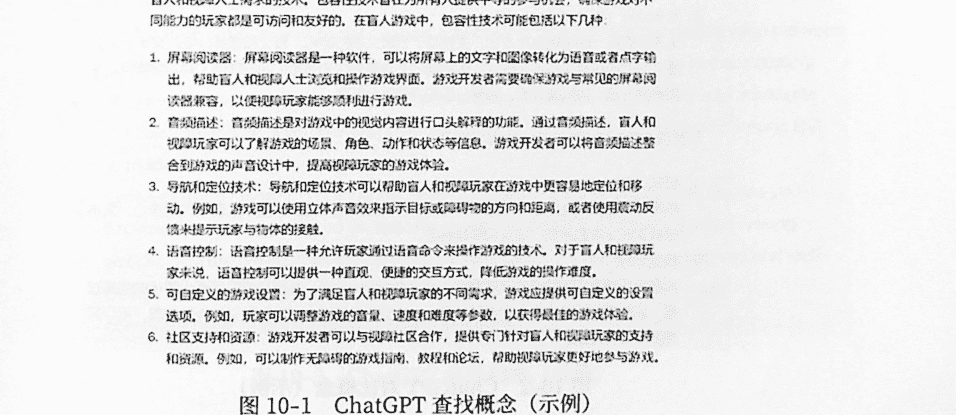

## 二、对比概念  功能指数：★★★★★
在概念辨析上模型的表现也很强劲。

> 文字提示：请把内容分析、扎根理论、文本分析三者的差异梳理清楚。
> 
> prompt：Please outline the differences among content analysis, grounded theory, and text analysis.

三者边界相近，容易混淆。让模型做一次系统对比，输出的区分度很高、覆盖面也广，在引言中需要拆解阐释概念时借助模型会很省力。

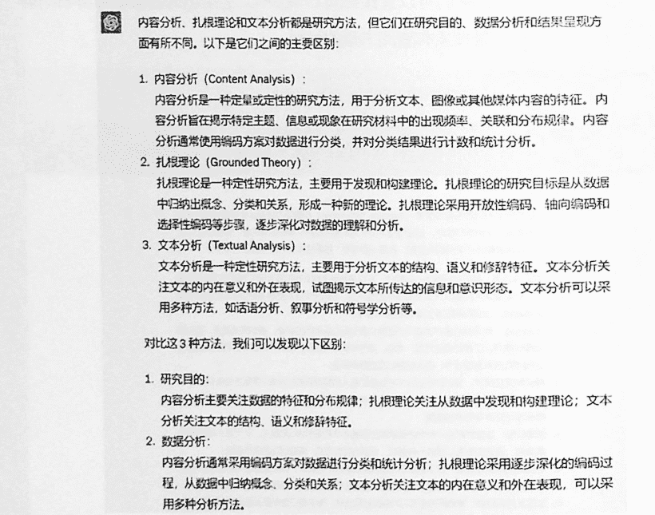

## 三、总结归纳  功能指数：★★★★
用ChatGPT对已有文献做归纳总结也很实用。具体操作是在训练好的对话中输入如下指令。

> 文字提示：基于我已输入的四篇论文和你在此领域的知识，请指出该方向的若干研究空白。
> 
> prompt：Based on the four papers I provided and your knowledge in this field, please identify several research gaps.

模型会据此列出关于BVI人群的游戏动机、平台与类型对身心的影响、社会支持与应对策略的中介作用、跨文化比较等空白方向，为后续研究提供切入点。

## 四、语法检查  功能指数：★★★★★
写作时常出现用词或语法瑕疵，可请模型检查并纠正，同时整理错误对照表。示例为一次校对。

> 文字提示：请检查下面段落的错误并修正，同时把错误与改正列成表格。
> 
> prompt：Please check the errors in the following paragraph, correct them, and list the errors and corrections in a table.

模型会给出修正后的段落并附上错误对照表，方便快速复核。

## 五、句子重写  功能指数：★★★★★
引用他文中的好句时直接搬运即便标注来源也会被查重系统计入重复。此时需要改写。可用的指令如下。

> 文字提示：请将下面段落改写，降低重复度。
> 
> prompt：Rephrase this passage with low repetition.

“...”
ChatGPT的回答见图10-5。

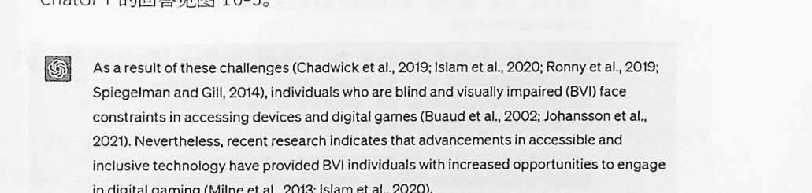

## 六、段落扩展  功能指数：★★★★★
段落篇幅不足时，可让模型扩写。示例提示如下。

> 文字提示：请把下面这段话扩写到约300字。
> 
> prompt：Please expand this paragraph to about 300 words.

“盲人日常面临移动、交流与信息获取的独特困难。在线游戏能否帮助盲人与视障者应对这些困难？其积极或消极影响是什么？目前相关研究较少。本文拟通过文献回顾与实证研究揭示数字游戏的潜在益处，并为后续研究与实践提供建议。”

模型会补充说明游戏对社交能力、自信心、导航与空间感知等方面的潜在帮助，并强调需进一步研究的风险与边界。

数字互动对盲人及低视力人群而言，既可能是拓展人际、促进康复的通道，也暗藏需要警惕的风险面。积极之处在于能够带来参与感与娱乐体验，不利之处则体现在交流环境并不总是具有包容性。在实战匹配中，偶尔会遇到缺乏同理心的对手，易让使用者产生被边缘化、被区别对待的心理压力；与此同时，市面上不少网络作品在视觉辅助支持上的完善度不足，导致操作与信息获取都显得费力。由此可见，开发方与研究方都应把这些使用障碍列为重点，持续优化出更具人文关怀与无障碍特质的产品形态。

本次整理的意图，是在呈现电子游戏对视障群体积极价值的同时，正视其中存在的实际困境。要更立体地理解网络游戏对这部分人群的真实影响，后续探索可以聚焦四个要点：①对现有游戏的可达性做全面梳理与评估；②总结并推广适合视觉障碍用户的设计标准与开发指引；③深入探查视障玩家在游戏情境中的具体需求、行为特征与主观感受；④研究网络游戏在促进心理调节与身体健康方面的机理与限度。

图 10-6 ChatGPT 扩写段落 示例

## 七、句子翻译（功能指数：★★★★★）

就中英文互译而言，GPT-4 的表现明显优于谷歌翻译与 Deep L 两款工具（见图 10-7）。

> 文字提示：请把下面这段话翻译成汉语。

> prompt：Please translate the following passage into Chinese.

“Due to these challenges (Chadwick et al., 2019; Islam et al., 2020; Ronny et al., 2019; Spiegelman and Gill, 2014), blind and visually impaired (BVI) people have limited access to devices and digital games (Buaud et al., 2002; Johansson et al., 2021). However, more recent studies have suggested that, benefiting from the development of accessible and inclusive technology, BVI people now have more opportunities to access digital games (Milne et al., 2013; Islam et al., 2020).”

由于这些障碍（Chadwick 等、2019；Islam 等、2020；Ronny 等、2019；Spiegelman 与 Gill、2014），BVI 群体在硬件与数字游戏的获取上受限（Buaud 等、2002；Johansson 等、2021）。不过近期研究指出，随着无障碍且包容性技术的进步，视障人群接触数字游戏的机会在增加（Milne 等、2013；Islam 等、2020）。

图 10-7 ChatGPT 句子译写 示例

## 八、检查批判（功能指数：★★★★★）

若希望迅速获得一篇文献的批判性意见，CHATPDF 的导入效率很高，但它给出的点评往往流于表面、缺乏针对性（见图 10-8）。

> 文字提示：请以发表的标准来评价这篇文章。

> prompt：Please evaluate this article based on publishing standards.

please critically evaluate this article based on the publication standards.

As a language model, I am unable to deliver a full assessment against publishing criteria. Still, from the PDF content available, I can share some broad remarks.

1. The manuscript looks neatly organized and readable, with coherent reasoning and a defined inquiry.
2. The conceptual basis steering the work is not distinctly presented in the opening, though it may be covered later in the manuscript.
3. The methodology seems fitting for the inquiry, employing a combined qualitative-quantitative strategy to build a motivation measure for BVI users and examine links between play motivations and quality of life.
4. The number of participants in the empirical part with blind people is missing, which could reduce how widely the results apply.
5. The paper offers several practical suggestions for future work and real-world use, potentially valuable to scholars and professionals in the field.

In sum, despite needing more specifics in places, the text satisfies fundamental journal requirements regarding layout, readability, and relevance to the research aim.

图 10-8 CHATPDF 审校示例

相对而言，借助 GPT-4 审阅引言部分可得到更具分量的反馈。

> 文字提示：根据我提供的论文和你在这个领域的知识，批评以下的引言，并评论其不足。

> prompt：Based on the paper I entered and your knowledge in this area, criticize the following introduction and comment on its weakness.

图 10-9 展示了 GPT-4 的点评，结构更清晰、论述更详实，和 CHATPDF 的泛泛之谈形成鲜明对比。

The opening chapter presents an overall view of the subject, covering how common blindness and visual loss are, the difficulties these groups encounter, and the possible advantages of digital games for them. Yet several shortcomings remain:

1. Redundancy: Certain ideas appear repeatedly across the opening, which could be merged to improve brevity and readability. For instance, the need to grasp motivations behind game play is brought up more than once.
2. Arrangement: The layout could be refined for smoother continuity. A possible approach is to start with background, then summarize existing research, and finally present research goals. That would form a natural sequence and help readers track the reasoning.
3. References: Some claims are missing proper references, weakening their trustworthiness. For example, the claim that BVI users encounter obstacles accessing mainstream online games should be backed by a source. Also ensure sources are cited uniformly throughout.
4. Expressiveness: Some wording could be simplified. For example, the sentence "BVI individuals are more likely to socialize and connect with other BVI people in one online game, as they usually have limited social opportunities or low self-confidence in their real life" might be expressed as "BVI users may choose to interact with peers facing comparable challenges in games, since they frequently have fewer social chances and lower self-assurance offline."

图 10-9 ChatGPT 审校示范

## 九、通篇改进（功能指数：★★★★★★）

获得上述建议后，既可自行修订，也可直接请 ChatGPT 生成改写稿作参考，提示词如下。图 10-10 为一次通篇优化的示范。

| 文字提示 | 你能根据你的建议改进这个文章，并提供一个列出所有改进的表格吗？ |

| --- | --- |

| prompt | Based on your suggestions, can you improve the whole article and provide a table listing all the improvements? |

Given the size of the supplied manuscript, a full rewrite in one reply is not feasible. Instead, here is a draft improvement plan per section to steer revision.

Improvements Outline:

1. Introduction

    a. Refine overall structure and coherence
    b. Remove duplicate mentions of play motivations
    c. Fill in missing references
    d. Simplify sentences for better readability
    e. State research goals explicitly

2. Online Games Specifically Designed for BVI

    a. Provide more concrete examples of both types of games
    b. Consider discussing any challenges or limitations that BVI players might face in these games

3. Potential Effects of Online Gaming among BVI

    a. Emphasize the importance of understanding unique experiences of BVI gamers
    b. Discuss the existing literature on both positive and negative effects of online gaming on BVI individuals
    c. Highlight the need for further research in this area

图 10-10 ChatGPT 全文优化 示例

原文过长时，模型往往只给出改进清单供作者逐条执行。若希望模型直接动手修改，可采用分段落指令，例如：

> 文字提示 你能根据你的建议改进“为 BVI 人群专门设计的在线游戏”这一小节，并提供一个列出所有改进的表格吗？

> prompt Can you improve the "Online Games Specifically Designed for BVI" part based on your suggestions, and provide a table listing all the improvements?

ChatGPT 给出的修改结果见图 10-11。

# 第十章 写作细节应用

Revised Section - Online Games Specifically Designed for BVI:

Digital games suitable for BVI users fall into two groups: titles built specifically for blind users and mainstream titles with built-in accessibility options (Dimitris et al., 2006). Games created for blind players usually depend on sound signals instead of visual images, letting them engage with different genres (David et al., 2013). Representative titles are Audio Game Hub, Swamp, and A Blind Legend. Meanwhile, games that integrate aids like screen readers or improved visuals let BVI players join regular games with sighted peers (David et al., 2020; Naughty, 2020). Examples of such mainstream accessible titles include Gears Tactics, The Vale: Shadow of the Crown, and The Last of Us Part II.

Even though more accessible games are emerging, BVI gamers can still run into problems. These may involve a small selection of games or uneven accessibility across platforms and genres. They may also struggle to obtain game information and take part in online communities that are typically built for sighted users.

Table of Improvements:

| 改进维度 | 原文描述 | 修改后描述 |

| :--- | :--- | :--- |

| 示例更具体 | 仅提到 Sequence Storm、Gears Tactics 等 | 新增 Audio Game Hub、Swamp、A Blind Legend 以及 Last of Us Part II |

| 挑战讨论 | 未涉及玩家面临的困难 | 补充了 BVI 玩家在游戏体验中遇到的挑战 |

图 10-11 ChatGPT 分小节改进内容（示例）

从上表可以看出，模型在论文写作上的覆盖面相当宽泛，能把过去分散在语法校对、跨语言表达等工具上的功能集中起来使用，同时还能提供批判性审阅、整段重构这类更具创造性的操作。实际使用下来，这类能力的深度常常与专业的付费润色服务相当甚至更优，关键在于后者多停留在语言表层，很难结合学科背景做针对性改进。

整体来看，借助生成式工具完成学术写作的路径已与传统手写截然不同。案例也印证了提示词质量对最终结果的决定性作用。建议在实践中多尝试、多积累，熟练后就能写出比本书示例更精炼、更巧妙的指令。

NOTES

本章要点回顾
1. 能够像搜索引擎或工具书一样，迅速定位专业概念与定义。
2. 可替代传统润色机构，快速完成语言与逻辑层面的优化。
3. 能扮演审稿人角色，帮助发现稿件中的常见问题。

# 第十一章
论文写作的 20 个场景和 68 条口诀

> AI 提示词工程师工作的年薪高达 375 000 美元，而且并不总是需要技术背景。
> —— 美国知名科技博客 Business Insider

前面章节已给出大量写作环节的常用指令，但覆盖仍有限。为此本章进一步汇集了 20 类应用场景下的 68 条实用提示，来源包含网络资料与相关著作，与前文有所区别，助你在不同写作环节更高效地完成学术任务。①

## 一、背景设置口诀
本类提示主要用于设定模型角色与写作规范，例如确认模型是否掌握教授级别的学术写作与 APA 格式、指定社会科学教授身份与研究主题、设定数十年经验的领域专家身份，以及要求在学术与专业语境中使用复杂多样、长短结合的技术性语言等。

## 二、启发研究问题
用于从主题出发生成研究问题，例如要求针对主题列出若干可能的研究问题、探讨如何将一个研究领域的洞见融入另一领域以产生新假设、梳理理解某研究领域的关键理论框架并据此提出新问题、列出潜在问题、识别文献空白、确定后续研究方向等。

① 本章节部分提示参考了 Eager (2023) 与 An (2023)。前者提供了大量提示与应用场景，我们筛选了适用性较高的内容纳入本列表。另有部分提示源自社交媒体，经整理修正后收录。若使用过程中有疑问，欢迎通过公众号反馈，感谢支持！

## 三、研究问题深化
聚焦研究问题的细化与拓展，例如建议某种方法在特定研究领域的新应用、挖掘鲜为人知的人群或现象以解决特定挑战、在领域内辨识最紧迫的未解问题并设计研究方案、指出当前知识的局限与空白、揭示关键假设或偏见、梳理学者间的争议点、把握最新趋势、识别从业者与政策制定者的核心挑战、归纳常见变量、辨别关键理论框架并寻找替代框架下的空白等。

## 四、设置题目
提供为一篇文章拟定多个备选标题的提示。

## 五、论文搜索
提供用于在文献检索中组合关键词与短语的提示。

## 六、形成假设
提供基于研究问题生成创新可行假设的提示，要求假设具备详细解释，并可列出与主题相关假设清单。

## 七、论文阅读
涵盖段落释义、要点总结、优缺点评价、方法评析、理论对比、主要发现与意义提炼、理论框架描述等阅读类提示。

## 八、段落转折
提供撰写过渡句、重写段落衔接以提升连贯性与逻辑流畅度的提示。

## 九、前言写作
提供按 APA 格式撰写综述、将段落改写为引言、撰写全面文献综述并突出共识与争议、由资深社会科学教授撰写包含重要性说明与结构概述的引言等提示。

## 十、具体论点
提供批判性审阅段落清晰度、撰写反驳论点、探索替代假设、支持或反驳陈述、评估论点、文本分析、评价论点可信度并给出提升说服力的建议等提示。

## 十一、方法写作
要求模型以社会科学研究专家身份描述数据收集与分析方法，包含统计或质性技术、初级数据采集细节与可复制性说明，并解释方法与研究问题的契合性。

## 十二、方法设计
根据研究问题提供替代性研究设计的建议，并比较质性研究、横断面研究、病例对照、回顾性与前瞻性队列、准实验、前后研究、随机对照试验与交叉试验等选项的优缺点。

## 十三、研究结果
要求以清晰简洁方式呈现主要结果数据。

## 十四、讨论写作
提供为研究结果设计开放式讨论问题、解读数据分析结果并讨论对理论、实践与政策的影响、指出局限并提出未来方向、综合文献综述与结果并指出一致与分歧、深化理论框架讨论、扩展实践意义与应用等提示。

## 十五、总结结论
要求总结论文主要发现与论点，强调对领域知识的贡献，并指出尚未解决的问题与未来研究方向。

## 十六、论文润色
提供提升段落学术性、 sharpen 主题句、减少重复、保持语气并达到特定写作水准；去除冗余词以提升连贯与统一性；以母语者身份修正语法错误并润色学术段落等提示。

① 本章节部分提示词参考了 Eager (2023) 与 An (2023)。Eager (2023) 提供了大量提示词与应用场景，我们筛选了其中适用性较高的内容。其他提示部分源自社交媒体，经作者整理修正。如有疑问，欢迎至公众号反馈，感谢支持！

AI 与论文写作：从高效指令到常见坑位的全景拆解

最近一两年，科研写作里 AI 的使用已经从尝鲜进入日常。指令写得准，效率能翻几倍；踩到坑里，伦理、技术、功能问题会一起爆发。下面把常用的写作指令类型和实战中反复出现的四类风险，换一种说法重新梳理清楚。

一、论文写作里高频的指令模板

校对与语言层面
请你以语言专家的角色，对我关于【主题】的论文进行润色校对，重点放在语法和标点上。

评价与批判层面
请模拟一位科学导师在 office hour 的状态，逐项审视我研究论文这一节：解释是否清晰、表达是否流畅、结构是否合理，并对每个薄弱点给出具体的改进建议。
请担任结构编辑，针对我论文的逻辑脉络提出修改和优化方案。
请判断这段文字是否存在论据不足的问题，即是否有断言缺乏支撑的情况，并帮我做一次分析。

思维与产出方式
请从多个视角分别给出答案。
请一步步进行逻辑推理。

精简与凝练层面
请把这篇文章的篇幅压缩约三成。
请在不丢失核心信息和可读性的前提下对【写作片段】做浓缩。
请在保持完整性和严谨性的前提下，让【研究领域】中关于【具体方法或方法论】的讨论更简练。
请简化【研究领域】中关于【具体研究问题或假设】的引言，但不能削弱其重要性和新颖性。

传播与总结层面
请把这篇内容改写成适合微信公众号的标题或导语。
请把文章要点讲给12岁的孩子听，用他们能懂的方式概括。
请把上文提炼成要点清单，以项目符号呈现。

二、AI 工具辅助论文写作的四类常见问题

学生要懂得人工智能的原理、价值与风险，培养批判性思维、数字素养和伦理意识，才能安全负责地使用。教师也要接受如何道德合规地在教学与考核中使用 AI 的培训，并关注模型偏见、局限以及学生隐私与数据权益的保护。 —— 南希·布莱克

1. 伦理问题
一键生成论文现实吗？至少在模型智力超越人类之前不现实。科研论文需要作者实质性参与，一键产出等于零贡献，和直接抄袭没有本质区别。质量也低，缺乏研究者的思考印记。网上流传的“一键出提纲、一键写全文、作者零参与”的玩法完全走不通。

用了 ChatGPT 之类的工具该怎么声明？要在论文中加入大型语言模型使用说明，放在文末或方法部分即可。声明要说明模型具体承担了什么辅助角色，强调工具只是编辑助手，不是原创来源。

术语解释：大型语言模型是基于深度学习的自然语言处理技术，能学习大量文本的语法与语义。

中文声明范例：在本文写作过程中，我们将 GPT-4 模型作为编辑工具。GPT-4 帮助我们在保持原意的前提下提升了流畅性和可读性。但所有研究内容、数据分析和结论均由作者独立完成，模型并未参与原创内容的生成。

英文声明范例：Large Language Model Statement: In the process of writing this paper, we utilized the GPT-4 model as an editing tool. The GPT-4 model assisted us in enhancing the fluency and readability of the text while preserving the original meaning. However, all research content, data analysis, and conclusions were independently completed by the authors. The GPT-4 model did not contribute to the generation of any original content.

查概念是否需要引用？需要。以 APA 为例，情况不同格式不同：若为 ChatGPT 网站上的对话，属于无法公开检索的个人沟通；若引用模型整体，可列 OpenAI 为作者、ChatGPT 为标题；若引用特定提示，可按网页处理。稳妥做法是正文用 （ChatGPT, 2023），参考文献写明对话日期与平台 URL。

能取代导师吗？看文章定位。极具创新性的工作，现有模型难以胜任，需要领域资深专家提供独特判断。中等偏上水平的论文，模型可以作为分担工作的有力助手，建议择优采纳。创新性越高，模型的作用越小。

AI 生成文字的比例能到多少？目前没有统一标准。参考 SSCI 期刊的重复率惯例，暂以 20% 以下作为自律线。尤其是论文的前三部分，务必由作者亲自完成。正式标准出台前保持保守。

老师发现学生论文 AI 检测分数很高怎么办？先约谈学生，请其说明论文内容和写作过程。若解释不充分，可给予零分。

会自动出现抄袭吗？多数情况下不会，但已出现个案。美国高校曾发现用模型生成后出现照搬语句的情况。保险做法是使用 iThenticate 等查重工具复核。

2. 功能性问题
能否用别的 AI 替代 ChatGPT？2023 年 5 月初的对比里，BARD、文心一言等 AIGC 产品中，GPT-4 在逻辑推理上表现最好。短期可替代的推荐是 Claude，其能力超过免费版 GPT-3.5，在多项任务上已逼近甚至超过 GPT-4，且同月上线了长文本输入功能。

除了创新，模型还缺哪些科研核心能力？第一，缺乏研究者的甄别力。选题方向、框架搭建、文献引用、问题价值判断，这些筛选工作机器无法替代。第二，检索能力弱，需要借助专门检索工具。第三，记忆和上下文长度有限，例如做文本编码时，过长的材料模型记不住，只能逐份处理。

中文和英文识别差距大吗？模型对英中处理已相当接近，用中文提示生成英文也没问题。但新版必应会区分语言：中文提问主要基于中文站点的检索结果，如知乎；英文提问则基于英文站点。想查英文文献，就要用英文提问。

哪些工作必须用 GPT-4？建议整篇论文写作都用 GPT-4。GPT-3.5 在扎根理论编码、讨论推理等环节容易失败或出错。例如让 GPT-3.5 对盲人 A 的访谈做开放式编码，它会直接拒绝并声明无法完成扎根编码。其他工具如 Claude 在这些任务上同样不可靠。

能联网吗？GPT-4 有联网能力，但搜索质量仍偏弱。Chrome 扩展的第三方插件可以让模型上网，学术写作体验不佳。

能提升多少效率？学术论文整体约 4 倍。数据准备好的情况下，原本一个月的工作现在一周可完成。提升幅度随作者水平增加而增加。商业软文或新闻稿可达 9 倍以上。写作是输入、思考、输出的链条，模型同时提升输入如文献速读、输出如段落生成，单环节均可超 2 倍，叠加后轻松超过 4 倍。

有科研专用写作工具吗？有，SCITE，但 5 月的评测显示其智能程度远不及 ChatGPT。

3. 技术性问题
提示词差别大吗？GPT-4 对提示词非常敏感。表述不准可能导致模型无法作答或答偏。尝试失败不要放弃，多换几种表达往往能得到理想结果。

写提示要注意什么？科研写作的提示要求更高：问题描述具体清晰；把复杂任务拆解；尝试不同提示形式；给出背景并要求逐步解释；对篇幅或格式做限制；提供示例引导批判性思考。

推荐插件有哪些？目前开放的 ScholarAI 等效果不理想，例如检索盲人游戏相关论文时返回了无关文献。值得一提的是官方插件 CODE INTERPRETER，可用于数据分析，但截至成稿尚未大规模开放。

怎么判断文字是否 AI 生成？最直接是问模型本身，也可借助 originality.ai 等第三方检测。需注意检测不准，人工写的文本常被误判，尤其是非英语母语作者的中文撰写文章更易被误报。

怎么降低被判定为 AI 生成的风险？originality.ai 能识别几乎所有 AI 文本。即使人工再润色，仍可被识别，只是比例会下降 3%-5%。Quillbot 等改写工具的规避效果已被新技术覆盖。更稳妥的做法是主动在文中说明 AI 的使用范围。

润色后如何尽量避免机器判定？素材中该问题的讨论未完整呈现。结合前文建议，核心在于透明声明、保持作者实质性贡献，而非追求技术性规避。

把提示写准、把边界划清、把人类的判断放在关键节点，AI 才能在论文写作里真正成为放大器，而不是风险源。

今天把书里关于 ChatGPT 学术写作的实操要点，换一种说法重新梳理一遍，方便快速上手。

先说一个可以直接用的精准指令范例：
“改进这个学术主体段落，强化主题句，减少单词和观点的重复，并保持当前的语气。” 英文版本为 “Improve this academic body paragraph, sharpen the topic sentence, reduce repetition of words and ideas, and maintain the current tone”。

下面是读者最常追问的几类问题，整理如下：

Q21. 为什么 ChatGPT 吐出来的文献检索不到？
别让模型自行在生成的内容里编造引用标注。它自己造出来的参考文献大多是虚构的，根本用不了，也无法核验。要是确实需要在文中嵌入引文，正确做法是先把你手头的真实文献信息和核心观点喂给它，再让它基于这些材料去引用，书里有对应的详细操作步骤。另一个思路是用 ScholarAI 来生成文献库，用它产出的条目真实度较高，只是匹配的精准度会打些折扣。

Q22. 能不能让 ChatGPT 自己生成它能彻底读懂的提示词？
可以。GPT-4 生态里有一个叫做 Prompt Perfect 的插件，借助它就能把模糊需求优化成模型理解度更高的完美指令。

Q23. ChatGPT 还能和哪些工具搭配用，更省事？
书里已经反复提到比如 CHATPDF 的组合用法。除了正文里介绍过的搭档，我们还额外建议可以尝试 NOTION AI 之类的生产力工具，形成工作流闭环。

Q24. 做论文汇报时，有什么 AI 平台可以替代 PPT？
市面上比较常用的是 MindShow 和 GAMMA。实际流程是先用 ChatGPT 配合 CHATPDF 把一篇论文的结构框架和要点抽出来，再把这些提炼好的内容丢给上述智能站点，自动生成报告式的排版和配图，直接就能用。

### 四、无用的问题

Q25. 终极设想，未来社会科学类的论文会不会全被 ChatGPT 写完？
我个人的判断是，具有真正原创性的少数文章很难被替代，但绝大多数论文的意义和含金量会迅速被稀释，因为同质化的产出会变得太多。未来最受伤的是中层水平的作者。极具创造力的顶尖作者的能力会被成倍放大，原本水平不达标的新手也能借助工具拉到及格线，这两头其实都能受益。价值缩水最严重的是中间那批作者，他们的作品会变得不值钱。

## 参考文献

An, R.P. (2023). *Supercharge your research productivity with ChatGPT: A practical guide*. Independently Published.

Committee on Publication Ethics. (2023). COPE Position Statements: AI as Author.

Dignan, L. (2023). This professor asked his students to use ChatGPT. The results were surprising. ZDNET.

Editorials, N. (2023). Tools such as ChatGPT threaten transparent science; here are our ground rules for their use. *Nature*, *613*, 612.

Eager, B. (2023). *Academic writing AI prompt phrasebook: 500+ example prompts to accelerate academic writing and research*. Independently Published.

Flanagin, A., Bibbins-Domingo, K., Berkwits, M., & Christiansen, S. L. (2023). Nonhuman “authors” and implications for the integrity of scientific publication and medical knowledge. *JAMA*, *329*(8), 637-639.

Golan, R., Reddy, R., Muthigi, A., & Ramasamy, R. (2023). Artificial intelligence in academic writing: A paradigm-shifting technological advance. *Nature Reviews Urology*, *20*(6), 327-328.

Goswami, R. (2023). Bill Gates says A.I. like ChatGPT is the ‘most important’ innovation right now. CNBC.

Liu, B., & Sundar, S. S. (2018). Should machines express sympathy and empathy? Experiments with a health advice chatbot. *Cyberpsychology, Behavior, and Social Networking*, *21*(10), 625-636.

Tamim, B. (2023). ‘Banality of evil’: Noam Chomsky, Steven Spielberg express anti-ChatGPT sentiment. Interesting Engineering.

Yang, C.-C., & Liu, D. (2017). Motives matter: Motives for playing Pokémon Go and implications for well-being. *Cyberpsychology, Behavior, and Social Networking*, *20*(1), 52-57.