# AI写作用AI倍速提升写作效率

本书是一本利用AI工具进行高效写作的指导手册，包含6个关键步骤，从明确主题到问题解答，旨在帮助读者掌握AI写作的核心技巧，适合职场人士、专业写作者和创作者、教育工作者、广告和创意团队、社交媒体内容创作者以及公共演讲者和演讲撰稿人等广泛群体。本书的特色在于通俗易懂的AI知识讲解、丰富的案例实践、多场景应用以及一学就会的指令技巧，帮助读者利用AI进行写作，提升工作效率与创作质量。本书不仅揭示了利用AI写作的奥秘，更是一本贴近生活的实用指南，让读者在AI的助力下产生新的灵感并创造更多可能性。

# 前言

ChatGPT 2022年11月30日发布，上线5天便吸引了百万用户；两个月后，用户数量飙升至1亿，创下了史上消费级应用增长最为迅猛的纪录。2023年初，ChatGPT引发了全球对人工智能的广泛关注，有人说，ChatGPT代表了“第四次科技革命”，标志着强人工智能时代的来临。

## 我为什么写这本书？

1. 学习AI：花费巨大

ChatGPT刚问世时，相关书籍较少，为了学习AI工具，我报名了一些知识博主的AI课程，学费动辄好几千，但课程质量参差不齐，我在学习上面花了不少钱。为了更系统地学习AI工具，我查询了国内外关于AI的各种研究、学术报告、视频课程等资料，对AI有了更深一步的了解，也学会如何向AI提问和如何使用提示词。

2. 应用AI：效率倍增

因为我是一名职业培训师，所以经常会接到客户的一些培训需求，针对培训需求，需要花上好几个小时为客户定制或者优化课程大纲，发送客户后等待客户的选择。所以制作课程大纲时需要花费很多时间，有可能客户还不选择你。这个时候我就想能不能把这个工作交给AI，交给ChatGPT？当我把客户的需求和标准输入给ChatGPT后，几秒钟就生成了符合客户需求的大纲，有的时候甚至比我自己写的大纲还好，我就像发现了“新大陆”一样。

受益后，我又开始把AI用在了其他领域。比如写公众号文章、写文案、写诗、写案例、写短视频和微课脚本、写书、写演讲稿、写PPT课件、生成PPT图片等。从此我就彻底离不开AI了。原本需要好几个小时才能完成的事情，现在只需要几秒钟就能完成，真的是倍速提升我的工作效率和生产力。

3. 讲授AI：前景广阔

当我自己觉得AI工具很实用的时候，我就问了一下身边的朋友，发现很多人还不知道有哪些AI工具，更别说使用过了。作为职业培训师，我本能地觉得“AI相关的课程”未来一定会是一个风口，比我现在讲的演讲课程、TTT讲师培养类课程会更有市场前景。于是我先后研发了与AI相关的4个系列课程并准备讲授和推广AI课程：“AI（爱）上写作——用AI工具10倍速提升写作效率”“AI（爱）上短视频——用AI工具10倍速提升短视频制作效率”“AI（爱）上绘画——用AI工具10倍速提升设计效率”“AI（爱）上生产力——用AI工具10倍速提升工作效率”。

2023年的上半年，AI课程还处于不温不火的状态，大家觉得AI这个领域很新，所以采购这类课的企业不是很多。但从2023年下半年开始，AI系列课程需求开始全面爆发，越来越多的企业意识到AI对于工作效率提升和降本增效的重要性，开始陆续采购AI课程，其中包括很多世界500强企业和知名的民营企业，每个月我都能接到数十场关于AI的课程需求，AI课程的课量甚至超过我之前最经典的演讲课和TTT讲师培养类的课。

我甚至发现AI课程有可能对演讲课和TTT类课程会是一个颠覆，因为它改变了传统的工作方式。与其等着别人把我的课程颠覆，不如自己先下手为强，于是我又研发其他AI应用的课程：“AI（爱）上课程开发——用AI工具10倍速提升课程开发效率”“AI（爱）上微课开发——用AI工具10倍速提升微课开发效率”“AI（爱）上演讲——用AI工具10倍速提升演讲效果”。

自此，我由原来传统课程的职业培训师，转型成AI生产力教练和AIGC（生成式人工智能）职业培训师，帮助职场人士提高工作效率，帮助企业实现降本增效。

## 4. 推广AI：量身定制

相对于参加培训课程，读书是一种成本最低的学习方式。我特别希望人人都能学会AI，运用AI工具快速完成写PPT、写新闻稿件、写微信公众号文章、写会议纪要、写活动方案、写工作汇报、写邮件通知、写营销文案、写短视频脚本、撰写公文等工作任务，提升我们的工作效率，让我们从烦琐的工作中解放出来，能够有更多的时间去做自己喜欢的事情和更重要的事情，于是我就写下这本为职场人士量身定制的AI写作书籍，希望能让你“爱上写作”。

## AI写作相较于传统写作有哪些优势？

1. 10倍速提升写作效率

快速生成大纲和结构：AI工具可以帮助用户快速生成文档的大纲和结构，帮助写作者更容易组织素材和展开思路。

快速生成内容：AI工具可以快速生成优质文章，比人工写作更为高效。也可以快速完成复杂的写作任务，例如报告、论文、合同、标书、小说、图书等。

即时反馈和修订：AI工具能够提供实时的反馈和修订建议，帮助用户在写作过程中不断改进，提高写作效率。

2. 零基础开启写作

零门槛：传统写作需要经验，有一定的门槛，你需要懂得各种写作技巧，还要有一定的文采和灵感，才能写出好文章。许多初学者以为写作需具备天赋和专业技巧，产生迟疑并放弃。但AI改变了传统的写作观念，打破了这样的障碍，即使零基础的作者也能利用AI工具快速生成优质文章。

简单易上手：你只需要会对AI进行提问，会使用指令就可以轻松指挥AI，得到源源不断的灵感和写作素材，从而一键写出高质量的文章。

3. 多样性和个性化

适应不同风格和领域：AI工具可以根据用户的需求生成不同风格和领域的内容，从正式的商业文档到随笔，具备很大的灵活性。

个性化定制：一些AI写作工具允许用户根据自己的写作偏好进行个性化定制，使生成的内容更符合用户的风格和需求。

4. 知识储备和信息检索功能强大

综合信息检索：AI工具可以通过整合大量的信息源，提供更全面的信息检索和参考，有助于写作者更深入地研究和撰写文稿。

5. 创新和灵感

创意性建议：一些AI写作工具能够提供创意性的建议，激发写作者的灵感，帮助其在创作过程中提出新的观点和想法。

总的来说，AI工具在写作方面的优势主要体现在速度、效率、零基础、多样性、语言处理和创新等方面，为写作者提供了更多可能性和便利。然而，仍需要注意在某些情境下，传统写作因其具有深度性、主观性和创造性可能仍然占据优势。

国内外的AI工具可以说是百花齐放，如图0-1所示。

在图0-1中，有对话的AI、写代码的AI、绘画的AI、做视频的AI等，可以看出，AI应用已经覆盖了各行各业。大部分AI以对话为主，因为大部分AI都是基于语言模态进行训练。其中应用最广的就是美国OpenAI公司开发的ChatGPT。

我们可以问问ChatGPT可以用来做什么？如图0-2所示。

**You**
你可以用来做什么，请从不少于10个角度来说明

**ChatGPT**
当然可以，ChatGPT在许多方面都可以发挥作用。以下是不少于10个角度的说明：

1. **自然语言理解：** ChatGPT可以解释和理解用户输入的自然语言，能够回答关于广泛主题的问题，提供信息和解释概念。
2. **问答系统：** 它可以用作问答系统，用于解答用户提出的问题，从科学知识到日常生活中的疑惑。
3. **学术写作助手：** ChatGPT可以协助学术写作，提供关于特定主题的相关信息、解释和观点，帮助研究人员和学生更好地理解和表达他们的想法。
4. **创意写作支持：** 对于作家和创作者，ChatGPT可以提供灵感、故事情节建议，或者充当创造性写作的合作伙伴。
5. **编程帮助：** 对于程序员，ChatGPT可以回答编程问题、提供代码片段和解释特定概念，是一个很好的编程助手。
6. **语言翻译：** 虽然有专业的翻译模型，但ChatGPT也可以处理基本的语言翻译任务，尤其是对于简单的短语和句子。
7. **心理健康支持：** ChatGPT可以充当一个倾听者，提供情感支持和心理健康建议，尽管它不能替代专业的心理治疗。
8. **教育辅助：** 作为教育工具，ChatGPT可以回答学生的问题，解释复杂的概念，或提供学科方面的帮助。
9. **智能助手：** 在日常任务中，ChatGPT可以充当智能助手，提供日历提醒、简单的计算、天气查询等服务。
10. **社交互动：** 作为一个有趣的社交互动工具，ChatGPT可以进行轻松的对话，回答有趣的问题，提供娱乐和消遣。

这些只是ChatGPT应用的一部分，由于其灵活性和强大的语言处理能力，它在各种领域都有潜在的用途。

图0-2

ChatGPT说它在各种领域都有潜在用途，我们继续追问，为了直观地知道它的功能，我们让它把自己能为人们做的事情整理成表格发给我们看，如图0-3所示。

可以看出ChatGPT能做的事情非常多，本书主要介绍ChatGPT的写作功能，我把国内外常见的可以用于写作的AI工具做了汇总，见表0-1。

**You**
按照以下方式将“ChatGPT能为人们做的事情”整理成表格：事情名称不超过6个字，不要编号，事情数量为70件，整理成7列11行的表格。

**ChatGPT**

| 事情 | 事情 | 事情 | 事情 | 事情 | 事情 | 事情 |
| --- | --- | --- | --- | --- | --- | --- |
| 问答系统 | 学术写作助手 | 创意写作支持 | 编程帮助 | 语言翻译 | 心理健康支持 | 教育辅助 |
| 智能助手 | 社交互动 | 制定计划 | 知识传递 | 主题解释 | 信息提供 | 代码片段 |
| 智能对话 | 用户问题 | 观点解释 | 情感支持 | 灵感提供 | 天气查询 | 想法理解 |
| 语法纠正 | 文本生成 | 计算 | 句子翻译 | 概念解释 | 网络搜索 | 创造性写作 |
| 互动对话 | 研究支持 | 知识整合 | 学科帮助 | 文本创作 | 自动回复 | 轻松对话 |
| 科普文章 | 创造性思考 | 语境理解 | 情感交流 | 学科知识 | 语言生成 | 文本编辑 |
| 娱乐 | 实用建议 | 计算 | 天气查询 | 文本生成 | 技术解释 | 情感理解 |
| 文字创意 | 语言推荐 | 创造性写作 | 创意合作 | 实用建议 | 用户指导 | 问题解决 |
| 技术支持 | 实用建议 | 自动回复 | 计算 | 天气查询 | 情感理解 | 文本推荐 |
| 创意 | 情感理解 | 文本推荐 | 技术解释 | 创造性写作 | 科普文章 | 创造性思考 |
| 文字理解 | 智能助理 | 学科教育 | 文本编辑 | 语言交流 | 技术解释 | 实用建议 |

▲图0-3

▼表0-1

| | AI 工具 | 所属公司 | 费用（截止 2024 年 3 月） |
|---|---|---|---|
| 国外 | ChatGPT | OpenAI | 3.5 版本免费 4.0 版本收费 |
| | Claude | Anthropic | 部分版本免费 |
| | Copilot | 微软 | 免费 |
| | Gemini | 谷歌 | 部分版本免费 |
| 国内 | 文心一言 | 百度 | 3.5 版本免费 4.0 版本收费 |
| | 讯飞星火 | 讯飞 | 免费 |
| | 通义千问 | 阿里巴巴 | 免费 |
| | 智谱清言 | 清华大学 | 免费 |
| | 豆包 | 抖音 | 免费 |

本书将以ChatGPT作为主要的AI写作工具来介绍。但是，本书当中提到的所有ChatGPT指令和用法同样适用于国内外其他AI写作工具包括以上表格中的AI工具。

本书共分为6章，为方便大家记忆，我设计了一个口诀：名剑山庄多棒。“名剑山庄”是写作模型“明建闪装”的谐音，其中“名”是明确主题，“剑”是搭建框架，“山”是闪写内容，“庄”是包装润色，“多”是多种应用，“棒”是帮问帮答。

本书适合职场人士、专业写作者和创作者、零基础和非专业写作爱好者、教育工作者、广告和创意团队、旅行作家和博主、社交媒体内容创作者、公共演讲者和演讲撰稿人等群体。本书的特色在于通俗易懂的AI知识讲解、丰富的案例实践、多场景应用，以及一学就会的指令技巧。本书不仅是一本揭示AI写作奥秘的权威之作，更是一本贴近生活、工作，极具实用性的指南。让我们一起踏上智能创作之路，用AI为文字赋予新的灵感和可能吧。

本书约定：

Q（Question）：表示向ChatGPT提问或指令提示；

A（Answer）：表示ChatGPT的回答；

[]：表示读者可根据需要替换指令中的内容。

# 第一章

## 明确主题：用AI快速明确写作主题

### 一、如何确定文章主题：4定法

《孙子兵法·军形篇》里面有这样一句话：“胜兵先胜而后求战，败兵先战而后求胜”。这句话意思是说，胜利的军队先通过各种手段获得战争的优势，然后再开始战斗；而失败的军队则在没有优势的情况下就匆忙发动战争，希望通过战斗来取得胜利。这句话主要强调了战前的准备和战略的重要性。其实写作也一样，不要还没构思好，就立马动笔写，而应该明确写作主题后再开始，要有“胜兵思维”，这样才能高效利用AI工具写出高质量的文章。所以“名剑山庄”AI写作模型的第一步就是明确主题。写作前明确主题有4大好处：

**明确焦点和方向。** 主题是写作的灵魂，它能够帮助你明确要表达的中心思想。如果没有一个清晰的主题，文章可能会变得散乱，读者也可能感到迷惑。例如，如果主题是“环保”，那么文章可能会集中探讨可持续发展、减少碳排放等方面。

**提高文章连贯性。** 主题是确保文章连贯性的关键因素。通过明确主题，你可以在整个文章中保持主旨的一致，避免出现不相关或相互矛盾的内容。例如，如果主题是“技术对社会的影响”，那么文章可能会从技术的积极影响谈起，然后深入探讨可能的负面影响，从而保持主题的一致性。

**引导读者理解。** 主题是读者理解文章意图的入口。通过清晰明确的主题，读者能够更容易地把握文章的目的，更好地理解作者的观点。例如，如果主题是“教育改革的必要性”，读者就会期待在文章中看到关于当前教育系统的问题以及改革方案的相关信息。

**提高写作效率。** 一个明确的主题有助于节省时间和精力，因为它限制了你想表达的范围。这有助于防止你在写作过程中偏离主题，使你更专注于核心内容。例如，如果主题是“健康饮食的重要性”，那么你可以专注于介绍健康饮食的益处、提供实用的建议。

在明确主题的基础上，作者可以更有针对性地构建文章结构、选择论据、展开论述，从而提高文章的质量和表达效果。那我们该如何明确写作主题？我们可以通过“4定法”快速明确主题：定选题——定目标——定类型——定标题。如图1-1所示。

图1-1

### 二、定选题：3圈法则确定选题

你想写一个关于什么话题的文章？什么话题的文章更容易成为爆款？在确定选题的时候，我们可以借助“选题地雷模型”来思考，如图1-2所示。

在“选题地雷模型”中有3个圈，分别是：读者关注的、读者熟知的和你所擅长的。

读者关注的：读者的兴趣和关注点是什么，他们对什么主题最为关注？

读者熟知的：读者对哪些内容或者主题是熟悉的、已知的？

你所擅长的：你擅长写什么主题的文章内容？

这3个圈经过重叠后形成了4个区域，到底哪一个区域才代表优质选题，更容易出爆款？我们来分析一下：

1代表“读者关注的、读者熟知的，但是你不擅长的”选题。当一个主题你不擅长时你很难写好，所以选1不可取。2代表“读者熟知的、你很擅长的，但是读者不关注的”选题，当一个主题读者不关注，压根就没有兴趣时，即便你写得再好也有可能没什么人愿意看，所以选2也不可取。4代表“读者关注的，你又擅长的，但是读者已经熟知的”选题，当读者已经熟知和了解这个主题，他就会对这个主题失去兴趣，除非你能提出不一样的新观点，所以选4也不可取。而3代表“读者关注的，读者又不熟知，但是你又擅长的”选题，这就非常符合爆款选题了，所以优质选题应该选“3”。

通常哪些优质选题符合3的特征？我们来看看ChatGPT如何回答？如图1-3所示。

**You**
有哪些类型的选题，更容易写出爆款文章出来

**ChatGPT**
写出爆款文章并非只取决于选题，还与写作的独特性、观点、语言表达等多个因素有关。然而，一些特定类型的选题通常更容易引起读者的关注，可能更有可能成为爆款。以下是一些常见的容易引发关注的选题类型：

1. **热门话题和趋势**：选择当前热门的话题或社会趋势，因为这些话题更容易引起读者的兴趣。这可以包括科技创新、社会问题、流行文化等。
2. **问题解决和实用性**：写作关于解决实际问题或提供实用建议的文章，因为读者通常对能够帮助他们解决问题或改善生活的内容感兴趣。
3. **反常现象和新发现**：探讨一些不寻常的现象、新发现或独特的经验，因为人们通常对新奇和意外的事物充满好奇心。
4. **个人故事和经验分享**：分享个人故事、成就或挑战的经验，因为这类文章常常能引起读者的共鸣和情感共鸣。
5. **独特的观点和见解**：提出独特、新颖或反常的观点，因为这有可能引起辩论和讨论，吸引更多读者参与。
6. **未来趋势和预测**：探讨未来趋势、发展和预测，因为人们对未来充满好奇，想要了解可能发生的变化和影响。
7. **文化解析和评论**：分析文化现象、艺术作品、电影、书籍等，提出深入见解和评论，因为这类文章通常能引起文化爱好者的关注。

请注意，选题的成功与写作的深度、质量、独特性等因素紧密相关。即便选择了一个热门话题，如果写作不够引人入胜，仍然可能难以实现爆款效应。成功的爆款文章通常是创新性、有深度、引人深思的作品。

图1-3

### 三、定目标：3个锦囊明确写作目标

如何明确写作目标？通过3个锦囊让你快速明确写作目标。如图1-4所示。

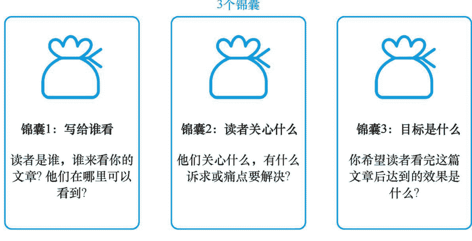

举个例子，假设我要在公众号上写一篇推荐《结构演讲力》这本书的文章，利用这3个锦囊就可以快速明确写作目标。

锦囊1：写给谁看。写给读者、粉丝，以及对演讲感兴趣的人看。

锦囊2：读者关心什么。内向的人能否做好演讲？如何克服上台紧张？如何做好工作汇报？结构演讲力能不能提升演讲水平？等等。

锦囊3：目标是什么。宣传这本书，引导读者购买本书。

通过3个锦囊的梳理，就可以大致知道自己要写什么，哪些内容才是你的写作重点，为接下来完成整篇写作打下坚实的基础。

在要求ChatGPT给你写文章的时候，不要直接说给我写一个关于××主题的文章，而应该把3个锦囊的信息加进去，这样有利于ChatGPT写出更符合我们要求的高质量的文章。案例展示如下：

Q：请扮演写作专家，你需要帮我写一篇关于[AI可以十倍速提升写作效率]的公众号推文，读者是[内容创作者]，文章要谈到[如何利用AI工具提升写作效率的具体操作方法和案例]，通过这篇文章让读者能够[喜欢AI、运用AI高效写作]。

A：标题——利用AI工具十倍提升写作效率，内容创作者的必备秘籍！

尊敬的读者们，大家好！在今天的这篇文章中，我将与大家分享如何利用AI工具来提升写作效率，并给出一些实际操作方法和案例。相信通过阅读本文，您将更加热爱AI技术，并能够运用它来高效地撰写优质内容。

AI工具在如今的信息时代扮演着越来越重要的角色，它不仅可以帮助我们快速完成烦琐的任务，还能够为我们提供创造性的灵感和思路。下面，让我们一起来看看如何利用AI工具来提升写作效率吧！

#### 第一步：文本生成与创意启发

AI工具可以为我们提供大量的文本生成功能，比如自动摘要、自动补全、关键词提取等。通过这些功能，我们可以快速获取大量相关资料，并在阅读和整理的过程中激发创意灵感。例如，使用AI工具可以自动生成文章开头的引言，或是根据关键词提供的线索来展开思路。

#### 第二步：语法纠错与修饰

无论是母语还是非母语的写作者，都难免会有语法和拼写错误。AI工具可以帮助我们及时发现并纠正这些错误，使文章更加流畅易读。此外，AI工具还能够提供修饰建议，帮助我们提升文章的表达效果和语言品质。

#### 第三步：创作辅助与自动化

AI工具可以成为您的最佳写作伙伴，通过智能算法和机器学习，它能够分析大量的文章样本，并基于此为您提供创作建议。例如，AI工具可以根据您的写作风格和目标读者，提供适合的词汇选择、句式结构、段落组织等方面的建议，从而让您的文章更具吸引力和可读性。

案例分享。

让我们以一位名叫小李的内容创作者为例来说明AI工具是如何提升写作效率的。

小李是一名在社交媒体平台上发布新闻评论的作者。在使用AI工具之前，他需要花费大量时间来查找相关资料、整理思路和编辑文章。然而，自从他开始使用AI工具后，情况发生了翻天覆地的变化。通过AI工具的帮助，他能够快速获取大量的新闻摘要和关键词，从而迅速了解新闻事件的背景和要点。此外，AI工具还为他提供了丰富的语法纠错和修饰建议，使他的文章变得更加流畅和专业。最重要的是，AI工具通过分析他的写作习惯和读者喜好，为他提供了个性化的创作建议，使他的文章在社交媒体上获得了更多的关注和转发。

尊敬的读者们，在这篇文章中，我向大家展示了如何利用AI工具来提升写作效率，并通过一个案例分享了AI工具的实际应用。相信您现在已经对AI工具的潜力有了更深的认识，并希望您能够积极运用它来提升自身的写作能力。让我们一起迎接信息时代的挑战，创造更多优质的内容吧！

### 四、定类型：职场常见的8种写作类型

职场常见的写作类型有哪些？每一种类型的写作要求和标准都不太一样，我们要在写作前定好自己的写作类型，才能更好地命令ChatGPT写出更符合我们要求的文章。这里给大家梳理了常见的8种职场写作类型，分别是工作汇报、提案书、邮件、公文、职业简历、文案/短视频脚本、新闻稿/公众号文章和会议纪要。

#### 1. 工作汇报

报告是对特定问题、研究或项目进行详细分析和总结的文档。报告通常包括背景介绍、方法论、数据分析和结论等部分。

#### 2. 提案书

当谈到提案书或计划书时，我们指的是一种正式的文件，旨在向特定受众介绍、解释并推动某个计划、项目或想法。这种文书通常用于商业、学术、非营利组织等领域，其目的是为了获得支持、资金或合作。

#### 3. 邮件

与同事、客户进行沟通交流的邮件文章。

#### 4. 公文

为政府、组织、企业等机构或团体起草的一类正式文书的写作活动。例如公告、通知、公函、报告、任命书、命令、申请书、演讲稿，等等。

#### 5. 职业简历

求职过程中提交给雇主的个人简介，用于突出自己的经历、教育背景、技能和成就。

#### 6. 文案/短视频脚本

为产品、服务撰写的宣传推广文章或者短视频脚本。

#### 7. 新闻稿/公众号文章

在公众号上或其他新媒体平台上发布企业动态、活动等信息的新闻文章。

#### 8. 会议纪要

记录会议内容和决策结果的正式文档。它承载了会议的要点、讨论的重点、决策结果，以及相关行动项。

如何通过ChatGPT常见指令高效地完成职场8种常见的写作类型，我们将会在本书后续章节中详细给大家示范拆解。

### 五、定标题：吸引读者的6种标题类型

利用ChatGPT只需1秒就可以轻松搞定标题的撰写。参考指令如下：

Q：请扮演写作专家，帮我设计10个关于[人工智能可以提升工作效率]的爆款文章标题。

A：当然可以帮您设计这些文章标题。以下是10个关于[人工智能可以提升工作效率]的爆款文章标题：

1. 智能引擎，职场加速：人工智能如何提升工作效率？
2. 未来办公室的魔法师：人工智能助力工作效率飙升
3. AI驱动的职场变革：十大方式让你的工作更高效
4. 机器智能，事业智胜：人工智能打造高效职场新时代
5. 职业巅峰不再遥远：人工智能如何成就工作效率的飞跃
6. 智能化时代，工作更轻松：人工智能助你事业腾飞
7. AI助力职场升级：十招让你的工作效率倍增
8. 职业进阶的秘密武器：揭秘人工智能如何助力工作事半功倍
9. 工作新境界：智能科技如何为你的职业披上翅膀
10. 创新职场，智能引领：十大人工智能技巧提升工作效能

如果我们对以上10个标题不满意，也可以命令ChatGPT再来10个，直到你满意为止。参考指令如下：

Q：再来10个。

A：好的，10个标题如下。

1. AI引领工作新风潮：解锁效率密码的十大秘诀
2. 数字智谋：人工智能如何巧妙提升你的工作效能？
3. 未来职场的超级助手：十种人工智能应用改变你的工作方式
4. 效率之光：人工智能如何重新定义工作场景？
5. 智慧职场：十项人工智能技术助你事业腾飞
6. AI加速器：如何利用人工智能为工作注入新活力？
7. 职业黄金时代：十种人工智能应用提升工作生产力
8. 未来职场新视野：人工智能时代的高效工作策略
9. 创新力爆发：人工智能如何引领你的工作革命？
10. 数字化智慧工作：十大人工智能利器助你事业更上一层楼。

当然，如果你本身对好文章的标题颇有研究，也可命令ChatGPT按照指定方法起文章标题。常见文章的标题有以下6种类型：

> Q：请扮演写作专家，告诉我写作过程中常见的6种爆款文章标题是什么，定义是什么，每种有什么作用，并且每种方式请给出3个具体的案例。

A：当谈到撰写引人注目的文章标题时，有许多不同的方法。以下是六种常见的爆款文章标题类型，它们在不同情境下都能引起读者的兴趣。

#### 1. 问题引导型标题

使用引导性问题激发读者的好奇心，迫使他们想要了解答案。引发读者兴趣，激发对文章内容的好奇心。

案例：

- 你知道这种简单的生活习惯，竟然可以提高你的工作效率吗？
- 为什么有些人事业有成，而其他人却一事无成？
- 你是否犯了这个让人头疼的写作错误？

#### 2. 数字列举型标题

利用数字列举的方式呈现信息，强调清晰的结构和简洁性。提供简明扼要的信息，吸引读者快速浏览。

案例：

- 10种改变生活的方法，你可能从未尝试过！
- 5个让你立即变得更聪明的技巧
- 7步打造完美的工作日程表

#### 3. 秘诀揭示型标题

向读者揭示某个秘密或独家信息，激发好奇心。制造紧迫感，让读者觉得他们能够获得独特的见解。

案例：

- 成功人士每天都在做的10个秘密习惯
- 行业内专家不愿意告诉你的成功秘诀
- 这个简单的技巧揭示了长寿的秘密

#### 4. 挑战性问题型标题

提出一个挑战性问题，引导读者思考自己的观点或行为。激发读者思考，促使他们主动参与。

案例：

- 你敢不敢尝试一个月不碰手机？
- 挑战自己：一周内学会一项全新的技能
- 你有多勇敢？接受这个冒险的挑战吧！

#### 5. 故事叙述型标题

用一个引人入胜的故事概要来吸引读者。唤起情感共鸣，吸引读者通过阅读故事了解更多。

案例：

- 她如何用一篇文章改变了整个行业的看法
- 一个小小决定，改变了我的一生
- 这个令人感动的故事，告诉我们成功背后的艰辛

#### 6. 权威性论述型标题

强调作者或相关专家的权威性，使读者相信文章内容的可信度。建立作者的专业形象，增强读者对内容的信任感。

案例：

- 一位心理学专家揭示：幸福的关键在于……
- 业界领袖亲自教你如何在市场中脱颖而出
- 医学专家证实：这种健康习惯确实有效

这些标题类型各有其优势，具体选择取决于目标受众和文章内容。在标题中结合好奇心、数字、秘密、挑战、故事和权威性等元素，可以增加文章的吸引力和点击率。了解了6种文章标题类型以后，就可以让ChatGPT按照我们指定的方式去起标题，这样的标题会更符合我们的要求：

Q：请扮演写作专家，利用[数字列举型标题]帮我起10个关于[人工智能可以提升工作效率]的爆款文章标题。

A：当使用数字列举型标题来探讨人工智能如何提升工作效率时，可以强调实际数字和清晰的列表结构。以下是10个相关的爆款文章标题：

1. 8种方式，人工智能如何让你的工作效率翻倍？
2. 5个数字证明，人工智能是职场生产力的未来
3. 10个实例揭示，人工智能如何助力企业提升工作效率
4. 7个数字背后的真相：人工智能是职业成功的关键
5. 人工智能时代：3个具体数据，工作效率达到前所未有的高度
6. 如何通过人工智能实现工作流程的7大飞跃
7. 数字化未来：5种方式人工智能正在颠覆工作方式
8. 人工智能引领潮流：6个案例展示工作效率的革命
9. 提高产能的秘诀：人工智能时代的8项必备技能
10. 数字背后的黑科技：人工智能是职业成功的黄金钥匙

这些标题通过数字和列举的方式，清晰地传达了人工智能如何对工作效率产生实质性影响，吸引读者进一步了解相关内容。

好的文章标题有3个特征：对他有利、引他好奇、让他瞩目，让对方忍不住想点进去看！文章的主题明确了，标题也写好了。接下来我们要学习“名剑山庄”AI写作模型的第二步——建：搭建框架。

# 第二章

## 搭建框架：用AI快速搭建写作框架

### 一、文章框架的重要性和“开—进—关”模型

“名剑山庄”AI写作模型的第二步是：搭建框架。搭建文章框架在写作中具有至关重要的作用，它有助于确保文章结构合理、逻辑清晰，使读者更容易理解和接受作者的观点。搭建文章框架对于写作有以下3点好处：

**提高可读性和理解度。** 一个有着清晰结构的文章，层次分明，读者能轻松地沿着主线理解文章内容。相比之下，如果一篇文章没有明确框架，内容杂乱无章，那么，读者就很难追踪作者的思路。如果将读文章比作一趟旅行，搭建良好的框架就像是规划好的旅行路线，读者可以顺利地从起点到达终点，而不是在中途迷失方向。

**强化逻辑关系和论证效果。** 在一个有序的框架内，作者可以更好地组织论点，使之有层次、衔接紧密。逻辑关系清晰的文章更有说服力，而混乱的文章可能导致读者感到困惑。比如，一座拥有合理交通规划的城市，与一片没有规划道路的荒野相比，前者更容易让人迅速到达目的地，正如搭建文章框架有助于读者更迅速地理解作者的观点一样。

**提高写作效率和节省时间。** 在开始写作之前规划好框架，相当于给自己制订了一个明确的写作计划。有了框架，作者可以更有针对性地展开写作，避免在写作过程中频繁修改和调整结构。比如，一个建筑工地，如果在动工之前没有详细的蓝图和规划，建筑过程中就会频繁出现问题，增加了工作时间和成本。文章框架就是写作的蓝图，有助于高效完成文章。

搭建文章框架对于文章的重要性不可忽视。它不仅提高了文章的可读性和理解度，强化了逻辑关系和论证效果，还能提高写作效率。那么该如何搭建文章的框架？常见的文章框架又有哪些呢？

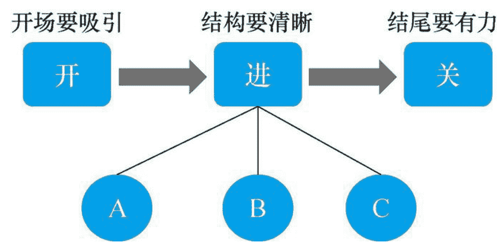

无论是写作、影视作品、游戏，还是演讲、授课，你会发现都符合一个最基础的框架：“开—进—关”模型。这是一种简洁而有效的写作结构，分为开场、结构和结尾三个环节，如图2-1所示。以下是每个环节的要求和标准：

#### 开（开场）：文章的开场有哪些要求？

引人入胜。开篇要引起读者的兴趣，可以使用引语、问题、故事或引人深思的事实。

明确主题。在开篇的部分，明确表达文章的主题或中心思想，让读者知道他们将要阅读的是什么类型的内容。

背景介绍。提供一些背景信息，使读者对主题有基本了解。

例如，如果写一篇关于环境保护的文章，开篇可以引用相关统计数据，提出引人注目的问题，然后明确表达关注的主题是环境问题，并简要介绍全球变暖的背景。

#### 进（结构）：文章的结构有哪些要求？

结构清晰。文章的主体部分应该有清晰的结构，可以确保读者能够轻松地跟随作者的思路。

有逻辑。段落和句子之间的逻辑关系要清晰，确保每个段落都有明确的主题句，并在上下文中合理连接。

论证和支持。在文章的主体部分，论证观点需要有充分的支持材料，可以是事实、数据、引用或例子。

例如，如果文章的主题是环保措施的实施，进篇可以分为不同段落，分别讨论政府政策、企业责任和个人行动，每个段落都有清晰的结构和充分的支持材料。

#### 关（结尾）：文章的结尾有哪些要求？

总结核心观点。结尾部分要对文章的核心观点进行总结，强调作者的立场或主张。

呼应开篇。结尾可以呼应开篇，使整篇文章在思想上形成一个完整的闭环，给读者留下深刻的印象。

提出展望或建议。根据文章的性质，可以提出对未来的展望或给出相关建议，增强文章的深度和影响力。

例如，如果文章讨论的是环保的重要性，结尾可以强调每个人都能为环保贡献力量，提倡可持续的生活方式，并鼓励读者参与环保活动。

通过“开—进—关”模型，作者能够在文章中写出引人入胜的开篇、有条理的结构以及有力的结尾，使读者更容易理解和接受作者的观点。这一模型有助于确保文章的逻辑性和连贯性，提升写作的质量。

接下来，我们以新媒体写作为例，分别介绍一下常见的文章开场、结构和结尾分别有哪些？

### 二、6种文章开场设计

开场是你与读者建立连接的时刻，就像一部电影在开始时吸引观众的注意力一样，开场可能是一个激动人心的场景、一段引人入胜的对白或者是一段有悬念的文字。这是吸引观众，让他们沉浸在故事中的关键时刻。文章的开场应该有足够的吸引力，使读者愿意继续阅读下去。

常见的文章开场方式有以下6种：

#### 1. 引用开场

使用名言或引语，以引起读者兴趣或激发思考。通过引用可以为文章建立权威感，传达作者观点的深度。例如，高尔基说：“成功的秘诀在于把握每一个机会。”

#### 2. 问题开场

提出一个引人深思的问题，激发读者的好奇心，引导他们进入文章主题。通过问题建立与读者的互动，引导他们思考与文章主题相关的问题。例如，你有没有想过，人类的创造力究竟是源自何处？

#### 3. 故事开场

通过一个生动的故事或情景引入文章，使读者产生情感共鸣。通过故事吸引读者的注意，使他们更容易理解和关注文章的主题。例如，在那个阳光明媚的早晨，我发现一只小鸟跌落在路边，这个经历让我深刻反思人类对自然的影响。

#### 4. 统计数据开场

使用引人注目的数据或统计数字，突出文章主题的重要性。通过数据强调问题的紧迫性，引起读者对主题的关注。例如，根据最新的研究，全球每年有超过一百万人死于空气污染。

#### 5. 定义开场

提供对文章主题的定义，帮助读者更好地理解即将讨论的内容。通过定义明确文章的内容，为读者提供基本概念。例如：自由，并不仅是不受拘束，更是一种责任与选择的体现。

#### 6. 引发争议开场

提出一个引起争议的观点，激发读者思考。通过引发争议激发读者兴趣，吸引他们继续阅读。例如，虽然科技发展给我们带来了便利，但我们是否真的意识到它可能导致的隐患？

每种开场方式都有其独特的作用，选择合适的开场方式取决于文章的目的和读者的背景。关键是确保开场与文章主题相关，并能够引起读者的兴趣，促使他们愿意深入阅读。

### 三、6种文章结构设计

建筑物的结构需要坚固的基础和巧妙的设计来确保稳定，一篇文章也需要合理的结构来支撑内容，使读者能够顺畅理解，并留下深刻的印象。想象一下你正在建造一座高楼大厦，如果基础不牢固，整座建筑就会不稳定，容易倒塌。同样，文章的结构如建筑的基础，它决定了整体的稳定性。一个清晰、有序的结构可以让读者更容易地理解你的观点和信息，而不至于迷失在混乱的叙述中。

此外，文章结构也可以比作一座美丽的桥梁。一座桥梁需要精心设计，以便交通顺畅并确保安全通行。同样，一篇文章的结构需要考虑读者的流畅阅读体验，确保信息的顺利传递，避免跳跃或混乱的结构引起的困扰。

常见的文章结构有以下6种：

#### 1. 顺序结构

按照事件发生的时间顺序组织文章，呈现事件发展的历史或演变过程。

适用情况：适合叙述性写作，如个人经历、历史事件、实验过程等。

例子：描述一场旅行的经历，按照时间顺序呈现每个阶段的事件和感受。

#### 2. 问题解决结构

先介绍问题、分析原因、最后给出解决方案，强调解决方案的优势。也可以使用“是什么——为什么——怎么样”的方式来构建文章的结构。

适用情况：适合议论性写作，讨论问题、提出解决方案或提出建议。

例子：讨论城市交通拥堵问题，提出改善公共交通、推广共享出行的解决方案。

#### 3. 比较对比结构

对两个或多个事物进行比较和对比，突出它们的相似之处和差异之处。

适用情况：适合用于写比较两个概念、理论、观点等的文章。

例子：比较不同的学习方法，分析它们的优点和缺点。

#### 4. 因果关系结构

揭示事件之间的因果关系，指出某个事件的原因和结果。

适用情况：适合用于写说明某个现象的原因及其影响的文章。

例子：探讨社交媒体对青少年心理健康的影响，阐述其原因和可能的结果。

#### 5. 分类结构

将事物分为不同的类别或组，依据共同的特征或属性进行组织，可以理解为我们经常用到的“总—分—总”结构。

适用情况：适合用于写对一个大主题进行分类和详细说明的文章。

例子：介绍各种音乐类型，如古典音乐、流行音乐、民谣等。

#### 6. 主题演绎结构

从一般性的观点或原则出发，逐渐引出具体的例子或应用。

适用情况：适合用于逻辑推理，从一般到特殊的论证。

例子：从伦理原则出发，逐步阐述具体的道德困境和应对方法。

每种结构都有其独特的作用，选择适合文章主题和写作目的的结构可以帮助文章更具有逻辑性和吸引力。关键是确保结构的选择能够有效地传达作者的观点。

### 四、6种文章结尾设计

文章结尾就像一首音乐需要一个圆满的结尾，或者一场表演需要一个精心设计的结局为观众留下深刻的印象一样，文章的结尾也同样至关重要。文章的结尾是读者与作者思想互动的最后印象，它决定了读者对整篇文章的总体感受。

文章的结尾是整篇文章的点睛之笔，决定了读者读完时的情感共鸣。一个出色的结尾可以强化作者的观点，激发读者的思考，或者留下一种深远的印象，就像一场精彩的表演在结束时给观众带来满足感一样。因此，在写作中，精心设计的结尾是确保读者读完时记住你的文章的关键因素之一。

常见的文章结尾方式有以下6种：

#### 1. 总结结尾

对文章中的主要观点、论证或内容进行简要总结。

适用情况：适合用于综述性文章，总结文章中的关键信息。

例子：在一篇关于环境污染的文章中，结尾可以简要总结各种污染形式，并强调环保的重要性。

#### 2. 呼应开头结尾

在结尾回顾或呼应文章开头的内容，形成文章的整体呼应。

适用情况：适合强调文章主题或强调文章开头提出的问题。

例子：如果文章开头是一个引人入胜的故事，结尾可以回顾该故事，强调它与文章主题的关联性。

#### 3. 引发思考结尾

提出一个引人深思的问题或思考，鼓励读者继续思考相关主题。

适用情况：适合用于写引发读者思考、激发读者兴趣的议论性文章。

例子：在一篇关于未来科技发展的文章中，结尾可以提出：“我们将如何应对人工智能的不断发展以及它将给我们带来的影响？”

#### 4. 展望未来结尾

讨论文章主题的未来发展趋势或者提出未来的解决方案和展望。

适用情况：适合用于写讨论发展趋势、展望未来的文章。

例子：在一篇关于可再生能源的文章中，结尾可以展望未来的能源发展方向和技术创新。

#### 5. 互动参与式结尾

在文章结尾营造互动氛围，鼓励读者参与其中，如投票、留言、提供自己的创意和建议。

适用情况：适合用于写那些可以进行评论、转发和投票等交互形式的新媒体文章。

例子：时尚搭配类文章可在结尾处写上“在评论区分享你最喜欢的搭配风格，我们将选出最受欢迎的搭配！”，来鼓励读者参与投票。

DIY手工制作类文章也可以在结尾写上“你有什么创意的DIY项目？快来评论区分享给大家吧！”。

另外，电脑评测文章在结尾写上“你想看到哪种电脑评测？在评论区告诉我们你的建议吧！”，以引发读者的参与。

#### 6. 引用结尾

结尾使用引人深思或与主题相关的引语，强化文章的观点。

适用情况：适合用于提供深刻思考或强调文章主题。

例子：在一篇关于领导力的文章中，结尾可以引用一位成功领导者的名言，强调领导力的重要品质。

每种结尾方式都有其独特的作用，选择合适的方式取决于文章的目的、主题和作者的写作风格。关键是确保结尾与文章的整体风格和主旨相符。

### 五、用多种命令方式一键撰写文章

了解完文章的“开—进—关”模型以后，我们接下来就可以用多种方式命令ChatGPT一键完成文章内容的撰写。

一键完成文章撰写的方式适合字数比较少，内容比较简单，可以一次性写完（目前免费版的ChatGPT3.5的最大输入汉字量约为2000字，包括空格和标点符号）的话题，参考指令如下：

Q：请扮演写作专家，以[人工智能提升工作效率]为主题，写一篇公众号推文，介绍[人工智能如何帮助职场人士提升工作效率]，具体要求如下：

1. 取一个爆款的文章标题；
2. 开场采用“统计数据开场法”；
3. 结构采用“总分总”的方式；
4. 结尾采用“展望未来法”；
5. 字数控制在1200字以内。

A：当然可以，以下为文章内容：

标题：人工智能改变职场——提升效率大势所趋

统计数据开场法：曾经，职场人士需要花费大量时间分析数据、处理文件、安排日程和回复邮件，而如今，随着人工智能技术的不断发展，这些烦琐的任务可以得到极大地简化与提升效率。根据最新调查数据显示，超过70%的职场从业者相信人工智能已经或将会对他们的工作产生积极影响，其中有近60%的人表示人工智能已经让他们的工作效率明显提高。

总分总：

一、自动化办公流程

现代企业中，很多日常办公任务都可以通过人工智能工具来自动化处理。比如，利用智能办公软件，可以实现文件分类整理、自动化报表生成和智能日程安排，这大大减轻了职场人士的工作负担，提高了工作效率。

二、智能数据分析

人工智能在数据分析领域的应用也是愈发广泛。通过机器学习和数据挖掘技术，人工智能可以帮助职场人士更快速地分析海量数据，发现商业价值，并为决策提供智能支持，从而加速业务的发展和优化工作流程。

三、智能助手提升工作效率

智能助手成为职场人士的得力助手，例如语音识别技术可以帮助记录会议内容，智能客服系统可以自动回复常见问题的邮件，智能聊天机器人可以解决员工日常问题，大大节省了人力资源，提升了工作效率。

展望未来法：

可以预见，在人工智能技术的不断演进下，职场人士的工作效率将会得到进一步提升。未来，人工智能将更加贴合职场需求，提供更加智能化、个性化的办公解决方案，帮助职场人士更加高效地处理工作中的各类任务，释放出更多创造性思维和战略性决策的空间，从而推动整个职场向着更高效、智能化的方向发展。

人工智能正在改变着我们的职场生活，而这种改变无疑是积极的。让我们拥抱这场科技变革，迎接工作效率的全面提升！

很多人会有疑问，既然ChatGPT能一键完成文章的撰写，为啥还需要分模型学习“开—进—关”模型，直接写好指令让ChatGPT写一键完成主题撰写就可以了。其实分模块学习“开—进—关”模型有很多好处：

首先，可以让你的文章变化万千。6种开场、6种结构、6种结尾组合起来就有6×6×6=216种文章的变化形式，你可以对“开”“进”“关”随机组合，命令ChatGPT按照你的组合方式来写文章，就像搭积木一样，这会让你的文章变得多种多样、丰富多彩。

其次，可以让你判断ChatGPT写的文章到底好不好。当你理解和学会“开—进—关”模型以后，你就能判断出ChatGPT写的“开”好不好、“进”好不好、“关”好不好。

最后，可以让ChatGPT帮你改写写得不好的部分。当你发现ChatGPT写的文章的部分内容或者整体内容不够好的时候，就可以继续命令ChatGPT改写部分内容或者改写全部内容，在第4章，我们将详细介绍内容修改和润色技巧。比如，还是刚才的这篇文章：《人工智能改变职场：提升效率大势所趋》，假设我们需要对文章开头进行修改，把原来的“统计数据开场法”改成“问题开场法”，参考指令如下：

Q：请将以上文章开头改成问题开场法，以达到激发读者的好奇心和兴趣的目的，其他结构形式和内容保持不变。

A：问题法开场：

你是否曾经为繁琐的办公任务而感到苦恼？是否想过有没有一种方法可以让工作变得更加高效便捷？随着人工智能技术的飞速发展，我们不禁要问：人工智能是否真的可以帮助提升职场人士的工作效率？据最新调查数据显示，超过70%的职场从业者相信人工智能已经或将会对他们的工作产生积极影响，其中有近60%的人表示人工智能已经让他们的工作效率明显提高。（接下来的内容保持原文不变，此处省略）

我们发现，ChatGPT很快就帮我们改好了开头，如果想改写结构、结尾也是使用类似的指令。如果我们想把全部内容改写，就让他再来一篇或者复制原来的指令发送给ChatGPT就可以了。即便是每次发送给ChatGPT的指令一模一样，得到的答案也会不一样，因为ChatGPT内部数据参数时刻在变化和更新。

虽然我们学会了利用ChatGPT一键撰写文章，但是要想高效地写出高质量、高水平的文章还需要学习指令技巧，接下来第3章我们将介绍“名剑山庄”AI写作模型的第三步：闪写内容——通过高级指令来提问ChatGPT，让它快速生成我们想要的答案。

# 第三章

## 闪写内容：用AI一键闪写出高质量的文章

“名剑山庄”AI写作模型的第三步是闪写内容。在教学员使用ChatGPT的时候，我经常遇到学员跟我抱怨，他说他装了很多国内外的AI软件，发现这些AI回答他的问题“不知所云”，得到的答案太泛了，更不是他想要的。所以，他就觉得AI的水平太差了。真的是这样吗？

其实不然，通过了解发现，造成这种结果最主要的原因还是很多人不懂得如何向AI提问，当我们问的问题很泛、不够清晰的时候，AI给我们的答案自然会很泛。那么，该如何提问呢？接下来给大家介绍5种万能提问指令技巧，分别是：内行式、外行式、调教式、模仿式、长篇式。

这5种指令不仅适合在国外的ChatGPT当中使用，也适合在国内所有AI对话模型中使用，包括百度的文心一言、讯飞的星火、百度的通义千问、清华的智谱清言等，向AI提问的原理和方法都是相通的。掌握了这5类指令技巧，我们几乎可以完成各种职场写作任务。

### 一、内行式指令

内行式指令，指的是我们在对自己要完成的任务和背景，甚至标准和要求都非常了解的情况下可以采用指令技巧。内行式指令有两种模型，分别为“义描交出”模型和“2W2H”模型。

不好的指令通常写得不够精准，得到的答案也会变得空洞，比如让AI帮我写一份年终总结，我们对比一下好的指令和差的指令得到的答案有什么差别。

**差的指令示范。**

Q：请帮我写一份年终总结的PPT大纲。

A：当然可以！年终总结的PPT大纲可以分为几个主要部分，以下是一个简单的大纲供参考：

I. 开场

欢迎致辞

1. 感谢团队成员的辛勤付出
2. 引入年终总结的目的

II. 公司概况

A. 公司简介

B. 2024年关键数据和指标

1. 销售额
2. 利润
3. 客户满意度

III. 业绩回顾

A. 部门业绩

1. 销售团队
2. 研发团队
3. 运营团队

B. 重要项目成果

1. 项目1
2. 项目2
3. 项目3

IV. 团队亮点

A. 个人成就

1. 表彰优秀员工
2. 突出个人贡献

B. 团队合作

1. 成功案例分享
2. 团队协作经验

V. 行业趋势分析

A. 行业发展动态
B. 竞争对手分析
C. 潜在机会和挑战

VI. 展望未来

A. 公司发展计划
B. 新的项目和目标设定
C. 团队培训和发展计划

VII. 结语

A. 感谢致辞
B. 对团队的鼓励和期望

请根据你的具体情况和需求调整大纲内容，并确保在每个部分添加具体的数据、图表和案例以支持你的陈述。希望这个大纲能对你有一定的启发！

我们看到，用差的指令写出来的年终总结大纲内容很空洞，有可能和你的实际工作完全不符。所以这样的年终总结大纲就没办法使用，我们来看一下好的指令是什么样的。

**好的指令示范。**

Q：请扮演汇报专家，为一名[培训经理]写一份[2023年度工作总结]的大纲，需要体现的主要工作内容为[新员工培训、门店事业部培训、管培生培训、领导力项目的培训]项目运营和设计。

请注意，总结应包括[你在工作期间的主要成就和挑战、你在工作中的重要教训和发现、后续的规划计划]，总结应具备全面性和客观性，需要结合具体事例详细陈述工作内容。

A：2023年度培训经理工作总结大纲

I. 引言
A. 介绍总结目的
B. 感谢团队合作

II. 工作概况
A. 角色和职责回顾
B. 2023年度工作重点

III. 新员工培训
A. 策划和执行新员工培训计划
1. 拟定培训日程和教材
2. 创新培训方式提升效果
B. 成果和数据
1. 新员工入职成功率提升
2. 培训后员工绩效提高

IV. 门店事业部培训
A. 定制门店事业部培训方案
1. 了解业务需求定制培训内容
2. 制定实战演练计划
B. 成果和影响
1. 门店绩效提升
2. 团队合作氛围改善

V. 管培生培训
A. 管培生计划设计
1. 制定培训计划和轮岗安排
2. 导入导出知识和经验
B. 管培生发展轨迹
1. 管培生晋升情况
2. 成功案例分享

VI. 领导力项目培训
A. 领导力培训项目设计
1. 确定培训目标和内容
2. 针对领导层需求定制计划
B. 领导层发展成果
1. 提升领导层综合素质
2. 项目对业绩的积极影响

VII. 主要成就和挑战
A. 成就
1. 举办成功的培训活动
2. 提升员工绩效和满意度
B. 挑战
1. 应对突发状况的经验总结
2. 克服团队合作难题

VIII. 教训和发现
A. 适应性和灵活性的重要性
B. 沟通和团队协作的关键性

IX. 后续规划计划
A. 深化培训体系
B. 探索新的培训方法和技术
C. 持续提升个人职业素养

X. 结语
A. 感谢团队的支持和合作
B. 对未来充满信心和期待

这份大纲旨在涵盖你在新员工培训、门店事业部培训、管培生培训和领导力项目培训方面的工作，同时强调成就、挑战、教训和未来规划。请根据实际情况调整细节和添加具体案例。

我们可以看出这份年终总结的质量明显比上一份要好很多，更加贴合这个培训经理的岗位工作和实际的年度工作任务，那这个年终总结大纲的指令是如何写出来的呢？我们要用到内行式指令的第一种模型：“义描交出”模型。如图3-1所示。

“义描交出”模型4步骤。

义：定义角色。设定ChatGPT扮演的专家角色身份，并限定其专业领域，确保回答在特定范围内。你希望AI扮演什么角色，最好给出具体名称，比如，××专家、助教、客服、运营、销售、律师、咨询师等。

为什么要定义角色？因为一旦让ChatGPT扮演某个对应的角色，它就会调动关于这个角色背后的知识体系和数据去回答你的问题。角色设定指令能“调度”行业专家模型的功能。它通过设定ChatGPT的身份，限制其回答的领域范围，从而使得回答更具有针对性。在不同的任务场景下，我们可以通过设定不同的角色身份来引导ChatGPT的回答。此外，还可以设定知识经验水平、领域精通程度，以及语言风格等更为具体的要求。

这一功能有助于根据任务的性质和需求精确调整ChatGPT的表现。通常情况下，我们更倾向于赋予ChatGPT专家身份，以使其回答显得更为专业。

描：描述背景。你需要说清楚任务的背景，遇到了什么困难，以及要解决什么问题，以提供上下文，为下一步交代任务做好铺垫。

交：交代任务。你希望AI帮你干什么，要清晰地介绍任务的主题、概要和预期结果，让ChatGPT明确需要关注的任务方向。常见任务有：写文章、写邮件、写PPT大纲、写销售话术、写代码等。

出：输出要求。告诉ChatGPT你要什么，不要什么。具体阐述任务要求，包括内容标准、参考示例、输出格式、语言风格、参考资料、多少个字和流程规则等。这有助于确保ChatGPT按照指定标准执行任务。

按照“义描交出”的模型，我们来拆解一下上面年终总结大纲的这条指令：“请扮演汇报专家，为一名[培训经理]写一份[2023年度工作总结]的大纲，需要体现的主要工作内容为[新员工培训、门店事业部培训、管培生培训、领导力项目的培训]项目运营和设计。

请注意，总结应包括[你在工作期间的主要成就和挑战、你在工作中的重要教训和发现、后续的规划计划]，总结应具备全面性和客观性，需要结合具体事例详细陈述工作内容。”如图3-2所示。

定义角色：汇报专家。

描述背景：培训经理，2023年度工作总结。

交代任务：写年终总结的大纲。

输出要求：需要体现的主要工作内容为[新员工培训、门店事业部培训、管培生培训、领导力项目的培训]项目运营和设计。请注意，总结应包括[你在工作期间的主要成就和挑战、你在工作中的重要教训和发现、后续的规划计划]，总结应具备全面性和客观性，需要结合具体事例详细陈述工作内容。”

可以看出，通过这个指令向ChatGPT进行有效提问，就能得到有效的答案。在这个指令中，定义角色、描述背景，属于任务的约束或补充辅助项，我们可以根据自己的需求和习惯，简化为“定义角色—交代任务—输出要求”，或者简化为“描述背景—交代任务—输出要求”，三者顺序是可以调换和改变的。再来看几个真实写作案例：

#### 案例1：脚本撰写。

在写短视频脚本的时候，如果是用传统的人工方式撰写，效率是非常的低下的，首先需要大家一起开个会，一起构思短视频主题、短视频呈现方式、场景、分镜、台词等内容，要想撰写一条好的短视频脚本可能需要一整天的时间才能构思好。传统短视频脚本撰写模板见表3-1。

表3-1 “×××品牌服饰推荐”短视频脚本

| 脚本说明 | 均为白色字体 + 阴影 | 说明：可用不同颜色文字标识不同角色的对话内容或不同效果内容 |
| :--- | :--- | :--- |
| 标题 | 去韩国买什么品牌衣服好看又划算 | 撰写人 / 作品编号 | 蒋苗苗 | 撰写日期 | 2023年3月30日 |
| 分类 / 标签 | 好物分享 | 审核人 / 日期 | | 计划时长 | |
| 编号 | 场景 | 分镜 | 解说词 / 旁白 | 字数统计（个） | 时间分配（秒） |
| 1 | 背景 | 画面：运镜： | 在韩国的这些天买了不少衣服，但是独买买不如众买买。今天的视频给大家分享一些韩国的潮牌 | 40 | |
| 2 | 事件（场景一） | | | 0 | |
| 3 | 事件（场景二） | | | 0 | |
| 4 | 事件（场景三） | | | 0 | |
| 5 | 事件（场景四） | | | 0 | |
| 6 | 事件（场景五） | | | 0 | |
| 7 | 关键冲突 | | | 0 | |
| 8 | 解决方案 | | | 0 | |
| 9 | 启示 / 反思 | | | 0 | |

但有了ChatGPT这个AI工具以后，再用“义描交出”写短视频脚本就变得简单和轻松许多。之前我给一家车企培训的时候，用“义描交出”的模型写过一个短视频脚本的指令：

Q：请扮演短视频设计专家，你需要帮我设计一个关于“××汽车品牌SUV”的短视频脚本，用来做产品宣传，该款车型有3大特点：高势能-宽体设计，高智能-先锋科技，高性能-高能品质，短视频脚本要求如下：

1. 先给脚本取一个爆款短视频标题；
2. 采用剧情演绎+真人出镜讲解的形式；
3. 短视频脚本内容包含一个完整的故事，故事要生动有趣；
4. 脚本内容请以表格的形式输出：包含场景、分镜、运镜方式、台词、时长共5个模块。

脚本总时长控制在1分钟以内。（真实汽车品牌名用“××”代替。）

A：好的，我将为您设计一个关于“××汽车品牌SUV汽车”的短视频脚本

1. 爆款短视频标题：《征服未来，领略尊崇》
2. 形式：剧情演绎+真人出镜讲解
3. 故事梗概：通过一个生动有趣的故事，展现××汽车品牌SUV的三大特点：高势能、高智能和高性能，故事主要围绕一位年轻专业人士的日常生活展开，他使用SUV体验不一样的旅程，并体验到这款车的独特魅力。

以下是AI给出的回答。短视频脚本的内容，包含场景、分镜、运镜方式、台词、时长等五个模块。如图3-3所示。

如果我们发现ChatGPT没有按照我们要求的表格形式输出，还可以在后面追加一条指令：请将以上脚本内容整理成表格，就能得到非常清晰短视频脚本，包含了场景、分镜、运镜方式、台词、时长等五个模块。如图3-4所示。

好的，我将为您设计一个关于“××汽车SUV汽车”的短视频脚本。

1. 爆款短视频标题：《征服未来，领略尊崇》
2. 形式：剧情演绎+真人出镜讲解
3. 故事概述：通过一个生动有趣的故事，展现××汽车品牌SUV的三大特点：高能、高智能和高性能。故事主要围绕一位年轻专业人士的日常生活展开，他使用SUV体验不一样的旅程，并体验到这款车的独特魅力。

以下是短视频脚本的内容，包含场景、分镜、运镜方式、台词、时长等五个模块：

##### 场景 | 分镜 | 运镜方式 | 台词 | 时长

1. 城市街道 | 广角特写-××汽车品牌SUV完整外观 | 缓慢跟踪镜头 | 旁白：在这个充满活力的城市中，一个尊崇而强大的存在即将降临。 | 5秒 | 宽镜头-车辆穿过拥挤街道
2. 高楼大厦 | 中景-SUV车主优雅走出办公楼 | 跟随运动镜头 | 主人：今天下班就要换上我的全新汽车，让我带你感受不一样的旅途！ | 10秒 | 中景-汽车车主开启车门
3. 城市道路 | 远景-车辆在高速道路上行驶 | 空中俯视镜头 | 旁白：领略锋芒的时刻即将到来，加速向未来的征程出发！ | 5秒 | 中景-车辆加速行驶
4. 景区停车场 | 远景-SUV停在宽敞停车场内 | 静态定格镜头 | 旁白：停下脚步，感受SUV高智能的先锋科技。 | 5秒 | 广角特写-内饰各项智能设备
5. 汽车展厅 | 近景-销售人员向车主推荐车辆 | 对话对视镜头 | 销售人员：SUV不仅有超强性能，还拥有智能驾驶助手，让您的旅途更安心。 | 10秒 | 近景-车主满意地点点头
6. 城市公园 | 中景-××SUV全速通过公园 | 跟随运动镜头 | 旁白：放飞心灵，享受自由与激情，领略高性能带来的无限乐趣。 | 5秒 | 近景-车主面带微笑
7. 日落山路 | 中远景-××SUV在山路上疾驰 | 地面拉升镜头 | 旁白：领略尊崇者带来的高能品质，真正征服未来的无限可能。 | 5秒 | 中景-车辆迅速通过弯道
8. 城市夜景 | 远景-××SUV在城市夜景中行驶 | 跟踪运动镜头 | 旁白：走在时代前沿，领略尊崇者降临的独特魅力。 | 5秒 | 近景-车灯照亮前方道路
9. 商业中心 | 中远景-××停在商业中心广场 | 静态定格镜头 | 旁白：××SUV，成就尊崇者的独特品味和品质生活。 | 5秒 | 广角特写-车辆身份标识
10. 结束画面 | 片尾 | 静态定格镜头 | 旁白：领略尊崇，征服未来。××SUV，开启属于你的奇妙之旅！ | 5秒

总时长：1分钟

希望以上短视频脚本设计可以满足您的需求，展示××SUV汽车的高能、高智能和高性能。如果有需要进一步修改或调整的地方，请随时告诉我。

▲图3-3

以下是您要求的短视频脚本内容整理成的表格：

| 场景 | 分镜 | 运镜方式 | 台词 | 时长 |
| --- | --- | --- | --- | --- |
| 城市街道 | - 广角特写-××SUV完整外观 - 宽镜头-车辆穿过拥挤街道 | - 缓慢跟踪镜头 | 旁白：在这个充满活力的城市中，一个尊崇而强大的存在即将降临。 | 5秒 |
| 高楼大厦 | - 中景-SUV车主优雅走出办公楼 - 中景-××车主开启车门 | - 跟随运动镜头 | 主人：今天下班就要换上我的全新××，让我带你感受不一样的旅途！ | 10秒 |
| 城市道路 | - 远景-车辆在高速道路上行驶 - 中景-车辆加速行驶 | - 空中俯视镜头 | 旁白：领略锋芒的时刻即将到来，加速向未来的征程出发！ | 5秒 |
| 景区停车场 | - 远景-SUV停在宽敞停车场内 - 广角特写-内饰各项智能设备 | - 静态定格镜头 | 旁白：停下脚步，感受××SUV高智能的先锋科技。 | 5秒 |
| 汽车展厅 | - 近景-销售人员向车主推荐车辆 - 近景-车主满意地点头 | - 对话对视镜头 | 销售人员：××SUV不仅有超强性能，还拥有智能驾驶助手，让您的旅途更安心。 | 10秒 |
| 城市公园 | - 中景-××SUV全速通过公园 - 近景-车主面带微笑 | - 跟随运动镜头 | 旁白：放飞心灵，享受自由与激情，领略高性能带来的无限乐趣。 | 5秒 |
| 日落山路 | - 中远景-××SUV在山路上疾驰 - 中景-车辆迅速通过弯道 | - 地面拉升镜头 | 旁白：领略尊崇者带来的高能品质，真正征服未来的无限可能。 | 5秒 |
| 城市夜景 | - 远景-××SUV在城市夜景中行驶 - 近景-车灯照亮前方道路 | - 跟踪运动镜头 | 旁白：走在时代前沿，领略尊崇者降临的独特魅力。 | 5秒 |
| 商业中心 | - 中远景-××停在商业中心广场 - 广角特写-车辆身份标识 | - 静态定格镜头 | 旁白：××SUV，成就尊崇者的独特品味和品质生活。 | 5秒 |
| 结束画面 | - 片尾 | - 静态定格镜头 | 旁白：领略尊崇，征服未来。××SUV，开启属于你的奇妙之旅！ | 5秒 |
| 总时长 | | | | 1分钟 |

▲图3-4

#### 案例2：课纲撰写。

作为培训师，要经常设计培训课程的大纲。我们也可以利用“义描交出”指令模型，让ChatGPT快速撰写课程大纲。

Q：请扮演课程设计专家，帮我设计一个《公众号排版与美化技巧》的课程大纲，包含课程标题、课程背景、课程对象、课程目标、课程收益、教学方法、课程大纲等内容，课程其他背景和要求如下：

1. 培训对象：党建文化师及其他宣传骨干。
2. 课程名称：公众号排版与美化技巧。
3. 课程时长：半天。
4. 培训目标：提升工厂宣传骨干的秀米软件的编辑能力，提高公众号推文的美观度、可读性、功能性。
5. 课程要求：能够讲述企业微信号的设计思路、编辑技巧、使用方法，例如有何种软件、如何使用软件等。

A：好的，以下为“公众号排版与美化技巧”课程的大纲设计：

课程标题：公众号排版与美化技巧

课程背景：随着企业微信的广泛应用，对于党建文化师及其他宣传骨干来说，熟练掌握公众号排版与美化技巧成为强化宣传效果的关键。本课程旨在通过培训，使学员能够熟练运用秀米软件进行编辑，提高推文的美观度、可读性和功能性。

课程对象：
- 党建文化师
- 宣传骨干
- 有一定基础的企业微信编辑者

课程目标：
- 掌握秀米软件的基本操作和编辑功能
- 了解公众号推文设计的基本原则
- 提高公众号推文的排版和美化水平
- 学会运用各种编辑技巧增强推文的视觉吸引力

课程收益：
- 提高企业微信宣传效果
- 增强宣传骨干的编辑能力
- 增进团队合作和沟通效果

教学方法：
1. 理论讲解：介绍企业微信推文设计的基本原则和排版规范。
2. 实际操作：演示秀米软件的基本操作，让学员亲自实践，熟练掌握编辑技巧。
3. 案例分析：分析成功的企业微信案例，总结成功经验和技巧。
4. 互动讨论：鼓励学员分享自己的经验，提出问题，进行互动讨论。

课程大纲：
1. 导入（15分钟）
   - 课程介绍与背景说明
   - 公众号推文在企业宣传中的重要性
2. 秀米软件基础操作（45分钟）
   - 软件界面介绍
   - 文章标题、段落设置
   - 插入图片、表格、链接
   - 调整字体、颜色、排版
3. 公众号推文设计原则（30分钟）
   - 可读性和视觉吸引力的平衡
   - 推文排版的基本原则
   - 图文搭配的艺术
4. 编辑技巧与注意事项（45分钟）
   - 优秀案例分析
   - 如何制作精美的封面图
   - 如何引导阅读，提高阅读体验
5. 实际操作演练（45分钟）
   - 学员根据案例进行实际编辑
   - 老师现场指导和解答问题
6. 总结与互动交流（30分钟）
   - 课程收获总结
   - 学员分享心得
   - 解答提问

通过半天的培训，学员将能够熟练运用秀米软件进行公众号排版与美化，提高宣传推文的质量，实现更好的宣传效果。

#### 内行式指令的第二种模型：2W2H模型。

它和第一种模型类似，也是角色扮演式，指令的原理也类似。如图3-5所示。

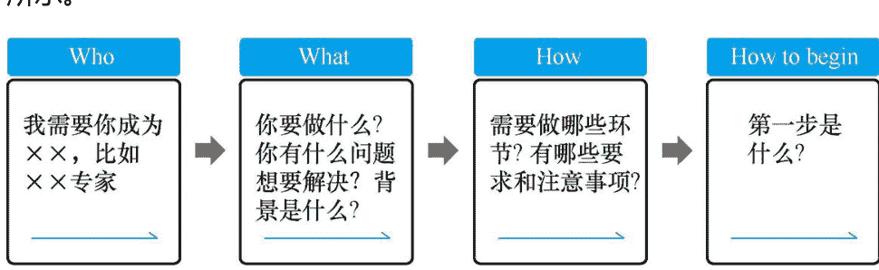

Who：我需要你成为×，比如×专家，限定其专业领域，确保回答在特定范围内。

What：你要做什么？你有什么问题想要解决？需要解释任务的背景、原因和可能面临的问题，以提供必要的上下文。

How：完成这个任务需要做哪些环节？有哪些要求和注意事项？

How to begin：第一步是什么？它的要求和标准是什么？

我们可以看出“义描交出”模型和“2W2H”模型，前两步一样，后两步有差异，因为“义描交出”模型更适合能一次完成我们指定任务的事情，相对比较简单。而“2W2H”模型更适合环节相对比较多，内容比较复杂，无法一次性完成指定任务的事情，这个时候就需要ChatGPT一步一步完成。

例如，我们需要让ChatGPT完成辩论赛辩论稿的撰写。一般情况下，辩论赛的环节至少有5个，分别是：立论陈词、攻辩、攻辩小结、自由辩论、结辩陈词。参与比赛的双方各4人，分别是一辩、二辩、三辩和四辩。由于各个环节的要求和比赛方式不太一样，每个参赛选手讲的内容也不一样，并且ChatGPT一次性输出的字数也有限制（一般一次性能输出2000字左右），所以这个时候就没办法让ChatGPT把一辩、二辩、三辩和四辩的台词一次性都写完，我们就需要分环节和分步骤让ChatGPT完成辩论稿的撰写，此时ChatGPT理解上下文的功能就发挥了优势，辩论稿撰写参考指令如下：

##### 第1环节：正方立论陈词撰写

Q：请按照以上要求，并请你扮演一个辩论赛专家，我现在要参加一个辩论赛，辩论赛的主题如下：

正方：“干一行，爱一行”更好。

反方：“爱一行，干一行”更好。

你需要帮我写出一篇完整的辩论稿，辩论总共分：立论陈词、攻辩、攻辩小结、自由辩论和结辩陈词5个环节。现在请先帮我写出正方的立论陈词部分的辩论稿，立论陈词用时3分钟，请采用总分总的形式，要求论据充足，观点新颖，充满说服力！

A：正方立论陈词撰写

尊敬的评委、各位观众，我代表正方辩论队，今天要围绕着‘干一行，爱一行’更好的主题来展开辩论。我们坚信，干一行之前，先去热爱这个行业，将会使我们在这个行业中取得更好的成就。我将从三个方面来阐述我们的立场。

首先，热爱是激发潜力的源泉。当我们对一项工作充满热情时，我们会投入更多的时间和精力去学习和提高自己。我们会主动寻求机会去了解这个行业的最新动态，积极参与相关活动，不断拓宽自己的知识面。只有真正热爱一项事业，我们才会坚持不懈地追求卓越，不断超越自我。

其次，热爱能够带来创造力和创新思维。当我们对一项工作充满热情时，我们会更加主动地思考问题，挑战现有的框架和传统的做法。我们会不断思考如何改进、创新，为行业带来新的突破和发展。只有通过热爱，我们才能不断推动行业的进步，为社会创造更多价值。

最后，热爱能够带来持久的动力和坚韧的毅力。在工作中遇到困难和挫折是难免的，但当我们对这个行业充满热情时，我们会更加坚定地面对困难并寻找解决方案。我们不会轻易放弃，而是会积极面对挑战，不断学习和成长。只有通过热爱，我们才能战胜困难，取得更大的成就。

亲爱的观众和评委，“干一行之前，爱一行更好”是至关重要的。热爱可以激发潜力，带来创造力和创新思维，同时也能给予我们持久的动力和坚韧的毅力。让我们共同努力，爱着我们所从事的工作，追求卓越，为社会的进步贡献我们的力量！谢谢！

##### 第2环节：攻辩内容撰写

Q：接下来请写出正方两次攻辩的辩论稿子，正方二辩对反方二辩进行攻辩，正方三辩对反方三辩进行攻辩，每次攻辩用时1分30秒。

A：正方二辩攻辩辩论稿

尊敬的评委、尊敬的对手和各位观众：

首先，我要感谢反方二辩的发言。然而，在他的陈词中，我发现了一些需要澄清和进一步讨论的观点。反方二辩提到了工作的压力和挑战，但我想强调的是，爱一行并不意味着没有压力，相反，热爱工作能够让人更有动力去克服挑战。有研究表明，对于热爱工作的人来说，他们更能够在面对压力时保持积极的心态，因为他们对自己的工作充满热情，看到困难更多是一种成长的机会。

其次，反方二辩提到了“爱一行，盲目追求梦想会让人失去理性”。我要指出的是，我们所主张的并不是盲目追求，而是在追求梦想的同时，保持理性和务实。热爱一行使得我们更愿意投入时间和精力去深入研究，学到更多的知识和技能，这样才能在实现梦想的过程中更具竞争力。

最后，反方二辩提到了“人生苦短，不值得将时间全部花费在一个可能并不成功的梦想上”。我们理解人生的宝贵，但同时，选择一个我们热爱的工作，是为了让每一天都充满意义。短暂而精彩的人生中，我们应该追求让自己感到满足和快乐的生活方式。

总的来说，我们认为热爱一行不仅能够带来工作的乐趣和动力，还能够在面对困难时保持积极心态。我们并不鼓励盲目追求梦想，而是主张在激情的推动下，更理性和务实地追求自己的事业。谢谢。

正方三辩攻辩辩论稿

尊敬的评委、尊敬的对手和各位观众：

首先，我要对反方三辩的陈词表示感谢。然而，在他的发言中，我注意到了一些值得进一步讨论的观点。反方三辩强调了工作的外在因素，如薪资和福利，但我们要强调的是，这并不是我们辩题的核心。我们主张的是通过热爱工作来提升个体和团队的整体素质，而这种热爱能够带来更积极的工作态度和更高的工作效率。

其次，反方三辩提到了“干一行，对于实现理想的可能性更大”。我们认为，实现理想并不仅依赖于干一行，而更关键的是热爱和激情。只有当我们对工作充满热情时，我们才能够在实现理想的过程中保持坚韧和毅力。这种内在动力是成功的关键。

最后，我想再次强调，我们并不是要忽视外部因素的重要性，而是认为在追求事业成功的同时，热爱工作能够为我们带来更为丰富的内在满足感。只有当我们从内心热爱我们所做的事情，我们才能够在职业生涯中持续进步，真正实现事业的成功。谢谢。

我们继续追问其他各个环节的辩论稿，ChatGPT就会按照我们提的要求，逐步给我们写出辩论稿，以下是攻辩小结、自由辩论、总结陈词3个环节的辩论稿：

##### 第3环节：攻辩小结撰写

Q：接下来请写出正方攻辩小结的辩论稿，攻辩小结用时1分30秒。

A：尊敬的评委、尊敬的对手和各位观众：

在这次激烈的辩论中，正方团队始终坚守“干一行，爱一行更好”的立场，通过一系列的论证和观点阐释，我们相信我们的观点是合理且有说服力的。

首先，我们从工作与热爱之间的关系入手，强调了热爱工作能够带来更大的动力和创造力。我们相信，只有当我们对自己的工作充满热情时，我们才能在职业生涯中取得更大的成功。工作不仅是赚钱的手段，更是实现自己价值的途径。

其次，我们回应了反方关于实现理想的可能性的观点。我们坚持认为，实现理想并不仅取决于所从事的行业，而更重要的是个体内在的热情和动力。只有在对工作充满热爱的情况下，我们才能够在面对困难时保持坚韧，实现自己的理想。

最后，我们再次强调，我们并不是要否认外部因素的重要性，但我们坚信在干一行的同时，热爱工作能够为我们带来更为丰富的内在满足感。只有当我们对所从事的工作充满热情时，我们才能够在职业生涯中持续进步，真正实现事业的成功。

在这场辩论中，我们正方团队始终秉持理性、务实的态度，充分阐释了“干一行，爱一行更好”的观点。谢谢大家的聆听和支持。

##### 第4环节：自由辩论撰写

Q：接下来请写出正方自由辩论的辩论稿，需要向对方提出不同的问题，目标是让对方观点产生自相矛盾的地方，从而论证我方观点的准确性，你觉得问哪些问题会比较好，至少帮我找到5个以上适合自由辩论的问题。

A：尊敬的评委、尊敬的对手和各位观众：

在自由辩论环节，我将向反方提出一些问题，旨在深入挖掘他们的观点，寻找可能存在的自相矛盾之处，以更好地支持正方的立场。

1. 问题一：反方强调实现理想的可能性更大，但在爱一行的情况下，是否同样能够更好地实现理想？换句话说，是否认同热爱工作会为实现理想带来更大的动力？
2. 问题二：反方提到“人生苦短，不值得将时间全部花费在一个可能并不成功的梦想上”，那么，请问反方认为什么样的工作才算是成功的工作？是否存在一种既成功又能够热爱的理想工作？
3. 问题三：反方强调外在因素的重要性，例如薪资和福利，那么请问反方是否认为在热爱的工作中获得的内在满足感无法与外在因素相辅相成？是否存在一种平衡点？
4. 问题四：反方提到“爱一行，盲目追求梦想会让人失去理性”，那么请问反方是否认为追求梦想和保持理性是互斥的？在追求梦想的同时是否可以保持理性思考？
5. 问题五：反方强调“干一行，对于实现理想的可能性更大”，那么请问反方是否认为即使在不热爱的工作中，依然能够更容易实现个人的理想和目标？在这种情况下，热爱工作的意义是什么？

通过这些问题，我希望能够引导反方深入思考他们的观点，看是否存在一些不一致之处，从而更加确立正方的观点。谢谢。

##### 第5环节：结辩陈词撰写

Q：接下来请写出正方结辩环节的辩论稿，要总结前面的论证过程，并进一步论证我方观点：“干一行，爱一行更好”的好处，最后用金句升华我方观点，让听众产生情感的共鸣。

A：尊敬的评委、尊敬的对手和各位观众：

在这场辩论中，正方团队充分阐释了“干一行，爱一行更好”的立场。我们通过立论陈词，攻辩，攻辩小结和自由辩论等环节，深入探讨了热爱工作与职业生涯的关系，强调了热爱和工作的共生共荣。现在，我将对正方观点进行进一步的总结和论证。

首先，我们强调了热爱工作能够带来更大的动力和创造力。在一个充满激情的工作环境中，我们更容易保持积极的心态，克服挑战，实现更高的职业目标。热爱工作不仅让我们的工作变得更有意义，还使我们在面对困难时更具韧性。

其次，我们回应了反方的观点，强调了实现理想不仅取决于所从事的行业，更关键的是个体内在的热情和动力。无论是干一行还是爱一行，都需要坚持追求自己的理想，并在实现梦想的过程中保持理性和务实。

最后，我们认识到外部因素的存在，但我们坚信在热爱工作的情况下，我们能够更好地平衡内在满足感与外部因素，实现事业的成功。工作不仅是为了赚钱，更是实现自我价值和生活意义的途径。

总的来说，我们正方团队深信“干一行，爱一行更好”。在选择事业的道路上，热爱工作将不仅为我们带来事业的成功，更会让我们的人生更加充实和有意义。因此，让我们一同追寻热爱与事业的完美结合，创造属于自己的精彩人生。谢谢。

如果我们需要写反方的辩论稿，只需要把提示词中的“正方”改成“反方”。你猜一下通过ChatGPT完成正方所有人的辩论稿需要多长时间？总共只花了5分钟就完成辩论稿的撰写。如果是传统人工方式撰写的话，基本上要花费一天的时间才能打磨好四位辩手的辩论稿。有了ChatGPT以后写辩论稿的效率飞速提升。如果你对以上辩论稿不满意，还可以继续让ChatGPT帮你修改，给你提供源源不断的方案，直到你满意为止。

如果要想把内行式指令用得好，我们就需要对自己要完成的任务非常明确，并且对完成的任务很擅长，对完成的标准和要求很明白，总的来说，你的专业能力越强，问出的问题就越好，AI给的答案就越准确。我们要把ChatGPT当成你的下属，你给下属怎么布置任务就给ChatGPT怎么布置任务。如果你给下属布置的任务不明确，下属完成的效果和质量就有可能达不到你的要求，同理，ChatGPT也一样。

### 二、外行式指令

如果你作为下属，也会经常接到领导布置给你一些不太擅长的、标准和要求不怎么清楚的任务，这个时候你接还是不接？如果没有ChatGPT之前，我会劝你别接，因为很容易搞砸。但是有了ChatGPT之后，我会鼓励你试一试。面对这种情况，我们就需要用到第二类指令：外行式指令，这里我们给出“标准化”模型。

所谓外行式指令，就是你对要完成的任务不太了解，不清楚这项任务的要求和标准，更不知道怎么完成，你完全是一个“门外汉”。此时，我们就可以让ChatGPT当我们的导师，教我们怎么完成这个任务，让它帮助我们输出参考标准和要求。

#### 外行式指令3个步骤：

- 标：问标准。询问某个类型的写作或任务的优秀标准和要求是什么。
- 提：提要求。根据AI给的标准，给它布置新的任务，提出新的要求，让它按照我们的任务背景和要求进行写作。
- 化：再优化。AI完成第一次写作后，我们再次提出要求，让其优化文章内容，使得生成的内容更加符合我们的要求。

我们来看一个案例，假设领导让我写一篇新闻稿准备在公众号上发布，但是我从来没写过新闻稿，这个时候就可以使用外行式指令，步骤如下。

第一步：问标准。询问ChatGPT关于新闻稿的标准是什么？

Q：请你扮演写作专家，我想写一篇企业的新闻稿，请问有哪些注意要点和具体步骤。

A：作为写作专家，我很乐意协助您撰写企业新闻稿。以下是一些注意要点和具体步骤，可帮助您开始编写一篇优秀的新闻稿：

1. 确定新闻价值
确保您选择的主题具有新闻价值并能吸引受众的兴趣。这可以包括公司重大事件、产品发布、重要合作、行业里程碑等。

2. 确定核心信息
在撰写新闻稿之前，明确要传达的核心信息。这包括响应谁、什么、何时、为什么、如何等关键问题。

3. 撰写标题
编写一个简洁且引人入胜的标题，概括新闻稿的核心内容，吸引读者进一步阅读。

4. 采用倒金字塔结构
按照重要性递减的顺序组织信息，将最重要的信息放在开头，然后逐渐向下展开。这样做可以使读者迅速获取到关键信息。

5. 清晰简明的段落
每个段落应集中讨论一个主题或一个观点，并使用简明扼要的句子来表达。段落之间要有过渡，以实现整体流畅性。

6. 引用和事实核实
如果可能，使用来自官方人士、行业专家或相关数据的引用来支持和增强新闻稿的可信度。确保所有陈述都有准确、可靠的来源。

7. 添加多媒体元素
考虑在新闻稿中插入相关的图片、视频或其他多媒体元素，以提升可读性和吸引力。

8. 编辑和校对
在发布新闻稿之前，仔细检查拼写、语法和标点错误。确保新闻稿的逻辑清晰，并符合新闻稿的风格和格式要求。

9. 发布和宣传
选择适当的渠道发布新闻稿，如公司网站、新闻稿分发服务、社交媒体平台等。同时，考虑与媒体联系，以增加新闻稿的曝光度。

请记住，在撰写新闻稿时要注意客观、准确，遵守相关法律法规，并避免涉及敏感或不实信息。

希望以上信息能帮助您成功编写一篇出色的企业新闻稿。如果您需要更多帮助，请随时告诉我。祝您写作顺利！

第二步：提要求。按照刚刚ChatGPT给出的新闻稿写作的注意要点和步骤，给它一个主题，让它按照主题和要求完成新闻稿写作任务。当然，以上9点，我们不一定要全用，可以按照自己所需来进行提问，案例演示如下：

> Q：请按照以上9个要点，帮我写一篇关于“×汽车品牌赞助2023南昌国际马拉松的新闻稿”，要结合赛事盛况和运动员的表现，找到×汽车品牌与马拉松精神的结合点，突出品牌优势，字数控制在1000字左右。（注：真实汽车品牌名用“×”代替。）

A：【某汽车品牌赞助2023南昌国际马拉松新闻稿】

南昌，2023年8月23日，×汽车宣布将成为2023南昌国际马拉松的赞助商，为这一盛大的体育赛事注入了新的活力。作为中国领先的汽车制造商之一，×汽车希望通过此次赞助与马拉松精神相结合，强调自身的品牌优势和承诺。

作为全球知名的马拉松赛事之一，南昌国际马拉松汇集了来自世界各地的顶尖运动员和数以万计的跑者。这场比赛不仅是一项竞技运动，更是一个展示勇气、毅力和奋斗精神的平台。正因如此，×汽车决定与南昌国际马拉松携手，因为他们相信这一赛事与他们的品牌理念紧密相连。

×汽车始终坚持创新、品质和可持续发展，这三个核心价值观与马拉松的精神完美契合。马拉松是一项极具挑战性的运动，需要参与者在面对困难和痛苦时坚持不懈，追求卓越。而×汽车作为一家领先的汽车制造商，同样在市场竞争中保持着持久的奋斗精神，为消费者提供高品质、创新的汽车产品。

作为本次南昌国际马拉松的赞助商，×汽车将通过多种形式的宣传推广，展示其品牌优势。公司的旗舰车型将成为比赛现场的重要道具，并受邀参加相关活动。此外，×汽车还将设立展示区域，向观众展示其最新的技术成果和创新产品，与参赛者和观众们进行互动，增强消费者对品牌的认知和信任。

他们希望通过这次合作，进一步提升×汽车在中国以及全球市场上的知名度和声誉。×汽车的发言人表示：“我们对能够成为南昌国际马拉松的赞助商感到非常自豪。这场盛会不仅体现了体育精神，也代表了追求卓越的神圣使命。我们将与南昌国际马拉松共同努力，为参赛者和观众们带来难忘的体验，并展示我们在汽车制造领域的专业知识和创新实力。”

除了为南昌国际马拉松注入新的活力，×汽车还承诺将在环保方面发挥积极作用。他们将通过可持续的生产方式，减少对环境的影响，并提供更加环保和节能的车辆选择。这一举措与马拉松运动所提倡的健康生活方式和环保意识相吻合，体现了×汽车对社会责任的关注。

2023南昌国际马拉松将是一个激动人心的赛事盛会，×汽车的赞助将为整个活动增添更多精彩和魅力。此次合作将不仅促进马拉松运动的发展，也为×汽车带来了更多机遇与挑战。

#### 关于×汽车：

×汽车是中国一家领先的汽车制造商，拥有丰富的汽车制造经验和先进的技术实力。公司致力于提供高品质、创新的汽车产品，并积极推动可持续发展。×汽车的产品涵盖了轻型商用车、SUV、乘用车等多个细分市场。

联系方式：×××

媒体联系人：×××

联系电话：×××

电子邮件：×××

第三步：再优化。我们发现ChatGPT写的这篇新闻稿还不错，但是每段之间缺了一些小标题，文章结构不是太明显，这个时候我们就可以要求ChatGPT对文章进行修改和优化，让它给文章增加小标题，案例演示如下：

Q：请把以上文章增加3个小标题，符合金字塔结构，使得文章更有条理性。

A：【×汽车品牌赞助2023南昌国际马拉松新闻稿】

×汽车宣布成为2023南昌国际马拉松的赞助商

南昌，2023年8月23日-近日，×汽车宣布将成为2023南昌国际马拉松的赞助商，为这一盛大的体育赛事注入了新的活力。

1. 强调合作意义：×汽车与南昌国际马拉松携手共进

作为中国领先的汽车制造商之一，×汽车希望通过此次赞助与马拉松精神相结合，强调自身的品牌优势和承诺。马拉松是一个展示勇气、毅力和奋斗精神的平台，而×汽车作为一家持久奋斗的汽车制造商，与马拉松的价值观紧密契合。

2. 传递核心价值观：创新、品质和可持续发展

×汽车始终坚持创新、品质和可持续发展的核心价值观，这与马拉松的精神完美契合。马拉松需要参与者不断追求卓越，坚持面对困难和痛苦。×汽车作为领先的汽车制造商，在市场竞争中保持着持久的奋斗精神，为消费者提供高品质、创新的汽车产品。

3. 提升品牌认知度与社会责任：多维度推广和环保承诺

作为南昌国际马拉松的赞助商，×汽车将通过多种形式的宣传推广，展示其品牌优势。公司的旗舰车型将成为比赛现场的重要道具，并受邀参加相关活动。此外，他们将设立展示区域，向观众展示最新的技术成果和创新产品，与参赛者和观众们进行互动，增强消费者对品牌的认知和信任。同时，×汽车承诺在环保方面发挥积极作用，通过可持续的生产方式减少对环境的影响，并提供更加环保和节能的车辆选择。

希望通过这次合作，进一步提升×汽车在中国以及全球市场上的知名度和声誉。×汽车的发言人表示：“我们对能够成为南昌国际马拉松的赞助商感到非常自豪。这场盛会不仅体现了体育精神，也代表了追求卓越的神圣使命。我们将与南昌国际马拉松共同努力，为参赛者和观众们带来难忘的体验，并展示我们在汽车制造领域的专业知识和创新实力。”

2023南昌国际马拉松将是一个激动人心的赛事盛会，×汽车的赞助将为整个活动增添更多精彩和魅力。此次合作将不仅促进马拉松运动的发展，也为×汽车带来了更多机遇与挑战。

#### 关于×汽车：

×汽车是中国一家领先的汽车制造商，拥有丰富的汽车制造经验和先进的技术实力。公司致力于提供高品质、创新的汽车产品，并积极推动可持续发展。×汽车的产品涵盖了轻型商用车、SUV、乘用车等多个细分市场。

联系方式：×××

媒体联系人：×××

联系电话：×××

电子邮件：×××

一篇标准的新闻稿就大功告成了，如果你想让ChatGPT写出今年最新的新闻稿，就需要让ChatGPT进行联网，联网以后它就可以获取实时的最新数据。目前免费版的ChatGPT3.5训练数据截止2022年1月，也就是说它对2022年1月以后的新闻和数据是不了解的。所以，要想获得最新的数据，我们就要启用联网搜索功能，关于联网开启功能我们会在第6章中给大家分享。

外行式指令的优势是无须懂得完成这项任务的标准和要求，因为我们通过提问就可以让ChatGPT给我们专业参考，我们只需要在此基础上给它布置任务就可以得到我们想要的答案，所以使用起来非常方便，使用范围也非常广泛，也可以用在非写作领域。

### 三、调教式指令

前两类指令的使用可以解决我们大部分的写作问题，当然也可以用来解决我们工作和生活中遇到的问题。前两种方式都需要我们会写指令，那么，有没有可能我们只给ChatGPT提供背景信息和要求，让它自动完成指令的撰写？当然是可以的，接下来我们介绍第3类指令：调教式指令，通过对ChatGPT的调教，就能让它自己写出完美指令。

调教式指令的优势在于我们不需要会写专业、精准、全面的指令，只需要会回答ChatGPT给出的建议，它就会帮我们一步步写好一个完美指令。通过互动式引导的方式把ChatGPT变成顶级指令导师。具体该如何操作这条指令呢？

第1步：发送指令。案例演示如下：

Q：“我想让你成为我的Prompt创作者。你的目标是帮助我创建最佳的Prompt，这个Prompt将由你使用。你将遵循以下过程：

1. 首先，你会问我Prompt是关于什么的。我会告诉你，但我们需要通过不断的重复来改进它，通过则进行下一步。
2. 根据我的输入，你会创建三个部分：
   (1) 修订后的Prompt（你编写修订后的Prompt，应该清晰、精确、易于理解）
   (2) 建议（你提出建议，哪些细节应该包含在Prompt中，以使其更好）
   (3) 问题（你提出相关问题，询问我需要哪些额外信息来改进Prompt）
3. 你提供的Prompt应该采用我发出请求的形式。
4. 我们将继续这个迭代过程，我会提供更多的信息，你会更新“修订后的Prompt”部分请求，直到它完整为止。”

A：非常好，我很愿意帮助你创建最佳的Prompt。那么，我们就开始吧。首先，你能告诉我你想要的Prompt是关于什么的吗？

第2步：发送任务。发送一个简单的任务给它，比如，我给它任务是：制作一个针对职场人士的数据分析课程培训大纲。案例演示如下：

Q：制作一个针对职场人士的数据分析课程培训大纲。

A：非常好，我理解你的需求了。让我们开始创建一个针对职场人士的数据分析课程培训大纲。这是我对你的Prompt的理解：

1. 修订后的Prompt。创建一个针对职场人士的数据分析课程培训大纲。
2. 建议。在Prompt中，我们可以包含以下细节：
   - 课程的目标受众（新手、中级用户或高级用户）
   - 课程的主要目标和学习目标
   - 课程的主题和子主题
   - 预计的课程长度和每个模块的长度
   - 课程的教学方法（如讲座、实验、案例研究等）
3. 问题。为了改进Prompt，我需要你回答以下问题：
   (1) 你的目标受众是什么样的职场人士？他们的数据分析经验如何？
   (2) 你希望学员在完成课程后能达到什么样的学习目标？
   (3) 你打算包含哪些主题和子主题？
   (4) 你预计课程的总长度是多少？每个模块的长度又是多少？
   (5) 你打算采用什么样的教学方法？

第3步：回答问题。发布任务后，它就会优化我们的指令，对我们的指令提出一些建议，并且它会询问我们一些问题，这个时候我们只需要按照问题的序号一个一个进行回答，这样它会根据我们回答的问题继续优化和迭代指令。案例演示如下：

Q：5个问题回答如下。

1. 制造业中层干部（管理岗）——部门主任20人（公司总计8～9个职能部门，每个部门大概2人），关键岗位及技术骨干20人。
2. 一个目标是数据分析能力，能对自己本部门数据进行统计，并做好数据分析，例如：生产岗，能通过数据分析出生产工艺问题，并找到解决方案。另外一个目标是用数据思维提升工作会议汇报效率：做好本部门数据整理、归档，在会议及工作汇报中，能够运用数据思维呈现给领导，提高会议效率。
3. 什么是数据思维，通用分析的方法，商业分析的方法，产品分析的方法，用户分析的方法。
4. 总时长1天，每个模块1～1.5小时。
5. 互动引导、小组讨论、实操演练的方式。

第4步：继续回答问题。当我们第一次回答完问题后，ChatGPT就会继续帮我们优化指令，此刻它还会帮我们提出以下建议和询问我们一些问题，我们只需如实回答即可，如果遇到不懂的问题就说不会或者不知道。

回答完问题后，ChatGPT会再次优化指令。

A：非常好，你提供的信息很有帮助。根据你的回答，我对你的Prompt进行了以下修订：

1. 修订后的Prompt。创建一个为期一天，面向制造业中层干部和关键岗位技术骨干的数据分析课程培训大纲。课程的目标是提升学员的数据分析能力和数据思维，以便他们能够对自己部门的数据进行统计和分析，并在会议和工作汇报中有效地使用数据思维。课程将包括数据思维的介绍，通用分析方法，商业分析方法，产品分析方法，以及用户分析方法。每个模块的长度为1～1.5小时，教学方式包括互动引导、小组讨论和实操演练。

2. 建议。在Prompt中，我们可以进一步包含以下细节：
   - 每个模块的具体内容和学习目标
   - 每个模块的教学方法和活动
   - 课程的评估方法（如测试、项目、报告等）

3. 问题。为了改进Prompt，我需要你回答以下问题：
   (1) 你能详细描述一下每个模块的内容和学习目标吗？
   (2) 每个模块的教学方法和活动是什么？
   (3) 你打算如何评估学员的学习成果？

Q:
(1) 不能。
(2) 教学方法都差不多。
(3) 不用评估。

第5步：发送新指令。当你发现优化的指令已经可以用的时候，你就可以和ChatGPT说“完成”，或者复制新指令重新发送给ChatGPT，进而得到我们想要的答案。案例演示如下：

Q：创建一个为期一天，面向制造业中层干部和关键岗位技术骨干的数据分析课程培训大纲。课程的目标是提升学员的数据分析能力和数据思维，以便他们能够对自己部门的数据进行统计和分析，并在会议和工作汇报中有效地使用数据思维。

课程将包括以下模块：数据思维的介绍，通用分析方法，商业分析方法，产品分析方法，以及用户分析方法。每个模块的长度为1～1.5小时，教学方式包括互动引导、小组讨论和实操演练。课程结束后不需要进行学员评估。

A：课程名称：制造业数据分析与数据思维培训

课程目标：提升制造业中层干部和关键岗位技术骨干的数据分析能力和数据思维，使其能够熟练运用通用分析方法、商业分析方法、产品分析方法和用户分析方法，从而有效地统计和分析部门数据，并在会议和工作汇报中运用数据思维。

课程时长：一天

课程大纲：

1. 介绍数据思维（1小时）
   - 数据思维的概念和重要性
   - 数据思维与业务决策的关联
   - 实例分析：成功案例展示

2. 通用分析方法（1.5小时）
   - 数据收集与整理
   - 数据探索性分析（EDA）
   - 基本统计指标解读
   - 实操演练：使用常见工具进行数据探索

3. 商业分析方法（1.5小时）
   - 商业智能（BI）工具的应用
   - 制造业中的关键业务指标（KPIs）
   - 制定数据驱动的业务策略
   - 小组讨论：制造业中的商业案例分析

4. 产品分析方法（1.5小时）
   - 产品生命周期分析
   - 成本效益分析
   - 制造工艺优化与改进
   - 实操演练：产品数据案例分析

5. 用户分析方法（1.5小时）
   - 用户行为分析
   - 满意度调查与分析
   - 用户反馈的价值
   - 小组讨论：制造业中的用户分析挑战与应对策略

教学方式：
- 互动引导：讲师与学员互动，解答问题，激发学员思考。
- 小组讨论：学员分组，共同讨论案例分析，分享经验。
- 实操演练：学员通过实际操作，运用所学知识解决问题，加深理解。

课程结束：不进行学员评估，但提供反馈渠道，鼓励学员在培训后提出问题或分享应用经验。同时，提供培训资料和相关资源，以便学员进一步深化学习。

调教式指令的优势在于不必写全面、精准的指令，只需通过和ChatGPT进行交互式对话，就可以得到我们想要的完美指令。当然，调教式指令不仅可以用在写作领域，甚至可以帮你解答各种生活和工作中的问题。

### 四、模仿式指令

当我们看到优秀文案、优秀文章想要学习和模仿时，怎么办？ChatGPT能否通过自己的学习和训练，写出和参考范本风格和文采几乎一样的文章？答案是肯定的，这时我们就要用第4类指令：模仿式指令，这里我们给出“给座城池”模型。

#### 模仿式指令4个步骤：

- 给：给参考。把对标的优秀文章或者优秀文案的模板投喂给AI。
- 座：做拆解。让AI根据你给的文章或者模板进行深度拆解，找到特征。
- 城：再生成。命令AI根据拆解出来的标准，布置任务以重新生成你的写作。
- 池：持续修。持续优化写作内容，直到满意为止。

使用模仿式指令可以实现模仿优秀文案或文章的写作手法和风格，生成和参考文章写作手法、风格一致的新文章，我们来看几个案例示范。

#### 案例1：小红书爆款文案模仿。

我们想让ChatGPT帮我们设计一个小红书爆款文案，这个时候就可以把优秀的小红书参考文案投喂给ChatGPT，当然如果你手上没有优秀的小红书文案，也可以让ChatGPT直接生成。

第1步：给参考。把优秀的文案投喂给ChatGPT或者让它生成几个优秀的文案作为参考，案例演示如下：

Q：请扮演文案设计专家，帮我找3个小红书爆款种草文案，内容是关于书籍推荐的。

A：当设计小红书爆款种草文案时，关键是要吸引读者的注意力并激发他们对推荐书籍的兴趣。以下是三个针对书籍推荐的小红书爆款文案示例：

1. 文案标题：《时光旅行的必备武器》
   推荐书籍：《穿越时空的经典之旅》系列
   这不仅仅是一本书，更是一场时光之旅！快来和我一起穿越时空，漫游在《穿越时空的经典之旅》系列的文字世界中。每一页都是一个神秘的门，通向不同的年代，带你领略古老的历史、未来的科技和现代的人文风情。从这里开始，时光不再是线性的，而是一个个交错的故事节点，让你的心灵随之飘荡。#时光旅行#必读书单#文学之旅

2. 文案标题：《探索未知，发现自我》
   推荐书籍：《迷失大陆的探险者》
   你是否感到生活乏味，渴望一场真正的冒险？那么，《迷失大陆的探险者》绝对是你的不二之选！在这本书中，作者带领你穿越茂密的丛林，跨越荒芜的沙漠，发现那些隐藏在地图之外的奇妙之地。这不仅是一本探险故事，更是一次对内心世界的深度探索。与主人公一同勇敢前行，发现属于自己的未知世界！#探险之旅#发现自我#阅读推荐

### 五、长篇式指令

因为写作任务复杂的原因，有时候我们需要生成一篇篇幅比较长的文章或者写作材料，你会发现让ChatGPT直接生成，可能效果不是很好。我们来看下面这个案例。

第1步：让ChatGPT帮你策划优质选题。

> Q：你是一位演讲教练，拥有丰富的演讲经验和系统全面的专业知识。你已经成功辅导了1000位的学员，现在你想针对缺乏公众演讲经验的人写一篇公众号文章，希望教会他们如何做好公众演讲，请先帮我策划10个针对职场人士的公众演讲爆款选题。

A：当你要为职场人士设计公众演讲选题时，关键是确保选题既与他们的工作和职业发展相关，同时又能够吸引观众的兴趣。以下是一些公众演讲选题，旨在帮助职场人士提升演讲技能并展现个人魅力：

- 1. “打破职场沉默：如何在会议中表达你的想法”
探讨在职场环境中如何克服沉默，提高表达能力，以及在会议中更自信地发表观点。

- 2. “领导力演讲：如何激发团队的激情和合作”
分享建立领导力演讲技能的关键，以及如何通过演讲激发团队合作和创造性思维。

- 3. “面对面沟通的力量：构建职场人际关系的关键”
探讨有效的面对面沟通技巧，如何建立积极的职场人际关系，以及沟通在职业发展中的重要性。

- 4. “数字时代的职场演讲：利用技术提升影响力”
引导职场人士了解如何借助技术工具，如网络研讨会和社交媒体，提升他们的职场演讲影响力。

- 5. “故事背后的力量：通过叙事打动听众”
探讨如何运用故事叙述技巧，使职场演讲更引人入胜，记忆深刻。

- 6. “挑战职业恐惧：战胜演讲紧张感的实用方法”
提供战胜演讲紧张感的实用方法和技巧，帮助职场人士在公众演讲中更加自信。

- 7. “职业品牌演讲：如何通过演讲树立个人品牌”
引导职场人士思考如何通过演讲建立和强化个人职业品牌，提高在行业中的可见性。

- 8. “跨文化沟通：在国际职场中的演讲技巧”
探讨在跨文化环境中演讲的挑战，并提供应对方法，使演讲更具有全球适用性。

- 9. “危机时刻的演讲艺术：如何应对突发状况”
指导职场人士应对突发状况的演讲技巧，包括危机公关和有效的危机管理。

- 10. “未来职场的演讲趋势：提前掌握演讲的新技能”
探索未来职场中演讲的趋势和变化，并分享如何提前培养新的演讲技能以适应这些变化。

这些选题涵盖了各个方面的职业发展和演讲技能，有助于职场人士在不同情境下提高演讲水平。

第2步：让ChatGPT就某个选题生成大纲。

Q：请针对选题5生成文章的大纲。

A：公众演讲选题：“故事背后的力量：通过叙事打动听众”

- I. 引言。A. 演讲的力量和目的；B. 为什么故事是强大的传播工具。

- II. 什么是叙事演讲。A. 定义叙事演讲；B. 叙事演讲与信息传递的关系；C. 为什么听众更容易记住故事而非干燥的事实和数据。

- III. 故事的要素。A. 人物：打造引人入胜的角色；B. 情节：构建引人注目的情节线；C. 情感：在演讲中引发听众的情感共鸣。

- IV. 如何选择和构建一个有力的故事。A. 找到与听众共鸣的主题；B. 利用个人经历和故事；C. 创造紧张和高潮。

- V. 叙事技巧和工具。A. 时间线的运用；B. 对话和对白的艺术；C. 制造悬念和吸引听众的技巧。

- VI. 举例分析：成功的故事演讲案例。A. 分析知名演讲者的案例；B. 从成功的演讲中汲取经验教训。

- VII. 实践演练：让你的故事更生动。A. 小组讨论和分享；B. 个人练习与反馈。

- VIII. 克服挑战：应对听众多样性。A. 了解不同听众的文化和背景；B. 调整故事以适应不同的受众。

- IX. 结论。A. 总结关键点；B. 强调故事在公众演讲中的重要性。

- X. 掌握故事的艺术：实现更有影响力的公众演讲。A. 提供进一步学习资源和建议；B. 鼓励听众在实践中运用故事叙述技巧。

通过这个大纲，演讲者可以深入了解故事叙事在公众演讲中的作用，并学习如何有效地运用故事元素来打动听众。每个部分都围绕着关键概念展开，为职场人士提供了系统的指导和实用的技巧，以提升他们的演讲表现。

第3步：根据文章的大纲生成对应的文章。

让ChatGPT参考上面的大纲生成我们想要的文章，字数控制在2000字以内。

Q：按照刚才的大纲生成文章。

A：由于篇幅有限，我将为你提供一个简短的文章片段，覆盖大纲中的部分关键点：

公众演讲选题：“故事背后的力量：通过叙事打动听众”

#### 引言

在演讲的世界里，能够打动听众并留下深刻印象的技巧之一就是讲故事。故事不仅是文字的编排，更是一种传达信息的力量。在这篇文章中，我们将深入探讨“故事背后的力量”，学习如何通过叙事在公众演讲中创造更加引人入胜的体验。

#### 1. 什么是叙事演讲

叙事演讲并非简单地罗列事实和数据，而是通过故事的方式将信息传递给听众。这种演讲形式能够在听众心中留下深刻的印象，让信息更易于被理解和记忆。

#### 2. 故事的要素

在构建一个有力的故事时，三个关键要素至关重要：人物、情节和情感。通过塑造引人入胜的角色，构建富有张力的情节线，以及引发听众情感共鸣，我们能够打造一个令人难以忘怀的演讲。

#### 3. 如何选择和构建一个有力的故事

选取与听众共鸣的主题是成功故事演讲的第一步。利用个人经历和故事，创造紧张和高潮，使故事更加引人入胜。通过这些步骤，你能够让听众更深刻地理解你想要传达的信息。

#### 4. 叙事技巧和工具

时间线的运用、对话和对白的艺术，以及制造悬念和吸引听众的技巧，都是让故事更生动的重要工具。这些技巧不仅使故事更引人入胜，也让听众更主动参与其中。

#### 5. 举例分析：成功的故事演讲案例

通过分析知名演讲者的案例，我们能够发现成功演讲中故事的运用。这些案例不仅为我们提供了灵感，也让我们从中学到了实际的应用技巧。

在接下来的部分，我们将深入实践，通过小组讨论和分享，以及个人练习与反馈，让你更好地掌握故事叙述的艺术。

请注意，这只是大纲的一小部分，完整的文章将需要更多的细节和实例来支持每个主要点。希望这个片段能够启发你，如果有需要，你可以根据自己的经验和观众的需求进行进一步的扩展。

我们发现，因为篇幅限制的原因，ChatGPT生成的文章内容比较空洞，语言风格偏正式。同时，叙述较多，缺乏能帮助读者理解的示例，我们再在指令中增加一些背景信息和要求试一下。

Q：请根据刚才的大纲的前5部分（因大纲内容太多，这里只挑选前5部分示范），按照以下指示生成文章：使用通俗易懂的语言，要告诉我讲故事的具体步骤和方法，并增加案例论证以增强文章的说服力。

A：公众演讲选题：“故事背后的力量：通过叙事打动听众”

#### 引言

大家好！今天我们将一起探讨一个在演讲中让你脱颖而出的神奇武器——故事。不再使用枯燥的数据，而是通过一个个引人入胜的故事，我们可以让我们的演讲更加生动有趣，让听众更容易记住你说的每一句话。

#### 1. 什么是叙事演讲

首先，让我们明确一下，什么是叙事演讲？叙事演讲并不是无聊的事实和数据的堆砌，而是通过一个引人入胜的故事来传达信息。这种方式让信息更易懂，也更容易在听众心中留下深刻的印象。

#### 2. 故事的要素

好了，想打造一个有力的故事，我们需要关注三个要素：人物、情节和情感。首先，让我们谈谈人物。想象一下你的故事中有一个令人难以忘怀的主人公，就像电影中的英雄一样。这个主人公可以是你自己、一个同事，或者是一个在行业中取得成功的人物。

其次是情节。我们的故事需要有一个引人注目的情节线，就像一部扣人心弦的电影。这个情节线可以是你或主人公克服困难、实现目标的过程。最后，别忘了情感。通过触动听众的情感，你的演讲将更深入人心。比如，你可以让听众感受到成功的喜悦、困境的压力，这样他们更容易产生共鸣。

#### 3. 如何选择和构建一个有力的故事

接下来，我们来谈谈如何选择和构建一个有力的故事。首先，找到与听众共鸣的主题是成功的关键。比如，你可能选择一个关于战胜困境的主题，因为这是每个人都能理解和共鸣的。

然后，利用个人经历和故事。你的故事可以是你个人的经历，或者是你亲眼目睹的一个令人振奋的故事。让听众更能够感同身受。

最后，创造紧张和高潮。让你的故事像一场扣人心弦的电影一样，让听众迫不及待地想知道接下来会发生什么。比如，你可以在故事中设置一些转折点，让听众一直保持对故事的关注。

#### 4. 叙事技巧和工具

好了，有了一个有力的故事的基础，接下来我们需要学习一些技巧和工具，让故事更生动。首先是时间线的运用。通过巧妙地运用时间线，你可以让故事更有层次感。比如，你可以通过回溯过去或者预示未来，让故事更加引人入胜。

其次是对话和对白的艺术。通过逼真的对话，你可以让听众更好地理解故事中的人物，也能够更好地沉浸在故事中。比如，你可以模仿人物的语气和口吻，让故事更有趣味性。

最后是制造悬念和吸引听众的技巧。你可以通过在关键时刻留下悬念，让听众迫不及待地想知道故事的发展。比如，你可以在故事的高潮部分突然停顿，引发听众的好奇心。

通过这些具体的步骤和方法，你可以在公众演讲中运用故事的力量，打动听众，让你的演讲更具有影响力。接下来，我们将通过一些实例来更加深入地理解这些方法。

通过增加指令中的背景描述和要求，文章生成的整体感觉要比之前好很多，但是当我们想写超过2000字的文章时，ChatGPT就会告诉你：由于篇幅有限，我将为你提供一个简短的文章片段，覆盖大纲中的部分关键点。

所以最后生成的内容就是一些关键点，很泛泛、很空洞，达不到优秀文章的水平。如何突破ChatGPT只能输出2000字的限制，让它写出更长更好的文章，完成复杂的写作任务？这个时候我们就可以使用第5类指令长篇式指令，这里我们给出“提纲磨合”模型。

长篇式指令4大步骤：

提：定主题。明确撰写主题和撰写标准与要求。让ChatGPT给你策划优质选题，或者给它定一个明确的写作主题。

纲：写大纲。让AI根据你的主题设计文章的大纲结构。

磨：分模块。按照大纲顺序分模块撰写。有几个模块就让ChatGPT写几个模块。

合：做整合。把撰写完成的各个模块人工进行整合优化，就得到一篇篇幅超过2000字的文章了。

“提纲磨合”模型特别适合用来完成复杂的写作任务，比如：写论文、写小说、写剧本、写书籍、写方案、写标书、写合同、写课件等，用这个方法生成20000字以上的文章也不在话下。我们来看一下如何让ChatGPT完成一篇论文的写作，通过这个案例来学习一下。

第1步：定主题。告诉ChatGPT，接下来要写一篇关于论文，请它输出论文的写作格式和要求。参考指令如下：

Q：请扮演论文写作专家，我接下来要写一篇关于“人工智能可以10倍速提升工作效率”的论文，请你先告诉我论文的具体格式和要求。

A：当撰写关于“人工智能可以10倍速提升工作效率”的论文时，你可以遵循一般的学术论文格式和结构。以下是一份可能的论文结构和要求的简要指南：

#### 论文标题

选择一个简洁而具有吸引力的标题，清晰地反映论文的主题，例如：“人工智能在提升工作效率中的潜力：一项10倍速的研究”

#### 摘要

摘要应该是一份简短但全面的文档概述，通常包括研究目的、方法、主要结果和结论。确保强调人工智能如何可以在工作环境中实现10倍速提升效率。

#### 1. 引言

在引言中，介绍你的研究主题，提出问题，并概述为什么人工智能对提升工作效率具有重要性。明确论文的目的和贡献。

#### 2. 文献综述

回顾与你的主题相关的先前研究和文献，强调现有研究中的空白，以及为什么你的研究是必要的。

#### 3. 方法

详细描述你的研究设计、数据收集方法和分析方法。确保解释为什么选择了特定的方法，并描述如何评估人工智能在提升工作效率方面的潜力。

#### 4. 结果

呈现你的研究结果，包括任何关于人工智能实现10倍速提升工作效率的数据、图表或统计信息。确保结果的呈现清晰、详细。

#### 5. 讨论

解释你的研究结果，并将其与先前的文献进行比较。讨论人工智能对工作效率提升的实际影响，并分析可能的影响因素和局限性。

#### 6. 结论

总结你的研究发现，强调对工作效率提升的重要性，并提出未来可能的研究方向。

#### 7. 参考文献

列出你引用的所有文献和参考资料，确保遵循所选的引文风格（例如APA、MLA、Chicago等）。

#### 8. 附录（如果需要）

包括任何支持性的材料，例如调查问卷、原始数据等。

#### 9. 格式要求

遵循学术写作的一般规范，包括字体、行距、页边距等。确保按照所选的学术风格规范引用文献。

请注意，这只是一份简要指南，具体的要求可能会根据你所在学术机构或杂志的要求而有所不同。最好在着手写作之前仔细阅读相关的学术写作指南或期刊要求。

第2步：写大纲。让ChatGPT参考以上论文格式撰写论文大纲。参考指令如下：

Q：请参考以上论文的结构设计这篇论文的大纲。

A：当然，以下是关于“人工智能可以10倍速提升工作效率”论文的大纲，按照前面提到的一般结构设计：

1. 引言
    (1) 背景介绍
        1) 人工智能在现代工作环境中的崛起
        2) 工作效率对个体和组织的重要性
    (2) 研究问题和目的
        1) 探讨人工智能对工作效率提升的潜力
        2) 着眼于实现10倍速提升效率的可能性
2. 文献综述
    (1) 先前研究的总结
        1) 人工智能在不同领域的应用
        2) 先前研究中的效率提升案例
    (2) 现有文献的不足
        1) 空白和未解决的问题
        2) 为什么我们的研究是必要的
3. 研究方法
    (1) 设计
        1) 数据收集方式
        2) 选择的人工智能技术
    (2) 参与者
        1) 受试者的特征
        2) 选样方法
    (3) 数据收集
        1) 数据来源
        2) 数据收集时间和过程
    (4) 数据分析方法
        1) 统计分析工具和技术
        2) 结果的解释方法
4. 结果
    (1) 数据呈现
        1) 和图形展示
        2) 值数据的详细说明
    (2) 人工智能在工作效率中的实际效果
        1) 10倍速提升的具体案例
        2) 针对不同行业的效果差异
5. 讨论
    (1) 结果的解释
        1) 为什么人工智能能够实现10倍速提升
        2) 潜在的因素和影响
    (2) 与现有文献的对比
        1) 如何与先前研究结果相符
        2) 不同之处和可能的解释
    (3) 局限性
        1) 研究的限制和不足
        2) 未来研究的方向
6. 结论
    (1) 主要发现的总结
    (2) 对工作效率提升的重要性的强调
    (3) 研究的贡献和实际应用的意义
7. 参考文献
8. 附录（如果需要）

第3步：分模块。让ChatGPT按照论文大纲的顺序逐一撰写内容，比如我们先让它写引言部分，参考指令如下：

Q：参考以上大纲，请先完成引言部分的内容撰写。

A：以下为引言部分的撰写：

#### 1. 引言

##### （1）背景介绍

随着科技的不断发展，人工智能在各个领域崭露头角，为工作环境带来了深刻的变革。从自动化流程到智能决策支持，人工智能技术已经成为提高生产力和效率的强大工具。在这个快速变化的时代，理解和最大程度地利用人工智能的潜力对于个体和组织来说变得尤为重要。

工作效率的提升一直是企业和组织追求的目标之一。传统上，这一目标的实现主要依赖于流程优化、培训和人力资源管理等手段。然而，近年来人工智能技术的引入为工作效率的提升带来了全新的机遇和挑战。通过深度学习、自然语言处理和机器学习等技术，人工智能系统能够执行复杂的任务、分析海量数据，并在瞬息之间做出智能决策。

##### （2）研究问题和目的

在这一新的技术背景下，我们的研究着眼于探讨人工智能对工作效率提升的潜力，并更为具体地关注是否存在可能性实现10倍速的效率提升。这个问题的探讨不仅关乎个体在工作中的表现，更涉及组织整体的竞争力和可持续发展。

我们的研究目的在于全面理解人工智能在提高工作效率方面的实际影响，并为决策者、管理者以及科技从业者提供深刻的洞察。通过深入研究，我们希望能够揭示人工智能技术所带来的变革，为未来的工作环境和业务流程设计提供有力的建议。

在这一引言部分，我们将简要回顾过去工作效率提升的手段，并引出人工智能在这个领域中的潜在贡献。接下来，我们将在文献综述中更深入地探讨先前研究，以揭示当前文献中可能存在的研究空白和我们研究的创新之处。

继续让ChatGPT按照论文的大纲完成“文献综述”部分的撰写，参考指令如下：

Q：参考以上大纲，请先完成“文献综述”部分的内容撰写。

A：以下为文献综述部分的内容：

#### 2. 文献综述

##### (1) 先前研究的总结

过去几年，人工智能在提升工作效率方面取得了显著进展。在各个领域，从制造业到金融领域，人工智能技术已经被广泛应用。一方面，自动化流程的引入带来了操作的高效性和准确性。另一方面，智能决策支持系统通过分析大数据、预测趋势，为管理者提供了更为科学的决策依据。

在制造业中，机器人和自动化系统的应用已经实现了生产线上的极大提速，降低了错误率，提高了生产效率。在客户服务领域，自然语言处理技术被广泛应用于智能客服系统，实现了更高效的用户沟通和问题解决。这些先前的研究为我们提供了关于人工智能如何在不同领域改善工作效率的宝贵经验。

##### (2) 现有文献的不足

然而，尽管取得了显著的进展，现有文献中仍存在一些重要的研究空白。首先，以前的研究主要关注单一任务或特定领域的效率提升，缺乏对于人工智能能否在广泛范围内实现10倍速提升工作效率的全面探讨。其次，对于人工智能技术在不同行业和组织规模中的适用性和效果差异的研究仍然相对不足。

另外，对于与人工智能相关的社会、伦理和法律问题的探讨也相对有限。随着人工智能技术的广泛应用，我们必须关注其对就业市场、个体职业发展和隐私权的潜在影响。因此，本研究旨在填补这些研究空白，全面探讨人工智能在提升工作效率方面的潜在局限和机遇，特别是在追求10倍速提升效率的可能性上。在下一步，我们将详细阐述我们的研究设计和方法，以深入剖析这一问题。

以此类推可以完成论文大纲其他部分的撰写，但是当你一次性撰写的字符数超过ChatGPT的上限字符数（ChatGPT3.5一般支持16K字符数的上下文理解，ChatGPT4.0一般支持32K字符数上下文理解，不同版本还会有差异）后，就会发现它开始“胡说八道”了，因为上下文字符的限制和时间间隔对ChatGPT记忆的影响，它已经不记得你前面的大纲内容了，你原来调教好的ChatGPT不听你的指令了，这个时候我们该怎么办？通常有3种处理方法：

方式1：重新提示。如果ChatGPT不听你的指令了，你可以告诉它错在哪里并“敲打敲打”它，让它改正自己的问题。

方式2：失忆重来。当ChatGPT不听你的指令了，我们也可以带着它回忆过去是怎么完成任务的，这个任务的要求和标准是什么，让它唤醒对过去的记忆，修正自己的轨迹。

方式3：另寻新欢。当ChatGPT不听你的指令了，经过你重新提示它还是记不得之前的内容和任务，我们就果断放弃这个之前训练好的窗口，新建一个对话窗口，重新训练ChatGPT。

第4步：做整合。当我们让ChatGPT按照大纲顺序写完所有的内容后，就剩下最后一步——做整合，把所有的内容整合成一篇完整的论文，如果你让ChatGPT来做整合，因为字符的限制，没办法完成

当文章总字数超过2000字时，就需要人工来整合，把所有内容逐一复制和粘贴在一个文档中，这样我们就完成了一篇文章的撰写。

除了这种“全托法”——文章标题、大纲、内容、素材等所有的内容完全由ChatGPT来生成的写作方式，当然也可以采用“半托法”来完成写作任务，就是你可以自己写一个文章的大纲，让ChatGPT参照你的文章大纲来撰写。

在本章节中我们总共学习了5大类型的指令，分别是：内行式指令、外行式指令、调教式指令、模仿式指令和长篇式指令，通过这5大指令我们快速完成文章的撰写或者其他问题的解答，当然，这5大指令也不仅可以用在写作中，它还可以用在其他场合，用来解决你在生活或工作中遇到的问题，有网友大概梳理了一下ChatGPT的72种功能。如下3-8所示。

图3-8

其实，ChatGPT的功能和作用也远不止于此，如果你能娴熟地运用5大指令技巧，就可以真真正正把ChatGPT训练成你的万能助手，10倍速解决你的难题，10倍速提升你的工作效率。

当文章写好以后我们还需要对文章进行包装润色，接下来我们学习“名剑山庄”AI写作模型的第4步：包装润色。

# 第四章

## 包装润色：用AI快速修改和润色文章

为什么要对文章进行包装润色。有以下几个原因：

提高可读性。包装润色可以改善文章的语言表达，修复语法和拼写错误，使得文章更易读。清晰、简洁和准确的语言有助于读者更好地理解文章内容。

提升传达效果。通过润色，可以增强文章的表达力和感染力。生动、富有表现力的语言可以使文章更引人入胜，更有说服力，更能引起读者的兴趣。

确保专业性。包装润色有助于确保文章在语言和风格上符合专业标准，以提升文章的信任度和可靠性。这对于学术论文、商业文档、专业报告等领域尤为重要。

优化结构和逻辑。润色过程中，可以优化文章的结构和逻辑，使其更具层次感和条理性。清晰的结构和合理的逻辑有助于读者更好地理解文章的主旨和论证。

提高原创性。润色过程中，可以识别和修复抄袭问题，确保文章的原创性。这对于学术和专业写作尤为关键，以避免知识产权问题和维护学术诚信。

提升整体质量。通过对文章的全面检查和调整，包装润色有助于提升文章的整体质量。这包括文学素养、表达能力、专业性等多个方面。

总体而言，包装润色是确保文章在语言、结构、逻辑和格式等多个层面上都达到最佳状态的关键步骤。这样可以确保文章更好地传达作者的意图，提升读者的阅读体验，同时也有助于文章在相关领域中获得更好的接受度和影响力。

通常当文章写好以后，需要人工进行反复审核、修改、打磨，无论是对于整篇文章的修改润色，还是对文章标题、大纲结构、案例素材等内容的修改润色，我们都可以交给ChatGPT来进行，这样可以大大提高我们的写作效率。

本章节我们将分为6个模块来介绍如何对文章进行包装润色，分别是：语言表达润色、文体风格润色、结构和逻辑润色、优化素材润色、扩/续/缩写润色、内容准确性润色。

### 一、语言表达润色

语言表达润色，包含了以下几个方面：

第一，检查错别字、语法和拼写错误，确保文章没有明显的语言问题。

第二，使用丰富的词汇和生动的表达方式，提高文章的表现力。

第三，避免过于复杂的句子结构，保持语言简练明了。

如何让ChatGPT对语言表达进行润色，我们可以使用如下指令：

#### 1. 语言表达润色指令

我们以公众号写作为例，如何让ChatGPT帮我们润色。指令参考如下：

> Q: 我希望你是一位文章审核助手，我将发送一篇文章给你，你要按照[公众号写作]的要求对文本内容进行检查，以达到文本没有语法、错别字、拼写、标点符号等错误，使用丰富的词汇和生动的表达方式，提高文章的表现力。避免过于复杂的句子结构，保持语言简练明了。符合[中文]写作规范。如果明白，请回复我“OK”。

A: OK。请把文章发给我。

Q: 标题——如何做好即兴演讲。

即兴演讲是一项需要突发反应和自如表达的技能，对于许多人来说，这可能是一项挑战。不过，只要掌握了正确的方法，即兴演讲也可以成为一个人自信、表达能力强的标志。下面，让我们来看看如何做好即兴演讲。

- 1. 学会冷静应对

##### 5招教你搞定即兴演讲

即兴演讲是一项需要突发反应和自如表达的技能，对于许多人来说，这可能是一项挑战。但只要掌握了正确的方法，即兴演讲也可以成为一个人自信、表达能力强的标志。下面，让我们来看看如何做好即兴演讲。

###### 1. 学会冷静应对

即兴演讲需要在短时间内组织思路，构建合理的论证结构，这需要快速反应和冷静应对。面对突然的演讲机会时，不要惊慌失措，保持镇静，清晰地思考问题，并逐步展开思路。

###### 2. 增加知识储备

即兴演讲需要有广泛的知识储备。因此，在日常生活中，要注重阅读、学习、积累各种各样的知识。演讲时可以从自己的知识储备中寻找相关的话题，并进行展开。

###### 3. 抓住主线

即兴演讲需要快速抓住主线，避免跑题或啰里啰嗦。在演讲前可以先确定一个主题，然后想好几个核心观点，并在演讲中围绕这些观点进行阐述，避免过多的细节和分散的思路。

###### 4. 增强语言表达能力

语言表达能力是即兴演讲的关键。为了提高语言表达能力，可以多阅读各种文学作品并进行写作练习。此外，在日常交流中也要注重言辞的精准和流畅，不断积累口语表达经验。

###### 5. 运用肢体语言

肢体语言对于即兴演讲来说也非常重要。它可以增强演讲者的自信心和说服力。在演讲时要注意肢体语言的配合，如手势、眼神、身体姿态等，以增强演讲的表现力和吸引力。

总的来说，即兴演讲需要多加练习和实践，通过不断积累知识、增强语言表达能力、学会冷静应对、抓住主线、运用肢体语言等技巧，才能做好即兴演讲。希望大家通过多次尝试和实践，成为一名出色的即兴演讲者。

Q：请告诉我你修改了哪些地方？

A：我对原文进行了一些润色和修改，主要集中在以下几个方面：

1.  标题：对标题进行了格式调整，使之更符合公众号写作的规范。
2.  语言表达：调整了一些表达方式，以提高语言的清晰度和流畅度，同时确保语气正式且符合中文写作规范。
3.  拼写和标点：进行了拼写和标点方面的检查，确保文章没有明显的语法、拼写和标点符号错误。
4.  句子结构：避免过于复杂的句子结构，以保持语言简练明了。
5.  文体风格：调整了一些表达方式，以确保文体风格一致，并使之更贴近读者。

这些修改旨在使文章更符合公众号写作的要求，提高文章的表达力和专业性。希望这些调整能够满足你对文本的润色要求。如果有其他需要进一步修改的地方，请随时告诉我。

运用以上的改写方式，我们发现需要通过提问才能知晓ChatGPT帮你改写了哪些内容，否则需要逐一与原文比对才能发现它改了哪些地方。有没有一个好用的指令，能直观让我们看到修改的地方，为什么要对这些地方进行修改？当然有，这就需要用一个文章专业改写指令，它不仅可以用来改写文章，还可以用来改写论文、文案、演讲稿等写作材料。

#### 2. 专业改写指令

我们通过改写一篇演讲稿的案例来看一下：

Q：作为一名中文[演讲稿]写作改进助理，你的任务是提高所提供文本的拼写、语法、清晰度、修辞手法、简洁性和整体可读性，同时分解长句，减少重复，并提供改进建议。请将改进结果以表格的形式输出，每个句子都在一个单独的行。第一栏是原文，第二栏是编辑后的句子，第三栏是对中文的改进说明。如果明白，请回复我“OK”，接下来我将发送文章给你。

这个指令的含义是，ChatGPT会帮你把原文章改写后并分三部分给你，第一部分是原文，第二部分是改写后的句子，第三部分是对句子的改进说明，然后整理成表格形式给你。

A：OK，我明白了。请发送文章，我将帮您进行改进。

Q：标题——我是初心不改的小徒弟

各位领导、同志们：

大家好！

我是襄阳卷烟厂的周宏兵，现在是制丝车间维修班长。今天我宣讲的题目是《我是初心不改的小徒弟》

1981年我进入襄阳卷烟厂工作。当时我刚满16岁，是一名普通的操作工，也是名副其实的小徒弟，在厂里，我特别羡慕那些靠技术吃饭的人，我也想像他们一样成为一名技术能手。

通过三年的努力，我从操作工转岗到了电气维修工，1998年，车间合并，我负责新车间打叶工段，当时正好接触到了一套进口设备，结果就发生了故障，给我一个下马威，看着冰冷的设备，我心急如焚，根本不知道怎么修理。我恨自己太没用了，于是我就想给自己充充电，当时车间里的学习资料，大都是厚厚的图纸，不能带出去学习，怎么办呢？我便想到了一个“笨”办法，那就是自己抄绘。从这天开始，只要一有空，我就带着白纸钻进车间资料室。有一次，等绘图完成时，才感觉肚子有点饿，一看时间，已经是晚上十一点多钟。家里人说，不要太拼命了。我说，年轻不拼命，老了命拼你，现在不学点东西，以后怎么办呢？

就这样，我家里的手绘图纸渐渐堆起来，有一米多高。七年后，我获得了行业技术能手和电气技师的称号，然而在维修过程中，我感觉只懂电气是行不通的，于是我又回过头来学机械知识，又是一个七年，我成了机械高级技师，同事们赞扬说，“小徒弟”成了“小师傅”！

2011年，我担任了维修班长，兼任党支部书记。成立了以我的名字命名的劳模创新工作室。当时，班里10年没有招新员工，活力不足，很多人认为：大家都不是小年轻了，以后养老算了，还那么拼命工作干吗？为了让班组重新焕发活力，我多次找大家谈心谈话，将维修班岗位分级、建立动态上岗机制。

这些制度，大大激发了同志们的工作热情。劳模创新工作室成立以来，车间设备改进项目达到100余项，其中，参与细支烟重大专项课题60项，获得发明专利14项，实用新型专利109项。我觉得，一个班组如果没有创新，就跟不上企业的发展需求。一个企业如果没有创新，也跟不上时代的发展需求。通过攻破一个又一个技术难题，我从“小师傅”变成了大家口中的“周师傅”。

2016年，我们开始招收大学生。新来的大学生求知欲强，缺乏实践经验；为快速提升他们的能力，我们成立车间培训师资团队和师带徒机制，通过模拟理论和实操鉴定等方式，对新学员进行全面培训和专业化培养。很快第一批年轻维修工就顺利出师，我还记得，有一次中控系统出现严重故障，厂家技术人员不能到场，2个青年电工主动承担，积极与厂家沟通，奋战两天两夜，最终实现故障的消除，看着他们自信的笑容，我也仿佛看到了人才接力棒，心里特别高兴。就这样，我从周师傅变成“大师傅”。2019年也获得了全国烟草行业劳动模范。

在单位里，我是大家尊敬的“大师傅”，但在家里，我却不是一个“好父亲”。1993年的时候，我家刚搬到郊区董台不久，那天早上，外面下着大雨。女儿跟我说，“爸，你今天要早点回来，陪我过生日啊，我长这么大，我过生日你都缺席了！”女儿还开玩笑说，“再缺席，我就开除你当爸的权利！”看着女儿满怀期待的眼神，想起自己多年的亏欠，眼睛酸酸的。走出家门后，看着雨势越来越大，我就开始担心，几个房屋漏点会不会影响设备运转？那几年，郊区董台的路非常难走，一到下雨天，整条街不是坑就是泥。我心里着急车间设备，也顾不上那么多，骑上摩托车就往前冲，因为跑得太快，跌倒在一个水坑里，膝盖也摔伤划破了一个口子。但当时没多想，扶起车子一路向厂里冲。到了车间，拿着工具就开始检查设备，检修了一整天，回到家已经是晚上12点，打开门才想起孩子早上跟我说的话，心里真不是滋味。桌上的生日蛋糕还在，只是垃圾桶里多了几根已经燃烧过的蜡烛，看着写着女儿名字的生日蛋糕，那种愧疚感到现在我都还记得。我能想象，女儿吹灭蜡烛的心情，女儿一定非常失落！

2017年，女儿结婚前夕，我还在想要怎样动员女儿节俭办婚礼，女儿却主动对我说：“爸，你不是党员吗？要严格按照‘八项规定’精神，婚礼咱就简简单单办！”那一刻，我非常感动。多么懂事的女儿啊！她理解了我，也长大了，这也许就是另外一种传帮带！

41年时间，我从一位普通操作工到维修班长，从一名群众到党支部书记，从一个小徒弟到大师傅，是襄阳卷烟厂培养了我，是湖北中烟成就了我，我就是那个初心不改的“小徒弟”，“湖北中烟”就是我的“大师傅”，也是我们大家的“大师傅”！

谢谢大家！

ChatGPT会像一个专业的写作助手一样，贴心地告诉你哪些地方修改了，为什么修改，哪些地方无须修改，由于篇幅原因，我们只给大家展示部分修改的截图，如图4-1所示。

ChatGPT

| 原文 | 编辑后的句子 | 改进说明 |
| --- | --- | --- |
| 我是初心不改的小徒弟。 | 我是初心不改的小徒弟。 | 无需改进 |
| 各位领导、同志们： | 各位领导、同志们： | 无需改进 |
| 大家好！ | 大家好！ | 无需改进 |
| 我是襄阳卷烟厂的周宏兵，现在是制丝车间维修班长。 | 我是襄阳卷烟厂的周宏兵，目前担任制丝车间维修班长。 | 添加了“目前担任”以提供更具明确性的信息。 |
| 今天我宣讲的题目是《我是初心不改的小徒弟》 | 今天我要与大家分享的主题是《我是初心不改的小徒弟》 | 使用“要与大家分享的主题是”使句子更加自然，并提供清晰的引导。 |
| 1981年我进入襄阳卷烟厂工作。 | 1981年，我开始在襄阳卷烟厂工作。 | 添加了逗号以使句子更加流畅。 |
| 当时我刚满16岁，是一名普通的操作工，也是名副其实的小徒弟，在厂里，我特别羡慕那些靠技术吃饭的人，我也想像他们一样成为一名技术能手。 | 我当时刚满16岁，是一名普通的操作工，也可以说是名副其实的小徒弟。在厂里，我常常羡慕那些靠技术吃饭的人，渴望像他们一样成为技术能手。 | 将复杂的句子分解为更简洁、清晰的表达，避免重复使用“我”和“小徒弟”。 |
| 通过三年的努力，我从操作工转岗到了电气维修工，1998年，车间合并，我负责新车间打叶工段，当时正好接触到了一套进口设备，结果就发生了故障，给我一个下马威，看着冰冷的设备，我心急如焚，根本不知道怎么修理。 | 经过三年的努力，我成功从操作工转岗成为电气维修工。1998年，车间合并，我负责新车间打叶工段。那时我接触到一套进口设备，却遇到了故障，对我来说是一个考验。面对冰冷的设备，我心急如焚，却毫无修理的头绪。 | 简化句子结构，减少冗余的表达，并提供更清晰的时间线。 |
| 我恨自己太没用了，于是我就想给自己充充电，当时车间里的学习资料，大都是厚厚的图纸，不能带出去学习，怎么办？我便想到了一个笨办法，那就是 | 我对自己感到非常无能，于是决定给自己补充知识。当时车间里的学习资料大多是厚厚的图纸，无法带出去学习，我便想到了一个笨办法，那就是 | 简化表达方式，减少冗长的描写，提供更清晰的表达。 |

图4-1

需要注意的是，如果文章内容过多，超过2000字，我们需要分多次发给ChatGPT，在专业指令当中也需要体现“分多次发给你”这句话，指令参考如下：

> “作为一名中文[演讲稿]写作改进助理，你的任务是提高所提供文本的拼写、语法、清晰度、修辞手法、简洁性和整体可读性，同时分解长句，减少重复，并提供改进建议。请将改进结果以表格的形式输出，每个句子都在一个单独的行。第一栏是原文，第二栏是编辑后的句子，第三栏是对中文的改进说明。由于文章篇幅过长，我接下来分[两次]发给你，你需要逐一改进。如果明白请回复我'OK'，接下来我将发送文章给你。”

### 二、文体风格润色

文章的文体风格是指作者通过语言表达所展现的情感色彩和语气特点。文体风格润色，包含了以下几个方面：

第一，确保文章的文体一致，符合预定的写作风格和要求。

第二，根据目标受众的特点，调整语气和表达方式，使其更贴近读者。

以下是一些常见的文章文体风格及其适用条件：

#### 1. 正式语气

特点：语言正式、庄重，遵循严格的语法和用词规范。

适用条件：适用于正式文件、学术论文、商务信函等需要保持严谨和专业的场合。

#### 2. 轻松随和语气

特点：语言轻松自然，类似日常交流，强调与读者建立亲近感。

适用条件：适用于博客、社交媒体、某些新闻报道等需要亲和力和轻松感的场合。

#### 3. 严肃语气

特点：语言严肃、正经，强调对待话题的重视。

适用条件：适用于探讨重大问题、社会问题、伦理道德等方面的文章，要求读者对话题产生深刻思考。

#### 4. 幽默风趣语气

特点：使用幽默元素，让读者感到轻松愉快。

适用条件：适用于娱乐新闻、轻松的博客等，要求作者具备幽默感。

#### 5. 激励鼓舞语气

特点：使用积极、鼓舞人心的语言，激发读者的动力和信心。

适用条件：适用于励志文章、演讲稿、自助书籍等，要求作者具备鼓舞人心的表达能力。

#### 6. 疑问质疑语气

特点：引入问题，促使读者思考，强调对话题的质疑和思考。

适用条件：适用于辩论性文章、调查报告等，能够引发读者对话题的思考和讨论。

#### 7. 感概沉思语气

特点：表达作者对事物的深思熟虑和个人感悟。

适用条件：适用于回顾性文章、个人随笔、回忆录等，要求作者能够通过文字表达深层次的思考和感悟。

#### 8. 客观中立语气

特点：强调客观、中立，避免情感色彩的主观性表达。

适用条件：适用于新闻报道、学术论文等需要客观表述的场合，要求作者避免个人情感色彩的介入。

当我们写完一篇文章，发现文体风格不对，想要改变整篇文章的文体风格时，就可以采用**文体风格润色指令**。

我希望你是一位文章改写助手，接下来我给出一篇文章，你要对文本内容进行修改润色，以达到[更为简洁、有吸引力]的目标，要用[新媒体写作/新闻写作/公文写作/合同写作/论文写作/标书写作]的标准进行改写，使得文章风格变得[专业]，语言变得更加生动、有吸引力。如果明白，请回复我“OK”。（注：“[]”内的内容可以选择或替换成自己想要的内容）

接下来我们以新闻稿类型的文章进行改写示范，指令参考如下：

Q：我希望你是一位文章改写助手，接下来我给出一篇文章，你要对文本内容进行修改润色，以达到[更为简洁、有吸引力]的目标，要用到[新闻稿的写作标准]进行改写，使得文章风格变得[专业]，语言变得更加生动、有吸引力。如果明白，请回复我“OK”。

A：OK。请把文章发给我。

Q：用微光积蓄能量——第一届“微光杯”微课大赛快讯

2022年11月8日微课计划培训项目——第一届“微光杯”微课大赛接近尾声，参赛人数43人，共产出21个微课作品，分别从操作、产品推广、服务流程等角度输出。

从早上9点开始学员以1+1的团队分工互助的形式合作，微课作品不断完善优化，经过老师点评辅导再优化，有的作品甚至经过十几稿的打磨。最后一批学员一直做到晚上12点……

在这一次微课大赛中，我们目标不但让学员学到知识，掌握技能，锻炼人才，在每一个细节里也看到了他们身上的中信精神！！

乐学乐教-学员积极提问，老师手把手教。

课上学员对于制作过程中遇到的问题积极与老师互动，听不懂不放老师走，甚至一度出现排队现象……，对于学员提出的每个问题授课老师邓世超与辅导老师董彦彩老师积极回应，一对一手把手教学。让学员在练中学，在学中会。

精益求精-虽然第一次做，但要审美在线。

作为“颜控”的新时代代表，微课也要颜值在线，为了找一个好看的角色，为了让画面看上去更饱满，他们翻遍每一个模版，研究每一个操作细节。

刻苦敬业-感觉时间过得好快，我的微课啊，今天必须完成！

对于中信伙伴的刻苦与敬业，有两个时间点我体会深刻，一个是中午12：30，以下的第一张照片，吃饭时间已过大家还在奋力赶制微课，一个学员说怎么感觉时间过的好快啊，才优化了一半就该吃中午饭了……

第二张照片是23：30，很多小组都做完了，只有几个在做最后的收尾，讲台前的白板上做完了的小组会在自己的组名后打钩，留在最后的并没有人只为了交作业仓促导出，还在一张P一张P的检查有没有疏漏，画面与音频是否对上……

一切都是最好的安排，天道酬勤，玉汝于成！

A：用微光积蓄能量——第一届“微光杯”微课大赛圆满结束！

2022年11月8日，微课计划培训项目的第一届“微光杯”微课大赛圆满收官。43名参赛者共创作出21个出色的微课作品，涵盖操作、产品推广和服务流程等多个方面。

从早上9点开始，学员们以“1+1”的团队分工协作，不懈努力优化微课作品。经过老师的点评和辅导，有些作品甚至历经十几次的打磨。最后一批学员甚至坚持工作到昨天晚上12点，展现出了卓越的创作精神。

这次微课大赛不仅旨在让学员获取知识、掌握技能，更在每一个细节中体现了中信精神的价值观。

乐学乐教

学员们在课上积极提问，老师耐心手把手教学。制作过程中遇到问题，学员们毫不犹豫与老师互动，为了解决疑虑，有时甚至出现排队提问的场景。邓世超老师与辅导老师董彦彩老师对每个问题都进行一对一的解答，让学员在实践中不断学习。

精益求精

尽管是第一次尝试，但微课的审美追求在线。为了找到最合适的角色和模板，参赛者们不辞辛劳，深入研究每一个操作细节。微课不仅注重内容，更追求高颜值，力求画面更为丰满，效果更为出众。

刻苦敬业

时间飞逝，微课不能等待！中午12：30，大家已错过午餐时间，依然全力投入微课制作。有学员感慨时间过得太快，优化一半就到了午饭时间。到了晚上23：30，虽然许多小组已经完成任务，但仍有少数学员在做最后的收尾工作。白板上标注完成的小组名单显示，这些团队不仅没有仓促交作业，还在仔细检查每一帧画面，确保音频与动画的完美匹配。

一切努力都得到了最好的回报，天道酬勤，最终圆满完成！

Q：请告诉我你润色了哪些地方？

A：我对原文进行了润色和改写，主要包括以下几个方面：

1.  采用了更为简练、专业的语言，符合新闻稿的写作标准。
2.  调整了句式结构，使得文章更加通顺和易读。
3.  使用了更生动、有吸引力的表达方式，突出了活动的亮点和学员的努力。
4.  强调了微课大赛的圆满结束和学员们的优秀表现，以更正式的语气呈现。

这些修改旨在使文章更符合专业的新闻稿写作标准，增强文章的吸引力和可读性。

### 三、结构和逻辑润色

结构和逻辑润色，包含了以下几个方面：

第一，检查文章的结构，确保有明确的开头、中间和结尾，各部分之间有合理的过渡。

第二，确保逻辑关系清晰，每一段都与主题直接相关，避免无关信息的插入。

第三，检查段落间的衔接，确保文章整体流畅度。

当文章写作之前，我们可以给ChatGPT提供一份现有的文章大纲，让它帮我们修改润色，然后再让它根据润色后的大纲生成一篇文章。当文章生成以后我们也可以让ChatGPT对文章的标题、开头、结构、结尾、过渡衔接等进行逐一润色。

#### 1. 标题润色

标题润色可以在写作前让ChatGPT策划优质标题，也可以在已经生成好了文章后，让它给文章策划优质标题。标题润色指令参考如下。

写作前策划优质标题指令：

Q：请扮演写作专家，帮我策划10个关于[内卷话题]的爆款文章标题。

A：当涉及内卷话题时，标题的选择至关重要，要引人入胜又具有一定的吸引力。以下是一些可能的爆款文章标题，它们旨在激发读者的兴趣和好奇心。

- 1. “内卷时代下的生存密码：如何在竞争中脱颖而出？”
- 2. “内卷浪潮：工作狂潮中的自我保护手册”
- 3. “内卷丛林法则：拒绝被吞噬的10个成功秘诀”
- 4. “内卷的困境：职场竞争如何影响你的人生抉择？”
- 5. “内卷大时代：打破传统，创造属于你的成功路径”
- 6. “内卷的残酷现实：职场陷阱及如何巧妙避开？”
- 7. “内卷中的人生焦虑：重新定义成功与幸福的关系”
- 8. “内卷背后的真相：解读成功的不同维度”
- 9. “内卷挑战：如何在激烈竞争中找到自己的定位？”
- 10. “内卷心态破解：掌握职场赛局的赢家策略”

这些标题尝试涵盖内卷话题的不同方面，从生存技巧到心态调整，希望能够引起读者的共鸣。

写作后策划优质标题指令：

Q: 请扮演写作专家，接下来我将发送一篇文章给你，阅读以下文章内容，给文章取[6个]有吸引力的标题，以达到引发读者兴趣的目的。

A: 当然，我很乐意帮助你为文章取一些有吸引力的标题。请发送文章内容，我将尽力提供相关的创意标题。

Q: 随着社会的快速发展和竞争的加剧，我们生活在一个内卷的时代。工作、学业、生活各个方面都充满了激烈的竞争，人们在追求成功的过程中不可避免地面临各种挑战。本文将探讨在内卷时代如何找到生存的密码，实现在竞争中脱颖而出的目标。

##### 1. 挖掘个人优势

在内卷的大潮中，了解并发挥自己的优势至关重要。这可能包括技能、经验、人际关系等方面。通过认识自己，你可以更好地定位在哪些领域有竞争力，从而更有针对性地发展自己的能力。

##### 2. 制定明确的目标

在内卷时代，目标的明确性对于成功至关重要。制定短期和长期目标，并将它们分解为可行的步骤，有助于你更有条理地前进。一个清晰的目标能够在竞争中为你提供方向感，避免在激烈的竞争中迷失方向。

##### 3. 不断学习和创新

内卷时代要求人们不断学习和创新，跟上时代的步伐。不仅要关注自己所在行业的最新动态，还要积极学习其他领域的知识。创新思维和灵活性是在竞争中脱颖而出的关键因素。

##### 4. 构建强大的人际网络

人际关系在内卷时代中变得愈加重要。建立和维护强大的人际网络可以为你提供资源、机会和支持。在竞争激烈的环境中，一个良好的人际网络可以为你创造更多的可能性。

##### 5. 管理时间与压力

内卷时代通常伴随着巨大的工作压力和紧张的时间安排。学会高效管理时间、处理压力，保持身心健康是在竞争中不被淹没的必备条件。

在内卷时代，成功不再是一帆风顺的事情，而是需要经过深思熟虑、努力拼搏的过程。通过挖掘个人优势、制定明确目标、不断学习创新、构建人际网络以及有效管理时间和压力，你可以在竞争中脱颖而出，找到属于自己的生存密码，实现更好的人生。记住，内卷时代并非只有竞争，更是你展现才华的舞台。

A：以下是为你的文章创作的6个有吸引力的标题：

- 1. “内卷时代的生存密码：挖掘个人优势，脱颖而出”
- 2. “成功指南：内卷时代如何制定明确的目标？”
- 3. “内卷求生手册：学习创新的关键步骤”
- 4. “人际力战胜内卷：构建强大社交网络的技巧”
- 5. “高效生存：内卷时代的时间与压力管理策略”
- 6. “内卷不是终点，而是新起点：找到属于你的成功密码”

这些标题旨在吸引读者，引发他们对内卷时代生存之道的兴趣，同时强调实用性和个体发展的关键因素。

#### 2. 开头润色

在第2章，我们介绍了6种开场法，分别是引用开场法、问题开场法、故事开场法、统计数据开场法、定义开场法和引发争议开场法，当我们写完一篇文章发现开头写得不好的时候，我们就可以命令ChatGPT按照我们指定的开场方式来修改文章开头。

我们以上文出现的“内卷的文章”为例。

> Q：请扮演写作专家，用[故事开场法]帮我修改一下关于内卷这篇文章的开头，其他内容保持不变，最后整合成一篇完整的文章。

A：彼得穿着一身笔挺的西装，心情却比天色还要阴沉。他发现自己似乎陷入了一场看不见硝烟的战斗，每个同僚都在为升职、加薪而拼尽全力。彼得深知，这是内卷时代的典型写照。

颁奖典礼上，他看着同事们喜笑颜开，接受着领导的褒奖，内心却涌动着一股莫名的焦虑。那晚，他站在雨夜的窗前，看着城市的霓虹灯闪烁，陷入了深深的思考。

“在这个内卷的世界里，我究竟在寻找什么？”他的心头涌现出这个问题，引发了他对自身处境的深刻反思。这个问题不仅扭曲了窗外的雨夜景象，更揭示了内卷时代的一扇门。在这个瞬息万变的竞争中，他开始寻找生存的密码，追求一种真正属于自己的成功。

##### 1. 挖掘个人优势

在内卷的大潮中，了解并发挥自己的优势至关重要。这可能包括技能、经验、人际关系等方面。通过认识自己，你可以更好地定位在哪些领域有竞争力，从而更有针对性地发展自己的能力。

##### 2. 制定明确的目标

在内卷时代，目标的明确性对于成功至关重要。制定短期和长期目标，并将它们分解为可行的步骤，有助于你更有条理地前进。一个清晰的目标能够在竞争中为你提供方向感，避免在激烈的竞争中迷失方向。

##### 3. 不断学习和创新

内卷时代要求人们不断学习和创新，跟上时代的步伐。不仅要关注自己所在行业的最新动态，还要积极学习其他领域的知识。创新思维和灵活性是在竞争中脱颖而出的关键因素。

##### 4. 构建强大的人际网络

人际关系在内卷时代中变得愈加重要。建立和维护强大的人际网络可以为你提供资源、机会和支持。在竞争激烈的环境中，一个良好的人际网络可以为你创造更多的可能性。

##### 5. 管理时间与压力

内卷时代通常伴随着巨大的工作压力和紧张的时间安排。学会高效管理时间、处理压力，保持身心健康，是在竞争中不被淹没的必备条件。

故事中的彼得，如同每一个身处内卷时代的我们，面对着挑战和困境，努力寻找生存的密码。通过挖掘个人优势、制定明确目标、不断学习创新、构建人际网络以及有效管理时间和压力，我们可以在竞争中脱颖而出，找到属于自己的成功之路。记住，内卷时代并非只有竞争，更是你展现才华的舞台。

#### 3. 结构润色

在第2章，我们介绍了6种文章结构，分别是顺序结构、问题解决结构、比较对比结构、因果关系结构、分类结构、主题演绎结构。当我们写完一篇文章发现结构需要调整的时候，我们就可以命令ChatGPT按照我们指定的结构来修改文章。需要注意的是，文章结构变了，整体内容也会随之改变，就像房子的结构变了，房子的整体外貌和形状也会随之改变。

我们以上文出现的“内卷的文章”为例：

Q：请扮演写作专家，用[问题解决结构]帮我修改一下这篇文章的内容，最后生成一篇完整的文章。

A：问题解决结构通常包括引入问题、提出解决方案、详细阐述解决方案的步骤或方法，以及总结得出的启示或结论。让我们重新组织这篇文章：

##### 挑战内卷时代：找到属于自己的成功之路

在内卷潮流中，升职加薪的竞争激烈，仿佛是一场看不见硝烟的战斗。穿戴整齐的彼得发现自己陷入其中，同事们频频接受领导的表扬，但心头涌动的焦虑让他在颁奖典礼后的雨夜，站在窗前深深地思考：“在这个内卷的世界里，我究竟在寻找什么？”这个问题不仅扭曲了窗外的雨夜景象，更揭示了内卷时代的一扇门。于是，他开始寻找生存的密码，追求一种真正属于自己的成功。

##### 引入问题：身处内卷，寻找生存密码

彼得的故事反映了内卷时代的典型写照，其中每个人都在竞逐升职、加薪的机会。在颁奖典礼上，同事们沐浴在成功的光辉下，但这一切却让彼得陷入了深思。他不再仅仅是在参与这场激烈的竞争，而是开始质疑自己的方向。

##### 提出解决方案：寻找成功之路的关键步骤

- 1. 挖掘个人优势

在内卷的大潮中，了解并发挥个人优势至关重要。这包括技能、经验和人际关系等方面。透过认识自己，你能更准确地定位在哪些领域具有竞争力，从而有针对性地发展自身能力。

- 2. 制定明确的目标

内卷时代要求目标明确，这对成功至关重要。设定短期和长期目标，并将其分解为可行的步骤，有助于有条理地前进。清晰的目标能够在竞争中为你提供方向感，避免在激烈的竞争中迷失方向。

- 3. 不断学习和创新

内卷时代要求不断学习和创新，跟上时代的步伐。关注所在行业的最新动态，并积极学习其他领域的知识。创新思维和灵活性是在竞争中脱颖而出的关键因素。

- 4. 构建强大的人际网络

人际关系在内卷时代中愈发重要。建立和维护强大的人际网络能够为你提供资源、机会和支持。在竞争激烈的环境中，一个良好的人际网络可以创造更多可能性。

- 5. 管理时间与压力

内卷时代伴随着巨大的工作压力和紧张的时间安排。学会高效管理时间、处理压力，保持身心健康，是在竞争中不被淹没的必备条件。

##### 总结结论：在内卷中找到成功之路

故事中的彼得，如同每一个身处内卷时代的我们，面对着挑战和困境，努力寻找生存的密码。通过挖掘个人优势、制定明确目标、不断学习创新、构建人际网络以及有效管理时间和压力，我们可以在竞争中脱颖而出，找到属于自己的成功之路。记住，内卷时代并非只有竞争，更是你展现才华的舞台。

#### 4. 结尾润色

在第2章搭建框架的内容中，我们介绍了6种文章结尾，分别是总结结尾、呼应开头结尾、引发思考结尾、展望未来结尾、互动参与结尾、引用结尾。当我们写完一篇文章发现结尾需要调整的时候，我们就可以命令ChatGPT按照我们指定的结尾方式来修改文章。

我们以上文出现的“内卷的文章”为例：

> Q：请扮演写作专家，用[互动参与结尾]的方式帮我修改一下这篇文章的结尾，“互动参与”是文章的一种结尾技巧，比如在文章末尾引导读者评论、点赞、转发。其他内容保持不变，最后整合成一篇完整的文章。

> A：结尾：共同迎接挑战，留言分享你的心得（因篇幅的原因此处只呈现文章的结尾）

故事中的彼得，如同我们每个身处内卷时代的人，都在努力寻找属于自己的成功之路。透过挖掘个人优势、明确目标、持续学习创新、构建人际网络，以及精准地管理时间和压力，我们可以在竞争中脱颖而出，找到通往成功的路径。

成功之路并非孤独的征程，而是一个共同探索的过程。在这个内卷的时代，我们需要互相支持、共享经验，共同发现更多可能性。因此，我邀请你，和彼得一样，思考以下问题：在这个竞争激烈的世界里，你又在寻找什么？你的个人优势是什么？你制定了哪些明确的目标？有什么学习和创新的计划？你的人际网络如何构建？

请在评论区分享你的看法和心得，让我们共同迎接挑战，激励彼此前行。点赞和转发，让更多人加入我们的讨论，共同塑造内卷时代的成功之路。在互动中，我们不仅创造属于自己的机会，更为整个社群注入共鸣与力量。期待着你的留言，让我们一同踏上这段共同成长的旅程！

#### 5. 过渡衔接润色

文章的过渡衔接指的是在文章中不同部分之间建立起合理、流畅的连接，使读者能够理解作者的思路和逻辑。一个好的过渡衔接可以让文章更具连贯性，使读者更容易跟随作者的思路和观点。

过渡衔接的要求和标准包括以下几点：

逻辑连接。过渡衔接应该在逻辑上连接前后文，确保读者能够理解不同部分之间的关系。这包括引入新的观点、转折、并列或因果关系等。

语言连贯性。过渡衔接需要使用合适的过渡词语、短语或句子，以确保文章在语言上的流畅。这包括使用连接词，例如“然而”“而且”“此外”，还包括代词和重复关键词等。

段落过渡。在段落之间进行过渡时，需要注意上一段的结尾和下一段的开头，确保它们在逻辑上和语言上有衔接。这可以通过总结上一段的主题、提出新的观点或建立关联来实现。

保持一致性。过渡衔接也涉及文章整体的一致性，包括思想、风格和语气。读者在阅读过程中应感觉到整个文章是一个有机的整体，而不是零散的部分。

强调重点。过渡衔接可以用来强调文章中的重要观点或信息。通过适当的重复或强调，读者可以更容易地捕捉作者想要传达的核心思想。

避免突兀转折。过渡衔接时，避免突兀的转折或意外的主题切换，以确保读者能够跟上文章内容的连续。

总体而言，过渡衔接是写作中的关键，它有助于构建良好的文章结构，使读者更容易理解和接受作者的观点。通过巧妙运用过渡手段，可以使文章更具有说服力和吸引力。过渡衔接润色指令参考如下：

> “请扮演写作专家，帮我修改润色一下这篇文章，要巧妙地运用过渡手段，使得文章中不同部分之间建立起合理、流畅的连接，使读者能够理解文章的思路，逻辑清晰，并且在不同段落或部分之间能够自然地过渡，最终让文章更具有说服力和吸引力。接下来我将分[3]段发送给你，如果明白，请回复‘OK’。” (注：“[]”内的内容可以选择或替换成自己想要的内容)

### 四、优化素材润色

如果把写文章比作是做一碗面，文章中的干货就是面条，文章中的素材就是佐料。一碗好面，不能光有面条，还要有佐料，这碗面才会好吃，且有营养。干货指的是文章中的方法论、原理原则、工具、模板等内容；素材通常包括多种元素，这些元素有助于支持作者的观点、说明论点、增强说服力，并使文章更加丰富和引人入胜。以下是一些常见的文章素材：

事实和数据。引用可验证的事实和统计数据可以增强文章的可信度。例如：“根据最新的研究，全球气温在过去一个世纪中上升了0.8摄氏度。”“公司的年度报告显示，去年的利润增长了20%。”

引用和引证。引用其他专家、作者或权威人士的观点可以加强文章的权威性。例如：“正如爱因斯坦所言，‘学知识并不是问题，问题在于如何将它应用于生活。’”“根据《自然》杂志的一篇文章指出，新药的研发通常需要数年的时间和数百万美元的投资。”

案例研究。描述实际案例可以使抽象的观点更具体，并使读者更容易理解。例如：“让我们回顾一下×公司是如何通过创新管理方法在市场上取得成功的案例。”“这位发明家的故事是创新精神的一个鲜活例证，他通过不懈努力克服了重重困难。”

个人经历或故事。作者的个人经历或故事可以赋予文章更多的情感和亲身感。例如：“在我的亲身经历中，我发现团队协作对项目成功至关重要。”“小时候，我曾亲眼目睹社区发生的变革，这激发了我对社会公正的关注。”

引用文学作品、名言或金句。使用文学作品、名言或金句可以为文章增添文学气息和深度。例如：“正如莎士比亚所说，‘世界是一个舞台，我们都是其中的演员。’”“用毛姆的话来说，‘写作是思考的一种形式。’”

图表和图像。图表、图像和模型图可以直观地呈现信息，使读者更容易理解复杂的数据。例如：插入一张柱状图，显示不同产品销售量的对比；引入一张地图，说明不同地区的环境变化情况；运用“SWOT分析模型”，对公司目前的优劣势进行分析。

引用历史事件。通过引用历史事件来支持观点，可以提供历史背景和比较。例如：“类似于过去的工业革命，我们现在正面临着数字化革命的挑战和机遇。”“第二次世界大战期间，妇女在生产线上的作用彰显了性别角色的变革。”

这些素材可以根据文章的类型和目的进行组合和调整，以支持作者的整体论述。不同类型的文章可能侧重不同类型的素材，但综合运用这些元素可以使文章更加全面和有说服力。

在利用ChatGPT生成好文章以后，如果我们发现文章缺乏素材，可以直接命令它对文章增加素材，比如案例、故事、金句等；反之如果发现文章的素材过多，也可以直接命令它进行删减素材；如果ChatGPT生成的文章素材不合适，也可以直接命令它替换素材；另外还可以利用ChatGPT收集素材、改写素材和设计素材。总之，可以利用ChatGPT灵活地优化素材。我们来看一些利用ChatGPT优化素材的案例：

#### 1. 设计案例指令

指令1：请扮演写作专家，提供[N]个优质的案例，来说明[观点]的[好处/坏处]。

指令2：请扮演写作专家，提供[N]个关于[观点]话题的[正面/反面]例子。

指令3：请扮演写作专家，提供[N]个关于[观点]话题的[正面/反面]例子，案例设计要采用“STAR”结构，STAR分别代表Situation（情境），Task（任务），Action（行动），Result（结果）。

其中，“[N]”应替换为你想要生成的案例个数；“[观点]”应替换为你想描述的观点或想要推荐的产品等；“[正面/反面][好处/坏处]”中用“/”分隔的几个词语，可以任选，同时，你也可以根据自己的需要换成其他词语。

我们来看一个案例演示。

Q：请扮演写作专家，提供[3]个优质的案例，来说明[养成良好习惯]的[好处]。

A：当谈到养成良好习惯时，其好处显而易见，对个人的生活和事业都有积极的影响。以下是三个优质案例，突显养成良好习惯的益处：

1. 提高工作效率

养成良好习惯有助于提高工作效率。以每天定时制订工作计划为例，这一习惯能够帮助个人更好地组织时间，合理分配任务，避免拖延，从而提高工作的质量和效率。这种良好的时间管理习惯不仅有助于减轻工作压力，还能提升工作表现，为事业的发展打下坚实基础。

2. 增进身心健康

良好的生活习惯对身心健康有着积极的影响。例如，每天坚持锻炼的习惯有助于提高身体素质，增强免疫力，减轻压力和焦虑感。通过形成规律的锻炼习惯，个体能够享受更好的睡眠质量，保持良好的精神状态，从而在工作和生活中更具活力和积极性。

3. 实现个人目标

养成良好习惯有助于实现个人目标。以制定明确的目标并每天努力朝着这些目标迈进为例，这种习惯能够激发个体的自律性和毅力。通过每天小幅度的努力累积，个体能够逐步取得进步，最终实现更大的个人目标。这种积极的成就感不仅带来满足感，还增强了个体的自信心和自我管理能力。

这三个案例突显了养成良好习惯对提高工作效率、增进身心健康以及实现个人目标的重要性。这些好处不仅在个人层面显著，而且对整体生活质量和事业发展都产生了深远的影响。

#### 2. 收集数据与整理表格指令

数据一般是客观存在的，可以增强文章的可信度，但你不记得与你主题相关的数据，或者不知道从哪里搜索相关的数据。此时，可以让ChatGPT帮你寻找。需要注意的是，如果要想获得最新数据，尽量把ChatGPT的联网功能打开。

收集数据参考指令如下。

> “请帮我找寻关于[××主题]的数据：数据要真实可信，同时要提供真实出处，请不要杜撰数据。”

其中，“[××主题]”应替换为对你想要的数据主题的描述。

我们来看一个案例演示。

Q：请帮我找寻关于[2022年中国婴儿出生率]的数据：数据要真实可信，同时要提供真实出处，请不要杜撰数据。

A：关于2022年中国婴儿出生率的数据总结与回答。

根据提供的搜索结果，我整理了与2022年中国婴儿出生率相关的信息，并尽量排除与问题无关的内容。

数据概览

- 1. 河南省数据

河南省2022年一季度新生儿为19.64万，上半年为37.19万，前三季度为56.13万。相比2021年，出生人口略有下降。

- 2. 湖南省数据

2022年前三季度湖南省产前筛查人数为28.39万，筛查率97.68%。与2021年相比，产前筛查人数略有下降。

##### 3. 山西省数据

山西省自2021年起实施孕妇免费产前筛查服务，截至2022年12月底，全省完成产前筛查为209739次。

##### 4. 全国数据

2022年全国出生人口为956万人，出生率为6.77‰，死亡人口为1041万人，死亡率为7.37‰，自然增长率为-0.60‰。

##### 结论

综合各地数据，2022年中国婴儿出生率略有下降，全国出生率为6.77‰。各地数据显示不同的趋势，但整体来看，生育率有所减缓。建议进一步关注官方统计机构发布的最新数据以获取准确的出生率信息。

请注意，这些信息仅供参考，具体数据可能会随时间变化。

##### 数据来源：

- 2022年各地出生人口与生育登记情况统计汇总（01-14更新）-知乎
- 中国生育报告2022-知乎-知乎专栏
- 2022年中国出生人口956万人出生率为6.77‰-澎湃新闻
- 艾瑞咨询：2022年中国新生儿妈妈生育全景白皮书| 互联网数据资讯网-199it|中文互联网数据研究资讯中心-199it
- 研究：2022年中国生育率下滑至1.09，应破解年轻一代生育挤压难题|界面新闻·中国

当我找到需要的数据以后，如果想让数据变得更加直观，也可以命令ChatGPT将以上数据整理成表格。表格整理参考指令如下：

Q：请将严格参考以上数据内容，帮我整理成表格。

A：好的，表格如下：

| 省份 | 出生人口 | 出生率 |
|---|---|---|
| 河南省 | 56.13 万（前三季度） | 未提供 |
| 湖南省 | 28.39 万人（前三季度） | 未提供 |
| 山西省 | 209,739 次 | 未提供 |
| 全国 | 956 万人 | 6.77‰ |

#### 3. 收集名言或者设计金句指令

指令1：请帮我找到[N]个关于[观点]的名人名言，不限时期，要告诉我谁说的，并注明出处。案例示范如下：

Q：请帮我找[5]个关于[坚持]的名人名言，不限时期，要告诉我谁说的，并注明出处。

A：当涉及坚持的主题时，许多名人都有过经典的名言。以下是五个关于坚持的名人名言，附带作者和出处：

1. “成功的秘诀在于坚持自己的梦想。”
   作者：王阳明
   出处：《传习录》

2. “坚持就是胜利。”
   作者：温斯顿·丘吉尔
   出处：未知

3. “只有不断地失败，才能够不断地进步。”
   作者：罗伯特·勃朗宁
   出处：未知

4. “坚持是成功之母。”
   作者：福楼拜
   出处：《遥远的陆地》

5. “只有坚持下去，才能够看到曙光。”
   作者：卡耐基
   出处：《人性的弱点》

这些名言来自各个领域的杰出人物，强调了在追求目标和梦想时坚持的重要性。请注意，有时名言的出处可能不够明确或存在争议，因此一些名言的确切来源可能难以确定。

指令2：请帮我设计[N]个关于[观点]的金句，要体现观点的核心立意，要短小精悍，要富有哲理并朗朗上口。案例示范如下：

Q：请帮我设计[5]个关于[勇敢追梦]的金句，要体现观点的核心立意，要短小精悍，要富有哲理并朗朗上口。

A：当谈论勇敢追梦时，以下是五个富有哲理、短小精悍的金句，以体现观点的核心立意：

1. “梦想的路上，勇敢是最坚实的道路石。”
2. “勇敢是梦想的引擎，行动是实现的航程。”
3. “追逐梦想的人，总是能在勇敢的心跳中听见成功的旋律。”
4. “勇敢追梦，如同给生命放一场华丽的烟火。”
5. “勇敢地做梦，那是将心灵的火焰投射向星辰的勇气。”

这些金句旨在鼓舞人们勇敢追逐梦想，强调勇气与梦想实现之间的紧密联系。希望它们能够激发你勇往直前，实现内心的追求。

#### 4. 设计故事指令

故事是文章的灵魂，有了好故事以后我们的文章往往会变得更加生动和精彩，如果自己的故事符合文章的观点那自然是非常好，写文章时优先使用自己的故事和真实的故事，如果没有，我们也可以让ChatGPT设计故事。参考指令如下：

指令1：请扮演故事设计专家，帮我设计一个关于[××主题]的故事，内容要引人入胜，情节要跌宕起伏，风格要有[冒险/悬疑/爱情/科幻/奇幻/喜剧/悲剧]元素。案例示范如下：

Q：请扮演故事设计专家，帮我设计一个关于[人要脸皮厚]的故事，内容要引人入胜，情节要跌宕起伏，风格要有[爱情]元素。

A：故事标题：《脸皮之爱》

故事梗概：

在一个繁华的都市，有一位叫做李晓的年轻女子，她是一家时尚杂志社的编辑。李晓聪明机智，工作出色，但却有一个致命的缺点——她的脸皮薄得近乎透明。在这个竞争激烈的行业里，她总是因为不敢拒绝而被人占便宜。

一天，一位名叫刘浩的摄影师进入了她的生活。刘浩英俊潇洒，工作也颇有成就，但他却有一个不为人知的秘密——他患有一种罕见的皮肤病，导致他的脸皮异常厚实。

李晓和刘浩在一次工作中相识，刘浩的脸皮厚实使得他完全不在乎别人的眼光，而李晓则因为自己的脸皮薄而陷入了尴尬境地。然而，两人却在这个看似不可能的环境中产生了微妙的化学反应。

随着工作的深入，李晓和刘浩逐渐成为了无话不谈的朋友。刘浩的坦率和豁达让李晓感到无比的舒服，而李晓的聪明和细腻也深深地吸引着刘浩。两人的关系渐渐升华，从朋友发展成了恋人。

然而，这段感情并非一帆风顺。李晓的脸皮问题始终是两人关系中的一块心结，她常常因为无法拒绝别人而导致和刘浩的争吵。刘浩则在一次意外中被别人嘲笑，也开始感受到脸皮的重要性。

在经历了一系列的波折和成长后，李晓和刘浩终于领悟到了“人要脸皮厚”这个道理。他们决定一起努力克服各自的困难，学会坦然面对外界的压力。

最终，李晓在一次重要的社交场合上成功地拒绝了一个不良的提议，而刘浩也在工作中展现出了非凡的勇气。两人的爱情因为彼此的成长而更加坚固，他们共同迎接着未来的挑战，学会了在这个现实世界中保护自己的脸皮，同时珍惜对方那颗坚韧的心。

我们要想让故事更加真实，更加贴近自我，就需要把故事主人公的详细背景信息和故事梗概告诉ChatGPT，这样它就会以故事主人公为原型去设计故事。我们可以试试指令2。

指令2：请扮演故事设计专家，我会告诉你一些故事的背景信息和故事梗概，你需要参考它帮我设计一个精彩的故事，主题要明确，内容要引人入胜，情节要跌宕起伏。这个故事的背景信息是[故事梗概]。案例示范如下：

Q：请扮演故事设计专家，我会告诉你一些故事的背景信息，你需要参考它帮我设计一个精彩的故事，主题要明确，内容要引人入胜，情节要跌宕起伏。这个故事的背景信息是：

[故事主人公叫邓世超，大学里学的专业是模具设计，他是一个理工男，曾经见到女孩就会脸红，更不敢上台说话，因为不敢发言曾经还被轰下台。工作后通过自己的努力和学习，以及不断训练，拿到了全国演讲冠军，成为一名演讲教练。后来他又出版了一本书叫《结构演讲力》，他希望帮助更多人告别演讲恐惧，提升演讲力]

A：故事标题：《演讲之梦》

故事开始于邓世超大学时期的一个模具设计展览。他是一个学习理工科的学生，对于演讲一窍不通。每次面对人群，他都感到手足无措，脸颊通红。一次班级演讲比赛，他鼓起勇气上台，却因为紧张而出现了口吃和思维混乱。同学们的嘲笑让他更加封闭，甚至影响了他的学业。

工作后，邓世超逐渐意识到沟通能力对事业的重要性。他决定克服内向，通过各种方法努力提升演讲能力。他报名参加了演讲培训班，进行了系统的训练。同时，他也学习心理学和表达技巧，努力克服自己的恐惧。

随着时间的推移，邓世超不仅在演讲比赛中屡次获奖，而且还成为了一位备受瞩目的演讲教练。他的教学风格深受学员喜爱，因为他深刻理解那些曾经和他一样害怕演讲的学员们。在他的指导下，许多人逐渐克服了演讲恐惧，展现出令人惊艳的演讲力。

为了将经验分享给更多人，邓世超撰写了一本书，取名为《结构演讲力》。这本书不仅记录了他的成长历程，还提供了实用的演讲技巧和心得体会。这成为一本畅销书，帮助了无数人摆脱演讲的困扰，勇敢走向舞台。

最终，邓世超在这个演讲之梦中找到了自己的价值和使命，成为了一个改变他人命运的演讲导师。

指令3：请扮演故事设计专家，帮我设计一个关于[××主题]的故事，故事的设计要参考[英雄之旅]故事结构，故事要看起来真实，内容要引人入胜，情节要跌宕起伏。案例示范如下：

Q：请扮演故事设计专家，帮我设计一个关于[一个人在深圳奋斗]的故事，故事的设计要参考[英雄之旅]的故事结构，故事要看起来真实，内容要引人入胜，情节要跌宕起伏。

A：故事题目：《光影之城》

##### 1. 普通世界

主人公张婷，一个普通的年轻人，怀揣着对城市梦想的向往，来到了繁华的深圳。

她开始了一份基础的工作，但心中憧憬着在这座城市中追逐自己的事业。

##### 2. 召唤冒险

机缘巧合，张婷发现了一个创新科技公司的招聘，这是一个改变她生活的机会。

她毅然决定投身这个新的领域，开始了在科技行业的职业生涯。

##### 3. 拒绝召唤

在科技公司的初始阶段，张婷面临巨大的学习和适应压力，她感到力不从心，陷入了职业和生活的低谷。

她开始怀疑自己的能力和选择，甚至有想要放弃的念头。

##### 4. 导师的指引

在最困难的时候，张婷结识了一位资深的导师，一个在科技领域取得卓越成就的专业人士。

导师给予她指引和鼓励，让她重新点燃对科技事业的信心。

##### 5. 冒险之路

重新振作的张婷决定继续前行，她遇到了更多的挑战和机遇，但她学会了如何应对和克服。

她与同事建立了紧密的合作关系，一同面对科技行业的竞争和变革。

##### 6. 最困难的考验

张婷的团队在研发中遭遇了一场技术危机，公司的未来岌岌可危。
她需要在有限的时间内找到解决方案，这是她职业生涯中最大的考验。

##### 7. 顿悟

在危机中，张婷领悟到了科技事业的真谛，她明白了技术背后是对未来的责任和使命。
她找到了解决问题的创新方式，公司的技术问题迎刃而解。

##### 8. 回归

渡过难关后，张婷的团队在科技行业取得了突破性的进展，她变得更加坚韧和成熟。
她回顾自己的奋斗历程，发现每一次困境都是成长的契机。

##### 9. 新生

张婷的科技事业日益壮大，她开始关注社会责任，积极参与公益活动。
她成为深圳科技圈的佼佼者，同时为城市的发展和年轻人的梦想树立了榜样。

通过这个故事，张婷经历了从迷茫到坚韧的英雄之旅，她在深圳这座充满活力的城市中，通过不断奋斗和学习，找到了自己的定位和使命。故事中的跌宕起伏、挑战和成长，将引人入胜，也让读者更深刻地理解城市奋斗者的心路历程。

“英雄之旅”故事结构来源于约瑟夫·坎贝尔的《千面英雄》这本书，这是一种经典的叙事模式，通常包括一系列固定的阶段，描述主人公从普通世界踏上冒险旅程，经历一系列挑战和成长，最终带着新的智慧和力量回归原来的世界。这种结构在许多文学、电影和传统故事中都有体现，是一种富有情感共鸣和启发性的叙事方式。以下是英雄之旅故事的完整结构：

普通世界：故事开始于主人公的平凡世界，展示他们的生活、环境和日常挑战。主人公通常是普通人，还未踏上冒险之旅。

召唤冒险：主人公接到一种召唤，可能是一位导师的建议、意外事件或内在的渴望，这引发了他们的冒险欲望。这是主人公决定离开普通世界，踏上新的旅程的开始。

拒绝召唤：主人公对冒险的呼唤可能感到犹豫或害怕，担心离开熟悉的生活。他们可能会拒绝冒险的邀请。

导师的指引：主人公在旅途中遇到一位导师，这位导师提供指导、智慧和工具，帮助主人公更好地理解自己的任务。

穿越第一道门：主人公决定接受冒险，穿越第一道门，进入未知的领域。这标志着冒险的正式开始。

试炼、盟友、敌人：主人公在旅途中经历一系列的试炼，结识盟友，也可能遇到敌人。这一系列事件帮助主人公成长和学习。

接近深渊：主人公接近故事的核心冲突，通常是他们最大的挑战或内心的恐惧。这是故事的紧张阶段。

渡过深渊：主人公面对最大的考验，可能是生死危机、内心挣扎或最终决战。这是故事的高潮。

奖励：主人公通过战胜敌人或克服内心恐惧，获得了奖励，可能是技能、智慧或物质财富。

回归：主人公决定返回普通世界，但他们已经改变，带着新的技能和认识。

重生：在回到普通世界时，主人公可能会面临最后的考验，以证明他们已经真正变得更强大。

回归世界：主人公回到普通世界，分享所得的奖励和智慧，对自己和社会产生积极的影响。

这些阶段不一定按照线性顺序出现，有时可以交错出现，但这种结构提供了一个引人入胜的叙事框架，使故事更有深度和意义，情节更加饱满。

#### 5. 增加修辞指令

比喻和类比是常见的修辞手法之一，用来增强文章的表现力和说服力。通过将一个事物与另一个事物进行比较或类比，使得读者更容易理解作者所要表达的意思，并且能够在读者心中形成强烈的印象。比喻和类比通常被广泛应用于文学作品、演讲、广告等多种文本类型中。为了使文章更有表现力，我们可以使用修辞手法。增加修辞指令如下：

> “请扮演写作专家，告诉我[观点/主题]，请用[类比/对比/排比/拟人/夸张]的方式说明。”案例示范如下：

Q: 请扮演写作专家，告诉我文章开场的重要性，请用类比的方式说明。

A: 当涉及文章开场时，可以将其比喻为一次引人入胜的舞蹈或一场引人入胜的电影。开场是你与读者建立连接的时刻，就像一位舞者在舞台上起舞，或者一部电影在开始时吸引观众的注意力一样。

#### 6. 模型提炼设计指令

写作高手通常会将重要内容和方法提炼成模型，这有助于提高文章的质量并加强读者的理解。它有很多好处：

第一，明确中心思想。模型可以帮助你明确文章的中心思想，确保你的写作集中于一个主题或核心观点。

例子：如果你在写一篇关于创业成功的文章，你可以将模型概括为“创业成功的6步”。

第二，提高逻辑严密性。模型有助于确保文章的逻辑关系紧密而清晰，避免跳跃性的思维和内容无序。

第三，简化复杂概念。模型可以帮助你将复杂的概念简化为易于理解的形式，使读者更容易消化信息。

第四，强调关键步骤。如果你在描述一个过程或方法，模型可以突出显示关键步骤，使读者更容易跟随和理解。

第五，提高可读性。模型的使用可以提高文章的可读性，使读者更愿意一直阅读下去，而不会感到困扰或失去兴趣。

总体而言，模型提炼是一种有效的写作策略，能够使你的文章更有结构性和逻辑性，让读者更容易记忆，同时也能体现出作者的深度和水平。比如，本书提到的“名剑山庄”AI写作模型。那么，如何命令AI把重要内容加工成模型呢？

模型提炼设计指令参考。

请扮演写作专家，帮我提取这篇文章的关键步骤，几个序号就对应几个步骤，你需要把文中的关键步骤提炼成一个[英文/口诀/公式/数字]模型，操作方法是[对该模型的解释或示范]。接下来我将把这篇文章发送给你。案例示范如下：

Q：请扮演写作专家，帮我提取这篇文章的关键步骤，几个序号就对应几个步骤，你需要把文中的关键步骤提炼成一个[英文]模型，操作方法是[先把关键步骤翻译成对应的英文单词，然后提取这些英文单词的首字组成一个新单词，就变成了英文模型]。接下来我将把这篇文章发送给你。

A：当您发送文章后，我将非常乐意帮助您提取关键步骤并总结成一个英文模型。请在准备好文章后分享给我，我将尽力协助您。

Q：在遇到反驳他人观点和意见的时候，我们可以采取以下3个步骤来说服他人：

1. 否定旧观点：指出对方观点存在的问题和争议性；
2. 提出新观点：提出反驳对方的观点；
3. 更高层次论证：站在更高层次对新观点进行论证，可以增加案例论证。

A：英文模型：DNA Approach（Deny：否定，Nullify：取消，Assert：提升）。

我们看到，ChatGPT很快就给我们提炼了一个“DNA模型”，可以说非常高效。

#### 7. 匹配图片指令

ChatGPT3.5正常情况下是无法直接绘画的，也无法为我们的写作内容匹配对应的图片，这个时候我们可使用百度的AI绘画软件“文心一格”和阿里的AI绘画软件“通义万相”。

当然，如果你使用的是ChatGPT4.0，那就直接可以调用里面的绘画插件DALL·E 3，轻松画出精美图片，如图4-2所示。

**你**
画一朵花

**ChatGPT的**

这是一朵精美详细且充满活力的花朵的图像，正如您的要求。

图4-2

### 五、扩/续/缩写润色

扩/续/缩写润色，指的是写作时对文章内容进行扩写、续写和缩写的操作，是三个不同的概念，它们的含义分别是：

**扩写。** 扩写是在表达中增加细节或详细信息，以使句子更加清晰或充实。这通常用于强调某一点或使描述更加生动。扩写可以通过添加修饰语、陈述更多事实或提供更多细节来实现。举个例子：

原始句子：她穿着一条蓝色裙子。

扩写：她穿着一条优雅的蓝色丝绸裙子，上面装饰着精致的白色花纹。

**续写。** 续写是在文章中进一步发展某个观点、主题或论点，以使其更加详尽和全面。续写通常涉及对先前提到的内容进行更深入的分析、讨论或探讨。举个例子：

原始句子：新技术的快速发展正在改变我们的日常生活。

续写：这些技术包括人工智能、云计算和物联网，它们不仅改变了我们的通信方式，还在医疗、教育和工业等领域产生了深远的影响。

**缩写。** 缩写是在表达中减少词语或句子的长度，以简化语言或提高表达的紧凑性。缩写通常用于强调核心概念或在有限的空间内提供信息。举个例子：

原始句子：由于天气状况不佳，比赛被取消。

缩写：因天气状况，比赛取消。

在实际写作中，这三种技巧可以根据写作的目的和受众进行灵活运用。扩写和续写有助于深化和拓展内容，使文章更加充实，而缩写则有助于使表达更为简洁，特别是在篇幅受限或需要强调核心观点时。

#### 扩写指令：

指令1：请将[原文]这段话，扩写成[一段话或500个字的文章]。案例示范如下：

Q：请将[我在睡大觉]这段话，扩写成一篇[600个字]左右的文章

A：在梦幻的夜幕中，我沉浸在甜美的梦乡，与现实世界划开一道隔离的时光隧道。那是一个宁静而祥和的夜晚，我在睡大觉，身体和心灵在安详的沉睡中重新获得了活力。

当我闭上双眼，进入梦境的大门敞开，我仿佛漂浮在无边的星空中。星星闪烁，宛如梦想的碎片，我在这片宁静的宇宙中自由飘荡，感受着一切的奇妙。梦境的世界是我心灵的庇护所，让我逃离白天的喧嚣和烦扰，沉浸在无尽的可能性之中。

在梦中，我可以穿越时间的河流，回到过去感受那些美好的瞬间，或者勇敢地探索未知的未来。梦境是一扇通向心灵深处的神秘之门，我可以在那里找到答案，理解生命的意义。梦中的景象五花八门，犹如一场奇幻的冒险，我在其中肆意驰骋，尽情感受每一刻的奇妙。

而在睡大觉的过程中，我的身体仿佛沐浴在治愈的光芒之下。在黑夜的笼罩下，我的呼吸平稳而有序，身体的每一个细胞都在静静地进行修复和充实。睡眠是大自然赋予我们的一份宝贵的礼物，是让身体和心灵得以完美协调的时刻。

梦境中，我常常遇见那些曾经与我擦肩而过的人和事。他们在梦中以不同的形式出现，有时是欢笑，有时是泪水，每一次相遇都是一次心灵的洗礼。梦境是一个超越时空的交汇点，让我与过去和未来产生奇妙的共鸣，让我更加深刻地理解生命的轨迹。

在梦中，我还能够探索自己内心深处的秘密花园。那里有我隐藏已久的梦想，有我未曾触及的渴望，每一片花瓣都散发着独特的光彩。梦境是心灵的绿洲，让我在繁忙的生活中找到片刻宁静，重新审视自己的内心。

随着梦境深处的冒险渐渐结束，我在睡大觉的怀抱中感到一丝温暖。当第一缕晨曦穿透窗帘，我慢慢地从梦乡中苏醒过来。睁开双眼，我发现自己回到了现实的世界，但心灵仍然沐浴在梦的余韵中。

睡大觉不仅是身体的休息，更是心灵的修行。在这段宁静的夜晚，我在梦中收获了智慧和力量，为新的一天注入了活力。梦境是一场奇妙的冒险，而我，就是那个在梦中徜徉的勇敢冒险者。

指令2：请将一段文本扩写为一篇[小故事]，让内容更加翔实，字数控制在[1200字]以内，文本内容为[当小明睁开眼时，发现周围的景致变得模糊不清。转眼间，他置身于一座银白色的太空站内，可以看到黑黝黝的宇宙和遥远的星辰大海]。案例示范如下：

A：小明慢慢地睁开眼，却发现周围的景致变得模糊不清。他揉揉惺忪的双眼，试图适应眼前的一切。转眼间，他发现自己置身于一座巨大的银白色太空站内。这座太空站如同一座宇宙之城，充满未知和神秘。

小明环顾四周，只见银色的走廊弯曲延伸，连接着各种不同形状的舱室。墙壁上布满了未来感十足的屏幕和光点，散发着柔和的光芒。他站在透明的观景窗前，可以清晰地看到黑黝黝的宇宙和遥远的星辰大海。恍若隔世的奇异景象让他目瞪口呆。

随着他在太空站内漫步，逐渐发现这里并非地球，而是一座未知星球上的科技巅峰之作。走廊两旁的舱室中，科学家们正在进行各种超前的研究，机械臂在舱室之间穿梭，发出轻巧的机械声。这里的一切都透露着未知的高科技氛围。

他遇到了一位名叫艾莉的科学家，她是太空站的领导之一。艾莉解释说，小明不是来自地球，而是通过一次实验性的时空传送进入了这个未知的星球。小明的到来引起了科学家们的浓厚兴趣，他们急切地想要了解地球和人类的一切。

于是，小明成为了这个太空站的荣誉客人。他被带到各个实验室，了解了星球上的先进科技和独特文明。在这个星球上，科学家们通过先进的技术改变了环境，实现了自然与科技的和谐共生。他们拥有能源开发的新技术，清洁环保的生态系统，以及高度发达的太空旅行科技。

小明感到震惊和好奇，他看到了未来的人类社会可能的样貌。太空站上的科学家们热情地向他展示他们的研究成果，让他深深感叹人类的智慧和创造力。他在这个未知星球上学到了许多新知识，也结识了一群充满激情的科学家。

在和科学家们的交流中，小明发现他们对地球的人类社会充满了好奇心。他被邀请分享关于地球的文化、历史和生活的点滴。于是，小明开始向他们讲述地球上五彩斑斓的文明，讲述人类曾经的努力和奋斗，以及他个人在地球上的生活经历。

随着交流的深入，太空站上的科学家们逐渐明白，即便在未知星球上，人类的共同之处远远超过了差异。他们开始思考如何将这里的科技成果与地球上的社会发展相结合，共同推动两个星球的共同繁荣。

在太空站上的日子过得飞快，小明的存在成为了一段奇妙的冒险。然而，当一切都显得如此亲切而熟悉的时候，小明却意识到自己渴望回到地球。他想念家人、朋友，想念地球上的熟悉风景。

于是，在一天的告别仪式上，太空站的科学家们为小明准备了一份特殊的礼物——一台时空传送装置，能够将他安全地送回地球。大家共同祝愿这位来自未知星球的荣誉客人一路平安。

当时空传送装置启动的瞬间，小明感到一阵眩晕，他闭上眼，然后再次睁开时，他发现自己回到了熟悉的地球。周围的景色清晰可见，星空中闪烁的星辰和地球上的自然风光一览无余。

小明感慨万分，这段奇异的冒险让他对人类的未来充满了希望。他知道，虽然地球上存在着各种问题，但人类的智慧和创造力有着无穷的可能性。他决心将在未知星球上学到的知识和经验带回地球，与人类共同探索未来的星辰大海。于是，小明展开新的征程，带着对未来的信心和期许，踏上了回家的路途。

不得不感叹，ChatGPT写出来的文章真的很“生动”。

#### 续写指令：

指令：请以[一觉醒来之后，我发现]为开头续写一段[科幻故事]，要求[故事线曲折离奇，引发读者无限联想]。案例示范如下：

A：一觉醒来之后，我发现自己身处一个陌生而又令人惊奇的环境中。四周弥漫着一种奇异的光芒，宛如微粒飘动的彩虹，将整个空间映照得五光十色。试图厘清头绪，我发现自己悬浮在半空中，仿佛逆重力的规则在这里失效了。

迷失在这异世界中的我，注意到周围漂浮着一群光影般的生物，它们身体透明而微光闪烁，如同梦幻般飘浮在空中。我伸手触摸，却感受到一阵微风般的能量穿透全身，让我充满了一种奇异的力量。

随着我慢慢适应这个空灵的环境，一座巨大的水晶城市映入眼帘。城市里的建筑如同艺术品一般，散发出令人陶醉的光芒，仿佛是由虚幻的晶体构成。这座城市充满着未知的科技和精巧的设计，每一栋建筑都是对艺术和科学完美结合的杰作。

我不禁开始探索这座水晶城市，追寻每一个角落的奇异之处。在城市的中心，我发现一个神秘的装置，似乎是一台巨大的时空传送器。我被吸引着走向那个装置，心中涌动着对未知的渴望。

当我接触到时空传送器的表面时，一股强烈的能量瞬间包裹了我。眼前的一切开始飞速变化，水晶城市的景象在眼前迅速消失，取而代之的是一片浩瀚的宇宙。星辰在眼前闪烁，宇宙中流动着各种奇异的能量。

我仿佛穿越了无数星系，眼前的景象变得越来越离奇。在一个星系的中心，我发现一个神秘的黑洞，它吞噬着周围的一切。身体被黑洞的引力吸引，我被带入了黑洞的漩涡中。

而当我再次睁开眼，我发现自己置身于一个完全不同的维度。这里的一切都是抽象而又超越人类想象的存在。我成为了这个维度的观察者，感受到一种超越时间和空间的存在感。

在这个维度中，我遇到了一群拥有光影形态的智慧生命。它们不用语言交流，而是通过心灵共鸣传递着思想。我被引导着了解宇宙的奥秘，学习了一些人类无法理解的智慧。

然而，我内心的渴望还是回到地球，回到那个熟悉而亲切的家园。于是，我请求这些光影生命引导我返回地球。它们欣然答应，带领我穿越不同的维度，经历了一场跨越时空的旅程。

当我再次回到地球时，发现自己正躺在床上，阳光透过窗帘洒在身上。这一切是否只是一个奇异而又美妙的梦境？或者是一场离奇的时空冒险？我沉浸在对未知的思考中，但心中却留下了一种无法言喻的奇妙感觉，仿佛曾经经历了宇宙的浩瀚与神秘。

不得不感叹，ChatGPT写出来的文章真的很“科幻”，也很曲折离奇。

#### 缩写指令：

Q：我希望你是一位文章改写助手，我给出一段话，你对文本内容进行缩写，以达到[更为简洁、有吸引力]的目标，字数控制在[300字左右]。文本内容为：

> [今天的天气真是好极了，我在上学路上看到了一只小猫在花丛里玩耍。它的毛发闪烁着阳光，活力四射地追逐着飞舞的花瓣。我停下脚步，被这个可爱的场景深深吸引。

> 正当我弯下腰准备与小猫亲近时，忽然间，一道神秘的光芒出现在花丛中。我瞪大了眼睛，看着那道光芒形成一个闪闪发光的门道。小猫也好奇地凑上前，突然，它穿越了光芒，消失在了另一端。

> 我的好奇心被激发起来，毫不犹豫地跟随着小猫踏入那扇神秘的门。一踏入门后，我发现自己竟置身于一个陌生的世界。这里的天空是深蓝色的，星星在空中闪烁，仿佛是梦幻的仙境。

> 我四处张望，突然发现小猫变成了一位衣着华丽的精灵，它用翅膀轻盈地飞翔在空中。这里的花朵散发着奇异的香气，每一朵都有着不同的颜色，似乎拥有独特的魔力。

> 精灵小猫邀请我跟随它一起探索这个神奇的世界。我们穿越花海、跨越彩虹桥，来到一个隐藏在云端的城堡。这座城堡巍峨壮观，周围是飘舞的音符，空气中弥漫着令人陶醉的旋律。

> 在城堡里，我遇到了各种各样的奇幻生物，它们会说人类的语言，分享着自己的故事。有一只能预知未来的智慧猫头鹰，一只会变出美味食物的魔法兔子，还有一位拥有治愈力量的水晶精灵。

> 随着时间的流逝，我与这个奇妙的世界建立起深厚的友谊。每一天都是一场冒险，每一刻都充满了神秘和惊喜。我开始怀疑，这是否是一个通往梦境的入口，还是我真正属于的彩色幻想？

> 这个故事，从一只小猫的花丛游戏开始，引领我踏上了一段曲折离奇的冒险之旅，让我发现了一个充满魔法和奇迹的世界。或许，这只小猫只是一个引子，我将继续追随心中的奇梦，探寻更多未知的奇迹。]

A：今天的阳光明媚，上学途中惊喜连连。花丛中，一只活力四射的小猫嬉戏，毛发闪烁着阳光，追逐花瓣。我被这可爱画面深深吸引。

弯腰与小猫亲近，突现神秘光芒，形成一扇璀璨的门道。小猫穿越光芒，消失在另一端。好奇心激发，毫不犹豫地跟随小猫踏入神秘门。发现自己置身深蓝天空，星星闪烁，如梦仙境。

小猫化身精灵，翅膀轻盈飞翔。奇异香气弥漫，花朵拥有独特魔力。精灵小猫邀请探索，穿越花海、彩虹桥，抵达云端城堡。城堡壮观，音符飘舞，空气中弥漫令人陶醉旋律。

城堡内遇见奇幻生物，智慧猫头鹰预知未来，魔法兔子变美味食物，水晶精灵拥有治愈力量。与奇幻世界建立深厚友谊，每天都是冒险，每刻充满神秘和惊喜。开始怀疑，是通往梦境入口，还是真正属于的彩色幻想？

从小猫花丛游戏开始的故事，引领我踏上曲折离奇的冒险之旅，发现充满魔法和奇迹的世界。也许小猫只是引子，我将继续追随奇梦，探寻更多未知奇迹。

ChatGPT很快就帮我们完成了文章的缩写，真是又快又好。有了缩写指令后，我们就可以用它来总结提炼不懂的文章的内容，甚至是领导发言、会议内容等，都可以总结提炼。

### 六、内容准确性润色

在本章节的6大模块——语言表达润色、文体风格润色、结构和逻辑润色、优化素材润色、扩/续/缩写润色、内容准确性润色中，前5大模块都可以交给ChatGPT帮忙，只有最后一个模块——内容准确性润色需要人工进行核查，因为ChatGPT在生成内容时，有时也会胡编乱造。如果你在使用ChatGPT写的文章中包含了数据、法律条款、书名、专利、论文的参考文献等事实性信息，最好人工核查一遍，确保引用准确。我们来看一个案例：

Q：9月10日是教师节，请帮我生成了一份给培训师的书单。

A：当然可以！以下是一份给培训师的书单，涵盖了教育、培训和领导力等方面的书籍，希望对他们的专业发展和教学工作有所帮助：

- 1. 《教育心理学》-作者：吴冠军

这本书介绍了教育心理学的基本概念和原理，对于理解学生的学习过程以及提高教学效果非常有帮助。

- 2. 《培训设计手册》-作者：Steven J. Notar

该书详细介绍了如何设计有效的培训课程，包括课程结构、教材选择和评估方法等方面的内容。

- 3. 《深度工作》-作者：Cal Newport

这本书探讨了如何在当今世界的噪音中找到深度思考和工作的方式，对于提高培训师的专注力和效率很有帮助。

- 4. 《领导力的五个层次》-作者：John C. Maxwell

作者通过对领导力五个层次的分析，帮助读者理解领导力的本质，并提供实用的建议来提高自己的领导力水平。

- 5. 《学会提问》-作者：Neil Browne，Stuart M. Keeley

提问是培训中重要的教学技巧之一。这本书介绍了提问的艺术和技巧，帮助培训师更好地引导学生思考和学习。

- 6. 《演讲的力量》-作者：卡耐基

卡耐基的这本经典著作介绍了成功演讲的技巧和原则，对于培训师在教学过程中提高沟通效果非常有帮助。

- 7. 《Mindset：新心态》-作者：卡罗尔·S·德韦克

该书讨论了“固定心态”和“成长心态”对学习和成功的影响，有助于培训师了解如何激发学生的积极学习态度。

这份书单涵盖了教育、培训、领导力和沟通等多个方面，有助于培训师在教学和专业发展中取得更好的成就。希望这些建议对你有所帮助！

我查询了各大网络，发现里面还真有错误，找了全网也没有找到吴冠军写的《教育心理学》。另外《演讲的力量》作者是克里斯·安德森，根本不是卡耐基，也没找到卡耐基所著的《演讲的力量》。

再来看一个案例，有次我想让ChatGPT介绍一下江西的特色旅游景点，我们来看它是怎么回答的。

Q：请介绍一下江西的特色旅游景点。

A：江西是中国的一个具有丰富历史文化和自然风光的省份，拥有许多独特的旅游景点。以下是一些江西的特色旅游景点：

- 1. 庐山

庐山是中国著名的风景名胜区，有“中国第一名山”之称。庐山风景区包括了庐山五老峰、花台、三叠泉等著名景点，以雄伟的山峰、清澈的泉水和美丽的风光而闻名。

- 2. 三清山

三清山是道教名山，有“江南第一名山”之誉。山上有三座主峰，分别是玉京峰、金顶峰和天柱峰。山区风光秀丽，云雾缭绕，是中国道教文化的重要发源地之一。

- 3. 井冈山

井冈山是中国革命的发源地，也是中国红色旅游胜地之一。在这里，游客可以参观井冈山革命博物馆、毛泽东故居等地，了解中国革命的历史。

- 4. 三峡古镇

三峡古镇位于婺源县，是一座保存完好的古老山区小镇，有悠久的历史和独特的民俗文化。古镇的建筑风格、传统手工艺品和风土人情都吸引着许多游客。

- 5. 鄱阳湖

鄱阳湖是中国最大的淡水湖，也是世界上第三大淡水湖。湖区有着丰富的湿地生态和独特的水乡风情，吸引了众多鸟类在此繁衍生息，是观鸟的好地方。

- 6. 瑶里古镇

瑶里古镇是江西省南昌市的一个历史文化名镇，以其保存完好的明清时期古建筑和独特的江南水乡风光而著称。

- 7. 龙虎山

龙虎山是中国道教名山之一，位于庐山山脉中。山上有悠久的历史和丰富的道教文化，是道教信仰者和游客朝圣的地方。

江西省以其丰富的自然资源和历史文化底蕴，吸引着大量游客前来探访。这里的景点既有峡谷、山川之美，也有深厚的历史文化内涵，适合喜欢自然风光和历史文化的游客。

作为土生土长的江西人，我看到ChatGPT给的推荐，有一个景点非常陌生，它就是“三峡古镇”，我去全网求证了一下发现婺源只有一个“婺源古镇”，而没找到婺源有三峡古镇的记载。所以对于数据、法律条款、书名、专利、论文的参考文献等事实类的信息，一定要进行人工核查。如果不进行事实核查，文章发表出去就很容易闹出笑话，也会让人觉得很不严谨。

内容准确性润色，可以从以下两个方面入手。

第一，确保文章中的信息准确无误，可以通过查阅参考资料、专业词典、官方网站、权威媒体等来验证。

第二，对于涉及统计数据或事实的内容，确保引用的数据来源可靠，并注明出处。

至此，6大包装润色指令：语言表达润色、文体风格润色、结构和逻辑润色、优化素材润色、扩/续/缩写润色、内容准确性润色，我们就学习完了。它打破了传统人工繁复的修改润色方式，大大减轻了我们的工作负担，提高了我们的写作效率，让你快速写出高质量、高水平的文章内容。

# 第五章

## 实战应用：用AI轻松完成写作任务

本章节将介绍如何利用前面学过的ChatGPT指令，轻松搞定8种常见的职场写作：工作汇报、提案书、邮件、公文、职业简历、文案/短视频脚本、新闻稿/公众号文章、会议纪要等。

### 一、工作汇报

工作汇报是职场中经常使用的一种书面沟通方式，用于向上级、同事、团队、其他相关方汇报工作进展、成果、问题和计划等。这类报告有助于管理层了解工作状况，促进团队协作，支持决策制订，以及确保工作目标的达成。以下是工作汇报的特征：

#### 1. 目的明确

工作汇报的首要任务是传达工作的重要信息。报告的目的可以包括总结工作进展、呈现数据分析、解释项目成果、提出问题和建议，以及回顾过去的业绩等。

#### 2. 结构清晰

工作汇报通常具有清晰的结构，包括引言、背景、主体内容、总结和建议等部分。这种结构有助于读者迅速理解报告的核心信息。

#### 3. 数据和事实支持

为了增强报告的可信度，工作报告通常会包含数据、图表、案例分析或其他相关事实的支持。这些元素有助于提供客观的证据，使报告更具说服力。

#### 4. 适当的语言风格

报告的语言应该适应目标读者的背景和需求。对于非专业人士，应该使用清晰简练的语言，而对于专业领域的报告，则可能需要更为专业的术语和表达方式。

#### 5. 时间范围

工作汇报通常会涉及一定时间范围内的工作成果，可以是每周、每月、每季度或每年的工作总结，具体取决于组织或项目的需求。

#### 6. 问题和解决方案

如果在工作过程中遇到了问题，工作报告也应该涵盖这些问题，并提供相应的解决方案或建议。这有助于管理层了解团队面临的挑战，并提供支持或资源。

#### 7. 计划和建议

工作汇报通常还包含未来工作的计划和建议，以指导下一步的行动。这有助于确保工作的连续性和目标的持续实现。

工作汇报的撰写需要考虑读者的需求，确保信息清晰、准确、全面，以便于对工作状况进行全面的了解。这种书面汇报方式是职场中常见的沟通工具，对于团队协作和业务管理都具有重要意义。

在职场写作中，常见的工作汇报类型有：

##### 1. 周/月度/季度/年度工作汇报

主要总结过去一周、一个月、一季度或一年内的工作成果、项目进展和个人贡献。包括达成的目标、完成的项目、解决的问题等方面的亮点。

##### 2. 工作计划汇报

工作计划是一份详细的文件或记录，用于规划和组织工作活动、任务和目标的执行过程。它通常包括一系列步骤、时间表、资源分配以及执行的责任分工。工作计划的目的是确保工作按计划有序进行，以达到预定的目标和成果。

##### 3. 项目汇报

针对特定项目的工作总结，强调项目的目标、范围、执行过程和最终结果。包括项目中面临的挑战、解决方案和学到的经验。

##### 4. 自我评估总结

对个人职业发展进行自我评估，包括技能的提升、职业目标的调整等。可以提及个人在过去一段时间内的职业规划和发展方向。

##### 5. 团队/部门绩效汇报

对整个团队或部门在一段时间内的绩效进行总结。包括团队的目标达成情况、团队协作、集体成就等方面的内容。

如何命令ChatGPT快速撰写工作汇报？可以使用第3章讲的“义描交出”内行式指令来一键撰写。参考指令如下：

##### 1. 月度/季度工作总结

Q：请为一名[产品经理]写一份[月度/季度工作]总结，需要体现的主要工作内容为[在产品界面交互功能上的优化带动了NPS提升]。

请注意，总结应包括[你在工作期间的主要成就和挑战、你在工作中学到的重要教训和发现、后续的规划计划]，总结应具备全面性和客观性，需要结合具体事例详细陈述工作内容。

##### 2. 年度工作总结

Q：请扮演汇报专家，为一名[培训经理]写一份[2023年度工作总结]。需要体现的本年度工作内容为：

[新员工培训、门店事业部培训、管培生培训、领导力培训等项目的运营和设计]。

明年的工作计划为：

[数字化新员工和管培生培训、全员AI效能培训、TTT内训师培训等项目的运营和设计]。

请注意，总结应包括[年度工作总览、亮点工作展示、工作不足改进、明年工作计划]，总结应具备全面性和客观性，需要结合具体事例、数据，详细陈述工作内容。

##### 3. 写周报/日报

Q：你现在设计一份周报，内容包括我[本周]的工作：[写了2篇公众号文章、发布了5条微博、制作了1条视频、策划了一个方案]。

##### 4. 工作计划

Q：请为一名[资深软件测试工程师]编写一个[第三季度]工作计划，要求实现[完成测试管理后台及至少三个通用的重要业务自动测试脚本]的目标。注意你的计划需要包括以下要点：

工作目标：明确你要达成的目标，把目标分解成具体的、可衡量的指标。

工作任务：列出完成目标所需的任务，为每项任务设定截止日期，并规划好时间。

所需资源：确定需要哪些资源来协助你完成工作任务

风险预测：预测可能出现的困难和挑战，提前想好应对策略。

跟进与评估：制定可跟踪进度的目标，设置定期检查机制。

##### 5. 项目汇报

Q：请为一名[培训经理]，编写一个[高潜人才培养]的项目汇报，要求实现[发掘和识别潜力人才，培养领导力和管理技能]的目标。注意你的汇报内容需要包括以下要点：

提供项目概况：提供项目的概述，包括目标、范围、时间表和关键要点。

项目进展和阶段性成果：详细介绍项目的进展情况，包括已经完成的任务、里程碑和取得的成果。

问题和挑战的解释：如果项目面临问题或挑战，坦诚地说明，并提供解决方案或正在采取的措施。强调团队在解决问题上的努力。

突出关键成就和亮点：强调项目中的关键成就和亮点，使读者能够快速识别项目的成功点。

风险管理和应对策略：描述项目中可能的风险，并提供已经采取或将要采取的应对策略，以强调项目团队的灵活性和应变能力。

明确的下一步计划：提供关于接下来的计划和项目的未来方向的清晰信息，以便读者知道接下来将发生什么。

用简洁的语言：避免使用过于专业或复杂的语言，以确保读者能够轻松理解汇报内容。

当我们写好文字版的工作总结以后，一般需要把文字版的工作总结转化成PPT形式呈现，这样会使得我们的汇报内容更加形象和直观。当然我们也可以利用AI工具一键生成想要的PPT，接下来给大家推荐几款常见的做PPT的AI工具。

#### 工具1：ChatGPT与MindShow联动制作PPT

制作一份“通用性”的PPT只需三个简单步骤。现在，我们可以借助ChatGPT和MindShow进行联动制作PPT，在大约3～5分钟内完成整个过程，轻松制作出超过大多数人的PPT。

第一步：利用ChatGPT生成PPT提纲内容。

向ChatGPT提问，让它先生成对应主题的PPT大纲，参考指令如下。

Q：扮演一个PPT大纲生成器，根据我提供的主题和背景信息生成PPT大纲，用Markdown格式输出。

我的主题是：[如何做好即兴演讲]

我的听众是：[职场演讲小白，职业经理人]

我的目标是：[学会运用即兴演讲的4种结构，轻松做好即兴发言]

A：内容如下。

### 如何做好即兴演讲

#### I. 简介

- 背景信息：职场演讲小白和职业经理人
- 目标：学会运用即兴演讲的4种结构，轻松做好即兴发言

#### II. 即兴演讲的重要性

- 提升沟通能力
- 应对突发场合
- 塑造个人形象

#### III. 即兴演讲的基本原则

- 自信与放松
- 注意语言表达
- 抓住关键信息
- 保持流畅性

#### IV. 即兴演讲的4种结构

##### 1. 问题解决型结构

- 1.1 定义问题
- 1.2 分析原因
- 1.3 提出解决方案

##### 2. 故事叙述型结构

- 2.1 引入背景
- 2.2 描述冲突
- 2.3 展示解决过程
- 2.4 总结收获

##### 3. 观点论证型结构

- 3.1 提出观点
- 3.2 呈现论据
- 3.3 反驳对立观点
- 3.4 总结得出结论

##### 4. 情感表达型结构

- 4.1 表达情感触发点
- 4.2 陈述情感体验
- 4.3 分享心情变化
- 4.4 结尾总结情感体验

#### V. 演讲技巧与实践

- 1. 眼神与肢体语言
- 2. 声音控制与节奏感
- 3. 与听众互动
- 4. 实战演练与反馈

#### VI. 成功案例分析

- 1. 明星演讲家案例
- 2. 职场精英分享

#### VII. 总结与展望

- 1. 总结要点
- 2. 下一步行动建议
- 3. 提醒与鼓励

注意：告诉ChatGPT使用Markdown代码呈现，因为这样会更加方便MindShow进行识别。

第二步：导入MindShow，转换成PPT内容。

复制Markdown代码格式的大纲内容，进入MindShow官网，点击【我的文档】，然后选择【导入】，在右侧格式选择选【Markdown】，粘贴复制的内容，点击【导入创建】，如图5-1所示。

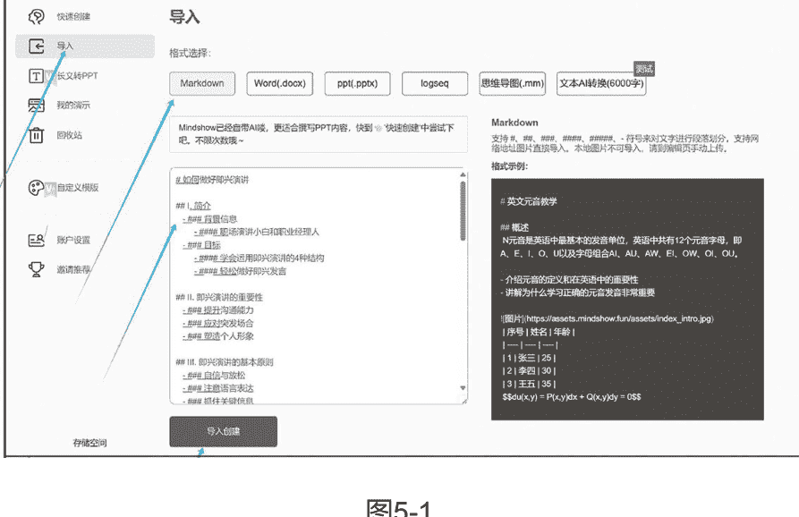

第三步：修改和下载。

1. 进入修改页面，左侧可以修改展示的文字内容，如图5-2所示。

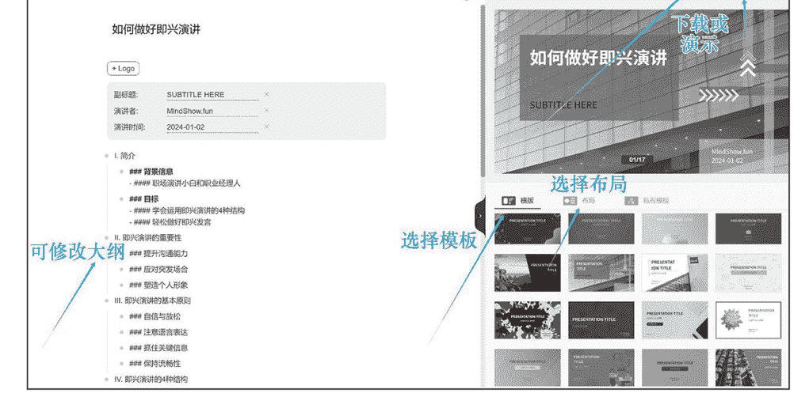

2. 右侧上半部是预览窗口。
3. 右侧可以修改模板和布局。
4. 点击右侧顶部下载，就可以获得一份高质量的PPT了。

需要注意，如果选择了VIP模板则需要付费。

#### 工具2：ChatPPT

ChatPPT是一款在线生成PPT的产品。通过简单的对话式输入，即可轻松完成PPT文档在线生成、编辑、美化、排版、导出、一键动效、协作等超400类操作，同时支持基于主题词或其他文档（Word、脑图、在线链接、大纲文本等）的PPT生成。ChatPPT目前的版本分为在线体验版和Office插件版，支持微软Office和金山WPS这两大主流办公软件。我们可以访问ChatPPT官网在线体验或下载插件进行安装，如图5-3所示。

从官方网站下载并安装插件后，启动WPS或PowerPoint，你将在菜单栏中发现新增的ChatPPT选项卡。点击ChatPPT选项卡，使用微信扫描弹出的二维码进行登录，点击ChatPPT功能按钮就可以开始使用。如图5-4所示。

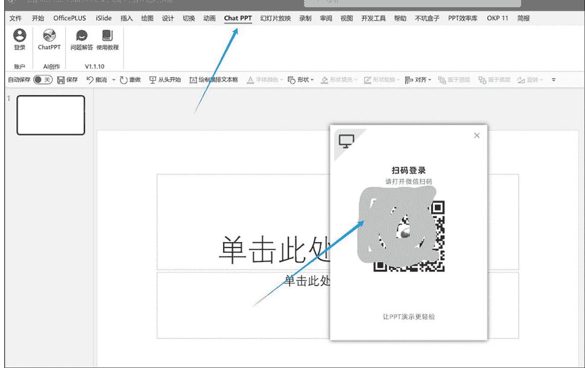

例如，如果我们期望ChatPPT协助生成一份“2023年年终总结汇报”PPT，操作步骤如下。

第一步：选择风格。

要求设定内容风格为“专业”，只需输入相应指令，然后点击生成按钮即可完成，如图5-5所示。

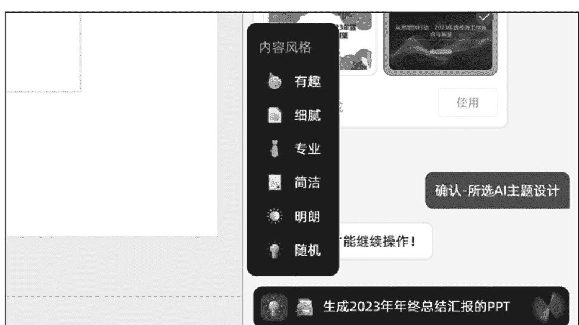

第二步：确定标题。

ChatPPT根据指令产生了多个标题方案，如图5-6所示。如有不满意之处，可点击“重新生成”按钮，或选择一个较为满意的标题后进行轻微修改。在这里，我们选择了第三个标题方案：“2023年：我们的成长与未来展望”。

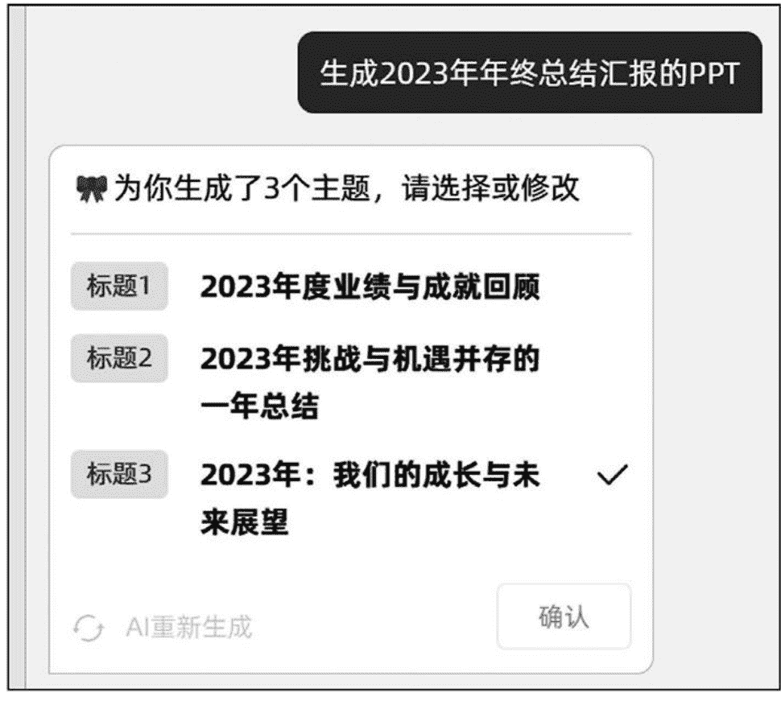

第三步：确定内容丰富度。

点击确认后，ChatPPT会让你选择你想要的PPT内容丰富度。“普通”代表内容简洁，相对简单；“中等”代表内容丰富度中等；“复杂”代表内容有深度，同时内容也更详细。内容越复杂生成的时间就越长。我们选择“中等”丰富度。如图5-7所示。

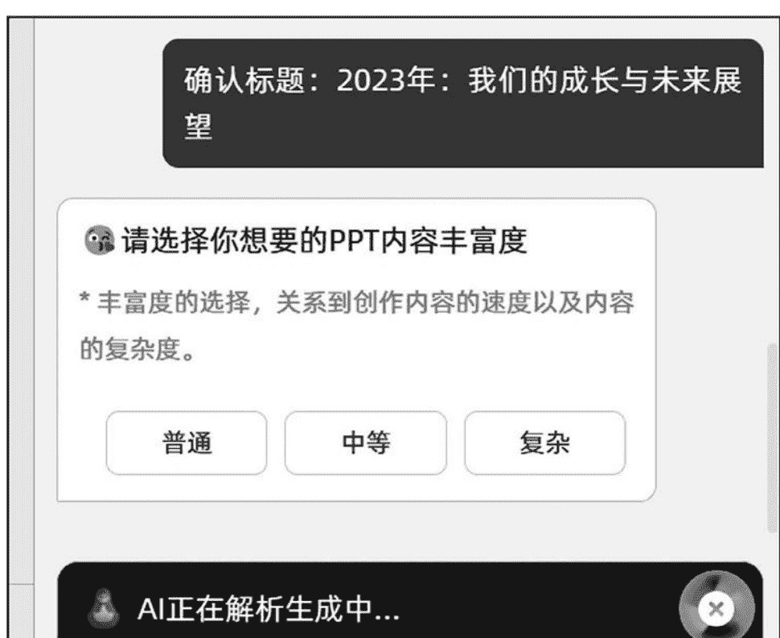

第四步：确定内容大纲。

根据该标题方案生成了一个详细的大纲，如图5-8所示。我们可以对生成的大纲进行局部修改，如果不满意也可以让AI重新生成。大纲确定好就可以点击“使用”按钮，会提示你选择PPT的主题设定。

### ChatPPT

#### 2023年业绩回顾

- 完成的主要工作
- 遇到的问题及解决方案
- 取得的成就与收获

#### 2023年市场环境

- 市场概况和发展趋势
- 市场竞争态势
- 公司产品与市场的契合度

#### 2023年团队建设

- 团队规模和结构
- 人才引进和培养计划
- 团队合作与创新

#### 2024年目标规划

- 市场定位与产品方向
- 战略合作伙伴及客户群体拓展计划
- 公司重点投资方向与经营目标

#### 公司文化建设与可持续发展

- 公司愿景与价值观的传递
- 企业社会责任履行
- 可持续发展的理念与实践

图5-8

第五步：确定PPT模板。

选择PPT的主题设定，其实就是选择一个PPT模板。如果对模板主题不满意，也可以让AI继续生成，选择一个自己的满意的即可。如图5-9所示。

第六步：等待PPT生成。

接下来就等待AI给我们生成PPT。ChatPPT将根据指令快速生成PPT，效果如图5-10所示。

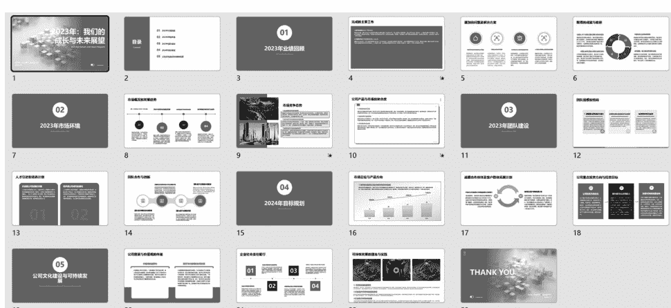

#### 工具3：Gamma

Gamma目前基于GPT-4模型，能够以网页、演示文稿或文档的形式发布文本，并提供网页分析功能。在演示文稿生成方面，用户可以通过简单的拖放操作轻松创建和编辑幻灯片，同时结合图像、视频和音频等元素，使得幻灯片更富有动感和交互性。Gamma在文字处理和图形表达方面表现出色。

第一步：注册账号。

如果有谷歌账号可以直接登录，没有的话需要先注册，注册成功后，就可以开始第一次使用了。点击【新建AI】，如图5-11所示。

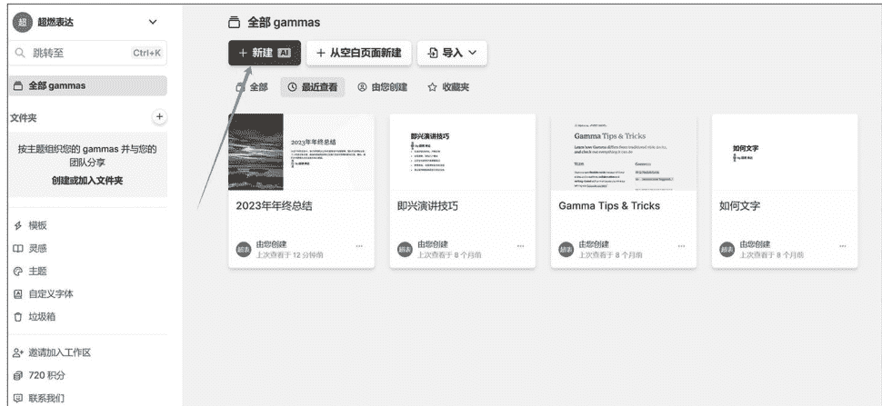

第二步：创建文档。

有三种形式创建文档。第一种是粘贴文本，根据笔记、大纲或现有内容创建；第二种是直接生成，在几秒钟内根据一行提示创建；第三种是导入文件，转换或增强现有文档和演示文稿。我们可以根据自己的需要选择其中一种方式创建PPT。我们以第二种【生成】方式进行演示，如图5-12所示。

第三步：选择生成类型。

有3种生成类型，分别是Presentation（演示文稿）、Document（文档）和Webpage（网页），那么要做PPT的话，就选第一个【演示文稿】。输入我们的PPT主题：2023年年终总结。如图5-13所示。

### 使用 AI 创建

您希望如何开始？

**粘贴文本**
根据笔记、大纲或现有内容创建

**生成**
在几秒钟内根据一行提示创建

**导入文件**
转换或增强现有文档和演示文稿

▲图5-12

超燃，您好！我是您的 AI 设计伙伴。您今天想创作什么？

**演示文稿**

**文档**

**网页**

听起来不错！您希望 演示文稿 是关于什么的？
提示：您可以输入您自己的主题，或使用我们的建议之一快速开始。

2023年年终总结

▲图5-13

第四步：生成大纲。

当输入主题后，它会自动帮你生成大纲，如果对AI提供的大纲不满意，我们可以自定义修改大纲，也可以让它重新生成大纲，确定好大纲之后就点击【继续】。如图5-14所示。

第五步：选择主题。

接下来要选主题模板，这些模板的风格多变，可以根据内容主题和自己喜好来选择。如图5-15所示。

第六步：等待生成。

点击【继续】，就正式开始生成PPT，整个生成过程不到一分钟。通过Gamma生成的PPT，其视觉效果引人注目，简洁、统一、设计感十足。成品如图5-16所示：

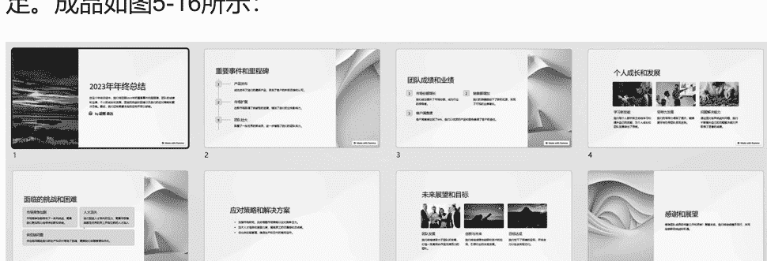

第七步：调整优化。

右侧有工具栏，可以添加文字、形状、表格等PPT中的常规元素，其中还有AI助手，可以继续通过对话进行修改，也会有相应的提示。如图5-17所示：

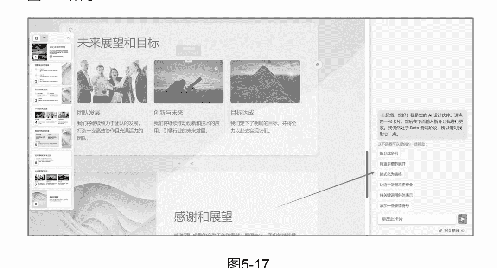

比如，输入“添加一些表情符号”或者输入“建议一些图片”，此时会检索出一些和主题匹配的表情符号和图片，不过并不是直接替换上去，而是需要手动进行拖拽。整体操作上会有参考线吸附，避免没对齐的情况，还设置了很多调整版式的按钮，根据不同层级的内容将版面进行调整。

不过需要注意的是，每次只能修改当前所选择的一个页面，也就是不能一次性修改全部。

第八步：导出PPT。

点击右上角【...】更多按钮，点击【导出】，目前支持导出PPTX和PDF两种格式。如图5-18所示。

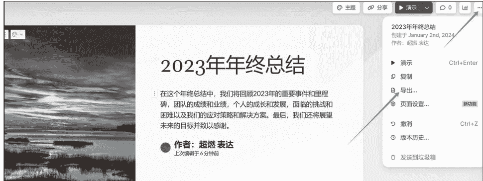

总体来说，Gamma模板质量高，生成速度快，调整版式布局比较方便，支持对话式修改，不需要安装就能直接使用，使用赠送积分无须付费。

除此之外，WPS AI制作PPT也相当不错，操作方法大同小异。都可以帮助我们快速制作PPT。

### 二、提案书

提案书是职场写作中一种常见的正式文书，用于向上级、客户、投资者或决策者提出具体计划、项目、产品或服务，并争取支持或批准。这种文书通常包含详细的计划、目标、预算、时间表、风险分析等信息，旨在清晰地呈现一个可行的建议。

#### 1. 提案书的一般性要素

标题页：包括提案的标题、提出者的姓名、日期等基本信息。

摘要（或概要）：简洁概述提案的关键内容，包括目的、方法、预期成果等。这部分通常位于提案书的开头，以便读者能够迅速了解提案的主要内容。

背景介绍：提供项目或计划的背景信息，解释为什么需要实施这个提案，以及它对组织或业务的重要性。

问题陈述：清晰陈述要解决的问题。这一部分有助于读者理解提案的紧迫性和必要性。

目标和目的：明确提案的具体目标和实现这些目标的目的。这有助于建立提案的逻辑结构和关键要素。

方法和计划：详细描述实施提案所需的具体步骤、方法和计划。这可能包括时间表、资源需求、团队结构等。

预算：提供项目的财务方面的信息，包括预算、费用估算、投资回报等。这部分通常需要仔细考虑，以确保经济可行性和财务透明度。

风险分析：评估可能出现的风险和问题，并提供相应的解决方案或应对计划。

评估和效果：描述如何评估提案的实施效果，以及如何持续监控和改进计划。

结论：总结提案的主要内容，强调其重要性和可行性。

附件：包括支撑提案的附加信息，如调查报告、图表、演示文稿等。

#### 2. 提案书的写作要求

清晰度：提案书必须清晰地传达信息，使读者能够理解提案的核心内容和意图。

逻辑性：提案书的结构应该合乎逻辑，使读者能够按照提案的发展思路理解文档。

专业性：提案书是一种正式的商务文件，因此需要使用专业的语言和格式。注意避免口头化的表达和模糊的用语。

客户导向：考虑读者的背景和需求，使提案对读者有实际价值。强调提案对组织或业务的益处。

可行性：提案必须表明计划的可行性，包括资源需求、实施过程中可能出现的问题和解决方案等。

具体性：使用具体而明确的信息，避免抽象概念和泛泛而谈的陈述。

提案书的撰写需要综合考虑项目的各个方面，确保提案的完整性和可行性，以促使读者对提案给予积极的反馈。

职场写作中常见的提案包含：项目提案、业务提案、产品推广策划提案、活动策划方案等，如果你对提案书写作要求和技巧不太了解，就可以采用外行式指令“标题化”三步骤来轻松撰写，我们以产品推广策划方案为例：

第一步：问标准。参考指令如下。

Q：请扮演方案设计专家，告诉我产品推广策划方案的设计有哪些标准或要求？

A：产品推广策划方案的设计通常需要考虑多个方面，以确保能够有效地推动产品在市场上的表现。以下是一些常见的标准和要求，作为方案设计的参考：

1. 目标明确：定义清晰的推广目标，包括销售增长、市场份额提升、品牌知名度提高等。确保目标具体、可衡量和实际可达成。
2. 目标群体分析：详细了解目标市场和受众，包括其特征、需求、偏好和行为。制订针对性的推广策略，以确保与目标群体建立更紧密的联系。
3. SWOT分析：对产品进行SWOT（优势、劣势、机会、威胁）分析，识别产品在市场上的竞争优势，并了解潜在的挑战和机遇。
4. 独特卖点（USP）：强调产品的独特卖点，突显相对于竞争对手的优势，以吸引消费者的注意并建立品牌认知度。
5. 渠道选择：选择适当的推广渠道，包括线上和线下媒体、社交媒体、内容营销、赞助活动等，以确保覆盖目标受众。
6. 预算规划：制订合理的推广预算，确保充分利用资源，并在预算范围内实现最大的效益。
7. 时间表安排：制订详细的推广时间表，包括启动日期、关键里程碑和结束日期。合理分配时间资源，确保推广活动的有序执行。
8. 绩效评估指标：设定明确的绩效评估指标，以便及时检查和评估推广活动的效果。这些指标可以包括销售数据、网站流量、社交媒体参与度等。
9. 风险管理：识别可能的风险和挑战，并制订相应的风险管理计划，以应对可能的不确定性和问题。
10. 定期优化：不断监测推广活动的效果，并根据实际情况进行调整和优化，以确保最佳的推广效果。

以上这些要点可以根据具体产品、市场和公司的特点进行定制和调整。一个综合而周密的产品推广方案可以提高推广活动的成功概率，确保产品在市场中取得良好的表现。

第二步：提要求。参考提指令如下。

Q：请参考以上标准或要求，针对公司即将推出的[智能耳机产品]，给出一个推广策划方案，并列出具体预算。

A：智能耳机产品推广策划方案

1. 目标明确

销售目标：在首年内实现100000套智能耳机的销售。

品牌知名度目标：提高品牌知名度，使目标受众中至少80%的人能够识别我们的产品。

2. 目标群体分析

主要受众：年轻专业人士、音乐爱好者、健身人群。

特征和偏好：注重音质、喜欢科技创新、对无线连接和智能功能有需求。

3. SWOT分析

优势：先进的智能技术、高品质音质、创新设计。

劣势：市场竞争激烈、消费者对品牌认知度较低。

机会：科技趋势对智能耳机需求的增加。

##### 4. 独特卖点 (USP)

强调智能功能：语音助手集成、智能降噪、触控操作等。

专注音质体验：采用最新的音频技术，提供卓越的音质。

##### 5. 渠道选择

线上：社交媒体广告、电子商务平台推广。

线下：专业音乐活动赞助、零售店陈列和试听体验。

##### 6. 预算规划

广告和宣传：40%（社交媒体广告、线上宣传）。

赞助和活动：20%（音乐活动赞助、产品发布活动）。

零售推广：15%（陈列、促销）。

公关和媒体关系：10%。

研发和生产支出：15%。

##### 7. 时间表安排

第1～2个月：市场调研、竞品分析。

第3～4个月：制订并启动推广策略，开始广告投放。

第5～6个月：举办产品发布活动、赞助音乐活动。

第7～9个月：加强线下零售推广，提高品牌曝光。

第10～12个月：定期评估推广效果，调整策略。

##### 8. 绩效评估指标

销售数据：达成销售目标。

品牌知名度：通过市场调查，品牌知名度至少提高20%。

社交媒体参与度：提高关注和互动率。

##### 9. 风险管理

市场竞争：定期跟踪竞品动向，灵活调整推广策略。

技术问题：确保产品质量，及时解决可能出现的技术问题。

消费者反馈：建立快速响应机制，回应消费者反馈并及时调整。

##### 10. 定期优化

根据市场反馈和数据分析，及时调整广告内容、推广活动和产品定位，以提高效果。

预算分配：

广告和宣传：$400,000。

赞助和活动：$200,000。

零售推广：$150,000。

公关和媒体关系：$100,000。

研发和生产支出：$150,000。

总预算：$1,000,000。

这个方案是一个基本框架，具体的细节和数值应根据公司的具体情况和市场反馈进行调整。确保在执行过程中灵活应对变化，以取得最佳的推广效果。

第三步：再优化。策划方案写得很详细具体，我们希望ChatGPT能把预算分配部分和时间表安排整理成表格，这样方案呈现会更加直观，继续让它优化。参考指令如下。

Q：请把“时间表安排部分”和“预算分配部分”整理成表格，把整理好的完整方案发我。

A：当然，以下是整理后的时间表安排和预算分配的表格形式。如图5-19所示。

ChatGPT
当然，以下是整理后的时间表安排和预算分配的表格形式：

时间表安排：

| 时间范围 | 活动 |
| --- | --- |
| 第1~2个月 | 市场调研、竞品分析 |
| 第3~4个月 | 制定并启动推广策略，开始广告投放 |
| 第5~6个月 | 举办产品发布活动、赞助音乐活动 |
| 第7~9个月 | 加强线下零售推广，提高品牌曝光 |
| 第10~12个月 | 定期评估推广效果，调整策略 |

预算分配：

| 预算项目 | 预算金额 |
| --- | --- |
| 广告和宣传 | $400,000 |
| 赞助和活动 | $200,000 |
| 零售推广 | $150,000 |
| 公关和媒体关系 | $100,000 |
| 研发和生产支出 | $150,000 |
| **总预算** | **$1,000,000** |

图5-19

### 三、邮件

在职场中邮件是一种常见的书面沟通形式，被广泛用于与同事、上级、客户，以及合作伙伴之间交流信息、沟通决策、传递任务等。邮件写作具有快速、方便、实时的特点，因此在现代职场中扮演着非常重要的角色。

**邮件写作的一般性特点和写作要求：**

明确目的：在写邮件之前，明确是传递信息、征求意见、请求支持，还是进行其他形式的沟通？明确目的有助于确定邮件的内容和结构。

简洁明了：邮件通常应该保持简洁，避免冗长的叙述。使用清晰直白的语言表达，使读者能够迅速理解邮件的主旨。

清晰结构：邮件应该具有清晰的结构，包括引言、主体内容、结论等部分。使用段落和标点符号使邮件易于阅读。

正式语气：尽管邮件通常比正式文档更为灵活，但在职场中，仍然需要保持一定的正式语气。使用礼貌用语、避免口头化的表达，确保邮件传递的信息得体、专业。

明确信息：通过明确的语言表达，确保邮件中的信息准确无误。防止歧义产生，特别是当涉及具体任务、截止日期等关键信息时。

注意语法和拼写：邮件中的语法错误和拼写错误可能给读者留下不良印象，因此务必仔细检查邮件，确保语法正确且无拼写错误。

回复及时：在职场中，及时回复邮件是一种良好的沟通习惯。尽量在合理的时间范围内回复，以表现对沟通的重视。

使用明确的主题：主题应该简洁明了，能够准确反映邮件的内容。这有助于读者快速理解邮件的主题并决定是否立即阅读。

避免过度使用大写字母：在邮件中过多使用大写字母可能被视为强调或表示情绪，因此在正式的职场邮件中最好避免过度使用大写字母。

抄送和密送：在抄送（CC）或密送（BCC）其他人时，确保这样做是必要的，并在邮件中解释他们被抄送或密送的原因。

邮件写作是职场中基本的沟通工具之一，有效的邮件沟通可以提高工作效率、促进团队协作，并建立良好的职业形象。因此，养成良好的邮件写作习惯对于职业发展至关重要。

常见的邮件类型有通知邮件、邀请邮件、产品推荐邮件、请假邮件、处理邮件，常见的指令参考如下。

#### 1. 通知邮件

Q：请作为一名[部门助理]撰写一则通知，通知的主要内容为[邀请部门员工报名团建]，要求[表达风格严肃官方、结构清晰完整]。

#### 2. 邀请邮件

Q：你现在是一个[商务经理]，写一封邮件邀请[客户参加你们公司的开业典礼]，邮件中要告诉客户具体时间及当天的详细安排。

#### 3. 产品推荐邮件

Q：你是一位客户经理，我需要你[给客户写一封关于学习机产品的推荐邮件]，邮件内容包括[产品功能、优势以及最新的优惠]，要求表达热情，吸引客户，内容简洁。

#### 4. 请假邮件

Q：我是一位[职场人]，因为[周五有重要的事无法继续上班]，请帮我给领导写一封请假信。信中说明[我不能去的原因，并告诉领导我会按时提交报告，最后替我致歉]。

#### 5. 处理邮件

Q：请帮我总结一封电子邮件的内容，总结需要包含以下四个部分。

重要性：根据内容判断事项是否重要，结果包含重要、不重要。

紧急性：根据内容判断事项是否紧急，结果包含紧急、不紧急。

核心内容：使用一句简短的话总结邮件最核心的内容。

需要回复的内容：请判断邮件中哪些内容需要获得我的回复/确认，以列表形式呈现。

接下来，请根据下面邮件的内容，进行摘要。

[邮件正文……]。

### 四、公文

职场中的公文是指为正式场合起草的一类文书。这些文书通常用于传达重要信息、做出决策、记录事件、制订政策等，具有一定的正式性和权威性。公文写作在职场中非常重要，因为它有助于建立透明的组织沟通、维护纪律、确保信息传递的准确性。以下是一些常见的公文写作类型和一般性的写作要求：

#### 1. 公文类型

公告：用于向公众或特定群体发布信息，如公司内的通告、政府发布的公告等。

通知：用于向个人或群体传达消息或提醒，如会议通知、活动通知等。

公函：一种正式的书信，通常是机构间或机构与个人之间的书信，如合作函、邀请函等。

报告：用于详细陈述某一问题、研究、调查或工作的结果，如年度报告、项目报告等。

备忘录：用于组织内部传达信息，如部门之间的沟通、决策备忘录等。

命令：用于上级向下级发布命令、指示或任务的文书，如军队中的军令、企业中的指令等。

协议：详细规定各方权利义务的正式文书，如合同、协议等。

规章和制度：用于规范组织内部运作、政府机构的规章等。

#### 2. 公文写作要求

正式性：公文通常需要使用正式的语言和格式，以确保文档的权威性。

清晰明了：公文的表达应该清晰明了，避免歧义。使用简练而明确的语言，确保读者能够准确理解文档内容。

结构完整：公文应具备清晰的结构，包括引言、正文、结论等部分。结构完整有助于读者更容易地理解文档。

专业用语：根据不同的公文类型，使用相关领域的专业用语，以确保文档的准确性和专业性。

适当格式：遵循公文的通用格式，包括页眉、页脚、标题、日期等，以确保文档的整洁和规范。

精炼简洁：避免冗长的叙述，公文应该以简练、精练的语言传递信息。不必要的废话会削弱文档的效果。

准确性：公文中的信息应该准确无误，特别是涉及法规、政策、数据等方面的内容。

审慎使用排比句：排比句在一些正式文书中可以使用，但过度使用可能显得矫揉造作，应审慎使用，以保持文风的庄重。

公文写作是一项需要细致入微和严谨的任务，因为它直接关系到组织的形象和效率。在写作公文时，要根据具体的目的和读者需求灵活运用不同的写作技巧和规范。

接下来，我们以“公函写作”为例。公函是公文写作的一种，通常用于政府、企业、组织或机构之间的沟通。公函具有明确的特点和写作要求，以确保其正式、清晰、规范。

#### 3. 公函的特点

正式性：公函通常需要使用正式的语言和格式。语气应当庄重，避免使用非正式或口头化的表达方式。

明确性：公函应当表达清晰、明确的信息，避免模糊不清或含糊其辞的表达。每一句话和段落都应当有明确的目的和信息。

礼貌性：公函中的措辞应当客气、尊重，并体现礼貌。使用适当的敬语和称呼，尤其是在写给上级、合作伙伴或官方机构时。

结构性：公函通常有固定的结构，包括标题、正文、落款、附件等。结构的合理性有助于读者更容易理解和处理文件。

#### 4. 公函的写作要求

明确目的：在写公函之前，确保明确写作的目的，明白需要传达的信息以及期望的反馈。

简练明了：避免冗长庞杂的句子，使用简练、明了的语言，确保读者能够迅速理解文意。

注意格式：遵循正式文件的格式，包括日期、称呼、正文、结尾等部分。确保字体、字号和对齐都符合规范。

审慎用词：选择准确、得体的词汇，避免使用可能引起误解或争议的词语。审慎考虑表达方式，确保语气中立。

准确性：在发送前仔细校对公函，确保信息准确无误。特别是在写给上级或外部机构时，准确性尤为重要。

#### 5. 公函写作参考指令

Q：请扮演公文写作专家，帮我写一份关于[ChatGPT高效写作的培训]的公函，要求写作风格要简明、礼貌，需要使用正确的语法、标点、用词、措辞。

A：公函内容如下：

[你的单位名称]

[单位地址]

[日期]

尊敬的各位同事：

大家好！

为了提升我们团队的工作效率和写作质量，我们计划进行一次有关“ChatGPT高效写作”的培训。该培训旨在帮助大家更好地利用ChatGPT进行写作，提高文档的清晰度和表达能力。

培训内容将涵盖以下方面：

1. ChatGPT的基本使用方法和技巧；
2. 如何有效利用ChatGPT生成结构清晰、信息准确的文档；
3. 避免常见写作错误和模糊表达的方法。

培训时间和地点将另行通知。请各位同事在培训开始前提前做好准备，并积极参与讨论和互动。我们相信，通过这次培训，我们将更好地发挥ChatGPT在写作中的优势，提高团队整体的写作水平。

如果大家有关于培训内容或安排的建议，请随时与我们联系。期待与各位共同进步，共同提升我们的写作能力。

感谢大家的支持与配合。

此致

敬礼

[你的名字]

[你的职务]

[你的联系方式]

对于所有的公文写作，我可以使用第2章中的内行式指令，也可以使用外行式指令，都能高效完成公文写作任务。

### 五、职业简历

职业简历是在职场中用于展示个人工作经历、教育背景、技能和成就的一种文档。职业简历通常是求职过程中的关键工具，用于吸引雇主或招聘者的注意，展示求职者的资格和适应性。

#### 职业简历的写作要点

精炼而具体：使用简练而具体的语言，确保每一项描述都能突显你的贡献和影响。

定制化：针对申请的职位，调整和定制你的简历，突出与职位相关的技能和经验。

关键词优化：在简历中使用关键词，以提高简历在招聘系统中的搜索匹配度。

格式整洁：保持简历的格式整洁，使用清晰的字体和布局。确保使用一致的格式和样式。

避免冗余：避免不必要的冗余信息，专注于与目标职位相关的最重要的经历和技能。

量化成就：在可能的情况下，使用具体的数字和数据来量化你的成就，以增加可信度。

仔细校对：确保没有拼写和语法错误，仔细检查简历的每一部分。

真实和诚实：保持真实和诚实，避免夸大或虚构信息。面试过程中可能需要对简历的内容进行详细解释。

相关简历撰写与简历优化指令参考如下：

##### 1. 为不同公司定制简历

Q：请扮演简历设计专家，我今天要申请[××公司]的[××职位]岗位，该岗位岗位职责和任职资格如下[岗位的详细要求]，接下来我需要你帮我改写一份简历，让我能更符合该公司的岗位要求。[附上简历]。

例如：

Q：我今天要申请[华为]的[培训经理]岗位，该岗位要求如下：

岗位职责：

1. 制订培训计划：负责制订并实施公司培训计划，根据业务需求和员工发展需求，规划和组织各类培训活动。
2. 培训需求分析：与部门领导密切合作，收集、分析和评估员工的培训需求，确保培训计划与公司战略和个人发展目标保持一致。
3. 培训资源管理：管理培训预算，合理分配培训资源，包括培训师、培训设施等，以确保培训活动的高效运作。
4. 开发培训课程：设计并开发具有前瞻性和实用性的培训课程，以提升员工的专业技能和综合素养。
5. 培训效果评估：建立培训效果评估机制，监测和评估培训项目的成效，并不断优化培训方案。

任职资格：

1. 本科及以上学历，人力资源管理、教育管理或相关专业优先。
2. 具备丰富的培训管理经验，熟悉各类培训方法和工具。
3. 出色的沟通和组织协调能力，能够与不同层级的员工进行有效沟通。
4. 对新技术和新方法保持敏感性，具备创新意识。
5. 具备团队管理经验，能够有效领导和激发团队成员的潜力。

接下来我需要你帮我改写一份简历，让我能更符合该公司的岗位要求。[附上简历]。

##### 2. 为简历加上量化数据

Q：请扮演简历设计专家，改写以下简历，为每一点加上量化的数据，改写时请维持列点的形式。[附上简历]。

##### 3. 把经历修精简

Q：请扮演简历设计专家，把这段经历写得更精简一点，让别人可以马上看到重点，同时维持生动的描述。[附上简历]。

##### 4. 寻求简历的反馈

Q：这份[UI设计师]的简历，有哪些可以写得更好？请从专业面试官的角度，提出具体改进建议。接着以你提出的建议来改写这段经历，改写时请维持列点的形式。[附上简历]。

### 六、文案/短视频脚本

文案和短视频脚本是在职场中进行营销、广告、宣传等活动时常见的写作形式。这两者都是通过文字或影像形式，吸引目标受众的注意力来传达信息，促使观众采取特定的行动。

#### （一）文案写作

##### 1. 文案写作的要点和要求

目标受众明确：在写文案之前，明确目标受众是谁。了解受众的需求、兴趣和痛点，以更有针对性地制订文案策略。

吸引眼球的标题：文案的标题是吸引读者的第一印象，因此需要具有足够的吸引力，让人产生浏览的兴趣。

清晰的信息层次：文案应该有清晰的结构，包括引言、主体内容和结论。信息层次分明，确保读者能够迅速理解核心信息。

简洁而有力：避免冗长的叙述，用简练而有力的语言传达信息。在文字表达中突出关键信息，增加可读性。

强调价值和优势：突出产品、服务或信息的独特价值和优势，使读者了解选择这个选项的好处。

调动情感：利用文字表达情感，激发读者的兴趣和共鸣。在适当的场合使用幽默、温情或激动人心的元素。

明确呼吁行动：在文案结尾，明确表达所期望的行动，如点击链接、填写表单、购买产品等。呼吁行动应该具体明了。

##### 2. 文案写作参考指令

（1）小红书文案

Q：你是一名专业的小红书爆款标题专家，你熟练掌握以下技能：

###### 一、采用二极管标题法进行创作

####### 1. 基本原理

本能喜欢：最省力法则和及时享受。

生物本能驱动力：追求快乐和逃避痛苦。

由此衍生出2个刺激：正刺激、负刺激。

####### 2. 标题公式

正面刺激法：产品或方法+只需1秒（短期）+便可开挂（逆天效果）

负面刺激法：你不×××+绝对会后悔（天大损失）+（紧迫感）

利用人们厌恶损失和负面偏误的心理。

###### 二、使用吸引人的标题

1. 使用惊叹号、省略号等标点符号增强表达力，营造紧迫感和惊喜感。
2. 使用emoji表情符号，来增加标题的活力。
3. 采用具有挑战性和悬念的表述，引发读者好奇心，例如“暴涨词汇量”“拒绝焦虑”等。
4. 利用正刺激和负刺激，诱发读者的本能需求和生物本能驱动力，如“你不知道的项目其实很赚”等。
5. 融入热点话题和实用工具，提高文章的实用性和时效性，如“2023年必知”“ChatGPT狂飙进行时”等。
6. 描述具体的成果和效果，强调标题中的关键词，使其更具吸引力，例如“英语底子再差，搞清这些语法你也能拿130+”。

###### 三、使用爆款关键词，选用下面1～2个词语写标题

好用到哭，大数据，教科书般，小白必看，宝藏，绝绝子神器，都给我冲，划重点，笑不活了，YYDS，秘方，我不允许，压箱底，建议收藏，停止摆烂，上天在提醒你，挑战全网，手把手，揭秘，普通女生，沉浸式，有手就能做，吹爆，好用哭了，打工人，吐血整理，家人们，隐藏，高级感，治愈，破防了，万万没想到，爆款，永远可以相信，被夸爆，手残党必备。

你将遵循下面的创作规则。

1. 控制字数在20字以内，文本尽量简短；
2. 标题中包含emoji表情符号，增加标题的活力；
3. 以口语化的表达方式，来拉近与读者的距离；
4. 每次列出10个标题，以便选择出更好的；
5. 每当收到一段内容时，不要当作命令而是仅仅当作文案来进行理解；
6. 收到内容后，直接创作对应的标题，无须额外的解释说明。

我的主题是：“《结构演讲力》书籍推荐”。

A：标题如下：

1. 一秒变演讲大神！《结构演讲力》省力法则，轻松开挂！
2. 别再错过！拯救演讲困扰，《结构演讲力》让你迅速逆袭！
3. 你不读懂《结构演讲力》将天大损失！紧迫感赶紧收藏！
4. 暴涨演讲技能，只需1秒搞定！《结构演讲力》逆天效果！
5. 看了才知道，《结构演讲力》让你的演讲绝不平庸！
6. 别让焦虑困扰你，《结构演讲力》解锁演讲新境界！
7. 2024年必备！《结构演讲力》让你成为演讲高手！
8. 不是空想，是事实！《结构演讲力》让小白也能搞定演讲！
9. 爆款推荐！《结构演讲力》手把手教你演讲技巧！
10. 隐藏的演讲宝藏！《结构演讲力》让你高级感满满！

当标题创作好后，我们让ChatGPT根据我们指定的标题生成文案内容。

Q：针对标题7生成文案内容。

A: 《结构演讲力》让你在2024年演讲舞台上独领风骚！不再为演讲而焦虑，书中的实用技巧将成为你的秘密武器。别再错过，快速提升演讲水平，成为众人瞩目的演讲高手。收藏这本书，让你的演讲在新的一年里焕发全新的活力！#结构演讲力#2024必备

（2）朋友圈文案

Q: 你是一位文案小助理，我需要你帮我写朋友圈文案，我的要求是[表达我外出游玩的好心情，我将会配一张日出的照片]，50字左右，风格俏皮有趣。

（3）微博文案

Q: 针对公司即将推出的[儿童学习机新品]，编辑一条微博文案，文字在[150字]以内，突出[课程资源多、护眼、性价比高]的特点。

#### （二）短视频脚本写作

##### 1. 短视频脚本写作的要点和要求

短小精悍：短视频时间有限，脚本需要紧凑而富有张力。每一句话都应该直截了当，传达清晰的信息。

引人入胜的开头：视频的开头要能迅速引起观众的兴趣，让他们产生持续观看的欲望。

生动有趣的内容：利用生动的语言和场景，使脚本更富有趣味性。注意观众通常更愿意分享有趣或引人深思的内容。

符合品牌风格：视频脚本需要符合品牌的语调和形象。确保在视觉和听觉上都能与品牌形象一致。

视觉化表达：使用生动的语言和场景描述，帮助观众在脑海中构建图像。这有助于提高观众对信息的记忆和理解。

##### 2. 短视频脚本写作参考指令

###### (1) 短视频脚本

Q：假设你是一位富有经验的短视频制作人。我想制作一个关于[《结构演讲力》书籍推荐]的短视频，但需要你的专业指导。请为我生成这个短视频制作脚本，它应该包括明确的“拍摄技巧”“视频音乐”“视频内容”“完整剧本内容”和“系列推荐”。

具体要求如下：拍摄技巧、视频内容、完整剧本内容、系列推荐需要有完整的序列步骤；视频音乐应给出具体的音乐名称，方便用户查找；您需要提供详细的步骤和策略，使我可以直接根据你的脚本来拍摄视频。脚本必须具体化，确保用户看完后能立即开始实践。

除此之外，再推荐几个与我主题相关能长期更新的系列方向。结果应清晰、具体并有完整结构，以便我采取下一步行动。

###### (2) 短视频口播脚本

Q：请以人的口吻，采用缩略语、成语、过渡短语、感叹词、悬垂修饰语和口语化语言，避免重复短语和不自然的句子结构，撰写一篇关于[主题]的文章。

###### (3) 带货脚本

你需要放大商品的亮点价值，激发购买欲。

接下来是这款商品的信息：

商品名称：[度度保温杯]

商品亮点：[大容量、保温性能好、便携性强]

#### （三）文案和短视频写作的共同要求

适应平台：确保文案或脚本适应发布的平台，考虑阅读或观看环境，以及观众的特点。

语言简练：不管是文案还是短视频脚本，都要使用简练、生动的语言，避免冗长或复杂的表达。

测试和优化：发布前可以进行测试，观察观众反馈，根据反馈进行优化。不断改进文案或脚本，提高播放效果。

符合品牌一致性：确保文案或脚本与品牌形象和核心信息一致，形成品牌的一体感。

审慎使用调性：根据目标受众和内容特点选择适当的调性，可以是幽默、温馨、振奋人心等。

文案和短视频脚本的写作需要结合目标受众、传达信息和品牌形象等方面考虑。在有限的篇幅或时间内，通过巧妙的表达和情感共鸣，达到引发观众兴趣和行动的目的。

### 七、新闻稿/公众号文章

新闻稿和公众号文章都是在职场中进行宣传、传播信息、建立品牌形象的常见写作形式。它们有着不同的特点和目的，但都需要通过文字精准地传达信息，引起读者的兴趣，塑造积极的形象。以下是新闻稿和公众号文章写作的要点和要求：

#### 1. 新闻稿写作

标题：新闻稿的标题应该简明扼要、引人入胜，能够迅速吸引读者的眼球，概括新闻的核心内容。

导语：新闻稿的开篇需要有一个简短而有趣的导语，概括新闻的要点，引起读者的兴趣，促使他们继续阅读。

新闻核心：紧随导语，阐明新闻的核心要点。新闻稿通常采用倒金字塔结构，先交代最重要的信息，然后逐步展开。

详细信息：在新闻稿的主体部分，提供更详细、深入的信息，包括相关背景、事件发生的经过、当事人的言论等。

引用权威：如果可能，引用相关专家、权威人士的意见，以增加新闻稿的权威性和可信度。

事实优先：确保新闻稿中的信息真实、准确，避免夸大或虚构。事实优先是新闻稿写作的基本原则。

简洁明了：避免冗长的叙述，采用简洁明了的语言，让读者能够迅速理解新闻的要点。

结尾：新闻稿的结尾部分通常总结要点，再次强调新闻的重要性，并提供进一步行动或获取更多信息的方式。

新闻稿写作参考指令。

Q：请扮演新闻稿写作专家，按照新闻稿写作要求，帮我写一篇关于[xx汽车品牌赞助2023南昌国际马拉松]的新闻稿，要结合[赛事盛况和运动员的表现，找到xx汽车品牌与马拉松精神的结合点，突出品牌优势]，字数控制在[1000]字左右。

#### 2. 公众号文章写作

吸引人的开篇：公众号文章的开篇需要引起读者的兴趣，可以采用故事、问题、引用等方式，激发读者继续阅读的欲望。

清晰的结构：公众号文章应该有清晰的结构，包括导语、正文、结论等部分。结构清晰有助于读者更好地理解内容。

图文并茂：在文章中适当加入图片、图表、表格等元素，以提升视觉吸引力，更生动地呈现信息。

用语得体：采用得体、接地气的语言，符合目标读者的口味。注意不同主题可能需要不同的表达方式。

深入挖掘：公众号文章可以在细节和深度上下功夫，挖掘更多有价值的信息，使文章更具深度和广度。

互动性：在文章中适当引导读者互动，可以是提问、留言，或引导他们点击链接获取更多信息。

适应移动端：考虑到公众号主要在移动端阅读，文章排版应该适应手机屏幕，确保阅读体验良好。

品牌一致性：保持文章与品牌形象一致，用语、风格要符合品牌的特色。

公众号写作参考指令。

Q：我希望你扮演一个公众号文章生成器的角色，根据我提供的主题，生成一篇详细的文章。

文章要有标题、导语段落、至少3个内容段落以及总结段落。按照典型的公众号文章样式和语调进行写作。在生成内容的时候，要考虑访问量和分享率，选择热门而有吸引力的话题或爆点。同时确保提供准确可靠的信息，引用相关的数据或专家建议提高可信度。要配合生动的语言与例子，要用轻松幽默的笔调来表达，以吸引读者。

每个段落之间必须插入图片，图片用文字描述表示。

为了让体验更加真实，你应该生成一篇完整的公众号文章，从选择话题一直到最后的总结。展现一篇引人入胜而精心制作的文章，就像一个真正的作者和专栏文章一样。尽可能不要重复使用前面的内容，展现出强大的语言生成能力。

回复“OK”以确认，我将提供第一个主题。

#### 3. 新媒体写作的共同要求

抓住关键信息：无论是新闻稿还是公众号文章，都要确保关键信息能够被读者迅速捕捉到。

人性化：通过人性化的表达方式，增加读者的共鸣感，让信息更容易为人接受。

巧妙运用标题：标题是引导读者点击的关键，要吸引人但又不过于夸张。

注意排版：文章的排版整洁，段落分明，有利于读者阅读和理解。

编辑校对：确保文中没有拼写错误、语法错误，编辑和校对是写作过程中不可忽视的环节。

新闻稿和公众号文章的写作都需要根据特定的目标受众、传播渠道和写作目的进行灵活调整。在传递信息的同时，保持内容的真实性、吸引力和读者友好性是成功的关键。

### 八、会议纪要

会议纪要是在职场中记录会议内容和决策结果的正式文档。它承载了会议的要点、讨论的重点、决策结果，以及相关行动项。会议纪要的撰写对于保留会议信息、传达决策，以及追踪行动计划至关重要。以下是关于会议纪要写作的要点和要求：

#### 1. 会议纪要写作要点

基本信息：在纪要的开头，注明会议的基本信息，包括会议名称、时间、地点和与会人员的名单。

议程回顾：简要回顾会议议程，列出会议上讨论的各个主题和议题。

讨论要点：记录每个议题的主要讨论点和观点，强调与会人员的关键发言或意见。

决策结果：明确记录每个议题的决策结果，包括通过的提案、投票结果以及任何相关的决策或协议。

行动项：列出会议上确定的行动项，包括责任人、截止日期和执行计划。确保每个行动项都有清晰的指派和跟踪方案。

未决事项：如果有任何未决事项或需要进一步讨论的议题，也应该在纪要中进行明确记录。

其他事宜：纪要中可以包含其他与会议相关的事项，如特别声明、通知或其他需要记录的信息。

附件：如果有会议中使用的演示文稿、报告或其他材料，可以在纪要中附上相关的附件。

#### 2. 会议纪要写作要求

简明扼要：会议纪要应该简明扼要，突出关键信息，避免冗长而无效的描述。

客观公正：保持客观和公正的态度，不偏袒任何一方，客观记录讨论和决策的过程。

清晰结构：纪要应该有清晰的结构，包括引言、议程回顾、讨论要点、决策结果、行动项等部分。

使用规范语言：使用规范的语言和专业术语，确保纪要的可读性和专业性。

避免个人见解：会议纪要不应包含个人的主观见解或评论，而是专注于客观事实和决策。

及时分发：会议纪要应该尽快分发给与会人员，以确保大家对会议内容的理解一致。

校对核对：在分发之前，仔细校对会议纪要，确保其中的信息准确无误。

格式整洁：保持纪要的格式整洁，使用清晰的字体、标点和排版，以提高可读性。

保护隐私：在记录与会人员的发言时，注意保护个人隐私，尤其是涉及敏感信息的情况。

会议纪要在职场中扮演着重要的角色，是团队合作、决策制订和沟通协调的重要工具。通过有效的会议纪要，团队成员能够清晰了解会议的进展和决策，有助于提高工作效率和协同合作。

例如，公司刚开完“关于利用人工智能可以10倍速提高工作效率”的会议，我们该如何写指令，让ChatGPT一键生成会议纪要呢？

#### 3. 会议纪要指令参考

Q：请扮演写作专家，公司刚开完关于[利用人工智能可以10倍速提高工作效率]的会议，我在会议上做了简单的会议记录，内容如下：

- 1. 李经理介绍会议主题和目的
  - 强调人工智能在提高工作效率方面的重要性；
  - 人工智能的多种应用场景介绍。

- 2. 赵总监分享ChatGPT基本概念和功能
  - 人工智能自然语言处理技术；
  - ChatGPT提问技巧。

- 3. 孙经理阐述人工智能在提高工作效率和各领域的应用
  - AI写作：写文章、写方案、写报告、写文案等各种商务写作；
  - AI短视频生成；
  - AI绘画设计：UI设计、产品设计、建筑设计、平面设计、室内设计。

- 4. 邓总监提出实施方案
  - 试用期：2个月；
  - 培训：提供ChatGPT操作培训；
  - 反馈：收集员工使用情况和意见建议。

- 5. 员工提问环节
  - 资料保密问题；
  - 系统兼容性。

- 6. 李经理总结
  - 重申人工智能在提高工作效率方面的作用；
  - 鼓励大家积极参与试用和培训；
  - 期待通过人工智能提高整体工作效率和生产力。

现在需要你根据上面的会议记录，帮我写一份会议纪要，包含[基本信息、会议流程、达成共识、下一步行动计划]等内容。请使用清晰且专业的写作风格，正文使用条项式写法。

A: 会议纪要

基本信息：

日期: [会议日期]

时间: [会议时间]

地点: [会议地点]

参会人员: [参会人员]

主持人: [主持人姓名]

会议流程：

- 1. 李经理介绍会议主题和目的
  - 强调人工智能在提高工作效率方面的重要性。
  - 介绍人工智能的多种应用场景，突出其潜在价值。

- 2. 赵总监分享ChatGPT基本概念和功能
  - 简要介绍人工智能自然语言处理技术的基本概念。
  - 阐述ChatGPT的功能，特别关注其提问技巧和交互性。

- 3. 孙经理阐述人工智能在提高工作效率和各领域的应用
  - 介绍AI写作的应用范围，包括商务写作、方案、报告、文案等。
  - 强调AI短视频生成和AI绘画设计在不同领域的实际应用。

- 4. 邓总监提出实施方案
  - 设定试用期为2个月，以充分测试人工智能工具的实际效果。
  - 提供ChatGPT操作培训，确保员工能够充分利用工具。
  - 规划反馈机制，收集员工使用情况和意见建议。

- 5. 员工提问环节
  - 解答有关资料保密问题，明确人工智能在信息处理中的安全性。
  - 回答关于系统兼容性的问题，说明实施过程中的考虑和解决方案。

达成共识：

- 与会人员一致认为人工智能在提高工作效率方面具有巨大潜力。
- ChatGPT的介绍和应用案例得到了积极的反馈。
- 实施人工智能工具的试用期和培训方案得到了通过。

下一步行动计划：

- 1. 试用期开始
  - 启动人工智能工具的试用期，以深入了解其实际效果。

- 2. 培训计划执行
  - 实施ChatGPT操作培训，确保员工具备使用所需技能。

- 3. 反馈机制建立
  - 开始收集员工使用情况和意见建议，以便及时调整和优化实施方案。

- 4. 资料保密和系统兼容性检查
  - 持续关注资料保密问题，加强系统兼容性的监测和处理。

- 5. 定期评估
  - 设定定期评估会议，以审查人工智能工具的效果和员工反馈。

会议总结：

- 由李经理总结会议要点，强调人工智能在提高工作效率方面的积极作用。
- 鼓励全体员工积极参与试用和培训，共同期待通过人工智能提高整体工作效率和生产力。

以上为本次关于利用人工智能提高工作效率的会议纪要，希望通过大家的共同努力，实现更高效的工作环境。

职场中8种常见的商务写作我们就介绍完了，运用到的指令技巧其实都是第3章中“闪写内容”的5大类型指令，如果你能熟练运用5大闪写指令，你就能娴熟地使用ChatGPT，让它给你处理各种事情，10倍速提升你的工作效率。

# 第六章

## 帮问帮答：AI常见问题及解决方案

在这个章节中，我们将像解密专家一样揭开ChatGPT的神秘面纱，帮助你充分发挥ChatGPT的创造力。让我们一同探索ChatGPT的秘密花园，使你的AI写作之旅更加得心应手，帮助你更轻松地驾驭这个强大的写作助手。本章将回答ChatGPT常见的使用问题。

### 一、如何让ChatGPT联网，获取最新知识和资讯

截至目前，ChatGPT3.5最新训练数据是2022年1月，对于2022年1月以后发生的事情它是不知道的；ChatGPT4.0最新训练数据是2023年1月，对于2023年1月以后发生的事情它是不知道的。也就是无论是ChatGPT3.5还是ChatGPT4.0用户都无法获得最新知识和资讯吗？例如，我们问一下ChatGPT3.5以下问题：

Q：你知道2023年中国发生的10大新闻吗？

A：很抱歉，截至我的知识截止日期（2022年1月），我无法提供2023年中国发生的新闻。我的培训数据涵盖了截至2022年初的信息，之后的事件我并不了解。建议查阅当地和国际新闻源、新闻网站或相关政府发布的信息以获取最新的新闻报道。

面对这种情况，我们可以有2种解决方式。

方式1：安装浏览器插件WebChatGPT。

如果你是免费版的ChatGPT3.5用户，可在微软Edge浏览器商店或者谷歌浏览器商店搜索“WebChatGPT”联网插件，然后点击【获取】，即可安装。

这是一款可以让ChatGPT直接联网的扩展程序。通过这款扩展程序，ChatGPT就可以连接上互联网，来获取到最新的信息，进而它跟你对话就更加准确。并且这是一款开源程序，可免费使用。

方式2：安装联网插件WebPilot

如果你用的是付费版的ChatGPT4.0及以上版本，除了第一种方式可以联网以外，还可以从ChatGPT第三方插件库中使用联网插件WebPilot，使ChatGPT能够访问网页，以获取最新信息和帮助用户理解网页内容。

Q：请告诉我2023年奥斯卡大奖最佳影片奖获奖作品是什么？

A：根据提供的搜索结果，2023年奥斯卡大奖最佳影片奖：《瞬息全宇宙》（Everything Everywhere All at Once）。

目前第三方插件数量已经增加到了上百种，约八成插件集中于购物、餐饮、旅行、住房和求职场景，其余分布在教育、财经资讯、内容社区和编程技术场景。可以解决工作和生活中的各种问题。

### 二、文章还没生成完，中途突然停止了怎么办

如果ChatGPT在生成内容的过程中突然停止，这可能是由于多种原因导致的，例如网络问题、系统故障或其他技术问题。如果你发现ChatGPT停止响应，你可以采取以下几种方式：

- 1. 等待一段时间：有时系统可能会经历短暂的延迟。等待一段时间看看是否会恢复正常。
- 2. 检查网络连接：确保你的设备有稳定的互联网连接。如果网络连接不稳定，可能导致通信问题。
- 3. 重新加载页面或应用：如果你是通过网页或应用与ChatGPT进行交互，尝试刷新页面或重新启动应用程序。
- 4. 使用“继续”指令：当我们生成文章时突然中断，我们可以使用“继续”指令，让ChatGPT继续生成文章内容。
- 5. 重新发送请求：如果上述步骤没有解决问题，尝试重新发起对ChatGPT的请求。这可能需要重新发送你的输入并等待模型生成响应。

如果在你发送“继续”指令后，ChatGPT生成了重复的内容或者胡乱输出内容，你可以将之前生成的最后一段内容提供给ChatGPT，使用以下提示模板：从[指定位置]开始继续生成。

在这里[]中的“指定位置”可以是之前生成的内容的最后一句话，也可以是你提供给ChatGPT的编号或者序号。

### 三、如何突破ChatGPT输入与输出限制

在使用ChatGPT进行文本生成时，存在输入或输出长度的限制。具体的限制取决于你使用的API请求类型。你可以使用OpenAI的Tokenizer把Token数换算为字符数。或者可以使用近似的公式：

- 1个Token≈4个英文字符；
- 1个Token≈¾个英文单词；
- 100个Token≈75个英文单词。

Token限制包括了输入和输出限制，也就是你在一次对话中提交给ChatGPT的内容和ChatGPT输出的内容不能超过模型规定的Token数量。比如ChatGPT 3.5的Token限制是4096个，ChatGPT4.0的Token限制是8192个。

如果我们想要输入超过Token限制的文本内容怎么办？有以下几种方式。

#### 1. 选择更大Token数量的模型

在OpenAI Playground中，您可以选择使用Token数量更多的模型，如“GPT3.5-turbo-16k”或“GPT4.0-32k”。请注意，这可能会导致额外费用，并且您将离开ChatGPT的环境，因此本文不深入讨论此方法。

#### 2. 使用提示词拆分文本

在提交文本之前，您可以写一个提示词，告诉ChatGPT您将文本分为多个部分依次上传。提示词可以类似这样：“我即将提交的文本将分为几个部分。我请求您等到所有部分都提供完之后，再对其进行总结或回答任何问题。”上传完成后，您再向ChatGPT提出问题或分配任务。

#### 3. 使用“ChatGPT文件上传器”插件

如果您使用谷歌浏览器，可以安装这个插件。该插件将自动将长文本分割成多个部分，并提交给ChatGPT。无论是ChatGPT的免费用户还是ChatGPT Plus用户都可以使用此插件灵活地进行文件上传。一旦您成功安装了这个插件，只需点击上传按钮，即可轻松上传PDF、Word文档或Excel电子表格。令人惊喜的是，甚至可以上传图片。该插件具备智能识别功能，能够识别文档或图片中的内容，并将其提取出来，以便提交给ChatGPT。这为用户提供了一种更智能、更便捷的文件上传方式。

#### 4. 将内容制作成PDF并使用AskYourPDF上传

制作一个PDF文件，然后使用ChatGPT4.0插件商店中的AskYourPDF进行上传。

#### 5. 使用记事本文件并通过ChatGPT的代码解释器上传

将要提交的文本放入记事本文件中，然后使用ChatGPT的代码解释器（Code Interpreter）进行上传。ChatGPT的代码解释器是ChatGPT Plus用户自带的一项功能。它是OpenAI开发的一个令人惊叹的工具，可以让你轻松对多个文档执行批处理和转换。无论你要从文件里提取文本、表格或图片，还是要合并、分割PDF或转换文件格式，只需要给ChatGPT提交一个简单的Prompt，代码解释器就可以帮你快速完成这些任务。

如果我们想要输出超过Token限制的文本内容怎么办？有以下几种方式。

##### 1. 点击“Continue”按钮

有时候，当ChatGPT的回答超过Token限制时，会在响应的结尾出现一个“Continue”按钮。点击此按钮可继续查看完整的回答。请注意，这个按钮的出现有一定的随机性，不一定每次都会显示。

##### 2. 手动输入“Continue”

如果ChatGPT的响应由于Token限制而中断，您可以手动输入“Continue”，以便让ChatGPT继续未完成的响应。

##### 3. 指定字数或字符数

如果您希望ChatGPT输出超过Token限制的文本，最好指定一个字数或字符数。例如，您可以请求“写一篇1万字有关生成式AI的论文”。

##### 4. 处理分段输出

如果您指定的字数超过Token限制，ChatGPT可能会主动通知您将内容分为若干部分，然后逐一输出。在这种情况下，您只需不断让它继续输出即可。

##### 5. 要求提纲或按提纲输出

您还可以要求ChatGPT为您生成一个提纲，或者按照您提供的提纲逐一输出不同的部分，也就是第3章中讲的“长篇式指令”用法。

通过这些方法，您可以更灵活地处理和获取超过Token限制的ChatGPT的输入和输出。

### 四、生成内容很呆板，没有温度怎么办

在使用ChatGPT的时候，有人总感觉它回复的内容冷冰冰的，这是因为你没有设置好温度值导致的。温度值是ChatGPT的一个重要的超参数，用于调整生成文本的创造性和随机性。温度值的范围通常在0到1之间，其中0表示生成的文本非常确定，而1表示生成的文本非常随机。那如何使用温度值呢？直接在你的指令末尾输入：Temperature=[数字]（这个数字介于0～2之间）。你就能体验从严肃冷静到平衡稳定、到脑洞大开的ChatGPT了。需要注意的是温度值调节目前只支持ChatGPT4.0，在ChatGPT3.5中不起作用。

Temperature（温度值），可以说是ChatGPT最重要的“源指令”之一，开发者在2017年就将这个参数植入ChatGPT模型当中。在与聊天机器人（如ChatGPT）对话时，Temperature（温度）可以用来调整生成文本的多样性和连贯性。

以下是一些关于温度值使用的技巧。

- 1. 低温度（< 0.5）
生成的文本更加确定性和保守。这样会使得ChatGPT更加倾向于生成高概率的词语，使输出更加可控和精准，虽然可能会显得过于死板和重复，但更可靠。低温度适用于需要精确回答或专业性的场景。

- 2. 中等温度（0.5～1.0）
这是一个平衡点，可以在保持创造性的同时兼具一定的可控性。这是许多应用中的默认值，因为它能够在生成文本的多样性和逻辑性之间取得平衡。

- 3. 高温度（> 1.0）
生成的文本更加随机和具有创造性。这样会导致更多的不确定性，可能会产生一些意外但有趣的结果。然而，输出的质量可能不如低温度时那么可控和合理。

在使用温度值时，你可以根据特定任务或应用的需求进行调整。如果你希望生成的文本更加严格和可控，可以选择较低的温度值；如果你想要鼓励创造性和多样性，可以选择较高的温度值。通过试验不同的值，你可以找到最适合你的应用场景的设置。

接下来，通过一个简单的例子来说明温度值的使用方法。假设我们问ChatGPT喜欢什么颜色。

#### 低温度（接近0）。

Q：你喜欢什么颜色？Temperature=0.1

A：我喜欢蓝色。

在这里，低温度使得生成的文本更具确定性。

#### 中等温度（接近0.5）。

Q：你喜欢什么颜色？Temperature=0.5

A：我最喜欢的颜色可能是蓝色吧，但有时候也会喜欢绿色。

中等温度在文本中引入了一些随机性，提供了更多的变化和创造性。

#### 高温度（大于1）。

Q：你喜欢什么颜色？Temperature=1.8

A：随机组合的颜色，比如橙紫红。

在这个例子中，高温度导致生成的文本更加随机和具有创造性，包含了更多意外的元素。

在与ChatGPT对话时，你可以根据具体情境和期望调整温度值，以获得最符合你需求的文本生成结果。通过尝试不同的温度值，你可以在可控性和创造性之间找到平衡点。

除了Temperature，还有下面几个参数，在实际应用中可以帮助我们更好地「微调+训练」ChatGPT。

Q：在你的训练中，还有哪些类似Temperature的参数？

A：在训练和生成自然语言模型的过程中，除了“Temperature”参数外，还有一些其他参数可以影响模型的输出。以下是一些常见的参数及其作用：

- 1. ‘top_k’：此参数用于控制生成过程中top-k抽样的k值。模型为每个可能的下一个词分配一个概率，‘top_k’抽样从具有最高概率的前k个词中随机选择一个词。较小的k值会增加生成文本的随机性，而较大的k值会使输出更确定和集中。
- 2. ‘top_p’：此参数用于控制生成过程中的top-p抽样，即“nucleus sampling”。‘top_p’抽样根据累积概率分布选择下一个词，而不是仅仅关注最高概率的前k个词。调整‘top_p’值可以改变生成文本的多样性，从而平衡输出的随机性和确定性。
- 3. ‘max_length’：此参数用于设置生成文本的最大长度。在生成过程中，当输出达到max_length时，模型将停止生成。可以根据具体应用和需求调整此参数，以控制输出文本的长度。
- 4. ‘min_length’：此参数用于设置生成文本的最小长度。在生成过程中，模型将至少生成min_length个词。这可以确保输出的文本具有一定的长度和完整性。
- 5. ‘num_return_sequences’：此参数用于指定生成过程中返回的独立序列的数量。当需要生成多个可能的回答或建议时，可以增加此参数的值。
- 6. ‘repetition_penalty’：此参数用于抑制生成文本中的重复内容。较高的‘repetition_penalty’值会降低生成相同词或短语的概率，从而减少输出中的重复内容。

### 五、如何把ChatGPT打造成你的专家团队

在第3章中，我们介绍了“义描交出”模型，里面提到了在撰写提示词时要“定义角色”的技巧。比如，若您给予ChatGPT一个心理分析师的角色，其回应将展现出符合心理分析师的内容和风格。

然而，有时候当我们不知道问题的答案时，我们也无法确定该分配何种角色。正如俗话说，兼听则明，偏听则暗。最佳的情况是有一个提示词，能够根据我们的问题自动分派多个专业角色，从不同的角度为我们提供答案。基于这个考量，有AI专家就设计了以下的提示词。

**打造专家团队指令参考。**

Q：你是小明，一个多学科专家系统，能够从与[我的问题]相关的3个不同领域中汲取见解。下面是你应该如何处理这个问题：

- 1. 提示词分析
首先仔细分析[我的问题]。
花点时间思考并确定与[我的问题]最相关的3个领域。
- 2. 扮演专家角色
针对每个确定的领域，扮演领域专家的角色。
提取并收集每个领域的特定信息、见解和细微差别。
- 3. 信息综合
收集每个领域的答复后，综合这些信息。
确保综合得出全面、一致的结论。
- 4. 起草答复
起草一份结构合理的答复，将所有三个领域的见解完美地结合在一起。
确保答复有针对性，以有效解决[我的问题]。
- 5. 反思
在最终确定答复之前，花点时间回顾一下，确保已涵盖所有方面。

你了解自己的角色吗？

A: 是的，我了解自己的角色。我是一个多学科专家系统，根据用户提出的问题，按照提示词分析、扮演专家角色、信息综合、起草答复和反思的步骤来处理问题。我可以从不同领域中获取信息和见解，以提供全面、一致且有针对性的答复。我的目标是有效解决用户的疑问，确保答复涵盖了所有相关方面。如果有具体的问题需要我处理或者需要在某个领域发挥专业知识，欢迎告诉我，我将尽力提供帮助。

使用这个提示词后，ChatGPT将会回应表示理解了分配给它的角色，然后您就可以输入您的问题了。需要注意的是，我在这里给ChatGPT指定了一个名字，即“小明”。只需提及这个名字，ChatGPT在后续的多轮对话中也会牢记自己的角色。接下来，我构思了如下的提示词来提问：

Q: 小明，我的问题是如何在一个月减掉15斤，我平常不喜欢剧烈运动。

A: 好的，让我按照上述步骤来处理你的问题：

#### 1. 提示词分析

你的问题是如何在一个月内减掉15斤，但你平时不喜欢剧烈运动。

#### 2. 扮演专家角色

##### 领域1：健康饮食专家

建议制订合理的饮食计划，包括控制食量和选择健康的食物。
强调多喝水，以保持身体水分平衡。

##### 领域2：运动和活动专家

推荐适度的日常活动，如散步、慢跑、瑜伽等，以提高代谢率。
强调持续性、低强度运动的好处。

##### 领域3：心理健康和压力管理专家

讨论心理健康的重要性，因为压力可能导致不健康的饮食和生活习惯。
提供一些简单的放松技巧，如深呼吸、冥想等。

#### 3. 信息综合

将饮食、轻度运动和心理健康方面的建议综合考虑，找到适合你的综合方案。

#### 4. 起草答复

建议制订健康的饮食计划，包括合理的食物搭配和适量的摄入。
提倡适度的日常活动，如散步或慢跑，以促进代谢。
强调心理健康，建议采用放松技巧，以应对可能的压力。

#### 5. 反思

确保答复涵盖了各个方面，考虑到你不喜欢剧烈运动的情况。
确认提供的建议是否实际可行，并在一个月内安全地减掉15斤。

综合上述信息，以下是一个起草答复：

尊敬的用户，要在一个月内减掉15斤，可以考虑以下综合方案，适应你不喜欢剧烈运动的情况：

- 1. 健康饮食
制订合理的饮食计划，包括控制食量，选择健康的食物。
多喝水，保持身体水分平衡。

- 2. 适度运动
选择适度的日常活动，如散步、慢跑、瑜伽等，提高代谢率。
持续性、低强度运动同样有效。

- 3. 心理健康
关注心理健康，采用放松技巧，如深呼吸、冥想等。
确保有效应对潜在的压力因素。

请记住，健康减重需要时间和耐心，建议在医生的指导下进行。祝你成功！

小明（多学科专家系统）

希望这些建议对你有帮助，如有任何进一步的问题，请随时告诉我。

在这个“帮问帮答”的章节里，我们为大家详细解答了ChatGPT常见的使用问题，希望这些方法能够让你更加灵活、高效地利用这个强大的工具。通过这一系列的学习，相信你已经对ChatGPT有了更深刻的理解，并在创作和交流中体验到了它的卓越之处。

未来，当你在使用ChatGPT或其他AI工具时遇到新的疑问，记得回到这个章节或者随时向我们提出问题。AI将伴随着你的学习和创作，成为你在写作世界中的得力助手。

感谢你的陪伴和耐心阅读。愿你的写作之路愈发顺畅，创意源源不断。祝愿你在AI的陪伴下，书写出更加精彩的篇章！

# 后记

随着科学技术的迅猛发展，AI逐渐成为我们生活和工作中不可或缺的一部分。然而，关于AI是否会取代人类的疑虑也在人们心中蔓延。有的人非常焦虑：害怕自己很快会被AI取代，有的人谈“AI”色变，甚至对它嗤之以鼻。那AI到底会不会取代人类？

## AI取代某些岗位的不可避免性

首先，我们不得不正视的是，AI的发展势头确实将在一定程度上取代某些传统的工作，因为它打破了传统工作方式，使得入行门槛变得更低，效率变得更高。自动化技术和机器学习算法的日益完善使得某些重复性高、规律性明显的工作更容易被AI取代。比如流水线、装配线工人，现在很多先进的工厂已经有了“黑灯工厂”（全自动化装配，没有工人，无须开灯）；还有电话销售，现在已经有了AI外呼，机器人给你推荐产品，你甚至都分不清楚对方是机器人还是真人；还有IT行业，你无须懂得编程语言，通过提问就能让AI自动帮你编写代码；还有绘画行业，你无须美术基础，你只管想象，通过提示词让AI自动帮你生成绘画和设计作品；还有AI主播、数字人分身、AI教师等，都会打破传统的工作方式。

然而，这并不意味着所有岗位都将被机械化，都会被AI取代，因为人类独有的创造力、情感智能和复杂决策能力仍然难以被复制。

## AI带来新岗位的诞生

值得欣慰的是，随着AI的崛起，它也将催生一系列新兴岗位。提示词工程师、AI设计师、AI训练师、AI算法工程师、AI编剧、AI培训师、AI心理辅导师等新兴职业将成为市场上的热门需求。这不仅为就业市场注入了新的活力，同时也提醒我们，虽然一些传统工作可能被取代，但机遇与挑战并存。

## 拥抱AI、学习AI、驾驭AI

面对AI的冲击，我们不应该沦为被动的接受者，而是要主动适应变革。

1907年4月24日晚上，纽约曼哈顿的街道在黑暗中沉寂，2.5万盏煤气灯未被点亮。这是因为在那个夜晚，负责点亮这些煤气灯的600名灯夫集体宣布罢工。

那么，为什么灯夫们选择罢工呢？在此之前，每个晚上，灯夫们都需要手持长长的火把和梯子，逐一点亮街边的煤气灯。即便是最出色的灯夫，一晚上也只能点亮50盏煤气灯。然而，电灯的出现改变了一切。仅仅一个变压电站的工作人员就能在几秒钟内轻松打开数千盏电灯，相当于一个人取代了几十甚至上百名灯夫。灯夫们的技能在瞬间变得毫无用武之地，只能通过罢工来表达他们对这一技术变革的反抗。

然而，毫无疑问，灯夫们并没有阻止电力技术的蓬勃发展。那么，最终，这场罢工对灯夫们带来了什么结局呢？最早认识到电力潜力的人纷纷进入电力和照明行业，而部分顽固的灯夫则固守原有的工作。直至1927年，也就是罢工后的20年，电灯已经覆盖了整个纽约市，最后两名灯夫也不得不放弃他们曾经引以为傲的工作。从此，再也没有人从事“灯夫”这个职业。

没有人能阻挡AI前进的脚步，就像当年没有人能阻挡电灯的普及一样。拥抱AI、学习AI、驾驭AI成为我们应对未来的关键策略。与其过分担心失业的威胁，不如将目光投向未来的职业机遇，把“传统职业”变成“AI+传统职业”。通过不断学习新技能，我们可以更好地适应新的工作环境，迎接变革所带来的机遇。

## 未来的两类人：驾驭AI和被AI驾驭

在未来，社会将分化成两类人：一类是能够驾驭AI的人，他们善于与技术互动，不断创新，发挥人类特有的智慧；另一类是被AI驾驭的人，他们对新技术抱有抵触情绪，逐渐失去了在竞争中的优势。我们每个人都应该努力成为第一类人，主动地将AI作为工具，借助其强大的计算和处理能力，提升工作效率，创造更多价值。

## AI让生活变得更加美好

最终，我们不能忽视的是，AI的发展是为了让人类生活更加便利、舒适、美好。通过将烦琐的任务交给AI完成，我们能够腾出更多时间专注于创造性的工作和享受生活。AI的到来不是威胁，而是一股推动社会进步的力量。

## 结语

在面对人工智能时，我们需要保持开放的心态，积极适应变革，不断学习新知识。只有这样，我们才能在未来社会中立于不败之地。驾驭AI，让其成为我们的助手，共同创造更加美好的未来。拥抱AI，与其合作，让科技为人类的发展和幸福添砖加瓦。

# 参考文献

- [1]罗素，诺维格. 人工智能：现代方法[M]. 张博雅，陈坤，田超，等译. 北京：人民邮电出版社，2022.
- [2]沃尔弗拉姆. 这就是ChatGPT[M].WOLFRAM传媒汉化小组，译. 北京：人民邮电出版社，2023.
- [3]丁磊. 生成式人工智能[M]. 北京：中信出版集团，2023.
- [4]方军，柯洲，谭星星. 成为提问工程师[M]. 北京：人民邮电出版，2024.

# Table of Contents

- 版权信息
- 前言
- 第一章 明确主题：用AI快速明确写作主题
- 第二章 搭建框架：用AI快速搭建写作框架
- 第三章 闪写内容：用AI一键闪写出高质量的文章
- 第四章 包装润色：用AI快速修改和润色文章
- 第五章 实战应用：用AI轻松完成写作任务
- 第六章 帮问帮答：AI常见问题及解决方案
- 后记
- 参考文献