# 用AI把写作效率拉满，这本书手把手带你上路

这是一本面向实战的AI写作加速手册，围绕从找准主题到解答问题的6个核心环节展开，帮你把AI写作的核心方法用起来。适合职场人、职业写作者与内容创作者、教育从业者、广告创意团队、社交媒体运营者、公共演讲者与演讲稿撰写者等各类人群。书里以通俗的方式拆解AI知识，用大量实操案例覆盖不同场景，并给出即学即用的指令技巧，让你借助AI提升写作速度与作品质量。不仅揭示了AI写作的底层逻辑，也是一本贴近日常工作生活的实用指南，能在AI加持下点燃新灵感，打开更多创作可能。

# 写在前面

ChatGPT于2022年11月30日上线，5天用户破百万；两个月后用户达到1亿，创造了消费级应用最快的增长纪录。2023年初，这波浪潮让全球聚焦人工智能，有观点认为它代表了“第四次科技革命”，预示着强人工智能时代到来。

## 我为什么要写它

1. 学AI，花钱不少
ChatGPT刚出来时市面教材很少，我报了不少大V的AI课程，学费动辄数千，质量参差不齐。为了系统学习，我翻阅了国内外研究、学术报告、视频课程，慢慢摸清了如何提问、怎么写提示词。

2. 用AI，效率翻倍
我是职业培训师，经常要为客户定制培训大纲，过去要花好几小时打磨，等客户反馈还不一定中意。后来把需求和标准丢给ChatGPT，几秒就生成一份贴合要求的大纲，有时比我手写的还好，感觉像打开了新大陆。
之后我把AI延伸到公众号文章、文案、诗歌、案例、短视频与微课脚本、书籍、演讲稿、PPT课件及配图等。原本需数小时的工作，现在几秒搞定，工作效率与产出能力真正实现了倍速提升。

3. 教AI，市场很广
自己尝到甜头后问身边朋友，很多人甚至不知道有哪些AI工具。凭职业培训师的直觉，我判断AI课程会成为下一个风口，于是研发了4个系列课程并开始推广：“AI爱上写作——用AI工具10倍速提升写作效率”“AI爱上短视频——用AI工具10倍速提升短视频制作效率”“AI爱上绘画——用AI工具10倍速提升设计效率”“AI爱上生产力——用AI工具10倍速提升工作效率”。
2023年上半年AI课还偏冷，后半年需求井喷，越来越多的企业意识到AI对提效与降本增效的价值，世界500强与知名民企纷纷采购，每月数十场需求，课量已超过我过去最红的演讲课与TTT讲师培养课。
我甚至觉得AI课可能重塑传统演讲与TTT课程。与其被动等待，不如主动出击，于是又推出：“AI爱上课程开发——用AI工具10倍速提升课程开发效率”“AI爱上微课开发——用AI工具10倍速提升微课开发效率”“AI爱上演讲——用AI工具10倍速提升演讲效果”。
从此我从传统课程培训师转型为AI生产力教练与AIGC职业培训师，帮助个人提效、企业降本增效。

4. 推AI，定制化传播
相对付费课程，读书是最经济的学习方式。我希望每个人都能学会AI，快速完成PPT、新闻稿、公众号文章、会议纪要、活动方案、工作汇报、邮件通知、营销文案、短视频脚本、公文等任务，摆脱琐碎，腾出时间做更有价值的事。于是我写下这本为职场人量身定制的AI写作书，愿你也能爱上写作。

## AI写作对比传统写作的优势

1. 效率提升十倍
快速搭骨架：AI能在短时间内生成文档大纲与结构，帮助组织素材与思路。
快速成文：可迅速产出高质量文章，快速完成报告、论文、合同、标书、小说、图书等复杂写作。
即时反馈与润色：提供实时修改建议，边写边优化。

2. 零基础也能上手
门槛极低：传统写作需经验与文采，AI打破了这一壁垒，零基础也能产出可用稿件。
简单易操作：只会提问、会用指令即可源源不断获得灵感与素材，一键生成高质量内容。

3. 多样且可个性化
风格与领域自适应：能按需生成正式商务文档到随笔等不同风格。
个性定制：部分工具支持按个人偏好调整，让输出更贴合个人语气。

4. 知识与检索能力强
综合检索：整合海量信息源，提供更全面的参考，利于深入研究。

5. 激发创意与灵感
创意建议：提供新颖观点与点子，帮助在创作中突破常规。

总体来看，AI在速度、效率、门槛、多样性、语言处理与创新上优势明显，但传统写作在深度、主观性与创造性上仍有不可替代之处。

目前国内外的AI工具百花齐放，有对话类、编程类、绘画类、视频类等，应用已覆盖各行各业。大多数以对话为核心，其中最具代表性的是OpenAI的ChatGPT。

我们让ChatGPT介绍自身的用途，结果覆盖自然语言理解、问答系统、学术写作助手、创意写作支持、编程帮助、语言翻译、心理健康支持、教育辅助、智能助手、社交互动等十多个维度。进一步让它整理成表，功能多达70项。

本书以ChatGPT为主线讲解写作用法，但书中所有指令同样适用于Claude、Copilot、Gemini、文心一言、讯飞星火、通义千问、智谱清言、豆包等国内外主流写作工具。

全书共6章，为便于记忆，我用口诀“名剑山庄多棒”对应写作模型“明建闪装”：名=明确主题、剑=搭建框架、山=闪写内容、庄=包装润色、多=多种应用、棒=帮问帮答。

适合群体包括职场人士、专业写作者、零基础写作爱好者、教育工作者、广告创意团队、旅行作家与博主、社媒内容创作者、公共演讲者与撰稿人等。特色是通俗讲解、案例丰富、场景多样、一学就会的指令技巧，既是揭示AI写作奥秘的权威之作，也是贴近工作生活的实用指南。

本书约定：Q表示向ChatGPT提问或指令提示；A表示ChatGPT的回答；【】表示可自行替换的内容。

# 第一章 明确主题：用AI快速锁定写作方向

### 一、如何确定主题：4定法

《孙子兵法·军形篇》说：“胜兵先胜而后求战，败兵先战而后求胜。”写作同理，先想清楚再动笔，才能高效产出。“名剑山庄”模型的第一步就是明确主题。主题明确有四大好处：
聚焦方向与核心思想，避免文章散乱。
保证全文连贯一致，避免跑题或自相矛盾。
帮助读者快速理解作者意图。
压缩范围、节省时间、提升专注度。

明确主题的方法可用“4定法”：定选题、定目标、定类型、定标题。

### 二、定选题：3圈法则找爆点

选题前可用“选题地雷模型”自检，三个圈分别是：读者在意的内容、读者熟悉的内容、自己擅长的领域。

三圈重叠后形成四个区域：
1读者在意且熟悉，自己不擅长→难写好，不选。
2读者熟悉自己擅长，读者不在意→没人看，不选。
4读者在意自己擅长，但读者已熟悉→易同质化，不选。
3读者在意、读者不熟悉、自己擅长→最有爆款潜力，应优先选择。

ChatGPT给出的容易出圈的选题类型包括：时下热点与趋势、问题解决与实用建议、反常现象与新发现、个人故事与经验分享、独特观点与见解、未来趋势与预测、文化解析与评论等。

### 三、定目标：3个锦囊厘清写作目的

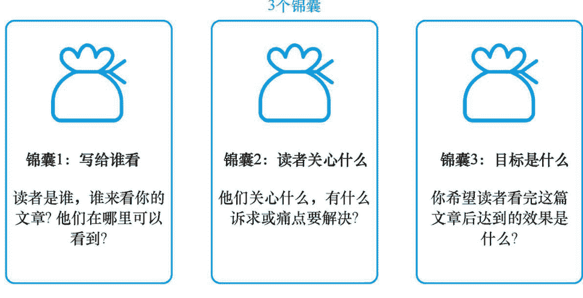
以公众号推荐《结构演讲力》为例，用3个锦囊即可快速厘清目标。
锦囊1：写给谁看。面向读者、粉丝及对演讲感兴趣的人。
锦囊2：读者关心什么。内向者能否做好演讲？如何克服紧张？如何做好工作汇报？结构演讲力能否提升水平？等。
锦囊3：目标是什么。宣传书籍并引导购买。

厘清这三点后写作更有指向，重点更清晰。对ChatGPT下指令时，把这三层信息带入，输出会更贴合需求。案例演示如下：

AI写作加速指南：把创作从体力活变成策略活

各位创作者好。最近一段时间的实践可以印证一件事：AI已经不再只是辅助工具，而是嵌入在撰稿流程中的核心驱动。它把重复性的整理、检索、校对压缩到极致，同时把灵感的发散与表达的精度拉满。读完这篇，你会更愿意拥抱AI，也更清楚怎么让它为你持续产出高质量内容。

信息时代的真正价值在于，速度与智慧能够同步。AI既能迅速处理冗余环节，也能在关键节点给出出人意料的创意点子。下面三条实操路径，基本覆盖了日常撰稿的增效闭环。

**第一条路径：素材自生长与灵感点火**
AI的文本生成能力可以直接拿来用：批量提要、续写补全、关键词抽取。实际使用时，就是把零散资料在数秒内压缩成可用信息点，在阅读梳理的过程中自然点燃思路。比如让模型写出一段抓人眼球的开头，或基于一组核心词拆解出分支论点，创作起点便从空白进入可操作的阶段。

**第二条路径：校对润色与专业质感**
无论母语或非母语，行文里总会留下语法、拼写上的瑕疵。AI可以即时定位问题并给出修改建议，让语句更流畅。更进一步，它还能提供风格层面的润色方案，提升语言质感与可信度，整体阅读体验会更顺滑。

**第三条路径：智能陪写与流程自动化**
基于海量样本训练的模型可以读懂个人习惯与目标读者画像，随后给出具体建议：词汇选择、句式搭配、段落编排。相当于一个全年无休的写作搭档，让内容更具吸引力与可读性。

**从慢到快的真实转变**
以在社媒发新闻点评的创作者小李为例。未使用模型前，他要花费大量时间检索资料、梳理思路、反复修改。上手之后，新闻提要与关键词的获取速度大幅提升，对事件背景与核心要点的把握几乎是即时的。语法校对与润色建议让稿件更专业，而基于个人习惯与受众偏好的个性化写作建议，让内容在平台上获得更多关注与传播。效能提升了，效果也跟着上去。

**先定型：职场高频写作场景**
写作前先厘清类型，指令才会更精准。常见的八类包括：
1. 工作汇报。对特定议题、研究或项目进行详尽分析与总结，通常包含背景、方法、数据与结论。
2. 提案书。面向特定受众阐述并推动某个计划或想法的正式文件，目的在于争取支持、资金或合作。
3. 邮件。与同事、客户进行日常沟通的文书。
4. 公文。为机构起草的正式文书，如公告、通知、公函、报告、任命、命令、申请、演讲稿等。
5. 职业简历。求职时提交的个人简介，用以突出经历、教育、技能与成果。
6. 文案/短视频脚本。面向产品或服务撰写的宣传文案或脚本。
7. 新闻稿/公众号文章。在新媒体平台发布企业动态、活动等信息的文章。
8. 会议纪要。记录会议内容与决策结果的正式文档，承载要点、讨论焦点、决策与行动项。

**再定题：六种让人愿意点开的标题打法**
优质标题有三要素：对读者有利、激发好奇、制造关注。常用六类如下：
1. 问题引导型。用引导性提问激发好奇，促使读者寻找答案。示例方向：日常微习惯如何助力效能跃升；事业分化背后存在哪些关键差异；写作常见失误有哪些。
2. 数字列举型。用数字呈现信息，强调清晰与简洁。示例方向：十项可能未尝试的生活改变法；五招让思维更快敏锐；七步搭建理想工作日程。
3. 秘诀揭示型。披露独家信息，制造紧迫感。示例方向：成功群体长期坚持的十个隐秘习惯；业内人士不愿公开的达成路径；一个简易技巧揭示长寿逻辑。
4. 挑战型提问。抛出挑战，带动思考与参与。示例方向：是否敢于一个月零手机；一周内掌握一项新技能的挑战；勇气阈值在哪里，接受冒险吧。
5. 故事叙述型。用故事梗概引发情感共鸣。示例方向：一篇稿件如何改变行业认知；一个微小决定改写人生轨迹；令人动容的案例折射成功艰辛。
6. 权威背书型。借助专家或权威增强可信度。示例方向：心理学专家解读幸福关键；行业领袖传授市场突围方法；医学专家确认某种健康习惯的有效性。

**搭建框架：用AI快速搭出清晰骨架**
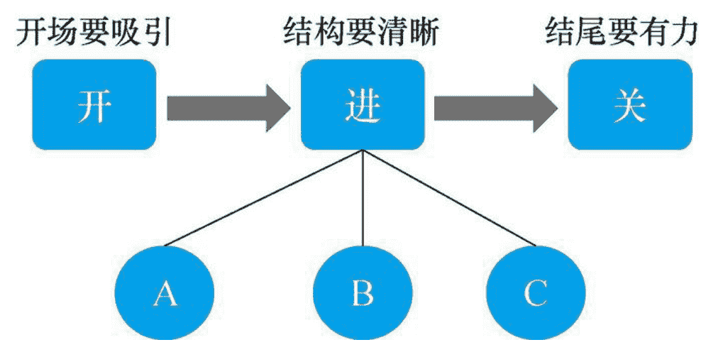
无论是写文章、做演讲还是做内容，都符合一个底层通用模型：开—进—关。

开场要完成三件事：引起兴趣，可用引语、提问、故事或震撼事实；明确主题，让读者立刻知道内容指向；提供背景，为后续展开做铺垫。

进即主体结构。要结构清晰，读者能沿主线阅读；逻辑通顺，段落与句子衔接自然，每段都有明确主题句；论证有支撑，用事实、数据、引用或案例托住观点。

关即结尾。要总结核心观点，点明立场；最好呼应开篇，形成思想闭环；依据内容性质给出展望或建议，增强深度与行动感。

**六种开场设计，快速抓住注意力**
1. 引用开场。用名言或金句建立权威感。
2. 提问开场。用反问激发思考。
3. 故事开场。用情境带入引发共鸣。
4. 数据开场。用数据凸显紧迫性。
5. 定义开场。用定义厘清概念。
6. 争议开场。用对立观点激起讨论欲。

**六种结构设计，让内容不松散**
1. 顺序结构。按时间推进，适合叙述经历、历史、实验过程。
2. 问题解决结构。是什么—为什么—怎么样，先立问题再给方案。
3. 比较结构。并置两三个对象，突出异同。
4. 因果结构。解释现象背后的原因与结果。
5. 分类结构。用总—分—总方式把主题拆成类别。
6. 主题演绎结构。从一般原则出发，逐步落到具体案例。

结尾的重要性不亚于开场，它是读者与作者思想互动的最后印象，决定了读者对整篇内容的整体感受。

把类型、标题、框架这三件事先理顺，再让AI去填充与优化，撰稿就能从体力活变成策略活。按上述方法跑一遍，效能会进入全新区间。

文章的收束段落往往是整篇内容的点睛之处，它直接塑造读者读完后的情绪回响。收得漂亮的结尾能把作者的立场再强化一层、点燃读者的思辨欲，或是留下令人回味的余韵，好比一场演出在谢幕时给观众的满足感。因此，收尾的设计优劣，决定了一篇文章是否能在读者记忆里留下分量。

常见的收尾手法大致可归为六类：

#### 1. 归纳收束
把全文的核心论点、论证脉络或主要信息做一次简要回捡。
适用场景：综述性、盘点类的稿件，需要把关键信息再点一遍。
例子：写环境污染时，结尾可把各类污染形式做个概括，再重申保护环境的重要性。

#### 2. 起承回环
把结尾与开头的内容勾连起来，形成首尾呼应的闭环。
适用场景：想突出主题主线，或呼应开篇提出的问题。
例子：开篇用一个吸睛的小故事切入，结尾再拉回该故事，点明它与主题的关联。

#### 3. 抛问启思
抛出一个值得咀嚼的问题或思考点，引导读者继续自行延展。
适用场景：议论文、观点型内容，想激发讨论。
例子：谈未来科技时可问：“面对人工智能的持续演进，我们准备好应对哪些冲击与机遇？”

#### 4. 前瞻展望
讨论主题的走向、可能解法或未来图景。
适用场景：趋势分析、行业观察类文章。
例子：写可再生能源时，结尾可展望能源技术的演进方向和创新可能。

#### 5. 互动号召
在尾部营造参与感，邀请读者投票、留言、提供创意。
适用场景：适合评论、转发、投票等新媒体互动形态。
例子：穿搭类内容可写“评论区晒出你最爱的搭配风格，我们会选出人气款”；DIY类可写“你手上有啥创意手工项目？欢迎来分享”；数码评测可写“你期待看哪款电脑的测评？在评论区提建议”。

#### 6. 名言收束
选用与主题契合或发人深省的引语收尾，强化立场。
适用场景：需要深度思考或凸显主题分量的稿件。
例子：写领导力时，可引用一位成功领袖的金句来收束对领导力特质的强调。

六种手法各有分工，选择时要看文章目的、主题调性与作者风格是否匹配，核心是让结尾与全文气质一致。

### 用多指令一键生成文章

弄清楚“开—进—关”模型后，就能用不同指令让ChatGPT一次把文章写出来。这种一键法适合篇幅不长、内容相对简单的选题，目前免费版ChatGPT3.5单次输入汉字量约2000字左右。参考指令示例如下：

Q：请扮演写作专家，以《人工智能提升工作效率》为主题，写一篇公众号推文，介绍人工智能如何帮职场人提升效率，要求：1. 取一个爆款标题；2. 开头用统计数据开场法；3. 结构用总分总；4. 结尾用展望未来法；5. 字数1200字以内。

A给出的文章标题为《人工智能改变职场——提升效率大势所趋》。开篇用数据切入：过去职场人需花大量时间做数据分析、文件处理、日程安排和邮件回复，如今AI能大幅简化。调研显示超70%的职场人认为AI已或将对工作产生积极影响，近60%的人感受到效率明显提升。

主体分三点：一、办公流程自动化。智能办公工具可实现文件归类、报表自动生成、日程智能安排，减轻负担。二、智能数据分析。借助机器学习与数据挖掘，快速提炼海量数据价值，为决策提供支持。三、智能助手提效。语音记录会议、智能客服自动回复常见邮件、聊天机器人处理员工日常问题，节省人力。

展望部分认为，随着技术演进，AI会更贴合职场，提供更智能个性化的办公方案，释放更多创造性和战略思考空间，推动职场向高效智能迈进。结尾强调拥抱变革，迎接效率全面提升。

很多人会问：既然能一键生成，为何还要分模块学“开—进—关”？原因有三：

第一，文章可玩性大增。6种开头、6种结构、6种结尾组合出216种变化，可像搭积木一样自由混配，内容更丰富多样。

第二，能判断生成质量。学会模型后，能判断ChatGPT的开头、主体、结尾是否合格。

第三，能精准改写。发现问题后可指令局部或整体重写。比如把上面文章的统计数据开头改成问题开头，指令为“请将以上文章开头改为问题开场法以激发好奇心，其余结构和内容不变”。改写后开头变为：“你是否曾被繁琐的办公任务困扰？有没有办法让工作更高效便捷？随着AI飞速发展，人工智能能否真正提升职场效率？调研显示超70%……”其余内容保持原样。同理改结构、改结尾都可按此方式操作。即使指令完全相同，因模型参数变动，每次输出也会略有差异。

学会一键撰写只是起点，要写出高质量文章还需指令技巧，下文将介绍“名剑山庄”AI写作模型的第三步：闪写内容。

# 第三章

## 闪写内容：用AI一键闪写高质量文章

“名剑山庄”模型的第三步是闪写内容。学员常抱怨装了多个AI，回答却空泛“不知所云”。根源多在提问不清。接下来介绍五类万能提问技巧：内行式、外行式、调教式、模仿式、长篇式。它们适用于ChatGPT及国内主流模型如文心一言、星火、通义千问、智谱清言，原理相通。

### 一、内行式指令

当对任务背景、标准要求很清楚时可用。内行式有两种模型：“义描交出”和“2W2H”。

先看指令差与好的差别。用差指令让AI写年终总结PPT大纲，得到的是通用框架：开场欢迎、公司概况、业绩回顾、团队亮点、行业趋势、未来展望、结语，内容空洞不贴合实际。

好的指令示范：请扮演汇报专家，为一名培训经理撰写2023年度工作总结大纲，需体现新员工培训、门店事业部培训、管培生培训、领导力项目培训的运营与设计。总结要包括工作期间的主要成就与挑战、重要教训与发现、后续规划，需全面客观，结合具体事例。

得到的大纲包含引言、工作概况、新员工培训的策划与成果、门店事业部培训方案与影响、管培生计划设计与发展轨迹、领导力项目设计与成果、主要成就与挑战、教训发现、后续规划、结语，明显更贴合岗位。

这条指令运用了“义描交出”模型：

义——定义角色。设定AI扮演的专家身份并限定领域，如“汇报专家”、“短视频设计专家”等，能调用该角色的知识体系。

描——描述背景。交代任务上下文：谁的需求、什么时间范围、遇到什么问题。

交——交代任务。清晰说明要做什么：写文章、写大纲、写脚本等，明确主题与预期结果。

出——输出要求。说明要什么不要什么：内容标准、格式、字数、风格、是否举例等。

四步可灵活调换顺序，也可简化为角色—任务—要求，或背景—任务—要求。

#### 案例：脚本撰写
传统短视频脚本手工撰写需开会构思主题、呈现方式、场景、分镜、台词，耗时很长。借助“义描交出”可快速生成。

指令示例：请扮演短视频设计专家，设计一条关于“××汽车品牌SUV”的产品宣传短视频脚本，该车型有高势能宽体设计、高智能先锋科技、高性能高能品质三大特点。要求：1. 取一个爆款标题；2. 用剧情演绎加真人讲解形式；3. 故事完整生动；4. 以表格输出，含场景、分镜、运镜方式、台词、时长五列，总时长1分钟内。品牌名用“××”代替。

AI会给出标题《征服未来，领略尊崇》及剧情梗概，并以表格形式呈现分镜信息。若格式不对，可追加指令“请把以上内容整理成表格”，即可得到清晰脚本。

掌握这些提问模型，就能让AI产出更精准、可用度更高的内容。

3. 故事化呈现方案
用一段紧凑的小叙事把××品牌SUV的三大核心特质——澎湃动力、智联科技、驾控品质——串联起来。主角是一名在都市里忙碌的年轻职员，白天通勤、周末放松都由这台SUV承担，通过多样的路线和场景凸显车型的差异化魅力。

分镜说明以场景、画面、拍摄手法、说辞、时长五个维度展开：

1. 闹市干道。画面先以宽幅近拍呈现整车姿态，随后用广角记录车身穿过拥挤车流。手法为慢速跟随。旁白：灯火阑珊的都市脉络里，一道低调却气场十足的身影正悄然现身。时长5秒。
2. 写字楼群。中景捕捉车主从办公楼优雅步出，随后中景记录车主拉开车门。手法为跟随式运动。车主：傍晚收工后，我将驾驶新座驾，一起开启别样的出行体验吧。时长10秒。
3. 快速路。远景展示车辆在高架上行驶，中景切换至加速状态。手法为空中俯拍。旁白：锋芒显露的瞬间已至，加速驶向未来。时长5秒。
4. 风景区停车场。远景呈现车辆停靠在开阔场内，随后宽角近拍内饰智能配置。手法为静止定格。旁白：稍作停靠，感受这台SUV智慧科技的前沿体验。时长5秒。
5. 汽车展厅。近景呈现销售顾问向车主介绍车型，随后近景记录车主满意点头。手法为对话对视。销售：这款SUV动力充沛之余，还搭载智能驾驶辅助系统，让旅程更安心。时长10秒。
6. 市区公园。中景记录××SUV在园内路段疾行，近景捕捉车主笑意。手法为跟随运动。旁白：心情舒展，自在与热情并存，感受高水准动力带来的无限乐趣。时长5秒。
7. 夕阳山道。中远景呈现××SUV在盘山路上疾驰，中景捕捉车辆快速过弯。手法为地面抬升。旁白：品味带来高能质感，真正征服未来无限可能。时长5秒。
8. 夜色都市。远景记录××SUV穿梭霓虹街区，近景聚焦车灯照亮路面。手法为跟踪运动。旁白：行走在时代前沿，感受独特魅力降临。时长5秒。
9. 商业广场。中远景呈现车辆停靠商圈，广角近拍车辆身份标识。手法为静止定格。旁白：××SUV，塑造独有品味与品质生活。时长5秒。
10. 结束画面。片尾静止定格。旁白：领略尊崇，征服未来。××SUV，开启属于你的奇妙旅程。时长5秒。

总时长1分钟。以上脚本旨在呈现××SUV的能量、智慧、性能诉求，如需调整请随时告知。

整理后的脚本列表摘要为城市干道、写字楼区、快速路、景区停车场、展厅、公园、山道、夜景、商圈及片尾十个段落，各段落对应画面组合、拍摄手法、说辞与时长，已形成1分钟的整体结构。

案例2：大纲撰写实践
培训师常需搭建课程框架，也可用“义描交出”指令模型让ChatGPT快速生成大纲。

Q：请担任课程设计专家，为我设计《公众号排版与美化技巧》的大纲，须含名称、背景、参与人员、目标、收益、教学方法、大纲等。背景要求：培训对象为党建文化工作者及其他宣传骨干；课程名称《公众号排版与美化技巧》；时长半天；培训目标为提升工厂宣传骨干秀米软件编辑能力，提高推文美观度、可读性、功能性；课程要求能讲清企业微信号设计思路、编辑技巧、使用方法，如软件种类及使用方式等。

A：课名：公众号排版与美化技巧

背景说明：企业微信普及下，党建文化工作者及宣传骨干掌握公号排版美化技能成为提升传播效果的关键。本课旨在通过系统培训，让学员熟练使用秀米软件编辑，提升推文美观、可读与功能性。

参与人员：
- 党建文化工作者
- 宣传骨干
- 具备一定基础的企业微信编辑人员

预期达成：
- 掌握秀米软件核心操作与编辑功能
- 理解公号推文设计基本原则
- 提升推文排版与美化水平
- 学会运用编辑技巧增强视觉吸引力

收益：
- 提升企业微信宣传成效
- 增强宣传骨干编辑能力
- 促进团队协作与沟通

教学方法：
1. 理论讲解：介绍企业微信推文设计原则与排版规范。
2. 实操演示：演示秀米软件基础操作，学员亲手练习。
3. 案例解析：剖析成功企业微信案例，提炼经验技巧。
4. 互动讨论：鼓励学员分享经验、提问交流。

课程大纲：
1. 导入 15分钟
   - 课名介绍与背景说明
   - 公号推文在企业宣传中的作用
2. 秀米软件基础操作 45分钟
   - 界面导览
   - 标题段落设置
   - 图片表格链接插入
   - 字体颜色排版调节
3. 公号推文设计原则 30分钟
   - 可读性与视觉吸引力的平衡
   - 排版基本法则
   - 图文搭配技巧
4. 编辑技巧与要点 45分钟
   - 优秀案例拆解
   - 精美封面图制作
   - 阅读引导与体验优化
5. 实操演练 45分钟
   - 学员依案例进行编辑
   - 教师现场指导答疑
6. 总结与交流 30分钟
   - 课程收获回顾
   - 学员心得分享
   - 问答环节

半天培训后，学员可熟练运用秀米进行公众号排版美化，提升宣传推文质量。

指令内化第二种模型：2W2H模型。

它和第一种模型类似，也是角色扮演式，指令的原理也类似。如图3-5所示。

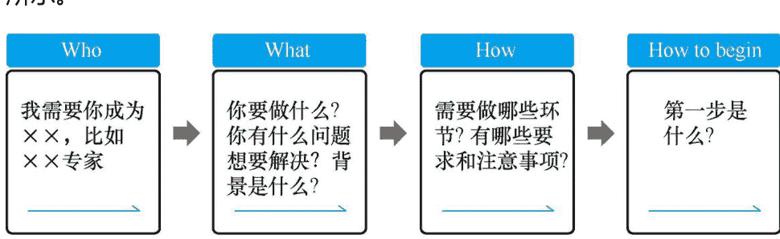
Who：我需要你成为×，比如×专家，限定其专业领域，确保回答在特定范围内。
What：你要做什么？你有什么问题想要解决？需要解释任务的背景、原因和可能面临的问题，以提供必要的上下文。
How：完成这个任务需要做哪些环节？有哪些要求和注意事项？
How to begin：第一步是什么？它的要求和标准是什么？

和AI搭伙写东西，指令怎么打才是关键。总结下来，常用的思路大致能归为四类，用法完全不一样，但都能把ChatGPT用出效果。

**一、内行式指令：当你自己就是专家**

这套打法的前提是你对要干的事门儿清。任务目标、验收标准、交付细节在脑子里都拎得住，你发出去的提问才精准，模型回来的结果才靠谱。专业度越高，提问质量越高，答案越准。

操作心态就是把ChatGPT当成手下的执行者。你给员工布置工作要目标清晰，要点具体，ChatGPT也一样。指令越模糊，产出越跑偏；指令越明确，成品越接近预期。

**二、外行式指令：当你完全是个门外汉**

遇到不熟的领域、看不懂的标准，硬上很容易翻车。这时候不要直接让它写，而是先让它当老师，教完再写。外行式指令的核心是标提化三步走。

标：问标准。先去问该类内容的好在哪里，写作有什么讲究和流程。比如要写企业新闻稿，可以让它扮演写作专家，梳理出要点清单。

它给出的新闻稿通用框架大致包含：判断新闻价值、锁定核心信息、拟定吸睛标题、按倒金字塔组织内容、段落简洁有过渡、引用数据佐证、配多媒体、反复校对、选择渠道发布等九个方面。

提：提要求。拿着它给的标准清单，再结合自己的主题去下单。可以挑重点用，不必全套照搬。案例里就是让它按上述要点写一篇“×汽车品牌赞助2023南昌国际马拉松”的稿件，要求结合赛事氛围和运动员表现，找到品牌与马拉松精神的契合点，凸显品牌优势，字数控制在千字左右。

化：再优化。初稿出来后往往结构不够清晰，这时再提出细化需求，比如给每段加小标题，采用金字塔结构提升条理性。经过这一次打磨，稿件才算有骨架也有血肉。

这套方法的优势是零基础也能上手，先让AI输出参考标准，再基于标准执行写作。注意一点，如果想写当年的最新稿件，就要打开联网搜索。免费版ChatGPT3.5的训练截止在2022年1月，后续新闻它是不清楚的。

**三、调教式指令：让AI自己写指令**

前面两种方式都需要你会写指令。那如果连指令都写不好呢？调教式指令就是让AI当你的Prompt教练，通过对话迭代出一个完美指令。

流程大致是：
1. 先发出设定指令，让它成为你的Prompt创作者，按你的反馈不断修订Prompt，直到完整。
2. 发一个简单任务，比如“为职场人士做一份数据分析课程大纲”。
3. 它会先给出修订版Prompt，再列出需要补充的细节建议，最后抛出具体问题来厘清需求。
4. 你按序号回答目标人群、学习目标、主题模块、时长、教学方式等信息后，它会自动更新Prompt。
5. 再继续补充细节，比如每个模块内容、评估方式等。确认指令可用后，直接复制执行或说“完成”，拿到最终结果。

案例里就是先明确为制造业中层干部及技术骨干做一天的数据分析培训，目标是提升数据分析能力和数据思维，会上能用数据汇报。最终生成的课程包含数据思维导论、通用分析、商业分析、产品分析、用户分析五个模块，每个1到1.5小时，采用互动引导、小组讨论和实操演练，结束后不做考核但提供资料反馈。

优点是几乎不需要你具备专业指令写作能力，只需诚实回答问题，AI会帮你把指令打磨到位，适用写作以外的各种场景。

**四、模仿式指令：学会照着优秀样本写**

看到喜欢的文案想复制风格，用给座城池模型即可。

给：给参考。把对标的优质文章或文案喂给AI，没有现成样本也可以先让它生成一版。
座：做拆解。让AI分析样本的语言节奏、结构套路、情绪点和表达特征。
城：再生成。基于拆解出的特征，给它新的主题进行创作。
池：持续修。不断微调，直到风格和效果贴近预期。

这套方法能让你快速复刻小红书爆款、同行高赞文章的写作手感，做出风格统一的新内容。

四类指令覆盖了从精通到不懂、从自己写到让AI写、从原创到模仿的完整场景。选对工具，按对流程，ChatGPT就能从答疑机器人变成真正能办事的搭档。

想让ChatGPT帮你写出真正能用的长文，最怕的就是直接丢一个大任务过去，结果得到的要么干巴巴、要么被截断。今天就把一套实战可用的打法拆清楚，核心思路就是别让模型一次性扛满，而是用“先喂样、再拆解、最后拼合”的方式把控质量。

先说常见坑。

第一种做法是先给模型看榜样。不是让它盲写，而是先投喂优质范例，或者让它先产出几个参考稿再提炼写法。比如你要写小红书种草书单，可以先让它扮演文案专家找3条爆款。模型会告诉你标题要钩子化、正文要场景化、结尾要话题标签，这类示范能帮助它抓住平台语感。

第二种场景是长篇任务。直接要一篇2000字以上的稿子，模型往往水字、偏正式、案例空洞。于是很多人开始分步走：

先让它做选题。举个例子，你要给职场新人写公众号讲演讲，可以让它基于经验策划10个吸睛话题，比如“会议里怎么开口”“用故事打动听众”“跨文化演讲注意事项”等，既贴合工作场景又能引发兴趣。

再让它出大纲。以“故事的力量”这个选题为例，大纲会从演讲目的、什么是叙事演讲、故事的人物情节情感要素、如何选材和构造、叙事技巧、案例拆解、实操练习、应对多元听众、总结收尾等层层展开。

最后让它按大纲写。按前5部分要求写，效果会好不少：语言口语化、讲具体步骤、配案例。比如它会提醒你要用个人经历作主角，设计冲突与高潮，用时间线和对话推动节奏，并在关键处留悬念。

但问题依然在：篇幅一长，模型就会提示字数受限，只给片段，内容泛、没细节。这时候就需要提纲磨合模型。

提：定主题。先明确你要写的方向、标准和要求。比如写一篇关于“AI能让工作效率提升10倍”的论文，先让它给出论文的规范格式：标题、摘要、引言、文献综述、方法、结果、讨论、结论、参考文献、附录以及排版要求。

纲：写大纲。基于刚才的规范，让它为这篇论文搭建骨架。引言分背景和研究问题，文献综述分已有成果和空白，方法分设计、样本、数据收集、分析手段，结果分数据呈现和实际效果，讨论分解释、对比文献、局限，最后收尾到结论和未来方向。

磨：分模块。按大纲顺序逐块打磨。你先要引言：写清AI在工作场景的崛起、传统提效手段的局限，以及本研究关注10倍提升的缘由与价值。接着写文献综述：总结AI在制造、金融等领域的自动化与决策支持进展，指出现有研究在量化提效、跨行业验证上的不足，为本研究定位。

合：做整合。把各模块产出人工合并、润色、补充衔接，就能得到一篇远超2000字的完整文章。

这个流程特别适合论文、小说、剧本、方案、标书、课件等复杂写作，用它产出上万字的稿子也稳定可控。核心就是把一个大任务拆成“定选题-搭骨架-写模块-手工整合”，既绕开长度限制，也保证逻辑和案例不掉链子。

用模型不是为了让AI代写，而是让它做你的研究助理和结构师，你来掌控观点和细节，成品自然就从空洞走向好用。

在生产制造一侧，机器人与自动化系统的规模化部署已经让产线节奏明显加快，失误被大幅压缩，整体产出效率随之提升。在客户服务一侧，自然语言处理技术驱动的智能客服已成为主流，让人与系统的交互更高效、问题闭环更快。既有的研究成果，为我们理解人工智能在多元场景中如何改善工作效能提供了有价值的参考。

##### 现有研究的空缺
尽管进展可观，文献中仍存在若干关键空白。第一，过去的研究多聚焦于单一任务或某一特定领域的提效，缺乏对人工智能能否在更广阔范围内实现十倍级提速的系统性审视。第二，技术在不同行业、不同规模组织中的适用边界与效果差异，探讨仍然有限。第三，围绕人工智能的社会、伦理与法律层面的讨论相对薄弱。随着应用面持续扩大，就业结构、个人职业发展路径以及隐私保护等潜在影响必须被正视。本研究希望弥补上述空白，全面审视人工智能在提升工作效率上的机遇与制约点，重点讨论十倍级效率提升的可行性。下一步将详细说明研究设计与方法，以展开深入剖析。

如果按这种思路把论文大纲逐段补齐，实际操作中会遇到模型的上下文限制。一口气写的字符一旦超过ChatGPT的处理上限——3.5版本通常在16K左右，4.0版本通常在32K左右，且不同版本有差异——模型就开始“跑偏”。受限于上下文窗口和时间间隔，它会遗忘之前的大纲细节，原本训练好的指令也执行不准了。这种情况下常用三种应对办法。

方式1：重新提示。当模型不按指令走时，可以指出错误所在，明确“敲打”并要求其纠正。
方式2：回溯唤醒。也可引导模型回顾执行任务时的要求与标准，重新激活记忆轨迹，修正偏差。
方式3：换窗重来。若反复提示仍不记得历史内容，就放弃当前训练好的会话，另起新窗口重新训导。

第4步是整合成稿。按照大纲分段写完后，需要把各部分汇总成一篇完整的论文。若让ChatGPT直接整合，因字符限制往往无法完成。通常当总字数超过2000字时，就需要人工介入，将各段内容逐一复制到同一文档中自行拼合，完成最终成文。

写作委托上也有两种做法。一种是全托法：标题、大纲、主体、素材全部交给ChatGPT生成。另一种是半托法：大纲由自己先写好，再让ChatGPT依托该框架来展开。

本章涉及的指令类型共五类：内行式指令、外行式指令、调教式指令、模仿式指令和长篇式指令。借助这五类指令可以快速完成文章撰写或问题解答，而且不限于写作，也可用于工作生活中的各类难题。有网友曾梳理出ChatGPT的72种常见功能。

实际上ChatGPT的潜力远不止这些。若熟练运用五大指令技巧，就能把它训练成个人万能助手，实现难题解决与工作效率的十倍级提升。

写完初稿后还需要包装润色。接下来进入AI写作模型的第4步：包装润色。

# 第四章
## 包装润色：用AI快速修改和润色文章

为什么要润色。原因有六点：
提高可读性。润色改善语言表达，修正语法与拼写错误，让文章更易读。清晰简洁准确的表达有助于读者理解。
提升传达效果。润色增强表达力和感染力，生动的表现手法让文章更吸引人、更具说服力。
确保专业性。润色使语言与风格符合专业规范，提升信任度与可靠性，对学术论文、商业文件、专业报告尤为重要。
优化结构与逻辑。润色过程可梳理层次与条理，清晰的结构与合理逻辑帮助读者把握主旨与论证。
提高原创性。润色能识别并修正雷同问题，保障原创性，避免知识产权风险，维护学术诚信。
提升整体质量。全面检查与调整能提高文学素养、表达水平与专业度等多方面质量。

一般情况下，成稿后需要人工反复审校。但对全文或标题大纲案例素材的修改润色，都可以交给ChatGPT，大幅提升效率。本章将从六个模块展开：语言表达润色、文体风格润色、结构逻辑润色、素材优化润色、扩续缩写润色、内容准确性润色。

### 一、语言表达润色
包含三个要点：检查错别字、语法、拼写错误；使用丰富词汇与生动表达提高表现力；避免过于复杂的句式，保持简练明了。

让ChatGPT进行语言润色的指令示例，以公众号写作为例：
Q：我希望你担任文章审核助手，我会发送一篇文本，请按公众号写作要求检查，确保无语法、错别字、拼写、标点错误，使用丰富词汇与生动表达提升表现力，避免复杂句式，保持简练明了，符合中文规范。若明白请回OK。
A：OK，请发送文章。

随后提供标题与正文，模型会返回润色后的版本。询问修改点后，模型会列出标题格式调整、语言表达优化、拼写标点校对、句式简化、文体风格统一等调整说明。

为直观看到改动，可使用专业改写指令，要求以表格形式输出，原文、改写后句子、改进说明三栏对照。示例指令为让模型担任中文演讲稿写作改进助手，提升拼写语法清晰度修辞简洁性可读性，拆分长句减少重复并给出建议，以表格逐句输出。

若文章过长，可在指令中说明分多次发送，例如分两次发送，逐一改进。

### 二、文体风格润色
文体风格是作者通过语言呈现的情感色彩与语气。润色要求文体统一，符合设定的写作风格，并根据目标受众调整语气与表达方式。

常见风格包括：
正式语气。语言庄重规范，适用于正式文件、学术论文、商务信函等严谨场景。
轻松随和语气。语言自然近似日常对话，强调亲近感，适用于博客、社交媒体等。
严肃语气。语气正经，强调话题分量，适用于重大社会伦理议题。
幽默风趣语气。加入幽默元素，适用于娱乐资讯、轻松专栏。
激励鼓舞语气。积极向上，激发动力，适用于励志文章、演讲稿。
疑问质疑语气。以问题切入，引导思考，强调批判性审视。

写到最后才发现整篇文章的调性跑偏了，是很多创作者的共同痛点。想要真正把一篇稿子打磨成型，核心在于先认清语气，再统一文体，最后从结构到细节做系统化润色。

语气是文章的第一张脸。一种是带有回望与感悟色彩的沉思感慨腔，作者把个人体会放在前面，适合回忆类随笔、复盘类散文这类需要情绪沉淀的载体；另一种则是去情绪化的客观中立腔，信息先行、立场克制，多见于新闻报道和学术文稿，要求写作者把主观感受压到最低，只呈现事实本身。

当定稿后发现文体不对位，就需要启动文体风格润色指令。思路是先明确目标：让文本更精炼、更有阅读钩子；再指定标准：比如新媒体写作、新闻稿、公文、合同、论文或标书；随后敲定调性：专业、亲和、权威等。模型理解后会先确认，再按要求重写。

以新闻稿为例的实操。原始素材是2022年11月8日微课计划启动的第一届“微光杯”微课大赛。43位参与者共产出21个微课，覆盖操作演示、产品推广、服务流程等。早上九点起，学员以一对一搭档形式互助推进，作品在老师点评后反复打磨，有的经历十几版修改，最后一批人坚持到午夜十二点。活动中凸显了中信精神。

润色后的呈现会更紧凑：
2022年11月8日，第一届“微光杯”圆满收官。43名选手完成21个微课，主题横跨实操、推广与服务。
从上午九点开始，选手两两协作持续迭代，在导师反馈下不断优化，部分作品打磨十余稿，创作延续到深夜十二点。
大赛不仅是知识与技能的检验，更是价值观的体现。

亮点被拆成三个板块。乐学乐教里，学员在制作中遇到问题即时互动，甚至排队提问，邓世超与董彦彩老师进行一对一手把手指导，让学习在实操中发生。精益求精里，即便初次尝试，大家仍追求视觉品质，反复挑选角色、模板和细节。刻苦敬业里，中午十二点半已过饭点仍在赶制，有人感慨时间过快；晚上二十三点半，白板上完成组别打钩，已结束的团队仍在逐帧核对画面与音频，力求零差错。收尾点题：勤奋终有回应，过程即成长。

润色的动作可以拆解为：用符合新闻标准的简练专业语言重写，调整句式提升可读性，用更生动的表达凸显活动亮点和学习者状态，并以更正式的口吻强调活动收官和优秀表现。

进入结构和逻辑层面，润色要做三件事：检查开头发展结尾是否清晰且过渡自然；确保每段都紧扣主题、无无效信息；打通段落衔接，保证整体流畅。写前可先让模型优化大纲，写后可再逐项优化标题、开头、结构、结尾和过渡。

标题的打磨可以前置也可以后置。写作前可要求模型基于主题比如内卷，输出十条吸睛标题；写作后可把成稿交给模型，要求输出若干个能点燃兴趣的标题。

开头常被改造的六种方式包括引用、提问、故事、数据、定义和制造争议。用故事开场为例，原本讲内卷的干货可以先用一个职场人彼得的雨夜独白切入，再自然过渡到方法论说明。

结构改造时，可把文章改写为顺序、问题解决、对比、因果、分类或主题演绎。比如把内卷文章改成问题解决结构：先呈现竞争焦虑的困境，再依次给出挖掘优势、设定目标、持续学习、搭建人脉、管理压力等解法，最后做收束总结。

结尾也需要策略。常见的六种收尾有总结式、呼应开头式、引发思考式、展望未来式、互动参与式和引用式。互动参与式会在末尾邀请读者在评论区分享自己的优势、目标和学习计划，并呼吁点赞转发，形成讨论闭环。

过渡衔接是让文章不散的关键。要求逻辑上前后呼应，语言上使用恰当的连接词、代词和关键词呼应，段落间首尾衔接自然，整体风格语气统一，重要观点通过适度重复得到强调，同时避免生硬跳转。

把以上方法串起来，就是一套从语气判断到文体校准，再到结构逻辑和细节打磨的完整润色工作流，能够让不同场景的文章既保真又更具传播力。

写好一篇稿子，本质上是在做一碗有味道的面。面本身是支撑，汤汁与配料才是让整碗面吃得下去、记得住的关键。文章里，硬核内容好比面条，负责提供营养；各种支撑性材料好比佐料，负责点题、增味、增强说服力。光有方法论、原理、工具、模板这些“面条”不够，必须搭配好佐料才能既饱满又有记忆点。

**支撑文章的七类佐料**

数据与事实是第一层底料。能被核查的数字和客观情况直接提升可信度。比如引用气候变化的最新监测值，或引用企业财报中利润同比的变化。

权威引用是第二层提鲜。借用专家、学者、媒体的观点来背书观点。比如借用科学院期刊对新药研发周期和成本的判断，或引用科学家的名言来说明知识转化的困境。

真实案例是把抽象变具体的抓手。用可复盘的商业或个人实践，让论点落地。比如讲某品牌如何通过组织变革抢占市场，或讲一位发明者的多次失败如何积累出最终突破。

个人经历与小故事是情感连接器。第一人称的亲历让内容更有温度和代入感。比如写团队协作在某个项目里如何起决定作用，或童年见证的社区变迁如何塑造价值观。

文学名言与金句是点睛之笔。用经典文本或凝练的句子提升格调。比如用莎士比亚关于人生如戏的比喻，或用毛姆对写作本质的概括。

可视化呈现是理解加速器。图表、地图、模型图能把复杂信息一目了然。比如用柱状图对比多款产品的销量，用地图呈现区域环境差异，或用SWOT模型剖析企业优劣。

历史对照是纵深感的来源。把当下现象放进历史坐标里对比，论证更有高度。比如把数字化浪潮类比工业革命的冲击，或用二战期间劳动分工变化说明社会角色演进。

不同主题的文章需要不同配比，新闻偏数据案例，个人号偏故事金句，商业分析偏模型图表。合理搭配，才能让整体论述既全面又有力。

**让ChatGPT帮你打磨佐料**

写完初稿常出现两极：干货太多没案例，或素材堆砌显得臃肿。这时可以用AI做定向优化：需要时增补案例故事金句，冗余时精简，方向错时替换，还能让AI负责收集、改写、设计素材。

案例设计指令
让AI按需生成可用的案例。常用写法是指定数量、观点、立场，并可选STAR结构。示例思路：请你以写作专家的身份，给出3个能证明养成良好习惯带来正面效应的真实感案例；也可以要求正面或反面例子，并用情境、任务、行动、结果的框架来写。

数据收集与表格化指令
当需要硬核数据支撑时，让AI检索并标注来源。示例思路：请帮我查找关于2022年中国新生儿数量的相关统计，要求数据真实可核，并给出出处。拿到数据后，再指令把关键指标整理成省份、出生人口、出生率的对照表，让信息更直观。

名言金句挖掘指令
一种是找经典名言，一种是定制金句。前者示例：请找5条关于坚持的名人语录，需注明作者和出处。后者示例：请创作5条关于勇敢追梦的短句，要求凝练、哲理、易传播。

故事构建指令
好故事是文章灵魂。可让AI按主题、风格、结构生成。示例思路：请以故事设计师身份，围绕“在大城市拼搏”的主题，按英雄之旅结构写一个真实感强的情节。也可以提供主人公背景和梗概，让AI基于原型展开，主题更清晰。

修辞增强指令
比喻、类比等手法能提升表达张力。可以指令AI为某个论点加入比喻类比，让抽象概念变得形象好记。

把干货当面条，把佐料当灵魂，写作才既有骨架又有味道。用好AI的素材优化能力，文章的专业度与传播力会同步提升。

想把 AI 变成真正会写的高级副驾，关键在于你怎么下指令。下面这套实操话术，都是从真实写作场景里提炼出来的，你可以直接套用。

**一、先定风格：让 AI 用修辞讲透观点**

想让模型用类比、对比、排比、拟人、夸张等手法解释一个观点，最直接的提问框架是：请你扮演写作专家，告诉我【某个观点/主题】，请用【某种修辞手法】来说明。
示范提问就很清晰：请扮演写作专家，告诉我文章开头的重要性，请用类比的方式说明。模型回应的思路是把开头比作开场舞、电影首段，你和读者第一次建立连接的瞬间。

**二、模型提炼指令：把散点变成可记忆的模型**

高手写作者习惯把核心要点和手法凝练成模型，文章立刻更有穿透力。价值体现在五个层面：
其一，聚焦主旨。模型把一篇文章锚定在同一个核心上，不跑题。
比如写创业成功，可以直接概括为创业成功的六步法。
其二，逻辑更紧。步骤化呈现避免思维跳跃，条理一目了然。
其三，复杂变简单。把晦涩的概念拆成易懂的框架，读者消化更快。
其四，突出重点。讲方法时，模型能把关键动作凸显出来，便于跟随。
其五，可读性提升。结构化表达让人读得下去，记忆点更强。
总体来看，模型萃取是提升结构与深度的利器，比如书里提到的名剑山庄 AI 写作模型。
怎么让 AI 完成模型萃取？指令模板如下：
请扮演写作专家，帮我提炼这篇文章的关键步骤，序号个数就对应步骤数量，你需要把文中要点整理成一个【英文/口诀/公式/数字】模型，操作方法是【对该模型的解释或示范】。之后我会把文章发给你。
示范提问：请扮演写作专家，帮我提炼这篇文章的关键步骤，几个序号就对应几个步骤，你需要把文中的关键步骤提炼成一个英文模型，操作方法是先把关键步骤翻译成对应的英文单词，然后提取这些英文单词的首字组成一个新单词，就变成了英文模型。接下来我将把这篇文章发送给你。
模型会回复，表示收到后会按要求提炼。
一个经典应用：在遇到反驳他人观点时，可用三步说服：
1. 否定旧观点：点出对方立场的漏洞与争议；
2. 提出新观点：给出反驳的新立场；
3. 更高层次论证：用案例从更高维度支撑新观点。
模型输出：英文模型 DNA Approach。Deny 否定，Nullify 取消，Assert 提升。ChatGPT 能很快把散乱步骤打包成可复用的模型。

**三、匹配图片指令**

ChatGPT 3.5 本身不具备作画能力，也无法自动为文配图。这个限制可以用外部工具弥补，比如百度的文心一格、阿里的通义万相。
如果你用的是 ChatGPT 4.0，就能直接调用内置的绘画插件 DALL·E 3，几秒出图。
对话示例：
你
画一朵花
ChatGPT的

这是一朵精美详细且充满活力的花朵的图像，正如您的要求。
图4-2

**四、扩续缩写润色：把短句做长、把片段做深、把冗长做精**

扩写是给句子补充细节，让表达更饱满生动。可以通过加修饰、加事实、加细节实现。
例如：她穿着一条蓝色裙子。
扩写后：她身着一件优雅的蓝色丝绸长裙，裙面点缀着细腻的白色花纹。
续写是在既有观点上继续展开，让论述更全面深入。
例如：新技术的快速发展正在改变我们的日常生活。
续写后：这些技术涵盖人工智能、云计算和物联网，它们不仅重塑沟通方式，还在医疗、教育、工业等领域带来深远变革。
缩写是压缩冗余，突出核心，提升紧凑度。
例如：由于天气状况不佳，比赛被取消。
缩写后：因天气状况，比赛取消。
这三种技巧可根据目的和读者灵活切换，扩续用来深化，缩写用来提炼。

扩写指令实战
指令一：请将【原文】这段话，扩写成【一段话或 500 字左右的文章】。
示范：请将我在睡大觉这段话，扩写成一篇约 600 字左右的文章。
模型会把“睡大觉”扩展成一场梦的旅程，描写夜幕下进入梦境、星空漂浮、穿越时光、身体修复、与旧人重逢、心灵花园的探访，以及清晨醒来后的余韵，呈现出睡眠既是身体休息也是心灵修行的意象。
指令二：请把一段文本扩写成【小故事】，要求内容更丰满，字数控制在 1200 字以内。文本内容为：当小明睁开眼时，发现周围的景致变得模糊不清。转眼间，他置身于一座银白色的太空站内，可以看到黑黝黝的宇宙和遥远的星辰大海。
模型生成的故事大致脉络是：小明揉眼适应后发现自己在一座如宇宙之城般的银白色太空站，观景窗外是深邃星海。走廊延伸至各舱室，科研人员忙碌。他遇到站内领袖艾莉，得知自己通过时空传送实验来到未知星球。随后参观先进实验室，了解能源、生态、太空旅行技术，并向对方介绍地球文化。最后在告别仪式上使用时空装置返回地球，带着对人类未来的信心启程。

续写指令实战
指令：请以【一觉醒来之后，我发现】为开头续写一段【科幻故事】，要求【故事线曲折离奇，引发读者无限联想】。
模型会从悬浮于异世界的光粒空间写起，遇到光影生物，水晶城市的艺术建筑，时空传送装置的启动，穿越星系进入黑洞，掉入抽象维度，与光影智慧生命心灵交流，最终回到地球床上，留下梦境与现实的悬念。

缩写指令实战
指令：我希望你是一位文章改写助手，我给出一段话，你对文本内容进行缩写，以达到【更为简洁、有吸引力】的目标，字数控制在【300 字左右】。文本内容为：今天天气很好，上学路上看到小猫在花丛玩耍...随后光门出现，小猫化身精灵，进入深蓝天空星海世界，穿越花海彩虹桥抵达云端城堡，遇到预知未来的猫头鹰、变出食物的魔法兔、水晶精灵等...最终怀疑是梦境还是真实...
模型会把整段奇幻经历压缩为约 300 字，保留阳光明媚、花丛小猫、神秘光门、星空仙境、精灵化身、云端城堡、奇幻生物相遇、友谊与探索的核心，语言更凝练有张力。

**五、内容准确性润色：AI 需要人工把关**

前四个模块基本可以交给模型，唯一必须人工核查的是事实准确性，因为模型会胡编乱造。涉及数据、法律条款、书名、专利、参考文献等，最好人工复核。
案例一：9 月 10 日教师节，请生成一份给培训师的书单。
模型给出了《教育心理学》作者吴冠军、《培训设计手册》作者 Steven J. Notar、《深度工作》作者 Cal Newport、《领导力的五个层次》作者 John C. Maxwell、《学会提问》作者 Neil Browne、Stuart M. Keeley、《演讲的力量》作者卡耐基、《Mindset：新心态》作者卡罗尔·S·德韦克。
经检索，全网查不到吴冠军撰写的《教育心理学》，《演讲的力量》作者实为克里斯·安德森，并非卡耐基。
案例二：请介绍江西的特色旅游景点。
模型提到庐山、三清山、井冈山、三峡古镇等。庐山、三清山、井冈山确为江西名片，但三峡古镇并不属于江西典型景点，信息需要校对。

用好指令能让 AI 写得快、写得好，但最后的事实关，必须自己把牢。

近期多条江西游攻略在社交媒体上被反复搬运，其中一条提及婺源境内藏着一座被宣传为保存完好的山地老街区，名字写成“三峡 古镇”。文案称其历史悠久、民俗特色鲜明，街巷建筑、手工作坊与当地生活气息都很具吸引力。

同一份清单随后点名鄱阳 湖。该水域是中国最大的淡水湖，在全球淡水湖排名中位列第三。湖区湿地资源丰富，水乡景观典型，每年候鸟迁徙季都会在此停留，对观鸟爱好者而言是热门点位。

接着是瑶里 古镇，行政上隶属南昌市，明清时期的街区肌理保存较完整，江南水乡的烟雨意境延续下来。

再往北是龙虎 山，被视为道教发源地之一，坐落于庐山山脉范围内，山间道观林立，历史底蕴与道教文化叠加，既有信众朝拜也有游客探访。

整体来看，江西兼具山水与人文两类资源，适合偏好自然风光与历史探访的旅行者。

我本人是江西本地人，在核对一次由 ChatGPT 产出的推荐时，注意到“三峡 古镇”这一名称十分陌生。全网检索后确认，婺源官方公开记录里并无此镇，现存被广泛认可的是“婺源 古镇”。这一小例说明，凡是涉及数据、法规条文、书名、专利、论文参考文献等事实类信息，都必须人工复核。缺少核验环节，文章发布后很容易闹出笑话，也会让人觉得很不严谨。

在内容打磨上，提升准确性可以从两方面入手。第一，确保条目无误，可以通过查阅权威资料、专业词典、官方网站、主流媒体等来交叉验证。第二，对于涉及统计数据或客观事实的内容，确保引用的数据来源可靠，并在文中标明出处。

至此，六大润色方向已全部过一遍：语言表达的优化、文体风格的调整、结构逻辑的重塑、素材本身的提炼、增删续写的灵活运用，以及今天强调的事实准确性校对。这套方法绕开了传统手工修改繁琐低效的路径，减轻了写作负担，提升了产出效率，让高质量内容的生成速度明显加快。

# 第五章

## 实战应用：用智能模型轻松完成写作任务

前几章的 ChatGPT 提示技巧在职场场景里可以直接落地。本章聚焦八类高频写作需求，给出可直接复用的思路：工作汇报、提案材料、商务邮件、公务公文、求职简历、文案与短视频脚本、新闻稿与公众号推文、会议纪要等。

### 一、工作汇报

工作汇报是向主管、同事、团队或相关方传递进展的常见书面沟通形式，核心是呈现成果、数据、问题和后续安排，帮助管理层掌握全局、促进协同、支持决策。典型特征如下：

#### 1. 目标鲜明
首要任务是把关键信息传达清楚。报告意图可能包括阶段性回顾、数据解读、项目成果说明、问题暴露及建议提出、既往业绩盘点等。

#### 2. 框架分明
常规框架包含开场、背景说明、正文展开、总结归纳及对策建议。清晰的框架便于阅读者快速抓住重点。

#### 3. 以数据佐证
可信度来自数据、图表、案例分析等客观依据，证据链完整才能增强说服力。

#### 4. 措辞匹配受众
面向非专业读者时用平实简洁的表达，面向专业领域则可使用规范术语与行业表达。

#### 5. 时段界定
报告通常对应周、月、季或年的成果周期，具体口径取决于组织要求。

#### 6. 难题与对策并列
遇到阻碍时需同步呈现挑战及应对思路，方便管理层提供资源支持。

#### 7. 后续安排
报告末尾一般附上未来行动计划与优化建议，确保工作延续性与目标达成。

撰写时始终以读者需求为中心，保证信息准确、全面、易读，是职场高效沟通的关键。

常见形态包括：

##### 1. 周报月报季报年报
对一段时间内的成果、项目进展与个人贡献进行盘点，突出目标达成、项目交付、问题解决等亮点。

##### 2. 计划类汇报
对将要开展的任务进行系统规划，涵盖步骤安排、时间节点、资源需求与责任分工，保障有序推进。

##### 3. 项目总结
围绕特定项目的目标、范围、执行过程与最终结果展开，重点呈现挑战、解决方案与经验沉淀。

##### 4. 自我评估回顾
聚焦个人职业成长，包括能力提升、目标调整及发展方向的自我审视。

##### 5. 团队或部门绩效汇总
对团队整体在一定周期内的目标完成度、协作表现与集体成就进行汇总。

快速生成汇报，可用第三章提到的“意-描-交-出”内敛式指令。示例参考如下：

##### 1. 月度或季度总结
示例提问：请为一名[产品经理]撰写一份[月度/季度工作]总结，核心工作是[产品界面交互优化带动 NPS 提升]。
要求涵盖[工作期间的主要成就与挑战、从工作中得到的教训与洞察、后续规划]，整体保持全面客观，结合具体事例展开。

##### 2. 年度总结
示例提问：扮演汇报专家，为一名[培训经理]撰写[2023年度工作总结]。本年度核心工作包括：[新员工培训、门店事业部培训、管培生培训、领导力培训等项目的运营与设计]。来年计划包括：[数字化新员工与管培生培训、全员 AI 效能培训、TTT 师资培训等项目的运营与设计]。
要求包含[年度总览、亮点展示、工作不足与改进、下一年计划]，结合事例与数据具体陈述。

##### 3. 写周报或日报
示例提问：请设计一份周报，我[本周]完成了：[撰写2篇公众号文章、发布5条微博、制作1条视频、策划1个方案]。

##### 4. 工作计划
示例提问：请为一名[资深软件测试工程师]制定[第三季度]工作计划，目标是[完成测试管理后台及至少三个通用核心业务的自动化测试脚本]。计划需包含：工作目标的拆解与量化指标、任务清单与截止时间、所需资源、风险预判与应对、进度跟踪与评估机制。

##### 5. 项目汇报
示例提问：请为一名[培训经理]撰写[高潜人才培养]项目汇报，目标为[发掘潜力人才、培养领导力与管理技能]。汇报需包含：项目概述、进展与阶段成果、问题挑战及应对、关键成就、风险管理与策略、下一步计划，并使用简洁易懂的语言。

写完文字版总结后，通常需要转化为 PPT 以增强直观性。智能工具可实现一键生成，下面介绍几款常用方案。

#### 工具1：ChatGPT 与 MindShow 协作制作 PPT
借助 ChatGPT 生成大纲，再由 MindShow 渲染成幻灯片，3-5分钟即可完成。

步骤一：用 ChatGPT 生成 PPT 提纲
让模型先输出大纲，建议使用 Markdown 排版，便于后续识别。参考提问如下。
示例提问：扮演 PPT 大纲生成器，根据主题与背景信息生成 PPT 大纲，请用 Markdown 输出。
主题：[如何做好即兴演讲]
听众：[职场演讲新手，职业经理人]
目标：[掌握即兴演讲4种结构，轻松应对即兴发言]
示例回答：内容如下。

### 如何做好即兴演讲

#### I. 简介
- 背景信息：职场演讲小白和职业经理人
- 目标：学会运用即兴演讲的4种结构，轻松做好即兴发言

#### II. 即兴演讲的重要性
- 提升沟通能力
- 应对突发场合
- 塑造个人形象

#### III. 即兴演讲的基本原则
- 自信与放松
- 注意语言表达
- 抓住关键信息
- 保持流畅性

#### IV. 即兴演讲的4种结构
##### 1. 问题解决型结构
- 1.1 定义问题
- 1.2 分析原因
- 1.3 提出解决方案
##### 2. 故事叙述型结构
- 2.1 引入背景
- 2.2 描述冲突
- 2.3 展示解决过程
- 2.4 总结收获
##### 3. 观点论证型结构
- 3.1 提出观点
- 3.2 呈现论据
- 3.3 反驳对立观点
- 3.4 总结得出结论
##### 4. 情感表达型结构
- 4.1 表达情感触发点
- 4.2 陈述情感体验
- 4.3 分享心情变化
- 4.4 结尾总结情感体验

#### V. 演讲技巧与实践
- 1. 眼神与肢体语言
- 2. 声音控制与节奏感
- 3. 与听众互动
- 4. 实战演练与反馈

#### VI. 成功案例分析
- 1. 明星演讲家案例
- 2. 职场精英分享

#### VII. 总结与展望
- 1. 总结要点
- 2. 下一步行动建议
- 3. 提醒与鼓励

注意：告诉 ChatGPT 使用 Markdown 代码呈现，因为这样会更加方便 MindShow 进行识别。

步骤二：导入 MindShow，转换成 PPT 内容。
复制 Markdown 排版的大纲内容，进入 MindShow 官网，点击【我的文档】，然后选择【导入】，在右侧格式选择选【Markdown】，粘贴复制的内容，点击【导入创建】，如图5-1所示。
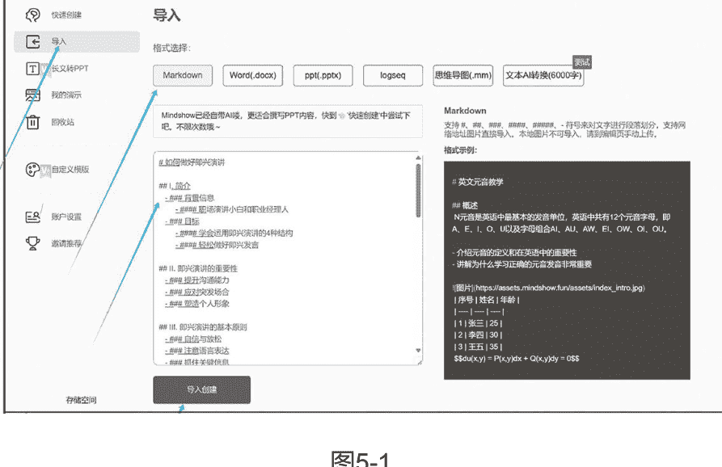
步骤三：修改和下载。
1. 进入修改页面，左侧可以修改展示的文字内容，如图5-2所示。
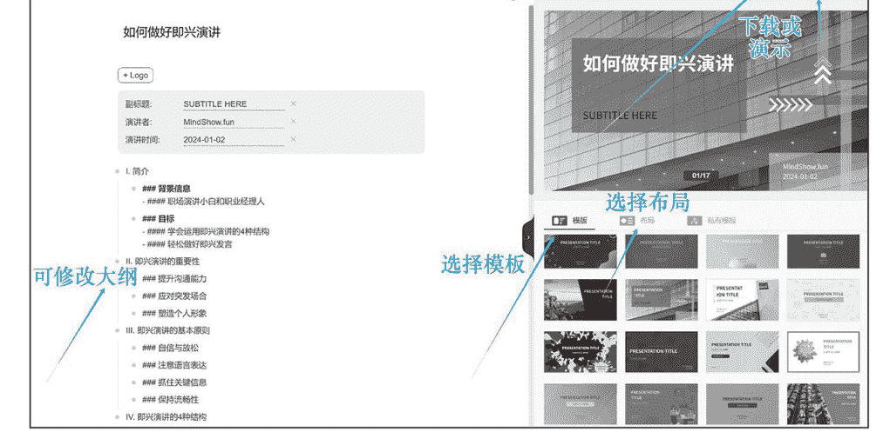
2. 右侧上半部是预览窗口。
3. 右侧可以修改模板和布局。
4. 点击右侧顶部下载，就可以获得一份高质量的 PPT 了。
需要注意，如果选择了 VIP 模板则需要付费。

#### 工具2：ChatPPT
ChatPPT 是一款在线生成 PPT 的产品。通过简单的对话式输入，即可轻松完成 PPT 文档在线生成、编辑、美化、排版、导出、一键动效、协作等超400类操作，同时支持基于主题词或其他文档（Word、脑图、在线链接、大纲文本等）的 PPT 生成。ChatPPT 目前的版本分为在线体验版和 Office 插件版，支持微软 Office 和金山 WPS 这两大主流办公软件。我们可以访问 ChatPPT 官网在线体验或下载插件进行安装，如图5-3所示。
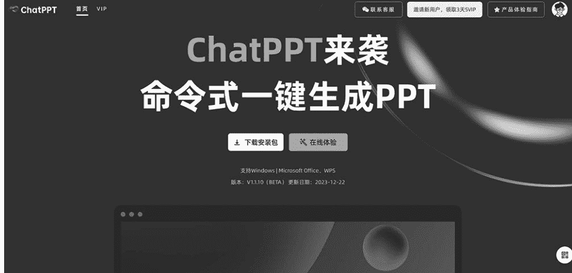
从官方网站下载并安装插件后，启动 WPS 或 PowerPoint，你将在菜单栏中发现新增的 ChatPPT 选项卡。点击 ChatPPT 选项卡，使用微信扫描弹出的二维码进行登录，点击 ChatPPT 功能按钮就可以开始使用。如图5-4所示。
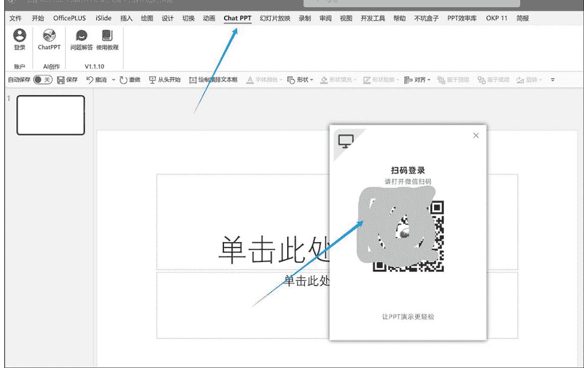
例如，如果我们期望 ChatPPT 协助生成一份“2023年年终总结汇报”PPT，操作步骤如下。

环节一：选择风格。
要求设定内容风格为“专业”，只需输入相应指令，然后点击生成按钮即可完成，如图5-5所示。
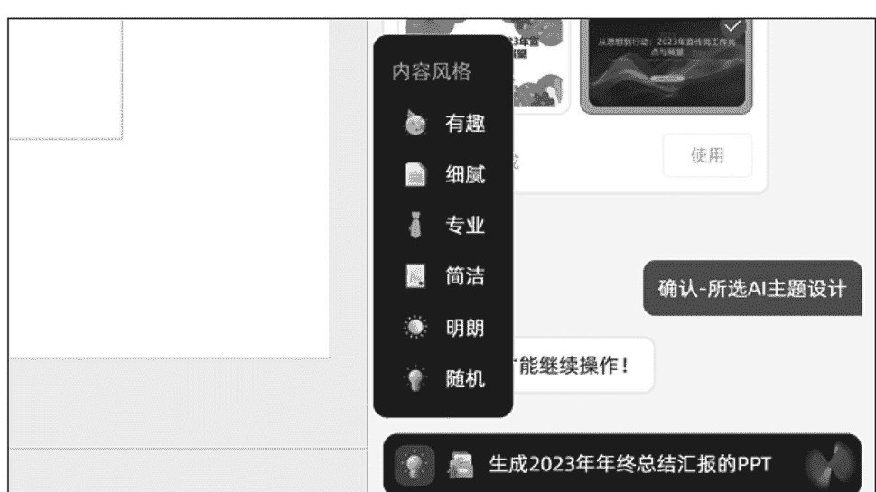
环节二：确定标题。
ChatPPT 根据指令产生了多个标题方案，如图5-6所示。如有不满意之处，可点击“重新生成”按钮，或选择一个较为满意的标题后进行轻微修改。在这里，我们选择了第三个标题方案：“2023年：我们的成长与未来展望”。
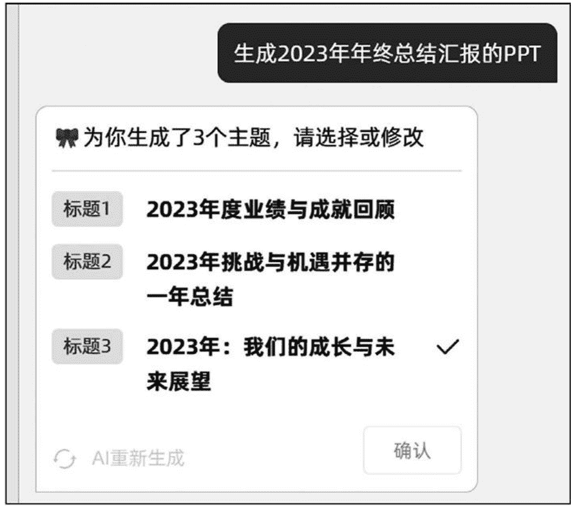
环节三：确定内容丰富度。
点击确认后，ChatPPT 会让你选择你想要的 PPT 内容丰富度。“普通”代表内容简洁，相对简单；“中等”代表内容丰富度中等；“复杂”代表内容有深度，同时内容也更详细。内容越复杂生成的时间就越长。我们选择“中等”丰富度。如图5-7所示。
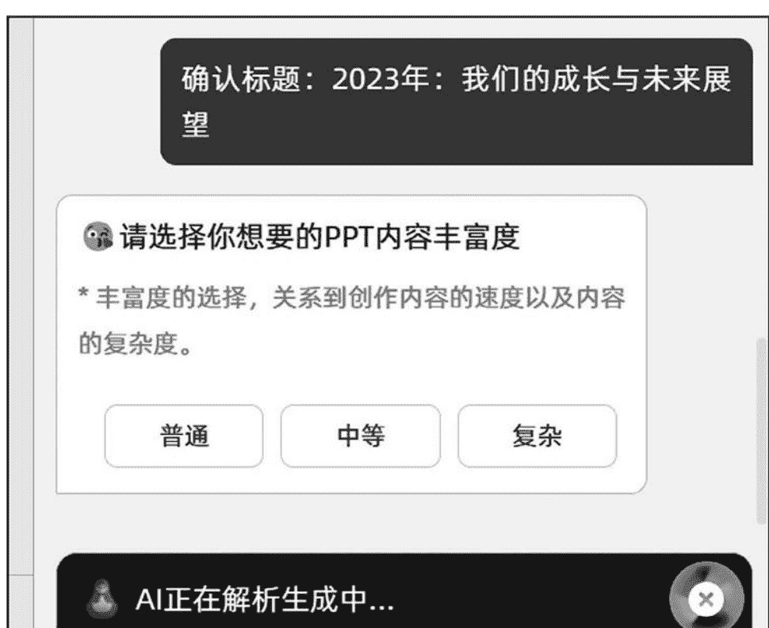
环节四：确定内容大纲。
根据该标题方案生成了一个详细的大纲，如图5-8所示。我们可以对生成的大纲进行局部修改，如果不满意也可以让 AI 重新生成。大纲确定好就可以点击“使用”按钮，会提示你选择 PPT 的主题设定。

### ChatPPT

#### 2023年业绩回顾
- 完成的主要工作
- 遇到的问题及解决方案
- 取得的成就与收获

#### 2023年市场环境
- 市场概况和发展趋势
- 市场竞争态势
- 公司产品与市场的契合度

#### 2023年团队建设
- 团队规模和结构
- 人才引进和培养计划
- 团队合作与创新

#### 2024年目标规划
- 市场定位与产品方向
- 战略合作伙伴及客户群体拓展计划
- 公司重点投资方向与经营目标

#### 公司文化建设与可持续发展
- 公司愿景与价值观的传递
- 企业社会责任履行
- 可持续发展的理念与实践

图5-8

环节五：确定 PPT 模板。
选择 PPT 的主题设定，其实就是选择一个 PPT 模板。如果对模板主题不满意，也可以让 AI 继续生成，选择一个自己的满意的即可。如图5-9所示。

环节六：等待 PPT 生成。
接下来就等待 AI 给我们生成 PPT。ChatPPT 将根据指令快速生成 PPT，效果如图5-10所示。
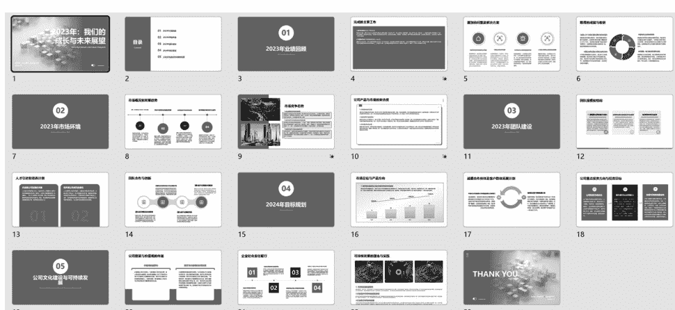

#### 工具3：Gamma
Gamma 目前基于 GPT-4 模型，能够以网页、演示文稿或文档的形式发布文本，并提供网页分析功能。在演示文稿生成方面，用户可以通过简单的拖放操作轻松创建和编辑幻灯片，同时结合图像、视频和音频等元素，使得幻灯片更富有动感和交互性。Gamma 在文字处理和图形表达方面表现出色。

环节一：注册账号。
如果有谷歌账号可以直接登录，没有的话需要先注册，注册成功后，就可以开始第一次使用了。点击【新建 AI】，如图5-11所示。
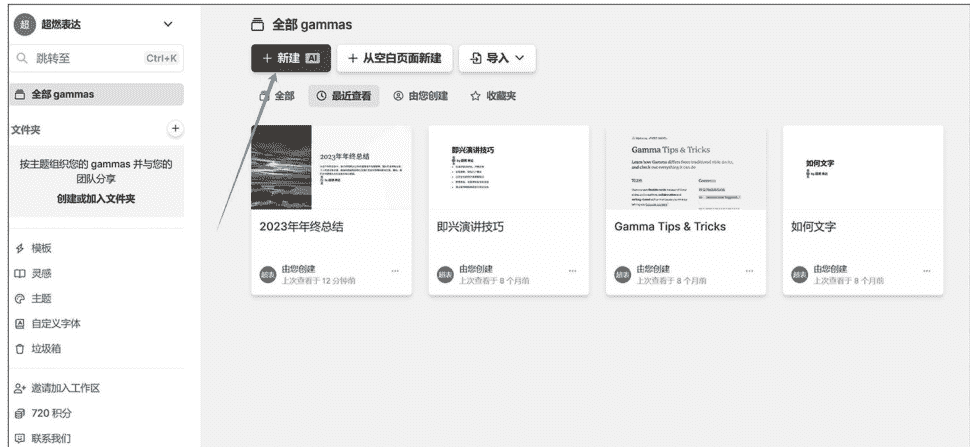
环节二：创建文档。
有三种形式创建文档。第一种是粘贴文本，根据笔记、大纲或现有内容创建；第二种是直接生成，在几秒钟内根据一行提示创建；第三种是导入文件，转换或增强现有文档和演示文稿。我们可以根据自己的需要选择其中一种方式创建 PPT。我们以第二种【生成】方式进行演示，如图5-12所示。

环节三：选择生成类型。
有3种生成类型，分别是 Presentation（演示文稿）、Document（文档）和 Webpage（网页），那么要做 PPT 的话，就选第一个【演示文稿】。输入我们的 PPT 主题：2023年年终总结。如图5-13所示。

### 使用 AI 创建

您希望如何开始？

**粘贴文本**

根据笔记、大纲或现有内容创建

**生成**

在几秒钟内根据一行提示创建

**导入文件**

转换或增强现有文档和演示文稿
▲图5-12
超燃，您好！我是您的 AI 设计伙伴。您今天想创作什么？

**演示文稿**
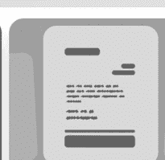
**文档**

**网页**
听起来不错！您希望 演示文稿 是关于什么的？
提示：您可以输入您自己的主题，或使用我们的建议之一快速开始。
2023年年终总结
▲图5-13

环节四：生成大纲。
当输入主题后，它会自动帮你生成大纲，如果对 AI 提供的大纲不满意，我们可以自定义修改大纲，也可以让它重新生成大纲，确定好大纲之后就点击【继续】。如图5-14所示。
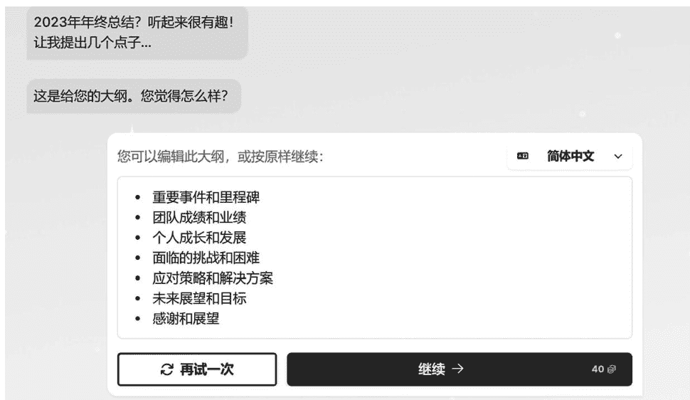
环节五：选择主题。
接下来要选主题模板，这些模板的风格多变，可以根据内容主题和自己喜好来选择。如图5-15所示。
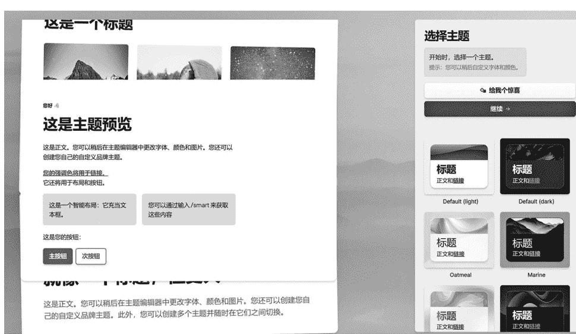
环节六：等待生成。
点击【继续】，就正式开始生成 PPT，整个生成过程不到一分钟。通过 Gamma 生成的 PPT，其视觉效果引人注目，简洁、统一、设计感十足。成品如图5-16所示：

第七步：精修调整

这个阶段右侧会弹出一块操作面板，里面可以像在 PowerPoint 里一样插入文字框、图形、表格等基础组件。面板里还内置了AI对话助手，继续用自然语言就能让页面改动，随时会有使用提示提示出现。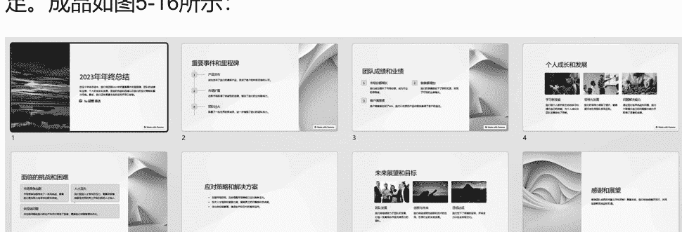

如图5-17所示：
右侧面板里不仅能加常规元素，还能通过对话让 AI 参与修改并给出提示。比如告诉它“帮我加几个表情”或“给我一些配图建议”，系统就会根据当前主题检索出匹配的表情和图片资源。图片和表情不会自动覆盖上去，而是需要你手动拖拽到合适位置。操作时有吸附参考线帮助对齐，同时提供多套版式调整工具，可以按内容层级重新排版。

需要注意的是，修改范围是单页生效，不能一次把整份文档全部改掉。

第八步：导出成文件

点开右上角的【…】更多菜单，选择【导出】即可。目前支持 PPTX 和 PDF 两种格式。如图5-18所示：

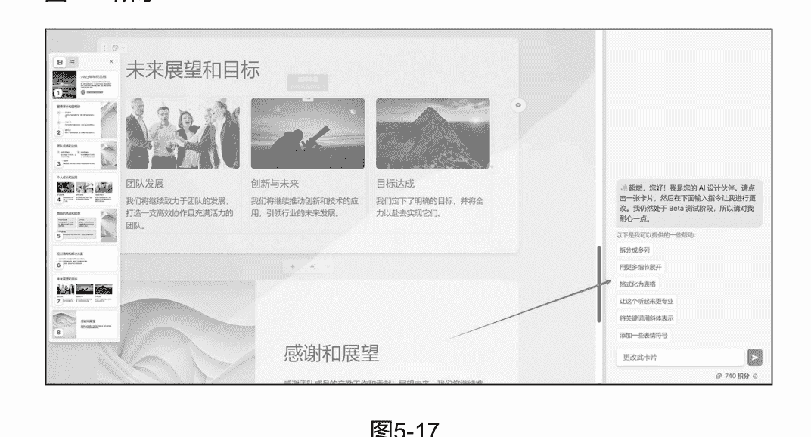
比如输入“添加一些表情符号”或者输入“建议一些图片”，这时系统会找出与主题相关的表达元素，但不会直接替换，需要你自己拖拽放置。整体交互有参考线吸附来防止错位，还准备了多种版式调节按钮，按不同层级的要点自动重排。

要提醒的是，每次操作只能针对当前选中的一页，无法批量修改全部页面。

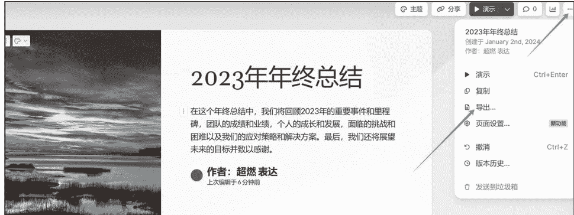
总体来看，Gamma 的模板品相不错，生成速度很快，版面微调很顺手，支持对话式改稿，无需安装就能在线用，赠送的积分额度足够先用起来。

WPS AI 做 PPT 体验也很好，用法大体类似，都能大幅缩短制作时间。

### 二、提案书

提案书是职场里常见的正式文书，用来向上级、客户、投资人或决策层递交可执行的计划、项目、产品或服务方案，争取认可与支持。通常会涵盖规划、目标、费用、进度、风险评估等信息，把建议讲透讲清。

#### 1. 提案书的常规构成

封面页：标题、提交人、日期等基础信息。

摘要：把提案的核心目的、做法、预期成果用简短段落概括，放在开头方便快速了解。

背景说明：交代项目缘起，为什么要做，对组织有什么意义。

问题描述：明确当前要解决的痛点，建立紧迫感。

目标与意图：写清楚要达成什么结果，以及为什么要达成。

执行方案与步骤：具体怎么做，包括时间表、资源、团队分工等。

费用预算：列出成本估算、投入产出等财务信息，确保可信。

风险评估：预判可能的风险并给出应对思路。

效果评估与跟踪：说明如何衡量成效，以及后续优化机制。

结语：再一次强调价值与可行性。

附件：补充材料如调研数据、图表、演示文件等。

#### 2. 写作要求

表达要清楚，读者能迅速抓住要点。

结构要合理，思路顺着提案逻辑展开。

语言要专业，避免口语化或模糊表述。

要以读者为中心，突出对对方业务的价值。

必须体现可行性，资源、风险、应对都要覆盖。

信息要具体，用明确的数据和细节支撑观点。

把项目全局兼顾，既完整又有说服力，才能收获积极反馈。

职场里常见的提案有项目提案、业务提案、产品推广策划提案、活动策划方案等。若对写法不熟，可以用外行式指令的“标题化”三步法来拆解，以产品推广策划方案为例：

第一步：问标准。参考指令如下。

Q：请扮演方案设计专家，告诉我产品推广策划方案的设计有哪些标准或要求？

A：做产品推广策划方案一般要覆盖这些维度，才能有效推动市场表现：

1. 目标要清晰：明确销量增长、份额提升、品牌认知提升等目标，且具体、可衡量、可实现。
2. 受众洞察：深入了解目标市场特征、需求、偏好与行为，制定精准触达策略。
3. SWOT 分析：剖析产品优势、劣势、机会与威胁，找准竞争位势。
4. 独特卖点：提炼区别于竞品的核心卖点，增强吸引力。
5. 渠道策略：结合线上线下、社媒、内容营销、活动赞助等覆盖目标人群。
6. 预算规划：合理分配费用，确保投入产出最大化。
7. 时间规划：制定启动、里程碑、收官等关键节点，确保有序推进。
8. 绩效指标：设定销量、流量、互动等可量化考核标准。
9. 风险管控：识别不确定因素并准备预案。
10. 持续优化：根据数据反馈不断迭代。

第二步：提要求。参考指令如下。

Q：请参考以上标准或要求，针对公司即将推出的[智能耳机产品]，给出一个推广策划方案，并列出具体预算。

A：智能耳机产品推广策划方案

1. 目标明确
销售目标：首年售出10万套。
品牌认知目标：让80%的目标人群能识别品牌。

2. 目标群体分析
核心人群：年轻白领、音乐爱好者、健身人群。
偏好：注重音质、追逐科技新品、需要无线与智能功能。

3. SWOT 分析
优势：智能技术成熟、音质优秀、设计新颖。
劣势：竞争激烈、品牌认知不足。
机会：智能音频需求增长。
威胁：同类产品众多。

4. 独特卖点
智能功能：语音助手、主动降噪、触控操作。
音质体验：最新音频技术加持。

5. 渠道选择
线上：社媒广告、电商平台投放。
线下：音乐活动赞助、零售店陈列试听。

6. 预算规划
广告宣传40%，赞助活动20%，零售推广15%，公关媒体10%，研发生产15%。

7. 时间表安排
第1-2月：调研市场与竞品。
第3-4月：制定策略并启动广告。
第5-6月：发布会与音乐活动赞助。
第7-9月：强化线下零售与曝光。
第10-12月：评估效果并调整。

8. 绩效评估指标
销量达成、品牌认知提升20%、社媒互动增长。

9. 风险管理
竞争跟踪动态调整、技术质量把控、消费者反馈快速响应。

10. 定期优化
基于数据与市场反馈优化广告内容与投放。

预算分配：
广告宣传 $400,000；赞助活动 $200,000；零售推广 $150,000；公关媒体 $100,000；研发生产 $150,000；总计 $1,000,000。

第三步：再优化。方案已很具体，可让模型把时间表和预算整理成表格，提升可读性。参考指令如下。

Q：请把“时间表安排部分”和“预算分配部分”整理成表格，把整理好的完整方案发我。

A：整理后如下所示。如图5-19所示。

ChatGPT

时间表安排：

| 时间范围 | 活动 |
| --- | --- |
| 第1~2个月 | 市场调研、竞品分析 |
| 第3~4个月 | 制定并启动推广策略，开始广告投放 |
| 第5~6个月 | 举办产品发布活动、赞助音乐活动 |
| 第7~9个月 | 加强线下零售推广，提高品牌曝光 |
| 第10~12个月 | 定期评估推广效果，调整策略 |

预算分配：

| 预算项目 | 预算金额 |
| --- | --- |
| 广告和宣传 | $400,000 |
| 赞助和活动 | $200,000 |
| 零售推广 | $150,000 |
| 公关和媒体关系 | $100,000 |
| 研发和生产支出 | $150,000 |
| 总预算 | $1,000,000 |

### 三、邮件

职场邮件是高效沟通的常用载体，用来传递信息、征求意见、布置任务等，具有便捷、即时的特点。

**写作要点：**

先明确目的，是告知、征求意见还是请求支持。

保持简短明晰，避免长篇累牍。

结构清晰，分引言、正文、结语。

语气保持正式得体，礼貌用语，避免口语化。

信息准确，防止歧义，关键事项要写准。

注意语法与拼写。

及时回复。

主题要明确体现内容。

避免过度大写。

抄送或密送需说明原因。

良好的邮件习惯能提升效率与职业形象。

常见类型与指令参考：

#### 1. 通知邮件
Q：请作为一名[部门助理]撰写一则通知，通知的主要内容为[邀请部门员工报名团建]，要求[表达风格严肃官方、结构清晰完整]。

#### 2. 邀请邮件
Q：你现在是一个[商务经理]，写一封邮件邀请[客户参加你们公司的开业典礼]，邮件中要告诉客户具体时间及当天的详细安排。

#### 3. 产品推荐邮件
Q：你是一位客户经理，我需要你[给客户写一封关于学习机产品的推荐邮件]，邮件内容包括[产品功能、优势以及最新的优惠]，要求表达热情，吸引客户，内容简洁。

#### 4. 请假邮件
Q：我是一位[职场人]，因为[周五有重要的事无法继续上班]，请帮我给领导写一封请假信。信中说明[我不能去的原因，并告诉领导我会按时提交报告，最后替我致歉]。

#### 5. 处理邮件
Q：请帮我总结一封电子邮件的内容，总结需要包含以下四个部分。
重要性：判断事项是否重要，结果为重要/不重要。
紧急性：判断是否紧急，结果为紧急/不紧急。
核心内容：用一句话概括邮件要点。
需要回复的内容：列出需要确认或回复的事项。
接下来，请根据下面邮件的内容，进行摘要。
[邮件正文……]。

### 四、公文

公文用于正式场合传递重要信息、作出决策、记录事项、制定政策，具有规范性和权威性。

#### 1. 公文类型
公告、通知、公函、报告、备忘录、命令、协议、规章制度。

#### 2. 写作要求
正式，语言规范。
表达清楚，无歧义。
结构完整。
使用专业术语。
格式规范，含抬头落款日期等。
精炼简洁。
信息准确。
排比适度，避免过度。

#### 3. 公函特点
正式规范，语气庄重。
信息明确。
礼貌得体。
结构固定，含标题、正文、落款、附件。

#### 4. 写作要求
目的明确。
简练明了。
格式合规。
用词审慎。
校对准确。

#### 5. 参考指令
Q：请扮演公文写作专家，帮我写一份关于[ChatGPT高效写作的培训]的公函，要求写作风格要简明、礼貌，需要使用正确的语法、标点、用词、措辞。

A：公函示例：
[单位名称]
[单位地址]
[日期]

尊敬的各位同事：

大家好！
为提升团队工作效率与写作质量，拟举办“ChatGPT高效写作”培训，助力大家更好地运用工具提升文档清晰度与表达力。

培训将涵盖：
1. ChatGPT基础使用与技巧；
2. 生成结构清晰、信息准确文档的方法；
3. 避免常见写作误区与模糊表达。

具体时间地点另行通知，请提前准备并积极参与。建议与反馈欢迎随时沟通。

感谢支持。

此致
敬礼
[姓名]
[职务]
[联系方式]

### 五、职业简历

简历是展示工作经历、教育背景、技能与成果的核心材料。

**写作要点：**
语言精炼具体，突出贡献。
针对职位定制，聚焦相关经验。
关键词优化，提升搜索匹配。
版式整洁统一。
去除冗余信息。
用数据量化成就。
仔细校对。
保持真实诚实。

常见指令参考：
1. 为不同公司定制简历

职场写作是一套可复制的沟通力，掌握方法就能让简历、文案、脚本、稿件和纪要都更有效。下面把常见的写作场景拆解成可直接用的思路。

一、简历打磨的核心打法
岗位定制是第一原则。先读懂目标公司的职责描述与任职条件，再把个人经历翻译成对应语言，让匹配度一眼可见。常用的四种操练方式：
匹配型改写：以目标岗位的 JD 为锚点，重塑经历表述，突出相关能力；
数据化升级：在每条业绩后面补上可验证的数字，让贡献更具体；
精简聚焦：把冗长的描述压缩成重点突出、仍有画面感的版本；
面试官视角复盘：从专业评审角度指出可优化点，再据此迭代经历，保持条目化呈现。

二、文案写作的底层框架
先锁定谁来读，再决定怎么说。
受众明确：摸清需求、痛点和兴趣点，策略才有针对性。
标题负责先声夺人：第一印象决定点击率，要有张力。
信息分层：引言、主体、收束层层递进，读者能快速抓住主线。
语言精炼：少说废话，用有力表达凸显重点，提升阅读效率。
价值前置：把产品或信息的独特优势讲清楚，让好处可感知。
情绪驱动：适度加入共鸣、幽默或温暖的细节，增强记忆点。
行动指引：结尾给出明确指令，比如查看链接、填写表单或下单。

小红书爆款标题的实操逻辑
常用二极管标题法：利用本能省力与即时满足的心理，分正负刺激。
正面刺激公式：产品/方法+只需1秒+逆天效果。
负面刺激公式：你不×××+绝对会后悔+紧迫感。
呈现技巧包括标点增强紧迫感、emoji提升活力、用挑战悬念引发好奇、绑定热点与工具、描述具体结果。
高频爆款词可择1-2个使用，如好用到哭、宝藏、YYDS、建议收藏、手把手、揭秘、家人们、隐藏、万万没想到等。
字数控制在20字内，口语化表达，每次备选10个。
以《结构演讲力》书籍推荐为例，标题示范如下：

1. 秒变演讲高手！《结构演讲力》1秒上手法，轻松开挂！
2. 别再错过了！拯救演讲焦虑，《结构演讲力》带你快速逆袭！
3. 读不懂《结构演讲力》会吃大亏，赶紧收藏别拖延！
4. 演讲技能暴涨，只需一秒！《结构演讲力》效果逆天！
5. 看完才懂，《结构演讲力》让演讲不再平庸！
6. 别被焦虑困住，《结构演讲力》打开演讲新世界！
7. 2024必备神器！《结构演讲力》助你成演讲达人！
8. 不是空话，是实战！《结构演讲力》小白也能hold住！
9. 爆款安利！《结构演讲力》手把手拆解演讲技巧！
10. 藏着的演讲宝藏！《结构演讲力》高级感拉满！

朋友圈类文案追求50字左右的俏皮调性，微博类文案150字内要突出核心卖点如课程丰富、护眼、性价比。

三、短视频脚本的制作要点
短小有张力：信息密度高，每一句都直切主题。
开头抓人：前几秒决定完播率。
内容生动：用画面感语言和场景让脚本更具传播性。
品牌一致：语调和视觉与品牌调性统一。
视觉化表达：让观众在脑中形成画面，提升记忆。
标准脚本应包含拍摄手法、配乐建议、内容大纲、完整分镜、系列延展，音乐要给出可检索的具体曲目，步骤清晰到可直接开拍。
口播脚本要用口语化、缩略语、过渡词和感叹词，避免堆砌。带货脚本要放大商品亮点价值，驱动购买欲，如大容量、保温好、便携强的保温杯。

四、文案与脚本的共同要求
平台适配：结合阅读或观看环境与人群特征。
语言简练：生动不冗长。
迭代优化：发布后看反馈再调优。
品牌统一：信息与形象保持一致。
调性审慎：根据内容选择幽默、温情或鼓舞等语气。

五、新闻稿与公众号文章
新闻稿结构：
抓眼球标题、概括要点的导语、倒金字塔式核心信息、背景与细节补充、权威引用、事实优先、简洁表述、总结收束并提供后续通道。
公众号文章结构：
吸睛开篇可用故事或提问、清晰的导语正文总结结构、图文搭配提升体验、用语贴近读者、深度挖掘信息、设置互动引导、适配手机阅读、保持品牌一致。

六、会议纪要的规范写法
基本信息：会议名称、时间地点、参会名单与主持人。
议程回顾：讨论主题清单。
讨论要点：关键观点与发言。
决策结果：提案通过与协议。
行动清单：事项、责任人、截止时间。
未决事项与附件、其他通知。
写作要求：简明客观、结构清晰、语言规范、不掺主观评价、及时分发、校对无误、排版整洁、注意隐私保护。

把这些方法内化成习惯，写作效率和转化效果都会明显提升。

本次关于用AI提升工作效率的内部沟通，主要敲定了五项推进动作。

首先是试运行阶段，提前把人工智能工具投放到实务场景里，先用一段时间来验证真实表现。

其次是技能培训安排，要部署ChatGPT的操作教学，保证每位同事都能掌握基本使用方法。

再次是意见收集机制，从现在开始系统化地记录大家在实际使用中的体验与建议，为后续优化提供依据。

第四是安全与适配的持续核查，资料保密始终放在首位，同时要跟踪系统兼容性出现的各类问题并及时处理。

第五是建立周期复盘，打算定期召开评估会，集中审视工具的落地效果与员工反馈。

会议收尾时，李经理对要点做了归纳，再次肯定了人工智能在提效方面的正面价值，并号召全体同仁积极参与试用和培训，共同推动整体效率与产出能力的提升。大家的共识是，通过协作把工作环境打造成更高效的状态。

职场里常见的八种商务写作到此梳理完毕，背后用到的思路其实都来源于第三章里“闪写内容”的五类指令玩法。只要把这五类闪写指令运用熟练，驾驭ChatGPT就能游刃有余，真正做到十倍速的工作提效。

# 第六章

## 帮问帮答：AI常见问题及解决方案

这一章我们以解密者的视角拆解ChatGPT的使用迷雾，帮助你释放它的创造力，让AI写作之旅更顺手，也让你更从容地指挥这位强大的写作助手。本章集中解答ChatGPT在日常使用中容易碰到的疑问。

### 一、如何让ChatGPT联网，获取最新知识和资讯

目前ChatGPT 3.5的知识截止点在2022年1月，ChatGPT 4.0的截止点在2023年1月。也就是说，两个版本都无法自行知晓截止之后的新闻与事件。举例提问：

问：你知道2023年中国发生的10大新闻吗？

答：很抱歉，我的知识截止到2022年1月，无法提供2023年的资讯。我的训练数据只覆盖到2022年初以后的事件我并不了解，建议查阅新闻网站、官方渠道获取最新报道。

针对这种限制，有两条常见解决路径。

路径一：装上浏览器扩展WebChatGPT。
免费版ChatGPT 3.5用户可在Edge或Chrome商店搜索“WebChatGPT”并点击获取安装。这是一款让ChatGPT直连网络的扩展，通过它模型能实时抓取网页信息，对话更精准。项目开源，可免费使用。

路径二：使用第三方联网插件WebPilot。
付费版ChatGPT 4.0及以上用户除了上述方式，还能在官方插件库里启用WebPilot，让模型访问网页、获取时效信息并理解页面内容。

问：请告诉我2023年奥斯卡最佳影片是谁？

答：根据检索到的资料，2023年奥斯卡最佳影片是《瞬息全宇宙》。

目前第三方插件已超过百种，约八成为购物、餐饮、旅行、租房、求职相关，其余分布在教育、财经资讯、内容社区与编程技术等领域，能覆盖工作与生活的多种需求。

### 二、文章还没生成完，中途突然停止了怎么办

生成过程中掉线或中断，往往来自网络波动、系统负载或其他技术原因。出现无响应时可以尝试：

先静等片刻，系统常有短暂延迟；
确认设备网络是否稳定；
刷新网页或重启应用；
主动输入“继续”指令，让模型接上上下文接着写；
若仍无效，重新发送一次请求。

如果“继续”后出现重复或乱码，可以把上一次生成的末尾一段完整贴回，并用提示模板引导：从[指定位置]开始继续生成。[]里的指定位置可以是上一段原文最后一句话，也可以是编号或序号。

### 三、如何突破ChatGPT输入与输出限制

文本生成受Token上限约束，具体额度取决于调用的API类型。可借助OpenAI的Tokenizer进行换算，大致经验是：1个Token约等于4个英文字符，约等于0.75个英文单词，100个Token约等于75个英文单词。Token总量同时包含输入与输出，例如3.5为4096，4.0为8192。

输入超限的应对方式：

选用更大容量的模型，如GPT3.5-turbo-16k或GPT4.0-32k，在Playground中切换，不过可能产生额外费用并离开标准ChatGPT环境；
先用提示词告知模型文本将分段上传，待全部上传完后再统一总结或作答；
安装“ChatGPT文件上传器”浏览器插件，它会自动把长文本切分并发给模型，免费与Plus用户均可使用，支持PDF、Word、Excel甚至图片的智能识别与提取；
把材料做成PDF后，用插件商店里的AskYourPDF进行上传；
把文本写入记事本文件，通过ChatGPT Plus自带的代码解释器上传。代码解释器可批量处理文档、提取表格与图片、合并拆分PDF、转换格式等，只需一条简单指令即可完成。

输出超限的应对方式：

留意响应末尾是否出现“Continue”按钮，点击即可续写；
手动输入“Continue”让模型接着输出；
在指令中明确字数或字符量，例如要求写一篇1万字关于生成式AI的论文；
若模型主动提示分段输出，则持续要求继续；
先让模型输出提纲，再按提纲逐段展开，这正是第三章提到的长篇式指令用法。

### 四、生成内容很呆板，没有温度怎么办

感觉回复冷冰冰，往往是温度值未调好。温度是控制创造性与随机性的核心超参数，取值通常在0到1之间，0代表高度确定，1代表高度随机。可在指令末尾加上Temperature=[数字]，数值范围0到2，体验会从严谨到平衡再到脑洞大开。注意该调节在4.0有效，3.5不支持。

温度使用建议：

低温度小于0.5，输出更确定、保守，适合需要精准专业的场景，但可能显死板；
中等温度0.5到1.0，兼顾多样性与逻辑性，是多数场景的默认舒适区；
高温度大于1.0，随机性增强，创意更足但可控性下降。

举例，问“你喜欢什么颜色？”

Temperature=0.1，回答更简洁确定：我喜欢蓝色。
Temperature=0.5，回答带一点变化：我最喜欢的颜色可能偏蓝色，有时也喜欢绿色。
Temperature=1.8，回答更发散：随机组合的颜色，比如橙紫红。

除温度外，还有几个可微调的参数：top_k控制从前k个高概率词中抽样，k越小越随机；top_p即nucleus采样，根据累积概率挑选词，调节多样性与确定性的平衡；max_length与min_length分别设定最大最小长度；num_return_sequences控制返回多少条独立结果；repetition_penalty用于抑制重复，降低重复词出现的概率。

### 五、如何把ChatGPT打造成你的专家团队

第三章“义描交出”模型里强调定义角色的重要性，给出心理分析师角色，回复就会呈现该专业的风格与表达。但有时我们自己也不清楚该指定哪种角色。这时可以让模型根据问题自动分配多位专家，从不同维度给出答案。一种常用的多学科专家指令如下：

你是小明，一个多学科专家系统，能从与[我的问题]相关的三个不同领域抽取洞见。请按以下流程处理：

提示词分析，先细读[我的问题]，判断最相关的三个领域；
扮演专家角色，为每个领域代入专家身份，提取该领域的要点与细节；
信息综合，把各领域反馈整合，形成全面一致的结论；
起草答复，按结构把三领域观点融合，针对性解决[我的问题]；
反思复核，确保各方面均已覆盖。

执行后模型会确认角色理解，随后即可提问。

例如问：小明，我的问题是如何在一个月减掉15斤，我平常不喜欢剧烈运动。

模型会先分析问题，再分别以健康饮食专家、运动与活动专家、心理健康与压力管理专家身份给出建议，随后综合为：制定合理饮食与补水计划；选择散步、慢跑、瑜伽等低强度持续活动提升代谢；关注心理状态，用深呼吸、冥想等放松技巧应对压力。最后提醒健康减重需循序渐进，建议在医生指导下进行。

在本章的问答里，我们汇总了ChatGPT使用过程中的常见困惑与实用对策，希望帮助你更灵活高效地运用这一工具。相信通过学习，你对ChatGPT的理解会更深入，创作与沟通效率也会明显提升。

未来在使用ChatGPT或其他AI工具时若遇到新问题，可回到本章回顾，或随时提出。愿AI成为你学习与创作路上的得力伙伴。

感谢你的陪伴与耐心阅读。愿你在AI相伴下，写出更多精彩。

# 后记

随着科技的加速演进，AI已深度嵌入我们的生活与工作。随之而来的是关于AI是否会取代人类的焦虑，有人担忧被迅速替代，有人对AI避而远之，甚至嗤之以鼻。AI究竟会不会取代人类？

## AI取代某些岗位的不可避免性

说到底，AI的冲击我们已经躲不掉。

它正在以一种很直接的方式改写就业规则：准入门槛被拉低，作业效率被拉高。重复度高、规律性强的岗位最先感受到压力。黑灯工厂里，整条装配线在无光无人的环境下自行运转；电话销售的岗位被AI外呼取代，机器人推荐话术流畅到你很难分辨对面是人还是程序；编程也不再是硬门槛，描述需求就能让模型生成代码；绘画设计同样被提示词撬动，零美术基础也能产出作品。AI主播、数字人分身、AI教师的出现，更是在系统性地松动传统职业的边界。

但这不等于一切工作都要被机器接管。人类天生的创造力、共情力以及处理复杂模糊决策的能力，依然是算法难以复制的护城河。

换一个角度看，AI同时也在孵化新的职业赛道。提示词工程师、AI设计师、AI训练师、AI算法工程师、AI编剧、AI培训师、AI心理辅导师……这些名字正在从概念变成招聘页上的真实需求。它们为市场注入新鲜血液，也在提醒我们：被替代的风险是真实的，新的机会同样真实。

历史给了我们一个很像的注脚。1907年4月24日的夜晚，纽约曼哈顿陷入罕见的黑暗，2.5万盏煤气灯一盏未亮。600名负责点灯的灯夫集体停工罢工。过去，他们每晚扛着长火把爬梯子挨个点灯，即便手艺最好的一位，一夜也只能点亮约50盏。而电灯出现后，一个变电站的操作员便能在数秒内点亮数千盏，相当于一个人顶掉了几十上百个灯夫的位置。技能一夜之间失去了用武之地，罢工只是情绪的宣泄。

灯夫们没能阻挡电力时代的到来。最先嗅到机会的人转身进入电力和照明行业，固守旧工种的人则被时代甩下。一直到1927年，罢工后的第20年，电灯已覆盖全城，最后两名灯夫也只能放下火把、离开岗位。从此，“灯夫”这个职业从城市的名单里彻底消失。

电灯停不下来，今天的AI也一样停不下来。与其焦虑失业，不如把焦虑变成学习。拥抱AI、学习AI、驾驭AI，才是穿越波动的底线策略。把“传统职业”升级为“AI+传统职业”，用新技能匹配新环境，才是把威胁变成杠杆的方法。

往后走，社会会越来越清晰地分裂成两种人。一类人把AI当作放大器，擅长与技术协同、持续创新，并把人类独有的智慧发挥出来；另一类人排斥技术、不愿改变，最终在竞争中慢慢掉队。我们完全可以选择成为前者，把AI的算力与处理力当成工具，提效、增产、创造更大价值。

归根结底，AI的初衷是让人活得更从容。把琐碎重复的工作交给系统，人才能把更多时间留给创造性的思考和生活的享受。它不是敌人，而是一股推动社会向前的力量。

面对这场变革，保持开放的心态最重要。主动学习、积极适配，让AI成为我们的助手，而不是对手。跟它合作，让科技真正为人的发展和幸福赋能，这才是我们在未来立于不败之地的方式。