# AI创收：让业余时间变成现金流


## 前言：如何使用这本书

——你的AI时代财务自由指南

当你翻开这本书时，我想先和你分享一个重要的观点：这不是一本教你具体操作某款软件的工具书，而是一份帮你重新思考人生的指南。

### 1. 关于本书的使用方式：工具选择的灵活性原则

在AI创收和财务自由的实践过程中，你会发现市面上的AI工具数量庞大且日新月异。书中我提到的具体工具，如DeepSeek、豆包、腾讯元宝、智谱清言、通义千问等大模型，以及即梦AI、可灵AI、Canva可画等图像生成工具，还有扣子（Coze）、飞书、钉钉等协作平台，都可以根据你的实际情况进行灵活替换。

请记住这个核心原则：方法比工具更重要，思维比技巧更重要。

我在书中列举的工具组合主要考虑了国内用户的可及性，但这并不意味着它们是唯一选择。为了帮助你更好地选择适合自己的工具，下面详细介绍一下各类工具的特点和优势。

### 2. 大语言模型(LLM)工具

以下按用户实际使用的产品名称介绍，括号内标注对应的底层模型技术。

#### （1）国产大模型阵营。

1.  DeepSeek。
    - 优势：推理能力强，代码生成质量高，成本低廉，在数学和逻辑推理方面表现卓越。
    - 适用场景：编程辅助、逻辑分析、技术文档撰写、复杂问题解决。
    - 使用成本：极低，适合高频使用。

2.  腾讯元宝（基于腾讯混元大模型）。
    - 优势：在腾讯生态内整合度高，支持文档处理、表格分析等办公场景。
    - 适用场景：商务文档处理、数据分析、企业级应用开发。
    - 特色功能：与腾讯文档、企业微信深度集成。

3.  豆包（基于字节跳动豆包（原云雀）大模型）。
    - 优势：中文理解能力强，创意内容生成优秀，与字节系列产品整合度高。
    - 适用场景：内容创作、文案策划、社交媒体运营、创意灵感激发。
    - 特色功能：支持多轮对话记忆，擅长角色扮演和创意写作。

4.  智谱清言（基于GLM大模型）。
    - 优势：学术背景强，在知识问答和专业分析方面表现优秀。
    - 适用场景：学术研究、专业咨询、知识整理、教育培训。
    - 特色功能：支持长文本处理，知识图谱构建能力强。

5.  通义千问（基于阿里巴巴通义系列模型）。
    - 优势：与阿里云生态深度整合，商业化应用成熟，多模态能力强。
    - 适用场景：电商运营、企业数字化、云端应用开发。
    - 特色功能：支持图文混合输入，电商场景应用丰富。

#### （2）国际大模型阵营（需要网络条件）。

1.  ChatGPT（基于OpenAI GPT系列模型）。
    - 优势：生态最完善，插件丰富，社区活跃，使用体验成熟。
    - 适用场景：通用对话、内容创作、编程辅助、商业分析。
    - 版本选择：GPT-5 Auto自动决定思考时长，GPT-5 Thinking思考更充分，回答更优质。

2.  Claude（基于Anthropic Claude系列模型）。
    - 优势：在编程、推理、长文本处理方面表现卓越，安全性高。
    - 适用场景：复杂编程项目、学术写作、法律文档分析、代码审查。
    - 特色功能：支持100万tokens长文本，代码生成质量极高。

3.  Gemini（基于Google Gemini系列模型）。
    - 优势：多模态综合能力突出，与谷歌生态深度整合。
    - 适用场景：图文混合内容创作、数据分析、搜索增强任务。
    - 特色功能：支持图像、音频、视频输入，实时信息获取能力强。

4.  Grok（基于xAI Grok系列模型）。
    - 优势：实时信息获取能力强，风格较为幽默直率。
    - 适用场景：新闻分析、时事讨论、快速信息获取。
    - 特色功能：与X（原Twitter）数据深度整合。

其他重要选择：文心一言（百度生态整合）、讯飞星火（语音交互能力突出）、商汤商量（视觉AI能力强）等在特定领域也有优势；国际方面，Perplexity（搜索增强能力强）、Mistral AI（开源友好）等工具在特定场景下同样值得考虑。

### 3. 图像生成工具

#### （1）国产图像生成工具。

1.  即梦AI。
    - 优势：中文提示词理解准确，生成速度快，免费额度充足。
    - 适用场景：社交媒体图片、商业插画、概念设计、个人创作。
    - 操作特点：界面简洁，适合新手入门。

2.  可灵AI。
    - 优势：视频生成能力强，支持图生视频、文生视频。
    - 适用场景：短视频制作、动画创作、营销视频生成、教育内容创作。
    - 特色功能：视频质量高，支持较长时长。

3.  Canva可画。
    - 优势：模板丰富，设计元素多样，适合非专业设计师。
    - 适用场景：海报设计、演示文稿创作、社交媒体素材生成、品牌设计。
    - 特色功能：AI辅助设计，智能排版，团队协作。
    - 操作特点：拖拽式操作，学习成本低。

#### （2）国际图像生成工具。

1.  Midjourney。
    - 优势：艺术效果突出，创意性强，社区活跃。
    - 适用场景：艺术创作、概念设计、高端插画生成。
    - 操作特点：Discord平台操作，社区互动性强。

2.  DALL·E 3 (OpenAI)。
    - 优势：与ChatGPT深度整合，文本理解准确。
    - 适用场景：配合文字内容的图像生成、精确执行指令。
    - 特色功能：可以生成包含文字的图像。
    - 访问方式：通过ChatGPT Plus或API访问。

3.  Stable Diffusion。
    - 优势：开源免费，可本地部署，自定义能力强。
    - 适用场景：批量生成、模型微调、特定风格训练。
    - 技术门槛：需要一定的技术基础，硬件要求较高。
    - 使用成本：软件免费，但需考虑硬件成本。

### 4. 编程与开发工具

#### （1）国产编程工具——TRAE。

- 优势：专为中国开发者设计，提供良好的中文支持。
- 适用场景：Web开发、移动端开发、自动化脚本。
- 特色功能：智能代码补全，错误诊断，重构建议。
- 集成能力：与国产云服务平台整合度高。

#### （2）国际编程工具。

1.  Cursor。
    - 优势：AI原生设计，代码生成能力极强，上下文理解准确。
    - 适用场景：复杂项目开发、代码重构、新技术学习。
    - 使用体验：类似VS Code，但AI能力更强，付费订阅制。

2.  OpenAI Codex。
    - 优势：强大的代码生成和理解能力，支持多种编程语言。
    - 适用场景：代码自动生成、bug修复、算法优化。

3.  Claude Code。
    - 优势：命令行工具，专注于代理化编程任务。
    - 适用场景：终端开发环境、自动化编程任务、代码审查。

### 5. 自动化与工作流工具

#### （1）国产自动化工具——扣子。

- 优势：字节跳动出品，与国产工具整合度高，中文界面友好。
- 适用场景：社交媒体自动化、内容发布、数据同步。
- 特色功能：丰富的国产应用连接器，模板库完善。
- 使用成本：相对较低，适合新手。

#### （2）国际自动化工具。

1.  n8n。
    - 优势：开源免费，可自主部署，自定义能力强。
    - 适用场景：企业内部自动化，数据隐私要求高的场景。
    - 技术要求：需要一定的技术基础进行部署和维护。
    - 使用成本：软件免费，但需考虑服务器和维护成本。

2.  Zapier。
    - 优势：应用连接最多，使用简单，稳定性高。
    - 适用场景：简单的触发-动作自动化，SaaS工具集成。
    - 特色功能：AI助手帮助构建自动化流程。
    - 使用成本：免费版支持创建5个Zaps，付费版每月19.99美元起。

3.  Make。
    - 优势：功能强大，连接器丰富，能够可视化流程设计。
    - 适用场景：复杂业务流程自动化、跨平台数据同步、企业级集成。
    - 特色功能：支持条件分支、循环、错误处理等高级逻辑。
    - 使用成本：免费版有限制，付费版9～29美元/月。

其他重要工具：Microsoft Power Automate（微软生态整合）、IFTTT（消费级应用广泛）、腾讯云微搭、钉钉宜搭等在特定场景下也有不错的表现。

### 6. 协作与文档工具

#### （1）国产协作工具。

1.  飞书。
    - 优势：字节跳动出品，功能全面，音视频会议质量高。
    - 适用场景：团队协作、项目管理、知识沉淀。
    - 特色功能：多维表格、云文档、日历集成。
    - 使用成本：基础版免费，高级功能需付费。

2.  钉钉。
    - 优势：阿里巴巴出品，在中国企业市场占有率高。
    - 适用场景：企业级协作、考勤管理、业务流程。
    - 特色功能：流程审批、企业邮箱、视频会议。
    - 集成能力：与阿里云、支付宝等深度整合。

其他选择：企业微信（微信生态加持）、腾讯文档（实时协作流畅）、语雀（知识管理能力强）等也是不错的选择。

#### （2）国际协作工具。

1.  Notion。
    - 优势：功能最为丰富，自定义能力极强，模板生态完善。
    - 适用场景：个人知识管理、项目管理、团队协作、内容创作。
    - 特色功能：数据库功能、模块化设计、强大的关联能力。
    - 学习曲线：功能丰富但需要时间掌握，适合深度用户。

2.  Slack。
    - 优势：企业沟通标杆，插件生态丰富。
    - 适用场景：团队沟通、项目协作、工具集成。
    - 特色功能：频道管理、工作流集成、第三方应用丰富。

其他工具：Microsoft Teams（微软生态完整）、Google Workspace（云端协作优秀）、Airtable（数据库与电子表格结合）等在特定场景下也具有优势。

### 7. 工具选择的实用建议

#### （1）基于使用场景选择。

- 内容创作：DeepSeek+即梦AI+飞书（国际用户优选ChatGPT+Midjourney+Notion）。
- 编程开发：OpenAI Codex、Claude Code（复杂项目、预算充足）或DeepSeek+TRAE（成本敏感），Cursor也是主流选择。
- 商业运营：扣子+豆包+飞书（国际业务选择ChatGPT+Make+Slack）。
- 学术研究：智谱清言+Perplexity+Notion（知识问答+信息检索+文档整理）。

#### （2）基于预算考虑。

- 预算有限：优先选择免费或低成本的国产工具。
- 预算充足：可以选择功能更强大的付费国际工具。
- 企业用户：建议选择有企业级支持的工具。

#### （3）基于技术能力。

- 初学者：选择界面友好、学习成本低的工具。
- 技术用户：可以选择开源、可定制的工具。
- 专业开发者：建议使用最先进的开发工具。

#### （4）组合使用策略。

不要把所有鸡蛋放在一个篮子里。我建议采用“主力+备选”的策略：

- 选择1～2种主力工具深度掌握。
- 准备2～3种备选工具以备不时之需。
- 定期关注新工具的发展，适时更新工具栈。

记住，工具只是实现目标的手段，并不是目标本身。无论你选择哪种工具组合，关键是要理解背后的逻辑和方法，这样才能在工具更新换代时始终保持竞争力。

我的建议是：如果条件允许，优先选择功能更强大的国际工具；如果时间允许，最好使用多种大模型进行交叉比较，以便得到最优的结果；如果受到限制，国产工具也完全够用。关键是掌握背后的方法论和思维模式。本书主要介绍国产大模型和相关工具的使用。

### 8. 关于DeepSeek的特别说明

国内用户我特别推荐选择DeepSeek作为首选大模型，这是基于以下几方面考虑：

1.  访问便捷性：国内用户可以直接使用，无须考虑网络问题。
2.  技术实力突出：DeepSeek在推理能力、代码生成、数学解题等方面表现卓越，甚至在某些测试中超越了许多国际顶级模型。
3.  成本优势明显：相比其他大模型，DeepSeek的使用成本更低，对于需要大量调用API的商业项目特别友好。
4.  持续进化：作为中国AI领域的重要突破，DeepSeek代表了我们在AI竞赛中的自主能力。

为了帮助读者更好地掌握DeepSeek的使用，我专门撰写了一本书《DeepSeek全场景应用》，已由中国人民大学出版社出版。这本书深入探讨了DeepSeek在内容创作、编程开发、数据分析、个性化推荐等各种实际场景中的具体应用方法。

我强烈建议你将《DeepSeek全场景应用》与本书结合阅读：

- 本书提供财务自由的宏观框架和生活重构的思路。
- 《DeepSeek全场景应用》提供具体的技术实现路径和案例。

两本书相互补充，能让你既有战略视野又有战术能力。

### 9. 笔者想对你说的话

（1）关于“失败”的真相。在书中，我不仅分享了张文杰和王睿的成功经验，也特意加入了许多失败案例。这是我的有意安排。

真实的财务自由之路并非坦途。我见过太多人因为只看到成功案例而产生不切实际的期望，最终在现实的挫折中选择放弃。

书中提到的数据都基于真实调研和案例分析，我刻意避免了夸大其词。比如，当我说某个项目“月收入5 000元”时，这是经过验证的真实数据，而不是“月收入百万”式的营销噱头。

请记住：财务自由不是一夜暴富，而是一个需要时间、耐心和智慧的长期过程。

（2）关于AI工具的迭代。AI领域的发展速度极快，今天的最佳工具可能明天就被新的工具超越。当你读到这本书时，书中提到的某些工具可能已经更新，甚至被新工具替代。这是正常的，也是我们必须适应的现实。

我在书中强调的学习能力、适应能力、元学习能力，正是为了帮你应对这种快速变化。掌握了底层的思维方式和方法论，你就能快速掌握任何新工具。

（3）关于实践的重要性。这本书的价值不在于阅读，而在于实践。我设计了大量可操作的练习和工具，包括：

- 7天新手启动计划。
- 项目评估框架。
- 价值观澄清练习。
- 个人成功重定义工具。

请不要只是看看，而是真正动手实践。每一个练习都是我和众多财务自由实践者反复验证的结果。

（4）关于心态的调整。财务自由后的生活重构，最大的挑战不是技术问题，而是心理问题。从“被安排的生活”到“自主设计的生活”，这个转变可能比你想象的更困难。

书中张文杰和王睿经历的迷茫期、焦虑期都是真实的。如果你在实践过程中也遇到类似的心理挑战，请记住：这是正常的，给自己一些时间和耐心。

（5）关于社群的力量。虽然财务自由给了我们更多独立选择的可能，但这并不意味着要独自面对所有挑战。建议你主动寻找或建立学习社群。与志同道合的人交流经验、分享困惑、相互支持，不仅能加速你的成长，更能让整个旅程变得有意义。

你可以：

- 加入相关的在线社群。
- 参加线下的聚会活动。
- 与身边的朋友分享你的实践。
- 在社交媒体上记录你的成长过程。

### 10. 使用建议

（1）不要试图一次性掌握所有内容：选择与你当前阶段最相关的章节开始，逐步深入。

（2）保持工具的开放性：不要被具体的工具束缚，重点理解背后的原理和方法。

（3）记录你的实践过程：建立自己的实践日志，记录尝试、反思、调整的过程。

（4）保持长期视角：财务自由和生活重构是长期工程，不要期望立竿见影的效果。

（5）与其他资源结合：除了《DeepSeek全场景应用》，你还可以参考其他相关书籍、课程、社群资源。

### 11. 寄语

写这本书的初衷是希望能够为追求财务自由的人提供一份更全面、更真实、更实用的指南。我不想给你画大饼，也不想给你灌鸡汤，我只想和你分享那些经过实践验证的方法和思考。

在这个AI与人类共创的时代，我们有了前所未有的机会去重新定义工作、生活和成功。但机会总是与挑战并存，关键在于我们如何去把握。

愿这本书能够成为你探索财务自由之路的可靠伙伴，更愿你能在这个过程中发现属于自己的人生意义。

记住：财务自由只是手段，真正的目标是活出你想要的生活。

祝你在AI时代找到属于自己的自由与成长之路！

如果你在实践过程中有任何问题或想要分享你的经验，欢迎通过社交媒体与我交流。让我们一起在这个充满可能性的时代，创造更多有意义的故事。

## 第1章 30天从0到月收入3 000元：AI副业启动指南

当人工智能时代到来时，你要么学会使用它，要么被它取代。

> ——吉尼·罗梅蒂(Ginni Rometty)

### 开篇：张文杰从“40%降薪”到“翻身逆袭”

2025年2月，武汉江汉区某小区的27楼。张文杰站在窗前，眼睛看着刚收到的公司内部邮件。屏幕上的文字令他心跳加速：

关于AI内容生成系统全面部署的通知

为提升公司运营效率，自下月起：

1.  内容部门人员精减40%；
2.  保留的岗位进行薪资调整，基本工资下调20%；
3.  转型培训计划即日启动……

作为电商平台的资深文案编辑，张文杰已从事该工作5年，月薪6 000元。这意味着他即将只剩4 800元的月收入，如果能保住工作的话。而他刚30岁，面临着30万元的房贷、新生儿的抚养费和父母的医疗开支。

> “我好像一夜之间成了‘过时’的人才。”张文杰苦笑着关上手机，“AI这么快就要替代我了吗？”

就在他陷入焦虑时，手机收到一条来自小区业主群的消息：“有没有人懂AI写作？我所在的公司需要设计一批产品介绍，预算2 000元，有兴趣请私聊。”

这条消息来自32岁的王睿，一位在楼下遛狗时经常与张文杰聊天的邻居。让张文杰惊讶的是，王睿竟然在找人做AI写作——他记得王睿是做销售的。

“你现在做AI相关的工作了？”张文杰好奇地私聊问道。

“不止如此，我已经完全转型了。”王睿回复，“找个时间聊聊？我猜你可能也想要了解这个。”

当晚，两人在小区里见面。王睿掏出手机，展示了一个令张文杰震惊的数字——28 546.72元，这是王睿上个月的AI副业收入。

“10个月前，我还是一名普通销售，因业绩下滑面临裁员。”王睿解释道，“但我发现了AI技术的机遇，开始尝试用AI编程助手开发小型自动化工具，以解决企业问题。我没有编程背景，全靠AI工具辅助学习。现在，我的副业收入已经超过了主业收入。”

看到张文杰将信将疑的表情，王睿笑了：“我知道你在想什么。你是文案编辑出身，擅长内容创作，走创意路径会比我的技术路径更适合你。AI不是威胁，而是放大你能力的工具。”

他建议张文杰试试DeepSeek等AI写作工具，并向他分享了一套入门方法：“给自己30天的时间，每天投入2小时，我敢保证你至少能实现初步的副业收入。”

张文杰半信半疑地点头，却不知道这个夜晚将彻底改变他的职业轨迹……

张文杰和王睿为虚构人物，其经历基于多位真实AI副业从业者的综合案例改编。

## 一、职场新格局：AI如何重塑工作与机遇

### 1. AI转型浪潮：工作性质的根本变革

张文杰的遭遇并非个例。随着AI技术的快速发展，全球就业市场正在经历深刻变革。研究显示，AI正对就业产生三重影响：

- 替代效应：部分重复性强、规则明确的工作被AI取代。
- 创造效应：同时催生全新工作类型和岗位需求。
- 转型效应：大多数职业不会完全消失，而是转变工作内容和工作方式。

最容易受到AI影响的领域主要是表1-1中的三类。

| 行业 | 受影响的工作类型 | 主要影响方式 | 转型趋势 |
| :--- | :--- | :--- | :--- |
| 内容创作 | 编辑、校对、初级写手 | 基础工作自动化，薪资结构调整 | 转向策划、监督和特色内容创作 |
| 客户服务 | 基础客服、售后支持 | 标准问题由AI处理，复杂问题由人工解决 | 转向高端客户体验和问题解决专家 |
| 数据处理 | 数据录入、初级分析 | 流程自动化，减少人工干预 | 转向数据洞察、策略分析和决策支持 |

表1-1 最容易受到AI影响的领域

多项行业研究一致表明，35岁以下的中等收入白领是这一变革的主要承受群体，特别是从事标准化、程序化工作的岗位。

对于创意工作者如张文杰，挑战与机遇并存。AI内容生成工具显著提高了内容生产效率，使一名精通AI工具的编辑可完成多名传统编辑的工作量。这促使内容行业进行结构性调整，减少基础岗位，同时为能够驾驭AI工具的专业人才提供更高价值的定位。

### 2. AI创富现象：普通人的机遇窗口

然而，每一次技术革命都是一把双刃剑。同样地，AI技术正在为普通人创造前所未有的收入机会和职业可能。

共享经济研究显示，数字创业者的数量正以前所未有的速度增长，大量非专业技术背景的普通人通过AI技术获得额外的收入，平均月收入可增加数千元。

> 王睿解释了这一现象背后的结构性变化：“传统就业是金字塔结构，高薪工作稀缺且门槛高。但AI赋能下的副业生态是哑铃形的，大量低门槛、高收益的机会向普通人开放。这是历史性机遇。”

AI副业相比传统副业的系统性优势如表1-2所示。

| 优势因素 | 传统副业 | AI赋能副业 | 核心差异 |
| :--- | :--- | :--- | :--- |
| 启动成本 | 通常需要数千元投入 | 几乎零成本投入 | 工具成本大幅降低，门槛显著下降 |
| 技能获取 | 需要长期学习积累 | 快速掌握核心技能 | 学习曲线变平，回报周期缩短 |
| 时间投入 | 需要大量时间 | 可高效利用碎片时间 | 生产效率提高，时间杠杆效应增强 |
| 收入潜力 | 普遍较低 | 具有高收入潜力 | 价值创造方式变革，打破时间与收入的关联 |
| 扩展能力 | 受个人精力限制 | 可实现半自动化扩展 | 通过AI工具实现轻量级规模化 |

表1-2 AI副业相比传统副业的系统性优势

全球工作趋势研究证实，AI辅助下的“微工作者”正成为新就业形态的主力，其人均产出效率较传统工作者显著提升，实现了“更少投入、更多产出”的理想状态。

【真实案例】某电商平台编辑陈思颖在被降薪后利用AI写作工具从事内容创作副业，仅用3个月就实现了月均4500元的额外收入，工作时间约为每周10小时，这相当于她原工作时薪的3倍。

### 3. 两大发展路径：找到适合你的AI财富密码

基于对200多个成功案例的分析，王睿向张文杰总结了两条主要的AI副业发展路径。

路径一：创意赋能路径（适合张文杰类型的人才）。

- 核心优势：语言表达能力、审美感知力、情感洞察力。
- 主要工具：AI写作、AI设计、AI视频创作工具。
- 变现模式：内容创作、自媒体、知识付费、IP孵化。
- 典型职业：文案专员、编辑、设计师、营销人员、教师。

路径二：技术赋能路径（适合王睿类型的人才）。

- 核心优势：逻辑思维、问题解决能力、系统化思考。
- 主要工具：AI编程、数据分析、自动化工具。
- 变现模式：技术服务、工具开发、数据咨询、SaaS服务。
- 典型职业：销售、运营、产品经理、分析师、项目管理员。

> “这两条路径并非完全割裂，而是可以互补融合。”王睿解释道，“最成功的案例往往是两者相结合，形成‘创意+技术’双引擎驱动的良性循环。”

【专家洞见】未来10年，最具竞争力的人才是能将AI技术与人类独特的创造力相结合的复合型人才。AI不会替代人类，但掌握AI的人将替代未掌握AI的人。

## 二、“创意+技术”双引擎模型：普通人的AI赚钱底层逻辑

### 1. 双引擎模型：为什么单靠AI难以成功

张文杰曾困惑：“既然AI这么强大，为什么不能直接用AI生成内容赚钱?为什么那么多人尝试却失败了?”这个问题引出了王睿总结的“双引擎模型”——AI副业成功的核心密码（见图1-1）。双引擎模型有如下四个核心组件。

（1）创意引擎：独特视角+情感连接+表达能力。

- 提供AI无法复制的人类洞察。
- 建立情感共鸣和价值认同。
- 以人类特有的方式组织和表达内容。

（2）技术引擎：工具掌握能力+效率系统+优化迭代。

- 具备熟练运用AI工具的能力。
- 建立高效的工作流程和系统。
- 具备持续优化和自动化能力。

（3）数据反馈环：收集→分析→优化→再执行。

- 系统性收集用户数据和反馈。
- 科学分析绩效和转化指标。
- 基于数据调整策略和内容。

（4）价值交付：解决真实问题+创造独特价值。

- 针对具体痛点提供解决方案。
- 创造AI单独无法提供的价值。
- 实现用户需求与能力的精准匹配。

> “这就是为什么直接使用AI工具的人往往会失败，”王睿解释道，“AI只是工具，不是魔法。缺乏人类创意的AI输出往往同质化严重、缺乏深度;而没有技术支撑的创意则难以规模化、效率低下。成功需要双引擎协同工作。”

【案例分析】研究显示，纯粹使用AI生成内容的账号的平均存活期非常短暂，而融合人类创意的账号的平均活跃期和用户留存率明显更高。这表明市场能够辨别单纯的AI生成内容和融合人类创意的内容，并对后者给予更高的认可和回报。

### 2. 案例解析：双引擎模型如何实际运作

为了让张文杰更好地理解，王睿分享了两个具体案例，展示了双引擎模型的实际应用。

（1）案例一：育儿博主李梅。李梅，35岁，全职妈妈，育有一对3岁的双胞胎，曾是广告文案专员。

1）创意引擎：丰富的育儿实践经验，擅长情感化表达。
2）技术引擎：掌握AI写作、AI图像生成等工具。
3）实践方法：

- 用AI生成育儿科普知识框架。
- 结合个人育儿经历进行改写和注入情感。
- 用AI工具生成配图，制作短视频。
- 建立数据分析表，追踪内容表现。
- 开发“AI育儿问答助手”小程序，增加用户黏性。

成果：从零开始，3个月粉丝数突破3万，月收入5000元，主要来自带货和品牌合作。后续发展良好，粉丝数和收入持续增长。

双引擎关键：科学育儿知识（AI）+真实育儿故事（人类）的结合，既专业又有温度。

关键突破：从单一内容创作者向“育儿服务提供商”转型。

（2）案例二：健身教练张强。张强，29岁，从健身房私教转型为AI健身服务提供者。

1）创意引擎：专业健身知识，个性化训练方案设计能力。
2）技术引擎：利用AI开发健身计划生成器和进度追踪系统。
3）实践方法：

- 利用AI工具创建健身知识库和训练计划模板。
- 开发AI辅助的健身计划定制系统。
- 结合实际训练经验进行人工调整和反馈。
- 通过短视频平台分享专业健身知识和成功案例。
- 建立会员制社群，提供AI+人工指导的混合服务。

成果：从月收入8000元的线下私教转型为线上健身顾问，月收入显著提升，服务客户规模扩大数倍。

双引擎关键：自动化训练计划（AI）+个性化调整（人类）的结合，既高效又专业。

关键突破：利用AI扩大服务规模，突破时间和地域的限制。

核心启示：这两个案例成功的共同点是，他们不是简单地使用AI，而是将AI作为放大个人独特优势的工具，形成人机的最佳协作。关键趋势是，从单纯的“内容创作者”或“服务提供者”向“解决方案架构师”转型。

## 三、副业适配测试：10分钟找到你的AI赚钱路径

### 1. 自我评估：你适合哪种AI副业路径

在帮助张文杰确定发展方向前，王睿设计了一套简单的自评量表，帮助张文杰测试最适合的AI副业路径（见表1-3）。

| 个人特质 | 评分说明 | 你的得分 |
| :--- | :--- | :--- |
| 语言表达能力 | 1分（不善表达）→5分（表达清晰生动） | |
| 审美感知能力 | 1分（不注重审美）→5分（有独特审美） | |
| 情感洞察能力 | 1分（不擅长情感交流）→5分（高情商、共情力强） | |
| 逻辑思维能力 | 1分（不喜欢逻辑推理）→5分（思维严密有条理） | |
| 问题解决能力 | 1分（遇到问题容易放弃）→5分（善于解决复杂问题） | |
| 系统化思考能力 | 1分（思考零散）→5分（善于建立思考系统和框架） | |
| 数据分析能力 | 1分（不关注数据）→5分（善于从数据中发现规律） | |
| 学习新技能的速度 | 1分（学习缓慢）→5分（快速掌握新技能） | |

表1-3 AI副业适配性自评量表

评分为1～5分，分数越高越符合。

计分与分析：

- 前三项的总分高于后五项的总分5分以上：更适合创意路径。
- 后五项的总分高于前三项的总分5分以上：更适合技术路径。
- 两类分数接近（差距小于5分）：可同时尝试双路径或混合模式。

张文杰的自评结果：创意能力项13分，技术能力项7分，显然更适合创意路径。

张文杰感悟道：“这项测试让我认识到，我并非毫无优势。AI时代的竞争不是人与AI的竞争，而是‘会用AI的人’与‘不会用AI的人’的竞争。我的文字功底和表达能力是AI无法替代的人类优势。特别是我对电商行业的深入理解，正是AI所缺乏而用户真正需要的。”

### 2. 创意路径详解：内容创作者的AI赋能

创意路径的五大变现模式如图1-2所示。根据测试结果，王睿为张文杰详细解释了创意路径的发展方向。

（1）内容创作与分发。

- 形式：文章、短视频、图文内容、播客。
- 平台：今日头条、西瓜视频、小红书、哔哩哔哩（简称B站）、抖音、公众号、知乎、YouTube等。
- 收入来源：平台分成、广告收入、品牌合作、赞助。
- 起步难度：★★☆☆☆。
- 初期月收入：1000～5000元（优质垂直领域可超过8000元）。

（2）内容服务接单。

- 形式：文案撰写、视频制作、服务设计、AI内容定制、品牌策划。
- 平台：猪八戒网、BOSS直聘、程序员客栈、Fiverr、Upwork、LinkedIn、自有渠道。
- 收入来源：项目服务费、长期合作保持费、创意顾问费。
- 起步难度：★★☆☆☆。
- 初期月收入：3000～10000元（专业水平可超过20000元）。

（3）内容电商带货。

- 形式：种草测评、直播带货、导购内容、专业选品、垂直领域解决方案。
- 平台：小红书、抖音、视频号、快手、淘宝、京东、拼多多、得物。
- 收入来源：销售佣金、推广费、内容营销费、专属优惠码返佣金。
- 起步难度：★★★☆☆。
- 初期月收入：2000～10000元（头部带货主播可超过50000元）。

（4）知识付费与课程。

- 形式：电子书、在线课程、付费社群、会员制内容、专业咨询。
- 平台：小鹅通、知识星球、得到、网易云课堂、腾讯课堂、幕布、语雀。
- 收入来源：内容销售、订阅费、会员费、咨询费。
- 起步难度：★★★☆☆。
- 初期月收入：3000～8000元（专业领域可超过15000元）。

（5）IP打造。

- 形式：人设IP、故事IP、教育IP、AI角色IP、虚拟形象。
- 平台：全平台矩阵、元宇宙平台、NFT市场。
- 收入来源：IP授权、周边产品、商业合作、定制内容、演出/活动出场费。
- 起步难度：★★★★☆。
- 初期月收入：5000～15000元（成熟IP可超过30000元）。

### 3. 技术路径详解：数字工匠的AI赋能

虽然张文杰更适合创意路径，王睿仍然简要介绍了技术路径，以帮助他全面理解AI副业生态。技术路径的五大变现模式如图1-3所示。

（1）自动化工具开发。

- 形式：Excel工具、数据处理脚本、效率工具、浏览器插件、AI增强工具。
- 平台：Product Hunt、Chrome Web Store、NocoBase（低代码）、Windmill（工作流）、Microsoft AppSource、Gumroad、自有渠道。
- 收入来源：工具销售、订阅费、增值服务、定制开发。
- 起步难度：★★★★☆（需要编程技能、用户体验设计、市场推广能力）。
- 初期月收入：500～3000元。

（2）数据分析服务。

- 形式：数据报告、竞品分析、市场洞察、用户行为分析、销售预测。
- 平台：Power BI、Tableau、Qlik Sense、DataStudio、拉勾网、Google Analytics、猪八戒网、LinkedIn、专业咨询平台、行业社群。
- 收入来源：咨询服务费、定期报告订阅、数据可视化方案。
- 起步难度：★★★★☆（需要统计学知识、业务理解能力、沟通能力）。
- 初期月收入：1000～5000元（高级分析师可达10000～20000元）。

（3）自动化设计。

- 形式：企业流程自动化、数据处理管道、跨平台业务集成。
- 平台：Notion、Zapier、Make、n8n等无代码或低代码自动化平台，Power Automate等内部工具构建平台。
- 收入来源：项目服务费、订阅模式维护费、按流程执行次数收费、系统优化升级费。
- 起步难度：★★★★☆（需要深度的业务理解+技术整合）。
- 初期月收入：2000～5000元。

（4）网站与应用开发。

- 形式：展示网站、功能性小程序、电商平台、会员系统。
- 平台：BOSS直聘、码市、程序员客栈、猪八戒网、微信开放平台。
- 收入来源：项目开发费、维护费、功能升级费。
- 起步难度：★★★★☆（技术门槛较高，适合有一定编程基础的人）。
- 初期月收入：3000～8000元（有经验后可达10000～15000元）。

（5）SaaS服务开发。

- 形式：订阅式软件服务、垂直行业解决方案、AI增强应用。
- 平台：GitHub、Product Hunt、AppSumo、微信公众号、NocoBase、独立网站、API市场、云服务市场（AWS Marketplace、Azure Marketplace）。
- 收入来源：订阅费、使用费、API调用费、增值服务、企业定制版。
- 起步难度：★★★★★。
- 初期月收入：0～3000元（前6～12个月可能亏损，成功后可超过10000元）。

### 4. 混合路径：双引擎的最佳实践

王睿特别强调，随着经验积累，最理想的状态是逐步发展成为混合型人才，同时具备创意能力和技术能力。混合路径具有如下优势：

（1）收入多元化：不依赖单一收入来源。
（2）抗风险能力：某一领域遇阻时可切换赛道。
（3）协同效应：技术提升创意效率，创意增强技术价值。
（4）长期竞争力：适应AI快速迭代的能力。

以教育从业者赵思思为例。赵思思，28岁，英语教师，利用双引擎模型打造AI教育体系：

创意引擎：设计趣味英语教学内容，打造个人教学IP。
技术引擎：开发AI英语学习助手和自动化批改系统。

协同效果：

- 内容吸引学生，技术提升学习体验；
- 通过数据分析优化教学内容；
- 形成“内容+工具”的完整产品矩阵。

成果：月收入从8000元增长至15000元，工作时间减少30%。

【未来展望】随着你在创意路径上积累经验，可以尝试增加一些技术能力，比如简单的数据分析或自动化发布工具的使用。这会形成“飞轮效应”，让你的副业增长更快。

## 四、必备工具箱：最低门槛的AI赚钱装备

### 1. 创意路径核心工具全解析

针对张文杰的情况，王睿推荐了如表1-4、表1-5和表1-6所示的创意路径必备工具。工具功能和价格可能随时调整，请以各平台官网的最新信息为准。

| 工具名称 | 核心优势 | 最佳使用场景 | 免费版限制 |
|---|---|---|---|
| DeepSeek | 中文理解能力强，语言流畅 | 长文创作、内容策划 | 有免费额度 |
| 腾讯元宝 | 中国文化理解深，创意性强 | 创意写作、营销文案创作 | 基础功能免费 |
| 豆包 | 资料丰富，逻辑清晰 | 资料整理、知识梳理 | 基础版免费 |
| Notion | 与笔记系统整合，高效管理 | 内容管理、知识库建设 | 免费额度有限 |

表1-4 AI写作工具

| 工具名称 | 核心优势 | 最佳使用场景 | 免费版限制 |
|---|---|---|---|
| 即梦AI | 中文交互，风格丰富 | 图文创作、封面设计 | 每日可领取免费积分 |
| Canva可画 | 模板丰富，易于上手 | 社媒图片生成、简单设计 | 部分功能受限 |
| Midjourney | 画质精细，风格多样 | 高质量图像创作 | 无免费版 |

表1-5 AI设计工具

| 工具名称 | 核心优势 | 最佳使用场景 | 免费版限制 |
|---|---|---|---|
| 剪映 | 易用性强，特效丰富 | 短视频剪辑、社媒内容 | 大部分功能免费 |
| CapCut | 国际化支持，模板多 | 国际化内容创作 | 基础功能免费 |
| 必剪 | B站生态优化，竖屏支持好 | 知识分享、B站内容 | 完全免费 |

表1-6 视频创作工具

对于新手来说，我们推荐如下入门工具组合：

## 2.技术路径核心工具速览

虽然张文杰主攻创意路径，但王睿还是简要介绍了技术路径核心工具，帮助张文杰了解完整生态（见表1-7和表1-8）。

#### 表1-7 AI编程工具

| 工具名称 | 核心优势 | 最佳使用场景 |
| :--- | :--- | :--- |
| Cursor | 代码生成能力强，交互好 | 程序开发、功能实现 |
| TRAE | 代码补全速度快，交互好 | 编程辅助、代码优化 |
| OpenAI Codex | 代码生成与翻译功能强大，API集成 | 全流程开发、大型项目 |
| Claude Code | 自然语言交互，终端代理 | 代码优化，安全性要求高 |

#### 表1-8 数据分析工具

| 工具名称 | 核心优势 | 最佳使用场景 |
| :--- | :--- | :--- |
| Excel+AI | 易用性强，普及率高 | 基础数据分析、可视化 |
| Power BI | 功能强大，定制性高 | 高级数据分析、模型构建 |
| 飞书 | 支持中文，企业级功能 | 商业智能、企业报表 |
| Tableau Public | 可视化功能强大，社区资源丰富 | 数据可视化、交互式报表 |

【工具选择建议】不要崇拜工具。选择1～2款核心工具深入学习，胜过尝试十几款但都停留在表面。工具只是放大能力的手段，不是目的本身。

## 五、行动清单：今晚就能开始的AI副业行动计划

王睿帮助张文杰制定了能够立即执行的行动计划，确保从理论到实践的快速过渡。

### 1.第一周行动计划：工具掌握与内容定位

今日即可开始的5步行动如下。

- (1) 下载并注册核心工具。
    1) DeepSeek（网页版或App）。
    2) 剪映App（电脑版）。
    3) Notion或印象笔记（用于项目管理）。
    4) 行动时间：今晚睡前30分钟。

- (2) 完成第一个AI写作实验。
    1) 使用以下提示词进行测试：
    请以专业内容创作者的身份,为我写一篇关于[你熟悉的话题]的文章大纲,包含:(1)5个吸引眼球的标题选项;(2)文章结构(引言、3～5个核心部分、结论);(3)每部分的关键内容和论点;(4)适合的内容发布平台建议。
    2) 行动时间：完成注册后立即尝试。

- (3) 进行内容方向的头脑风暴。
    1) 列出你的专业领域、兴趣爱好和特长。
    2) 分析哪些领域有市场需求和变现潜力。
    3) 使用AI帮助分析最佳切入点：
    基于我的背景[简述你的经验],请分析3个最适合我开展AI副业的内容方向,并详细说明:(1)市场需求和竞争情况;(2)变现难度和潜在收入;(3)入门所需资源和技能;(4)90天增长路径规划。
    4) 行动时间：第1天晚上。

- (4) 建立项目管理系统。
    1) 在Notion或印象笔记中创建副业项目库。
    2) 设置内容计划、发布日程和收入追踪。
    3) 创建提示词模板库，收集有效提示词。
    4) 行动时间：第2天晚上。

- (5) 准备平台账号。
    1) 注册2～3个核心内容平台账号。
        - 小红书（图文内容）。
        - 今日头条/百家号（文章内容）。
        - 抖音/视频号（视频内容）。
    2) 完善个人资料和创作者认证。

### 2.30天阶段性目标设定

王睿帮助张文杰设定了明确的30天阶段性目标，确保持续进步。

- (1) 第一阶段（第1～10天）：工具掌握与内容验证。
    1) 掌握DeepSeek高级提示词技巧。
    2) 创作10～15篇内容并发布。
    3) 测试不同内容类型和平台反馈。
    4) 收集初步数据，确定主攻方向。
    5) 预期成果：找到1～2个有潜力的内容方向。

- (2) 第二阶段（第11～20天）：内容优化与用户增长。
    1) 根据数据调整内容策略。
    2) 加强与受众互动，建立反馈循环。
    3) 尝试首个变现模式（如平台创作激励）。
    4) 建立内容创作的标准化流程。
    5) 预期成果：粉丝或关注者数量初步增长，获得首笔收入。

- (3) 第三阶段（第21～30天）：变现模式验证与规模化。
    1) 尝试2～3种不同的变现模式。
    2) 建立半自动化内容创作系统。
    3) 实现扩展到3个主要平台的内容矩阵。
    4) 制定长期发展和投入计划。
    5) 预期成果：月收入达到500～2 000元，建立可持续模式。

【真实案例】自媒体创业研究表明，遵循系统方法的AI内容创作者平均在40天内获得首笔收入，90天内达到稳定月收入3 000元的水平。关键成功因素是持续的内容输出和数据驱动优化。

### 3.常见障碍与克服策略

任何新尝试都会面临挑战，王睿帮助张文杰提前识别可能的障碍并准备应对策略。

（1）技术障碍。
1）问题：工具使用不熟练，操作效率低。
2）解决方案：
    - 每天专门安排30分钟的“工具学习时间”。
    - 从单一核心功能入手，逐步扩展。
    - 学习B站或YouTube上的视频教程。
    - 记录常用操作步骤并形成个人操作手册。

（2）心理障碍。
1）问题：担心内容质量不够好，不敢发布。
2）解决方案：
    - 采用“10—20—70”原则：10%的时间用于计划，20%的时间用于创作，70%的时间用于发布和迭代。
    - 设定“每日必发”规则，克服完美主义。
    - 从小平台或次要账号开始尝试。
    - 把前30天定义为“学习期”，降低心理期望。

（3）时间障碍。
1）问题：主业繁忙，难以保证稳定的创作时间。
2）解决方案：
    - 建立“时间最小化”原则：即使只有15分钟也要行动。
    - 利用碎片时间：通勤、午休、等待时间。
    - 内容批量创作：周末集中4小时，完成一周的内容。
    - 使用番茄工作法提高专注效率。

（4）创意障碍。
1）问题：内容同质化，难以突出个人特色。
2）解决方案：
    - 建立个人知识库，积累独特素材。
    - 坚持“70%AI+30%个人经验”的原则。
    - 从评论区获取创意灵感和用户需求。
    - 尝试跨领域结合创新（如专业+爱好）。

【克服瓶颈经验】几乎所有成功的内容创作者都经历过“三周瓶颈期”——内容数据出现停滞，几乎要放弃。关键是坚持数据分析和进行调整，绝大多数人在坚持过这个阶段后迎来了突破。

### 4.长期发展路径规划

为了帮助张文杰建立清晰的发展愿景，王睿还为他规划了从副业到财务自由的完整路径。

- (1) 90天目标：稳定月收入1 000～5 000元。
    - 建立个人品牌定位和风格。
    - 在2～3个平台形成稳定的粉丝群。
    - 尝试3～5种变现模式，找到最佳组合。
    - 开始建立个人IP和长期价值主张。

- (2) 180天目标：月收入5 000～10 000元。
    - 形成清晰的个人IP和品牌影响力。
    - 开发1～2种原创产品或服务。
    - 建立自动化内容创作和发布系统。
    - 招募1～2名助手以扩大产能和覆盖面。

- (3) 365天目标：月收入20 000元以上。
    - 建立多元化收入来源，不依赖单一平台。
    - 打造个人影响力和行业口碑。
    - 实现50%以上的工作自动化或外包。
    - 开始从主动收入向被动收入转型。

- (4) 3年愿景：财务半自由，被动收入覆盖基本生活。
    - 建立成熟的商业模式和品牌资产。
    - 内容IP实现多领域变现。
    - 团队规模扩展至5～10人。
    - 主要收入来源由时间转为资产和系统。

> 【启示思考】AI副业不只是额外收入，还是通往财务自由的新路径。传统路径可能需要10～20年的积累，而AI赋能让这一时间可能缩短至3～5年。但记住，这不是一夜暴富，而是系统性、长期性的能力建设和价值创造过程。

## 实战练习

### 1.实战练习一：AI写作初体验

为帮助读者立即行动，请完成下面的练习。

- (1) 打开DeepSeek、豆包、腾讯元宝或任意AI写作助手。
- (2) 复制以下提示词：
    请以专业内容创作者的身份,为我创作一篇关于[你最熟悉的领域]的入门指南,要求:(1)提供5个吸引人的标题选项;(2)开头要抓住读者的注意力,引起共鸣;(3)主体部分分为3～5个核心要点,每点都有实例说明;(4)结尾要有明确的下一步行动建议;(5)全文800～1 200字,语言通俗易懂但专业有深度。
- (3) 根据AI生成的内容，添加你的个人经验和独特观点。
- (4) 对比纯AI内容和你优化后的内容的差异。

### 2.实战练习二：首周行动计划制定

请根据本章的内容，为自己设计一个7天的行动计划。

- (1) 评估自己的技能和兴趣，确定创意路径或技术路径。
- (2) 选择1～2款核心AI工具进行学习。
- (3) 确定副业内容方向和目标受众。
- (4) 制定每日必须完成的“最小行动单元”。
- (5) 设置7天后的具体可衡量目标。

## 思考

1. AI技术正在影响你的行业和工作，未来3年可能出现哪些变化？你如何提前布局？
2. 在AI时代，你认为自己最核心的不可替代的优势是什么？如何将其与AI工具相结合？
3. 创意能力和技术能力哪一个是你的强项？哪一个是短板？如何扬长避短？
4. 你计划投入多少时间到AI副业发展中？这对你的主业和生活平衡有何影响？
5. 在开始AI副业旅程前，你预期的最大障碍是什么？如何提前规划应对策略？

## 章末寄语：AI时代的第一步,决定你的下一个10年

每一次技术革命都会重塑就业格局和财富分配。工业革命让马车夫失业，同时创造了汽车司机这一新职业。今天的AI革命或许会让一些传统工作消失，但也为普通人打开了前所未有的机遇之窗。

张文杰的故事启示我们：危机与机遇总是并存的。AI浪潮下，掌握新技能的人才能抓住红利期。你不需要顶尖学历，也不需要专业背景，甚至不需要大量启动资金——只需要一部智能手机和持续学习的意愿。

AI不是你的竞争对手，而是你的超级助手。当你掌握了这把钥匙，财富的大门就会向你打开。关键是今天就行动，不要等到完全准备好才开始。正如中国古语所说：“不积跬步，无以至千里。”

从现在开始，拿起手机，下载一款AI工具，完成本章中的实战练习。这可能是你财务自由之路上最关键的一步。

# 第2章 零基础也能写爆款：AI写作月收入四位数实战

## 开篇：张文杰的第一笔AI写作收入

“叮咚。”一条微信到账提醒打断了张文杰整理邮件的动作。

“您的微信收款已到账，金额：$1 200.00。”

这是他尝试AI创作以来第一笔真正的收入——为一家美妆品牌撰写6篇产品介绍文案，总计12 000字。在DeepSeek的辅助下，他仅花了3小时就完成了全部工作。

“过去完成这样的工作至少需要两天，”张文杰回想起他在电商平台做编辑时的工作效率，“而且可能还需要多次修改。”

他打开Excel表格，更新他的“AI副业收入追踪表”。距离第1章中王睿介绍他入门AI写作才刚刚过去28天，他已经积累了2个稳定客户，总收入达到1 500元。而更令他兴奋的是，美妆品牌的客户已经表示愿意签订一份长期的合作协议，每月提供类似的工作，固定报酬为2 500元。

这意味着他的AI副业收入即将超过降薪后的主业收入。

“谁能想到，一个月前我还在担心自己即将被AI淘汰，而现在我已经开始用AI创造额外收入了，”张文杰轻声说道，“而这仅仅是开始。”

让我们回到28天前，看看张文杰是如何系统地掌握AI写作技巧，并将其转化为实际收入的。

## 一、DeepSeek高级玩法：从免费用户到专业创作者

### 1.AI写作的底层逻辑：提示词工程的秘密

> “我完全不懂技术，能做好AI写作吗？”这是张文杰最初的疑惑。

王睿的回答简单明了：“AI写作的核心不是技术能力，而是提示词工程（prompt engineering）能力——也就是如何正确‘提问’或‘指导’AI。这更接近沟通能力而非编程能力。”

什么是提示词工程?提示词工程是指设计、优化和使用文本指令（提示词）来引导AI生成预期输出的过程。简单来说，就是如何“正确地提问”，让AI给出“精准的回答”。

在众多提示词框架中，CRISPE提示词框架是一种比较常用的框架。在CRISPE提示词框架中，一个专业提示词通常包含6个要素（见图2-1）。

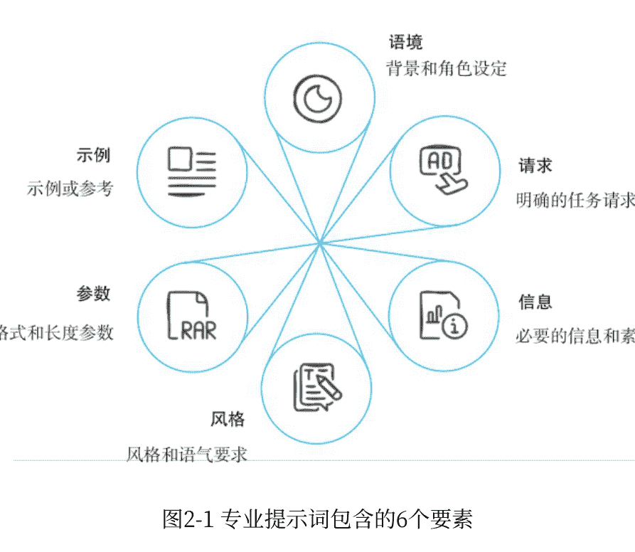

- C (context)：语境——背景和角色设定。
- R (request)：请求——明确的任务请求。
- I (information)：信息——必要的信息和素材。
- S (style)：风格——风格和语气要求。
- P (parameters)：参数——格式和长度参数。
- E (examples)：示例——示例或参考。

王睿解释道：“大多数人在利用AI写作时效果不佳，是因为他们的提示词太过简单，比如‘给我写一篇美妆文章’。这就像告诉一名员工‘做一份好的PPT’一样，没有足够的指导和背景信息。”

### 2.提示词结构与模板：快速提升输出质量

为了帮助张文杰快速入门，王睿推荐了一个基础但高效的提示词结构和专属模板库——五段式提示词模板。

- (1) 角色设定：定义AI应该扮演的专业角色。
- (2) 任务描述：明确具体的创作任务和目标。
- (3) 内容要求：详细说明内容的格式、结构和重点。
- (4) 风格指导：指定写作风格、语气和表达方式。
- (5) 其他约束：任何特殊要求或限制。

基于五段式提示词模板，下面给出基础模板示例和自媒体写作必备模板。

(1) 基础模板示例。

请以[专业角色]的身份,为我创作一篇关于[主题]的[内容类型]。

内容需要包括:

- [要点一]。
- [要点二]。

风格要求:[描述期望的语言风格、情感基调和表达方式]。

其他要求:[字数限制/特殊格式/适用人群等]。

张文杰第一次使用这个模板时的示例:

请以资深美妆测评师的身份,为我创作一篇关于“初学者如何选择适合自己的粉底液”的产品导购文章。

内容需要包括:

- 不同肤质应该选择什么类型的粉底液。
- 如何判断粉底液的遮瑕力和持久度。
- 适合新手的4～5款平价粉底液推荐及优缺点分析。
- 粉底液的正确使用方法和注意事项。

风格要求:专业但不晦涩,朋友般亲切的语气,适当使用比喻,让概念更容易理解。

其他要求:800～1 000字,面向美妆初学者,需包含引言和总结部分。

（2）自媒体写作必备模板。

1）爆款标题生成器。

请以资深标题党的身份,为文章主题“[主题]”生成10个吸引点击的标题,要求:

- 包含数字、问号、悬念或情绪触发词。
- 生成长度适中的标题,易于在手机端完整显示。
- 针对[目标人群]的痛点和需求。
- 在每个标题后简述其吸引力来源。
- 最后推荐最适合的3个标题。
- 考虑最新的社交媒体算法偏好。

2) 内容结构优化器。

请作为内容结构专家,分析我的文章大纲,并提供以下优化:

- 检查逻辑流程是否顺畅。
- 建议添加的小标题或内容块。
- 推荐黄金结构排序。
- 分配每部分的建议字数。
- 给出开头和结尾的强化建议。
- 增加读者留存的互动设计。

> 【实战技巧】王睿向张文杰推荐了一本极具实用价值的图书——《DeepSeek全场景应用》。他建议张文杰参考书中的方法，着手建立一套属于自己的提示词模板库：将每次成功应用的提示词进行整理保存，并按照不同内容类型进行分类管理，逐步积累，最终形成个人独有的“提示词资产”，以提升未来在各类应用场景中的效率与创造力。

在实践中，张文杰将模板系统化整理并保存在Notion中，每次创作时灵活调用，不仅思路更加清晰流畅，创作效率也提升了5倍，彻底打开了通向高效创作的大门。

### 3.专业创作者的高级提示词技巧

随着张文杰对DeepSeek的熟悉度提升，王睿向他介绍了几种编写高级提示词的技巧，这些技巧能够大幅提升AI写作的质量和效率。

(1) 技巧一：角色链提示法。通过设定多层专业角色，引导AI从不同视角思考问题。

请你首先作为[角色1]来提供[主题]的初步内容,然后切换为[角色2]对内容进行优化,最后以[角色3]的视角进行最终审核和改进。

[角色1]需要关注:[关注点1]。

[角色2]需要关注:[关注点2]。

【实例】

请你首先作为专业美妆编辑来提供“夏季防晒产品选购指南”的初步内容,然后切换为皮肤科医生对内容进行专业知识补充,最后以普通消费者的视角进行实用性审核和改进。

(2) 技巧二：递进式创作法。分阶段逐步完善内容，而非一次性生成全部内容。

- 1) 框架阶段：生成详细大纲。
- 2) 内容阶段：基于大纲填充具体内容。
- 3) 优化阶段：针对性修改和完善。

【实例】

阶段1:请为我创建一个关于“如何建立个人品牌”的详细内容大纲,包含引言、3～5个主要部分和结论。

阶段2:基于刚才的大纲,请详细展开第二部分“个人品牌的核心要素”的内容,包含具体例子和实操建议。

阶段3:请优化上述内容,重点增强以下几方面:更生动的例子、更具体的行动步骤、更有感染力的语言。

（3）技巧三：反向提示法。不仅告诉AI应该做什么，也明确告诉它不应该做什么。

请创作[内容描述],需要做到:

- [要做的事项1]。
- [要做的事项2]。

请避免以下问题:

- [要避免的问题1]。
- [要避免的问题2]。

【实例】

请创作一篇关于“数字营销入门指南”的博客文章,需要做到:

- 内容通俗易懂,适合营销新手理解。
- 包含具体可行的入门级实践步骤。
- 结构清晰,逻辑流畅。
- 融入最新的AI营销工具应用案例。

请避免以下问题:

- 使用过多专业术语而不加以解释。
- 内容过于理论化,缺乏实际操作指导。
- 建议步骤过于复杂或需要高成本投入。
- 引用已过时的营销策略和工具。
- 忽视数据隐私和伦理考量。

【实战收获】张文杰指出，反向提示法是他最常用的技巧之一。告诉AI不要做什么，往往比告诉它要做什么更有效。这就像在生活中，明确的边界比模糊的指导更容易遵循。AI大模型虽然很强大，但仍需要清晰的约束指导。

### 4.进阶：多轮对话与内容精雕技术

随着张文杰技能的提升，王睿向他介绍了如何通过多轮对话，进一步提升内容质量的技巧。图2-2展示了多轮对话的核心原则。

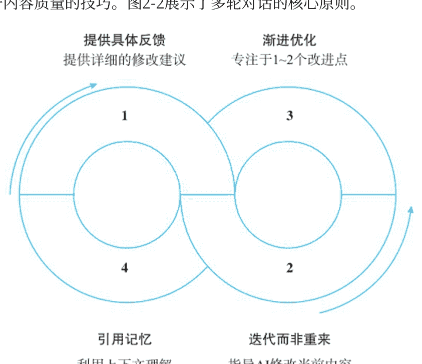

#### 图2-2 多轮对话的核心原则

1. 提供具体反馈：给出具体的修改建议而非笼统的“不满意”。
2. 迭代而非重来：不满意时不要重新开始，而是指导AI修改当前内容。
3. 渐进优化：每轮对话都聚焦于1～2个改进点，而非全面修改。
4. 引用记忆：很多大模型已允许引用之前的对话内容，充分利用上下文理解。

在多轮对话中，对内容可以进行精雕，具体流程如表2-1所示。

| 阶段 | 目标 | 提示词示例 |
| :--- | :--- | :--- |
| 初稿生成 | 创建基础内容 | 请创建一篇关于［主题］的初稿…… |
| 结构优化 | 改进内容组织和逻辑 | 请审查上述内容的结构，确保各部分之间有合理的转换和连接…… |
| 专业深化 | 增加专业深度和信服力 | 请在保持通俗易懂的前提下，增加一些专业观点或最新研究数据来支撑论点…… |
| 语言润色 | 提升表达的生动性和吸引力 | 请润色上述内容，使用更生动的描述和更具画面感的表达…… |
| 互动设计 | 提高读者的参与度 | 请在适当的位置添加提问、互动元素和引导评论的内容…… |
| 最终校对 | 确保内容准确无误 | 请检查上述内容是否存在事实错误、逻辑矛盾或表达不清的地方…… |

#### 表2-1 内容精雕流程

【实战案例】张文杰的一个真实多轮优化过程如下。

第一轮：初稿生成（略）。

第二轮：结构优化。

我觉得这篇文章的结构需要调整。引言部分太长，占了近1/3的内容，主体部分反而不够充分。请缩减引言至占全文的15%左右，并加强第二部分和第三部分的内容深度。同时，各部分之间的过渡不够自然，请优化各段落之间的连接。尤其是将第三部分与第四部分的内容融合得更加自然。

第三轮：专业深化。

内容整体不错，但缺乏专业深度和数据支持。请在第二部分增加1～2个来自2025年第三季度的权威研究数据点，以支撑主要论点。同时，在第四部分增加一个简短的案例分析，展示某品牌如何成功应用这些策略的实际应用场景。请确保新增内容与整体风格保持一致，并添加适当的数据来源说明。

第四轮：语言润色。

请对全文进行语言润色，主要关注以下几点：

- 将一些被动语态改为主动语态，增强文章的力量感。
- 减少重复的过渡词，如“此外”“同时”等。
- 为抽象概念增加具体的比喻或类比，使其更容易理解。
- 优化标题和小标题，使其更具吸引力和信息量。
- 增加2～3处情感共鸣点，增强读者的连接感。

第五轮：互动设计。

请在文章的适当位置添加以下互动元素：

- 在开头部分增加一个引人思考的问题。
- 在第二部分结束时，添加一个简短的读者调查。
- 在第三部分加入“你是否有过类似经历？”的互动提问。
- 在结尾处设计一个简单的行动邀请。
- 考虑添加1～2处“划重点”或“小提示”以突出展示的内容。

> 【核心启示】王睿强调，AI写作的本质是人机协作而非完全替代。将AI视为你的“第一轮草稿助手”，而非“最终内容制造机”。内容创作者最强大的能力是指导AI创造符合人类需求的内容，而非被动接收AI的输出。最好的内容永远来自AI初稿+人类智慧的结合。

### 5. 新手起步与爆款内容复制

(1) 零基础入门指南。对于完全没有写作经验的新手，张文杰总结了简化的入门路径。

1) 入门三步法：

- 选择单一工具：先专注DeepSeek，熟练后再尝试使用其他工具。
- 从短内容开始：先写200字短文，再逐渐增加到1000字。
- 模仿成功案例：复制爆款结构，替换主题和案例。

2) 常见障碍与解决方案：

- 不知道写什么：用AI生成10个选题，选择其中最有感觉的一个选题。
- 写不出专业内容：让AI提供专业知识点，自己组织语言。
- 担心质量不够好：用“请评价并修改这篇文章”获取反馈。
- 不敢发布：从匿名平台开始，积累信心后再用真实身份。

3) 必备平台账号：

- 微信公众号：需要身份认证，可选择个人或企业类型。
- 小红书：手机号注册即可，对新手友好。
- 今日头条：需完成实名认证，有创作者激励计划。
- 知乎：专业问答社区，需填写个人介绍以建立可信度。
- 视频号：微信生态短视频，变现渠道丰富。
- 抖音/快手：主流短视频平台，流量基础大。

(2) 爆款内容解构与复制。与其凭空创作，不如学习市场上已被验证的爆款内容。王睿教给张文杰一种爆款内容反向工程的方法。

1) 爆款解构四步法：

- 结构分析：拆解爆款内容的标题、开头、主体、结尾。
- 模式识别：找出常见的表达方式、故事结构和情感触发点。
- 框架提取：将分析结果转化为可复用的内容框架。
- 个性化重构：在相同框架下，融入自己的专业知识和个人经历。

2) 实操示例。张文杰发现《零基础小白如何靠AI月收入5000元的真实经历》这篇文章获得了10万多的阅读量，他用以下提示词进行解构：

请分析这篇爆款文章《零基础小白如何靠AI月收入5000元的真实经历》，提取以下要素：

- 标题结构和吸引点（为什么这个标题在当前仍然有效）。
- 开头的故事设置和悬念设计（分析其情感触发机制）。
- 主体内容的组织方式和关键主张（明确其论证结构）。
- 情感触发点和共鸣设计（识别读者心理需求的满足点）。
- 召唤行动的方式和激励手段（分析转化机制）。
- 当前内容环境下的差异化竞争点。

根据以上分析，创建一个我可以复用的内容模板，并注明如何针对不同主题进行调整。

通过这种方法，张文杰开始能够系统地创造出更有吸引力的内容，而不是盲目尝试。

## 二、10倍内容产出法：2小时生成10篇高质量文章

### 1. 内容批量生产的思维转变

传统创作者通常以“一稿一创作”的方式工作，而AI时代的高效创作者则采用“批量内容生产”的思维模式。表2-2展示了传统创作与批量创作两种思维的对比情况。

| 对比内容 | 传统创作思维 | 批量创作思维 | 效率差距 |
| :--- | :--- | :--- | :--- |
| 创作单位 | 单篇内容 | 内容系列/矩阵 | 5～8倍 |
| 时间分配 | 均匀分布于每篇文章 | 前期集中规划，执行时间压缩 | 3～5倍 |
| 创意方式 | 逐篇独立构思 | 系统化主题拓展 | 6～10倍 |
| 资源利用 | 每次从零开始 | 模板化，资源复用 | 5～8倍 |
| 工具应用 | 辅助性使用AI | 全流程AI优化 | 8～15倍 |

表2-2 传统创作与批量创作思维对比

> 王睿解释道：“传统创作者花费80%的时间在写作上，20%的时间在规划上。而高效的AI创作者恰好相反——花费80%的时间在系统规划上，20%的时间在执行上。目前许多AI大模型已经能够理解复杂指令，这使得高效创作者可以在1小时内创作10篇高质量文章。”

### 2. 内容批量生产的四步系统

在张文杰的学习过程中，王睿介绍了他总结的“内容批量生产四步系统”。

(1) 步骤一：主题矩阵规划。创建主题矩阵，实现系统化内容覆盖（见图2-3）。

图2-3 创建主题矩阵的流程

1) 确定核心主题：选择1个核心内容领域。
2) 拓展子主题：从核心主题延伸出4～6个相关的子主题。
3) 细分内容点：为每个子主题设计3～5个具体的内容点。
4) 受众匹配：为每个内容点确定目标受众和价值主张。
5) 平台适配：规划内容如何在不同平台上调整和呈现。

【示例】张文杰的美妆内容矩阵。

- 核心主题：初学者AI美妆指南。
- 子主题：AI护肤分析、智能底妆技巧、数字化眼妆设计、个性化唇妆推荐、智能美妆工具。
- 内容点（以“智能底妆技巧”为例）：
  - 使用AI肤色分析选择最适合的粉底。
  - 展示AR虚拟试妆的真实效果与实际应用。
  - 给出当前智能遮瑕产品测评与使用技巧。
  - 进行AI定制的底妆产品性价比分析。
- 受众匹配：Z世代美妆爱好者、25～35岁的科技体验者、有精准美妆需求的职场女性。
- 平台适配：
  - 小红书：视觉化呈现，强调使用过程和效果对比。
  - 公众号：深度分析，加入科技原理解释。
  - 视频号：流程展示，突出操作要点。

(2) 步骤二：批量提示词模板设计。设计统一格式的提示词模板，实现内容的一致性和高效生产。

请以专业AI美妆顾问的身份，创作一篇关于“[具体内容点]”的详细指南，面向当前的美妆科技初学者。

文章需要包含：

- 引人入胜的开场白，说明AI技术如何改变这一美妆领域。
- 基础知识解析，包括核心概念和技术原理。
- 3～5个实用技巧或步骤，每个步骤配有具体解释。
- 常见错误和解决方案。
- 产品推荐，包括平价和中高端选项，注明AI功能差异。
- 总结和下一步的建议。

风格要求：科技感与时尚感并重，既体现专业性又保持亲和力，使用适度的AI术语并提供通俗解释。

字数：800～1200字。

调性：前沿、实用、科技感。

特别要点：融入1～2个当前的美妆科技趋势。

(3) 步骤三：批量执行与内容生成。利用AI高效执行内容生成。

1) 创建执行清单：列出所有需要创建的内容。
2) 采用时间块工作法：分配2～3小时的专注时间块。
3) 并行操作：同时打开多个AI会话窗口。
4) 流水线操作：使用准备好的模板批量生成内容。
5) 进行简单人工优化：快速审查内容，进行必要的个性化调整。

张文杰的批量创作时间分配如表2-3所示。

| 阶段 | 时间分配 | 具体活动 |
| :--- | :--- | :--- |
| 准备阶段 | 20分钟 | 主题矩阵规划，提示词模板准备 |
| 执行阶段 | 30分钟 | 批量内容生成（10篇文章初稿，并行处理） |
| 优化阶段 | 10分钟 | 快速审查，个性化调整 |
| 总计 | 60分钟 | 10篇成品内容 |

表2-3 批量创作时间分配

(4) 步骤四：系统性存储与管理。建立内容资产管理系统。

1) 云端存储：使用Notion或飞书进行分类管理。
2) 元数据标记：为每篇内容添加主题、平台、目标受众等标签。
3) 版本控制：保留内容的不同版本和修改记录。
4) 内容资产库：将创建的内容视为可重复使用的资产。
5) 更新计划：设定定期更新和优化的时间表。
6) 自动化工具：使用AI助手定期提醒内容更新。

> 【实战成果】张文杰指出：“使用这个系统后，我的内容创作效率提升了15倍。过去写一篇1000字的文章需要2小时，现在1小时可以创作10篇高质量的文章。现在的AI模型与两年前相比，理解能力和创作质量都有质的飞跃，关键在于系统化思维取代了零散创作。”

### 3. 内容框架库：写作效率的倍增器

在掌握了批量创作系统后，王睿向张文杰介绍了另一个提高效率的秘密武器——内容框架库。

(1) 内容框架库的定义。预先设计好的内容结构模板集合，针对不同内容类型，可以直接套用。

(2) 内容框架库是大幅提升效率的关键所在。

- 减少决策疲劳：不需要每次都思考内容结构。
- 确保内容的完整性：预设框架能够确保关键点不会被遗漏。
- 保证标准化质量：保证所有内容达到一致的质量标准。
- 加速创作过程：将“想写什么”和“如何组织”分离。
- 优化AI输出：提供结构化指导，使AI输出更有条理。

(3) 六大高转化内容框架示例。

1) 问题-解决框架。

- 引言：提出读者面临的问题。
- 问题深化：详述问题的影响和紧迫性（添加数据支持）。
- 解决方案概述：提供解决思路（强调创新性）。
- 详细步骤：具体解决方法的步骤（包含AI工具应用）。
- 效果展示：解决后的效果或案例（具体数据对比）。
- 常见问题：可能遇到的障碍及应对方法。
- 行动号召：鼓励读者采取行动。

2) 列表框架。

- 引言：介绍主题重要性及时代背景。
- 列表前提：为什么需要这个列表（变化催生的需求）。
- 项目1～7：详细展开每个列表项（每项包含原理+实践+案例）。
- 优先级建议：如何从列表中选择起点（个性化的选择指南）。
- 工具推荐：辅助实现的数字工具和AI助手。
- 总结：重申列表价值并展望未来发展。

3) 对比框架。

- 引言：介绍需要对比的选项及决策背景。
- 评估标准：明确对比的关键维度和权重。
- 选项A详解：特点、优势、劣势、适用场景。
- 选项B详解：特点、优势、劣势、适用场景。
- 对比表格：关键维度的直观数据对比。
- 真实用户反馈：不同选择的用户体验分享。
- 未来发展趋势：各选项的发展路径分析。
- 决策辅助工具：帮助读者根据自身情况选择。
- 结论与建议。

4) 案例分析框架。

- 背景介绍：案例主角或企业所处的行业环境。
- 挑战描述：面临的具体问题或困境（可量化的挑战）。
- 目标设定：期望达成的明确目标（具体数字）。
- 策略制定：解决方案的设计思路。
- 实施过程：行动步骤和关键决策点。
- 结果评估：取得的成效（数据对比）。
- 经验教训：成功因素和应避免的陷阱。
- 可复制要素：读者可借鉴的关键启示。

5) 教程框架。

- 目标说明：将要学习的技能和价值（与当前趋势相关联）。
- 前提条件：需要的基础知识、工具和资源。
- 概念解析：核心概念和原理的简明解释。
- 步骤1～5：详细的操作指导（每步配图或视频建议）。
- 常见错误：易犯错误及防范措施。
- 进阶技巧：掌握基础后的提升建议。
- 实践任务：读者可尝试3个级别的练习。
- 资源推荐：进一步学习的工具和渠道。

6) 测评框架。

- 市场定位：产品或服务的基本介绍及目标用户。
- 测评标准：测评维度及权重设定。
- 外观设计：视觉呈现及用户体验。
- 功能测评：核心功能及性能测试。
- 用户体验：实际场景应用感受。
- 价格分析：成本效益比及市场定位。
- 优势亮点：最突出的差异化价值。
- 不足改进：有待提升的方面。
- 同类对比：与主要竞品的优劣比较。
- 适用人群：最适合哪类人使用。
- 总体评分：多维度综合评价。

(4) 如何建立个人内容框架库。

1) 收集阶段：分析行业优质内容，提取其结构框架。
2) 分类阶段：按内容类型和目标整理框架。
3) 优化阶段：根据读者反馈调整和完善框架。
4) 模板化阶段：将框架转化为提示词模板。
5) 测试完善：实际应用并持续迭代优化。

> 【张文杰的实践】“我为每个内容框架都创建了专门的提示词模板，将它们保存在飞书中。现在创作新内容时，只需选择适合的框架，填入特定主题信息，就能快速生成结构完善的内容。这大大减轻了我的创作压力。”

### 4. 高效批量创作的实操流程

为了具体展示如何在实践中应用批量创作系统，王睿与张文杰一起执行了一次完整的批量创作流程：1小时创作10篇夏季护肤文章（见图2-4）。

图2-4 1小时创作10篇夏季护肤文章

(1) 第1步：主题矩阵规划（15分钟）。

1) 核心主题：2025年夏季智能护肤指南。
2) 子主题规划。
  - 夏季肌肤科技检测（智能皮肤分析仪的应用）。
  - 智能调温护肤设备（新型保湿科技）。
  - 防晒新科技（纳米防晒与环保趋势）。
  - AI个性化护肤配方（定制化护肤方案）。
  - 环保可持续护肤（生物科技与环保相结合）。

3) 内容点展开（以“防晒新科技”为例）。

- 新型纳米防晒技术解析（全光谱防晒原理）。
- 智能提醒防晒设备测评（可穿戴防晒监测器）。
- 环保防晒的科学进展（珊瑚友好配方创新）。
- 室内蓝光防护解决方案（数字设备防护）。

(2) 第2步：框架选择与提示词准备（10分钟）。选择“测评框架”，设计统一的提示词模板。

请以未来科技美容顾问的身份，创作一篇关于“[具体内容点]”的2025年最新测评文章，面向科技爱好者和护肤初学者。

文章需要遵循以下测评框架：

- 市场背景：简述该技术/产品的发展背景和市场定位（100字）。
- 核心科技：解析其背后的科学原理和创新点（150字）。
- 产品测评：详细测试2～3款代表性产品的效果与体验（250字）。
- 使用建议：阐述针对不同肤质/场景的实用技巧（150字）。
- 价格分析：给出性价比评估和购买建议（100字）。
- 未来展望：分析该技术未来6～12个月的发展趋势（100字）。

风格要求：专业中带有科技感，使用适度的专业术语并提供通俗解释，保持客观性的同时给出明确观点。

字数：800～1000字，确保内容既有前沿性又有实用性。

特别要求：融入1～2个真实数据点或研究结果，增强信服力。

(3) 第3步：批量内容生成（25分钟）。使用提示词模板，批量生成10篇文章。

1) 同时打开3个AI会话窗口（例如可以同时打开3个DeepSeek窗口，或者同时打开DeepSeek、豆包、腾讯元宝等不同大模型窗口），并行处理不同内容。
2) 使用预设模板，只替换“具体内容点”部分。
3) 第一批内容生成时，准备下一批的提示词。
4) 将生成的内容复制到统一的文档中，标记标题和分类。

> 【张文杰的实际操作】“我同时打开了3个DeepSeek会话窗口，填入不同的主题提示词。当第一个窗口生成内容时，我已经在第二个窗口输入了下一个提示词。这种并行工作方式将内容生成速度提高了近2倍。”

(4) 第4步：内容优化与完善（10分钟）。针对生成的10篇文章进行快速优化。

1) 使用DeepSeek或者豆包等AI工具批量优化标题，增强吸引力。
2) 统一添加适合各平台的互动引导语。
3) 为每篇文章增加1～2个个性化的元素。
4) 用AI检查内容的事实准确性和时效性。

【优化技巧】张文杰发现，使用“请以资深编辑的身份，审阅并优化这10篇文章的标题和开场部分，使其更符合当前读者的口味，同时保持一致的品牌调性”这样的提示词，可以高效地提升内容质量。

【最终成果】生成了10篇结构完善、内容专业、风格统一的护肤科技指南文章，总计约9000字，实际生产时间为60分钟。

### 5. 多平台内容适配与改编策略

每个平台都有其独特的用户群体和内容偏好，张文杰学会了如何将同一内容改编为适用于不同平台的版本，进一步提升了内容产出效率（见表2-4）。

| 平台 | 内容特点 | 改编重点 | 转化提示词 |
| :--- | :--- | :--- | :--- |
| 知乎 | 专业深度，逻辑性强 | 增加专业深度和数据支持 | 请将此内容调整为当前知乎的风格，增加更多的专业观点和最新的研究数据，加强论证的逻辑性，同时保留核心观点 |
| 小红书 | 轻量实用，图文结合 | 简化表达，增加互动性 | 请将此内容改编为当前小红书的风格，分解为九宫格结构，简化专业术语，增加情感共鸣点和互动话题，加入emoji表情 |
| 微信公众号 | 深度阅读，系统性 | 增加内容完整性和逻辑性 | 请将此内容扩展为微信公众号文章，丰富内容层次，增加适当的案例和数据支持，保持专业性的同时提高可读性 |
| 视频号脚本 | 视频化，场景展示 | 转化为视频脚本格式 | 请将此内容改编为2～3分钟的视频号脚本，强调视觉化呈现，设计引人入胜的开场和有力的结尾，分镜头呈现主要内容 |
| 抖音脚本 | 精简直接，重点突出 | 转化为抖音视频脚本 | 请将此内容改编为60秒的抖音视频脚本，突出2～3个核心观点，设计吸引眼球的开场和互动式的结尾，节奏紧凑有力 |

表2-4 一次创作，多平台发布策略

下面以张文杰如何将一篇“2025年智能防晒科技”的文章转化为不同平台的内容为例，详细说明“一次创作，多平台发布策略”。

（1）原始内容：一篇1000字的标准测评文章（略）。

（2）知乎版改编提示词：

请将这篇“2025年智能防晒科技”的文章调整为知乎专业回答风格，需要：

- 增加更多专业技术解析（如纳米材料、智能感应原理等）。
- 引用2～3个2025年第三季度的科研成果或市场研究数据。
- 增加对不同技术路线的比较分析。
- 加入个人专业判断和前瞻性观点。
- 提供更深入的行业发展脉络分析。
- 保持逻辑性和专业深度，但确保非专业读者也能理解。
- 增加对争议性问题的讨论，引发读者思考。

（3）小红书版改编提示词：

请将这篇“2025年智能防晒科技”的文章改编为小红书风格的笔记，需要：

- 设计吸引人的标题（含emoji表情）和九宫格结构。
- 第一张封面设计为高质量封面，突出“2025年最新科技”的概念。
- 简化为5个核心亮点，每个亮点内容不超过100字。
- 使用更活泼的语气和表情符号。
- 增加个人体验感受和情感表达。
- 添加2～3处“姐妹们”以引导互动提问。
- 设计时尚感强的图片和文字搭配建议。
- 总字数控制在600字以内，突出视觉传达效果。

（4）视频号脚本版改编提示词：

请将这篇“2025年智能防晒科技”的文章改编为2分钟的视频号脚本，需要：

- 设计引人注目的5秒开场白。
- 将内容分为3个核心板块，每个板块40秒左右。
- 为每个场景设计具体的视觉呈现建议。
- 加入产品实际演示环节的描述。
- 设计对比展示的场景（传统与新科技）。
- 增加与观众的互动环节。
- 设计有力的结尾和下集预告。
- 标注脚本时间轴、画面描述和旁白文字。

（5）抖音脚本版改编提示词：

请将这篇“2025年智能防晒科技”的文章改编为60秒的抖音视频脚本，需要：

- 创建震撼的开场（前5秒，可考虑使用惊讶反差）。
- 只保留3个最惊艳的技术亮点。
- 用简洁直接的语言与视觉概念表达亮点（每个亮点15秒）。
- 设计一个引发讨论的争议性问题。
- 包含产品展示和效果对比的画面描述。
- 增加一个有力的总结和互动号召（最后10秒）。
- 使用活泼、有能量的语气，适合快节奏呈现。
- 标注具体的画面转场和特效建议。

【实战成果】张文杰发现，使用这种改编策略，他可以由一篇原始文章快速生成适用于5个不同平台的版本，每个版本的改编仅需2～3分钟。现在的大模型对各平台特性的理解更加深入，能轻松完成不同平台风格的转换。这使他能够在不增加创作压力的情况下，大幅扩展内容发布范围，实现“一次创作，多平台变现”。

## 三、从创作技能到变现能力：AI内容创作的商业模式

### 1. 入门变现：如何获得第一笔付费内容订单

张文杰最关心的问题是如何快速获得第一笔付费内容订单。王睿分享了他的“零经验接单四步法”。

（1）步骤一：确定内容服务定位（见图2-5）。

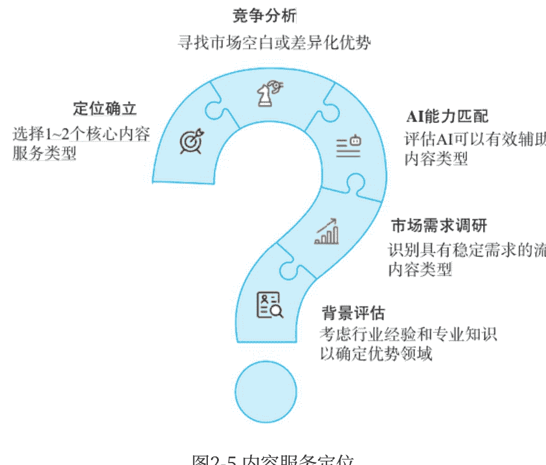

图2-5 内容服务定位

1）背景评估：分析自己的行业经验、专业知识、兴趣领域。
2）市场需求调研：确定哪些内容类型有稳定的市场需求。
3）AI能力匹配：评估哪类内容使用AI辅助的效果最佳。
4）竞争分析：寻找市场空白或自己的差异化优势。
5）定位确立：确定1～2个核心内容服务类型。

> 【张文杰的定位过程】 “我有电商编辑背景，对美妆和生活用品行业比较熟悉。市场调研发现，电商平台对产品描述和软文有持续需求，而AI特别擅长处理产品介绍类内容。综合考虑后，我将初期服务定位为‘AI美妆科技内容专家’，主攻‘电商产品文案’和‘美妆科技测评’两个方向。”

（2）步骤二：创建内容作品集（见图2-6）。

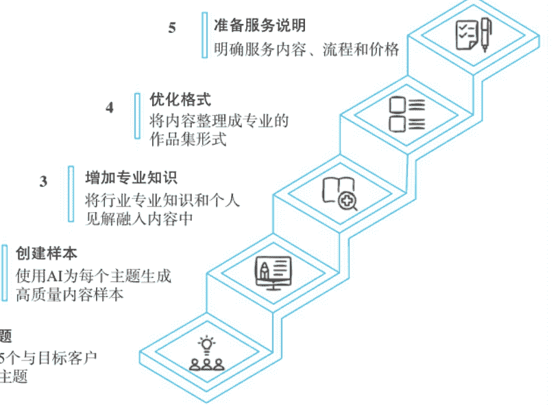

图2-6 创建内容作品集

1）选择主题：选择3～5个与目标客户相关的主题。
2）创建样本：使用AI为每个主题创建1～2个高质量的内容样本。
3）增加专业知识：加入行业专业知识和个人见解。
4）优化格式：整理为专业的作品集形式。
5）准备服务说明：明确服务内容、流程、价格等信息。

> 【张文杰的实操经验】 “我使用DeepSeek创建了8个内容样本：2个护肤品产品详情页文案、2个美妆科技测评、2个美妆趋势分析和2个AI美妆工具教程。每个样本我都精心优化，确保展现我的专业能力。我还准备了一份简单的服务介绍，包括我能提供的具体服务内容和初步定价。与2024年相比，现在的客户对AI辅助创作的接受度高了很多，但对内容的原创观点和专业深度的要求也更高。”

（3）步骤三：寻找潜在客户。通过多渠道寻找第一批客户（见图2-7）。

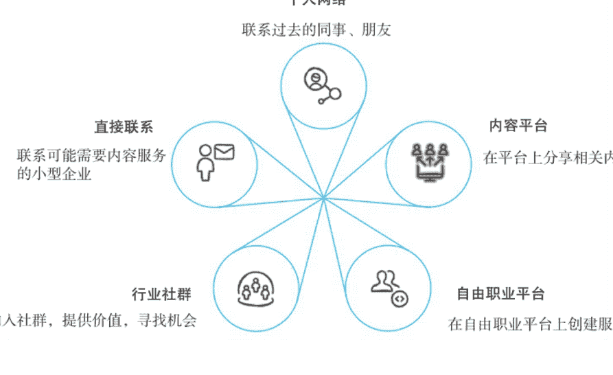

图2-7 多渠道寻找第一批客户

1）个人网络：联系过去的同事、朋友，寻找潜在合作机会。
2）内容平台：在知乎、小红书等平台上分享相关内容，吸引潜在客户。
3）自由职业平台：在猪八戒网、Fiverr等平台上创建服务。
4）行业社群：加入相关行业社群，提供价值并寻找机会。
5）直接联系：主动联系可能需要内容服务的小型企业。

> 【张文杰的获客路径】“我尝试了多种方式，最终获得的前两个客户来自不同的渠道：第一个客户是通过‘美妆AI创新’微信群中我分享的一篇测评文章吸引来的一个小品牌；第二个客户是看到我在小红书发布的‘AI美妆工具对比’笔记后主动联系我的一个品牌方。当前的获客模式已经从主动出击变为价值吸引，优质内容是最好的名片。”

（4）步骤四：完成首单并请求推荐（见图2-8）。

1）超额交付：为首个客户提供超出预期的服务质量。
2）及时沟通：保持良好的沟通，及时调整以满足客户需求。
3）数据支持：提供内容效果数据，强化专业形象。
4）反馈获取：完成后主动获取具体反馈。
5）推荐请求：如果客户满意，主动请求推荐或口碑相传。
6）服务优化：根据首单经验，调整和优化服务内容和流程。

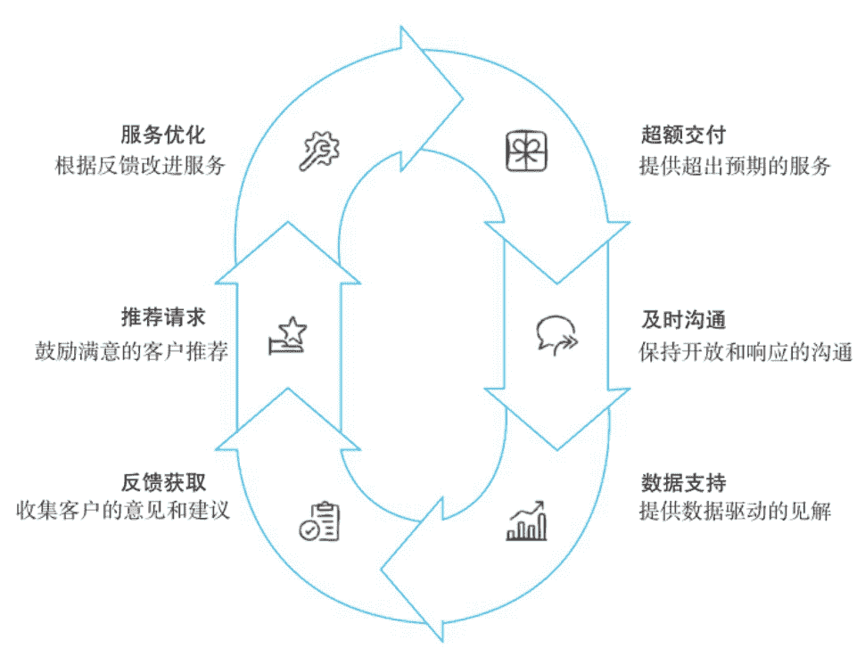

图2-8 完成首单并请求推荐

> 【张文杰的第一单经历】“我的第一单是为一个新兴美妆科技品牌写6篇产品介绍文案，报价1200元。我使用DeepSeek创建了初稿，然后融入我对美妆行业的专业知识和对目标受众的理解，进行了个性化调整。客户对最终结果非常满意，不仅全额支付了费用，还追加了2篇社交媒体文案的订单（600元）。更重要的是，他们在行业群里分享了我的服务，这让我在两周内又接到了2个新客户的订单。现在内容市场非常注重口碑传播，一个满意的客户可以带来持续的订单流。”

> 【实战心得】王睿强调：“获得第一个客户是最困难的，但一旦有了成功案例和口碑，后续获客就会变得容易很多。在现在的市场环境下，纯粹依靠AI生成内容的服务已经很难脱颖而出，关键是如何将AI能力与个人专业洞见结合，创造真正的差异化价值。专注于解决特定客户群体的具体内容问题，而不是尝试为所有人提供所有服务。”

### 2. 进阶变现：构建个人AI内容创作品牌

在张文杰成功接到几笔订单后，王睿开始引导他思考如何从单纯的服务提供者升级为拥有个人品牌的品牌创建者。从服务提供者升级为品牌创建者的四步进阶路径如下。

（1）阶段一：专业定位与差异化（第1个月）。

1）确定核心专长：通过广泛尝试找到自己的最佳领域。
2）建立专业定位：明确自己解决的具体内容问题。
3）创造差异化优势：开发独特的内容创作方法或风格。
4）固定服务流程：建立标准化的服务流程和交付标准。
5）建立品牌标识：设计个人Logo、色彩系统和视觉风格。

> 【张文杰的专业定位】“经过6周的尝试，我发现自己在‘将复杂的美妆科技概念转化为大众化内容’方面特别有优势。我将自己定位为‘美妆科技翻译官’，专注于帮助新兴美妆科技品牌将创新技术转化为消费者容易理解并产生购买欲望的内容。这个定位现在特别有市场，因为美妆行业正经历着前所未有的科技革新，但多数消费者对新技术存在理解障碍。”

（2）阶段二：内容矩阵与个人IP（第2～3个月）。

1）建立内容发布阵地：选择1～2个核心平台持续输出。
2）设计内容矩阵：规划系统化的内容主题和系列。
3）形成个人风格：培养独特的表达方式和内容特色。
4）建立品牌标签：创造专属话题和标签体系。
5）积累粉丝基础：通过高质量内容吸引初步关注者。
6）开发品牌声音：统一各平台的沟通风格和调性。

> 【张文杰的内容战略】“我选择小红书和视频号作为主要内容平台，以‘美妆科技翻译官’的定位创建账号。我设计了四个内容系列：‘科技美妆解码’‘未来美肤报告’‘智能美妆实验室’‘一分钟美容黑科技’。每周在小红书更新3篇内容，视频号更新2条短视频，使用腾讯元宝辅助创作基础内容，然后在其中增加个人专业解读和实际测试体验。两个月后，小红书账号积累了15000个粉丝，视频号有8000个粉丝，开始收到品牌合作邀请。当前，跨平台矩阵式运营比单平台深耕更容易突破内容创作的天花板。”

（3）阶段三：服务升级与产品化（第4～6个月）。

1）提高服务价格：基于已有口碑和案例，提升服务定价。
2）升级包装服务：将服务模式化、产品化，提高专业感。
3）开发内容产品：设计并推出初步内容产品（如电子书、指南）。
4）构建销售漏斗：采用免费内容→低价产品→高价服务的转化路径。
5）建立客户管理系统：规范客户沟通和项目管理流程。
6）构建数据分析体系：建立内容效果跟踪和优化机制。

> 【张文杰的服务升级】“随着专业度的提升，我将服务包装为三类明确的产品：‘科技美妆内容策略服务’（6000元/项）、‘美妆创新解读内容包’（3000元/5篇）和‘AI美妆内容培训’（8000元/期）。同时，我编写了一本《2025年美妆科技趋势解码手册》，定价99元，在小红书和视频号销售，首月销售187册，成为稳定的被动收入来源。在当前的内容市场，产品化思维是突破收入天花板的关键。”

（4）阶段四：规模化与系统化（6个月以后）。

1）建立个人工作室：适当扩大团队，接收更多项目。
2）开发完整的产品线：形成系统化的内容产品体系。
3）采用自动化与流程化：使创作流程更加系统化，提高效率。
4）实现多渠道变现：实现服务费、内容产品、平台分成等多重收入。
5）升级品牌合作：从执行者转变为战略合作伙伴。
6）构建社群生态：围绕专业领域建立忠实用户社群。

> 【张文杰的目标规划】“未来半年，我计划组建一个3～4人的小团队，包括1名内容助理、1名视频剪辑人员和1名客户沟通专员，将月接单量提升至20～25个项目。同时，开发一套‘美妆科技创新内容营销课程’，目标是首年销售300份，单价799元。长期目标是将月收入稳定在5万～8万元，其中40%来自服务，30%来自内容产品，20%来自平台合作，10%来自社群会员。现在的内容创业，单一收入来源已经无法抵御市场波动，必须构建多元化的收入结构。”

### 3. 打造差异化内容与个人风格

为了避免内容同质化，提高个人辨识度，张文杰综合使用了以下策略。

（1）差异化内容策略。张文杰遵循“40—40—20”法则：40%的AI基础生成内容，40%的个人专业知识，20%的个性化表达，具体方法包括：

1）融入个人经历：添加真实的个人故事和经历。

请将我的个人体验“上周尝试最新的皮肤AI分析仪，发现我被诊断为敏感肌而非之前认为的混合肌，使用针对性的产品后，皮肤状况改善了30%”融入这篇AI生成的“智能肌肤分析”文章中，使其更具真实感和说服力，同时突出AI诊断的精准性。

2）采用数据增强：添加独家调研或测试数据。

请将我对5款2025年新上市的智能防晒喷雾的实测数据（包含防水性、持久度和肤感评分表）整合到这篇文章中，增强内容的专业性和独特价值，确保数据呈现方式直观易懂。

3）进行本地化改造：添加本地特色和元素。

请将这篇通用的《AI美妆工具指南》文章改写为专门针对“中国25～35岁都市女性用户”的定制版本，考虑国内美妆消费习惯、电商平台特点和支付方式，并融入国内热门美妆KOL即关键意见领袖的常用表达方式。

4）垂直细分领域：选择小众但有热情的领域。

请将这篇关于“AI美妆工具”的文章转化为专门针对“敏感肌、痘痘肌用户的AI精准护肤方案”的垂直内容，深入讨论特殊肤质的护理难点和AI技术的精准解决方案。

5）捕捉前沿趋势：关注并解读最新趋势。

请分析2025年第四季度美妆行业出现的三大新兴技术趋势，并将这些洞察融入我的常规美妆内容，使其具有前瞻性和趋势引领感。

（2）个性化风格塑造。AI生成的内容往往缺乏个性，张文杰通过以下方法优化文风，打造个人声音。

1）风格模仿与创新：让AI模仿特定风格并添加创新元素。

请结合“李佳琦的热情感染力”和“一条视频的理性深度”两种风格特点，创造一种独特的混合风格，用这种新风格重写我的美妆科技测评文章，保持专业性的同时增强亲和力。

2）情感注入：增加情感色彩和共鸣点。

请在这篇AI美妆测评文章中注入更多“科技带来的惊喜与对美的重新定义”的情感层次，突出读者从困惑到豁然开朗的情感变化，增加3～4处情感共鸣点。

3）语言亲和力：调整为更口语化的表达。

请将这篇技术性较强的美妆科技文章，改写成闺蜜间分享秘密的轻松对话风格，但不失专业深度，增加温暖亲切感和生活化比喻，尤其是在解释复杂概念时。

4）声音定制：创建个人语言特色。

请分析我过去的15篇爆款文章，提取我的写作风格特点，并创建一个“美妆科技翻译官风格指南”，包括：

- 标志性开场白和结束语。
- 常用的过渡词和连接语。
- 解释技术概念的特有比喻体系。
- 提问和回应的互动模式。
- 专业术语与通俗表达的平衡方法。

5）视觉语言统一：创建一致的视觉表达系统。

请为我的“美妆科技翻译官”品牌设计一套统一的视觉语言指南，包括：

- 配图风格建议（科技感与温暖美感的平衡）。
- 色彩系统（主色调与辅助色）。
- 排版规则和图文比例。
- 图表和数据可视化风格。
- 品牌标识的正确使用方式。

（3）内容深度优化。单纯依靠AI生成的内容往往缺乏深度和独特价值。张文杰通过“深度提升五步法”来提升内容质量。

1）数据支撑：添加研究数据和行业报告。

请在我的《2025年美妆AI革新》文章中插入5个来自权威机构的最新数据点，包括市场规模、用户接受度、技术普及率、投资趋势和效果满意度，确保数据来源可靠且发布于2025年第二季度，并为每个数据点添加简短的解读和预测。

2）专家观点：引入权威专家的见解或自身专业判断。

请总结3位美妆科技领域专家（包括哈佛大学皮肤科学教授Sarah Johnson）对“AI个性化护肤”未来的不同观点，并融入我的专业判断——个性化解决方案将取代通用产品，但完全依赖于AI诊断仍需5年的过渡期，形成一个多维度的专业观点部分。

3）案例分析：添加详细的案例研究。

请为我的文章添加2个AI美妆科技应用的深度案例分析，一个成功案例和一个失败教训，包括背景、技术选择、实施过程、用户反馈、关键数据和经验总结，每个案例分析350字左右，突出实用洞察。

4）逻辑框架：强化内容的逻辑结构。

请检查我的《AI肌肤分析革命》文章的逻辑结构，并按照“技术背景-现状痛点-解决方案-实施方法-结果验证-未来展望”的框架重组，确保论证严密且有说服力，尤其强化“现状痛点-解决方案”的对应关系。

5）前沿思考：提供多角度思考和未来展望。

请为我的文章《AI驱动的美妆革命》添加一个“未来三年的展望”部分，从技术发展、用户体验、商业模式、伦理考量和监管趋势五个维度提供前瞻性的思考，每个维度200字左右，确保预测有理有据且具启发性。

张文杰通过这些技巧，将AI生成的内容转化为具有个人风格的优质作品，逐渐形成了独特的“美妆科技翻译官”品牌形象，粉丝能一眼认出他的内容，极大提高了品牌辨识度和市场竞争力。

### 4. 案例分享：AI内容创作者的成功故事

为了给张文杰更多启发，王睿分享了两位成功利用AI进行内容创作并在2025年实现稳定收入的创作者案例。

（1）案例一：李明，从金融分析师到AI财经KOL。

1）背景：35岁，前银行金融分析师，具备专业知识但无媒体经验。
2）转型路径：利用AI工具创建财经内容，专注于加密货币和量化投资领域。
3）技术应用：
- 使用AI分析复杂金融数据。
- 将专业分析转化为大众化内容。
- 开发AI辅助投资决策模型并分享给粉丝。
4）成长过程：
- 第1～2个月：学习阶段，月收入约2000～3000元。
- 第3～4个月：稳定接单，月收入提升至5000～10000元。
- 第5～8个月：社群起步，月收入达到20000元。
- 一年后：成立个人公司，月收入稳定在50000～100000元。
5）收入构成：
- 付费社群：40%（299元/月，800名会员）。
- 课程销售：25%（“AI辅助量化投资入门”，售价1999元）。
- 咨询服务：20%（1500元/小时，每月15～20小时）。
- 平台分成：15%（今日头条、B站和视频号）。
6）关键成功因素：将金融专业知识与AI分析能力相结合，提供普通投资者难以获取的深度洞察。

（2）案例二：张燕，教育工作者的AI课程创作帝国。

1）背景：32岁，前高中英语教师，教育经验丰富。
2）转型路径：利用AI创建教育内容和学习资料，服务于学生和家长。
3）技术应用：
- 使用AI生成个性化的学习计划和练习材料。
- 开发AI辅助批改系统。
- 创建交互式的学习内容。
4）业务模式：
- 为不同学习阶段的学生提供定制化的学习方案。
- 开发教师使用的AI辅助教学工具。
- 为家长提供AI教育资源指导。
5）成长过程：
- 起步阶段：每周发布5篇教育文章，月收入2000元。
- 成长阶段：粉丝数量突破10万后，推出付费资源，月收入10000元。
- 成熟阶段：开发完整的课程体系，月收入超过30000元。
6）产品矩阵：
- 基础产品：“AI辅助英语学习30天计划”（199元）。
- 中端产品：“高考英语AI提分系统”（999元）。
- 高端产品：“家庭AI教育顾问服务”（3999元/季）。
7）关键成功因素：将教育专业知识与AI技术无缝结合，解决学生和家长的实际痛点，形成完整的产品阶梯。

> 【共同启示】王睿总结道：“这两个案例虽然领域不同，但都遵循内容创业的成功法则：一是将AI工具与垂直领域专业知识深度融合；二是构建从免费内容到高端服务的完整商业阶梯；三是建立多元化的收入来源，不依赖单一平台或客户；四是持续学习最新的AI技术并创新应用方式。当前内容创业已经不再是简单的‘用AI写文章’，而是构建基于AI的知识服务生态系统。”

## 四、内容创作者的成长路径与IP打造

### 1. 从零开始的阶梯式成长计划

张文杰总结了自己从零到成功的阶梯式成长路径（见图2-9）。

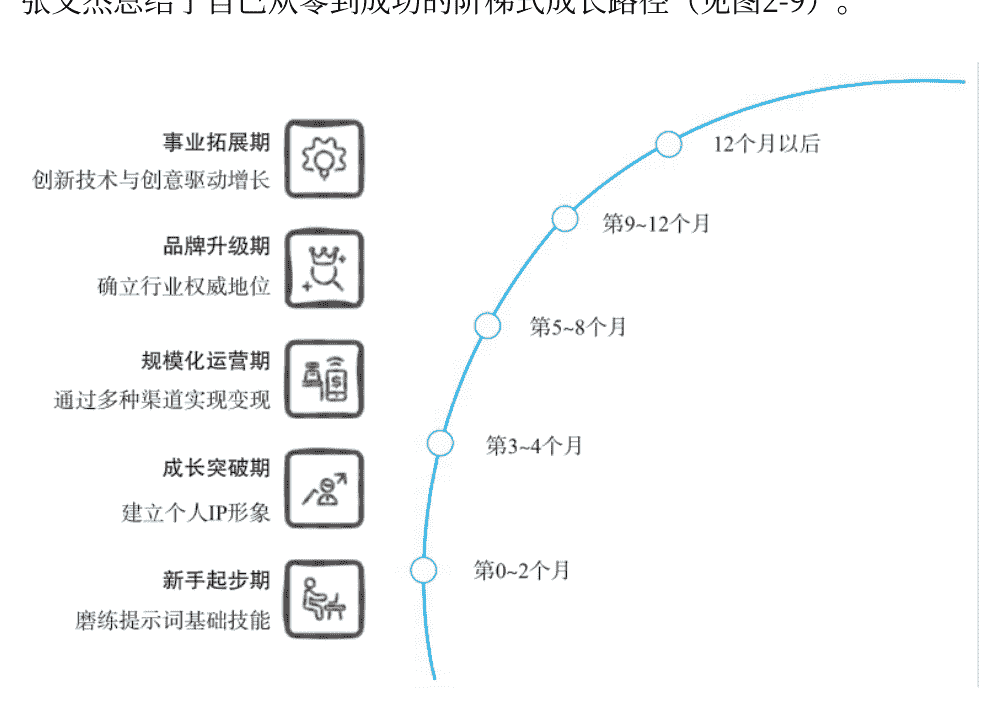

图2-9 从零到成功的阶梯式成长路径

（1）第一阶段：新手起步期（第0～2个月），打磨基本功。

- 1）核心目标：掌握工具，建立基础技能。
- 2）行动计划。
    - 工具掌握：熟练使用DeepSeek、豆包、腾讯元宝等的各项功能和高级提示词技巧，如果身在海外，可以学习掌握Chat GPT、Gemini、Grok等AI工具。
    - 平台熟悉：了解2～3个主要平台的规则和算法。
    - 内容节奏：建立稳定的创作习惯，每周至少4篇。
    - 爆款拆解：查找相关领域的爆款文章，分析爆款原因。
    - 数据分析：追踪每篇文章的表现，总结规律。
    - 流程规范：建立基础模板库和创作流程。
- 3）具体行动计划。
    - 第1周：每天练习2个DeepSeek提示词。
    - 第2周：尝试创作4种不同类型的内容。
    - 第1个月：在小红书和公众号平台各发布10篇文章。
    - 第2个月：保持每周8篇内容的稳定输出，形成初步的个人风格。

（2）第二阶段：成长突破期（第3～4个月），构建IP形象。

- 1）核心目标：建立个人特色，扩大影响力。
- 2）经过初期的积累，张文杰开始着手打造个人IP。
    - 定位明确：确立“美妆科技翻译官”的定位。
    - 视觉识别：设计统一的头像、封面和排版风格。
    - 内容矩阵：建立小红书+视频号+公众号的多平台矩阵。
    - 商业闭环：构建“免费内容→低价产品→高端服务”的转化路径。
    - 社群运营：建立“AI美妆创新社”微信社群，收集用户反馈。
    - 数据分析：建立内容表现追踪系统，优化创作方向。
- 3）关键突破点。
    - 张文杰在第3个月创作的“2025美妆黑科技完全解析”系列爆火，单月涨粉15 000个。
    - 第4个月推出付费电子教程《美妆科技革命：AI如何重塑你的美丽》，售价99元，首周销售208份。

（3）第三阶段：规模化运营期（第5～8个月），多元变现。

- 1）核心目标：系统化变现，建立可持续模式。
    - 团队搭建：招募2名兼职助手，扩大内容产量。
    - 产品矩阵：构建3层产品体系，实现多价位覆盖。
    - 知识付费：推出“AI美妆科技创新营”线上课程，定价699元。
    - 咨询服务：提供品牌方AI美妆内容策略咨询，2 000元/次。
    - 品牌合作：与美妆科技品牌合作，推广获得分成。
    - 社群经济：扩大付费社群规模，提供更多增值服务。
- 2）成果展示。
    - 第6个月，张文杰的个人IP“美妆科技翻译官”粉丝总量突破10万。
    - 第8个月，月收入结构：内容服务12 000元+课程销售8 000元+品牌合作15 000元+社群5 000元，总计40 000元。

（4）第四阶段：品牌升级期（第9～12个月），建立权威。

- 1）核心目标：从个人IP升级为行业影响力品牌。
    - 行业活动：参与和组织行业峰会，提升知名度。
    - 媒体曝光：接受专业媒体采访，分享行业洞察。
    - 合作升级：从单纯的执行者转变为品牌战略合作伙伴。
    - 内容精品化：减少数量，提升单篇内容的质量和影响力。
    - 商业模式优化：提高客单价，减少时间投入。
    - 生态构建：打造完整的“内容+工具+社群+服务”生态系统。
- 2）关键成果。
    - 第10个月，受邀在“2025全球美妆科技峰会”上发表演讲。
    - 第12个月，发布《2026美妆科技趋势报告》，获得行业广泛引用。
    - 年底月收入突破6万元，同时工作时间减少30%，实现高效增长。

（5）第五阶段：事业拓展期（12个月以后），构建“创意+技术”双引擎。这一阶段，张文杰与王睿开始深度合作，形成“创意+技术”双引擎模型。

- 张文杰（创意引擎）：负责内容创意、行业洞察和用户情感连接。
- 王睿（技术引擎）：提供AI技术优化、自动化工具和数据分析支持。
- 1）协同工作模式。
    - 王睿开发的AI内容推荐系统帮助张文杰实现内容个性化分发。
    - 张文杰的内容创作能力为王睿的技术解决方案提供易于理解的呈现方式。
    - 共同开发“AI美妆顾问”SaaS平台，服务品牌客户。
    - 建立“内容+工具+服务”的完整产品矩阵。
- 2）实际成果。
    - 联合创立公司“美妆AI实验室”，整合双方优势。
    - 开发“美妆AI助手”小程序，月活用户数超过5万。
    - 为3家国际美妆品牌提供AI内容解决方案，年合同金额超百万元。
    - 联合出版《AI美妆行业变革：2026年趋势与实践》专业书籍。

【从副业到职业的转型决策】随着副业收入超过主业收入，张文杰面临着转型决策。

（1）关键考量因素：

- 收入稳定性：副业收入已连续6个月超过主业收入，且呈上升趋势。
- 时间投入：每天需要4个多小时，已明显影响主业表现和生活平衡。
- 成长空间：当前AI写作市场呈指数级增长，品牌合作需求激增。
- 风险评估：平台算法变动风险、AI技术迭代风险、市场竞争加剧风险。
- 长期发展：AI内容创作正从个人朝团队化、专业化方向发展。

（2）实际决策：张文杰采用“渐进式转型”策略——先申请弹性工作制，每周在家办公2天，专注于内容创作，同时建立“72小时应急资金池”（覆盖3个月的生活成本）。在确认副业月收入稳定超过主业1.5倍后，申请停薪留职6个月，全力发展个人品牌。

这一精心设计的过渡期让他成功避免了“断崖式辞职”的风险，同时为全职创作者身份做好了充分准备。

### 2. 内容创作者的专业能力矩阵

在当前的AI内容创作生态中，成功的创作者需要全面提升多维创作能力。以下是成功创业者的专业能力矩阵。

（1）AI驱动创作力。

- AI提示词工程与模型选择能力。
- 多模态内容（文字、图像、音频、视频）整合。
- 内容个性化与风格调优。
- AI内容伦理与原创性把控。
- 模型训练与个人知识库建设。

（2）跨平台运营力。

- 全域内容分发与平台特性优化。
- 算法理解与内容适配。
- 数据驱动的内容决策。
- 社群建设与互动引导。
- 私域流量与订阅经济运营。

（3）商业转化力。

- 内容到产品的转化设计。
- 多层次变现模型构建。
- 品牌合作与商业谈判。
- 用户旅程与转化漏斗优化。
- 定价策略与心理学应用。

（4）技术整合力（新兴关键能力）。

- AI工具链搭建与流程自动化。
- 内容分发API与自动化发布。
- 个性化推荐系统应用。
- 数据分析与可视化。
- 基础编程与工具定制能力。

张文杰根据这一能力矩阵定期进行自评，并有针对性地补齐短板。特别是在技术整合力方面，他通过与王睿的合作，建立了半自动化的内容生产流水线，将内容产出效率提升了300%。

## 五、写作变现的多元路径

内容创作生态已进入“全域变现”时代，张文杰构建了以下多层次收入体系。

### 1. 内容服务：高客单价的专业输出

张文杰将内容服务作为核心收入来源，针对不同客户群体提供差异化的服务。

（1）服务矩阵与定价策略。

1）标准内容包：针对中小企业的固定内容服务。

- 基础版：每月8篇行业文章，1 500元/月。
- 标准版：每月12篇文章+2个短视频脚本，2 800元/月。
- 高级版：全平台内容规划与执行，4 500元/月。

2）专项内容项目：针对特定营销活动或产品推广。

- 产品发布文案包：产品详情+软文+社媒文案，3 000～5 000元/套。
- 活动营销整合：活动策划+内容执行+效果追踪，6 000～12 000元/项。
- 品牌故事重塑：品牌叙事+核心信息+传播策略，8 000～40 000元/项。

3）AI内容咨询：针对希望建立自有内容团队的企业。

- 内容战略规划：4 000～8 000元/次。
- AI内容团队培训：8 000～15 000元/期。
- 内容体系搭建：20 000～40 000元/项。

（2）客户获取渠道。

1）内容驱动引流：通过高质量专业内容吸引潜在客户。

请帮我创建一个“AI内容创作指南”系列大纲，目标是吸引企业客户，展示我的专业能力：

- 规划7～10个核心主题。
- 提炼每个主题的关键价值点。
- 列出在内容中展示我的专业能力的方法。
- 给出适合的发布平台和时间安排。
- 列出每篇内容中的潜在引流点设计。

2）案例展示法：精心包装成功案例，提升转化率。

请将我与某美妆品牌的合作案例包装成一个专业的案例展示：

- 简洁的项目背景和挑战。
- 我提供的解决方案的亮点。
- 实施过程中的关键决策。
- 数据化的成果展示（转化率提高32%，涨粉15万）。
- 客户的正面评价（可使用美妆品牌市场总监张女士的推荐语）。

3）行业活动：通过分享和演讲建立专业形象。

请为我准备一个25分钟的演讲提纲，主题为“2025年AI驱动的美妆内容创新”：

- 开场的高价值洞察或数据。
- 3～5个核心观点及支持论据。
- 2个生动的案例分析。
- 互动环节设计。
- 结尾的价值提供和联系方式。

【收益水平】通过专业定位和持续提升服务质量，张文杰的内容服务单价从最初的200元/千字提升至400～1 000元/千字，月均服务收入达到20 000～30 000元。

### 2. 知识产品：可复制的被动收入

张文杰将积累的经验和方法论系统化，开发了多层次的知识产品。

（1）产品体系。

1）入门级产品：低价获客，扩大影响力。

- 电子教程《AI美妆内容创作指南》，售价68元。
- 模板库“美妆内容创作50个高转化提示词”，售价99元。
- 迷你课“7天AI写作入门指南”，售价129元。

2）中端产品：核心收入来源。

- 系统课程“AI美妆内容创作与变现实战营”，售价899元。
- 会员订阅“AI创作者月刊+工具更新”，售价99元/月。
- 社群服务“AI美妆创新研习社”，售价399元/季。

3）高端产品：高利润，精准服务。

- VIP训练营“AI美妆KOL孵化计划”，售价3 980元。
- 内容创业咨询“个人IP打造与商业化”，售价1 980元/次。
- 私人顾问“90天从零到变现导师计划”，售价8 800元。

（2）知识产品开发流程。

1）市场验证：通过免费内容测试市场需求和反应。

请设计一个“市场验证”计划，测试我的“AI美妆内容创作”课程的潜在需求。包括：

- 3～5个免费内容的标题和发布平台。
- 每个内容中的“需求测试点”设计。
- 用户反馈收集机制。
- 数据分析框架（阅读完成率、评论主题、咨询率等）。
- 基于反馈的产品调整机制。

2）产品设计：基于市场反馈设计完整产品。

基于市场验证数据，请为我的“AI美妆内容创作与变现实战营”设计完整的课程架构：

- 8～10个核心模块和学习目标。
- 每个模块的关键课时设计（总计24～30课时）。
- 配套资料和工具清单。
- 学习路径和进度设计。
- 作业管理和反馈机制。
- 社群互动和督促完课设计。

3）销售系统设计：设计高转化率的销售流程。

请设计“AI美妆内容创作与变现实战营”的完整销售系统：

- 预热期内容规划（3～5篇核心文章）。
- 销售页设计要点和转化关键点。
- 直播公开课的提纲（90分钟的内容框架）。
- 社群转化话术设计。
- 限时优惠和稀缺性设计。
- 学员反馈收集和展示策略。

4）产品迭代：基于学员反馈持续优化。

请设计“AI美妆内容创作与变现实战营”的迭代优化框架：

- 学员反馈收集点设计（课中、课后、应用期）。
- 数据分析模型（完课率、满意度、应用结果）。
- 内容迭代周期和优先级判断标准。
- 社群活跃度提升策略。
- 学员成功案例包装和再营销应用。

【成功案例】张文杰推出的“AI写作21天变现特训营”第三期招收了315名学员，总收入282 735元，利润率达到85%，同时通过包装学员成功案例，带动了更多高端定制服务的成交。

### 3. 跨平台内容矩阵：全域流量变现

内容创作已进入“全域内容”时代，张文杰建立了跨平台内容矩阵，以实现流量最大化。

（1）平台矩阵策略。

1）专业平台：建立专业形象和深度影响力。

- 知乎：深度问答和专栏内容，构建行业权威形象。
- B站：AI美妆教程和技术分析，培养忠实粉丝。
- 公众号：系统化知识输出，培养深度用户。

2）流量平台：扩大影响范围，引流到专业平台。

- 小红书：视觉化内容，触达年轻女性群体。
- 抖音：短视频内容，提高品牌知名度。
- 视频号：微信生态内容，与公众号形成闭环。

3）海外拓展：

- Medium：英文专业文章，拓展国际影响力。
- Instagram：国际版美妆科技内容，对接海外品牌。
- YouTube：深度英文视频内容，拓展国际市场。

（2）新手常见障碍与解决方案。

1）工具选择迷茫。

- 问题：工具过多，无法确定最佳选择。
- 解决方案：先专注DeepSeek主模型+2个专用工具，掌握后再扩展。

2）提示词效果不佳。

- 问题：基础提示词无法充分发挥高级模型的能力。
- 解决方案：学习CRISPE提示词框架，使用提示词模板库，逐步优化。

3）创作方向不明。

- 问题：行业变化快，不确定哪个方向有前景。
- 解决方案：结合个人背景选择垂直细分领域，积累3个月后再评估。

4）内容同质化严重。

- 问题：基础AI生成的内容高度同质化。
- 解决方案：采用“40—40—20”法则（40%的AI基础生成内容+40%的个人专业知识+20%的个性化表达）。

5）变现困难。

- 问题：内容创作者增多，简单变现难度提高。
- 解决方案：先通过免费内容建立专业定位，再尝试低门槛服务（如200～500元/项的小型服务）。

6）不知道写什么。

- 解决方案：用AI生成10个选题，选择其中最有感觉的。

7）写不出专业内容。

- 解决方案：让AI提供专业知识点，自己组织语言。

8）担心质量不够好。

- 解决方案：用“请评价并修改这篇文章”获取反馈。

9）不敢发布。

- 解决方案：从匿名平台开始，积累信心后再用真实身份。

（3）入门三步法（零基础简化路径）。对于完全没有写作经验的新手，张文杰总结了以下简化入门路径：

- 1）选择单一工具：先专注DeepSeek，熟练后再尝试其他工具。
- 2）从短内容开始：先写200字的短文，再逐渐增加到1 000字。
- 3）模仿成功案例：复制爆款结构，替换主题和案例。

## 六、AI写作的未来发展与思考

### 1. 创作者成功的七大支柱

张文杰的成功不是偶然，而是一系列战略选择的必然结果。回顾他18个月的蜕变之旅，我们可以提炼出七大成功支柱。

- （1）专业深耕：他不是泛泛而谈AI技术，而是将AI深度融入美妆科技这一垂直领域，形成了独特的“翻译官”定位。
- （2）系统思维：他构建了完整的“内容创作→分发→变现”闭环，而非零散的内容创作。
- （3）艺术平衡：他既拥抱技术的可能性，又保持人文创意思维，做到“40—40—20”的黄金比例。
- （4）学习心态：他将15%的时间和10%的收入用于持续学习，始终站在行业前沿。
- （5）价值导向：他每一步都聚焦于为用户创造实质性价值，而非简单堆砌内容。
- （6）多元收入：他构建了服务、产品、平台、咨询的多重收入来源，规避单一风险。
- （7）协作能力：他与王睿的“创意+技术”双引擎合作，实现了1+1>2的协同效应。

这些支柱不仅帮助张文杰实现了月收入8万元的华丽转型，更重要的是建立了可持续的事业模式，让他在AI浪潮中乘风破浪，而非随波逐流。

### 2. 内容创作的未来图景：七大变革趋势

站在当前的窗口眺望未来3～5年，张文杰描绘了内容创作的七大变革趋势。

- （1）超个性化时代：从“千人一面”到“千人千面”，AI将实现极致个性化的内容定制，为每位读者提供量身定制的阅读体验。
- （2）内容即服务：内容将从静态产品转向动态服务，如可持续更新的智能护肤指南，会根据季节、肤质状态自动调整。
- （3）沉浸式体验：虚拟与现实融合的内容体验正在兴起，如试用新品口红的AR体验、参与美妆课程的VR体验。
- （4）去中心化生态：基于区块链的创作者经济新模式，让粉丝直接参与内容价值分配。
- （5）协作创作新范式：人机协作与群体智能融合，形成更具创新性的创作模式。
- （6）全球化跨文化内容：AI辅助的多语言、多文化内容创作，打破地域限制。
- （7）情感智能创作：AI不仅理解内容，更理解情感，创造更有触动力的内容体验。

> “2025年只是AI内容创作的早期阶段。”王睿指出，“未来我们将见证AI与创作者的关系从‘工具’演变为‘伙伴’，再到‘协作者’。先行者将获得巨大的竞争优势。”

### 3. 新手启航：给内容创作探索者的十条建议

对于刚刚踏上AI内容创作之旅的新手，张文杰送上了十条实战建议。

1. 立足专长：将已有专业知识作为差异化基石，让AI为你的专业锦上添花。
2. 从小做起：选择细分垂直领域，避开红海竞争，深耕蓝海机会。
3. 工具为辅：AI是工具，不是主角，你的独特思想和洞察才是核心。
4. 品牌先行：从第一天起就注重构建个人专业形象，埋下品牌种子。
5. 全面学习：系统掌握创作、分发、变现的完整知识体系。
6. 实践为王：少一点理论讨论，多一点实际创作和市场测试。
7. 寻找搭档：技术与创意的协作将带来“化学反应”。
8. 价值第一：始终把提供真实价值放在首位，变现自然水到渠成。
9. 长期思维：内容创作是马拉松而非短跑，耐心积累才能爆发。
10. 开放心态：乐于分享经验与他人共创，在交流中碰撞出更多火花。

## 实战练习

理论终需付诸实践。以下是根据张文杰的经验设计的7天AI写作加速计划，帮助你快速从0到1。

- （1）第1天：工具与提示词掌握。
    - 注册DeepSeek账号，花30分钟熟悉界面。
    - 练习10个不同类型的提示词，记录效果差异。
    - 创建个人提示词收藏夹，分门别类存储提示词。
    - 实战：用你最满意的提示词生成一篇200字的测试文章。
- （2）第2天：公众号内容训练。
    - 研究3～5个你喜欢的公众号，分析它们的内容特点。
    - 用DeepSeek生成一个适合公众号的文章框架。
    - 应用五段式提示词完成一篇800字的文章。
    - 实战：向一个开放投稿的公众号提交你的作品。
- （3）第3天：小红书创作突破。
    - 分析10个你所在领域的爆款小红书笔记，提取共性。
    - 用DeepSeek创建九宫格内容规划。
    - 学习图文结合的表达技巧，注重视觉设计。

## 第3章 短视频变现：AI帮你3天出爆款

### 开篇：张文杰的视频创作破冰之旅

“又是一条带货成功的视频！”张文杰看着手机上的订单通知，脸上挂满了笑容。屏幕显示他刚刚通过抖音视频带动了30单本地水果销售，佣金提成达到300元。距离他开始尝试AI视频创作才一个月，这样的收入已经成为日常。

回想起初次尝试视频创作的忐忑，张文杰不禁莞尔。作为一个从不敢在镜头前露脸的内向者，尽管有新媒体编辑的背景，他仍认为视频创作是遥不可及的领域。然而在王睿的鼓励下，他尝试了AI辅助的视频制作方式——用DeepSeek生成脚本，用剪映的智能剪辑功能，不用露脸就完成了一段介绍武汉热干面的15秒短视频。

“没想到第一个视频就有3000多次播放，”张文杰向王睿分享着喜悦，“比我写文章起步快多了，感觉找到了新的增长点。”

王睿笑着说：“现在是短视频时代，视觉传达比文字更具冲击力。而且国内AI工具进步神速，DeepSeek、豆包、剪映这些工具让视频创作变得像发朋友圈一样简单。我的销售和数据分析背景告诉我，视频内容的转化率通常是文字的5～8倍。”

“但我对视频拍摄和剪辑一窍不通，更不敢在镜头前说话，这会是障碍吗？”张文杰仍有顾虑。

“这正是国产AI产品的威力所在。”王睿拿出手机，展示他的抖音账号，“看我这些视频，全是用DeepSeek编剧、豆包生成画面和剪映剪辑合成的，一个人在家就能完成，月收入过万元不是梦。这也是我从销售转向技术路径的重要一步。”

张文杰惊讶地浏览着王睿的账号数据：粉丝数超过30万，月收入估算超过5万元。更让他吃惊的是，所有内容都借助国产AI工具，无需专业设备和团队。

“教教我吧。”张文杰眼中闪烁着期待，“我想像你一样，学习用AI打造爆款视频。我可以负责创意内容，你帮我解决技术问题，我们联手会更有优势。”

## 一、内容焦虑终结者：AI辅助视频创作全流程

传统视频创作需要专业设备、摄影技巧和剪辑经验，但AI技术的发展彻底颠覆了这一领域，让普通人也能轻松制作专业水准的视频内容。

### 1. 视频创作的技术门槛革命性降低

> “现在的AI视频创作就像是‘拼乐高’，”王睿说道，“无须从零开始，只需调配现成的组件，就能制作出具有专业效果的视频。最重要的是，现在国产AI已经非常懂中国用户和市场，能生成地道的内容和风格。”

AI技术不仅降低了技术门槛，也大幅减少了视频创作的成本投入（见表3-1）。

| 成本项目 | 传统视频创作 | AI 辅助创作 | 节省比例 |
| :--- | :--- | :--- | :--- |
| 设备投入 | 专业相机、麦克风、灯光（1万多元） | 智能手机（已有） | 90%以上 |
| 软件成本 | 专业剪辑软件订阅（年费1000多元） | 剪映免费/SVIP（0～599元） | 80%以上 |
| 人力成本 | 摄影师、剪辑师、配音（数千元） | 自己完成（0元） | 100% |
| 时间成本 | 3～5天/条视频 | 30～90分钟/条视频 | 95% |
| 场地道具 | 拍摄场地、道具（数百至数千元） | 素材网站资源（免费或者少量收费） | 90%以上 |

表3-1 成本变化对比

张文杰计算了一下：“也就是说，传统创作一条像样的视频可能需要花费数千元，而现在只需要一部手机和一杯咖啡的时间?这完全颠覆了内容创作的经济模型。”

“没错。”王睿点头，“我第一个月的视频创作总成本不超过200元，却带来了8000多元的收入。这就是AI时代的红利。我建议使用国产AI工具，因为它们针对国内平台和审核进行了优化，比国外工具更适合我们。”

### 2. 视频变现的流量优势分析

与文字内容相比，视频内容在当前平台算法中具有显著的流量优势（见表3-2）。

| 平台 | 视频与文字的流量比例 | 推荐原因 | 入门门槛 |
| :--- | :--- | :--- | :--- |
| 抖音 | 纯视频平台，全面倾斜 | 用户停留时间长，广告变现效果好 | 低（15秒短视频即可） |
| 小红书 | 视频：图文≈8：2 | 视频互动率高，商品展示效果好 | 中（需基本审美） |
| 视频号 | 视频独立流量池，竞争小 | 微信生态引流，私域转化率高 | 低（对内容无严格要求） |
| B站 | 长视频为主，专业度高 | 具有垂直领域影响力，粉丝黏性强 | 高（需专业内容） |

表3-2 平台流量偏好分析

> “我建议你先从抖音和视频号开始。”王睿给张文杰规划路径，“这两个平台对新手更友好，流量获取相对容易，变现路径也更清晰。考虑到你的创意优势，我推荐你先做内容展示类短视频，利用你的叙事能力。”

### 3. AI视频创作的核心工具矩阵

要打造高效的AI视频创作流程，需要掌握两类核心工具：内容创意工具和视频制作工具（见表3-3）。

| 工具分类 | 工具名称 | 主要功能 | 价格 | 学习曲线 |
| :--- | :--- | :--- | :--- | :--- |
| 脚本创作 | DeepSeek | 生成完整的视频脚本 | 免费/付费版 | 低 |
| | ChatGPT | 提供创意和脚本结构 | 免费/Plus | 低 |
| 视频剪辑 | 剪映 | 全功能移动端剪辑 | 免费/SVIP | 中 |
| | Runway | AI视频生成与编辑 | 付费 | 中高 |
| 画面生成 | 即梦 AI | AI图像生成 | 免费/付费积分 | 低 |
| | Midjourney | 高质量AI绘画 | 付费 | 中 |
| 字幕制作 | 字说 | 自动生成字幕 | 免费/付费 | 低 |

表3-3 AI视频创作工具全景

张文杰主要使用DeepSeek和剪映的组合，专注于创意内容制作；而王睿则更擅长使用Runway和Midjourney等技术性更强的工具，两人形成了互补优势。

### 4. 新手适配说明：零基础入门指南

对于完全没有视频制作经验的新手，以下是入门的基本准备。

- （1）设备选择建议。
  1）智能手机：中端以上安卓手机或苹果手机均可，关键是存储空间不少于64GB。
  2）手机支架：若需拍摄，入门级手机三脚架（30～80元）即可。
  3）外置麦克风：可选，入门级领夹式麦克风（100～200元）可提升音质。
  4）照明：可选，台灯、简易补光灯（50～100元）或自然光通常足够。

- （2）轻量级视频工具安装指南。
  1) 剪映：优先选择手机版，占用空间较小，功能足够。
  2) DeepSeek：用于生成脚本和创意，手机App或网页版均可。

- （3）新手常见困难与解决方案。
  1) 手机内存不足：定期清理临时文件，使用云存储备份素材。
  2) 剪辑操作复杂：从“一键剪辑”功能开始，逐步学习高级功能。
  3) 拍摄素材缺乏：使用文生视频工具或素材网站资源。
  4) 不知如何开始：复制一个简单视频的结构和风格，替换内容。

- （4）资源获取渠道。
  1) 视频素材：Pixabay、Pexels（免费）、包图网（付费性价比高）。
  2) 音乐素材：剪映内置免费音乐库、魔音工坊、淘声网。
  3) 字体资源：剪映内置字体、字由网（部分免费）、汉仪字库。
  4) 教程资源：剪映创作课堂专区、B站新手剪辑专区。

## 二、小白也能学会的AI剪辑三步法

掌握了基本工具后，张文杰在王睿的指导下，开始探索高效的AI视频创作流程。

### 1. DeepSeek脚本助手：内容创意的源头

与写文章一样，好的视频内容首先需要好的脚本和创意。DeepSeek在视频脚本创作方面有着强大的能力。视频脚本创作的提示词模板如下。

（1）短视频脚本模板。

请以专业短视频编剧的身份,为我创作一个15～60秒的抖音短视频脚本。

主题:[主题概述,如“武汉特色小吃”]。

目标受众:[受众群体,如“18～35岁的美食爱好者”]。

风格:[风格定位,如“轻松幽默/知识科普/情感共鸣”]。

需要包含:

- 开场悬念设置(3秒抓住注意力,直击痛点)。
- 内容主体(3～5个画面进行节奏感转换)。
- 结尾转化(引导点赞/评论/关注的情感共鸣)。
- 字幕文案(简洁有力,方言元素)。
- 画面内容描述。
- 背景音乐建议(最好是抖音热门BGM)。
- 互动引导设计。

（2）产品展示视频模板。

请创作一个产品展示短视频脚本,用于推广“[产品名称]”。

要求:

- 开头3秒直击目标用户痛点。
- 产品介绍(3～4个核心卖点)。
- 使用场景展示(2～3个场景)。
- 用户证言或效果展示。
- 价格优势和购买方式。
- 紧迫感设置(限时/限量)。
- 包含画面、文案和行动号召。

> 【实战案例】张文杰首先使用DeepSeek生成了“武汉热干面制作教程”短视频脚本，获得了满意的内容;然后使用这个脚本作为基础，结合剪映快速制作出了他的第一条美食短视频。

### 2. AI剪辑三步法：从素材到成片

剪映是目前国内最受欢迎的移动端视频剪辑工具，其AI辅助功能让零基础用户也能制作专业效果的视频。张文杰总结了一套简单高效的“AI剪辑三步法”（见图3-1）。

（1）第一步：素材准备与导入。

1）素材来源多样化。

- 手机拍摄：简单食材、步骤展示（只拍手部操作）。
- 素材网站：从Pixabay等网站下载相关视频片段。
- AI生成图像：使用即梦AI等工具生成特定场景画面。
- 屏幕录制：App操作、网页浏览过程。

2）素材整理技巧。

- 创建专题文件夹，统一素材管理。
- 按时间序列命名视频片段。
- 预先筛选，删除质量不佳的素材。
- 使用云盘同步，避免存储占用。
- 准备的素材比预期需要多30%，确保有可选择的空间。

3）导入剪映。

- 创建新项目，设置正确的视频比例（9：16的垂直比例最适合短视频）。
- 批量导入所有素材。
- 按照脚本顺序初步排列素材。

（2）第二步：智能剪辑与优化。

1）预剪辑。

- 选择风格模板（如“美食”“旅行”“产品”等）。
- AI自动生成初版视频，包含转场和音乐。

2）关键优化。

- 调整片段顺序：拖拽片段调整至脚本顺序。
- 控制时长：开场3～5秒，主体每段5～7秒，结尾5～8秒。
- 添加转场：在关键点添加淡入、淡出转场或滑动转场。
- 调整速度：重点部分放慢，过程部分加速。

3）添加文字与配音。

- 标题和字幕：选择醒目的字体，控制每行的字数。
- 文字动效：添加简单动画效果以增强吸引力。
- AI配音：输入文字→选择适合的音色→生成配音。
- 背景音乐：选择与情绪匹配的音乐，调低音量至配音的40%。
- 情绪点标记：在关键点添加音效强化。

（3）第三步：特效优化与导出。

1）画面增强。

- 滤镜应用：选择统一风格的滤镜（美食类推荐暖色调）。
- 亮度、对比度调整：将亮度或对比度提高15%～20%以增强视觉冲击。
- 裁剪与缩放：确保重点内容在画面中央。
- 转场平滑：确保画面过渡自然流畅。

2）互动元素。

- 添加表情包或贴纸，增加趣味性。
- 设置互动引导，如“点赞”“评论”提示。
- 添加账号水印，以建立品牌认知。
- 加入位置标签，增加地域相关性。

3）导出与发布。

- 设置质量：选择1080P高清。
- 检查预览：确认无错误后导出。
- 添加话题标签：增加被发现的概率。
- 选择最佳发布时间：根据内容类型和目标受众选择最合适的发布时间。

【实际案例】张文杰第一次应用“AI剪辑三步法”的具体操作。

（1）准备素材。

- 使用手机拍摄自己做热干面的3段视频（只拍手部操作）。
- 从素材网站下载2段相关视频片段。
- 准备5张配图（包括食材和成品）。

（2）使用剪映智能剪辑。

- 选择“美食”风格模板。
- 自动生成基础视频结构。
- 根据DeepSeek脚本调整顺序。

（3）优化完善。

- 添加AI生成的配音解说。
- 加入醒目的字幕和热门的背景音乐。
- 设置引导评论的结尾画面。

总耗时仅60分钟，但效果几乎可以与专业制作相媲美。这条视频获得了超过8000次播放量和620个点赞。

### 3. 视频剪辑常见问题与解决方案

在实践过程中，张文杰总结了一些常见问题及解决方案（见表3-4）。

| 问题 | 解决方案 |
|---|---|
| 视频素材不足 | 使用可灵 AI 制作视频；使用免费素材网站 |
| 配音效果不自然 | 使用讯飞方言配音；调整情感和语速 |
| 画面质量不佳 | 应用剪映的 AI 增强功能；添加轻微电影质感滤镜 |
| 创意和风格单一 | 使用 DeepSeek 生成多种风格的脚本；尝试跨领域混搭 |
| 文案表达不够“爆” | 利用 AI 增强文案的冲击力；加入流行话题 |
| 互动引导效果差 | 使用问题式结尾；设置有争议的话题，引发讨论 |

表3-4 常见问题及解决方案

## 三、不露脸也能火的7种AI视频模式

对于不想在镜头前露脸的创作者，AI提供了多种替代方案。张文杰尝试了多种不露脸的视频类型，并总结了成功经验。

### 1. 7种不露脸的视频模式详解

图3-2展示了7种不露脸的视频模式的基本情况。

（1）模式一：屏幕录制+解说。

- 1）核心特点：录制手机或电脑屏幕的操作过程。
- 2）适用领域：软件教程、数码测评、游戏攻略。
- 3）工具组合：手机屏幕录制+剪映（AI配音）。
- 4）成功案例：张文杰的“AI工具使用教程”，展示了DeepSeek的操作步骤。
- 5）制作流程：
  - 准备好要展示的App或网页。
  - 使用手机自带的屏幕录制功能进行录制操作。
  - 导入剪映，剪辑精简内容。
  - 添加解说和字幕指引。
  - 在关键点添加放大或高亮效果。

（2）模式二：画面+AI配音。

- 1）核心特点：使用实物画面或素材，配合AI生成的专业解说。
- 2）适用领域：美食制作、产品测评、教程讲解。
- 3）工具组合：DeepSeek（脚本）+剪映（剪辑）+素材画面。
- 4）成功案例：张文杰的“武汉小吃教程”系列，只拍摄手部操作和食材特写。
- 5）制作流程：
  - 使用DeepSeek生成详细的脚本。
  - 拍摄食材和烹饪过程（只拍手部操作）。
  - 在剪映中排列素材，添加转场。
  - 使用AI配音功能生成解说。
  - 添加背景音乐和文字说明。

（3）模式三：文字动画视频。

- 1) 核心特点：以动态文字作为主要表现形式。
- 2) 适用领域：名言分享、数据展示、短句科普。
- 3) 工具组合：豆包（文案）+剪映（文字动效）+背景音乐。
- 4) 成功案例：王睿的“职场金句”系列，单条最高获得超过10万个点赞。
- 5) 制作流程：
  - 使用豆包生成情绪化的短句内容。
  - 选择与内容情绪相匹配的背景图或视频。
  - 在剪映中设计文字动画效果和转场。
  - 添加情绪化的背景音乐，强化共鸣。
  - 设计有争议的结尾，引发评论互动。

（4）模式四：数据可视化视频。

- 1) 核心特点：将数据转换为动态视觉表现形式，通过图表、动画等方式呈现信息。
- 2) 适用领域：行业分析、趋势报告、统计数据展示、市场研究。
- 3) 工具组合：智谱AI/DeepSeek（数据分析文案）+PPT/Keynote（制作图表动画）+屏幕录制+剪映（视频剪辑整合）。
- 4）成功案例：数据类博主的“行业趋势分析”系列，用动态图表展示市场变化。
- 5）制作流程：
  - 使用AI生成数据解读脚本和关键结论。
  - 在PPT中插入图表，设置动画效果（擦除、飞入等）。
  - 使用屏幕录制功能录制PPT演示过程。
  - 将录制视频导入剪映，精简内容。
  - 添加AI配音解说、背景音乐和文字标注。

（5）模式五：AI虚拟图像视频。

- 1）核心特点：将AI生成的静态图像转化为带特效的动态视频内容。
- 2）适用领域：艺术创作、概念展示、视觉故事、科幻场景。
- 3）工具组合：即梦AI/可灵AI/Midjourney（生成图像）+剪映（添加动画特效和转场）+AI配音。
- 4）成功案例：创意类博主的“AI艺术世界”系列，将AI生成的奇幻场景与特效相配合。
- 5）制作流程：
  - 根据提示词，使用AI绘图工具生成一组主题图像。
  - 将图像导入剪映，使用内置的“图片动画”功能（推、拉、摇、移等效果）。

#### （6）模式六：AI动画视频。

1）核心特点：使用AI生成的图像或动画，完全不需要真人出镜。
2）适用领域：知识科普、故事讲述、概念解释。
3）工具组合：即梦AI/可灵AI（AI绘图）+剪映（动画特效）。
4）成功案例：王睿的“AI工具介绍”系列，使用AI生成的技术概念图解。
5）制作流程：
- 将内容拆分为5～8个关键场景。
- 使用AI绘图工具生成每个场景的图像。
- 在剪映中导入图像，添加动画效果（平移、缩放、淡入淡出）。
- 配以AI生成的解说和背景音乐。
- 添加字幕和图形元素。

#### （7）模式七：AI数字人视频。

1）核心特点：使用数字虚拟人物作为视频主角。
2）适用领域：情感分享、知识讲解、娱乐内容。
3）工具组合：剪映数字人+剪映配音一站式解决。
4）成功案例：王睿的“智能助手小睿”系列，粉丝数超过了40万。
5）制作流程：
- 创建剪映数字人或选择个性化的虚拟形象。
- 使用腾讯元宝生成对话脚本。
- 使用配音生成符合角色的声音。
- 系统自动适配虚拟人物的表情和动作。
- 添加特效和场景变化。

### 2. 提升视频质量的高级技巧

随着创作经验的不断积累，张文杰掌握了一系列提升视频质量的高级技巧，主要体现在叙事结构设计与视听语言优化两个方面。

（1）叙事结构设计。

1）首尾呼应结构。这种结构常用于情感类视频，强调故事的完整性与情绪的回环性。视频开头通常通过5～8秒的悬念或问题引发观众兴趣；中段则通过40～50秒的深入解析逐步铺开主题；结尾部分通过8～10秒回应开头的问题或悬念，传递作者的洞见与情感回响，形成强烈的记忆点。

2）“三秒决胜”结构。面对浏览流（如短视频平台）的碎片化消费趋势，这种结构尤其有效。开头0～3秒通过最具视觉冲击力或情感共鸣的画面牢牢抓住观众；3～15秒快速呈现核心价值，明确传达内容重点；15～30秒补充细节与佐证，增强信任感；30秒之后设计互动，引导用户进一步参与或转化。

3）场景代入结构。这种结构适合种草类内容，通过场景化叙事增强观众的代入感。前期用10%～15%的时长呈现用户痛点场景，唤起共鸣；中段用30%～40%的时长详细介绍产品或解决方案；接着用30%～40%的时长展示前后对比，强化效果感知；最后用10%～15%的时长引用他人的反馈，增强社会证明，辅以5%～10%的时长的获取渠道与行动指引，完成种草闭环。

（2）视听语言优化。

1）节奏控制技巧。节奏把控是视频具有吸引力的重要因素。视频开头前5秒需采用快节奏，每1～2秒切换一次画面，迅速吸引观众的注意力；核心内容阶段放慢节奏，3～5秒一个画面，有利于观众理解与沉浸；在高潮或重点信息处，通过音画同步与转场制造冲击感；结尾则适当放缓节奏，留出空间引发观众思考与互动。

2）色彩心理学应用。不同色彩组合可有效强化内容氛围。美食类内容多采用红色和黄色的暖色调，刺激食欲；科技产品宜选用蓝色基调，辅以紫色点缀，突出科技感；情感类内容需根据情绪调整色温，暖调易产生亲近感，冷调则营造疏离与思考氛围；财经类视频通常采用稳重的深色调，辅以金色点缀，增强权威性和专业感。

3）声音层次设计。声音设计需注重层次感，增强沉浸体验。人声层需突出，清晰且置于前方，保证信息的传达；氛围层采用情绪化的背景音乐，音量适中，以烘托氛围而不喧宾夺主；效果层在关键节点增加短促有力的音效，强化记忆；环境层则通过自然的场景音效，增加真实感和空间感，提升整体代入感。

【实战案例】张文杰和王睿两人共同创作了“AI改变武汉美食”系列视频，张文杰提供地道的美食文化解析和情感连接，王睿则通过AI数据可视化展示消费趋势和人口流动，使内容既有温度又有深度，单条视频的平均播放量超过了5万次。

## 四、平台算法解密：如何让AI内容获得更多流量

### 1. 提高AI视频互动率的实用技巧

互动率是各平台算法重视的核心指标，张文杰总结了一套提高视频互动率的实用技巧。

（1）视频内引导互动（见图3-3）。

1）情感共鸣引导。
- 设置个人经历和情感连接。例如：“第一次吃到这道菜，我整个人都震惊了，你们有类似的经历吗？”
- 效果：评论率提升60%～80%。

2）二元对立设计。
- 设置有争议的二选一问题。例如：“武汉热干面，你是芝麻酱多党还是辣椒油多党？”
- 效果：评论互动提升100%以上，互动质量高。

3）专业认同引导。
- 展示专业观点，邀请领域内人士做出评价。例如：“做了8年厨师的我认为，这才是热干面的灵魂，专业人士能看出来吗？”
- 效果：高质量评论增加，专业粉丝沉淀。

4）完成挑战邀请。
- 设计简单可行的互动挑战。例如：“用这个配方试试，做出来拍给我，前5名我亲自点评！”
- 效果：用户生成内容（UGC）增加，社区感增强。

（2）评论区运营策略。

1）互动黄金时间。
- 发布后15分钟内集中回复前10条评论。
- 重点关注前1小时的评论，影响内容初始权重。
- 设置评论区有奖互动，提升早期的活跃度。

2）互动质量策略。
- 对有深度的评论给予详细回复。
- 对问题类评论提供额外价值和延伸。
- 引发二次讨论，增加评论深度。

3）互动话题引导。
- 主动在评论区抛出话题扩展。例如：“还有想知道的武汉美食吗？评论区告诉我。”
- 效果：增加用户黏性，内容延续性增强。

【实战案例】张文杰的“武汉与成都，早点争霸战”系列视频，通过设置地域美食对决的二元对立结构，评论互动率达到惊人的18%，内容二次传播率提升300%，成为他的账号里播放量增长最快的视频系列，显示出了巧妙的互动设计对算法推荐的巨大影响。

### 2. AI内容的差异化与算法推荐

当前平台算法对AI内容的识别更加精准，张文杰和王睿总结了让AI创作差异化的内容并获得更多算法推荐的方法。

（1）个人元素融入（40%原则）。
- 推荐算法要求至少包含40%的个人元素。
- 加入真实经历、地域特色、专业观点。
- 使用个人化的表达方式和语言习惯。
- 效果：算法识别为原创内容的概率提高85%。

（2）技术与情感相结合。
- 用技术呈现，用情感连接。例如：将数据可视化与个人故事相结合。
- 在技术内容中加入生活场景和应用案例。
- 效果：内容深度与情感共鸣双提升。

（3）小众垂直领域专攻。
- 选择细分领域深耕，建立“第一性”认知。例如：不做“美食视频”，做“武汉老门面美食考古”。
- 成为小众领域的头部创作者。
- 效果：算法推荐精准度提高，用户匹配度高。

（4）跨领域创新组合。
- 将两个不相关的领域创造性地结合。例如：科技解析传统美食工艺。
- 用数据分析解读文化现象。
- 效果：内容新颖性提高，算法青睐度增加。

【实战案例】通过数据分析，张文杰发现融合武汉地方文化和现代数据分析的美食视频获得了最高的算法推荐。他的“数据科学解密武汉早点文化”系列视频将传统美食与消费大数据相结合，提供了独特视角，单条视频的平均播放量达到18万次，远超普通美食内容，账号涨粉速度提升了4倍。

## 五、视频内容的多元变现策略

### 1. 平台流量分成：基础稳定收入

各大视频平台都提供创作者激励计划，通过流量分成获得收益。最大化流量收益有如下策略。

（1）内容优化策略。
- 视频长度优化：平台推荐算法偏好的时长。
- 设计前5秒的注意力抓取。
- 设计情绪波动曲线，避免中段脱落。
- 结尾设置强互动点和下集预告。

（2）流量峰值策略。
- 内容更新时间选择高活跃时段。
- 抓住季节性和节日流量窗口。
- 利用热点事件引流，保持内容的相关性。
- 通过热门话题标签获取初始流量。

（3）跨平台矩阵策略。
- 主平台深耕，副平台引流。
- 内容形式根据平台特性调整。
- 建立个人IP识别度，提升平台认可度。
- 不同平台错峰发布，避免算法冲突。

【成功案例】张文杰打造的“武汉老味道”系列视频，通过优化内容结构和发布策略，平均完播率达到82%，互动率超过15%，单条视频播放量超5万次，获得平台分成约300元，15条视频内容使月收入达到4 500元，形成稳定现金流。

### 2. 带货佣金：视频电商的高效变现

短视频带货已进入成熟期，专业化和垂直领域成为关键。张文杰在美食垂直领域建立了高效带货模式。各种带货模式对比如表3-5所示。

#### 表3-5 带货模式对比

| 带货模式 | 佣金比例 | 内容要求 | 粉丝要求 | 适合产品 |
| :--- | :--- | :--- | :--- | :--- |
| 平台自营带货 | 15%～40% | 场景化展示 | 千人即可 | 标品 |
| 达人合作 | 30%～60% | 专业测评 | 超过1万人 | 品牌产品 |
| 私域转化 | 40%～100% | 深度内容 | 忠实粉 | 自有产品 |
| 直播带货 | 20%～50% | 实时互动 | 超过3 000人 | 多品类 |

在内容带货中，可以通过以下三种策略提升效果。

首先是场景化带货，即在自然使用场景中呈现产品价值，通过对比演示突出产品在解决实际问题中的能力，强化使用前后的可感知变化，并结合用户的生活习惯与具体场景，增强产品与日常生活的关联感。

其次是垂直专业定位，通过长期深耕特定领域，建立专业信任，提供具有深度的产品分析，形成完善的测评标准和内容体系，进而不断积累在该领域的权威性与用户口碑。

最后是轻决策引导，通过简化购买决策过程，清晰传达核心卖点（控制在三点以内），突出产品的性价比优势，并通过限时或限量等方式营造稀缺感，激发用户的购买意愿，促进转化。

【实战案例】张文杰的“武汉人家中必备的5种调味秘方”视频中自然地植入了本地调料品牌，5万次播放带来了380单销售，佣金比例25%，单月带货收入约9 500元，远超平台流量分成。更重要的是，他通过数据分析发现，在视频中间部分展示产品的转化率是结尾直接推荐的3.5倍。

### 3. 商业合作：品牌赞助与软广

随着账号影响力提升，品牌合作成为更高价值的变现方式。

在内容商业合作中，合作模式的设计直接影响传播效果与收益结构。品牌软植入通过产品在真实场景中的自然呈现，潜移默化地传递品牌价值，常见于美食、生活类视频，费用通常在500～3 000元之间。开箱测评则系统展示产品功能与使用体验，适用于新品上市推广，报价一般为1 000～5 000元。若品牌希望打造更具调性的一体化内容，可选择定制内容合作，价格在3 000～10 000元之间，内容高度更贴合品牌形象。对于需要长期、稳定内容输出的品牌，签约长期合作达人是一种有效选择，月费通常在10 000元以上，可助力品牌建设与内容持续曝光。

谈判过程中，价值呈现尤为关键。创作者需备齐数据包，包括播放量、互动率、转化效果及成功案例，同时提供受众画像与品牌匹配度分析，增加议价空间。合作边界需在前期明确，约定内容风格、修改次数（建议2～3次）、发布时间、维权责任与版权归属，特别需厘清二次使用权。价格策略可参考粉丝规模（0.01～0.05元/粉丝）设定基础报价，若涉及播放保障或独家合作，溢价通常为30%～100%；节假日等特殊推广期亦可酌情上浮。

【成功案例】张文杰凭借在武汉美食领域的专业影响力，与两家本地食品品牌建立了长期合作关系，每月制作4条定制视频，固定收入为12 000元，加上销售提成部分，月均商业合作收入达到20 000元，同时品牌授权他开发了“文杰推荐”调料系列，形成了可持续的商业模式。

### 4. 内容矩阵与多元变现

内容创作者的变现模式已经从单一平台、单一方式发展为全域内容矩阵，实现资源的最大化利用。

（1）全域内容分发策略。

1）一次拍摄，多平台分发。
- 核心内容：60秒的抖音或视频号主题视频。
- 衍生内容：
  - 15秒的精华版（抖音挑战版）。
  - 3分钟的详细版（B站或视频号）。
  - 图文步骤版（小红书或公众号）。
  - 情感故事版（微博或即刻）。
  - 音频解说版（小宇宙或喜马拉雅）。

2）内容形态转换提示词：
请将60秒的“武汉早餐文化”视频内容转换为以下形态：
- 抖音15秒挑战版：提取最震撼的环节，添加节奏感转场。
- 小红书种草图文：9幅图片+分段标题，干货密度提升50%。
- 公众号深度文章：添加历史背景和文化解析。
- B站专业版：增加技术原理和操作细节。
- 视频号情感版：增强故事性和人文关怀。
要求：保持核心信息一致，风格适配各平台，增加平台特色标签。

（2）多元变现组合策略。张文杰的月收入构成逐步多元化。
1）平台分成：400～600元/月（流量池扩大）。
2）电商带货：800～1 200元/月（品类扩展）。
3）品牌合作：1 500～2 500元/月（长期价值）。
4）知识付费：800～1 200元/月（私域转化）。
5）IP授权：300～600元/月（被动收入）。

通过多元变现组合，张文杰在开始视频创作6个月后，副业月收入稳定在4 000～6 000元，让他的整体月收入实现了明显的跃升。

（3）内容资产化战略。打造优质内容只是起点，如何让优质内容持续释放价值才是长期经营的关键。一方面，热门内容可以系列化运营，逐步形成具备品牌影响力的IP，经典内容则通过定期更新挖掘长尾效应；另一方面，模块化设计和素材管理也能大幅提升内容复用效率，让优质内容在不同场景中灵活应用。

与此同时，粉丝资产的转化更需要有节奏地推进：从公域引流到私域，再通过分层运营，促进普通粉丝逐步成长为活跃粉丝、付费粉丝乃至核心粉丝；而鼓励粉丝参与内容共创、建设会员体系则有助于进一步增强社群黏性，提升商业转化。品牌资产的构建同样不可忽视，明确个人IP定位，打造鲜明的视觉风格，保持跨平台形象的一致性，都是提升品牌辨识度的必要举措。通过搭建完善的IP授权体系，还能打开更广阔的商业空间，让品牌价值不断延展。

【实战案例】张文杰将“武汉早点制作秘籍”系列视频内容通过多平台分发和形态转换，累计获得超过100万次用户触达，实现了7种不同的变现方式。最具创新性的是，他将视频内容整理成“武汉人家常早点”电子食谱，通过小程序售卖，单月售出800份，成为稳定的被动收入来源。

通过上面的分析，我们可以总结出几个AI短视频成功变现的关键因素（见图3-4）。

图3-4 AI短视频成功变现的关键因素

（1）AI赋能时代，个人专长的独特价值愈发突出。将专业知识作为核心竞争力，用AI工具提升创作效率和表现力，同时保持足够的个人元素，避免内容趋同，是打造差异化品牌的基础。避开竞争激烈的通用领域，聚焦细分市场，形成独特的内容风格与个人IP，方能在市场中脱颖而出。

（2）高效运用AI工具也是提升新型内容生产力的关键。通过DeepSeek等工具生成高质量的专业内容，辅以剪映等制作软件优化呈现效果，大幅提升创作效率。与此同时，价值转化链路需精心设计，建立多元化的变现体系，打通从免费内容、互动信任、社群聚集到付费转化的路径，降低对单一收入渠道的依赖，增强整体抗风险能力。

（3）在内容运营中，持续学习与优化不可或缺。通过建立高效的生产流程，打造可规模化、多平台分发的内容矩阵，紧跟平台算法与AI技术更新趋势，不断调整内容策略与变现模式，保持竞争优势。同时，主副平台协同运营，通过内容的多形态呈现，构建由浅入深的内容阶梯，最大化内容价值，提升用户黏性与商业转化效率。

## 【新手常见问题与解决方案】

**问题1：没有好的拍摄设备怎么办？**
解决方案：当前AI已经能生成高质量的视频素材，可以使用文生视频工具创建场景，或专注于屏幕录制、AI图像+动效等形式，将创意和内容价值放在首位。

**问题2：不知道做什么内容？**
解决方案：使用DeepSeek分析你的个人经历和兴趣，找出具有独特视角的领域。你的日常工作、爱好或生活经验中一定有独特价值点，AI能帮助你挖掘并放大这些特点。

**问题3：担心AI内容被算法歧视？**
解决方案：当前平台算法已经不再简单歧视AI内容，而是看重内容的价值和原创性。关键是遵循40%原则，确保加入足够的个人元素，如真实经历、专业见解、地域特色等差异化因素。

**问题4：视频表现力不够怎么办？**
解决方案：利用情绪设计增强表现力，包括色彩心理学（暖色调增强亲近感）、音乐情绪（节奏与内容匹配）、文案情感（使用感官词汇和情绪化表达）。当前AI工具已经能理解并增强这些元素。

**问题5：如何快速积累粉丝？**
解决方案：专注垂直细分领域，成为小众市场的专家比在大众市场的竞争中脱颖而出更容易。利用互动引导增加评论，建立社区感，通过私域运营将粉丝转化为忠实用户。

## 实战练习

使用本章学到的方法完成以下任务：
1. 使用DeepSeek生成一个15～60秒的短视频脚本，主题是你感兴趣的领域。
2. 使用剪映制作这个短视频，尝试不露脸完成创作。
3. 发布到一个社交平台并记录48小时内的数据表现。
4. 分析数据反馈，找出3个可优化之处。
5. 规划下一个视频的改进方向。

## 思考

1. 在你的专业领域或兴趣爱好中，哪些内容最适合通过AI辅助视频创作？
2. 你的个人经历或专业知识中，有哪些独特元素可以作为差异化竞争力？
3. 在7种不露脸的视频模式中，哪种最符合你的技能背景和表达方式？
4. 你理想的变现组合是什么？平台分成、带货、商业合作和知识付费各占多少比例？
5. 你计划如何将个人元素与AI创作相结合，打造独特的内容风格？

## 章末寄语：按下录制键，AI时代每个人都是生活的导演

当AI成为每个人的创作伙伴时，视频不再是技术高墙内的特权，而是普通人表达自我的新语言。镜头前，没有专业与业余的界限，只有真诚与创意的较量。

张文杰的故事告诉我们：真正的创作自由不在于设备的高级，而在于敢于将独特的视角与AI工具完美融合。这不是一个关于“怎么做视频”的时代，而是一个“你想表达什么”的时代。你的生活阅历、专业见解甚至个人爱好，都可以通过AI工具转化为有价值的内容。

记住：在人人都是创作者的时代，最稀缺的不是技术，而是你眼中世界的独特模样。

## 第4章 视觉创意变现：零设计基础的AI赚钱术

### 开篇：张文杰的设计副业起步之旅

“这个茶叶包装设计客户直接付了500元！”张文杰兴奋地向王睿展示手机上的到账通知，“从构思到交付只用了3天，比我在公司一周的工资还高。”

春节前，武汉江汉路附近一家新开的茶叶店的老板在微信群寻找包装设计师，预算有限却又急需上新。张文杰主动接触了店主，用即梦AI和Canva可画生成了几套方案，结合反馈后交付了最终设计。

“以前我连Adobe Photoshop都不会用，现在却能为客户解决实际问题。”张文杰笑着对王睿说，“但我还有不少疑问。如何稳定接单?如何建立个人风格?以及设计的版权问题，都让我有些困惑。”

王睿拿出平板电脑：“今天就来解决这些问题。我为你准备了一份设计市场数据分析，你负责创意表达，我提供技术和市场洞察，咱们优势互补，一起打造你的设计副业。”

“这就是我们常说的‘创意+技术’双引擎啊！”张文杰点头附和。

## 一、AI设计全景图：7种无门槛的视觉创意变现模式

### 1. 设计行业的AI变革机遇

设计行业正经历前所未有的变革，AI技术降低了创作门槛，使普通人无需专业背景也能创作出专业级的设计作品，这为副业创业者带来了巨大的机遇。表4-1展示了当前设计行业变革的一些基本数据。

| 变革维度 | 传统设计 | AI辅助设计 | 变革程度 |
| :--- | :--- | :--- | :--- |
| 创作效率 | 一套品牌方案需2～3周 | 数小时内完成 | 提升90% |
| 成本结构 | 专业软件月费200～1000元 | 大多数AI工具有免费版 | 降低80% |
| 技能需求 | 需3～5年的专业训练 | 几小时内即可掌握基础操作 | 降低95% |
| 迭代速度 | 修改一版需花费数小时 | 分钟级生成多个方案 | 提升99% |
| 创意多样性 | 受设计师经验限制 | 可生成无限风格的方案 | 提升200% |

表4-1 设计行业变革数据

> “市场研究机构的数据显示，73%的中小企业已经开始使用AI工具辅助设计创作，比去年增长了22个百分点。”王睿分析道，“这证明市场对AI设计服务的接受度正在快速提高。”

### 2. 7种零门槛视觉创意变现模式

张文杰和王睿经过市场调研，总结出7种适合零基础普通人的AI设计变现模式（见图4-1）。

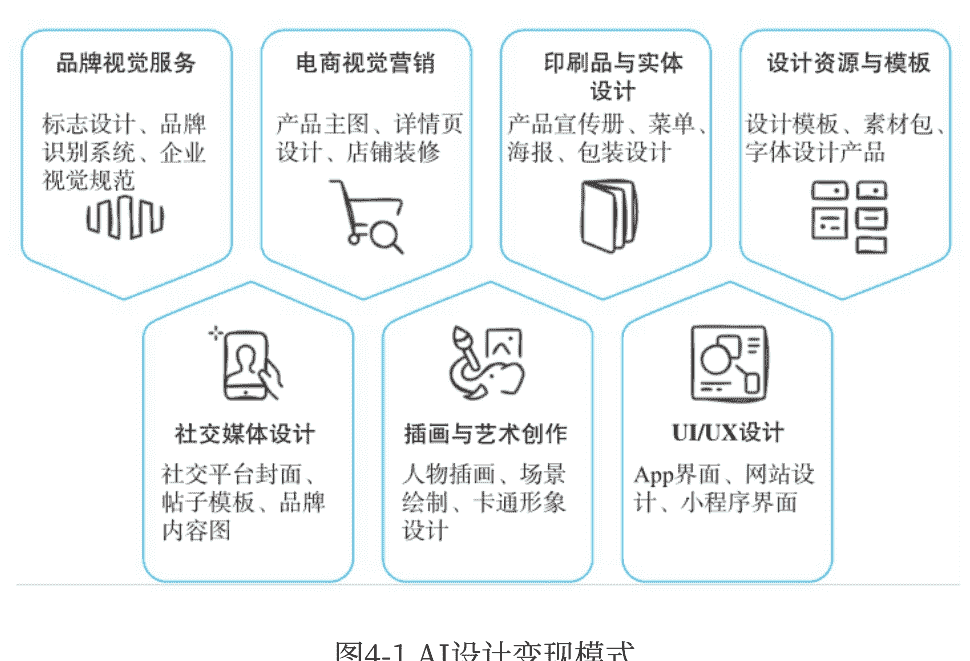

图4-1 AI设计变现模式

(1) 品牌视觉服务。
- 核心内容：标志设计、品牌识别系统、企业视觉规范。
- 客户群体：初创企业、小型商户、个体经营者。
- 定价参考：标志设计500～2 000元，品牌识别系统2 000元，企业视觉规范5 000元。
- 所需工具：即梦AI、Canva可画、豆包、通义万相。
- 优势分析：市场需求稳定，客单价高，可建立长期合作。
- 未来趋势：企业元宇宙形象与AR/VR品牌展示需求激增。

(2) 社交媒体设计。
- 核心内容：社交平台封面、帖子模板、品牌内容图。
- 客户群体：内容创作者、小型企业、个人品牌。
- 定价参考：单图设计50～200元，月套餐服务800～2 000元。
- 所需工具：Canva可画、即梦AI、Adobe Photoshop。
- 优势分析：需求量大，复购率高，可转为订阅式收入。
- 未来趋势：短视频平台竖版设计和动态元素设计需求暴增。

(3) 电商视觉营销。
- 核心内容：产品主图、详情页设计、店铺装修。
- 客户群体：淘宝或天猫店主、抖音或小红书电商、独立电商。
- 定价参考：主图设计100～300元/张，详情页设计1 000～3 000元。
- 所需工具：即梦AI、Canva可画、可灵AI。
- 优势分析：直接影响销售转化，价值易证明，客户愿意持续投入。
- 未来趋势：交互式产品展示和AR试用体验设计成为新蓝海。

(4) 插画与艺术创作。
- 核心内容：人物插画、场景绘制、卡通形象设计。
- 客户群体：出版商、内容平台、个人定制。
- 定价参考：基础插画300～800元，定制角色设计800～2 000元。
- 所需工具：Midjourney、即梦AI、通义万相、豆包、可灵AI。
- 优势分析：高度个性化，艺术附加值高，作品可二次授权。
- 未来趋势：IP衍生品设计和原创NFT艺术市场扩张。

(5) 印刷品与实体设计。
- 核心内容：产品宣传册、菜单、海报、包装设计。
- 客户群体：线下商家、活动策划、产品品牌。
- 定价参考：产品宣传册设计1 200～2 000元，菜单设计800～1 500元，海报设计1 000～1 800元，包装设计1 500～3 000元。
- 所需工具：Canva可画、即梦AI、Adobe Firefly。
- 优势分析：线下需求广泛，设计与实际应用相结合。
- 未来趋势：智能包装与环保材质相结合的设计需求增长。

(6) UI/UX设计。
- 核心内容：App界面、网站设计、小程序界面。
- 客户群体：软件开发团队、创业公司、内容平台。
- 定价参考：页面设计500～1 000元/页，完整App界面5 000～15 000元。
- 所需工具：即梦AI、豆包、可灵AI、Midjourney、Adobe Photoshop。
- 优势分析：技术门槛较高，但AI工具正快速降低难度，市场缺口大。
- 未来趋势：无代码+AI设计集成平台崛起，需求爆发式增长。

(7) 设计资源与模板。
- 核心内容：设计模板、素材包、字体设计产品。
- 客户群体：设计师、创作者、企业设计部门。
- 定价参考：单个模板50～200元，素材包199～599元。
- 所需工具：Canva可画、即梦AI、可灵AI、Adobe Photoshop。
- 优势分析：一次创作持续销售，被动收入潜力大。
- 未来趋势：订阅制设计资源库和AI生成素材平台兴起。

> 【技术创意结合点】王睿分析了各模式的市场数据，帮助张文杰做出有针对性的选择：“基于我们对市场的分析，对于新手来说，社交媒体设计和电商视觉营销是最容易入门的领域，因为需求量大，客户决策周期短。数据显示，这两个领域的月均订单量是其他领域的2～3倍，非常适合快速积累经验和获得收入。”

张文杰结合自己的兴趣和经验，决定以社交媒体设计为主要切入点，同时尝试产品包装设计这一高单价领域。他解释道：“这种组合既能保证订单量，也能提高平均客单价。”

### 3. AI设计工具全景分析

市场上有各种类型的AI设计工具，适合不同需求和专业水平的用户。王睿和张文杰共同梳理了一份全面的工具矩阵（见表4-2）。

| 工具类型 | 代表产品 | 核心功能 | 适用场景 | 入门难度 |
| :--- | :--- | :--- | :--- | :--- |
| 无代码设计平台 | Canva 可画 | 海量模板＋AI 生成＋简易编辑 | 社媒图片、宣传材料 | ★☆☆☆☆ |
| AI 绘画工具 | 即梦 AI、可灵 AI | 中文提示词＋多风格生成 | 创意插画、产品渲染 | ★★☆☆☆ |
| AI 绘画工具 | Midjourney、LiblibAI | 超高质量图像生成 | 艺术创作、商业视觉 | ★★★☆☆ |
| 专业级 AI 辅助 | Adobe Firefly | 与 Adobe 软件集成，专业级编辑 | 商业设计、高端需求 | ★★★★☆ |
| 智能 Logo 设计 | 标智客、标小智 | 专注于品牌标识生成 | 品牌建设、企业形象 | ★☆☆☆☆ |
| AI 海报工具 | 创客贴 | 智能排版＋海报生成 | 活动宣传、营销物料 | ★☆☆☆☆ |
| AI 电商工具 | 绘蛙 | 一键生成多平台的商品图＋虚拟模特训练 | 高质量商品图片、营销物料 | ★☆☆☆☆ |

表4-2 AI设计工具矩阵

在众多AI设计工具中，到底该如何选择?

(1) 初学者推荐组合。
- 核心工具：Canva可画+即梦AI+豆包+绘蛙。
- 优势：Canva可画操作简单且有模板，即梦AI生成的图片质量高，绘蛙在电商产品图领域有特长。
- 应用场景：社交媒体设计、基础品牌设计、电商产品图。
- 预算需求：可从完全免费开始，按需购买积分。

(2) 进阶用户推荐组合。
- 核心工具：Canva可画高级版+即梦AI+可灵AI+通义万相。
- 优势：可制作静态和动态设计，满足全平台需求。
- 应用场景：品牌设计、社媒内容、产品包装、短视频素材。
- 预算需求：月均100～300元。

(3) 专业设计服务组合。
- 核心工具：Adobe Firefly+Midjourney+即梦AI会员版。
- 优势：明确商业授权，整合了专业设计流程。
- 应用场景：高端品牌项目、复杂视觉系统、商业印刷品。
- 预算需求：月均300～1 000元。

> 张文杰分享了自己的实际体验：“对于初学者，我强烈推荐Canva可画+即梦AI+豆包+绘蛙的组合。Canva可画操作极其简单且有现成的模板，即梦AI生成的图片质量高且中文体验好，绘蛙在电商产品图领域非常出色。目前我也在使用可灵AI，它能快速将静态设计转化为动态效果，特别适合生成抖音小店和小红书电商的动态主图，转化率提升明显。”

> 王睿补充了技术视角：“工具选择要考虑平台生态和数据安全。国产AI工具在中文理解和本土化场景方面有优势。数据显示，中小企业最需要的设计服务是短视频内容素材（31%）、电商产品图（26%）和社交媒体素材（22%），选择工具时应对准这些高需求领域。”

### 4. 新手适配：零基础设计入门指南

对于完全没有设计经验的新手，张文杰总结了自己的入门经验。

(1) 设备准备。
- 普通家用电脑即可，无需高配置。
- 中端以上智能手机，建议存储空间不少于64GB。
- 稳定的网络连接（部分AI工具需要在云端处理）。

(2) 入门学习路径。
1) 设计基础知识学习（3～7天）：
- 学习基础设计原则（对比、重复、对齐、亲密性）。
- 了解色彩心理学和品牌应用。
- 掌握留白和构图的基础知识。
- 推荐资源：B站的“设计小白课”相关课程、《写给大家看的设计书》。

2) 工具操作学习（1～2周）：
- 利用本书推荐的初学者工具组合进行实践。
- 从模板修改开始，逐步尝试原创设计。
- 每天完成一个小练习，建立操作信心。

3) 提示词技巧学习（1周）：
- 了解提示词的基本结构和关键要素。
- 练习不同风格和场景的提示词编写。
- 建立个人提示词库，记录有效模板。

(3) 素材获取渠道。
- 免费图片：Pexels、Unsplash、菜鸟图库。
- 字体资源：字由网、Google Fonts、汉仪字库、阿里巴巴字体库。
- 配色方案：色采App、配色表。
- 图标资源：阿里巴巴矢量图标库、标小智（部分免费）。

(4) 常见新手问题解决。
- 不知从何下手：先选择模板修改，逐步建立自信。
- 色彩搭配困难：使用色轮或直接使用配色网站提供的方案。
- 构图混乱：遵循“网格系统”，保持简洁。
- 效果不专业：注重细节，特别是文字间距和对齐。

> 张文杰分享了自己的学习路径：“我先在B站上花3小时学习了基础设计原则，然后花一整天的时间实践了Canva可画的功能，第三天就接了第一单小项目。最有效的学习方法不是看几十个小时的教程，而是先学最基础的20%的知识，然后在实际项目中解决问题。现在，我会定期看一些设计大V的视频，不断学习新技巧。”

## 二、图文IP打造：如何用AI构建个人品牌矩阵

### 1. 从接单者到个人IP：品牌升级路径

从单纯接单到建立个人品牌是AI设计副业的关键进阶。张文杰分享了自己的品牌建立历程。

(1) 个人品牌发展阶段。
1）启动期（第1～2个月）：
- 确定专注领域和目标客户群。
- 创建基础作品集和服务介绍。
- 初步建立专业形象和价值主张。
- 开始在1～2个平台显示存在感。

2）成长期（第3～6个月）：
- 明确差异化定位和核心专长。
- 构建个人视觉识别系统（个人标志、色彩、风格）。
- 开始系统性内容创作和知识分享。
- 建立初步的粉丝群体和行业认可度。

3）巩固期（第7～12个月）：
- 形成明确的个人品牌和价值观。
- 建立多平台的内容矩阵和扩大影响力。
- 发展从单次服务到系统化的解决方案。
- 拥有稳定的粉丝群和客户转化体系。

(2) 个人风格体系构建。
1）风格定位策略：
- 不要追求“全能型”，专注1～2个擅长的领域。
- 结合个人背景和兴趣选择差异化的方向。
- 分析市场需求，找准蓝海领域。

2）视觉语言一致性：
- 创建个人设计风格指南。
- 确立标志性色彩方案和构图特点。
- 开发可识别的设计元素和表现手法。

3）案例包装策略：
- 精选3～5个具有代表性的案例并深度呈现。
- 展示设计思路和解决问题的能力。
- 突出商业价值而非仅展示美感。

> 【张文杰的个人品牌建设实践】“我花了大约4个月的时间，将自己从‘会用AI作图的人’转变为‘融合传统文化与现代设计的AI设计师’。这个细分定位非常关键，因为市场上会用AI作图的人很多，但专注于传统文化现代表达的人并不多。我在小红书开设了‘AI设计实验室’账号，每周分享1～2个案例和背后的思考过程，3个月增长了5000个粉丝，现在有品牌主动联系合作，单价也比以前高了不少。我还开设了抖音账号，做一些设计过程的短视频分享，效果出奇地好，粉丝增长速度比小红书快了3倍。”

### 2. 多平台矩阵：建立全方位的视觉影响力

建立强大的个人IP需要在多个平台构建内容矩阵，扩大全方位的影响力。个人品牌展示主要有以下渠道。

(1) 作品集平台。
- 站酷网/UI中国：国内设计社区。
- 个人网站：完全控制展示方式和专业形象。
- 数字设计作品集：即时设计公开作品集。

(2) 社交媒体矩阵。
- 小红书：分享设计过程，吸引个人客户。
- 抖音：展示设计教程和幕后，形成社区影响力。
- 知乎：分享设计见解和方法论，建立专业形象。
- B站：发布长内容教程，吸引专业学习者。

(3) 内容营销策略。
- 知识分享：AI设计技巧、行业洞察。
- 幕后揭秘：设计过程和思考方式。
- 案例解析：成功项目深度剖析。
- 工具测评：最新AI设计工具的体验。

【内容矩阵实例】张文杰的茶叶包装设计项目采用多平台内容策略。

(1) 小红书：
- “从0到1，我如何用AI设计出客户满意的茶叶包装”。
- “AI包装设计中国风元素提示词模板”。
- 展示设计过程、分享提示词和工作流程。

(2) 知乎：
- “AI时代如何重塑包装设计的品牌价值”。
- “传统文化元素在现代包装设计中的应用分析”。
- 深度分析行业趋势和设计理念。

(3) 抖音：
- “30秒学会高级包装设计技巧”系列短视频。
- “即梦AI生成茶叶包装全过程”操作演示。
- 设计过程中采用延时摄影+语音讲解。

(4) B站：
- “AI包装设计全流程：从需求分析到文件输出”。
- “即梦AI+Canva可画组合工作流详解”教程视频。
- 展示完整项目案例教学。

(5) 公众号：
- “设计思考：传统元素的现代表达”。
- “AI设计月报：2025年10月行业动态”。
- 深度分析文章和行业洞察。

王睿补充了数据支持：“我们分析发现，这种多平台矩阵能将单一内容的触达范围扩大5～7倍，而且不同平台能吸引不同类型的客户，例如知乎上的企业客户预算通常比小红书高30%以上。而视频号的流量转化率相比2024年提高了30%，成为新的流量入口。”

### 3. 视觉IP创作：AI生成个人品牌形象全流程

张文杰分享了如何用AI工具创建独特的个人品牌视觉形象。

(1) 个人品牌视觉元素体系（见图4-2）。
1）标志/头像设计：
- 使用标智客、即梦AI或通义万相生成概念草图。
- 确保简洁、易识别、可表达个性。
- 在不同尺寸和背景下测试可辨识度。

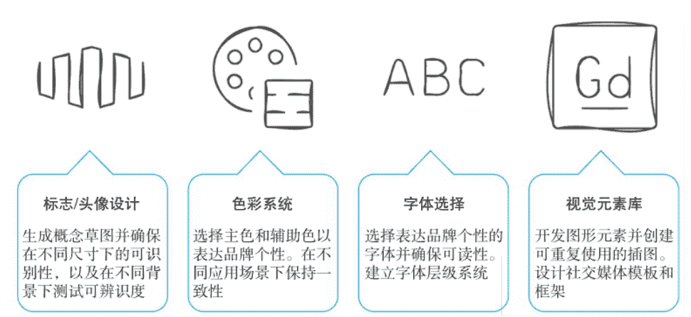

图4-2 个人品牌视觉元素体系

2）色彩系统：
- 选择2～3个主色、2～3个辅助色。
- 确保色彩能够表达品牌个性。
- 在不同应用场景下保持一致性。

3）字体选择：
- 选择1～2个特色字体表达品牌个性。
- 确保可读性和跨平台适用性。
- 建立字体层级系统（标题/正文/强调）。

4）视觉元素库：
- 开发标志性的图形元素或图案。
- 创建可重复使用的插图或图标。
- 设计社交媒体模板和框架。

(2) AI辅助个人品牌视觉创建的步骤。
1）品牌定位明确化：
- 确定3～5个关键词来描述自己的风格与价值。
- 定义目标受众和差异化优势。
- 研究行业视觉趋势和成功案例。

2）AI概念生成：
- 使用即梦AI或可灵AI探索多种视觉风格。
- 从AI生成的多个方案中选择2～3个最有潜力的方向。
- 收集目标群体反馈，进行针对性的优化。
- 使用Canva可画或稿定设计进行细节调整和规范化。

3）应用系统构建：
- 创建各平台所需的品牌应用。
- 确保所有视觉输出都保持一致性。
- 建立品牌素材库，便于日常使用。

4）动态元素拓展：
- 使用可灵AI将静态标识转化为动态形式。
- 为抖音或视频号制作品牌动态片头。
- 设计交互式的数字名片和AR展示元素。

> 【实战案例】张文杰介绍了“AI设计实验室”品牌形象创建过程。
“我首先明确了我的定位是‘融合传统与现代的AI设计师’，关键词是‘文化传承’‘现代简约’‘创新’。然后使用即梦AI探索了30多个标志概念，最终选择了一个结合中国传统印章元素与现代极简主义的设计。我还用通义万相生成了一些辅助图形元素，作为品牌视觉系统的扩展。配色方案选择了深青色（代表传统）与珊瑚红（代表现代）的组合。2025年初，我用可灵AI将这套视觉系统制作成了动态版本，用于抖音和视频号，效果非常出色。整个视觉系统在各平台应用后，辨识度大大提高，客户回访率提升了约50%。”

### 4. 技术创意结合点：数据驱动的品牌决策

王睿从技术角度补充了如何使用数据分析优化个人品牌效果。

(1) 品牌影响力指标监控：
- 建立关键平台的数据跟踪体系。
- 监测内容类型与互动率的关联。
- 分析不同视觉风格对转化的影响。
- 追踪品牌提及度和引用情况。
- 使用数据可视化工具直观呈现趋势。

(2) 受众画像精准化：
- 收集社交媒体互动用户的兴趣特征。

## 三、5种最容易接单的AI设计服务

### 1. 初阶设计师的最佳切入市场

对于设计新手来说，找到合适的市场切入点至关重要。张文杰总结了5种最适合AI设计新手的服务类型。

（1）社交媒体设计套餐。

- 服务内容：为品牌创建统一风格的社交媒体图片、模板和素材库。
- 目标客户：自媒体创作者、小微企业、社交媒体运营人员。
- 定价策略：基础套餐（5幅图片）300～500元，进阶套餐（10幅图片+2个模板）800～1 000元，月度服务（每周4幅图片）1 500～2 500元。
- 吸引力：低门槛，需求量大，重复购买率高，可转为长期合作。
- 工作流程：品牌风格确定→模板创建→批量生成→根据反馈调整→多种尺寸交付。

（2）电商产品主图优化。

- 服务内容：电商产品主图美化、背景处理、场景合成、效果增强。
- 目标客户：淘宝/天猫卖家、独立电商、微商创业者。
- 定价策略：优化单幅图片30～150元，5幅图片的套餐150～600元，详情页设计500～1 500元。
- 吸引力：效果容易衡量，客户有明确的转化需求，客户数量大。
- 工作流程：产品分析→风格确定→AI场景生成→产品合成→效果优化。

（3）品牌Logo与基础视觉识别系统（VI）。

- 服务内容：Logo设计、名片、简单品牌指南。
- 目标客户：初创企业、个体经营者、服务行业商户。
- 定价策略：基础Logo设计100～800元，Logo+名片套餐300～1 200元，小型VI系统1 000～3 000元。
- 吸引力：一次性高价值项目，有品牌延展潜力，可建立作品集。
- 工作流程：需求调研→风格探索→概念生成→方案呈现→修改完善。

（4）活动与节日海报。

- 服务内容：促销海报、节日营销图、活动宣传设计。
- 目标客户：零售商家、餐饮店、社区组织、培训机构。
- 定价策略：单张海报200～400元，节日套餐（春节、圣诞节等）600～1 000元，活动系列（3～5张海报）800～1 500元。
- 吸引力：季节性需求稳定，制作周期短，可建立长期合作关系。
- 工作流程：活动了解→主题构思→AI元素生成→排版设计→多种格式交付。

（5）内容创作者资料包。

- 服务内容：YouTube或B站封面、播客封面、课程封面、个人品牌形象。
- 目标客户：视频创作者、播客主播、知识付费作者、培训讲师。
- 定价策略：单个封面50～300元，个人品牌套餐（头像+横幅+模板）300～1 000元，内容系列套餐1 000～2 000元。
- 吸引力：创作者群体付费意愿高，需求持续增长，易于在创作者社群获客。
- 工作流程：内容分析→视觉风格确定→AI辅助创作→排版与优化→多平台适配。

> 王睿分享了市场洞察：“数据显示，这5种服务具有三个共同特点：一是决策周期短，客户通常1～3天内就能确定合作；二是需求明确，易于用AI工具高效完成；三是价值易于证明，客户能直观看到改进。这些特点让它们特别适合新手快速入市。”

### 2. 设计项目承接：从菜鸟到专业接单

随着技能积累，张文杰开始建立系统化的接单流程，从偶尔接单发展为稳定的收入来源。表4-3展示了各接单平台的对比。

| 平台类型 | 代表平台 | 优势 | 劣势 | 入门难度 | 价格区间 |
| :--- | :--- | :--- | :--- | :--- | :--- |
| 专业设计平台 | 猪八戒网、BOSS直聘 | 需求量大，体系完善 | 竞争激烈，佣金高 | 中等 | 300～3 000 元/项目 |
| 创作者平台 | 小红书、抖音、B站 | 直接展示作品，客户精准 | 需持续创作内容 | 低 | 500～5 000 元/项目 |
| 社群接单 | 微信群、行业社群 | 转化率高，信任基础好 | 需要人脉积累 | 低 | 视关系灵活定价 |
| 本地商家服务 | 线下拜访、数字名片 | 竞争少，可长期合作 | 获客成本高 | 中等 | 800～8 000 元/项目 |
| AI 创作平台 | 即绘、一品威客 | 专注 AI 创作，客户精准 | 平台新，需求不稳定 | 低 | 200～2 000 元/项目 |
| 短视频接单 | 抖音短视频展示接单 | 效果直观，转化率高 | 需制作优质演示内容 | 中等 | 400～4 000 元/项目 |

表4-3 接单平台对比

张文杰重点分享了新兴的抖音接单模式：“我在抖音上做‘1分钟AI设计’系列短视频，展示如何快速完成一个设计项目。视频中我会讲解思路和操作要点，吸引了很多小店主和创业者。现在我的抖音账号平均每周涨粉400～500人，每月能接到10～15个设计项目，这已经成为我最主要的获客渠道。”

他还补充了社群接单的经验：“我在15个创业相关的微信群和4个设计师交流群活跃，经常分享AI设计知识和案例。不主动推销，但群友在需要设计时自然会想到我。这种方式的客单价更高，平均能达到1 500～2 500元，因为建立了信任关系。”

（1）项目定价策略。

1）定价因素。

- 项目复杂度和工作量。
- 客户预算和市场定位。
- 交付时间和急迫程度。
- 使用权范围和商业价值。
- AI工具成本和技术难度。

2）定价模型。

- 初级阶段：300～800元/项目（积累经验和案例）。
- 中级阶段：800～2 500元/项目（建立专业定位）。
- 高级阶段：2 500～8 000元/项目（提供整合解决方案）。
- 专家阶段：8 000元以上/项目（提供品牌战略咨询）。

3）服务打包策略。

- 基础套餐：核心设计+2次修改。
- 标准套餐：多风格方案+多格式交付+5次修改。
- 高级套餐：整套品牌视觉+营销应用场景+无限修改。
- VIP套餐：设计+运营策略+效果追踪+季度优化。

（2）接单流程优化。

1）前期沟通：利用设计项目简报收集信息，明确时间线、预算和期望，展示相关案例以建立专业形象，设定边界和工作流程。

2）合作协议：使用简洁项目合同保障双方权益，明确付款条件（通常预付50%），约定修改次数和额外收费标准，明确知识产权和使用范围。

3）项目执行：建立项目管理文档以追踪进度，保持沟通并定期更新状态，创建设计方案文档以展示思路，提供多个方案供客户选择。

4）反馈收集：设计结构化的反馈表格，引导客户提供具体而非模糊的反馈，设置反馈时限避免项目拖延，记录所有变更以备追溯。

5）成果交付：准备多种格式和尺寸的文件，提供详细的使用说明文档，创建设计资产库便于客户使用，安排交付后的跟进和支持。

> 【案例分享】张文杰的设计项目管理模板：“我为每个项目创建一个标准流程文档，包括从需求收集到最终交付。我用在线协作工具记录下每一步的操作和所有的沟通，这让我看起来更专业，也确保不遗漏任何环节。客户经常评价说我的流程比有些设计公司还规范，这创造了信任感，也支撑了我的定价。今年我还增加了‘效果追踪’环节，帮助客户分析设计实施后的效果数据，这大大提升了我的服务价值。”

### 3. 服务升级与差异化竞争

随着经验积累，张文杰发现需要通过服务升级和差异化建立竞争优势，避免陷入低价竞争。

（1）服务升级策略。

1）从单一设计到整合营销。

- 基础：Logo设计。
- 升级：Logo+VI系统。
- 高级：品牌策略+视觉系统+营销应用。
- 专家：品牌咨询+整合营销方案+执行监督。

2）从项目制到持续服务。

- 基础：单次项目合作。
- 升级：系列项目打包。
- 高级：季度服务合约。
- 专家：年度品牌伙伴关系。
- 新增：订阅式设计服务+优先响应。

3）从执行到顾问。

- 基础：按要求完成设计。
- 升级：提供设计建议和多个方案。
- 高级：参与策略讨论和创意引导。
- 专家：提供品牌发展顾问和创意指导。
- 新增：AI设计赋能培训+团队能力建设。

（2）差异化竞争策略。

1）垂直领域专精。

- 选择1～2个垂直行业（如餐饮、健康、教育）深耕。
- 深入了解行业特性和视觉语言。
- 积累行业案例和口碑。
- 成为该领域的“go-to”设计专家。
- 热门垂直领域：养老健康、可持续生活、科技教育。

2）创意与技术相结合的优势。

- 结合数据分析提供设计效果预测。
- 使用A/B测试验证设计方案的有效性。
- 提供设计效果追踪和优化服务。
- 建立“创意+数据”的专业定位。

3）系统化解决方案。

- 开发标准化的设计系统方法论。
- 创建行业特定的设计模板库。
- 提供培训和知识赋能。
- 协助客户培养自主设计能力。
- 设计自动化流程和团队协作系统。

> 张文杰分享了自己的差异化路径：“我选择了‘传统文化现代表达’这个细分领域，专注于帮助传统品牌或需要中国文化元素的品牌创建现代感设计。这个领域竞争较小，而且我个人对传统文化有研究，能在提示词和设计解释方面提供更多价值。2025年我还增加了‘数据驱动设计优化’这个差异点，使用热图分析和用户行为追踪来优化设计效果。服务升级到整合营销方案后，我的客单价从最初的500元提升到现在的平均每单3500元。”

### 4. 案例参考：李梅的AI设计营销整合策略

营销策略师李梅在与张文杰的一次合作中，展示了如何将AI设计与营销策略整合，显著提升客户转化率。

（1）项目背景。本地一家主打手工月饼的糕点店想通过节日营销提升销量，但没有专业的设计资源和大量的营销预算。

（2）整合策略。李梅负责营销策略，张文杰负责视觉设计，通过数据分析和AI工具生成完整的营销设计方案。

1）数据洞察。

- 对往年月饼消费数据的分析显示，送礼场景占70%。
- 竞品分析显示，传统元素与现代设计相结合的产品更受欢迎。
- 社交媒体情绪分析显示，“家乡味道”是强情感触发点。
- 消费者越来越关注“健康配料”和“可持续包装”。

2）策略制定。

- 核心信息：“家的味道，匠心传承”。
- 目标人群：外地工作的武汉人和追求传统风味的本地人。
- 传播渠道：社交媒体+社区团购+线下店铺。
- 2025年强化：抖音短视频和小红书图文并重。

3）AI设计应用。

- 使用即梦AI创建融合传统与现代的包装设计。
- 利用即梦AI生成系列化的节日氛围产品图。
- 通过Canva可画制作社交媒体宣传材料和线下展示物料。
- 使用可灵AI创建动态产品展示和制作过程的短视频。

4）多平台内容矩阵。

- 抖音：制作过程和口味特点短视频。
- 小红书：包装设计故事和产品细节图文。
- 视频号：老师傅手工制作技艺展示。
- 微信群：社区团购优惠和口碑分享。

5）效果测试与优化。

- 在小范围社群内测试3种设计方向的反馈。
- 根据抖音点赞和评论情绪调整宣传重点。
- 使用A/B测试调研不同促销文案的转化效果。
- 利用数据分析工具追踪销售路径的转化率。

（3）成果。该项目最终使客户的销售同比增长了215%，张文杰和李梅共同获得10 000元的项目费用，并建立了长期的合作关系。客户对设计与营销的无缝结合表示特别满意，已经预约了中秋节前的新一轮合作。

> 李梅总结经验：“2025年的设计服务已经无法单纯停留在‘好看’的层面，必须能带来真实的商业结果。将数据分析、用户心理和视觉设计相结合，再配合新兴平台的内容策略，才能创造真正有价值的设计服务。特别是抖音带货和小红书种草已经成为新消费的主流路径，AI设计必须适应这些平台的特点和流量规则。”

## 四、商业设计实操：从接单到交付的完整流程

### 1. AI设计工作流程：从构思到交付

经过多个项目的实践，张文杰总结了一套完整的AI设计工作流程——AI设计七步法（见图4-3）。

（1）需求分析：深入挖掘客户的真实需求，与客户沟通以明确设计目标和用途，收集参考素材和品牌资料，确定目标受众和需传达的信息，制定设计规格和交付格式，确认跨平台应用需求和动态效果要求。

（2）市场调研：像侦探一样洞察行业趋势，分析行业设计趋势和竞品风格，收集成功案例和创意灵感，使用AI工具进行风格探索，确定初步的设计方向，进行社交媒体平台算法分析与内容表现研究。

（3）提示词工程：精心调配AI的“创作配方”，为AI工具撰写精确的提示词，指定风格、元素、色彩和构图，加入行业特定元素和品牌要求，多次尝试和优化提示词，控制跨平台提示词库和风格的一致性。

（4）初稿生成：让AI成为创意助手，批量产出灵感，使用多个AI工具生成多组设计稿，筛选出最符合需求的2～3个方向，初步整合和调整AI生成的内容，准备向客户展示的初稿方案，并行开发静态设计与动态效果。

（5）反馈优化：根据客户的反馈不断雕琢作品，向客户展示初稿并收集反馈，基于反馈调整提示词并重新生成，使用设计工具进行精细修改，反复迭代直至客户满意，测试用户体验并收集互动反馈。

（6）细节完善：像工匠一样打磨每个视觉细节，检查文字排版和间距，调整配色和视觉层次，确保各元素对齐和平衡，优化文件格式和分辨率，优化动态元素和检查跨设备的兼容性。

（7）交付与跟进：完美收官并持续追踪效果表现，准备最终设计文件和源文件，提供不同格式和规格的版本，说明设计理念和使用建议，收集使用效果反馈以持续优化，植入数据追踪代码并给出效果分析报告。

【工作流案例】张文杰分享了茶叶包装设计的具体流程：“首先，我与茶叶店主详细沟通了品牌定位——‘现代东方，年轻化高端茶品’，以及目标客户是25～40岁的都市白领。王睿帮我分析了市场数据，发现这个年龄段的消费者在社交媒体展示茶品的行为同比增长了85%，这是关键的设计考量点。

“然后，我用即梦AI尝试了30多套提示词，生成了120多个初步设计。我特别强调了‘适合社交媒体分享’这个关键点，生成了更具视觉冲击力的设计。筛选后向客户展示了3个方向，基于反馈选定1个方向并进行了5轮迭代调整。

“最后，在Canva可画中完善了文字和细节，用可灵AI制作了包装开启的动态效果，准备了印刷、电商和社交媒体三个版本的文件。特别是为抖音和小红书定制的短视频素材，帮助客户在产品发布时获得了非常好的社媒反响。”

### 2. AI生成设计的提示词技巧

张文杰从多个项目中总结出了有效的提示词设计框架——SCOPEDPM提示词框架（见图4-4）。

图4-4 SCOPEDPM提示词框架

（1）S (style, 风格)：指定设计风格（极简、复古、未来感、有机等）。

（2）C (colors, 颜色)：明确色彩方案（主色调、辅助色、色彩心情）。

（3）O (objects, 对象)：列出需要包含的核心元素和对象。

（4）P (purpose, 目的)：说明设计用途和目标场景。

（5）E (emotions, 情感)：描述要唤起的情感和感受。

（6）D (dimensions, 尺寸)：指定尺寸比例和格式要求。

（7）P (platform, 平台)：指定应用平台（抖音、小红书等）。

（8）M (motion, 动态效果)：说明动态效果需求（如果需要的话）。

这个框架为AI设计提供了系统化的沟通语言，通过8个维度的精确描述，确保AI能准确理解设计需求并生成符合预期的作品，大幅提升创作效率和成果质量。

张文杰分享了一个技巧：“针对同一个设计需求，我会在不同AI平台使用不同的提示词策略，然后整合各平台的优势结果。即梦AI对中国元素的理解更准确且分辨率高，豆包生成速度快，适合初期探索，通义万相则在商业风格把控上更专业。通过组合使用，一个项目通常能节省30%的时间，同时产出质量提升约40%。”

### 3. 确保品牌一致性的AI设计技巧

商业设计项目中，保持品牌视觉的一致性是重要挑战。张文杰总结了AI设计中确保一致性的方法。

（1）品牌DNA方法。

1）品牌元素提取：系统性解构品牌视觉DNA，提取核心标志和标识系统、品牌色彩体系和应用规则、字体选择和排版原则、图形语言和视觉元素库、动态效果和互动行为标准。

2）提示词标准化：建立品牌专属的AI沟通语言，创建品牌专属的提示词模板，固定关键风格描述和参数，建立品牌元素描述库，保存成功生成的案例作为参考，构建具有跨平台一致性的提示词集。

3）批量生成一致性技巧：确保规模化产出的风格统一，使用“seed值”固定风格（部分平台支持），建立品牌专属的提示词库，采用模板替换法批量生成，后期统一调色确保色彩一致，使用风格转换确保跨平台一致。

（2）品牌一致性管理系统。

1）设计系统构建：打造品牌视觉的统一标准，创建数字品牌指南文档，建立可复用组件库，分类与标准化设计元素，定义跨平台适配的规范。

2）自动化检查工具：用技术手段保障品牌表达的精准性，检测色彩的一致性，自动校对排版标准，检查元素是否对齐、间距是否合适，采用品牌符合度评分系统。

通过采用品牌DNA方法和建立品牌一致性管理系统，确保AI生成的所有设计作品都能精准传达品牌价值，在不同平台和应用场景中保持统一的视觉形象。

#### 【实例应用】张文杰为一家咖啡品牌建立的提示词体系

（1）品牌基础提示词。

[品牌名]咖啡视觉元素,现代简约风格,以暖棕色与奶油白为主色调,手绘咖啡豆元素,线条流畅,字体使用无衬线字体,营造温暖亲切且专业的氛围。

（2）不同场景下的变体。

1）社交媒体版：采用方形构图，留白充足，适合Instagram和小红书，包含可添加文字的空间，考虑双倍触达。

2）包装设计版：适合印刷，注重细节，包含产品信息区域，考虑拆箱视频效果。

3）门店展示版：大尺寸展示，远距离可辨识，明亮色调，考虑AR互动的可能性。

（3）季节性的调整。

## 五、案例解析：设计小白月收入8 000元的AI工作流

### 1. 零基础设计师的成长路径

张文杰的AI设计之旅从零开始，3个月实现稳定月收入8 000元。他的成长路径提供了一个可供参考的模板。

（1）第一阶段：入门期（第1个月）。

1）技能构建：

- 掌握Canva可画的基础操作（3天）。
- 学习即梦AI、豆包或通义万相的提示词技巧（1周）。
- 理解设计的基本原则（1周）。
- 建立初步作品集（5个作品）。
- 学习简单的动态效果制作。

2）起步项目：

- 为朋友设计微信头像和朋友圈封面。
- 参与免费设计挑战并积累实战经验。
- 创建2～3个模拟项目来充实作品集。
- 首次尝试抖音短视频设计。

3）收入水平为0～1 000元：

- 主要通过零散小单积累经验。
- 平均客单价在100～200元之间。
- 收入主要来源于社交媒体设计和简单图片处理。

（2）第二阶段：成长期（第2～3个月）。

1）技能深化：

- 学习项目管理和客户沟通技能。
- 掌握2～3个设计垂直领域（如品牌标识、社媒图片）。
- 建立设计流程和质量标准。
- 优化作品集，增加客户反馈。
- 学习跨平台适配技巧。

2）市场拓展：

- 在2～3个平台建立设计师形象。
- 加入5～8个目标行业的微信群。
- 开始发布设计相关的内容以吸引关注。
- 获取首批付费客户。
- 尝试使用短视频展示设计技巧。

3）收入水平为2 000～4 000元：

- 开始接触电商和品牌类项目。
- 平均客单价提升至300～500元。
- 开始有重复客户和推荐客户。
- 建立初步的设计服务流程。

（3）第三阶段：稳定期（第4～6个月）。

1）专业定位：

- 确立垂直领域专长（张文杰选择了“传统文化现代表达”）。
- 开发服务套餐，建立长期合作模式。
- 建立个人品牌，提升专业声誉。
- 优化工作流程，提高效率。
- 构建跨平台的内容矩阵。

2）市场深耕：

- 建设多平台的内容矩阵。
- 与相关行业专家建立合作关系。
- 提供增值服务和解决方案。
- 建立口碑和推荐网络。
- 开展设计讲座，进行社群分享。

3）收入水平达8 000元以上：

- 客单价提升至1 000～3 000元。
- 建立多元的收入来源。
- 发展长期服务合约客户。
- 开始探索知识付费变现。

（4）第四阶段：专业期（6个月以后）。

1）服务升级：

- 提供整合营销解决方案。
- 开发行业专属的设计系统。
- 组建小型协作团队，扩大接单能力。
- 建立设计效果评估和优化体系。

2）品牌建设：

- 扩大个人IP的影响力。
- 出版或发布原创设计方法论内容。
- 组织线上或线下的设计工作坊。
- 构建高端客户网络。

3）收入水平达10 000～30 000元：

- 高端项目客单价为8 000～15 000元。
- 知识付费产品持续增加收入。
- 建立多元化的收入结构。
- 被动收入占比20%～30%。

张文杰回顾道：“关键是不要追求完美主义，先从简单项目开始积累，快速迭代和学习。我第1个月只赚了800元，但做了大量练习；第2个月收入达到2 500元；第3个月突破5 000元，并且开始有稳定客户。比起单纯的技术提升，构建专业流程和确定市场定位对收入提升帮助更大。”

需要特别说明的是，张文杰的成长速度和收入增长并非普遍案例，而是得益于几个关键因素的结合：一是他在起步前已有一定的美学基础和市场敏感度；二是他每天投入6～8小时专注于学习和实践，远超一般副业的时间投入；三是他恰好抓住了AI设计工具爆发的早期红利期；四是他与王睿的技术合作给他带来了数据分析优势。大多数学习者应该对自己的成长路径持有合理的预期，将重点放在持续学习和稳步提升上，而不是追求短期内的暴利增长。一般来说，达到月收入8 000元的稳定水平可能需要6～12个月的持续努力，而更高收入则需要更长时间的专业积累和市场建设。

### 2. 张文杰的一周设计工作流

稳定收入的关键是建立高效的工作流。张文杰分享了他典型的一周工作安排。

（1）周一：市场维护与项目规划。

- 上午：回复咨询，评估新项目，安排周计划。
- 下午：创建社交媒体内容，维护个人品牌的存在感。
- 晚上：研究设计趋势，提升专业技能（1～2小时）。
- 查看AI设计工具的更新情况，测试新功能。

（2）周二至周四：项目执行。

- 每天上午：核心设计工作（3～4小时）。
- 每天下午：客户沟通、反馈处理、修改优化。
- 每天晚上：准备次日的工作，创建设计草案（1～2小时）。
- 每天花一小时处理跨平台内容适配。

（3）周五：交付与复盘。

- 上午：完成当周项目交付和跟进工作。
- 下午：接待新客户，进行项目介绍。
- 晚上：完成周工作总结，分析数据，优化流程。
- 更新设计数据分析报告。

（4）周末：学习与创意。

- 周六：尝试新工具，拓展设计视野（2～3小时）。
- 周日：创建个人项目，保持创意活力（2小时）。
- 录制一期设计教程内容，丰富IP矩阵。

（5）日常效率工具：

- Notion/飞书：项目管理和客户信息整理。
- Eagle：设计素材的收集和管理。
- AI设计助手：自动化提示词管理和品牌资产维护。
- 微信/钉钉：客户沟通和文件传输。

张文杰强调：“当前设计师的工作流已经与传统完全不同。建立稳定的工作节奏非常重要，但更关键的是有效利用AI工具提升效率。我每天保证3～4小时的核心设计时间，严格遵守交付期限，同时保持多平台内容输出的习惯。通过AI工具自动化，我现在只用以前1/3的时间就可以完成同样的工作量，把节省下来的时间用于学习新技能和开发高价值的服务。”

### 3. 多元变现的AI设计生意

张文杰总结了自己探索的多种AI设计变现模式，形成了多元收入结构。

（1）多元变现模式（见图4-5）。

1）项目服务：按项目收费的传统模式。

- 单次项目：品牌标识、包装设计等。
- 客单价：800～8 000元不等。
- 月收入：约15 000元（平均6个项目）。
- 特色：定制化解决方案，高度个性化。

2）设计模板：一次制作，重复销售。

- 平台：Canva可画、即时设计、个人网站。
- 价格：39～399元/套。
- 月收入：约5 000元（被动收入）。
- 特色：规模化销售，边际成本低。

3）社交媒体IP。

- 形式：抖音账号、小红书账号的内容创作。
- 收入来源：平台分成、带货佣金、品牌合作。
- 月收入：约6 000元。
- 特色：流量资产，多元变现。

4）教学分享：知识变现。

- 形式：在线课程、付费社群、线下工作坊。
- 价格：课程299～999元，社群199元/月。
- 月收入：约8 000元。
- 特色：一次创作，持续获得收益。

5）AI设计咨询。

- 内容：AI设计工作流搭建与培训。
- 客单价：5 000～20 000元/项目。
- 月收入：约10 000元（1～2个项目）。
- 特色：高附加值，专业壁垒高。

6）联名产品：设计授权商业化。

- 合作：与品牌联合推出限定产品。
- 模式：销售分成或一次性授权费。
- 季度收入：约10 000～20 000元。
- 特色：品牌增值，高利润率。

7）订阅服务：定期设计获得的稳定收入。

- 内容：每月固定数量的社媒图片、营销物料。
- 价格：1 500～4 000元/月/客户。
- 月收入：约9 000元（3个长期客户）。
- 特色：稳定的现金流，客户黏性高。

（2）收入结构优化。经过3个月的调整，张文杰的收入结构发生了显著变化（见表4-4）。

| 收入来源 | 初始阶段（元/月） | 一年后（元/月） | 变化趋势 | 投入时间比例（%） |
| :--- | :--- | :--- | :--- | :--- |
| 项目服务 | 1 200 | 15 000 | 稳定增长 | 35 |
| 设计模板 | 0 | 5 000 | 被动收入增长 | 10 |
| 社交媒体 IP | 0 | 6 000 | 季节性高额收入 | 5 |
| 教学分享 | 0 | 8 000 | 高速增长 | 15 |
| AI 设计咨询 | 0 | 10 000 | 流量价值增长 | 10 |
| 联名产品 | 0 | 5 000 | 48 倍增长 | 5 |
| 订阅服务 | 0 | 9 000 | 规模化收入 | 20 |
| 总计 | 1 200 | 58 000 | 快速增长 | 100 |

表4-4 多元收入结构

张文杰道：“通过多元收入结构，我的月收入从最初的1 200元提升到现在稳定的30 000元以上，最关键的是抗风险能力大大增强。这种多元收入结构同时兼顾了主动收入与被动收入，形成了良性循环：项目服务积累案例和经验，教学分享建立个人IP，设计模板和联名产品创造被动收入，社交媒体IP引流新客户。”

这种多元收入结构是张文杰能实现高收益的关键，而每一个收入来源都需要时间和专业度的积累，这些来源难以在短期内全部建立。大多数初学者应该专注于1～2个收入来源，在做精做强后再考虑扩展其他变现途径。

王睿补充道：“多元变现的关键是找到技术和创意的最佳结合点。例如，我们的设计模板不只是好看，还进行了数据跟踪，收集使用效果反馈。这些数据用来持续优化下一代产品，形成良性循环。同时，我们开发了一套AI设计流程自动化工具，能将张文杰的设计思路半自动化执行，大大提高了效率。这正是‘创意+技术’双引擎模型的优势，创意确保产品有灵魂，技术确保流程高效且可复制。”

### 4. 实战项目：品牌设计全流程案例

以下是张文杰完成的一个实际品牌设计项目的全流程解析。

（1）项目背景。

本地一家新开的瑜伽工作室需要全套的品牌设计，包括标志、色彩系统、应用物料和社交媒体内容模板。客户预算为5 000元，要求在10天内完成。

（2）实战流程。

1）需求收集。

- 客户填写设计需求问卷，明确品牌定位为“都市轻奢瑜伽空间”。
- 目标客户为25～40岁的女性都市白领。
- 视觉风格偏好：简约、优雅、有禅意但不传统。
- 收集参考案例，分析竞品。
- 确认需要的跨平台应用：线下店铺、小红书、抖音、微信生态。

2）市场研究。

- 王睿分析了当地20家瑜伽品牌的视觉定位，发现大多使用蓝绿色调，缺乏差异化。
- 确定以贵金属色系+极简主义作为差异化方向。
- 分析目标人群对社交媒体的美学偏好。
- 研究健康领域的2025年设计趋势。
- 使用AI工具分析小红书、抖音热门瑜伽内容的视觉特点。

3）概念生成。

- 使用即梦AI探索30多个标志创意方向，关键提示词为：

设计一个现代轻奢风格的瑜伽工作室标志，融合几何形态和流动线条，使用玫瑰金和深灰色作为主色调，简约而精致，适合女性都市白领，有禅意但避免传统刻板印象，需要在小红书和抖音等社交媒体上有良好的辨识度，同时考虑线下空间的应用。

- 使用Canva可画快速生成草图，测试不同风格方向。
- 筛选出3个核心方向：几何莲花、流线姿态、抽象平衡。
- 在即时设计中进行细节调整和排版完善。
- 用可灵AI创建标志的简单动态效果，增强社媒吸引力。

4）方案呈现。

- 制作专业设计提案，包含品牌故事和应用场景。
- 为每个方案提供理念解释和应用示例。
- 展示跨平台应用效果模拟。
- 通过在线会议展示并收集反馈。
- 客户选择“几何莲花”方向，但要求调整色彩。

5）迭代优化。

- 基于客户反馈调整色彩方案（从玫瑰金到紫铜色）。
- 优化标识比例和可识别性。
- 扩展到名片、会员卡和社交媒体模板设计。
- 制作小红书发帖模板和抖音短视频模板。
- 准备品牌指南，以确保后续应用的一致性。
- 创建动态标志版本，适用于数字媒体。

6）跨平台内容制作。

- 设计小红书图文模板（3种样式）。
- 创建抖音短视频开场模板和结尾模板。
- 设计会员推广海报和优惠券。
- 制作线下空间视觉元素和指示系统。
- 设计微信群封面和群公告模板。

7）最终交付。

- 提供多种格式的标志文件（SVG、PNG、PDF）。
- 交付完整品牌规范手册（数字版）。
- 交付社交媒体模板套件（小红书、抖音、微信）。
- 提供动态标志文件和使用指南。
- 创建品牌资产库，便于客户日常使用。
- 附赠简易数据分析报告，帮助追踪视觉效果。

（3）成果与反馈。

客户对最终设计非常满意，不仅全额支付了5 000元的设计费，还额外订购了价值2 500元/月的季度社交媒体设计服务。工作室开业后，其小红书和抖音账号获得了良好反响，多位顾客称赞品牌形象是选择该工作室的重要因素。开业一个月后，客户报告会员注册率超出预期40%，其中约35%的客户提到被社交媒体上的品牌形象吸引而来。

张文杰总结：“这个项目证明了设计服务必须是全平台整合的方案，而不仅仅是单一的视觉设计。关键在于帮助客户构建一个连贯的品牌体验，从线下到线上，从静态到动态。AI工具让我能够快速生成各种应用场景的设计，客户也越来越看重这种全方位的设计能力。”

### 5. 新手常见障碍与解决方案

表4-5展示了在品牌设计全流程中新手常常遇到的障碍以及对应的解决方案，并给出了可用的辅助资源。

| 常见障碍 | 解决方案 | 辅助资源 |
| :--- | :--- | :--- |
| 审美不自信 | 依赖模板和 AI 建议，专注执行而非创造 | Canva 可画模板库，即梦 AI 风格探索 |
| 不懂配色 | 使用现成的配色方案和工具 | 色采 App，配色宝 |
| 素材不足 | 利用免费素材库和 AI 生成内容 | 花瓣网，即梦 AI，豆包 |
| 不会绘图 | 使用 AI 绘图和图标库 | 即梦 AI，阿里巴巴矢量图标库 |
| 定价困难 | 参考市场均价打七折起步 | 猪八戒网价格参考 |
| 跨平台适配 | 使用自动调整工具一键生成多种尺寸 | 多格式转换器，Canva 可画自定义尺寸 |
| 效果不专业 | 关注两个核心点：对齐和留白 | B站视频 |
| 获客困难 | 先做小红书和抖音展示，再邀约朋友 | 创意社区，设计互助群 |

表4-5 新手常见障碍及解决方案、辅助资源

## 实战练习

选择一个你熟悉的本地小商家（咖啡店、理发店、健身房等），为其设计一套当前风格的品牌视觉系统，包括：

- 标志（静态版与动态版Logo）。
- 配色方案与视觉元素库。
- 社交媒体套件（至少包含小红书和抖音两个平台）。
- 一个简单的宣传品（名片或优惠券）。
- 15秒的品牌短视频（简单动态效果即可）。

要求：

- 使用本章介绍的AI工具完成（即梦AI/豆包/Canva可画/可灵AI等）。
- 记录设计过程和决策理由。
- 考虑品牌在社交媒体平台的展示效果。
- 思考如何将这套设计转化为实际业务。
- 尝试加入简单的数据跟踪或效果评估方案。

## 思考

1. AI设计工具降低了入行门槛，在同质化严重的市场中，如何建立自己的差异化优势?关键是专注于领域还是工作方法?
2. 在使用AI生成内容的过程中，设计师的核心价值和不可替代性体现在哪里?随着AI能力的不断提升，人类创意的独特性将如何体现?
3. 当前AI设计的商业模式正在从项目制向订阅制和知识付费转变，这对设计师的技能结构提出了哪些新要求?
4. 如何在你的设计实践中结合创意和技术，以形成独特优势?你能找到哪些数据与设计相结合的创新点?
5. 面对AI技术的快速迭代，设计师应该如何持续学习和适应变化?是专注于工具技巧还是设计思维?

## 章末寄语：AI设计革命——人人都是创意家

设计，曾经是少数人的专属领域，需要天赋、学院训练和多年的专业实践。而在今天，AI工具可以让每个人都能表达自己的创意。正如张文杰从一个美术零基础的普通人转变为月收入50 000元的设计师，这场变革为普通人带来了新的可能性。

技术始终是工具，创意才是灵魂。AI可以生成图像，但无法替代你对美的感知、对文化的理解、对市场的洞察和解决问题的思维。在这个变革的时代，拥抱技术的同时，更要培养自己独特的视角和思考方式。

特别是在当前，设计的价值已经从单纯的美感转向了更综合的商业价值创造。真正成功的设计师不只是工具操作者，而是能够连接品牌、用户和平台的战略思考者。随着元宇宙、AR/VR和智能设备的普及，设计的边界正在不断扩展，这为具有创意思维的人提供了前所未有的机遇。

无论你是否有设计背景，只要有好奇心和行动力，都可以从今天开始，尝试用AI工具创造价值。每个成功的设计师都是从第一幅作品开始的，而AI正是你最得力的助手和启蒙老师。

从简单的个人项目起步，逐步建立信心和能力，你或许会发现，被科技革新的不只是工具，还有重新定义自我价值的可能。创意无需天赋，而是每个人与生俱来的权利。

拿起手机或电脑，打开Canva可画或即梦AI，现在就开始你的AI设计之旅吧。

## 第5章 技术路径：写得出代码的AI变现指南

### 开篇：李明的AI编程转型之旅

李明，一位拥有5年销售经验的职场人，4周前连HTML和CSS都分不清。在朋友张文杰的鼓励下，他开始尝试用AI工具编程。

李明的初期尝试并不顺利——代码报错、不符合需求，甚至差点放弃。但李明坚持调整提示词，最终完成了第一个企业展示网站项目，收入2800元。

> “最让我吃惊的是，我竟然真的做出来了，而且客户非常满意，”李明说，“收入比我上个月的销售提成还多。”

> 张文杰兴奋地告诉他：“你知道王睿吗?一个连键盘都敲不顺的人，愣是靠AI编程成了月收入几万元的技术顾问。AI编程门槛低，但回报高得离谱!”

> 李明在笔记中写道：“最关键的不是写代码，而是正确地‘指导’AI写代码。销售经验反而给了我优势——理解需求、提问、解决问题，这些软技能在AI编程中同样重要。”

> 看到李明的成长，张文杰提议：“不如我们今天深入探讨如何系统化地将AI编程转化为稳定收入?”

> 李明点头：“我已经看到了这条路的潜力。”

## 一、零编程也能做开发：AI编程的底层思维

1. 从“代码恐惧”到“需求翻译者”

大多数人面对编程的第一反应是恐惧和抗拒。“我不是技术脑，我不懂编程语言”“我数学不好”——这些常见的自我限制成为阻碍普通人尝试技术路径的心理障碍。表5-1展示了传统编程与AI编程思维模型的对比情况。

| 维度 | 传统编程思维 | AI 编程思维 | 变革程度 |
| :--- | :--- | :--- | :--- |
| 学习焦点 | 语法、算法、框架 | 需求分析、问题描述、解决方案评估 | 根本性转变 |
| 能力核心 | 代码编写能力 | 需求翻译能力 | 跨领域转换 |
| 学习曲线 | 陡峭、专业化 | 平缓、通用化 | 90％降低 |
| 思维方式 | 结构化、算法化 | 描述性、沟通化 | 质的转变 |
| 价值侧重 | 技术实现 | 问题解决 | 目标重定向 |

表5-1 传统编程与AI编程思维模型对比

李明分享了他的转变：“过去我认为程序员必须掌握复杂的语法和算法，所以从未想过自己能写代码。但现在我理解了，AI编程的核心是‘需求翻译’——将业务需求转化为AI能理解的指令，然后评估和调整AI的输出。这更像是一种沟通技能，而非纯技术能力。”

【关键思维转变】从“我需要学会写代码”到“我需要学会指导AI写代码”。

## 2. “需求翻译”的五步思维框架

AI编程的核心能力是有效地将模糊的业务需求转化为清晰的AI指令。张文杰向李明介绍了一个实用的五步思维框架——DTREO需求翻译框架（见图5-1）。

- (1) D (define, 定义)：明确并具体化问题或需求。
- (2) T (translate, 翻译)：将业务语言转化为功能描述。
- (3) R (request, 请求)：构建结构化的AI提示词。
- (4) E (evaluate, 评估)：审查AI输出并识别问题。
- (5) O (optimize, 优化)：基于评估结果进行迭代改进。

下面举例说明李明如何应用这一框架。

(1) 客户需求：“我需要一个能展示公司的产品并让客户联系我们的网站。”

(2) 步骤1：定义需求。李明通过提问澄清具体需求：

1) 需要展示多少产品?约20个产品。

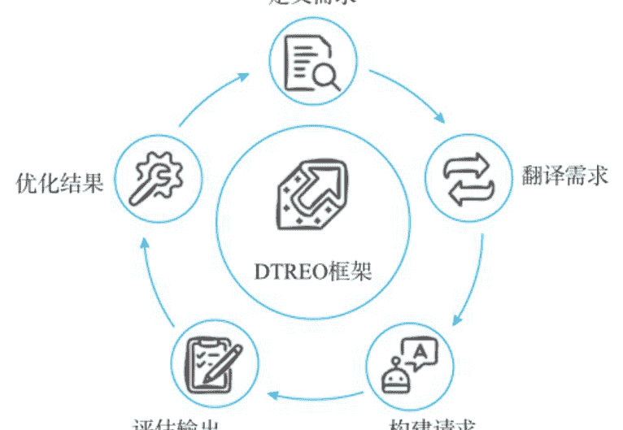

图5-1 DTREO需求翻译框架

2) 产品信息包括哪些内容?名称、图片、描述、规格。
3) 客户联系方式?在线表单和联系信息展示。
4) 其他必要功能?公司简介、新闻动态。
5) 设计风格偏好?现代简约，以蓝色为主。

(3) 步骤2：翻译需求。将业务需求转化为功能模块：

- 1) 响应式企业网站（适应不同设备）。
- 2) 产品展示系统（分类、详情）。
- 3) 联系表单（数据收集、邮件通知）。
- 4) 内容管理（公司信息、新闻）。
- 5) 设计系统（色彩、排版、图像）。

(4) 步骤3：构建请求。李明给AI的提示词：

请帮我设计一个响应式企业网站,主要功能包括：

- ●首页:导航菜单、公司简介、产品分类展示、联系方式。
- ●产品页:20个产品的展示系统,包含图片、名称、简介和详情按钮。
- ●产品详情页:完整的产品信息、规格参数和相关产品推荐。
- ●关于我们:公司历史、团队介绍、企业文化。
- ●新闻动态:公司新闻列表和详情页。
- ●联系我们:联系表单(姓名、邮箱、电话、留言)和公司联系信息。

设计要求：

- 风格现代简约,以蓝色为主色调。
- 确保对移动设备友好。
- 加载速度快,图片质量高。
- 简单易用的导航系统。

请提供完整的HTML、CSS和JavaScript代码,并解释主要功能的实现方式。

（5）步骤4：评估输出。李明检查AI生成的代码并发现：

- 1）首页产品展示部分缺少分类功能。
- 2）联系表单没有验证功能。
- 3）移动端导航菜单展示异常。

（6）步骤5：优化结果。李明的优化提示词：

感谢你的代码,但我需要进行一些调整：

- 请在首页产品展示部分添加分类功能,允许用户按类别筛选产品。
- 联系表单需要添加输入验证,确保电话号码和邮箱的格式正确。
- 移动端导航菜单在小屏幕上显示异常,请优化代码使其在所有设备上均可正常工作。

请针对这三个问题提供修改后的代码。

（7）关键收获。李明发现，这个框架不仅适用于编程，也适用于几乎所有AI创作任务。核心价值在于将模糊的人类语言转化为结构化的具体指令，然后通过迭代优化达到预期效果。

张文杰补充道：“传统开发需要你理解代码如何工作，而AI开发则要求你理解需求如何描述。这种‘翻译能力’恰恰是非技术背景人士可能具备的优势，尤其是有销售、市场或客户服务经验的人。”

## 3.非技术背景的隐藏优势

令人惊讶的是，某些非技术背景恰恰为AI编程提供了独特优势。李明和张文杰分析了不同背景人员的“隐藏技能”。

- (1) 销售人员的隐藏优势：
  - 1) 需求挖掘能力（识别客户的真实需求）。
  - 2) 沟通与表达能力（清晰描述需求）。
  - 3) 问题解决导向（关注解决方案而非技术本身）。
  - 4) 客户思维（从用户角度评估产品）。

- (2) 市场人员的隐藏优势：
  - 1) 用户体验敏感度（关注产品的易用性）。
  - 2) 视觉与设计感知（评估界面的美观性）。
  - 3) 内容组织能力（合理规划信息架构）。
  - 4) 价值传达能力（突出产品的核心价值）。

- (3) 管理人员的隐藏优势：
  - 1) 系统性思维（全局规划项目结构）。
  - 2) 资源整合能力（组合多种AI工具）。
  - 3) 质量把控意识（全面测试最终产品）。
  - 4) 项目管理能力（设定合理的开发流程）。

李明分享了自己的经验：“我发现我在销售工作中培养的‘提问能力’在AI编程中非常有价值。当我与客户沟通网站需求时，我能够提出关键问题，引导他们将模糊的想法具体化，这恰恰是获得高质量AI输出的关键。”

但是，到底该如何将已有软技能转化为AI编程优势呢?具体方法如下。

- (1) 将沟通技能转化为需求定义能力。
  - 1) 练习将模糊的描述转化为具体的功能点。
  - 2) 学会提出澄清性问题。
  - 3) 创建需求访谈清单。
- (2) 将同理心转化为用户体验思维。
  - 1) 从用户角度评估AI输出。
  - 2) 识别用户可能的痛点和困惑。
  - 3) 优先满足核心用户需求。
- (3) 将讲故事的能力转化为场景描述能力。
  - 1) 用场景描述替代技术要求。
  - 2) 创建用户故事和使用场景。
  - 3）以结果为导向设计功能。

张文杰总结道：“AI编程重新定义了‘技术能力’，使其更加普遍化和平民化。‘技术’不再是少数人的专利，而是所有能够结构化表达问题和评估解决方案的人都能掌握的能力。”

## 4.构建个人AI编程工作流

为了帮助李明进行系统化的开发，张文杰介绍了一套适合新手的AI编程工作流——七步开发工作流（见图5-2）。

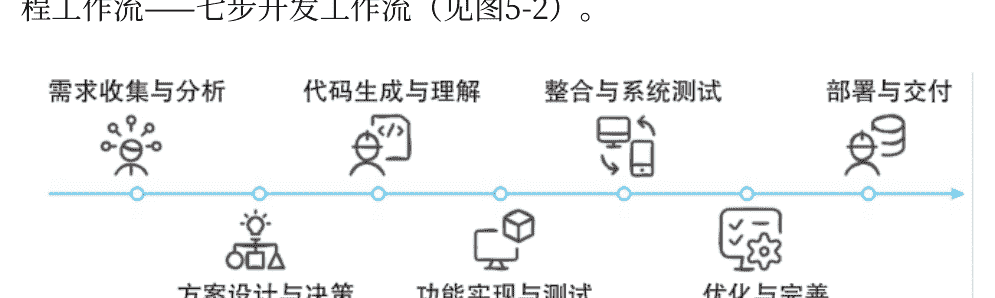

图5-2 七步开发工作流

- （1）需求收集与分析：将模糊需求转化为具体功能点。
- （2）方案设计与决策：多方案对比，选择最适合的技术路径。
- （3）代码生成与理解：理解代码结构和核心功能。
- （4）功能实现与测试：分步实现，确保各模块独立工作。
- （5）整合与系统测试：测试用户流程和边界情况。
- （6）优化与完善：关注用户体验和技术性能。
- （7）部署与交付：确保客户能够使用和维护。

下面用一个具体的案例来展示如何一步步实现在线预约功能。李明分享了如何为客户网站添加在线预约功能的过程。

(1) 阶段1：需求收集。

明确需求：用户可选择日期、时间段，然后填写联系信息进行服务预约。

(2) 阶段2：方案设计。AI提示词如下：

我需要为企业网站添加在线预约功能,要求：

- 用户可选择日期(未来30天内)。
- 每天有上午9—12点、下午2—5点两个时间段。
- 用户需填写姓名、电话、邮箱和预约事项。
- 表单提交后发送确认邮件给用户。
- 管理员收到预约通知邮件。

请推荐2～3种技术实现方案,并分析各自的优缺点和复杂度。具体考虑国内环境下可靠稳定的技术选择。

(3) 阶段3：代码生成。选定方案后的AI提示词：

基于前面的讨论,我决定使用JavaScript和国内的表单服务实现预约功能。请生成完整的代码,包括：

- HTML表单结构,包含所有必要字段。
- 日期选择器(限制只能选择未来30天)。
- 时间段选择部分。
- 表单验证的JavaScript代码。
- 接入国内常用的表单服务(如金数据、腾讯云表单等)。
- 响应式设计,确保在移动设备上正常显示。

请提供详细注释,解释关键部分的实现逻辑。

(4) 阶段4～7：迭代优化与部署。通过多轮对话，李明解决了日期选择器的兼容性问题、表单验证逻辑错误和邮件模板格式问题，最终成功实现并部署了在线预约功能。

> 张文杰强调：“这个过程看似复杂，但关键在于每一步只处理一个明确的任务，让AI在约束条件下发挥最大的作用。非技术人士最常见的错误是提出过于模糊的需求，如‘帮我做个预约系统’，这几乎必然导致不满意的结果。”

## 5.TRAE：AI编程的得力助手

作为国产的AI代码编辑器，TRAE专为中文开发环境设计，解决了国外工具对中文支持不足、Cursor等易受网络限制等痛点。对于零基础编程者，TRAE是理想的入门工具。

(1) TRAE核心功能介绍。

1) AI对话能力：直接在编辑器中与AI助手对话，获取代码建议。

- 支持代码生成、问题诊断、功能实现咨询。
- 优化的中文编程对话体验。
- 上下文感知，理解当前文件的代码环境。

2) 代码补全与优化。

- 智能代码补全，支持多种编程语言。
- 实时代码建议与修复提示。
- 一键格式化与代码美化。

3) 调试与问题排查。

- 内置调试器，支持断点设置与变量查看。
- 错误智能分析与修复建议。
- 性能分析工具。

（2）案例展示：使用TRAE创建网站项目。

1) 步骤1：创建新项目。

- 打开TRAE。
- 选择顶部导航栏中的“文件”，点击“打开文件夹”，选择你已经创建的文件夹。
- 选择“Web项目模板”，输入项目名称“企业展示网站”。
- 在右侧“与Trae协作”处开始进行对话、设计、开发。

2) 步骤2：与AI助手对话生成代码。示例对话：

用户：

我需要一个响应式的导航栏,包含公司Logo、首页、关于我们、服务、联系我们等菜单项。

TRAE AI助手：

我来帮您创建一个响应式的导航栏。我会使用HTML和CSS来实现这个导航栏,包含您要求的所有元素。以下是完整的代码实现：

[AI生成HTML和CSS代码](代码略)。

3）步骤3：调试代码与预览。

- 点击代码顶端的“应用”按钮。
- 在中间index.html文件中点击“接受”按钮。
- 点击“预览”按钮查看实时效果。
- 若在调试过程中出现问题，选中问题代码，右键选择“添加到对话框”，寻求AI帮助。

4）步骤4：完善功能并部署。

- 继续使用AI对话完成其他页面组件。
- 使用TRAE内置的终端运行测试服务器。
- 利用TRAE的一键部署功能发布到服务器。

（3）TRAE的高级技巧。

1）提示词优化：

- 描述需求时尽量具体，包含功能、风格、技术要求。
- 使用“继续优化上面的代码，添加××功能”保持上下文一致。
- 分步骤请求复杂功能，先获取基础版本再迭代。

2) 项目管理：

- 使用TRAE的项目模板快速启动标准项目结构。
- 利用内置版本控制追踪代码变化。
- 创建代码片段库以重用常用功能。

3) 调试技巧：

- 使用“AI代码解释”理解复杂代码。
- 遇到错误时，选择错误信息，点击右键的“AI修复建议”。
- 利用“AI测试用例生成”快速创建测试用例。

(4) 实际应用场景展示。

场景一：快速原型开发。李明接到客户对网站的需求后，使用TRAE在1小时内生成了完整的网站原型，通过预览功能即时向客户展示效果，大大加速了需求确认过程。

场景二：Bug修复。网站表单提交出现问题，李明选中相关代码，使用“AI诊断”功能，AI立即指出缺少表单验证逻辑，并提供了完整的修复代码，15分钟内解决了该问题。

场景三：功能扩展。客户要求添加“预约系统”，李明通过对话描述需求：“创建一个预约表单，包含日期选择器、时间段选择和联系信息，并在提交后发送确认邮件。”TRAE生成功能代码，李明仅需少量调整即可实现该功能。

(5) TRAE与其他工具协同工作。

- 1) 与Canva可画协作：从Canva可画中导出设计稿，在TRAE中实现代码。
- 2) 与飞书多维表格协作：开发连接飞书API的数据分析应用。
- 3) 与即梦AI协作：将即梦AI生成的图片资源整合到网站项目中。

TRAE让编程变得简单。它不仅是一个代码编辑器，更是非编程背景人员的AI编程教练。它让李明能够专注于解决业务问题，而不是陷入编程语法的细节。随着使用经验的积累，你会发现TRAE不仅能生成代码，还能帮助你学习和理解编程概念，逐步提升技术能力。需要特别注意的是，如果要应用到生产环境，还需专业开发人员审查，上线前建议进行专业测试与安全评估。

# 二、4类适合新手的AI编程变现项目

## 1.网站与前端开发：最易上手的变现领域

网站开发是AI编程中最容易入门和变现的领域，这也是李明第一个成功的项目。

（1）新手友好度分析。

- 1）技术门槛：★★☆☆☆（有基础的HTML或CSS概念即可）。
- 2）学习曲线：★☆☆☆☆（1～2周可接简单项目）。
- 3）市场需求：★★★★★（持续的大量需求）。
- 4）竞争程度：★★★☆☆（竞争中等但机会多）。
- 5）收益水平：★★★☆☆（小项目1 000～5 000元）。
- 6）AI助力程度：★★★★★（AI最擅长前端代码生成）。

（2）适合AI开发的网站类型。

1）企业展示型网站。

- ●特点：公司信息、产品和服务展示。
- ●技术要求：较低，主要是前端展示。
- ●价格区间：2 000～8 000元。
- ●开发周期：3～7天。
- ●客户类型：中小企业、个体工商户。

2) 专业人士或工作室的官网。

- ●特点：作品展示、专业介绍、联系方式。
- ●技术要求：中低，需要良好的视觉呈现。
- ●价格区间：1 500～5 000元。
- ●开发周期：2～5天。
- ●客户类型：摄影师、设计师、顾问等专业人士。

3) 活动或产品落地页。

- ●特点：单页面，聚焦于转化。
- ●技术要求：低，但需营销思维。
- ●价格区间：800～3 000元。
- ●开发周期：1～3天。
- ●客户类型：有推广需求的各类企业。

4) 简单电子商务网站。

- ●特点：产品展示、购物车、支付接口。
- ●技术要求：中等，需了解电商流程。
- ●价格区间：5 000～15 000元。
- ●开发周期：7～14天。
- ●客户类型：小型零售商、手工艺品商家。

（3）李明的网站开发实战经验。李明分享了他如何从零开始承接网站开发项目：“我的第一个项目是开发一个室内设计工作室的官网。最有效的AI协作方法是先让AI生成整体网站架构，然后针对每个页面或功能进行单独开发。关键是控制好需求边界——我明确告诉客户这是一个展示型网站，不包含复杂的后台功能。在视觉设计方面，我用Canva可画生成了几组风格一致的UI元素，大大提升了网站的专业感。”

（4）技术栈选择建议。

- 1）初级阶段：HTML/CSS/JavaScript+Bootstrap（有现成组件）。
- 2）中级阶段：HTML/CSS/JavaScript+静态网站生成器（如VitePress）。
- 3）进阶阶段：React/Vue+简单后端（如腾讯云云开发、LeanCloud）。

（5）关键成功因素。前端项目中，设计美感和用户体验比代码质量更直接影响客户的满意度。专注于视觉呈现和内容组织，在这些方面非技术人员往往比程序员更有优势。

## 2.自动化工具开发：提高工作效率的实用魔法

自动化工具是解决特定重复性工作的小型应用程序，这一领域的技术门槛相对较低，但价值回报显著。

（1）新手友好度分析。

- 1）技术门槛：★★☆☆☆（有基础逻辑思维即可）。
- 2) 学习曲线：★★☆☆☆（2～3周可掌握基础）。
- 3) 市场需求：★★★★☆（小众但有高价值需求）。
- 4) 竞争程度：★★☆☆☆（竞争较低）。
- 5) 收益水平：★★★★☆（高价值解决方案2 000～10 000元）。
- 6) AI助力程度：★★★★★（流程自动化是AI的强项）。

（2）适用于开发的自动化工具类型。

- 1) 数据处理自动化工具。
  - ●功能：清洗、转换和分析Excel数据。
  - ●技术：Python脚本或Office宏。
  - ●应用场景：销售数据整理、财务报表生成。
  - ●价值点：节省大量手工操作的时间。

- 2) 内容生成自动化工具。
  - ●功能：批量生成报告、邮件、文案。
  - ●技术：Python+API调用。
  - ●应用场景：周期性报告、营销内容。
  - ●价值点：保持内容的一致性，提高生产效率。

- 3) 流程自动化工具。
  - ●功能：连接不同系统，实现工作流的自动化。
  - ●技术：企业微信机器人、飞书自动化或Python脚本。
  - ●应用场景：CRM与邮件营销系统集成。
  - ●价值点：消除系统间的手工操作。

4）监控与提醒工具。

- ●功能：监控指标变化并发送提醒。
- ●技术：Python+通知API。
- ●应用场景：库存监控、价格变动跟踪。
- ●价值点：及时响应关键变化。

（3）案例分享：销售数据处理自动化工具。李明为销售团队开发的自动化工具案例。

1）背景：销售团队每周需要手动整理来自不同渠道的销售数据，生成标准化报表，过程烦琐且容易出错。

2）解决方案：开发一个Python脚本，自动执行以下流程。

- 读取多个Excel文件中的销售数据。
- 统一数据格式和字段名称。
- 合并数据并进行清洗（删除重复值、处理异常值）。
- 按产品类别和销售区域生成汇总报表。
- 创建可视化图表以展示关键指标。
- ●自动向管理层发送报告邮件。

3) 盈利模式。

- ●定制开发：根据特定需求开发（2 000～8 000元/项）。
- ●模板定制：基于现有模板进行调整（1 000～3 000元/项）。
- ●订阅服务：持续维护和更新（500～2 000元/月）。
- ●培训服务：教客户如何使用和进行简单修改（800～1 500元/次）。

4) 新手入门路径。

- ●学习基础的Python知识（特别是文件操作和数据处理）。
- ●了解pandas库的基本操作（数据分析必备）。
- ●从解决自己工作中的重复任务开始练习，逐步扩展到满足他人的自动化需求。

（4）关于使用智能体的思考。在当前的技术环境下，智能体和Python各有优势：智能体适合快速验证和标准化需求，Python适合复杂定制和深度集成。成功的自动化服务提供商往往是“工具箱”思维——根据客户需求和预算，灵活选择最适合的技术方案。

> 李明分享：“自动化工具开发的关键优势是‘小而美’——你不需要构建复杂的系统，只需解决一个具体痛点。而且客户因为直接看到了效率的提升，通常愿意支付较高的价格。我的一个客户因为一个800行的Python脚本节省了每月约40小时的手工工作时间，他毫不犹豫地支付了6 000元。在当前的中国企业环境中，效率提升是最直接的价值体现。”

## 3. 数据可视化项目：通过AI编写会“说话”的可视化代码

数据可视化是AI编程最容易实现价值的领域之一，特别适合非技术背景人员快速变现。即使不懂复杂的编程逻辑，使用AI工具也能创建专业级的数据展示方案。

（1）新手友好度分析。

- 1) 技术门槛：★★★☆☆（需要有基本的数据概念）。
- 2) 学习曲线：★★★☆☆（3～4周掌握基础）。
- 3) 市场需求：★★★★☆（各行业持续增长的需求）。
- 4) 竞争程度：★★☆☆☆（专业数据可视化人才稀缺）。
- 5) 收益水平：★★★★☆（高附加值，3 000～20 000元/项）。
- 6) AI助力程度：★★★★★（AI特别擅长生成可视化代码）。

（2）通过TRAE+AI实现数据可视化。

1) 技术选型与工具组合。李明在实践中发现，以下工具组合最适合非编程背景人士。

- 数据处理：Python（pandas库）——由AI生成代码。
- 可视化库：Python（Matplotlib、Seaborn等库）——由AI生成代码。
- 开发环境：
  - 网页交互：ECharts、Ant V G2（国产首选）、Highcharts。
  - 简单展示：Matplotlib、Seaborn。
  - 高级交互：Plotly、Streamlit。
- AI编程工具：TRAE（AI辅助编程）、Cursor、Claude Code、Open AI Codex等。
- 部署方案：云服务器、一键边缘托管（Replit Agent/Lovable）。

> 李明补充：“2025年的关键变化是AI编程助手的普及。我现在70%的代码都是由AI生成的，我只需要描述需求和调试结果。这让非技术背景人员也能开发出专业级的数据处理工具，大大降低了自动化服务的准入门槛。”

2) TRAE+AI编写可视化代码的工作流。李明的工作流展示如下。

- 需求分析与数据准备。
  - 在TRAE中创建项目文件夹。
  - 使用AI生成数据加载与处理代码。
  - 准备CSV或Excel数据文件。
- 代码生成。在TRAE中与AI对话：
  我有一个销售数据CSV文件，包含日期、产品类别、销售额，请帮我用ECharts创建一个交互式的销售趋势图，需要按产品类别分组，显示各类别的销售趋势。
- 代码调试与优化。使用TRAE内置的预览功能实时查看效果。发现问题后再次向AI提问：
  图表中日期的格式不正确，如何将其调整为‘MM-DD’格式？另外，如何添加动态切换功能，让用户可以选择不同的时间范围？
- 功能迭代与完善。逐步向AI提出改进需求：
  请帮我优化图表的响应式设计，确保在手机上也能正常显示。

（3）将AI生成的代码变成真实项目。

1) 代码调试与优化。李明总结了在TRAE中调试AI生成的可视化代码的工作流。

- 分块调试法：先测试数据加载，再测试单个图表，最后集成。
- 渐进式功能迭代：从简单版本开始，逐步添加复杂功能。
- 跨平台兼容性测试：确保在不同设备上都能正常显示。

2) 部署与交付。李明的部署经验如下。

- 轻量级部署：适合小型项目。
  - GitHub Pages：静态可视化项目。
  - Streamlit Cloud：交互式应用。
  - Netlify、Vercel：前端可视化网站。
- 集成部署：嵌入现有系统。
  - 将可视化嵌入客户的CRM或ERP系统。
  - 使用iframe嵌入企业内网。
  - 与飞书多维表格集成。
- 容器化部署：适合大型项目。
  - Docker容器打包。
  - 阿里云、腾讯云服务器部署。

3) 李明的可视化服务定价策略。

- 基础分析看板（5 000～8 000元）：数据入门级解决方案，提供3～5个标准图表以展示核心指标，配备简单筛选功能以便于基础数据探索，支持基础交互操作，包含1次修改服务，确保满足需求。
- 标准可视化方案（10 000～15 000元）：专业数据展示平台，构建5～8个专业级图表，覆盖多业务场景，集成多维度筛选器，支持深度数据分析，提供丰富的交互功能以提升用户体验，包含2次修改服务，配置简易的数据更新机制以保持信息的时效性。
- 高级数据平台（20 000～50 000元）：企业级数据智能中心，打造10幅以上的定制化图表以满足复杂业务需求，实现复杂交互与多层级钻取分析，支持实时数据更新以保障决策时效，建立用户权限管理体系以确保数据安全，提供全格式数据导出功能，附赠专业培训和完整的技术文档。

从基础分析看板到高级数据平台的三层级方案可以满足不同规模和需求的数据可视化应用场景，帮助客户将数据转化为有价值的商业洞察。

（4）案例分析：销售数据可视化仪表盘项目。李明接到一个化妆品连锁店的销售数据可视化项目，需求是创建一个实时更新的销售分析系统。

1) 项目具体需求。

- 展示5家门店的销售情况。
- 分析产品类别的销售趋势。
- 识别热销产品和滞销产品。
- 分析客户的购买习惯。
- 支持多维度筛选与交互。

2) 技术选型。

- 前端：HTML/CSS/JavaScript+Ant V G2（国产可视化库）。
- 后端：Python Flask API。
- 数据存储：客户现有MySQL数据库。
- 开发工具：TRAE。

3) 实施过程。

李明使用TRAE的AI助手生成代码。TRAE生成了初始代码，李明发现存在以下几个问题：

- 数据库连接配置有误。
- 饼图颜色不符合品牌风格。
- 移动端适配不完善。

他继续与AI对话以优化代码：
代码基本符合要求，但需要做以下调整：
- 数据库连接应使用连接池以提高性能。
- 饼图颜色需要使用品牌色系（主色——#FF5B95，辅助色——#FFD0E2，#FF8DAB，#D994FF）。
- 热销产品图表在平板电脑上显示不全，需要调整布局。
- 添加简单的数据导出为Excel表格的功能。

4) 最终成果。项目成功上线，客户反馈如下：

- 管理层首次能够清晰地看到全局销售状况。
- 发现了原本被忽视的季节性销售模式。
- 识别出不同门店的热销品类差异。
- 优化了采购和促销策略。

5) 收费情况。

- 基础开发费：12 000元。
- 二期功能扩展费：5 000元。
- 年度维护费：6 000元。
- 总收入：23 000元。

6) 关键成功因素。

- 利用TRAE快速迭代，一周内完成原型。
- AI生成的代码解决了复杂的交互逻辑。
- 通过数据推动决策，为客户创造实际价值。
- 从技术和业务两方面提供解决方案。

> 李明分享：“数据可视化项目的关键不在于做出多炫酷的图表，而是让数据讲出有价值的故事。AI工具使我能够更加专注于解释数据背后的业务含义，而不是纠结于代码实现细节。特别是国产的Ant V G2库配合TRAE，让项目开发效率提高了至少3倍。”

## 4. 基础内部系统：解决企业实际问题

内部系统是中小企业的常见需求，这类项目虽然技术复杂度较高，但通过AI的辅助，非专业人员也能构建基础的解决方案。

（1）新手友好度分析。

- 1) 技术门槛：★★★☆☆（需要基本的数据库概念）。
- 2) 学习曲线：★★★★☆（1～2个月入门）。
- 3) 市场需求：★★★★★（中小企业持续需求）。
- 4) 竞争程度：★★★☆☆（专业开发竞争较激烈）。
- 5) 收益水平：★★★★★（5 000～30 000元/项）。
- 6) AI助力程度：★★★☆☆（需要较多的人工协调）。

（2）适合新手的内部系统类型。

1) 库存管理系统。

- 功能：产品入库、出库、库存水平监控。
- 技术要求：数据库CRUD操作，简单的业务逻辑。
- 开发周期：2～4周。
- 价格区间：8 000～15 000元。

2) 客户关系管理系统。

- 功能：客户信息管理、跟进记录、简单报表。
- 技术要求：表单处理、数据关联、用户权限。
- 开发周期：3～6周。
- 价格区间：10 000～20 000元。

3) 项目管理工具。

- 功能：任务分配、进度跟踪、简单甘特图。
- 技术要求：状态管理、日期处理。
- 开发周期：2～4周。
- 价格区间：6 000～12 000元。

4) 预约或排班系统。

- 功能：时间槽管理、在线预约、提醒通知。
- 技术要求：日历处理、邮件集成。
- 开发周期：2～3周。
- 价格区间：5 000～10 000元。

（3）案例：小型仓库管理系统。李明开发了一个简易的仓库管理系统。

1) 客户背景：一家小型电子产品销售公司，此前使用Excel管理库存，频繁出错且效率低下。

2) 解决方案：开发一个基础的仓库管理系统，包含：

- 产品信息管理（添加、编辑、查询产品信息）。
- 库存操作记录（入库、出库、退货）。
- 库存水平监控（低库存预警）。
- 基础报表生成（库存状态、移动记录）。
- 多用户权限管理（管理员、普通用户）。

3) 技术选择：

- 前端：React+Ant Design/Element UI（UI组件库）。
- 后端：Node.js+Express/Koa。
- 数据库：MySQL/MongoDB（文档数据库，灵活性高）。
- 部署：阿里云或腾讯云。

4) 分步开发策略。李明分享了他的开发策略——将大项目分解为多个小项目，逐步实现。

- 阶段一：数据模型和基础API。首先设计产品和库存操作的数据模型，然后实现基本的CRUD API端点，最后设置用户认证的基础架构。
- 阶段二：核心功能界面。接下来开发产品管理界面、库存操作界面和简单报表界面这三个核心模块。
- 阶段三：高级特性。在核心功能完成后，添加用户权限管理、数据导入导出功能以及构建库存预警系统。
- 阶段四：优化与部署。最后进行UI/UX优化和性能调优，完成部署配置并编写说明文档。

> 李明总结了自己的实战经验：“内部系统开发最大的挑战是需求边界控制。客户往往会不断增加‘看似简单’的需求，导致项目范围扩大。我学会了在项目开始时创建详细的功能清单，并明确标注哪些功能包含在当前版本中，哪些将在未来版本中实现。这种做法既保障了项目进度，也创造了未来的收入机会。在开发时，我会通过视频会议向客户展示系统原型，Canva可画生成的UI原型图可以帮助客户更直观地理解功能，极大地提高了沟通效率。”

## 三、代码优化与调试：让AI生成更可靠的程序

### 1. AI生成代码的常见问题与解决策略

AI生成的代码虽然功能基本完整，但也存在一些问题。李明总结了常见问题及其解决策略。

（1）问题类型与解决方案。

1) 功能不完整。

- 表现：缺少关键功能或处理流程。
- 原因：提示词未明确所有需求。
- 解决方法：使用功能清单，明确检查每个功能点。
- 具体做法：每次代码生成后，按照需求文档逐一测试核心功能，发现缺失立即补充。

2) 错误处理不足。

- 表现：缺少异常处理，可能发生崩溃。
- 原因：AI倾向于生成“理想路径”代码。
- 解决方法：专门请求添加错误处理，主动添加try-catch块和边界条件检查。
- 具体做法：为数据库操作、用户输入、文件操作等关键环节手动添加异常处理，设置默认错误响应。

3) 存在安全漏洞。

- 表现：发生SQL注入、XSS攻击等安全问题。
- 原因：AI可能生成不安全的代码模式。
- 解决方法：使用代码扫描工具+人工审查。
- 具体做法：运行Sonar Qube等安全扫描工具，对SQL语句使用参数化查询、表单输入进行验证以及对转义进行重点检查。

4) 性能问题。

- 表现：代码运行缓慢，资源占用高。
- 原因：AI优先考虑功能实现而非性能。
- 解决方法：代码审查时关注数据库查询和循环逻辑。
- 具体做法：检查是否存在重复查询，为频繁查询的字段添加索引，大数据处理改用分页或流式处理。

5) 代码组织混乱。

- 表现：代码结构不清晰，难以维护。
- 原因：AI生成的代码可能缺乏整体规划。
- 解决方法：按照MVC或分层架构重新组织代码。
- 具体做法：将数据访问、业务逻辑、界面展示等分离到不同文件夹，提取公共函数到工具类，统一命名规范。

（2）实战经验分享。李明分享了一次代码调试的经历：“在一个预约系统项目中，AI生成的代码看起来很完美，但测试时发现在高并发情况下会产生重复预约的情况。问题在于代码缺少并发控制。通过向豆包详细描述问题场景，我得到了一个使用数据库事务和锁机制的解决方案，成功解决了这个棘手的问题。在实践中，我发现国内的AI模型对并发控制、性能优化等方面的理解越来越深入，这对提高系统的稳定性非常有帮助。”

张文杰补充说：“向AI解释问题时，详细的场景描述比技术术语更重要。不要只说‘代码存在问题’，而要说‘当两个用户同时预约同一时段时，系统允许双重预约’。这种具体描述让AI能更准确地理解问题的本质。特别是在处理中国特色业务场景时，尽量描述具体业务背景和用户习惯。”

### 2. 代码审查与优化的系统方法

为确保AI生成的代码具有高可靠性，李明开发了一套系统的代码审查方法——代码审查六步法（见图5-3）。

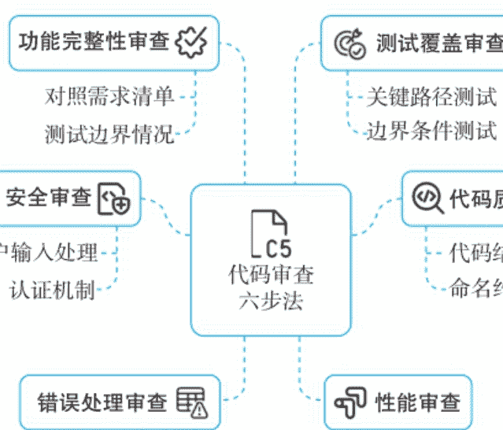

(1) 第一步：功能完整性审查。李明会对照最初的需求清单，逐项验证功能是否实现。他特别重视边界情况的测试，比如在开发一个电商小程序时，他会专门测试购物车数量为零、商品库存不足、网络中断等场景。

> “AI经常只考虑正常流程，但用户总是会做一些意想不到的操作。”

在审查中国本土化功能时，李明会特别关注移动端体验、微信支付集成、手机号验证等本地化需求。他发现AI生成的代码经常使用国外的设计模式，需要针对中国用户的习惯进行调整。

(2) 第二步：安全审查。安全审查是李明最重视的环节。他的经验是“所有用户输入都不可信”。在审查一个客户管理系统时，他发现AI生成的搜索功能存在SQL注入风险，于是立即进行了参数化查询的改造。

李明总结了几个高风险点：用户注册时的邮箱验证、密码存储方式、API接口的权限控制、敏感数据的传输加密。

> “特别是涉及支付和个人信息的功能，我会反复检查三遍。”

（3）第三步：错误处理审查。李明发现AI生成的代码往往缺乏完善的错误处理。他会仔细检查每个可能出错的地方，确保有合适的异常捕获和用户友好的错误提示。

在一个文件上传功能中，他将AI生成的简单错误提示“上传失败”改为更具体的提示：“文件大小超过5MB限制，请压缩后重试”。这种细节优化大大提升了用户体验。

（4）第四步：性能审查。性能审查需要经验判断。李明会特别关注数据库查询、循环嵌套、大文件处理等可能的性能瓶颈。他曾经发现AI生成的商品列表页面每次都会查询所有商品数据，没有分页功能，在商品数量增加后严重拖慢了加载速度。

> “性能问题通常在开发阶段不明显，但一旦用户量增长就会暴露出来。提前优化比后期重构成本低得多。”

（5）第五步：代码质量审查。李明会从可维护性的角度审查代码结构。他发现AI生成的代码经常缺乏模块化设计，所有逻辑都写在一个文件里。他会进行必要的重构，将代码按功能模块分离，添加清晰的注释说明。

> “虽然AI编写的代码能运行，但如果以后要修改或扩展功能，结构混乱的代码会让人头疼。”

(6) 第六步：测试覆盖审查。最后，李明会为关键功能编写测试用例。他不追求100%的测试覆盖率，而是重点测试核心业务逻辑、用户常用功能和安全相关操作。

【实践案例】电商平台审查。以李明最近完成的一个电商小程序为例，他在审查时发现了以下问题：

- (1) 功能层面：AI生成的购物车没有考虑商品下架的情况，用户可能将已下架商品添加到购物车中。李明增加了商品状态检查逻辑。
- (2) 安全层面：订单提交时缺乏金额校验，理论上用户可以通过修改前端代码以1分钱购买任何商品。李明在后端增加了价格一致性验证。
- (3) 性能层面：商品搜索功能每次都会遍历整个商品表，李明添加了索引并实现了缓存机制。
- (4) 用户体验层面：错误提示都是英文，李明改为中文并增加了具体建议。

【审查工具推荐】李明推荐了几种实用的审查工具：Sonar Qube用于代码质量检测，OWASP ZAP用于安全漏洞扫描，Chrome Dev Tools用于性能分析。

> “工具只是辅助，关键还是要养成系统性思考的习惯。代码审查看似增加了工作量，但实际上是在为未来节省时间。”李明强调，“一个经过系统审查的项目，后期的维护成本会大大降低，客户满意度也会更高。这是区分专业开发者和业余爱好者的重要标志。”

### 3. 自动化测试：功能正常的保障

“之前有一次订单系统在促销时崩溃，超卖50多单，差点赔钱，从那以后我开始认真对待测试。”李明现在已经掌握了AI辅助的测试策略。

（1）AI辅助测试策略。

1) 单元测试生成：验证独立功能模块。

- 函数输入输出验证。
- 边界条件和异常处理。
- 数据类型和格式检查。

2) 集成测试设计：验证模块间的协作。

- 完整业务流程测试。
- 数据流和状态管理。
- 第三方服务集成。

3) 端到端测试场景：模拟真实用户的操作。

- 完整用户流程验证。
- 跨浏览器兼容性测试。
- 移动端适配测试。

李明分享说：“AI生成的测试特别全面，它帮助我发现了中文用户名长度超限、春节期间预约逻辑漏洞等我完全没有想到的问题。现在我用Cypress做端到端测试，连微信支付的沙箱环境都能自动化验证。”

(2) 测试数据生成技巧。

- 1) 使用AI创建多样化的测试数据（包含特殊字符、极端数值、繁体字等）。
- 2) 涵盖正常、边界、异常三类场景。
- 3) 针对中国用户的习惯设计本土化测试用例。

### 4. 部署与维护：让项目顺利上线

完成开发后，项目的部署和维护同样重要。李明分享了如何通过AI简化这些过程。

（1）部署自动化流程。

1) 部署文档生成。

- 系统要求和环境配置。
- 安装和配置步骤。
- 数据迁移说明。

2) 部署脚本生成。

- 自动化安装和配置。
- 环境检查和依赖安装。
- 代码更新和构建。
- 服务配置和启动。
- 数据备份和恢复。

3) 监控与警报设置。

- 系统性能监控。
- 错误和异常追踪。
- 关键指标警报。

> 李明分享说：“一键部署脚本让我的成功率从70%提升到了95%。最重要的是有错误处理和自动回滚，出现问题能立即恢复到稳定版本。”

（2）维护支持。

1) 问题诊断助手。

- 错误日志分析。
- 系统问题排查。
- 性能瓶颈识别。

2) 维护计划生成。

- 任务清单定期维护。
- 规划更新和升级。
- 安全补丁管理。

3) 文档更新助手。

## 四、月收入过万的AI技术接单策略

### 1. 如何找到第一个技术客户

接单是技术变现的关键一步，但对于零基础入门者来说也是最大的挑战。李明分享了他如何获得第一批客户的经验。

（1）客户获取的五条路径。

1）个人网络转化。

- ●策略：将已有的人际关系转化为客户。
- ●实施：告知朋友、同事、家人你新增的技术服务。
- ●优势：信任基础已经建立，沟通成本低。
- ●案例：李明的第一个网站项目就来自以前的销售客户。李明在朋友圈发布了这样的信息：

> 最近学习了网站开发技术，现提供专业的中小企业网站建设服务。特别适合需要展示公司和产品的企业。前5名客户可享受特别优惠的价格，包含免费的微信小程序适配。有需要的朋友可以私信我。

2）垂直行业社群获客。

- ●策略：加入特定行业的社群，提供针对性的解决方案。
- ●实施：积极分享行业特定的技术见解，解答问题。
- ●优势：需求精准，竞争较小。
- ●案例：李明加入美容行业的微信群，为多家美容院开发预约系统。在行业社群中有效地分享示例：

> 分享一个最近为某美容院开发的智能预约系统案例。这个系统解决了高峰时段预约冲突、客户失约等问题，节省了前台50%的电话沟通时间。系统完美适配微信生态，客户可直接在公众号完成预约。有类似需求的老板可以看看是否适合你们的店铺。

3）内容营销引流。

- ●策略：创建有价值的内容以吸引潜在客户。
- ●实施：技术博客、案例分享、教程视频。
- ●优势：建立专业形象，被动获客。
- ●案例：李明在小红书分享“小企业如何低成本建网站”系列，获得了多次咨询。小红书内容标题示例：

> 不懂代码也能建网站！我如何帮助一家零基础创业公司3天上线公司官网+小程序。
> 2025年最实用的5种小企业数字化方案对比，成本差10倍！
> 案例分享：这家手工皂品牌的数字化改造让销量翻了3倍的秘密。

4）自由平台接单。

- ●策略：利用现有平台的流量和信任机制。
- ●实施：在Freelancer、Upwork、猪八戒网、程序员客栈等平台创建服务。
- ●优势：有现成的需求和支付保障。

5）线下场景营销。

- 策略：针对特定场景提供现场解决方案。
- 实施：参加行业展会、创业咖啡馆、共创空间。
- 优势：直接接触决策者，展示专业能力。

（2）新手接单的心理障碍与克服方法。

1）能力不足的恐惧。

- 心理障碍：担心技术能力不够，无法完成项目。
- 克服方法：从小项目开始，明确项目边界，利用AI辅助。
- 心态建议：“我不需要成为专家，只需比客户更懂技术”。

2）定价焦虑。

- 心理障碍：不知如何定价，担心因价格太高而无人问津。
- 克服方法：调研市场价格，考虑项目时间和复杂度。
- 实用策略：首个项目可适度降价，但明确说明是“首单优惠”。

3）拒绝恐惧。

- 心理障碍：害怕被拒绝或被质疑专业性。
- 克服方法：准备好作品集和技术解释，坦诚沟通能力边界。
- 心态建议：“每个拒绝都是学习机会，帮助我调整策略”。

李明说：“我记得第一次报价时，心跳加速到几乎说不出话。但我学会了一个技巧：不要提供单一价格，而是提供三个价格方案（基础、标准、高级），这样客户的关注点就从‘要不要做’变成了‘选哪个方案’，成交率高了很多。另外，在中国市场，强调你能提供的增值服务（如微信生态集成、中国传统节日营销素材等本地化服务）能显著提高客户的接受度。”

### 2. 案例展示与作品集建设

随着项目经验积累，打造专业的案例展示和作品集成为接单的关键。

（1）案例和作品集建设策略。

1）案例多样性。

- 策略：展示不同类型和行业的项目。
- 目的：证明适应能力和解决问题的广度。
- 建议：3～5个不同类型的精品案例优于大量同质项目。

2）结果导向。

- 策略：强调项目成果和客户价值。
- 目的：从技术转向商业价值沟通。
- 示例：“为客户开发的库存管理系统减少了30%的库存差错，每月减少约8 000元损失。”

3）问题-解决方案框架。

- 策略：明确阐述原始问题和你的解决方案。
- 目的：展示分析问题和解决问题的能力。
- 结构：问题背景→挑战→解决方案→实施→成果。

4）视觉呈现。

- 策略：使用专业截图、流程图和数据可视化图。
- 目的：增强专业感，便于非技术人员理解。
- 工具：使用AI生成专业图表和模拟截图。

（2）李明的作品集构建经验。

> “我为每个完成的项目都创建了标准化的案例文档，特别注重量化成果。例如，不只是说‘开发了库存系统’，而是说‘开发的库存系统减少了30%的库存差错，每月减少了约10 000元损失’。我发现国内的商业客户对这类结果导向的描述反应最积极。”

> “我还创建了一个简单的个人网站展示作品集，特别强调了我对国内商业环境的理解和对主流数字生态（如微信、支付宝）的集成能力。网站包括：

1）项目概览页（按行业分类的项目卡片）。
2）详细案例页（每个项目的深入分析）。
3）技术能力页（擅长的技术领域和工具）。
4）服务流程页（清晰的合作流程）。
5）客户见证页（真实客户反馈）。

> “为了增强专业感，我使用Canva可画设计了品牌标识和视觉风格，用即梦AI生成了一系列高质量的项目展示图片。这些AI生成的视觉元素显著提升了整体形象。”

### 3. 专业定价与谈判技巧

随着经验积累，合理的定价和谈判策略变得至关重要。李明分享了AI技术服务的定价框架和谈判技巧。

（1）三因素定价模型。

1）时间投入。

- 计算方法：估算项目所需小时数×个人时薪。
- 基准参考：初期时薪100～200元/小时，随着经验的积累而增长。
- 时间评估：将项目分解为具体任务，估算完成各任务所需的时间。

2）价值评估。

- 计算方法：衡量解决方案为客户创造的价值。
- 评估依据：节省成本、增加收入、解决痛点。
- 定价策略：价值的10%～30%作为合理报价。

3）市场因素。

- 行业标准：特定项目类型的市场价格区间。
- 竞争情况：本地或特定行业的供需关系。
- 客户预算：不同规模客户的预算期望。

（2）多层次服务模型。为提高成交率和客单价，李明采用三级服务模型。

1）基础版（满足核心需求）。

- 功能：必要的核心功能。
- 价格：市场平均价格的80%～90%。
- 目标：降低入门门槛，吸引价格敏感型客户。

2）标准版（最佳价值比）。

- 功能：核心功能+实用扩展。
- 价格：基础版的130%～150%。
- 目标：引导大多数客户选择，是最佳利润点。

3）高级版（全面解决方案）。

- 功能：全部功能+高级支持。
- 价格：标准版的150%～200%。
- 目标：提供参照点，凸显标准版的价值。

【李明的定价案例】某企业网站项目的服务方案如表5-2所示。

| 服务内容 | 基础版（4 500 元） | 标准版（6 800 元） | 高级版（10 800 元） |
| :--- | :--- | :--- | :--- |
| 页面数量 | 5 页基础页面 | 8 页内容页面 | 12 页完整网站 |
| 内容管理系统 | 简易系统 | 完整 CMS | 高级 CMS＋培训 |
| SEO 优化 | 基础优化 | 完整 SEO | 高级 SEO＋关键词 |
| 表单功能 | 基础联系表单 | 多功能表单 | 定制业务表单 |
| 微信生态集成 | 基础微信分享 | 微信 H5 适配 | 小程序＋公众号文章 |
| 修改次数 | 1 次大修改 | 2 次大修改 | 无限制修改 |
| 技术支持 | 1 个月 | 3 个月 | 6 个月 |
| 上线时间 | 14 天 | 10 天 | 7 天 |
| 额外福利 | — | 免费 Logo 设计 | Logo＋名片＋企业微信素材设计 |
| 特别服务 | — | — | 企业视频号内容策划＋1 篇 AI 爆文 |

表5-2 某企业网站项目的服务方案

（3）谈判策略与技巧。

1）需求挖掘为先。

- ●技巧：谈价格前深入了解客户的需求和痛点。
- ●问题示例：“这个网站对贵公司的业务有何具体作用？”
- ●价值：根据需求的重要性调整定价策略。

2）价值导向沟通。

- ●技巧：讨论投资回报而非成本。
- ●语言示例：“这个系统每月可为您节省约20小时的人工时间，按人力成本计算……”
- ●方法：提供具体数字和比较，结合客户行业特点计算投资回报。

3）比较定价法。

- ●技巧：与替代方案比较总拥有成本。
- ●对比项：雇用专职员工、使用SaaS服务。
- ●示例：“相比每月订阅费为1 000元的同类服务，我们的解决方案12个月内就能回本，而且没有数据被锁定的风险。”

4）预算探索。

- ●技巧：巧妙了解客户的预算范围。
- ●问题示例：“为了给您提供最合适的方案，请问您对此项目有预算范围吗？这样我可以优化功能配置。”
- ●应对：根据预算调整方案而非简单降价，始终保持价值感。

5）非价格价值包装。

- ●技巧：增加不增加成本但提升感知价值的元素。
- ●示例：详细文档、使用培训、定期报告、微信社群技术支持。
- ●效果：提高服务专业度，降低价格敏感性。

> 【李明的谈判经验】“最有效的谈判不是关于价格的讨论，而是关于价值的对话。曾有位客户对7 500元的报价感到犹豫，但当我计算出解决方案每月能节省约9 000元人力成本后，价格就不再是问题。关键是将抽象的技术转化为具体的业务价值。”

> “在中国市场，我还发现强调‘面子’价值特别有效。比如，告诉餐饮客户‘您的竞争对手已经全面数字化，而您还在用纸质记录’，或者告诉美容院老板‘高端客户越来越期望通过小程序预约’等，这类关于市场形象和品牌定位的讨论往往比纯成本讨论更有说服力。”

> “另外，在当前的中国市场，增加一些AI亮点功能特别有吸引力，如‘智能客户画像分析’‘自动化内容推荐’等。这些功能实现成本低，但能给客户带来科技感和前沿感，显著提升服务的感知价值。”

张文杰补充说：“定价心理学同样重要。例如，定价为6 999元比7 000元更容易接受；提供三个价格选项比单一价格的成交率高；先提出高价版本再回到标准版本会提高客户的接受度。中国客户特别注重‘实惠感’，所以适当包装一些‘赠送’的增值服务有显著的效果。现在的趋势是，越来越多的客户愿意为‘一站式解决方案’支付溢价，所以将技术服务与内容创作或运营支持打包是提高客单价的好策略。”

【文化洞察】在中国的商业环境中，建立“关系”对谈判至关重要。提前了解客户的行业背景、竞争环境和个人兴趣，在谈判中适时展示这些了解，能显著提高成交率。中国企业越来越注重长期合作潜力，而不仅是一次性交易。

【案例：如何应对客户压价】客户：“你的网站报价6 800元，太贵了，能不能降到4 000元？”

李明回应：“王总，我理解预算的重要性。6 800元的标准版包含完整CMS（内容管理系统）和微信小程序集成，能帮您提升30%的线上预约率，长期节省营销成本。如果预算有限，我推荐4 500元的基础版，保留核心功能，后期可按需升级。您觉得哪个方案更合适？”

结果：客户选择了标准版，认可了价值的说明。

建议：不直接降价，而是通过方案对比和价值沟通引导客户。

### 4. 客户关系管理与长期合作

获取客户只是第一步，建立长期的合作关系才是稳定收入的关键。李明分享了他的客户关系管理策略。

（1）客户满意度与忠诚度建设。

1）期望管理。

- 原则：承诺要低于实际能力，留出至少20%的余量。
- 实践：清晰定义项目范围和交付标准。
- 工具：详细的项目计划和里程碑文档。
- 中国特色：考虑节假日因素，预留充足的缓冲时间。

2）沟通系统化。

- 频率：建立固定的更新频率（如周报）。
- 形式：结构化的状态报告（进度、挑战、决策点）。
- 工具：项目管理软件或简单的更新模板。
- 沟通渠道：根据客户喜好选择（企业微信、钉钉等）。

3）价值证明。

- 方法：定期展示客户获得的具体价值。
- 工具：数据报告、使用情况分析。
- 频率：项目中期和结束后的价值总结。
- 视觉化：生成直观的数据图表。

4）主动支持。

- 策略：解决问题前让客户意识到问题。
- ●实践：定期检查系统的运行状况。
- ●工具：自动监控和预警系统。
- ●增值服务：节假日安全检查、流量高峰准备。

（2）长期合作模式建立。

1）维护合同权益。

- ●内容：定期的技术支持、系统更新和问题解决。
- ●定价：原项目价格的15%～25%/年。
- ●价值主张：系统持续优化、防范技术债务。
- ●特色服务：节假日保障、紧急支持。

2）分阶段开发。

- ●策略：将大项目分为多个连续阶段。
- ●优势：降低客户的初始投资，证明能力后再扩展。
- ●实践：每阶段末评估并规划下一阶段。
- ●案例：先做官网，再做小程序，最后做会员系统。

3）提供增值服务包。

- ●模式：在原有项目的基础上提供额外服务。
- ●示例：高级分析功能、数据迁移、用户培训。
- ●定价：以原项目为基础的增量定价。
- ●套餐化：设计季度/半年度服务包。

4）顾问式服务。

- ●转型：从执行者到战略顾问。
- ●服务：技术战略、数字化转型建议。
- ●优势：提高客户的依赖度和服务的价值。
- ●实施：月度/季度数字化战略会议。

> 【李明的客户留存经验】“我发现客户流失通常不是因为价格或技术问题，而是因为沟通不足。我建立了一个简单的客户关怀系统：项目完成后1周、1个月和3个月分别跟进，主动询问使用情况和可能存在的问题。这种主动性让我的客户续约率达到了75%。”

> “在中国市场，我还特别注重‘人情维护’——记录客户的生日、公司成立周年等关键日期，在适当的时候送上祝福或小礼物。现在我开始使用AI工具帮我管理这些节点，自动生成个性化的祝福信息和创意礼品建议，效果非常好。”

> “另一个有效策略是‘教育赋能’——我定期组织线上小型培训，教客户如何更好地使用我开发的系统，或分享最新的数字营销趋势。这些免费的增值服务大大提高了客户黏性，也经常带来新的业务机会。”

（3）潜在问题处理。

1）范围蔓延。

- ●问题：客户不断增加额外需求。
- ●解决方案：建立正式的变更请求流程。
- ●工具：变更评估表（时间或成本影响）。
- ●技巧：提供变更优先级排序建议。

2）延期风险。

- ●问题：项目面临延期风险。
- ●解决方案：提前沟通，提供选项。
- ●方法：“没有坏消息，只有迟到的消息”。
- ●策略：提供阶段性可用版本。

3）收款困难。

- ●问题：客户延迟付款。
- ●解决方案：给出明确的付款里程碑和条款。
- ●方法：分阶段收款，关键功能提前收款。
- ●应对：礼貌而坚定的跟进机制。

张文杰补充说：“从单个项目思维转向客户终身价值思维是关键转变。一位长期客户的价值远超一次性项目。投资于关系建设和持续价值交付会带来稳定的收入流和宝贵的口碑推荐。在国内的商业环境中，良好的关系和口碑推荐是获取高价值客户的最佳渠道。2025年的数据显示，来自推荐的客户的平均客单价比其他渠道高出40%，成交率高出60%，这充分说明了关系的价值。”

## 五、AI编程的高阶发展路径

随着你在AI编程领域积累了基础经验和项目实践，一个更广阔的职业发展空间正在展开。当前AI技术应用已经深入各行各业，创造了一系列高价值的新兴应用方向。掌握了前面章节介绍的能力后，你可以探索这些更加智能化、自动化的解决方案，进一步提升你的市场价值和收入潜力。

李明也正在这条路上探索：“在完成了几个中型项目后，我发现简单的网站和应用开发已经不能满足一些高端客户的需求。他们希望看到更智能化、自动化的解决方案。这促使我开始学习如何利用AI工具构建真正能够自主工作的系统。”

张文杰解释道：“市场总是在变化的。2023年，会用AI写代码就很超前；2024年，这已经变得普遍；而到了2025年，仅仅会用AI生成代码已经不足以在市场上脱颖而出。真正的机会在于构建能够自主运行的AI自动化系统，让它们像可靠的员工一样解决实际业务问题。”

### 1. AI自动化解决方案设计师：从编码到无代码构建

（1）市场趋势与转变。2025年，AI解决方案开发经历了重要的转变：从最初需要专业编程能力的开发方式，逐步演变为现在普通人也能通过无代码工具完成的设计过程。这一转变背后有以下两个关键技术突破。

1）AI智能体技术的成熟。基于大语言模型的AI智能体已经能够理解指令、制定计划、使用工具、执行任务并学习改进。这些“AI员工”可以自主完成从数据分析到内容创作的多种任务。

2）MCP协议的标准化。模型上下文协议（model context protocol，MCP）由Anthropic公司于2024年推出，为AI模型与外部工具的交互提供了标准化框架。这使得不同工具和服务能够更容易地集成到AI系统中。

> “这些技术进步最重要的意义在于降低了门槛。”张文杰强调，“现在，普通人不需要了解复杂的技术细节，就能利用可视化工具构建强大的AI自动化系统。真正的核心竞争力转向了对业务流程的理解和解决问题的能力。”

（2）无代码和低代码AI自动化工具的兴起。一批优秀的无代码和低代码AI自动化工具正在改变普通人与AI技术的关系。

1）扣子：我国本土开发的AI智能体编排平台，以其直观的中文界面和丰富的本地服务集成（如微信生态、支付宝、淘宝API等）成为中小企业的首选工具。扣子平台允许用户通过拖拽方式设计AI工作流，无须编写代码。

2）n8n：开源的工作流自动化平台，提供了丰富的节点系统和可视化界面。用户可以将AI模型与各种工具和服务连接起来，设计自动化流程。其强大的社区支持使得新手也能找到大量现成的模板。

3）Make：企业级自动化平台，因其稳定性和安全性在企业市场中占据优势。Make特别适合需要处理敏感数据和复杂业务逻辑的场景。

（3）市场价值与定位。AI自动化解决方案设计师的市场行情如下。

1）兼职/自由职业顾问：日薪800～1 800元。

2）企业内部专家：月薪12 000～25 000元。

3）定制解决方案：项目价格8 000～50 000元不等。

张文杰表示：“当前国内市场对这类人才的需求极其旺盛。从我的观察来看，中小企业普遍希望通过AI自动化提高效率，但缺乏专业技术人才，这给了解业务流程且掌握了无代码或低代码AI工具的普通人提供了一个绝佳的市场机会。去年我认识的一位人力资源经理，通过学习使用扣子平台，短短6个月就成功将自己的月收入提高了300%，他主要为企业构建招聘和人才管理的AI自动化解决方案。”

### 2. 普通人的AI自动化解决方案案例分析

(1) 案例一：销售线索管理自动化。李明为一家中型B2B企业构建销售线索管理系统。

业务背景：该企业每周从各渠道获取大量潜在客户的信息，销售团队需要手动筛选、分类和跟进，非常费力耗时且容易遗漏重要线索。

解决方案：通过扣子平台构建的AI销售助手，能够实现：

- 1) 自动收集并整合来自公司网站、邮件、展会和社交媒体的潜在客户信息。
- 2) 对线索进行价值评估和意向度分类。
- 3) 自动生成个性化的初次接触邮件。
- 4) 根据客户反应调整跟进策略。
- 5) 生成详细的销售线索分析报告。

实施方法：

- 1) 在扣子平台创建数据收集流程，连接各种信息源。
- 2) 设计线索评估规则，让AI根据行业特征和历史数据评估线索价值。
- 3) 创建邮件模板库和自动化发送流程。
- 4) 设计客户反应分析和跟进决策树。
- 5) 构建报告生成和分发机制。

成果：该系统实施后，销售团队的线索处理效率提高了70%，有效线索转化率提升了45%，销售人员可以专注于高价值客户的深度交流，而非烦琐的数据处理。

项目收费：15万元+3万元/年维护费。

(2) 案例二：内容创作与营销自动化。一位之前是市场营销经理的创业者，利用n8n平台构建内容营销自动化系统。

业务背景：她为多家企业提供内容营销服务，需要定期为不同平台（公众号、小红书、知乎等）创作内容，分析内容表现并优化创作策略。

解决方案：通过n8n构建的内容创作与发布系统，能够实现：

- 1) 自动搜集行业热点新闻和信息。
- 2) 根据行业热点和客户产品的特点，生成内容创意和大纲。
- 3) 自动创作初稿，包括文字、图片和视频脚本。
- 4) 根据不同平台的特点调整内容格式和风格。
- 5) 自动到各平台发布内容，并选择最佳发布时间。
- 6) 收集互动数据并生成内容表现分析报告。
- 7) 持续学习高互动内容的特点，优化创作策略。

实施方法：

- 1) 使用n8n的RSS节点和网页抓取功能，建立行业资讯采集流程。
- 2) 集成大语言模型进行内容创作和风格调整。
- 3) 配置各平台的API接口，实现自动发布。
- 4) 设计数据收集和分析流程，包括评论的情感分析。
- 5) 建立内容表现的反馈循环机制。

成果：系统实现后，她能够同时服务10位以上的客户，每月创作超过100篇原创内容，内容质量和互动率持续提升，月收入从2万元增长到12万元。

服务定价：基础套餐8000元/月/品牌，包含每周8篇优质原创内容及数据分析。

### 3. 失败案例复盘：AI自动化项目的常见陷阱

在分享成功经验的同时，李明也坦诚地分享了他在AI自动化项目中遇到的失败和教训。这些真实案例能帮助读者避开常见陷阱，降低学习成本。

(1) 案例一：需求不清晰的接单教训。

项目背景：李明接到一家中型电商公司的订单，要求开发一个智能客户分析系统。客户的需求描述比较笼统，只说“希望通过AI分析客户行为，提高销售转化率”。因为项目金额较高（8万元），李明急于拿下这个项目，没有进行充分的需求挖掘就开始开发。

问题过程：

- 1) 李明基于自己的理解，使用扣子平台搭建了一个客户行为分析系统，包含购买模式识别、客户分层和个性化推荐功能。
- 2) 开发完成后，客户提出这不是他们想要的系统，他们实际需要的是一个能够分析客户的聊天记录并自动识别销售线索的系统。
- 3) 双方进入了长达两周的拉锯战，最终李明不得不从头开始重建系统，项目严重超期。
- 4) 虽然最终交付了符合要求的系统，但由于沟通不畅和返工，项目实际成本远超预算，李明几乎没有盈利。

关键教训：

- 1) 需求文档至关重要：无论客户多着急，都必须形成明确的书面需求文档并获得确认。
- 2) 提问的艺术：开发前必须问“对的问题”，例如：“您期望系统分析哪些具体数据？”“分析结果将如何具体应用到业务中？”“您现有的工作流程是什么样的？希望AI如何改进它？”
- 3) 原型确认：在全面开发前，先构建简单原型并获得客户确认。
- 4) 分阶段付款：根据项目里程碑设置付款节点，降低风险。

李明反思：“这个教训让我明白，技术能力只是成功的一部分，清晰的沟通和严谨的项目管理同样重要。现在我有了一套标准化的需求调研问卷和确认流程，确保双方对项目目标有一致的理解，这大大降低了返工的风险。”

(2) 案例二：过度依赖AI判断的危险。

项目背景：李明为一家人力资源公司开发了一个简历筛选自动化系统，旨在从大量应聘者中筛选出合适的候选人。系统设计为完全自动化，AI直接决定候选人是否进入面试环节。

问题过程：

- 1) 系统上线初期运行良好，大大提高了HR团队的工作效率。
- 2) 3个月后，客户发现有几位非常优秀但不符合传统模式的候选人被系统自动筛掉，这些人后来被竞争对手聘用并且表现出色。
- 3) 调查发现，AI系统形成了一些隐性偏见，倾向于选择与历史成功案例相似的简历，而忽略了具有创新背景或非常规职业路径的候选人。
- 4) 客户对系统失去信心，要求重新设计。

解决方案：

- 1) 李明重新设计了系统架构，从“AI决策”模式改为“AI辅助人类决策”模式。
- 2) 新系统会提供初步的筛选和评分，但关键决策点保留给人类HR专家。
- 3) 增加了“多样性推荐”功能，确保系统能识别出可能有潜力但不符合常规模式的候选人。
- 4) 设计了持续学习机制，系统能从HR的决策中学习改进。

关键教训：

- 1) AI适合辅助而非完全替代：在涉及重要决策的场景中，AI应该辅助人类决策，而非完全替代。
- 2) 警惕算法偏见：AI系统可能会放大训练数据中的隐性偏见，需要特别关注这一点。
- 3) 设计反馈循环：良好的AI系统应当包含人类反馈机制，持续自我改进。
- 4) 关注透明度设计：确保AI的决策过程是可解释的，让用户理解为什么系统会给出特定建议。

> 张文杰补充道：“这个案例说明了AI自动化和人机协作的重要区别。完全自动化并不总是最佳选择，特别是在需要创造性思维、道德判断或处理边缘案例的场景中。设计良好的人机协作系统往往比纯自动化系统更有价值。”

(3) 案例三：过度承诺的扩展性挑战。

项目背景：李明接到一个初创公司的项目，要求为其开发一个内容管理系统。客户强调系统需要具备“高度可扩展性”，能够随着业务增长而轻松扩展。李明信心满满地承诺可以满足需求。

问题过程：

- 1) 李明使用n8n平台快速构建了一个功能完善的内容管理系统，客户在初期非常满意。
- 2) 6个月后，客户的业务迅速增长，每日处理的内容量增加了30倍，用户数增加了20倍。
- 3) 系统开始出现严重的性能问题：响应缓慢、偶尔崩溃，且某些自动化流程无法处理剧增的数据。
- 4) 调查发现，问题不在于n8n平台本身，而在于李明最初的系统设计没有考虑这种规模的数据处理需求。

解决方案：

- 1) 李明不得不重新构建系统，这一次引入了专业开发团队的支持。
- 2) 新系统采用了混合架构：核心业务逻辑仍使用无代码平台，但数据处理部分改用了专业开发的微服务架构。
- 3) 客户同意支付额外费用，但这次经历损害了李明的专业信誉。

关键教训：

- 1) 了解工具的限制：无代码平台有其局限性，特别是在处理大规模数据方面。
- 2) 诚实评估能力边界：不要为争取项目而过度承诺超出自己能力范围的功能。
- 3) 预留扩展空间：在初期设计时就考虑未来扩展的可能性，预留接口和升级路径。
- 4) 明确界定服务范围：在合同中清晰定义系统的性能参数和使用限制。

李明总结：“这个教训让我理解了‘知道自己不知道什么’的重要性。现在接到超出我能力范围的需求时，我会坦诚说明并寻求合作伙伴，而不是冒险单独承接。长期来看，这种诚实的态度反而赢得了客户的信任并接到了更多的业务。”

【规避风险的通用策略】张文杰总结了以下几个避免AI自动化项目失败的核心策略。

(1) 需求流程结构化。
- 1) 使用标准化的需求调研问卷。
- 2) 创建视觉化的流程图和原型。
- 3) 获得客户书面确认的需求文档。

(2) 阶段性交付。
- 1) 将项目分解为明确的里程碑。
- 2) 每个阶段结束前获得客户的反馈。
- 3) 保持代码和流程的灵活性以适应变化。

(3) 边界管理。
- 1) 明确定义项目范围和排除内容。
- 2) 设置清晰的变更请求流程和额外费用标准。
- 3) 诚实沟通技术限制和风险。

(4) 持续学习与适应。
- 1) 将失败视为学习机会。
- 2) 建立个人“错误数据库”并记录教训。
- 3) 与社区分享经验，避免重复他人错误。

> “每个失败案例都是成长的催化剂。”李明强调，“我现在的项目成功率超过90%，很大程度上归功于早期犯错后的反思和调整。勇于分享失败经验，这对新入行者来说可能比分享成功案例更有价值。”

### 4. 入门路径与技能发展

从AI编程入门到成为AI自动化解决方案设计师，李明和张文杰总结了一条适合普通人的发展路径。

(1) 阶段一：基础工具熟悉（第1～2周）。
- 1) 注册并学习一个无代码或低代码平台（推荐扣子或n8n）。
- 2) 完成平台提供的入门教程。
- 3) 尝试构建2～3个简单的自动化流程。
- 4) 学习如何使用基本AI功能。

(2) 阶段二：应用能力构建（第3～4周）。
- 1) 学习如何设计业务流程和决策逻辑。
- 2) 掌握各类API和服务的集成方法。
- 3) 理解AI大模型的能力边界和最佳使用实践。
- 4) 尝试为自己的工作构建一个实用的自动化工具。

(3) 阶段三：解决方案设计（第5～8周）。
- 1) 学习完整解决方案的设计方法。
- 2) 掌握用户需求的分析和转化技巧。
- 3) 开发测试和优化的系统方法。
- 4) 构建一个完整的商业案例作为作品集。

(4) 阶段四：专业化与市场定位确立（持续发展）。
- 1) 选择特定行业或业务领域深耕。
- 2) 构建解决方案模板库，提高复用率。
- 3) 提升项目管理和客户沟通能力。
- 4) 建立专业品牌和营销渠道。

> 【李明的转型心得】“作为销售转AI的亲历者，我最大的发现是：业务理解比技术能力更重要。我在销售工作中的客户需求分析经验在设计AI自动化解决方案时成了最大优势。
> 
> “我的入门路径很务实：先用扣子为自己开发小工具——自动整理客户资料、生成跟进邮件、分析销售数据等的工具。这些工具既为我节省了时间，也让我熟悉了平台操作。然后开始帮朋友解决问题，比如为HR朋友开发简历筛选系统，逐渐建立了作品集。
> 
> “关键是坚持解决实际问题，而不是炫耀技术。客户只关心结果，不关心你用什么技术。现在我每月稳定接2～3个项目，月收入超过4万元，大部分项目来自口碑推荐。我的建议是：不要被技术术语吓倒，从无代码平台入手，选择熟悉的行业深耕。行业专精+AI应用在当前市场极具竞争力。”

【张文杰的观察】“现在AI就业市场有三个明显趋势：技术门槛大幅降低，无代码工具让普通人也能开发AI应用；行业知识越来越值钱，纯技术人才优势在减弱；本地化方案溢价显著，特别是融合我国商业环境的AI系统。
> 
> “这是历史性的机遇期。无论什么背景，通过系统学习都可能在6～12个月内实现职业跃升。核心是将AI与你的行业经验相结合，培养解决实际问题的能力。技术会变，但解决问题的能力永远稀缺。”

## 实战练习

21天AI编程启动挑战如下。

(1) 第一阶段：入门与准备（第1～7天）。
- 1) 学习HTML或CSS的基础概念。
- 2) 完成一个简单的个人网页。
- 3) 熟悉扣子工作流。
- 4) 使用Canva可画设计简单的UI界面。
- 5) 完成一个在线简历页面项目。

(2) 第二阶段：能力构建（第8～14天）。
- 1) 学习JavaScript基础。
- 2) 创建一个交互式小应用（如待办事项、计算器）。
- 3) 使用AI帮助实现更复杂的功能。
- 4) 学习基本调试和问题解决的方法。
- 5) 适配微信H5环境。

(3) 第三阶段：实战准备（第15～21天）。
- 1) 完成一个综合项目（个人作品集网站）。
- 2) 用即梦AI和Canva可画创建专业视觉素材。
- 3) 准备服务介绍和定价策略。
- 4) 建立项目流程和客户沟通模板。
- 5) 在小红书或知乎发布技能展示。
- 6) 开始寻找第一个客户。

(4) 执行要点。
- 1) 每天至少投入2小时学习和实践。
- 2) 使用AI辅助，但要确保理解核心概念。
- 3) 记录学习历程和成果。
- 4) 找一个学习伙伴互相督促和交流。
- 5) 关注我国特色应用场景（如微信生态集成）。

## 思考

1. 你觉得AI编程和传统编程的区别在哪里？它如何让一个“代码小白”也能在几个月内接单赚钱？这种“技术平民化”会如何改变你的职业选择？
2. 你的非技术背景中，哪些经验和能力可能成为AI编程中的隐藏优势？具体如何转化这些优势以解决现实业务问题？
3. 在接单过程中，技术能力和沟通能力哪个更重要？为什么？如何在这两方面取得平衡，尤其是在面对国内客户时？
4. AI工具在编程中扮演什么角色？它是简单的代码生成器，还是更深层次的合作伙伴？如何最大化豆包、Canva可画等国内AI工具的协同优势？
5. 随着AI工具的发展，编程服务的价值核心会发生什么变化？未来中国市场上程序员的核心竞争力会是什么？

## 章末寄语：AI时代的全民编程革命

AI正在重新定义技术门槛。在这个新时代，编程不再是编写代码，而是解决问题的能力、沟通需求的艺术、将想法转化为方案的创造过程。

李明的故事证明，成功的技术转型不需要拥有计算机学位或多年的编程经验，需要的是学习意愿、解决问题的热情以及利用新工具创造价值的智慧。

2025年中国AI生态已经成熟：DeepSeek、豆包、通义等大模型对中文编程支持日趋完善，即梦AI、Canva可画等创意工具能生成高质量的视觉元素。这些本土化工具极大降低了入门门槛，创造了前所未有的机遇。

无论你是职场新人、正在转型的专业人士还是寻求副业的上班族，AI编程都为你提供了全新的技术入门路径。这条路径不仅能带来收入增长，更能开启全新的职业可能性。

技术不再是障碍，真正的挑战是迈出第一步。正如李明所说：“我并不特别，只是比多数人更早开始尝试，更愿意在舒适区外学习，更善于将全球技术与中国需求相结合。”

技术创造力的时代已经到来，你已经拥有最重要的工具——AI和行动的决心。

今天，就从一个简单项目开始，见证技术如何重塑你的职业轨迹。

# 第6章 多元变现：打造收入倍增的AI副业矩阵

## 开篇：王睿的副业矩阵突破

“副业收入终于突破2万元了！”王睿兴奋地展示着收入表格——AI内容创作、电商销售、数据咨询、付费社群、线上课程和品牌合作，6个收入源总计收入20860元。

“半年前我还在为单一副业如何突破5000元而焦虑。”王睿回忆道。

张文杰点头：“典型的新手错误是试图从单一渠道获取最大收益，忽略了副业间的协同效应。”

王睿展示了他的发展历程：“关键是我发现了副业间的‘1+1>2’效应。比如电商经验为数据分析提供了实战案例，数据分析又优化了电商运营，写作技能帮我制作高转化产品描述，这些专业积累又通过课程变现。”

张文杰总结：“这就是‘副业矩阵效应’。很多人把AI工具当作单点突破工具，而不是构建协同系统。在当前，关键是如何将DeepSeek、豆包、Cursor等组合成完整的创收引擎。”

“如何系统构建这样的副业矩阵？”张文杰问道。

王睿笑道：“这正是我想分享的——一套AI副业矩阵构建方法，让普通人突破时间瓶颈，实现收入倍增。就像搭乐高积木，有方法、有步骤，每个人都能构建属于自己的财富引擎。”

## 一、时间杠杆：如何突破单一副业的收入上限

### 1. 单一副业的天花板效应

大多数副业创业者面临的首要障碍是时间限制。王睿分析了单一副业模式存在的内在瓶颈。单一副业的收入天花板公式为：

最大月收入 = 可投入的时间(小时) × 每小时的产出 × 时薪单价

这个公式看似简单，却揭示了单一副业的根本限制——它是一个线性关系，收入直接受限于你能投入的时间。

以一名普通上班族为例，典型的时间约束是：

- (1) 工作日每天可投入2小时（10小时/周）。
- (2) 周末每天可投入4小时（8小时/周）。
- (3) 月均可投入约72小时。

> “这72小时就像是你的‘副业时间银行’。”王睿说道，“你每个月只有这么多时间可以花，一旦用完，收入就到了天花板。除非你能突破物理规律，让一天超过24小时。”

传统副业模式的收入上限计算如表6-1所示。

| 副业类型 | 每小时产出 | 市场单价 | 72小时月收入上限 |
| :--- | :--- | :--- | :--- |
| 内容创作 | 1篇文章/2小时 | 300元/篇 | 约10800元 |
| 数据分析 | 1个报告/8小时 | 2000元/报告 | 约18000元 |
| AI设计服务 | 1个设计/1.5小时 | 200元/设计 | 约9600元 |
| AI编程开发 | 1个功能/4小时 | 800元/功能 | 约14400元 |

表6-1 传统副业模式的收入上限

“看到问题所在了吗？”王睿指出，“即使你选择了时薪较高的数据分析，在时间有限的情况下，每月的收入也有明显的上限。而且这还是理想状态，没有考虑获客成本、学习时间和疲劳因素。就像一辆车，不管性能多好，只要油箱容量有限，行驶里程就有上限。”

“这也解释了为什么很多副业创业者最初进步很快，但不久后就陷入了收入平台期，”王睿继续说道，“就像你撞到了一堵无形的‘时间墙’。AI工具虽然提高了效率，但它们并没有解决这个根本问题——单一服务模式下的时间天花板。”

### 2. 时间杠杆原理：从线性增长到指数增长

面对时间瓶颈，王睿提出了“时间杠杆”策略，将副业模式从“时间换钱”转变为“系统创造价值”。

“我们要从投入‘时间’变成投入‘系统’，”王睿解释道，“就像从手动挖井变成建设自动化水厂，前者每天要工作才有水，后者建好系统后水会自动流出。这就是为什么一些朋友每天用豆包写文章挣钱，而我却用扣子和Make设计自动化写作系统。”

表6-2展示了五种时间杠杆策略之间的对比。

| 杠杆策略 | 原理 | 适用副业类型 | 杠杆系数 | 实施难度 |
| :--- | :--- | :--- | :--- | :--- |
| 知识产品化 | 一次创建，反复销售 | 内容创作、培训、咨询 | 高 | 中 |
| 流程自动化 | 用系统代替人工的重复劳动 | 电商、营销、客户服务 | 中 | 中低 |
| 团队扩展 | 整合他人的时间和技能 | 服务类、项目制副业 | 中高 | 中高 |
| 用户生成内容（UGC） | 引导用户创造内容 | 社区、平台类副业 | 高 | 高 |
| AI工具开发 | 开发工具供他人使用 | 技术类、解决方案类 | 最高 | 高 |

#### 表6-2 五种时间杠杆策略对比

“在当前，这五种杠杆策略更加容易实现了，”王睿补充道，“特别是有了DeepSeek和豆包这样的AI助手，即使是非技术背景的人也能实现很多自动化和产品开发。这就像给了普通人一个‘魔法棒’，让他们也能构建复杂系统。”

王睿通过一个案例说明了时间杠杆的威力：“最初我尝试做AI写作服务，每小时能完成约1500字的高质量内容，按市场价0.3元/字计算，每小时产值约450元。如果每月投入70小时，理论上限约为31500元。但这需要我不断写作，一旦停止，收入也就停止了，就像踩在了原地不动的跑步机上。

“但我转向知识产品化后，花了40小时开发了一个‘AI写作实战课程’，定价399元。上线3个月，销售了200份，总收入约8万元。平均每小时产值约2000元，是服务模式的4倍多。而且销售继续进行，无须我额外投入时间。这就像从在跑步机上奔跑变成了坐在列车上向前移动，效率差别巨大。最关键的是，这个销售在我睡觉时也在进行。”

### 3. 三阶段时间杠杆实施路径

王睿总结了他的时间杠杆实施路径，这是一个循序渐进的三阶段模型（见图6-1）。

#### (1) 第一阶段：效率最大化（第1～2个月）
目标：在现有副业模式下提升每小时的产值。

- 1) 流程优化：将副业的每个环节标准化，消除无效步骤。
  - 使用飞书文档创建标准化操作流程。
  - 建立客户需求收集表和项目执行清单。
  - 设计模板库，减少重复工作。

- 2) AI辅助：引入适当的工具以提升执行效率。
  - 利用DeepSeek处理内容创作和编辑。
  - 使用豆包生成创意和营销文案。
  - 应用通义万相分析数据和生成报告。

- 3) 价格调整：通过专业包装适当提升定价。
  - 设计专业服务包，强调独特价值。
  - 引入不同服务等级，提高客单价。
  - 设置项目最低起订金额。

- 4) 客户筛选：识别并专注于高价值客户。
  - 分析历史客户数据，找出最有价值的客户特征。
  - 调整营销渠道，吸引理想客户群体。
  - 逐步减少低价值项目，集中精力于高回报工作。

> “第一阶段就像是给现有汽车更换高性能的零件，”王睿说道，“不改变基本框架，但大幅提升效率。我们还没有突破时间与收入的直接关联，但已经提高了时间的产出比。”

【实操案例】王睿的AI内容创作流程优化。“最初我为客户创作一篇5000字的行业报告需要花费8小时，收费1500元。通过流程优化和AI工具组合，我将时间缩短至3小时，同时定价提高至2500元。单位时间产值从187.5元/小时提升至833元/小时，提升了3.4倍。”

王睿分享了他的具体做法：

- 1) 使用DeepSeek创建内容框架和初稿。
- 2) 开发行业报告模板库，涵盖20个常见主题。
- 3) 建立专业术语库，提高写作精准度。
- 4) 使用通义进行数据可视化，提升报告的专业感。
- 5) 创建客户需求收集表，减少沟通成本。

> “这个阶段看似基础，但对新手来说至关重要，”王睿强调，“它可以让你从杂乱无章的工作状态进入系统化思维，为后续阶段打下基础。就像是先学会高效种田，才能考虑建设自动化农场。我发现很多人急于追求高级策略，却忽略了基础流程的优化，结果是‘高速公路上开拖拉机’，再好的道路也无法提速。”

#### (2) 第二阶段：模式转换（第3～6个月）
目标：从时间变现转向系统创造价值。

- 1) 服务产品化：将服务经验转化为可复制的产品。
  - 将常见服务内容整理为数字产品。
  - 开发教程、模板、工具等一次创建、多次销售的产品。
  - 建立产品阶梯，从低价入门到高价高端。

- 2) 获客自动化：建立自动获客和交付系统。
  - 设计内容营销自动化流程。
  - 构建产品展示和销售系统。
  - 实现部分客户服务自动化。

- 3) 平台搭建：从个人服务者向平台搭建者转变。
  - 开始构建小型社区或用户群体。
  - 设计互动机制和价值循环系统。
  - 打造个人品牌和专业影响力。

- 4) 被动收入源构建：构建至少一个不需持续投入的收入源。
  - 上线数字产品销售系统。
  - 建立联盟营销或分销系统。
  - 开发小型订阅服务。

> “第二阶段是关键转折点，”王睿说，“你开始从‘打工者’转变为‘系统设计者’，这就像从体力劳动者变成工程师，开始设计而不仅仅是执行。现在的AI工具让这个转变比过去容易得多。例如，现在你可以用DeepSeek设计整套课程框架，用豆包生成交互式的学习材料，用即梦AI创建专业视觉，这在两年前简直是天方夜谭。”

【实操案例】王睿的电商知识变现。“我将电商运营经验整理成《AI电商选品指南》，定价68元。同时开发选品分析表格工具，作为赠品。该指南详细讲解了如何使用DeepSeek或夸克进行竞品分析和市场洞察，并提供了20个实用的提示词模板。3个月内无须额外工作即可获得12000元的收入。这一被动收入来源使我有更多的时间开发新项目。”

王睿补充道：“电子文档不需要出版社，不需要印刷厂，甚至不需要复杂的网站，你用简单的电子支付工具和网盘就能完成。而内容创作有了DeepSeek和豆包的辅助，速度至少提升了3倍。AI内容的质量已经接近专业作者的水平，你只需提供核心思想和专业知识框架。这就是为什么现在是构建知识产品的黄金时期。”

#### (3) 第三阶段：系统扩展（6个月以后）
目标：构建自组织增长的收入系统。

- 1) 团队构建：招募助手分担工作。
  - 寻找兼职或自由职业者协作。
  - 建立简单但有效的任务分配系统。
  - 设计明确的工作标准和验收流程。

- 2) 多元化发展：开发互补的副业矩阵。
  - 识别现有业务的延伸机会。
  - 开发相互促进的业务组合。
  - 构建跨业务的客户转化路径。

- 3) 社区打造：培养用户社区创造UGC价值。
  - 建立活跃的用户社区。
  - 设计鼓励用户贡献的机制。
  - 将社区互动转化为商业价值。

- 4) 再投资：将部分收益投入自动化工具的开发。
  - 投资更高级的自动化系统。
  - 开发专业工具以提升效率。
  - 寻求技术合作，扩展能力边界。

> “第三阶段是构建真正自我运转的系统，”王睿说道，“你从单打独斗的个体户转变为小型商业生态的架构师。这就像是从经营一家小店变成设计一个小型商场，你创造了一个平台，让多方参与者共同创造价值。”

【实操案例】王睿的副业社区。“我创建了‘AI副业加速营’社区，月费98元。招募两名兼职助手管理日常事务，我主要提供每周一次的线上答疑。社区成员之间的互动和资源共享创造了额外价值，6个月发展至500名会员，月收入49000元，我的时间投入仅为每月20小时。”

王睿详细描述了社区的运营模式：

- 1) 使用飞书文档建立知识库和资源中心。
- 2) 定期邀请行业嘉宾分享实战经验。
- 3) 鼓励会员展示成果和分享心得。
- 4) 设计小组项目以促进会员合作。
- 5) 开发AI助理来处理常见问题咨询。

“最有趣的是，”王睿笑着说，“社区中的一些会员正在成为内容贡献者和价值创造者，他们自发组织活动、分享资源，这使得社区的价值远超我一个人能创造的范围。上个月有一名会员分享的AI电商选品策略获得了比我自己写的内容更多的点赞，这本来可能会让我感到威胁，但实际上我很高兴——这正是UGC的魔力所在，它创造了一个自我强化的价值循环。”

【实战心得】王睿强调：“最有效的时间杠杆不是简单的工作更快速，而是改变工作的方式。将精力从‘执行任务’转向‘设计系统’才能真正突破时间的限制。这就象从挖水沟变成建造水管系统，”

#### (3) 社区萌芽：建立一个微信群或简单社区，提供基础价值，为未来社区化做准备。

- 1) 先从一个小型微信群开始，每周提供一次固定价值服务（如答疑或分享）。
- 2) 鼓励成员进行互动和经验交流。
- 3) 观察哪些话题引起最多共鸣，为未来付费社区做准备。

> “想象你是在进行小实验，而不是一次性的大投入，”王睿建议道，“每个小实验都是在验证某个假设，成功了就加大投入，失败了就及时调整。这就像科学家的工作方法，通过一系列小实验逐步接近真相。这种实验成本极低——AI工具可以帮你快速创建原型，云服务前期可以零成本部署，社交媒体可以精准触达目标用户。失败成本从未如此之低，而机会却空前丰富。”

【新手案例】李明的AI写作副业转型。“李明是一名财务人员，利用DeepSeek提供AI财务文案服务。除了直接服务客户，他还花10小时整理了一套‘财务报告AI优化模板’，在闲鱼上销售，定价39元。这个简单产品每月为他带来约2000元的额外收入，且几乎不需要任何维护。这让他尝到了产品化的甜头，激励他继续投入开发更全面的知识产品。”

李明分享了他的心得：“最初我很犹豫，不确定自己能否开发出有价值的产品。但我意识到我每天解决的财务问题对他人而言可能就是宝贵知识。我把自己常用的Excel公式和DeepSeek提示词整理成模板出售，没想到反响这么好。现在我每月都有稳定的被动收入，这让我更有信心开发下一个产品。最关键的是，我发现这些收入没有时间天花板，我甚至在睡觉时也在赚钱，这种感觉太奇妙了。”

## 二、90/10法则：找到最赚钱的AI副业重点

### 1. 副业投入与回报的非线性关系

随着副业矩阵的扩展，王睿发现了一个重要现象：不同副业的回报率存在巨大差异。通过系统分析，他归纳出副业版的“帕累托法则”（90/10法则），即约90%的收益来自10%的努力方向。

> “这个发现对我来说是个巨大的提醒，”王睿承认道，“它完全改变了我的时间分配方式。之前我总是试图给每个副业平均分配时间，结果所有项目都做得一般般。后来我发现，某些副业的回报率是其他副业的5～10倍！”

王睿分享了他的真实数据分析结果，如表6-3所示。

| 副业类型 | 时间投入占比（%） | 收益贡献占比（%） | 收益/投入 |
| :--- | :--- | :--- | :--- |
| 内容咨询服务 | 45 | 25 | 0.56 |
| 数据分析咨询 | 20 | 35 | 1.75 |
| 在线课程销售 | 15 | 28 | 1.87 |
| 会员社区运营 | 12 | 10 | 0.83 |
| 电商小店运营 | 8 | 2 | 0.25 |

表6-3 6个月副业投入与回报分析

“看到了吗？”王睿指着表格说，“数据分析咨询和在线课程销售占用了我35%的时间，却创造了63%的收入。而时间投入最多的内容咨询服务，收益/投入却不到1。这意味着我应该减少内容咨询，增加数据分析和在线课程开发的时间投入。换句话说，我需要狠心裁撤那些‘吸血鬼’业务，即使我已经在上面投入了很多时间。当前，这个原则比过去更重要，因为AI工具提供了更多可能性，但你的时间仍然有限。不是所有机会都值得追求，关键是找到回报率最高的那几个方向。”

> “这就像是发现自己花了一半的时间在浇灌只结一小把果实的树，而那些结满果实的树却得到较少的关注。明智的园丁会怎么做?当然是把水分配给那些产量更高的树!”

### 2. AI副业ROI评估系统

为了帮助副业创业者有效识别最具价值的方向，王睿开发了AI副业ROI评估系统。“做决策需要数据，但很多人凭感觉分配时间，”王睿说，“就像不看地图随意行走，可能永远也找不到最佳路线。每个人都有AI助手，但不是每个人都知道如何指导AI帮助自己做出最优决策。我们需要一个客观的评估系统来指导决策。”

什么是ROI? ROI（return on investment，投资回报率）是一种衡量投资效益的指标，用来评估投资所获得的收益与投入成本之间的比例关系。通过计算ROI，可以直观了解投资的盈利能力，帮助投资者或企业决策者评估投资项目的可行性，比较不同投资项目的价值，以及优化资源配置。ROI的计算公式通常为：

```
ROI=(收益-成本)/成本×100%
```

对于ROI的评估，一般采用五维ROI评估模型（见图6-2）。

#### 图6-2 五维ROI评估模型

（1）时间回报率：收入÷时间投入。

- 1）关注点：单位时间创造的直接经济价值。
- 2）计算方法：月收入÷月投入小时数。
- 3）应用示例：数据分析咨询每小时的产值为875元，内容咨询服务每小时的产值为278元。

（2）成长潜力：未来6个月收入增长预期。

- 1）关注点：业务扩展性和市场需求趋势。
- 2）评估方法：历史增长率、行业趋势、竞争状况分析。
- 3）应用示例：在线课程收入预期增长120%，电商收入预期增长20%。

（3）被动收入比：无须主动工作即可获得的收入百分比。

- 1）关注点：业务自动化程度和可持续性。
- 2）计算方法：自动化收入÷总收入。
- 3）应用示例：在线课程销售被动收入占比80%，内容咨询服务被动收入占比5%。

（4）协同效应：对其他副业的促进作用。

- 1）关注点：业务间的互补性和引流效果。
- 2）评估方法：交叉销售率、客户重叠度、品牌协同性。
- 3）应用示例：会员社区运营为在线课程提供40%的销售线索。

（5）持续性：模式的可持续时间长度。

- 1）关注点：业务寿命和抗风险能力。
- 2）评估方法：技术更新频率、竞争壁垒、客户忠诚度。
- 3）应用示例：专业数据分析预期可持续3～5年，通用内容创作可持续1～2年。

> “这五个维度就像是评估副业健康状况的‘全面体检’，”王睿解释道，“单纯看收入就像只测量体温，无法全面了解健康状况。我们需要多角度评估，才能做出明智的决策。很多人只关注‘爆款业务’，追逐热门，却忽略了深度分析哪些业务真正适合自己的长期发展。”

【王睿的实际评估案例】“我使用这个系统评估自己的5项副业，结果显示数据分析咨询（总分21分）和在线课程销售（总分20分）的得分远高于其他选项。基于这一分析，我将50%的时间投入这两个方向，结果3个月后总收入提升了40%，而时间投入基本不变。就像是同样的水量，浇灌在最肥沃的土地上，自然收获也会更多。”

王睿用一个生动的比喻总结道：“不同副业就像不同品种的植物，有的生长迅速，产出丰厚;有的生长缓慢，回报有限。明智的园丁会集中资源在那些最有产出的植物上。同样，明智的副业经营者也会将宝贵的时间重点投入ROI最高的领域。这不是对低回报业务的‘抛弃’，而是对稀缺资源的理性配置。”

### 3. 聚焦策略：如何加强高ROI副业

确定了高ROI领域后，下一步是系统地强化这些领域。王睿分享了他的“高ROI副业聚焦策略”。“找到金矿后，还需要高效的开采技术，”王睿说，“光知道哪个副业回报高还不够，还需要有策略地加强它，最大化其价值。”王睿的“高ROI副业聚焦策略”具体来说就是四步聚焦法（见图6-3）。

- (1) 差异化定位：在高ROI领域找到独特角度。
  - 1) 工具：市场差异化分析矩阵。
  - 2) 方法：使用豆包进行竞争对手分析，找出未被充分服务的细分市场。
  - 3) 实例：从通用数据分析转向“电商运营数据分析专家”的定位。
  - 4) 成效：客单价提升40%，竞争压力减少50%。

- (2) 深度专业化：构建难以复制的专业壁垒。
  - 1) 工具：专业深度提升路径图。
  - 2) 方法：利用DeepSeek梳理领域知识体系，识别关键技能缺口。
  - 3) 实例：开发独特的“电商AI决策分析框架”，成为细分领域的权威专家。
  - 4) 成效：客户忠诚度提升60%，推荐率增加45%。

- (3) 系统自动化：减少高ROI领域的重复性工作。
  - 1) 工具：工作流程自动化检查表。
  - 2) 方法：利用飞书自动化工作流，结合DeepSeek进行数据整理和初步分析。
  - 3) 实例：开发客户获取和项目管理自动化系统，将前期咨询时间缩短60%。
  - 4) 成效：相同时间内可服务客户数增加70%。

- (4) 规模化突破：寻找高ROI领域的扩展机会。
  - 1) 工具：规模化机会评估表。
  - 2) 方法：分析现有服务中可批量复制的元素，设计一对多服务模式。
  - 3) 实例：将一对一咨询经验转化为小团体工作坊，单位时间的收入提升3倍。
  - 4) 成效：客户覆盖面扩大300%，品牌影响力显著提升。

> “这四步不必按顺序执行，”王睿补充道，“它们可以并行推进，互相促进。关键是形成良性循环：差异化带来溢价，专业化构建壁垒，自动化提升效率，规模化扩大影响。这就像是给高ROI副业装上了‘增压器’，让它跑得更快、更远。”

【案例分享】王睿的数据分析业务聚焦过程。“最初我提供通用数据分析服务，月收入约6000元。应用聚焦策略后，我专注于‘电商运营数据优化’这一细分领域，开发了专属分析模板和自动化报告系统。我使用飞书进行数据可视化，结合DeepSeek解释数据洞察，创造了独特的分析风格。3个月后，我成为这一领域的专家，客单价从2000元提升至5000元，月收入增至15000元，而工作时间基本不变。

“最有趣的是，专注反而带来了更多的机会。当你成为某个细分领域的‘深度玩家’后，反而会吸引到更优质的客户。这些客户更理解你的价值，也更愿意支付溢价。这就像餐饮行业，专注做好一道招牌菜的小店，往往比提供琳琅满目但平庸的菜品的大餐厅更受欢迎。在Web3领域更是如此，专业性和深度知识是最稀缺的资源。”

### 4. 弱项副业的战略决策

在强化高ROI副业的同时，如何处理低ROI副业也是关键决策。王睿提出了“副业组合优化决策框架”。“很多人在发现某个副业的ROI很低后，本能反应是立即放弃，但这可能是错误的，”王睿解释道，“关键是看它与你的高ROI业务是否有协同效应，是否能成为引流渠道或提供其他价值。有时候一个低ROI的项目可能是整个生态系统中不可或缺的一环，就像一棵果树需要授粉树才能结果，即使授粉树本身不结果，但它也是必不可少的。”王睿的“副业组合优化决策框架”具体来说就是低ROI副业处理策略矩阵（见表6-4）。

| 策略 | 适用条件 | 实施方法 | 实际案例 |
| :--- | :--- | :--- | :--- |
| 彻底放弃 | ROI极低且无协同效应 | 完全停止，将资源转向高ROI领域 | 王睿放弃纯流量变现的博客写作 |
| 最小化 | ROI低，但维持一定的规模是有价值的 | 减少80%的时间投入，保持基本运行 | 将电商店铺大部分的运营自动化，每周仅花费1小时维护 |
| 委托外包 | ROI中等，但以执行性工作为主 | 雇用助手或外包执行工作，自己只做监督 | 雇用兼职助手处理内容写作和客户沟通 |
| 重新定位 | ROI低，但与高ROI业务有潜在协同 | 调整服务模式，作为高ROI业务的引流渠道 | 将普通写作服务转变为数据咨询的内容营销工具 |
| 系统化 | ROI中低，但流程可标准化 | 创建标准化操作流程，缩短决策和执行时间 | 开发客户服务自动回复系统，减少80%的沟通时间 |
| 选择性接单 | ROI不高，但有战略价值 | 只接受特定高价值客户，拒绝其他机会 | 只接受可能转化为长期合作的大型企业的咨询邀请 |

表6-4 低ROI副业处理策略矩阵

“这个策略矩阵可以帮助你避免简单的‘二元思维’，”王睿说，“副业优化不是非黑即白的取舍，而是精细调整的艺术。现在AI工具”（如豆包和DeepSeek）可以大大简化许多自动化和系统化的工作，让‘最小化’和‘系统化’策略更容易实施。”

【策略应用案例】处理低ROI电商业务。“我的电商小店是我最早的副业，但ROI已远低于其他业务。考虑到它与我的数据分析咨询有协同效应（提供真实案例），我选择‘最小化’策略而非完全放弃。我将80%的运营工作自动化，雇用一名兼职助手作为客服，将每周的时间投入从10小时减至2小时，同时将店铺重新定位为‘数据驱动型电商实验室’，作为我咨询业务的案例展示平台。”

王睿补充了具体操作细节：

1. 使用豆包和DeepSeek批量生成产品描述。
2. 设置自动化营销邮件序列。
3. 简化产品线，只保留高毛利和低维护的产品。
4. 创建标准化的客服回复模板。
5. 每月发布一篇店铺运营数据分析报告，作为咨询业务的展示窗口。

“最有意思的是，这个‘副产品’反而成了咨询业务的有力证明，”王睿笑着说，“很多客户看到我如何用数据驱动自己的店铺运营后，对我的咨询服务更加信任。一位客户甚至说‘看到你的店铺增长数据，我知道你不是纸上谈兵的顾问’。这就是为什么不能简单地依据单一ROI指标做决策，而要看整个生态系统的协同效应。有时候，表面上看起来效率低的业务可能是你最有力的销售工具。”

【实战心得】“大多数副业创业者失败是因为平均分配精力，结果所有领域都做不精。这就像在多个地方各挖一口浅井，结果哪里都找不到水。90/10法则告诉我们，找到关键的10%的高ROI领域全力以赴，对其他方向则采取战略性精简，这样才能在有限的时间内实现收入突破。当前AI工具为我们提供了前所未有的能力，让我们能借助DeepSeek、豆包、通义等工具，更高效地运营多元化的副业组合。不要被技术可能性迷惑，而是用技术来强化你的核心优势方向。”

## 三、内容+工具双管齐下：互补型AI副业组合策略

### 1. 互补型副业矩阵的威力

王睿在副业实践中发现，某些副业组合存在强大的互补效应，能产生“1+1>2”的协同价值，特别是“内容型副业+工具型副业”的组合尤为强大。

“这就像是建造一座灯塔和一艘船，”王睿形象地比喻，“灯塔吸引目光，船运送价值。单有灯塔，无法运送;单有船，无法找到目的地。但两者结合，便能最大化价值传递。”表6-5对内容型副业和工具型副业进行了详细对比。

| 特征 | 内容型副业 | 工具型副业 |
|---|---|---|
| 核心价值 | 知识传递、观点表达、情感共鸣 | 问题解决、效率提升、流程优化 |
| 典型形式 | 写作、视频、课程、咨询、社群 | 模板、插件、自动化工具、分析表格 |
| 变现速度 | 较快（直接获取受众） | 较慢（需要进行产品开发） |
| 扩展性 | 中等（受个人能力和时间限制） | 高（产品可无限复制） |
| 竞争优势 | 个人风格、专业深度、表达能力 | 功能的实用性、技术壁垒、用户体验 |
| 变现模式 | 付费阅读、服务费、会员费 | 产品售卖、订阅、使用许可 |

表6-5 内容型副业与工具型副业的对比

“AI工具如DeepSeek和豆包大大降低了内容创作的门槛，而通义和飞书等工具则简化了工具开发过程，”王睿指出，“这使得‘内容+工具’组合对普通人更加友好，不再需要高深的技术背景。一名医生可以用DeepSeek、ChatGPT、Claude撰写医学教育内容，用飞书、Notion创建病历管理系统，打造完整的价值链条。”

“内容+工具”模式能产生双管齐下的协同效应。

(1) 互相引流：内容吸引用户，工具提供解决方案。
1) 内容建立认知和信任，自然引流到工具。
2) 工具使用者寻求更深的指导，回流到内容。
3) 案例：王睿的“AI写作教程”的读者中60%购买了他的提示词模板工具。

(2) 信任传递：内容建立信任，工具变现信任。
1) 内容展示专业知识和思考方式。
2) 工具作为信任的具体化产品，降低购买门槛。
3) 案例：数据分析文章的读者购买分析模板的转化率达35%，远高于冷流量时期的3%。

(3) 资源共享：相同领域的内容和工具可共享市场研究和用户洞察。
1) 同一目标人群，减少市场调研成本。
2) 共享品牌资产和营销渠道。
3) 案例：同一套市场调研同时指导内容主题和工具功能设计。

(4) 知识循环：工具使用数据指导内容创作，内容反馈优化工具。
1) 工具使用数据揭示用户的真实痛点。
2) 内容互动提供产品的改进方向。
3) 案例：分析工具的使用数据显示最常见的问题，指导教程内容的方向。

(5) 风险分散：不同类型的副业受市场波动的影响不同。
1) 内容受平台算法变化影响。
2) 工具受技术更新周期影响。
3) 两类业务风险周期不同，可增强稳定性。
4) 案例：平台流量下降时，工具销售仍然稳定;而在技术变革期，内容需求可能会增加。

> “这种组合就像是构建了一个自给自足的小生态系统，”王睿解释道，“内容吸引受众，工具解决问题，使用数据指导内容方向，内容又引导更多人使用工具……这是一个良性循环，而不是线性路径。现在AI工具让建立这种生态系统的门槛大大降低，即使是普通人也能实现。”

### 2. “内容+工具”互补矩阵的构建方法

王睿总结了一套系统性的“内容+工具”互补矩阵构建方法。“这不是随机组合，而是有策略的系统构建过程，”王睿强调，“就像建筑师先有设计图纸，再动工建造。一个精心设计的‘内容+工具’互补矩阵能产生持续增长的价值流。我看到太多人被AI的可能性冲昏了头脑，盲目尝试各种方向，却没有一个清晰的系统架构。这就像随机拼凑乐高积木，而不是按图纸建造。”王睿的这套方法就是六步构建法（见图6-4）。

(1) 核心领域确认：选择一个对你来说既有知识储备又有市场需求的领域。
1) 评估自身的专长和兴趣与市场需求的交集。
2) 使用DeepSeek分析潜在领域的竞争格局和市场容量。
3) 确认变现潜力和发展前景。
4) 实例：王睿将“AI辅助内容创作”作为自己的核心专长领域。

(2) 内容支柱建立：创建3～5个内容支柱，覆盖该领域的不同维度。
1) 设计内容主题矩阵，确保系统性覆盖。
2) 选择适合目标受众的内容形式和平台。
3) 建立内容发布计划和质量标准。
4) 实例：开发“AI提示词工程”“内容批量生产”“自动化发布系统”三个内容支柱。

(3) 工具需求挖掘：分析内容受众的实际痛点和工具需求。
1) 收集用户的评论和问题。
2) 分析现有解决方案的不足。
3) 识别可工具化的重复性问题。
4) 实例：通过读者的问题和评论发现提示词管理和多平台发布存在的痛点问题。

(4) 初级工具开发：创建解决关键痛点的简单工具。
1) 从最小可行产品开始。
2) 关注单一明确的核心功能。
3) 快速迭代，收集早期用户反馈。
4) 实例：开发AI提示词模板库Excel表格和内容发布计划表。

(5) 内容与工具交叉引流：建立从内容到工具的转化路径。
1) 设计内容中的自然引流点。
2) 创建工具使用案例和效果展示。
3) 构建用户从认知到购买的全流程。
4) 实例：内容中植入工具使用案例，工具中内置指向深度内容的链接。

(6) 升级版工具开发：基于用户反馈开发更高级的工具。
1) 分析用户的使用数据和反馈。
2) 扩展功能以满足进阶需求。
3) 提升用户体验和界面设计。
4) 实例：将Excel表格升级为“AI创作助手”小程序，提供订阅功能。

> “这个过程中，AI工具能大幅提升效率，”王睿补充道，“DeepSeek可以帮助进行内容创作和市场分析，飞书协助工具原型设计，通义辅助数据解读和用户洞察。技术生态让‘内容+工具’互补矩阵的构建变得比以往任何时候都更简单。”

【实际案例】王睿的“内容+工具”互补矩阵。“我最初只专注于AI内容创作的文章和课程，月收入约8000元。添加工具矩阵后，我开发了三款工具产品：提示词宝库（39元）、多平台内容转换器（59元）和AI创作助手Pro会员（99元/月）。3个月后，工具产品贡献了7000元/月的额外收入，同时带动内容业务增长了30%，总收入提升至约17000元/月。我还收到了两家Web3创业公司的顾问邀请，这完全是意外收获。”

王睿详细描述了他的内容与工具如何协同工作：

(1) 公众号文章详细讲解AI提示词的设计原理。
(2) 文章中自然展示工具的使用效果。
(3) 在工具使用中遇到问题的用户转化为付费咨询客户。
(4) 咨询过程中发现的共性问题成为新的内容主题。
(5) 部分活跃用户被邀请加入内测社区，提供反馈。
(6) 社区成员成为新工具的首批推广大使。

> “最有意思的是这个系统的自我强化性质，”王睿表示，“最初需要我推动每个环节，但随着系统的成熟，各部分开始自然互动。用户反馈指导工具改进，改进的工具吸引更多用户，用户问题产生新内容灵感，新内容又吸引更多用户。我还设计了自动化内容分析系统，可以自动识别热门话题和用户的关注点，让整个生态系统几乎实现自组织增长。这就像一个自我进化的生态系统。”

### 3. 无代码工具开发指南

许多内容创作者担心因缺乏技术能力而无法开发工具产品。王睿分享了适合非技术人员的无代码工具开发路径。

> “过去，工具开发是程序员的专属领域，而现在，无代码平台和AI助手改变了这一点，”王睿兴奋地说，“会用办公软件的人就能开发实用工具。我见过一位65岁的退休教师，用飞书和DeepSeek开发了一套教学资源管理系统，额外月收入达到了5000元。”

无代码工具开发有以下四个阶段。

(1) Excel/Sheets基础工具（入门级）。
1) 难度：★☆☆☆☆。
2) 开发时间：2～10小时。
3) 产品形式：模板、计算表格、决策矩阵。
4) 定价区间：19～99元。
5) 开发工具：Excel、WPS表格。
6) 实例案例：内容创作日历、关键词研究表、ROI计算器。
7) AI辅助方法：使用DeepSeek生成公式和复杂函数。

(2) Notion/飞书高级模板（初级）。
1) 难度：★★☆☆☆。
2) 开发时间：5～20小时。
3) 产品形式：工作流系统、项目管理模板、知识库。
4) 定价区间：49～199元。
5) 开发工具：Notion、飞书多维表格。
6) 实例案例：内容管理系统、客户跟踪管理系统、自动化工作流。
7) AI辅助方法：使用豆包设计数据结构和工作流程。

(3) Airtable/Softr数据应用（中级）。
1) 难度：★★★☆☆。
2) 开发时间：10～40小时。
3) 产品形式：轻量级应用、会员系统、资源库。
4) 定价区间：99～299元或订阅制。
5) 开发工具：Airtable、Softr、Sea Table。
6) 实例案例：行业资源数据库、会员内容平台、自动报告系统。
7) AI辅助方法：使用TRAE设计数据可视化界面和用户界面。

(4) Bubble/Webflow无代码应用（高级）。
1) 难度：★★★★☆。
2) 开发时间：20～100小时。
3) 产品形式：完整的Web应用、SaaS产品、社区平台。
4) 定价区间：一次性299～1999元或订阅49～199元/月。
5) 开发工具：Bubble、Webflow、微信小程序（结合AI辅助开发）。
6) 实例案例：专业工具平台、垂直社区、分析仪表板。
7) AI辅助方法：使用DeepSeek设计用户流程和功能逻辑。

> “每个阶段都不要求具备编码知识，只要会操作基本办公软件即可入门，”王睿说道，“最重要的是从简单工具开始，逐步建立信心和积累经验。就像学游泳，先在浅水区适应，再逐渐向深水区挑战。”

【案例分享】张文杰的零代码工具矩阵。张文杰是内容创作者，没有编程背景。他使用Excel创建了AI写作提示词库（39元）和内容创作计划表（29元），随后升级到飞书平台，开发了AI写作工作流系统（159元）。这些简单工具为他创造了约5000元/月的额外收入，开发时间总计不超过30小时。

张文杰分享了他的经验：“最初我以为没有编程能力就无法创建工具产品，直到王睿向我展示了无代码开发的可能性。我从简单的Excel表格开始，用DeepSeek帮我设计复杂的公式。最让我惊讶的是，很多用户并不在乎工具是用什么技术开发的，他们只关心它能否解决问题。我的简单工具恰好解决了教育工作者的特定痛点，所以很受欢迎。这证明了王睿常说的一句话：专业知识比技术能力更重要，因为AI可以弥补技术差距，但无法替代你的专业洞见。”

### 4. 内容产品的工具化改造

对于已有内容资产的创作者，王睿建议通过工具化改造快速构建“内容+工具”互补矩阵。“很多创作者已经积累了大量优质内容，但还停留在纯内容变现阶段，”王睿指出，“通过工具化改造，可以让这些‘沉睡的内容资产’焕发新生，创造更多的价值。这就像将静态的知识图书馆改造成互动的知识工作坊。”王睿的内容产品工具化改造有以下五种模式（见图6-5）。

(1) 内容组织器：将分散内容整合为可搜索、可筛选的系统。
1) 适用内容：系列文章、教程集合、知识点汇总。
2) 工具形式：知识库、搜索引擎、内容地图。
3) 开发平台：Notion、飞书、微信小程序。
4) 实例：将100篇AI提示词文章整合为提示词搜索引擎。

(2) 决策辅助工具：将内容中的决策逻辑转化为交互式工具。
1) 适用内容：选择指南、比较分析、评估框架。
2) 工具形式：决策树、评估矩阵、筛选器。
3) 开发平台：Excel、Airtable、H5应用。
4) 实例：将《如何选择合适的AI模型》文章转化为“AI模型选择器”。

(3) 计算器/模拟器：将定量分析内容转化为计算工具。
1) 适用内容：财务分析、效率评估、模型预测。
2) 工具形式：计算器、估算器、预测工具。
3) 开发平台：Excel、网页应用、小程序。
4) 实例：将“AI创作投入产出分析”转化为“ROI计算器”。

(4) 模板生成器：将内容中的框架转化为可填充模板。
1) 适用内容：结构化文档、标准化流程、格式指南。
2) 工具形式：文档模板、生成器、构建器。
3) 开发平台：Word/Excel、网页应用、Notion。
4) 实例：将“高效提示词结构”转化为“提示词生成器”。

(5) 检查清单系统：将流程类内容转化为交互式清单。
1) 适用内容：步骤指南、流程教程、检查项目。
2) 工具形式：交互式清单、进度跟踪器、审核系统。
3) 开发平台：Excel、Notion、飞书。
4) 实例：将“AI内容优化十步法”转化为“优化检查表”。

> “当前AI工具为内容产品的工具化改造提供了强大支持，”王睿补充道，“DeepSeek可以帮助分析内容结构并提取关键逻辑，豆包可以辅助设计交互界面，通义则有助于数据可视化。这大大降低了工具开发的技术门槛。”

【案例分享】王睿的内容产品工具化改造成功案例。“我有一系列关于AI提示词工程的文章和视频，每月为我带来约3000元的流量收入。通过工具化改造，我将这些内容中的核心框架整合成AI提示词生成器工具，允许用户输入基本需求后自动生成专业提示词。这个简单工具上线一个月便售出了500份，单价59元，创造了近30000元收入，远超原始内容的变现能力。”

王睿解释了他如何使用AI工具完成这个转型：

(1) 使用豆包分析内容中最受欢迎的提示词框架。
(2) 应用DeepSeek设计提示词生成逻辑。
(3) 利用飞书多维表格构建初始原型。
(4) 通过通义进行简单的用户界面设计。
(5) 在微信小程序平台开发最终版本。

> “工具化最大的魅力在于它将静态内容转变为动态体验，”王睿总结道，“用户不再只是被动接收信息，而是主动参与和应用知识。这种参与感创造了更高的感知价值，用户更愿意为之付费。现在内容创作者拥有了前所未有的机会，可以借助AI工具轻松实现这种转型。我看到越来越多的专业人士将他们的知识转化为工具产品，从医生到律师，从教师到厨师，都在这场知识产品化浪潮中找到了自己的位置。”

【实战心得】王睿强调：“最有价值的工具并非那些技术最复杂的，而是那些解决明确痛点的。作为内容创作者，你已经通过读者互动了解了他们的核心需求，这是开发精准工具的绝佳起点。一个解决特定问题的Excel表格往往比功能繁多的应用更受欢迎。记住，简单实用永远胜过复杂炫技。我见过太多人被最新的AI技术的可能性迷惑，开发了华而不实的工具，最终无人问津。专注于解决问题，而不是展示技术，这是工具开发的核心原则。”

## 四、副业矩阵搭建：如何管理多个收入来源

### 1. 副业矩阵的系统架构

随着收入来源的多元化，有效管理多个副业成为关键挑战。王睿设计了一套副业矩阵系统架构，帮助副业创业者构建有机协同的业务生态。

> “多元副业不是简单的业务堆砌，而是需要精心设计的有机生态系统，”王睿解释道，“就像一座城市的规划，需要考虑不同区域的功能定位和相互关系。一个好的副业矩阵应该是自我强化的系统，而不是互相消耗的碎片。我见过太多人因为新AI工具的出现而盲目尝试各种副业，结果是精力分散，事倍功半。”

(1) 核心业务层。
1) 定义：最稳定且最具专业价值的1～2个主要副业。
2) 特征：直接对接个人专长，提供稳定的收入来源。
3) 投入：总时间的50%～60%。
4) 管理方式：采用最高质量标准，亲自执行核心环节。
5) 举例：王睿的数据分析咨询和AI课程。

(2) 内容分发层。
1) 定义：将核心专长转化为多形式内容的分发渠道。
2) 特征：建立影响力，吸引目标受众。
3) 投入：总时间的15%～20%。
4) 管理方式：内容日历规划，批量创作，部分自动化。
5) 举例：公众号、视频号、小红书、专栏。

(3) 产品变现层。
1) 定义：基于核心专长开发的各类知识和工具产品。
2) 特征：一次开发，持续销售，边际成本低。
3) 投入：总时间的15%～20%。
4) 管理方式：阶梯式产品线，自动化销售系统。
5) 举例：电子书、课程、模板、订阅服务。

(4) 社区互动层。
1) 定义：聚集目标用户的平台和互动系统。
2) 特征：构建忠诚度，创造UGC价值，形成生态。
3) 投入：总时间的10%～15%。
4) 管理方式：核心互动亲自参与，日常运营可外包。
5) 举例：付费社群、会员系统、线上沙龙。

(5) 增长实验层。
1) 定义：尝试新方向和新模式的实验性项目。
2) 特征：高风险、高回报，寻找下一个增长点。

### 2. 时间管理与任务分配系统

管理多元副业的最大挑战是时间分配。王睿分享了他的副业时间管理系统。“时间是副业者最稀缺的资源，没有科学的时间管理系统，多元副业只会导致疲惫和混乱，而非增长和自由。”王睿说道，“就像一个优秀的军事指挥官，需要合理调配有限的兵力，在关键战场集中火力。我认识的很多人被各种AI副业的可能性诱惑，结果是每天忙忙碌碌却没有实质成果，这是典型的没有战略的表现。”

王睿的副业时间管理系统分为以下三个层次。

- (1) 战略层：制定季度规划与分配资源。
  1) 频率：每季度一次（约2小时）。
  2) 内容：评估各副业的表现，调整资源分配比例。
  3) 工具：副业绩效评估表，ROI分析。
  4) 实施方法：回顾过去季度的数据，制定下一季度的目标和策略。
  5) 成果：明确各副业的季度目标和资源配比。

- (2) 战术层：设定周计划与优先级。
  1) 频率：每周一次（约30分钟）。
  2) 内容：规划每日的任务，设定关键结果指标。
  3) 工具：周计划表，时间块分配表。
  4) 实施方法：将季度目标分解为周任务，预先分配时间块。
  5) 成果：明确每周的任务清单和每日的时间块安排。

- (3) 执行层：每日聚焦于深度工作。
  1) 频率：每日（约10分钟的规划，2～4小时的执行）。
  2) 内容：执行当日最重要的1～3项副业任务。
  3) 工具：番茄工作法，深度工作环境设置。
  4) 实施方法：排除干扰，专注单一任务，完成后休息。
  5) 成果：完成高价值任务，推进核心副业发展。

> “现在AI工具极大地提升了时间管理效率，”王睿补充道，“我使用DeepSeek帮助制定季度战略规划，豆包辅助制定周计划，飞书进行自动化日常任务提醒和追踪。这些工具就像我的时间管理助手，确保我始终聚焦于价值最高的任务。”

【时间块工作法示例】王睿分享了他如何规划一个典型工作日的副业时间。

周一的时间安排。

- ●早晨6:30—7:30：完成数据分析项目（核心业务层）。
- ●中午12:00—12:30：社群回复和互动（社区互动层）。
- ●晚上7:30—9:30：课程开发和内容创作（产品变现层+内容分发层）。

> “我不再简单地列出待办事项，而是预先分配固定的时间块，”王睿解释道，“这就像给每项任务预约了‘时间会议’，确保重要工作得到确定的时间保障。AI工具（如飞书的智能日程规划功能）已经能根据任务优先级和个人高效时段自动生成最优的时间块安排。”

【任务分类与优先级】王睿使用艾森豪威尔矩阵对副业任务进行了分类。

- (1) 重要且紧急：客户截止日期、技术故障、关键机会（立即处理）。
- (2) 重要不紧急：产品开发、内容创建、系统优化（安排深度工作）。
- (3) 紧急不重要：大多数邮件、部分会议、琐碎请求（委托或最小化）。
- (4) 不紧急不重要：无效社交、过度研究、完美主义细节（消除）。

“我将80%的副业时间用于重要不紧急的任务，这些是真正推动业务长期增长的活动。”王睿分享道，“这意味着牺牲一些短期机会，但长期回报远超短期投入。很多副业者陷入紧急不重要的泥潭，天天忙碌却没有实质性的进展，这是典型的时间陷阱。目前，信息过载和AI工具激增使这个问题变得愈发严重，每天都有新技术、新平台、新机会诱惑你分散注意力。”

王睿笑着补充：“DeepSeek能帮我快速分析任务属性，准确划分四象限，这就像拥有了一位不知疲倦的私人助理，帮我过滤掉无效任务，聚焦于真正重要的工作。”

### 3. 自动化与外包策略

在副业矩阵的扩展过程中，自动化和外包是克服时间限制的关键策略。王睿分享了他的“副业扩展自动化框架”。“再高效的时间管理也无法创造新的时间，要实现真正的规模化，必须借助自动化和外包，”王睿说，“这就像工业革命的本质——用机器和分工代替纯人力劳动。当前AI工具和无代码平台让这一革命进入了个人副业领域。现在，一个普通人可以构建过去需要整个技术团队才能实现的自动化系统。”

#### (1) 三级自动化策略

1) 工具自动化：利用现有工具减少手动工作。
- 适用任务：内容发布、社交媒体管理、邮件回复、数据收集。
- 推荐工具：飞书多维表格（工作流自动化）、微信小程序（用户互动）。
- 实施难度：低（多为拖拽式操作，无须编程）。
- 投资回报：每月节省10～20小时，成本低。
- 实例：王睿实现了内容发布全自动化，一次性设置20篇内容定时发布。

2) 流程自动化：建立标准化操作流程（SOP）以减少决策负担。
- 适用任务：客户沟通、订单处理、内容创建、问题解决。
- 推荐工具：飞书云文档、Notion模板库。
- 实施难度：中（需要系统梳理和记录流程）。
- 投资回报：每月节省15～25小时，提高一致性和质量。
- 实例：创建客户咨询响应系统，80%的常见问题实现模板化回复。

3) 人力自动化：外包或委托执行任务。
- 适用任务：行政工作、基础内容创作、社群管理、技术实现。
- 资源选择：兼职助手、自由职业者、专业服务商。
- 实施难度：高（需要招聘、培训和管理）。
- 投资回报：释放高价值时间，成本较高但回报显著。
- 实例：聘请兼职助手管理社群和处理客户的初步咨询。

> “这些自动化策略得到了前所未有的支持，”王睿说，“DeepSeek和豆包等AI助手可以处理大量与创意和内容相关的工作，飞书和Notion等平台简化了自动化流程，各种远程协作工具让人力外包变得简单高效。新一代AI的自然语言理解能力让非技术人员也能创建复杂的自动化流程，这是一场真正的自动化革命。”

#### (2) 外包决策框架

为了有效决定哪些任务适合外包，王睿使用了外包价值评估矩阵（见表6-6）。

| 任务特性 | 外包指数（1～5） | 任务举例 |
| :--- | :---: | :--- |
| 重复性高 | 5 | 数据输入、内容格式调整、社媒定时发布 |
| 规则明确 | 5 | 账单处理、预约安排、标准回复 |
| 技能标准化 | 4 | 基础设计、文字校对、数据整理 |
| 非核心竞争力 | 4 | 技术实现、行政工作、基础客服 |
| 时间密集但价值密度低 | 5 | 资料收集、竞品监控、数据可视化 |
| 你不擅长或不喜欢 | 3 | 根据个人情况定义 |
| 需要但非经常性 | 2 | 网站更新、系统维护、季度报告 |

表6-6 外包价值评估矩阵

> “任何在外包指数评估中得分超过20分的任务，都应该考虑外包或自动化。”王睿说道，“这让我能专注于真正发挥我的专长和创造最高价值的工作。就像企业的核心竞争力理论——聚焦核心，外包其余。”

王睿特别强调了当前AI工具对外包管理的革命性影响：“现在，我可以用DeepSeek生成详细的任务说明书，用飞书构建自动化工作流，用通义验证外包的工作质量。这些工具极大降低了外包的沟通成本和质量风险，让‘一人企业’也能实现专业化分工。”

【外包实战案例】王睿的社群运营外包。“我的会员社群是重要的收入来源，但日常管理非常耗时。通过详细的流程文档和模板，我将90%的社群运营工作外包给一名兼职助手，成本1 200元/月。这释放了我约25小时的时间，价值约7 500元/月（按我的有效时薪300元计算）。月净收益超过6 000元，同时社群满意度也提高了，因为助手比我响应得更迅速。”

王睿详细介绍了他如何借助AI工具实现高效外包：

1) 使用DeepSeek生成标准回复模板库。
2) 通过飞书建立成员管理和问题处理流程。
3) 应用通义辅助内容审核和问题分类。
4) 设计自动化任务分配和报告系统。
5) 创建视频培训材料快速赋能助手。

> “最让我惊喜的是，在AI工具的辅助下，即使非专业助手也能提供专业水准的服务，”王睿说，“这就像给普通士兵配备了高科技装备，让他们也能发挥精英战士的作用。”

### 4. 多元副业的财务管理系统

随着收入来源增加，财务管理变得愈发复杂。王睿设计了一套简化的副业财务管理系统。“很多副业创业者只关注收入的增长，却忽视了科学的财务管理，”王睿指出，“结果是看似收入可观，实际上可能处于亏损状态，或者无法积累长期资本。就像一个漏斗装满了水，看起来很多，但实际上都漏走了。在当前这个AI副业繁荣期，更多人会遇到这个问题——表面收入增加，但净利润可能并不理想。”

#### (1) 四账户财务分流模型

1) 营运账户：日常副业收支管理。
- 收入来源：所有副业收入都初步流入。
- 支出方向：副业的直接成本和运营费用。
- 管理原则：维持2～3个月运营成本的余额。
- 结余处理：定期转移至其他三个账户。
- 技术支持：使用飞书多维表格自动追踪现金流。

2) 税务准备金账户：为纳税义务预留资金。
- 分配比例：收入的15%～30%（根据适用税率）。
- 账户形式：高流动性、低风险存款。
- 使用时机：季度预缴税款和年度汇算。
- 管理原则：始终保持充足的税款准备，避免财务压力。
- 技术支持：利用DeepSeek协助税务规划和优化。

3) 再投资账户：用于副业扩展和提升。
- 分配比例：净收入的30%～40%。
- 投资方向：工具升级、技能培训、团队扩张、产品开发。
- 决策框架：基于ROI评估。
- 管理原则：每季度规划具体投资项目。
- 技术支持：通过豆包、Claude分析投资优先级和预期回报。

4) 利润账户：个人实际收益。
- 分配比例：净收入的30%～40%。
- 账户形式：与个人账户分离。
- 使用方向：个人生活改善、财务自由等。
- 管理原则：真实体现副业为生活带来的价值。
- 技术支持：使用飞书制定个人财务目标和规划。

> “这个四账户财务分流模型让资金流向变得清晰可控，”王睿解释道，“它确保营运有保障、税务有准备、业务有发展、个人有收益。就像一个健康的生态系统，各部分均衡发展，而不是单点爆发后迅速枯竭。”

#### (2) 财务健康指标监控

王睿定期追踪以下关键财务指标，确保副业矩阵的财务健康。

1) 总体指标。
- 收入多样化指数：最大单一收入源占比小于50%。
- 毛利率：大于60%（服务型）或大于80%（产品型）。
- 月环比增长率：大于5%。
- 运营成本比率：小于总收入的40%。

2) 单项副业指标。
- 客户获取成本（CAC）：小于客户终身价值（LTV）的1/3。
- 投资回收期：小于6个月。
- 边际利润率：边际收入大于边际成本。
- 时间投资回报率：大于200元/小时。

3) 财务安全指标。
- 运营资金储备：大于3个月的开支总额。
- 固定成本占比：小于总收入的30%。
- 被动收入比例：大于总收入的25%。
- 税务准备金充足率：100%。

> “健康的副业财务管理系统不仅跟踪收入，更重要的是管理成本结构和资金流动。”王睿解释道，“许多副业创业者只关注总收入，而忽视了成本控制和合理分配，导致看似收入可观却没有实际改善生活，甚至带来财务风险。这就像只看体重而不看体脂率，数字好看但实际健康状况可能很差。在AI副业热潮中，我看到很多人陷入了‘工具成瘾’——订阅了过多高价AI工具和服务，结果大量收入被消耗在工具成本上，这是需要特别警惕的。”

【实战心得】王睿强调：“副业矩阵的最终目的是为你的生活创造实际价值，而不是永无止境地追逐更多收入。良好的财务管理可以确保你能真正收获副业的成果，而不仅仅是在数字上看起来很成功。就像一场马拉松，重要的不是跑得多快，而是能否成功地到达终点并享受过程。在AI工具爆发式增长的环境下，这一点尤为重要——不要被技术可能性冲昏头脑，而是要始终关注你真正的财务目标和生活愿景。”

## 五、案例分析：普通上班族如何用AI副业矩阵实现月收入2万元

为了展示副业矩阵的实际应用，王睿详细分析了李华从单一副业到完整收入矩阵的成功案例。

### 1. 李华的背景与起点

(1) 个人背景。
1) 李华，32岁，某互联网公司中层产品经理。
2) 月薪12 000元，工作稳定但上升空间有限。
3) 每月能投入副业的时间约为80小时。
4) 技能优势：数据分析、产品思维、沟通能力。
5) 初始副业资金：15 000元。

> “李华是典型的内卷困境人群，”王睿说道，“收入不算低，但在一线城市生活压力大，职场晋升空间有限，希望通过副业增加收入、拓展可能性。这代表了大量职场人的共同处境。”

(2) 起步阶段。李华最初选择了AI写作副业作为起点。
1) 第1个月：学习DeepSeek的使用技巧，创建内容样本。
2) 第2个月：在自由职业平台接单，完成5个小项目。
3) 第3个月：获得2个固定客户，月收入达到3 200元。

“李华的起步其实相当顺利，”王睿评价道，“他抓住了AI写作的红利期，利用DeepSeek的强大能力快速提供高质量的服务。很多人第一个副业的月收入能达到3000元就已经很不错了。”

(3) 初期困境。“最初我以为找到一个赚钱的副业就足够了，但很快就遇到了瓶颈，”李华回忆道，“每完成一个项目就需要寻找下一个，收入完全与我投入的时间成正比，没有任何杠杆效应。更糟糕的是，我发现自己并不特别热爱写作本身，每个项目都感觉是在重复劳动。这就像是被困在了时间与收入的单行道上，找不到突破口。最让我焦虑的是，随着DeepSeek模型在各个主流平台的普及，客户也开始熟悉AI工具，我担心这种单纯的AI写作服务很快就会被淘汰。”

李华的困境在于：
1) 纯时间换钱，无法突破收入上限。
2) 缺乏系统性思维，副业间无协同效应。
3) 未充分发挥个人核心优势。
4) 被动接单模式，市场定位不清晰。
5) 面临快速迭代的AI工具带来的职业威胁。

“这是大多数副业创业者面临的共同困境，”王睿说道，“他们把副业当作‘第二份工作’，而不是一个可以系统设计和优化的事业，这是思维模式上的根本区别。特别是在AI快速发展的环境下，单纯依靠工具提供简单服务的模式正在被大众化，你需要找到更深层次的价值提供方式。”

### 2. 转型：构建副业矩阵

在与王睿交流后，李华意识到需要建立更系统化的副业矩阵。他开始应用“内容+工具”双引擎策略。

> “关键的转变是从打工思维到创业思维，”王睿说，“李华开始思考如何创建系统而非单纯出售时间，如何放大核心优势而非分散精力，这是质的飞跃。在AI工具日新月异的今天，这种转变尤为重要——你需要从AI工具的使用者升级为AI能力的整合者和系统设计者。”

(1) 第一阶段：确立核心专长（第1～2个月）。李华评估了自己的技能和兴趣后发现，他在AI辅助产品管理领域有独特优势：
1) 具备实际产品经理工作经验。
2) 熟悉数据分析和用户研究方法。
3) 已经掌握了AI工具的基本使用技巧。
4) 对AI交互设计有深入理解。

> “这是一个关键的洞察，”王睿强调，“李华不再把自己定位为AI写作者，而是AI+产品管理专家，这让他回到了自己的专业轨道，能发挥出真正的优势，这就像找到了正确的跑道才能真正加速。当前AI辅助产品设计是一个快速发展的需求领域，因为每家公司都在研究如何将AI整合到它们的产品中。”

基于这一发现，李华重新定位了副业方向：
1) 将AI写作服务聚焦于产品文档领域。
2) 开始开发基于AI的产品管理工具模板。
3) 创建AI产品经理主题内容矩阵。

“李华利用DeepSeek和豆包开发产品需求文档模板，用即梦AI、Midjourney实现界面原型设计，用飞书和Notion构建工作流管理系统，这些工具让他能够在2025年的AI红利期快速建立专业壁垒，”王睿说道，“他不再是泛泛的AI写手，而是专业领域的AI应用专家。最关键的是，他开始设计AI工作流，而不只是使用单个AI工具，这大大提升了他的服务价值。”

(2) 第二阶段：构建内容支柱（第3～6个月）。李华开发了以下三大内容支柱。

1) 知识分享：在专业平台发布AI产品管理文章。
- 专栏主题：《AI时代的产品经理进化手册》。
- 发布平台：知乎专栏、36氪等专业社区。
- 内容形式：深度分析文章、案例解析、工具测评。
- 创作工具：DeepSeek协助研究和结构化，豆包辅助多平台适配。

2) 案例教学：分享实际产品问题的AI解决方案。
- 系列主题：《AI解决产品难题的12个实战案例》。
- 展示形式：“问题→方案→实施→结果”的完整案例。
- 差异化角度：聚焦真实项目中的应用，而不是纯理论。
- 创作工具：豆包生成案例框架，即梦AI创建示意图。

3) 工具介绍：展示如何用AI工具提升产品工作效率。
- 核心系列：《产品经理的AI工具箱》。
- 内容特点：实操演示、效率对比、具体步骤。
- 互动元素：提供模板下载和工具试用。
- 创作工具：使用百度秒哒或响指HaiSnap生成视觉内容。

4) 内容发布平台。
- 知乎专栏：深度专业内容，建立行业影响力。
- 小红书：简化实用技巧，扩大受众范围。
- B站：工具演示和教程视频，提高信任度。

> “李华的内容支柱非常合理，”王睿评价道，“他根据不同平台的特性调整内容的形式，但核心价值主张始终保持一致——帮助产品经理用AI工具提升工作效率和决策质量。这种一致性让他在各平台都建立了清晰的专业形象。在2025年，平台算法更加注重专业深度，这种定位非常有优势。”

(3) 第三阶段：开发工具产品（第7～9个月）。基于内容创作过程中收集的用户反馈，李华开发了几款产品工具。

1) 基础模板包。
- 产品：AI辅助产品文档模板集（需求文档、用户故事、竞品分析等）。
- 定价：99元一次性购买。
- 开发时间：约20小时。
- 开发工具：飞书文档+DeepSeek。

## 3.成果：完整收入矩阵

经过一年的系统构建，李华建立了稳定的副业收入矩阵（见表6-7）。

| 收入来源 | 月收入（元） | 时间投入（小时） | 时薪等值（元/小时） | 收入占比（%） |
| :--- | :--- | :--- | :--- | :--- |
| AI产品咨询服务 | 6 000 | 20 | 300 | 29 |
| 模板和工具销售 | 5 500 | 5 | 1 100 | 26 |
| 培训课程 | 4 500 | 12 | 375 | 21 |
| 会员社区 | 3 000 | 8 | 375 | 14 |
| 自动化内容创作 | 1 200 | 10 | 120 | 6 |
| 品牌合作 | 800 | 5 | 160 | 4 |
| 总计 | 21 000 | 60 | 350 | 100 |

#### 表6-7 副业收入矩阵

“看到这个收入结构的精妙之处了吗？”王睿指着表格说，“李华每月只投入60小时，比最初预计的80小时还少，但收入达到了2.1万元，平均时薪350元，远高于绝大多数职场人的主业时薪。更重要的是，他已经建立了一个多元化、可持续的收入生态系统，而不是依赖于单一来源。在AI创新红利期，这种系统化思维让他能持续获益，而不是被技术变革淘汰。”

（1）收入特性分析。

1）总体效率：平均时薪从初期的120元提升至350元，提高近2倍。
2）被动收入占比：模板和工具销售、会员费和自动化内容创作约占总收入的46%。
3）增长性：近3个月收入环比增长率保持在8%～12%。
4）可扩展性：关键业务流程已实现标准化，可进一步扩大规模。
5）风险分散：6个不同的收入来源，降低了单一渠道风险。
6）协同效应：不同业务间形成客户转化和价值循环。

“李华实现了从努力工作到智慧工作的转变，”王睿评价道，“他的副业矩阵不仅带来了可观的收入，更重要的是建立了一套自我强化的系统，随着时间的推移会持续产生价值，而不是需要不断投入时间。2025年的AI工具链大大加速了这一过程，让普通人也能构建复杂的商业生态。他创造的价值已经超越了简单的工具使用，进入了系统设计和方法论层面，这使他的副业具有更强的抗替代性。”

（2）实现的关键转变（见图6-6）。

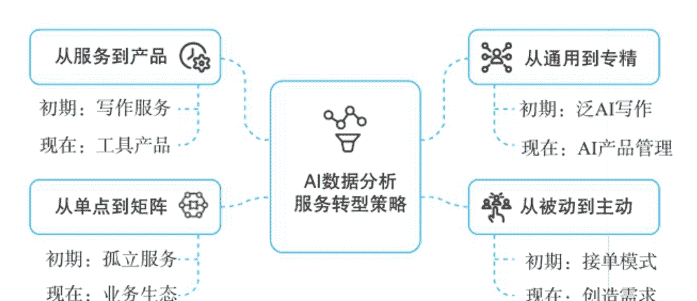

图6-6 实现的关键转变

1）从服务到产品：减少了对时间的直接依赖。

- 初期：每接一单写作需投入2～3小时。
- 现在：工具产品实现“一次开发，反复销售”。
- 技术支持：DeepSeek辅助产品开发，豆包优化销售页面。

2）从通用到专精：在细分领域建立了专业壁垒。

- 初期：泛AI写作服务，竞争激烈，边界模糊。
- 现在：AI产品管理专家，客单价高，竞争小。
- 技术支持：通义助力专业内容创作，即梦AI生成差异化的视觉展示。

3）从单点到矩阵：构建了互相强化的业务生态。

- 初期：孤立的写作服务，获客困难。
- 现在：内容引流→工具变现→社区黏性→咨询转化。
- 技术支持：飞书构建业务自动化流程，豆包助力全渠道内容。

4）从被动到主动：从接单模式转变为创造需求模式。

- 初期：在自由职业平台等待客户下单。
- 现在：通过内容和社区主动创造需求和机会。
- 技术支持：DeepSeek辅助用户需求分析并协助产品规划。

> “这些转变不是孤立的，而是互相强化的，”王睿总结道，“李华创造了一个价值飞轮——优质内容吸引目标用户，部分转化为工具购买者，其中活跃用户加入社区，高需求用户升级为咨询客户，咨询经验又反哺新内容和工具……这个正循环系统才是真正的财富。AI技术让这个飞轮运转得更加顺畅高效，每个环节都有相应的AI工具提供支持。”

## 4.李华的经验总结

（1）成功因素分析。

1）专注核心优势：选择了与主业技能相关的副业方向，降低了学习成本。

- 充分利用产品经理的背景，而非从零开始。
- 将AI视为放大器而非替代者。
- 实战建议：副业应与你的“10 000小时专长”相关。

2）构建系统性思维：构建了完整的价值链，而非零散副业。

- 设计端到端的用户旅程和转化漏斗。
- 每个业务环节都有明确的下一步引导。
- 实战建议：绘制业务关系图，确保形成闭环。

3）形成产品化意识：持续将服务经验转化为可规模化的产品。

- 记录服务中的重复模式和框架。
- 将个人知识显性化为可交付的产品。
- 实战建议：每完成5个相似的项目，就尝试提取一个产品。

4）进行渐进式扩展：遵循“验证—优化—规模化”的发展路径。

- 先小规模测试，验证需求。
- 基于反馈进行迭代完善。
- 成功后再投入更多资源。
- 实战建议：新方向的投入不超过总资源的20%。

5）投资流程优化和自动化：将收入的25%再投资于流程优化和自动化。

- 将重复任务系统化和工具化。
- 建立标准化操作流程。
- 引入AI助手和自动化工具。
- 实战建议：每周至少优化一个重复流程。

> “李华的成功不是因为他比别人更聪明或更努力，”王睿强调，“而是因为他采用了更系统的方法，并充分利用了2025年的AI工具生态。这不是‘神秘天赋’，而是可以学习和复制的方法论。他没有被AI技术的可能性迷惑，而是始终从自己的专业优势出发，将AI作为赋能工具，而不是盲目追随技术趋势。”

（2）关键转折点。李华分享了他副业发展中的三个关键转折点。

1）定位聚焦：从泛AI服务转向AI产品管理专家。

- 标志事件：发布的专题文章《AI重构产品经理工作流》获得了大量转发。
- 关键决策：放弃80%非产品领域的写作订单。
- 成果：客单价从300元提升至2 000元，客户获取更加容易。
- 技术支持：DeepSeek协助专业内容创作，豆包优化平台分发。

2）首个数字产品创建：推出第一个模板产品。

- 标志事件：两周内售出50份AI产品文档模板。
- 关键决策：将服务中积累的框架系统化。
- 成果：创造了首个不需要用时间直接兑换的收入来源，重塑了产品思维。
- 技术支持：飞书文档构建专业模板，即梦AI优化视觉呈现。

3）社区建立：建立会员制学习社区。

- 标志事件：首批招募50名付费会员。
- 关键决策：从单向输出转向互动社区。
- 成果：形成了稳定的月度收入基础，同时获得产品反馈并成为灵感来源。
- 技术支持：豆包自动化内容推送，Claude小助手处理基础问题。

> “这些转折点都不是偶然的，而是系统构建副业矩阵过程中的必然结果，”王睿分析道，“每一步都是在验证、学习和扩展的循环中自然发生的。2025年的AI工具链在每个关键点都提供了强大支持，让转型更加顺畅和高效。特别是‘社区建立’这一步，在Claude的支持下，管理成本相比过去降低了60%以上，这让小型社区也能实现良好的盈利和提供满意的用户体验。”

（3）避坑经验。李华也分享了几个宝贵的失败教训。

1）过度多元化：最初尝试同时运营4～5个不同的副业，结果都做不好。

- 错误做法：同时开展AI写作、电商、设计和培训。
- 教训：新增副业必须与现有业务有协同效应，否则会分散精力。
- 改进方法：每新增一个方向，必须保证与现有业务有30%以上的重叠。
- 技术支持：DeepSeek辅助业务关联性分析。

2）价格定位过低：早期服务和产品定价过低，吸引了问题客户。

- 错误做法：产品文档服务定价只有市场均价的50%。
- 教训：合理定价不仅影响收入，也决定了客户质量和工作体验。
- 改进方法：以客户获得的价值为基础定价，而非成本加成。
- 技术支持：通义辅助市场价格研究和价值评估。

3）忽视系统建设：前期只关注接单赚钱，忽视了流程和系统搭建。

- 错误做法：每个项目都从零开始，无标准化流程。
- 教训：尽早投资自动化和标准化，为长期增长打基础。
- 改进方法：为每类常见任务建立标准化操作流程和模板库。
- 技术支持：飞书构建工作流自动化，豆包辅助流程标准化。

4）存在工具依赖陷阱：过度依赖单一AI工具，当工具政策变更时会受到冲击。

- 错误做法：所有工作流程都依赖一个AI工具。
- 教训：技术多元化，不要将业务完全构建在单一第三方工具上。
- 改进方法：采用多平台策略，保持技术的灵活性。
- 技术支持：构建跨平台的工作流，确保关键环节有备选方案。

5）忽视知识产权保护：早期没有注意保护自己的原创内容和工具。

- 错误做法：直接分享所有模板和方法论，未设置访问控制。
- 教训：在分享价值的同时要注意保护核心知识产权。
- 改进方法：设计分层内容策略，免费分享基础知识，保护核心资产。
- 技术支持：使用Notion和DeepSeek设计内容访问控制系统。

> “这些教训都代表了副业发展中的常见陷阱，”王睿说道，“尤其在AI工具快速迭代的环境下，过度依赖单一AI工具的风险更大。建立弹性和适应性强的系统尤为重要。最近一些AI工具的调整就导致很多单一工具依赖者的收入大幅下滑，而像李华这样构建多元化系统的人受到的影响就很小。”

（4）给新手的建议。李华给同样想构建副业矩阵的新手提出了以下三点建议。

1）“从你擅长的领域开始，将AI作为增强工具而非完全依赖的对象。不要试图成为AI创作者，而要成为使用AI的某领域专家。当前，使用AI已经成为普遍能力，你的专业深度才是真正的差异化优势。我看到太多人盲目学习最新的AI工具，却忽略了自己已有的专业优势，这是本末倒置的。”

2）“宁可在一个细分领域做到专业，也不要尝试覆盖过多的方向。深度比广度更容易建立竞争壁垒。我见过太多人试图同时做写作、设计、编程和咨询，结果哪个方向都无法突破。先在一个点上突破，再考虑扩展。AI的发展让专业细分更加重要，因为基础服务已经被AI大众化了，只有专业深度才是护城河。”

3）“每开发一个新产品或服务，先问自己：这如何与我现有的副业形成协同效应?如果没有明确答案，可能不值得投入。我们要构建的是生态系统，不是业务集合。最强的副业矩阵是那些每个部分都能相互促进的系统。AI工具让我们能做的事情太多了，没有这种筛选原则，很容易迷失在无尽的可能中。”

李华补充了一条特有的建议：“现在的AI工具已经足够强大，但仍需要专业知识的引导。不要把DeepSeek或豆包当作万能替代者，而要视为超级助手。真正的价值在于你如何设计和整合这些工具，创造一个独特的价值系统。很多人陷入了工具崇拜，认为只要使用最先进的AI工具就能成功，但实际上系统设计和方法论才是关键。就像厨师的成功不在于拥有多好的刀具，而在于如何组合食材和掌握烹饪技巧。”

【实战心得】李华总结道：“副业矩阵成功的关键不在于你做了多少种副业，而在于这些副业之间的联系有多紧密。当每项新业务都能为现有业务带来增值，而现有业务也能助力新业务成长时，1+1的效果就会远大于2，这才是真正的矩阵效应。AI工具链的协同能力让这种效应更容易实现，但前提是你必须有清晰的系统设计思维。最重要的是，不要追逐每一个新技术和新平台，而是找到能真正放大你的核心优势的工具组合。这是我看到太多人犯的错误——被技术可能性冲昏了头脑，而忘记了自己真正的价值所在。”

## 实战练习

完成以下实战项目，开启你的副业矩阵建设。

(1) 核心评估。
1) 列出你的3～5个核心技能和专长领域。
2) 评估每个领域的市场需求和变现潜力。
3) 选择一个作为核心专长方向。
4) 使用DeepSeek协助市场分析和机会评估。

(2) 矩阵设计。
1) 基于核心专长设计2～3个内容支柱。
2) 识别2～3个相关的工具产品化机会。
3) 规划这些业务间的相互引流和强化路径。
4) 使用豆包辅助内容框架设计，通义协助产品概念开发。

(3) 实施路径。
1) 设计90天的实施计划，包括里程碑和关键行动。
2) 确定所需资源和投入估算。
3) 建立进度跟踪和效果评估机制。
4) 利用飞书构建项目管理系统，DeepSeek协助规划优化。

(4) 杠杆化策略。
1) 设计至少一个时间杠杆策略。
2) 规划至少一个自动化或外包方案。
3) 评估实施这些策略的投入产出比。
4) 应用DeepSeek设计自动化流程，豆包开发标准化模板。

完成后，选择一个最具可行性的方向，在下周开始采取实际行动。记住，小规模测试验证比完美规划更重要。现在AI工具让实验成本极低，可以充分利用这一优势进行快速迭代。

## 思考

1. 你目前的副业形态是否存在明显的时间天花板?如何应用时间杠杆原理突破这一限制?思考你能开发的知识产品或自动化系统。
2. 应用90/10法则，分析你现有或计划中的副业，哪些方向值得重点投入，哪些应该精简?尝试使用本章的ROI评估工具进行客观分析。
3. 在你的专业领域中，什么样的内容与工具组合能产生最大的协同效应?你可以开发哪些无代码工具来辅助你的内容创作?
4. 你的副业结构是否已形成良性循环系统，还是仍停留在孤立的单点模式?绘制你的副业关系图，找出潜在的连接点。
5. 如何将本章介绍的副业矩阵原理与你的个人技能和兴趣相结合，设计最适合你的多元变现路径?考虑你的独特优势和市场需求的交集。

## 章末寄语：从打工到系统,开启副业新纪元

在AI赋能的当下，副业早已不只是“多一份收入”的选择，而是一种系统性构建价值的方式。真正的转变，不是从0到1的启动项目，而是从“打工思维”走向“系统思维”的跃迁。

打工思维关注时间与金钱的直接交换，系统思维则专注于设计一个能自行运转、自我放大的价值生态。这意味着，你不再是依靠加班才能多赚一笔，而是通过副业之间的联动协同，让它们相互驱动、彼此赋能，构建出一个可持续成长的副业矩阵。

王睿和李华的故事提醒我们，成功不是偶然，而是有方向、有节奏的系统构建。从一个简单的切入点出发，通过90/10法则、内容与工具的双轮驱动、长期主义与杠杆思维的结合，最终形成自动增长的收益网络。

如今，从DeepSeek、豆包、通义、ChatGPT，到Notion、飞书等无代码工具，这些国产与国际AI工具已让普通人也具备过去只有专业团队才能实现的执行力与创造力。

你不必全职、不必高学历，也不需要高投入。哪怕你每周只能抽出几小时，只要系统设计得合理、方向清晰，你也可以开启属于自己的副业矩阵。

记住：真正拉开人与人之间的差距的不是信息获取的速度，而是系统思维的深度。当你从“会用工具”走向“能构建系统”，就已经拥有了在这个时代建立个人品牌与实现财务自由的关键能力。

从今天起，选择一个AI工具，设定一个目标，启动一个项目。迈出这一步，你的副业新纪元就已经启航。

# 第7章 从副业到创业：低风险的AI创业之路

## 开篇：张文杰和王睿的创业决策时刻

“你有没有发现，咱们的AI副业已经快反客为主了？”王睿指着屏幕上跳动的数据，6个月来收入稳步攀升，已经是主业的七成。

张文杰放下奶茶，若有所思：“最近创业的想法总在脑子里转悠，尤其上周那个大客户主动提出长期合作时，我差点就答应全职干了。但从稳定工作跳到创业……这跨度有点大啊。”

“所以我做了一个分析。”王睿翻开笔记本，“连续6个月副业收入超过主业，客户复购率将近七成，转介绍给他人占八成，现金流能撑大半年……数据很漂亮。”

“关键是，”王睿兴奋地说道，“我们已经不是单纯地售卖时间了，客户买的是整套解决方案。”

张文杰点头，但眉头微皱：“话是这么说，可创业就得全力以赴，招人建团队，风险可不小……”

“别急，”王睿递过一份方案，“我设计了低风险转型路径——渐进式创业，不用一步到位跳深水，先在浅滩试试水温。”

张文杰快速扫了一眼，眼睛亮了：“分阶段控制风险，最小团队起步……这个思路靠谱。先注册公司，主业暂时保留，试运营3个月再定夺？”

“没错，”王睿笑道，“创业不一定是孤注一掷。每步都留后路，进可攻退可守。”

张文杰眼中闪过一丝狡黠：“行，那就试试。不过失败了你请我吃一年火锅。”

王睿伸出手：“成交!成功了，你请我吃两年。”

两人击掌，创业之路正式启动。

## 一、创业时机判断：5个表明你该从副业转型的信号

从副业到创业的转型是一个重大决策，时机选择至关重要。过早转型可能面临准备不足的风险，就像穿着拖鞋就去登珠穆朗玛峰；而错过最佳窗口则可能被竞争对手抢占先机，就像等所有人都开始发布短视频了你才想到开通账号。王睿和张文杰基于自身经验和对众多成功案例的研究，总结出了判断创业时机是否成熟的5个关键信号。

1.财务指标达成：收入、增长与可持续性

财务表现是最直观的创业时机指标，但并非简单地看收入数字，就像不能只看颜值就决定结婚对象一样。你需要综合评估多个财务维度（见表7-1）。

| 财务维度 | 说明 | 转型信号 | 观察周期 |
| :--- | :--- | :--- | :--- |
| 收入规模 | 副业创造的总收入 | 连续3个月达到或超过主业收入的70% | 3～6个月 |
| 稳定性 | 收入的可预测性和波动程度 | 月收入波动不超过30%，有稳定的客户群 | 3～6个月 |
| 增长趋势 | 收入增长的速度和持续性 | 连续6个月保持15%以上的月环比增长 | 6个月 |
| 利润率 | 收入扣除所有成本后的剩余 | 净利润率稳定在25%以上 | 3个月 |
| 现金储备 | 可支持创业初期运营的资金 | 至少积累6个月的生活和基本运营所需的资金 | — |
| 收入来源 | 收入的分散程度和依赖性 | 最大单一客户贡献不超过总收入的30% | 3个月 |

表7-1 创业转型财务指标评估表

> “财务指标不只是冰冷的数字，更是市场对你的价值的真实投票，”王睿强调，“就像相亲时，对方主动买单是一种信号。当你的副业能够稳定创造接近甚至超过主业的收入时，市场已经在用真金白银告诉你：你创造的价值值得全职投入。这比你老板的一百句‘你很有潜力’都更有说服力。”

### 【副业财务成熟度自测问题】

1. 你的副业收入占总收入的比例是多少？（低于30%可能为时尚早。）
2. 过去6个月的副业收入是否呈现稳定增长趋势？（忽高忽低说明模式不稳定。）
3. 你的副业客户群是否分散，以避免过度依赖单一客户？（过度依赖单一客户具有高风险。）
4. 你是否已经积累了至少6个月的生活和创业所需的资金储备？（资金储备不足则没有安全垫。）
5. 你的副业利润率是否稳定在25%以上？（低利润率难以支撑全职转型。）

### 2. 市场验证完成：持续的需求与产品成熟度

除了财务表现，市场对你的产品或服务的验证是另一个关键的信号。这表明你已找到了真实的市场需求和可持续的商业模式，而不是一时的运气或个人关系带来的短暂成功。

表7-2展示了市场验证的关键指标。

| 市场维度 | 评估方法 | 转型信号 | 数据来源 |
| --- | --- | --- | --- |
| 客户获取 | 新客户来源和获取成本分析 | 口碑引荐占新客户的50%以上 | 客户来源追踪 |
| 复购率 | 客户重复购买的比例 | 60%以上的客户至少复购一次 | 客户订单历史记录 |
| 满意度 | 客户反馈和评价分析 | 客户满意度评分达到8分以上（满分10分） | 满意度调查、评价收集 |
| 市场反应 | 对价格、服务调整的反应 | 价格提升后需求保持稳定 | 定价测试、销售数据 |
| 竞争状态 | 市场竞争格局和自身优势分析 | 在目标细分市场建立明确的差异化优势 | 竞争对手分析、客户访谈 |
| 扩展机会 | 相关产品机会和市场规模 | 已识别3个以上可扩展的产品或服务方向 | 客户需求分析、市场研究 |

表7-2 市场验证的关键指标

> “市场验证比财务数据更能说明长期潜力，”张文杰解释道，“当陌生客户因口碑推荐而来，就像饭店前排起长队；当客户主动询问更多服务，就像女朋友主动问你周末有没有空；当你能够提高价格而客户仍然选择你——这些都是市场在告诉你：你已找到了真正的价值定位。”

### 3. 时间与精力信号：主业副业平衡失衡

当副业开始占据你越来越多的时间、精力和思考空间时，这可能是一个转型信号，表明你的真正热情和价值创造点已经发生转移，就像当你在看剧时总是忍不住打开工作文件，或者明明在约会却满脑子想着项目方案。

（1）时间精力失衡的表现。

1）思维占用：

- 在主业工作时不断思考副业相关的问题，就像上班时频繁刷淘宝。
- 工作会议中走神，想着副业创意和方案，领导问问题时一脸茫然。
- 午休时间查看副业邮件和消息，而不是刷抖音。
- 转型信号：超过50%的思考时间被副业占据。

2）时间分配：

- 将越来越多的业余时间投入副业，周末社交活动越来越少。
- 主动减少社交活动以腾出副业时间，朋友吐槽已经几个月没见你了。
- 早起晚睡以增加副业工作时间，黑眼圈比熊猫还重。
- 转型信号：业余时间的80%以上用于副业。

3）精力投入：

- 对副业相关任务充满热情和创造力，熬夜到凌晨3点却精神抖擞。
- 对主业工作感到疲惫，但对副业工作仍精力充沛，像是打了鸡血。
- 副业挫折带来的情绪影响超过主业，客户的一个差评比领导的批评还难受。
- 转型信号：副业的成就感明显高于主业。

> “当你发现自己在主业会议上走神，思考副业创意；当你周末迫不及待地投入副业工作；当你愿意半夜起床为副业客户解决问题——这些都是内在驱动力已经转变的明确信号，就像恋爱中的人，满脑子都是对方，”张文杰分享道，“我最终决定创业的触发点是当我意识到，我为副业自主学习DeepSeek和即梦AI的时间已经远超过工作要求的学习时间，而且学习效率和乐趣完全不在一个级别。主业学习感觉像是被逼着吃药，副业学习则像是在吃自助餐。”

（2）注意平衡视角。王睿提醒：“时间精力转移必须与实际价值创造能力相匹配。单纯的热情不足以支撑创业决策，就像光有恋爱的感觉不足以支撑一段婚姻。创业需要同时考虑市场验证和财务表现。许多人离职创业仅仅因为厌倦了主业或短暂对新事物充满热情，这是风险较高的决策路径，就像看了《灌篮高手》就辞职去打篮球一样不现实。理想的状态是内在驱动力的转变与外部市场验证同步发生，才是真正的‘天时地利人和’。”

### 4. 系统化与产品化：从个人服务到可扩展业务

从副业过渡到创业的一个关键标志是业务模式从个人服务朝系统化、产品化方向的转变（见表7-3）。这种转变不仅提高了效率，更为未来的扩展和团队建设奠定了基础，就像从手工作坊升级到了自动化工厂。

| 发展阶段 | 特征 | 例子 | 扩展潜力 |
| :--- | :--- | :--- | :--- |
| 个人服务 | 完全依赖于个人时间和技能 | 一对一咨询，定制项目 | 极低 |
| 流程标准化 | 建立清晰的流程，提高效率 | 服务包装，标准化操作流程 | 低 |
| 工具辅助 | 利用工具提升产能和一致性 | 模板库，自动化工作流 | 中 |
| 产品化 | 将核心价值转化为可复制的产品 | 在线课程，数字模板，订阅服务 | 高 |
| 平台化 | 建立自运行的价值创造系统 | 会员社区，市场平台，SaaS 解决方案 | 极高 |

表7-3 系统化与产品化的五个层次

“从个人服务到系统化是一次关键跃迁，”王睿强调，“在个人服务模式下，收入严格受限于你的时间，就像只有一双手的厨师，无论多么熟练，一天只能做那么多菜；但当你开始建立系统和产品，就像设计了一条自动化生产线，你创造的价值就可以突破时间的限制。当你睡觉时仍有产品在为你创造收入，那么你的副业就已经具备了创业的基础特质。”

（1）系统化与产品化的实践路径。

1）服务分解：将复杂服务拆分为标准模块。

- 例如：将全套营销方案拆分为受众分析、内容策略、渠道规划等模块。
- 使用工具：豆包AI助手设计服务模块拆分方案。
- 好处：提高效率，便于团队协作，清晰定价。

2）流程文档化：创建详细的标准化操作流程。

- 例如：客户沟通流程、项目执行步骤、质量检查标准。
- 使用工具：飞书文档或豆包AI助手辅助撰写标准化操作流程。
- 好处：确保质量一致，减少决策负担，便于培训他人。

3）工具模板化：开发可复用的工具和模板。

- 例如：分析框架、报告模板、创意构思工具。
- 使用工具：扣子工作流、飞书批量创作工具。
- 好处：提高效率，统一输出质量，增加独特价值。

4）知识产品化：将专业知识转化为独立产品。

- 例如：在线课程、电子书、订阅内容。
- 使用工具：即梦AI生成课程插图，Canva可画设计课程封面。
- 好处：创造被动收入，扩大影响力，吸引潜在客户。

（2）产品化自测问题。

1）你是否已经建立了标准化的服务流程和交付体系？
2）你是否开发了可以反复使用的工具、模板或资源？
3）你是否有一部分收入来自非实时服务（如产品销售、会员费）？
4）你的业务是否可以在你不亲自参与的情况下部分运行？
5）你是否可以同时服务比最初阶段多3倍以上的客户？

### 5. 环境与社会支持：外部条件的成熟

创业不仅是个人的决策，也受到外部环境和社会支持系统的影响。适宜的外部条件可以大幅降低创业风险，提高成功概率。

（1）环境支持评估维度。

1）行业环境。

- 市场增长：目标行业是否处于增长期，如2025年AI应用服务市场正在快速扩张。
- 技术变革：是否有技术变革创造新机会，如TRAE自动化编程接口的开放。
- 竞争格局：是否存在尚未填补的市场空白，还没有其他创业者抢占先机。
- 转型信号：有处于增长期的行业且有明确的市场空白。

2）政策环境。

- 行业政策：相关行业政策是否支持创新创业。
- 创业支持：是否有针对创业者的支持政策，如减税、补贴等。
- 税收政策：税收结构是否有利于小企业，如小规模纳税人优惠。
- 转型信号：存在明确的创业友好政策支持。

3）社会支持。

- 家庭支持：家人是否理解并支持创业决定，会不会天天问“什么时候找个稳定的工作”。
- 人脉资源：是否有可利用的专业人脉网络，不至于创业就成了“孤岛”。
- 创业生态：所在区域是否有活跃的创业社区，能提供经验交流和资源共享。
- 转型信号：家庭全力支持且有专业人脉资源。

> “外部环境和支持系统往往是被忽视的创业成功因素，就像盖房子不仅要看自己的技术，还要看地基是否牢固，”王睿解释道，“在支持性环境中创业，可以大幅降低风险和压力。理想的创业时机是个人准备、市场条件和环境支持三者同时成熟的时刻，就像太阳、月亮和星星同时出现。”

（2）社会支持构建策略。

1）家庭沟通：与家人坦诚讨论创业计划和风险。

- 关键点：积极分享财务状况、风险应对计划和退出策略。
- 工具：使用豆包AI助手创建家庭财务安全计划，明确风险承受底线。
- 实践方法：定期召开家庭会议，共同决策，避免单方面的通知。

2）专业网络构建：有意识地发展专业人脉。

- 关键点：参与行业活动，提供价值交换，建立长期关系。
- 工具：使用豆包记录人脉互动，飞书云文档管理联系人资源。
- 实践方法：每月至少参加1～2场行业活动，主动提供帮助以建立信任。

3）社区参与：融入创业者社区和生态系统。

- 关键点：利用创业孵化器，加入行业协会，建立同行支持圈。
- 工具：利用通义灵码寻找合适的创业社区和资源。
- 实践方法：举办每周固定的创业者交流活动，线上或线下均可。

### 6. 综合评估：创业时机决策框架

为了帮助读者全面评估自己是否已到创业时机，王睿和张文杰开发了一个实用的决策框架，就像一台创业时机检测仪（见表7-4）。

| 维度 | 权重(%) | 评分项目 | 得分(1~5分) |
| :--- | :--- | :--- | :--- |
| 财务表现 | 30 | 收入规模、稳定性、增长趋势、利润率 | |
| 市场验证 | 25 | 客户获取、复购率、满意度、竞争状态 | |
| 时间与精力 | 15 | 思维占用、时间分配、精力投入、热情持久度 | |
| 系统化与产品化 | 20 | 流程标准化、工具模板化、产品开发、扩展性 | |
| 环境与社会支持 | 10 | 行业环境、政策环境、社会支持、资源可得性 | |
| 总分 | 100 | | |

表7-4 创业时机评估表

在使用表7-4时，需要注意以下事项：

(1) 为每个评分项目打分（1～5分），1分表示完全不满足（火候差远了），5分表示完全满足（完美契合）。

(2) 计算每个维度的平均分，再乘以权重得到加权得分。

(3) 将所有加权得分相加得到总分。

(4) 总分解读：

1）80～100分：创业时机成熟，可以考虑全职转型，就像水果熟透了，可以采摘了。
2）60～79分：时机接近成熟，可以开始过渡性创业准备，就像水果快熟了，可以准备箩筐了。
3）40～59分：条件尚不充分，需继续发展副业并弥补不足，就像水果还青涩，得再等等。
4）低于40分：继续专注副业发展，暂不考虑创业转型，就像果树刚开花，想吃还得等好几个月。

“创业时机是多维度因素共同作用的结果，就像煲汤需要火候、食材和调料都恰到好处才行，”张文杰强调，“理想的转型不是冲动的跳跃，而是基于全面评估的理性决策。这个框架可以帮助我们客观评估各个维度的准备程度，找出需要加强的领域，并为最终决策提供清晰的依据。不是拍拍脑袋想创业就创业，也不是永远纠结于‘要不要创业’的无尽循环。”

【王睿和张文杰的决策过程】“当我们使用这个框架评估自己的情况时，我得了83分，张文杰得了79分，”王睿回忆道，“这给了我们创业的信心，不是盲目乐观，而是有数据支撑的自信。同时也明确了需要加强的领域。对我来说，系统产品化是相对弱项，还需要进行更多的自动化和标准化；对张文杰来说，财务储备还需要增加，毕竟他有个‘买了就是赚到’的网购习惯。我们基于这些见解制定了针对性的强化计划，在正式转型前进一步做足准备。这就像出远门前检查行李，确保一切必需品都已备齐。”

## 二、小团队大产出：如何用3000元/月的预算组建高效团队

创业初期资源有限是普遍现象，但这不一定会限制业务发展。王睿和张文杰通过精心设计的团队结构和AI工具辅助，实现了用最小成本创造最大产出的目标。他们的核心理念是：不是把钱用在人头上，而是用在系统上。

### 1. 精益团队结构：“核心+外围”的人力资源策略

创业初期最重要的资源配置原则是精益——用最少的资源创造最大的价值，就像厨师用一把好刀就能完成各种复杂的切菜任务。王睿和张文杰设计了高效的“核心+外围”的团队结构，以平衡成本控制和业务扩展需求。

(1) 核心团队（内部全职或兼职）。

1）创始合伙人：战略决策制定，客户关系管理，核心产品开发。
2）关键职能：确保业务持续运转的不可替代的角色。
3）资源投入：时间或股权激励。
4）例子：张文杰（创意总监），王睿（技术总监）。
5）比喻：就像游戏中的主角，必须亲自上场。

(2) 战略伙伴圈（长期外部合作）。

1）专业合作伙伴：提供专业技能，弥补核心团队的不足。
2）互补业务伙伴：提供互补服务，扩展价值链。
3）资源投入：项目分成，长期合作协议。
4）例子：设计师伙伴（提供视觉设计），营销伙伴（提供渠道资源）。
5）比喻：就像游戏中的固定队友，不是自己人但经常一起打怪。

(3) 任务型外包（按需短期合作）。

1）专业技能外包：特定技能的一次性项目。
2）执行型任务：标准化、可拆分地执行任务。
3）资源投入：按项目或按小时付费。
4）例子：内容撰写，编程实现，客服支持。
5）比喻：就像游戏中临时组队的队友，完成特定任务后就解散。

(4) AI工具协作（系统性力量倍增）。

1）自动化系统：替代重复性工作的自动化流程。
2）AI助手：增强人工产能的智能工具。
3）资源投入：工具订阅费用。
4）例子：DeepSeek生成内容，扣子自动化客户服务，豆包分析数据。
5）比喻：就像游戏中的装备，让角色的战斗力翻倍。

> “这种层级结构让我们能够以极低的固定成本维持高度的灵活性，”王睿解释道，“核心团队保持精简，只包含真正核心且不可替代的角色，就像骨干；其他一切都通过更灵活的合作形式完成，就像肌肉，可以根据需要增减。这既控制了风险，避免了烧钱养团队的压力，又保证了关键环节的质量和效率。想象一下，我们不是雇用一支军队，而是召集一支特种部队。”

### 2. AI赋能团队：用技术替代人力的新思路

随着AI技术的快速发展，创业团队可以用AI工具替代或增强传统人力角色，大幅提高效率，同时降低成本。王睿和张文杰将AI工具视为虚拟团队成员，系统地融入团队结构（见表7-5）。这不是简单地使用工具，而是将AI视为智能协作伙伴。

| AI角色类型 | 替代/增强的传统角色 | 推荐工具（2025） | 月成本估计 | 产能提升 |
|---|---|---|---|---|
| 内容创作 AI | 初级编辑、作者 | DeepSeek 创作、豆包创作、文心一言 | 0～300 元 | 3～5 倍 |
| 设计辅助 AI | 初级设计师 | 即梦 AI、Canva 可画、豆包设计 | 0～200 元 | 2～4 倍 |
| 数据分析 AI | 初级分析师 | 通义灵码、豆包数据分析、飞书智能表格 | 0～200 元 | 3～5 倍 |
| 客户服务 AI | 初级客服人员 | 通义晓蜜、豆包客服、飞书服务台 | 0～300 元 | 5～10 倍 |
| 项目管理 AI | 项目协调员 | 豆包任务管理、DeepSeek 助手、飞书智能日程 | 0～100 元 | 2～3 倍 |
| 市场研究 AI | 初级市场研究员 | 通义分析助手、豆包市场趋势、DeepSeek 调研助手 | 0～200 元 | 3～5 倍 |

表7-5 AI团队角色矩阵

> “AI不仅是工具，更应被视为团队成员，”王睿强调，“就像《钢铁侠》里的贾维斯。每个AI系统都有特定职责，执行标准化流程，定期评估绩效并持续优化。关键是设计人类与AI的最佳协作模式，让人类专注于创造性思考和判断，而AI负责执行性和重复性的任务。这就像让机器人做饭洗碗，而人类负责创新菜谱和享用美食。在2025年，不懂得利用AI的创业团队就像坚持用马车而不用汽车的运输公司，注定被市场淘汰。”

### 3. 远程协作模式：突破地域限制的团队建设

创业初期的另一个重要资源优化策略是采用远程协作模式，不仅节省办公成本，更能吸引全球人才，并提高工作灵活性和生产力。当前，远程协作已经从特殊安排变成了标准实践，特别是对于AI创业团队来说。

（1）远程团队基础设施。

1）协作工具生态系统。

- 沟通工具：飞书即时通讯，实时讨论与日常交流。
- 项目管理：豆包任务管理，追踪进度与分配任务。
- 文档协作：飞书文档，共同创建与编辑内容。
- 知识管理：飞书知识库，团队知识积累与共享。
- 每月成本：0～200元（使用免费版或入门级付费版）。

2）远程工作协议。

- 沟通时段：明确的团队在线时间（如上午10—12点必须在线）。
- 会议结构：每周例会15分钟，问题讨论30分钟，决策会议60分钟。
- 工作交付：每项任务必须有明确的截止日期和验收标准。
- 问题解决：使用豆包AI辅助的问题分类与上报流程。

3）数字化工作流。

- 入职流程：使用飞书生成的新成员标准化入职指南。
- 任务分配：基于DeepSeek评估的技能-任务匹配系统。
- 绩效跟踪：使用豆包分析的基于成果的远程工作评估。
- 知识共享：飞书云文档支持团队学习和经验传递。

> “远程协作模式是创业期的理想选择，”张文杰解释道，“我们不需要租赁办公室，每月至少节省5000元。团队成员可以在最适合自己的环境中工作，无论是安静的家里还是充满灵感的咖啡馆，我们可以根据专业能力而非地理位置选择合作伙伴，拓宽人才库。关键在于建立清晰的协作结构和文化，确保团队凝聚力和工作效率。”

（2）远程协作最佳实践。

1）异步与同步平衡。

- 建立清晰的文档文化，减少实时沟通依赖，提高工作自主性。
- 定期的同步会议聚焦于讨论和决策，而非状态更新，节约宝贵的同步时间。
- 使用“决策记录”文档，透明记录所有重要决策和背景，避免信息丢失。
- 例如：每周仅一次全员视频会议，其余时间通过飞书文档和异步消息协作。

2）结果导向工作模式。

- 明确定义可衡量的工作成果，而非工作时间，摆脱“坐班”思维。

## 4.任务拆解与外包：3000元/月预算的关键分配

有限预算下的团队建设需要精准的任务拆解和资源分配，确保将资金投入最能创造价值的环节。就像厨师用有限的食材做出最美味的菜肴，关键在于搭配和烹饪方法。王睿和张文杰开发了系统化的任务评估和外包决策框架。

> “资源分配的核心原则是价值匹配，”王睿解释道，“就像你不会用宰牛刀切豆腐，也不会用餐刀砍树。核心团队应将时间专注于最能创造独特价值的任务，其他任务则根据性质选择最适合的处理方式和资源级别。错误的做法是创始人亲自处理可以低成本外包的任务，就像CEO去复印文件；或者为不重要的功能投入过多资源，就像给自行车装航空发动机。”

以3000元/月的预算为例，其优先分配策略为：

#### （1）优先级一：客户直接感知的关键角色。
1) 分配：1200～1500元/月。
2) 目标：确保客户体验和服务质量。
3) 例如：客服人员、内容质量控制、项目协调。
4) 实现方法：利用TRAE实现自动化客服系统或半自动化客服系统。

#### （2）优先级二：核心生产力提升工具。
1) 分配：800～1000元/月。
2) 目标：提高核心团队的产出效率。
3) 例如：DeepSeek创作助手、通义灵码开发工具、即梦AI设计工具。
4) 实现方法：订阅专业版AI工具，开发团队专用提示词库。

#### （3）优先级三：特定项目的专业外包。
1) 分配：500～1000元/月（弹性预算）。
2) 目标：补齐核心团队能力短板。
3) 例如：特定编程需求、专业设计任务、特殊内容创作。
4) 实现方法：通过灵活外包平台按需购买服务。

## 5.团队激励模型：低成本激发高绩效

在资源有限的创业初期，建立有效的团队激励机制至关重要。没有百万年薪，如何让团队成员全力以赴?王睿和张文杰设计了不依赖高薪资的多维激励模型（见图7-1），成功激发团队成员高度参与和卓越表现。

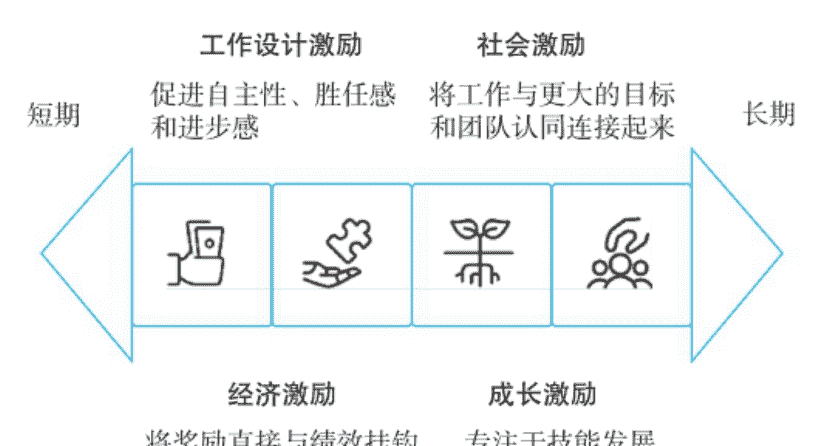

图7-1 多维激励模型

#### （1）多维激励模型。
1) 经济激励。
- 基础报酬：合理但有竞争力的基本薪酬，保障基本生活。
- 增长分享：业绩增长或项目成功的奖金机制，直接与成果挂钩。
- 股权/期权：长期价值分享机制（适用于核心成员），让团队共享未来成功。
- 技巧：设计阶梯式奖励，与个人和团队成果挂钩，创造“小目标大奖励”。

2) 工作设计激励。
- 自主性：提供工作方法和时间的自主权，而不是像打卡机器。
- 胜任感：分配具有适度挑战性的任务，避免无聊或承受过度的压力。
- 进步感：创造清晰可见的进步和成就，提供即时反馈。
- 技巧：工作设计兼顾挑战性和可实现性，创造心流体验。

3) 成长激励。
- 技能发展：提供学习和技能提升机会，如人社部AIGC内容创作师认证等。
- 责任扩展：赋予自主权和决策权，创造“小公司”的感觉。
- 能力见证：提供展示能力和成果的平台，如行业演讲机会。
- 技巧：创建个人成长路径，获取定期技能提升反馈，就像游戏升级系统。

4) 社会激励。
- 使命连接：清晰传达工作的更大意义，而不只是赚钱的工具。
- 团队认同：建立强烈的团队归属感，创造“战友情谊”。
- 公开认可：庆祝和表彰优秀表现和贡献，让成就被看见。
- 技巧：打造包容的团队文化，重视每个人的贡献，哪怕是小改进。

> “在创业初期，我们无法提供市场最高薪资，但我们可以提供独特的价值组合，”张文杰解释道，“这就像我们不能提供五星级酒店的待遇，但可以提供探险家才能体验的刺激和成就感。这些非货币价值包括学习前沿技术的机会、直接影响产品和业务的能力、灵活的工作方式以及参与创业旅程的成就感。我们发现许多人愿意以合理而非最高的薪酬来交换这些非经济价值，特别是对于现在的年轻人来说，这些体验和成长往往比多几千块钱更有吸引力。”

#### （2）实用激励策略（低预算高效果）。
1) 技能投资计划。
- 描述：为团队成员提供学习和技能发展资源，投资未来而不只是当下。
- 实施：每月学习时间配额，DeepSeek和通义灵码专业认证，技能分享会。
- 成本：低或零直接成本，主要是时间投入。
- 效果：提高能力和忠诚度，吸引成长型人才，比直接加薪更有吸引力。

2) 成果展示平台。
- 描述：创造机会让团队成员展示工作和才能，满足“被看见”的需求。
- 实施：客户案例署名，行业分享机会，社交媒体和自媒体展示。
- 成本：低或零直接成本，只需适当的组织和规划。
- 效果：满足成就感和认可需求，建立专业声誉，创造个人品牌价值。

3) 灵活工作模式。
- 描述：提供工作时间、地点和方式的自主权，尊重个体差异。
- 实施：基于结果的工作评估而非过程监控，远程与现场相结合的混合模式。
- 成本：零直接成本，甚至可能节省办公成本。
- 效果：提高工作满意度和生产力，吸引重视自主的人才，特别是新一代“数字原住民”。

4) 增长分成机制。
- 描述：将业务增长与团队收益直接挂钩，创造“同一条船”的感觉。
- 实施：透明的收入分享计划，基于贡献的分配机制，即时兑现的奖励。
- 成本：仅在创造额外价值时产生，是成果导向的支出。
- 效果：激励创造实际业务价值，保持利益一致性，建立创业者心态。

> 【深入案例】王睿的团队激励系统。“我们设计的激励系统包含四个关键元素，就像一个精心设计的游戏奖励机制。
(1) 基础薪酬：提供合理但非市场最高的固定报酬，保障基本生活需求。
(2) 项目分成：每个项目收入的15%～30%（根据贡献）直接分配给参与项目的团队成员，创造即时反馈。
(3) 能力发展：提供每周5小时的学习时间和月度技能提升计划，如火山引擎开发者社区或阿里云培训中心资源。
(4) 成果所有权：团队成员参与项目决策，成果署名，建立个人品牌，创造长期资产。

> “这一系统帮助我们以远低于市场薪资的成本吸引和留住了优秀人才，关键是创造了一种既满足经济需求又满足成长和自主需求的综合环境。特别是项目分成机制，将团队利益与业务成功直接挂钩，创造了强大的一致性。”

> “有个很好的例子：我们的兼职设计师小林原本在大公司工作，月薪过万元但每天做重复性的设计任务。加入我们后，虽然基本报酬只有3000元，但通过项目分成和成果展示，她的实际收入已经接近原工作的水平，更重要的是，她可以参与整个创意过程，看到自己的想法被实现，并建立了个人作品集。这种全方位的价值体验是纯薪资无法比拟的。现在的年轻人越来越看重这种多元化的职业体验，而不只是薪资数字。”

## 三、AI创业的商业模式设计：从服务到产品的转型路径

成功的AI创业需要设计可持续、可扩展的商业模式。王睿和张文杰分享了他们如何系统化地将个人服务转型为可扩展的产品业务，实现收入和影响力的倍增。

### 1.AI创业的商业模式验证与评估

商业模式是创业成功的核心基础，特别是在AI领域，选择合适的商业模式会显著影响增长速度和可持续性。就像建房子需要先有设计图纸，创业也需要商业模式蓝图。王睿和张文杰使用经典的商业模式画布，适应AI创业的特殊需求，进行系统化规划。

#### （1）商业模式验证方法。
1) 假设识别。
- 列出商业模式中的关键假设，特别是价值主张和客户需求。
- 对假设的重要性和不确定性排序，确定优先验证项。
- 设计可测量的验证标准，避免主观判断。
- 例如：“中小企业愿意为DeepSeek驱动的AI内容工具支付每月299元的订阅费”是需要验证的假设。

2) 最小可行产品测试。
- 设计能验证核心假设的最简产品或服务，不要过度开发。
- 定义清晰的成功指标和决策标准，设置“通过/失败”门槛。
- 快速实施并收集真实市场反馈，用7天而不是7个月。
- 例如：使用豆包+TRAE低代码方案快速构建功能原型，验证用户的付费意愿。

3) 迭代调整。
- 基于验证结果调整商业模式元素，拥抱变化而非固守想法。
- 保持模型的灵活性，愿意根据市场反馈进行大幅修改。
- 建立持续验证和调整的反馈循环，保有“永不完成”的思维。
- 例如：根据早期客户反馈调整定价策略或功能优先级。

#### （2）商业模式的关键评估维度。
1) 可行性：技术和资源条件是否支持该模式的实现，是否能够真正落地。
2) 可扩展性：收入是否可以不成比例地超过成本增长，避免“人海战术”。
3) 防御性：是否能建立竞争壁垒和长期优势，不容易被复制。
4) 盈利能力：收入结构和成本结构是否能获得持续的利润，不只看营收。
5) 可持续性：是否能适应技术和市场变化，保持价值，不会很快过时。

> 【深入案例】张文杰和王睿的商业模式演进。“我们的商业模式经历了三次重大转型，就像蝴蝶的三次蜕变：从最初的‘按小时计费的AI服务’，到‘产品化的AI解决方案’，再到现在的‘AI赋能平台+专业服务’混合模式。每次转型都源于对商业模式元素的系统思考和市场验证。

> “最初我们假设客户主要寻求技术实现，所以我们提供DeepSeek和豆包技术服务，但市场反馈显示，客户实际寻求的是业务问题的解决方案，而非技术本身。他们不在乎我们用什么AI模型，只关心能否解决他们的实际问题。基于这一洞察，我们重新设计了价值主张：从技术能力转向解决特定业务问题的完整方法论和工具。”

> “随后我们又发现，纯产品模式难以满足企业客户的个性化需求，就像标准西装无法适合所有体型;而纯服务模式又限制了可扩展性，就像私人定制过于耗时。最终我们采用了‘平台+服务’的混合模式：标准化的AI平台提供基础功能和可扩展性，专业服务团队提供个性化支持和高价值咨询。这一模式既保持了高毛利率和可扩展性，又满足了企业客户的个性化需求。”

### 2.服务到产品的转型阶梯：五个关键步骤

从个人服务到可扩展的产品是AI创业的典型发展路径，就像从手工作坊到自动化工厂的历史性转变。王睿和张文杰总结了这一转型的五阶段模型（见图7-2），帮助创业者系统化地实现这一跃迁。

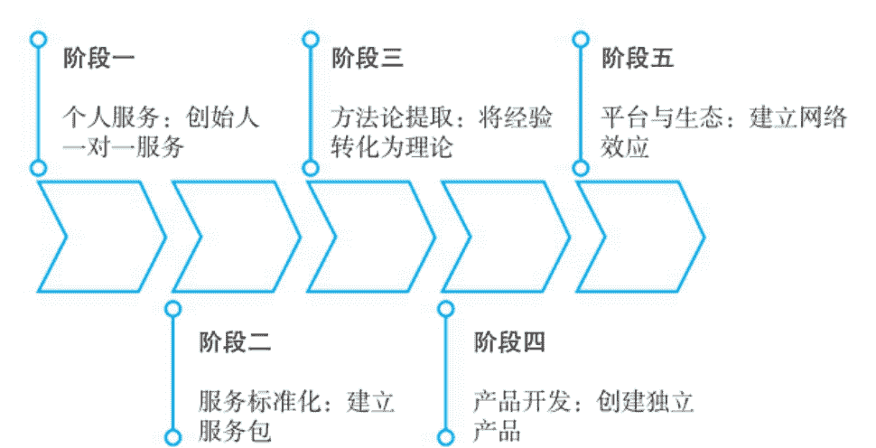

图7-2 服务产品化五阶段模型

#### （1）服务产品化五阶段模型。
1) 阶段一：个人服务。
- 特点：完全依赖创始人的时间和技能，一对一服务。
- 挑战：时间与收入严格挂钩，难以扩展，做得越多就越累。
- 优势：起步门槛低，直接反馈，快速迭代，现金流早。
- 转型准备：记录流程，识别模式，收集客户数据，建立服务菜单。
- 案例：一对一DeepSeek咨询服务，完全定制项目，创始人亲自服务。

2) 阶段二：服务标准化。
- 特点：建立明确的服务包和交付流程，类似于套餐。
- 转变：从按小时计费到按项目计费，从完全定制到半定制。
- 关键行动：创建服务手册，设计服务包，建立质量标准和模板库。
- 收益：提高效率，明确定价，便于交付，可初步委托他人。
- 案例：标准化的“夸克内容策略包”，固定范围和流程，有明确的交付物。

3) 阶段三：方法论提取。
- 特点：将服务经验转化为系统的方法论，从实践升华为理论。
- 转变：从执行者到指导者，从做事到教人做事。
- 关键行动：提炼核心原则，创建框架和模板，开发工具包和视频课程。
- 收益：建立独特知识产权，提高议价能力，扩大影响力。
- 案例：DeepSeek创意生成五步法框架和配套工具包，可以教授给他人。

4) 阶段四：产品开发。
- 特点：将方法论转化为独立使用的产品，实现服务自动化。
- 转变：从做给客户到客户自己做，从人工到自助。
- 关键行动：开发软件或工具，创建教程和文档，建立支持系统和社区。
- 收益：实现收入与时间脱钩，提高毛利率，规模化复制。
- 案例：豆包AI内容助手软件，内置方法论和最佳实践，客户可自行使用。

5) 阶段五：平台与生态。
- 特点：建立网络效应和用户生态系统，创建自增长引擎。
- 转变：从产品提供者到平台运营者，从单边市场到多边市场。
- 关键行动：开发API，构建合作伙伴网络，促进用户互动，建立行业标准。
- 收益：建立“护城河”，实现指数增长潜力，形成壁垒。
- 案例：即梦AI创意中心平台，连接内容创作者与需求方，形成生态系统。

> “这个五阶段模型不必严格线性发展，”王睿解释道，“你可以根据自身情况跳过某些阶段或同时发展多个阶段。关键是理解每个阶段的特点和要求，系统地推动业务朝可扩展的方向演进。许多创业者陷入个人服务的舒适区，导致始终无法突破收入天花板。就像一直在跑步机上奔跑，看似很忙但实际上是在原地踏步。2025年的AI工具，特别是豆包、DeepSeek和TRAE，已经大大降低了产品化的技术门槛，让普通创业者也能快速实现从服务到产品的转型。”

#### （2）实施要点与转型策略。
1) 阶段一到阶段二。
- 关键行动：记录并标准化所有流程，使用DeepSeek+飞书创建流程文档。
- 工具：服务手册，项目模板，定价表，标准合同，飞书知识库。
- 障碍：对定制怀有执念，缺乏流程思维，害怕标准化会降低价值。
- 突破点：设计3～5个标准服务包，测试市场接受度，证明标准化不会降低价值。

2) 阶段二到阶段三。
- 关键行动：从具体服务中提炼核心方法论，找出“为什么有效”的原理。
- 工具：框架文档，决策树，评估工具，视频讲解，通义生成的流程图。
- 障碍：隐性知识难以显性化，缺乏系统思考，担心知识外流。
- 突破点：尝试培训他人使用你的方法论，验证其可传授性。

3) 阶段三到阶段四。
- 关键行动：将方法论转化为自助工具和产品，减少人工干预。
- 工具：通义灵码开发平台，豆包低代码工具，用户指南，知识库。
- 障碍：技术实现挑战，用户体验设计，客户自助意愿。
- 突破点：开发最小可行产品测试产品概念的可行性，快速迭代。

4) 阶段四到阶段五。
- 关键行动：建立用户网络和价值生态，从单向价值到网络价值。
- 工具：API文档，合作伙伴计划，社区平台，用户生成内容。
- 障碍：网络效应启动困难，平台运营的复杂性，多方利益平衡。
- 突破点：识别并激活核心用户群体，分享早期采用者的成功案例。

> 【深入案例】张文杰的AI内容服务产品化历程。“我的转型始于一个简单的发现：我为不同客户做的工作有80%是重复的，就像一个厨师发现自己每天都在做相同的菜。于是我开始系统地记录流程和方法，最终提炼出DeepSeek内容创作六步法——一套完整的框架，从内容策略到最终优化，每一步都有明确的指南。

> “第一个转型点是将这套方法打包为固定服务，不再按小时收费，而是按项目成果定价。这立即将我的时薪从200元提升到了约500元，因为我可以更高效地完成任务。客户也更满意，因为他们知道会确切得到什么，以及需要支付多少。

> “第二个转型是将方法论整理为培训课程和工作包，使用Canva可画和Kimi生成精美的课程材料，开始教授他人使用我的方法。这创造了新的收入来源，同时扩大了影响力。我不再是一个人在战斗，而是培养了一群能够按照我的方法工作的‘分身’。

> “第三个转型是开发AI内容助手软件，将我的方法论自动化。软件包含模板库、提示词生成器和质量检查工具，让用户能独立完成我原先提供的大部分服务。我用扣子低代码平台和TRAE构建了初版，验证概念后再进行专业开发。这实现了收入与时间的真正解耦，从一次性服务转变为持续订阅模式。

> “最新的转型是建立AI创意社区平台，连接内容创作者与需求方，我们提供核心工具和标准，而社区成员互相创造价值。平台模式让我们实现了真正的规模化增长，而我的角色也从服务提供者转变为平台运营者。

> “这整个过程的核心是逐步将个人知识和技能转化为可复制、可分享、最终可自动化的系统。每一步都在提高可扩展性，同时释放我的时间去创造更高层次的价值。在当前的AI技术环境下，这种转型比以往任何时候都更容易实现，特别是借助DeepSeek、腾讯元宝、通义和豆包等国产AI工具的强大功能。”

### 3.AI创业的收入模型：构建多层次的收入流

可持续的AI创业需要设计多元化、有韧性的收入结构，就像多条腿的凳子比单条腿的凳子更稳固。王睿和张文杰分享了他们如何构建互补的多层次收入流，以确保业务的稳定性和增长潜力。

#### （1）AI创业收入模型矩阵（见表7-6）。

| 收入类型 | 特点 | 优势 | 挑战 | 适用阶段 |
| :--- | :--- | :--- | :--- | :--- |
| 服务收费 | 按小时或项目收费的咨询服务 | 启动快，验证市场，现金流早 | 难以扩展，时间受限 | 起步期、验证期 |
| 订阅收入 | 定期付费使用产品或访问内容 | 可预测收入，客户关系长期化 | 获客成本高，需要有持续的价值 | 成长期、成熟期 |
| 使用许可 | 按使用量或功能计费的弹性定价 | 降低门槛，收入随使用增长 | 收入波动，用量难以预测 | 扩展期 |
| 交易佣金 | 促成交易后收取一定比例的费用 | 与创造价值直接挂钩 | 依赖交易量，受市场波动影响 | 平台期 |
| 培训收入 | 知识传授和能力建设的教育服务 | 高利润率，品牌建设 | 扩展性受限，需持续更新 | 任何阶段 |

表7-6 AI创业收入模型矩阵

> “不同收入模型有各自的优势和局限，就像不同的投资产品有不同的风险收益特性，”王睿解释道，“关键是构建互补的收入组合，规避单一收入来源的风险。我们的策略是在不同发展阶段调整收入结构，逐步从高度依赖服务收入转向更多可扩展的产品和订阅收入。这就像从打零工到开店再到连锁加盟的进化过程。”

#### （2）收入结构演进策略。

##### 1) 起步阶段（第1～6个月）。

- 主导收入（超过80%）：服务费（咨询、项目实施），快速产生现金流。
- 辅助收入：小型数字产品，基础培训，测试市场接受度。
- 策略重点：快速建立现金流，验证市场需求，保持生存。
- 转型准备：记录流程，开发初步产品概念，积累客户案例。

##### 2) 验证阶段（第7～12个月）。

- 主导收入（60%～70%）：标准化服务包，项目实施，仍是主要收入来源。
- 成长收入（20%～30%）：数字产品销售，会员订阅，开始形成稳定收入。
- 策略重点：测试产品与市场的契合度，建立重复购买机制，优化定价策略。
- 转型准备：完善产品功能，建立营销渠道，开发客户成功体系。

##### 3) 扩展阶段（第1～2年）。

- 主导收入（40%～50%）：产品订阅，平台费用，成为核心收入。
- 支持收入（30%～40%）：高端咨询服务，实施项目，保持高利润。
- 新兴收入（10%～20%）：生态系统收入（API使用，合作伙伴），拓展新渠道。
- 策略重点：扩大用户基础，提高客户终身价值，建立可扩展的系统。
- 转型准备：构建平台功能，培养合作伙伴网络，提高运营效率。

##### 4）成熟阶段（2年以后）。

- 主导收入（超过60%）：平台和订阅收入，高度可扩展。
- 支持收入（20%～30%）：高端服务，企业解决方案，保持高利润率。
- 多元收入（10%～20%）：新兴产品线，培训认证，社区经济，探索新机会。
- 策略重点：建立网络效应，拓展新市场和用例，强化竞争壁垒。

#### （3）多元收入流的实际实施。

##### 1）核心与互补产品策略。

- 设计核心产品（通常采用订阅制）作为主要价值载体，就像手机是核心产品。
- 围绕核心产品创建互补产品和服务生态，如配件、应用和服务。
- 使用工具：TRAE开发核心产品，扣子构建配套服务，即梦AI设计视觉资产。
- 示例：DeepSeek内容助手平台（核心订阅产品）+专家模板库（一次性购买）+咨询服务（高端服务）。

##### 2）价格阶梯战略。

- 创建多层次的价格结构，服务不同客户群体，从免费用户到企业客户。
- 设计清晰的价值递增路径，鼓励升级，创造“上行阶梯”。
- 使用工具：豆包分析平台测试不同价格点的转化率，找到最佳定价。
- 示例：免费版（基础功能）→专业版（99元/月）→企业版（399元/月）→定制解决方案（按项目定价）。

##### 3）收入多样化实施路径。

- 从单一服务开始，验证核心价值主张，建立市场信任。
- 基于客户反馈开发补充产品和服务，满足更广泛的需求。
- 识别客户旅程中的不同需求点和价值机会，覆盖全生命周期。
- 逐步测试和优化新收入流，不断探索新增长点。

> 【深入案例】王睿和张文杰的收入结构演进。“我们的收入结构经历了显著的演变，就像多条支流逐渐汇入一条小溪，最终形成一条大河。创业初期，95%的收入来自咨询服务和项目实施，这帮助我们快速建立现金流并验证市场需求。每天都在打零工，做完一个项目再接下一个项目。

“6个月后，我们推出了第一个产品——AI创意工具包，采用一次性购买模式，定价299元。我们用通义灵码开发了工具原型，用即梦AI设计了专业的产品包装。随后开发了AI创意加速器会员社区，采用订阅模式，每月99元。一年后，产品和订阅收入已占总收入的45%，我们不再完全依赖于服务收入。”

“目前，我们的收入结构为：产品订阅（50%）、专业服务（30%）、培训和认证（15%）、其他（5%）。这种多元结构带来了显著优势：现金流更稳定，像恒温器一样保持均衡;抗风险能力增强，某一来源的收入下降不会致命;人均创收提高了3倍，因为系统在为我们工作。”

“当前的AI创业环境特别适合这种多元收入模型。DeepSeek和TRAE等国产AI工具已经足够强大，可以支持高质量的自动化产品开发，且中国市场对AI解决方案的接受度和付费意愿也在快速提升。关键洞察是：收入多样化不仅是风险管理策略，更是价值最大化策略。不同客户群体有不同的需求和支付意愿，多元收入模型允许我们捕捉更大范围的价值机会，就像渔夫用不同的网捕捉不同的鱼。”

## 4.扩展性设计：突破个人限制的增长引擎

AI创业成功的关键在于设计具有内在扩展性的业务系统。王睿和张文杰分享了他们如何系统地消除业务中的扩展瓶颈，构建可持续增长引擎，让业务能够超越创始人的时间和精力限制。

#### （1）扩展瓶颈分析框架。

##### 1）时间瓶颈。

- 问题：收入与创始人或核心团队的时间直接关联，忙得像陀螺，但收入增长有限。
- 解决方向：流程标准化，团队扩展，自动化，就像从手工生产到流水线。
- 测量指标：人均收入，收入/时间比率，不增加工作时间的收入增长率。
- 案例：从创始人提供所有服务到团队执行标准化流程，再到系统自动执行。

##### 2）知识瓶颈。

- 问题：业务依赖创始人或少数人的专业知识，就像只有一个人掌握配方的餐厅。
- 解决方向：知识管理系统，培训体系，决策工具，知识显性化。
- 测量指标：知识文档化率，非专家成功率，问题自解决率。
- 案例：从只有创始人能解决复杂问题到任何团队成员都能按流程处理80%的问题。

##### 3）客户瓶颈。

- 问题：获客和服务严重依赖于个人关系，就像餐厅只有老板的朋友来吃饭。
- 解决方向：营销系统，自助服务，合作伙伴渠道，品牌建设。
- 测量指标：自动获客比例，客户自助率，非关系型客户占比。
- 案例：从靠人脉获客到系统化内容营销和自动获客漏斗。

##### 4）交付瓶颈。

- 问题：服务交付需要高度定制和人工干预，每个项目都像从零开始。
- 解决方向：模块化服务，产品化，自动化交付，客户参与。
- 测量指标：标准化交付比例，交付时间，客户满意度。
- 案例：从完全定制方案到标准化模块+定制化调整。

> “发现并解决扩展瓶颈是AI创业由小到大的关键，”张文杰强调，“大多数创业者过于关注新客户和新业务，而忽视了内部系统的扩展性设计。结果是越做越忙，却未必越做越大，就像不停添水的漏桶。现在的AI工具，特别是通义灵码和DeepSeek，已经可以帮助解决许多传统的扩展瓶颈，但前提是你要先识别这些瓶颈，并系统地设计解决方案。”

#### （2）系统性扩展策略（见图7-3）。

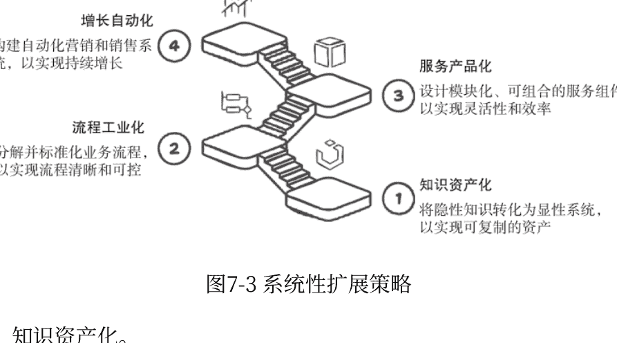

##### 1）知识资产化。

- 将隐性知识转化为显性系统，将大脑中的想法变成可复制的资产。
- 创建知识库、决策树、评估工具，用飞书文档系统化存储。
- 建立培训体系和能力复制机制，以及新人快速上手的知识传送带。
- 案例：开发飞书AI创意决策系统，将专家经验系统化，用即梦AI可视化关键流程。

##### 2) 流程工业化。

- 分解并标准化所有业务流程，使其像工厂的生产线一样清晰可控。
- 建立清晰的角色分工，谁负责什么就一目了然了。
- 设计质量控制和反馈机制，确保标准化不降低品质。
- 案例：将内容创作拆分为6个标准步骤，由不同角色执行，用豆包监控质量。

##### 3) 服务产品化。

- 设计模块化、可组合的服务组件，像乐高积木一样灵活组合。
- 创建标准化的交付流程，降低每次交付的边际成本。
- 开发自助服务选项和工具，减少人工参与的必要性。
- 案例：将咨询服务转化为可选模块的“套餐”，客户可自助选择组合。

##### 4) 增长自动化。

- 构建自动化营销和销售系统，获得全天不间断工作的“虚拟销售团队”。
- 开发客户自助注册和管理流程，减少人工干预。
- 建立数据驱动的增长优化循环，不断自我改进。
- 案例：使用TRAE或Cursor开发内容营销漏斗，实现潜在客户转化和跟进的自动化。

> 【深入案例】张文杰和王睿的扩展性突破。 “我们的业务的关键扩展瓶颈是内容创作的专业知识，就像一座山只有一条小路，所有交通都必须通过这个单一点。最初，所有高质量内容都需要我亲自参与创作或审核，这严重限制了业务规模。

“第一步突破是将我的创作方法记录为详细的AI内容创作手册，使用飞书文档和即梦AI将相关内容可视化，包括决策流程、质量标准和常见问题处理。这让团队成员能够执行大部分工作，而我只需审核最终成果。扩展性提升了约3倍，就像把小路变成了双车道。

“第二步突破是开发DeepSeek内容智能辅助系统，这使80%的创作流程自动化，包括结构设计、资料收集和初稿生成。我们使用通义灵码和豆包设计了一套智能工作流，这使我们能够在保持质量的同时将产能提升约10倍，就像把双车道变成了八车道高速公路。

“最关键的突破是建立了完整的内容创作生态系统，将创作者、需求方和资源提供者连接起来。我们从内容创作者变成了平台运营者，业务扩展能力实现了质的飞跃，就像不再只关注一条道路，而是建立了整个交通网络。

“这一系列转变将我们的人均产值从初期的约1万元/月提升到现在的8万元/月，同时业务规模扩大了15倍。核心启示是：扩展性不能即兴创造，必须经过系统设计，就像建筑师先设计蓝图再动工，而不是边建边想。在AI赋能环境下，这种系统化扩展比以往任何时候都更容易实现，但前提是你必须思考得比AI更深入、更系统。”

## 5.AI创业的技术与商业平衡

AI创业面临独特的挑战：如何在技术能力和商业价值之间找到平衡点。过于技术导向会失去商业焦点，就像生产了一台超级计算机却不知道用来做什么;而过于商业导向则可能缺乏技术深度，就像只会喊口号却拿不出实质产品。王睿和张文杰分享了他们的平衡策略。

#### （1）技术与商业平衡的四种模型。

##### 1）技术驱动模型。

- 核心：独特技术能力是主要竞争力，比如专有算法或模型。
- 特点：深度技术专长，研发投入大，专利保护，技术壁垒。
- 优势：技术壁垒高，模仿难度大，长期竞争力强。
- 挑战：市场应用和商业化较慢，投入大，回报慢，风险高。
- 适用：有强技术背景的创始团队，突破性技术，研发密集型。

##### 2）应用集成模型。

- 核心：整合现有AI技术解决特定问题，技术是手段而不是目的。
- 特点：快速应用，专注特定用例，客户问题导向，实用主义。
- 优势：上市速度快，直接解决客户痛点，商业价值清晰。
- 挑战：技术差异化难度大，“护城河”浅，容易被模仿。
- 适用：有行业和商业背景的创始团队，市场机会明确。

##### 3）行业专精模型。

- 核心：将AI技术与深度行业知识相结合，专注垂直领域。
- 特点：针对特定行业的AI解决方案，深度行业洞察。
- 优势：垂直整合，进入壁垒高，目标市场明确。
- 挑战：市场规模可能受限，存在行业转型风险，扩展难度较大。
- 适用：有特定行业经验的跨领域团队，垂直市场机会。

##### 4）平台赋能模型。

- 核心：为他人使用AI提供工具和平台，相当于“卖铲子”。
- 特点：构建生态系统，网络效应，多方参与。
- 优势：规模效应大，长期价值高，多元化收入。
- 挑战：初期启动困难，竞争激烈，平台定位难。
- 适用：有平台思维和技术能力的团队，市场足够大。

> “选择合适的平衡模型取决于创始团队的背景、可用资源和市场机会，”王睿解释道，“就像选择适合自己的车，跑车、SUV、卡车各有所长。我们选择了‘应用集成+行业专精’的混合模型，因为这最匹配我们的技术能力和行业经验，同时允许进行快速市场验证。当前在中国AI市场，随着底层技术越来越成熟，技术差异化变得越来越困难，但应用层的创新和垂直行业的专业知识变得更加重要。”

#### （2）技术与商业平衡的实施策略。

##### 1）价值先导原则。

- 始终从客户问题和价值而非技术能力出发，先问为什么再问如何。
- 技术选择服务于问题解决而不是目的本身，工具服务于结果。
- 简洁的解决方案优于技术炫耀，够用比最佳更重要。
- 案例：选择成熟的DeepSeek或通义模型快速解决客户的问题，而非追求最前沿的技术。

##### 2）适度的技术深度。

- 在关键差异化领域建立深度技术能力，将资源集中于核心竞争力。
- 在非核心领域利用现有工具和服务，如豆包的低代码平台。
- 明确区分必须拥有和可以使用的技术，避免重复“造轮子”。
- 案例：在内容生成领域深耕专有技术，而在基础设施上使用云服务。

##### 3）持续学习循环。

- 建立技术雷达系统，跟踪关键技术进展，特别是国产AI工具的更新。
- 设计快速实验机制，测试新技术的应用，小规模试错。
- 建立技术债务管理系统，保持系统现代化，避免技术老化。
- 案例：每季度评估新发布的DeepSeek和通义模型，通过小型试点项目测试价值。

##### 4）两轨开发策略。

- 主轨：面向当前商业需求的稳定开发，确保收入和客户满意度。
- 探索轨：面向未来机会的创新实验，投资具有长期竞争力的事物。
- 明确资源分配比例（如80/20），保持探索但不影响当前业务。
- 案例：核心产品团队专注于当前客户需求，创新实验室探索即梦AI和通义模型的新应用。

> 【深入案例】王睿和张文杰的技术商业平衡策略。“我们的创业之旅始于一个关键理念：AI对大多数客户而言只是手段，而非目的。这就像没有人真正关心电力是如何产生的，他们只关心灯是否能亮。客户寻求的是问题解决和价值创造，技术只是实现途径。

“这一认识让我们避免了常见的技术创业陷阱——过度关注技术的先进性而忽视了商业实用性，就像造了一辆超跑却没有适合行驶的道路。我们的平衡策略包括：

(1) 问题导向框架：每个技术决策必须回答‘这如何解决客户的实际问题’，如无明确答案则暂缓，就像购买工具前先问‘我需要用它做什么’。
(2) 分层技术策略：核心差异化技术自主开发，通用功能使用现有工具和API，明确技术投资的优先级。
(3) 快速市场验证：新技术必须在8周内完成市场验证，否则应进行调整或放弃，避免‘沉没成本谬误’。
(4) 双重评估标准：技术方案同时由技术团队和业务团队评估，需双方认可，确保平衡视角。

“当前中国AI市场的特点是技术快速迭代但应用深度不足，我们的平衡策略让我们避免了技术跟风，专注于解决实际问题。我们的技术足够先进以创造差异化价值，也足够实用以快速解决现实问题。这既避免了‘纯技术玩具’的困境，也避免了‘无技术深度’的局限。我们不是打造最先进的AI应用，而是打造最有用的AI应用。”

## 四、总结：从副业到创业的转型智慧

### 1.关键洞察与行动建议

纵观本章内容，我们探讨了从AI副业到成功创业的系统化路径。以下是核心洞察与实践建议。

#### （1）创业时机判断。

1）洞察：创业不是赌博，而是基于多维度指标的理性决策。
2）建议：使用创业时机评估表定期评估你的准备程度，在各项指标达到标准后再决定转型。
3）行动步骤：每季度进行一次完整评估，重点关注财务指标、市场验证和个人准备度。

#### （2）渐进式转型。

1）洞察：成功的创业往往是渐进式的过程，而非一蹴而就的跳跃。
2）建议：设计个人的阶段性转型路径，确保每一步都有明确的进退标准。
3）行动步骤：将创业过程分为试水、验证、扩展和全职四个阶段，为每个阶段设定明确的指标和时间框架。

#### （3）商业模式设计。

1）洞察：可持续的创业需要系统的商业模式，而非单纯依靠个人能力。
2）建议：使用商业模式画布全面思考你的创业构想，确保各要素相互协调。
3）行动步骤：定期更新商业模式画布，用实验验证关键假设，基于反馈持续优化。

#### （4）从服务到产品。

1）洞察：真正可扩展的创业需要从个人服务转向系统化产品。
2）建议：有意识地推动业务向更具扩展性的形态演进，从服务标准化开始，逐步迈向产品化。
3）行动步骤：分析服务流程，识别可标准化和产品化的元素，设计产品化路径图。

#### （5）多元收入结构。

1）洞察：健康的创业需要平衡即时收入与长期价值的多元收入结构。
2）建议：设计互补性的收入来源，在不同阶段调整收入组合。
3）行动步骤：设计至少三种互补的收入来源，制定收入结构演进计划。

#### （6）团队构建。

1）洞察：AI时代的创业团队需精简、灵活且高效。
2）建议：采用“核心+外围”的团队结构，善用AI工具替代部分人力。
3）行动步骤：明确必须内部掌握的核心职能，其他功能通过外部合作或AI工具实现。

#### (7) 风险管理。

1) 洞察：成功的创业者不是消除风险，而是系统管理风险。
2) 建议：建立多层次的财务安全网，设计清晰的退出策略。
3) 行动步骤：准备至少6个月的生活储备金，制定创业应急计划和退出标准。

#### (8) 技术创意平衡。

1) 洞察：AI创业需要技术与商业价值的平衡。
2) 建议：基于团队背景选择适合的技术与商业平衡模型，避免过度技术或过度营销。
3) 行动步骤：对每个技术决策都问一问“如何创造客户价值”，对每个商业决策都问一问“技术如何支持”。

### 2.从副业创业者到成功创始人的转变

副业转型创业不仅是事业形态的变化，更是个人身份和思维方式的转变。下面是这一转变的核心维度（见图7-4）。

#### (1) 从执行者到设计者。

1) 副业思维：专注于做好工作。
2）创业思维：专注于设计系统。
3）转变方法：从我如何完成这项工作到如何设计一个能自动完成这项工作的系统。

#### （2）从技能专家到价值创造者。

1）副业思维：销售时间和技能。
2）创业思维：创造和捕获价值。
3）转变方法：从我能提供什么服务到我能解决什么价值百万元的问题。

#### （3）从单点思考到系统思维。

1) 副业思维：关注单个服务或产品。
2) 创业思维：构建整体商业生态系统。
3) 转变方法：使用思维导图和系统图，看清各要素间的相互关系。

#### （4）从短期交易到长期关系。

1) 副业思维：完成一次性项目。
2) 创业思维：建立持续的客户关系和品牌资产。
3) 转变方法：设计客户旅程图，关注客户终身价值而非单次交易。

#### （5）从个人英雄到团队建设者。

1) 副业思维：依靠个人能力创造成果。
2) 创业思维：通过团队和系统创造更大成果。
3) 转变方法：学习授权和领导技能，将个人知识系统地传递给团队。

### 3.未来趋势：AI创业的发展方向

随着AI技术的快速发展，创业景观也在持续演变。以下是当前我国AI创业市场的几个关键趋势，值得创业者密切关注。

#### （1）垂直领域AI专精。

1) 趋势：通用AI工具普及后，市场将更重视垂直行业的专业AI解决方案。
2) 机会：将DeepSeek和TRAE等AI技术与特定行业专业知识深度结合。

## 实战练习

完成以下创业转型评估项目，制定你的个人创业路线图。

项目名称：《我的AI创业转型评估与路线图设计》。

第一部分：创业时机全面评估。

- （1）创业时机评估表。
    1. 使用创业时机评估表为自己打分。
    2. 详细记录每个维度的具体情况和得分理由。
    3. 识别得分较低的维度，制定针对性的改进计划。
    4. 设定达到80分（创业时机成熟）的时间目标。

- （2）财务安全网构建。
    1. 计算个人12个月的基本生活费用总额。
    2. 评估当前储蓄与安全储备的差距。
    3. 制定分层资金体系计划（安全基金+创业投资资金+应急准备金）。
    4. 设计副业收入阶梯计划和资金分配策略。

第二部分：商业模式设计。

- （1）商业模式画布制作。
    1. 使用本章中AI创业的商业模式画布。
    2. 详细填写你的创业构想的九个核心要素。
    3. 识别3～5个需要验证的关键假设。
    4. 设计最小可行产品验证方案。

- （2）服务产品化路径规划。
    1. 分析你当前的副业服务，按照服务产品化五阶段模型评估所处的阶段。
    2. 设计从当前阶段到下一阶段的具体转型计划。
    3. 列出需要标准化的流程和可产品化的服务组件。
    4. 制定产品化时间表和里程碑。

第三部分：团队与资源规划。

- （1）精益团队设计。
    1. 基于3000元/月的预算设计你的初始团队结构。
    2. 列出核心职能需求和对应的解决方案（内部、外包、AI工具）。
    3. 设计人-AI协作流程，明确哪些工作由AI完成。
    4. 制定团队扩张的阶段性计划。

- （2）风险控制策略。
    1. 设计你的渐进式转型四阶段计划（试水、验证、扩展、全职）。
    2. 制定每个阶段的进入条件、成功指标和退出标准。
    3. 建立财务、时间、关系的边界管理机制。
    4. 准备应急预案和从容退出策略。

第四部分：计划实施。

90天行动计划。

- （1）制定未来90天的具体行动清单。
- （2）设定每月的关键目标和每周的具体任务。
- （3）建立进度追踪和调整机制。
- （4）安排定期评估和决策节点。

要求：

- （1）所有评估和计划都基于真实数据，不得虚构。
- （2）使用本章推荐的AI工具（DeepSeek、豆包、飞书等）辅助分析。
- （3）制作可视化图表展示关键信息。
- （4）考虑你的实际情况（行业背景、资源条件、家庭情况）。
- （5）设置可衡量的具体指标，避免模糊目标。
- （6）包含风险评估和应对措施。
- （7）准备向朋友或导师汇报你的创业计划。

## 思考

(1) 创业往往需要“完美时机”，但市场机会稍纵即逝。如何在充分准备与抓住机会之间找到平衡?是等到所有条件都成熟再行动，还是在条件基本具备时就勇敢尝试?你认为哪些准备是必需的，哪些可以在行动中完善?

(2) 张文杰和王睿的合伙成功很大程度上缘于技能互补和价值观一致。但在现实中，如何判断一个人是否适合成为长期合伙人?技能互补重要还是性格匹配重要?当与合伙人在重大决策上产生分歧时，应该如何处理?

(3) 本章大量提到使用AI工具提升效率和降低成本，但过度依赖AI工具是否会削弱创业者的核心竞争力?当AI技术快速迭代时，如何确保自己的商业模式不会因为技术变化而失效?人类创业者的不可替代价值究竟在哪里?

(4) 低风险创业路径看似安全，但是否会错过高回报的机会?完全的风险规避是否本身就是最大的风险?在中国快速变化的商业环境中，过分谨慎是否意味着机会的丧失?如何在风险控制和机会把握之间找到个人的最佳平衡点?

(5) 从员工思维转向创业者思维不仅是工作方式的改变，更是人生观和价值观的重塑。这种转换会给个人心理和家庭关系带来哪些冲击?如何在追求事业成功的同时保持生活的平衡和内心的平静?

(6) AI创业领域技术迭代极快，今天的商业模式可能明天就过时。如何设计能够适应技术变化的可持续商业模式?是应该专注于技术前沿追求先发优势，还是专注于业务应用追求长期价值?

## 章末寄语：创业是一段精心设计的旅程

从副业到创业的转型，不是一次冲动的跳跃，而是一段精心设计的旅程。正如张文杰和王睿的故事所展示的，成功的创业者不是押注于单一机会的赌徒，而是系统构建、持续学习和适应变化的设计师。

AI时代的创业既充满前所未有的机遇，也伴随着独特的挑战。技术变革的速度要求创业者保持敏捷适应的能力，同时仍需专注于创造真实、持久的价值。

最终，创业成功不仅取决于你的技术能力或商业头脑，还取决于你设计和执行系统化路径的能力——一条从愿景到现实，从概念到实践，从个人才能到商业价值的转化路径。

> “千里之行，始于足下。” 你的创业之路同样始于今天的决定和行动。无论你处于副业创业的哪个阶段，关键是迈出有意识、有准备的下一步，朝着你的创业愿景稳步前进。

愿本章中的框架、工具和经验能为你的创业旅程提供一些光亮，帮助你在AI时代的无限可能中找到属于自己的成功路径。

## 第8章 AI营销攻略：让你的副业产品卖得更好

### 开篇：张文杰的营销困境与突破

张文杰盯着电脑屏幕上的数据，眉头紧锁。AI写作服务已运营3个月，但流量和转化率持续低迷。

“产品质量没问题，定价也合理，为什么就是卖不出去？”他陷入困惑。

王睿的视频电话响起：“看你的朋友圈连发三天‘哎’，是营销遇到难题了？”

“是啊，内容质量不错，但找不到客户。”张文杰叹气。

“2025年了，还用传统营销思维？”王睿分享了一幅图表，“这是我上个月做的AI营销案例，一个月流量增长了8倍，客户咨询增加了12倍。”

张文杰看着陡升的曲线：“怎么做到的？”

“传统营销靠直觉，AI营销靠数据。我用DeepSeek分析用户行为，设计个性化的内容，数据驱动优化投入，就像给营销装上了智能导航一样。”

“听起来很复杂……”

“其实不难。AI让复杂分析自动化，普通人也能做专业营销。关键是掌握方法和工具。”王睿说，“优质内容只是成功的一半，如何让内容被看见、被选择，这才是AI营销的核心。”

“能教教我吗？”

“下周办公室见，一起打造AI营销系统。”

一周后，张文杰学到的AI营销策略让副业收入在两个月内增长了3倍，彻底打开了新的商业视野。

## 一、流量密码：AI解读算法，助你获得10倍曝光

### 1. 内容可见性的新游戏规则

“营销的第一步是让人看见你，”王睿一边操作电脑一边解释，“但在当今信息过载的环境下，这比想象的要困难得多。就像在春节联欢晚会的弹幕中喊‘我在这里’，基本上没人会注意到。”

张文杰点头：“我深有体会。有时候花费一整天时间创作的内容，发出去却只有几十次的浏览量，感觉特别沮丧，就像对着空旷的山谷大喊，却没有人回答。”

“这是因为每个平台都有自己的流量分发算法，”王睿解释道，“这些算法决定了哪些内容会被推荐给用户，哪些会被埋没。理解并适应这些算法是获取大量曝光的关键，就像了解游戏规则才能赢得比赛一样。”

平台算法的核心考量因素如表8-1所示。

| 平台 | 核心考量因素 | 内容偏好 | 最佳发布策略 |
| :--- | :--- | :--- | :--- |
| 小红书 | 互动率、完成率、停留时间、新鲜度 | 真实体验、干货分享、视觉优先 | 垂直领域深耕、高质量图文结合 |
| 知乎 | 专业度、完整度、有用度、互动质量 | 深度解析、专业观点、问题解答 | 系统化知识输出、热门问题回答 |
| 微信公众号 | 阅读完成率、互动率、转发量、订阅者黏性 | 深度文章、实用工具、情感共鸣 | 更新节奏固定、系列内容输出 |
| 抖音/视频号 | 完播率、互动率、转化率、原创性 | 短视频内容、实用技巧、娱乐性 | 垂直定位、高频率更新、快节奏 |
| 今日头条 | 点击率、阅读时长、互动量、领域相关性 | 即时资讯、深度分析、实用信息 | 紧跟热点、标题清晰、定位专业 |
| B站 | 完播率、评论互动、弹幕密度、创作质量 | 特色内容、专业解析、圈层文化 | 持续输出、社区互动、垂直深耕 |

表8-1 平台算法的核心考量因素

“不同平台的算法偏好不同类型的内容，”王睿指出，“例如，抖音更看重完播率和互动率，而知乎则更看重专业度和有用度，理解这些差异对于正确配置你的内容至关重要。这就像不同的餐厅有不同的菜单标准，你不能在火锅店卖刺身。”

张文杰若有所思地点点头：“我好像一直在用同一种内容模式适配所有平台，难怪效果不佳。”

### 2. AI算法解读：揭开流量分配的秘密

“但平台算法经常变化，我怎么才能跟上呢？”张文杰疑惑地问，“我总不能天天研究这些算法的变化吧？”

“这正是AI可以帮忙的地方，”王睿笑着说，“我们可以使用AI工具来分析大量数据，找出当前算法的偏好模式，就像侦探通过各种线索推断犯罪手法一样。”

（1）三步AI算法解读法。

1）数据收集。
- 分析高流量内容的共同特征。
- 追踪内容表现随时间的变化。
- 比较不同类型内容的曝光差异。

2）模式识别。
- 使用AI识别高表现内容的共同点。
- 发现引发高互动的关键要素。
- 确定最佳内容结构和发布时机。

3）策略调整。
- 基于数据洞察优化内容策略。
- 使用A/B测试来验证不同内容形式。
- 持续监测并适应算法变化。

> “让我用实际的例子来说明，”王睿打开了一个分析工具，“以小红书为例，我们分析了过去3个月表现最好的500篇AI相关的内容，发现了一些明显的模式。”

王睿指着屏幕上的数据展示道：“2025年的小红书算法特别喜欢这些元素。”

（2）小红书高流量内容模式分析。
1）标题特征：包含数字（如“7种方法”）的标题获得比普通标题高56%的点击率。
2）内容结构：第一幅图片对留存率影响巨大，包含清晰步骤的内容的完成率相比其他内容高出41%。
3）互动设计：末尾带开放式问题的帖子的评论量相比普通帖子平均高出2.3倍。
4）发布时机：晚上8点至10点发布的内容获得的初始流量相比其他时段发布的内容平均高23%。

> “看到了吗？”王睿说道，“这就像是平台给了我们一份隐形的‘攻略指南’。现在我们知道了流量密码的一部分，接下来要做的就是利用这些洞察来优化你的内容，就像知道了考试重点，复习起来就有的放矢了。”

### 3. 内容优化自动化：AI驱动的高曝光策略

王睿打开了DeepSeek，展示如何使用AI来优化内容以获得更高曝光：“DeepSeek是目前国内最强大的AI工具之一，它不仅能生成内容，还能分析和优化现有内容。相比国外的ChatGPT，它对中文内容和国内平台的理解更深入。”

内容优化提示词模板：

请基于以下平台算法偏好，优化我的内容以获得更高曝光：

平台：[小红书/知乎/微信公众号/抖音等]。
目标受众：[目标受众描述]。
内容主题：[主题概述]。
核心卖点：[产品/服务的主要价值]。

请提供：
(1) 3个基于算法偏好的标题选项（带有情绪触发和好奇心的元素）。
(2) 优化的内容结构（包括开头、主体和结尾）。
(3) 5个提高互动率的关键点建议。
(4) 2～3个适合引起共鸣的问题设计。
(5) 最佳发布时间和关键词标签建议。

原始内容：
[粘贴原始内容]。

张文杰惊讶地看着AI生成的优化建议：“这太神奇了，它几乎重构了我的整个内容！就像把我的普通T恤变成了定制西装。”

“是的，而且这只是开始，”王睿点点头，“接下来，我们要建立一个完整的内容优化流程，确保你的每一篇内容都能获得最大曝光。”

图8-1展示了AI驱动的内容曝光最大化流程。

（1）预发布分析。
1）使用DeepSeek或豆包评估内容与当前算法偏好的匹配度。
2）预测可能的流量瓶颈并提前解决。
3）确定最佳的内容发布时间窗口。

（2）多变体测试。
1）为同一内容创建3～5个不同的版本（标题、开头、结构）。
2）小规模发布以测试各版本的表现。
3）基于初步数据选择最佳版本并进行大规模推广。

（3）互动增强器。
1）设计算法友好的互动引导元素。
2）创建促进深度参与的内容体验。
3）利用AI生成个性化回复，增加互动率。

（4）内容生命周期管理。
1）监测内容表现曲线，把握再推广时机。
2）根据反馈持续优化内容元素。
3）建立内容更新日历，保持算法青睐。

（5）空间数字体验整合。
1）创建AR展示组件以增强内容的互动性。
2）添加3D元素以提升视觉表现力。
3）生成沉浸式视觉体验以吸引用户停留。

> “使用这套流程后，我的客户平均获得了6～10倍的内容曝光增长，”王睿自信地说，“关键在于系统化和数据驱动，而不是凭感觉发布内容，就像现代农业不再看天吃饭，而是用科学方法提高产量。”

### 4. 跨平台内容适配：一次创作，多渠道曝光

> “但我没有时间为每个平台单独创建内容，”张文杰担忧地说，“这看起来工作量太大了，我又不是复制人。”

> “绝对不会，”王睿摇摇头，“我们可以使用豆包和通义来实现‘一次创作，多渠道曝光’的策略。这就像做一道主菜，然后根据不同人的口味微调调味料。”

AI跨平台内容转换流程如下。

（1）核心内容创建。
1）选择一个主要平台作为内容创作基地。
2）创建包含完整价值的深度内容。

（2）平台特性分析。
1）使用AI分析各目标平台的内容特性。
2）确定每个平台的格式和风格需求。

（3）自动内容转换。
1）使用豆包或通义将核心内容转换为各平台适用的格式。
2）保持核心价值主张，调整表达方式。

（4）特定平台优化。
1）为每个平台添加专属元素（如标签、互动设计）。
2）调整内容长度和深度以匹配平台期望。

王睿展示了一个实例，如何将一篇关于“AI写作工具比较”的长文章，快速转换为小红书笔记、知乎回答、微信公众号文章和抖音脚本。

> “看这个例子，”王睿指着屏幕，“同一核心内容，在小红书上变成了视觉主导的步骤解析，在知乎上变成了深度分析文章，在抖音上则转化为快节奏的演示脚本。内容核心不变，但表达方式完全适应了各平台的特性，就像变色龙一样。”

“通过这种方法，你可以在保持内容质量的同时提高工作效率，”王睿说道，“一篇核心内容可以触达多个平台的受众，将曝光量提升5～10倍。这就是为了让工作更聪明，而不是更辛苦。”

### 5. 内容病毒化设计：让你的内容自然传播

“除了平台算法，还有什么方法可以增加曝光呢？”张文杰问道，眼中闪烁着求知的光芒。

“病毒式传播，”王睿回答，“有些内容具有‘自传播’能力，通过用户自发分享获得指数级传播。AI可以帮我们设计这类内容，就像设计滚雪球，推出去后会自己越滚越大。”

内容病毒化有如下五个关键要素：
1. 情感触发：引发强烈的情感反应（惊讶、愤怒、喜悦、共鸣）。
2. 实用价值：提供明显的实用信息或解决方案。
3. 社会货币：分享能提升用户在社交圈的形象（“看我多懂行/潮流/有见解”）。
4. 叙事结构：引人入胜的故事或意外转折。
5. 紧扣实事：与当前热点事件或话题相关联。

“病毒式内容不只靠运气，而是可以有意设计的，”王睿强调，“通过AI分析成功案例的共同特征，我们可以大大提高内容的传播率。就像病毒学家了解病毒的传播机制一样，我们可以设计‘良性传播’的内容。”

【案例分享】张文杰的病毒式内容成功案例。在实施这些策略后，张文杰创作的“7天从零开始用AI写作，实现年收入10万元”内容系列获得了超过25万次的总浏览量，比他之前的内容平均高出了15倍。关键成功因素包括：
1. 情感共鸣：从被裁员到月收入过万的逆袭故事（人人都爱的逆袭故事）。
2. 结构优化：7步可行动框架，每步都有明确的成果（简单易懂且可操作）。
3. 互动设计：每部分结束都设置开放式问题（“你遇到过这样的困境吗？”）。
4. 算法适配：根据平台特性调整内容形式和互动点。
5. 多平台策略：核心内容一次创作，6个平台同步分发。

> “在尝试过几次后，张文杰惊喜地发现自己掌握了内容病毒化的诀窍，”王睿笑着说，“他甚至开玩笑说自己成了‘内容病毒学家’，知道如何让好的内容像流感一样传播，不但不会让人难受，反而让人感谢被‘传染’。”

【失败案例分析】何小姐的营销“滑铁卢”。“不过，内容病毒化也有踩坑的风险，”王睿严肃地说，“我的另一位客户何小姐就吃了大亏。她经营手工香薰产品，看到一个竞争对手用‘震惊’类标题获得了高曝光，就模仿创作了标题为《震惊！这款香薰可能正在毒害你的家人》的内容。”

“结果呢？”张文杰好奇地问。

“短期内确实获得了高曝光，但带来了三个严重后果：首先，引来大量非目标用户，造成互动质量低；其次，原有粉丝对这种标题党手法很反感，取关率高达30%；最后，更严重的是，负面情绪触发的内容损害了品牌形象，导致销量下滑40%。”

“所以病毒式内容也要讲究方法？”

“没错，关键是要与你的品牌调性一致，并产生正面价值，而不是一味追求爆炸性。病毒式传播是双刃剑，用得好是助推器，用得不好就是毁灭弹。”

“记住，”王睿总结道，“在AI时代，获取流量不是猜谜游戏，而是可以通过数据和系统方法实现的科学过程。掌握了这些技巧，你的内容曝光将实现质的飞跃，就像有了GPS导航，再也不用靠直觉找路了。”

## 二、个性化营销自动化：一次设置，持续转化

### 1. 从流量到转化：AI营销漏斗设计

“获得流量只是第一步，”王睿继续说道，“真正的挑战是将这些流量转化为实际的客户和收入。这就像吸引人进商场容易，但让他们掏钱购物又是另一回事。”

张文杰点点头：“确实，我发现即使有人看了我的内容，转化率还是很低。我的内容就像是个受欢迎的免费展览，但没人买纪念品。”

“这是因为每位访客都处于不同的决策阶段，有不同的需求和顾虑，”王睿解释道，“传统营销使用统一的信息对所有人说同样的话，而AI营销则能为每个人提供个性化的体验。这就像高级餐厅，根据客人口味调整菜品，而不是快餐店的标准餐。”

图8-2展示了AI营销漏斗的五个阶段。

#### 图8-2 AI营销漏斗的五个阶段

(1) 意识阶段（awareness）。
- 1) 目标：让潜在客户了解你的存在和价值。
- 2) AI应用：基于兴趣和行为特征识别潜在受众。
- 3) 内容策略：广泛价值展示，问题识别，入门教育。

(2) 兴趣阶段（interest）。
- 1) 目标：培养深入了解的欲望。
- 2) AI应用：跟踪内容互动，识别具体兴趣点。
- 3) 内容策略：深度价值解析，案例分享，问题解决框架。

(3) 考虑阶段（consideration）。
- 1) 目标：证明你的解决方案优于替代选择。
- 2) AI应用：预测决策顾虑，提供针对性的信息。
- 3) 内容策略：对比分析，专家背书，产品细节。

(4) 转化阶段（conversion）。
- 1) 目标：促成购买决定。
- 2) AI应用：识别购买信号，提供个性化的促销服务。
- 3) 内容策略：限时优惠，社会证明，风险消除。

(5) 忠诚阶段（loyalty）。
- 1) 目标：鼓励重复购买和推荐。
- 2) AI应用：分析使用模式，预测升级机会。
- 3) 内容策略：使用指南，成功案例，专属福利。

> “关键是要理解不同阶段的人需要不同类型的内容和互动，”王睿强调，“AI可以帮助我们识别每个人所处的阶段，并自动提供最合适的内容。一个好的销售员能感知客户的需求状态，但AI可以同时为成千上万的人做这件事。”

> “这让我想起了我妈妈的购物习惯，”张文杰若有所思地说，“她会先在网上研究几周，然后去实体店试用，回家再比较价格，最后还要等促销才下单。原来她在不同的阶段确实需要不同的信息。”

> “没错！”王睿笑道，“而关键是，每个人的节奏都不同，AI可以识别并适应这种个体差异。”

## 2.客户旅程映射：AI精准识别决策阶段

> “但我怎么知道一位访客处于哪个阶段呢？”张文杰问道，“我又不能直接问他：‘嘿，你准备好掏钱了吗？’”

> “这就是AI客户旅程映射发挥作用的地方，”王睿回答，“通过分析用户行为数据，AI可以相当准确地判断一个人在决策过程中的位置，就像侦探根据脚印和指纹推断犯罪嫌疑人的行为轨迹一样。”

表8-2展示了AI客户旅程映射的关键指标。

| 决策阶段 | 行为指标 | 内容互动 | 转化可能性 | 最佳响应策略 |
| :--- | :--- | :--- | :--- | :--- |
| 意识阶段 | 首次访问，浏览时间短，跳出率高 | 浏览概述内容，查看“关于”页面 | 5%～10% | 提供价值教育，建立问题意识 |
| 兴趣阶段 | 多次访问，停留时间增加，浏览多个页面 | 阅读深度文章，下载指南，关注社交账号 | 15%～25% | 提供深度内容，展示专业能力 |
| 考虑阶段 | 查看服务详情，比较不同方案，阅读案例 | 研究案例和常见问题，比较页面 | 30%～45% | 提供对比信息，消除顾虑 |
| 转化阶段 | 查看价格，访问购买页面，开始但未完成购买流程 | 查看定价页面、退款政策和联系方式 | 60%～75% | 提供促销优惠，简化购买流程 |
| 忠诚阶段 | 完成购买，重复访问，查看高级功能 | 阅读使用指南，参与社区讨论 | 75%～90%以上 | 提供增值服务，鼓励分享 |

#### 表8-2 AI客户旅程映射的关键指标

> “使用这些指标，AI系统可以实时判断用户所处的阶段，”王睿解释道，“然后自动触发相应的营销活动。2025年，使用这种技术预测用户的下一步行动的精确率已经达到了85%以上。”

> “这有点像《少数派报告》里预知犯罪，”张文杰笑道，“只不过我们是在预测购买行为，而不是犯罪。”

> “准确的比喻！”王睿赞同道，“而且我们可以用通义或豆包来实现这种分析。”

## 3.个性化内容推送：正确的人，正确的时间，正确的信息

> “理解了用户所处的阶段，下一步就是提供个性化的内容，”王睿继续说道，“这是AI营销的核心优势之一。想象一下，每个潜在客户都有一个专属导购，完全了解他们的需求和顾虑。”

（1）个性化内容推送策略。
- 1) 基于行为的个性化：通过跟踪用户的浏览和点击行为，在用户浏览AI写文章后自动推送相关工具的比较内容。
- 2) 基于阶段的个性化：确定用户在决策旅程中的位置，为处于考虑阶段的用户提供客户成功案例和服务对比。
- 3) 基于人口统计的个性化：根据用户的年龄、职业、地域等特征定制内容，为企业用户推送商业版功能介绍，为学生用户推送教育优惠信息。
- 4) 基于时间的个性化：识别用户最活跃的时间段和响应模式，在用户常查看邮件的早上9点发送推广内容。

> “个性化不再是简单的‘亲爱的[名字]’，”王睿笑道，“个性化是对用户完整数字画像的深度理解和精准响应，就像面对你最好的朋友，知道什么时候该说什么话。”

（2）个性化内容矩阵设计。王睿展示了一个个性化内容矩阵（见表8-3），将不同的决策阶段与不同的用户群体交叉匹配。

| 决策阶段/用户类型 | 企业营销经理 | 自由内容创作者 | 小企业主 |
| :--- | :--- | :--- | :--- |
| 意识阶段 | 如何用 AI 降低 50%的内容营销成本 | AI 写作：从业余到专业的捷径 | 小企业主的 AI 营销指南：节省时间与预算 |
| 兴趣阶段 | 企业案例：AI 如何重塑内容团队的效率 | 6 位自由作家如何用 AI 将收入提高 3 倍 | 无须技术背景：小企业 AI 应用实战 |
| 考虑阶段 | 企业级 AI 写作工具对比：功能、价格与 ROI | 专业作家的 AI 工具选择：权衡利弊 | 小企业预算内的 AI 解决方案对比 |
| 转化阶段 | 限时企业方案：包含团队培训与定制化 | 专业创作者套餐：首月半价＋作品集优化 | 小企业启动包：简单上手＋7 天退款保证 |
| 忠诚阶段 | 企业专属：高级功能使用指南与案例分享 | 创作者社区：互助资源与专属 AI 创作模板 | 小企业成长：如何随业务扩展 AI 应用 |

#### 表8-3 个性化内容矩阵

> “看到了吗？每个交叉点都是针对特定用户在特定阶段的精准内容，”王睿解释道，“这个矩阵能确保每位用户都收到最相关的内容，它可以作为你所有营销自动化的基础。”

> “这像是下棋时想好了所有可能的走法，”张文杰评论道，“每种情况都有相应的应对策略。”

> “确实如此，”王睿点头，“而AI工具可以帮助我们生成这些个性化的内容。我们可以使用通义或DeepSeek来创建针对性的内容。”

## 4.营销自动化工作流：无须人工干预的转化系统

> “这一切听起来很棒，但我没有时间为每位访客手动执行这些操作，”张文杰担忧地说，“我又不是超人，不可能同时跟踪上千名潜在客户。”

> “正因如此，我们需要将这些智能策略自动化，”王睿说道，“通过设置营销自动化工作流，你可以让系统在没有你的干预的情况下自动执行这些复杂的个性化策略，就像设置了一支全天候工作的销售团队，而你只需要监督结果。”

基础自动化工作流设计如下：
- 1. 触发条件：定义启动自动化序列的事件或行为。
- 2. 条件分支：基于用户属性或行为创建不同的路径。
- 3. 等待步骤：设置适当的时间间隔。
- 4. 操作步骤：发送邮件、推送通知、发送短信等。
- 5. 目标追踪：监控转化和响应。

> “我们来看一个具体的例子。”王睿打开了一个营销自动化平台的界面，上面展示了一个名为“免费AI写作指南下载后的转化序列”的工作流。

【自动化工作流案例】免费AI写作指南下载后的转化序列。
- (1) 触发事件：用户下载“AI写作指南”。
- (2) 立即行动：发送感谢邮件，包含指南获取链接和快速入门提示。
- (3) 等待2天：给用户时间查看指南。
- (4) 条件检查：用户是否打开了指南链接？
    - 1) 是：发送进阶内容“7天AI写作实践计划”。
    - 2) 否：发送提醒邮件“别错过你的AI写作指南”。
- (5) 等待3天。
- (6) 条件检查：用户是否访问了服务页面？
    - 1) 是：发送特别优惠“新用户首单可享受15%的折扣”。
    - 2) 否：发送成功案例研究“如何用AI写作提高收入”。
- (7) 等待2天。
- (8) 最终转化：发送表示最后机会的邮件“限时优惠即将结束”。
- (9) 目标追踪：监控整个序列的打开率、点击率和转化率。
- (10) 2025年新增：根据用户反应自动调整后续内容的情感基调和紧迫感。

> “这个工作流完全自动运行，根据用户行为发送个性化的内容，”王睿解释道，“一旦设置好，它就成为一个全天候工作的销售助手，让你在睡觉的时候也能转化客户，就像一个永不休息的销售团队。”

> “这听起来像科幻电影，”张文杰惊叹道，“但它真的有效吗？”

> “非常有效，”王睿肯定地说，“我的客户看到自动化序列后转化率平均提高了40%～60%。关键是要测试和优化，找到最有效的序列模式。”

【自动化踩坑案例】李先生的“过度追踪”灾难。“不过，营销自动化也有风险，”王睿警告道，“我曾经有位客户李先生售卖高端茶叶。他设置了过度热情的自动化工作流，在用户下载资料后的7天内发送了8封邮件和4条短信。结果退订率飙升至60%，投诉增加，品牌形象严重受损。”

> “问题出在哪里？”张文杰问道。

> “频率太高，内容相似度高，没有根据用户反应调整策略，”王睿解释道，“就像你刚认识一个人，他就天天给你打电话问你结婚的事。自动化要尊重用户的节奏，提供价值，而不是轰炸。”

> “那正确的频率是什么？”

> “这取决于行业和用户类型，但对于初次接触的自动化序列，一周2～3次接触是上限，内容必须有差异化价值，并且要有明确的退订选项。更重要的是，要有分支逻辑，根据用户反应调整后续内容。”

## 5.触发式营销：抓住决定性时刻

> “除了这些计划好的序列，还有什么更即时的策略吗？”张文杰问道，“有些时候客户可能需要立即响应。”

> “触发式营销，”王睿回答，“这是基于用户实时行为触发的即时响应，往往发生在用户做决定的关键时刻，就像在顾客犹豫不决时，一个好的销售员适时出现并提供帮助。”

（1）高转化触发营销场景。
1）购物车放弃。
- 触发：用户添加商品但离开网站。
- 响应：发送提醒邮件，表明可能提供小额折扣。
- 时机：离开后30分钟至24小时内。
- 转化率：平均可挽回15%～30%的放弃交易。
- 2025年增强：实时智能助手出现，提供个性化的提醒。

2）高意向页面访问。
- 触发：用户查看定价页面或服务详情。
- 响应：提供即时聊天支持或相关案例研究。
- 时机：访问期间或之后的24小时内。
- 转化率：页面转化率提高40%～60%。

3）内容深度互动。
- 触发：用户阅读多篇相关文章或观看多个视频。
- 响应：提供与主题相关的深度资源或入门优惠。
- 时机：第三次内容互动后。
- 转化率：比一般访客高3～5倍。
- 2025年增强：智能内容路径推荐，预测下一个兴趣点。

4）服务使用里程碑。
- 触发：用户达到产品使用的关键里程碑。
- 响应：庆祝成就并推荐下一步的行动。
- 时机：里程碑达成后立即进行。
- 转化率：升级和续费率提高25%～40%。

> “触发式营销的魅力在于它的即时性和相关性，”王睿解释道，“你在用户最有兴趣的那一刻与他们互动，极大地提高了转化的可能性。就像一个有心灵感应的销售员，在客户心中产生疑问的瞬间就会立即出现并提供答案。”

（2）触发式营销设计模板。
- 触发事件：[具体描述触发事件]。
- 目标用户：[谁会触发这个事件]。
- 营销目标：[希望用户采取什么行动]。
- 时间窗口：[需要多快响应]。
- 用户情绪预测：[用户可能的心理状态]。

响应内容设计：
- 1) 标题/主题：[引起注意的标题]。
- 2) 主要信息：[核心价值主张]。
- 3) 个性化元素：[如何个性化这条信息]。
- 4) 紧迫感元素：[如何创造行动紧迫感]。
- 5) 行动召唤：[明确的下一步行动]。

跟进策略：
- 1) 如果用户响应：[下一步行动]。
- 2) 如果用户不响应：[替代行动]。
- 3) 情绪调整策略：[如何根据用户反应调整后续内容的情感基调]。

> “张文杰很快就掌握了这些触发式营销策略的设计方法，并将其应用到自己的AI写作服务中。他发现，当一位潜在客户浏览了他的案例研究页面超过3分钟后，立即发送一封‘想了解更多吗？’的邮件，回复率竟然高达62%。这使他的服务试用到付费转化率从15%提高到了37%，咨询到签约率提高了近一倍。”

> “最让他惊讶的是，”王睿笑着说，“这些自动化工作流一旦设置完成，就能进入自主运转的状态，不用人工干预，系统会自动运行并生成结果。他终于可以专注于服务质量，而不是日夜担心如何获客了。”

> “这就像在你的业务中克隆了一支24小时工作的营销团队，”王睿总结道，“而且它们永远不会要求加薪或休假。”

## 三、数据驱动决策：如何让每一笔营销费用高效转化

### 1.营销分析基础：关键指标解读

> “现在我们已经建立了流量获取和转化系统，”王睿说道，“但如何知道这些努力是否有效？如何持续优化投资回报？这就需要数据驱动决策，否则就像是在黑暗中射箭，可能偶尔命中，但大部分都是浪费箭矢。”

张文杰点点头：“我确实感觉自己在营销上有些盲目投资，不知道哪些渠道真正有效。有时候感觉像是在往黑洞里扔钱。”

> “首先，我们需要理解并追踪关键营销指标，”王睿说道，“这些数字将告诉我们哪些策略有效，哪些需要调整。这就像是你的营销仪表盘，告诉你业务引擎的运行状况。”

表8-4详细介绍了如何对核心营销指标进行解读。

| 指标类别 | 关键指标 | 计算方法 | 健康标准 | 优化方向 |
| :--- | :--- | :--- | :--- | :--- |
| 流量指标 | 访问量 | 网站总访问数 | 持续增长 | 提高内容曝光率 |
| | 独立访客 | 独立 IP 访问数 | 新老访客比例平衡 | 扩大受众的覆盖面 |
| | 流量来源占比 | 各渠道流量所占的百分比 | 多渠道分散 | 强化高价值渠道 |
| 参与指标 | 停留时间 | 平均网站停留分钟数 | 2 分钟以上 | 提升内容价值 |
| | 页面浏览量 | 每次访问的页面数 | 2 页以上 | 优化内部链接 |
| | 互动率 | 评论/分享/点赞比例 | 3% 以上 | 增加互动设计 |
| 转化指标 | 转化率 | 转化次数/访问量 | 2%～5% | 优化转化路径 |
| | 客户获取成本 (CAC) | 营销成本/新客户数 | 低于客户价值的 1/3 | 提高定向精准度 |
| | 转化时间 | 首次访问到转化之间的天数 | 7～30 天 | 缩短决策周期 |
| 经济指标 | ROI | (收益－成本)/成本×100% | 200% 以上 | 提高定价策略 |
| | 平均订单价值 | 总收入/订单数 | 持续提升 | 增加交叉销售 |
| | 客户生命周期价值 | 客户终身收入预期 | CAC 的 3 倍以上 | 提升客户留存率 |

#### 表8-4 核心营销指标解读

> “理解这些指标只是第一步，”王睿强调，“真正的价值在于使用这些数据做出更明智的决策。就像医生不仅要知道血压数字是多少，还要知道这些数字意味着什么，以及如何给出治疗方案。”

> “这些指标有点复杂，”张文杰叹了口气，“看着像天书一样。我是创意人，不是数学家啊。”

> “别担心，”王睿笑道，“AI分析工具已经变得非常友好了，它们会自动帮你解读这些数据，就像有一个专业的数据分析师随时待命。”

### 2.AI分析工具：快速洞察与可视化

> “手动分析这些数据会很复杂，”张文杰担忧地说，“我本来就是为了逃避Excel表格才去做创意的。”

> “这正是AI分析工具的价值所在，”王睿笑着说，“它们可以快速处理大量数据，自动识别模式和异常，并以易于理解的方式呈现。就像把复杂的数据变成一幅清晰的画，让你一眼就能看懂。”

表8-5对中国市场营销分析的各种工具进行了比较。

| 工具类型 | 推荐产品 | 主要功能 | 适用场景 |
| :--- | :--- | :--- | :--- |
| 基础分析 | 百度统计，神策数据，诸葛IO | 网站流量分析，用户行为追踪 | 所有数字营销 |
| 社交媒体分析 | 新榜，灰豚数据，飞瓜数据，蝉妈妈 | 社交媒体表现监测，受众分析 | 社交媒体营销 |
| 内容效果分析 | 新榜/清博指数，抖音热点宝 | 内容表现分析，话题趋势预测 | 内容营销 |
| 转化率优化 | 神策热图，Ptengine中国版，GrowingIO热图 | 热图分析，用户行为记录，漏斗分析 | 网站优化 |
| 广告分析 | 巨量千川，腾讯广告洞察平台，阿里妈妈达摩盘，京东商智 | 广告表现，受众响应，ROI分析 | 付费广告 |
| 全渠道分析 | 阿里云Quick BI，腾讯云BI，神策SDAF，GrowingIO全渠道分析 | 多数据源整合，自定义仪表板 | 综合营销分析 |

#### 表8-5 中国市场营销分析工具比较

> “在2025年，这些工具已经进化到不需要你懂数据科学也能获得专业级分析，”王睿解释道，“比如通义千问不仅告诉你数据是什么，还会解释为什么会这样，以及应该采取什么行动。这就像有一个营销顾问随时在线。”

王睿打开了通义千问的界面，展示了一个仪表板：“看这个例子，系统不仅显示你的转化率下降了8%，还自动分析出这可能与上周上线的新表单有关，因为表单完成时间增加了40秒。它甚至给出了三个具体的优化建议，比如简化表单字段和改进移动端体验。”

### 3.A/B测试：数据驱动的持续优化

> “知道现状很好，但如何确定改变会带来提升呢？”张文杰问道，“我总不能靠灵感或直觉做决定吧？”

> “这就是A/B测试的价值，”王睿回答，“它允许你用数据验证每一个营销决策，而不是依赖于猜测。就像科学实验，用数据说话，而不是凭空想象。”

（1）A/B测试基础流程（见图8-3）。

图8-3 A/B测试基础流程
- 1) 确定目标：明确测试的具体指标（点击率、转化率等）。
- 2) 形成假设：基于数据和洞察提出改进方向。
- 3) 创建变体：设计原始版本和测试版本（A为原始版本，B为测试版本）。
- 4) 分配流量：确保测试公平，随机向用户展示A或B版本。
- 5) 收集数据：收集足够的数据以获得统计显著性。
- 6) 分析结果：确定胜出版本并分析原因。
- 7) 实施和迭代：应用成功变体并开始下一轮测试。
- 8) AI优化学习：系统自动学习测试结果并提出建议。

> “A/B测试就像是微型实验室，”王睿解释道，“你不需要花费全部营销预算去尝试新想法，可以先用小部分流量验证它是否真的有效。这大大降低了创新的风险。”

（2）值得测试的营销元素（见表8-6）。

| 营销元素 | 测试变量 | 典型提升幅度 | 实施难度 |
| :--- | :--- | :--- | :--- |
| 标题/主题行 | 长度、措辞、数字使用、情感诉求 | 15%～40% | 低 |
| 号召性用语（CTA） | 文本、颜色、位置、大小 | 20%～95% | 低 |
| 视觉元素 | 图片选择、颜色方案、布局 | 10%～40% | 中 |
| 价格呈现 | 价格锚点、包装方式、折扣呈现 | 15%～100% | 中 |
| 内容结构 | 长度、格式、信息顺序 | 5%～35% | 中 |
| 社会证明 | 类型、数量、位置 | 15%～70% | 低 |
| 登录页面 | 整体设计、表单长度、信息层次 | 25%～250% | 高 |
| 定向标准 | 受众细分、投放时间、兴趣匹配 | 30%～400% | 中 |
| AR/VR 体验 | 进入方式、交互类型、空间设计 | 40%～200% | 高 |
| 语音交互 | 触发词、对话流程、个性化响应 | 20%～150% | 中 |

#### 表8-6 值得测试的营销元素

## 4.归因分析：了解真正有效的营销渠道

“我有多个营销渠道，但不确定哪个真正带来了转化，”张文杰说道，“有时候客户说他们是从朋友那里听说我的服务，但他们的朋友可能是通过我的内容了解到的。这就像追踪一个谜团的源头。”

“这就是归因分析的重要性，”王睿说道，“它帮助你了解客户旅程中各个接触点的贡献，从而做出更明智的预算分配。这就像了解每位球员在球队胜利中的贡献，而不仅仅看谁最后进了球。”

#### （1）营销归因模型比较（见表8-7）。

| 归因模型 | 工作方式 | 适用场景 | 优缺点 |
|---|---|---|---|
| 最后点击归因 | 全部功劳归于最后接触点 | 简单场景，直接响应营销 | 简单明了，但忽视了早期影响 |
| 首次点击归因 | 全部功劳归于首次接触点 | 品牌知名度，市场教育 | 强调发现的重要性，忽视了后续努力 |
| 线性归因 | 将功劳平均分配给所有接触点 | 长销售周期，多渠道战略 | 公平但不够精确 |
| 位置归因 | 首末接触点获得更大权重 | 平衡发现与转化 | 折中方案，但权重设置可能过于武断 |
| 时间衰减 | 近期接触点获得更大权重 | 临时促销，短期活动 | 考虑时间因素，但可能低估早期影响 |
| 数据驱动归因 | 通过算法分析历史数据动态来确定 | 复杂的多渠道营销 | 最精确，但需要大量数据和工具支持 |
| 空间路径归因 | 分析用户在 AR/VR 中的路径 | 沉浸式营销体验 | 创新但需要专门工具，数据有限 |

表8-7 营销归因模型比较

“对于副业创业者，我通常推荐从简单模型开始，然后随着数据积累逐步采用更复杂的模型，”王睿建议道，“就像学习任何技能一样，从基础开始，然后逐步进阶。”

“这些不同的模型让我想起了小时候玩的‘福尔摩斯探案’游戏，”张文杰笑道，“不同的线索调查方法会找到不同的凶手。”

“有趣的类比！”王睿笑着说，“而且在营销归因中，有时候确实需要福尔摩斯的头脑来厘清复杂的客户旅程。”

#### （2）如何实施基础归因分析。

1.  设置统一追踪。
    - 确保所有营销渠道都使用统一的UTM (Urchin Tracking Module) 参数。
    - 实施跨设备和跨渠道的用户识别机制。
    - 建立转化目标和价值记录。

2.  选择适合的工具。
    - 初级：百度智能分析提供基本归因报告。
    - 中级：专业归因工具，如豆包AI。
    - 高级：阿里云数据中台和自定义分析。

3.  解读归因数据。
    - 识别“助攻”渠道（影响转化但不直接触发）。
    - 计算各渠道的真实ROI。
    - 发挥渠道协同效应。
    - 理解空间体验在转化路径中的作用。

> 【归因分析失败案例】郭老师的错误预算削减。“归因分析如果做得不对，也会带来严重后果，”王睿说，“我曾经帮助过一位郭老师，他经营在线教育课程。他使用了最后点击归因模型分析数据，发现抖音带来的直接转化很少，于是决定将抖音预算削减80%，转投小红书。”

“结果呢？”

“一个月后，不仅小红书的转化没有明显增加，整体销售额反而下降了35%。深入分析后我们发现，虽然抖音很少直接带来最终转化，但它在客户决策初期起着关键的第一印象作用——超过60%的最终购买者曾经先在抖音了解到该课程，然后经过其他渠道的接触才最终转化。”

“所以像电影一样，配角有时候也很重要？”张文杰问道。

“完全正确!营销渠道就像一个团队，有人负责吸引注意力，有人负责深化理解，有人负责最终转化。使用过于简单的归因模型，就可能错误地评估团队成员的贡献。”

这些分析帮助张文杰发现，虽然社交媒体直接带来的转化不多，但它在客户旅程的认知阶段扮演着关键角色。而最让他惊讶的是，虽然AR演示体验只贡献了5%的直接转化，但参与过AR体验的用户的最终转化率高达78%，远高于普通访客。

“明白了这一点后，”王睿说道，“张文杰将更多预算投入了增强AR体验质量，同时保持社交媒体的基础投入，结果营销效率提高了37%。这就是数据告诉你的‘隐性真相’，而不是表面现象。”

## 5.预测分析：提前优化营销策略

“了解过去的表现很有价值，但能否预测未来的趋势呢？”张文杰问道，“如果能提前知道下个月什么内容会火，那就太完美了。”

“这正是AI预测分析的强大之处，”王睿说道，“它可以识别模式并预测未来结果，让你提前调整策略。这就像有一台时光机，让你瞥见未来市场的一角。”

AI预测分析有如下应用场景。

- （1）需求预测。
  1. 功能：预测特定服务的未来需求。
  2. 应用：提前调整产能和营销重点。
  3. 案例：张文杰预测“电商文案”需求在6月会有季节性上升，提前准备了相关内容。
  4. 2025年增强：整合行业大数据、社会事件和季节性因素的多维预测。

- （2）转化预测。
  1. 功能：预测访客转化为客户的可能性。
  2. 应用：优先分配资源给具有高潜力的潜在客户。
  3. 案例：识别有85%转化可能的访客，提供VIP个性化跟进服务。
  4. 2025年增强：情绪分析和行为模式识别提高预测准确率。

- （3）客户生命周期预测。
  1. 功能：预测客户价值和留存周期。
  2. 应用：调整客户获取预算上限。
  3. 案例：识别高价值客户特征，调整定向标准。
  4. 2025年增强：融合行业趋势和个人发展轨迹的动态预测。

- （4）趋势预测。
  1. 功能：预测行业趋势和热点话题。
  2. 应用：提前创建相关内容。
  3. 案例：预测AI写作工具比较的需求会上升，提前准备相关内容。
  4. 2025年增强：时事热点与行业变化的实时关联分析。

“让我展示一个真实案例，”王睿打开了扣子智能体的界面，“这是张文杰使用扣子分析趋势预测的结果。”

屏幕上显示了一个趋势图，预测未来3个月内“AI短视频创作”需求将上升67%，而“AI长文写作”需求将相对平稳。同时，系统预测“AI个性化定制内容”将成为新的增长点。

“基于这个预测，张文杰提前3周开发了‘AI短视频脚本生成’服务，”王睿说道，“当市场需求上升时，他已经有了成熟的解决方案和案例，迅速抢占了市场份额。这就像提前到达黄金地点的淘金者，比其他人领先一步。”

【预测分析失败案例】刘先生的过度投资。“预测分析也有风险，”王睿严肃地说，“我的客户刘先生经营家居设计服务，他使用了某款预测工具，发现极简主义设计会成为2025年第二季度的热门趋势，增长幅度预测高达200%。他果断投入了大量资金开发极简设计服务，甚至改造了办公室的展示空间。”

“结果如何？”张文杰问道。

“这个预测严重偏离了实际。实际增长率只有15%，远低于投资回报所需的水平。深入分析发现，预测模型过于依赖全球趋势数据，忽略了本地市场特性，同时样本量也不足。刘先生因此亏损了近10万元。”

“那我们该如何避免这种风险？”

“有几个关键点：首先，永远不要基于单一预测工具做重大投资决策；其次，进行小规模测试以验证预测的准确性；最后，制定分阶段投资策略，根据实际市场反应调整投入。预测是参考，不是命令。”

“即使是简单的预测分析也能带来巨大价值，”王睿强调，“关键是将预测转化为具体行动。预测未来不是为了炫技，而是为了更好地规划当下。”

“我感觉像是获得了商业超能力，”张文杰兴奋地说，“看到了别人看不到的机会。”

“没错，”王睿笑着回应，“而最有趣的是，这些‘超能力’其实是建立在科学和数据而不是玄学之上。”

经过这些数据驱动的优化，张文杰的营销效率显著提升，同样的预算带来了近3倍的成果。最重要的是，他对每一笔营销投资的效果有了清晰的了解，不再感觉像是在黑暗中摸索。

“最大的变化是我的心态，”张文杰告诉王睿，“以前每次投放广告都忐忑不安，现在有了数据作为指南，我感到前所未有的自信。”

## 四、全渠道内容策略：用AI管理你的营销矩阵

## 1.全渠道营销原理：无缝的客户体验

“今天的客户不再局限于单一渠道，”王睿说道，“他们可能在小红书上发现你，在百度上搜索你，通过微信与你互动，体验你的AR演示，然后才决定购买。全渠道营销就是创造一种无缝的体验，无论他们在哪里与你接触。”

张文杰点点头：“我确实发现客户通常会通过多个渠道了解我的服务，但管理这么多平台感觉很混乱，就像同时打多种太极拳。”

“这就是为什么我们需要一种系统化的方法，”王睿说，“AI可以帮助我们在保持一致性的同时，适应每个渠道的特点。就像一位优秀的演员，核心角色不变，但能适应不同的舞台。”

全渠道与多渠道的区别如表8-8所示。

| 特征 | 多渠道营销 | 全渠道营销 | 2025 年全渠道增强 |
| :--- | :--- | :--- | :--- |
| 渠道连接 | 渠道之间相互独立 | 渠道之间紧密集成 | 实时同步的全息用户画像 |
| 客户体验 | 在不同渠道有不同的体验 | 跨渠道一致且连续的体验 | 融合物理和数字的无缝衔接体验 |
| 数据整合 | 渠道数据分散存储 | 集中的客户数据平台 | 全域数据可实时分析和响应 |
| 信息一致性 | 渠道间可能有不同信息 | 所有渠道传递一致的信息 | 上下文感知的动态内容调整 |
| 转化路径 | 通常期望在单一渠道完成 | 支持跨渠道的转化路径 | 预测式路径优化和个性化推荐 |
| 技术要求 | 相对简单 | 需要集成技术和数据 | 需要 AI 编排和智能决策系统 |
| 空间体验整合 | 基本不考虑或独立存在 | 作为补充渠道考虑 | 作为核心体验层与其他渠道深度融合 |

表8-8 全渠道与多渠道的区别

“全渠道营销的核心在于将客户而非渠道置于战略中心，”王睿强调，“每个渠道都应该是整体客户旅程的一部分，而不是独立的孤岛。这就像一部精彩的电影，每个场景都是整体故事的一部分，而不是独立的短片。”

“这让我想起了拼图，”张文杰若有所思地说，“每个渠道都是一块拼图，只有正确组合才能展现完整画面。”

“非常贴切的比喻！”王睿赞许道，“而AI就是帮你更快地找到每块拼图的正确位置的助手。”

## 2.渠道角色定位：每个平台的战略定位

“首先，我们需要明确每个渠道在客户旅程中的角色，”王睿解释道，“不同平台有不同的优势和目的，就像一个团队中的不同成员各有所长。”

渠道角色战略规划如表8-9所示。

| 渠道类型 | 主要角色 | 内容类型 | 互动特点 | 转化目标 |
| :--- | :--- | :--- | :--- | :--- |
| 小红书 | 发现，灵感，社区 | 视觉内容，步骤解析，用户见证 | 高互动，真实分享 | 引导至深度内容 |
| 知乎 | 专业度，深度教育 | 深度文章，问题解析，领域分析 | 专业讨论，逻辑思考 | 建立权威，引导咨询 |
| 微信生态 | 关系维护，深度转化 | 实用内容，案例分析，促销信息 | 私密互动，持续关系 | 直接咨询，付费服务 |
| 抖音/视频号 | 注意力获取，品牌调性 | 简短演示，效果对比，创意表达 | 高能量，快节奏 | 引发兴趣，培养认知 |
| 搜索引擎 | 需求捕获，问题解决 | 搜索引擎优化（SEO）内容，专业解答 | 精准匹配搜索意图 | 直接咨询，服务购买 |
| 电子邮件 | 个人关系，直接销售 | 个性化内容，专属优惠，教育系列 | 一对一通信，深度阅读 | 重复购买，活动参与 |
| B站 | 深度解析，教育培训 | 教程视频，案例分析，行业知识 | 高忠诚度，深度参与 | 建立专业形象，获得长期粉丝 |

表8-9 渠道角色战略规划

“每个渠道都有其独特的价值，”王睿说道，“关键是明确每个渠道的主要目标，而不是期望所有渠道都直接促成销售。这就像足球队，不是每个队员都负责进球，有的负责防守，有的负责传球。”

## 3.内容矩阵设计：跨渠道的统一信息传递

“明确了渠道角色后，下一步是设计内容矩阵，”王睿继续说道，“这确保了我们的信息在所有渠道保持一致，同时适应每个平台的特点。它就像一个大型交响乐团的总谱，确保每个乐器在正确的时间奏出正确的音符。”

#### （1）内容矩阵设计流程。

1.  核心信息定义。
    - 确定品牌的关键信息和价值主张。
    - 建立统一的品牌声音和信息框架。
    - 创建核心内容资产（如详细指南）。
    - 设计贯穿所有渠道的统一视觉语言。

2.  渠道内容调整。
    - 根据各平台特性调整内容格式和长度。
    - 保持核心信息不变，改变表达方式。
    - 设计渠道特有的互动元素。
    - 根据平台算法优化内容结构。

3.  内容交叉引用。
    - 在各渠道之间建立内容连接。
    - 设计引导用户跨渠道移动的路径。
    - 确保跨渠道的叙事连贯性。
    - 创建“内容面包屑”帮助用户导航。

“你知道为什么很多人的营销感觉不连贯吗？”王睿问道，“因为他们在不同的平台上说不同的话，用不同的形象，就像人格分裂一样。顾客会感到困惑：‘这到底是不是同一个品牌？’”

#### （2）内容矩阵规划工具。王睿展示了一个内容矩阵表格，横向是不同营销渠道，纵向是营销主题和信息（见表8-10）。

| 主题/渠道 | 网站/博客 | 小红书 | 知乎 | 电子邮件 | B站 |
| :--- | :--- | :--- | :--- | :--- | :--- |
| AI写作入门 | 详细指南（2000字） | 七步骤摘要+视觉引导 | 常见问题深度回答 | 分章节课程系列 | 教学视频：AI写作过程演示 |
| 效率提升 | 案例研究+数据 | 前后对比+实用技巧 | 方法论详解+经验 | 自动化工作流指南 | 效率技巧视频教程 |
| 内容创意 | 深度创意方法论 | 九宫格灵感触发器 | 行业创意趋势分析 | 每周创意提示 | 创意思路分享视频 |
| 服务案例 | 详细过程与结果 | 客户反馈+成果展示 | 行业问题解决方案 | 定制方案流程 | 案例解析分享视频 |
| 行业趋势 | 研究报告+预测 | 趋势速览+关键点 | 深度分析与见解 | 趋势追踪更新 | 行业趋势解读视频 |

表8-10 内容矩阵规划工具

“这个矩阵确保了我们有全面的内容覆盖，同时每个渠道都有适合其特性的内容形式，”王睿解释道，“最重要的是，所有渠道传递一致的核心信息，只是表达方式不同。这就像讲同一个故事，根据听众不同调整讲述方式。”

“我喜欢这种系统化的方法，”张文杰评论道，“它让我不再为‘今天应该发什么’而烦恼。”

“没错，”王睿点头，“有了这个矩阵，你就有了清晰的内容路线图，而不是每天早上盯着空白屏幕冥思苦想。”

## 4.内容再利用：一次创作，多渠道复用

“创建这么多内容听起来工作量很大，”张文杰担忧地说，“我还是一天只有24小时，不可能变成章鱼哥同时做8件事。”

“这就是内容再利用的价值所在，”王睿笑着说，“我们不是为每个渠道从零开始创建内容，而是通过智能转换让同一核心内容在多个渠道发挥价值。这就像用一块面团烤出不同形状的面包，核心原料相同，但最终产品多样化。”

内容再利用策略如下：

- （1）核心内容到卫星内容。
  1. 创建一个详尽的“核心内容”（通常是长文章或白皮书）。
  2. 从核心内容中提取多个“卫星内容”用于各渠道。
  3. 所有卫星内容引导回核心内容。
  4. 使用AI自动识别适合提取的片段。

- （2）内容拆分与合并。
  1. 将大内容拆分为小内容（一篇长文变成多条社媒帖子）。
  2. 将小内容合并为大内容（多个短视频合成一个详细教程）。
  3. 根据渠道和受众需求调整深度和广度。
  4. 使用AI保持拆分后内容的连贯性。

- （3）格式转换。
  1. 文字内容转换为视频脚本。
  2. 视频内容提取为文章。
  3. 数据可视化为图表。
  4. 文字对话转换为视频对话。
  5. 2D内容转换为3D或AR体验。

“内容再利用就像聪明的厨师，”王睿解释，“用周日烤的一只鸡，周一做沙拉，周二做汤，周三做三明治。一次努力，多次收获。”

## 5.全渠道协同：打造无缝客户体验

“最后，真正的全渠道营销不只是在多个渠道发布内容，”王睿强调，“而是创造一种无缝的客户体验，让用户可以轻松地在渠道之间移动，并获得连贯的体验。这就像在不同房间之间移动，但仍然是在同一个家里。”

全渠道协同策略如图8-4所示。

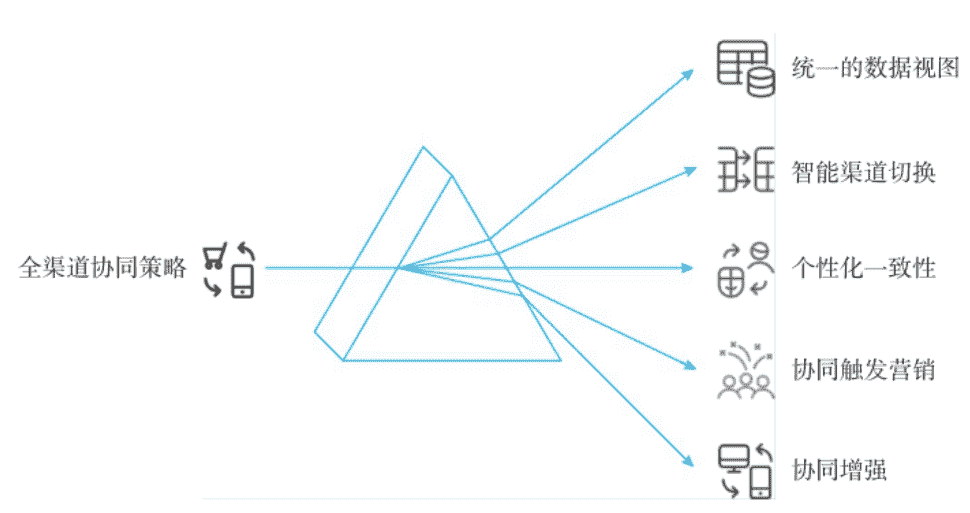

- （1）统一的数据视图。
  1. 实施跨渠道客户识别机制。
  2. 建立集中的客户数据平台。

## 实战练习

尝试完成以下实战练习，将本章的知识应用到实践中。

实战挑战：3天AI营销启动计划。

（1）第1天：创建一个详细的目标受众画像，使用DeepSeek或豆包分析其行为和痛点。

任务清单：
- 收集目标受众的人口统计数据和行为模式。
- 利用AI分析竞争对手相关内容和受众互动。
- 创建3个详细的用户画像，包括痛点、目标和决策旅程。

（2）第2天：为一个核心内容主题设计内容矩阵，覆盖至少3个不同的平台。

任务清单：
- 选择一个与业务核心价值相关的主题。
- 使用AI为每个平台创建适配版本。
- 设计跨平台引导机制，构建完整的内容流。
- 考虑添加一个简单的AR元素以增强用户体验。

（3）第3天：针对新订阅者，设计一个简单的三步式电子邮件序列。

任务清单：
- 创建引人入胜的欢迎邮件。
- 设计中间教育内容邮件。
- 设计软性转化邮件。
- 使用AI优化主题和内容。
- 设置简单的行为触发条件。

记录整个过程的学习和发现，特别关注AI如何帮助你消除营销障碍。

## 思考

1. 你的副业或业务中，目前最大的营销挑战是什么?如何应用本章的AI策略解决这一挑战?
2. 在多个可能的营销渠道中，哪2～3个渠道最适合你的目标受众和业务模式?为什么?
3. 你如何在保持个人品牌一致性的同时，适应不同平台的内容需求?
4. 数据驱动决策如何改变你对营销成功的定义和评估方式?
5. 在本章介绍的工具中，哪些最能解决你当前的营销痛点?如何整合它们以创建一个协同系统?

## 章末寄语：从营销到增长的转变

AI正在重塑营销的本质——从工具的选择进化为系统的构建，从碎片化的活动升级为可预测的增长路径。张文杰就是一个典型的例子：他不再被动等待客户上门，而是主动设计客户旅程;不再依赖于感觉做判断，而是用数据驱动决策;不再疲于奔命，而是借助AI打造自动化、可复用的增长系统。

正如王睿所说：“真正的AI营销不在于掌握多少工具，而在于是否拥有系统思维。”这不再是大企业的专属能力，而是每个普通人都可以掌握的增长杠杆。你不需要成为营销专家，也不需要庞大的预算。你需要的是思维上的转变、行动上的起步，以及持续优化的耐心与坚持。

未来的AI营销将走向更深层次的感官融合、预测个性化和情感智能，但无论技术如何演进，营销的核心始终是“人与人之间的连接”。AI不是替代，而是助力，它能帮你用更少的时间、更少的试错，建立更强的信任、更快的增长。

现在，你已经拥有了打造AI营销系统的一切核心要素。从今天开始，构建你自己的增长系统，让AI成为你最聪明的营销搭档，用智能驱动增长，让创意赢得市场。

# 第9章 抖音从0到1：AI助力短视频快速起号与变现

## 开篇：张文杰的抖音流量焦虑

北京朝阳区的一家咖啡厅，窗外阳光正好。

“王睿，你看我这个视频的数据，”张文杰皱着眉头指着手机屏幕，“同样用AI做的美食视频，在视频号和小红书效果都不错，但在抖音的播放量就是上不去。”

经过几个月的AI副业实践，张文杰的写作和视频制作小有成就，月收入稳定突破8000元。但当他尝试将内容扩展到抖音这个巨大的流量池时，却像撞上了无形的墙。

王睿看了看数据，点点头：“抖音确实有独特的玩法。它像一场超高速派对，需要在3秒内抓住所有人的目光，否则他们就会划走。你的方法没错，但需要针对抖音特性进行‘AI精准调优’。”

“精准调优？”张文杰来了兴趣，“AI不仅能帮我们做内容，还能搞定抖音算法和流量？”

“不是搞定算法和流量，是找到正确的工具和方法。”王睿打开笔记本，“抖音在2025年依然是公认的流量池，也是变现效率最高的平台之一。但算法迭代快，用户口味变化也快。普通人想分一杯羹，光靠勤奋更新远远不够，必须借助国产AI的洞察力和效率，才能实现从0到1的快速突破。”

屏幕上显示出精心制作的PPT：“今天我们来拆解如何用豆包、DeepSeek这些国产AI玩转抖音，实现快速起号和高效变现。”

张文杰拿出笔记本，眼里充满期待：“快给我讲讲，AI怎么帮我们破解抖音的流量密码？”

## 一、抖音生态解密：为什么它是AI副业的黄金赛道

“在深入了解技巧之前，必须先理解抖音这个平台的核心逻辑，”王睿打开一份行业分析报告，“为什么抖音对AI副业创业者来说既是挑战，更是巨大的机遇。”

### 1. 抖音的用户画像与内容偏好：抓住“注意力货币”

王睿展示了一组数据：“截至2025年5月，抖音日活跃用户已突破7亿，相比去年增长了约10%～13%。用户群体覆盖更广了，但核心用户呈现年轻化、兴趣多元化的特点。他们的时间比以往更加碎片化，注意力更加稀缺，偏好直接、有趣、有用、有共鸣的内容。”

张文杰咬了一口提拉米苏，点点头：“所以，内容要更短、更快、更有价值?”

“正是如此!”王睿打开了一个分析图表，“我分析了近期抖音热门视频的特点，总结出了几个关于内容偏好的最新趋势。”

- (1) 极速开局，无缝衔接：不只是开头3秒抓住眼球，现在是开头1秒必须切入核心，不再有任何铺垫。这就像相亲一样，你没有第二次机会创造第一印象。
- (2) 精准垂直，标签化更强：用户更倾向于消费高精准度的垂直领域内容，模糊定位已无生存空间。就像你去吃火锅不会想着顺便理个发，内容也需要主打精准。
- (3) 知识实用性的娱乐表达：好玩又有用已成为标配，纯娱乐或纯知识类的内容都难以出圈。
- (4) 情绪共鸣升级：能引发深度共鸣、解压的内容的传播力更强。
- (5) 互动深度：不再满足于简单点赞，用户更愿意参与评论和分享有价值的内容。

> “这意味着，你的内容必须在极短的时间内传递核心价值，并激发用户的情感或好奇心。”王睿总结道，“就像我这杯咖啡，如果第一口没有让我惊艳，我可能就不会喝完它。抖音用户更是如此，他们的手指随时准备向上划走。”

### 2. 抖音算法的核心：完播率、互动率与推荐机制

(1) 2025年核心指标变化。“抖音的推荐算法是决定内容生死的关键，”王睿拿出一支笔，在纸上画了几个关键指标，“虽然它依然在不断迭代，但核心逻辑比以前更透明了。”

- 1) 完播率-互动率双核心：算法更聪明了，完播率依然重要，但系统能识别有价值的完播，即完播后是否有互动。
- 2) 互动质量分级：点赞<评论<分享<保存，尤其重视从转发到私聊和收藏行为。
- 3) 首次互动时间：用户观看几秒后产生第一次互动，这个时间点成为重要的指标。
- 4) 内容多样性鼓励：算法开始鼓励同质不同构的内容，避免千篇一律。
- 5) 账号权重评分体系：新增了创作者信用分概念，包含一致性、专业度、活跃度等维度。

(2) 2025年推荐机制升级。张文杰好奇地问：“2025年的抖音推荐机制有什么新变化吗？”

王睿笑了笑：“推荐机制确实有了很大变化，变得更精细也更透明了。”

- 1) 精细流量池分层：不再是简单的几个层级，而是根据内容质量、类型、目标受众等精细划分多达12个流量池。
- 2) 兴趣精准匹配：AI算法能更准确地预测用户下一个感兴趣的内容类型。
- 3) 创新内容扶持：设立了创新内容专属流量池，对具有原创性的内容给予额外的流量支持。
- 4) 本地化推荐升级：更注重地域性内容的精准推送，尤其是本地生活服务类内容。
- 5) 优质评论互动推荐：高质量评论本身成为可被单独推荐的内容。

> “理解这些，你就知道为什么有些视频能一夜爆火，有些却石沉大海。关键在于你的内容能否在早期获得好的数据反馈，触发算法的‘信任’。”王睿说道，“就像银行贷款，你有了良好的信用记录，后续才能获得更多资金支持。”

### 3. AI如何“喂饱”抖音算法：内容生产的效率革命

> “抖音算法喜欢新鲜、高频、互动性强的内容，这对传统创作者来说是巨大的挑战，但对AI副业创业者来说却是天然优势，”王睿说道，“尤其是2025年的国产AI工具，已经针对抖音平台做了深度优化。”

张文杰点头表示理解：“就像武侠小说里，普通人要修炼几十年才能成为高手，但我们有了AI这个‘外挂’，就可以直接从高级功法开始练习？”

“有点像，不过我更愿意把AI看作你的‘智能助教’，而不是‘外挂’。”王睿打开笔记本，展示了几款国产AI工具的界面，“来看看这些工具如何提升你的效率。”

- 1. 智能选题（豆包/DeepSeek）：不仅能分析热点，还能结合你的账号定位，推荐最适合你的选题方向。豆包的抖音热点雷达功能尤其强大，可以预判哪些话题即将走热。
- 2. 脚本智能优化（扣子智能体）：能根据抖音最新的流量规则，自动优化你的脚本节奏和开头设计。
- 3. 批量定制化制作（即梦AI/Canva可画）：你给出一个创意方向，AI能生成多个风格统一但内容不同的视频素材方案。
- 4. 数据洞察与预测（飞书智能分析）：不只是分析过去的数据，还能预测内容表现并给出调整建议。

> “这些工具使得内容生产效率提升了3～5倍，让你能将更多精力放在创意和策略上，持续满足算法对新鲜内容的需求。”

张文杰摸着下巴思考：“所以与其像无头苍蝇一样发布内容，不如用AI精准分析和生产，对吗？”

“没错，精准比数量更重要。”王睿肯定道，“就像射箭一样，十箭九中总比百箭乱射强。”

### 4. 抖音变现模式概览：从流量到现金流的全景图

“抖音之所以是黄金赛道，还在于它日益完善的变现体系。”王睿列出了最新的几种主流变现方式。

- 1. 创作者收益计划升级版：不再仅看播放量，而是引入了价值创造评分，优质内容将获得更高分成。
- 2. 电商生态系统：从单纯的带货到全链路服务，包括短视频种草、直播转化、抖店运营的闭环。
- 3. 知识服务变现：抖音课堂、付费咨询、数字藏品等多元知识产品形态。
- 4. IP价值延展：通过周边产品、定制服务、线下活动等方式变现IP影响力。

> “选择哪种变现方式取决于你的内容定位和粉丝画像，我们后面会详细讲解。关键是建立起从内容到变现的完整闭环。”

## 二、AI驱动的抖音账号定位与起号策略

“明确了抖音的规则，下一步就是找准自己的位置，”王睿开始指导张文杰进行账号规划，“2025年，定位不准确，等于在抖音上‘隐形’。这就像你参加了一场盛大的聚会，如果没有鲜明的特点，那么没有人会记住你。”

### 1. 找准赛道：用国产AI挖掘高潜力的垂直领域

“选择比努力更重要。选对赛道能让你事半功倍，”王睿打开DeepSeek的界面，“看，这是最新的‘赛道分析助手’功能。”

张文杰惊讶地看着屏幕：“这个功能以前没见过啊!”

“是的，这是DeepSeek推出的新功能，专为内容创作者设计。”王睿解释道，“我们来试一下各种AI工具的相关功能。”

- (1) 赛道健康度分析：输入你感兴趣的领域关键词，DeepSeek会分析该赛道的竞争度、增长率、变现难度和持久性，给出综合评分。
- (2) 蓝海细分定位器：豆包的这个功能可以在热门赛道中发现尚未饱和的细分领域。
- (3) 趋势预测引擎：通义大模型能基于历史数据，预测某个赛道未来3～6个月的热度走向。
- (4) 个人匹配度评估：AI会结合你的背景、技能和资源，评估你在各个赛道的竞争优势。

王睿在DeepSeek中输入了提示词“赛道分析助手”。根据DeepSeek的回答，王睿又输入了下面的提示词：

请分析抖音平台上与AI写作副业相关的最新市场机会。

- (1) 列出5个热门的细分内容方向及其特点和竞争度。
- (2) 分析这些方向的主要受众画像、痛点和增长潜力。
- (3) 评估每个方向的竞争激烈程度、变现潜力和持久性(低/中/高)。
- (4) 结合我的背景(前文案编辑,熟悉内容创作,AI工具使用熟练),推荐2～3个最适合我的、具有差异化优势的切入点。
- (5) 为推荐的切入点提供3个创新的内容形式建议,特别考虑2025年抖音算法的偏好。

DeepSeek很快给出了详细分析，结合用户特征，推荐了AI辅助职场高效写作和中小企业AI营销文案两个细分赛道，并提供了贴合抖音最新算法的内容形式建议。

> 张文杰眼前一亮：“这个分析也太详细了!看来AI写作+中小企业实用场景这个方向确实适合我。”

> “正是如此!AI不只是帮你写内容，更能帮你做出战略决策。”王睿笑道，“这就是为什么我总说，AI不只是工具，更是你的‘商业智囊团’。你不仅需要一个能干活的员工，更需要一个能给你出谋划策的顾问。”

### 2. 账号人设(IP)打造：国产AI辅助构建独特记忆点

> “现在，没有鲜明的人设等于没有身份证，”王睿强调，“我们有了AI帮手，打造差异化的人设就变得简单多了。”

- (1) 人设空白区探测：在DeepSeek中输入“抖音IP空缺分析”能发现某垂直领域中尚未被占据的人设定位。
- (2) 差异化人格构建：DeepSeek可以基于你的真实特点，放大某些特质，打造独特记忆点。
- (3) 视觉一致性规划：即梦AI或Canva可画能生成符合你人设的视觉风格指南，包括色彩、构图、滤镜等元素。
- (4) 语言特色塑造：AI大模型能为你设计独特的表达方式，包括口头禅、段落结构等。

王睿在豆包中输入：

请为我的抖音账号“AI职场写作提效”设计3个差异化强、记忆点明确的人设方案(2025年的抖音风格)。

要求结合我的背景(前文案编辑,懂AI工具,希望帮助职场人士)和目标受众(25～38岁的职场人士)。

每个方案包括：

(1) 人设核心标签(3个以内)与差异化卖点。
(2) 核心价值主张(一句话)。
(3) 抖音简介文案(15字以内)与头像风格建议。
(4) 3个标志性的表达方式或视频元素(能成为我的“记忆锚点”)。
(5) 内容框架建议(固定栏目、表达结构等)。

特别注意:方案要避开抖音现有的同类人设,具有明显的差异,且符合2025年抖音用户的审美与偏好。

DeepSeek生成了三个独特的人设方案，张文杰最终选定了AI写作效率教练的人设，定位为3分钟将你的文档效率提升300%，视觉风格为明亮科技感与商务简约的结合，标志性元素包括效率时钟开场和三步法则讲解结构。

> “这个人设很棒！”张文杰兴奋地说，“感觉立刻就能想到很多内容方向。”

> “人设就是内容的源头活水，”王睿解释道，“一个好的人设能自然衍生出大量内容，而不是每次都要绞尽脑汁想新点子。这就像你给自己设定了一个明确的角色，之后的表演就会水到渠成。”

### 3. 从0到1快速起号：7天冷启动实战计划

> “抖音的新账号扶持政策在2025年有了变化，”王睿指出，“新账号首发的前3个视频将获得额外推荐，所以准备工作更重要了。”

（1）第1～2天：账号基建与战略储备。

- 1）完善个人资料（头像、昵称、简介），确保符合人设定位。
- 2）养号：使用豆包AI智能体的“抖音兴趣培养指南”，有策略地浏览、点赞、评论（每天60～90分钟），帮助系统准确识别你的账号属性。
- 3）使用DeepSeek批量创作10～15条内容框架和脚本，重点打磨前3条。
- 4）用即梦AI或Canva可画提前准备差异化但风格统一的视频素材库。

（2）第3～4天：精准发布与互动引导。

- 1）发布前3条视频，间隔12～24小时，选择用户活跃高峰期。
- 2）利用DeepSeek生成的互动话题，在评论区引导用户参与讨论。
- 3）使用豆包AI智能体的“评论回复助手”，快速个性化回复每一条评论（前6小时内必回）。

（3）第5～7天：数据分析与策略调整。

- 1）利用飞书的数据分析功能，解读已发布视频的表现指标。
- 2）在DeepSeek中输入“内容优化顾问”，基于数据反馈调整后续内容方向。
- 3）根据表现最好的视频类型，快速迭代2～3个相似但升级的内容。

张文杰记录着这些步骤，问道：“冷启动期的主要目标是什么？涨粉吗？”

王睿摇摇头：“冷启动期的核心目标不是涨粉，而是训练抖音的算法正确认识你的账号定位，并找到最适合你的内容形式。这是一个用AI训练抖音的过程，有趣吧？”

张文杰笑了：“确实有趣，感觉像是在教抖音认识我一样。”

> “没错，你可以把它想象成你和抖音算法的‘相亲过程’，”王睿笑道，“你需要展示最真实但同时也是最好的一面，让算法爱上你的内容。”

### 4. 规避新手陷阱：抖音运营常见误区与AI解决方案

王睿特别提醒了几个新手仍然易犯的错误。

- （1）误区1：盲目追热点，忽视账号的一致性。
  - 1）表现：今天跟胖东来，明天跟刘畊宏，后天又跟AI绘画，内容毫无关联。
  - 2）后果：账号标签混乱，算法无法精准推送，粉丝无法形成认知。
  - 3）解决方案：确保每个新选题与账号定位的契合度。

- （2）误区2：忽视“一秒决胜”法则。
  - 1）表现：内容开头铺垫太长，核心价值展示不够直接。
  - 2）后果：完播率低，无缘更大的流量池。
  - 3）解决方案：将你的视频开头的文案用不同的AI大模型进行分析，看你的视频开头是否能抓住眼球，并根据优化建议进行修改。

- （3）误区3：互动设计肤浅。
  - 1）表现：简单喊“点赞关注”，缺乏有深度的互动设计。
  - 2）后果：评论区冷清，互动质量低。
  - 3）解决方案：DeepSeek的“互动策略生成器”能基于你的内容主题，设计有深度的互动问题和活动。

- （4）误区4：过度依赖单一数据指标。
  - 1）表现：只关注播放量或点赞数，忽视完播率、留存率等深层指标。
  - 2）后果：优化方向错误，事倍功半。
  - 3）解决方案：飞书的多维数据分析功能可综合评估内容表现，并推荐优先改进的方向。

张文杰点点头：“这些误区确实很容易踏入，AI工具相当于给我们提供了一个‘避坑指南’啊。”

“没错，过去可能要踩很多坑才能总结出来的经验，现在AI工具可以帮我们直接避开这些坑。这就是技术进步带来的红利。”王睿喝完了最后一口咖啡。

## 三、AI内容创作：1秒吸睛，15秒抓住用户的爆款秘籍

“好了，前面讲了那么多策略，现在进入实操环节，”王睿切换到创作工具界面，“AI如何帮助我们创作出符合2025年抖音特性的爆款内容？”

### 1. 爆款脚本生成：国产AI定制化抖音脚本模板

“2025年的抖音视频平均时长缩短到了20秒，我们需要针对这种‘超短平快’特性，优化脚本结构，”王睿展示了一个模板，“看，这是我在DeepSeek上定制的模板（见图9-1）。”

- （1）瞬时钩子（第0～1秒）：一句话或一幅画面勾起强烈的好奇心或制造情绪冲击。
- （2）价值预告（第2～3秒）：快速点明用户能获得什么。
- （3）核心内容（第4～15秒）：高密度信息传递，节奏快，画面切换频繁。
- （4）情绪升华+引导（第16～20秒）：创造情感共鸣瞬间，同时引导互动行为。

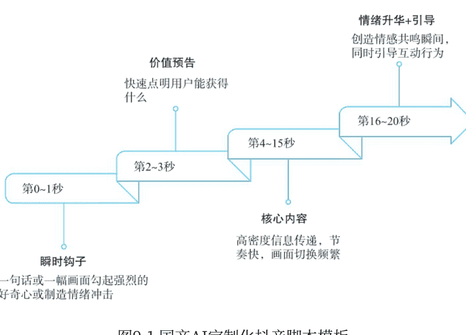

王睿在DeepSeek中输入了精心设计的提示词：

请以“AI写作效率教练”的身份，为我创作一个15～20秒的抖音短视频脚本。

主题：如何用AI 3分钟写出完美的工作周报？

目标受众：25～38岁的职场人士。

核心价值点：

- (1) AI写周报的3步精准流程。
- (2) 一个让领导另眼相待的周报模板。

要求：

- (1) 瞬时钩子（第0～1秒）：设计一个让人立刻停下来的开场（可以是令人惊讶的数据、反差事实或情感共鸣点）。
- (2) 价值预告（第2～3秒）：明确告诉观众将获得什么具体价值。
- (3) 核心内容（第4～15秒）：拆解成最多3个关键步骤，节奏要快，每个步骤都配合具体的视觉呈现建议。
- (4) 情绪升华+引导（第16～20秒）：设计一个让观众产生“我也能做到”的信心时刻，并加入互动引导。
- (5) 视觉节奏建议：提供4～5个画面切换点建议，确保视频节奏紧凑。
- (6) 评论区互动：设计一个有深度的问题，鼓励用户在评论区分享，提高互动质量。

脚本格式要包含画面描述、旁白文字、关键转场点、字幕要点（醒目标注）。

DeepSeek生成了一个简洁但有力的脚本，开头是“周五下午5点，你还在挣扎写周报？看我用AI三步法……”，直击职场人士的痛点。

张文杰惊叹道：“这个开头确实很吸引人！如果我是目标用户，一定会停下来看一看。”

> “这就是AI的威力，”王睿解释，“它理解人类的心理触发点，知道什么样的开场能在1秒内抓住注意力。”

### 2. AI视频快速制作：国产AI工具的高效流程

“脚本有了，如何快速变成视频？国产AI视频工具已经极大简化了这个过程。”王睿打开了几个软件的界面（见图9-2）。

- （1）一键生成初稿。
  - 1）使用即梦AI的文本生视频功能，直接将文本脚本转为初步的视频。
  - 2）豆包AI智能体的“分镜助手”可将脚本自动拆分为镜头列表。
- （2）素材智能补充。
  - 1）用剪映的图文成片，软件会从素材库中智能调用最适合的图片或视频。
  - 2）使用ChatGPT的表情包定制，创建品牌化的动态表情。
  - 3）使用TRAE或Cursor无代码编程，根据脚本自动生成数据可视化图表。
- （3）智能后期与渲染。
  - 1）一键应用剪辑软件提供的各种优化滤镜，确保画面符合抖音主流美学。
  - 2）智能字幕生成与样式匹配，增强信息传达的效率。
  - 3）一键导出适用于多平台的尺寸与规格，实现内容矩阵分发。

王睿展示了一段用即梦AI和剪映完成的示例视频，从脚本到成片只用了15分钟。

> “现在的AI视频制作已经如此高效了吗？”张文杰不敢相信自己的眼睛。

王睿笑着解释：“2025年的AI视频工具比2024年强大太多了。过去我们需要手动完成的大部分工作，现在只需要做创意决策和最后的把关就可以了。熟练之后，用国产AI制作一条20秒的抖音视频，从脚本到成品，可以在15～30分钟内完成。”

> “这太神奇了！”张文杰兴奋地说，“但我还是有点担心露脸的问题……”

### 3. 不露脸也能火：国产AI生成视觉内容的抖音玩法

“对于不想露脸的创作者，现在选择比以前丰富多了，”王睿滑动屏幕展示了几个案例，“国产AI工具在这方面取得了巨大突破。”

- （1）AI数字分身：使用即梦AI的数字人功能，基于几张照片创建专属数字人，可以完全按你的风格说话和表达。
- （2）场景式讲解：用即梦AI创建连续性场景，搭配AI配音，实现类似“看不见的旁白者”效果。
- （3）数据可视化动画：DeepSeek能将数据转化为引人入胜的动态图表，特别适合知识型内容。
- （4）AI互动漫画：豆包的漫画创作器可以生成连贯的漫画风格的短视频，颇受年轻人的喜爱。
- （5）概念可视化：用即梦AI将抽象概念转化为具象画面，特别适合理论知识普及。

王睿特别强调：“2025年不露脸反而成了一种风格，因为AI生成的视觉内容往往比普通拍摄更精致、更有创意。关键是找到适合你的内容和定位的视觉表达方式。”

张文杰若有所思：“AI数字分身听起来很有趣，但我更喜欢场景式讲解和数据可视化动画的方式，感觉更符合我的‘效率教练’人设。”

“没错，不同的视觉形式会强化不同的人设印象，”王睿认同道，“对你来说，专业、高效的视觉风格更合适。”

### 4. 追热点与蹭流量：国产AI实时监测与快速响应

“抖音热点变化更快了，靠人工跟踪已经完全跟不上了，”王睿打开了即时写作的“今日热榜”，“看，这是各个网站热点的集合。”

- (1) 热点预测：即时写作的“热点预测”能提前12～24小时预测可能爆发的话题。
- (2) 关联度匹配：运用DeepSeek的“内容关联引擎”能自动分析热点与你的账号的契合度，推荐最适合你创作的热点。
- (3) 热点改编：豆包、夸克或腾讯元宝的AI创作功能可将热点元素无缝融入你的常规内容。

王睿展示了一个实例，在一个普通的AI写作技巧视频中用DeepSeek快速融入当下热门的职场效率挑战元素，看起来像是专门为这个热点制作的。

根据豆包热点监测，当前抖音热门话题是“15分钟工作法”挑战。

请结合我的账号定位（AI职场写作提效），创作一个15～20秒的融合热点的视频脚本。

要求：

- (1) 在开头1秒内自然引入热点话题。
- (2) 将我的AI写作方法与“15分钟工作法”创新结合。
- (3) 设计一种参与感强的互动挑战形式。
- (4) 包含“#15分钟工作法挑战#”等热门标签的自然使用方式。
- (5) 保持我的人设一致性，不为蹭热点而扭曲核心价值。

> “AI的快速响应能力让你能在热点发酵初期就参与进去，获得巨大的流量红利。”王睿说道。

张文杰点点头：“明白了，与其辛苦地原创内容却没人看，不如巧妙利用热点，让更多人看到我的核心价值。”

“精准总结！”王睿给张文杰竖起了大拇指。

## 四、智能流量运营：让算法持续为你推荐

“内容发布后并非结束，持续的智能运营能让流量滚雪球，”王睿强调，“当前抖音算法更看重账号的整体健康度，而不只是单个爆款视频。”

### 1. 数据驱动优化：读懂抖音后台数据（国产AI辅助解读）

“抖音后台数据越来越复杂，没有AI辅助几乎难以全面把握，”王睿打开了飞书的数据分析界面。

- (1) 2025年核心关注数据升级。
  - 1）完播质量分：不只看完播率，还看完播后的行为（点赞、评论、关注等）。
  - 2）细分人群互动图谱：分析不同人群对内容的反应差异。
  - 3）留存追踪：追踪观看你视频的用户后续是否还会回来。
  - 4）互动深度分析：分析评论的情感倾向、互动质量评分等。
- (2) 国产AI数据解读工具。
  - 1）飞书智能分析：一键导入抖音后台数据，生成多维分析报告。
  - 2）豆包“数据解读助手”：将复杂数据转化为简单明了的行动建议。
  - 3）DeepSeek“内容优化指南”：基于数据自动生成下一步的内容改进方案。

王睿展示了一个使用飞书分析的案例，系统自动识别出内容在互动设计环节存在不足，并给出了具体优化建议。

张文杰边记边问：“这些复杂的数据分析真的能转化为实际效果吗？”

王睿肯定地点头：“2025年的内容创作已经从靠感觉变成了数据驱动。那些能够精准解读数据并快速调整的创作者，往往能获得算法的额外青睐。这就像在高速公路上，懂得看路标的人总能选择最快的车道。”

### 2. 智能互动策略：AI提升评论、点赞、分享质量

“互动质量已经成为抖音算法的核心指标，”王睿解释，“算法能识别有价值的互动与低质量的互动，AI可以帮你设计高质量的互动。”

国产AI互动增强技巧如下：

- （1）分层互动设计：夸克或ChatGPT可以设计针对不同用户群体的差异化互动引导。
- （2）情感共鸣触发器：豆包能分析出什么样的问题能引发用户的情感共鸣和分享欲。
- （3）评论区话题引导：DeepSeek能生成有深度的评论区话题引导问题，促进用户间的讨论。
- （4）互动仪表盘：飞书的互动监测工具可实时追踪互动效果，并提供优化建议。

王睿展示了一个例子，通过DeepSeek设计的精准评论区话题引导，一个普通视频的评论互动率提升了280%。

张文杰好奇地问：“那如何应对评论区的负面评论呢？”

“好问题！”王睿说道，“AI也能帮你解决这个问题。通义的‘情绪管理助手’能分析负面评论的类型，并推荐最佳回应策略，将危机转化为机会。有时候，处理负面评论的好方式反而能展示你的专业度和人格魅力。”

### 3. DOU+投放优化：国产AI辅助精准触达目标人群

“现在DOU+系统更加精细，如果用得好，ROI非常可观，”王睿介绍道，“国产AI在优化投放策略方面有了重大突破。”

- (1) 人群精准画像：豆包的受众精准匹配可以分析你的内容，找到最可能产生转化的精准人群标签组合。
- (2) 投放时机预测：DeepSeek的流量峰值预测能建议最佳的投放时段，提高曝光效率。
- (3) 多方案测试：DeepSeek的A/B测试助手可以为测试多种投放策略提供建议。
- (4) ROI预测模型：飞书的ROI预测系统能评估不同投放方案的可能收益。

王睿在DeepSeek中输入了一个投放优化提示词：

我计划为这条关于“用AI 3分钟完成周报”的抖音视频投放DOU+，预算600元。
目标是转化率最大化（引导用户关注账号）。
请结合2025年最新的抖音投放趋势，提供精细化的投放策略。

- (1) 最佳受众定向组合：
  - 人口特征（年龄、性别、地域、收入水平等）。
  - 行为特征（活跃时间、互动习惯等）。
  - 兴趣标签（最多5个核心标签）。
  - 排除人群建议。
- (2) 投放计划设计：
  - 预算分配方案（是否需要阶梯式投放）。
  - 最佳投放时段（具体到小时）。
  - 建议投放持续时间。
  - 核心KPI设置。
- (3) 投放素材优化：
  - 封面优化建议。
  - 前3秒优化重点。
  - 是否需要为投放专门调整视频内容。
- (4) 提供预期ROI分析方法和效果评估方法。

DeepSeek生成了一套完整的投放策略，包括精准的人群定向标签组合、分时段预算分配方案和ROI预测。

> 张文杰惊讶地说：“这比我想象的要精细得多！原来DOU+还可以这么用。”

> “是的，很多人只是简单地投放，然后埋怨效果不好，”王睿解释，“但有了AI的精准分析，你的每一分钱都能发挥最大效用。”

### 4. 矩阵联动：抖音与其他平台的协同效应

“现在单平台运营已经很难获得最大化效益，”王睿向张文杰展示了一张内容生态图，“抖音应该是你的内容矩阵的核心引擎，而不是孤岛。”

全渠道协同策略如下：

- （1）分层内容策略：抖音作为流量入口，引导用户到其他平台获取深度内容。
- （2）价值递进模型：设计从抖音到小红书到知乎到私域的完整用户旅程，层层递增价值。
- （3）数据互通体系：利用飞书的跨平台数据整合功能，分析用户在不同平台的行为差异。
- （4）内容智能变体：用DeepSeek或腾讯元宝的平台内容适配器，将一个核心创意快速转化为适合不同平台的内容形式。

王睿展示了一个案例：如何将一个核心创意“AI提升写作效率”，通过豆包的多平台内容规划功能，同时生成适合抖音的15秒短视频、小红书的图文指南、知乎的深度解析和微信公众号的系统教程。

> “这就是2025年的内容创作方式，”王睿强调，“一次创意，多平台开花，形成完整的用户转化漏斗。”

张文杰恍然大悟：“所以抖音其实是漏斗的入口，而不是终点站。”

> “理解得非常精确！”王睿赞许地点头。

## 五、AI赋能变现：抖音流量的多元转化路径

“流量的终极目标是变现，”王睿切入正题，“2025年最大的变化是，AI不仅能帮你获得流量，更能直接参与变现过程，让每一份流量都发挥最大价值。”

### 1. 电商带货2.0：AI选品与智能文案的完美结合

“靠感觉选品、凭经验写文案的传统带货时代已经过去了，”王睿打开手机，“现在的抖音电商生态已经高度数据化，国产AI工具能让你的带货效率提升3～5倍。”

王睿说道：“虽然豆包、DeepSeek这些AI工具主要用于内容创作和问答，但我们可以用它们来生成产品介绍文案、优化直播脚本、分析用户评论和反馈、创作短视频内容。”

他现场演示了如何用豆包生成一段产品介绍：“我输入产品特点，它帮我生成符合抖音风格的带货文案。虽然不是专门的选品工具，但确实能提升内容的质量。”

### 2. 知识变现的真实路径

“知识变现确实是抖音上增长较快的方式之一，”王睿展示了几个成功案例，“但我们要实事求是地看待收入预期。”

他分析道：“根据抖音官方数据，知识变现主要通过这些方式实现（见图9-3）。现实情况是，大多数知识博主月收入在几千元到几万元之间，真正月收入10万元以上的是极少数头部创作者。”

### 3. 个人IP建设：从内容到品牌的进阶

“IP变现确实存在，但需要长期的积累，”王睿强调，“2025年的趋势是垂直领域的专业IP更受欢迎。”

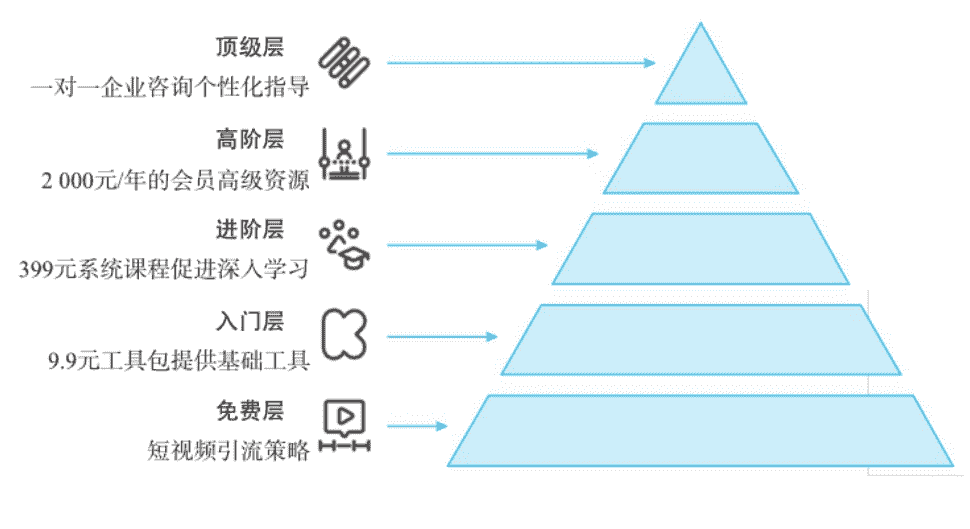

他举例说明：“比如AI效率提升这个定位，你可以与企业培训机构合作、为软件公司提供内容服务、开发相关的数字产品、获得品牌赞助和合作机会。”

“但要注意，IP授权变现通常需要至少几万到几十万的粉丝基础，且变现金额因人而异。”

### 4. AI辅助工具的实际应用

“关于AI智能体，这确实是2025年的重要趋势，”王睿介绍，“但我们要区分概念和现实应用。”

他解释道：“目前真正可用的工具包括腾讯ima（可以建立个人知识库，整理内容和资料）、各种AI写作工具（辅助内容创作，提升效率）。”

## 5.变现建议总结

- 从小做起：先通过AI工具提升内容质量，积累粉丝基础。
- 多元尝试：电商、知识付费、品牌合作等可以同时进行。
- 长期规划：IP建设需要时间，不要期待快速致富。
- 工具善用：AI工具用于提效，核心还是要有真正的价值输出。
- 数据导向：基于真实数据制定变现策略，避免盲目跟风。

> “记住，”王睿最后强调，“任何变现都需要为用户创造真正的价值。AI只是工具，核心还是要有扎实的专业能力和持续的价值输出。”

## 6.案例拆解：普通人如何用国产AI玩转抖音实现月收入过万

王睿分享了两个真实案例，展示了国产AI如何帮助普通人在抖音方面获得成功。

#### (1) 案例一：会计小刘的“财税AI助手”账号。

1) 背景：普通会计师，有3年的财税经验，无视频制作经验。

2) 定位：分享如何用AI工具简化财税工作，提高中小企业会计效率。

3) 国产AI应用：

- DeepSeek生成专业财税知识脚本，结合个人经验制作教程。
- Canva可画生成财税场景的可视化图表和动画。
- 豆包创建“AI财税工具库”系列内容。
- 飞书分析数据，持续优化内容方向。

4) 内容策略：每周更新3～4条短视频，主打“财税场景+AI解决方案”的实用内容。

5) 增长路径：2个月粉丝数破3万，4个月破15万，半年破50万。

6) 变现模式：创作者广告分成、财税AI工具付费社群、企业培训服务、知识付费课程。

7) 月收入：4个月后稳定在1万～2万元/月，高峰期突破3万元/月。

8) 成功关键：垂直细分领域+高实用性内容+AI工具的结合满足了特定人群的刚需。

> 小刘分享说：“最开始我只是想分享一些工作技巧，没想到会有这么多人感兴趣。国产AI工具让我这个不懂视频制作的人也能做出专业内容，DeepSeek和豆包简直就是我的‘虚拟团队成员’。”

#### (2) 案例二：大学生小林的“硬核科技测评”。

1) 背景：计算机专业大三学生，热爱科技产品，零预算。

2) 定位：用AI辅助做最专业的科技产品测评和解析。

3) 国产AI应用：

- 豆包的“专业测评框架”助手设计测评方案。
- DeepSeek生成产品技术参数详细解析脚本。
- 即梦AI和Canva可画创建产品功能演示动画和对比图表。
- TRAE协助开发简单的产品性能测试小工具。

4) 内容策略：每周发布2～3条深度测评视频，专注于揭秘产品技术原理和实际性能。

5) 增长路径：1个月粉丝数涨了5000，3个月破30万，半年破百万。

6) 变现模式：品牌合作、测评邀请、广告分成、技术解析付费社群、数字产品销售。

7) 月收入：3个月后月收入超过1万元，半年后稳定在3万～5万元/月。

8) 成功关键：用AI弥补了专业知识缺口，打造了“最懂技术的测评”差异化定位，建立了强信任关系。

> 小林分享说：“我原本只是一个普通学生，甚至买不起很多科技产品，但通过国产AI工具，我能获取海量专业资料，生成深度分析内容，制作出比大部分专业团队更细致的测评视频。AI不仅是我的创作工具，还是我的知识助手和团队成员。”

## 实战练习

- 使用本章推荐的DeepSeek提示词，分析并确定你的抖音垂直赛道和细分人设。
- 用豆包规划你的前10条视频的内容框架，确保主题连贯且有递进关系。
- 使用腾讯元宝生成一个15～20秒的爆款脚本，并用即梦AI或Canva可画制作视频素材。
- 发布你的首条视频，用飞书分析数据，并根据反馈调整下一条视频的内容。
- 设计一个简单的全平台内容矩阵，规划如何将抖音流量引导至其他平台和最终变现渠道。

这些练习不必一次完成，可以分步骤来，重要的是开始实践并持续优化。

## 思考

- 结合你的AI写作经验和职场背景，哪些垂直细分领域最适合你在抖音上快速建立专业影响力？
- 在AI写作这个赛道，你的独特优势和记忆点是什么？如何通过内容设计强化这种差异化？
- 哪种AI视觉表达形式最符合你的人设和目标受众的偏好？为什么？
- 考虑到你的专业领域，哪种变现模式最适合你的长期发展？短期和长期的变现计划应该如何规划？
- 你打算如何设计从抖音到其他平台再到最终变现的完整用户旅程？

## 章末寄语：AI助力，人人都能成为抖音流量大师

咖啡厅窗外夕阳渐斜，张文杰合上笔记本，眼中充满了新的信心。

2025年的抖音战场竞争激烈，但国产AI技术的飞速发展让普通人也能在这里实现月收入过万元的副业梦想。

AI不会替代你的创意，它是最强大的助手。从精准选题、高效创作到智能运营、多元变现，国产AI工具覆盖抖音运营的每个环节，让原本需要专业团队才能完成的工作变得触手可及。

玩转抖音的关键不在于专业的设备或出众的才艺，而在于善用AI这个“超级助手”，理解平台规则，持续创造价值。

> “一开始我觉得抖音对不爱露脸的人不友好，”张文杰站起身，“但现在我明白，有了国产AI工具，我也能找到属于自己的一席之地。”

> 王睿收起电脑微笑道：“记住，AI只是工具，核心还是你的专业价值。先从小目标开始——一周3条视频，坚持一个月，你会惊喜于自己的进步。”

夕阳的余晖洒在窗台上，为这场创业谈话画上了温暖的句号。抖音与AI在2025年紧密相连，为每个有梦想的创作者打开了成功之门。

现在，启动你的国产AI引擎，开始抖音掘金之旅吧！AI的加持可以让你拥有前所未有的超车机会。

## 第10章 微信生态掘金：视频号与公众号的AI运营心法

### 开篇：张文杰的私域流量突围

“王睿，我的‘AI提效张师兄’在小红书和抖音火了，粉丝数涨得很快，”张文杰看着后台数据，有些困惑，“但总感觉这些流量会昙花一现。现在微信视频号又出了创作者激励计划，如何把公域流量转化成真正的私域资产呢？”

王睿放下咖啡：“公域的叫粉丝，私域的叫客户——前者易散，后者才是实打实的商业关系。你开始思考转化了，说明已经进入了副业2.0阶段。”

“对，光涨粉不变现就是做慈善。”张文杰点头。

“公域是公海捕鱼，微信生态是自家农场，”王睿展示手机界面，“2025年微信月活跃用户数超14亿，视频号、公众号、小程序生态更完善。”

“微信的核心是连接和信任，”王睿调出生态图，“视频号负责传播，公众号沉淀内容，社群和个人微信实现转化——这就是‘三级火箭’模式。AI可以优化每个环节：从内容创作到用户互动，再到转化路径设计。”

张文杰兴奋地拿起笔：“明白了！抖音是百米冲刺，微信是马拉松。快教我如何用AI打好这场私域阵地战！”

## 一、微信生态解析：私域流量的价值洼地与AI机遇

“要玩转微信生态，必须理解微信的新格局。”王睿首先展示了最新的微信生态地图。

### 1.公众号：深度内容与信任基石

“现在公众号依然是微信生态的‘内容定海神针’，”王睿强调，“虽然短视频盛行，但公众号凭借其独特优势仍占据重要地位。”

- (1) 核心价值：深度内容承载、品牌形象塑造、信任关系建立、私域流量入口、多元化变现渠道。
- (2) 内容偏好：深度干货、系统性知识、行业洞察、解决方案、价值观输出、长篇分析文章。
- (3) 最新变化：
    - 1) 个性化推荐机制：公众号已从订阅式走向“订阅+推荐”的混合模式，粉丝基础不再是唯一的制约因素。
    - 2) 付费阅读功能：满足注册超过3个月、近3个月内无严重违规、已发表至少3篇原创文章的账号可开通付费阅读，使用微信豆支付。
    - 3) 移动端创作便利：微信开始灰度测试在个人微信号内直接注册公众号、发表文章，无须借助电脑端。
    - 4) 广告分成优化：流量主广告收益大致在每万次阅读30～60元之间。
- (4) AI赋能点：
    - 1) 内容策划辅助：用DeepSeek、豆包等AI工具辅助选题分析、大纲制作，但需要创作者进行深度加工。
    - 2) 写作效率提升：AI可以帮助快速生成初稿框架，但优质内容仍需创作者的专业判断和个人风格。
    - 3) 标题优化：利用AI工具测试不同标题方案，但最终效果取决于内容质量和用户需求的匹配度。
    - 4) 数据分析：AI可以帮助分析阅读数据、用户反馈，优化内容方向。
- (5) 现实变现模式：
    - 1) 广告收入：流量主广告、品牌软文推广。
    - 2) 付费内容：付费阅读文章、专栏订阅。
    - 3) 私域转化：引流到微信群、朋友圈进行产品销售。
    - 4) 知识服务：咨询服务、培训课程、一对一指导。
    - 5) 电商直播带货。

> 王睿展示了真实的行业数据：“2025年，公众号每日产生超过120万篇文章，但真正突破10万次阅读量的文章数量相对较少，呈现出显著的马太效应。大多数账号需要长期积累才能实现稳定变现。”

### 2.视频号：社交裂变与公私域桥梁

> “视频号是微信生态的流量放大器，”王睿点开他的视频号主页，“特别是腾讯推出的‘视频号创作者激励计划’功能，大大提升了转化效率。”

- (1) 核心价值：短视频内容传播、社交裂变、公域引流、直播带货、连接公众号/小程序/企业微信。
- (2) 内容偏好：真人出镜（信任感强）、知识口播、生活记录、情感共鸣、热点事件解读。
- (3) 最新变化：
    - 1) 微信小店升级：视频号小店升级为微信小店，支持多场景流量转化。
    - 2) 朋友圈广告联动：朋友圈广告新增跳转视频号功能。
    - 3) 企业微信重点发力：企业微信在2025年成为微信生态ToB业务的重点方向。
    - 4) 社交传播优化：基于熟人关系链的分享传播效果持续优化。
- (4) AI赋能点：
    - 1) 脚本创作：豆包生成适合口播、易于传播的短视频脚本。
    - 2) 视频制作：剪映辅助剪辑、添加字幕、配音、生成特效。
    - 3) 热点捕捉：智谱清言监测微信生态内的热点，快速生成相关视频创意。
    - 4) 互动引导：AI设计引导用户点赞、收藏、转发、评论的互动脚本。

> “视频号的算法其实没有你想象的那么可怕，”王睿笑着说，“它比抖音友好多了，朋友互动仍是第一推荐权重，所以社交基础好的人在这里更容易起量。不过最近的变化是，系统对优质内容的判定更偏向于有用、有趣、有态度的内容了。”

### 3.企业微信/个人微信/社群：私域运营与深度转化

“最终的深度互动和转化往往发生在更私密的场景。”王睿点开了他的企业微信。

- (1) 核心价值：用户精细化管理、深度互动、信任加深、高客单价转化、服务交付。
- (2) 运营重点：价值提供、关系维护、需求挖掘、精准营销。
- (3) 核心功能优势：
    - 1) 客户标签管理：支持给客户打标签，实现精细化分类管理。
    - 2) 群聊互动工具：支持群内投票、填表等互动功能。
    - 3) 智能客服支持：提供智能客服功能，支持企业客户服务需求。
    - 4) 朋友圈营销：企业可统一管理员工朋友圈的内容，进行标准化营销。
- (4) AI赋能点：
    - 1) 自动化流程：AI工具辅助设计客户触达流程、内容推送、活动提醒等自动化操作。
    - 2) 智能问答：基础AI客服处理常见问题咨询，提供标准回复。
    - 3) 用户行为分析：数据分析工具辅助了解用户偏好，支持精准用户分组。
    - 4) 社群内容管理：AI辅助生成互动话题、整理群内重要信息的要点。

王睿打趣道：“你知道我怎么称呼我的AI助手吗？‘替身使者’！因为它回复的消息质量很高，连我老婆都分辨不出来是不是我本人写的。在企业微信里，AI已经能承担40%左右的日常沟通工作，不过这个数字没有网上传得那么夸张。”

## 二、AI赋能公众号：从选题到转化的全链路优化

“公众号看似‘古老’，但在AI的加持下，依然是内容变现的核心阵地。”王睿开始讲解公众号的AI玩法。

### 1.AI选题与深度内容创作

“公众号读者期待深度和价值，AI如何满足？”张文杰问道。

王睿笑道：“AI不仅能满足，还能提升。我们来看几个实操案例。”

- (1) AI深度选题策略。
    - 1) 痛点三维分析：用DeepSeek构建“知识点-痛点-时间点”三维选题矩阵。
    - 2) 体系化内容规划：AI辅助设计系列文章、专栏主题，构建内容闭环。
    - 3) 跨界知识融合：AI提供不同领域知识相结合的创新选题（如传统中医×现代健康管理）。
    - 4) 热点预测筛选：利用AI监测工具筛选将在7～15天内爆发的潜在热点。

> “记住，好的公众号不是广播站，而是价值磁场。”王睿解释道，“它需要有鲜明的调性和价值主张。”

- (2) AI长文写作流程（公众号优化）。
    - 1) 框架构建：DeepSeek生成SCQA（情境-问题-冲突-答案）结构的文章大纲。
    - 2) 智能数据整合：腾讯元宝快速搜集、关联多源信息，形成知识网络。
    - 3) 初稿生成：豆包撰写包含逻辑递进、案例佐证的初稿。
    - 4) 专家视角注入：人工加入独特的行业洞察、个人经验和深度思考。
    - 5) 多媒体增强：AI辅助设计信息图表、插入视频号片段、添加互动环节。
    - 6) 可读性优化：AI优化标题、导语、排版，增强内容的节奏感和可读性。

AI驱动的内容创作流程如图10-1所示。

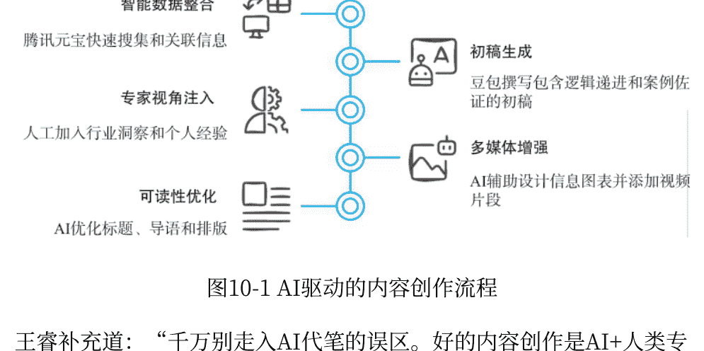

图10-1 AI驱动的内容创作流程

王睿补充道：“千万别走入AI代笔的误区。好的内容创作是AI+人类专业洞察的协同。比如我的每篇文章的框架都用DeepSeek生成，但核心观点和案例分析一定是我自己的思考。记住一句话：让AI负责搬砖，让人脑负责设计。别指望AI能写出真正的爆款，它缺乏生活的烟火气。”

### 2.AI优化公众号阅读体验与互动转化

> “好的内容还需要好的包装和互动设计。”王睿强调。

- (1) AI优化阅读体验。
    - 1) 标题魔法师：豆包生成8个标题，测试不同情绪触发点和点击率（CTR）潜力。
    - 2) 开篇导语优化：腾讯元宝分析高阅读量文章的开篇模式，生成具有高吸引力的导语。
    - 3) 排版设计：AI结合排版工具（如135编辑器）提供视觉层次的优化建议。
    - 4) 多媒体增强：AI生成与文章相关的信息图表、数据可视化、音频概要。

> 王睿举例说：“看这篇文章的开头，‘如果把职场比作一个无声的战场，你的PPT就是决定胜负的关键武器……’ 这是用豆包生成的。测试表明，战场/战争/竞争类比喻的开头点击率高出平均水平21%，远超干货式开头。”

- (2) AI驱动互动转化。
    - 1) 评论区智能管理：AI识别高价值评论，生成个性化回复，激活互动。
    - 2) 文末CTA优化：AI测试不同的号召性用语和引导路径，提升转化效率。
    - 3) 互动话题设计：AI设计能引发读者共鸣和参与的互动话题和小游戏。
    - 4) 裂变活动方案策划：AI生成“老读者带新读者”的裂变活动创意和执行流程。

> “互动不是目的，转化才是，”王睿说，“每一次互动都应该让用户向你的私域靠近一步。这就像约会，第一次见面就求婚的成功率几乎为零，但每次互动增进一点好感，最终才能水到渠成。”

### 3.AI数据分析与付费会员运营

“今年公众号最大的变化是什么？付费专栏和会员功能的完善。”王睿打开后台数据面板。

- (1) AI公众号数据解读。
    - 1) 内容表现分析：DeepSeek分析不同类型内容的点击率、完成率、互动率，找出内容优化方向。
    - 2) 用户行为画像：腾讯元宝分析关注用户的阅读偏好、活跃时段、互动方式，构建用户画像。
    - 3) 流量来源分析：AI识别高质量流量入口，优化推广策略。
    - 4) 付费转化路径：AI分析从免费阅读到付费订阅的用户旅程，识别关键转化点。
- (2) AI付费专栏运营。
    - 1) 会员内容规划：AI设计付费专栏内容结构，平衡知识深度与实用性。
    - 2) 分层会员策略：AI辅助设计多层级的会员体系（如入门会员、高级会员、VIP）。
    - 3) 会员互动管理：AI管理会员评论区，确保付费用户得到及时回应。
    - 4) 续费促销方案：AI设计个性化的会员续费优惠和激励机制。

王睿展示了一个案例：“这个‘职场高手的思维模型’付费专栏，月收入1.8万元，活跃订阅用户近450人。关键是建立了从免费内容到付费专栏的完整转化漏斗，这个漏斗的每一步都是用AI优化的。实话实说，做付费专栏没那么容易，一开始我只有30名订阅用户，花了半年才慢慢做起来。”

## 三、AI赋能视频号：社交裂变与私域引流

“视频号现在占据着举足轻重的地位，特别是直播带货功能的完善。”王睿切换到视频号界面。

### 1.AI视频号内容策略与脚本创作

“视频号内容有什么新趋势？”张文杰问道。

“三大趋势：真人出镜、垂直领域、情感共鸣。”王睿回答，“与抖音相比，视频号更注重人情味和信任感。”

- (1) 视频号热门内容类型。
    - 1) 知识微课（3～5分钟）：比传统1分钟的短视频更系统，适合专业IP。
    - 2) 生活记录+专业价值：将个人生活与专业价值相结合，强化信任感。
    - 3) 热点深度解析：提供比抖音更有深度的热点话题解读。
    - 4) “边看边买”演示：结合“视频购物车”功能，实现无缝转化。
    - 5) 直播预告片：发布为视频号直播引流的短视频预告。
- (2) AI视频号脚本优化。
    - 1) why-what-how结构：AI设计先引发共鸣（why），再介绍内容（what），最后给出方法（how）的脚本结构。
    - 2) 情感波动曲线：AI在脚本中设计情感起伏点，保持观众的注意力。
    - 3) 社交互动点：AI在脚本中植入引导“朋友分享”的互动机制。
    - 4) 视觉化说明：AI设计关键概念的视觉化呈现方案，提升记忆点。

王睿打趣道：“视频号的脚本写作有个秘诀，我称之为‘三明治法则’——上下是共鸣和价值，中间是干货。豆包特别擅长这种结构的设计，比如我上周发的一条视频，开头讲‘为什么周一早上总是起床困难’引发共鸣，中间讲三种提高睡眠质量的方法，结尾给出‘高效睡眠=高效人生’的价值观，播放量3天就破了8万次。”

### 2.AI视频制作与视频号直播优化

> “视频制作是很多人的瓶颈，AI如何破解？”张文杰问。

- (1) AI视频制作流程（见图10-2）。
    - 1) 素材采集：Canva可画或即梦AI生成契合主题的视觉素材、图表和动画。
    - 2) 智能分镜：AI根据脚本自动生成分镜头脚本，标注重点画面。
    - 3) 一键剪辑：剪映将原始素材根据脚本自动剪辑，调整节奏和转场。
    - 4) 智能字幕：AI生成与视频内容同步的动态字幕，匹配品牌风格。
    - 5) 封面优化：Canva可画生成高点击率的视频封面，采用A/B测试来测试不同版本。

## 10.3 AI赋能视频号运营

王睿展示了一个案例：“这个视频是用AI工具花半小时生成的。先用豆包写脚本，再用即梦AI生成素材，最后用剪映一键剪辑。坦白说，AI生成的视频还是有一些‘机械感’，特别是转场和节奏的把控，但用来做知识分享类内容已经足够了。未来半年内，我相信这些工具会进步得更快。”

#### （2）AI赋能视频号直播

- 1）直播话术库：DeepSeek生成针对不同产品、不同场景的直播话术模板。
- 2）互动脚本：AI设计提升直播间互动率的问答、投票、抽奖环节。
- 3）实时数据分析：AI实时分析直播间用户的行为，调整内容节奏和推销策略。
- 4）直播回顾剪辑：AI自动从长时间直播中提取精华片段，制作复盘视频。

> “直播是视频号的金矿，”王睿强调，“特别是微信小店升级整合了视频号小店之后，直播带货变得更流畅。我有个做美妆的朋友，单场直播销售额从不到1万元提升到了3万多元，关键是转化率提高了，从2%提升到了接近5%。”

## 3. AI驱动视频号私域引流

> “视频号的核心目标是什么?引流到私域。”王睿掰着指头分析。

AI引流策略设计如下：

- （1）内容阶梯法：AI设计了免费视频→付费课程→高端服务的内容阶梯引流路径。
- （2）互动诱饵优化：AI设计能最大化用户参与的互动诱饵（如“评论区抽送模板”）。
- （3）直播间引流话术：AI生成自然、不突兀的直播间引流话术和引流时机。
- （4）社交证明：AI辅助收集和展示用户的正面反馈，增强信任感。

> 王睿笑着说：“引流要遵循‘温水煮青蛙’的原则，循序渐进。先免费提供大量价值，建立信任，再适时引导到私域。急功近利的引流往往适得其反。我见过一个博主，每条视频都在强调‘加我微信领资料’，结果粉丝留存率极低，加微信的用户也大多是来‘薅羊毛’的。”

## 四、AI赋能私域运营：精细化经营与高效转化

“将流量引入私域后，如何用AI进行高效运营？”张文杰问道。

### 1. AI构建私域自动化SOP

“对于私域运营，自动化是基础，个性化是关键。”王睿打开企业微信展示。

AI私域自动化流程设计如下：

- （1）用户旅程地图：DeepSeek设计从首次接触到成为忠实客户的完整用户旅程路径。
- （2）多触点欢迎流程：AI设计多条消息序列的新用户欢迎流程，包含互动引导。
- （3）内容推送矩阵：AI根据时间节点和用户行为，设计自动化内容推送策略。
- （4）活动提醒系统：AI设计活动前、中、后的完整消息推送序列。

王睿展示了一个案例：“这是我设计的‘新用户7天激活SOP’，主要使用企业微信的自动化功能实现。效果不错，用户留存率提升了26%，但我得提醒你，这不是完全自动化的，我每天还是要花1～2小时处理一些个性化的问题。那些声称‘躺赚’的人多半是在骗人，真正的私域运营没有‘全自动’，只有‘半自动’。”

### 2. AI智能客服与用户互动管理

> “私域运营最大的挑战是什么?规模化的同时如何保持个性化。” 王睿说道。

（1）AI客服高阶应用（见图10-3）。

- 1）多级智能分流：AI根据用户问题的复杂度和价值，进行智能分流处理。
- 2）情感识别回应：豆包识别用户消息的情绪状态，调整回复的语气和处理优先级。
- 3）知识库自学习：AI客服系统持续从人工回复中学习，不断完善答案库。
- 4）个性化回复生成：基于用户历史互动和标签，生成个性化的非模板化回复。

（2）AI社群运营进阶工具。

- 1）热点话题预测：AI预测行业可能出现的热点，提前准备社群讨论话题。
- 2）成员关系网络：AI分析社群成员互动，识别KOL和潜在流失用户。
- 3）活动智能策划：豆包根据社群特点，自动生成主题活动方案和执行清单。
- 4）内容精华提取：AI自动从群聊中提取有价值的内容，生成周报或月报。
- 5）自动化群管理：AI辅助识别违规内容，管理广告和负面情绪。

王睿点开他的社群，笑着解释：“看，这个‘AI写作大师群’有389人，但我每天只需花30分钟左右管理。秘诀是什么?扣子自动化平台帮我提取每日的精华内容，自动回复常见问题，甚至还能识别哪些成员最近不活跃，需要特别关注。但机器再好，也需要人情味，我每周至少会亲自出现3～4次，跟大家互动一下。”

### 3. AI用户分层与精准营销

“私域的精髓在于精细化运营，”王睿拿出一幅用户分层图，“2025年，AI让千人千面的私域营销成为可能。”

- （1）AI用户分层策略。
    - 1）RFM模型升级版：AI分析用户最近一次交易（recency）、交易频率（frequency）、消费金额（monetary），再加入互动深度（interaction）和内容偏好（preference）维度。
    - 2）价值预测模型：DeepSeek构建用户未来价值预测模型，识别潜力客户。
    - 3）生命周期标签：AI自动识别用户所处的生命周期阶段（新客、成长客、忠诚客、休眠客、流失客）。
    - 4）兴趣图谱构建：腾讯元宝分析用户的内容偏好，构建多维度的兴趣图谱。

张文杰疑惑地问：“这些听起来很专业，实际操作起来会不会很复杂？不是每个人都具有数据分析的能力吧!”

王睿微笑道：“以前会很复杂，现在简单多了。现在有扣子、n8n这样的低代码平台，让不懂代码的人也能实现复杂的数据分析和自动化流程。我来给你展示一个真实案例。”

- （2）AI精准营销实战流程。
    - 1）用户智能分组：AI根据多维度数据，将用户自动划分为高价值客户、潜力客户、需激活的客户等群组。
    - 2）个性化内容推荐：豆包为不同群组生成差异化的内容推送策略。
    - 3）千人千面营销：腾讯元宝生成针对不同用户群体的精准营销话术和方案。
    - 4）触达时机优化：AI预测用户的最佳触达时间，提高响应率。
    - 5）转化路径设计：智谱清言设计从低门槛尝试到高价值服务的完整转化路径。
    - 6）ROI实时追踪：AI实时分析各营销动作的投入产出比，动态调整策略。

王睿拿出手机展示：“这是我上个月对潜力客户组做的一次精准营销。转化率达到17%，比行业平均水平高了一倍多。一开始我也怀疑这些高大上的策略是否适用于个人创业者，结果发现只要掌握了工具和方法，小团队甚至个人也能做得很不错。当然，你别期望一开始就能达到这样的效果，我花了3个月的时间才摸索出一套行之有效的方法。”

“你最大的收获是什么？”张文杰好奇地问。

“不再把时间和精力浪费在低转化的用户身上，”王睿笑着回答，“过去我对所有用户一视同仁，现在我知道80%的收入来自20%的用户，所以我把主要精力放在高价值和高潜力用户上。”

## 五、案例拆解：AI驱动微信生态运营的成败经验

王睿翻开他的案例笔记本：“我们看两个真实案例——一个成功案例，一个失败案例，都很有教育意义。”

### 【成功案例】健康顾问“管健康”的AI健康管理

（1）背景：传统健康管理师，受新冠疫情和生活习惯改变影响，线下业务萎缩，希望向线上转型。

（2）微信生态布局（2025版）：

- 1）公众号：“健康博士”，专注深度健康科普、营养知识与个性化计划。
- 2）视频号：“健康规划院”，发布健康方法演示、用户成功故事、直播答疑。
- 3）私域（企业微信+社群）：管理付费用户，提供定制规划，组织线上健康营。
- 4）小程序：“健康打卡助手”，提供用户健康行为记录与饮食追踪功能。

（3）AI应用亮点。

- 1）内容创作：DeepSeek辅助撰写专业健身知识文章，豆包优化文章结构和增强互动性，可灵AI制作训练动作讲解视频。
- 2）社群运营：AI设计“21天减脂挑战”活动方案，自动生成每日打卡主题和激励语。
- 3）个性化指导：腾讯元宝根据会员身体数据和目标，生成个性化的训练建议和饮食计划。
- 4）数据分析：AI分析会员训练数据，提供科学的进步报告和调整建议。
- 5）自动化工作流：企业微信+扣子实现基础客户咨询自动化处理。

（4）营收结构（月收入明细）。

- 1）付费专栏会员：150人×99元/月=14 850元/月。
- 2）线上减脂营：25人/期×1 599元÷3个月=13 325元/月。
- 3）一对一在线指导：8人×599元/月=4 792元/月。
- 4）健身周边产品：约4 000元/月。
- 5）总月收入：约37 000元（扣除成本后净利润约为27 000元）。

（5）成功关键因素分析（见图10-4）。

- 1）整合微信全生态：公众号沉淀专业信任，视频号扩大影响力，私域实现变现。
- 2）AI提升内容质量：利用AI创作专业、系统、有深度的健身内容，建立权威形象。
- 3）打造精细化的私域体验：AI帮助提供个性化的服务，提升用户体验和复购率。
- 4）构建完整的商业模式：从免费内容到低价体验，再到高价私教，形成清晰的价值阶梯。
- 5）缩短工作时间：原来每天工作12小时，现在借助AI只需工作6～7小时，生活质量明显提升。

### 【失败案例】产品经理小谷的“AI办公技巧”社群项目

（1）背景：IT公司产品经理小谷想利用业余时间开展AI办公培训副业，前期积累了2 000多个抖音粉丝。

（2）失败过程。

- 1）第1～2个月：通过抖音引流建立了一个300人的免费微信社群，每天分享AI办公技巧。
- 2）第3个月：尝试推出付费课程“AI高效办公21天训练营”，价格399元，仅售出8份。
- 3）第4个月：增加内容输出频率，并在公众号、视频号和社群三个渠道同步发布。
- 4）第5个月：完全依赖于AI生成内容，自己不加修改，导致内容质量下滑。
- 5）第6个月：社群活跃度骤降，付费课程几乎无人问津，项目最终失败。

（3）失败原因分析（见图10-5）。

- 1）内容同质化严重：完全依赖于AI生成内容，没有加入个人观点和实践经验，导致内容与市场上其他AI办公教程区分度不大。
- 2）渠道策略错误：同时经营三个渠道但都不精，没有形成各渠道的差异化定位。
- 3）忽视社群互动和运营：过度依赖于内容推送，缺乏真实互动和用户问题解决。
- 4）价值阶梯不清晰：免费内容与付费课程之间的价值差异不明显，用户缺乏付费动力。
- 5）缺乏系统规划：没有长期内容规划和用户旅程设计，运营过于随机和碎片化。

王睿总结道：“小谷的案例很有代表性，他犯了很多创业者的通病——过度依赖于工具而忽视本质。AI是工具，不是替身。如果你把它当作全自动的内容工厂，结果只能是生产出大量缺乏灵魂的内容。成功案例和失败案例告诉我们，AI最适合的角色是助手而非替代品。”

张文杰若有所思：“我明白了，AI可以帮我们提高效率，但不能替代我们的专业洞察和人格魅力。”

“没错，”王睿点点头，“微信生态最核心的是信任关系，而信任必须建立在真实价值和真诚互动的基础上。AI可以帮你更高效地传递价值，但价值本身必须来自你的专业积累。”

## 实战练习

- （1）公众号AI深度文章。
    - 1）使用DeepSeek生成一个你所在领域的系列文章大纲（至少3篇）。
    - 2）选择其中一篇，用豆包扩写成完整文章。
    - 3）用腾讯元宝优化标题和排版。
    - 4）发布并观察数据表现。
- （2）视频号AI内容矩阵。
    - 1）设计一个视频号内容矩阵（知识、案例、观点、工具等类型）。
    - 2）用AI为每种类型生成3个具体选题。
    - 3）为其中一个选题创作完整的脚本。
    - 4）使用即梦AI或可灵AI等工具制作一期视频。
- （3）私域AI运营流程。
    - 1）设计一个新用户7天激活流程。
    - 2）创建5个常见问题的AI自动回复模板。
    - 3）设计一个基于用户行为的自动化标签体系。
    - 4）使用扣子或n8n设计一套基础的自动化工作流。

## 思考

1. 在你的业务中，微信的三大核心（公众号、视频号、私域）应如何协同工作?每个渠道的独特价值和定位是什么?
2. 你可以将AI应用于微信生态运营的哪些环节?哪些任务适合完全自动化，哪些需要“人机协作”？
3. 与抖音、小红书等平台相比，你在微信生态中的内容应该有什么差异? AI如何帮助创建这种差异化?
4. 你的目标用户可以划分为哪几类?AI如何帮助你为这些用户提供更精细化的服务?
5. 在微信生态中，你计划如何实现变现?从免费到付费的转化路径是什么?AI在其中扮演什么角色?

## 章末寄语：AI驱动的微信私域新时代

目前，微信生态依然是我国互联网最坚固的私域根据地，尽管它也在不断变化。公众号是内容沉淀的基石，视频号是流量与社交的催化剂，私域社群是关系与转化的温床。三者协同，构成了从流量获取到深度变现的完整商业闭环。

AI的加入为这一生态注入了前所未有的效率和智能。从内容创作到用户互动，从数据分析到精准营销，AI正在重塑微信生态的运营范式。它不仅提升了运营效率，还使得高度个性化的用户体验成为可能。

在这个以连接和信任为核心的生态系统中，AI并非取代人，而是放大人的影响力。最成功的微信生态运营者不是那些完全依赖于AI的人，而是那些能够让AI处理重复性工作，同时将自己的时间和精力集中在提供核心价值和建立真实连接上的人。

张文杰以及所有准备在微信生态掘金的创作者，你们正站在一个机遇与挑战并存的时代。掌握本章的AI微信运营方法，将使你们能够在这片熟悉的土地上收获更丰厚的回报。但请记住，技术再先进，本质不变——真诚提供价值，建立长期信任才是私域运营的永恒法则。

# 第11章 今日头条与知乎：AI驱动专业内容影响力变现

## 开篇：张文杰的“影响力”新追求

“王睿，抖音、微信都运营起来了，但我发现粉丝虽然多，质量却不够精准，”张文杰看着手机上的数据，“很多人只是冲着热闹来的。我想建立更深度的专业影响力，让别人真正认可我在内容创作领域的专业度。”

王睿放下手机，笑道：“欢迎走上从‘青铜’到‘王者’之路!你开始从流量思维升级到影响力思维了。要构建真正的专业影响力，今日头条和知乎是绕不开的关键平台。”

“今日头条和知乎?”张文杰皱眉，“今日头条不都是中老年人看养生文章的平台吗?知乎又太学术化，适合我这种草根副业者吗?”

“哈哈，你的印象还停留在几年前!”王睿调出数据，“现在今日头条25～40岁的用户占比超过60%，对专业内容需求很旺盛。知乎也大幅降低了门槛，普通人完全可以通过高质量的内容快速获得认可。”

他继续说道：“更重要的是，这两个平台都升级了创作者激励计划。今日头条千次阅读收益最高可达8元，知乎优质回答单篇收益可破万元。加上知乎的盐选专栏，专业内容能获得更公平的市场定价。”

“而且有了DeepSeek、豆包、腾讯元宝、智谱清言这些AI工具，你完全可以事半功倍地建立专业影响力。它们对中文平台的理解和适配，就是为专业创作者量身定制的。”

张文杰眼睛一亮：“DeepSeek我正在用，确实很专业。具体怎么在这两个平台打造专业IP呢？”

王睿点头：“来，我们先一起深入分析这两个平台的特性和玩法。”

## 一、今日头条与知乎：理解平台特性，选择你的主战场

王睿打开自己的平板电脑，并排展示了今日头条和知乎的最新界面：“首先，我们要清晰认识这两个平台的差异，这样才能有的放矢。”

### 1. 用户画像与内容生态差异

（1）今日头条。

- 1）用户。
    - 用户基数庞大（月活跃用户数超7亿），覆盖各年龄层和地域。
    - 25～40岁的人群已成为主力（占比超过60%）。
    - 职场人士和小微创业者比例大幅提升。
    - 三四线城市用户占比仍然较高（约55%）。
    - 行业应用与职场技能类内容消费大幅增长。
- 2）内容。
    - 从资讯向知识与技能转型。
    - 形式多元，包括文章、微头条、问答、视频、互动内容。
    - 算法推荐对有用和专业的内容的倾斜度加大。
    - 深度专栏与系列内容获得更多扶持。
    - 今日头条+知识服务生态已初具规模。
- 3）氛围。
    - 信息流节奏仍然很快，但用户停留时长增加了。
    - 快餐式阅读向学习式阅读转变。
    - 垂直领域创作者获得更高认可。

（2）知乎。

- 1）用户。
    - 月活跃用户数近3亿，用户结构更加多元化。
    - 高学历用户仍是核心（本科及以上学历占比65%）。
    - 专业领域覆盖更广，各行业从业者聚集。
    - 以一二线城市用户为主（占比约65%），新一线城市用户增速显著。
    - 用户的消费意愿和付费习惯明显增强。
- 2）内容。
    - 问答仍是核心，但内容形态更加丰富。
    - 知识交易带动专业内容价值重估。
    - 创作工具已成为平台标配。
    - 专业认证与权威回答体系更加完善。
    - 垂直领域内容深度持续提升。
- 3）氛围。
    - 理性讨论氛围仍是主流。
    - 社区互动更加活跃，特别是专业领域内的讨论。
    - 知识社交特性进一步强化。
    - 付费习惯增强（199元课程的转化率为3.8%），但免费问答仍是主流。

> “简单来说，”王睿总结道，“今日头条已经从单纯的‘信息广场’升级为‘信息+知识+技能’的综合平台，而知乎则从‘精英讨论社区’转型为更开放的‘专业知识交易市场’。两者的边界正在模糊，但核心差异依然明显。”

### 2. 算法机制对比

（1）今日头条算法（最新版）。

- 1）核心。
    - “字节引擎”个性化推荐系统。
    - 多模态内容理解能力大幅提升。
    - 用户价值评估模型更加精准。
- 2）关键指标。
    - 内容完成率（取代简单阅读时长）。
    - 互动深度（评论质量>数量）。
    - 分享转化（私域传播价值）。
    - 权威指数（专业性评估）。
    - 用户成长值（内容学习价值）。
- 3）特点。
    - 纵深分发机制（优质内容长周期持续曝光）。
    - 专业匹配（将内容精准推送给最需要的用户）。
    - 二次分发（优质评论可获得独立流量）。

王睿停顿了一下，打了个有趣的比方：“现在的今日头条算法，已经不是过去那种‘谁吼得响谁就有流量’的莽夫了，而是一个精准的狙击手，能够把你的内容推送到真正需要的人面前。这就像相亲平台不再是随机匹配，而是根据你的履历、兴趣精准介绍对象。”

（2）知乎算法（最新版）。

- 1）核心。
    - “盐值”系统（专业声誉评估体系）。
    - 内容质量评分（基于多维度分析）。
    - 用户价值匹配（专业需求精准对接）。
- 2）关键指标。
    - 专业认可度（赞同、感谢、收藏的用户质量）。
    - 内容完整性（逻辑结构与论证深度）。

### 3. 两大平台的差异化应用策略

张文杰好奇地问道：“这么说，我应该针对不同平台，用不同的方式来使用创作工具了？”

> “没错！”王睿点头表示肯定，“不同平台的内容生态和算法偏好不同，你的创作策略自然也要有所区别。”

#### （1）今日头条创作策略

##### 1）效率优先策略

- 参考DeepSeek的今日头条创作专家模板，快速生成适配今日头条风格的内容框架。
- 通过即时写作网站的热点追踪功能，实时捕捉行业热点并快速生成多角度的解读。
- 借助智谱清言的多形态转换功能，一键将长文转化为微头条、短视频脚本等多种形式。

##### 2）标题优化策略

- 使用DeepSeek的今日头条标题实验室功能，生成并评估10～15个不同风格的标题。
- 结合AI“标题A/B测试”工具，科学测试标题效果。
- 通过豆包AI智能体的情感分析功能，优化标题的情绪触发点。

##### 3）内容分发策略

- 运用DeepSeek进行多维度内容拆解，将核心内容改编为不同的形式（问答、微头条、视频脚本）。
- 利用DeepSeek的评论引导器，设计能激发用户互动的结尾和问题。
- 通过豆包的互动预测功能，评估内容的潜在互动率。

##### 4）数据反馈策略

- 使用智谱清言的内容诊断功能，分析低完成率文章的问题点。
- 通过DeepSeek的用户画像分析，理解核心读者的需求和偏好。
- 借助飞书的多维表格，系统评估内容表现并指导优化。

#### （2）知乎创作策略

##### 1）深度优先策略

- 利用DeepSeek的知识挖掘功能，对专业问题进行多层次解构。
- 利用飞书建立专业的资料库，快速获取权威数据和研究支持。
- 借助豆包进行逻辑结构优化，确保论证过程严谨完整。

##### 2）专业表达策略

- 使用DeepSeek的领域术语库，确保专业用词准确规范。
- 通过豆包的风格塑造功能，保持表达的专业性和思辨性。
- 利用智谱清言进行专家画像，模拟特定领域专家的表达方式。

##### 3）问题筛选策略

- 运用DeepSeek的问题价值评估功能，筛选高价值的待答问题。
- 使用腾讯元宝进行问题趋势预测，预测问题的潜在关注度。
- 借助智谱清言进行专业匹配度分析，评估问题与个人专业的契合度。

##### 4）互动增强策略

- 使用DeepSeek的评论回复助手，生成专业且有见地的评论回复。
- 通过豆包进行问题延伸，从一个回答延伸出更多相关领域的内容。
- 利用智谱清言的知识图谱功能，构建个人领域知识体系，保持内容的一致性和系统性。

王睿补充道：“值得一提的是，中文AI创作工具在理解这些平台的内容生态方面已经非常强大。比如DeepSeek现在内置了专门的今日头条创作模式和知乎专业回答模式，能够直接生成符合平台调性的内容框架。不过别被工具迷了眼，始终记住工具只是辅助，你自己的专业经验和洞察才是核心竞争力。”

### 4. 定位选择：平台组合策略

“那我应该先从哪个平台入手呢？”张文杰问道，“感觉两个平台都很有吸引力。”

王睿思考片刻，给出了自己的建议：“在当前的内容创作生态中，我推荐采取这样的组合策略：

(1) 如果你追求更广泛的影响力和快速的流量反馈，今日头条可以作为你的主阵地。你可以高效生成优质的行业洞察和实用技巧，建立起基础影响力和粉丝群。特别是今日头条的纵深分发机制，能让优质内容获得持续曝光。

(2) 如果你希望建立深度专业形象和高端变现渠道，知乎应作为你的核心阵地。在这里，你可以打造深度专业的内容，建立权威形象，为后续的高价值变现（如咨询、课程）打下基础。

(3) 最佳组合策略：其实你完全可以两个平台同时经营，形成良性互补。具体来说，可以将今日头条作为流量入口和热点追踪器，将知乎作为专业形象塑造和深度内容沉淀的基地。”

王睿拿出笔，在纸上画了一幅简洁的双平台联动策略图（见图11-1）。

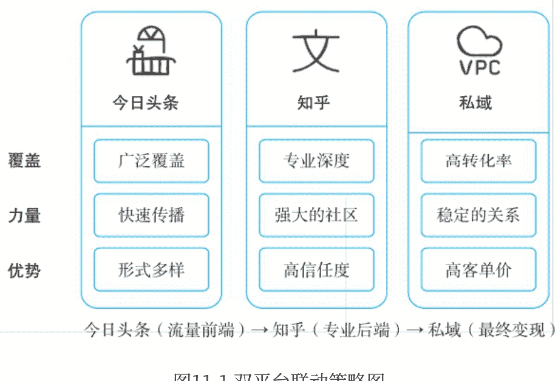

今日头条的优势在于覆盖广、传播快、形式多样。

知乎的优势在于专业深、社区强、信任高。

私域的优势在于转化率高、关系稳定、客单价高。

王睿解释道：“这三者可以形成一个完整的漏斗。你可以在今日头条发布适合广泛传播的内容，吸引初步感兴趣的人；在知乎建立深度专业形象，吸引真正认可你的专业价值的人；最后将这些高质量粉丝引导到私域，实现最终的高价值变现。这就像一个高效的销售漏斗——今日头条负责引流，知乎负责筛选，私域负责成交。”

张文杰点点头，若有所思：“这样的组合确实更全面。不过我个人更倾向于专业领域的深耕，那我是不是应该先以知乎为主，等专业形象建立起来后，再利用今日头条扩大影响力？”

“这是个不错的选择！”王睿赞同地说，“先深后广的策略对你来说更为合适。那我们就先深入了解一下，如何在知乎上打造专业形象。”

## 二、知乎运营：塑造专业权威与深度影响力

“既然你决定先以知乎为主，那我们就先来深入了解如何在知乎上建立专业影响力。”王睿打开了自己的知乎主页，页面顶部显示着“声望值92.3，行业TOP 5%”的醒目标识。

### 1. 高价值问题挖掘：发现“值得回答”的好问题

“在知乎，找到并回答一个好问题，比写十篇普通文章的效果更好，”王睿打开知乎搜索页面，“这是我在知乎取得成功的第一个秘诀。”

问题筛选策略如下。

(1) 设置专业领域过滤器。
1）知乎直答已接入DeepSeek-R1模型，支持基于关键词的智能搜索和知识库调用。可通过知乎站内搜索（zhihu.com+关键词）或第三方工具（如5118网站的知乎长尾词挖掘），设定你的核心领域关键词（如内容创作、内容变现、创作效率等）。
2）让创作工具根据这些关键词，在知乎平台上搜索和筛选符合条件的问题。

(2) 关注价值评估四维标准。
1）关注度指标：问题关注人数大于500或浏览量大于15000。
2）竞争度指标：高赞（多于200赞），回答数量少于3个。
3）匹配度指标：与你的专业背景高度相关。
4）深度指标：问题具有一定的深度和讨论空间。

(3) 进行二次筛选。
1）人工交叉验证提问者的主页（KOL提问更具流量潜力），对初筛问题进行深度分析。
2）评估问题的长期价值、回答难度、潜在曝光等。
3）预测回答所需的研究深度和可能获得的认可度。

> 王睿分享了他的实操经验：“我每周会花1～2小时，筛选10～15个高价值问题，然后从中挑选3～5个重点回答。这样既保证了效率，又确保了专注于真正值得投入的问题。就像钓鱼一样，与其在小池塘撒网，不如找到大鱼常出没的深水区精准垂钓。”

“有了好的问题，下一步就是创作真正有价值的回答，”王睿说着，点开了自己的一个高赞回答，“这就需要深度内容创作了。”

### 2. 深度回答构建：逻辑框架与论证

“知乎用户期待的是深度、严谨、有价值的回答，而不是简单的观点堆砌。”王睿强调，“这需要一套完整的内容创作流程。”

王睿强调的一套完整的内容创作流程就是深度回答七步法（见图11-2）。

(1) 问题本质剖析。
1）使用DeepSeek进行问题拆解和逻辑推理，分析问题背后的用户真实需求。
2）判断回答的核心价值点和差异化角度。

> “很多人只回答题干，而没有回答用户真正想知道的问题，这是失败的开始。就像医生只看表面症状而不问病史一样，治标不治本。”

(2) 资料研究与知识准备。
1）利用豆包的资料整合功能，快速搜集相关领域的知识、数据、案例。
2）通过智谱清言的AutoGLM沉思功能，整理不同视角和论点。
3）使用飞书的多维表格，调取个人积累的专业素材。

> “这一步我们让创作工具当研究助理，为我们节省80%的资料搜集时间。”

(3) 逻辑框架设计。
1）使用DeepSeek的逻辑架构师功能，生成初步的回答大纲。
2）确保框架包含问题澄清、核心观点、分层论证、实例支持、应用建议、总结展望。
3）调整优化结构，确保逻辑严谨、层次分明。

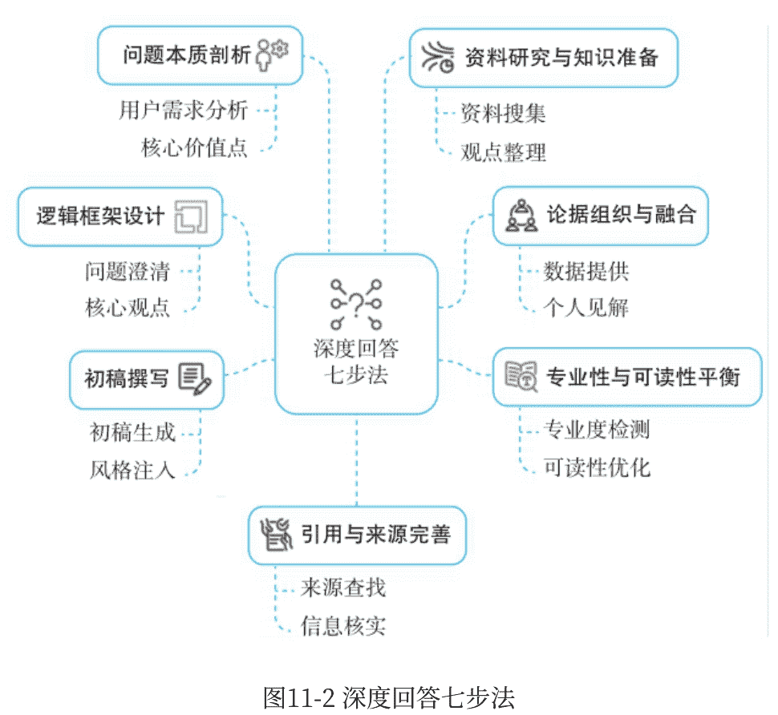

图11-2 深度回答七步法

> “一个好的框架就像建筑的骨架，决定了回答的高度和稳固性。”

(4) 论据组织与融合。
1）提供基础数据、引用、案例等素材。
2）筛选、整合并加入个人见解和经验。
3）注重论据的权威性、新颖性和说服力。

> “找证据，用经验解释证据，这是最佳组合。”

(5) 初稿撰写。
1）利用DeepSeek或智谱清言生成各部分初稿的内容。
2）进行修改、润色，注入个人风格和洞见。
3）确保内容既专业严谨又生动可读。

> “用工具写出骨架，然后你来添加血肉，这样的内容才有温度和价值。”

(6) 专业性与可读性平衡。
1）使用DeepSeek、豆包或腾讯元宝等多种大模型进行专业度检测，确保术语使用准确。
2）通过DeepSeek的可读性优化，提升文章的流畅度。
3）添加图表、案例和类比，增强解释性。

> “最好的专业内容是既让行家点头，又让小白明白。正如爱因斯坦所说，如果你不能向6岁的小孩解释清楚，那你自己也没真正明白。”

(7) 引用与来源完善。
1）查找和规范引用来源。
2）核实信息的准确性，避免虚构。
3）适当展示个人经历和案例，提升可信度。

> “在知乎，一个有力的引用和一个真实的案例胜过千言万语的说教。”

王睿特别强调：“在这个过程中，创作工具是强大的助手，但你的经验、见解和专业判断才是核心价值。永远不要完全依赖于工具生成的内容，那样的回答缺乏灵魂，很难获得真正的认可。这就像厨房里有再好的食材和厨具，最终的口味还是取决于厨师的经验和创意。”

张文杰若有所思地说：“感觉工作量不小啊，每天能完成多少这样的高质量回答呢？”

王睿笑了笑：“有了创作工具的辅助，一个经验丰富的创作者，每天可以完成1～2个这样的深度回答，或者3～5个中等深度的回答。关键是质量，而不是数量。在知乎，一个月10个高质量回答的影响力远胜于30个平庸之作。这就像餐厅里一道让人难忘的招牌菜胜过十道普通菜。”

### 3. 专业形象塑造：个人资料与内容的一致性

“除了内容本身，知乎上的专业形象塑造也非常重要，”王睿点击进入自己的个人主页，“这关系到用户对你的第一印象和持续信任。”

专业形象塑造有以下三个要素。

(1) 个人资料优化。
1）使用DeepSeek的专业简介生成器，创建突出核心专业领域和价值主张的个人简介。
2）一句话介绍：聚焦核心专长和价值（不超过30字）。
3）详细介绍：包含专业背景、经验证明、价值承诺（150～200字）。
4）个人经历：重点突出与专业相关的关键经历。

(2) 专业风格一致。
1）利用豆包进行专家风格提取，定义你的专业写作风格特征。
2）风格特征可包含逻辑方式、专业程度、语言风格、案例类型等。
3）创建个人的风格指南，确保所有创作内容都保持一致的风格。

(3) 内容主题聚焦。
1）使用豆包进行主题聚类，确保你的内容围绕3～5个核心专业领域。
2）创建内容关联图，确保各回答之间形成知识网络，而非孤立的个体。
3）定期分析你的内容分布，避免主题过于分散。

王睿分享了一个实用技巧：“我会使用DeepSeek帮我分析知乎上同领域的TOP 20创作者的主页，提取他们的成功模式和差异化特点，然后设计自己的独特定位。这种‘借鉴但不复制’的策略非常有效，有点像商业中的竞品分析，了解竞争对手的优势，但走出自己的差异化道路。”

### 4. “盐值”提升与社区互动：影响力积累

“知乎推出的‘盐值’（声望值）系统（基于基础信用、内容创作、友善互动等五个维度评分）已经成为衡量创作者专业影响力的重要指标。”王睿指着自己主页上的数据说道，“这个数值不仅关系到内容曝光，还直接影响到变现能力。”

提升“盐值”有四大策略（见图11-3）。

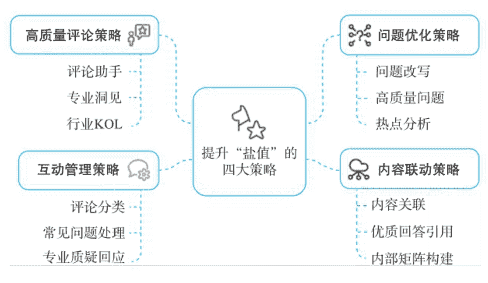

图11-3 提升“盐值”的四大策略

(1) 高质量评论策略。
1）利用DeepSeek为同领域优质回答生成有见地的评论。
2）每条评论需体现专业洞见，而非简单附和。
3）战略性关注和评论行业KOL内容，提高曝光机会。

> “一个好评论能带来的专业曝光有时候比一个回答还要高效，就像名人效应，在一个名人帖子下的高质量回复往往能‘借光’获得更多关注。”

(2) 问题优化策略。
1）使用豆包进行问题改写，帮助提问者优化低质量的问题。
2）主动在自己的领域提出高质量的问题，并回答部分问题，形成话题引导。
3）利用热点分析，提前布局潜在高关注的问题。

> “优质问题的提出者往往比回答者获得更高的平台认可，这就像在学术界，提出一个好问题比解决一个普通问题更有价值。”

(3) 互动管理策略。
1）利用智谱清言进行评论分类，快速筛选有价值的评论并优先回复。
2）利用创作工具辅助处理常见问题，保持评论区的活跃度。
3）对于专业质疑，收集论据进行有理有据的回应。

> “评论区管理是展示专业素养的重要窗口，千万不能忽视。这就像一场持续的研讨会，你的回应方式会塑造你的专业形象。”

(4) 内容联动策略。
1）利用DeepSeek不断进行内容拓展，将自己的多个回答形成知识网络。
2）适当引用自己之前的优质回答，增强内容的权威性。
3）将回答精华改编为知乎专栏文章，形成内容矩阵。
4）将知乎内容同步至公众号、今日头条等平台，形成矩阵效应。

> “单个回答是孤岛，关联的回答是大陆，影响力完全不同。就像出版界，一本畅销书不如一个系列的作品更能建立持久的读者黏性。”

王睿特别强调：“知乎的社区属性比今日头条强很多，你不能只发布内容，而忽视互动。创作工具可以帮你高效管理这些互动，但互动的质量和温度还是需要你亲自把控。这就像商业中的客户关系管理，技术可以帮你记录和分析，但真正的关系建立还需要人来完成。”

#### 【优质评论生成示例】

我在知乎发现了一个与我专业相关的高质量回答（链接如下），需要生成一个专业、有深度且能展示我的专业价值的评论。

回答链接：[此处粘贴知乎回答链接]

请为我生成一个评论，要求：

(1) 评论长度约200～300字，简洁有力。
(2) 首先肯定原回答的价值和精彩之处。
(3) 然后补充1～2个原回答未涉及或可深化的角度。
(4) 适当引用数据或案例来支持我的观点。
(5) 语气专业、谦和，避免指责或居高临下。
(6) 在结尾提出一个有思考深度的问题，促进讨论。
(7) 巧妙融入我的专业背景（创作工具应用专家）。
(8) 确保评论既显示专业度，又有助于与原作者建立良好的关系。

请生成2个不同侧重点的评论版本供我选择。

张文杰认真地记下了这些方法，然后问道：“听起来知乎需要比较系统地经营，那今日头条的运营策略有什么不同吗？”

## 三、今日头条运营：打造高阅读量的爆款内容

“接下来我们聊聊今日头条的运营策略，”王睿切换到今日头条的界面，“与知乎的专业深耕不同，今日头条更看重内容的传播性和吸引力。”

### 1. 选题：紧跟热点与用户兴趣

“在今日头条，获得成功的第一步是选对内容方向。”王睿说道。

(1) 热点挖掘与预测。
1）访问即时写作网站，实时监控今日头条热榜和行业动态。
2）通过DeepSeek进行关联分析，发现热点与你所在的专业领域的结合点。

> “不只是追热点，而是预判热点，让你始终能抢占先机。就像股市，等大家都看到机会时，黄金时间已经过去了。”

(2) 用户兴趣精准洞察。
1）使用DeepSeek分析今日头条用户对特定领域的兴趣偏好和疑问。
2）通过飞书进行数据分析，整理过往内容中的表现数据。
3）结合分析，找出用户最感兴趣但市场供给不足的内容缺口。

> “找到用户想看但没看够的内容是流量增长的关键，这与零售业找到供不应求的商品类别一样重要。”

(3) 差异化角度设计。
1）利用豆包进行视角拓展，为常见话题生成5～10个差异化视角。
2）通过DeepSeek评估各视角的新颖性、争议性和传播潜力。
3）结合个人专业优势，确定最具竞争力的内容切入点。

> “在今日头条，与众不同的视角比全面客观的分析更容易出圈。这就像脱口秀，独特的观察角度往往比全面的常识分析更能吸引观众。”

王睿分享了一个实用技巧：“我每天会定时让DeepSeek生成一份‘今日热点结合内容创作’的选题报告，从中筛选最有潜力的2～3个方向。这样既不会错过热点，又能保持专业聚焦。我称之为‘精准捕鱼’策略——知道鱼在哪里，用合适的饵钓鱼，而不是漫无目的地撒网。”

### 2. 爆款标题生成：优化点击率的艺术

“在今日头条，标题的重要性甚至超过了内容本身，”王睿笑着说，“这里有一个有趣的现象——一篇好内容配上平庸的标题可能无人问津，但一个好标题却能让平庸的内容获得不错的初始点击率。这就像电影海报，决定了多少人愿意走进影院。”

标题优化可按照如下四步进行。

(1) 多版本标题生成。
1）在DeepSeek中输入核心内容，生成15～20个不同风格的标题。
2）标题类型应包括疑问式、数字列表式、利益驱动式、情感触发式、悬念引导式等。
3）针对不同用户心理触发点设计不同的标题。

(2) 标题效果预测。
1）使用豆包对生成的标题进行评分，对每个标题进行点击率预测。
2）评估标题的情感触发强度、好奇心刺激程度、价值承诺明确度。
3）筛选出预测效果最佳的3～5个候选标题。

(3) A/B测试优化。
1）利用今日头条进行小范围的标题测试。
2）或通过微头条先发布不同标题版本，测试互动效果。
3）分析测试数据，确定最终标题。

(4) 标题模式积累。
1）使用DeepSeek分析你的高点击率标题特征，进行模式提取。
2）建立个人的“爆款标题公式库”，不断迭代优化。
3）创建适合不同内容类型的标题模板。

> 王睿强调：“好标题不是哗众取宠，而是准确抓住用户心理需求的艺术。创作工具可以帮你生成海量标题并预测效果，但最终的选择仍基于你对用户和平台的理解。就像钓鱼，你可以有各种鱼饵，但选择哪一种要基于对鱼类习性的理解。”

### 3. 内容创作：信息密度与阅读体验平衡

“有了好的标题，接下来就是创作能留住用户的内容。”王睿继续说道。

今日头条内容创作要把握以下五大要点。

#### （1）结构设计：适应快速阅读习惯。

- 1）利用DeepSeek设计适合今日头条用户阅读习惯的内容结构。
- 2）常用结构：金字塔结构（结论先行，见图11-4）、SCQA结构（见图11-5）。
- 3）确保内容层次清晰，便于快速扫读。

> “今日头条用户的平均阅读时间很短，前30秒便决定了是否继续阅读。就像电梯推销，你只有短短几十秒，看能否抓住对方的注意力。”

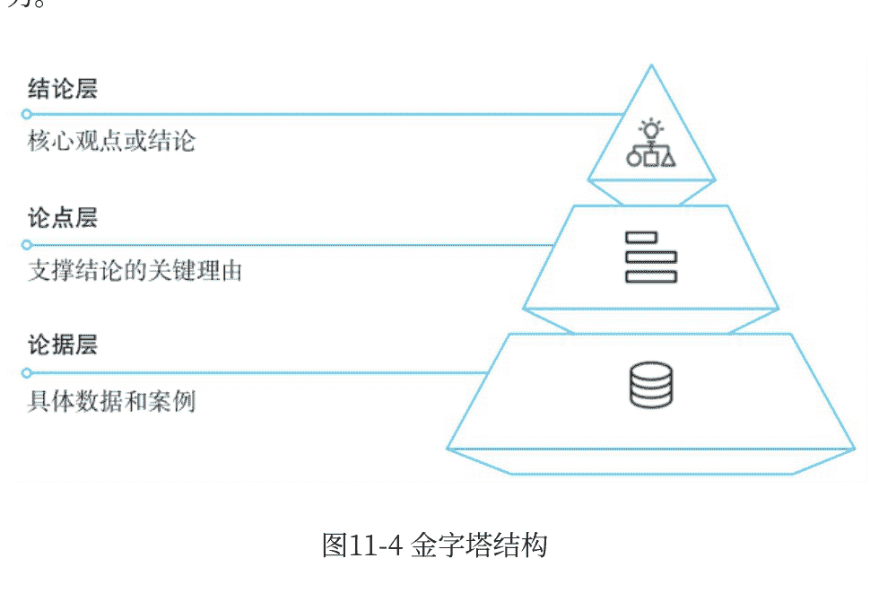

图11-4 金字塔结构

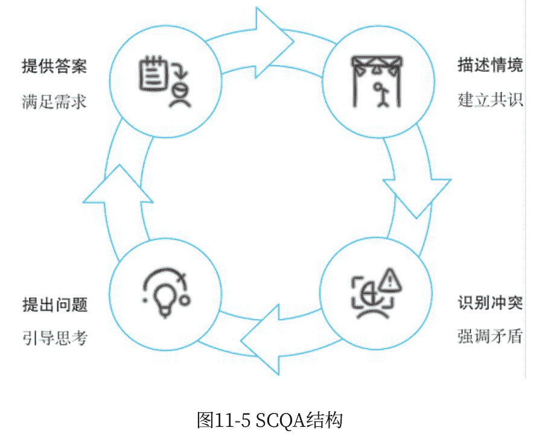

图11-5 SCQA结构

#### （2）内容生产：采用高信息密度原则。

- 1）使用豆包辅助撰写信息密集、观点明确的内容。
- 2）避免废话和铺垫，直奔主题。
- 3）每段至少包含一个有价值的观点或信息点。

> “在今日头条，内容要像浓缩咖啡，而不是淡茶水。用户宁愿喝一口浓缩精华的咖啡，也不愿喝一大杯平淡无奇的茶水。”

#### （3）格式优化：提升可读性。

- 1）通过DeepSeek优化文章排版：短段落、醒目的小标题、要点列表。
- 2）战略性使用加粗、引用和分隔线，引导阅读节奏。
- 3）配图策略：每300～500字配一张相关的图片，增强阅读体验。

> “好的排版能使阅读完成率提升25%。这就像好的餐厅，食物美味固然重要，但精美的摆盘和舒适的环境同样不可或缺。”

#### （4）多形态内容转换：灵活适应不同平台。

- 1）长文→微头条（140字精华版）。
- 2）长文→问答形式（自问自答增强互动）。
- 3）文字→短视频脚本（扩大内容覆盖面）。

> “一份好的内容应该像变形金刚，能适应各种平台。这样可以实现一次创作，多处开花。”

#### （5）互动设计：促进用户参与。

- 1）使用豆包或腾讯元宝设计文末互动引导：开放性问题、投票、讨论话题。
- 2）预设3～5个可能的读者问题，提前准备回答。
- 3）设计收藏理由，增加内容保存率。

> “互动率直接影响今日头条算法对内容的二次推荐力度。正如演讲，能引发观众思考和讨论的演讲总比单向灌输更成功。”

王睿分享了一个小技巧：“我会让DeepSeek帮我设计一份内容评分卡，对照检查每篇文章的信息密度、可读性、互动性等维度，确保内容质量的一致性。这就像厨师的出品标准，确保每道菜都符合预期水准。”

### 4. 智能分发与数据优化：提升推荐率与阅读时长

“今日头条的成功，50%靠内容，50%靠分发策略和数据优化。”王睿打开自己的今日头条创作者后台。

分发与优化策略如下。

- （1）最佳发布时机。
  - 1）利用DeepSeek分析目标用户的活跃时间段。
  - 2）结合今日头条算法制定更新节奏（通常为8点至10点、12点至14点、19点至22点）。
  - 3）创建个性化的发布时间表，错开同类创作者的发布高峰。

- （2）标签与分类优化。
  - 1）使用豆包分析热门内容的标签使用策略。
  - 2）为每篇内容选择1个主分类+2～3个精准标签。
  - 3）避免标签堆砌，保持每个标签的相关性。

- （3）内容系列化策略。
  - 1）使用腾讯元宝规划内容系列（如“内容创作实战21天”）。
  - 2）系列内容间保持引用关联，提高用户黏性。
  - 3）利用上一篇/下一篇引导，延长用户停留时间。

- （4）数据驱动的内容优化。
  - 1）利用DeepSeek分析内容数据，找出关键改进点。
    - 跳出率高的段落（内容可能乏味或缺乏价值）。
    - 阅读时长短的内容（可能缺乏深度或可读性）。
    - 评论热点（用户特别关注的内容点）。
  - 2）基于数据反馈，持续优化内容策略。

> 王睿强调：“今日头条的算法非常重视用户反馈数据，你需要定期分析这些数据，调整你的内容策略。特别是当你发现某类内容表现特别好时，要及时深入分析成功的原因，并复制这种模式。这就像商业中的爆款分析，找出成功的规律并强化它。”

#### 【数据分析与优化示例】

请基于我的今日头条账号最近10篇文章的数据表现,进行全面的分析并提供优化建议。

数据如下:[此处粘贴从今日头条创作者后台导出的数据,包括标题、发布时间、阅读量、阅读完成率、评论数、点赞数、收藏数等]。

请使用豆包的数据分析功能,对以下问题进行深入分析。

(1) 内容表现分析:
- 哪些类型的内容表现最佳?从标题、话题、内容长度等维度进行分析。
- 发现表现突出的内容的共同特点(3～5个关键特征)。
- 表现不佳的内容存在哪些共同问题?

(2) 用户行为洞察:
- 用户阅读习惯分析(最佳阅读时长、完成率与内容长度的关系等)。
- 互动热点分析(哪些内容最容易引发评论和讨论)。
- 收藏率高的内容的特征分析。

(3) 发布策略评估:
- 最佳发布时间段分析。
- 标题类型与点击率的关系。
- 标签使用效果评估。

(4) 优化建议:
- 提供3条提升阅读量的具体建议。
- 提供3个提高完成率的内容优化方向。
- 提供3种增强互动率的策略。
- 下一阶段应重点发力的内容方向建议。

请以数据为基础提供切实可行的优化建议,并设计一个为期2周的内容优化计划。

## 四、专业影响力变现策略

张文杰对这些策略很感兴趣，但他关心的核心问题还是：“在这些平台上积累的专业影响力，最终如何转化为实际收益呢？”

> “这正是我们要讨论的下一个话题，”王睿笑着说，“影响力变现是内容副业的终极目标。”

### 1. 平台流量变现：头条号与知乎的广告分成

> “首先是最直接的变现方式——平台广告分成。”王睿说道。

（1）平台广告分成机制。

1）头条号收益模式。

- ●图文广告收益。
  - 千次阅读收益：0.5～15元。
  - 收益影响因素：科技类可达10元，娱乐类仅3元;高互动内容收益可翻倍（最高3倍）;粉丝阅读收益是普通用户的3倍。

- ●视频广告收益。
  - 千次播放单价：0.3～100元。
  - 原创视频：12～20元/万次播放。
  - 优质原创+高粉丝互动：30～100元/万次播放。
  - 非原创视频：仅0.3～0.4元/万次播放。

- ●问答红包。
  - 奖励金额：2～300元。
  - 要求：回答字数不少于300字且通过人工审核。

- ●付费专栏抽成。
  - 平台抽成比例：20%。
  - 限制条件：专栏内容原创度需超过70%，否则取消分成资格。

> “今日头条的付费专栏分成是普惠式的，只要有流量，就有不错的收益。这就像开商店，只要有人进门，就可能产生消费。”

2）知乎收益模式。

- ●知+收益。
  - 单次点击收益：0.37～1.5元。
  - 准入门槛：创作者等级不低于3级，账号无违规。
  - 注意事项：广告卡片需自然融入内容，硬广会降低权重。

- ●视频广告分成。
  - 千次有效播放收益：5～40元。
  - 有效播放定义：用户观看超过30秒且触发广告展示。
  - 特殊加成：盐选会员内容收益额外加成20%。

- ●付费咨询抽成。
  - 平台抽成比例：15%。
  - 新增条件：咨询者需完成实名认证，否则收益会被冻结。

- ●盐选专栏抽成。
  - 平台抽成比例：25%～30%。
  - 普通作者：30%抽成。
  - 签约作者：25%抽成。

- ●知识交易所。
  - 单篇最高收益：500～5 000元。
  - 入选条件：回答入选“知乎精选”并获得不少于1 000个点赞。

> “知乎的变现更‘精英化’，高质量创作者的单位收益远高于普通平台。这更像高端咨询业务，虽然客户少，但单笔收入高。”

（2）优化广告收益的策略。

- ●内容-广告匹配优化。
  - 使用DeepSeek分析哪类内容的广告匹配度和点击率更高。
  - 适当调整内容关键词和主题，提升广告的相关性。
  - 优化内容布局，提高广告区域的注意力捕获率。

- ●创作者等级提升。
  - 分析平台评级算法，制定等级提升策略。
  - 针对评分标准优化内容输出节奏和质量。
  - 定期分析账号的健康度，规避违规风险。

王睿分享了一个真实数据：“我在今日头条的月广告收入稳定在2万～3万元，知乎则是1万～2万元。关键是保持内容的持续性和质量的一致性，创作工具可以帮你确保这一点。不过要注意，这样的收入是需要持续积累才能达到的，新账号通常需要3～6个月的成长期。正如种树，前期看不到明显收获，但一旦成长起来，果实会越来越多。”

### 2. 内容付费：专业知识的高效变现

“比广告收益更有价值的是内容直接付费。”王睿点开自己的知乎盐选专栏，显示已有5000多名付费用户。

内容付费变现策略如下。

- (1) 知乎盐选专栏/电子书。
  - 1）利用DeepSeek进行市场缺口分析，找到付费潜力高的选题。
  - 2）通过创作工具辅助创建结构化、系统化的专业内容。
  - 3）使用Canva可画设计有吸引力的销售页面和试读内容。
  - 4）适合领域：技能指南、行业分析、方法论、案例解析。

> “盐选专栏相当于出版自己的电子书，但流量和转化率都比传统出版高得多，就像自建网店比进实体书店更有销售潜力。”

- (2) 付费咨询服务。
  - 1）使用智谱清言设计专业咨询服务流程和介绍文案。
  - 2）构建常见问题库，提高咨询效率。
  - 3）分析咨询需求，提供更精准的解决方案。
  - 4）适合人群：有专业技能或经验可分享的创作者。

> “知乎、今日头条等平台让专业咨询变得像网购一样简单。这就像把传统的面对面咨询搬到了线上，大幅提高了效率并扩大了覆盖范围。”

- (3) 线上课程与工作坊。
  - 1）利用DeepSeek设计课程大纲和内容框架。
  - 2）创作工具辅助制作课程材料和配套资源。
  - 3）使用豆包创建引人入胜的课程宣传材料。
  - 4）适合形式：录播精品课、直播工作坊、会员制学习社区。

> “将系统化的知识打包为课程，单客户价值可提升5～8倍。这就像零售店升级为培训中心，商品单价和客户黏性都有了大幅提升。”

王睿强调：“内容付费的关键是系统化和问题解决力。创作工具可以帮你梳理知识框架，但真正的价值来自你的实战经验和独特的方法论。这就像高端厨师，厨具再好也代替不了独家配方和多年积累的烹饪技巧。”

#### 【付费专栏策划示例】

我计划在知乎开设一个名为“创作者的效率革命”的盐选专栏,面向希望通过创作工具提升内容创作效率的专业人士和副业者。

请使用DeepSeek的产品策划模式,帮我全面规划这个付费专栏。

(1) 市场分析:
- 目标用户画像(3～5个细分人群)。
- 用户痛点与需求分析。
- 市场竞品分析(知乎现有相关付费专栏)。
- 差异化价值定位。

(2) 内容规划:
- 专栏核心价值主张。
- 8～10个核心章节主题与内容概要。
- 每个章节的独特卖点。
- 内容深度与专业度设计。
- 更新频率与总内容容量建议。

(3) 营销策略:
- 专栏介绍文案(300字精华版)。
- 3个引人注目的核心卖点。
- 试读内容选择建议。
- 社交媒体宣传策略。
- 早鸟优惠与会员特权设计。

(4) 定价策略:
- 基于市场和内容价值的定价建议。
- 定价心理学分析。
- 一次性买断与订阅模式的优劣分析。
- 阶梯定价的可能性评估。

请以市场需求和变现潜力为导向,设计一个既有专业深度又有商业价值的付费内容产品。

### 3. 品牌合作：从内容植入到专家代言

> “当你的专业影响力达到一定程度时，品牌合作会主动找上门，”王睿笑着说，“这是收入最可观的变现渠道之一。”

品牌合作有如下策略。

- （1）潜在合作品牌挖掘。
  - 1）利用DeepSeek分析你的用户画像与潜在品牌的匹配度。
  - 2）搜索识别与你的专业领域相关的活跃广告主。
  - 3）创建潜在合作品牌库，分类评估合作的可能性。

> “主动出击比被动等待的效率高10倍，创作工具可以帮你精准定位目标品牌，就像猎头不会坐等人才投简历，而是主动寻找合适的人选。”

- （2）专业合作方案定制。
  - 1）根据品牌需求，使用豆包定制专业合作方案。
  - 2）设计差异化的合作形式：专家观点、案例解析、深度测评、联合研究。
  - 3）设计既符合品牌营销目标又保持个人专业调性的内容框架。

> “普通内容合作单次收入1 000～2 000元，而专业定制方案可达1万～2万元。这就像从出售现成商品升级为提供定制服务，附加值大幅提升。”

- (3) 多平台价值放大。
  - 1）利用腾讯元宝设计跨平台的传播矩阵，使曝光效果最大化。
  - 2）将一次品牌合作内容拆分为今日头条、知乎、社群等多平台形式。
  - 3）分析不同平台的内容表现，持续优化合作效果。

> “一次优质合作可以产生多平台的连锁效应，大幅增加后续的合作机会，就像一场成功的演出会带来更多邀约一样。”

- (4) 专家身份价值建设。
  - 1）利用DeepSeek打造个人专业品牌定位。
  - 2）策划与执行行业调研、白皮书、研究报告等高价值专业内容。
  - 3）将个人经验系统化为独特方法论或理论框架。

> “从内容创作者到行业专家的跃升，单次合作价格可提升3～5倍，就像从普通医生成长为专科权威，诊金自然水涨船高。”

王睿分享了一个真实案例：“去年我与一家创作工具企业合作，策划了一个创作效率研究项目。借助DeepSeek帮我设计调研方案和进行数据分析，最终形成了一份高质量的行业报告。这个项目不仅带来了3万元的直接收益，还让我在行业内建立了更强的专家形象，后续接到的咨询和合作邀请的价格也都上了一个台阶。”

#### 【品牌合作方案示例】

我是一位在知乎和今日头条积累了一定影响力的内容创作工具应用专家(粉丝总数约12万),现准备主动联系国内领先的创作工具品牌DeepSeek,提出合作建议。

请为我设计一份专业的品牌合作提案。

(1) 市场与受众分析:
- 分析DeepSeek的目标用户与我的粉丝的重合度。
- 我的粉丝对创作工具的需求和痛点。
- DeepSeek可能面临的市场挑战和机会。

(2) 合作价值主张:
- 我能为品牌带来的3～5个核心价值点。
- 差异化亮点(区别于普通KOL合作)。
- 预期效果与可衡量的指标。

(3) 合作形式设计(提供3个创新方案):
- 方案一:深度体验式测评与应用案例。
- 方案二:行业专题研究与白皮书。
- 方案三:创新应用工作坊与用户共创。
- 每个方案的具体执行步骤、内容形式、传播渠道。

(4) 专业呈现与商务条款:
- 合作提案的专业包装建议。
- 合理的报价区间(基于市场行情)。
- 合作效果评估机制。
- 长期合作的可能性探讨。

请确保方案既能体现我的专业价值,又能切实满足品牌的市场需求,避免因过度商业化而损害专业公信力。

### 4. 私域引流与高价值转化：构建专业信任漏斗

> “平台影响力的终极变现是将流量转化为私域资产，”王睿说道，“这是实现收入突破的关键一步。”

私域转化可采取下面的策略（见图11-6）。

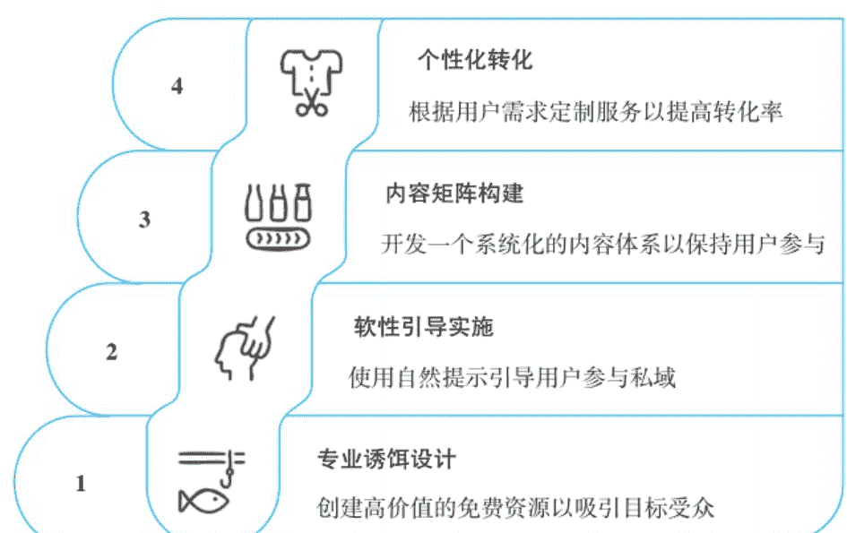

图11-6 私域转化策略

(1) 专业诱饵设计。
- 利用DeepSeek设计高价值的免费资料（如行业报告、工具模板）。
- 通过豆包优化资料的实用性和独特性，提高转化率。
- 为不同阶段的用户设计差异化的引流资料。

> “好的专业诱饵像磁铁一样精准吸引粉丝，我的‘创作效率指南’转化成本不到5元/个。这就像钓鱼，好的饵料自然能钓到目标鱼种。”

(2) 软性引导实施。
- 使用豆包设计自然、不突兀的引流话术。
- 在内容中巧妙植入私域价值点，引发用户主动寻求连接。
- 设计“阶梯式的价值递进”，让用户感受到私域的额外价值。

> “最好的引流不是推销，而是让用户感觉是他们主动找到了你。这就像好餐厅不需要拉客，口碑自然吸引来了源源不断的顾客。”

- (3) 内容矩阵构建。
  - 利用DeepSeek规划系统化的私域内容体系。
  - 设计从免费到低价再到高价的内容阶梯。
  - 持续输出价值，保持私域的活跃度。

> “私域是你的内容超市，需要有从入门品尝到高端定制的完整商品线，就像百货商场，从普通商品到尊享服务，满足不同层次的需求。”

- (4) 个性化转化。
  - 通过豆包分析用户的行为和需求，设计个性化的服务推荐。
  - 辅助进行初步需求诊断，提高成交精准度。
  - 设计“小步快跑”的转化阶梯，降低决策门槛。

> “个性化服务让大规模的精准转化成为可能，这是2025年私域变现的革命性变化。就像医生不会给所有人开一样的药，针对性服务才能真正解决问题。”

王睿强调：“私域不是简单的卖货场所，而是专业信任的延伸。创作工具可以帮你高效管理私域运营，但真正的信任和专业价值还是来自你的核心能力和独特见解。最成功的私域就像一个会员制俱乐部，人们加入不仅是因为产品，更是因为认同和归属感。”

#### 【引流资料设计示例】

请帮我设计一份高价值的免费引流资料,用于将我在今日头条和知乎的专业粉丝引导至私域(微信社群/个人号)。

我的专业领域是辅助内容创作,目标用户是希望提升创作效率的自媒体人、副业创作者和内容营销从业者。

请使用豆包的产品设计模式来规划这份引流资料。

(1) 资料形式与主题:
- 推荐3～5种可能的资料形式(如指南、模板、清单、报告等)。
- 为每种形式提供2～3个具体的主题建议。
- 分析各选项的吸引力和转化潜力。

(2) 详细内容规划(针对最优选项):
- 资料的详细架构与内容大纲。
- 核心价值点设计(至少包含5个实用干货)。
- 差异化亮点(为什么用户愿意留下联系方式以获取该资料)。
- 视觉呈现建议(排版、图表、设计风格)。

(3) 投放与转化策略:
- 在今日头条/知乎平台如何自然地植入引流点。
- 引流文案示例(3个不同风格的版本)。
- 如何在资料中埋下私域二次转化的种子。
- 转化率提升技巧(如限时、稀缺性、社会认同等)。

(4) 资料交付与后续跟进:
- 资料交付方式建议。
- 用户标签分类系统。
- 后续内容推送计划。
- 高价值用户识别方法。

请确保设计的资料既能充分体现我的专业价值,又具有实际的可操作性,真正解决用户痛点,而不是简单的营销噱头。

## 五、案例拆解：专家IP在今日头条/知乎的崛起

“我们看一个真实案例，深入了解如何将这些策略落地。”王睿调出了一个案例分析。案例名为“李明的‘内容产品分析’专业IP打造之路”。

### 1. 背景介绍

- (1) 人物：李明，35岁，前互联网产品经理，希望通过分享创作工具分析和应用经验获得副业收入。
- (2) 起点：零粉丝，有5年产品经理经验和1年创作工具使用经验。
- (3) 目标：建立“内容产品应用专家”形象，实现月收入超过1.5万元。

### 2. 平台选择与定位

- (1) 主攻平台：知乎（深度分析）+今日头条（实用技巧）。
- (2) 内容定位：从产品经理视角解析创作工具，帮助普通人高效应用。
- (3) 差异化角度：不谈技术原理，专注于实际应用场景和效率提升方法。

### 3. 策略实施

- (1) 内容创作阶段。
  - 1）利用DeepSeek对同领域TOP创作者的内容进行分析，找出内容缺口。

## 4.增长路径

增长路径如表11-1所示。

| 时间节点 | 平台表现 | 关键行动 | 变现方式 |
| :--- | :--- | :--- | :--- |
| 第 1 个月 | 知乎 100 个粉丝，今日头条 300 个粉丝 | 高频率内容输出，建立初步专业形象 | 广告分成（<500 元） |
| 第 3 个月 | 知乎 2 000 个粉丝，今日头条 5 000 个粉丝 | 开发效率工作法体系，形成差异化 IP | 广告分成＋少量咨询（3 000 元） |
| 第 6 个月 | 知乎 1 万个粉丝，今日头条 3 万个粉丝 | 发布爆款内容“2025 年最值得用的 10 款创作工具”，实现快速增长 | 广告分成＋咨询＋付费指南（1 万元） |
| 第 9 个月 | 知乎 3 万个粉丝，今日头条 8 万个粉丝 | 接洽首个品牌合作，推出“效率训练营” | 品牌合作＋课程＋咨询（1.8 万元） |
| 第 12 个月 | 知乎 6 万个粉丝，今日头条 15 万个粉丝，私域粉丝数 1 万 | 发布《效率革命》，与多个品牌长期合作 | 综合月收入稳定在 3 万～5 万元 |

表11-1 增长路径

## 5.成功的关键因素

成功的关键因素如图11-7所示。

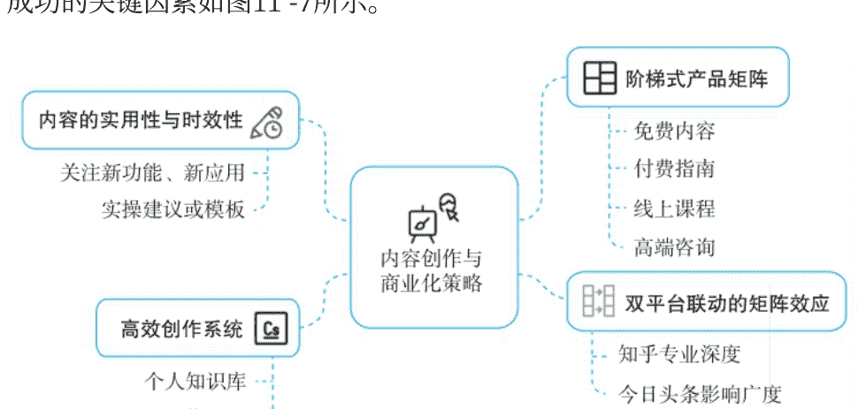

图11-7 成功的关键因素

(1) 内容的实用性与时效性。

- 1) 关注新功能、新应用，确保内容始终走在前沿。
- 2) 每项内容都包含可立即应用的实操建议或模板。

(2) 高效创作系统。

- 1) 建立个人知识库+创作流程，实现每日更新高质量内容。
- 2) 使用AI工具处理基础研究和资料整理，将时间集中在个人见解和经验分享上。

(3) 双平台联动的矩阵效应。

- 1) 知乎建立专业深度，今日头条扩大影响广度。
- 2) 将两个平台用户引导至同一私域，形成完整漏斗。

(4) 阶梯式产品矩阵。

- 1) 免费内容→付费指南→线上课程→高端咨询，形成完整商业闭环。
- 2) 每个阶段都应确保内容质量和用户体验。

## 6.失败经验与教训

李明也遇到过几次重大挫折，值得我们借鉴。

(1) 盲目追热点陷阱。

- 1) 错误做法：第2个月为追求流量，频繁发布各种与专业领域关联度低的热点内容。
- 2) 负面结果：短期获得流量，但粉丝质量差，专业定位混乱，知乎“盐值”下滑。
- 3) 解决方法：重新聚焦于专业领域，用创作工具改编热点内容使其与专业相关。
- 4) 经验总结：宁可错过热点，也不要偏离定位。

(2) 内容深度不足。

- 1) 错误做法：前3个月大量输出浅层内容，过度依赖于创作工具生成，缺乏个人洞见。
- 2) 负面结果：内容同质化严重，缺乏记忆点，用户留存率低。
- 3) 解决方法：降低发布频率，提高单篇内容的深度，增加原创案例和方法论。
- 4) 经验总结：一篇深度原创胜过十篇浅层复制。

(3) 过早变现尝试。

- 1) 错误做法：第4个月就推出599元的线上课程，但内容准备不足，专业影响力尚未建立。
- 2) 负面结果：转化率极低（0.3%），损害专业形象，获得大量负面评价。
- 3) 解决方法：撤下课程，先通过49元的小册子积累口碑，半年后重新设计课程体系。
- 4) 经验总结：专业信任建立需循序渐进，变现节奏要跟上信任节奏。

王睿总结道：“李明的案例告诉我们，即使是从零开始，只要有特定领域的经验积累，再借助创作工具的高效创作能力，完全可以在一年内建立起有影响力的专业IP，并实现稳定的高收入。不过他的失败经验也提醒我们，工具只是放大器，真正的核心还是专业价值和正确的策略。”

## 4.2.3. Técnicas de la investigación de campo

Las técnicas más utilizadas en la investigación de campo son:

- La observación
- La encuesta
- La entrevista

### 4.2.3.1. La observación.

Se afirma que: "La ciencia comienza con la observación y, finalmente, tienen que volver a ella para encontrar su convalidación final". La observación se considera la principal técnica en la investigación científica tanto en las ciencias naturales como en las ciencias sociales, y es el primer paso en la tarea de investigar.

Según Sellitz para que la observación se convierta en técnica científica debe reunir las siguientes condiciones:

1. Que tenga un objeto o propósito específico;
2. Que sea planeada cuidadosa y sistemáticamente;
3. Que sea controlada sistemáticamente; y
4. Que esté sujeta a controles de validez y confiabilidad

### Tipos de observación

La clasificación de la observación obedece a diferentes criterios:

49 GOODE, William J. y Hatt Paul. Métodos de Investigación Social. Cuarta reimpreión. Ed. Trillas, México 1972. Citado por ZORRILLA Arenas Santiago. Op. cit. p. 167
50 Ander-Egg, Ezequiel. Introducción a las técnicas de investigación social. Ed. Rialp, S. A. Trad. Manuel Rizo V. Madrid 1985. Cit ibidem p 170
51 Ander-Egg, Ezequiel. Op. cit pp 96-97

## 实战练习

(1) 知乎问题挖掘实践。

1) 使用本章提供的DeepSeek提示词，在你的专业领域找到5个高价值问题。
2) 为其中一个问题设计完整的回答大纲。
3) 评估这个问题的潜在影响力和变现可能。

(2) 今日头条爆款标题训练。

1) 选择你最熟悉的专业主题。
2) 使用DeepSeek或豆包生成10个不同风格的标题。
3) 分析哪些标题最符合今日头条平台的特性并可能获得高点击率。

(3) 专业定位与简介优化。

1) 分析你的专业优势和独特价值。
2) 使用创作工具生成3种不同风格的个人简介。
3) 选择最能体现你的专业影响力的版本并进行微调。

(4) 变现路径设计。

1) 设计一条从平台到私域的完整引流路径。
2) 规划3个可能的变现产品或服务。
3) 用创作工具辅助设计一份高价值的免费引流资料。

## 思考

1. 对比今日头条和知乎，结合你的内容风格和专业领域，哪个平台更适合作为你的主阵地?你计划如何在两个平台之间建立内容协同?
2. 在追求今日头条的点击率和知乎的专业认可之间，你如何平衡内容的深度与传播性?创作工具如何帮你解决这一矛盾?
3. 根据你的专业特长和目标用户，设计一条从平台影响力到实际收入的转化路径。你的“影响力货币化”策略是什么?
4. 在使用创作工具辅助创作的过程中，如何保持内容的个人特色和独特见解?你计划如何避免创作工具生成内容的同质化陷阱?
5. 如果给自己设定一个12个月的专业IP建设计划，你的阶段性目标和关键行动点是什么?创作工具将在哪些环节提供最大助力?

## 章末寄语：内容创作时代的专业影响力新机遇

在内容创作生态中，今日头条与知乎作为中文互联网的两大专业内容平台，为有才华和洞见的创作者提供了前所未有的影响力扩展和变现机会。特别是在各种工具全面赋能的今天，专业内容的创作效率和质量都有了质的飞跃。

与过去相比，现在的挑战不再是“如何创作内容”，而是“如何创作有差异化价值的内容”。简单的信息搬运和浅层内容将越来越难以获得用户的深度认可和持续关注。真正的机会在于将创作工具的效率与你的专业洞见相结合，打造独特的内容价值。

DeepSeek、豆包、智谱清言等国产创作工具的崛起，让中文创作者拥有了更适合本土平台的强大助手。它们不仅能帮你高效创作，还能辅助你捕捉趋势、分析数据、优化策略。创作工具就像一个全能的“创作加速器”，让你能够以一人之力完成过去需要团队才能实现的内容创作和运营工作。

但最终，创作工具无法替代你的深度思考、独特视角和专业积累。将创作工具视为强大的辅助工具而非思考的替代品，才能在内容创作的新浪潮中脱颖而出，构建真正有价值的专业影响力，并将这种影响力转化为可持续的收入来源。

现在，就让我们借助现代创作工具的力量，在今日头条与知乎这两大平台上，开启专业影响力之旅吧！

## 第12章 财富管理与生活重构：从副业收入到财务自由的完整路径

### 开篇：从收入增长到人生重构的双重转变

“今天的收入报表看起来不错。”王睿将笔记本电脑转向张文杰，屏幕上显示着他们的AI副业的月收入数据——8 800元，“比去年同期增长了25%。”

张文杰点点头，但脸上没有像一年前那样兴奋得快要跳起来的表情。“数字确实不错，但更让我欣慰的是这个。”他打开另一个表格，净资产一栏显示着156 800元。

“还记得我们最开始做AI副业时的状态吗？”王睿笑着说，“每次收到一笔钱就像过年收红包一样激动，恨不得马上买一个新键盘或者请朋友吃一顿饭。结果是各种设备升级了，但银行账户的存款却仍在原地踏步，就像仓鼠在转轮里狂奔但永远到不了目的地。”

“直到半年后那次算账，我们突然意识到：虽然月收入过万元，但银行存款增长的速度连通货膨胀都跑不过。”张文杰回忆道，“更关键的是，当我们真正实现财务自由后，发现面临的挑战不是赚钱，而是如何重新定义生活的意义。这就像爬山一样，当你终于登上山顶后，会发现真正的问题是下山后要去哪里。”

这个发现成为他们人生的转折点。他们制定了一套副业收入管理系统，并开始思考财务自由后的生活重构。从将收入转化为财富，到将财富转化为真正的自由生活。

“关键在于心态的转变，”王睿说道，“不再把副业收入视为‘额外收入’，而是视为‘种子资金’。同时，我们开始思考更深层的问题：财务自由的终极目标不是拥有更多钱，而是拥有选择的权利。就像从员工变成老板，责任和自由度都完全不同了。”

今天，我们要分享的是从AI副业收入到财务自由再到生活重构的完整路径。这不仅关于赚钱和管钱，更关于如何在AI时代重新定义成功的人生。

## 一、副业收入的科学分配：构建财富基石

#### 1.为什么需要收入分配法则

许多AI副业创业者在收入增加后遇到了同样的问题：赚的钱越来越多，但资产增长却不明显。这主要源于三个常见误区。

(1) “额外收入”心态：把副业收入当作天上掉的馅饼。这是最普遍的心理陷阱，因为副业收入没有固定性，很容易被当作“意外之财”花掉。张文杰苦笑着回忆：“我曾经每月通过AI内容创作赚到4000元，但发现银行存款几乎没有增长。回顾消费记录时，我意识到这些钱不知不觉中被‘升级’的生活方式吞噬了——更好的电脑设备、更贵的咖啡、更多的网购冲动。就像有了一个会漏水的桶，倒进去多少水都存不住。”

这种心态的根源在于我们大脑的进化缺陷：几万年前的人类基因让我们倾向于及时享乐，因为那时候食物稀缺，有了就要马上吃掉。但在现代社会，这种本能成了财富积累的最大敌人。

(2) 生活膨胀陷阱：收入增长，支出同步增长。心理学上有个概念叫生活方式膨胀，指的是随着收入增加，生活标准也自动升级，最终储蓄率保持不变甚至下降。王睿分享了他的亲身经历：“副业收入从0增长到5000元的过程中，我不知不觉地从外卖升级到了餐厅，从公交升级到了打车，从普通酒店升级到了星级酒店。虽然生活质量确实提高了，但存钱的速度却没有跟上赚钱的速度，就像开车一样，油门踩得越重，油耗也越大。”

这个陷阱的危险之处在于它是渐进式的，不易察觉。今天多花50元似乎不算什么，但一年累计下来就是18000多元，足够买一只不错的指数基金了。

(3) 行动拖延症：总想等到收入更高再开始规划。很多人有一个错误的观念：等副业月收入过万元了再考虑投资和理财。这就像说“等我的英语变得流利了再开始说英语”一样荒谬。张文杰反思道：“我浪费了整整8个月的时间，总觉得每月2 000元的副业收入太少了，不值得建立复杂的管理系统。结果错过了1.6万元的早期投资机会，按年化收益率5%计算，相当于损失了几百元的复利收益。”

实际上，财务管理的核心不是金额大小，而是习惯养成。就像学游泳一样，不是等你在陆地上把动作练完美了再下水，而是要在水里慢慢摸索。

#### 2.40/30/20/10分配法则：让每一分钱都有明确的使命

王睿和张文杰经过两年的实践和调整，总结出了这套分配法则。“这个比例不是拍脑袋想出来的，”王睿说道，“而是我们尝试了十几种不同的分配方案后，发现这个组合既能保证长期增长，又能维持当下的生活质量和工作动力。”

(1) 40%用于投资与增长，为未来的自己存钱。这是整个系统的核心，目的是让钱生钱，实现复利增长。40%这个比例看起来很高，但考虑到副业收入的额外性质，这个比例是合理的。

> “为什么是40%而不是30%或50%?” 张文杰解释道，“我们发现30%太保守，复利效应不够明显;50%则对当下生活质量有太大影响，容易导致坚持不下去。40%是一个‘甜蜜点’，既能感受到投资的力量，又不会让生活过于拮据。”

这部分资金的去向包括：

- 指数基金定投：这是主力军，占投资资金的70%～80%。选择费率低、规模大的宽基指数基金，如沪深300指数基金、中证500指数基金等。
- 债券基金：占投资资金的15%～20%，起到稳定器的作用，降低整体波动。
- 少量个股或行业基金：占投资资金的5%～10%，满足尝试的心理需求，但严格控制比例。

操作要点是设立专门的投资账户，与日常账户完全分离。“我把这个账户的银行卡放在家里最里面的抽屉里，”王睿笑道，“增加取用的‘摩擦力’，避免冲动消费。”

(2) 30%用于能力与事业提升，磨刀不误砍柴工。这部分收入投资的是你最重要的资产——你自己。与其他投资不同，对自身能力的投资的回报率往往是最高的，而且风险最小。

张文杰分享了他的投入策略：“我把这30%主要分为四个方向：技能学习（40%）、工具设备（30%）、网络拓展（20%）、健康维护（10%）。这个分配方案经过多次调整，避免了早期‘设备至上’的误区。”

具体包括：

- 技能学习：购买优质课程、参加培训、考取证书等。优先选择那些能直接增加副业收入的技能，比如AI工具的深度应用、营销推广技巧等。
- 工具设备：要避免“设备万能论”。张文杰吃过亏：“我曾经花5000元买了一套专业录音设备，结果用了不到10次。现在购买设备前，我会先问自己：这个设备能直接带来收入增长吗?投入产出比是多少?”
- 网络拓展：参加行业聚会、加入付费社群、请行业专家吃饭等。王睿强调：“人脉投资是最容易被忽视但回报最高的投资。我通过一次300元的行业聚会，认识了现在最大的客户。”
- 健康维护：体检、健身房会员、营养补充等。“身体是革命的本钱，”张文杰说道，“我们经常忽视健康投资，但它是所有投资的基础。”

(3) 20%用于生活提升与享受，奖励现在的自己。这部分资金的作用是平衡当下与未来，确保在追求长期目标的同时，也能享受当下的生活。心理学研究表明，完全延迟满足会导致动力衰减，适度的即时奖励有助于维持长期行为。

> “这20%是我们的‘快乐基金’，”王睿说道，“但有严格的使用原则：必须用于提升生活体验，而不是购买物品。比如和家人旅行、与朋友聚餐、学习一门兴趣课程等。”

关键是要设定明确的边界，避免这部分资金无限膨胀。张文杰的做法是：“即使副业收入翻倍，这部分的绝对金额也不能超过原来的1.5倍。也就是说，随着收入增长，享受的比例是逐渐下降的。”

实际应用中，可以把这部分钱存入余额宝等货币基金，既有少量收益，又保持了流动性。“心理技巧是用单独的支付方式，”王睿补充，“比如专门的信用卡或电子钱包，花起来有仪式感，也有节制感。”

(4) 10%用于风险防控与公益，为“黑天鹅事件”做准备。这部分看起来比例最小，但作用巨大。它是你的“财务安全网”，保护你在面对意外情况时不至于前功尽弃。

前期资金主要用于建立应急基金。王睿的经验是：“应急基金的目标是3～6个月的基本生活费。我花了8个月的时间建立了3万元的应急基金，虽然看起来损失了投资收益，但它给我带来的心理安全感是无价的。有了这个缓冲，我在投资时更加从容，反而能做出更理性的决策。”

应急基金建立完成后，这部分资金可以用于：

- 保险保障：重疾险、意外险等，转移大额风险。
- 法律咨询：重要合同和决策的专业建议。
- 慈善捐赠：履行社会责任，也有税务优化效果。

张文杰强调：“这10%是对未知风险的预防性投资。就像买保险一样，你永远不希望用到它，但一旦需要，它能救命。”

#### 3.自动化执行系统：让理财变成“肌肉记忆”

有了分配法则，如何确保持续执行?王睿和张文杰的答案是：绝不依赖于意志力，而是建立自动化系统。

> “人的意志力是有限的，”王睿说道，“就像手机电池一样，用多了会耗尽。我们不能每个月都重新做一次分配决策，而是要让它变成自动化的流程。”

(1) 设计三层资金流系统。

1) 第一层：收入汇总账户。这是所有副业收入的“中转站”。选择一家网点较少的银行开户，专门用于接收副业收入。“我选择了一家只在市中心有网点的小银行，”张文杰笑道，“这样就不会轻易去取钱了。”

关键操作：

- 所有副业收入都进入这个账户。
- 每月5日设置自动转账到各个目标账户。
- 账户余额保持在较低水平，避免大额闲置。

2) 第二层：目标专用账户。为每个资金用途设立专门的账户，实现物理隔离。这样做的好处是让每笔钱都有明确的“身份标签”，避免被挪用。

- 投资账户：连接到证券公司或基金平台，设置自动定投。
- 能力提升账户：使用建设银行等有预算管理功能的银行。
- 生活提升账户：余额宝或类似的货币基金，保持流动性。
- 风险防控账户：定期存款或稳健理财产品。

> 王睿的技巧是给每个账户取一个有意义的名字：“投资账户叫‘财务自由号’，能力提升账户叫‘个人成长基金’等，这样每次看到账户名就会想起设立它的初衷。”

3) 第三层：具体执行工具。利用各种金融科技工具，实现精细化管理。

- 支付宝理财：设置基金定投计划，每月自动扣款。
- 银行App：设置跨行转账计划，自动分配资金。
- 记账软件：如随手记等，追踪各类支出。
- AI助手：用豆包或腾讯元宝分析消费模式，发现“资金黑洞”。

> “技术是为了让复杂的事情简单化，”张文杰总结，“一旦系统建立起来，每个月的资金分配就像流水一样自然，不需要任何决策和意志力。”

（2）避开三个常见的执行陷阱。

1）陷阱1：比例僵化症。有些人严格按比例执行，即使月收入只有500元也要分成4份。这样做成本太高，操作烦琐。

解决方案：设置最低执行门槛，比如月收入2000元以上才启动完整分配系统，低于这个数额可以简化为70%投资+30%能力提升。

2）陷阱2：完美主义拖延。等待找到“最完美”的银行、基金和系统才开始执行。

解决方案：用“80分原则”，找到基本满足需求的工具就立即开始，在执行过程中不断优化。张文杰的经验是：“我第一个投资账户是在中国工商银行随便开立的，费率偏高，但让我养成了投资习惯。半年后转到费率更低的平台，这种渐进式优化比永远不开始要好。”

3）陷阱3：频繁调整系统。看到其他人的分配方案就想调整自己的分配比例。

解决方案：设置“调整冷静期”，至少执行3个月才能修改比例。王睿说：“我见过太多人每个月都调整分配比例，最后什么系统都没建立起来。稳定性比完美性更重要。”

## 二、投资入门与财富增长引擎

### 1. 为什么选择指数基金作为起点

对于大多数AI副业创作者而言，指数基金是最佳的投资起点。这不是因为它有多么神奇的赚钱能力，而是因为它能帮你建立正确的投资思维和习惯。

（1）指数基金的本质：买下整个市场的一小份。很多人对投资有误解，以为要研究各种复杂的技术指标和财务报表。但指数基金的逻辑很简单：既然我们无法准确预测哪家公司会成为下一个苹果或腾讯，那为什么不把所有优秀的公司都买一点呢？

> 张文杰用了一个生动的比喻：“指数基金就像是买下了整个果园的一小份股权，而不是赌哪棵树会结出最多的果子。虽然某些树可能表现更好，但整个果园的长期产出是相对稳定的。”

（2）从心理学角度看指数基金的优势。

1）减少决策疲劳：每天都有无数的投资选择，如果要研究每一只股票或基金，大脑会信息过载。指数基金让你可以“一劳永逸”地解决资产配置问题。

> 王睿分享了他的经历：“我最开始试图研究个股，每天花2～3小时看财经新闻和研究报告，结果发现大部分时间都在做无用功。转向指数基金投资后，每月只需要花15分钟检查一下，剩下的时间可以专注于发展副业。”

2）克服情绪波动：单只股票的波动可能会让人情绪失控，但指数的波动相对平缓，有助于培养长期投资的心态。

3）建立投资信心：通过指数基金的稳定表现，投资新手可以建立对市场的基本信任，为后续更复杂的投资打下心理基础。

### 2. 构建你的第一个投资组合：简单而不简陋

很多投资新手的投资要么过于简单（只买一只基金），要么过于复杂（同时买十几只基金）。王睿和张文杰经过实践，总结出了适合新手的“三层金字塔”结构。

（1）第一层：核心资产（占总投资的60%～70%）。这是投资组合的“压舱石”，追求的是稳定增长而不是暴涨暴跌。主要投资宽基指数基金，也就是覆盖面最广的市场指数。

推荐组合：

- 沪深300指数基金（40%）：覆盖A股最大的300家公司，代表中国经济的核心力量。
- 中证500指数基金（30%）：覆盖中型企业，增长潜力相对更大。

张文杰解释选择逻辑：“沪深300指数基金就像是买下了中国最优秀的大公司，包括贵州茅台、工商银行、伊利股份等；中证500指数基金则像是买下了具有成长潜力的中型企业。这两个组合起来，基本覆盖了中国股市的主体。”

操作要点：

- 选择费率低的指数基金（年化管理费率0.5%以下）。
- 设置每月定投，不要试图择时。
- 至少坚持3年，体验完整的市场周期。

（2）第二层：全球配置（占总投资的20%～30%）。这一层的作用是分散风险，不要把所有鸡蛋放在一个篮子里。同时也能参与全球经济增长，特别是美国科技股的长期上涨。

推荐组合：

- 标普500指数基金（15%）：覆盖美国最大的500家公司，包括苹果、微软、谷歌等。
- 港股指数基金（10%）：连接内地和国际市场的桥梁。
- 欧洲或新兴市场基金（5%）：进一步分散地域风险。

> 王睿分享了全球配置的价值：“2018年A股表现很差，但美股表现不错，我的港股投资也有正收益。这种分散配置让我在市场低迷时也能保持相对乐观的心态。”

需要注意的是，投资海外市场需要通过QDII基金，有额度限制，而且涉及汇率风险。“我把汇率波动当作‘免费的刺激’，”张文杰笑道，“长期来看，汇率影响会被资产增长稀释。”

（3）第三层：机会探索（占总投资的10%以内）。这部分满足你的“投机”需求，可以投资一些你看好的行业或主题，比如科技、消费、医疗等。但必须严格控制比例，把它当作“学费”而不是主要的赚钱手段。

可选方向：

- 科技主题基金：如果你对AI、5G、新能源等行业有深度了解，可以选择这个行业。
- 消费行业基金：投资茅台、五粮液、美的等消费龙头。
- 医疗健康基金：人口老龄化的长期趋势。

张文杰的原则是：“这10%的钱要做好全亏的心理准备。我把它当作买彩票，中了是惊喜，不中也不影响主要的财富积累计划。”

### 3. 从主动收入到被动收入：构建你的“睡后收入”

被动收入是财务自由的关键，它让你即使不工作也能有钱进账。但被动不等于不管不问，而是需要前期的系统设计和持续的优化维护。

（1）重新定义被动收入。真正的被动收入不是完全不需要时间投入，而是投入的时间与产出不成线性关系。张文杰做了一个形象的比喻：“主动收入就像搬砖，搬一块砖给一块砖的钱，不搬就没钱；被动收入像种果树，前期需要浇水施肥，但果树长成后，你睡觉时它也在结果子。”

（2）被动收入的四种类型及其特点。

1）数字产品收益：知识的无限复制。这是AI副业创作者最容易入手的被动收入类型。一旦创建完成，可以无限次销售，边际成本几乎为零。

典型案例：

- AI提示词宝库：将你常用的高效提示词整理成模板包。
- 行业分析报告：定期发布某个领域的深度分析。
- 在线课程：录制一次，可以卖给无数学员。

张文杰分享了他的成功经验：“我把两年来积累的40个AI内容创作提示词，加上操作视频和案例解析，打包成一个‘AI内容创作加速包’，定价199元。第1个月销售了28份，净收入5500多元。最关键的是，我只用了一个周末的时间来制作，后续基本不需要维护。”

关键成功要素：

- 解决真实问题：不是你想教什么，而是用户想学什么。
- 降低使用门槛：提供傻瓜式的操作指南。
- 持续优化迭代：根据用户反馈不断改进。

2）会员订阅收入：稳定的现金流。相比一次性销售模式，会员订阅模式能提供更稳定的现金流和更高的客户终身价值。但挑战是需要持续提供价值，以保持用户的活跃和续费。

王睿的会员社群模式：

- 基础版（99元/月）：每月更新10个AI工具模板，提供使用指导。
- 高级版（299元/月）：包含基础内容，加上每月2次的在线答疑。
- VIP版（599元/月）：包含前两项涉及的服务，再加上一对一的咨询服务。

> “关键是做好期望管理，”王睿强调，“我在招募会员时就明确说明更新频率和内容质量，然后严格按承诺执行。宁可承诺少一点，也不要过度承诺后无法兑现。”

会员留存的心理技巧：

- 入门礼包：新会员加入后立即获得高价值资源。
- 社区归属感：建立会员之间的互动和连接。
- 进度可视化：让会员看到自己的成长轨迹。
- 预期管理：明确说明能得到什么，避免过度期待。

3）自动化服务收入：半被动的收入模式。完全被动的收入需要时间积累，对于AI副业创作者，“半被动收入”是一个现实可行的过渡方案——通过系统化和部分自动化，大幅减少每单位收入所需的时间投入。

张文杰的自动化内容创作服务：

- 客户需求收集：通过在线表单自动收集客户需求。
- 初稿生成：使用DeepSeek或豆包生成基础内容。
- 人工优化：专家进行最后的调整和优化。
- 自动交付：通过邮件自动发送最终成果。

> “这套系统让我的工作效率提高了300%，”张文杰说道，“以前完成一个内容项目需要8小时，现在只需要2.5小时，但收费标准没有降低。这就实现了收入与时间的部分解耦。”

自动化的三个层次：

- 流程标准化：建立标准化操作手册，减少重复思考。
- 部分自动化：用AI工具处理重复性的工作。
- 系统化交付：建立完整的客户服务系统。

4）投资与资产收益：真正的被动收入形式。这是最传统也是最稳定的被动收入形式。虽然前期需要资本的积累，但一旦规模足够，就能提供完全被动的现金流。

收益来源：

- 股息分红：分红稳定的公司或基金。
- 债券利息：国债、企业债等固定收益产品。
- 房地产投资信托：不直接买房，但能享受房地产收益。

> 王睿的资产配置策略：“我现在每个月有大约1200元的投资收益，虽然数额不大，但是完全不需要我工作就能获得。更重要的是，这个数字在稳步增长，随着本金的增加，被动收入也在不断增加。”

### 4. 投资心态管理：战胜自己才能战胜市场

投资成功的最大敌人不是市场波动，而是投资者自己的情绪和行为偏误。张文杰和王睿分享了他们的心态管理经验。

（1）降低关注频率：少看少赚？恰恰相反。很多投资新手每天都要查看投资账户好几次，稍有波动就心情起伏。这种行为不仅无助于提高投资收益，反而会导致频繁交易和情绪化决策。

> 张文杰的做法是设置“投资日历”：“我每月只在固定的一天（每月最后一个周日）查看投资账户，其余时间手机里甚至不安装证券App。这样做的好处是避免了日常波动对情绪的影响，让我能专注于长期目标。”

> 心理学研究表明，查看频率与投资收益呈负相关：查看越频繁，越容易做出错误的决策。“就像减肥一样，”王睿比喻，“每天称体重的人往往减肥效果更差，因为体重的正常波动会影响他们的动力和行为。”

（2）拥抱波动：市场下跌是买入机会。对于投资新手，市场下跌往往会引发恐慌。但成熟的投资者会将下跌视为机会。这需要心态的根本转变。

王睿分享了他的心态转变过程：“2024年春节后的那次调整，我的投资组合亏损了20%，心里很难受。但我强迫自己继续定投，甚至增加了投资金额。结果后面的反弹让我不仅收回了损失，还有了不错的收益。现在我看到市场下跌会有点兴奋，因为这意味着我可以用更便宜的价格买到优质资产。”

心态调整的具体方法：

- 改变语言习惯：不说“亏了多少”，而说“账面波动”。
- 关注现金流：重视分红和定投，而不是净值变化。
- 拉长时间轴：以年为单位看收益，而不是日或月。
- 学习历史：了解市场的长期趋势，坚定信心。

（3）设立投资日志：记录决策，反思偏误。张文杰有个习惯，每个重要的投资决策都会记录下来：“我会记录决策的理由、当时的市场环境、我的情绪状态等。几个月后回看，经常会发现自己的认知有偏误。”

典型的投资日志格式：

日期：2025年3月15日。
决策：增加500元定投额度。
理由：副业收入增长，市场估值偏低。
情绪：略紧张，但理性分析后认为是机会。
预期：长期看好，短期可能继续波动。

> “这种记录帮我发现了一个规律，”张文杰说道，“我在情绪紧张时做的投资决策往往效果更好，在过度自信时做的决策反而容易出错。”

## 三、财务自由后的生活重构：重新定义成功与幸福

### 1. 从外部认可到内在满足的蜕变

当被动收入能够覆盖基本的生活开支时，你获得的不仅是经济自由，更是心理自由。但这种转变往往比想象中更加复杂和深刻。

我们需要对价值体系的四个阶段进行重构。

（1）第一阶段：迷失与适应（财务自由后第1～3个月）。这个阶段的特征是失去外部评价系统后的价值真空。很多人没有预料到这种心理冲击。

> 张文杰分享了他的真实体验：“实现财务自由后的第1个月，我经历了一种奇怪的‘成就戒断症’。以前习惯了通过工作任务的完成、上司的表扬、月底的工资来证明自己的价值，突然间没有了这些外部反馈，我竟然感到了一丝空虚。”

这种迷失感是正常的，就像从有规律的学校生活突然进入完全自由的假期。关键是要理解这是一个必经的过渡期，不要急于用新的忙碌来填满这种空虚。

> “我用了整整一个月的时间来‘解毒’，”张文杰回忆，“每天睡到自然醒，然后就是发呆、看书、散步。虽然感觉有些无聊，但这个过程很重要，就像电脑重启需要时间一样。”

（2）第二阶段：探索与尝试（财务自由后第4～6个月）。这个阶段的特征是尝试各种活动和价值来源，寻找新的兴趣和意义。好奇心高涨，但也可能伴随着轻度焦虑。

王睿的探索经历：“我像青少年一样，尝试了各种可能的身份和活动——绘画、编程、瑜伽、厨艺，甚至学了一个月的古琴。有些尝试令人惊喜，有些则证明只是短暂的兴趣。但这种探索是必要的，它帮我发现了真正有共鸣的方向。”

这个阶段容易犯的错误是：

- 过度填充时间：用各种活动填满所有空闲时间，不给自己留白。
- 频繁更换目标：每个月都有新的兴趣，缺乏深度。
- 对比他人进度：看到别人的财务自由生活就怀疑自己的选择。

正确的做法是保持开放的心态，给每种尝试设定合理的时间期限，比如3个月。

（3）第三阶段：整合与聚焦（财务自由后第7～12个月）。这个阶段开始形成新的价值和意义体系，逐渐找到内在的平衡和节奏感。

张文杰的整合过程：“大约7个月后，我开始注意到一个模式——某些活动带来了持久的满足感，而其他活动只提供短暂的刺激。比如用AI帮助别人解决实际问题时，满足感可以持续好几天；但刷短视频获得的快乐只能维持几分钟。我开始有意识地将时间和精力转向那些有深度意义的领域。”

这个阶段的关键是学会区分快乐和满足感：

- 快乐：短暂的情绪波动，通常来自外部刺激。
- 满足感：持久的内在充实，通常来自有意义的活动。

（4）第四阶段：实现与稳定（12个月以后）。这个阶段建立了稳定的内在价值系统和意义结构，有了清晰的目标和自主感。

王睿的状态描述：“现在我有了清晰的内在指南针，决策变得简单：这会增强我的创造能力吗？这会帮助他人成长吗？这会带来真正的连接吗？这些问题比‘这会赚多少钱’或‘这对我的形象有何影响’更能指引我进行选择。”

### 2. 时间自由的生活设计：从时间管理到能量管理

实现财务自由后，关注点需要从管理有限时间转向优化能量分配和生活体验质量。这是一个完全不同的思维模式。理想日设计应遵循以下四个原则。

（1）能量优先于时间：顺应生物钟的智慧。传统的时间管理强调最大化每小时的产出，但自由生活更应该关注能量的自然流动。每个人都有自己独特的能量周期，关键是识别并利用这些周期。

> 张文杰的能量发现过程：“我用苹果手表追踪了3个月的能量变化，发现自己上午9点到11点创造力最强，下午2点到4点分析能力最佳，晚上则适合阅读和反思。现在我的日程设计完全基于这种能量模式，而不是传统的工作时间。”

实际操作方法：

- 记录能量日志：连续两周记录每小时的能量水平（1～10分）。
- 识别高能时段：找出精力最充沛的时间段。
- 匹配活动类型：将最重要的工作安排在高能时段。
- 保护低能时段：用来休息、娱乐或处理简单事务。

（2）节奏而非时间表：自然的生活流动。传统观念倾向于固定的每日计划和时间块，但自由生活更倾向于自然的活动流和自然转换。

王睿的节奏设计：“我不再用具体时间做规划，而是用活动序列：晨间仪式→深度工作→户外活动→社交/协作→学习→反思。这种流动式安排让我既有结构又有自由。有时候深度工作状态特别好，我就会延长这个环节，而不是被时间表打断。”

设计生活节奏的技巧：

- 建立转换仪式：每个活动间设计小仪式，帮助大脑切换状态。
- 预留弹性时间：每个时间块之间留有缓冲。
- 设定最小单位：如专注工作最少45分钟，休息最少15分钟。
- 定期调整节奏：根据季节、心情、项目需要进行调整。

（3）质量优先于数量：深度体验的价值。传统观念强调完成更多任务，填满每个时间块；但自由生活更应该追求深度体验和完全投入。

张文杰的质量原则：“以前我一天安排10～15个任务，现在一天最多3～4个重点活动，但每个都投入全部的注意力。我发现少就是多，体验质量和产出反而提高了。现在我用改良版的番茄工作法：一个番茄45分钟，其间完全沉浸，不看手机也不回消息。”

提升体验质量的方法：

- 单任务原则：同一时间只做一件事。
- 深度沉浸：为重要活动创造无干扰的环境。
- 存在感练习：定期练习正念和冥想。
- 体验记录：记录高质量体验的特征和条件。

（4）恢复与投入平衡：可持续的高绩效。传统观念试图最大化工作时间、最小化休息时间；但科学研究表明，适当的恢复是高绩效的关键组成部分。

> 王睿的平衡策略：“我现在将休息和恢复视为工作的一部分，而非工作的对立面。90分钟专注后的30分钟恢复不是浪费时间，而是高效率的必要条件。我甚至在日历里为休息时间设置了提醒。”

设计恢复系统：

- 微恢复：每小时花费5～10分钟用于眼部休息或伸展。
- 中恢复：每2小时花费15～30分钟用于完全放松。
- 深恢复：每天花费1～2小时用于深度休息或娱乐。
- 终极恢复：每周有半天到一天完全断联。

### 3. 内在动力系统：重新点燃人生引擎

没有外部压力和期限后，许多人发现自己需要重建动力来源。这就像从外接电源切换到内置电池，需要全新的能量管理策略。

（1）好奇心驱动：保持终身学习的热情。好奇心是人类最原始也最持久的动力源。财务自由给了你足够的时间和资源去追随好奇心，而不是被迫学习“有用”的东西。

> 张文杰的好奇心系统：“我建立了一个‘好奇心数据库’，记录日常生活中遇到的所有疑问和想法。每周五是我的‘好奇心日’，专门用来探索这些问题，没有任何产出压力。这些自由探索往往会成为新项目的起点。”

培养好奇心的具体方法：

## 四、完整案例研究：李家的财务自由之路

### 1. 起点分析：典型中产家庭的机遇与挑战

李明和王芳代表了中国千万个普通中产家庭：有稳定的工作，有一定的储蓄，但面临持续上升的生活成本和有限的收入增长空间的压力。他们的故事证明，财务自由不是精英的专利，而是普通人可以通过努力实现的目标。

（1）家庭画像：压力与潜力并存。

李明（32岁）是一家互联网公司的产品经理，月薪15 000元。他有良好的产品思维和数据分析能力，但在大公司工作，晋升空间有限，薪资增长缓慢。

王芳（30岁）在外企担任行政助理，月薪9 000元。她擅长写作和内容整理，英语水平不错，但职业发展天花板明显。

他们有一个4岁的孩子，正是花钱如流水的年龄：幼儿园每年2.5万元，各种兴趣班、医疗保健、生活用品等，每月额外支出约3 000元。加上6 500元的房贷，家庭每月结余只有3 500元。

> “我们算了一笔账，”李明回忆，“如果按现在的储蓄速度，要实现基本的财务安全（有100万元的资产）需要20年。但20年后，100万元的购买力可能还不如现在的50万元。这种计算让我们意识到，必须寻找收入增长的新途径。”

（2）机遇识别：技能与趋势的交汇。

2024年底，李明参加了一个产品经理的聚会，听到同行分享了用AI工具提升工作效率的经验。他突然意识到，自己的产品思维加上AI工具可能是一个很好的服务组合。

> “那天晚上我和王芳聊到了凌晨2点，”李明说，“我们列出了各自的技能清单，然后分析市场需求。发现中小企业对“AI+内容”和“AI+数据分析”的需求很大，但市场上缺乏既懂业务又会操作的服务提供者。”

他们的优势分析如下：

- 李明的产品思维：能够理解客户的真实需求，设计合适的解决方案。
- 王芳的内容能力：能够将复杂的技术方案转化为通俗易懂的表达。
- 互补的技能组合：一个偏逻辑分析，一个偏创意表达。
- 时间窗口：孩子白天上幼儿园，晚上双方的父母可以帮忙照顾一下。

### 2. 起步阶段：从0到3 000元的突破（第1～6个月）

（1）方向选择：AI辅助内容创作+数据分析。经过一个月的市场调研，他们决定从AI辅助内容创作切入，主要为中小企业和个体创业者提供内容和数据支持。

> “我们的定位是高性价比的企业内容解决方案，”王芳解释，“既不是最便宜的，也不是最高端的，而是在质量和价格之间找到平衡点。”

具体服务内容包括：

- 企业公众号文章：500～800字，150元/篇。
- 产品介绍文案：2000字左右，300元/篇。
- 简单数据分析报告：基于客户提供的数据，800元/份。
- AI工具使用培训：一对一指导，200元/小时。

（2）前3个月的酸甜苦辣。第1个月几乎没有收入，全部时间用于学习AI工具、建立工作流程和寻找第一批客户。

> “最困难的是心理建设，”李明回忆，“白天上班已经很累了，晚上还要学习新技能，周末还要做项目，感觉像过着双重生活。王芳有几次都想要放弃，觉得太辛苦了。”

转机出现在第2个月。通过李明的一个前同事的介绍，他们接到了第一个项目：为一家培训机构写10篇招生软文，总价值1500元。

> “拿到第一笔钱的感觉真的很奇妙，”王芳笑道，“虽然只有1500元，但它证明了我们的服务是有价值的。更重要的是，这个客户后来成了我们的长期合作伙伴。”

第2个月收入1500元，第3个月达到2200元。到第6个月，他们的副业月收入稳定在3000～4000元。

（3）资金管理：从第一笔收入开始规划。尽管收入不多，但李明和王芳从第一笔收入开始就严格执行分配策略：

- 40%用于投资：主要定投沪深300指数基金。
- 30%用于能力提升：购买课程、工具，参加培训。
- 20%用于生活改善：主要是增加亲子活动的预算。
- 10%用于应急：存入货币基金，保持流动性。

> “很多人觉得几千元不值得这么复杂的管理，”李明说，“但我们的观点是，管理习惯比金额大小更重要。从小金额开始练习，等金额大了就能游刃有余。”

### 3. 增长阶段：业务模式升级（第7～18个月）

（1）从服务到产品的转型。半年的服务经验让李明和王芳积累了大量可复用的内容和流程。他们开始思考如何将这些经验产品化。

> “我们发现80%的客户需求都是重复的，”王芳分析，“比如产品介绍的结构、招聘文案的套路、数据分析的模板等。与其每次都重新创作，不如把这些打包成标准产品。”

他们推出了第一个数字产品——中小企业内容创作工具包，包含20个常用模板、操作指南和案例分析，定价199元。

第1个月销售了15份，净收入接近3 000元。虽然数额不大，但这给了他们很大的信心：“这说明我们的经验是有价值的，而且可以规模化。”

（2）会员订阅模式的尝试。在数字产品获得初步成功后，他们推出了会员订阅服务：

- 基础版（199元/月）：每月更新5个新模板，提供使用指导。
- 高级版（399元/月）：包含基础内容，加上每月一次的在线答疑。

> “订阅模式的好处是收入可预测，”李明说，“虽然获客成本更高，但客户的终身价值也更大。我们花了3个月的时间才获得了20位付费会员，但这20位会员每月就能带来约6 000元的稳定收入。”

（3）半自动化工作流的建立。随着业务量的增长，重复性工作开始占用大量时间。他们开始使用AI工具提高效率：

- 内容生成：使用DeepSeek生成初稿，再人工进行编辑和优化。
- 数据分析：用Python脚本自动处理常见的数据清洗工作。
- 客户管理：建立标准化流程和常见问题解答（FAQ），减少重复沟通。

> “最大的变化是心态，”王芳说，“我们开始像创业者一样思考：如何让系统更高效?如何提升客户体验?如何扩大规模?而不是简单地接项目赚钱。”

到第18个月，他们的副业月收入达到了8 000～10 000元，其中约40%来自被动收入（数字产品和会员订阅）。

### 4. 系统化阶段：半被动收入体系（第19～36个月）

（1）业务系统的全面升级。在第二年，李明和王芳决定进行更专业的副业运营。他们注册了个体工商户，建立了完善的产品矩阵。

产品体系包括：

- 入门产品（99～299元）：各种模板和工具包。
- 中级服务（500～1 500元）：定制化的内容和分析服务。
- 高级咨询（3 000～8 000元）：企业内容策略和培训。

> “我们学会了产品分层，”李明解释，“不同需求和预算的客户都能找到合适的产品。入门产品用来引流，高级咨询用来创造主要利润。”

他们还建立了相对完善的自动化系统：

- 营销自动化：通过微信群和公众号定期发布内容，建立专业形象。
- 销售自动化：客户咨询通过标准话术和FAQ自动回复。
- 交付自动化：大部分产品通过邮件和网盘自动交付。

（2）团队化运营的尝试。业务量增长后，他们开始雇用兼职人员和助理处理一些标准化工作：

- 兼职设计师：负责视觉设计和排版，每月固定费用1 500元。
- 文案助理：协助处理简单的内容工作，按项目付费。
- 客服助理：处理日常咨询和售后，每月800元。

> “团队化最大的收获不是效率提升，而是让我们能专注于更有价值的工作，”王芳说，“我现在主要负责策略规划和高端客户服务，李明专注于产品开发和系统优化。”

（3）财务状况的显著改善。到第36个月末，他们的财务状况有了质的飞跃：

- 月收入结构：主业24 000元+副业被动收入12 000元。
- 投资资产：累计约35万元（主要是基金投资）。
- 被动收入覆盖率：已能覆盖65%的基本生活开支。
- 时间投入：每人每周平均花费4～5小时维护副业。

> “最明显的变化是心态，”李明总结，“以前总是担心钱不够用，现在开始考虑如何让生活更有意义，这种心理自由的价值远超金钱本身。”

### 5. 财务自由实现：新生活的开始（第37～60个月）

（1）收入结构的根本转变。进入第四年，李明和王芳的收入结构发生了根本变化：

- 主业收入：26 000元/月（李明升职为高级产品经理，王芳跳槽到薪资更高的公司）。
- 副业被动收入：13 000元/月（持续稳定增长）。
- 投资收益：约6 000元/月（按年化收益率7%计算）。
- 总收入：45 000元/月，其中42%来自被动收入。

> “关键的转折点是被动收入超过了房贷，”王芳说，“那一刻我们意识到，即使完全停止工作，也能维持基本的生活水平。这种安全感是无价的。”

更重要的是收入的稳定性和可预测性大幅提升。“以前总是担心工作不稳定，现在有了多重收入来源，风险分散了很多。”

（2）生活方式的深刻改变。财务压力的减轻带来了生活方式的全面升级：

1. 工作自主权的提升：李明申请了弹性工作制，每周有两天在家办公;王芳则转为兼职工作，时间更加自由。
2. 家庭关系的改善：有了更多陪伴孩子和经营家庭关系的时间。

> “以前总是很急躁，觉得时间不够用，”李明反思，“现在能静下心来陪孩子玩，听他讲话，享受这些美好时光。”

3. 个人成长的加速：王芳开始学习钢琴，李明则学起了摄影。“这些都是以前想做但没时间做的事情，”王芳说，“现在终于可以为了纯粹的兴趣而学习。”
4. 社会价值的思考：他们开始参与一些公益活动，用自己的技能帮助其他创业者。“当基本需求得到满足后，自然会想要做一些更有意义的事情。”

（3）未来规划：财务自由只是起点。对李明和王芳来说，实现初步财务自由并不是终点，而是新阶段的开始。

短期计划（1～2年）：

- 将被动收入增加到能完全覆盖所有生活开支。
- 考虑将副业转化为真正的事业。
- 为孩子的教育做更充分的准备。

长期愿景（5～10年）：

- 实现完全的时间自由，工作完全基于兴趣而非经济需要。
- 建立一个有社会价值的事业，帮助更多普通人实现财务自由。
- 成为一个有温度、有价值观的财务自由家庭典范。

> “我们现在明白了，”李明总结，“财务自由不是为了不工作，而是为了能够选择做什么工作。当你不再为钱而工作时，你才能发现自己真正想做的事情。”

## 五、实战指南与资源工具

### 1. 不同阶段的行动指南

（1）入门级行动（适合刚开始副业或月收入3 000元以下的朋友）。这个阶段最重要的是建立正确的习惯和心态，就像学开车一样，不要急着上高速公路，先在普通道路上练好基本功。

1. 第一步：给自己的财务状况拍个“CT”。找个周末的下午，泡一壶茶，花2小时彻底梳理一下自己的财务状况。张文杰回忆说：“我当时发现自己有6张银行卡、3个支付宝账户，根本不知道自己有多少资产。”

列出所有收入来源、固定支出、债务情况和现有资产，用Excel或者手机App都可以，关键是要诚实面对数字。很多人不愿意做这一步，因为害怕看到真相，但正如医生所说的：“只有准确诊断，才能对症下药。”

2. 第二步：为副业收入开设一个“专用保险箱”。在银行开设一个专门的副业收入账户，这个账户只进不出，除非按计划分配。“心理上很重要，”王睿说，“当你看到这个账户的数字增长时，会有很强的成就感，就像玩游戏升级一样。”

建议选择一家离家稍远的银行，增加使用的“摩擦力”。有个朋友甚至把银行卡放在父母家里，需要用钱时必须打电话申请，这种“仪式感”很有效。

3. 第三步：用另一种收入分配方式开始分配。刚开始不要追求完美的40/30/20/10分配，先用另一种方式：30%用于投资、40%用于能力提升、20%用于生活、10%用于应急。重要的是开始行动，而不是等待完美方案。

设置每月5日自动转账，强制执行。“就像刷牙一样，”张文杰比喻说，“开始可能不习惯，但21天后就变成自然反应了。”

4. 第四步：用“买菜钱”开始投资。从每月200元定投开始，选择沪深300指数基金就够了。重点不是赚多少钱，而是建立投资习惯和心理适应性。

王睿的经验是：“我最开始每月只投150元，连续投了18个月。虽然金额不大，但这个过程让我学会了从容面对市场波动，建立了长期思维。现在回头看，那150元的意义远超过数字本身。”

5. 第五步：成为自己的“工作观察员”。每周花15分钟记录副业的工作流程：哪些步骤重复度高？哪些环节最耗时？客户最常问什么问题？

“我发现自己每次都要重新解释同样的概念，”张文杰说，“于是整理了FAQ文档，现在80%的问题都能自动回答，节省了大量时间。”这些记录是未来产品化的金矿。

（2）进阶级行动（适合月收入3 000～8 000元、已有基础的创作者）。这个阶段你已经证明了自己的赚钱能力，现在要思考的是如何让这种能力可持续和可扩展，就像从骑自行车升级到开汽车。

1. 系统升级你的“财务管道”。现在可以严格执行40/30/20/10分配了，设置自动化程度更高的系统。“我用了3个不同的账户，”王睿分享，“投资账户在中国工商银行设置定投，能力提升的钱放在招商银行，生活费放在支付宝的余额宝里。这种分离让我很清楚每笔钱的用途。”

同时建立月度财务复盘制度，每月最后一个周日花一小时检查执行情况，分析偏差原因，调整下月计划。

2. 从单一投资到投资组合。不再只买一只基金，而是开始构建真正的投资组合：50%的国内宽基指数基金、30%的海外市场、15%的行业主题、5%的现金。

> “这个阶段我开始学习看财报，”张文杰说，“不是要成为专家，而是要理解自己投资的到底是什么。当你知道买的是什么时，市场波动就不那么可怕了。”

建议每季度重新平衡一次，保持目标配置比例。

3. 从单次服务到产品思维。开始思考如何将服务产品化。分析过去6个月的项目，找出重复性最高的部分，打包成标准产品。

> “我把常用的20个AI提示词做成了模板包，”王睿举例，“第1版只卖了28份，但这让我看到了被动收入的可能性。更重要的是，我开始用产品经理的思维看待自己的服务。”

先做最小可行产品，获得用户反馈后再迭代完善。

4. 建立半自动化工作流。开始使用AI工具提高效率，建立标准化操作流程，减少重复劳动。

> “我现在用DeepSeek生成初稿，人工进行优化，效率提高了60%，”张文杰说，“关键是要界定清楚哪些环节可以自动化，哪些必须人工把关。”

投入时间学习自动化工具，短期看是成本，长期看是解放。

5. 画出你的“财务自由地图”。设定3年、5年的具体目标：被动收入要达到多少?资产规模要达到多大?什么时候实现财务独立?

> “有了地图，每个月的努力就有了方向感，”王睿感慨，“而不是盲目地忙碌。目标可视化会产生强大的心理吸引力。”

（3）专家级行动（适合月收入8 000元以上、系统相对成熟的创作者）。这个阶段你已经是“老司机”了，要思考的是如何从优秀到卓越，从个人作战到系统运营。

1. 打造“被动收入帝国”。构建完整的被动收入矩阵：数字产品占30%、会员订阅占40%、自动化服务占20%、投资收益占10%。

> “我现在有7个不同的被动收入来源，”张文杰分享，“即使其中2～3个出问题，整体收入也不会受太大影响。多元化不是为了复杂，而是为了稳定。”

重点是提高单个用户的终身价值（LTV），而不是简单地增加用户数量。

2. 从投资者到资产配置师。开始考虑更复杂的资产配置：贵金属、海外资产等。考虑税务优化，合理利用各种账户类型。

> “这个阶段开始接触一些高净值的投资产品，”王睿说，“但原则不变：只投资自己理解的领域，不追求暴利，重视风险控制。”

学习基本的税务知识，合法合规地优化税务结构。

3. 从个人英雄到团队协作。开始雇用助理、外包设计师、合作伙伴，将自己从具体执行中解放出来。

> “我现在主要负责策略和创意，具体执行有团队支持，”张文杰说，“这让我能专注于最有价值的工作。管理团队也是一种能力，需要学习和练习。”

4. 从“赚钱机器”到“影响力平台”。开始思考更大的社会价值和影响力，考虑如何通过自己的成功来帮助更多人。

> “金钱只是手段，真正的成功是能够创造价值，”王睿总结，“当你实现财务自由了，自然会想要做一些更有意义的事情。这不是道德绑架，而是内在需求的自然升级。”

### 2. 工具与资源推荐

（1）收入分配与管理工具。

1. 支付宝/微信理财：最便民的选择，功能齐全，操作简单。支付宝的“笔笔攒”功能可以设置自动储蓄规则，微信的“零钱通”使用门槛更低。
2. 招商银行App：被誉为“银行界的微信”，用户体验感极佳。“朝朝盈”功能可以设置自动转入，实现储蓄自动化。
3. 随手记：专业的记账软件，支持多账户管理、预算设置、消费分析等功能。
4. 钉钉多维表：适合需要复杂财务分析的用户，可以自定义各种财务追踪表格，协作功能强大。

（2）投资平台与工具。

1. 支付宝理财/天天基金：新手首选，产品丰富，费率较低，定投功能完善。支付宝的“帮你投”适合完全不懂投资的用户。

#### (3) 被动收入构建平台。

- 1) 有赞：功能完善的电商平台，支持数字产品销售、会员订阅等多种模式。
- 2) 知识星球：社群运营的首选平台，适合建立付费社区。
- 3) 荔枝微课/千聊：在线课程平台，录制一次可以无限销售。
- 4) 小鹅通：知识付费的一站式解决方案，功能最全面，但价格相对较高。

#### (4) AI辅助工具。

- 1) DeepSeek：国产大模型的优秀代表，成本低、效果好，特别适合内容创作和数据分析。
- 2) 豆包：字节跳动出品，在创意内容生成方面表现突出。
- 3) 智谱清言：清华团队开发，逻辑推理能力强，适合复杂的分析任务。
- 4) 腾讯元宝：整合了腾讯生态的各种数据，在信息检索方面有优势。

## 3.常见问题与解决方案

问题1：我的副业收入不稳定，怎么执行分配计划？

答：建立双层分配系统。以最低收入为基准执行基础分配，超额部分采用更激进的投资比例。比如保证每月最少1000元收入按40/30/20/10分配，超出部分按60/20/10/10分配。

问题2：市场下跌时还要继续定投吗？

答：这是最常见也是最关键的问题，答案是不仅要继续投资，还应该加大投资。市场下跌是按“折扣价”买入优质资产的机会。历史数据显示，在市场低点坚持投资的人获得了最高的长期回报。

问题3：什么时候可以减少工作，享受财务自由？

答：当被动收入能覆盖基本生活开支的80%以上时，可以考虑降低工作强度。但建议采用渐进式转换，先申请弹性工作或兼职，而不是一下子辞职。

问题4：如何平衡当下享受和未来储蓄？

答：严格执行20%的生活提升预算，把这部分钱专门用于提升生活体验。关键是设定明确的边界，不让享受预算无限膨胀。

问题5：孩子教育支出很大，还要坚持投资吗？

答：孩子的教育是必要支出，但也要避免过度投入。建议将教育支出纳入家庭预算进行统筹考虑，而不是挤压投资资金。长期来看，父母的财务安全是对孩子最好的保障。

## 章末寄语：从财富到自由的终极蜕变

真正的财富管理，并不只是赚多少钱，而是你能否让赚到的钱持续为你工作，更重要的是，你能否在获得财务自由后重新定义生活的意义。

财富积累是手段，生活重构是目的。当被动收入能够覆盖基本生活开支时，你获得的不仅是经济自由，更是选择的自由——可以继续工作，但不是因为必须，而是因为想要。

从收入到自由有三个关键认知转变：

- (1) 从解决问题到创造意义：重心从完成任务转向创造价值。财务自由前，我们主要解决“怎么赚钱”的问题；财务自由后，我们开始思考“为什么要做”的问题。这种转变会让你的工作和生活都更有深度和满足感。
- (2) 从时间管理到能量设计：从管理稀缺的时间转向设计丰富的能量流动。不再是“如何在有限的时间内做更多的事”，而是“如何让每一刻都充满活力和意义”。这种转变会让你重新发现生活的美好。
- (3) 从个人成功到共同成长：从追求个人成就转向与他人的连接和贡献。在AI可能替代许多工作的时代，人与人之间的真实连接变得更加珍贵。财务自由给了你回馈社会的能力和动力。

给每一位追求财务自由的朋友的建议如下：

如果你正在追求财务自由：现在就开始思考财务自由后的生活可能性，培养不依赖于金钱奖励的内在动力源，建立有意义的关系和社群网络，学会与AI工具协作但保持核心思考能力。

如果你已经实现财务自由：给自己至少一年的适应和探索时间，不要急于填满所有时间，重视过程体验而不只是结果成就，主动创造意义而不是等待意义出现。

张文杰常说：“我们总是高估一年能做的事，却低估5年能实现的改变。”财务自由从来不靠一夜暴富，而是靠系统、行动与耐心的复合效应。

王睿补充道：“种树最好的时间是20年前，其次就是现在。”

行动是最好的老师。不要等到一切都完美了才起步，而应边走边优化。每一个小的进步都是在为未来的自由生活打下基础。

从今天开始，进行一项小的改变：将AI副业收入按比例规划，让资金自动化流向目标账户，逐步搭建你的被动收入系统，同时开始思考财务自由后你想要的生活。

财务自由不是旅程的终点，而是你真正掌握主动人生的起点。

## 后记：新时代的生活艺术

在这个AI与人类共存的新时代，财务自由给了我们一个珍贵的机会——重新思考什么是值得的生活，什么是真正的成功，什么是人的独特价值。

张文杰和王睿的故事告诉我们，财务自由不是生活的终极目标，而是人生重构的起点。真正的自由不是无所事事的能力，而是选择有意义事物的能力。

在AI可以帮我们完成越来越多任务的时代，我们的价值不在于我们能做什么，而在于我们选择做什么，以及我们如何带着人类独有的情感、创造力和智慧去做这些事情。

愿每一个追求财务自由的人都能在这条路上发现不仅是金钱的自由，更是心灵的自由、创造的自由、连接的自由以及成为真实自己的自由。

在这个充满可能性的时代，让我们用技术拓展人性，用财富服务价值，用自由创造意义。这不仅是个人成长的旅程，更是人类文明演进的一部分。

> 正如王睿在最后一次视频通话中所说的：“财务自由只是给了我们选择的权利，但如何选择仍然是我们每个人需要用一生去回答的问题。幸运的是，现在我们有足够的时间和资源去寻找属于自己的答案。”

窗外，城市依然在运转，人们依然在奋斗，而我们有幸站在一个新的起点，去探索人生更深层的可能性。这是最好的时代，也是最需要智慧的时代。

愿你在追求财务自由的路上，也找到心灵的自由；愿你在拥有选择权的时候，做出无愧于心的选择；愿你在这个AI与人类共舞的时代，活出属于自己的精彩。

这不是故事的结束，而是新故事的开始。