# 把业余时间变成现金流：AI时代的变现手记

## 前言 如何读这本书——一条通往经济自立的路径

打开此书前，先明确立场。它不是教你点哪颗按钮的操作手册，而是一份引导你重新审视工作与生活的思考材料。

### 1. 使用逻辑：工具可以迭代，方法要沉淀

在用AI做副业并追求财务独立的过程中，市场上的产品数量庞大且更新很快。书里提到的DeepSeek、豆包、腾讯元宝、智谱清言、通义千问这些大语言产品，以及即梦AI、可灵AI、Canva可画这类图像工具，再加上扣子Coze、飞书、钉钉之类的协作系统，都只是示例。可根据个人手头条件自由替换。

记住主线：手段会换，方法要守；思维比招式更持久。

我给出的组合更多是出于国内用户的获取便利，并非唯一解。下面按品类拆解各家的强项，方便你筛选。

### 2. 大语言模型

按市面上真实上架的产品名列出，括号内为底层技术归属。

#### （1）国内阵营
1. DeepSeek
   - 主打能力：推理很强，代码写得好，用起来便宜，数学与逻辑解题表现靠前。
   - 典型用法：辅助编程、拆解逻辑、撰写技术文档、解决复杂问题。
   - 使用成本：极低，适合高频调用。

2. 腾讯元宝
   - 主打能力：在腾讯生态里融合度高，文档与表格处理顺手。
   - 典型用法：商务文书、数据分析、企业级应用搭建。
   - 特色：和腾讯文档、企业微信联动紧密。

3. 豆包
   - 主打能力：中文理解细腻，创意类生成出色，和字节系产品联动紧密。
   - 典型用法：内容撰写、文案策划、社媒运营、灵感激发。
   - 特色：支持多轮记忆，角色扮演与创意写作是强项。

4. 智谱清言
   - 主打能力：学术底蕴厚，问答与专业分析可靠。
   - 典型用法：研究、专业咨询、知识梳理、教学支持。
   - 特色：长文本处理强，知识图谱构建能力佳。

5. 通义千问
   - 主打能力：与阿里云结合深，商业化成熟，多模态能力强。
   - 典型用法：电商运营、企业数字化、云端应用开发。
   - 特色：图文混合输入，电商场景覆盖丰富。

#### （2）海外阵营，需网络环境
1. ChatGPT
   - 主打能力：生态最完整，插件多，社区活跃，使用体验成熟。
   - 典型用法：通用对话、内容撰写、编程辅助、商业分析。

2. Claude
   - 主打能力：编程、推理、长文本处理顶尖，安全性高。
   - 典型用法：复杂编程项目、学术写作、法律类文档解析、代码审阅。

3. Gemini
   - 主打能力：多模态综合能力突出，和谷歌生态整合深。
   - 典型用法：图文混合创作、数据分析、搜索增强任务。

4. Grok
   - 主打能力：实时信息抓取快，语气幽默直白。
   - 典型用法：新闻解读、时事讨论、快速信息获取。

补充：文心一言在百度生态整合上有优势，讯飞星火语音交互突出，商汤商量视觉方向强；海外侧Perplexity搜索增强突出，Mistral AI对开源友好，各有适用场景。

### 3. 图像生成类产品

#### （1）国内
1. 即梦AI
   - 主打能力：中文提示词理解准，生成速度快，免费额度充足。
   - 典型用法：社媒配图、商业插画、概念设计、个人创作。

2. 可灵AI
   - 主打能力：视频生成强，支持图到视频、文到视频。
   - 典型用法：短视频制作、动画创作、营销视频、教学内容。

3. Canva可画
   - 主打能力：模板多，设计元素丰富，非专业也能上手。
   - 典型用法：海报、演示稿、社媒素材、品牌设计。

#### （2）海外
1. Midjourney
   - 主打能力：艺术感好，创意性强，社区活跃。
   - 典型用法：艺术创作、概念设计、高端插画。

2. DALL·E 3
   - 主打能力：和ChatGPT深度绑定，文本理解精准。
   - 典型用法：配合文字内容的图像生成、指令精确执行。

3. Stable Diffusion
   - 主打能力：开源免费，可本地部署，定制空间大。
   - 典型用法：批量生成、模型微调、风格训练。

### 4. 编程与开发
#### （1）国内——TRAE
- 主打能力：面向中国开发者，中文支持友好。
- 典型用法：Web开发、移动端开发、自动化脚本。
- 特色：和国产云服务整合度高。

#### （2）海外
1. Cursor
   - 主打能力：AI原生设计，代码生成强，上下文理解准。
   - 典型用法：复杂项目、代码重构、新技术学习。

2. OpenAI Codex
   - 主打能力：代码生成与理解能力强，多语言支持。

3. Claude Code
   - 主打能力：命令行工具，聚焦代理式编程任务。

### 5. 自动化与工作流
#### （1）国内——扣子
- 主打能力：字节出品，和国产工具联动强，中文界面友好。
- 典型用法：社媒自动化、内容发布、数据同步。

#### （2）海外
1. n8n
   - 主打能力：开源免费，可自托管，可定制性强。
2. Zapier
   - 主打能力：可连接应用最多，上手简单，稳定。
3. Make
   - 主打能力：功能强，连接器多，流程可视化设计。

另有Microsoft Power Automate、IFTTT、腾讯云微搭、钉钉宜搭等在特定场景下表现不错。

### 6. 协作与文档
#### （1）国内
1. 飞书
   - 主打能力：功能全面，音视频质量高。
   - 典型用法：团队协作、项目管理、知识沉淀。
2. 钉钉
   - 主打能力：企业市场占有率高。
   - 典型用法：企业协作、考勤、业务流程。

另有企业微信、腾讯文档、语雀等也有突出点。

#### （2）海外
1. Notion
   - 主打能力：功能丰富，自定义极强，模板生态完善。
2. Slack
   - 主打能力：企业沟通标杆，插件生态丰富。

另有Microsoft Teams、Google Workspace、Airtable等各有所长。

### 7. 选型建议
按使用场景：
- 内容路线：DeepSeek搭配即梦AI加飞书；海外用户可参考ChatGPT加Midjourney加Notion。
- 编程路线：预算充足可选OpenAI Codex、Claude Code；成本敏感可选DeepSeek加TRAE；Cursor是主流选择。
- 商业运营：扣子加豆包加飞书；海外业务可选ChatGPT加Make加Slack。
- 学术研究：智谱清言加Perplexity加Notion。

按预算：
有限预算优先免费低成本的国产方案；预算充足可上付费海外产品；企业用户建议选有企业级支持的方案。

按技术水平：
新手选界面友好学习成本低的；技术用户可选开源可定制的；专业开发者建议用最前沿开发工具。

组合思路：不要单点押注。建议主力加备选：深度掌握1~2个主力，备2~3个备选应对变化，定期审视工具栈。

工具只是载体不是目的。理解底层逻辑与方法论，才能在工具迭代时保持竞争力。

我的倾向是：条件允许优先尝试更强的海外工具；时间允许最好多模型交叉验证；受限时国产工具完全够用。本书以国产大模型与工具为主。

### 8. 关于DeepSeek的特别说明
对国内读者，我尤其推荐DeepSeek作为首选大模型，考量是上网便捷、无需翻墙；推理、代码、数学解题能力突出；费用优势明显，适合大量API调用；代表中国人工智能自主能力持续演进。

为此我另著《DeepSeek全场景应用》一书，由中国人民大学出版社出版，深入讲解内容创作、编程开发、数据分析、个性化推荐等实操。

建议搭配阅读：本书给出经济独立的宏观框架与生活重构思路，另一本提供具体技术路径与案例，战略与战术互补。

### 9. 作者的话
1. 关于失败。书里既有张文杰、王睿的成功，也有大量失败案例。真实之路并不顺滑，我刻意呈现挫败，避免不切实际的预期。书中数据均来自真实调研，如“月入五千元”即经过验证，而非“月入百万”式噱头。经济独立不是暴富，是需要时间、耐心与智慧的长期过程。

2. 关于工具迭代。人工智能发展极快，今天的最佳方案明天可能被淘汰。书中强调的学习、适应、元学习能力，正是为了应对这种变化。掌握底层思维即可快速迁移到新工具。

3. 关于实践。价值不在阅读而在动手。本书设计了七天新手启动计划、项目评估框架、价值观澄清练习、个人成功重定义工具等可操作练习。请真正实践，每个练习都反复验证过。

4. 关于心态。经济独立后生活重构的最大挑战是心理层面。从被安排的生活到自主设计生活，转变比想象中难。张文杰、王睿的迷茫与焦虑是真实的，若你也遇到，请视作正常过程，给自己时间与耐心。

5. 关于社群。虽然经济独立带来更多独立，但不必独自面对挑战。寻找或建立学习社群，交流经验、分享困惑、相互支持，能加速成长并让旅程更有意义。

### 10. 使用建议
不要一次吃完，选择与当前阶段最相关的章节先读后深；保持工具开放性，抓住原理与方法；记录实践日志，留存尝试、反思、调整；以长期视角看待经济独立与生活重构；与其他书籍课程社群资源结合使用。

### 11. 寄语
写作初衷是为追求经济独立的人提供更全面、真实、实用的指南，不画大饼不灌鸡汤，只分享经过实践检验的方法与思考。

在人工智能与人共创的时代，我们拥有重新定义工作、生活与成功的罕见机会，机会与挑战并存，关键在于把握。

愿本书成为你探索之路的伙伴，更愿你在过程中找到属于自己的人生意义。经济独立只是手段，活出想要的生活才是目标。

祝你在人工智能时代找到自由与成长！

## 第1章 30天从0到月入三千元：副业启动指南

当人工智能时代到来，你要么学会使用它，要么被它取代。
——吉尼·罗梅蒂

### 开篇：张文杰从四成降薪到翻身逆袭

2025年2月，武汉江汉区一栋小区的27楼。张文杰望着刚收到的内部邮件，心跳加速：

关于人工智能内容生成系统全面部署的通知
为提升运营效率，自下个月起：
1. 内容部门人员精简40%；
2. 保留岗位薪资下调20%；
3. 转型培训即日启动……

作为电商平台的资深文案编辑，他已干了5年，月薪6000元。这意味着若保住工作，收入只剩4800元。而他刚满30岁，正背负30万元房贷、新生儿抚养费与父母医疗开支。

“我好像短短几日成了过时的人才。”他苦笑着按灭手机。

同一时间，手机弹出小区居民群消息：“懂人工智能写作的吗？我司需一批产品介绍，预算2000，有意请私聊。”

发信人是32岁的王睿，就住楼下，遛狗时常聊天的邻居。张文杰意外，王睿竟在找人工智能写作，而他印象里王睿是做销售的。

“你现在做人工智能相关了？”张文杰私聊问。
“不止，我已经完全转型。”王睿回，“抽空聊聊？我猜你也想了解。”

当晚小区碰面，王睿掏出手机展示上月副业收入：28,546.72元。

“十个月前我还是普通销售，因业绩走低面临裁员。”王睿说，“但我抓住了人工智能契机，用智能编程助手开发小型自动化工具解决企业痛点。没有编程基础，全靠智能辅助自学。如今副业收入已超主业。”

见张文杰将信将疑，王睿笑了：“你本职是文案，擅长内容创作，走创意路线比我的技术路线更适合你。人工智能并非敌人，是放大你能力的杠杆。”

他建议先体验一下 DeepSeek 这类智能写作助手，给自己设一个月的试错周期，每天抽出两小时实操，他很有把握能让张文杰拿到第一笔兼职收益。张文杰将信将疑地应下，却没想到就从那个晚上开始，职业轨迹发生了偏转。

文中出现的张文杰、王睿均为虚构角色，故事原型融合了多位真实 AI 副业从业者的经历。

一、工作格局的变动与机会窗口

1. 工作形态的系统性迁移
生成式智能的普及让全球劳动力市场进入结构性改写期。普遍的判断可以归纳为三类效应：部分高度标准化、重复度高的环节被系统接管；与此同时催生出全新业态与岗位；更多职业并未消失，而是职责边界和协作方式在重塑。

冲击最集中的三个赛道大致如下。内容生产领域，编辑、校对、初级写手的基础环节被自动化，薪酬结构随之调整，发展方向转向策划、把控与有辨识度的表达。客户服务领域，常规咨询由系统承接，复杂诉求仍需人工，角色向上迁移为体验设计与复杂问题的解决专家。数据处理领域，录入与初级分析的流程被自动化，人力需求减少，价值点转向洞察、策略与决策支持。

行业观察认为，35 岁以下的中等收入白领，尤其是从事标准化程序化工作的群体，是承压的核心人群。对张文杰这类创意从业者而言，挑战与红利并存。智能内容生成大幅提升了产出效率，熟练使用工具的编辑可抵得上数名传统编辑的工作量，导致基础岗被压缩，而能与智能系统协作的专业人才获得更高定价权。

2. 普通人的增收通道
技术革命永远是双面的。智能同样在为普通人打开前所未有的变现空间。

数字创业的规模正在加速扩张，大量非技术背景的普通人借助智能工具获得额外现金流，每月可多出数千元。

王睿这样解释结构变化：传统就业像金字塔，高薪岗位稀缺且门槛高。而智能加持下的副业生态更像哑铃，大量低门槛高回报的机会向大众敞开，这是一个历史性窗口。

智能赋能的副业与传统兼职在多个维度拉开差距：开局花费几乎为零，工具成本大幅下降；技能掌握周期缩短，回报更快；可利用碎片时间，生产效率提升带来时间杠杆；收益上限被抬高，打破时间与收入的线性绑定；可通过半自动化实现轻量级规模化，不再受个人精力硬约束。

全球趋势研究显示，依托智能的微型工作者已成为新就业形态的主力，人均产出显著高于传统模式，实现了低投入高产出的状态。

真实案例：电商平台编辑陈思颖在被降薪后用智能写作工具做内容创作兼职，三个月实现每月额外 4500 元左右的进账，每周投入约 10 小时，时薪约为原工作的三倍。

3. 两条主线
基于两百多个成功案例的梳理，王睿为张文杰归纳出两条主流路径。

创意驱动线，适配张文杰这类人群。核心在于语言表达、审美感知与情感洞察。常用工具为智能写作、智能设计、智能视频制作。变现方式包括文本产出、自媒体、知识付费、IP 孵化。典型人群为文案、编辑、设计师、营销、教师。

技术驱动线，适配王睿这类人群。核心在于逻辑、问题解决与系统化思考。常用工具为智能编程、数据分析、自动化构建。变现方式包括技术服务、工具开发、数据咨询、SaaS 服务。典型人群为销售、运营、产品经理、分析师、项目管理。

王睿说两条线并非割裂，最优解往往是创意与技术结合，形成双驱动。

专家观点：未来十年最有竞争力的是能把人工智能技术与人类独特创造力结合的复合型人才。人工智能不会淘汰人，但会用的人会淘汰不会用的人。

二、创意加技术双轮模型

张文杰曾问：智能这么强，为什么不能直接生成内容赚钱？为什么很多人尝试却失败？这引出了王睿总结的双轮模型。

创意轮：独特视角、情感连接与表达力，提供智能难以复制的人类洞察，建立共鸣与价值认同，以人特有方式组织输出。

技术轮：工具驾驭力、效率体系与持续迭代，熟练使用智能工具，搭建高效流程，具备持续优化与自动化能力。

数据反馈环：系统收集用户数据与反馈，科学分析绩效与转化，基于数据调整策略与内容。

价值交付：针对具体痛点提供方案，创造智能单独无法提供的价值，实现需求与能力的精准匹配。

王睿解释，直接上工具的人常失败，智能只是工具。缺乏人类创意的输出同质化严重、缺乏深度；没有技术支撑的创意难以规模化、效率低下，需要双轮协同。

研究显示，纯智能生成账号的平均存活期很短，而融入人类创意的账号活跃期与用户留存率明显更高，市场更认可后者。

案例拆解

育儿博主李梅，35 岁，全职妈妈，双胞胎妈妈，曾任广告文案。创意轮是丰富育儿实操与情感化表达，技术轮掌握智能写作与图像生成。做法是用智能生成科普框架，结合个人经历改写并注入情感，用智能生成配图制作短视频，建立数据表追踪表现，开发智能育儿问答小程序提升粘性。成果三个月粉丝破三万，每月约五千元，主要来自带货与品牌合作。关键是从内容创作者转型为育儿服务提供者。

健身教练张强，29 岁，从线下私教转型为智能健身服务提供者。创意轮是专业健身知识与个性化方案设计，技术轮利用智能开发计划生成器与进度追踪系统。做法是搭建知识库与计划模板，开发智能辅助定制系统，结合实操经验人工调整，在短视频平台输出专业知识与案例，搭建会员社群提供智能加人工混合指导。成果每月收入从线下八千提升至线上顾问，服务规模扩大数倍。关键是借助智能突破时间与地域限制。

核心启示是把智能作为放大个人优势的杠杆，实现人机协作，从提供者转向解决方案架构师。

三、路径适配测评与变现模式

在确定方向前，王睿设计了一套自评量表，涵盖语言表达、审美感知、情感洞察、逻辑思维、问题解决、系统化思考、数据分析、学习新技能速度等八项，每项 1 到 5 分。

计分规则：前三项总分高于后五项五分以上，更适合创意线；后五项高于前三项五分以上，更适合技术线；差距小于五分可尝试混合模式。

张文杰自评创意项 13 分、技术项 7 分，明显偏向创意线。他感悟：竞争是会用智能的人与不会用的人之间的竞争，文字功底与表达是智能难以替代的人类优势，尤其是对电商行业的深度理解，正是智能缺乏而用户需要的。

创意线的五大变现方式

内容创作与分发。形式为文章、短视频、图文、播客。平台包括头条、西瓜、小红书、哔哩哔哩、抖音、公众号、知乎、YouTube。收入来自平台分成、广告、品牌合作、赞助。起步难度中等偏低，起步阶段大致收入区间一千至五千元，优质垂直领域可超八千元。

内容服务接单。形式为文案、视频制作、服务设计、智能内容定制、品牌策划。平台包括猪八戒、BOSS 直聘、程序员客栈、自由职业平台、自有渠道。收入来自项目费、长期合作费、创意顾问费。起步阶段大致收入区间三千至一万元。

内容电商带货。形式为种草测评、直播带货、导购内容、专业选品。平台包括小红书、抖音、视频号、快手、淘宝、京东、拼多多。收入来自佣金、推广费、营销费。起步阶段大致收入区间二千至一万元。

知识付费与课程。形式为电子书、在线课程、付费社群、会员内容、专业咨询。平台包括小鹅通、知识星球、得到、网易云课堂、腾讯课堂等。起步阶段大致收入区间三千至八千元。

IP 打造。形式为人设 IP、故事 IP、教育 IP、智能角色 IP、虚拟形象。收入来自授权、周边、商业合作、定制内容、出场费。起步难度较高，起步阶段大致收入区间五千至一万五千元。

技术线要点包括自动化工具开发、数据分析服务、自动化设计、网站与应用开发、SaaS 服务开发，起步难度整体偏高，起步收入区间在数百至数千元不等，随着经验提升空间较大。

混合路径是更理想的状态。英语教师赵思思 28 岁，利用双轮打造智能教育体系：创意轮设计趣味教学内容并打造个人教学 IP，技术轮开发智能英语学习助手与自动化批改系统。协同效果是内容吸引学生，技术提升体验，数据分析优化内容，形成内容加工具的产品矩阵。每月的进账从八千增至一万五千，工作时间减少 30%。

四、入门工具箱

工具功能与价格会变动，以官网最新信息为准。

创意写作类：DeepSeek 对于中文的理解比较流畅适合长文创作与策划；腾讯元宝对中国文化理解深，适合创意写作与营销文案；豆包资料丰富逻辑清晰适合资料整理与知识梳理；Notion 适合内容管理与知识库建设。

智能设计类：即梦 AI 中文交互友好风格丰富适合图文创作与封面设计；Canva 模板丰富易上手适合社媒图片与简单设计；Midjourney 画质精细风格多样适合高质量图像创作。

视频创作类：剪映易用性强特效丰富适合短视频剪辑；CapCut 国际化支持好模板多；必剪对哔哩哔哩生态优化，竖屏支持好且完全免费。

新手建议从写作、设计、剪辑的基础组合入手，降低试错成本。

技术线核心工具包括 Cursor、TRAE、OpenAI Codex 等智能编程工具，用于程序开发、代码补全与全流程开发。

积累创意经验后可逐步增加技术能力，如简单数据分析或自动化发布工具的使用，形成飞轮效应，让副业增长更快。

| Claude Code | 支持自然语言操作的终端代理类产品 | 主要用于代码精修和对安全等级要求较高的使用场景 |

#### 表1-8 数据分析工具一览

| 工具名称 | 核心优势 | 最佳使用场景 |
| :--- | :--- | :--- |
| Excel+AI | 普及度高，入门门槛低 | 入门级数据分析与可视化呈现 |
| Power BI | 功能齐全，自定义空间大 | 高阶数据分析与模型搭建 |
| 飞书 | 生态中文友好，企业级服务 | 商业智能与企业内部报表 |
| Tableau Public | 展示效果突出，社区资源丰富 | 数据可视化与交互式报表 |

【选工具的思路】工具不是越多越好。把精力押在1到2款主力产品上做深度钻研，远比浅尝辄止换十几款更有产出。工具的定位是放大执行能力的载体，而不是目标本身。

## 五、行动方案：可立即落地的AI兼职启动清单

王睿给张文杰的是一套马上能跑通的落地路径，把想法快速变成结果。

### 1. 首周节奏：产品上手与定位锁定

当天就能启动的五步安排。

- (1) 获取并注册关键产品。
    1) DeepSeek 网页端或手机端。
    2) 剪映桌面版。
    3) Notion 或印象笔记，用于项目管理。
    4) 操作窗口：就寝前约30分钟。

- (2) 完成首轮智能撰文实验。
    1) 用下方指令试跑：
    请以专业内容创作者的身份,为我写一篇关于[你熟悉的话题]的文章大纲,包含:(1)5个吸引眼球的标题选项;(2)文章结构(引言、3～5个核心部分、结论);(3)每部分的关键内容和论点;(4)适合的内容发布平台建议。
    2) 执行时机：注册完成后马上尝试。

- (3) 内容方向头脑风暴。
    1) 梳理专业领域、兴趣爱好与擅长点。
    2) 判断哪些赛道具备市场需求与变现空间。
    3) 借助智能体分析切入点：
    基于我的背景[简述你的经验],请分析3个最适合我开展AI副业的内容方向,并详细说明:(1)市场需求和竞争情况;(2)变现难度和潜在收入;(3)入门所需资源和技能;(4)90天增长路径规划。
    4) 执行时机：第1天晚上。

- (4) 搭建项目管理体系。
    1) 在Notion或印象笔记中建立副业项目库。
    2) 设定内容规划、发布排期与收益追踪表。
    3) 建立指令模板库，归档好用的提示语。
    4) 执行时机：第2天晚上。

- (5) 准备内容平台账号。
    1) 注册两至三个核心平台账号。
        - 小红书，图文为主。
        - 今日头条/百家号，文章为主。
        - 抖音/视频号，视频为主。
    2) 完善个人资料，完成创作者认证。

### 2.30天分阶段目标

- (1) 第1～10天：上手产品与验证选题。
    1) 熟练掌握DeepSeek高阶指令技巧。
    2) 产出并发布10～15篇内容。
    3) 测试不同形式与平台反馈。
    4) 收集基础数据，锁定主攻方向。
    5) 预期成果：确定1～2个有潜力的内容赛道。

- (2) 第11～20天：打磨内容与累积受众。
    1) 根据数据微调内容策略。
    2) 加强与读者互动，形成反馈闭环。
    3) 尝试首个变现方式，如平台创作激励。
    4) 建立标准化内容生产流程。
    5) 预期成果：关注者开始增长，拿到首笔收入。

- (3) 第21～30天：验证变现与规模化。
    1) 测试2～3种不同变现模式。
    2) 搭建半自动化的内容创作体系。
    3) 将内容矩阵扩展到3个主要平台。
    4) 制定长期投入与发展计划。
    5) 预期成果：月度收益达500～2 000元，形成可复制模式。

【真实案例】研究显示，遵循体系化方法的智能内容创作者平均40天内获得首笔收入，90天内月度收益稳定在3 000元左右。持续输出与数据驱动优化是关键。

### 3.常见阻碍与应对策略

（1）技术阻碍
1）问题：产品操作不熟练，效率低下。
2）对策：
    - 每日固定30分钟专项学习。
    - 先掌握单一核心功能再逐步扩展。
    - 参考Bilibili或YouTube的视频教程。
    - 记录常用操作，形成个人手册。

（2）心理阻碍
1）问题：担心质量不达标而不敢发布。
2）对策：
    - 采用“10—20—70”原则：10%规划、20%创作、70%发布迭代。
    - 设定“每日必发”规则，打破完美主义。
    - 先在小平台或次要账号试水。
    - 把前30天定义为学习期，降低预期。

（3）时间阻碍
1）问题：本职工作繁忙，创作时间不稳定。
2）对策：
    - 坚持“时间最小化”原则，哪怕15分钟也要行动。
    - 利用通勤、午休、等待等碎片时间。
    - 周末集中4小时批量生产一周内容。
    - 使用番茄工作法提升专注度。

（4）创意阻碍
1）问题：内容同质化，缺乏个人辨识度。
2）对策：
    - 建立个人知识库，积累独特素材。
    - 保持“70%智能体+30%个人经验”的配比。
    - 从评论区挖掘灵感与用户需求。
    - 尝试跨领域融合创新。

【突破瓶颈经验】多数成功创作者都经历过“三周瓶颈期”，数据停滞、几乎放弃。坚持数据分析与策略调整后，往往迎来突破。

### 4.长期发展路径规划

- (1) 90天目标：月度收益1 000～5 000元。
    - 明确个人品牌定位与风格。
    - 在2～3个平台沉淀稳定粉丝群。
    - 尝试3～5种变现方式，筛选最优组合。
    - 开始打造个人IP与长期价值主张。

- (2) 180天目标：月度收益5 000～10 000元。
    - 形成清晰的个人IP与品牌影响力。
    - 开发1～2款原创产品或服务。
    - 建立自动化创作与发布系统。
    - 招募1～2名助手扩大产能。

- (3) 365天目标：月度收益20 000元以上。
    - 构建多元化收入结构，不依赖单一平台。
    - 打造个人影响力与行业口碑。
    - 实现50%以上工作自动化或外包。
    - 从主动收入向被动收入转型。

- (4) 3年愿景：财务半自由，被动收入覆盖基本生活。
    - 成熟商业模式与品牌资产。
    - 内容IP多维度变现。
    - 团队规模扩展至5～10人。
    - 收入来源由时间驱动转为资产与系统驱动。

> 【启示思考】智能副业不仅是增收渠道，更是通往财务自由的新路径。传统积累可能需10～20年，智能赋能或可压缩至3～5年。这并非一夜暴富，而是系统性、长期的能力建设与价值创造。

## 实战练习

### 1.实战练习一：人工智能写作初体验
- (1) 打开DeepSeek、豆包、腾讯元宝或任意智能写作助手。
- (2) 复制以下指令：
    请以专业内容创作者的身份,为我创作一篇关于[你最熟悉的领域]的入门指南,要求:(1)提供5个吸引人的标题选项;(2)开头要抓住读者的注意力,引起共鸣;(3)主体部分分为3～5个核心要点,每点都有实例说明;(4)结尾要有明确的下一步行动建议;(5)全文800～1 200字,语言通俗易懂但专业有深度。
- (3) 在智能体生成内容基础上，加入个人经验与独特见解。
- (4) 对比纯智能体作品与优化后的差异。

### 2.实战练习二：首周行动计划制定
请据本章内容为自己设计7天行动计划。
- (1) 评估技能与兴趣，确定创意或技术路径。
- (2) 选择1～2款核心智能工具深入学习。
- (3) 明确副业内容方向与目标受众。
- (4) 制定每日必须完成的最小行动单元。
- (5) 设定7天后的可量化目标。

# 第2章 零基础也能写爆款：人工智能写作月入四位数实操

## 开篇：张文杰的第一笔人工智能写作收入

“叮咚。”微信到账提示打断了张文杰整理邮件。

“您的微信收款已到账，金额：$1 200.00。”

这是他借助智能创作获得的第一笔真正收入——为一家美妆品牌撰写6篇产品介绍文案，共12 000字。借助DeepSeek，他仅用3小时即完成。

“过去同等工作至少需两天，还要多次修改，”张文杰回忆电商编辑时的工作效率。

他打开Excel更新“智能副业收入追踪表”。距离王睿入门指导仅28天，他已积累2个稳定客户，总收入1 500元。更令他振奋的是，美妆品牌提出长期合作意向，每月固定2 500元。

这意味着智能副业收入即将超越降薪后的本职。

“一个月前我还在担心被智能淘汰，现在却用智能创造额外收入，”张文杰轻声说，“这只是开始。”

## 一、DeepSeek进阶用法：从免费用户到专业创作者

### 1.人工智能写作底层逻辑：指令工程的秘密

> “我不懂技术，能做智能写作吗？”张文杰最初的疑问。

王睿回应：“智能写作核心在于指令工程能力，即如何正确提问与指导智能体。更接近沟通能力而非编程。”

指令工程指设计、优化和使用文本指令来引导智能体产出期望结果的过程。即如何“恰当提问”以获得“精准回答”。

CRISPE指令框架是常用框架之一。其专业指令包含6要素。

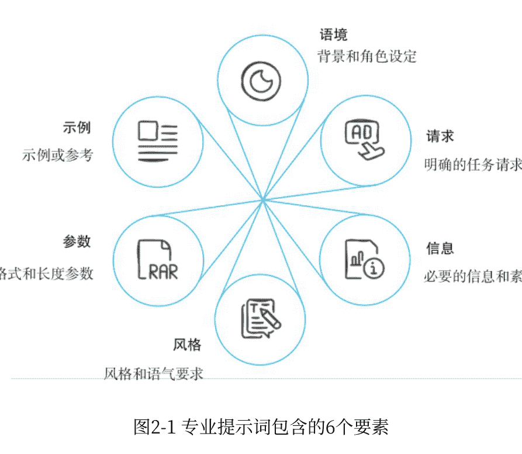
- C (context)：语境——背景和角色设定。
- R (request)：请求——明确的任务请求。
- I (information)：信息——必要的信息和素材。
- S (style)：风格——风格和语气要求。
- P (parameters)：参数——格式和长度参数。
- E (examples)：示例——示例或参考。

王睿解释：“多数人效果不佳，因指令过于简单，如‘给我写篇美妆文章’。这相当于跟员工说‘做一份好PPT’，缺乏足够指引。”

### 2.指令结构与模板：快速提升输出质量

为帮助快速入门，王睿推荐五段式指令模板。

- (1) 角色设定：定义智能体应扮演的专业角色。
- (2) 任务描述：明确创作任务与目标。
- (3) 内容要求：说明格式、结构与重点。
- (4) 风格指导：指定写作风格、语气与表达。
- (5) 其他约束：特殊要求或限制。

基础模板示例：

请以[专业角色]的身份,为我创作一篇关于[主题]的[内容类型]。

内容需要包括:
- [要点一]。
- [要点二]。
风格要求:[描述期望的语言风格、情感基调和表达方式]。
其他要求:[字数限制/特殊格式/适用人群等]。

### 3.专业创作者的高级指令技巧

（1）角色链指令法。通过多层专业角色引导智能体从不同视角思考。

请你首先作为[角色1]来提供[主题]的初步内容,然后切换为[角色2]对内容进行优化,最后以[角色3]的视角进行最终审核和改进。

（2）递进式创作法。分阶段完善而非一次性生成。

（3）反向指令法。明确告知智能体不应做什么。

### 4.进阶：多轮对话与内容精雕技术

王睿介绍了多轮对话提升质量的方法。图2-2展示核心原则。

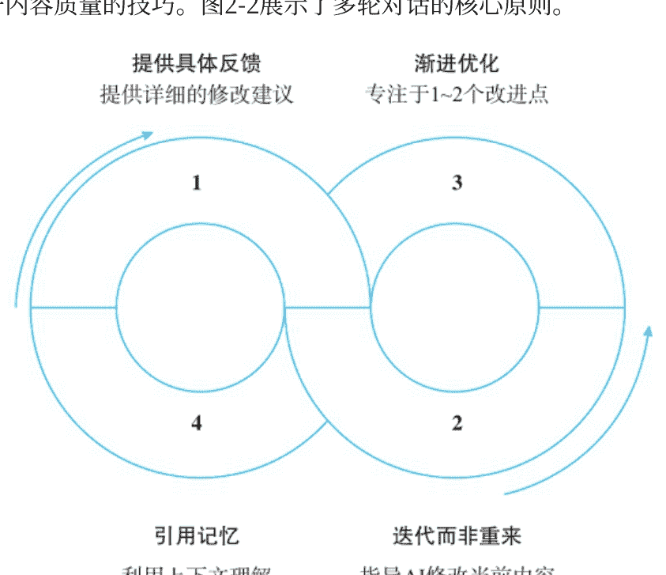
#### 图2-2 多轮对话的核心原则
1. 提供具体反馈：给出具体的修改建议而非笼统的“不满意”。
2. 迭代而非重来：不满意时不要重新开始，而是指导智能体修改当前内容。
3. 渐进优化：每轮对话都聚焦于1～2个改进点，而非全面修改。
4. 引用记忆：很多大模型已允许引用之前的对话内容，充分利用上下文理解。
在多轮对话中，对内容可以进行精雕，具体流程如表2-1所示。

在 AI 写作用力与人类判断并行的今天，内容质量的差距不再取决于谁写得更快，而是谁会“让 AI 干得更对”。下面这套方法，是王睿带张文杰实战打磨出来的完整闭环，从一稿到爆款，从单篇到批量。

一、六轮精雕：把初稿变成读者追更的成品

张文杰的真实迭代轨迹，几乎就是一份内容打磨清单。

先起稿，拿到关于主题的基础版本。随后进入结构优化，他直指引言过长、占了三分之一，主体显得单薄，经调整后引言压缩到全文15%左右，第二、三部分的信息密度被拉高，各段衔接更顺滑，尤其是第三、四部分的融合更自然。

专业深化的回合加入硬核背书。在第二部分补充来自2025年第三季度权威机构的两到三个数据点，用新证据托住论点；第四部分补充一段简短的品牌落地案例，展示策略如何被实际使用。新增材料保持整体语调统一，并标注来源。

语言润色的回合做减法和加法。把被动转为主动，提升语势；压缩“此外”“同时”等重复衔接词；为抽象概念配上具象比喻；重塑标题与小标题的信息量；植入两到三个易共鸣的情绪锚点。

互动设计的回合把文章变对话。开头埋一个思考题，第二部分末尾放一个微调查，第三部分抛“你是否也有类似经历”的共情提问，结尾给明确行动号召，同时在关键处用划重点、小提示的形式把信息凸显。

收尾是最终校对，排查事实偏差、逻辑断裂和表达模糊。

【核心启示】王睿反复强调，AI写作的本质是人机协作，而不是完全替代。把AI当作第一轮草稿搭档，而不是最终内容制造机。创作者的真正壁垒，是能指导AI产出符合人类需求的内容。好作品永远是AI初稿+人类智慧的合成。

二、新手起步与爆款解构

零基础的简化路径。入门三步：先锁定单一工具，比如先把DeepSeek用熟再扩散；从200字短文起步，逐步拉长到千字；学习爆款结构，把主题和案例换掉再写。

常见卡点及解法。选题枯竭时让AI先出10个方向再选感；专业感不足时让AI提供知识点，自己做语言重组；质量焦虑时用“请评价并修改这篇文章”自检；不敢发时先在匿名平台试水，积累信心后再实名。

起步账号池。微信公众号需要身份认证；小红书手机号即可注册，对新人友好；今日头条需实名，有创作者激励；知乎利于建立专业度，需完善个人介绍；视频号属于微信生态，变现通路多；抖音、快手流量大，是短视频主阵地。

爆款复制的核心是反向工程。拆解标题、开头、主体、结尾的结构；识别常用表达、叙事套路和情绪触发点；把分析提炼成可复用的框架；最后在同一框架里注入自己的专业和经历。

张文杰曾拆解《零基础小白如何靠AI月收入5000元的真实经历》这篇10万+文章，重点提取标题结构与吸引点、开头的故事设定与悬念、主体的论证方式、情感共鸣点、行动召唤机制，以及当下环境下的差异化切口，并据此生成可替换主题的模板。

三、10倍产出法的思维切换

传统创作是单篇打磨，批量创作是矩阵生产。创作单位从单篇变为系列矩阵，效率提升约5到8倍；时间分配从平均摊到前置规划，效率提升3到5倍；创意方式从逐篇构思变为系统化拓展，提升6到10倍；资源利用上从零开始到模板复用，提升5到8倍；工具上从辅助到全流程优化，提升8到15倍。

王睿解释，传统创作者80%时间写、20%规划，高效AI创作者正好反过来。目前大模型能理解复杂指令，1小时内产出10篇高质量文章成为可能。

批量生产的四步系统。

主题矩阵规划。以张文杰的美妆矩阵为例，核心主题是初学者AI美妆指南，衍生出AI护肤分析、智能底妆技巧、数字化眼妆设计、个性化唇妆推荐、智能美妆工具等子主题，每个子主题再拆3到5个具体点，如智能底妆下的肤色AI分析、AR试妆效果展示、遮瑕产品测评、性价比分析等。随后匹配受众：Z世代美妆爱好者、25到35岁的科技体验者、追求精准的职场女性。最后做平台适配，小红书偏视觉和过程对比，公众号做深度与原理，视频号突出操作演示。

批量提示词模板。统一格式保证一致性。例如以专业AI美妆顾问身份，按开场、基础解析、3到5个实用步骤、常见错误、产品推荐、总结建议的顺序写作，要求科技感与时尚感兼具，术语通俗化，800到1200字，前沿实用。

批量执行。先列清单，再用2到3小时的时间块集中处理，同时开多个AI会话窗口并行，流水线生成。张文杰的节奏是准备阶段20分钟做矩阵与模板，执行阶段30分钟并行出10篇初稿，优化阶段10分钟快速审阅个性化调整，总计1小时产出10篇成品。

系统化存储。与其散落文档，不如建立资产库。用Notion或飞书分类管理，为每篇打上主题、平台、受众标签，保留版本记录，设定更新计划，用AI提醒定期迭代。张文杰反馈，系统化后创作效率提升约15倍，过去2小时一篇，现在1小时10篇，关键在于思维从零散转向系统。

四、内容框架库与实操流

框架库是把“想写什么”和“怎么写”拆开的工具。好处是减少决策疲劳、保证完整性、稳定质量、加速输出、优化AI结果。

六大高转化框架包括问题解决、列表、对比、案例分析、教程、测评。每种都有固定骨架，例如问题解决型从提出问题、问题深化、方案概述、详细步骤、效果展示、常见问题到行动号召；测评型则涵盖市场定位、测评标准、外观、功能、体验、价格、优劣、适用人群、综合评分。

建立个人库的路径：收集优质内容提炼结构、分类整理、按反馈迭代、模板化为提示词、持续测试完善。

实战示例：1小时产出10篇夏季护肤文。15分钟定主题矩阵，核心为2025夏季智能护肤指南，子主题包括夏季肌肤科技检测、智能调温护肤设备、防晒新科技、AI个性化护肤配方、环保可持续护肤。10分钟选测评框架并准备提示词，要求包含市场背景、核心科技、产品测评、使用建议、价格分析、未来展望。25分钟并行生成，3个窗口同时跑，边出边排队。10分钟统一优化标题、补互动引导、加个性化细节、用AI核验事实与时效。最终得到约9000字、结构统一的系列稿。

五、多平台改编策略

同一内核，不同包装。知乎需要更强专业深度与数据支撑，提示词方向是增加论证与研究引用；小红书要轻量化、九宫格化、情绪共鸣与emoji配合；公众号适合深度扩展，增加案例与层次；视频号脚本要视觉化、分镜头、强开场强收尾。会改编的创作者，用一份内容撬动多平台流量。

AI会写稿，但不会替你做选择。把AI当作放大的生产力，用系统规划、框架复用、平台适配的人类判断来驾驭它，才是内容在AI时代的真正增长点。

一次创作，多平台投放，外加从技能到变现的完整路径，是张文杰在 2025 年把一篇《2025 年智能防晒科技》测评文章做成全网分发样板的核心思路。

先看分发打法。同一篇约 1000 字的标准测评，拆成四个平台的指令集就能快速复用。
知乎版要求把文章升级为专业答主口吻：补充分子纳米、智能感应等技术原理，引用 2025 年第三季度两到三项科研或市场数据，做技术路线对比，加入主观专业判断与前瞻观点，梳理行业演进脉络，保持严谨同时能让外行读懂，并点出争议话题引发讨论。
小红书版要求做笔记化包装：拟一个带 emoji 的抓眼标题，用九宫格呈现，首图要高质量并突出“2025 最新科技”概念；把干货浓缩成五点亮点，每点百字以内；语气活泼，多用表情；穿插两到三次“姐妹们”引导互动；给出时尚感的图文字搭配建议，整体控制在 600 字内，强视觉。
视频号版要求做 2 分钟中视频：开头 5 秒抓人，主体拆成三个核心板块各约 40 秒，每个场景配视觉呈现建议，加入实物演示，安排传统方案与新科技的对照镜头，设置观众互动点，结尾收束有力并预告下期；脚本需标注时间轴、画面与旁白。
抖音版要求做 60 秒短视频：前 5 秒用反差制造惊讶，只保留最打动人的三项技术，每个点约 15 秒用简洁语言加视觉表达；抛一个争议性问题引发评论；安排产品展示与效果对比镜头；最后 10 秒做强总结并号召互动；整体语气轻快有能量，注明转场与特效建议。

实战反馈显示，这套改编方法让张文杰从一篇源稿在 2-3 分钟内生成五个平台版本，大模型对平台调性的理解越发精准，“写一次，到处发”的变现效率被放大。

从创作能力到商业化收入的爬坡则分两段讲。

入门变现：零经验接单四步法
第一步是服务定位。先盘点自身行业经验、专业积淀和兴趣，再调研哪些内容类型需求稳定，评估 AI 在哪类内容上效率最高，做竞品空白分析，最后锁定一到两个核心服务方向。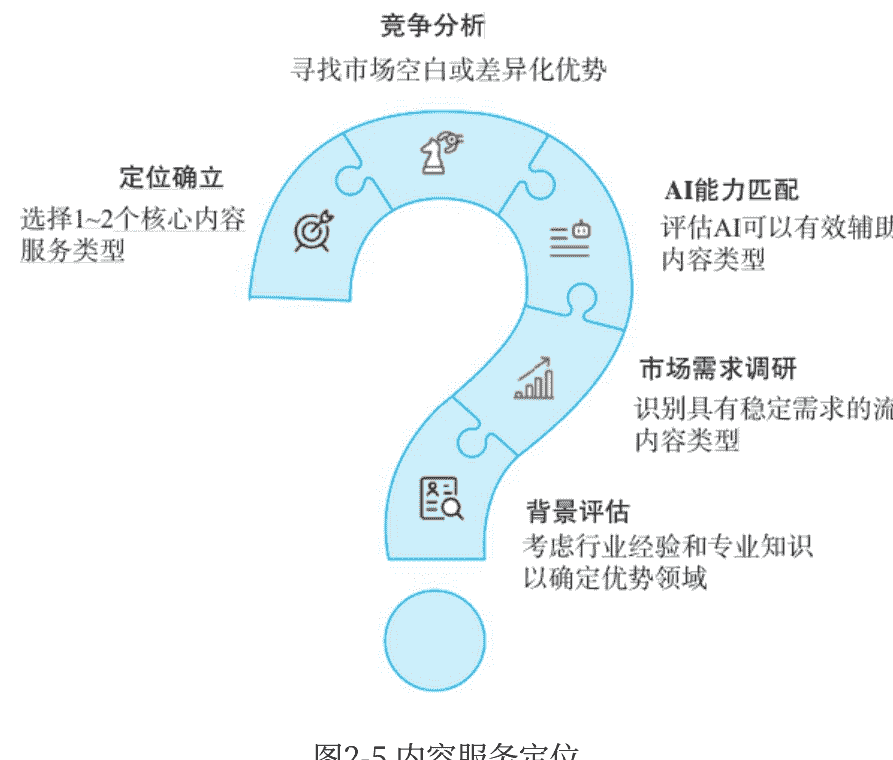

图2-5 内容服务定位
张文杰有电商编辑背景，熟悉美妆生活用品，调研发现电商平台对产品描述与软文需求持续，且 AI 擅长此类工作，最终把第一定位卡在“AI 美妆科技内容专家”，主攻电商产品文案与美妆科技测评。

第二步是作品集搭建。选三个到五个目标客户相关主题，为每个主题用 AI 生成一到两个高质量样本，再注入行业知识与个人见解，整理成专业样稿并附上服务说明与价格。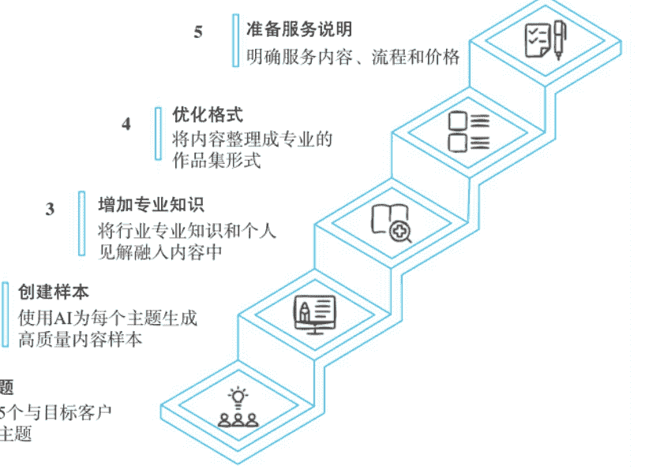

图2-6 创建内容作品集
他用 DeepSeek 做了八个样本：护肤品详情页文案两篇、美妆科技测评两篇、美妆趋势分析两篇、AI 美妆工具教程两篇，逐一优化以体现专业度。客户对 AI 辅助的接受度已大幅提升，但对原创洞察与专业深度的要求更高。

第三步是找第一批客户。渠道包括老同事朋友转介绍、在知乎小红书发内容吸客、在猪八戒网、Fiverr 等自由平台建服务、加入行业社群输出价值、直接触达中小企业。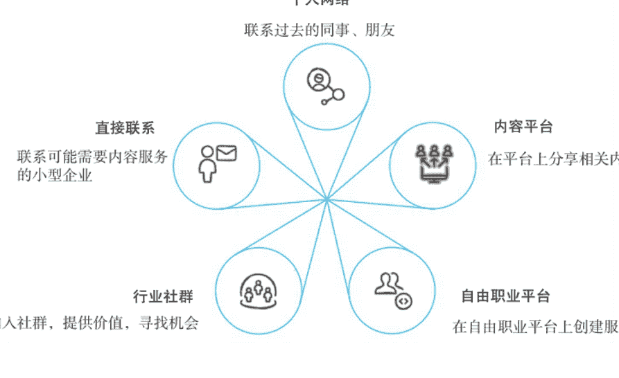

图2-7 多渠道寻找第一批客户
第一个客户来自“美妆 AI 创新”微信群里的一篇测评，第二个是因小红书《AI 美妆工具对比》笔记主动找上门的品牌方。获客模式正从主动出击转向价值吸引，好内容本身就是名片。

第四步是首单交付与口碑裂变。做到超额交付、及时沟通、提供效果数据、主动要反馈、请客户推荐，并据此迭代服务流程。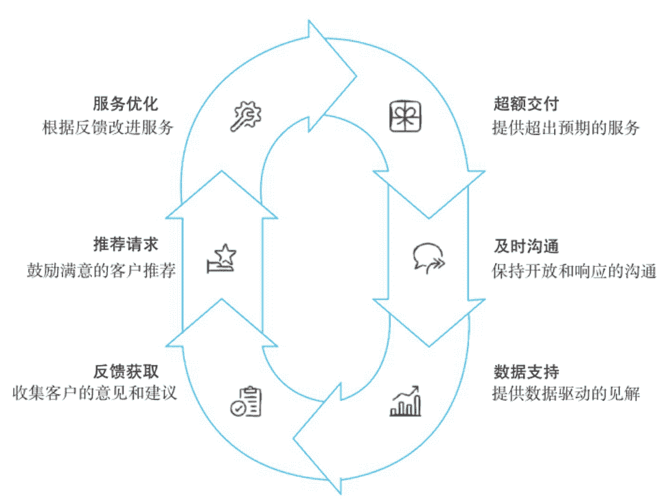

图2-8 完成首单并请求推荐
首单为新锐美妆科技品牌写六篇产品介绍，报价 1200 元，AI 起草后加入专业知识与受众洞察改写，客户满意追加两篇社媒文案 600 元，并在行业群分享，导致两周内再来两个订单。关键在把 AI 能力与个人专业洞见结合，解决具体客户的具体问题。

进阶变现：个人 AI 内容品牌的四步升级
第一个月做专业定位与差异化。找到最佳专长，明确解决什么内容问题，打造独特方法或风格，固化交付流程，设计 Logo、色系与视觉。

图2-8 完成首单并请求推荐
张文杰发现自己擅长把复杂美妆科技概念翻译成大众易懂的购买语言，自称“美妆科技翻译官”，帮新品牌把创新技术转化为消费者能感知的内容，正好切中行业痛点。

第二到三个月建内容矩阵与个人 IP。选一到两个核心平台持续输出，规划系列主题，形成个人表达与标签，积累粉丝，统一品牌声音。
他主攻小红书与视频号，推出“科技美妆解码”“未来美肤报告”“智能美妆实验室”“一分钟美容黑科技”四个系列，每周小红书三更、视频号两更，AI 生成底稿后加上专业解读与实测。两个月后小红书 1.5 万粉、视频号 8000 粉，开始接到品牌合作，跨平台矩阵比单平台更容易破圈。

第四到六个月做服务升级与产品化。提升单价，把服务包装成标准化产品，开发电子书、指南等内容产品，用免费到低价到高价的漏斗转化，建立客户管理与数据分析体系。
他把服务分为“科技美妆内容策略”“美妆创新解读内容包”“AI 美妆内容培训”，并推出 99 元的《2025 美妆科技趋势解码手册》，首月卖出 187 册，形成被动收入。产品化思维是突破天花板的钥匙。

六个月后做规模化与系统化。组建小团队，丰富产品线，流程自动化，实现服务费、内容产品、平台分成都多渠道变现，从执行者升级为战略伙伴，建立专业社群。
他计划配一名内容助理、一名剪辑、一名客户沟通，月接 20-25 个项目，开发《美妆科技创新内容营销课程》售价 799 元，目标月收 5-8 万，结构为服务 40%、内容产品 30%、平台合作 20%、社群会员 10%。

差异化与个人风格打造同样关键。张文杰用 40-40-20 法则：40% AI 基础生成、40% 个人专业知识、20% 个性化表达。
差异化策略包括融入真实个人体验增强可信度、加入独家实测数据提升专业度、做本地化改写适配中国 25-35 岁都市女性与电商生态、聚焦敏感肌痘痘肌等垂直人群、捕捉 2025 年 Q4 新兴技术趋势。
风格塑造上，他让 AI 融合热情与理性的混合语调，注入科技惊喜与审美重塑的情感层，改写成闺蜜式口语，建立个人风格指南，从开场收尾到比喻体系与术语平衡都标准化，并统一配图科技感与温度、色彩与排版。
深度优化则采用五步法：加入权威机构 2025 年二季度数据并解读、引入专家观点并给出个人判断、补充成功与失败案例分析、按技术背景-痛点-方案-方法-验证-展望重构逻辑、提供技术、体验、商业模式、伦理、监管五维的三年展望。

案例佐证也很有说服力。李明，35 岁前银行分析师，聚焦加密货币与量化投资，用 AI 处理金融数据并转译大众内容，一年内从月入 2000-3000 元成长到 5-10 万，最后成立公司月入 5-10 万，收入来自付费社群、课程、咨询与平台分成。核心是专业知识与 AI 分析结合。
张燕，32 岁前高中文案教师，做 AI 个性化学习计划与批改工具，产品梯度从 199 元入门计划到 999 元提分系统再到 3999 元家庭教育顾问服务，月收入从 2000 元到 3 万以上。关键是解决学生与家长的真实痛点，形成完整产品阶梯。

整体来看，AI 只是放大器，能否变现取决于定位清晰度、平台感、个人洞察与系统化运营。张文杰的路径证明，把一次创作拆成多平台语言，再把技能层层产品化，就能实现低压力扩张与多元收入。

> 【共同启示】王睿在对照两组案例后归纳，赛道虽然不同，底层逻辑高度一致。关键在于把智能工具和细分垂直知识做深度融合；把免费公开物、轻量付费物及高端服务串成完整分阶；让收入来源多元化，不把身家压在单一平台或单一客户上；保持持续跟进技术进展并做出差异化应用。如今的知产经营已不再是单纯的智能写文，而是围绕智能搭建的知识服务生态。

## 四、创作者成长与IP塑造路径

### 1. 分阶段成长路线

张文杰的起步被拆解为清晰的分段图谱。

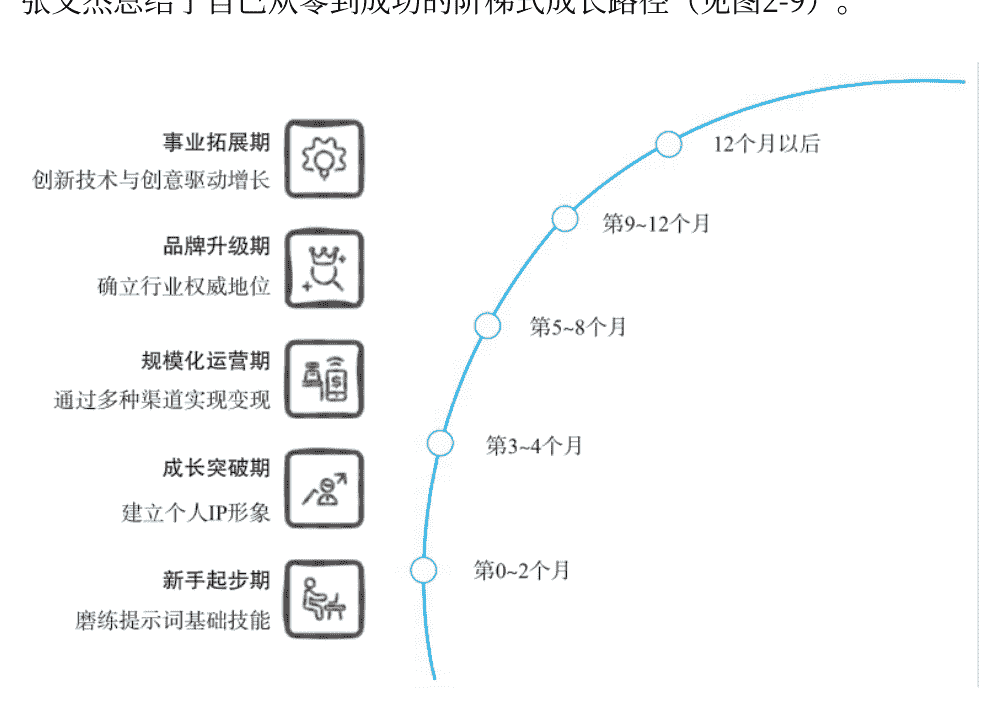

图2-9 分阶段成长路径示意图

**第一阶段：新手起步期，第0-2个月，打牢基本功**

核心在熟悉工具、建立产出底座。
行动清单：熟练掌握国产主流生成式模型及海外通用模型的高级指令技巧；摸清2-3个核心渠道的规则与推流逻辑；保持稳定产出节奏，每周不少于4篇；拆解同领域爆款，总结传播规律；用数据追踪每篇表现并归纳复盘；搭建基础模板库与标准化流程。
排期：第1周每天练习2条指令；第2周尝试4种不同稿件形态；首月在笔记社区与公众号各发10篇；次月保持每周8篇节奏，初步形成自有调性。

**第二阶段：成长突破期，第3-4个月，塑形形象**
核心是形成辨识度并扩大影响半径。
积累后张文杰启动IP打造：定位锁定为“美容科技翻译者”；统一头像、封面与排版的视觉识别；搭建笔记社区+视频号+公众号的多渠道矩阵；设计“免费稿件→低价产品→高端服务”的转化闭环；运营“AI美容创新社”微信群收集反馈；建立稿件表现追踪体系优化方向。
关键拐点：第3个月《2025美容黑科技完全解析》系列走红，当月新增粉丝1.5万；第4个月推出付费电子教程《美容科技革命：智能如何重塑你的美丽》，定价99元，首周售出208份。

**第三阶段：规模化运营期，第5-8个月，多元获利**
核心为系统化盈利与可持续模式。
招募2名兼职助手扩充产能；搭建三层产品体系覆盖不同价位；推出线上课“智能美容科技创新营”，定价699元；提供品牌方智能美容文案策略咨询，2000元/次；承接美容科技品牌合作分成；扩大付费社群规模并叠加增值服务。
成果：第6个月自有IP“美容科技翻译者”粉丝累计破10万；第8个月月收入构成：稿件服务1.2万+课程销售0.8万+品牌合作1.5万+社群0.5万，合计4万元。

**第四阶段：品牌升级期，第9-12个月，铸造权威**
核心是从个人IP升维为行业影响力品牌。
参与并主办行业峰会提升声量；接受行业媒体专访输出洞察；与品牌从执行方转为战略合作伙伴；降低产量提升单篇质量与影响力；优化商业模式提单价降工时；打造“稿件+工具+社群+服务”的完整生态。
关键成果：第10个月受邀在“2025全球美容科技峰会”演讲；第12个月发布《2026美容科技趋势报告》被行业广泛引用；年末月收入突破6万元，工作时长同比减少30%，实现高效增长。

**第五阶段：事业拓展期，12个月后，构建创意+技术双引擎**
此阶段张文杰和王睿深度绑定，形成双引擎模型。张文杰负责创意引擎，承担创意、行业洞察与用户情感连接；王睿负责技术引擎，提供技术优化、自动化工具与数据分析支持。
协同模式：王睿开发的智能推荐系统实现张文杰稿件的个性化分发；张文杰的制作能力为王睿的技术方案提供通俗化呈现；双方共研“智能美容顾问”在线平台服务品牌客户；完成“稿件+工具+服务”产品矩阵闭环。
实际产出：联合创立“美容AI实验室”；上线“美容智能助手”小程序，月活超5万；为3家国际美容品牌提供解决方案，年合同总额超百万元；合著出版《智能美容行业变革：2026年趋势与实践》。

【从副业到职业的转型决策】
当副业收入连续6个月超过主业且持续上涨，张文杰面临转身考量。
考量维度：收入稳定性、每日4小时以上的时间投入对主业与生活平衡的挤压、智能写作市场指数级增长与品牌需求激增、渠道算法波动、技术迭代与竞争加剧的风险、制作从个人到团队专业化演进的趋势。
决策方案：采用渐进式转型。先申请弹性工作制，每周居家办公2天，集中投入制作，同时设立“72小时应急资金池”覆盖3个月生活成本。待副业月收入稳定达到主业1.5倍后，申请停薪留职6个月，全力发展自有IP。该过渡策略规避了断崖辞职风险。

### 2. 作者能力矩阵

在智能产出生态下，胜出的作者需补齐多维能力。
**智能驱动制作力**：指令工程与模型选型、多模态作品整合、个性化与调性优化、智能伦理与原创把控、模型微调与个人知识库建设。
**跨渠道运营力**：全域分发与渠道特性适配、算法理解与稿件匹配、数据驱动决策、社群建设与互动引导、私域流量与订阅经济运营。
**商业转化力**：稿件到产品的转化设计、分层盈利模型、品牌合作与商业谈判、用户旅程与转化漏斗优化、定价心理学应用。
**技术整合力**：智能工具链搭建与流程自动化、稿件分发API与自动发布、个性化推荐系统应用、数据分析与可视化、基础编程与工具定制。
张文杰按此矩阵定期自评补短板。尤其在技术整合力上，通过和王睿合作搭建半自动化生产流水线，产出效率提升300%。

## 五、写作变现的多元路径

### 1. 稿件服务：高客单价专业输出
服务矩阵与定价：
标准服务包：基础版每月8篇行业文章1500元/月；标准版每月12篇+2个短视频脚本2800元/月；高级版全渠道内容规划与执行4500元/月。
专项项目：产品发布文案包3000-5000元/套；活动营销整合6000-12000元/项；品牌故事重塑8000-40000元/项。
智能内容咨询：内容战略规划4000-8000元/次；智能内容团队培训8000-15000元/期；内容体系搭建20000-40000元/项。
客户获取以内容驱动引流为主。案例展示可将与某美容品牌的合作包装为专业案例，包含项目背景与挑战、解决方案亮点、关键决策节点、量化成果如转化率提升32%、涨粉15万、以及品牌市场总监张女士的正面推荐语。
行业活动：25分钟演讲《2025年智能驱动的美容内容创新》提纲可围绕开场高价值洞察、3-5个核心观点及论据、2个生动案例分析、互动环节、结尾价值交付与联系方式展开。
定位与服务质量提升后，单价从200元/千字提升至400-1000元/千字，月均服务收入稳定在2-3万元。

### 2. 知识产品：可复制的被动收入
产品体系分三层：
入门级：电子教程《智能美容内容创作指南》68元；模板库“美容内容创作50个高转化指令”99元；迷你课“7天智能写作入门指南”129元。
中端：系统课程“智能美容内容创作与变现实战营”899元；会员订阅“创作者月刊+工具更新”99元/月；社群服务“智能美容创新研习社”399元/季。
高端：VIP训练营“智能美容KOL孵化计划”3980元；内容创业咨询“个人IP打造与商业化”1980元/次；私人顾问“90天由零到变现导师计划”8800元。
开发流程包含市场验证、产品设计、销售系统与迭代优化。可设计市场验证计划测试课程需求，设计8-10模块、24-30课时的完整课程架构，搭建预热、销售页、直播公开课、社群转化、限时稀缺的销售系统，并以完课率、满意度、应用结果为核心的迭代框架持续优化。
成功案例显示，“智能写作21天变现特训营”第三期招收315名学员，总收入282735元，利润率85%，学员案例反哺高端定制服务成交。

### 3. 跨渠道内容矩阵：全域流量变现
渠道策略：专业渠道如知乎、B站、公众号建立权威与深度影响；流量渠道如笔记社区、抖音、视频号扩大覆盖并导流；海外拓展Medium、Instagram、YouTube触达国际品牌。
新手常见障碍与对策：工具选择迷茫→先主攻主流模型+2个专用工具；指令效果差→学习CRISPE框架与模板库；方向不明→聚焦垂直细分深耕3个月再评估；同质化严重→采用40-40-20法则，40%智能生成+40%个人专业知识+20%个性表达；盈利困难→先以免费稿件立定位，再尝试200-500元小服务起步。
入门三步法：单一工具精通、从200字短稿起步、模仿爆款结构替换主题。

## 六、智能写作未来发展与思考

### 1. 作者成功的七大支柱
行业深耕、系统思维、艺术平衡、持续学习心态、价值导向、多元收入、协作能力。七大支柱支撑其月入8万元的转型并建立可持续事业。

### 2. 内容创作未来图景七大趋势
超个性化、内容即服务、沉浸式体验、去中心化生态、协作创作新范式、全球化跨文化内容、情感智能创作。王睿指出2025年仅是早期，人机关系将从工具演变为伙伴再到协作者，先行者将获得显著优势。

### 3. 新手启航十条建议
立足专长、从小做起、工具为辅、品牌先行、全面学习、实践为王、寻找搭档、价值第一、长期思维、开放心态。

## 实战练习
7天智能写作加速计划首日为工具与指令掌握：注册常用模型账号，用30分钟熟悉界面并开启练习。

第一阶段：指令词手感打磨

- 选取十条风格差异明显的指令词进行实操演练，并把产出结果记录下来做对比。
- 搭建个人的指令词资料库，按使用场景和功能分类归档，便于后续调用。
- 实操检验：挑选最有把握的一条指令词，用它产出一篇约二百字的试写短文。

第二阶段：公众号写作训练

- 挑选三到五个自己常关注的公众号，拆解其调性、选题逻辑和结构方式。
- 请DeepSeek输出一份贴合该号调性的文章骨架。
- 套用五段式指令词撰写约八百字的成稿。
- 实战投递：将成稿投递给一家开放投稿的公众号。

第三阶段：小红书表达突破

- 在擅长的领域内搜集十条爆款笔记，提炼钩子、排版和转化思路的共性。
- 用DeepSeek制作一份九宫格选题规划表。
- 研究图文融合的呈现手法，强化视觉质感与信息分层。

第3章 短片变现：借助人工智能，三日打造爆款

开篇：从镜头恐惧到首单到账

“又有一笔带货成交提醒！”主角看着手机弹出的订单提示，笑容藏不住。刚发布的抖音短片为本地水果带来三十单，佣金到手三百元。距离他开始尝试智能辅助制作短片只过去一个月左右，这类收入已经常态化。

回想起起步时的局促，主角有些莞尔。本职是新媒体编辑，却因内向从未考虑过面对镜头。在导师的鼓励下，他尝试了人工智能辅助流程：用DeepSeek撰写分镜，用剪映的智能剪切功能，完全不露脸就完成了一条十五秒的武汉热干面介绍。

“第一条就破三千播放，”主角兴奋地分享，“比写图文起步快得多，感觉摸到新的增长点。”

导师笑着回应：“现在是视觉主导的时代，短片的冲击力远超文字。国内的智能工具发展很快，DeepSeek、豆包、剪映让创作像发朋友圈一样简单。我做销售和数据分析的经验告诉你，短片的转化率通常是文字的五到八倍。”

“可我对拍摄剪切一窍不通，也不愿意露面，这会是硬伤吗？”主角仍有顾虑。

“正好是国产产品的优势。”导师打开自己的抖音账号，“我的作品全是DeepSeek编剧、豆包出画面、剪映拼接完成的，一个人宅家就能搞定，月入过万完全可期。这也是我从销售线转向技术线的关键一步。”

主角惊讶地看着数据：粉丝超三十万，月收入预估超五万元。所有内容都靠国产智能工具完成，不需要专业设备和团队。

“教我吧。”主角眼里满是期待，“我负责创意，你帮我把技术兜住，合作会更强。”

一、从焦虑到可控：人工智能辅助短片全流程

过去拍短片要设备、要技巧、要后制经验，人工智能把门槛拉平了，普通人也能做出接近专业的成品。

1. 技术门槛的革命性下降

“现在的智能创作更像拼积木，”导师说，“不用从零搭建，调配现成模块就能成片。国产模型特别懂国内平台和用户，产出的内容更地道。”

人工智能不仅降门槛，还大幅压缩了成本投入。

设备投入：传统拍摄需专业相机、麦克风、灯光约一万元以上，智能辅助只需常用智能手机，节省九成以上。
软件支出：专业剪切软件年费一千多元，剪映免费或SVIP零到五百九十九元，节省八成以上。
人力支出：摄影、剪切、配音数千元，自主完成零元，节省百分百。
时间支出：传统三到五天一支，智能辅助三十分到九十分钟一支，节省九成五。
场地道具：传统场地道具数百至数千元，素材网站免费或低价资源，节省九成以上。

主角算了一笔账：“过去一支像样的短片要花几千块，现在一部手机加一杯咖啡的时间就够了，这彻底改写了创作的经济逻辑。”

“没错，”导师点点头，“我第一个月拍短片总成本不到二百元，收入却有八千多元，这就是人工智能红利。建议优先用国产工具，它们针对国内审核和平台做了优化，比海外工具更顺手。”

2. 短片变现的流量优势

相比图文，短片在平台分发上占优。

抖音：纯短片平台，全面倾斜，用户停留久，广告变现效率高，入门难度低，十五秒即可。
小红书：短片与图文比例约八比二，互动强，商品展示更立体，入门难度中等，需一定审美。
视频号：独立短片流量池，竞争小，微信生态导流，私域转化高，入门难度低，对内容要求宽松。
B站：以长片为主，专业度要求高，垂直影响力强，粉丝粘性高，入门难度高。

“我建议先从抖音和视频号起步，”导师给出了路径，“这两个平台对新人友好，上手快，变现路径清晰。结合你的叙事优势，可以先做内容展示类短片。”

3. 核心工具矩阵

高效创作需要两类工具：创意产出与制作剪切。

脚本创作：DeepSeek 产出完整分镜文案，免费或付费版，学习难度低；ChatGPT 提供创意与结构，免费或Plus，难度低。
视频剪切：剪映 移动端全功能剪切，免费或SVIP，难度中等；Runway 人工智能短片生成与编辑，付费，难度中高。
画面生成：即梦AI 人工智能图像生成，免费或付费积分，难度低；Midjourney 高质量人工智能绘画，付费，难度中等。
字幕制作：字说 自动生成字幕，免费或付费，难度低。

主角主攻DeepSeek加剪映组合，深耕创意；导师则擅长Runway和Midjourney，两人形成互补。

4. 零基础入门准备

设备建议：
智能手机：中端以上安卓或iPhone，存储建议不低于六十四GB。
手机支架：入门三脚架三十到八十元。
外置麦克风：可选，领夹式一百到二百元，提升音质。
照明：可选，台灯或补光灯五十到一百元，自然光亦可。

轻量工具安装：
剪映手机版，空间小功能全。
DeepSeek App或网页版，用于分镜和灵感。

新手常见困扰与对策：
内存不足：定期清理缓存，素材用云盘备份。
剪切复杂：从一键剪切起步，逐步进阶。
素材匮乏：用文生视频工具或素材网站补充。
无从下手：找一条结构清晰的同类短片，换内容模仿。

资源渠道：
视频素材：Pixabay、Pexels免费，包图网付费性价比高。
音乐素材：剪映自带音乐库、魔音工坊、淘声网。
字体资源：剪映内置字体、字由网、汉仪字库。
教程资源：剪映创作课堂、B站新手剪切专区。

二、初学者可用的三步剪切法

在导师指导下，主角总结出了自己的高效流程。

1. DeepSeek分镜助手：创意起点

好的短片先有好分镜。DeepSeek在分镜撰写上表现强劲。

短片分镜模板：
请以专业短片编剧身份，为我创作一个十五到六十秒的抖音分镜。
主题：【如武汉特色小吃】。
目标人群：【如十八到三十五岁美食爱好者】。
风格：【如轻松幽默/知识科普/情感共鸣】。
需包含：
开场三秒悬念，直击痛点。
主体三到五个画面，节奏切换。
结尾转化，引导点赞评论关注。
字幕文案，简洁有力，可带方言。
画面描述。
BGM建议，优先抖音热歌。
互动引导设计。

产品展示模板：
请为“【产品名称】”创作推广短片分镜。
要求：
开头三秒点出用户痛点。
三到四个核心卖点介绍。
二到三个使用场景展示。
用户评价或效果呈现。
价格优势与购买方式。
紧迫感设置，限时限量。
包含画面、文案与行动号召。

实战案例：主角先让DeepSeek产出“武汉热干面制作教程”分镜，再结合剪映快速成片。

2. 三步剪切法：从素材到成片

第一步，素材准备与导入
素材来源：手机拍摄手部操作、素材网站下载片段、即梦AI生成图像、屏幕录制App操作。
整理技巧：按主题建文件夹，时间命名，预先筛选，云盘同步，准备量比需求多三成。
导入剪映：新建项目设九比十六比例，批量导入，按分镜顺序初排。

第二步，智能剪切与优化
预剪切：选美食/旅行/产品等风格模板，AI自动生成初版含转场与音乐。
关键优化：拖拽调整顺序，控制时长开场三到五秒主体五到七秒结尾五到八秒，添加淡入淡出或滑动转场，重点放慢过程加速。
文字与配音：选用醒目字体控制行数，加轻动画，文字转AI配音选音色，背景音乐音量调至配音四成，关键点加音效。

第三步，特效优化与导出
画面增强：统一滤镜，美食推暖色，亮度对比度提升十五到二十%，裁剪确保主体居中，转场自然。
互动元素：表情包贴纸增加趣味，加入点赞关注引导，加水印强化品牌，地域标签提升相关性。
导出发布：选1080P高清，预览无误后导出，加话题标签，选择目标人群活跃时段发布。

实战复盘：主角做热干面短片共花六十分钟，手机拍三段手部操作，下素材网站两段片段，配五张食材成品图，选美食模板自动生成骨架，按分镜微调，加入AI配音、醒目标题和热门BGM，结尾设置评论引导。播放超八千次，点赞六百二十。

3. 剪切常见问题与解决

素材不够：用可灵AI生成视频或找免费素材站。
配音不自然：用讯飞方言配音，调整语速与情绪。
画面质量差：用剪映AI增强，叠加轻微电影质感滤镜。
创意单一：让DeepSeek批量产出多种风格分镜，尝试跨界混搭。
文案不够抓人：用AI强化冲击力，植入流行话题。
互动引导弱：用问题式结尾，设置可讨论的争议点。

三、不露脸也能火的七种人工智能短片模式

主角归纳出适合不出镜的七种形式。

模式一：屏幕录制加解说
特点：录屏展示操作流程。领域：软件教程、数码测评、游戏攻略。工具：自带录屏加剪映AI配音。案例：主角的AI工具使用教程。流程：准备App/网页，录屏操作，剪映精简，配解说字幕，关键点放大高亮。

模式二：画面加AI配音
特点：实拍或素材画面配专业解说。领域：美食制作、产品测评、教程讲解。工具：DeepSeek分镜加剪映加素材。案例：武汉小吃教程只拍手部和食材特写。流程：AI写分镜，拍手部操作，剪映排版转场，AI配音，配音乐与文字。

模式三：文字动画短片
特点：动态文字为主。领域：金句、数据、科普短句。工具：豆包写文案加剪映文字动效。案例：导师职场金句系列单条超十万赞。流程：AI生成情绪短句，配情绪背景，设计文字动画与转场，配情绪BGM，结尾设争议点引评论。

模式四：数据可视化短片
特点：把数据做成动态图表。领域：行业分析、趋势报告。工具：智谱AI/DeepSeek撰文加PPT/Keynote做图表动画加录屏加剪映。案例：行业趋势分析系列。流程：AI产出解读分镜与结论，PPT设置擦除飞入动画，录屏演示，剪映精简，配AI配音。

模式五：人工智能虚拟图像短片
特点：AI静态图转为动态带特效内容。领域：艺术创作、概念展示。工具：即梦AI/可灵AI/Midjourney加剪映加AI配音。案例：AI艺术世界系列。流程：按提示词批量生成主题图，剪映用推拉摇移动画，配解说。

模式六：人工智能动画短片
特点：全AI图像组成动画，无需真人。领域：知识科普、故事讲述。工具：即梦AI/可灵AI加剪映。案例：导师AI工具介绍系列。流程：拆五到八个关键场景，AI绘图生成，剪映加平移缩放淡入淡出，配AI解说与字幕。

模式七：人工智能数字人短片
特点：虚拟人物出镜。领域：情感分享、知识讲解、娱乐。工具：剪映数字人加剪映配音一体。案例：导师智能助手小睿系列，粉丝超四十万。流程：创建数字人形象，腾讯元宝生成对话分镜，配音匹配角色，系统自动适配表情动作，加特效与场景。

提升质量的高级技巧

叙事结构设计：

在短视频赛道里，结构决定留存，感官决定成瘾。下面这套打法，是把一堆实战经验拆成可复用的内容模型。

**一、先定骨架，三种高共鸣的叙事框架**

**首尾闭环式**。多用在走心故事线，把情绪兜起来。前5到8秒放一个钩子或提问，让人想知道答案；中间40到50秒把来龙去脉摊开，层层递进；最后8到10秒把开头的问题收回来，点出自己的洞察和情绪余韵，记忆点就钉住了。

**三秒抢夺式**。适合信息流的刷屏场景。0到3秒必须上最抓眼的画面或最戳心的情绪；3到15秒把核心卖点一次性说清；15到30秒补案例、数据、细节来建立信任；30秒以后立刻埋互动，引导评论或转化。

**场景代入式**。种草利器。开头用10%到15%的篇幅演出现实痛点，让观众对号入座；中间30%到40%时间把产品或解法讲透；再用30%到40%的时间做前后对比，让效果可视化；结尾10%到15%放真实用户反馈做社会证明，最后5%到10%给渠道和行动指引，种草闭环完成。

**二、把画面声浪调到最舒服**

节奏要会呼吸。开头的5秒要快，每1到2秒换一次镜头，强行留人；进入干货后放慢，3到5秒一个画面，给理解和沉浸的时间；高潮处让画面与音效同步，转场要冲；结尾别收太紧，适当放空让观众有回味和点评的欲望。

色彩要讲情绪。做美食就用红黄暖调，食欲被点燃；讲科技用冷蓝打底，加一点紫提质感；讲情感就看情绪走，暖调拉近距离，冷调制造思考；做财经类用沉稳的深色加金色点缀，权威感自然出来。

声音要分层。口播放在最前面，清楚干净；背景音乐做氛围，音量别抢戏；关键节点放一两个短促的音效做记忆强化；适当保留环境音，让场景更真实，代入感更强。

实操里，张文杰负责武汉美食的文化解读和情感表达，王睿用AI做数据可视化呈现消费和人口流动，温度和深度兼备，单条平均播放就稳在5万以上。

**三、算法偏爱高互动的内容**

互动率是分发权重的核心。

视频里怎么撬动互动
情感共鸣提问，比如“第一次吃到它我整个人都愣了，你们有同款记忆吗？”，评论率能提升60%到80%。
二元对立挑事，“热干面到底是芝麻酱派还是辣椒油派？”这种选择题，互动常翻倍，质量也高。
专业背书式邀请，“我做了8年厨师，热干面灵魂在这里，内行能看出来吗？”能沉淀专业粉和高质量评论。
挑战式号召，“按这个配方复刻，拍给我看，前5名我亲自点评”，能催生大量UGC和社区感。

评论区怎么运营
发后15分钟内回前10条，首小时是权重窗口期。早期的活跃度尤其关键，可以设小奖刺激。
对深度评论给长回复，对提问类评论补价值，顺势把讨论做深。
主动抛续集话题，“还想了解哪家武汉老店？评论里说”，黏性会明显变好。

张文杰的“武汉vs成都早点对决”就是靠地域对立把评论互动拉到18%，二次传播提升3倍，成为账号增长最猛的系列。

**让AI内容不被判定为流水线**

平台现在能识别AI痕迹，差异化是必修课。
40%个人元素原则。算法要求至少四成是个人化的内容，真实经历、地域细节、专业观点、个人口头禅都要加进去，这样被判定为原创的概率能提高85%。
技术做呈现，情感做连接。数据可视化配自己的故事，生活案例搭配技术讲解，深度和共鸣一起涨。
往小众深挖。比如不做泛美食，做“武汉老门面美食考古”，成为细分头部，推荐更准，用户匹配更高。
跨界组合。把科技解析和传统工艺结合，用数据解读文化现象，新颖度提升，算法更偏爱。

张文杰的“数据科学解密武汉早点文化”把地方文化和消费大数据融合，单条平均18万播放，比普通美食高出数倍，涨粉速度翻了4倍。

**四、从流量到现金流的四条路**

1. 平台分成
核心是完播和互动。找准平台偏好的时长，前5秒抓注意力，中间做情绪曲线防掉线，结尾放强互动和预告。发布时间选活跃时段，抓住节日和热点，用话题标签拿初段曝光，主平台深耕副平台引流，错峰发避免冲突。
张文杰的“武汉老味道”系列平均完播82%，互动15%，单条5万+播放，单条分成约300元，15条月入4500元，形成稳定基本盘。

2. 带货佣金
平台自营15%到40%，适合千粉启动；达人合作30%到60%，需要1万+粉丝和专业测评；私域转化40%到100%，依赖忠实粉和自有产品；直播带货20%到50%，需要3000+粉丝基础。
三招提升转化：场景化带货，在真实使用里呈现价值，前后对比强化感知；垂直专业定位，长期深耕建立信任；轻决策引导，卖点压缩到三点，性价比+稀缺感。
张文杰在5万播放的调料视频里自然植入本地品牌，带来380单，佣金25%，月入9500元。数据显示，视频中段展示转化率是结尾硬推的3.5倍。

3. 品牌合作
软植入500到3000元，测评1000到5000元，定制内容3000到10000元，长期签约月费1万+。谈判时带数据包、受众画像、匹配分析，明确风格、修改2到3次、发布时间、版权二次使用。报价可按0.01到0.05元/粉丝起算，有播放保障或独家可溢价30%到100%。
张文杰与本地品牌签约，每月4条定制，固定1.2万加提成，月均2万，还拿到“文杰推荐”调料系列授权。

4. 内容矩阵与资产化
一次拍摄多平台分发：60秒主视频，15秒精华挑战版，3分钟深度版，图文步骤版，情感故事版，音频解说版，保持核心信息一致，风格随平台调整。
多元收入组合：平台分成400到600元、带货800到1200元、品牌1500到2500元、知识付费800到1200元、IP授权300到600元，6个月后副业月入稳定在4000到6000元。
把爆款做成系列做长尾，素材模块化复用，从公域到私域分层运营，粉丝成长为付费用户。张文杰的“武汉早点制作秘籍”多形态分发触达超100万，还做成电子食谱小程序单月卖800份。

AI时代的成功变现抓三点：用AI放大个人专业而不是替代个人，用多元链路降低单一收入依赖，保持学习迭代，跟算法和技术一起进化。

新手常问
没设备？AI文生视频、屏幕录制、AI图像加动效也能做出质感，创意先行。
没选题？用工具梳理个人经历和兴趣，日常细节里藏着差异化。
怕被算法限流？遵循40%个人元素，加入真实经历和专业见解。
表现力弱？色彩、音乐、文案一起设计情绪，AI现在能辅助调性。
怎么涨粉更快？做垂直小众专家，用互动引导评论，私域沉淀铁粉。

练手四步：先让AI帮你写15到60秒脚本，剪映不露脸做出来，发平台记48小时数据，反推三个优化点，规划下条改进方向。

记住，AI是合伙人，不是替代品。最稀缺的永远是你的独特视角和真诚表达。按下录制键，你就是生活的导演。

**第4章 视觉创意变现的副业启示**

“茶叶包装设计直接到账500元，从灵感到交付只要3天！”春节期间，张文杰用即梦AI和Canva可画给江汉路新开茶店出方案，0基础做设计也能变现。

设计行业正在被AI重塑：品牌方案从2到3周压缩到数小时，效率提升90%；软件成本从月费200到1000元降到大量免费工具，使用成本降80%；技能门槛从3到5年训练降到几小时上手，降低95%；迭代从数小时到分钟级，提升99%；创意多样性从个人经验限制到无限风格，增长200%。73%的中小企业已开始用AI辅助设计，市场接受度快速上升。

创意加技术的双引擎，才是零基础也能稳定接单、建立风格、处理版权的起点。

### 2. 七条几乎零门槛的视觉变现路线

张文杰与王睿通过实地调研，梳理出七类普通人可快速切入的 AI 视觉盈利方式【见图4-1】。

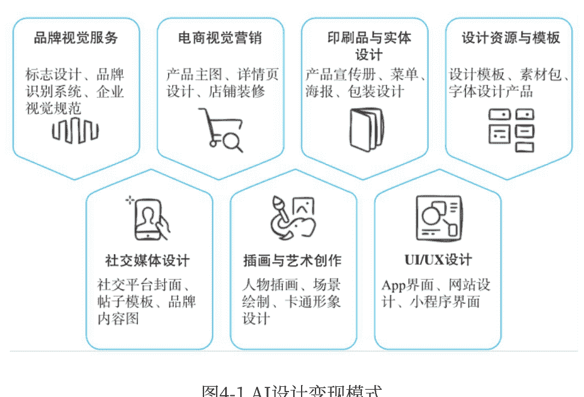

图4-1 AI设计变现模式

（1）品牌形象定制
交付物包括标识创作、企业识别体系梳理与视觉规范整理。典型买家为初创公司、街区小店与个体经营者。参考报价：标识 500～2 000 元，识别体系 2 000 元起，视觉规范约 5 000 元。常用平台：即梦 AI、可画、豆包、通义万相。价值点在需求持续、客单价偏高、易形成长期绑定。发展方向上，企业元宇宙形象与 AR/VR 展示需求在加速上升。

（2）社媒内容制作
交付物为平台封面、帖子模板与品牌图文。目标用户包括内容创作者、小微企业与个人 IP。参考报价：单张 50～200 元，月度套餐 800～2 000 元。常用平台：可画、即梦 AI、Adobe Photoshop。价值点在单量大、复购强、易转订阅。未来竖版短视频与动态元素的需求将继续爆发。

（3）电商视觉营销
交付物为商品主图、详情页与店铺装修。目标用户为淘宝/天猫商家、抖音/小红书从业者与独立站。参考报价：主图 100～300 元/张，详情页 1 000～3 000 元。常用平台：即梦 AI、可画、可灵 AI。价值点在直接拉动转化、效果易量化、客户愿意持续投入。交互式展示与 AR 试穿将成为新蓝海。

（4）插画与艺术创作
交付物为人物插画、场景绘制与卡通形象。目标用户为出版社、内容平台与定制客户。参考报价：基础插画 300～800 元，定制角色 800～2 000 元。常用平台：Midjourney、即梦 AI、通义万相、豆包、可灵 AI。价值点在强个性化、艺术溢价高、作品可二次授权。IP 衍生品与原创 NFT 艺术市场在扩张。

（5）印刷品与实体设计
交付物为宣传册、菜单、海报与包装。目标用户为线下商户、活动策划方与产品品牌。参考报价：宣传册 1 200～2 000 元，菜单 800～1 500 元，海报 1 000～1 800 元，包装 1 500～3 000 元。常用平台：可画、即梦 AI、Adobe Firefly。价值点在线下需求面广、设计落地可见。智能包装与环保材质融合的设计需求在增长。

（6）界面与体验设计
交付物为 App 界面、网站与小程序页面。目标用户为开发团队、初创公司与内容平台。参考报价：单页 500～1 000 元/页，完整 App 5 000～15 000 元。常用平台：即梦 AI、豆包、可灵 AI、Midjourney、Photoshop。价值点在 AI 降低技术门槛、市场缺口大。无代码+AI 设计集成平台将迎来爆发。

（7）设计资源与模板
交付物为模板、素材包与字体产品。目标用户为设计师、创作者与企业设计部门。参考报价：单模板 50～200 元，素材包 199～599 元。常用平台：可画、即梦 AI、可灵 AI、Photoshop。价值点在一次制作可反复售卖，被动收入空间大。订阅制资源库与 AI 生成素材平台在兴起。

> 【技术创意结合点】王睿基于数据点评：对新手而言，社媒设计与电商视觉营销入门最快，需求量大、决策周期短。这两类月均订单量是其它品类的 2～3 倍，很适合快速练手与变现。

张文杰结合兴趣与经验，决定先主攻社媒设计，同时尝试高客单的包装设计：既保订单量，又拉高客单价。

### 3. AI 设计工具全景盘点

王睿和张文杰梳理了全景工具矩阵【见表4-2】。

| 工具类型 | 代表产品 | 核心功能 | 适用场景 | 入门难度 |
| :--- | :--- | :--- | :--- | :--- |
| 无代码设计平台 | Canva 可画 | 模板丰富、AI 辅助生成、操作简便 | 社媒图、宣传物料 | ★☆☆☆☆ |
| AI 绘画工具 | 即梦 AI、可灵 AI | 中文提示词、多风格出图 | 创意插画、产品渲染 | ★★☆☆☆ |
| AI 绘画工具 | Midjourney、LiblibAI | 高质量图像生成 | 艺术创作、商业视觉 | ★★★☆☆ |
| 专业级 AI 辅助 | Adobe Firefly | 嵌入 Adobe 套件、专业编辑 | 商业设计、高端需求 | ★★★★☆ |
| 智能 Logo 设计 | 标智客、标小智 | 品牌标识快速生成 | 品牌建设、企业形象 | ★☆☆☆☆ |
| AI 海报工具 | 创客贴 | 智能排版、海报一键生成 | 活动宣传、营销物料 | ★☆☆☆☆ |
| AI 电商工具 | 绘蛙 | 多平台商品图批量生成、虚拟模特 | 商品主图、营销物料 | ★☆☆☆☆ |

表4-2 AI设计工具矩阵

（1）初学者组合推荐
核心：可画+即梦 AI+豆包+绘蛙。优势：可画模板多易上手，即梦 AI 中文体验佳成像高，绘蛙擅长电商图。场景：社媒、基础品牌、电商产品图。成本：可完全免费起步，按需买积分。

（2）进阶组合推荐
核心：可画高级版+即梦 AI+可灵 AI+通义万相。优势：兼顾静态与动态，全平台覆盖。场景：品牌、社媒内容、包装、短视频素材。成本：月均 100～300 元。

（3）专业服务组合
核心：Adobe Firefly+Midjourney+即梦 AI 会员版。优势：商业授权清晰，流程专业。场景：高端品牌、复杂视觉系统、商业印刷。成本：月均 300～1 000 元。

> 张文杰实战感受：初学者用可画+即梦 AI+豆包+绘蛙最顺滑。可画模板多，即梦出图质量高、中文好用，绘蛙打电商图很猛。我还在用可灵 AI 做动效，转静态为主图，抖音小店和小红书转化明显提升。

> 王睿补充：选工具要看生态与数据安全。国产工具在中文理解与本土化上占优。数据显示中小企业最急需短视频素材 31%、电商产品图 26%、社交媒体素材 22%，工具选择应对准高需求。

### 4. 新手适配：零基础入门指南

（1）设备
普通家用电脑即可；中端以上手机，存储≥64GB；稳定网络，部分工具云端运算。

（2）学习路径
1）设计基础 3～7 天：对比、重复、对齐、亲密性；色彩心理学；留白与构图。推荐 B 站“设计小白课”、读《写给大家看的设计书》。
2）工具实操 1～2 周：用初学者组合做改模板→原创练习，每天 1 个小作业。
3）提示词 1 周：掌握结构与关键要素，多风格练习，建立个人词库。

（3）素材渠道
图片：Pexels、Unsplash、菜鸟图库；字体：字由网、Google Fonts、汉仪字库、阿里巴巴字体库；配色：色采 App、配色表；图标：阿里巴巴矢量图标库、标小智。

（4）常见问题
不知下手：先改模板建立信心；配色难：用色轮或配色网站方案；构图乱：用网格系统，保持简洁；不够专业：注意字间距与对齐细节。

> 张文杰：我在 B 站 3 小时学完基础原则，一天摸透可画，第三天就接了第一单。别死磕几十小时教程，先学 20% 核心知识再项目中迭代。

## 二、图文 IP 打造：用 AI 搭建个人品牌矩阵

### 1. 从接单到个人 IP 的升级路径

（1）发展阶段
启动期 1～2 月：定领域与客户群，搭作品集与服务介绍，建立专业形象与价值主张，在 1～2 个平台露脸。
成长期 3～6 月：明确差异化定位与核心专长，建个人 VIS，系统输出内容，积累粉丝与认可。
巩固期 7～12 月：沉淀品牌价值观，多平台矩阵扩张，从单次服务到解决方案，稳定转化体系。

（2）风格体系构建
风格定位：不求全能，聚焦 1～2 个强项，结合背景与兴趣找蓝海。
视觉一致性：建立风格指南，固定主色与构图，开发可识别元素。
案例包装：精选 3～5 个代表案例，呈现思路与商业价值。

> 【张文杰的个人品牌建设实践】“4 个月我从‘会作图的人’变为‘融合传统文化与现代设计的 AI 设计师’。定位很关键，小红书‘AI 设计实验室’号每周分享案例思考，3 个月增粉 5000，开始主动找我合作。抖音做设计过程短视频，涨粉速度是小红书 3 倍。”

### 2. 多平台矩阵搭建

作品集平台：站酷网/UI 中国、个人官网、即时设计公开集。
社交媒体：小红书引个人客户、抖音做教程与幕后、知乎立专业形象、B 站放长教程。
内容策略：技巧分享、幕后揭秘、案例解析、工具测评。

【内容矩阵实例】茶叶包装项目
小红书：从 0 到 1 设计心路、提示词模板；知乎：AI 如何重塑包装品牌价值、传统元素现代应用；抖音：30 秒技巧、即梦 AI 全流程演示；B 站：全流程教学、组合工作流详解；公众号：设计思考、行业月报。

王睿：多平台矩阵可把单内容触达扩大 5～7 倍。知乎企业客户预算通常比小红书高 30%+，视频号流量转化较 2024 年提升 30%，已成新入口。

### 3. 视觉 IP 创作：AI 生成个人品牌形象全流程

（1）视觉元素体系【见图4-2】
1）标志/头像：用标智客、即梦 AI 或通义万相出草稿，保持简洁易识，多尺寸测试
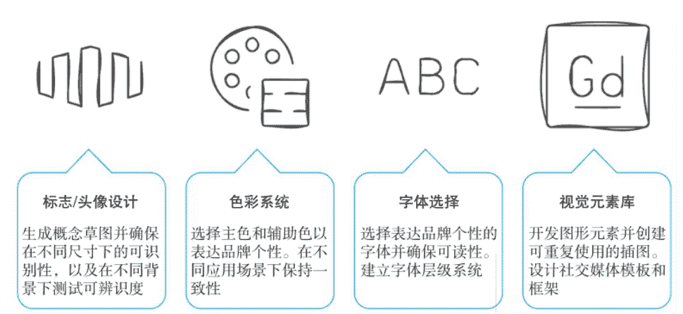
图4-2 个人品牌视觉元素体系
2）色彩系统：主色 2～3、辅色 2～3，保持一致
3）字体：1～2 个特色字体，建立标题/正文/强调层级
4）元素库：标志性图形、插图、社媒模板

（2）创建步骤
定位明确：提炼 3～5 个关键词，定受众与差异点；
AI 概念生成：即梦 AI/可灵 AI 出多风格，选 2～3 方向，收集反馈优化，再用可画细化；
应用系统：各平台统一视觉，建立素材库；
动态拓展：可灵 AI 转动态，做片头与 AR 名片。

> 【实战案例】“AI 设计实验室”形象：定位‘融合传统与现代’，关键词文化传承/现代简约/创新。即梦 AI 出 30+ 概念，最终选中国印章+极简风格，通义万相补辅助图形，深青+珊瑚红配色。2025 年初用可灵 AI 做动态版，辨识度与客户回访率提升约 50%。

### 4. 技术创意结合点：数据驱动决策
监控影响力：追踪平台数据、内容互动关联、视觉风格转化、品牌提及；精准画像：收集互动用户兴趣特征。

## 三、5 种最容易接单的 AI 设计服务

（1）社交媒体设计套餐
内容：统一风格社媒图、模板、素材库；客户：自媒体、小微企业、社媒运营；报价：基础 5 张 300～500 元，进阶 10 张+2 模板 800～1000 元，月度每周 4 张 1500～2500 元；优势：门槛低、需求大、复购高；流程：定风格→建模板→批量生成→反馈调整→多尺寸交付。

（2）电商主图优化
内容：美化、背景、场景合成、效果增强；客户：淘宝/天猫卖家、独立电商、微商；报价：单张 30～150 元，5 张套餐 150～600 元，详情页 500～1500 元；优势：效果可量化，转化导向；流程：产品分析→定风格→AI 场景→合成→优化。

（3）品牌 Logo 与基础 VI
内容：Logo、名片、简易品牌指南；客户：初创、个体、服务商户；报价：Logo 100～800 元，Logo+名片 300～1200 元，小型 VI 1000～3000 元；优势：一次性高价值，可延展；流程：调研→探索→生成概念→呈现→修改。

（4）活动节日海报
内容：促销、节日营销、活动宣传；客户：零售、餐饮、社区、培训机构；报价：单张 200～400 元，节日套餐 600～1000 元，系列 3～5 张 800～1500 元；优势：季节性稳定、周期短、易长合作；流程：了解活动→主题→AI 元素→排版→交付多格式。

（5）内容创作者资料包
内容：YouTube/B 站封面、播客封面、课程封面、个人品牌形象；客户：视频创作者、播客、知识付费作者、讲师。

AI设计正在成为个人创作者和自由职业者最快变现的赛道之一。很多入门者担心没经验、没资源，其实市场已经为新手留好了入口。下面这套打法，是从一线实战中提炼出来的从接单到交付、从低价到高价的完整路径。

**一、起步最快的五类AI设计服务**

对刚入行的人来说，选对赛道比拼技术更重要。目前最吃香的是这几类单：单张封面设计一般定在50到300元区间；个人品牌套餐也就是头像加横幅加模板组合，售价多在300到1000元；内容系列打包则能做到1000到2000元的体量。

这几类单为什么好做？创作者群体本身付费意愿强，需求在持续放大，而且客户就聚集在创作者社群里，获客成本很低。标准的工作链路也很清晰：先做内容分析明确需求，再确定视觉风格，随后用AI工具快速生成初稿，接着进行排版优化，最后适配不同平台的尺寸和规格。

王睿对市场的判断也印证了这点：数据显示这五类服务有三个共同特征。第一，决策快，客户往往一到三天就能敲定合作；第二，需求明确，AI工具能高效承接；第三，效果显性，客户能肉眼看到改进。正是这三点，让新手可以迅速切入市场。

**二、接单渠道与实战定价**

张文杰从零散接单做到了稳定收入，他的平台选择思路值得借鉴。

| 平台类型 | 代表平台 | 优势 | 短板 | 入门难度 | 常见报价 |
| :--- | :--- | :--- | :--- | :--- | :--- |
| 专业设计平台 | 猪八戒网、BOSS直聘 | 单量大，体系成熟 | 竞争激烈，抽成高 | 中等 | 300～3000元/项目 |
| 创作者平台 | 小红书、抖音、B站 | 可直接展示作品，受众精准 | 需要持续更新内容 | 低 | 500～5000元/项目 |
| 社群接单 | 微信群、行业社群 | 转化率高，有信任背书 | 依赖人脉积累 | 低 | 按关系灵活议价 |
| 本地商家服务 | 线下拜访、数字名片 | 竞争少，容易形成长期合作 | 找客户成本偏高 | 中等 | 800～8000元/项目 |
| AI创作平台 | 即绘、一品威客 | 客户对AI接受度高 | 平台较新，需求波动 | 低 | 200～2000元/项目 |
| 短视频接单 | 抖音短视频展示接单 | 展示效果直接，转化快 | 需要高质量演示素材 | 中等 | 400～4000元/项目 |

张文杰主打的是抖音接单。他做了“1分钟AI设计”系列，用短视频拆解一个设计从思路到成品的全过程，精准吸引小店主和创业者。账号每周新增粉丝在400到500人左右，每月稳定带来10到15个项目，成为他最主要的获客引擎。

在社群端，他常年活跃于15个创业类微信群和4个设计师交流群，不硬卖只分享知识和案例。等群友有需求时自然找上门，这种方式客单价更高，平均落在1500到2500元。

**项目定价怎么定**

影响报价的核心要素有五个：项目复杂度与工作量、客户预算与市场定位、交付时效与紧迫度、使用权范围与商业价值、AI工具成本与技术难度。

阶段化模型更实用。初级期300到800元一个项目，目标是积累案例；中级期800到2500元，建立专业定位；高级期2500到8000元，提供整合方案；专家期8000元以上，输出品牌战略咨询。

打包服务能提升客单价。基础套餐是核心设计加两次修改；标准套餐包含多风格方案、多格式交付和五次修改；高级套餐覆盖整套品牌视觉加营销应用场景并支持无限修改；VIP套餐则加入设计加运营策略加效果追踪加季度优化。

**接单流程要专业**

前期沟通先用项目简报收集合需求，明确时间、预算和期望，同时展示相关案例建立信任并划清边界。

合作协议用简洁合同保障双方，通常预付50%，明确修改次数和加收标准，以及知识产权归属。

执行阶段建项目文档追踪进度，保持定期更新，输出方案文档给客户做选择。

反馈收集用结构化表格引导具体意见，设定反馈截止期避免拖延，完整记录变更。

交付时提供多种格式和尺寸文件，加上使用说明和数字资产库，交付后安排跟进支持。

张文杰自述：“我为每个项目建标准流程文档，用在线协作工具记录每一步和沟通细节，看起来比很多设计公司还规范，客户信任度因此提升。今年我还加入了效果追踪环节，帮助客户看设计投放后的数据，反响非常好，服务价值明显提升。”

**三、从单点设计到差异化竞争**

想摆脱低价竞争，必须做升级。

服务升级有三条线。从单一Logo到VI系统，再到品牌策略加视觉加营销应用，最后到品牌咨询加整合营销方案加执行监督。

从项目制到持续服务，先做单次合作，再打包系列项目，然后签季度合约，最后发展成年度品牌伙伴，甚至订阅式设计服务。

从执行者到顾问，先按要求交付，再提供建议和多方案，随后参与策略讨论，最后输出品牌发展顾问和AI赋能培训。

差异化策略要聚焦。选择一到两个垂直行业深度深耕，比如餐饮、健康、教育，积累行业案例成为该领域的首选人。热门细分有养老健康、可持续生活、科技教育。

创意加技术的结合也很关键。用数据分析预测效果，用A/B测试验证方案，提供设计效果追踪和优化，形成创意加数据的专业标签。

系统化方案是护城河。搭建标准设计方法论，沉淀行业模板库，提供培训赋能，帮助客户建立自主设计能力，设计自动化流程和协作系统。

张文杰的差异化路径是“传统文化现代表达”，服务需要中国文化元素的品牌。凭借个人研究他在提示词和设计解读上更有深度。2025年他新增数据驱动设计优化，用热图分析和用户行为追踪来验证效果。服务升级后，客单价从最初的500元提升到现在平均3500元。

**四、营销整合案例：AI设计如何带来真实转化**

营销策略师李梅与张文杰合作，为一家手工月饼店做节日营销，预算有限但目标明确。

数据洞察显示送礼场景占70%，竞品多走传统与现代结合路线，社交媒体上“家乡味道”是强情感点，消费者更关注健康配料和可持续包装。

策略核心信息定为“家的味道，匠心传承”，目标人群是外地工作的武汉人和追求传统风味的本地人，主战场是社交媒体加社区团购加线下店，2025年重点强化抖音短视频和小红书图文。

AI应用上，用即梦AI生成传统现代融合的包装，用即梦做系列节日氛围图，用Canva可画制作社媒物料和线下展板，用可灵AI做动态产品展示和制作过程短视频。

内容矩阵覆盖抖音的制作过程和口味视频、小红书的包装故事图文、视频号的师傅手工技艺、微信群的社区团购优惠。

通过小范围社群测试三种设计方向，根据抖音点赞评论调整主推点，用A/B测试优化促销文案，用数据工具追踪销售路径。

最终项目实现销售同比增长215%，两人共同获得10000元项目费，并延续到中秋合作。李梅总结，2025年的设计已经不是只看好看，必须带来商业结果。数据、用户心理、视觉设计结合，加上平台内容策略，才能创造真正价值。抖音带货和小红书种草是新消费主流，AI设计必须适配平台规则。

**五、商业设计实操全流程**

张文杰总结的AI设计七步法：

需求分析要深挖真实需求，明确目标用途，收集参考和品牌资料，确定受众和信息点，制定规格和交付格式，确认跨平台和动态需求。

市场调研像侦探一样洞察趋势，分析行业风格和竞品，用AI做风格探索，确定方向，并研究平台算法。

提示词工程是AI创作配方，精确描述风格、元素、色彩、构图，加入行业和品牌要求，多次迭代并建立跨平台词库。

初稿生成批量产出灵感，多工具并行，筛选2到3个方向，初步整合并并行开发静态和动态效果。

反馈优化展示初稿收集意见，基于反馈调整提示词并重新生成，用设计工具精修，迭代至满意并测试用户体验。

细节完善检查排版间距、配色层次、对齐平衡，优化文件格式分辨率，检查动态效果跨设备兼容。

交付与跟进准备终稿和源文件，多格式交付，说明设计理念和使用建议，收集使用效果反馈，植入数据追踪代码给出效果分析。

茶叶包装案例中，他先明确“现代东方、年轻化高端”，目标是25到40岁都市白领。王睿的数据显示该人群社交媒体分享行为同比增长85%。他用即梦尝试30多套提示词生成120个初稿，强调社交媒体分享点，筛选3个方向迭代5轮，最终在Canva完善细节，用可灵做包装开启动态效果，输出印刷、电商、社媒三套文件，发布反响很好。

**提示词框架SCOPEDPM**

S风格、C颜色、O对象、P目的、E情感、D尺寸、P平台、M动态效果。八个维度能让AI精准理解需求，大幅提升效率。

他补充，使用不同平台的提示策略再整合效果最好。即梦对中国元素理解准分辨率高，豆包生成快适合探索，通义万相商业风格把控强。组合使用可节省约30%时间，质量提升约40%。

**品牌一致性保障**

品牌DNA方法先提取核心标志、色彩体系、字体排版、图形语言、动态标准，建立品牌专属提示词模板，固定关键参数，保存成功案例做参考，构建跨平台词集。

批量生成时可用seed值固定风格，建立品牌词库，采用模板替换法，后期统一调色，风格转换保证一致。

品牌一致性管理系统要建数字品牌指南、可复用组件库、标准化元素、跨平台适配规范，并用自动化工具检测色彩、排版、对齐，引入品牌符合度评分。

咖啡品牌案例中，基础提示词锁定现代简约、暖棕奶油白、手绘咖啡豆、无衬线字体、温暖专业氛围。社交媒体版用方形构图留白，包装版重视印刷细节，门店版大尺寸高辨识。季节性可做灵活调整。

**六、从小白到月入8000的成长模板**

第一阶段入门期约一个月。3天掌握Canva基础，一周学即梦、豆包等提示词，一周理解设计原则，完成5个作品集。起步项目给朋友设计头像封面，参加免费挑战，做出2到3个模拟项目，尝试抖音短视频设计。收入0到1000元，客单价100到200元。

第二阶段成长期二到三个月。学习项目管理和客户沟通，聚焦2到3个垂直领域，建立流程和质量标准，优化作品集。开通2到3个平台，加入5到8个行业微信群，持续输出内容。收入2000到4000元，客单价300到500元，出现复购和转介绍。

第三阶段稳定期四到六个月。确立垂直专长如传统文化现代表达，开发服务套餐，建立长期合作。建设多平台内容矩阵，与行业专家合作，提供增值方案。收入稳定在8000元以上，客单价1000到3000元。

第四阶段专业期六个月后。提供整合营销方案，开发行业设计系统，组建小型协作团队，建立效果评估体系。扩大IP影响力，输出方法论，办工作坊，客单价8000到15000元，知识付费和被动收入占比提升。

张文杰回顾，关键不是追求完美，先从简单项目开始快速迭代。第1个月赚800元但大量练习，第2个月2500元，第3个月破5000元且有稳定客户。专业流程和市场定位比单纯技术提升更能带来收入跃迁。

AI设计已经进入从好看到有效，从单点到系统的阶段。找准入口、搭建流程、建立差异化，就能把创意变成持续的收入。

特别要先说清楚，张文杰的增速和收入曲线并不是普通人都能复制的典型。他的快速起量是多重条件叠加的结果：起跑前已有美术审美底子和市场敏感度；每天投入6到8小时在学习和实操上，远高于一般副业的投入量；正好赶上了AI设计工具爆发的早期红利；与王睿的技术配合让他拿到了数据分析的加成。所以别用他的节奏去要求自己，更稳妥的预期是把精力放在持续积累上，而不是追逐短期暴利。业内经验来看，做到月入8 000元的相对稳定状态，通常需要6到12个月的稳定深耕，更高的层级则需要更长的专业沉淀和市场搭建。

### 一周工作节奏拆解

稳定变现的基础是可复制的工作流。张文杰的工作周大致这样安排。

周一聚焦市场维护与当周规划。上午处理咨询、评估新需求、排期；下午做社媒内容、保持个人品牌曝光；晚上花1到2小时追踪设计趋势提升技能，同时留意AI工具更新并做功能测试。

周二到周四为主产出期。上午3到4小时做核心设计，专注产出；下午处理客户沟通、反馈和修改；晚上1到2小时预备次日任务、画草图；每天腾出1小时做跨平台内容的尺寸适配。

周五交付复盘。上午完成本周交付并跟进；下午接洽新客户做需求介绍；晚上写周报、看数据、优化流程；同步更新设计数据分析报告。

周末用来学习与创意充电。周六2到3小时尝试新工具、拓宽视野；周日2小时做个人项目保持创作手感；顺带录一期设计教程，丰富IP内容池。

日常效率组合：Notion/飞书负责项目和客户信息管理；Eagle收纳设计素材；AI设计助手管提示词库和品牌资产；微信/钉钉处理沟通与文件传输。

张文杰的说法是，现在的设计师工作方式已彻底不同。节奏感要稳，但更关键的是用AI提效。他保证每天3到4小时的高质量设计时间，严格守交付节点，保持多平台持续输出。借助自动化，他用过去三分之一的时间就能完成同等工作量，省下时间用来学新东西和开发高价值服务。

### AI设计的多元变现组合

张文杰梳理出的七类收入来源构成了他的抗风险结构。

项目服务是传统按单收费，品牌VI、包装等，单价800到8 000元不等，月均约1.5万元，平均6单。

设计模板走一次性制作重复售卖路线，挂在Canva可画、即时设计和个人站，单价39到399元/套，月均约5 000元，被动属性强。

社媒IP以抖音、小红书内容为主，收入来自平台分账、带货佣金和品牌合作，月均约6 000元，属于流量资产。

教学分享包括在线课、付费社群、线下工作坊，课程299到999元，社群199元/月，会员月均约8 000元，属一次创作持续变现。

AI设计咨询主打工作流搭建与培训，客单5 000到2万元/项目，月均约1万元，通常1到2单。

联名产品是设计授权商业化，与品牌联合推出限定款，按销售分成或一次性授权费，季度收入约1万到2万元。

订阅服务是为客户每月提供固定量的社媒图和营销物料，1 500到4 000元/月/客户，3个长期客户月均约9 000元，现金流稳定。

结构变化显示，从起步月入1 200元到一年后月入5.8万元，项目服务占35%时间、模板10%、社媒IP5%、教学15%、咨询10%、联名5%、订阅20%。张文杰的体感是，月入从1 200元提升到稳定3万元以上，最大的收益是抗风险能力。项目积累案例，教学立IP，模板和联名产生被动收入，社媒引流，形成闭环。

他也提醒，每条线都需要时间与专业度堆叠，很难短期全部搭建。新手建议先聚焦1到2个方向做精，再逐步扩张。

王睿补充，多元变现的关键是创意与技术的结合点。他们的模板不止好看，还会埋数据追踪，收集使用反馈用于迭代。另有一套AI设计流程自动化工具，能半自动化执行张文杰的设计思路，这就是创意与技术的双引擎：创意负责灵魂，技术负责可复制的高效。

### 实战全案：瑜伽工作室品牌设计

本地一家新开瑜伽馆需要全套品牌，预算5 000元，10天交付。

需求收集阶段，客户填写问卷，定位为都市轻奢瑜伽空间，目标客群25到40岁女性白领，视觉偏好简约优雅有禅意。收集参考并分析竞品，确认需要覆盖线下门店、小红书、抖音、微信。

市场研究由王睿完成，分析20家本地馆视觉，发现蓝绿调扎堆，差异化不足。于是定调贵金属色系加极简主义，并分析目标人群社媒审美偏好，研究2025健康设计趋势，用AI拆解小红书、抖音上热门瑜伽内容的视觉特征。

概念生成用即梦AI探索30多个Logo方向，提示核心是现代轻奢、几何与流动线条结合、玫瑰金与深灰、适合女性白领、有禅意不刻板、适配社媒与线下。用Canva可画快速出草图，筛选几何莲花、流线姿态、抽象平衡三条线，在即时设计里精修排版，用可灵AI做Logo的轻动态增强传播力。

方案呈现时做完整提案含品牌故事与场景应用，线上会议收集反馈，客户选定几何莲花方向并要求调色。

迭代优化把主色从玫瑰金改为紫铜色，优化识别与比例，延展到名片、会员卡、社媒模板，制作小红书发帖模板和抖音视频起尾模板，输出品牌使用规范，并制作数字媒体用的动态Logo。

跨平台内容包括小红书3套图文模板、抖音开场结尾模板、会员海报和优惠券、线下空间视觉与导视、微信群封面与公告模板。

最终交付包含多格式Logo文件、数字版品牌规范手册、社媒模板套件、动态Logo与使用说明、品牌资产库，以及一份简易数据追踪报告。

结果客户非常满意，付清5 000元并追加2 500元/月的季度社媒设计服务。开业后社媒反响好，多位顾客提到品牌形象是选馆原因。开业一个月会员注册超预期40%，其中约35%表示被社媒上的品牌形象吸引。

张文杰总结，服务必须是全平台整合的品牌体验，从线下到线上、静态到动态。AI让场景化设计加速，客户更看重这种全方位能力。

### 新手常见卡点与解法

审美不自信，用模板和AI建议先执行，参考Canva可画模板库、即梦AI风格探索。
不懂配色，借助现成方案，色采App、配色宝。
素材不足，善用免费库和AI生成，花瓣网、即梦AI、豆包。
不会绘图，用AI绘图和图标库，即梦AI、阿里巴巴矢量图标库。
定价难，先参考市场均价七折起，猪八戒网价参考。
跨平台适配，用自动转换工具，多格式转换器、Canva可画自定义尺寸。
效果不专业，抓住对齐与留白，B站相关视频。
获客难，先用小红书抖音展示作品再邀约熟人，创意社区、设计互助群。

### 实战练习指引

挑一家熟悉的本地小店为其做一套当下风格的品牌视觉：静态与动态Logo、配色与视觉元素库、覆盖小红书和抖音的社媒套件、名片或优惠券等宣传品、15秒品牌短视频。用即梦AI/豆包/Canva可画/可灵AI等完成，记录决策理由与过程，思考社媒展示效果和商业化路径，并加入简单的数据跟踪或效果评估方案。

### 思考题

AI工具降门槛后同质化严重，如何建立差异化，是深耕领域还是优化方法？
AI生成时代，设计师的核心不可替代价值在哪，人类创意的独特性如何体现？
商业模式从项目制转向订阅和知识付费，对设计师技能提出了哪些新要求？
如何在实践中把创意与技术结合，找到数据与设计结合的创新点？
面对快速迭代，设计师应侧重工具技巧还是设计思维，如何持续学习？

### 章末寄语

设计曾是少数人的专利，如今AI让每个人都能表达创意。张文杰从美术零基础到月入五万的故事，说明变革创造了新可能。技术是工具，创意是灵魂。AI可以生成图像，替代不了审美感知、文化理解、市场洞察和解决问题思维。当下设计的价值已从美感转向商业价值创造，优秀设计师是连接品牌、用户与平台的战略思考者。随着元宇宙、AR/VR普及，边界在扩展。有好奇心和行动力的人，都能从个人项目起步，用AI作为助手与启蒙老师，重塑自我价值。创意不是天赋，是每个人的权利。

### 第5章 技术路径：写得出代码的AI变现指南

开篇故事。李明有5年销售经验，4周前连HTML/CSS都不懂。在张文杰鼓励下尝试AI编程，初期报错频发，调整提示词后完成首个企业展示站，收入2 800元，超过上月销售提成。他写道，关键不是写代码，而是学会指导AI写代码，销售积累的需求理解与沟通能力反而成了优势。

### 零编程也能做开发：AI编程底层思维

从代码恐惧到需求翻译者。传统编程重语法算法框架，AI编程重需求分析、问题描述与方案评估。能力核心从代码编写转向需求翻译，学习曲线大幅降低，思维从结构化算法转向描述性沟通，价值从技术实现转向问题解决。

李明的转变在于理解AI编程本质是沟通：把业务需求转成AI能懂的指令，再评估调整输出。

【关键思维转变】从“我要学会写代码”到“我要学会指导AI写代码”。

### 需求翻译的五步框架 DTREO

D 定义：把问题具体化。
T 翻译：把业务语言转为功能描述。
R 请求：构建结构化提示词。
E 评估：审查输出找问题。
O 优化：基于评估迭代改进。

以李明为例。客户要能展示产品并让客户联系的网站。定义需求时他厘清：约20个产品，信息含名称、图片、描述、规格；联系方式为表单和联系信息；还需公司简介、新闻；风格现代简约蓝为主。
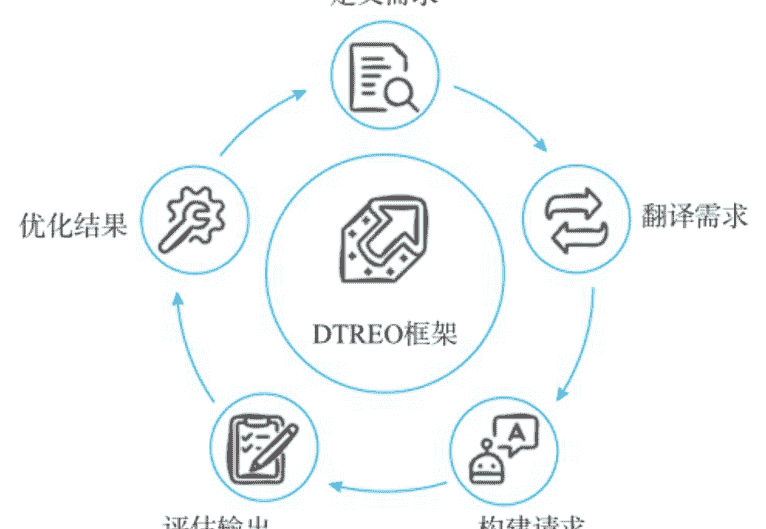
翻译为响应式企业站、产品展示系统、联系表单、内容管理、设计系统五大模块。请求提示词要求首页、产品页、详情页、关于、新闻、联系我们六个板块，现代简约蓝调、移动友好、加载快、导航简洁，并输出完整HTML/CSS/JavaScript代码及说明。评估发现首页缺少分类、表单无校验、移动端导航异常。优化提示要求补充分类筛选等功能。

在真实交付中，这两类缺陷出现频率很高：联系表单未做输入校验，电话和邮箱格式错误也能通过；移动端汉堡菜单在窄屏下错位或无法展开，导致整体体验断层。针对以上痛点，需要给出可直接落地的修复实现。

关键收获第七条。李明总结，这套方法论不仅能用在写程序上，也几乎能迁移到各类智能创作任务。核心价值在于把人类日常的模糊表达拆解成结构化、可执行的指令，再借助循环打磨逼近预期效果。

张文杰补充道：“过去写程序，重心是弄懂程序内部如何运转。现在做智能化开发，重心是弄懂如何把需求描述清楚。这种翻译式的表达能力，反而是非技术人群的优势，尤其是从事过销售、市场或客户服务的人。”

## 3. 非技术出身的隐形加分项

令人意外的是，部分非技术背景带来的特质，正好契合智能编程的需求。李明和张文杰梳理了不同岗位的可迁移能力。

销售背景的隐形优势：
- 善于挖掘真实需求，能听出客户未明说痛点；
- 沟通表达清晰，会把需求讲明白；
- 以解决问题为导向，更关注结果而非技术细节；
- 具备客户视角，会从使用者角度判断产品是否好用。

市场背景的隐形优势：
- 对用户体验敏感，容易察觉易用性问题；
- 拥有视觉与审美判断力，能评估界面是否好看；
- 信息架构能力强，会合理组织页面内容；
- 擅长价值传递，懂得突出产品的核心卖点。

管理背景的隐形优势：
- 具备系统化思维，能整体规划项目框架；
- 资源整合能力强，会组合多种智能工具协同工作；
- 质量把控意识强，会做全面测试；
- 项目管理能力突出，会设定合理开发节奏。

李明提到自己的感受：“销售里练出来的提问技巧，在智能编程里特别管用。和客户聊网站需求时，我习惯追问关键细节，把含糊的想法具体化，这正是拿到高质量智能产出的前提。”

软技能如何转化为智能编程优势，具体做法如下。

把沟通力转化为需求定义力：
- 反复练习把模糊描述拆成明确的功能点；
- 学会抛出澄清性问题，缩小理解偏差；
- 整理出一套需求访谈清单，固定提问路径。

把共情力转化为体验思维：
- 始终站在用户角度审视模型输出；
- 预判用户可能遇到的卡点与困惑；
- 优先保证核心需求落地，其余逐步迭代。

把讲故事能力转化为场景描述力：
- 用具体使用场景替代抽象技术要求；
- 编写用户故事和使用场景脚本；
- 以最终结果为导向来设计功能点。

张文杰最后点评：“智能编程已经重新定义了技术能力，让它更普世、更平民。技术不再是少数工程师专利，任何能把问题结构化表达、并能评价方案优劣的人，都能上手。”

## 4. 搭建个人智能编程工作流

为了让李明的开发更系统，张文杰分享了一套新手可用的七步工作法。

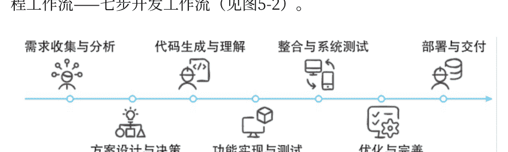

图5-2 七步开发工作流

- 需求收集与分析：把模糊想法转化为具体功能清单。
- 方案设计与决策：对比多种实现路径，选出最合适的技术路线。
- 程序生成与理解：读懂产生的程序结构与核心逻辑。
- 功能实现与测试：分模块开发，确保每个部分能独立运行。
- 整合与系统测试：跑通完整用户流程，检查边界情况。
- 优化与完善：兼顾体验与性能。
- 部署与交付：保证客户能正常使用与后续维护。

下面以在线预约功能为例演示全流程。

阶段1 需求收集。明确目标：用户可自主挑选未来日期与时间段，填写联系信息后完成服务预约。

阶段2 方案设计。使用的智能指令示例：

我需要为企业网站添加在线预约功能,要求：
- 用户可选择日期(未来30天内)。
- 每天有上午9—12点、下午2—5点两个时间段。
- 用户需填写姓名、电话、邮箱和预约事项。
- 表单送出后发送确认邮件给用户。
- 管理员收到预约通知邮件。
请推荐2～3种技术实现方案,并分析各自的优缺点和复杂度。具体考虑国内环境下可靠稳定的技术选择。

阶段3 程序产生。选定方案后给智能体的指令：

基于前面的讨论,我决定使用JavaScript和国内的表单服务实现预约功能。请生成完整的实现,包括：
- HTML表单结构,包含所有必要字段。
- 日期选择器(限制只能选择未来30天)。
- 时间段选择部分。
- 表单校验的JavaScript脚本。
- 接入国内常用的表单服务(如金数据、腾讯云表单等)。
- 响应式设计,确保在移动设备上正常显示。
请提供详细注释,解释关键部分的实现逻辑。

阶段4至7 迭代优化与上线。通过多轮交流，李明修复了日期选择器的兼容性、表单校验逻辑错误以及邮件模板格式问题，最终顺利部署。

张文杰强调：“流程看似繁琐，精髓是每次只解决一个明确任务，让智能体在受限条件下发挥最大效能。非技术人最常犯的错就是需求太笼统，比如只说‘帮我做个预约系统’，结果大概率不满意。”

## 5. TRAE：智能编程的得力助手

TRAE是一款面向中文环境的国产智能代码编辑器，解决了海外工具中文支持弱、网络受限等痛点，对零基础用户很友好。

核心能力：

智能交互：编辑器内直接交流，获取程序建议。支持产生程序、诊断问题、咨询实现思路，对中文交流做了优化，能感知当前文件上下文。

程序补全与优化：多语言智能补全，实时给出建议与修复提示，一键格式化美化。

调试与问题排查：内置调试器，支持断点与变量查看，错误可智能分析并给出修复建议，还有性能分析工具。

案例：用TRAE创建网站项目

步骤1 创建新项目。打开TRAE，通过文件-打开文件夹载入本地目录，选Web项目模板，命名为“企业展示网站”，在右侧“与Trae协作”区开始对话开发。

步骤2 对话产生程序。示例：

用户：
我需要一个响应式的导航栏,包含公司Logo、首页、关于我们、服务、联系我们等菜单项。
TRAE 智能伙伴：
我来帮您创建一个响应式的导航栏。我会使用HTML和CSS来实现这个导航栏,包含您要求的所有元素。以下是完整实现：
[AI生成HTML和CSS代码](代码略)。

步骤3 调试预览。点击顶部“应用”按钮，在中间index.html点击“接受”，再点“预览”查看效果。若有问题，选中代码右键“添加到对话框”请智能体协助。

步骤4 完善与部署。继续对话补全其他组件，用内置终端起测试服务器，一键部署到线上。

进阶技巧：

提示词优化：描述时越具体越好，包含功能、风格、技术要求；用“继续优化上面的代码，添加××功能”保持上下文；复杂功能分步请求，先基础后迭代。

项目管理：用项目模板快速搭建结构，用内置版本控制追踪改动，保存代码片段库复用。

调试技巧：用“AI代码解释”理解复杂片段，遇错时右键“AI修复建议”，用“AI测试用例生成”快速造测试。

实际场景：

快速原型。李明接到需求后，一小时内用TRAE生成完整原型并预览给客户，大幅加快确认。

缺陷修复。表单送出异常后，选中代码用智能诊断，智能体指出缺少校验逻辑并给出修复代码，15分钟解决。

功能扩展。客户要预约系统，李明描述需求后TRAE产生代码，少量调整即可上线。

协同工具：可与Canva联动实现设计转代码，与飞书多维表格对接API开发数据应用，与即梦AI整合图片资源到网站。

TRAE不仅是编辑器，更像非技术背景者的智能编程教练，帮助聚焦业务问题而非语法细节。随着熟练度提升，它还能辅助学习编程概念。提醒：生产环境上线前仍需专业人员审查与安全测试。

# 二、4类适合新手的智能编程变现项目

## 1. 网站与前端开发：最易上手的变现方向

网站开发是智能编程入门与变现的黄金赛道，也是李明的第一单。

新手友好度：技术门槛★★☆☆☆，学习曲线★☆☆☆☆，市场需求★★★★★，竞争程度★★★☆☆，收益水平★★★☆☆，智能加持★★★★★。

适合的网站类型：

企业展示型网站。特点是信息展示为主，技术要求低，价格2 000～8 000元，周期3～7天，客户为中小企业。

专业人士官网。作品展示+个人介绍，视觉要求中等，价格1 500～5 000元，周期2～5天，客户为摄影师、设计师等。

活动或产品落地页。单页转化导向，技术门槛低但需营销思维，价格800～3 000元，周期1～3天。

简单电商网站。含商品展示、购物车、支付，技术中等，价格5 000～15 000元，周期7～14天。

李明实战经验：首个项目是室内设计工作室官网。策略是先让智能体生成整体架构，再逐页细化。控制需求边界，明确为展示型网站，不做复杂后台。视觉上用Canva生成统一风格的UI元素，提升专业感。

技术栈建议：初级用HTML/CSS/JavaScript+Bootstrap；中级用静态生成器如VitePress；进阶用React/Vue+轻后端如腾讯云云开发。

关键成功点：前端项目里，设计感与用户体验比程序洁癖更能打动客户，这正是非技术人员的优势。

## 2. 自动化工具开发：提高效率的实用魔法

自动化工具指解决特定重复工作的微型应用，门槛低、回报高。

新手友好度：技术门槛★★☆☆☆，学习曲线★★☆☆☆，市场需求★★★★☆，竞争★★☆☆☆，收益★★★★☆，智能加持★★★★★。

适用类型：

数据处理自动化。清洗、转换Excel数据，技术为Python脚本或Office宏，场景为销售数据整理、财务报表。

内容生成自动化。批量生成报告、邮件、文案，技术为Python+API，场景为周期报告、营销内容。

流程自动化。连接不同系统实现工作流，技术为企业微信机器人、飞书自动化或Python脚本，场景为CRM与邮件营销集成。

监控提醒工具。监控指标变化并推送提醒，技术为Python+通知API，场景为库存监控、价格追踪。

案例：销售数据处理自动化。背景是销售团队每周手工汇总多渠道数据，易错耗时。方案是用Python脚本自动读取多份Excel、统一格式、清洗数据、按类别与区域汇总、生成图表并自动邮件发送。

盈利模式：定制开发2 000～8 000元/项；模板调整1 000～3 000元/项；订阅维护500～2 000元/月；培训服务800～1 500元/次。

入门路径：学基础Python文件操作与数据处理，掌握pandas常用操作，先从自身重复工作练手，再扩展服务他人。

关于工具选择：智能体适合快速验证标准化需求，Python适合深度定制。成功的服务商会根据预算与需求灵活切换。

李明说：“自动化工具的核心是小而美，只解决一个具体痛点。客户能立刻看到效率提升，付费意愿强。我一个800行的Python脚本帮客户每月省40小时手工，他直接付了6 000元。在中国企业里，效率是最直观的价值。”

## 3. 数据可视化项目：让数据会说话

数据可视化是智能编程变现最快的领域之一，特别适合非技术背景者。

新手友好度：技术门槛★★★☆☆，学习曲线★★★☆☆，市场需求★★★★☆，竞争★★☆☆☆，收益★★★★☆，智能加持★★★★★。

TRAE+智能实现路径：

工具组合：数据处理用Python pandas由智能体产生；可视化库用Matplotlib、Seaborn、ECharts、AntV G2等；开发环境用Streamlit等交互方案；编程助手用TRAE等。

李明补充：“2025年最大的变化是智能编程助手的普及，我现在七成程序由智能体产生，我只负责描述需求和验证结果，这让非技术人也能做出专业级数据工具。”

工作流：需求分析与数据准备，在TRAE建项目，用智能体生成数据加载代码并准备CSV；程序产生，通过交流让智能体生成交互图表；调试优化，用预览实时查看并追问格式、筛选等改进；功能迭代，逐步加入响应式等需求。

将代码变为项目：分块调试，先数据加载再单图表最后集成；渐进式迭代，先简单版再加功能；多设备兼容测试。

部署交付：李明积累了从本地预览到云端发布的经验，确保图表在不同终端正常呈现。

当谈到数据可视化与内部系统的交付方式时，部署策略往往决定了后续的维护成本和客户体验。

轻量级上线的思路更适合体量不大的尝试。GitHub Pages 常用来托管纯静态的可视化作品，Streamlit Cloud 在需要轻交互的演示型应用上更顺手，Netlify 和 Vercel 则成为前端可视化站点的主流选择。

如果需要融合到客户现有环境，就走集成路线。可视化模块可以直接嵌进客户的 CRM 或 ERP 体系里，也能通过 iframe 的方式塞进企业内网，飞书多维表格的对接也是不少团队的常用打法。

体量上来之后，容器化就变得合理。用 Docker 把服务打包，再放到阿里云或腾讯云的服务器上，稳定性和扩展性都会好很多。

李明在可视化服务上的报价分成了三层。

入门级的基础分析看板，报价在 5 000 到 8 000 元之间。交付 3 到 5 张标准图表，用来呈现核心指标，配一个简单的筛选器做基础探索，支持基础交互，赠送 1 次修改。

进阶的标准可视化方案，报价 10 000 到 15 000 元。会做 5 到 8 张专业图表，覆盖多个业务场景，加入多维度筛选，支持深度分析，交互更丰富，包含 2 次修改，并配置容易上手的数据更新机制，保持信息新鲜。

企业级的高级数据平台，报价 20 000 到 50 000 元。打造 10 张以上的定制图表，应对复杂业务，实现复杂交互和多层钻取，数据可实时刷新，建立完整的权限体系保障数据安全，支持全格式导出，还额外提供专业培训和整套技术文档。

从入门看板到企业平台的三档设计，能覆盖不同规模客户的数据可视化诉求，帮助他们把数据真正变成商业判断。

案例：化妆品连锁的销售仪表盘

李明接到一家化妆品连锁店的需求，要做一套实时更新的销售分析系统。

具体要做到五件事：呈现 5 家门店的销售情况、追踪品类销售走势、找出热销与滞销产品、分析客户购买习惯，并支持多维度筛选与交互。

技术栈方面，前端用 HTML/CSS/JavaScript 搭配国产可视化库 Ant V G2，后端用 Python Flask 提供 API，数据仍放在客户现有的 MySQL 里，开发时主要靠 TRAE。

开发过程中，TRAE 的 AI 助手先生成了初始代码，李明发现了三个硬伤：数据库连接配置错了、饼图的配色与品牌不符、移动端适配很粗糙。

和 AI 继续对话后做了四处优化：把数据库连接换成连接池来提性能；饼图改用品牌色，主色 #FF5B95，辅色 #FFD0E2、#FF8DAB、#D994FF；调整热销产品图表在平板上的布局，避免显示不全；新增一键导出 Excel 的简单功能。

项目上线后，管理层反馈很直接：能第一次清晰看到全局销售状况，发现了之前被忽略的季节性规律，识别出各门店热销品类的差异，最终优化了采购和促销策略。

费用结构为：基础开发 12 000 元，二期功能扩展 5 000 元，年度维护 6 000 元，总收入 23 000 元。

李明总结成功的要点有四个：用 TRAE 快速迭代，一周做出原型；AI 生成代码解决了复杂的交互逻辑；数据真正推动了决策，创造了实际价值；从技术和业务两端同时给出方案。

李明说：可视化项目的核心不是做多花哨的图表，而是让数据讲出有用的故事。AI 工具让我把精力放在解读业务含义上，而不是死磕代码细节。Ant V G2 配合 TRAE，开发效率至少提升了 3 倍。

基础内部系统：解决企业的实际痛点

中小企业常年需要内部系统，这类项目技术门槛不低，但借助 AI，非技术背景的人也能做出可用原型。

新手友好度打分：
技术门槛 ★★★☆☆，需要懂点数据库概念；学习曲线 ★★★★☆，一般 1 到 2 个月能入门；市场需求 ★★★★★，中小企业持续在要；竞争程度 ★★★☆☆，专业开发仍占优势；收益水平 ★★★★★，单项 5 000 到 30 000 元；AI 助力程度 ★★★☆☆，人工协调仍然不少。

适合新手切入的系统类型：

库存管理系统，核心是产品入库出库、库存水平监控。技术上需要数据库 CRUD 和简单业务逻辑，开发周期 2 到 4 周，价格区间 8 000 到 15 000 元。

客户关系管理系统，管理客户信息、跟进记录和简单报表。需要表单处理、数据关联和权限控制，开发 3 到 6 周，价格 10 000 到 20 000 元。

项目管理工具，包含任务分配、进度跟踪、简易甘特图。技术要点是状态管理和日期处理，周期 2 到 4 周，价格 6 000 到 12 000 元。

预约或排班系统，管理时间槽、在 Scalar 上线预约、发送提醒。需要日历处理和邮件集成，周期 2 到 3 周，价格 5 000 到 10 000 元。

案例：小型仓库管理系统

客户是一家做电子产品销售的小公司，以前靠 Excel 管库存，经常出错且效率低。

李明做的方案包含：产品信息管理、库存操作记录、库存水平监控与低库存预警、基础报表生成、多用户权限管理。

技术选型：前端 React 加 Ant Design 或 Element UI，后端 Node.js 搭配 Express/Koa，数据库用 MySQL 或 MongoDB，部署在阿里云或腾讯云。

他的分步策略是把大项目拆小：阶段一先做数据模型和基础 API，实现基本的增删改查并搭建用户认证；阶段二做核心界面，产品管理、库存操作、简单报表三个模块；阶段三加高级特性，权限管理、数据导入导出、预警系统；阶段四做 UI/UX 优化、性能调优、上线和文档。

李明说：内部系统最大的坑是需求边界。客户总会加“看起来很简单”的需求，导致范围失控。我习惯在开始时列出详细功能清单，明确本版包含哪些、哪些延后。这样既保进度，也为后续变现留空间。开发时用视频会议演示原型，Canva 可画生成的 UI 原型图能让客户更快理解，大幅提升沟通效率。

代码优化与调试：让 AI 生成更可靠

AI 能快速出代码，但问题不少。

功能不完整：常出现关键步骤缺失，多因提示词没说全。做法是准备功能清单，生成后逐项测试，缺的立刻补。

错误处理不足：AI 偏爱理想路径，容易崩。需要明确要求加入异常处理，给数据库、用户输入、文件操作等关键点加 try-catch 和边界检查。

安全漏洞：可能出现 SQL 注入、XSS。解决办法是用代码扫描工具人工复核，SQL 必须参数化，输入要校验和转义。

性能问题：功能优先，性能靠后。审查时重点看数据库查询和循环，重复查询要合并，热点字段加索引，大数据用分页或流式处理。

代码组织混乱：AI 缺整体规划。按 MVC 或分层架构重排，把数据访问、业务逻辑、展示分离，抽公共函数，统一命名。

李明回忆一次预约系统的并发bug：表面完美，实际高并发时会出现重复预约。原因是缺少并发控制。他向豆包详细描述场景后，拿到了基于数据库事务和锁的方案，顺利修复。实践证明，国内模型在并发和性能优化上的理解在提升，这对系统稳定性帮助很大。

张文杰也补充：给 AI 讲问题时，场景描述比术语重要。别只说代码有问题，要说“两个用户同时预约同一时段，系统允许重复预约”。具体业务背景和用户习惯的描述，能让 AI 更准确抓住本质。

代码审查的系统做法

李明形成了六步审查法。

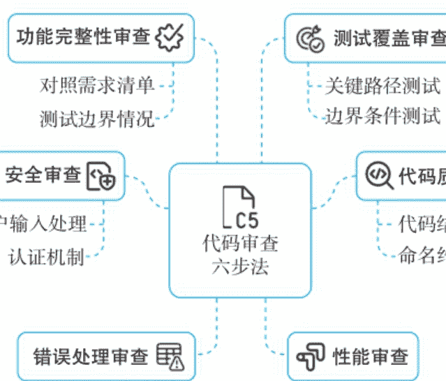
第一步是功能完整性审查，对照需求清单逐项验证，尤其要测边界。比如电商小程序要测购物车为零、库存不足、网络中断等情况。AI 常只顾正常流程，但用户总会做意想不到的事。本土化功能要重点看移动端体验、微信支付集成、手机号验证等，AI 生成的代码往往带国外设计模式，需要本地化改造。

第二步是安全审查，核心理念是所有输入都不可信。客户管理系统里，搜索功能就曾被查出 SQL 注入风险，后改成参数化查询。高风险点包括注册邮箱验证、密码存储、API 权限控制、敏感数据传输加密。涉及支付和个人信息的模块要反复检查。

第三步是错误处理审查。AI 生成的代码提示往往简陋，比如“上传失败”。李明会改成“文件大小超过 5MB 限制，请压缩后重试”，这种细节直接提升体验。

第四步是性能审查，重点关注查询、嵌套循环、大文件处理。曾有商品列表页每次全表查询，没有分页，导致数据一多就卡。提前优化比后期重构便宜得多。

第五步是代码质量审查，从可维护性出发。AI 常把逻辑堆在一个文件，重构时要按模块拆分，加清晰注释。

第六步是测试覆盖审查，不求 100% 覆盖，而是聚焦核心业务、常用功能和安全点。

电商小程序的实战复盘：购物车未检查商品是否下架，导致已下架商品可加入；订单提交缺少金额校验，后端未验证价格一致性，用户可篡改前端数据；搜索全表遍历，后加索引和缓存；错误提示全英文，改成中文并给出建议。

李明常用的工具：Sonar Qube 做代码质量，OWASP ZAP 做安全扫描，Chrome Dev Tools 做性能分析。工具只是辅助，关键是形成系统化思考。经过系统审查，后期维护成本明显下降，客户满意度更高，这是专业和业余的分水岭。

自动化测试：用 AI 保住功能正确

李明曾因促销时订单系统崩溃超卖 50 多单差点赔钱后，才开始重视测试。

AI 辅助测试策略包括：单元测试生成，验证函数输入输出、边界条件、异常处理、数据类型；集成测试设计，验证模块协作、完整业务流程、数据流、第三方服务；端到端测试场景，模拟真实用户操作，跨浏览器、移动端适配。

测试数据生成上，用 AI 造多样化数据，含特殊字符、极端数值、繁体字等，覆盖正常、边界、异常三类，并针对中国用户习惯设计本土化用例。现在他用 Cypress 做端到端，甚至能自动化验证微信支付沙箱。

部署与维护：让项目顺利落地

部署自动化包含三块：先生成部署文档，说明系统要求、环境配置、安装步骤和数据迁移；再生成部署脚本，自动检查环境、安装依赖、构建代码、配置服务、备份恢复；最后设置监控和告警，跟踪性能、错误、关键指标。

维护支持方面，用问题诊断助手分析错误日志和性能瓶颈，按计划做定期维护、升级、安全补丁，并用文档更新助手保持文档同步。李明说，一键部署脚本把成功率从 70% 提到 95%，关键是有错误处理和自动回滚，出问题能立刻回稳。

月收入过万的接单策略

找到第一个客户是最大门槛，李明用了五条路径。

个人网络转化，告诉朋友、同事、家人你新增的技术服务，信任基础好、沟通成本低。他的第一个网站项目就来自以前的销售客户。

垂直行业社群获客，加入特定行业群，提供针对性方案，需求精准竞争小。他在美容行业群里分享智能预约系统案例，解决高峰冲突和客户爽约问题，省去前台一半电话沟通时间。

内容营销引流，通过技术博客、案例分享、教程视频建立专业形象，被动获客。他在小红书发“小企业低成本建站”等系列，带来多次咨询。

自由平台接单，在猪八戒、程序员客栈、Freelancer 等平台建服务，有现成需求和支付保障。

线下场景营销，参加行业展会、创业咖啡馆、共创空间，直接接触决策者。

新手接单的心理障碍：能力不足恐惧。克服方法是先接小项目，明确边界，靠 AI 辅助。心态是“我只需比客户更懂技术”。

定价焦虑。做法是调研市场价，考虑时间和复杂度。首单可适度优惠，但要明确是首单优惠。

拒绝恐惧。准备好作品集和技术解释，坦诚说明能力边界。每个拒绝都是调整策略的机会。

把部署、定价、交付、代码质量、测试、获客串起来，AI 已成为技术服务者从 0 到月入过万的加速器。

在自由职业与AI服务变现的路上，李明有一段很真实的开场记忆。第一次向客户报价格时，他的手心发汗、声音发紧，几乎说不出完整句子。后来他摸索出一套做法：不只给一个数字，而是同时拿出基础、标准、高级三个层级供挑选。一旦选择面打开，客户的注意力就不再纠结“做不做”，而是思考“选哪套更划算”，成交概率明显提升。尤其在中国市场，主动点出本地化增值，比如微信生态的打通、针对春节中秋等节点的营销素材支持，往往能让议价更顺畅。

案例与作品集：用证据说话
项目积累到一定量后，能否稳定拿单，关键在能否把经验可视化、可感知。

案例要讲多样。挑选3到5个跨行业、跨类型的精品，而不是堆叠大量同质作品，更能证明解决问题的广度与可迁移性。

要结果导向。技术描述要转向商业影响，例如把“做了库存系统”换成“上线后库存差错下降30%，每月少亏约8000元”。李明在自己的文档里进一步量化到每月减少约10000元损失，他发现国内买家对这种数字化的反馈最积极。

用问题—方案结构来讲清来龙去脉：先交代业务背景与痛点，再说明挑战，接着讲解决思路与落地过程，最后呈现可量化的成果。

视觉也要专业。配上清晰的截图、流程图和数据图表，让非技术决策者也能快速理解。实践中他常借助Canva这类可画工具做品牌视觉，又用即梦AI生成展示级配图，整体调性立刻不同。

具体到作品集搭建，李明的个人站分为项目概览、技术能力、服务流程、案例详解和客户评价五块。项目概览按行业卡片化，案例页深入拆解问题与价值。为凸显对国内商业环境的熟悉，他特别强调对微信、支付宝等主流数字生态的集成能力。

定价与谈判：从成本谈到价值
合理的价格体系由三件事叠加构成。

时间投入：先算总工时乘以个人时薪。新手可参考100到200元每小时，随着经验提升而上调。务必把项目拆解成任务逐项估算。

价值评估：衡量方案给客户带来的节约成本、增收或痛点解除，报价一般落在价值的10%到30%区间。

市场因素：结合同类项目市场区间、本地供需以及客户预算体量综合判断。

为提升客单价与成交率，他采用三级服务模型。

基础版满足核心功能，定价在市场均价80%到90%，用来降低试用门槛。
标准版在核心之上加实用扩展，价格约为基础版130%到150%，通常是利润最优的主推位。
高级版提供全功能加高级支持，价格在标准版150%到200%左右，主要起锚定作用，让标准版显得更具性价比。

以一个企业网站为例，基础版4500元提供5页基础页面、简易后台、基础SEO、基础联系表单、基础微信分享、1次大修改、1个月技术支持、14天上线；标准版6800元包含8页内容页、完整CMS、完整SEO、多功能表单、微信H5适配、2次大修改、3个月支持、10天上线并赠送Logo设计；高级版10800元提供12页完整站、高级CMS加培训、高级SEO加关键词定制、定制业务表单、小程序加公众号文章整合、无限制修改、6个月支持、7天上线，并附赠Logo名片企业微信素材设计以及企业视频号内容策划加1篇AI爆文。

谈判时的操作要点：
先挖需求再谈钱。了解网站对业务的具体作用后，才好匹配价格。
用投资回报叙事替代成本叙事。比如“系统每月帮你省20小时人工，按人力成本折算...”。
做横向对比，把总拥有成本与招专职、订阅SaaS做比较。
试探预算范围：“为了配出最合适的功能组合，您这边的预算区间大概是？”遇到预算限制时调整配置，保持价值感。
增加零成本的感知增值，如详细文档、操作培训、定期经营简报、微信社群答疑。

李明总结，最有力的谈判不是砍价，而是把技术翻译成业务语言。曾有客户对7500元的报价犹豫，他算出方案每月可省约9000元人力成本后，对方立刻转变态度。在中国语境下，“面子价值”也很关键，点出竞争对手已数字化、客户更期待小程序预约等说法，往往比单纯算费用更打动人。另外加入低成本的AI亮点，例如智能客户画像、自动化内容推荐，能显著提升科技感与溢价空间。

张文杰补充，定价心理学同样影响决策：6999元比7000元更容易被接受；提供三档选择比单价成交率高；先展示高级版再拉回标准版能提升接受度。国内客户对“实惠感”敏感，适度赠送增值服务效果好。更长远的趋势是客户愿意为一站式解决方案付溢价，把技术与内容、运营打包是提升客单价的有效路径。

【文化洞察】中国商业里，关系对成单影响很大。提前了解客户的行业背景、竞争态势和个人兴趣，在沟通中自然呈现，能大幅提高信任度。企业更看重长期合作潜力，而非一次性买卖。

应对压价的实战对话也很有代表性。客户说网站报价6800太贵，能否降到4000。李明的回应是先认可预算重要性，再说明标准版包含完整CMS和微信小程序集成，可提升30%线上预约率并长期降本。若预算紧张，可退到4500元的基础版保留核心功能，后续可升级。最终客户选择了标准版。核心是对比方案、锚定价值，而非直接降价。

客户关系与复购
拿下项目只是起点，持续经营才能形成稳定现金流。

期望管理要留余量，承诺低于可交付能力约20%，以周密的计划与里程碑文档为依据，中国市场还要考虑法定节假日的缓冲期。

沟通必须系统化，建立固定周报节奏，内容包括进度、卡点、决策需求；工具可选用项目管理软件或模板，渠道以客户偏好的企业微信、钉钉为主。

要持续证明价值。项目中期和收尾时，用数据报告和使用分析呈现实际收益，图表化呈现更有说服力。

主动支持是长效黏性的来源。定期巡检系统运行，必要时用自动监控预警，节假日安全巡检、高峰期保障等增值动作，都能降低流失。

长期合作可从几条路径展开：
维护合同，按原项目价格的15%到25%收取年费，提供技术支持、迭代更新与应急保障。
分阶段交付，降低首期投入，先官网后小程序再会员系统，每阶段评估后再推进。
增值服务包，如高级分析、数据迁移、用户培训，按季度或半年打包售卖。
顾问式服务，从执行者升级为战略顾问，提供数字化转型建议，进行月度或季度战略会。

李明发现客户流失很多时候源于沟通缺位。他设置项目交付后1周、1月、3月的回访节奏，主动询问使用体验。续约率因此达到75%。在中国市场，“人情维护”也很重要：记录生日、企业周年等节点，通过AI辅助生成个性化祝福与礼品建议。教育赋能同样有效，定期做小型线上培训，教客户更好使用系统或分享营销趋势，免费的增值内容能极大提升黏性并带来转介绍。

问题处理方面，范围蔓延要用正式变更请求与评估表，明确时间和成本影响并给出优先级建议；延期风险要提前报备，给出备选方案，必要时先上线阶段可用版本；收款困难则靠清晰里程碑、分阶段预收关键功能费用并礼貌坚定地跟进。

张文杰强调，从项目思维转向客户终身价值思维是关键。一位长期客户的价值远超单笔交易。2025年的数据也印证了这点，来自推荐的客户平均客单价比其他渠道高40%，成交率高出60%，关系与口碑仍是中国市场最可靠的获客渠道。

高阶发展：从编码到自动化设计
随着AI编程普及，单一代码能力已不足以差异化。

张文杰指出，2023年会用AI写代码算超前，2024年已成标配，2025年真正的机会在于构建能自主运行的AI自动化系统。

这一转变由AI智能体的成熟与MCP协议的标准化驱动。普通人可通过无代码或低代码平台设计工作流，竞争点转向业务理解与流程设计能力。

代表平台包括本土的扣子，中文界面友好且深度接入微信生态、支付宝等；开源的n8n，节点丰富、社区模板多；以及面向企业的Make，稳定性与数据安全更强。

市场需求旺盛：兼职顾问日薪约800到1800元，企业内专家月薪12000到25000元，定制方案项目价8000到50000元不等。

典型案例：
某B2B企业销售线索管理自动化。通过扣子整合官网、邮件、展会、社媒等多渠道线索，自动评估价值与意向，生成个性化首封邮件并根据反馈调整跟进策略，最终线索处理效率提升70%，有效转化提升45%。项目收费15万元加3万元年维护费。
内容营销自动化。营销人用n8n搭建热点采集、创意生成、平台适配、自动发布与数据回流的闭环，实现多品牌并行运营，月收入从2万增长到12万。其服务定价为基础套餐每月8000元每品牌，含每周8篇原创内容与数据分析。

失败教训同样宝贵。李明曾接单开发智能客户分析系统，客户需求表述模糊，仅要求“用AI提升转化”。为了拿下8万元订单，他未充分挖掘需求便开工，后续......

AI自动化项目最怕的不是技术做不到，而是做错方向、做过头、做不住。李明和张文杰从实战中提炼出三组典型翻车案例，配上可落地的避险框架和成长路径。

案例一 需求空谈导致从头再来
项目做到交付阶段，客户却说这不是想要的系统。真正的需求是能解析客户聊天记录并自动标记销售线索的工具。双方为此拉扯两周，最后李明只能推倒重建，工期严重拖延。虽然后来交了符合预期的版本，因反复沟通和返工，成本远超预算，几乎无利可图。
核心教训
1. 需求必须白纸黑字。哪怕客户催得急，也要形成明确的书面需求并经双方确认。
2. 前置提问要问到点上。开发前要问：要分析哪些具体数据？分析结果如何落地到业务？现有工作流是怎样的，AI要如何优化它？
3. 先做可验证原型。大规模编码前先交付一个简易原型拿到确认。
4. 按里程碑付款。分阶段节点收款，降低返工风险。
李明总结：技术只是成功的一面，清晰的沟通和严谨的项目管理同样关键。现在他有一套标准化的需求调研问卷和确认流程，返工概率大大下降。

案例二 过度依赖AI判断的代价
为一家人力公司做简历筛选自动化，初衷是从海量投递中挑出合格候选人。系统上线时完全由AI裁决是否进入面试，效率一度很高。
三个月后问题暴露：多位优秀但履历不传统的候选人被自动刷掉，后被竞争对手录用并表现突出。复盘发现模型产生隐性偏见，偏爱与历史成功样本相似的简历，忽视创新背景或非典型职业路径。客户信任受损，要求重新设计。
应对方案
把架构从AI决策改为AI辅助决策。系统只负责初筛和打分，关键决策保留给HR专家；增加多样性推荐，捕捉潜力但不符合常规模式的人选；加入持续学习机制，让模型从HR的实际判断中迭代。
关键教训
1. AI适合赋能而非替代。重要决策场景下应做辅助。
2. 算法偏见必须警惕。模型会放大训练数据中的隐性倾向。
3. 要设计反馈闭环。让系统能从人工反馈中自我改进。
4. 决策过程需要可解释。用户要明白为什么给出某条建议。
张文杰点评：自动化不等于最优解。创造性、伦理判断、边缘案例处理上，人机协作的价值往往高于纯自动化。

案例三 夸大扩展性的信任损耗
初创公司要做内容管理系统，客户强调必须高度可扩展。李明信心满满承诺可满足。初期用n8n快速搭建，客户满意。
半年后业务爆发，日处理内容量涨30倍，用户数涨20倍。系统响应变慢、偶发崩溃、部分自动化流程处理不了增量数据。根因不是n8n不行，而是初始设计未考虑该量级的数据处理。
后期只能引入专业团队重构，采用混合架构：核心业务仍在无代码平台，数据处理层改用微服务。客户虽同意追加费用，但专业信誉已受损。
关键教训
1. 清楚工具边界。无代码平台在大数据场景有局限。
2. 不要为拿单过度承诺。诚实评估自身能力边界。
3. 初期要预留扩展空间。设计时就要考虑接口和升级路径。
4. 合同里明确性能参数和使用限制。
李明反思：知道自己“不知道什么”很重要。超出能力范围时坦诚说明并寻求合作伙伴，长期反而赢得信任。

避险通用策略 张文杰归纳
1. 需求流程结构化。标准化调研问卷、视觉化流程图与原型、客户书面确认的需求文档。
2. 阶段性交付。将项目拆成明确里程碑，阶段结束前收反馈，保持代码与流程灵活性。
3. 边界管理。清晰定义范围与排除项、变更请求流程与加价标准、坦诚沟通技术限制与风险。
4. 持续学习与适应。将失败视作学习、建立个人错误数据库、与社区共享经验。
“每个失败都是成长催化剂。”李明说，现在项目成功率超九成，多亏早期复盘。分享失败比炫耀成功对新人更有价值。

从入门到方案设计师的四阶段
阶段一 基础工具熟悉，第1-2周。注册并学习无代码/低代码平台如扣子或n8n，完成入门教程，搭建2-3个简单自动化，认识基础AI功能。
阶段二 应用能力构建，第3-4周。学习业务流程与决策逻辑设计，掌握API集成，理解大模型能力边界与最佳实践，为自己的工作做一个实用自动化工具。
阶段三 解决方案设计，第5-8周。学习完整方案设计方法，练好需求分析与转化，掌握测试优化方法，产出一个完整商业案例作为作品集。
阶段四 专业化与定位，持续进行。选定行业深耕，积累可复用的方案模板，提升项目管理与客户沟通，建立个人品牌与获客渠道。
李明心得：业务理解比技术更重要。销售背景带来的需求分析能力成了最大优势。先用扣子为自己做小工具，再帮朋友解决HR简历筛选等真实问题，逐步建立口碑。月收入稳定在4万元以上，多来自推荐。
张文杰观察：AI就业市场正出现三次变化：技术门槛大幅降低，无代码让普通人也能开发；行业知识愈发值钱，纯技术优势减弱；本地化方案溢价明显。结合行业经验，6-12个月实现职业跃升完全可能。

21天启动挑战
第1-7天：学HTML/CSS基础，做一个简易个人网页，熟悉扣子工作流，用Canva可画做UI，完成后线简历页。
第8-14天：学JavaScript基础，做交互小应用如待办或计算器，用AI实现复杂功能，学习调试方法，适配微信H5。
第15-21天：完成个人作品集网站，用即梦AI和Canva做视觉素材，准备服务介绍与定价，建立项目流程与沟通模板，在小红书或知乎展示技能，寻找首个客户。
执行要点：每天至少2小时、AI辅助但理解核心概念、记录过程、找学习伙伴、关注微信生态等本地场景。

思考方向
AI编程与传统编程有何本质区别？如何让零基础者在数月内接单？技术平民化会如何重塑职业选择？非技术背景的哪些能力可转化为AI编程优势？接单中技术与沟通哪个更关键如何平衡？AI工具是代码生成器还是合作伙伴？如何协同豆包、Canva可画等国内工具？编程服务价值会如何迁移，未来程序员的核心竞争力是什么？

章末寄语
AI重塑的是技术门槛。编程已从写代码变为解决问题、沟通需求、把想法落地的创造过程。李明的经历证明，转型不需要科班背景，需要学习意愿和利用工具创造价值的智慧。DeepSeek、豆包、通义等本土模型配合即梦AI、Canva可画，已让入门门槛大幅下降。第一步比技术更重要。

第6章 多元变现：打造收入倍增的AI副业矩阵
王睿半年内将副业收入从5000元瓶颈推至20860元，来自AI内容创作、电商、数据咨询、付费社群、线上课程、品牌合作六个协同来源。他发现副业间存在1+1>2的协同效应，电商经验反哺数据分析，分析优化运营，写作技能提升产品转化，专业积累再通过课程变现。

时间杠杆的思路
单一副业收入上限=可投入时间×每小时产出×单价，是线性增长。普通上班族月均可投入约72小时，天花板明显。
五种杠杆：知识产品化、流程自动化、团队扩展、用户生成内容、AI工具开发，杠杆系数与实施难度各异。
王睿从每小时1500字写作服务转向开发《AI写作实战课程》，40小时投入售出200份，平均时产提升数倍，且销售在睡眠中继续。

三阶段实施路径
第一阶段效率最大化：流程标准化、AI辅助写作与数据可视化、专业包装提价、筛选高价值客户。王睿把5000字行业报告从8小时压缩到3小时，收费从1500提至2500元，单位产值提升3.4倍。
后续阶段逐步实现流程自动化与产品化，最终构建可自我运转的矩阵系统。

从零到可复制的收入体系，王睿走过三次跃迁。第一步看上去朴素，恰是成败的分水线。许多新人急于上高级打法，结果基础流程混乱不堪。他的说法是，先把杂乱的工作变成可复用的方法论，后面的事才有根基。想先把种田的效率定下来，再谈自动化农场，否则再好的路子也跑不起来。

第二阶段通常落在第三至第六个月，核心是从卖时间转向让系统持续产出。
一、把重复服务沉淀为数字资产。把高频服务内容整理成电子教程、模板、工具包，做成一次制作多次售卖的形态，并搭建从入门价到高端价的阶梯。
二、让获客与交付自己运转。设计内容对外输出的自动化链路，配好展示页与成交闭环，把基础客服环节也纳入自动化。
三、从个人服务者转向小平台。孵化小规模社群或用户池，设计互动规则与价值回流机制，同时强化专业影响力。
四、至少建成一条无需时刻盯盘的现金流，比如数字资产售卖、联盟分销、轻量订阅。

他提到这个阶段的本质是角色切换，从执行者变成设计者，如同从体力劳作转向工程设计。现阶段的大模型让切换成本大幅下降。课程大纲可以用DeepSeek快速搭架，学习材料交互部分可借助豆包生成，视觉呈现可借助即梦AI完成，两年前难以想象。

实操上，他把电商运营经验整理为《AI电商选品指南》，定价68元，附带选品分析表作为赠品。书中讲清了如何用DeepSeek或夸克做竞品与市场洞察，并附上20条可直接用的提示词。三个月内几乎零额外投入，产生约1.2万元的被动回款，空出时间做新探索。

他补充，电子文档不需要出版社或印刷厂，也不必建复杂网站，电子支付加网盘即可闭环。有DeepSeek、豆包辅助，内容产出速度可提升约三倍，质量已接近职业作者，只要提供核心思想与专业框架。当前正是做知识资产的黄金窗口。

第三阶段在六个月后启动，目标是搭建自生长的收入系统。
一、组建轻团队。用兼职或自由职业者分担事务，建立简易分工与验收标准。
二、做多元化矩阵。找现有项目的延伸点，打造相互导流的兼职组合，打通跨项目转化路径。
三、经营社群产生UGC。维持活跃用户群，设计贡献激励，把互动转化为商业价值。
四、再投资自动化。把部分收益投入更高级的自动化工具，升级效率，寻求技术合作拓展边界。

他形容此时从单打独斗的个体户变为小型商业生态的架构师，像从经营小店升级到设计商场，让多方参与者共同创造价值。

案例是他做的“AI兼职加速营”社群，月费98元，招两位兼职管理日常，他每周线上答疑一次。成员间的互助与资源共享带来额外价值，半年内达到500人，月收入约4.9万元，个人时间投入每月约20小时。

运营做法是用飞书文档搭建知识库与资源中心，定期邀请行业嘉宾做实战分享，鼓励成员晒成果写心得，设计小组项目促进协作，用AI助理处理常见咨询。他笑着说社群里已有成员自发产生内容，有人的选品策略点赞超过他自己的文章，这正是UGC的自我强化循环。

他的实战心得是，时间杠杆的本质不是干得更快，而是换一种干法。从执行任务转向设计系统，才算真正突破时间限制，就像从挖水沟改为修水管。

社区萌芽期可以先从微信群开始，每周提供一次固定价值如答疑或分享，鼓励大家互动，观察哪些话题共鸣最强，为未来付费社群探路。把这当成小实验而非大投入，每个实验都在验证假设，成功就放大，失败就快调。大模型能快速出原型，云服务可零成本启动，社交媒体能精准触达，试错成本前所未有的低。

新手案例是李明的AI写作转型。他是财务人员，用DeepSeek提供AI财务文案服务，同时花10小时整理一套“财务报告AI优化模板”在闲鱼售卖，定价39元，每月带来约2000元额外收入，几乎免维护。他说起初犹豫自己能否产出有价值的产品，后来意识到日常解决的问题对他人就是宝贵知识。把常用Excel公式与DeepSeek提示词整理售卖反响很好，现在每月有稳定被动收入，“甚至睡觉时也在赚钱”，感觉很奇妙。

二、九成收入来自一成方向
兼职矩阵扩张后，他发现收益高度集中，约九成的收入来自一成左右的方向。

他坦言之前平均用力，每个项目都平平，后来发现某些方向的回报率是别人的五到十倍。

真实数据如下：
| 项目类型 | 时间占比 | 收益占比 | 收益/投入 |
| 内容咨询服务 | 45 | 25 | 0.56 |
| 数据分析咨询 | 20 | 35 | 1.75 |
| 在线课程销售 | 15 | 28 | 1.87 |
| 会员社群运营 | 12 | 10 | 0.83 |
| 电商小店运营 | 8 | 2 | 0.25 |

数据分析咨询与在线课程销售仅占35%时间，却贡献63%收入；而时间花最多的内容咨询服务，收益投入比不到1。明智的做法是减少“吸血鬼”项目，把时间倾斜到高回报方向。现在工具可能性更多，但时间仍然有限，不是所有机会都值得追。

AI兼职ROI评估体系
王睿建了一套五维评估模型，用数据指导决策而不是凭感觉。

ROI即投资回报率，用来衡量投入产出比例。```
ROI=(收益-成本)/成本×100%
```

五维模型：
1. 时间回报率：收入÷时间投入。月收入除以月投入小时。数据分析咨询每小时约875元，内容咨询约278元。
2. 成长潜力：未来半年收入增长预期。看历史增速、行业趋势、竞争。课程预期增120%，电商预期增20%。
3. 被动收入比：无需主动工作即可获得的收入占比。自动化收入÷总收入。课程被动占比80%，内容咨询仅5%。
4. 协同效应：对其他兼职的促进作用。看交叉销售、客户重叠、品牌协同。会员社群为课程提供40%线索。
5. 持续性：模式能走多久。看技术更新频率、竞争壁垒、客户忠诚度。专业数据分析可持续3-5年，通用内容创作1-2年。

评估后他发现数据分析咨询总分21，在线课程20，远高于其他。他把50%时间投这两个方向，三个月总收入升40%，时间投入没变。

聚焦策略
四步可并行：
1. 差异化定位。找独特切口。用豆包分析竞品，挖掘未被充分服务的细分。例：从通用数据分析转向电商运营数据分析专家。客单价升40%，竞争压力降50%。
2. 深度专业化。建难以复制的壁垒。用DeepSeek梳理知识体系，补短板。例：打造“电商AI决策分析框架”。客户忠诚度升60%，推荐率增45%。
3. 系统自动化。减少重复工作。用飞书自动化工作流，DeepSeek整理数据初判。例：客户获取和项目管理自动化，前期咨询时间减60%，同等时间内可服务客户增70%。
4. 规模化突破。寻找可批量复制机会。例：把单人咨询变小团体工作坊，单位时间收入提3倍，覆盖面扩300%。

弱项项目的战略决策
低回报不一定立刻砍。他提出组合优化矩阵：彻底放弃、最小化、委托外包、重新定位、系统化、选择性接单。

他用最小化处理低回报电商店，因与数据咨询有协同。可批量写产品描述，设自动化邮件，精简产品线，只留高毛利低维护品类，标准化客服回复，每月发一篇店铺数据分析报告作为咨询展示窗口。客户说“看到你的店铺增长数据才信你不空谈”，低回报项目反而成为最强销售工具。

实战心得是，大多数人失败因为精力平均。九成一成法则提示把火力集中到关键方向，其他战略精简，才能在有限时间里实现收入突破。工具让多元组合更高效，但别被技术可能性迷惑，用它强化核心优势即可。

三、内容与工具双管齐下
他发现内容型兼职与工具型兼职组合威力极大，产生1+1>2效应。

“灯塔吸引目光，船运送价值。单有灯塔运不了，单有船找不到路，两者结合价值最大化。”

| 特征 | 内容型兼职 | 工具型兼职 |
| 核心价值 | 知识传递、观点表达、情感共鸣 | 问题解决、效率提升、流程优化 |

AI已经把副业的玩法彻底重塑了。过去做内容靠个人表达，做工具靠技术壁垒，现在两条线都在降维。

先看一张基本的对照图。

**内容型副业 vs 工具型副业**
典型形态：内容端是写作、短视频、课程、咨询、社群；工具端是模板、插件、自动化工具、分析表。
变现速度：内容能直接触达受众，起效更快；工具需要先做产品，周期更长。
可复制性：内容受限于个人时间和精力，扩展性中等；工具一旦成型可以无限复制，扩展性更高。
核心竞争力：内容靠个人风格、专业深度和表达力；工具靠功能实用性、技术壁垒和用户体验。
变现方式：内容走付费阅读、服务费、会员费；工具走产品售卖、订阅、许可。

上面这张表就是表6-5的逻辑。表象是两种打法，本质是两种节奏。

### 为什么现在要玩“内容+工具”组合

王睿的观察很直接：DeepSeek、豆包把内容创作门槛拉低，通义、飞书又让工具搭建变得轻量。所以普通人已经不需要深厚的编程背景也能做组合。一名医生可以用DeepSeek、ChatGPT、Claude写医学科普，用飞书、Notion搭病历管理系统，形成完整价值链。

组合不是1+1，而是双向放大。

**1. 引流互导**
内容负责建立认知和信任，把人带到工具；工具使用中遇到瓶颈又会反向回到内容寻求深度拆解。王睿的AI写作教程读者里，60%最终买了他的提示词模板工具。

**2. 信任变现**
内容把专业知识和思考方式摊开，工具则是信任落地的具象形态，购买门槛更低。写数据分析的文章，读者直接买分析模板的转化能到35%，而冷启动流量只有3%左右。

**3. 资源复用**
同一个人群、同一个调研、同一套品牌资产，同时服务内容和工具。一次市场调研既能定内容主题也能指导工具功能。

**4. 知产闭环**
工具使用数据会暴露真实痛点，内容互动则给出产品优化方向。王睿发现最常被问的问题，直接决定了下一期的教程选题。

**5. 风险对冲**
内容受平台算法影响大，工具受技术迭代影响大。周期不同，反而稳定。王睿提到流量下跌时工具销量稳住，技术洗牌期内容需求会回升。

他总结得形象：这不再是线性路径，而是一个自给自足的小生态。内容吸人，工具解题，数据反哺内容，内容再导流，AI让这个生态的搭建成本变得亲民。

### 六步搭建“内容+工具”互补矩阵

王睿强调这是有图纸的建造，不是随手拼积木。

第一步，确认核心领域。要在个人擅长和市场需求的交叉点落下。可以用DeepSeek做竞争格局和市场容量分析，锁定变现前景。王睿选的是AI辅助内容创作。

第二步，建立内容支柱。围绕领域做3到5个支柱主题，形成系统覆盖。比如他做了提示词工程、内容批量生产、自动化发布系统。

第三步，挖掘工具需求。从评论区、私信、提问里找重复性痛点，判断哪些问题可以被工具化。

第四步，做最小可行工具。先解决一个核心痛点。王睿先做了提示词模板库Excel和内容发布计划表。

第五步，交叉引流。内容里自然植入工具使用演示，工具里留入口回到深度内容，形成认知到购买的闭环。

第六步，升级工具。根据数据和反馈扩展功能。王睿把Excel升级成AI创作助手小程序，并加入订阅。

他补充，AI能全程提效：DeepSeek负责内容和市场分析，飞书帮原型，通义解读数据和用户洞察。

实战结果很具体。原本靠文章和课程月入约8000元，加入工具矩阵后推出了提示词宝库39元、多平台内容转换器59元、AI创作助手Pro会员99元/月。3个月工具贡献额外7000元/月，内容业务增长30%，总收入到约17000元/月，还意外接到两家Web3公司的顾问邀请。

协同路径是：公众号详解提示词原理→文中展示工具效果→工具使用中的问题用户转成付费咨询→咨询中发现共性问题变成新内容→活跃用户进入内测社区→社区成员变成新工具的推广大使。系统成熟后几乎自组织，几乎不需要人力推动每个环节。

### 非技术人员也能用的无代码工具路径

王睿见过65岁的退休教师用飞书和DeepSeek做教学资源管理系统，月增5000元。开发分四级：

入门级是Excel/Sheets基础工具。难度一星，2到10小时搞定，做模板、计算表、决策矩阵，定价19到99元。用Excel、WPS，DeepSeek可以生成复杂公式。

初级是Notion/飞书高级模板。难度两星，5到20小时，做工作流系统、项目管理模板、知识库，定价49到199元。用Notion、飞书多维表格，豆包能帮忙设计数据结构和流程。

中级是Airtable/Softr数据应用。难度三星，10到40小时，做轻量应用、会员系统、资源库，定价99到299元或订阅。用Airtable、Softr、Sea Table，TRAE辅助做数据可视化和界面。

高级是Bubble/Webflow无代码应用。难度四星，20到100小时，做完整Web应用、SaaS、社区平台，一次性299到1999元或订阅49到199元/月。用Bubble、Webflow、微信小程序，DeepSeek设计流程和功能逻辑。

核心是先从浅水区起步，积累信心。张文杰没有编程背景，先用Excel做AI写作提示词库39元和创作计划表29元，后升到飞书做AI写作工作流系统159元，开发不足30小时，月增约5000元。他的结论是用户只关心问题是否被解决，专业洞见比技术更值钱。

### 把存量内容工具化

已有内容资产的创作者可以直接改造。王睿总结五种模式：

内容组织器：把系列文章、教程汇总成可搜索可筛选的知识库、搜索引擎或内容地图，适合Notion、飞书、小程序。

决策辅助工具：把选择指南、对比分析转成决策树、评估矩阵、筛选器，适合Excel、Airtable、H5。

计算器模拟器：把财务、效率、预测类分析转为计算器、估算器，适合Excel、网页、小程序。

模板生成器：把结构化框架变成可填充的文档模板或生成器，适合Word/Excel、Notion、网页。

检查清单系统：把流程教程变成交互式清单、进度跟踪器，适合Excel、Notion、飞书。

案例是王睿的提示词工程文章和视频，月流量收入约3000元。工具化后做成AI提示词生成器，用户输入需求自动输出专业提示词，上线一个月卖500份、59元，收入近3万元。

他用豆包分析最受欢迎框架，DeepSeek设计生成逻辑，飞书多维表格搭原型，通义做界面，最后放在微信小程序。结论是工具把静态知识变成动态参与，感知价值更高。

实战心得不变：最有价值的工具是解决明确痛点的简单工具，而不是炫技堆功能。内容创作者本来就懂用户需求，这是精准开发的起点。

### 管理多条收入线的副业矩阵

王睿的副业矩阵分成五层：

核心业务层：1到2个最稳定、最具专业价值的主业，投入总时间50%到60%，亲自抓核心环节。如数据分析咨询、AI课程。

内容分发层：把专长转为多形式内容，投入15%到20%，靠内容日历和批量创作建立影响力。

产品变现层：基于专长的电子书、课程、模板、订阅，投入15%到20%，一次开发持续售卖。

社区互动层：付费社群、会员系统，投入10%到15%，构建忠诚度和UGC。

增长实验层：小范围试错新方向，寻找下一个增长点。

时间管理分三层：季度战略层，每季花2小时评估绩效、调整资源配比；周战术层，每周30分钟拆解目标、做时间块规划；日执行层，每天10分钟规划、2到4小时深度工作，聚焦1到3件高价值事。

王睿用艾森豪威尔矩阵分类任务：重要且紧急的立即处理，重要不紧急的安排深度时间，紧急不重要的委托或压缩。现在他用DeepSeek做季度规划，豆包做周计划，飞书做自动化提醒，确保时间花在价值最高处。

一句话总结：AI把内容和工具的门槛都打下来了，最好的副业不再是单点爆发，而是构建一个内容造信任、工具收信任、数据再指导内容的小生态。

- （4）价值低且时效低：无意义应酬、过度查证、追求完美的细节，直接剔除。

王睿讲到，自己把兼职耗费的八成精力放在“重要但不急”的板块上，因为那才是驱动长期增长的根本。“短期的诱惑可以让路，复利带来的回报远大于眼前收益。”他指出，很多兼职者困在“急但不重”的循环里，看起来很忙其实原地打转，这是典型的效率陷阱。如今信息过载与智能工具井喷，分心更严重，每天都有新平台新技术来争夺注意力。

他笑着说：“让我用 DeepSeek 做任务属性标注、快速归入四象限，就像请了一个永不疲倦的私人管家，把无效事项筛掉，让精力只落在核心上。”

### 3. 自动化与外包策略

兼职组合做大后，天花板靠提效与分工来突破。王睿提出的“副业扩张提效框架”核心逻辑是：时间规划再好也造不出新时间，必须用工具与分工替代纯手工。“这与工业革命的本质一致，如今人工智能与无代码让个人也能搭建过去需要整支技术团队的提效系统。”

#### （1）三层提效路径

1) 工具层提效：靠现成产品砍掉重复手工。
- 适用场景：内容定时投放、社媒运营、邮件回复、数据抓取。
- 常用产品：飞书多维表格的工作流、微信小程序互动。
- 上手难度：低，多为拖拽配置。
- 收益：每月省10～20小时，成本很低。
- 案例：王睿把内容发布做成全自动，一次设定20篇排期。

2) 流程层提效：用 SOP 把决策负担固化。
- 适用场景：客户沟通、订单流转、内容生产、问题处理。
- 常用产品：飞书云文档、Notion 模板库。
- 上手难度：中，要先梳理再固化。
- 收益：每月省15～25小时，稳定性和质量同步提升。
- 案例：搭建客户咨询响应体系，80%的常见提问走模板回复。

3) 人力层提效：把执行交给外部力量。
- 适用场景：行政杂务、基础内容、社群维护、技术落地。
- 人力来源：兼职助手、自由职业者、专业服务商。
- 上手难度：高，涉及招募、培训、管理。
- 收益：腾出高价值时间，成本偏高但回报明显。
- 案例：聘请兼职助手负责社群日常与客户初筛。

> “这一轮提效有完整的生态支撑，”王睿说，“DeepSeek、豆包这类智能助理能承接创意与内容部分的工作，飞书、Notion 把流程串起来，远程协作产品让外包跑得更顺。人工智能的自然语言能力让非技术人也能搭复杂流程，真正进入自动化革命。”

#### （2）外包决策框架

判断是否外包，王睿使用外包价值评估矩阵（见表6-6）。

| 任务特性 | 外包指数（1～5） | 任务举例 |
| :--- | :---: | :--- |
| 重复性高 | 5 | 数据输入、内容格式调整、社媒定时发布 |
| 规则明确 | 5 | 账单处理、预约安排、标准回复 |
| 技能标准化 | 4 | 基础设计、文字校对、数据整理 |
| 非核心竞争力 | 4 | 技术实现、行政工作、基础客服 |
| 时间密集但价值密度低 | 5 | 资料收集、竞品监控、数据可视化 |
| 你不擅长或不喜欢 | 3 | 根据个人情况定义 |
| 需要但非经常性 | 2 | 网站更新、系统维护、季度报告 |

表6-6 外包价值评估矩阵

> “总分超过20分的事项，就该考虑自动化或外包。”王睿说，“这样才能把精力锁在擅长且高价值的环节。企业核心竞争力理论在个人兼职同样适用：聚焦核心，其余分出去。”

王睿特别点出人工智能对外包管理的改变：“现在能用 DeepSeek 写任务说明书，用飞书搭自动化工作流，用通义来验质量。沟通成本和把控风险都大幅下降，一人公司也能做专业化分工。”

【外包实战案例】王睿的会员社群外包。社群是重要收入来源，但日常运营费时。通过流程文档与模板，他把90%的运营外包给一名兼职，月成本1 200元。自己每月释放约25小时，按有效时薪300元算价值约7 500元，净增益超6 000元，响应更快，满意度还提升了。

他用人工智能把外包做细：

1) 用 DeepSeek 生成标准化回复库；
2) 用飞书搭建成员管理与问题处理链路；
3) 用通义做内容审核与问题分类；
4) 设计自动派单与日报系统；
5) 制作视频培训包快速赋能助手。

> “在人工智能加持下，普通助手也能输出专业水准，”王睿说，“就像给普通士兵配上高科技装备，战斗力直接拉到精英级别。”

### 4. 多元兼职的财务管理系统

收入渠道一多，账就容易乱。王睿自建了一套简化版财务分流系统。“很多人只盯收入增长，忽视资金结构，最后看着多其实在流血。人工智能兼职热潮下这种漏斗更常见，表面收入好看，净利并不理想。”

#### （1）四账户财务分流模型

1) 营运账户：日常收支中枢。
- 收入：所有兼职收入先入此。
- 支出：直接成本与运营费用。
- 原则：保留2～3个月运营费余额，结余定期划出。
- 技术：飞书多维表格自动跟踪现金流。

2) 税务准备金账户：为税款预留。
- 配比：收入15%～30%，按税率定。
- 形式：高流动低风险存款。
- 用时：季缴与年汇算。
- 原则：保持充足，避免临时压力。
- 技术：DeepSeek 辅助税务筹划。

3) 再投资账户：用于扩张。
- 配比：净收入30%～40%。
- 用向：工具升级、技能进修、团队扩充、产品开发。
- 决策：以 ROI 为标尺。
- 原则：每季度定项目。
- 技术：豆包、Claude 辅助评估优先级与回报预期。

4) 利润账户：个人实得。
- 配比：净收入30%～40%。
- 形式：与个人账户隔离。
- 用向：生活改善、财务自由。
- 原则：真实反映兼职对生活的贡献。
- 技术：飞书制定个人财务目标。

> “四账户让钱流向清晰，”王睿解释，“运营有底、税务有备、业务能长、个人有得，像健康生态系统，避免单点爆发后迅速枯竭。”

#### （2）财务健康指标监控

王睿定期看三类指标：

1) 总体指标。
- 收入多样化指数：最大单一来源占比<50%。
- 毛利率：服务型>60%，产品型>80%。
- 月环比增速：>5%。
- 运营成本占比：<总收入40%。

2) 单项兼职指标。
- 客户获取成本 CAC < LTV 的1/3。
- 投资回收期 <6个月。
- 边际利润为正。
- 时间投资回报率 >200元/小时。

3) 财务安全指标。
- 运营资金储备 >3个月开支。
- 固定成本占比 <总收入30%。
- 被动收入占比 >总收入25%。
- 税务准备金充足率 100%。

> “健康系统不止看收入，更要管成本结构与资金流。”王睿说，“只看总额不看结构，就像只看体重不看体脂。人工智能产品订阅泛滥是当下陷阱，很多人被‘工具成瘾’掏空利润，务必警惕。”

【实战心得】王睿强调：“兼职组合的终点是给生活创造真实价值，而不是无限追逐数字。好财务管理才能把成果兑现为生活改善。马拉松要看能否跑完并享受过程，人工智能爆发期更要守住财务目标与生活愿景，不被技术可能性冲昏头脑。”

## 五、案例分析：普通上班族如何用人工智能兼职组合实现月收入2万元

### 1. 李华的背景与起点

（1）个人背景。
1) 李华，32岁，互联网公司中层产品经理。
2) 月薪12 000元，稳定但上升慢。
3) 每月可投入兼职约80小时。
4) 优势：数据分析、产品思维、沟通。
5) 启动资金：15 000元。

> “李华代表大量内卷人群，收入不低但压力大，晋升受限，想靠兼职增收。”

（2）起步阶段。首选人工智能写作。
1) 第1月：学 DeepSeek 用法，做样例。
2) 第2月：在自由职业平台接单，完成5个小单。
3) 第3月：锁定2个固定客户，月入3 200元。

“起步算顺利，赶上人工智能写作红利期，靠 DeepSeek 快速交付。”

（3）初期困境。“我以为有单就行，很快撞墙。”李华回忆，“收入与时间挂钩，没有杠杆，且写作不是热爱，重复感强。更焦虑的是，随着主流平台普及人工智能，客户也熟练，单纯人工智能写作很快会被替代。”

困境点：
1) 纯卖时间，收入封顶。
2) 缺系统思维，项目间无协同。
3) 未发挥核心优势。
4) 被动接单，定位模糊。
5) 面临人工智能产品迭代的替代风险。

“把兼职当第二份工作，而非可设计优化的事业，是根本思维差。人工智能时代，单纯工具服务正在大众化，需要提供更深层的价值。”

### 2. 转型：构建兼职组合

与王睿交流后，李华转向“内容+工具”双引擎。

> “从打工思维到创业思维，是质变。要从使用者升级为整合者与系统设计师。”

（1）第一阶段：确立核心专长（第1～2月）。他发现自己在人工智能辅助产品管理上有优势：
1) 有真实产品经理经验；
2) 熟数据分析与用户研究；
3) 已掌握人工智能基础用法；
4) 对人工智能交互设计有理解。

“这让他回到专业主航道，找到加速跑道。”

方向调整：
1) 人工智能写作聚焦产品文档；
2) 开发人工智能产品管理工具模板；
3) 做人工智能产品经理主题内容矩阵。

“用 DeepSeek+豆包做需求文档模板，用即梦AI、Midjourney 做原型，用飞书 Notion 搭工作流。他不再是泛写手，而是细分领域的智能应用专家，开始设计工作流而非只用单点工具。”

（2）第二阶段：构建内容支柱（第3～6月）。
1) 知识分享：在专业平台发人工智能产品管理文章。
- 专栏《人工智能时代的产品经理进化手册》。
- 平台：知乎、36氪。
- 形式：深度分析、案例、工具测评。
- 工具：DeepSeek 做研究与结构，豆包做多平台适配。

2) 案例教学：分享人工智能解决产品难题实战。
- 系列《人工智能解决产品难题的12个实战案例》。
- 形式：问题→方案→实施→结果。
- 差异：聚焦真实项目应用。
- 工具：豆包搭框架，即梦AI 做示意图。

3) 工具介绍：展示人工智能提升产品效率。
- 系列《产品经理的人工智能工具箱》。
- 特点：实操演示、效率对比、步骤拆解。
- 互动：提供模板下载与试用。
- 工具：百度秒哒/响指 HaiSnap 做视觉。

4) 发布平台：知乎做深度，专业建势；小红书做简化技巧，扩圈；B站做工具演示，提升信任。

“平台调性不同，价值主张统一：帮产品经理用人工智能提升效率与决策质量，2025年算法重专业深度，定位很清晰。”

（3）第三阶段：开发工具产品（第7～9月）。基于用户反馈推出：
1) 基础模板包。
- 产品：人工智能辅助产品文档模板集。
- 定价：99元一次性。
- 开发耗时：约20小时。
- 工具：飞书文档+DeepSeek。

## 3. 成果：完整收入组合

一年后，李华的收入结构如下（见表6-7）：

| 收入来源 | 月收入（元） | 时间投入（小时） | 时薪等值（元/小时） | 收入占比（%） |
| :--- | :--- | :--- | :--- | :--- |
| 人工智能产品咨询服务 | 6 000 | 20 | 300 | 29 |
| 模板和工具销售 | 5 500 | 5 | 1 100 | 26 |
| 培训课程 | 4 500 | 12 | 375 | 21 |
| 会员社区 | 3 000 | 8 | 375 | 14 |
| 自动化内容创作 | 1 200 | 10 | 120 | 6 |
| 品牌合作 | 800 | 5 | 160 | 4 |
| 总计 | 21 000 | 60 | 350 | 100 |

表6-7 兼职收入组合

“每月只花60小时，比预期80小时还少，收入2.1万，平均时薪350元。更关键的是形成多元、可持续的生态。”

（1）收入特性分析。
1) 时薪从120元升至350元，提升近2倍。
2) 被动收入占比约46%。
3) 近3个月环比8%～12%。
4) 核心流程标准化，可扩容。
5) 六条来源，分散风险。
6) 业务间互相导流。

“从努力工作到智慧工作，系统随时间自我强化。2025年的人工智能工具链让普通人也能搭复杂商业生态，价值已从工具使用上升到系统设计与方法论，抗替代性更强。”

（2）实现的关键转变（见图6-6）。

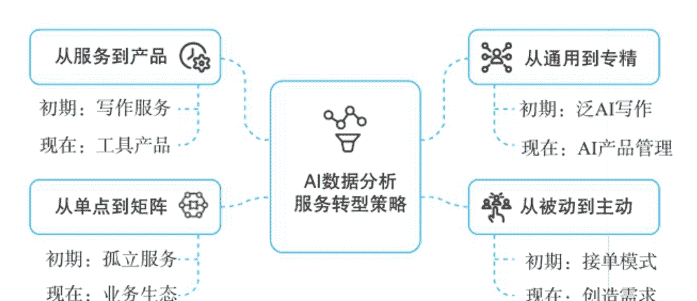

图6-6 实现的关键转变

1) 从服务到产品：降低对时间的依赖。
- 初期：每单写作2～3小时。
- 现在：工具一次开发反复卖。
- 技术：DeepSeek 助开发，豆包优化销售页。

2) 从通用到专精：在细分建立壁垒。
- 初期：泛人工智能写作，竞争激烈。
- 现在：人工智能产品管理专家，客单价高。
- 技术：通义助专业内容，即梦AI 做差异化视觉。

3) 从单点到矩阵：业务互相强化。
- 初期：孤立写作，获客难。
- 现在：内容引流→工具变现→社区留存→咨询转化。
- 技术：飞书做自动化，豆包做全渠道内容。

4) 从被动到主动：从接单到创造需求。
- 初期：在平台等单。
- 现在：靠内容与社区主动造机会。
- 技术：DeepSeek 助需求分析与产品规划。

> “这些转变互相咬合，形成价值飞轮。优质内容吸人，部分买工具，活跃用户进社区，高需求转咨询，经验再哺内容与工具。人工智能让飞轮转得更快，每个环节都有工具支撑。”

## 4. 李华的经验总结

（1）成功因素分析。
1) 专注核心优势：兼职贴近主业技能，降低学习成本。
- 充分用产品经理背景，而非从零起步。
- 把人工智能当放大器而非替代品。
- 实战建议：兼职应与你的“10 000小时专长”相关。

当我们回头拆解李华的副业跃升路径，会发现真正起作用的不是运气，而是可复制的方法论。王睿总结的底层逻辑是：副业的本质是系统设计，不是体力堆砌。

**一、用系统思维搭架子，而不是零散接单**

真正的副业矩阵，是把零散的服务串成一条闭环的价值链。
要完整描绘用户从首次接触到付费转化的旅程，把每个环节都埋上明确的下一步指引。实操上，先画一张业务关系图，看它是否能自洽流通、形成闭环，而不是头痛医头。

**二、用产品化思维做杠杆，而不是卖时间**

从重复服务里提炼模式，是规模化的关键。
把服务过程中反复出现的步骤、框架记录下来，变成显性化、可交付的知识资产。经验法则是，每完成五组同类项目，就尝试沉淀一个可复用的产品形态。

**三、用渐进路径做验证，而不是All in**

发展节奏遵循 验证—优化—放量 的三步走。
先小范围试水确认需求，再根据反馈迭代打磨，确认稳定后再加码资源。新方向的投入建议严格控制在总资源20%以内，用小成本换取真实数据。

**四、用自动化守护利润，而不是无限加班**

李华将25%的收入持续投入到流程提效和自动化建设。
把高频重复动作工具化、标准化，建立SOP并接入AI助手和自动化工具。习惯性要求每周至少优化一个重复环节，时间省下来做高价值决策。

王睿点评的核心是：李华的突破不在于智商或苦干，而在于他把2025年的AI工具生态当成赋能底座，而不是迷信技术本身。他始终以专业为锚，把AI当作放大器来用。

**三次关键转向，决定了副业的质变**

第一次转向是定位收窄。文章《AI重构产品经理工作流》爆火后，他果断放弃80%的非产品类写作单，从泛AI服务者变成AI产品管理专家。客单价从300元拉升到2000元，客户也更容易谈成。DeepSeek负责专业内容共创，豆包负责分发优化。

第二次转向是首个数字产品诞生。两周内售出50份AI产品文档模板，这是他第一次获得不与时间挂钩的收入。服务中的方法论被系统化后，完成从交付者到产品设计者的思维切换。飞书搭建专业模板框架，即梦AI负责视觉升级。

第三次转向是社区化运营。首批50名付费会员的招募，标志着他从单向输出转向双向互动。社区带来稳定月度现金流，也成为产品迭代的灵感来源。豆包做内容自动推送，Claude作为小助手处理基础答疑，把管理成本拉低了60%以上。

王睿分析，这三步并非偶然，而是系统构建中的必然节点。每一次都在验证—学习—扩展中自然展开，AI工具链在关键点上降低了转型摩擦。

**五大坑，几乎每个副业人都会踩**

过度多元化。早期同时做写作、电商、设计、培训，结果样样平庸。教训是新业务必须与现有体系有协同，重叠度低于30%就别碰。DeepSeek曾辅助他做业务关联性分析。

价格过低。初期只定市场价五成的文档服务，吸引来的是挑剔型客户。定价要看客户获得的价值，而非成本叠加。通义曾帮助他做市场定价与价值评估。

系统缺位。前期只追单不建流程，每单都从零开始。后来他为每类任务建立标准模板库和SOP。飞书搭工作流，豆包助标准化。

工具依赖陷阱。把所有流程押在单一AI平台，平台一调整就受冲击。最终采用多平台策略，关键节点都留备选方案。

知识产权松懈。早期直接分享全部模板和方法，没有访问控制。后来改为分层供给，基础公开、核心受控。Notion加DeepSeek搭建了内容权限体系。

王睿提醒，在AI快速迭代期，单一工具依赖风险被放大，弹性系统才能抗住波动。

**给新手的三条底线建议**

第一，从已有的专业出发，用AI增强而非替代。不要追求成为AI创作者，要成为某个领域的AI专家。专业深度才是差异化。

第二，宁可深耕一个细分，也别贪多求全。深度才能筑墙。写作、设计、编程、咨询一起做，最后都做不深。先在一个点上建立壁垒，再谈扩展。

第三，每上一个新的产品或服务，先自问它能否与现有业务产生协同。若答案模糊，就不值得投入。要建的是生态，不是业务堆砌。

李华补充：AI已足够强，但仍需专业引导。把DeepSeek、豆包当作超级助手，而非万能替代者。价值在于你如何设计和整合工具，形成独特的价值系统。工具好比厨师的刀，切菜水平取决于组合与技巧。

他的实战心得是：副业矩阵的成功不在于数量，而在于彼此的增值关系。当新业务能为旧业务赋能，旧业务也能反哺新业务时，1+1会远大于2。AI让这种协同更容易，但前提是清晰的系统设计思维。不要被技术可能性冲昏头，回到核心优势。

**实战启动四步**

核心评估：列出3到5项核心技能，评估市场需求与变现潜力，选定一个核心方向，用DeepSeek做市场与机会分析。

矩阵设计：围绕核心打造2到3个内容支柱，识别2到3个可产品化的工具机会，规划业务间的引流与强化路径。用豆包设计内容框架，通义验证产品概念。

实施路径：制定90天计划，明确里程碑与关键动作，估算资源投入，建立跟踪与复盘机制。用飞书管理项目，DeepSeek优化规划。

杠杆化策略：设计至少一个时间杠杆，规划一个自动化或外包方案，评估投入产出比。用DeepSeek搭建自动化流程，豆包制作标准化模板。

下周就选一个最可行的方向开始小规模测试，验证比完美更重要。

**思考自检**

你的副业是否还被时间天花板卡住？有哪些知识产品或自动化系统可以突破？

用90/10法则审视现有方向，哪些值得加码，哪些该精简？

在你专业领域，内容和工具怎样组合协同最强？能做哪些无代码小工具辅助创作？

副业结构是良性循环还是孤立单点？画一张关系图，找出连接点。

如何把矩阵原理和个人技能兴趣结合，设计出属于你的多元变现路径？

**章末寄语：从打工人到系统设计师**

在AI加持下，副业已不是简单的多份收入，而是系统性创造价值。真正的跃迁是从时间交换思维转向系统设计思维。你不再靠加班换钱，而是让不同业务相互驱动、自我放大，形成可持续的收益网络。

王睿和李华的故事证明，成功是有节奏的系统构建。从一个清晰切口出发，用90/10法则筛选，用内容与工具双轮驱动，用长期主义和杠杆思维，最终长出自动增长的网络。

DeepSeek、豆包、通义、ChatGPT、Notion、飞书等工具，让个人也能拥有过去团队级的执行力。你不必全职、不必高学历，每周几小时也能启动矩阵。

拉开差距的不是信息速度，而是系统思维的深度。当你从会用工具进化到会建系统，个人品牌与财务自由的基础就已搭建完成。今天选一个工具，定一个目标，启动一个项目，副业新纪元就此开始。

**从副业到创业，低风险转型的五大信号**

当副业开始反超主业，是否该全职？张文杰和王睿用数据回答。

财务信号：副业连续3个月收入达主业70%以上，月度波动小于30%，连续6个月环比增长15%以上，净利润率稳定在25%以上，且已积累至少6个月生活与运营资金，最大客户占比不超过30%。

市场信号：口碑推荐占新客50%以上，复购率超60%，客户满意度8分以上，提价后需求仍稳健，细分赛道有清晰差异化，已看到3个以上扩展方向。

精力信号：超过50%思考时间被副业占用，80%以上业余时间投入其中，副业带来的成就感远高于主业。热情必须与市场验证同步，否则是高风险离职。

系统信号：从纯个人服务走向流程标准化，再到工具辅助、产品化，最终平台化。可复制的交付，比个人时间更值钱。

渐进创业路径是：保留主业，先注册公司试运营3个月，最小团队起步，分阶段控制风险，进可攻退可守。数据漂亮不等于可以赌，系统就绪才是转型的底气。

副业想要真正具备创业的潜质，关键在于从依赖个人交付转向搭建可复制的运转体系。王睿的观点很清晰：当交付完全靠自己时，收入天花板等于个人可投入的时间，就像靠双手出菜的厨师，再熟练也受制于工作时长；一旦把工作变成可自运转的体系，就相当于装上了持续造血的机器，价值创造不再被时间锁住，哪怕休息时也能产生回流，这时副业才有了创业的影子。

体系化与形成产品形态的落地路径
把复杂交付拆成可复用单元。把一套营销服务拆成人群画像、内容逻辑、渠道部署等独立模块。用AI助理帮忙规划拆分方案，能更快提效、便于分工、定价更透明。
把操作沉淀为标准手册。把客户沟通、项目执行、质量核查写成清晰的SOP。借助飞书文档或AI辅助撰写，可以让交付保持稳定、减少临时决策、让新人快速上手。
把工具沉淀为可复用模板。积累分析框架、汇报模板、创意清单。扣子工作流、飞书批量创作工具很适合做这类沉淀，统一输出水准、省时间、形成差异化壁垒。
把专业经验转化为独立商品。把方法封装成线上课程、电子书、订阅内容。即梦可用于课程配图，Canva可用于封面设计。由此产生非实时收入、扩大影响力、反哺主业客户。

产品化自检
是否已建立标准化的交付流程与体系
是否沉淀了可反复调用的工具、模板与资源
是否有部分收入来自非即时交付，例如商品销售、会员费
业务是否能在本人不直接操盘时部分自运转
客户承载量能否比起步期提升三倍以上

环境与社会支持：创业的外部地基
创业不只是个人决定，外部条件会显著影响风险与成功率。

环境评估三维度
行业面：目标市场是否处于上升期，如2025年AI应用服务市场正处快速扩张；技术是否创造新机会，如TRAE自动化编程接口开放；竞争格局是否仍有空白。信号是行业增长叠加明显空档。
政策面：相关领域是否鼓励创新创业，是否有减税、补贴等扶持，小微企业税务结构是否友好。小规模纳税人优惠是常见信号。信号是政策明确友好。
社会面：家庭是否理解并配合创业选择，不会反复追问何时回体制内；人脉网络是否足够，避免创业变成孤岛；所在区域创业生态是否活跃，能否提供交流与资源。信号是家人全力支持且拥有专业人脉。

王睿总结，创业像盖房子，技术再好也看地基牢不牢。理想的时机是个人准备、市场条件、环境支持三者同频，类似天时地利人和。

社会支持的构建做法
家庭沟通要坦诚。分享财务状况、风险预案与退出策略，可用AI助手制定家庭财务安全计划，明确可承受底线，定期召开家庭会议共同决策，避免单方面通知。
专业网络要主动经营。参加行业活动、提供价值交换、培养长期关系，用AI记录互动，飞书云文档管理资源，每月保持1-2场活动并主动提供帮助。
社区融入要持续。借助孵化器、行业协会、同行圈层，借助通义灵码寻找合适的社群，每周保持一次线上线下的固定交流。

综合评估：创业时机的决策框架
王睿与张文杰做了一套评估表，相当于创业时机的检测仪。
财务表现权重30%，看收入规模、稳定性、增长趋势、利润率。
市场验证权重25%，看获客、复购率、满意度、竞争态势。
时间与精力权重15%，看思维占用、时间分配、精力投入、热情持久度。
体系化与产品化权重20%，看流程标准化、工具模板化、产品开发、扩展性。
环境与社会支持权重10%，看行业环境、政策环境、社会支持、资源可得性。

用法是每项1到5分，1分远不达标，5分高度契合，先算维度均分再乘权重汇总。
80到100分，时机成熟，可考虑全职转型，如同果实熟透可采摘。
60到79分，接近成熟，可启动过渡性准备，如同果实将熟可准备容器。
40到59分，条件尚缺，继续副业并补短板，如同果实尚青需等待。
低于40分，专注副业发展，暂不转型，如同果树刚开花需时。

张文杰强调，创业时机是多因素共同作用的结果，要理性评估而非拍脑袋。王睿自评83分，张文杰79分，数据给了信心，也明确了短板：王睿在自动化与标准化上需加强，张文杰需增加财务缓冲。两人据此制定强化计划，如出远门前检查行李。

小团队大产出：3000元月预算的高效组队
资源有限时，核心思路是把钱花在系统而非人头。王睿与张文杰采用核心加外围结构，成本可控又灵活。

精益团队结构
核心团队为内部全职或兼职，承担战略决策、客户关系、核心产品开发，投入时间或股权。如张文杰创意总监、王睿技术总监，类似游戏主角必须亲自上场。
战略伙伴圈为长期外部合作，提供专业技能或互补服务，投入项目分成与长期协议。如设计伙伴、营销伙伴，类似固定队友长期组队。
任务型外包为按需短期合作，执行标准化可拆分工作，按项目或小时付费。如内容撰写、编程实现、客服支持，类似临时组队完成任务即散。
AI工具协作是力量倍增器，用自动化替代重复，用智能工具增强产能，投入订阅费。如DeepSeek生成内容、扣子自动化客服、豆包分析数据，类似游戏装备提升战斗力。

王睿解释，这种层级结构能以极低固定成本保持高度灵活性，核心保持精简，其他通过灵活合作完成，既控制风险又保证关键环节质量。

AI赋能团队矩阵
内容创作类AI替代初级编辑作者，推荐DeepSeek创作、豆包创作、文心一言，月成本0到300元，产能提升3到5倍。
设计辅助类AI替代初级设计师，推荐即梦AI、Canva可画、豆包设计，0到200元，2到4倍。
数据分析类AI替代初级分析师，推荐通义灵码、豆包数据分析、飞书智能表格，0到200元，3到5倍。
客户服务类AI替代初级客服，推荐通义晓蜜、豆包客服、飞书服务台，0到300元，5到10倍。
项目管理类AI替代项目协调员，推荐豆包任务管理、DeepSeek助手、飞书智能日程，0到100元，2到3倍。
市场研究类AI替代初级研究员，推荐通义分析助手、豆包市场趋势、DeepSeek调研助手，0到200元，3到5倍。

王睿认为AI应被视作团队成员，像钢铁侠的贾维斯，各有职责、定期评估优化，人类聚焦创造与判断，AI负责执行与重复。

远程协作模式
基础设施包括沟通工具飞书即时通讯，项目管理豆包任务管理，文档协作飞书文档，知识管理飞书知识库，月成本0到200元。
工作协议明确在线时段、会议结构、交付标准、问题上报流程，可用AI辅助分类上报。
数字化工作流涵盖标准化入职、技能任务匹配、成果导向评估、知识共享。

实践要点是异步与同步平衡，建立文档文化减少实时沟通依赖，定期同步会议聚焦讨论与决策，决策记录文档透明留存背景。结果导向评估而非工时考核。

3000元月预算分配
优先级一客户直接感知环节，1200到1500元，用于客服、品控、项目协调，可用TRAE搭建半自动化客服。
优先级二核心生产力工具，800到1000元，订阅DeepSeek创作、通义灵码、即梦AI，并沉淀专属提示词库。
优先级三特定项目外包，500到1000元弹性预算，补齐编程、设计、内容等短板，按需采购。

低成本高绩效激励
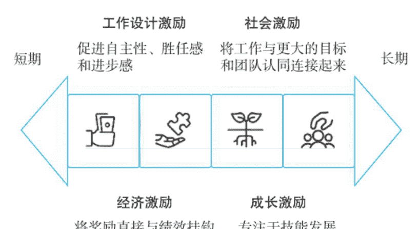

图7-1 多维激励模型

多维激励包含经济激励、设计激励、成长激励、社会激励。
经济激励为合理基础薪酬加业绩奖金加股权期权，设计阶梯式奖励。
工作设计激励给予自主权、适度挑战、即时反馈，创造心流。
成长激励提供学习认证、责任扩展、展示平台，如AIGC内容创作师认证。
社会激励传递使命感、团队归属、公开认可。

实用策略
技能投资计划，用学习配额与认证提升能力，成本低但忠诚度高。
成果展示平台，通过案例署名、行业分享、自媒体曝光满足被看见需求。
灵活工作模式，以结果考核替代坐班，提升满意度与产出。
增长分成机制，透明收入分享，利益绑定，创造创业者心态。

王睿团队的激励系统由基础薪酬、项目分成15%到30%直接分配、成长机会、公开认可构成，像游戏奖励机制，既稳住基本盘，又激发即时反馈与长期投入。

在AI创业的实践里，留人比招人更关键，规模化比忙碌更重要。下面这套打法来自一线操盘手王睿和张文杰的复盘，既有团队管理的底层逻辑，也有从服务到产品的完整跃迁路径。

一、先把人稳定住：成长与归属感构成的复合价值

做团队不是只谈钱。能力供给是一方面：每周保障5小时的学习时长，配合月度的技能提升计划，资源可以直接对接到火山引擎开发者社区或阿里云培训中心，让技术不掉队。

成果归属是另一方面：成员深度参与项目决策，交付物署名，建立个人品牌，把一次性的项目变成可累积的长期资产。

这种组合起效很明显。

> 有团队负责人总结说，这套机制让我们用远低于市场水平的成本就招到人、留住人，核心是同时满足了经济回报、成长诉求和自主感。尤其是项目分成，把个人收益和业务结果直接挂钩，让一致性极强。

一个典型是兼职设计师小林。她之前在大公司月薪过万，却每天被重复设计消耗。加入后基本报酬只有3000元，但通过项目分成和成果展示，实际收入很快追平原水平。更关键的是，她能参与完整创意链路，看见自己的想法被落地，还积累了可对外展示的作品集。这种多维度的价值体验，单纯涨薪给不了。现在的年轻人更看重这种复合职业体验，而不是只盯数字。

二、AI创业的商业模式设计：从卖服务到造产品

1. 商业模式验证与评估

商业模式是AI创业的图纸。没有验证就放大，容易掉进自我感动的坑。

验证方法有三步。

假设梳理。先把商业模式里最关键的假设列出来，尤其是价值主张和客户需求。对重要性与不确定性做排序，锁定优先验证项，并设定可量化的判断标准，避免用感觉决策。比如“中小企业愿意为DeepSeek驱动的AI内容工具付每月299元订阅”就是一个必须证伪的假设。

最小可行产品测试。用最简方案去验证核心假设，拒绝过度开发。明确通过与失败的红线，用一周而不是七个月拿到真实反馈。比如用豆包+TRAE低代码快速搭原型，测付费意愿。

迭代调整。验证结果出来就改，而不是死守初心。保持模型弹性，形成持续验证与调整的闭环。早期客户反馈可能直接推翻定价或功能优先级。

评估维度要看五件事：可行性，技术和资源能否落地；可扩展性，收入能否脱离时间线性增长；防御性，能否形成竞争壁垒；盈利能力，结构是否持续造血；可持续性，能否跟上技术与市场的变化。

张文杰和王睿的演进很具代表性。他们的商业模式经历了三次蜕变：从按小时计费的AI服务，到产品化的AI解决方案，再到现在的AI赋能平台加专业服务的混合模式。

起初他们以为客户要的是技术实现，就主推DeepSeek、豆包的技术服务。市场反馈打脸：客户要的是业务问题的解法，不关心底层模型。于是价值主张从技术能力转向特定业务问题的完整方法论与工具。

随后发现纯产品满足不了企业个性化需求，像标准西装不合身；纯服务又限制规模，像私人定制太慢。最终选择平台加服务的混合：标准化AI平台提供可扩展的基础能力，专业服务团队负责个性化支持和高端咨询。既保住毛利和规模，又满足定制。

2. 服务到产品的转型阶梯：五个关键步骤

从手工作坊到自动化工厂，本质是服务产品化。

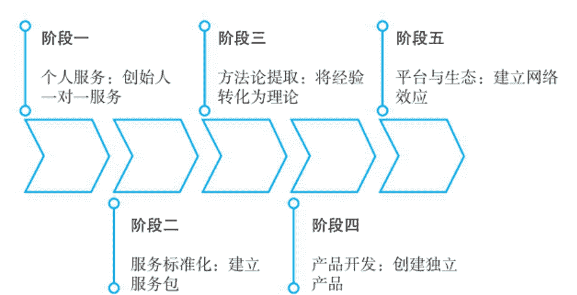
图7-2 服务产品化五阶段模型

阶段一 个人服务。完全靠创始人时间与技能，一对一交付。优点是门槛低、反馈快、现金早；缺点是时间=收入，越做越累。准备工作是记录流程、识别重复模式、整理服务菜单。典型是一对一的DeepSeek咨询，创始人亲身上阵。

阶段二 服务标准化。把服务做成套餐，建立清晰的服务包与交付流程。从按小时计费转向按项目计费，从完全定制到半定制。关键是服务手册、服务包设计、质量标准与模板库。效率提升，定价清晰，可部分外包。案例是标准化的“夸克内容策略包”。

阶段三 方法论提取。把经验提炼成可复制的方法论，从执行者变成教练。提炼核心原则、框架与模板，开发工具包与视频课程。形成知识产权，提升议价与影响力。DeepSeek创意生成五步法就是典型。

阶段四 产品开发。把方法论变成可自助使用的产品，实现自动化。从“为客户做”到“客户自己做”。需要开发软件或工具、教程与文档、支持系统与社区。收入脱离时间，毛利率提升，规模化复制。豆包AI内容助手就内嵌方法论与最佳实践。

阶段五 平台与生态。构建网络效应与用户生态，形成自增长引擎。从产品提供者到平台运营者。需要API、合作伙伴网络、用户互动与行业标准。护城河建立，增长指数化。即梦AI创意中心连接创作者与需求方就是生态。

王睿指出，五阶段不必线性走完，可以跳阶段或并行。关键是理解每个阶段要求，推动业务朝可扩展方向演进。很多创业者卡在个人服务的舒适区，收入天花板明显，就像在跑步机上奔跑。2025年豆包、DeepSeek、TRAE等工具已大幅降低产品化门槛。

实施要点

一到二：记录与标准化流程，用DeepSeek+飞书做流程文档。工具是服务手册、项目模板、定价表、标准合同、飞书知识库。最大障碍是执念于定制，突破点是先做3到5个标准服务包验证市场。

二到三：提炼方法论，回答为什么有效。工具是框架文档、决策树、评估工具、视频讲解、通义生成的流程图。障碍是隐性知识难显性化，突破点是培训他人使用方法验证可传授性。

三到四：方法论变成自助工具。工具是通义灵码开发平台、豆包低代码、用户指南与知识库。障碍是技术与用户体验，突破点是用最小可行产品快速验证。

四到五：建立网络价值。工具是API文档、合作伙伴计划、社区平台、用户生成内容。障碍是冷启动与多方利益平衡，突破点是激活核心用户并放大成功案例。

张文杰的内容服务产品化历程是教科书。先发现80%工作是重复的，像厨师重复炒同一道菜，系统记录后提炼出DeepSeek内容创作六步法。

第一个拐点是把方法打包成固定服务，按项目成果定价，时薪从200元提到约500元。

第二个拐点是把方法论做成课程与工作包，用Canva可画与Kimi做精美材料，开始带团队“分身”。

第三个拐点是开发AI内容助手软件，内置模板库、提示词生成器与质检工具，用扣子低代码与TRAE搭初版，转向订阅模式。

最新一步是做AI创意社区平台，连接创作者与需求方，从服务提供者变平台运营者。核心是把个人知识逐步变成可复制、可分享、可自动化的系统。

3. AI创业的收入模型：构建多层次收入流

单一收入是脆弱的。多条腿的凳子更稳。

收入模型矩阵

服务收费，按项目或小时计费。优点是启动快、现金早，缺点是难扩展、受时间限制，适合起步验证期。

订阅收入，定期付费使用产品或内容。可预测、可长期，获客成本与持续价值是挑战，适合成长期。

使用许可，按用量或功能计费。门槛低、收入随使用增长，但波动大，适合扩展期。

交易佣金，撮合后抽成。与价值直接挂钩，但依赖交易量，适合平台期。

培训收入，知识传授与能力建设。利润率高、有助品牌，但扩展受限，需持续更新，适合任何阶段。

王睿说，不同模型像不同投资品种，关键是组合对冲风险。他们从重服务逐步转向产品与订阅，像从打零工到开店再到连锁。

演进节奏

起步第1到6个月，主导收入服务费超80%，辅助做小型数字产品与基础培训。核心是现金流与生存，同步记录流程、积累案例。

验证第7到12个月，标准化服务占60到70%，数字产品与会员订阅占20到30%。重点测试产品市场契合度与重复购买，完善产品与营销。

扩展第1到2年，产品订阅与平台费占40到50%，高端服务占30到40%，生态收入占10到20%。扩大用户基础、提升LTV、搭建可扩展系统。

成熟2年后，平台与订阅超60%，高端服务20到30%，多元收入10到20%。建立网络效应、拓展新市场与壁垒。

落地策略

核心与互补产品。核心产品用订阅制承载主要价值，像手机本体。围绕它做模板库、配件、咨询等生态。工具组合是TRAE开发核心、扣子搭配套服务、即梦AI做视觉资产。示例是DeepSeek内容助手平台加专家模板库加咨询服务。

价格阶梯。给不同客群不同选择，从免费到专业版99元月、企业版399元月，再到定制项目制。用豆包分析转化率找到甜点。

收入多样化路径。先用单一服务验证价值主张，建立信任；再按客户反馈补充产品与服务，覆盖全生命周期；持续测试新收入流。

王睿与张文杰的收入演进印证了这一点。初期95%靠咨询服务，6个月后推出AI创意工具包一次性299元，用通义灵码开发原型、即梦AI做包装；随后上线AI创意加速器会员社区月付99元。一年后产品与订阅占比45%。

现在结构是产品订阅50%、专业服务30%、培训认证15%、其他5%。现金流更稳、抗风险增强、人均创收提升3倍。

他们认为国产AI工具如DeepSeek、TRAE已能支撑高质量自动化产品开发，市场付费意愿也在提升。收入多样化既是风控，也是价值最大化，像渔夫用不同网捕不同鱼。

4. 扩展性设计：突破个人限制的增长引擎

瓶颈分析框架

时间瓶颈。收入和创始人时间绑定，忙得像陀螺却难增长。解法是标准化、团队化、自动化。指标看人均收入、收入/时间比。

知识瓶颈。业务依赖少数人经验。解法是知识管理系统、培训体系、决策工具。指标看文档化率、非专家成功率。

客户瓶颈。获客依赖个人关系。解法是营销系统、自助服务、渠道与品牌。指标看自动获客比例、客户自助率。

交付瓶颈。交付高度定制、重复造轮子。解法是模块化、产品化、自动化交付。指标看标准化交付比例、交付时长与满意度。

张文杰强调，发现并解决扩展瓶颈是做大的关键。大多数人只盯新客户，忽视内部系统设计，结果越忙越小。通义灵码与DeepSeek能解决很多传统瓶颈，前提是先识别问题再系统设计。

系统性扩展策略见图7-3

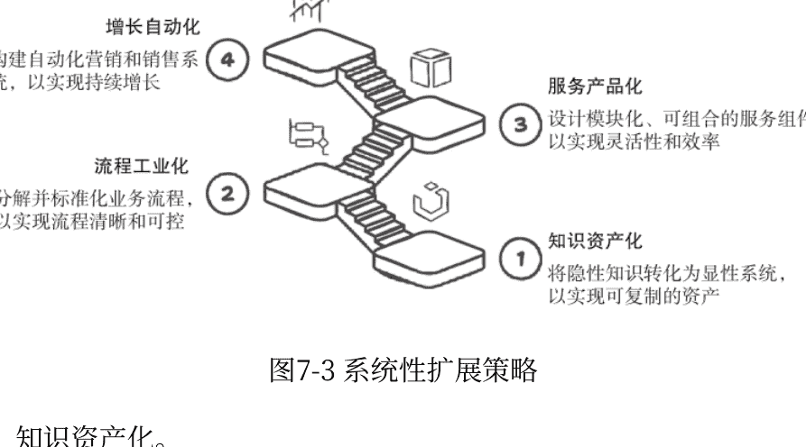
知识资产化是起点。把隐性知识变成显性系统，大脑变成可复制资产。用知识库、决策树、评估工具存进飞书文档，建立培训体系与新人上手传送带。比如开发飞书AI创意决策系统并用即梦AI可视化关键流程，让专家经验可复制。

当系统开始为你工作，业务才能真正脱离个人限制，进入可持续增长轨道。

业务可扩展的三大支柱

流程工业化
把业务拆成可复制的标准动作，让运营像流水线一样可视、可控。先明确岗位边界，做到责任清晰；再搭建质检与反馈闭环，保证标准化不牺牲品质。举例来说，内容生产被拆成六道标准工序，由不同角色分工承接，并用豆包做质检监控。

服务产品化
把定制服务拆成模块化组件，像乐高一样自由组合。建立统一的交付SOP，把边际成本压下来；同时上线自助选配与工具，减少人工介入。比如把咨询变成可点选的模块套餐，客户自助拼装方案。

增长自动化
搭起全天候的自动化营销与销售体系，相当于拥有一个不下班的虚拟销售团队。做客户自助注册、账户管理的闭环，用数据驱动的优化循环持续迭代。例如用TRAE或Cursor搭建内容营销漏斗，实现线索获取与跟进全自动。

【深入案例】张文杰和王睿的扩展性突破
“我们最初的最大瓶颈是内容创作的专业壁垒，就像一条窄巷，所有车流都被卡在同一个咽喉口。高质量内容必须由我亲自产出或把关，规模自然上不去。”

第一次跃迁是把创作方法沉淀为AI内容创作手册，结合飞书文档与即梦AI做流程可视化，明确决策路径、质检标准与常见问题处置。团队可直接上手，创始人只做终审，产能约提升3倍，相当于把小路拓成双向车道。

第二次跃迁是上线DeepSeek内容智能辅助系统，80%的创作环节被自动化，结构设计、资料搜集、初稿生成都交给系统。配合通义灵码与豆包搭建智能工作流，在保持水准前提下产能再拉升约10倍，相当于双车道升级为八车道高速。

最关键的跃迁是构建内容创作生态，把创作者、需求方、资源方连起来。角色从内容生产者转为平台运营者，扩展能力发生质变，就像从修路转向运营整个交通网络。

这一系列系统化改造让团队人均产值从起初约1万元/月升至8万元/月，业务体量扩张15倍。核心启示是：扩展性靠设计而非灵感，像建筑师先出蓝图再施工。在AI加持下系统化扩展更容易，但前提是思考要比AI更深、更系统。

AI创业的技术与商业平衡

AI创业的核心矛盾是技术深度与商业价值的权衡。过度技术导向会造出无人使用的超级计算机，过度商业导向则沦为只喊口号的产品。王睿与张文杰的实践提供了平衡思路。

技术与商业平衡的四种模型
1）技术驱动模型
以独家算法或模型为壁垒，研发投入大、壁垒高但商业化慢，适合有强技术背景与突破性技术的团队。
2）应用集成模型
整合现成AI能力解决具体问题，技术是手段。优势是上线快、痛点清晰，劣势是差异化易被复制，适合有行业与商业背景的团队。
3）行业专精模型
把AI与深度行业know-how结合，做垂直方案。壁垒高但市场可能受限，适合有特定行业经验的跨界团队。
4）平台赋能模型
为他人使用AI提供工具与平台，追求网络效应与规模。长期价值大但启动难，适合有平台思维与技术能力的团队。

“模型选择取决于团队背景、资源与市场机会，像选车一样，跑车、SUV、卡车各有场景。”王睿指出，“我们采用应用集成加行业专精的混合打法，既匹配能力又能快速验证。当前中国AI底层趋于成熟，应用创新与垂直专业知识的价值更凸显。”

平衡落地的四个策略
价值先导原则：从客户问题出发再选技术，先问为什么再问怎么做；工具服务于结果，够用即可。
适度技术深度：在差异化点自研，非核心用好现有工具如豆包低代码，避免重复造轮子；如内容生成自研，基础设施用云服务。
持续学习循环：建立技术雷达跟踪国产AI更新，设快速实验机制小规模试错，管理技术债防止系统老化。
双轨开发：主轨保障当前收入与客户满意，探索轨投资长期创新，常设80/20资源配比。

【深入案例】王睿和张文杰的技术商业平衡策略
“对大多数客户，AI只是工具，不是目的。没人关心电怎么来的，只关心灯亮不亮。”这一认知让他们避开为技术而技术的陷阱。

他们的策略是：问题导向，每个技术决策必须回答是否解决真实客户问题；分层技术，核心差异化自研，通用功能调用API；快速市场验证，8周内看不到市场反馈就调整；双重评估，技术与业务团队共同拍板。

结果是技术够先进以形成差异，也够务实以快速落地，既不掉进纯技术玩具的坑，也不陷入无技术深度的空心。

从副业到创业的转型智慧

关键洞察与行动建议
创业时机判断：创业是理性决策。用评估表定期打分，财务、市场验证、个人准备度齐备后再转型，季检一次。
渐进式转型：分试水、验证、扩展、全职四阶段，每阶段设进入与退出标准。
商业模式设计：用画布整体思考，定期更新并用实验验证假设。
从服务到产品：识别可标准化的流程，设计产品化路径。
多元收入结构：设计至少三种互补来源，按阶段调整组合。
团队构建：核心+外围结构，AI替代部分人力，明确内部必控职能。
风险管理：准备至少6个月生活储备金，设退出策略与应急预案。
技术创意平衡：技术决策问价值，商业决策问技术支撑。

副业创业者到成功创始人的五个转变
从执行者到设计者：从“我怎么完成”到“如何设计能自动完成的系统”。
从技能专家到价值创造者：从卖时间技能到解决百万级价值问题。
从单点思考到系统思维：用系统图看清要素关系。
从短期交易到长期关系：关注客户旅程与终身价值。
从个人英雄到团队建设者：把个人知识系统化传递给团队。

未来趋势：垂直领域AI专精
底层通用工具普及后，价值向垂直行业专业方案集中。机会在于把DeepSeek、TRAE等技术与行业专业知识深度融合。

实战练习：我的AI创业转型评估与路线图设计
第一部分创业时机评估与财务安全网：自评打分、补短板计划、12个月生活费计算、分层资金体系、副业收入阶梯。
第二部分商业模式设计与服务产品化：画布填写、关键假设验证、MVP方案、五阶段评估与转型路径。
第三部分团队与资源规划与风险控制：3000元/月精益团队设计、人机协作流程、分阶段扩张、渐进式四阶段计划。
第四部分90天行动计划：月目标、周任务、追踪调整机制、定期决策节点。

思考
如何把握准备与机会的平衡？哪些准备必须到位，哪些可在行动中完善？
如何甄别长期合伙人？技能互补与性格匹配的权重如何？重大分歧如何处理？
过度依赖AI是否削弱核心竞争力？技术快速迭代下如何保持商业模式韧性？创业者不可替代的价值是什么？
低风险路径是否错失高回报？在快速变化环境中，谨慎与果断如何取舍？
员工思维到创业者思维的转变对心理与家庭有何冲击？如何保持平衡与平静？
技术迭代快，商业模式易过时。应追前沿还是深耕应用？如何设计可持续模式？

章末寄语：创业是一段精心设计的旅程
从副业到创业不是冲动跳跃，而是系统设计、持续学习与适应变化的过程。AI时代机遇与挑战并存，敏捷与价值并重。成功取决于设计并执行从愿景到现实、从个人才能到商业价值的转化路径。

“千里之行，始于足下。”关键是迈出有意识、有准备的下一步。

第8章 AI营销攻略：让你的副业产品卖得更好

开篇：张文杰的营销困境与突破
张文杰看着运营三个月的AI写作服务数据，流量与转化持续低迷。产品与定价都没问题，为何卖不动？

王睿提示：2025年仍用传统营销思维就会被淘汰。他展示的数据：上月通过AI营销，流量涨8倍，咨询增12倍。

“传统营销靠直觉，AI营销靠数据。我用DeepSeek拆解用户行为，做个性化内容投放，再用数据闭环优化投放，像给营销装上智能导航。”

优质内容只是成功一半，让内容被看见、被选择才是关键。

每个渠道都有自己的分发逻辑，素材要么被推到前面，要么被沉下去。同样的话术在不同赛道产生的效果截然不同，王睿把这归因于规则差异。先搞清评判标准再出手，曝光才会有入口。

表8-1 平台算法的核心考量因素

| 平台 | 核心考量因素 | 内容偏好 | 最佳发布策略 |
| :--- | :--- | :--- | :--- |
| 小红书 | 互动率、完成率、停留时间、新鲜度 | 真实体验、干货分享、视觉优先 | 垂直领域深耕、高质量图文结合 |
| 知乎 | 专业度、完整度、有用度、互动质量 | 深度解析、专业观点、问题解答 | 系统化知识输出、热门问题回答 |
| 微信公众号 | 阅读完成率、互动率、转发量、订阅者黏性 | 深度文章、实用工具、情感共鸣 | 更新节奏固定、系列内容输出 |
| 抖音/视频号 | 完播率、互动率、转化率、原创性 | 短视频内容、实用技巧、娱乐性 | 垂直定位、高频率更新、快节奏 |
| 今日头条 | 点击率、阅读时长、互动量、领域相关性 | 即时资讯、深度分析、实用信息 | 紧跟热点、标题清晰、定位专业 |
| B站 | 完播率、评论互动、弹幕密度、创作质量 | 特色内容、专业解析、圈层文化 | 持续输出、社区互动、垂直深耕 |

表8-1 平台算法的核心考量因素

王睿补充说，偏好本质上是一种筛选器。短视频更看重看完与互动，问答更看重专业与实用，错位投放就会吃亏。就像餐厅各有菜单标准，不能把刺身端进火锅店。张文杰自嘲自己长期用同一套模板硬套各处，难怪起色平平。

### 2. 流量分配的智能解码

机制总在变化，怎么跟上？张文杰发问。

让智能体当侦探就是答案。王睿解释，批量处理海量数据就能摸清当下的偏好走向。

三段式解析法。

1）信息汇聚
- 拆解高曝光素材的共性
- 追踪同一素材在不同时间段的表现波动
- 对比各类形态的触达差异

2）规律归纳
- 靠模型归纳头部素材的共同特征
- 定位带来高参与的关键要素
- 摸清高效的结构与投放时段

3）方案修正
- 基于洞察迭代方向
- 用对照实验验证不同形态
- 持续追踪并动态适配机制变化

现场演示里王睿说，以小红书为例，整理了近三个月五百篇表现突出的AI主题笔记，规律很清晰。

小红书高流量素材模式分析
1）标题特征：带数字如“7种方法”的标题，点击表现比普通标题高约56%。
2）结构特征：首图对留存影响极大，步骤清晰的笔记完结度比对照组高41%。
3）参与设计：结尾留开放式提问的笔记，评论数平均高出2.3倍。
4）投放时段：晚8点到10点发布的笔记，冷启动流量平均高出23%。

这其实就是渠道给出的隐形攻略。抓住要点，改进就有方向，就像考前拿到重点清单。

### 3. 素材提效的自动化路径

王睿打开DeepSeek演示。相比海外模型，DeepSeek在中文语境和国内渠道的理解上更贴合，既能生成也能诊断和改进。

素材改进指令示例：
请基于以下渠道机制偏好，对我的素材进行改进以提升曝光：
渠道：[小红书/知乎/微信公众号/抖音等]。
目标人群：[人群描述]。
主题概述：[主题说明]。
核心卖点：[产品/服务主要价值]。
请给出：
(1) 3个贴合机制偏好的标题备选，带情绪触发与好奇心。
(2) 改进的结构，包含起承转合。
(3) 5条提升参与的关键建议。
(4) 2～3个能引发共鸣的提问设计。
(5) 建议的发布时间与关键词标签。
原始素材：
[粘贴原始素材]。

张文杰看完输出惊讶：“感觉把普通T恤改成了量身定制。”

随后再给出智能驱动的曝光最大化流程。

发布前评估
1）用DeepSeek或豆包评估素材与当前机制偏好的契合度
2）预判流量瓶颈并提前规避
3）锁定最佳投放时间窗口

多版本试错
1）为同一主题做3～5个差异化版本，区别在标题开头和结构
2）小范围投放观察表现
3）选优后再放大投放

参与增强
1）植入机制友好的引导参与点
2）设计沉浸式体验提升停留
3）用模型生成个性化回复提升参与度

素材生命周期管理
1）监测表现曲线，择机二次分发
2）根据反馈迭代元素
3）维护规律更新日历，保持活跃

空间数字体验融合
1）加入AR展示组件提升互动
2）插入3D元素增强视觉
3）打造沉浸式体验延长停留

用这套体系后，我的客户曝光平均提升6～10倍。王睿强调，核心在系统化与数据驱动，而非凭感觉。

### 4. 跨渠道适配：单次产出，多处触达

我没精力为每个渠道单独写。张文杰担心工作量。

不需要。王睿说，用豆包和通义就能实现单次产出多渠道分发，像做一道主菜再按口味调味。

智能跨渠道转换流程：
核心素材创建
1）选定主渠道做深度沉淀
2）确保素材具备完整价值

渠道特性拆解
1）用智能体拆解目标渠道的调性与格式
2）明确风格与呈现要求

自动转换
1）用豆包或通义把核心素材改写成各渠道适配版
2）保留核心主张，转换表达方式

渠道专属改进
1）补充专属元素如标签参与设计
2）调整篇幅深度匹配用户习惯

以“AI写作工具比较”为例，同一主题在小红书变成视觉化的步骤笔记，在知乎变成深度分析，在抖音则变成快节奏演示脚本。核心不变，表达随渠道变形，像变色龙一样。如此一篇素材就能覆盖多个人群，触达可提升5～10倍。

### 5. 病毒化设计：让素材自发传播

除了机制，还有自传播能力。王睿把病毒式传播比作滚雪球，推出后越滚越大。

病毒化五要素：
1. 情绪触发：带来惊讶、愤怒、喜悦或深度共鸣
2. 实用价值：提供可直接用的信息或解法
3. 社交货币：让分享者显得更懂行、更前沿
4. 叙事结构：有钩子、反转或好故事
5. 紧扣时事：与当下热点强关联

案例分享：张文杰的自传播成功案例
应用上述策略后，他策划的“7天从零开始用AI写作，实现年收入10万元”系列总浏览超25万次，是过往平均水平的15倍。关键包括：被裁员到月入过万的逆袭故事引发共鸣；7步可执行框架清晰易用；每段结尾设置开放问题；按渠道调整形式与参与点；核心素材单次产出分发至6个渠道。

失败案例分析：何小姐的营销滑铁卢
何小姐经营手工香薰，为模仿对手用《震惊！这款香薰可能正在毒害你的家人》做标题。短期流量虽上，但带来三个后果：吸引大量非目标人群，参与质量低；老粉丝反感，取关率达30%；负面情绪损害品牌形象，销量下滑40%。病毒素材必须与品牌调性一致且创造正面价值，否则双刃剑会反噬。

王睿总结，智能时代获流是科学问题而非猜谜，有数据与系统就有确定性。

二、定制化营销自动化：一次配置，持续转化

获得流量只是起点，转化才是关键。就像把人引进商场不难，让他们付费才是难题。

图8-2展示了智能营销漏斗的五个阶段

意识阶段
目标：让潜在客户认识你的价值
智能应用：基于兴趣行为画像识别潜在人群
素材策略：价值泛展示、痛点唤醒、入门科普

兴趣阶段
目标：激发深入了解的欲望
智能应用：追踪互动行为识别兴趣点
素材策略：深度解析、案例分享、解法框架

考虑阶段
目标：证明方案优于替代品
智能应用：预测决策顾虑，提供针对性信息
素材策略：对比分析、专家背书、产品细节

转化阶段
目标：促成购买
智能应用：识别购买信号，给出个性化促销
素材策略：限时优惠、社会证明、风险消除

忠诚阶段
目标：复购与推荐
智能应用：分析使用模式，预测升级机会
素材策略：使用指南、成功案例、专属福利

### 2.客户旅程映射：智能体精准识别决策阶段

怎么判断访客在哪一步？

靠行为数据映射。王睿比喻这像侦探从脚印推断轨迹。

表8-2 AI客户旅程映射的关键指标

| 决策阶段 | 行为指标 | 内容互动 | 转化可能性 | 最佳响应策略 |
| :--- | :--- | :--- | :--- | :--- |
| 意识阶段 | 首次访问，浏览时间短，跳出率高 | 浏览概述内容，查看“关于”页面 | 5%～10% | 提供价值教育，建立问题意识 |
| 兴趣阶段 | 多次访问，停留时间增加，浏览多个页面 | 阅读深度文章，下载指南，关注社交账号 | 15%～25% | 提供深度内容，展示专业能力 |
| 考虑阶段 | 查看服务详情，比较不同方案，阅读案例 | 研究案例和常见问题，比较页面 | 30%～45% | 提供对比信息，消除顾虑 |
| 转化阶段 | 查看价格，访问购买页面，开始但未完成购买流程 | 查看定价页面、退款政策和联系方式 | 60%～75% | 提供促销优惠，简化购买流程 |
| 忠诚阶段 | 完成购买，重复访问，查看高级功能 | 阅读使用指南，参与社区讨论 | 75%～90%以上 | 提供增值服务，鼓励分享 |

表8-2 AI客户旅程映射的关键指标

据王睿介绍，2025年这类预测下一步行为的准确率已超过85%，可用通义或豆包来实现。

### 3.定制化素材推送：对的人，对的时间，对的信息

定制化素材推送策略：
1) 基于行为的定制化：浏览后自动推送相关比较素材
2) 基于阶段的定制化：对考虑期人群推送案例与对比
3) 基于人口统计的定制化：企业用户推商业版，学生推教育优惠
4) 基于时间的定制化：在用户活跃时段投递，提升打开率

定制化素材矩阵见表8-3

| 决策阶段/用户类型 | 企业营销经理 | 自由内容创作者 | 小企业主 |
| :--- | :--- | :--- | :--- |
| 意识阶段 | 如何用 AI 降低 50%的内容营销成本 | AI 写作：从业余到专业的捷径 | 小企业主的 AI 营销指南：节省时间与预算 |
| 兴趣阶段 | 企业案例：AI 如何重塑内容团队的效率 | 6 位自由作家如何用 AI 将收入提高 3 倍 | 无须技术背景：小企业 AI 应用实战 |
| 考虑阶段 | 企业级 AI 写作工具对比：功能、价格与 ROI | 专业作家的 AI 工具选择：权衡利弊 | 小企业预算内的 AI 解决方案对比 |
| 转化阶段 | 限时企业方案：包含团队培训与定制化 | 专业创作者套餐：首月半价＋作品集优化 | 小企业启动包：简单上手＋7 天退款保证 |
| 忠诚阶段 | 企业专属：高级功能使用指南与案例分享 | 创作者社区：互助资源与专属 AI 创作模板 | 小企业成长：如何随业务扩展 AI 应用 |

表8-3 个性化内容矩阵

每一个交叉点都是精准投喂，构成自动化营销的基础。

### 4.营销自动化工作流：无须人工干预的转化系统

张文杰担心人工跟不上海量人群。王睿提出建立自动化工作流，相当于一支全天候销售团队。

基础自动化工作流设计：
1. 触发条件：定义启动序列的行为或事件
2. 条件分支：按属性或行为分流
3. 等待步骤：设置合理间隔
4. 操作步骤：发送邮件、推送、短信等
5. 目标追踪：监控转化与响应

自动化工作流案例：免费AI写作指南下载后的转化序列
触发事件：用户下载指南
立即行动：发送感谢邮件，附领取链接与快速入门提示

在一条跑通的自动化私域里，用户的每一次点击都在牵动下一封内容的走向，而不是一股脑地往外砸邮件。

先看一个经典的进阶培育节奏。用户拿到资料后先空出48小时让他去阅读指南。两天后系统检查他是否点开了指南链接：点了，就补一波进阶干货“7天AI写作实战计划”；没点，就发一封温和的提醒“AI写作指南别错过了”。再等72小时，再次判断：他有没有去逛服务页？去过了，直接给新客首单9折的专属价；没去，则推送一篇成果故事“AI写作如何帮人把收入做上去”。又隔两天，收尾一封“最后机会，限时优惠快结束了”。全程盯着打开率、点击率和最终转化，2025年的新玩法是系统会根据用户的反馈自动微调后续文案的情绪和紧迫感。

王睿这样形容这个流程：“设好之后它自己跑，像个永不下班的销售助理，睡觉时也在帮你成交。”张文杰半开玩笑地问这会不会像科幻片。王睿的回答很实在：做得好的序列，客户整体转化普遍能提升四成到六成，核心在于持续测试、不断优化模式。

自动化也有翻车现场。王睿提到李先生卖高端茶叶，他在用户下载资料的七天里狂发八封邮件加四条短信。结果退订率冲到六成，投诉变多，品牌受损。问题在哪？频率过密、内容雷同、完全不看用户反应，就像刚认识一个人就天天打电话催结婚。合理的初次触达频率是一周两到三次，内容要有差异化价值，必须提供清晰的退订入口，最关键的是要有分支逻辑，根据用户行为调整后续动作。

做好了的自动化只是计划性触达，更即时的武器是触发式营销，也就是在用户决策的关键瞬间立刻响应。

高转化场景有四类。购物车被丢弃，离开后半小时到24小时内发提醒，必要时给小额折扣，平均能挽回15%到30%的交易，2025年还能蹦出实时智能助手做一对一挽回。浏览高意向页比如价格页、服务详情页，访问期间或24小时内给即时聊天或相关案例，页面转化能提升40%到60%。内容深度互动，比如连续读多篇文章或看多个视频，第三次互动后推送深度资源或入门优惠，这类用户的转化比普通访客高三到五倍，2025年还能用智能内容路径预测下一步兴趣。服务使用里程碑达成后立刻庆祝并推荐下一步动作，升级和续费率能提高25%到40%。

王睿说触发营销的魅力是即时加相关，恰好在用户最在意时出现。设计模板大致是：触发事件、触发人群、营销目标、响应时间窗口、用户情绪预判。响应内容要包括吸睛标题、核心价值信息、个性化元素、紧迫感设计、明确行动指令。跟进策略则分用户响应和不响应两种分支，同时准备情绪调节方案。

张文杰把这套搬到自己的AI写作服务上。当潜在客户在案例页停留超过三分钟，就自动发一封“还想了解更多吗？”，回复率达到62%。试用到付费从15%拉到37%，咨询到签约几乎翻倍。设置好后系统自运转，他终于能把精力放回服务本身，而不是整天盯着获客。

有了触达，就要看数据。营销不是盲投，需要一套仪表盘。流量端看访问量是否持续增长、独立访客新老比例是否平衡、渠道占比是否分散。参与端看平均停留是否超过两分钟、单次浏览页数是否大于两页、互动率是否在3%以上。转化端看转化率是否在2%到5%区间、客户获取成本是否低于客户价值三分之一、从首次访问到转化是否在7到30天内。经济端看ROI是否超过200%、客单价是否持续提升、客户生命周期价值是否超过CAC的三倍。

读懂指标只是开始，AI分析工具让解读变得友好。基础分析有百度统计、神策、诸葛IO；社媒分析有新榜、灰豚、飞瓜、蝉妈妈；内容效果有新榜清博、抖音热点宝；转化优化有神策热图、Ptengine、GrowingIO热图；广告分析有巨量千川、腾讯广告洞察、阿里妈妈达摩盘、京东商智；全渠道整合有阿里云Quick BI、腾讯云BI、神策SDAF、GrowingIO全渠道。2025年的工具能直接告诉你“转化率跌8%，很可能是上周表单让填写时间多了40秒”，并给出简化字段、优化移动端等具体建议。

要确定改进是否有效，就靠A/B测试。标准流程是确定目标指标、基于洞察形成假设、制作A/B两个版本、随机分流、收集足够样本、分析结果、实施胜出版并进入下一轮迭代，AI还能自动学习提出下一轮建议。这相当于用小流量做微型实验室，降低创新风险。

常见测试点包括标题主题行，典型提升15%到40%；CTA文案颜色位置大小，提升20%到95%；视觉元素提升10%到40%；价格呈现提升15%到100%；内容结构提升5%到35%；社会证明提升15%到70%；落地页整体设计提升25%到250%；投放定向提升30%到400%不等。

再多触点，也要知道谁真正起作用，这就是归因。最后点击归因把功劳全给最后一步，简单但忽略前期影响；首次点击归因看发现价值；线性归因平均分配；位置归因加重首尾；时间衰减归因给近期更高权重；数据驱动归因用算法动态计算，最精确但需大量数据；空间路径归因用于AR/VR体验分析。

落地要统一UTM追踪、做跨设备识别、记录转化价值。初级可用百度智能分析，中级可用专业归因工具，高级可用阿里云数据中台。郭老师的案例很典型，他用最后点击发现抖音直接转化少，就砍掉80%预算转投小红书，结果整体销售额跌35%。复盘发现超过60%的最终买家最初是抖音看见课程，后续才在其他渠道成交。抖音是认知助推手。小红书虽然直接转化多，却缺少上游供给。类似地，AR演示直接只贡献5%转化，但参与过的人最终转化率高达78%。重新分配预算后，营销效率提升37%。

回头看过去，还要预判未来。AI预测分析能做需求预测，比如提前判断电商文案需求在六月会季节性上升；转化预测，把访客按转化概率排序，85%高潜用户给予VIP跟进；客户生命周期预测，识别高价值特征以调整投放上限；趋势预测，提前卡位热点。2025年的预测会融合行业大数据、社会事件和季节性因素。

王睿展示过一个实测：系统预测未来三个月AI短视频创作需求将涨67%，AI长文写作平稳，AI个性化定制内容会成为新增长点。张文杰提前三周上线AI短视频脚本生成服务，等需求上来时已有案例和口碑，抢占先机。

自动化、触发、数据和预测拼在一起，就像给业务克隆了一支24小时在线、不需要加薪的营销团队。它不会代替洞察，但能把洞察执行到极致，并不断自我进化。

【预测偏差的案例】刘先生的重注失算

“借助预测系统仍会出错。”王睿语气严肃，“我经手过一家家居设计工作室的老板刘先生，他用市面上很火的趋势预测工具判断极简风格将在2025年第二季度爆发，系统甚至给出增长翻倍的预估。他立刻追加资金扩建极简产品线，门店陈列也全部换成极简调性。”

“结果呢？”张文杰追问。

“落差很大。”王睿答道，“实际增速仅15%，根本覆盖不了成本线。复盘后发现模型主要吸收全球热度信号，对本地消费者的真实偏好捕捉不足，样本量也太小。刘先生直接亏损将近十万元。”

“该怎么降低这类风险？”

“可以养成三项自检习惯。第一，别把单一模型的结论当成大额资金决策的唯一依据；第二，先做小规模投放，用真实市场反馈检验判断是否成立；第三，采用分批投入的节奏，随市场表现滚动调整。模型只能提供方向参考，不能直接下指令。”

“即便如此，基础的前瞻仍有价值。”王睿补充，“关键在于把预判落地成可执行的动作。预判未来的意义不在于炫技，而在于让我们更从容地安排当下的资源配置。”

“我感觉像是多了商业透视眼。”张文杰兴奋地说，“能提前看到别人看不到的窗口。”

“没错。”王睿笑着回应，“这种透视能力建立在数据与科学之上，并非玄学。”

在持续用数据做迭代后，张文杰的投放产出明显提升，相同预算撬动的成效接近三倍。更关键的是，他能清晰核算每一笔营销支出的回报，不再靠感觉盲投。

“最大的变化是心态。”张文杰告诉王睿，“过去投放时总是忐忑，现在有了数据指引，我感到格外踏实。”

四、全渠道内容策略：用智能化手段梳理营销矩阵

一、全渠道运作逻辑：构建连贯的客户触感

“现在的受众不会只待在一个平台。”王睿说，“有人在小红书种草，在百度检索，通过微信沟通，体验AR演示后再决定购买。全渠道的核心是让各个触点之间的体验连贯顺滑。”

张文杰点头：“我也发现用户路径很分散，管理这么多平台很乱，像同时练好几种武术。”

“需要系统化的方法。”王睿说，“借助智能手段可以在保持整体调性的前提下，适配各渠道特性。好比一位优秀演员，角色内核不变，能适应不同舞台。”

差异对比见表8-8。全渠道重视用户而非触点，每个接触点都是旅程的一部分，而非孤岛。就像一部电影，每个镜头都服务整体叙事。

“让我想到拼图。”张文杰说，“单块看不完整，拼起来才是全貌。”

“比喻很准！”王睿赞许，“智能助手就是帮你更快找到每块拼图位置的帮手。”

二、平台分工：为每个渠道定战略

“先明确每个渠道在旅程中的分工。”王睿解释，“不同平台擅长不同事，像团队里各司其职。”

战略规划见表8-9。小红书负责发现与灵感，知乎建立专业与深度教育，微信生态做关系维系与深度转化，抖音视频号抓注意力，搜索引擎抓需求，邮件做一对一培育，B站做深度解析与教育。每个平台都有独特价值，关键是给它设定清晰目标，别指望所有渠道都直接成交。像足球队，不是每个人都要进球。

三、信息矩阵：跨渠道保持统一表达

“确定角色后，就要搭建内容矩阵。”王睿继续说，“保证信息在多渠道一致，同时贴合平台习惯。就像交响乐总谱，各声部协同奏响同一主题。”

设计流程分三步。先锁定品牌价值主张与核心卖点，建立统一语调与信息框架，制作可复用的核心资产，打好视觉识别。其次按平台特性调整格式与篇幅，核心不变表达因地制宜，设计平台专属互动，按算法优化结构。最后做渠道互链，规划跨渠道引导路径，保持叙事连贯，用内容面包屑帮助导航。

很多人营销不连贯，是因为不同平台说不同话、换不同人设，像人格分裂，客户会怀疑品牌唯一性。

规划工具见表8-10。矩阵保证了覆盖面，同时让每个渠道的内容形式匹配受众。核心信息统一，只是讲述方式不同，就像同一个故事讲给不同听众。

“我喜欢这种可视化。”张文杰说，“不用每天早上对着空白页面发愁。”

“有了路线图，你就不需要即兴发挥。”王睿点头，“每天都有方向。”

四、素材复用：一次产出，多处分发

“做这么多内容听起来很累。”张文杰担心，“我只有24小时，不可能变成多头怪兽。”

“这正是再利用的意义。”王睿笑道，“不是为每个渠道从零造内容，而是把同一核心素材智能转换。像一团面，能烤出各种面包。”

策略包括核心到卫星，先做详尽的核心长文，再拆分为各渠道卫星内容并回流；拆分与合并，按渠道需求调节深度，用智能工具保持逻辑连贯；格式转换，文字变脚本、视频提炼文章、数据可视化、对话转口播、2D升级3D/AR。

“再利用就像聪明的厨师。”王睿解释，“周日烤一只鸡，周一做沙拉，周二做汤，周三做三明治，一次投入多次回报。”

五、全渠道协同：实现无缝体验

“真正的全渠道不只是多处发声。”王睿强调，“而是让用户在渠道间自由切换时体验不掉线。就像在同一栋房子里换房间。”

协同策略如图8-4所示。

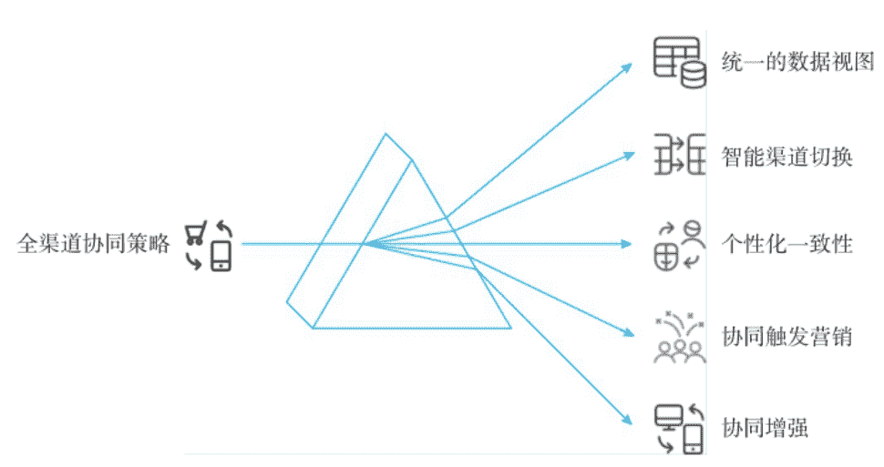

- 统一的数据视图
  1. 实施跨渠道客户识别机制
  2. 建立集中的客户数据平台

实战练习

把知识落地到实践。

实战挑战：三天智能营销启动计划。

第一天：构建详细目标人群画像，用DeepSeek或豆包解析其行为与痛点。收集人口统计与行为数据，用智能工具分析竞品内容与受众互动，输出三份具体用户画像，含痛点、目标与决策路径。

第二天：为一个核心主题设计覆盖至少三个平台的内容矩阵。选取贴合商业价值的核心主题，用智能工具生成各平台适配版本，设计跨平台引导，形成完整内容流，可加入简易AR元素提升体验。

第三天：为新订阅者设计三封邮件的培育序列。撰写吸睛的欢迎邮件，设计中间教育邮件，设计软性转化邮件，用智能工具优化主题与正文，设置行为触发条件。

记录学习过程，重点观察智能工具如何降低营销阻力。

思考

1. 你当前业务的最大营销痛点是什么？如何用本章策略解决？
2. 哪些两到三个渠道最契合你的受众与模式？原因？
3. 如何在保持品牌一致的前提下，适配不同平台的内容需求？
4. 数据驱动如何改变你对营销成功与评估的定义？
5. 本章工具中哪些最能缓解你的痛点？如何整合为协同系统？

章末寄语：从营销到增长的转变

人工智能正在重塑营销本质，从工具挑选转向系统搭建，从零散活动升级为可预测的增长路径。张文杰就是典型：不再被动等客上门，而是主动设计旅程；不再凭感觉决策，而是用数据指导；不再疲于奔命，而是借助智能化建立自动化、可复用的增长体系。

正如王睿所说：“真正的智能营销不在工具数量，而在系统思维。”这不再是企业的专利，每个普通人都能用它作为增长杠杆。你不需要专业背景，也不需要高额预算。你需要的是思路转变、行动起点和持续优化的耐心。

未来智能营销将更深地融合感官、预测个性化和情感智能，但营销的本质始终是人与人的连接。智能工具不是替代，而是放大器，它帮你用更少时间、更少试错建立更强信任、更快增长。

现在你已掌握构建智能营销系统的核心要素。从今天起，搭建你的增长系统，让智能工具成为最聪明的营销伙伴，用智能驱动增长，用创意赢得市场。

第9章 抖音从0到1：智能助力短视频快速起号与变现

开篇：张文杰的抖音流量焦虑

北京朝阳区一间咖啡馆，阳光洒进来。

“王睿，你看我这个视频。”张文杰皱眉展示手机，“同样用智能工具做的美食内容，视频号和小红书表现不错，抖音播放却起不来。”

经过数月智能副业实操，张文杰的写作与视频制作已有起色，月收入稳定过8000元。但把内容搬到抖音这个大流量池时，却碰了壁。

王睿看了数据，点头：“抖音玩法很独特，像超高速派对，前三秒抓不住人就划走了。方向对，但需要做抖音化的智能精细调优。”

“精细调优？”张文杰来了兴趣，“智能工具不仅能做内容，还能搞定算法和流量？”

“不是搞定算法，而是用对方法。”王睿打开笔记本，“2025年的抖音仍是公认的流量洼地，变现效率也很高。但算法迭代快，用户口味变快，光靠勤更不行，必须借助国产智能工具的洞察与效率，才能实现从0到1的快速突破。”

屏幕上出现PPT：“今天拆解如何用豆包、DeepSeek等国产智能工具玩转抖音，实现快起号与高效变现。”

张文杰拿出笔记本，眼神期待：“快说说智能工具怎么破解抖音流量密码？”

一、抖音生态解密：为什么它是智能副业的黄金赛道

“先理解平台逻辑。”王睿打开行业报告，“看清抖音对智能创业者既是挑战也是机会。”

1. 用户画像与内容偏好：抓住注意力货币

王睿展示数据：“截至2025年5月，抖音日活已超7亿，同比增10%~13%。用户更广泛，核心人群年轻化、兴趣多元化。时间更碎片，注意力更稀缺，偏爱直接、有趣、有用、有共鸣的内容。”

张文杰点头：“所以要更短更快更有价值？”

“对！”王睿打开图表，“近期热门视频呈现几个新趋势。”

极速开局，零铺垫；精准垂直，标签化增强；知识与娱乐结合；情绪共鸣升级；互动深度提高。

“这意味着内容要在极短时间内传递价值，并激发好奇或情绪。”王睿总结，“就像咖啡，第一口不惊艳就不会喝完。抖音用户手指随时准备上滑。”

2. 算法核心：完播、互动与推荐机制

推荐算法决定内容生死。虽然在迭代，但逻辑更透明。完播与互动双核心，系统更看重有价值的完播。互动质量分级，点赞到收藏转发权重递增。首次互动时间成为重要信号。算法鼓励同质不同构。账号新增信用分体系，包含一致性、专业度、活跃度等。

推荐机制升级更精细透明。流量池分层更细，按质量类型受众细分为多达12层。兴趣精准匹配增强。创新内容有专属流量扶持。本地化推荐升级，尤重本地生活服务。高质量评论可被单独推荐。

“理解这些，就知道为什么有的视频爆火，有的沉没。关键是早期数据能否触发算法信任。”王睿说，“就像银行，你信用好才能拿到更多额度。”

3. 智能工具如何喂饱算法：效率革命

“抖音算法爱新鲜、高频、高互动的内容，这对传统创作者是挑战，对智能创业者却是优势。”王睿说，“2025年的国产智能工具已针对抖音深度优化。”

智能选题，豆包与DeepSeek不仅能分析热点，还能结合账号定位推荐方向。豆包的抖音热点雷达尤其强，能预判话题何时走热。

抖音做内容，2025年拼的已经不是谁更勤快，而是谁更会用AI把事做明白。我和王睿聊抖音的这套打法，核心就一句话：把重复的体力活交给AI，把战略和创意留给人。

先说效率层面的硬工具。
脚本节奏和开头能不能抓住人，用扣子的智能体就能自动打磨，根据最新的抖音分发逻辑去调节奏、换钩子。素材批量化的问题交给即梦AI和Canva可画，你给一个方向，它能批量产出风格统一、内容各异的视频方案。数据这块很多人只会看过去，飞书智能分析不一样，它能读懂历史表现还能预测走势，直接给出调整建议。

这三板斧下来，内容产出速度普遍能拉高三到五倍。空出来的时间才够你去琢磨创意和策略，持续喂给算法新鲜东西。张文杰当场就问：“那是不是不用再像无头苍蝇一样猛发了？”王睿说对，精准永远碾压堆量，好比射箭，十箭八中比百箭乱放强得多。

变现这块，抖音现在已经不是单一玩法。
创作者收益计划升级了，不再只看播放量，引入了价值创造评分，真正优质的内容分成更高。电商也不再是单纯带货，形成了短视频种草、直播转化、抖店运营的完整闭环。知识服务也在爆发，抖音课堂、付费咨询、数字藏品都能变现。还有IP延展，周边、定制服务、线下活动都能把影响力兑现。

选哪条路，关键看你的内容定位和粉丝画像，核心是把内容到变现的链路闭环起来。

找到位置，比努力更重要。
2025年定位不准，在抖音上基本等于隐身。就像去一个大型聚会，没特点就没人记住。定位要靠AI来找。

王睿打开了DeepSeek的赛道分析助手。新功能里能做四件事：赛道健康度分析，输入关键词就能看竞争、增速、变现难易和生命周期，给出综合分；豆包的蓝海细分定位器，可以在热赛道里挖出没被占满的细分支；通义大模型有趋势预测引擎，能基于历史数据推演未来三到六个月的热度走向；个人匹配度评估则结合你的背景技能资源，算出你在不同赛道的胜算。

我们试了一下提示词：分析抖音上AI写作副业的最新机会。结果很细，给出了五个热门细分方向、受众画像痛点和增长潜力，每个方向都打了竞争激烈度、变现潜力和持久性。结合张文杰前文案编辑、懂内容创作、AI工具熟练的背景，最合适的切口是AI辅助职场高效写作和中小企业AI营销文案，还附带了符合2025年算法的内容形式建议。

张文杰很意外：“分析细到这个程度，AI不只是干活，还能当战略顾问。”王睿说没错，AI现在是你的商业智囊团。

人设就是记忆点。
没有鲜明人设等于没身份证。用AI搭人设更快。
DeepSeek里可以做人设空白区探测，找到垂类里没被占的定位；能基于真实特点放大特质做差异化人格构建；即梦AI或者Canva可画可以规划视觉一致性，从配色到滤镜都统一；大模型还能帮你设计语言特色，口头禅、表达结构都定下来。

我们用豆包给“AI职场写作提效”这个账号做了三个人设方案，要求面向25到38岁职场人，避开同质化。最终定的是AI写作效率教练，人设主张是3分钟把你的文档效率提升300%。视觉走明亮科技感加商务简约，记忆锚点是效率时钟开场和固定的三步法则讲解结构。

人设好之后内容就有了源头活水，不用每次都靠灵感硬想。

起号讲究节奏，2025年新号前三条有额外推荐权重。
7天冷启动我们是这么排的。
头两天做基建：资料头像昵称简介按人设完善；用豆包AI智能体的抖音兴趣培养指南，每天60到90分钟有策略浏览点赞评论，让系统快速识别账号属性；用DeepSeek批量写出10到15条内容框架和脚本，重点打磨前三条；同时用即梦AI或Canva可画提前建一个风格统一的素材库。

第三四天开始发：前三条隔12到24小时发，挑用户活跃高峰；DeepSeek帮你生成评论区互动话题引导讨论；豆包评论回复助手在前六小时内把每条评论个性化回复掉。

第五到七天看数据调方向：用飞书解读视频表现，DeepSeek里用内容优化顾问根据反馈调整后续选题，把表现最好的类型快速迭代两到三个升级版本。

张文杰问冷启动目标是不是涨粉。王睿说不是，是训练算法把你的定位摸清楚，找到最适合你的内容形态。就像相亲，你要展示最真实最好的一面，让算法爱上你。

新手坑，AI都能帮你绕开。
盲目追热点导致账号标签混乱，后果就是推送不准、粉丝认知混乱。解法是每个新选题先核对和定位的契合度。
忽视一秒决胜，开头拖沓完播率直接掉。解法是把开头文案丢给不同大模型分析，抓不住眼球就重写。
互动设计浅，喊点赞关注没人理。DeepSeek的互动策略生成器能根据主题设计有深度的讨论问题。
只盯播放量点赞，忽略完播和留存。飞书的多维分析能告诉你真正要优化的点。

从策略到实操，爆款内容怎么做。
2025年抖音平均时长压缩到20秒，脚本结构要重新拆。
瞬时钩子0到1秒，用一句或一画面制造好奇或情绪冲击；价值预告2到3秒，告诉用户能得到什么；核心内容4到15秒，信息密度高、画面切换快；情绪升华加引导16到20秒，给信心再促互动。

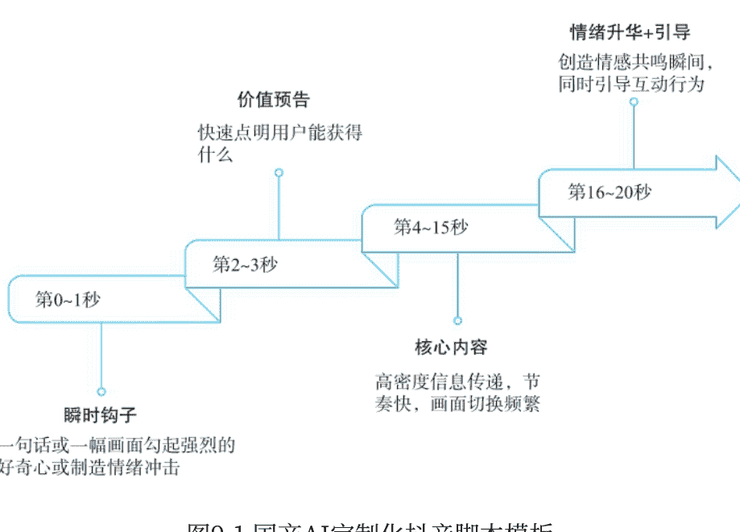
以AI写作效率教练的身份，我们让DeepSeek写了一个15到20秒脚本，主题是3分钟用AI写完美周报。开头是“周五下午5点，你还在挣扎写周报？看我用AI三步法”，直接戳痛点。脚本里拆了三步流程、一个让领导眼前一亮的模板，还有视觉切换和评论区深度提问，全套下来很顺。

有脚本怎么做视频很快。
即梦AI的文本生视频能直接出初稿，豆包的分镜助手把脚本拆成镜头列表。素材补充用剪映图文成片自动调用素材，ChatGPT定制品牌表情包，TRAE或Cursor无代码生成数据图表。后期一键滤镜、智能字幕、适配多平台尺寸导出。熟练后20秒成片，15到30分钟搞定。

不想露脸也没关系。
AI数字分身用即梦AI几张照片就能做；场景式讲解做连续性画面配AI配音，像看不见的旁白者；DeepSeek把数据转成动态图表，特别适合干货类；豆包的漫画创作器做连载漫画视频；即梦AI把抽象概念可视化。2025年不露脸反而是一种精致风格，关键是选对表达方式。

热点要快，AI更能快。
即时写作的热点预测能提前12到24小时预警，DeepSeek的内容关联引擎自动判断热点和账号的契合度，豆包、夸克、腾讯元宝能把热点无缝融进常规内容。我们用15分钟工作法挑战做示范，开头1秒内带入热点，把AI写作方法和15分钟工作法结合，设计参与感强的挑战形式，自然植入标签，保持人设不跑偏。

发出去后怎么养。
算法现在看的是账号整体健康度，不是单条爆款。
核心数据升级了：完播质量分看完播后的点赞评论关注，细分人群互动图谱看谁更买账，留存追踪看用户会不会回看，互动深度分析看评论情感和质量。飞书智能分析可以一键生成报告，豆包数据解读助手把复杂数据变成行动建议，DeepSeek内容优化指南给出下一步改进方案。

互动质量更是算法红线。
用夸克或ChatGPT做分层互动引导，不同人群不同话术；豆包分析哪类问题能触发共鸣和分享欲；DeepSeek生成评论区深度引导问题，促用户互聊；飞书互动仪表盘实时监测。我们看到一个视频用精细引导后评论互动率提升280%。负面评论也不怕，通义的情绪管理助手能分类负面情绪并推荐回应策略，把危机变展示专业度的机会。

总的来说，2025年的抖音是AI在背后托底的人在前面做决策。你负责创意和策略判断，AI负责提效、分析、预测和避坑，内容才可能持续稳定地长起来。

### DOU+加投的精细化打法：国产大模型让预算花得更明白

“现在加投的玩法已经很细了，用对方法回本很快，”王睿谈到投放现状，“国内大模型在策略优化上已经有了明显拐点。”

- 受众拆解更准：豆包可以把视频内容拆开，推导出转化概率更高的标签组合。
- 触达时段更准：DeepSeek 能够预判流量的高峰期，给出相对高效的投放窗口。
- 方案对比更准：DeepSeek 的 A/B 助手可以给出多套投放思路的对比建议。
- 收益测算更准：飞书提供的回报预估模型能够对不同方案的潜在收益进行测算。

王睿在 DeepSeek 里设定的优化指令是：

我打算为一条《用智能技术三分钟搞定周报》的短视频做加投，预算六百元。核心目标是把转化效果做到最大，首要动作是引导用户关注账号。请结合二零二五年的抖音投放趋势，给出一套精细化的执行方案。

- 最适配的定向组合建议：
  - 人口属性：年龄、性别、区域、收入层级等。
  - 行为属性：活跃时段、互动偏好等。
  - 兴趣标识：不超过五个核心主题。
  - 建议剔除的人群。
- 投放计划设计：
  - 资金如何分配，是否采用阶梯式加投。
  - 投放时段精确到小时。
  - 建议的投放时长。
  - 核心 KPI 设定。
- 素材投放优化：
  - 封面如何调整。
  - 开头三秒的优化重点。
  - 是否需要为投放单独剪辑版本。
- 预期回报的计算方式与效果复盘方法。

DeepSeek 输出了一整套方案，包含定向标签、分时预算和收益测算。

“这细致程度超出预期，原来加投还能这样玩。”张文杰回应。
“很多人投完就抱怨，没有人教他们怎么投，”王睿解释，“模型拆解之后，每一笔预算都能发挥最大效用。”

### 多平台协同：把抖音当作入口而非终点

“单打独斗一个平台很难吃到最大红利，”王睿给张文杰看了一张内容生态图，“抖音应该是矩阵的核心引擎，不能把它当成孤岛。”

协同逻辑如下：

- 分层内容：抖音负责引流，把用户导向其它渠道获取深度信息。
- 价值递进：设计由抖音向小红书、知乎再到私域的完整旅程，价值逐层递增。
- 数据互通：借助飞书整合跨渠道行为数据，观察用户在不同平台的差异。
- 内容智能变体：借助 DeepSeek 或腾讯元宝的平台适配器，把一个创意快速改写成适配各平台的形式。

以“智能技术提升写作效率”为例，王睿演示了如何通过豆包的多平台规划，一次性产出抖音十五秒短视频、小红书图文指南、知乎深度解析、微信公号系统教程。

“这就是二零二五年的创作范式，”王睿强调，“一个点子多平台开花，搭起完整的转化漏斗。”
“所以抖音是漏斗入口，不是终点站。”张文杰恍然。
“理解得很到位！”王睿点头肯定。

## 五、智能赋能变现：让流量真正产生收益

“流量的终点是变现，”王睿切入主题，“二零二五年最大的变化是智能技术不仅带来流量，还直接参与变现环节。”

### 1. 电商带货 2.0：选品与文案的数据化

“靠感觉选品、靠经验写文案的时代结束了，”王睿打开手机，“抖音电商已高度数据化，国内智能模型能把带货效率拉高三到五倍。”

“豆包、DeepSeek 虽主要用于创作和问答，但也能生成产品介绍、优化直播稿、分析评论反馈、产出短视频内容。”他现场让豆包生成带货文案，输入产品卖点后迅速得到符合抖音风格的口播稿。

### 2. 知识变现的真实图景

“知识变现是增长较快的方向之一，”王睿展示案例，“但收入预期要理性。”

他总结抖音官方数据：知识变现主要靠直播打赏、付费课程、社群、咨询等。现实里多数知识博主月入几千到几万，月入十万以上多是头部极少数。

### 3. 个人品牌建设：从内容到品牌

“品牌变现需要长期沉淀，”王睿强调，“二零二五年垂直专业品牌更吃香。”

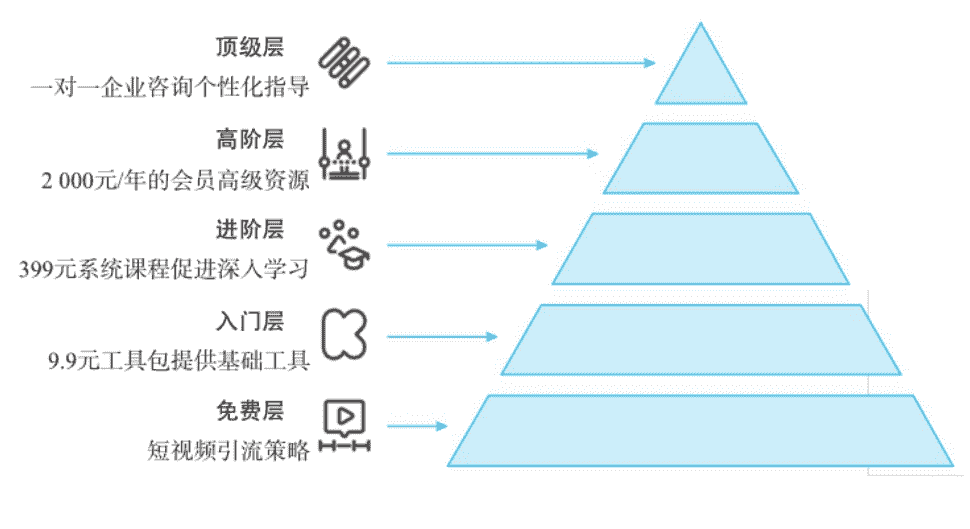

举例：以“智能效率提升”定位，可对接企业培训机构、为软件公司做内容服务、推出数字产品、拿品牌合作。

“品牌授权变现一般需要数万到数十万粉丝基础，金额因人而异。”

### 4. 智能程序的落地边界

“智能体是趋势，但要分清概念和现实。”

目前可用的包括腾讯 ima 搭建个人知识库、各类智能写作程序辅助创作提效。

## 变现建议汇总

- 从小处着手：先用智能程序提升内容质量，积累粉丝。
- 多线尝试：电商、知识付费、品牌合作可并行。
- 长期规划：品牌需要时间，别指望速成。
- 善用工具：智能负责提效，价值输出靠人。
- 数据驱动：用真实数据定策略，别盲目跟风。

“关键是为用户创造真实价值，”王睿最后说，“模型是工具，专业能力和持续输出才是核心。”

## 6. 案例拆解：普通人如何用国内智能模型在抖音月入过万

### 案例一：会计小刘的“财税智能助手”

背景：三年财税经验的普通会计，无拍摄经验。
定位：用智能技术简化财税工作，提升中小企业会计效率。
模型应用：
- DeepSeek 产出专业财税脚本，结合个人经验做教程。
- Canva 制图制作可视化图表和动画。
- 豆包打造“智能财税工具库”系列。
- 飞书解析数据优化方向。
内容策略：每周三到四条，财税场景加智能解决方案。
增长：第二个月关注者达三万，第四个月十五万，半年达五十万。
变现：广告分成、付费社群、企业培训、知识付费。
月入：第四个月后稳定一到二万，峰值超三万。
关键：垂直细分加高实用加模型结合。

“我只是想分享技巧，没想到这么多人需要。模型让我这个不会拍视频的人也能做专业内容，DeepSeek 和豆包像我的虚拟团队。”

### 案例二：大学生小林的“硬核科技测评”

背景：计算机大三学生，热爱科技，零预算。
定位：智能辅助做专业科技测评。
模型应用：
- 豆包“专业测评框架”助手设计方案。
- DeepSeek 产出产品技术参数解析脚本。
- 即梦 AI 和 Canva 制图做演示动画和对比图。
- TRAE 开发性能测试小工具。
内容策略：每周二到三条深度测评，揭秘原理与性能。
增长：首月关注者五千，第三个月三十万，半年破百万。
变现：品牌合作、测评邀约、广告分成、付费社群、数字产品。
月入：第三个月后超一万，半年后稳定三到五万。
关键：模型补齐知识短板，差异化定位建立信任。

“我买不起很多产品，但靠智能技术获取资料、深度分析，做出了比专业团队更细的测评。”

## 实战练习

- 用本章 DeepSeek 提示词，分析并锁定你的抖音垂直赛道和细分人设。
- 用豆包规划前十条视频的内容框架，保证连贯且递进。
- 用腾讯元宝生成十五到二十秒爆款脚本，用即梦 AI 或 Canva 制图制作素材。
- 发布首条视频，用飞书解析数据并据此调整下一条。
- 设计一个全平台内容矩阵，规划抖音流量如何导向其它平台和变现渠道。

## 思考

- 结合你的智能写作经验和职场背景，哪些垂直细分领域最适合快速建立专业影响力？
- 在智能写作赛道，你的独特优势和记忆点是什么？如何通过内容强化差异化？
- 哪种智能视觉表达形式最契合你的人设和目标受众？
- 哪种变现模式最适合你的长期发展？短期和长期计划如何安排？
- 你打算如何设计由抖音向其它平台再到变现的完整用户旅程？

## 章末寄语：智能助力，人人可成流量大师

咖啡厅夕阳西斜，张文杰合上笔记本，信心满满。

二零二五年的抖音竞争激烈，但国内智能技术让普通人也能实现月入过万的副业目标。

模型不会替代创意，它是最强助手。从选题、创作到运营、变现，国内智能程序覆盖全流程，让原本需要团队的工作变得触手可及。

玩转抖音的关键不在设备或才艺，而在善用模型、理解规则、持续创造价值。

“我原以为不爱露脸的人不适合抖音，”张文杰说，“现在我明白，有智能工具我也能找到位置。”
“记住，模型是工具，核心是你的专业价值，”王睿笑道，“从每周三条开始，坚持一月，你会惊喜于自己的进步。”

夕阳为这场创业对话收尾。抖音与智能技术紧密结合，为每个创作者打开成功之门。

现在启动你的国内智能引擎，开启抖音掘金之旅吧！

## 第十章 微信体系掘金：视频频道与公号的智能运营心法

### 开篇：由公域粉到私域客

“我的‘智能提效张师兄’在小红书和抖音火了，粉丝涨很快，”张文杰有些困惑，“但感觉流量会昙花一现。视频频道开了创作者激励，怎么把公域流量变成私域资产？”

“公域叫粉丝，私域叫客户，前者会散，后者才是商业关系，”王睿说，“你开始想转化，说明进入副业 2.0 了。”

“公域是公海捕鱼，微信是自家农场。”王睿展示界面，“二零二五年微信月活超十四亿，视频频道、公号、小程序体系更完善。视频频道负责传播，公号沉淀内容，社群和个人微信完成转化，这就是三级火箭。智能可以优化每个环节。”

## 一、微信体系解析：私域价值洼地与智能机遇

### 1. 公号：深度内容与信任基石

“公号仍是微信体系的内容定海神针。”

核心价值：承接深度内容、塑造品牌、建立信任、私域入口、多元变现。
内容偏好：深度干货、体系化知识、行业洞察、解决方案、价值观输出。
最新变化：
- 个性化推荐：由纯订阅走向订阅加推荐，粉丝不再是唯一限制。
- 付费阅读：满足注册超三个月、近三个月无严重违规、至少三篇原创的账号可开通付费阅读，用微信豆支付。
- 移动端创作便利：微信灰度测试个人微信号内注册公号并发表，无需电脑。
- 广告分成优化：流量主收益约每万次阅读三十到六十元。
智能赋能点：
- 选题辅助：DeepSeek、豆包辅助选题分析、大纲制作，需人工加工。
- 写作提效：模型生成初稿框架，优质内容仍需专业判断和个人风格。
- 标题优化：模型测试不同标题，最终效果取决于内容与需求匹配。
- 数据分析：模型解析阅读数据和用户反馈，优化方向。
现实变现：
- 广告收入、付费内容、私域转化、知识服务、电商直播。
“二零二五年公号日产超一百二十万篇文章，能破十万阅读的相对较少，马太效应明显。大多数账号需长期积累才能稳定变现。”

### 2. 视频频道：社交裂变与公私域桥梁

“视频频道是微信体系的放大器，特别是创作者激励计划。”

核心价值：短视频传播、社交裂变、公域引流、直播带货、连接公号/小程序/企业通。
内容偏好：真人出镜、知识口播、生活记录、情感共鸣、热点解读。
最新变化：
- 微信小店升级：视频频道小店升级为微信小店，支持多场景转化。
- 朋友圈广告联动：朋友圈广告可跳转视频频道。
- 企业通发力：二零二五年成为微信体系 ToB 重点。
- 社交传播优化：熟人关系链分享效果持续提升。
智能赋能点：
- 脚本创作：豆包生成易传播口播脚本。
- 视频制作：剪映辅助剪辑、字幕、配音、特效。
- 热点捕捉：智谱清言监测微信体系热点，快速生成创意。
- 互动引导：模型设计点赞收藏转发评论引导话术。
“视频频道算法不难，朋友互动仍是首要权重。最近系统更偏爱有用、有趣、有态度的内容。”

### 3. 企业通/个人微信/社群：深度转化

核心价值：精细化用户管理、深度互动、信任加深、高客单转化、服务交付。
运营重点：持续输出价值、维护关系、挖掘需求、精准营销。
核心功能：
- 客户标签管理，实现精细分类。
- 群聊互动工具：投票、填表等。
- 智能客服支持。
- 朋友圈营销统一管理。
智能赋能点：
- 自动化流程：设计触达、推送、活动提醒。
- 智能问答：处理常见咨询。
- 行为分析：分组和精准营销。
- 社群管理：生成互动话题、整理要点。
“我把智能助手叫‘替身使者’，回复质量高，连我老婆都分辨不出。在企业通里，智能可承担约四成日常沟通。”

## 二、智能赋能公号：全链路优化

### 1. 智能选题与深度创作

- 痛点三维分析：用 DeepSeek 构建知识点-痛点-时间点矩阵。
- 体系化规划：模型设计系列文章和专栏闭环。
- 跨界融合：模型提供跨领域创新选题。
- 热点预测：监测七到十五天内可能爆发的潜在热点。
“好公号不是广播站，而是价值磁场，需要鲜明调性和主张。”

### 2. 智能长文写作流程

- 框架构建：DeepSeek 生成 SCQA 结构大纲。
- 智能整合：腾讯元宝快速搜集多源信息，形成知识网络。
- 初稿生成：豆包撰写逻辑递进、案例佐证的初稿。
- 专家视角注入：人工加入行业洞察和个人经验。
- 多媒体增强：模型设计信息图表、插入视频频道片段、添加互动。
- 可读性优化：模型优化标题、导语、排版，增强节奏感。

智能驱动的内容创作流程如图十-一所示。

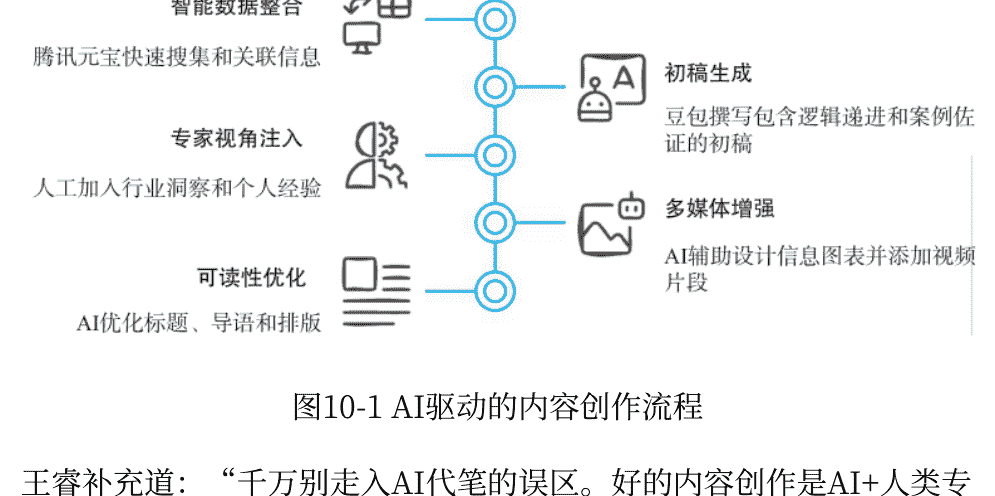

图十-一 智能驱动的内容创作流程

王睿先给了一个底线提醒：别把AI当成代笔工具。真正能打动人的内容，永远是AI效率加人类洞察的组合拳。他自己的做法是，文章的骨架让DeepSeek来搭，核心观点、案例拆解和判断必须自己来。“让AI搬砖，人脑做设计。”他说，“AI写不出有烟火气的爆款，这点一定要清醒。”

### 公众号：先让好看，再让人互动

“内容好，还要让人愿意看下去、愿意参与。”

阅读体验的升级，靠的是AI在细节处推一把。
标题层面，用豆包一次性批量产出八个不同情绪的标题，再做点击率测试，找到最容易被点开的点。开头的钩子，用腾讯元宝拆解高阅读文章的开头套路，生成更抓人的导语。排版上，AI结合135编辑器给出视觉层次建议，让信息更清爽。图文视频化时，AI能直接补上信息图、数据可视化、音频摘要等多媒体素材。
王睿举了个例子，豆包生成的开头是“如果把职场比作无声的战场，你的PPT就是决定胜负的关键武器”。实测下来，战场、战争、竞争这类比喻的开头，点击率比干货式开头平均高出21%。

互动转化要服务于私域沉淀。
评论区里AI先筛出高价值留言，再生成有温度的个性化回复，把对话激活。文末的CTA，AI会做多版本测试，找最有效的引导话术。互动话题和小游戏的脑暴，也交给AI来设计，更容易引发共鸣。裂变活动同样可以自动化生成，“老读者带新读者”的创意和执行SOP都能直接出方案。
“互动不是终点，转化才是。”王睿比喻说，“约会第一次见面就求婚成功率接近零，每次互动只是在累积好感，最终才水到渠成。”

### 公众号的数据与付费运营

“今年公众号最大的变化是付费专栏和会员功能真的成熟了。”

数据解读上，DeepSeek会分析不同内容类型的点击、完读、互动表现，给出优化方向；腾讯元宝则描绘粉丝的阅读偏好、活跃时段、互动习惯，构建画像。流量来源也能被AI识别，帮助判断哪里值得加码投放。付费路径上，AI会梳理从免费阅读到付费订阅的全流程，标出关键卡点。
付费专栏的运营同样可以分层：AI规划会员内容结构，保持深度和实用性的平衡；辅助设计入门、高级、VIP等多层会员体系；管理会员评论区，保证付费用户被及时回应；设计个性化的续费优惠和激励。
王睿展示的“职场高手的思维模型”专栏，月收入1.8万，活跃订阅近450人。实现的关键是把免费到付费的转化漏斗每一环都用AI打磨过。“实话说，这条路不轻松，我一开始只有30个订阅，花了大半年才慢慢起来。”

### 视频号：人情味的内容和低成本的生产链

“视频号的地位越来越重，尤其是直播带货闭环完善后。”

当下视频号的三大风向是真人出镜、垂直细分、情感共鸣。对比抖音，视频号更看重信任感。
热门的内容形态包括：3到5分钟的知识微课，比1分钟短视频更系统；生活记录叠加专业价值，拉近距离；热点深度解析，给出更扎实的解读；“边看边买”的演示，结合视频购物车实现无缝转化；直播预告片，为直播引流。

脚本优化上，AI擅长why-what-how结构，先共鸣再讲内容最后给方法；设计情感波动曲线，抓住注意力；植入引导点赞转发、评论互动的机制；把关键概念视觉化，提升记忆点。
王睿的“三明治法则”是上下共鸣与价值夹住中间的干货。豆包对这种结构很熟，上周一条视频开头聊“为什么周一早上总起不来”，中间给三种改善睡眠的方法，结尾升华到“高效睡眠=高效人生”，三天播放就破8万。

制作环节的瓶颈也被AI拆解了。素材采集用可画或即梦AI生成配图和动画，分镜由AI按脚本自动标注重点画面，剪映一键把素材按节奏剪好，转场和字幕自动匹配品牌风格，封面用可画生成并A/B测试。
“一条视频从脚本到成片我只花半小时。”王睿说，“豆包写脚本，即梦出素材，剪映自动剪。AI视频仍有机械感，转场节奏需要人把关，但做知识分享完全够用。半年后，这些工具会进步更快。”

直播也被AI重塑。DeepSeek能产出不同产品、不同场景的话术库，AI设计问答、投票、抽奖的互动脚本，实时分析直播间行为调整节奏和话术，直播结束后自动剪出精华复盘。
“直播是视频号的金矿。”他举例，美妆朋友单场销售额从不到1万提升到3万多，转化率从2%升到接近5%。

引流的核心始终是私域。AI设计的引流策略包括内容阶梯，免费视频到付费课程再到高端服务；互动诱饵，如评论区抽送模板；直播间的自然引流话术和时机；用用户好评做社交证明。
“引流要温水煮青蛙。”王睿提醒，“先给大量价值建立信任，再逐步引导。见过有博主每条视频都在喊加微信领资料，结果粉丝留存极低，加来的大多是薅羊毛的。”

### 私域：自动化做底座，个性化做差异

“流量进来了，怎么运营才是关键。”

自动化SOP是基础。DeepSeek可以画出从首次触达到忠实客户的完整旅程，多触点欢迎消息、内容推送矩阵、活动前中后的提醒序列都能自动化。
“我做的新用户7天激活SOP，用企业微信实现，留存提升了26%。”王睿补充，“但完全自动化是骗人的，我每天仍要花1到2小时处理个性化问题。真正的私域是半自动。”

客服和社群管理，AI负责规模，人工负责温度。多级智能分流按问题复杂度和价值处理，豆包识别情绪调整语气，知识库持续自学习，回复基于用户历史和标签生成非模板化内容。
社群进阶工具包括热点预测、成员关系网络识别KOL和潜在流失者、自动生成活动方案、从聊天记录里提取周报月报、识别违规内容和负面情绪。
他的“AI写作大师群”有389人，每天管理约30分钟，靠扣子自动化平台提取精华、自动答疑、监测沉默成员。“机器再好也需要人情味，我每周至少亲自出现3到4次。”

用户分层实现千人千面。RFM模型升级后加入互动深度和内容偏好，DeepSeek构建未来价值预测模型，自动识别新客、成长、忠诚、休眠、流失阶段，腾讯元宝构建兴趣图谱。
“以前分析很复杂，现在扣子、n8n这些低代码平台让非技术人也能玩。”王睿展示了一个对潜力客户的精准营销，转化率达到17%，是行业平均的两倍。“我花了三个月才摸索好，别指望一上来就成。”

精细化运营的本质是把精力给到头部用户。“80%的收入来自20%的用户，不再平均用力。”

### 两个案例，看清成败

成功案例是健康顾问管健康。从线下萎缩转向线上，布局公众号“健康博士”、视频号“健康规划院”、企业微信+社群、私域小程序“健康打卡助手”。
AI亮点：DeepSeek辅助写专业文章，豆包优化结构增强互动，可灵AI做动作讲解；AI设计21天减脂挑战，每日自动生成打卡主题和激励语；腾讯元宝根据身体数据生成个性化训练和饮食建议；AI分析训练数据给出进步报告；企业微信+扣子自动化基础咨询。
月收入构成：付费专栏会员150人×99元=14850元；线上减脂营25人/期×1599元÷3个月=13325元；一对一指导8人×599元=4792元；周边约4000元。总计约3.7万，净利润约2.7万。
关键在于全生态整合、AI提升内容专业度、私域体验细化、清晰的价值阶梯、以及工作时长从12小时降到6到7小时。

失败案例是产品经理小谷的AI办公技巧社群。起初积累2000多抖音粉丝，2个月建立300人免费微信群。前3个月推出399元训练营只卖出8份。第4个月在公众号、视频号、社群三线作战。第5个月完全依赖AI生成内容不加修改，质量下滑。第6个月社群活跃骤降，项目失败。
原因：内容同质化严重，无个人经验；渠道不精而贪多；忽视真实互动；免费与付费价值差不明；缺乏长期规划。
王睿总结：“AI是助手不是替身。把它当全自动工厂，只能生产大量没灵魂的内容。”

张文杰感叹：“AI能提升效率，但专业洞察和人格魅力替代不了。”
“微信的核心是信任关系。”王睿回应，“AI可以更高效传递价值，但价值本身仍来自你的专业积累。”

### 实战练习与思考方向

公众号练习：用DeepSeek生成领域系列大纲，挑一篇用豆包扩写，腾讯元宝优化标题排版并发布观察数据。
视频号练习：设计知识、案例、观点、工具的内容矩阵，为每种类型各想三个选题，写完整脚本并用即梦或可灵制作一期。
私域练习：设计新用户7天激活流程，写5个高频问题的自动回复模板，搭建行为标签体系，用扣子或n8n搭基础自动化工作流。

思考题仍然围绕协同、自动化边界、与抖音小红书的差异化、用户分层服务、微信生态变现路径。

### 章末寄语

微信生态仍是国内最稳固的私域根据地。公众号沉淀信任，视频号放大声量，私域实现转化，三者闭环。
AI的加入让效率和智能达到新高度，从创作到互动、从分析到营销都在重塑运营范式。它并没有取代人，而是放大人的影响力。
最成功的运营者，是让AI处理重复劳动，自己专注创造核心价值和真实连接的人。

在微信生态里找增量的生产者，张文杰是典型样本，正处在红利与压力并存的窗口。本章总结的AI私域打法，能让大家在熟悉的土壤上拿到更稳的回报。永远要记住，工具会迭代，底层不变——用真诚交付干货、用时间堆出信任，才是私域经营的恒久根基。

# 第11章 头条与知乎：用AI撬动权威话语权的变现

## 开篇：张文杰对话语权的新定位

“王睿，抖音和微信我都在推，可数字上去后，来的基本都是看热闹的，真正对口的人不多。”张文杰翻着报表，“我想做出更有分量的认可，让同行和受众都信得过我的内容水准。”

王睿笑道：“这就是从单纯追流量到追求可信势能的转身。要建起可信的权威感，头条和知乎是绕不开的两座高地。”

“头条不就是中老年人看养生吗？知乎又学院派，我这种草根副业能用得上吗？”

“你的印象停在几年前了。”王睿调出数据，“现在头条25到40岁的受众已超六成，对硬核干货需求很旺。知乎的创作门槛也降了，高质量产出很容易被看见。”

“更关键的是，两边的创作者激励都升级了。头条千次阅读最高到8元，知乎优质回答单篇上万很常见，盐选专栏还能给专业产出更合理的市场定价。配合DeepSeek、豆包、腾讯元宝、智谱清言这些助手，权威势能的搭建会快很多，它们对中文内容生态的理解就是为行家准备的。”

张文杰眼睛一亮：“DeepSeek我已经在用了，确实够专业。具体怎么在两个阵地打造个人IP？”

王睿点头：“先把两边的特性与玩法拆清楚，再对症下药。”

## 一、头条与知乎：弄清差异，选对主战场

王睿把平板并列打开：“先搞清差异，才好有的放矢。”

### 1. 受众画像与生态的差异

**头条平台**

受众：月活超7亿，覆盖面极广。25到40岁已成主力，占比超60%。职场人群和小微创业者比例明显上升，三四线城市受众仍占约55%。行业应用与职场技能类消费在快速增长。

产出形态：从纯资讯向知识与技能迁移。形态丰富，包含图文、微头条、问答、视频与互动。分发机制对有用、靠谱的选题倾斜更明显。深度专栏和系列产出获得扶持，知识服务生态已初具规模。

氛围：信息流依旧快速，但单用户停留时长在拉长。快餐阅读转向学习型阅读，垂直领域生产者认可度提升。

**知乎社区**

受众：月活近3亿，结构多元。本科学历及以上约65%，仍是核心。各行业从业者聚集，一二线城市占比约65%，新一线增速突出。付费意愿和消费习惯明显增强。

产出形态：问答仍是主轴，形态不断丰富。知识交易推动专业产出价值重估。创作工具已成标配，专业认证和权威回答体系完善，垂直领域纵深持续加深。

氛围：理性讨论仍是主旋律，专业圈层互动活跃。知识社交属性更强。付费习惯提升，199元课程转化率达3.8%，但免费问答仍是主流。

“简单说，”王睿总结，“头条从信息广场进化成信息加知识加技能的综合体，知乎从精英讨论区转向更开放的专业知识交易市场。边界在模糊，但核心差异清晰。”

### 2. 分发机制对比

**头条机制**

核心是字节引擎个性化推荐，多模态理解能力提升，受众价值评估更精准。
关键指标：内容完成率取代单纯阅读时长；互动深度，评论质量大于数量；分享转化，即私域传播价值；权威指数，即专业性评估；受众成长值，即学习价值。
特点：纵深分发让优质产出长周期曝光；专业匹配把产出推给最需要的人；二次分发让优质评论也能独立获流。

王睿打了个比方：“现在的头条机制不像过去的莽夫喊得响就有流量，而像精准狙击手，按履历和兴趣把产出递到对的人手里，就像智能相亲。”

**知乎机制**

核心是盐值系统评估专业声誉，叠加产出质量评分和受众价值匹配。
关键指标：专业认可度，取决于点赞感谢收藏受众的质量；内容完整性，逻辑结构与论证纵深。

### 3. 差异化应用策略

“不同生态就要不同打法。”王睿说。

**头条撰写策略**

效率优先：用DeepSeek的头条写作专家模板快速搭框架；用即时写作工具的热点追踪抓话题并多角度解读；用智谱清言做多形态转换，一键把长文变微头条或短视频脚本。

标题优化：用DeepSeek标题实验室批量生成10到15个风格标题；用AI标题对比实验工具科学验证；用豆包AI智能体做情感分析，优化情绪触发。

内容分发：用DeepSeek做多维度拆解，把核心产出改写成问答、微头条、视频脚本；用评论引导器设计能引发互动的结尾提问；用豆包互动预测评估潜在互动率。

数据反馈：用智谱清言诊断低完成率文章问题；用DeepSeek做受众画像分析核心读者需求；用飞书多维表格系统复盘产出表现指导优化。

**知乎撰写策略**

纵深优先：用DeepSeek做知识挖掘，多层次拆解专业问题；用飞书建立资料库，快速调用权威数据研究；用豆包优化逻辑结构，保证论证严谨完整。

专业表达：用DeepSeek领域术语库校准专业用词；用豆包风格塑造保持思辨性和专业度；用智谱清言模拟专家画像，复刻特定领域的表达方式。

问题筛选：用DeepSeek评估问题价值；用腾讯元宝预测问题趋势；用智谱清言分析专业匹配度。

互动增强：用DeepSeek评论回复助手生成有见地的回复；用豆包做问题延伸，形成产出网络；用智谱清言的知识图谱功能沉淀个人领域体系，保持一致性。

“中文AI对这两个平台的生态理解已经很强，DeepSeek甚至内置了头条写作模式和知乎专业回答模式。但别迷信工具，你的专业经验和洞察才是核心竞争力。”

### 4. 定位选择：平台组合策略

“先从哪边入手？”张文杰问。

王睿建议：

1. 想要更广的影响力和快速反馈，头条可作主阵地，高效输出行业洞察和干货，借纵深分发获得持续曝光。
2. 想要深度专业形象和高端变现，知乎应作核心阵地，沉淀权威产出，为咨询、课程铺路。
3. 最佳组合是双平台联动：头条作流量入口和热点雷达，知乎作专业形象塑造和深度沉淀基地。

王睿在纸上画出联动图。

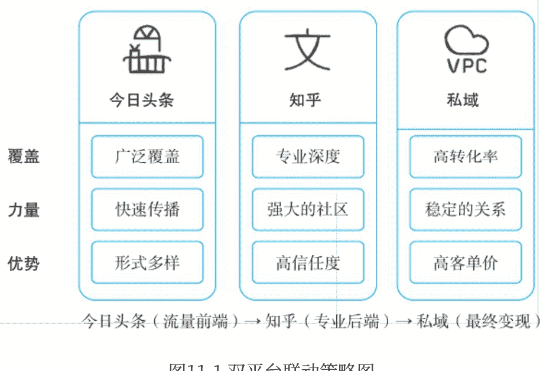

今日头条的优势在于覆盖广、传播快、形式多样。

知乎的优势在于专业深、社区强、信任高。

私域的优势在于转化率高、关系稳定、客单价高。

“这就是完整漏斗。头条负责引流，知乎负责筛选信任，私域负责成交。”

张文杰沉吟：“我更想先深耕领域，是不是先以知乎为主，后期再用头条放大？”

“先深后广对你更合适。”王睿说，“那就先把知乎的专业影响力打扎实。”

## 二、知乎运营：塑造专业权威与深度影响力

王睿打开自己的主页，顶部显示声望值92.3，行业TOP5%。

### 1. 高价值问题挖掘

“找到一个好问题，胜过写十篇普通文章。”

筛选方法：

设置专业领域过滤器：知乎直答已接入DeepSeek-R1模型，支持关键词智能搜索与知识库调用。可通过站内搜索或第三方工具如5118的知乎长尾词挖掘，设定核心关键词如内容创作、内容变现、创作效率等，让工具筛选匹配问题。

关注价值评估四维标准：关注度，关注人数大于500或浏览大于15000；竞争度，高赞大于200且回答数小于3；匹配度，与专业背景高度相关；纵深，具备讨论空间。

二次筛选：人工核验提问者主页，大V提问流量潜力大；评估长期价值、回答难度、潜在曝光；预测所需研究纵深与认可度。

王睿实操分享：“每周花1到2小时筛10到15个问题，精挑3到5个重点答。就像钓鱼，与其撒网，不如去深水区精准垂钓。”

### 2. 深度回答构建：逻辑框架与论证

“知乎要的是纵深、严谨、有料，而非观点堆砌。”

深度回答七步法：

问题本质剖析：用DeepSeek拆解推理，找受众真实需求，确定核心价值与差异化角度。

资料研究与知识准备：豆包整合资料，智谱清言AutoGLM沉思梳理多视角，飞书多维表格调用个人素材。

逻辑框架设计：用DeepSeek逻辑架构师生成大纲，确保包含问题澄清、核心观点、分层论证、实例支持、应用建议、总结展望。

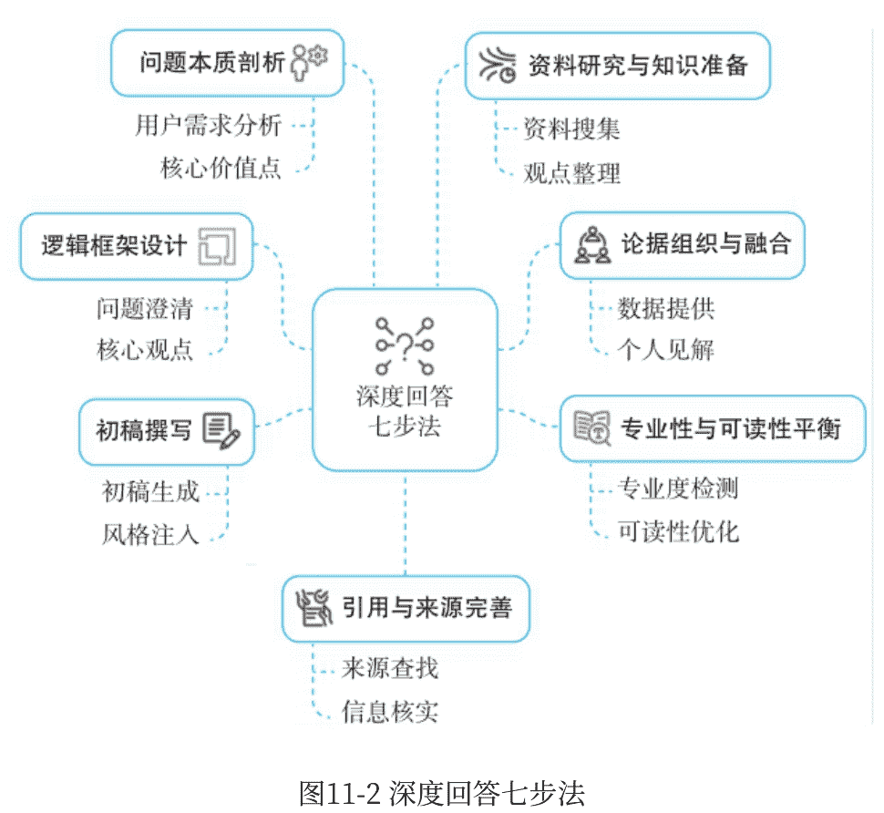

图11-2 深度回答七步法

论据组织与融合：提供数据引用案例，筛选整合并加入个人见解，强调权威性、新颖性和说服力。

初稿撰写：用DeepSeek或智谱清言生成各部分初稿，再修改润色注入个人风格与洞见。

专业性与可读性平衡：多模型检测术语准确度，可读性优化，加入图表案例类比。

引用与来源完善：规范引用，核实信息，避免虚构，用真实案例提升可信度。

“工具是研究助理，你的经验判断才是灵魂。”

“一天能写多少？”张文杰问。
“有AI辅助，熟手每天能完成1到2个深度回答或3到5个中等纵深。知乎是质量大于数量，一个月10个高质量回答，远胜30个平庸之作。”

### 3. 专业形象塑造：个人资料与产出一致性

个人资料优化：用DeepSeek专业简介生成器，一句话介绍聚焦专长不超过30字，详细介绍150到200字含背景、证据、价值承诺。

专业风格一致：用豆包提取专家风格特征，涵盖逻辑方式、专业程度、语言风格、案例类型，制定风格指南。

产出主题聚焦：用豆包做主题聚类，围绕3到5个核心领域，构建产出关联图形成知识网络，定期分析分布避免发散。

技巧：分析同领域TOP20营造者主页，提炼成功模式与差异化特点，借鉴不复制。

### 4. “盐值”提升与社区互动

盐值基于基础信用、内容创作、友善互动等维度，直接影响曝光与变现。

提升策略：

高质量评论策略：用DeepSeek为优质回答生成有见地评论，体现专业洞见，战略性关注评论行业KOL。

问题优化策略：用豆包改写低质量问题，主动提出高质量问题并部分自答，提前布局热点。

互动管理策略：用智谱清言分类评论，优先回复高价值评论，工具辅助处理常规问题，对专业质疑有据回应。

产出联动策略：用DeepSeek拓展产出，将多个回答织成知识网络。

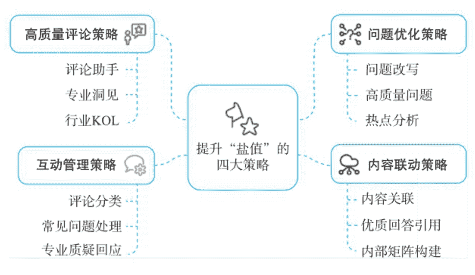

图11-3 提升“盐值”的四大策略

在积累专家声量的阶段，零散的输出很容易被淹没，只有把分散的回答串成体系，才能形成可识别的版图。

让过往的高质量回答之间建立互链，论证会更扎实，可信度随之提升。
把这些散点提炼成系列专栏，将问答升维为系统性的长文，形成矩阵。
把专栏精华同步到微信公众号、信息流等渠道，实现多端联动。

“单条产出容易成为孤岛，串联起来才是大陆，影响力完全不在一个量级。出版也一样，爆款单本不如系列 IP 更能留住读者。”

老师特别强调，该社区的互动氛围比信息流平台更浓，发出去只是开始，后续重心在互动。工具可以高效整理评论私信的归类，但评论的温度、专业度与回应质量必须由人把控。这和企业做客户关系管理很像，系统负责记录与分析，关系的真正维系永远离不开人。

#### 【优质评论生成示例】

我在知乎看到一篇与我专长方向相关的深度回答，链接如下，需要一条有分量且能体现个人价值的评论。

回答链接：[此处粘贴知乎回答链接]

请为我生成一条评论，要求：

(1) 字数控制在200～300字之间，简练有力。
(2) 开头先认可原回答的亮点和价值。
(3) 再补充1～2个原回答未展开或可进一步深化的视角。
(4) 适当引用数据或案例来佐证观点。
(5) 语气保持专业谦和，不做指责也不居高临下。
(6) 结尾抛一个有思考性的问题，带动讨论。
(7) 自然带入我的身份——创作工具应用专家。
(8) 评论既显专业，又有助于与原作者建立良好关系。

请给出两个侧重点不同的版本供我挑选。

张文杰记下要点后追问：“知乎需要系统经营我明白了，那信息流平台的打法和知乎有什么本质区别？”

## 三、信息流平台运营：打造高阅读量的爆款稿件

“我们聊聊信息流平台的玩法，”老师切换到后台界面，“知乎强调专长深度，该平台更看重传播力和吸睛度。”

### 1. 选题：紧跟热点与受众兴趣

“在该平台，首要环节就是选对题。”老师说。

(1) 热点挖掘与预判。
1）常去即时写作类网站，实时追踪热榜和行业动态。
2）借助DeepSeek做关联分析，把热点和自身专长领域结合。
> “不是在追热点，而是提前预判。就像股市，等人人都看到机会时，黄金时间已经过去。”

(2) 受众兴趣的精准洞察。
1）用DeepSeek分析用户在特定领域的偏好与疑问。
2）通过飞书梳理过往文章的数据表现。
3）找出用户渴望但供给不足的空白。
> “找到想看却没看够的主题就是流量增长的核心，这和零售找供不应求品类一样关键。”

(3) 差异化视角设计。
1）用豆包拓展视角，为同类话题生成5～10个新角度。
2）用DeepSeek评估各角度的新颖度、争议度与传播力。
3）结合自身专长优势，锁定最具竞争力的切入点。
> “在信息流，独特视角比面面俱到的分析更易出圈。就像脱口秀，独特的观察比常识总结更抓人。”

老师的日常做法是每天让DeepSeek出一份“热点结合创作选题”的日报，挑出2～3个最有潜力的方向。他称之为“精准捕鱼”——先找到鱼群，再准备合适的饵，而不是盲撒网。

### 2. 爆款标题生成：优化点击率的艺术

“在该平台，标题的重要性有时超过正文，”老师笑道，“一篇好文章配平庸标题无人问津，但一个好标题能让普通稿件获得初始流量，就像电影海报决定上座率一样。”

标题优化分四步走。

(1) 多版本标题产出。
1）在DeepSeek输入核心内容，生成15～20个各式各样的标题。
2）涵盖疑问式、数字清单式、利益驱动式、情绪触发式、悬念式等。
3）针对不同用户心理设计触发点。

(2) 标题效果预判。
1）用豆包对标题打分，预测点击率。
2）评估情感触发强度、好奇刺激度、价值承诺清晰度。
3）筛选出3～5个最优候选。

(3) A/B测试精进。
1）在平台小范围测试标题。
2）或先用微头条发布不同版本，观察互动。
3）根据数据确定最终标题。

(4) 标题模式沉淀。
1）用DeepSeek拆解高点击标题的共性，提取模式。
2）建立个人爆款标题公式库，持续迭代。
3）为不同类型准备标题模板。

> 老师强调：“好标题是精准把握用户心理的艺术。工具可以批量生成并预测，但最终选择要靠你对平台和受众的理解。就像钓鱼，饵很多，选择哪种要看对鱼性的理解。”

### 3. 稿件生产：信息密度与阅读体验平衡

“标题吸人，稿件留人。”老师继续说。

信息流创作把握五点。

#### （1）结构设计：适配快速阅读
- 1）用DeepSeek设计符合平台阅读习惯的结构。
- 2）常用结构：金字塔结构结论先行、SCQA框架。
- 3）层次清晰，方便扫读。
> “平台用户的阅读很短，前30秒决定去留。像电梯推销，只有几十秒。”

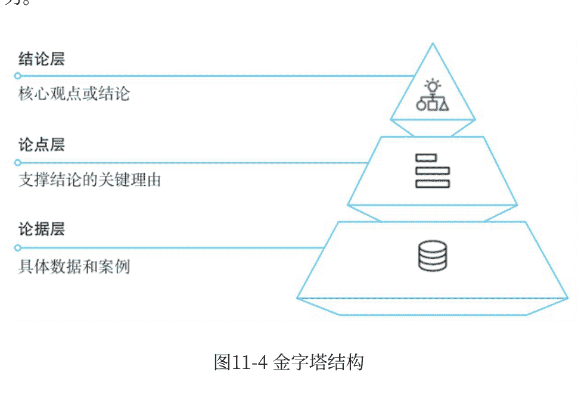
图11-4 金字塔结构
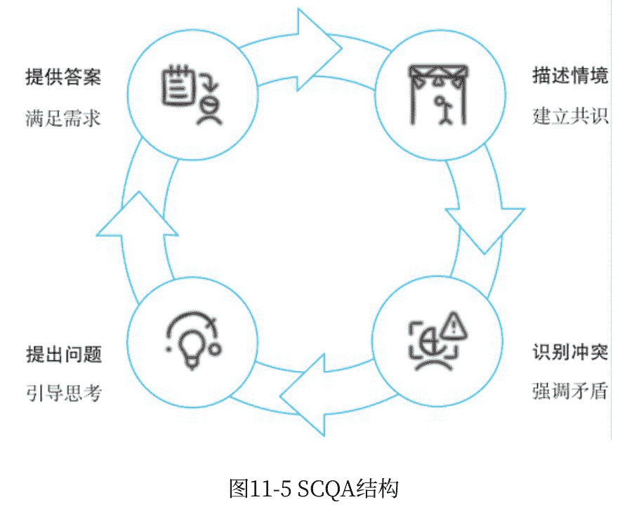
图11-5 SCQA结构

#### （2）稿件生产：高信息密度
- 1）用豆包辅助写观点鲜明、信息密集的稿件。
- 2）少废话，直奔主题。
- 3）每段至少交付一个有价值的信息点。
> “平台稿件要像浓缩咖啡，而不是淡茶。用户要的是精华。”

#### （3）格式优化：提升可读性
- 1）用DeepSeek优化排版：短段落、小标题、要点列表。
- 2）适度使用加粗、引用、分隔线引导节奏。
- 3）配图策略：每300～500字配一张相关图。
> “排版好阅读完成率能提升25%。好餐厅，菜好吃，摆盘和环境同样重要。”

#### （4）多形态转换：灵活适配平台
- 1）长文→微头条140字精华版。
- 2）长文→问答体自问自答。
- 3）文字→短视频脚本，扩大覆盖。
> “好稿件要像变形金刚，一次创作，多处开花。”

#### （5）互动设计：促进参与
- 1）用豆包或腾讯元宝设计文末引导：开放问题、投票、话题。
- 2）提前预设3～5个读者可能问题，准备好答案。
- 3）设计收藏理由，提升保存率。
> “互动率直接影响二次推荐。演讲引发思考，总比单向输出更有效。”

老师的小技巧是让DeepSeek帮忙做稿件评分卡，检查信息密度、可读性、互动性等维度，确保质量稳定，就像厨师用出品标准保证每道菜。

### 4. 智能分发与数据优化：提升推荐率与阅读时长

“平台的成功，一半靠稿件，一半靠分发和数据打磨。”老师打开创作者后台。

- （1）最佳发布时间
  - 1）用DeepSeek分析目标用户活跃时段。
  - 2）结合算法规律，重点落在8-10点、12-14点、19-22点。
  - 3）制定个性化发布表，避开同类创作者扎堆时段。

- （2）标签与分类优化
  - 1）用豆包分析热门稿件的标签策略。
  - 2）每篇选1个主分类+2～3个精准标签。
  - 3）避免堆砌，保持相关性。

- （3）稿件系列化策略
  - 1）用腾讯元宝规划系列，如“内容创作实战21天”。
  - 2）系列间相互引用，提升粘性。
  - 3）用上一篇/下一篇引导停留时长。

- （4）数据驱动优化
  - 1）用DeepSeek分析数据，找改进点：跳出率高的段落、阅读时长短的文章、评论热点。
  - 2）基于反馈持续优化策略。
> 老师强调：“平台算法很看重用户反馈，要定期复盘。当发现某类稿件爆发时，拆解原因并复制模式，就像商业爆款分析。”

#### 【数据分析与优化示例】

请基于我信息流账号最近10篇文章的数据，全面分析并给出优化建议。
数据包括标题、发布时间、阅读量、完读率、评论数、点赞数、收藏数等。

请用豆包的数据分析能力完成：

(1) 稿件表现分析：
- 哪类稿件表现最好？从标题、话题、篇幅等维度看。
- 表现好的稿件共性3～5条。
- 表现差的稿件共同问题。

(2) 用户行为洞察：
- 阅读习惯：最佳阅读时长、完读率与篇幅关系。
- 互动热点：哪些稿件易引发评论。
- 收藏率高的稿件特征。

(3) 发布策略评估：
- 最佳发布时间段。
- 标题类型与点击率关系。
- 标签使用效果。

(4) 优化建议：
- 3条提升阅读量的具体建议。
- 3个提高完读率的稿件优化方向。
- 3种增强互动率的策略。
- 下阶段重点发力的稿件方向。

请基于数据给出可执行的优化方案，并制定2周内容优化计划。

## 四、专家声量变现策略

张文杰问：“在这些平台积累的影响力，怎么转成实际收益？”

> “这就是内容副业的终极问题。”老师说，“影响力变现才是一切的落点。”

### 1. 平台流量变现：信息流与知乎的广告分成

> “最直接的就是平台广告分成。”

（1）平台广告分成机制。

1）信息流收益模式。
- ●图文广告收益。千次阅读收益0.5～15元。科技类可达10元，娱乐类约3元；高互动稿件收益可翻倍甚至3倍；粉丝阅读收益是普通用户的3倍。
- ●视频广告收益。千次播放单价0.3～100元。原创视频12～20元/万次播放；优质原创+高互动30～100元/万次播放；非原创仅0.3～0.4元/万次播放。
- ●问答红包。奖励2～300元，要求字数≥300且通过审核。
- ●付费专栏抽成。平台抽成20%，原创度需>70%。

> “信息流付费专栏是普惠式的，有流量就有收益，像开店有人进门就有成交可能。”

2）知乎收益模式。
- ●知+收益。单次点击0.37～1.5元，需创作者等级≥3级且无违规。
- ●视频广告分成。千次有效播放5～40元，有效播放定义为观看>30秒且触发广告；盐选会员内容额外加成20%。
- ●付费咨询抽成。平台抽成15%，咨询者需实名认证。
- ●盐选专栏抽成。平台抽成25%～30%，普通作者30%，签约作者25%。
- ●知识交易所。单篇最高500～5000元，需入选知乎精选并获≥1000赞。

> “知乎变现更精英化，头部创作者单位收益远高于普通平台，像高端咨询，客户少单价高。”

（2）优化广告收益的策略。
- ●稿件-广告匹配优化。用DeepSeek分析哪类稿件广告匹配度和点击率更高，调整关键词与版式，提升注意力捕获。
- ●创作者等级提升。分析评级算法，按标准优化输出节奏与质量，定期检查账号健康度。

老师的真实数据是信息流月广告收入稳定在2万～3万，知乎1万～2万。关键是持续性和质量稳定性，工具能帮忙保持节奏。新号通常需要3～6个月成长期，像种树，前期慢后期结果多。

### 2. 知识付费：专业知识的高效变现

“比广告更有价值的是直接付费。”老师打开自己的盐选专栏，已有5000多付费用户。

- (1) 知乎盐选专栏/电子书。
  - 1）用DeepSeek做市场缺口分析，找付费潜力选题。
  - 2）用创作工具搭建结构化、系统化的专长稿件。
  - 3）用Canva设计吸睛的销售页与试读。
  - 4）适合领域：技能指南、行业分析、方法论、案例解析。
> “盐选专栏像自出版电子书，流量和转化都比传统出版高，像自建网店比进书店更好卖。”

- (2) 付费咨询服务。
  - 1）用智谱清言设计咨询流程与介绍文案。
  - 2）搭建常见问题库，提升效率。
  - 3）基于需求提供精准方案。
> “平台让专业咨询像网购一样便捷，效率与覆盖面都大幅提升。”

- (3) 线上课程与工作坊。
  - 1）用DeepSeek设计课程大纲与框架。
  - 2）用创作工具制作配套材料。
  - 3）用豆包做吸引人的宣传物料。
  - 4）适合形式：录播精品课、直播工作坊、会员学习社区。
> “系统化知识打包成课，单客价值可提升5～8倍，像零售店升级为培训中心。”

老师强调：“知识付费核心是系统化和解决问题能力。工具能梳理框架，真正的价值来自实战经验和独特方法论，就像名厨，厨具再好也离不开独家配方。”

#### 【付费专栏策划示例】

我计划在知乎开设盐选专栏“创作者的效率革命”，面向想用创作工具提升效率的专业人士和副业者。

请用DeepSeek的产品策划模式，全面规划：

(1) 市场分析：
- 目标用户画像3～5个细分人群。
- 痛点与需求。
- 竞品分析。
- 差异化定位。

(2) 内容规划：
- 核心价值主张。
- 8～10个核心章节主题与概要。
- 每章独特卖点。
- 深度与专长度设计。
- 更新频率与总容量建议。

(3) 营销策略：
- 300字专栏介绍文案。
- 3个核心卖点。
- 试读内容选择建议。
- 社交媒体宣传策略。
- 早鸟优惠与会员特权设计。

(4) 定价策略：
- 基于市场与价值的定价建议。
- 定价心理学分析。
- 买断与订阅优劣。
- 阶梯定价可行性。

请以需求和变现潜力为导向，设计专业且有商业价值的产品。

### 3. 品牌合作：从内容植入到专家代言

> “影响力到一定程度，品牌会主动找上门，这是收入最可观的渠道之一。”

- （1）潜在合作品牌挖掘。
  - 1）用DeepSeek分析用户画像与品牌匹配度。
  - 2）识别与专长领域相关的活跃广告主。
  - 3）建立潜在品牌库并评估合作可能性。
> “主动出击效率高10倍，工具帮你精准定位目标，就像猎头主动找人。”

- （2）专业合作方案定制。
  - 1）根据品牌需求，用豆包定制方案。
  - 2）设计差异化形式：专家观点、案例解析、深度测评、联合研究。
  - 3）兼顾品牌目标与个人调性。
> “普通内容合作1000～2000元，定制方案可达1万～2万，像从卖现货升级到定制服务。”

- (3) 多平台价值放大。
  - 1）用腾讯元宝设计跨平台传播矩阵。
  - 2）一次合作拆分为信息流、知乎、社群等多形态稿件。
  - 3）分析表现持续优化。
> “一次优质合作产生连锁效应，带来更多邀约，像成功演出带来更多上门。”

- (4) 专家身份价值建设。
  - 1）用DeepSeek打造个人专长品牌定位。
  - 2）策划行业调研、白皮书、研究报告等高价值稿件。
  - 3）把经验系统化为方法论或理论框架。
> “从创作者到行业专家跃升，单价可提升3～5倍，像医生成长为专科权威，诊金自然上涨。”

王睿曾举例说明一段合作经历。上一年度他与一家以提升创作效能为核心的工具型企业联手启动一项能效研究，从调研框架搭建到数据梳理都得到 DeepSeek 的支持，最终交付的是一份被行业认可的深度报告。该单业务带来三万元现金收益，更关键的是显著提升了他在本领域的发声权重，后续收到的顾问邀约与商业合作报价均明显上调。

#### 【品牌合作方案示例】

我在知乎、头条平台以创作工具应用为切入点培育了约十二万关注者，拟主动向国内头部创作工具厂商 DeepSeek 提出合作建议，需要一份具备足够专业度的方案书。

1. 市场与受众洞察：
- 评估 DeepSeek 核心使用群体与本人粉丝群的重合程度。
- 读者群体在选用创作工具时最紧迫的需求与痛点所在。
- DeepSeek 目前面临的市场阻力与可挖掘的扩张空间。

2. 合作价值主张：
- 可为品牌带来的三至五个可量化核心贡献。
- 相较常规 KOL 合作的差异化优势。
- 可预期的传播效果与可追踪的评估指标。

3. 合作形态设计，提供三套创新打法：
- 方案一：沉浸式体验测评结合真实场景案例输出。
- 方案二：行业专题研究与白皮书共创。
- 方案三：创新应用工作坊与用户共创活动。
每套方案需明确执行节奏、内容形态与主要分发渠道。

4. 专业呈现与商务条款：
- 提案的包装与视觉呈现建议。
- 参考市场行情给出的合理报价区间。
- 成效评估与复盘机制。
- 长期复投与战略合作的延展可能。

要确保方案既能体现个人专业厚度，又能精准匹配品牌市场诉求，避免过度商业化稀释专业可信度。

### 4. 私域引流与高价值转化：搭建专业信任漏斗

“把公开平台的声量沉淀为私域资产，是影响力变现的关键跃迁。”王睿强调，“完成这一步，收入才可能真正实现突破。”

私域转化可以按下面思路推进（见图11-6）。

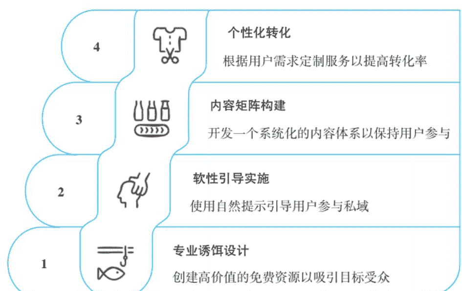

图11-6 私域转化策略

1. 专业诱饵打造。
- 借助 DeepSeek 制作高感知价值的免费资料，如行业报告、实操模板。
- 用豆包打磨资料的实用度与独特性，提升拿取意愿。
- 为不同阶段的受众定制差异化引流物料。

“优质的专业诱饵像精准磁石，我的《创作效率指南》获客成本不到五元每人。好饵料自然能钓到目标鱼。”

2. 软性引导落地。
- 依托豆包生成不生硬的引流话术。
- 在正文里自然植入私域价值点，激发用户主动求连。
- 设计价值阶梯，让用户感受到进入私域后的额外增益。

“最好的引导不是推销，而是让用户觉得是自己找上门。像口碑餐厅，不需要拉客也能持续满座。”

3. 内容矩阵搭建。
- 用 DeepSeek 规划私域内的系统化内容体系。
- 构建从免费试用到低价再到高价的内容阶梯。
- 高频输出保持私域活跃度。

“私域即你的内容超市，要有入门尝鲜到高端定制的完整货架，像商场一样覆盖不同需求。”

4. 个性化转化。
- 通过豆包解析用户行为与需求标签，实现个性化服务推荐。
- 辅助完成初步需求诊断，提升成交精准度。
- 设计小步快跑的转化阶梯，降低决策门槛。

“个性化服务让大规模精准转化成为可能，这是2025年私域变现的核心变革。医生不会千人一方，针对性方案才真正解决问题。”

王睿总结：“私域不是单纯的卖货场，而是专业信任的延伸。工具可以提高运营效率，但核心信任仍源于你的能力与洞见。顶级的私域更像会员俱乐部，成员留下来因认同与归属。”

#### 【引流资料设计示例】

请为我设计一份高价值免费资料，把知乎与头条的专业粉丝导流至私域微信社群或个人号。

专业方向是辅助内容创作，目标人群为想提升创作效率的自媒体人、副业创作者及内容营销从业者。

请以豆包的产品设计思路来规划该资料。

1. 资料形态与主题：
- 推荐三到五类形态，如指南、模板、清单、报告等。
- 为每类提供两到三个具体主题。
- 评估各选项的吸引力与转化潜力。

2. 详细内容规划，锁定最优方案：
- 资料架构与大纲。
- 至少五个可立刻上手的干货价值点。
- 差异化亮点，说明为何用户愿意留下联系方式。
- 视觉呈现建议，包括排版、图表与风格。

3. 投放与转化策略：
- 在知乎/头条平台如何自然植入引流点。
- 三个不同风格的引流文案示例。
- 在资料内预埋二次转化的钩子。
- 提升转化率的手段，如限时、稀缺、社会认同等。

4. 交付与后续跟进：
- 交付方式建议。
- 用户标签分层体系。
- 后续内容推送节奏。
- 高价值用户识别方法。

确保资料既体现专业高度，又具备强可操作性，真正解决用户痛点，而非营销噱头。

## 五、案例拆解：专家 IP 在头条/知乎的崛起

“下面看一个落地案例，理解策略如何运转。”王睿调出李明的内容产品分析 IP 打造路径。

1. 背景介绍
- 人物：李明，35岁，互联网产品经理背景，希望靠创作工具分享实现副业增收。
- 起点：从零粉丝起步，拥有五年产品经验与一年工具使用经验。
- 目标：塑造“内容产品应用专家”形象，月入突破一万五。

2. 平台选择与定位
- 主阵地：知乎做深度解析，头条做实操技巧。
- 内容定位：以产品经理视角拆解创作工具，聚焦普通人如何高效使用。
- 差异化：不讲技术原理，只讲应用场景与效率方法。

3. 策略实施
- 内容创作阶段。
  - 利用 DeepSeek 分析同领域头部创作者的内容，识别内容空白区。

## 4. 增长路径

增长路径如表11-1所示。

| 时间节点 | 平台表现 | 关键行动 | 变现方式 |
| :--- | :--- | :--- | :--- |
| 第 1 个月 | 知乎 100 个粉丝，头条 300 个粉丝 | 高频输出，建立初步专业认知 | 广告分成（<500 元） |
| 第 3 个月 | 知乎 2 000 个粉丝，头条 5 000 个粉丝 | 搭建效率工作法体系，形成 IP 差异 | 广告分成＋少量咨询（3 000 元） |
| 第 6 个月 | 知乎 1 万个粉丝，头条 3 万个粉丝 | 发布爆款“2025 年最值得用的 10 款创作工具”，实现跃迁 | 广告分成＋咨询＋付费指南（1 万元） |
| 第 9 个月 | 知乎 3 万个粉丝，头条 8 万个粉丝 | 接洽首个品牌合作，上线“效率训练营” | 品牌合作＋课程＋咨询（1.8 万元） |
| 第 12 个月 | 知乎 6 万个粉丝，头条 15 万个粉丝，私域粉丝数 1 万 | 出版《效率革命》，与多品牌建立长期合作 | 综合月收入稳定在 3 万～5 万元 |

表11-1 增长路径

## 5. 成功的关键因素

成功的关键因素如图11-7所示。

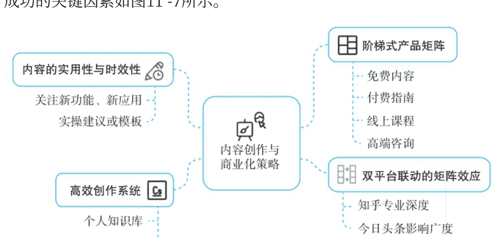

图11-7 成功的关键因素

1. 内容的实用性与时效性。
- 紧跟新功能与新用法，保证内容前沿。
- 每篇都提供可直接上手的操作建议或模板。

2. 高效创作系统。
- 建立个人知识库与创作流程，实现日更高质量输出。
- 用 AI 工具处理基础研究与资料整理，集中精力做个人观点与经验提炼。

3. 双平台联动矩阵效应。
- 知乎构建专业深度，头条扩大传播广度。
- 将两端用户汇聚至同一私域，形成完整转化漏斗。

4. 阶梯式产品矩阵。
- 免费内容→付费指南→线上课程→高端咨询，构成完整商业闭环。
- 各环节均需保证质量与体验。

## 6. 失败经验与教训

李明也经历过多次挫折。

1. 盲目追热点陷阱。
- 错误做法：第2个月为求流量，频繁发布与专业关联度低的热点。
- 负面结果：流量短增但粉丝质量差，定位模糊，知乎盐值下降。
- 解决方法：回归专业，用工具将热点改写为专业相关内容。
- 经验总结：宁可错过热点，不可偏离定位。

2. 内容深度不足。
- 错误做法：前3个月大量输出浅层内容，过度依赖 AI 生成，缺乏个人洞见。
- 负面结果：同质化严重，缺乏记忆点，用户留存低。
- 解决方法：降低频次，提升单篇深度，增加原创案例与方法论。
- 经验总结：一篇深度原创胜过十篇浅层复制。

3. 过早变现尝试。
- 错误做法：第4个月即推出599元课程，准备不足，影响力未稳。
- 负面结果：转化率仅0.3%，损害形象，收获负评。
- 解决方法：下架课程，先以49元小册子积累口碑，半年后再重塑课程。
- 经验总结：信任需逐步建立，变现节奏要匹配信任节奏。

王睿总结：“李明的路径证明，从零起步凭借领域经验加创作工具，完全可在一年内打造有影响力的专业 IP 并实现高收入。但工具只是放大器，核心仍是专业价值与正确策略。”

## 4.2.3. 田野调查技术

实地调查中最常用的技术包括观察、问卷调查以及深度访谈。

### 4.2.3.1. 观察法。

有观点认为：科学始于观察，最终也必须回归观察以获得最终验证。观察被视作自然科学与社会科学研究中的首要技术，也是研究的起点。

根据 Sellitz 的论述，若要使观察成为科学技术，需要满足以下条件：

1. 具有明确的研究对象或目的；
2. 经过周密系统地规划；
3. 实施系统化控制；
4. 接受效度与信度检验

### 观察类型

观察的分类依据不同标准展开：

49 GOODE, William J. y Hatt Paul. Métodos de Investigación Social. Cuarta reimpreión. Ed. Trillas, México 1972. 引自 ZORRILLA Arenas Santiago. Op. cit. p. 167

50 Ander-Egg, Ezequiel. Introducción a las técnicas de investigación social. Ed. Rialp, S. A. Trad. Manuel Rizo V. Madrid 1985. 同上 p 170

51 Ander-Egg, Ezequiel. Op. cit pp 96-97

## 实战练习

1. 知乎问题挖掘实践。
- 使用本章提供的 DeepSeek 提示词，在你的专业领域找到 5 个高价值问题。
- 为其中一个问题设计完整回答提纲。
- 评估该问题的传播潜力与变现可能。

2. 头条爆款标题训练。
- 选择你最熟悉的专业主题。
- 使用 DeepSeek 或豆包生成 10 个不同风格标题。
- 分析哪些标题更契合头条特性且易获高点击。

3. 专业定位与简介优化。
- 分析专业优势与独特价值。
- 使用创作工具生成 3 种风格个人简介。
- 挑选最能体现影响力的版本并微调。

4. 变现路径设计。
- 设计一条从平台到私域的完整引流路径。
- 规划 3 个可落地的变现产品或服务。
- 用创作工具辅助设计一份高价值免费引流资料。

## 思考

1. 对比头条与知乎，结合内容风格与专业领域，哪个更适合做主阵地？如何实现两平台内容协同？
2. 在追求头条点击率与知乎专业认可之间，如何平衡深度与传播性？创作工具如何化解这一矛盾？
3. 基于专业特长与目标用户，设计一条从影响力到收入的转化路径。你的影响力货币化策略是什么？
4. 使用创作工具辅助时，如何保持个人特色与独特见解？如何规避同质化陷阱？
5. 若设定 12 个月 IP 建设规划，阶段性目标与关键动作是什么？创作工具在哪些环节助力最大？

## 章末寄语：内容创作时代的专业影响力新机遇

在中文互联网，头条与知乎为创作者提供了前所未有的影响力扩张与变现空间。尤其在工具全面赋能下，专业内容的效率与质量已实现质变。

如今的挑战不再是“写什么”，而是“如何写出差异化价值”。单纯的信息搬运与浅层内容难以获得深度认可。真正的机会在于把创作工具的效率与你的专业洞见结合，打造独特价值。

DeepSeek、豆包、智谱清言等国产工具，让中文创作者拥有更贴合本土平台的强力助手。它们不仅加速创作，还能辅助趋势捕捉、数据分析与策略优化。工具像全能加速器，让一人可完成过去团队才能完成的工作。

但工具无法替代深度思考、独特视角与专业积累。将工具视为辅助而非替代，才能在新浪潮中脱颖而出，构建有价值的专业影响力，并将其转化为可持续收入。

让我们借助现代创作工具，在头条与知乎启动专业影响力之旅吧！

## 第12章 财富管理与生活重构：从副业收入到财务自由的完整路径

### 开篇：从收入增长到人生重构的双重转变

“这个月收入报表还不错。”王睿把电脑转给张文杰，AI副业月收入显示 8 800 元，同比增长 25%。

张文杰点点头，表情却不如一年前兴奋。“数字可以，但更让我欣慰的是这个。”他打开另一张表，净资产一栏为 156 800 元。

“还记得我们刚开始做 AI 副业时的状态吗？”王睿笑道，“每笔到账都像过年收红包，恨不得马上买新键盘或请客。结果设备升级了，存款却原地踏步，像仓鼠在转轮里狂奔却到不了终点。”

“直到半年前那次盘点，我们才意识到：月入过万，但存款增速连通胀都跑不赢。”张文杰回忆，“更关键的是，真正实现财务自由后，面临的难题不是赚钱，而是重新定义生活的意义。就像登顶后才发现，下山后要去哪。”

这成为转折点。他们建立了副业收入管理体系，并思考财务自由后的生活重构。从收入变财富，再到财富变自由生活。

“心态要转变，”王睿说，“不再把副业收入当‘额外钱’，而是当‘种子资金’。财务自由的终极目标不是拥有更多钱，而是拥有选择的权利。就像从员工变老板，责任与自由都完全不同。”

今天分享从 AI 副业收入到财务自由再到生活重构的完整路径。不仅关乎赚钱管钱，更关乎在 AI 时代重新定义成功人生。

## 一、副业收入的科学分配：构建财富基石

#### 1. 为什么需要收入分配法则

许多 AI 副业创业者在收入上升后发现同样问题：赚得越来越多，资产却不明显增长，主要源于三个误区。

1. “额外收入”心态：把副业收入当天上掉的馅饼。这是普遍心理陷阱，副业收入不稳定，容易被当作意外之财花掉。张文杰苦笑：“我曾月入四千，但银行存款几乎不动。回看消费记录，这些钱不知不觉被‘升级’的生活方式吞噬——更好的电脑、更贵的咖啡、更多冲动网购。就像一个会漏水的桶，倒多少存不住。”

根源在于大脑进化缺陷：远古基因让我们倾向即时享乐，因食物稀缺必须尽快吃掉。但在现代，这成为财富积累的最大敌人。

2. 生活膨胀陷阱：收入增长，支出同步增长。心理学称生活方式膨胀，随着收入上升，生活标准自动升级，最终储蓄率不变甚至下降。王睿分享：“副业收入从零到五千时，我不自觉地从外卖升级餐厅，从公交升级打车，从普通酒店升级星级。虽然生活质量提高，但存钱速度没跟上赚钱速度，就像油门越踩油耗越大。”

很多副业创作者在钱的问题上踩的坑，往往不是一次性的大手大脚，而是日复一日的小滑坡。

先说一个最隐蔽的消耗。每天多花五六十块，单看几乎感觉不到，可一年摊开就是一万八千块起步，这笔钱足够拿去滚一个像样的指数仓位。现金流的裂口就是这样被慢慢掏空的。

另一个更普遍的拖延是等收入变高了再规划。等副业稳定破万再去管钱，本质和“等英语说得溜了再开口”一样荒谬。张文杰就吃过这个亏，他说自己白白空耗了八个月，总觉得每个月两千块的副业钱太少，不值得搭一套管理框架。结果错过了一万六千元的起步投入，按5%的年化算，复利的损失就已经很扎眼了。

钱的大小不是重点，关键是把花钱变成可复制的习惯。就像学游泳，没人会在岸上把动作练完美再下水，都是下水后慢慢找感觉。

#### 2.40/30/20/10，让每一笔副业收入都有明确的身份

王睿和张文杰花了两年试错，沉淀出这套分配比例。“不是凭感觉拍的，”王睿说，“我们换过十几种组合，最后发现这个配比既能保证长期增值，也不会让当下生活失衡。”

1. 40%做投资和增值，是整个系统的发动机。副业钱的特性就是额外性，所以拿四成做长期复利是合理区间。

张文杰解释比例的考量：“三成偏保守，复利看不到威力；五成对当下压力太大，容易坚持不住。四成是甜蜜点，能感知到钱生钱，又不会被生活压垮。”

这部分内部再拆：指数定投占七成到八成，选费率低、体量大的宽基，比如沪深300、中证500这类；债券基金占一成五到两成，起稳定作用；个股或行业基金最多占一成，主要是满足探索欲。

操作上要物理隔离。王睿把投资账户的卡放在家里最深的抽屉里，就是为了增加取用摩擦，避免冲动。

2. 30%投向自身能力，是回报率最高的风险最低的资产。

张文杰的细化是：技能学习四成、工具设备三成、关系拓展两成、身体维护一成。早期他踩过“设备万能”的坑，花五千买专业录音棚设备，结果用不到十次。现在他买设备前一定会问，能不能直接带来收入增长，投入产出比是否清晰。

王睿强调人脉的价值：“三百块的行业聚会让我认识了现在最大的客户。”健康也被他列为基建，体检、健身、营养都是长期生产的底座。

3. 20%用于当下体验，是防止动力衰减的阀门。心理学上完全延迟满足会让人跑不远，适度的即时反馈才能维持长期执行。

王睿称之为快乐基金，但规则很严：必须用在提升体验而非囤物，比如家庭旅行、朋友聚餐、兴趣课。张文杰的边界是，即使收入翻倍，这块的绝对金额也不超过原来的1.5倍，随着收入上涨，享乐占比自然下行。

实操上可以放余额宝类货币基金保持流动性，用单独的信用卡或电子钱包支付，增加仪式感的同时也设限。

4. 10%做风险兜底和公益，看似最小，作用却最关键。

前期核心是建应急金。王睿花了八个月攒了三万，覆盖三到六个月基本开销。“看起来丢了收益，但心理安全感换来的是投资时的从容。”

应急金成型后，这10%可转向重疾、意外等保险转移大额风险，做必要的法律咨询，也可做少量公益，既是社会责任也有税务上的好处。

张文杰总结，这10%是对未知风险的预防性投资，像买保险，用不到最好，用到能救命。

#### 3.自动化系统：把理财变成肌肉记忆

靠意志力每个月分配是不现实的。王睿的态度是让流程自己跑。

一是设计三层资金流。

第一层是收入汇集池，所有副业钱先到这里。张文杰选了家市中心才有网点的社区银行做中转，减少取现冲动。每月5号设置自动转账到各目标账户，池子里永远保持低余额。

第二层是目标账户物理隔离。投资账户连通券商实现自动定投；能力提升账户用支持预算管理的银行；生活提升账户放货币基金；风险账户用定期存款。给每个账户起名字像“财务自由号”“个人成长基金”，看到名字就想起初衷。

第三层是工具执行。支付宝做基金自动扣款，银行App做跨行计划，记账App追踪支出，AI助手分析消费模式找资金黑洞。系统跑通后，分配像水流一样自然。

二是要避开执行陷阱。

比例僵化症：月入只有五百硬分四份成本太高。建议设门槛，月入两千以上再启动完整方案，低于则简化为七成投资、三成能力提升。

完美主义拖延：等完美银行、完美基金再开始。张文杰第一笔定投是在工商银行开的，费率高但养成了习惯，半年后再迁移到更优平台。80分就够用，先跑再优化。

频繁调参：看到别人的方案就改。王睿规定至少执行三个月再调整。稳定比完美重要。

## 二、投资入门与财富增长引擎

### 1.为什么指数基金适合起步

对AI副业创作者来说，指数基金的价值不在暴利，而在建立正确的投资思维。

本质是买下整片果园而非赌单棵树。无法精准预测下一个苹果或腾讯，就把优质公司一起打包。张文杰比喻，指数像果园，长期产出更稳。

心理层面也有优势。减少决策疲劳，不用每天研究个股；波动相对平缓，避免情绪失控；稳健表现帮新手建立信任，为后续进阶铺路。王睿早期盯个股每天花两三小时，后来转指数后每月只需十五分钟复盘。

### 2.新手第一份组合：三层金字塔

核心层占投资总量的六到七成，是压舱石。主投宽基。

沪深300占四成，覆盖中国最核心的大市值公司；中证500占三成，覆盖中盘成长。选费率0.5%以下的品种，自动定投，至少坚持三年走完一个周期。

全球配置占两到三成，分散地域风险。标普500占15%，港股指数占10%，欧洲或新兴市场占5%。王睿提到2018年A股低迷时美股和港股对冲了情绪。QDII有额度限制且有汇率波动，张文杰把汇率当作长期稀释的噪音。

机会探索层不超过一成，满足投机心态，可投科技、消费、医疗等主题。张文杰的底线是做好全亏准备，把它当学费，不影响主线积累。

### 3.从主动到被动：构建睡后收入

被动不是零投入，而是投入产出脱钩。

数字产品收益：知识可无限复制。张文杰把两年的AI创作提示词打包成加速包，199元售价首月卖28份净收5500元，周末制作一次，之后几乎免维护。关键是解决真问题、降低门槛、持续迭代。

会员订阅：现金流更稳定。王睿的三层会员分别是99元/月的模板库，299元/月加答疑，599元/月加一对一咨询。关键是期望管理，承诺少而做到位。留存靠入门礼、社区归属、成长可视化。

自动化服务：半被动过渡。张文杰的流程是线上表单收集需求，DeepSeek或豆包生成初稿，专家做最后优化，邮件自动交付。效率提升三倍，收费不变，实现部分解耦。

投资与资产收益：最经典的被动。王睿每月约1200元的投资回报虽小，但完全不占用时间，且随本金增长而放大。

### 4.投资心态：先战胜自己

张文杰只在每月最后一个周日看账户，其余时间不装证券App。心理学研究显示查看频次与收益负相关，就像减肥者每天称重更容易放弃。

要拥抱波动。王睿在2024年春节后组合跌20%，他反而加码定投，后面反弹不仅回本还有盈余。现在他看到下跌会兴奋，因为是便宜买入的好时机。改变语言习惯，用“账面波动”替代“亏了”，关注现金流和分红，以年为单位看结果。

张文杰坚持写投资日志，记录决策理由、市场环境、情绪状态。回看会发现，紧张时做的决策往往更好，过度自信时更容易错。

## 三、财务自由后的生活重构

被动收入覆盖基本开支后获得的不仅是经济自由，更是心理自由，但转型很复杂。

第一阶段是迷失与适应，财务自由后前三个月。王睿和张文杰都经历过“成就戒断症”，以前靠任务完成、上司认可、工资发放确认价值，外部评价消失后会出现空虚。像从有规律的校生活突然放假，需要时间重启。张文杰用了整整一个月“解毒”，睡到自然醒、发呆、散步、读书，让系统先排空，再重新填充意义。

财务自由之后的人生，并不是一步到位的平坦，而是四段清晰的心理与行为过渡。

探索试炼期：自由后的第4到6个月
这段时间的底色是广度试探和价值摸索。生活不再被KPI牵着走，人开始像孩子一样去碰触绘画、代码、冥想、烹饪甚至古琴。好奇心被彻底激活，但随之而来的也是细碎的迷茫感。

王睿当时这样形容自己的状态：“我一度给自己戴上很多面具，轮流去试身份和玩法。有的体验让人惊喜，有的很快就腻。但正因如此的乱试，我才摸到了真正能共振的方向。”

这段探索最容易踩的坑有三：用活动填满所有空白，拒绝给自己留白；兴趣刚起就换，始终浅尝辄止；总拿别人的自由生活做参照，导致自我怀疑。

更稳妥的做法是抱着开放却有边界的心态，给每项尝试设定一个观察期，比如三个月，到期复盘再决定是否延续。

整合聚焦期：自由后的第7到12个月
过了半年的试探期，大脑开始自动归类。哪些投入能带来长久的饱足感，哪些只是短暂的刺激，很快就能分辨出来。

张文杰注意到自己的规律：“到了第七个月左右，我发现一个重复出现的模式。帮别人用AI解决真实问题，那种满足能延续好几天；而刷短视频的快乐，几分钟就散了。于是我有意识地把更多时间推向有深度的场域。”

这一阶段的核心功课，是把快乐和满足感拆开看。
快乐多是外在刺激带来的情绪起伏，来的快去的也快。满足感则是源于意义感的内在充盈，通常来自能沉下心去做的事。

稳定成形期：12个月以后
时间走到一年以上，内在的价值罗盘基本校准，决策逻辑也发生了迁移。

王睿现在判断一件事的标准是：“它能不能增强我的创造力？它能不能帮助别人成长？它能不能带来真实的连接？” 与之相比，“能挣多少钱”“会不会显得高级”已经不再是首要考量。

从时间管理到能量管理：自由生活的底层设计
财务自由后，管理的重心从“有多少时间”转向“能量如何流动”。以下是四个可落地的原则。

能量优先于时间，顺着生物钟走
传统效率论追求时段内的最大产出，自由生活更强调顺应能量的自然起伏。找到自己的高峰期，用在最重要的事上。

张文杰用手表记录了三个月的能量曲线，发现上午9点到11点是创作高峰，下午2点到4点分析力最好，晚上适合阅读和复盘。他的日程因此被彻底重排。

落地做法：
连续两周做能量打卡，每小时给自己打1到10分；
把高分时段标出来，匹配最高价值的工作；
低能时段用来休息、娱乐或处理琐事，不硬扛。

节奏感代替时间表，生活像水一样流动
死板的几点到几点并不适合自由阶段。王睿后来改用活动序列来组织一天：晨间仪式→深度工作→户外放松→交流协作→学习输入→晚间复盘。状态好时深度工作可以自然延长，不会被闹钟硬切断。

设计节奏的提示：
在不同活动间加入小仪式，帮助大脑切换；
时间块之间留缓冲，避免被挤爆；
设定最小工作单元，比如至少45分钟专注、至少15分钟休息；
按季节、心情和项目节奏定期微调。

追求质量而非数量，少而深
张文杰过去一天排十几项任务，现在一天只留三四件核心事，但全部投入。少即是多，全神贯注带来的产出反而更高。他现在用45分钟的番茄沉浸模式，期间不碰手机不回消息。

提升质感的方法：
一次只做一件事；
为关键任务创造无干扰环境；
定期做正念和冥想练习，提升当下感；
记录高质量体验发生的条件，形成复用清单。

恢复与投入要平衡，可持续的高效
休息不是对工作的否定，而是高绩效的前提。王睿把恢复写进日程：90分钟高强度专注后，刻意安排30分钟恢复，效果远好于硬撑。

恢复系统可以分层设计：
微恢复：每小时5到10分钟，闭眼、伸展；
中恢复：每两小时15到30分钟，彻底放空；
深恢复：每天1到2小时，用于深度休闲；
终极恢复：每周保留半天到一天完全离线。

重启内在引擎：动力从外部转向内部
没有了Deadline的推力，很多人的动力会出现真空。这时需要把电源从外接换成内置。

好奇心驱动，终身学习
财务自由后可以纯粹为好奇而学。张文杰建了一个“好奇心清单”，把日常冒出来的疑问全部记录，每周五固定留一天无产出压力地探索，往往会成为新项目的种子。

李家的财务自由实操路径

起点画像：普通压力下的成长空间
李明32岁，互联网产品经理月薪15000；王芳30岁，外企行政助理月薪9000。两人育有4岁孩子，幼儿园年费2.5万，加上房贷6500元和每月3000元育儿支出，全家月结余仅3500元。

李明曾算过，如果按此速度攒够100万需要20年，而20年后的购买力可能不及现在的50万。正是这笔账，让他们决定寻找增收新路。

2024年底，李明从同行处了解到AI工具的效率价值，和王芳连夜梳理了各自技能，发现中小企业对AI+内容和AI+数据分析的需求很大，但兼具业务理解和操作能力的供给很少。时间窗口也合适，孩子白天上园，晚上可由双方父母协助。

从零到月入三千的启动期：第1到6个月
他们选择从AI辅助内容创作切入，定位为性价比高的中小企业内容解决方案。

服务清单：公众号文章500到800字150元一篇，产品介绍文案2000字左右300元一篇，简易数据分析报告800元一份，一对一AI工具培训200元每小时。

前两个月几乎零收入，主要是学工具、搭流程、找首单。第二个月通过同事介绍拿下培训机构10篇招生文案的订单1500元，成为后续长期客户。第三个月收入2200元，第六个月稳定在3000到4000元。

收入到账就开始执行分配习惯：40%定投沪深300，30%用于课程工具提升能力，20%改善亲子生活，10%存货币基金作应急。李明说，习惯比金额重要，小钱练手才能在钱变大时不失控。

业务升级期：第7到18个月
半年服务积累出大量可复用素材。他们把重复性高的需求产品化，第一款数字产品是中小企业内容创作工具包，含20个模板、操作指南和案例，定价199元，首月卖出15份。

随后推出订阅会员：基础版199元每月，更新5个新模板；高级版399元每月，额外每月一次在线答疑。三个月积累20位会员，每月稳定带来约6000元。

同时搭建半自动化流程：DeepSeek生成初稿人工精修，Python脚本处理常规数据清洗，建立FAQ减少重复沟通。心态从接单赚钱转向系统搭建。

到第18个月，副业月收入达8000到10000元，其中约四成来自数字产品和订阅的被动收入。

半被动收入体系成形期：第19到36个月
第二年注册个体工商户，产品分层更清晰：入门模板99到299元，中级定制服务500到1500元，高级咨询3000到8000元。营销、销售、交付逐步自动化，通过公众号和微信群分发，邮件和网盘自动交付。

团队开始外包：兼职设计师月1500元，文案助理按项目计费，客服助理月800元。两人得以聚焦策略和高阶客户服务。

第36个月，月收入结构为主业24000元加副业被动收入12000元，累计投资资产约35万元，被动收入已覆盖65%基础开支，每周仅需4到5小时维护。

新生活开启期：第37到60个月
第四年收入结构彻底改变：主业26000元，副业被动收入13000元，投资收益约6000元，合计45000元每月，其中42%来自被动来源。被动收入首次超过房贷，带来强烈的心理安全感。

生活方式同步升级：李明申请弹性办公，周两天远程；王芳转为兼职。陪伴孩子的时间增加，业余学习钢琴和摄影也能持续。开始用技能参与公益，帮助其他创业者。

他们的短期计划是把被动收入提升至覆盖全部生活开支；长期愿景是实现真正的时间自由，建立有社会价值的事业，成为有温度的财务自由家庭样本。李明总结：财务自由不是为了停止工作，而是为了有权选择要做什么工作。

实战指南

入门级行动：月入三千以内
先做财务CT扫描，用周末两小时把所有收入、支出、债务、资产列清。
为副业单独开账户，专门进不出金，增强获得感。
收入分配先从30%投资、40%能力提升、20%生活、10%应急开始执行，5号自动转账养成习惯。
从每月200元定投指数基金起步，培养波动容忍度。
每周15分钟复盘工作流，整理FAQ，把重复动作沉淀为资料。

进阶级行动：月入三千到八千
财务管道升级，严格执行40/30/20/10分配，三账户分离，设置月度复盘。
投资从单只基金扩展到组合：国内宽基50%，海外30%，行业主题15%，现金5%，每季度再平衡。
从单次服务转向产品思维，梳理半年项目，把高频需求打包成标准模板或工具包。

在AI副业的路上，真正决定你能不能从忙碌变自由的，不是某一个爆款技巧，而是思维和系统的升级。来看两个已经走在前面的实践者是怎么说的。

王睿把自己平时用的20条AI指令整理成模板包试水，首发只卖出28份。销量不高，却让他第一次尝到被动收入的甜头，更重要的是从此开始用产品经理的眼光去经营自己的服务。

启程阶段的核心是先验证再完善。用最小可行产品上线，先拿到真实用户反馈，再滚动迭代，而不是一上来就追求完美。

第二步就是搭半自动化工作流。把AI工具嵌进日常，用SOP把重复环节固化下来，腾出精力做判断。

张文杰的用法是典型样本：他现在让DeepSeek先出初稿，自己再做人工打磨，整体效率直接提升了六成。他总结的关键是分清边界，哪些环节可以交给机器提速，哪些环节必须人工把关。

学自动化工具前期确实要花时间投入，看起来是成本，其实是为未来的解放买单。

第三步是画一张清晰的财务自由地图，给三年、五年设定可量化的目标：被动现金流要达到多少、资产规模要滚到什么程度、何时能实现财务独立。

王睿感慨的是，有了这张图，每月的付出才有了方向，不再是瞎忙。目标可视化本身就会产生很强的心理牵引力。

当月收入稳定在8000元以上、体系已相对成熟后，就进入了专家级阶段。这个阶段的任务是从单打独斗转向系统运营。

第一，打造被动收入帝国。别把鸡蛋放一个篮子里，建议构建多元矩阵：数字产品约占三成、会员订阅约占四成、自动化服务约占两成、投资收益约占一成。

张文杰目前跑着七条不同的被动收入线，他说就算其中两三条出问题，整体也不会被拖垮。多源化不是为了堆复杂度，而是为了求稳。

同时要转变增长逻辑，重点是拉高单个用户的终身价值LTV，而不是无脑冲用户量。

第二，从单纯投资者进化为资产配置师。这时候可以开始研究更复杂的配置，比如贵金属、海外资产，并重视税务优化，合理使用不同账户。

王睿提到这个阶段会接触到一些高净值产品，但原则没变：只投自己看得懂的领域，不追暴利，把风控放第一位。补足基础税务知识，在合法合规前提下做结构优化。

第三，从个人英雄到团队协作。开始招助理、找外包设计、找合作伙伴，把自己从执行里解脱出来。

张文杰现在只抓策略和创意，落地由团队完成，这让他能聚焦在价值最高的环节。他也提醒，带团队本身就是一门手艺，需要不断练习。

第四，从赚钱机器切换到影响力平台。思考的高度从怎么赚钱，变成能创造什么社会价值，用自己的经验帮助更多人。

王睿的说法很直白：钱是工具，真正的成功是创造价值。财务自由后想做更有意义的事，不是道德绑架，而是内心自然的升级。

工具与资源

收入分配与管理
支付宝、微信理财是最省心的入口。支付宝的笔笔攒能设定自动储蓄规则，微信的零钱通门槛更低，适合当现金管理工具。招商银行App被很多人叫做银行界的微信，朝朝盈支持自动转入，储蓄能实现自动化。需要更专业的记账，随手记支持多账户、预算管理和消费分析。钉钉多维表适合做复杂财务追踪和协作。

投资平台
支付宝理财、腾讯天天基金是新手友好选择，产品多、费率低、定投功能完善。支付宝的帮你投适合完全小白的一键配置。

被动收入搭建平台
有赞适合做数字产品和会员订阅的电商运营；知识星球是做付费社群的标配；荔枝微课、千聊这类平台一次录课可重复售卖；小鹅通功能最全，是一站式知识付费解决方案，价格相对更高。

AI辅助工具
DeepSeek是当前国内性价比高的创作和数据分析主力；豆包在创意内容生成上表现突出；智谱清言逻辑推理强，适合复杂分析；腾讯元宝依托腾讯生态，信息检索优势明显。

高频问题与解法

副业收入不稳怎么分配？建立双层分配机制。用最低保障收入执行基础比例，超出部分用更激进的投资比例。比如确保每月至少1000元按40/30/20/10执行，超出部分可按60/20/10/10执行。

市场下跌还要定投吗？不仅要继续，还可以在回调时加大力度。下跌本质是打折买入优质资产，历史经验表明坚持低位建仓的人长期回报最好。

什么时候能减负享受自由？当被动收入能覆盖日常开支的80%以上时，可以考虑降强度。建议渐进过渡，先弹性工作或兼职，别一下子All in辞职。

怎么平衡当下和未来？严格执行20%的生活品质预算，专门用于提升体验。关键是设边界，避免享受预算无限膨胀。

孩子教育费高还要投资吗？教育是刚需，但要避免过度投入。把教育支出纳入家庭整体预算统筹，而不是挤占投资资金。长期看，父母的财务稳健才是孩子最大的安全感。

从财富到自由的终极蜕变

真正的财富管理不是看赚了多少，而是钱能不能持续为你工作，更重要的是财务自由后你如何重新定义生活的意义。

积累是手段，重构生活才是目的。当被动收入可以覆盖基本开支时，你获得的不仅是经济上的自由，更是选择的自由，工作因为想要而做，而不是因为必须而做。

从收入到自由有三个关键认知跃迁。

第一，从解决问题到创造意义。财务自由前核心是问怎么赚钱，自由后开始问为什么做。重心从完成任务转向创造价值，工作和生活会因此更有深度。

第二，从时间管理到能量设计。不再纠结在有限时间内塞进多少事，而是如何让每一段时光都充满活力和意义。

第三，从个人成功到共同成长。从追求个人成就转向连接与贡献。在AI替代常规工作的时代，人与人之间真实的连接愈发珍贵，财务自由给了你回馈的能力和动力。

给正在路上的建议

如果你还在追求财务自由，现在就开始构想自由后的生活，培育不依赖金钱奖励的内在驱动，建立有意义的关系和社群，保持与AI协作的能力同时守护核心思考。

如果你已经实现财务自由，给自己至少一年适应期，不要急着填满时间，重视过程体验，主动创造意义而不是被动等待。

张文杰常说，我们总是高估一年能做的事，却低估五年能带来的改变。财务自由靠的不是一夜暴富，而是系统、行动和耐心的复利。

王睿补充，最好的种树时间是二十年前，其次是现在。

行动是最好的老师，别等完美才开始，边走边优化。每一次小进步都在为未来的自由生活打地基。

今天就可以做一个微小改变：把AI副业的收入按比例自动分流到目标账户，开始搭建被动收入系统，同时思考财务自由后，你真正想过的生活。

财务自由不是终点，而是你真正掌握人生主动权的起点。

后记

在AI与人类共存的时代，财务自由提供了一个重新审视生活价值的机会。张文杰和王睿的经历告诉我们，财务自由不是终极目标，而是人生重构的开端。

真正的自由不是什么都不做，而是拥有选择做什么的权利，以及用人类特有的情感、创造力和智慧去做的能力。

愿你在追求财务自由的过程中，不仅获得金钱的自由，更得到心灵的自由、创造的自由、连接的自由，以及做真实自己的自由。

用技术拓展人性，用财富服务价值，用自由创造意义。这不仅是个人成长的旅程，也是时代演进的一部分。

正如王睿在最后一次交流时说的，财务自由只是给了选择权，如何选择仍需一生去回答。好在我们现在有足够的时间和资源去寻找自己的答案。

窗外城市依旧运转，而我们正站在一个全新的起点，去探索人生更深层的可能。这是最好的时代，也是最需要智慧的时代。

这不是一个故事的结束，而是下一个故事的开始。