# ChatGPT 赋能 Office：从入门到实战的智能办公指南

# 作者简介

**宫祺**

在信息技术领域耕耘二十余载，属首批取得微软人工智能认证的专业人士之一。曾就职于多家全球顶尖 IT 集团，担任资深管理者与顶级培训讲师，深度参与智慧城市多个项目，牵头大型国有企业数字化转型。长期致力于 AIGC 推广，在内容生成、创意设计及各类人工智能场景应用上积累丰富实践。具有资深 Prompt 工程师与 TTT 卓越培训师资历，为中国 DevOps 理事会成员、敏捷码头核心发起人及敏捷教练，亦为云原生社区核心成员。

# 内容概述

在深度学习驱动的人工智能浪潮下，ChatGPT 的出现极大拓宽了人机协作、内容生产与教学辅导的可能性。将 ChatGPT 与 WPS、Microsoft Office 等主流办公套件结合，能够为当代智能化办公提供强有力的支撑，提升整体工作效能。

本书围绕借助 ChatGPT 实现高效办公展开，分入门篇与实践篇两部分。入门篇介绍 ChatGPT 的账号创建与进入方式、基础操作、提示词编写思路，并对 ChatGPT 与 Word、Excel、PowerPoint 的协同应用做概念性说明。实践篇则聚焦实操，演示如何利用 ChatGPT 辅助文档撰写、表格处理与演示文稿制作。文档部分涉及工作总结、论文起草、商务函件、广告文案等；表格部分覆盖数据整理、函数构造、数据分析等；演示文稿部分覆盖提纲设计、内容细化与视觉优化等。

全书案例丰富、注重落地，既可作 ChatGPT 零基础读者的起步读物，也适合财务、人事、行政文秘等希望以 AI 提升效率与职业竞争力的从业者参考，同时可供高校师生借鉴。

# 编者寄语

科技演进重塑工作与生活方式，ChatGPT 作为强大的自然语言处理模型，已在多行业展现出明显潜力。当前办公的核心在于生产力与创新力。在自然语言处理取得突破的背景下，类 ChatGPT 的模型已成为推动办公自动化与智能化的重要力量。

依靠 ChatGPT 辅助日常办公，能够开启一种全新的智能协作模式，为工作带来更便捷的体验。其强大的理解与生成自然语言能力，可在文本与数据处理上提供多样化支持，帮助用户在各工作场景实现自动化与优化。

为帮助读者系统掌握智能办公方法，本书应运而生。书中详细阐述如何运用 ChatGPT 工具解决工作中常见难题，从基础的账号创建与功能介绍，到进阶功能与插件应用的探索，力求提供实用且系统的学习参考。

**全书划分为两部分**：入门篇与实践篇。入门篇主要讲解账号创建与进入、核心功能、插件应用、提示词设计，以及 ChatGPT 在办公软件中应用的思路与优势。学习完这一部分，读者可建立基础认知，为后续实操奠定基础。

实践篇为重点，涵盖文档创作、表格处理、演示文稿三章，通过具体案例详细说明 ChatGPT 在 Word、Excel、PowerPoint 中的智能化应用。

案例中读者既能学会借助 ChatGPT 撰写工作总结、商务函件、广告文案等不同类型文档，也能掌握表格制作、函数编写、数据检索与分析等常见难题的处理方法，同时可获取提升演示文稿质量与效率的实用技巧。每项实操均配有详细操作说明，并附赠视频教程，读者可循序渐进提升智能办公专业度。

本书还汇总了大量源自真实案例的操作心得与技巧提示，无论初学者还是资深从业者，都能从中获得提升办公软件使用技能与工作效率的方法。

我们希望本书帮助读者掌握运用 ChatGPT 提升办公效率的能力，以更好地适应未来需求。在人工智能持续进步的今天，愿本书成为大家的良师益友，助力保持竞争力，在智能办公道路上不断前行。

为便学习，本书特别附赠视频讲解等辅助资源，感兴趣读者可扫描下方二维码获取。

尽管编撰团队已尽力精进，但受限于时间篇幅及模型快速迭代，书中难免存在疏漏，恳请读者包容指正并反馈。

编者

2024 年 8 月

# 入门篇

## 第一章 认识 ChatGPT

### 1.1 ChatGPT 的注册与登录

ChatGPT 由 OpenAI 研发，基于海量文本预训练的大型语言模型，能够理解并生成自然语言文本，广泛应用于对话机器人、内容创作辅助、自动化客服等。预训练过程中模型学习了语言的深层结构与用法，因而可在无特定领域训练的情况下进行复杂语言交流与生成。

使用前需先完成账号创建与进入，创建的账号即为 OpenAI 统一账号，可访问 ChatGPT 及其他 OpenAI 产品与服务。以下简述流程。

**步骤 01 开始创建。** 打开 OpenAI 官网，首次使用者可在页面右上区域找到 Try ChatGPT 入口，如图 1.1 所示。

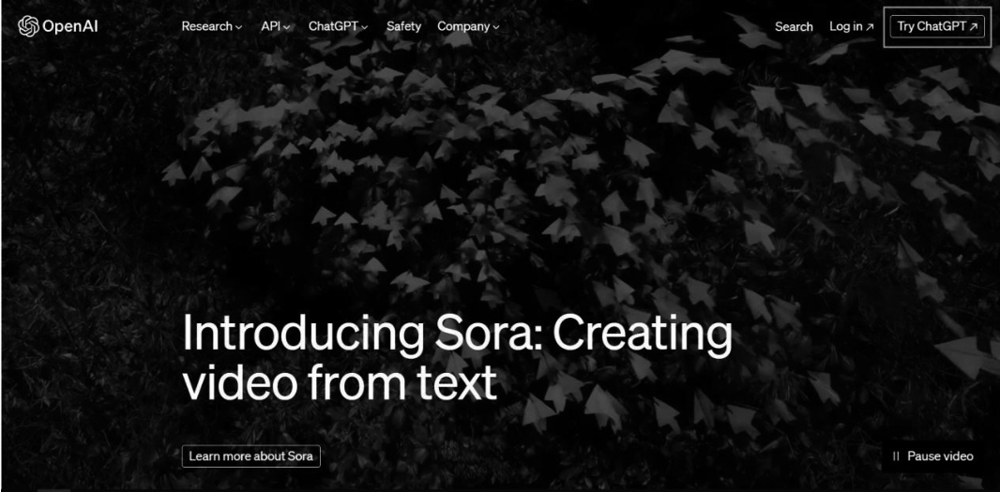

图 1.1

跳转后页面中选择 Sign up，如图 1.2 所示。

图 1.2

### 提示

**若已有账号，在此页面选择 Log in 即可直接进入。**

**步骤 02 设置账号与密码。** 进入创建页，在“电子邮件地址”栏输入邮箱后按“继续”，如图 1.3 所示。

随后在“密码”栏输入登录密码后按“继续”，如图 1.4 所示。

▲图 1.3

图 1.4

**步骤 03 邮箱验证。** OpenAI 会向填写的邮箱发送验证邮件，打开邮件并按下 Verify email address 完成验证，如图 1.5 所示。

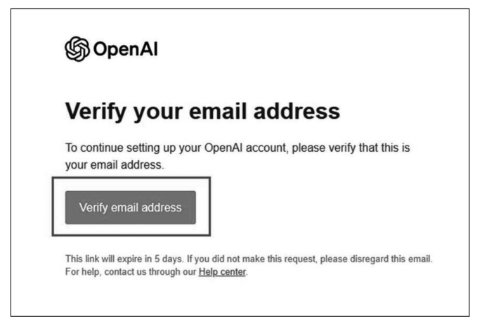

图 1.5

验证完成后返回刷新创建页，按提示填写个人信息并完成手机号码验证，即可完成创建。

**步骤 04 开始进入。** 打开 OpenAI 官网，选择右上区域的 Log in，跳转后选择 ChatGPT 选项，如图 1.6 所示。

在新页面按下 Log in，如图 1.7 所示。

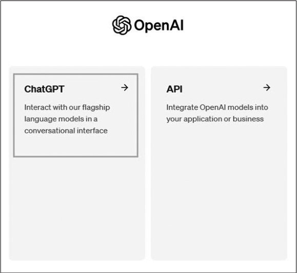

▲图 1.6

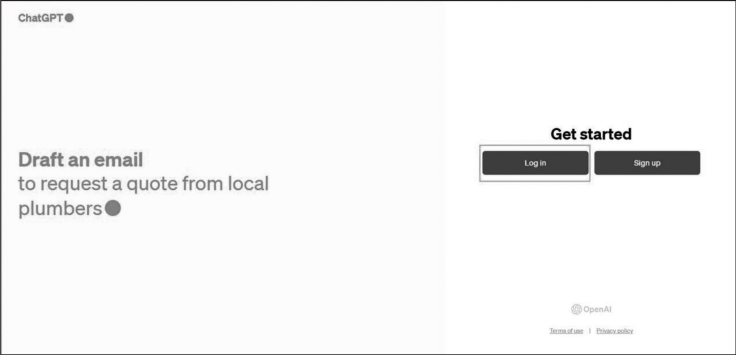

图 1.7

在“电子邮件地址”栏输入已创建邮箱后按“继续”，如图 1.8 所示。

在“密码”栏输入创建时设置的密码后按“继续”，即可进入 ChatGPT 首页，如图 1.9 所示。

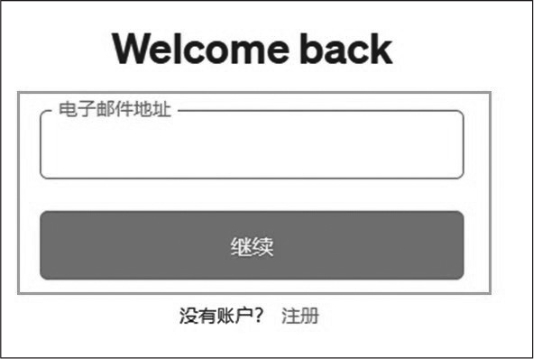

▲图 1.8

图 1.9

### 提示

**进入后若未退出，系统会保持登录状态，下次只需在官网首页右上区域按下 Try ChatGPT 即可直达首页。**

**步骤 05 版本升级。** 自发布以来 OpenAI 已推出多个版本，不断优化性能。2023 年发布的 ChatGPT 4.0 为跨模态模型，除文本外还能处理与生成图像。读者可按需决定是否升级。若需升级，可按以下操作：

在首页顶部左侧 ChatGPT 3.5 处按下，在弹出的列表中选择 Upgrade to Plus，如图 1.10 所示。

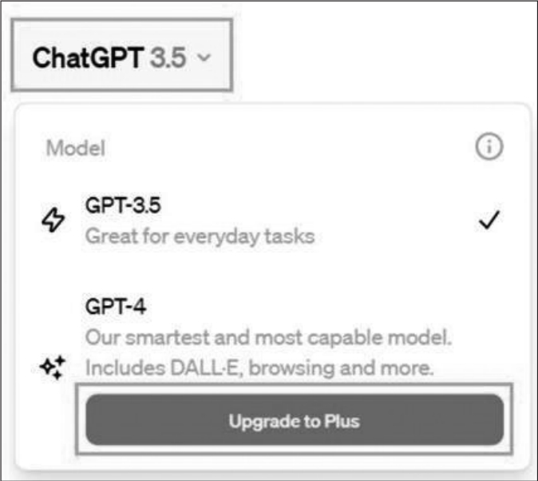

图 1.10

在打开页面中挑选所需版本，按下下方对应控件，跳转至订阅页完成支付即可，如图 1.11 所示。

图 1.11

### 1.2 ChatGPT 的核心功能

登录后即可与 ChatGPT 对话。在界面底部对话区输入问题或主题，系统会给出相关回答并展开交流。下面演示对话与记录管理流程。

**步骤 01 输入问题或关键词。** 在首页底部对话区输入：什么是人工智能？随后按下右侧箭头或按 Enter 提交，如图 1.12 所示。

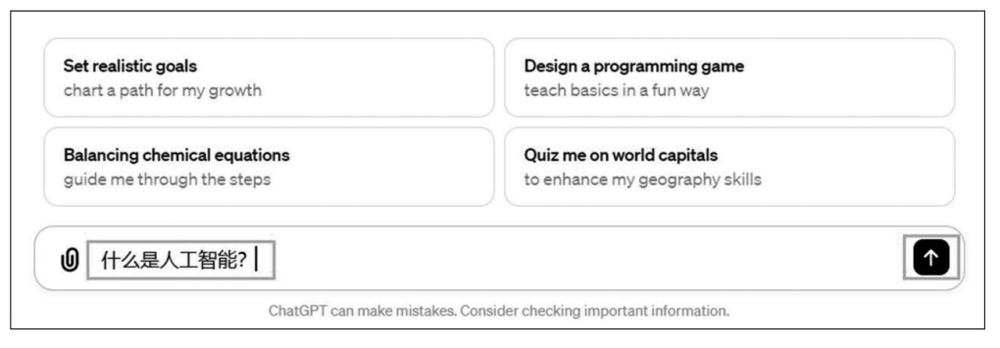

图 1.12

**锦囊妙计**

**1）输入时需要换行，可按 Shift+Enter。**
**2）每次进入首页，对话区上方会随机推荐 4 个问题或主题关键词，点击即可获取答案。**

**步骤 02 获取并查看回答。** 提交后，回答会显示在界面上方，如图 1.13 所示。

**步骤 03 管理回答。** 将指针移至答案区域，下方会出现 4 个操作项：Read Aloud 朗读、Copy 复制、Regenerate 重新生成、Bad Response 错误回复，按下对应项即可执行，如图 1.14 所示。

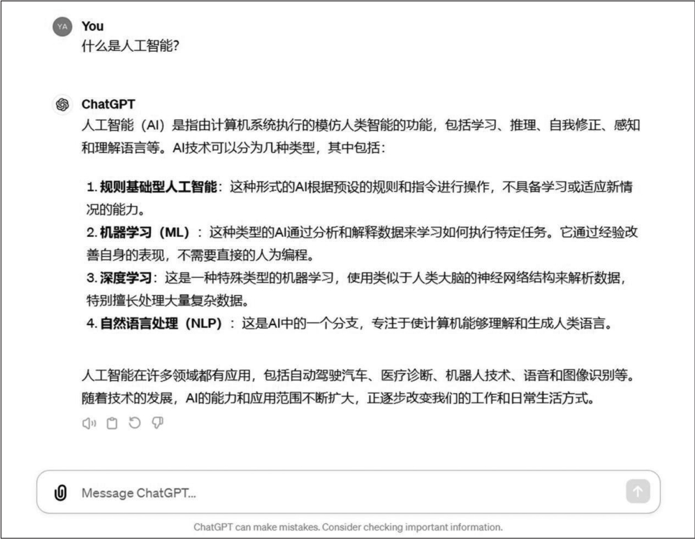

▲图 1.13

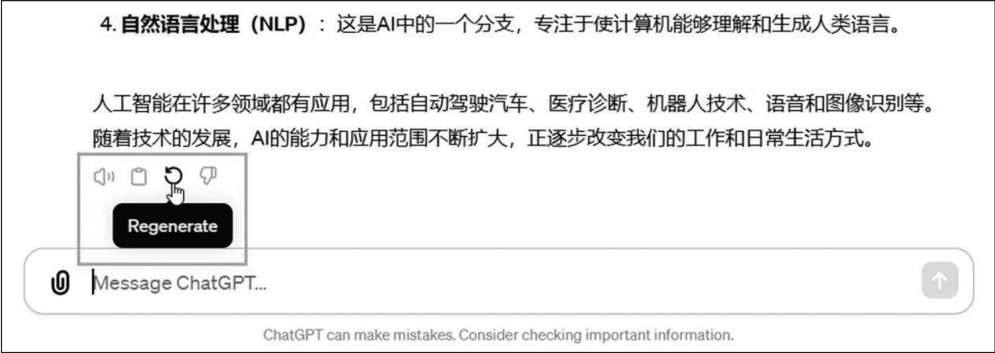

图 1.14

**步骤 04 暂停生成。** 在等待生成结果时，按下对话区右侧出现的“暂停”即可中断，如图 1.15 所示。

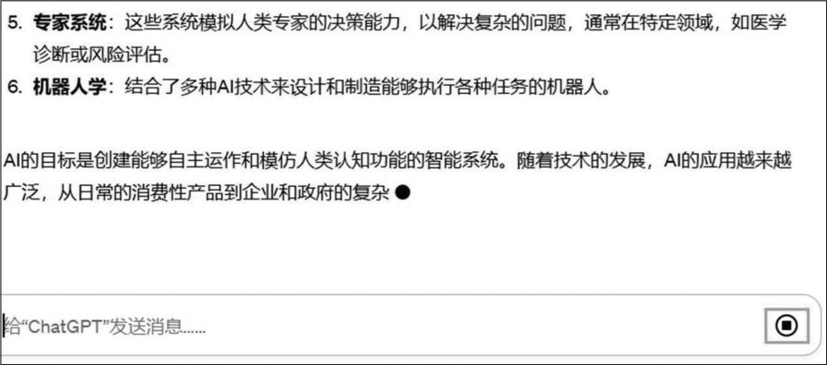

图 1.15

**步骤 05 上传文件。** ChatGPT 4.0 支持文件上传，按下对话区左侧“上传”即可发送图片、文档等文件，如图 1.16 所示。

图 1.16

**锦囊妙计**

**ChatGPT 4.0 之前版本仅支持对话，不支持文件上传。**

**步骤 06 管理对话记录。** 首页左侧边栏会列出历史对话，可进行管理。选中某条记录，按下右侧 More，在下拉列表中选择 Share 可分享；选择 Rename 可重命名；选择 Delete chat 可删除，如图 1.17 所示。

按下 Archive 可将该记录归档，如图 1.18 所示。归档记录可在“设置”中查看。

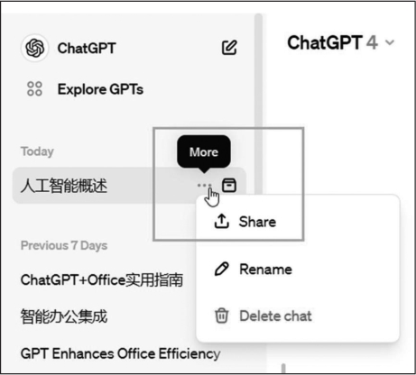

▲图 1.17

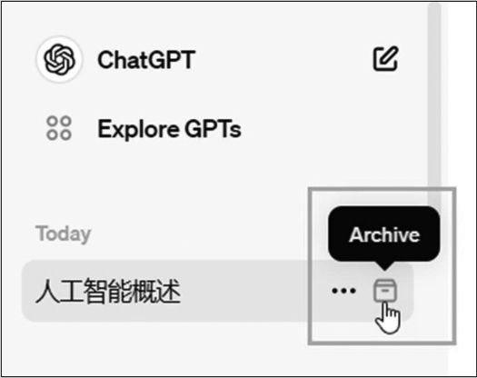

图 1.18

**锦囊妙计**

**将指针移至左侧边栏边界，可通过提示选择展开或收起边栏。**

**步骤 07 账号设置与管理。** 按下界面左下方用户名会弹出列表，如图 1.19 所示。

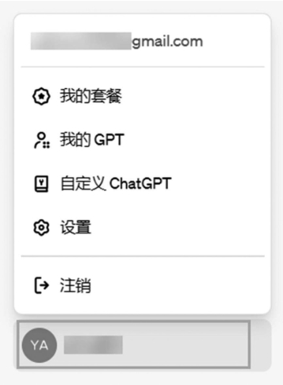

图 1.19

按下“我的套餐 My Plan”可查看订阅详情；按下“我的 GPT My GPTs”可创建或定制专属模型；按下“自定义 ChatGPT Customize ChatGPT”可设置或修改个性化指令；按下“设置 Settings”可访问隐私、通知、界面偏好等账号设置；按下“注销 Log Out”可退出登录。

### 1.3 ChatGPT 的应用插件

为增强扩展能力，ChatGPT 支持在其框架上集成各类 GPT 应用。插件可帮助 ChatGPT 对接外部应用与服务，拓展基础对话能力。用户可按需挑选配置插件，使其提供更个性化的信息与服务。借助插件，ChatGPT 不仅是聊天工具，更是多功能助手。下面简述插件使用方法。

**步骤 01 打开插件页面。** 进入首页，按下顶部左侧 Explore GPTs，如图 1.20 所示。

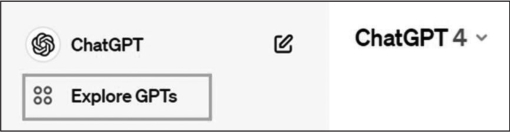

图 1.20

**步骤 02 选择插件。** 跳转至插件页面后，可浏览或在搜索框中查找目标插件，如图 1.21 所示。

看到感兴趣的插件后，按下该插件，如图 1.22 所示。

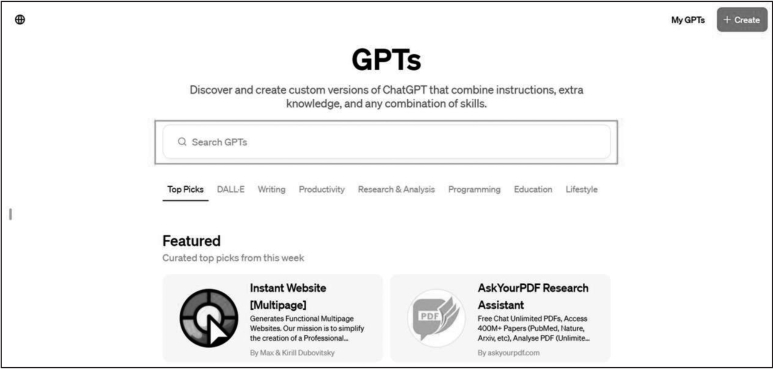

▲图 1.21

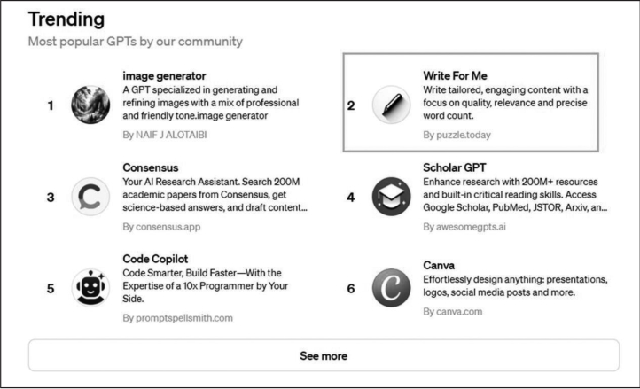

图 1.22

**锦囊妙计**

**按下每种类型分区最下方的 See more，可查看更多插件。**

**步骤 03 使用插件。** 在弹出页面按下 Start Chat 即可开始使用该插件，如图 1.23 所示。

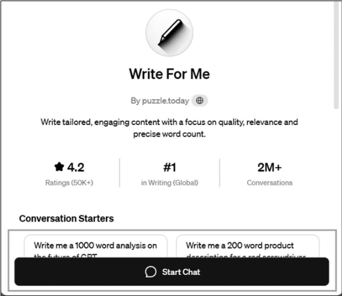

图 1.23

### 1.4 ChatGPT 的提示词

与 ChatGPT 交流时离不开提示词 Prompt。提示词即向模型提出的问题或请求，是指引其做什么或聊什么的信息。用户通过输入一段文本来引导生成方向与结果。

**1.4.1 提示词为何关键**

ChatGPT 的输出取决于用户输入的提示词，提示词的表达质量直接影响结果质量。通过提示词可控制文本内容、长度、风格等，只有合理有效的提示词才能得到最贴合需求的回答。下面用两个例子对比无效与有效的提示词差异。

**无效提示词案例**

**对话框输入：帮我写一篇文章。**

**ChatGPT：**

没问题！请问您想写什么主题？是学术论文、观点稿、新闻报道还是其他类型？有没有具体要求，比如字数、结构或要点？这样我才能更好帮助您。

**有效提示词案例**

**对话框输入：帮我写一篇关于视频大模型 Sora 面世的新闻报道，字数控制在 200 字左右。**

**ChatGPT：**

好的，以下是关于视频大模型 Sora 面世的新闻报道草稿。

**标题：**创新视频大模型 Sora 正式发布，开启视觉 AI 新纪元

全新的视频分析大模型 Sora 今日正式发布，该模型由领先的人工智能公司推出，旨在借助先进深度学习技术提升视频内容的自动分析与生成。

Sora 结合最新机器学习算法与大规模数据处理能力，可实现高效视频解析、内容标注及逼真视频生成。其强大功能预计将在媒体制作、视频监控、在线教育等多个领域发挥重要作用。

企业方面说明，Sora 模型的落地是针对视频内容分析需求持续走高的市场趋势所作出的回应。往后，Sora 会在持续迭代中不断升级，以跟上技术演进和市场变化的速度。

从前面的例子不难看出，提词写得好坏直接决定了用户能否迅速拿到质量更优、更贴合自身诉求的答案。

**1.4.2 提示词的撰写规范**

想要和 ChatGPT 更顺畅地配合，可以围绕以下几条原则来打磨提示词。

**（1）明确性与精确性：**提示词含糊或笼统时，模型很难给出有效输出。用词清晰、表述具体的指令，能让模型更准地把握用户意图，进而产出更相关更有用的内容。比如“请解释牛顿的第二定律”就比泛泛的“谈谈牛顿的定律”更直接、更具体。

**（2）正确的语法表达：**提示词本身应避免错别字、标点混乱或语法错误，否则容易造成理解偏差。

**（3）包含完整信息：**尤其是涉及专业领域或复杂情境时，提示里最好把必要的背景与前提补全，有助于模型建立上下文，输出更合适的回答。

**（4）简洁性与目的性：**在信息充分的前提下尽量避免冗赘，既要提供必要的细节，也要把想要的结果类型说清楚，比如是想要建议、概念解释、创意点子还是决策帮助。

**1.4.3 提示词的优化技巧**

在遵守规范的基础上，可再借助以下技巧提升输出质量。

**（1）导向特定领域或风格：**通过提示引导模型聚焦某个主题或采用特定文体，例如“用诗的形式描绘日出”或“以学术论文格式讲解量子力学”。

**（2）设定回答的格式：**明确格式需求，如“请用列表呈现答案”或“用口语化语言描述”。

**（3）添加适当的细节：**根据期望答案的深度调节提示的详略，例如加入“详细分析”等词来推动深入展开。

**（4）设定身份与角色信息：**先为模型分配一个具体身份或角色，能让输出更贴合使用场景。

**（5）分步骤提问：**面对复杂或多模块的问题，分步提出有助于更系统地获取信息。

下面用一个具体案例展示优化前后对回答质量的影响。

**优化前**

**在对话框中输入：给我一些关于写小说的建议。**

**ChatGPT：**写作小说时，保持持续创作并规律安排写作时间很重要。塑造鲜明人物与紧凑情节是吸引读者的关键。多阅读有助于提升技巧与文笔。最后不要回避重写与修改，这是提高质量的重要环节。

该提示过于宽泛，没有说明类型或作者的具体困境，得到的自然是普适且针对性不足的基础建议。

**优化后**

**在对话框中输入：我是一名小说家，正在写一本科幻小说。我在塑造一个外星角色来地球的动机和背景方面遇到困难，这个角色是故事的关键，他从一个敌对的外星种族中来到地球。我希望这个角色来到地球的动机深刻且符合他的种族文化背景。**

**ChatGPT：**科幻创作中，外星角色的文化根基是核心。先构想该种族的社会结构、信仰体系、价值取向与科技水平。若其社会高度集体主义，角色的来意可能与族群目标紧密绑定。再思考他为何登陆地球，是求助、探险还是逃难，不同动机会决定行为模式与冲突设计。最后通过他与地球文化的碰撞来展现性格与来历，既能加深人物厚度，也能丰富整体情节。

优化后的提示明确了小说类型、具体难点与期望，能换来更专业、更具指向性的建议。

### **1.5**

### **ChatGPT+Office 智能办公**

人工智能正深刻重塑工作方式，办公场景是典型体现。将 ChatGPT 与传统 Office 软件融合，便形成了一种新的智能办公动向。

**1.5.1 ChatGPT+Office 的概念**

ChatGPT+Office 智能办公是指把自然语言处理技术与 Office 软件结合，借助 ChatGPT 完成各类办公任务、提升效率的新模式。ChatGPT 能理解自然语言并生成相应回复，与 Word、Excel、PowerPoint 等结合后，用户在信息获取、数据处理、文档撰写等环节会更便捷。

**1.5.2 ChatGPT+Word：使用 ChatGPT 来辅助文档创作**

结合 Word 可以显著提升文档编写、润色与校对的效率与品质。

筹备阶段，ChatGPT 能帮助快速起草或生成初稿。无论是商务报告、学术论文还是创意写作，只要简述需求与目的，就能得到结构化的草案，打破写作障碍。

在润色层面，模型可就语法修正、用词替换与风格调整提供建议。法律文件或学术文章可保持语言的准确与专业，创意写作则能获取多样风格选择。

校对时也很有用，能识别拼写错误、语法问题与风格不统一，并给出修正意见，节省时间并提升整体质量。

面对海量信息，ChatGPT 可协助整理、提炼要点并生成易读的分析报告。

多语言能力还能扩展 Word 的边界，协助把文档译成多种语言并兼顾文化可读性，对国际沟通尤为重要。

总体而言，ChatGPT 与 Word 的结合让内容生成、文本编辑、信息整理与多语翻译更流畅高效，适合专业人士与普通用户。

**1.5.3 ChatGPT+Excel：使用 ChatGPT 来处理表格与数据**

二者结合为数据处理与自动化打开新空间，提升了分析、报表与决策支持的效率。

使用层面，ChatGPT 能即时讲解复杂功能，如公式、宏或数据透视表，甚至直接生成可用代码，降低门槛。

数据处理层面，用户可用自然语言描述需求，让模型快速把资料转为表格与图表，节省手工整理时间。

在解读层面，面对复杂数据集，模型可用自然语言解释分析结果并给出基于数据的建议。

决策支持方面，模型可模拟不同经济或业务情景，帮助预测表现并据此制定策略。

这种融合让数据分析更直观，处理与决策流程更简便。

**1.5.4 ChatGPT+PowerPoint：使用 ChatGPT 来辅助创作演示文稿**

结合 PowerPoint 能大幅提升演示文稿的制作效率与专业度。

内容策划时，只要描述主题与需求，模型即可提供结构化建议，包括开场、展开与收尾的逻辑。

文本撰写上，可协助起草或优化演讲稿、标题与备注，并在保证语法正确的前提下提升吸引力与说服力，并按受众调整风格。

数据可视化方面，模型能从复杂数据中提取要点、推荐合适的图表形式，并解释数据背后的故事，帮助记忆与理解。

排练与反馈环节，可把讲稿输入让模型点评并提出改进建议。

多语言需求下，模型也能快速完成演示稿的翻译，确保信息在不同语言间准确传递。

整体上，二者融合提供从创意、撰写到数据解读与演练的全流程支持，提升演示质量与影响力。

本书实践篇将通过系统案例展示 ChatGPT 与 Microsoft Office 三大核心软件 Word、Excel、PowerPoint 的结合应用，帮助读者直观看到其在文档编辑、数据分析与演示制作中的实操价值，并融入日常工作流。

# **实践篇**

## **第二章**

## **文档创作**

### **2.1**

### **公文写作**

在快节奏的工作环境中，高效的文档写作能力尤为关键。本章将从公文写作、学术教育、文学创作、营销宣传、电商新媒体、职场提升、团队协作与效率等维度，详解如何借助 ChatGPT 轻松高效完成各类文档。

**2.1.1 使用 ChatGPT 撰写工作总结**

工作总结是对成果、经验与教训的梳理与反思，有助于规划后续方向。ChatGPT 可帮助归纳思路并快速成稿。

**1．思维导图**

**2．操作步骤**

ChatGPT 能依据汇报主题与受众，帮助梳理并构建工作总结框架，再细化内容，在保证效率的同时提升报告质量。

**步骤 01 确定基本框架。** 先告知职业身份与总结主题，让模型在理解背景后确定框架，为后续扩充提供结构。

**在对话框中输入：我是一名图书公司的编辑，我需要针对上一年度的工作内容写一份工作总结报告，请帮我确定报告的大纲。**

**ChatGPT：**撰写图书编辑部年度总结可参考以下大纲。

工作总结报告大纲

**I．简介**

● 公司／编辑部概况
● 报告目的与范围

**II．上一年度工作概况**

● 工作期间
● 人员组成与结构
● 主要职责与目标

**III．主要成就**

● 新书出版数量与质量
● 作者合作关系发展
● 跨部门协作成果
● 荣誉或奖项

**IV．项目回顾**

● 项目名称 1：目标、进展、结果
● 项目名称 2：目标、进展、结果
……

**V．问题与改进**

● 识别的问题、挑战或不足
● 解决思路与改进措施

**VI．未来展望**

● 新目标、计划与策略
● 新项目、合作、市场趋势分析与预测

**VII．致谢**

● 对团队、作者、合作伙伴及其他部门的感谢

**VIII．结论**

● 报告要点概括
● 对未来的信心与期望

**锦囊妙计**

若对整体结构满意却不确定具体写法，可请模型基于大纲给出各部分的写作要点。

**步骤 02 生成文章主体。** 框架明确后，可直接要求模型按大纲生成正文。

**在对话框中输入：请按照上述大纲格式生成工作总结报告，要求内容翔实具体。**

**ChatGPT：**工作总结报告

**I．简介**

编辑部是公司核心部门之一，负责图书出版项目的推进与质量把控。本报告旨在全面回顾过去一年的工作，评估成绩与挑战，并展望发展方向。

**II．上一年度工作概况**

● 工作时间：20××年1月1日至20××年12月31日
● 人员组成与结构
编辑总监：王小明
编辑：张美丽、李华、刘强、赵云
助理编辑：王芳、陈建、杨慧
● 主要职责与目标
出版新书，保证数量与质量
与作者建立合作关系，确保进度
与市场、销售等部门协作，推动销售与推广
……

**VII．致谢**

我们衷心感谢编辑团队、作者、合作伙伴及其他部门的辛勤付出，正是这些支持成就了成绩与荣誉。

**VIII．结论**

过去一年编辑部取得显著进展，也暴露出若干问题。展望未来，我们将以更饱满的热情与坚定信心，为公司发展与读者满意度持续努力。

**步骤 03 细化与扩充。** 若初稿字数或细节不足，可让模型对各部分进行深化。

**在对话框中输入：请给出一段关于主要成就的详细内容，不要分段叙述，400 字左右。**

**ChatGPT：**过去一年编辑部取得了一系列令人瞩目的成绩，充分体现团队的专业素养与执行力。首先，我们成功推出多部新书，其中不乏读者与业界双重认可的作品。我们坚持高标准把控内容与质量，提升了品牌声誉，也赢得了读者信任。与此同时，我们与多领域优秀作者建立了紧密合作，共同打造高质量出版物，为后续合作奠定基础。此外，与市场营销、销售、设计等部门的紧密配合，推动了多个跨部门项目顺利落地，有效提升了图书推广效果与市场份额。公司也对我们的表现给予认可，授予多项荣誉，进一步激励团队追求卓越。我们为这一年所取得的成果感到自豪，并满怀信心展望未来，将继续为公司发展与读者价值贡献更大力量。

**锦囊妙计**

**（1）若希望输出为一段完整文字，可加入“不要分段叙述”等限制。**
**（2）在提示中加入字数要求，能让详略更符合预期。**

**步骤 04 校对与调整。** 将生成内容复制到 Word 文档，调整字体与版式，通读检查逻辑与连贯性。

**锦囊妙计**

**（1）模型生成内容偶有误差，人工核实可确保准确性与专业度。**
**（2）除 Word 外，WPS 等办公软件也可用于版式调整。**

**2.1.2 使用 ChatGPT 完成工作周报**

工作周报用于定期汇报进展、成果、问题与下一步计划，有助于团队及时掌握动态，促进自我管理。ChatGPT 可快速生成草稿并按要求定制内容。

**1．思维导图**

**2．操作步骤**

撰写周报时，ChatGPT 能节省起草时间，也可作为学习工具帮助掌握写作要领。

**步骤 01 获取模板。** 直接询问如何撰写工作周报，模型会给出通用模板供参考。

**在对话框中输入：如何撰写一份工作周报？**

**ChatGPT：**撰写工作周报的基本步骤与结构如下。

**1．周报标题**

● 标题：含姓名、部门、日期范围等信息

**2．本周工作总结**

● 已完成任务：列出本周主要任务与项目及具体进展
● 工作成绩：简述工作对团队或公司目标的贡献，含可量化成果

**3．遇到的问题及解决方案**

● 问题：描述本周工作中的主要问题或挑战

用 ChatGPT 快速搭建办公常用文档，下面这套思路能让你在周报、纪要、通知和致辞上省时又提质。

**一、用模板化思路写周报**
周报的核心是信息完整、结构清晰。先让模型给出一个通用骨架，再填入真实内容。

主要模块可以这样搭：
* 解决方案：概括本周遇到的卡点是如何处理的，或尚未解决的问题打算怎么推进。
* 下周工作计划：列出重点要完成的事项与项目，写明具体期望与时间节点。另单列需要支持和资源：人手、数据、部门协同等需求要提前说明。
* 反馈和建议：对团队协作、流程、项目本身的观察与改进建议。个人发展部分简要写下一步打算补强的技能或知识。
* 附加信息：假期、出差、重要活动等特殊事项提醒。
* 格式与风格建议：文字保持简洁有条理，避免冗长；用项目符号或编号区分要点；描述问题时也保持积极建设性的口吻；固定每周同一时间提交，形成习惯。

小贴士：模板若不符合实际，可以继续追问模型调整，或直接复制到 Word/WPS 中按部门习惯微调。

实践步骤 02 生成内容
把一周的完成情况、进展、下周安排告诉模型，让它按骨架补全。也可以直接带入岗位身份让模型代写。
例如在对话框里输入：你是一名广告公司的策划，请按上面结构生成一份工作周报。

示范输出：
标题：李薇—广告策划部—工作周报（2024年3月1日—2024年3月5日）
本周工作总结
1. 已完成任务
* 完成客户A春季促销广告方案设计，包含视觉创意与文案。
* 牵头设计与媒介投放团队，确保素材准时交付上线。
2. 工作成绩
* 活动首周点击率比预期高出10%，客户反馈满意。
* 调整投放时段，广告花费降15%，ROI提升。
遇到的问题及解决方案
1. 问题：部分素材在特定平台展示效果不佳，影响体验与点击。
2. 解决方案：连夜与设计组沟通，48小时内完成规格与视觉优化并更新。
下周工作计划
1. 计划任务
* 启动客户B夏季新品发布会的整体宣传策略策划。
* 联合数据分析团队对客户A活动进行中期复盘，为策略调整提供依据。
2. 需要支持和资源
* 需客服部协助确认客户B对宣传诉求与预算限制。
* 需数据组提供详细效果报告，聚焦用户行为与转化数据。
反馈和建议
1. 反馈：跨部门协作顺畅，建议增加每周一次进度对齐会以便更及时跟进。
2. 个人发展：计划参加下月数字营销进阶研讨会，学习新技术趋势。
附加信息
3月13日周三下午两点公司召开季度业绩分享会，请准时出席。
锦囊妙计：同一指令多次生成效果会不同，多跑几版挑选整合能更快得到满意稿。

**2.1.3 用ChatGPT撰写会议纪要**
纪要要记录时间、地点、议题与决策，通过模型可以快速客观归纳。

1. 思维导图

2. 操作步骤
模型能处理大小型会议的记录，快速提炼要点。
步骤 01 生成模板
先让模型先给一个通用模板再调整。
在对话框输入：请给我提供一个简单的会议纪要模板。
示范模板包含：会议主题、日期、起止时间、地点、参会人员主持人记录人参与者列表、议程及讨论点含讨论内容决策结果行动项负责人截止日期、会议决策汇总、其他备注、下次会议安排、附件清单。
锦囊妙计：需要表格版时在提示中明确要求表格形式。
步骤 02 修改模板
把模板复制到文档里调整字体、列宽、间距，增删条目。
步骤 03 补充内容
确定模板后把会议原话或要点发给模型补全，也可直接给职业与主题让模型代写。
例如输入：你是一名动画公司的项目制作人，正在启动新动画系列，请在上述模板基础上完善会议纪要。
示范纪要：
会议主题：新动画系列项目启动会议
日期：2024年3月5日 时间：10:00—12:00 地点：公司第一会议室
参会人员：主持人张华 记录人李明 参与者王雷 赵敏 孙洋 周丽
议程与讨论
1. 项目概述
讨论：张华介绍概念、目标受众与市场定位。
决策：方向通过，需细化受众研究。
行动：赵敏负责市场调研，截止2024年3月15日。
2. 预算与资金
讨论：孙洋汇报制作成本与宣传费用预算。
决策：原则通过，探索外部融资。
行动：王雷拟定资金申请提案并物色投资人，截止2024年4月1日。
3. 制作时间表
讨论：周丽展示里程碑与完成节点。
决策：为保证质量调整部分关键日期。
行动：周丽更新时间表并分配任务，截止2024年3月10日。
其他备注：下次会议定于2024年3月20日，讨论调研与融资进展；各行动事项需会前完成。
附件：项目概述文档、初步预算表、时间表草稿。
锦囊妙计：给模型一个身份角色与会议主题，输出会更贴合。
步骤 04 优化润色
觉得过长可要求精简，或指定条目扩写。
例如输入：请精简与优化上述会议纪要的内容与结构。
精简版要点保留主题日期时间地点参与者，议程浓缩为项目概念确认、预算与资金，下次会议与附件。行动项与截止日保留。
锦囊妙计：既可要求整体精简，也可要求单点扩写。

**2.1.4 用ChatGPT拟定放假通知**
通知格式固定，模型可按场景定制。

1. 思维导图

2. 操作步骤
步骤 01 确定主题和大纲
先让模型确定框架。
输入：我需要撰写一则春节放假通知，请为我确定基本框架。
模型会给出：标题、开头祝福、放假起止时间、工作交接安排、值班说明、补班安排、假期注意事项、安全与联系方式、恢复工作时间、结语、联系人信息。
步骤 02 生成通知内容
按框架让模型生成。
输入：请根据上述框架，帮我生成一份春节放假通知。
示范通知要点：2024年2月10日至2月17日放假共8天，2月18日恢复；放假前做好交接；期间安排值班；无须补班；注意健康安全保持通讯畅通；紧急联系值班经理张先生电话123-4567-8900。
步骤 03 优化润色
可加入风格化表达或诗词。
输入：请在上述通知开头加入春节主题的诗词以增添节日气氛。
加入“千门万户曈曈日，总把新桃换旧符。”后语气更喜庆。
步骤 04 调整格式
复制到Word排版，分一放假时间、二注意事项等条目，最终稿保留公司名称与发布日期。

**2.1.5 用ChatGPT完成发言致辞**
致辞需要明确场合与受众。

1. 思维导图

2. 操作步骤
步骤 01 明确关键信息
先问模型需要哪些要素。
输入：当我需要写一篇演讲稿时，你需要我提供什么信息？
模型会要求：演讲目的与主题、受众画像、时长与场合、特殊要求与资料引用、个人观点与期望效果。
步骤 02 确定主题
带入具体场景请求主题灵感。
输入：我即将进行入职演讲，请为我提供几个演讲的主题。要求：积极向上、坦率真诚，每个主题控制在20字以内。

职场写作让 ChatGPT 速成，这套实操清单直接抄作业

新人上台发言怎么找切入点
代表新同事发声，先把方向定好。下面这几个角度既好立意也好展开：

1. 理想兑现：把个人愿景和公司蓝图挂钩，讲实现与创造
2. 新征程：突出开启新旅程，呈现新姿态新风貌
3. 全情投入：强调热忱、专注、拼尽全力的职业状态
4. 协同成长：围绕团队协作，共创佳绩
5. 底气十足：传递坚定、有担当、勇往直前的气场

小贴士
对演讲稿里涉及的要素拿不准，比如风格定位、语气把握等，都可以先问模型要参考思路。

第三步 让模型直接出稿
思路理清后，把要素一次性喂给模型生成初稿。

指令要点：要一篇主题是《实现梦想，创造未来》的演讲稿，目的是提振信心，听众是公司同事和领导，时长约三分钟，场合是新年员工入职大会，语气要求情感真挚。

模型会先做回顾铺垫，再谈梦想需要信念与行动，借名言强化观点，最后以感谢与展望收束。

小贴士
模型在生成长文时偶尔会卡顿，回一句“继续”就能把内容补完。

第四步 润色提升
初稿容易跑偏或不够精致，可以指定段落让模型优化。

指令要点：请对上述演讲稿的开场白进行润色，让语言更优美、更有诗意。

模型会把开头改为新春氛围的描写，用梦想之力书写华章的意象。

小贴士
1. 润色完建议把全文搬到 Word 手工核对语病错字。
2. 可以让模型多生成几版同主题稿，挑亮点拼接成自己最满意的版本。

2.1.6 使用 ChatGPT 撰写商业信函
商业信函是商务沟通的正式载体，用来传达信息、提出诉求、达成共识。借助模型能让函件更规范、更专业。

1．思维导图

2．操作步骤
写商业信函是职场必备技能，模型能从学习到成稿全程陪跑。

步骤 01 确定类型
商业信函种类较多，如回复型、致谢型、邀请型等。不清楚区别时先让模型确认。

输入问询：需要写一份商业信函，请介绍信函类型及各自作用。

模型会归纳出询盘、报价、订单、投诉、推销、感谢、邀请七类，并说明每类在获取信息、明确价格、确认交易、表达不满、吸引客户、增进关系、发出邀请等方面的功能。

步骤 02 明确关键信息
把背景、目的、细节告诉模型，生成的邀请函才会更精准。

输入问询：要写一份商业邀请函，需要提供哪些信息。

模型会提示需要活动日期时间地点及时长、主题与目的、受邀人姓名职务、特别嘉宾或议程、着装要求或 RSVP 等附加要求。

步骤 03 生成邀请函
把活动要素一次性给模型，即可得到正式草案。

输入要素：2024 年 5 月 4 日 14:00—19:00，市美术馆，持续 5 小时，主题为未来世界装置艺术展，目的是让参展者对公司产品产生兴趣，拟邀同行业技术总监、广告媒体宣传总监、网站报社记者及艺术界知名顾问，着装要求穿有未来感元素的服装。

模型会生成邀请函要点：由公司代表发出诚挚邀请，介绍展览内容与公司前沿定位，说明特邀对象，提出着装建议，并列出日期时间地点及联系方式。

小贴士
模型生成的格式偶尔不规范，注意甄别调整，精细排版建议用 Word 或 WPS 完成。

2.1.7 使用 ChatGPT 处理电子邮件
邮件是办公沟通的主力，模型能帮忙起草、回复、优化和提炼。

1．思维导图

2．操作步骤
除了写新邮件，模型还能回复、润色、提炼，提高沟通效率。

步骤 01 撰写邮件
先明确主题、目的、发件收件人身份，再下指令生成草案。

示例：小明是某广告公司设计师，需要提醒策划同事小美尽快整理项目 A 的提案资料和设计需求发来，邮件要有问候与结束语，控制在 300 字内。

模型会给出主题明确、时间紧迫、请求清晰且语气礼貌的草案。

小贴士
模型支持多语言，也能按商务英文规范写邮件，生成后核对细节即可使用。

步骤 02 回复邮件
处理大量邮件时可让模型代为回复。

示例：你是策划小美，收到设计师小明的催办邮件，请在 300 字内回复。

模型会表达已收到请求、正在整理、预计次日下午前发送、如有疑问会即时沟通等内容。

步骤 03 优化邮件内容
想提升回复率和沟通效果，可请模型给出优化建议。

示例：对一封简短的客户催需求邮件进行优化建议。

模型会建议使用个性化称呼、明确目的与价值、给出具体指引、设定明确截止时间、提供联系渠道、使用温和专业的结束语并署名。

步骤 04 提取信息
长邮件信息冗余时，可让模型分点提炼要点。

示例：提取一封节日问候邮件的重要信息。

模型会提炼出节日问候、对过去合作表示感谢、希望新年继续合作、承诺提供更专业高效服务等要点。

2.1.8 使用 ChatGPT 制定合同协议
合同是保障交易和合作的书面依据，模型能快速生成规范文本，缩短起草周期。

1．思维导图

2．操作步骤
模型既能按模板生成标准化合同，也能按需求定制条款。

步骤 01 明确需求与关键信息
起草前要清楚合同用途和双方信息，梳理条款要点。

输入问询：需要拟一份合同协议，可以帮忙吗。

模型会要求提供合同类型、关键条款等，提醒提前收集双方名称地址联系方式、付款条件、交付时间、违约责任等信息。

步骤 02 生成合同草案
把信息和目的给模型，就能得到初步草案再行修改。

示例：乙方为甲方拍摄 3 分钟宣传片，3 个月内完成，预算 50 万元。

模型会给出宣传片拍摄合同要点：项目内容为制作 3 分钟宣传片，完成时间为签署后 3 个月内，合同金额 50 万元，分首款 15 万、拍摄完成付 20 万、最终交付付 15 万，双方责任、原创性保证、版权归属等条款框架。

在合同与人力资源、学术写作的实操场景里，ChatGPT 已经成了很多人的效率搭子。下面把一份常用的合同条款用法，以及员工手册、岗位职责、论文准备的完整打法，全部换一种说法重讲一遍，干货不丢，表达全变。

宣传片的著作权归甲方独占，乙方交付制作成果后，未经甲方书面授权，不得以任何形式将其用于商业用途。

**六、合同的变更与终止**
任何一方如需调整合同内容或提前结束合作，必须提前30天以书面形式告知对方，待双方协商达成一致后方可执行。

**七、争议解决**
合同履行中若产生分歧，双方应先以友好协商为原则尝试解决；协商不成时，任一方有权向合同签订地的人民法院提起诉讼。

**八、其他**
本合同共印两份，甲乙双方各持一份，法律效力相同。自双方代表签字盖章之日起生效。

**锦囊妙计**
**1）** 对某类条款的写法拿不准时，可以直接向 ChatGPT 求写法，比如提问“支付条件条款该怎么写？”。**2）** 当手头信息有限时，模型往往只给出一版基础模板，用户可按实际需求自行增删，或继续让模型润色，使其更精准更专业。

**步骤 03 迭代与完善**
合同通常要经多轮打磨才算成熟。可以通过向 ChatGPT 询问特定法律表述或条款写法的方式，反复优化，直到完全满意。

在对话框中输入：我想加一条违约责任条款，确保乙方延期交付或成品质量不达标时，甲方有足够的保障，该怎么写？

ChatGPT：
若乙方未能按约定期限交付宣传片，或交付成果的质量未达到甲方要求，乙方需按未完成部分合同价款的10%向甲方支付违约金。同时甲方有权要求乙方重新制作或修改，直至成果符合甲方标准。

**步骤 04 审查和修改**
迭代完成后，要把合同交给双方各自审阅并提出修改意见。审阅时务必核对每一条款是否准确无误、是否覆盖关键风险点。

**锦囊妙计**
ChatGPT 能帮忙起草、迭代合同的语言和格式，但它不是持牌法律人士。正式签署前，强烈建议请专业律师复核，确保合法合规且可执行。

**2.1.9 用 ChatGPT 撰写员工手册**
员工手册是企业内部的制度与文化载体，既对外展示形象、对内统一行为规范。借助 ChatGPT，能在结构、段落组织和语言风格上获得建议，产出更清晰完整的手册。

**1．思维导图**

**2．操作步骤**
ChatGPT 可作为智能协作者，从框架搭建到文字打磨提供支持。

**步骤 01 获取信息**
对撰写流程不熟时，直接提问即可获得方法论。

在对话框中输入：员工手册一般怎么来写？

ChatGPT：
**1．资料收集**
收集公司制度、流程、福利、价值观、使命等信息，并与管理层、法务、相关部门沟通，确保信息完整准确。
**2．明确读者**
确定手册主要面向新员工、在职员工还是管理层。
**3．搭建大纲**
确定章节顺序与内容要点，确保信息传达清晰。
**4．撰写正文**
依据资料与框架起草，使用清晰简洁的语言。
**5．校对修改**
完成初稿后审阅，核对准确性、完整性及合规性。
**6．排版设计**
选择专业且贴合品牌调性的版式，适当加入图示提升可读性。

**锦囊妙计**
模型给出的步骤可根据自身情况灵活增删调整。

**步骤 02 生成大纲和结构**
清晰的大纲能保证手册条理分明。让 ChatGPT 帮你梳理。

在对话框中输入：我是一家科技公司的主管，需要一份员工手册，请给出一个合适的大纲框架。

ChatGPT：
以下是一个可参考的框架示例。
**1．公司介绍**
公司使命与愿景、发展历程、核心价值观与文化。
**2．招聘政策**
……
**11．其他政策与流程**
如差旅、会议等公司特定政策，以及法规遵循声明。
**12．联系方式**
公司官方联系信息。

可依据公司实际情况对上述框架进行增减完善。

**步骤 03 完善手册内容**
把公司基础信息提供给模型，即可逐段生成内容。

在对话框中输入：公司成立于××××年，专注于产品研发与科技创新，请先撰写公司简介部分。

ChatGPT：
**公司简介**
**使命与愿景**
公司以科技创新为驱动，致力于解决社会与商业难题，推动人类进步。
**历史沿革**
公司创立于××××年，始终坚持研发与创新，已成长为行业领先的科技企业，产品与方案已在全球落地应用。
**价值观与文化**
秉持创新、协作、担当、卓越的价值观，鼓励员工发挥潜能，共同实现公司使命。

**锦囊妙计**
可以让模型逐段产出后逐段修改，也可先生成整篇再统一润色。

**步骤 04 评估和优化**
生成后评估是否符合公司语气与需求，再让模型按反馈调整。

在对话框中输入：希望公司简介更具体详实，突出悠久历史与创新精神，控制在300字左右。

ChatGPT：
公司使命与愿景方面，我们以持续创新与技术领先为目标，为客户提供卓越解决方案，推动行业与社会发展，愿景是成为全球科技领军者。
公司历史与发展方面，企业历史悠久，成立于××××年，由小型创业团队成长为行业领导者。创新始终是核心基因，鼓励员工突破传统、尝试新思路与新技术，持续加大研发投入，引领行业方向，为客户创造更大价值。

**步骤 05 提供排版建议**
成册前可请模型给出设计要点。

在对话框中输入：员工手册的排版和设计有什么建议？

ChatGPT：
**1．结构清晰与目录** 使用明确的标题层级，开头附目录便于检索。
**2．语言简洁** 用通俗易懂的表达，避免过度专业术语。
**3．图文结合** 借助图表与图片解释复杂内容，提升阅读体验。
**4．品牌统一** 保持与公司VI一致，使用统一的logo、色系与字体。
**5．字体与字号** 选择易读字体，字号合适。
**6．分段与标题** 合理分段，标题突出。
**7．重点强调** 用加粗、斜体或不同颜色突出关键信息。
**8．留白与版面** 保持合理留白，版面整洁有序。
**9．美学元素** 加入装饰线条、图标或背景纹理提升质感。

**2.1.10 用 ChatGPT 制定岗位职责**
岗位职责明确了岗位边界与工作要求，有助于员工高效履职。ChatGPT 能快速输出职责初稿，节省HR与管理层的准备时间。

**1．思维导图**

**2．操作步骤**
在招聘环节，输入岗位信息即可获得通用模板或定制化职责描述。

**步骤 01 确定行业范围**
行业不同对岗位能力要求差异较大，先锁定行业有助于提高相关性。

在对话框中输入：我是一家房地产公司的人事专员，请列出招聘时常见的岗位名称。

ChatGPT：
房地产公司常见的招聘岗位包括：
1．销售顾问／销售经理
2．市场营销专员／经理
3．拿地专员／经理
4．项目经理／项目协调员
5．施工管理
6．质量控制／质量保证经理
7．设计师
8．工程师
……

**锦囊妙计**
模型的岗位清单仅作参考，最终招聘岗位仍取决于公司需求与组织架构。

**步骤 02 制定具体职责**
明确岗位等级后，模型能生成更精准的职责说明。

在对话框中输入：我需要招聘行政专员和项目经理，请分别给出具体职责。

ChatGPT：
**行政专员职责**
**1．文档管理** 负责文件整理、归档与更新，保证资料准确可检索。
**2．会议支持** 预订会议室、准备设备与资料。
**3．行政支持** 处理邮件、接听电话、接待访客、安排日程等日常事务。
**4．办公物资管理** 负责采购、库存与维护。
**5．费用报销协助** 整理发票、准备报销单并提交。
**6．员工福利支持** 协助组织节日礼品、团建等福利活动。
**7．内部通告** 协助制作并发布公司新闻与公告。

**项目经理职责**
**1．规划与执行** 制定项目计划、时间线、资源与预算并推动落地。
**2．团队协作** 组建团队、分派任务并监督进度。
**3．客户关系** 作为客户主要联络人，管理期望并保障满意度。
**4．质量管控** 确保交付成果符合公司与行业标准，定期审查。
**5．风险管理** 识别风险、制定应对方案并持续监控。
**6．预算控制** 把控项目成本，进行定期财务核查。
**7．合同管理** 负责与供应商、承包商的谈判、签署与履约跟踪。
**8．进度汇报** 监控节点，按时交付并向上级汇报进展。
**9．项目复盘** 完成后进行效果评估与总结，形成经验沉淀。

**锦囊妙计**
提供岗位时务必注明职级，如专员或经理，才能获得更匹配的职责要求。

**步骤 03 补充与更新**
职责不全时可让模型追加或调整。

在对话框中输入：请在行政专员职责里加入考勤管理。

ChatGPT：
更新后的行政专员职责如下，新增第8条。
**8．考勤管理** 负责员工日常考勤记录，包括迟到早退、加班、请假等，保证数据准确及时，按公司制度处理异常。

**锦囊妙计**
也可要求模型删除、合并或调整职责顺序，模型会按需求返回更新版列表。

### **2.2 学术教育**

**2.2.1 用 ChatGPT 准备论文撰写**
撰写论文常让人望而却步，ChatGPT 能在选题、方向、大纲、摘要等方面提供实用建议，提升效率与质量。

**1．思维导图**

**2．操作步骤**
在动笔前完成选题调研、大纲与摘要准备，能大幅节省精力。

**步骤 01 探索研究方向**
先说明身份与主题范围，获取前沿信息与方向建议。

在对话框中输入：我是计算机系学生，想以AI技术发展为主题写论文，能否提供一些研究方向和热点？

ChatGPT：
围绕AI技术发展，可选方向包括：
**1．深度学习与神经网络** 探讨在自然语言处理、计算机视觉、语音识别中的应用及最新架构。
**2．自然语言处理** 研究文本生成、机器翻译、情感分析的进展，关注预训练模型如BERT、GPT的应用。
……
**7．元学习** 研究模型快速适应新任务的能力，小样本学习与迁移学习。
**8．AI与医疗健康** 影像分析、疾病诊断、个性化治疗的应用与临床验证。
**9．AI伦理与社会影响** 技术对社会、经济、就业的影响，道德准则与公众接受度。
**10．多模态学习** 融合文本、图像、语音等数据提升性能。

可根据兴趣与背景挑选主题，确保研究深度与广度。

**锦囊妙计**
可让模型对几个方向进行对比，帮助锁定兴趣点。

**步骤 02 确定选题**
方向明确后，可让模型批量生成题目备选。

在对话框中输入：我想做“AI伦理与社会影响”方向，请生成6个论文题目。

ChatGPT：
**1．AI对就业市场的影响及应对策略研究**
**2．医疗健康领域AI应用的伦理审视**
**3．法律与司法领域AI应用的机遇与挑战**
**4．社交媒体中AI推荐对信息传播的影响**
**5．AI在决策支持与治理中的作用与风险**
**6．AI算法偏见问题及公平性提升路径**

**锦囊妙计**
**1）** 可向模型询问题目难度、研究热度等，以便决策。
**2）** 确定后再让模型在不改变原意的前提下润色标题，直至满意。

**用 ChatGPT 把论文从零到交付的完整打法**

很多同学卡在论文启动和收尾上。其实把 ChatGPT 当成科研搭档，从摘要到大纲、润色到降重，甚至写教案，都能走通一条清晰的流水线。

**一、从选题到骨架：先做摘要再定大纲**

先让模型生成一份对仗主题的摘要。输入思路可以是：说明你想以《AI 在就业市场中的影响与应对策略》为题目创作一篇论文，请给出约三百字的摘要。

模型会产出一版概览：围绕人工智能技术在就业领域的冲击展开，先梳理行业层面的自动化替代与智能化改造，再结合既有研究和案例点出机会与风险，比如生产效率提升、新型岗位诞生，同时部分群体可能面临失业压力。最后提出应对思路，包括人才培养与技能更新、产业结构优化与政策引导、构建更灵活的就业体系等，目标是为就业挑战提供参考，促进市场健康与社会稳定。

有了摘要，就能要大纲。提示模型基于刚才的题目和摘要给出框架。典型的结构会是：

**I．引言**
A．AI 对就业的冲击
B．研究背景与目的
C．全文脉络

**II．AI 技术对就业市场的影响**
A．自动化替代现象
B．智能化改造趋势
C．岗位变化与调整
……
**VI．讨论与展望**
A．长期影响
B．策略的可行性与可持续性
C．未来研究方向

**VII．结论**
A．核心观点回顾
B．策略建议
C．后续研究与政策走向

小技巧：如果框架不满意，可以追问让它修改直至可用；也可以让它推荐参考文献，但专业性和真实性需要自己甄别。

**二、2.2.2 用 ChatGPT 润色论文**

润色能揪出语言问题并提升专业度与可读性。

1．思维导图

2．操作步骤
模型能检查语法拼写，还能做精简、扩写和风格转换，同时保持学术严谨。

步骤 01 检查语法。把待润色的段落发过去，让它审阅拼写、语法和连贯性并给出修改建议。提示词思路是：你是一名计算机系导师，请检查下面段落的拼写、语法是否正确、表达是否通顺，若无问题直接说没有，若有请给出修改版。

例如关于数字化时代 AI 成为发展引擎、对制造金融医疗等行业带来变革并深远影响就业格局与劳动力需求的段落，模型会反馈目前没有明显错误，表达通顺。

锦囊：论文篇幅长，可分段分章逐段送审。

步骤 02 提升可读性。让模型把长句拆开、删减冗余，使表达更清晰简洁。提示思路是请润色下文，将长句拆分、优化冗余，文字如下。

结果会把“AI 的广泛应用对就业市场的格局、职业结构和劳动力需求等方面都带来了挑战和机遇，这使得对 AI 在就业市场中的影响及应对策略进行深入研究尤为重要。”等表述改写为更流畅的短句版本。

步骤 03 精简内容。让模型在保留核心的前提下压缩字数。提示思路是把一段约五百字的论述压缩到两百字左右，保留原意。

压缩后会保留三点：AI 以自动化和智能化替代传统劳动力，尤其冲击重复性高标准化高的岗位；催生数据分析师、机器学习工程师等新职业；技能要求提升，劳动者需持续学习保持竞争力。

锦囊：可要求扩写或换风格，不理解需求时可附例文参考。

**三、2.2.3 用 ChatGPT 降重**

降重核心是先提炼信息再重构表达。

1．思维导图

2．操作步骤
先提取原文关键词、论点、结论，再据此重写。

步骤 01 提取信息。把原文发过去，让它归类论点、结论、示例。围绕未来研究聚焦 AI 对各行业职业影响及劳动力结构变化、重点研究广泛应用对传统与新兴岗位的影响以指导政策、人力资源管理与人才培养的应用、个性化培训与转岗服务、政策监管与人才培养支持等要点，模型会分条列出。

步骤 02 重构内容。基于提取结果要求生成约三百字的新表述，保持原意但更换句式与风格。

步骤 03 优化润色。继续要求不用过多长句，使文字简洁清晰可读。

步骤 04 重复调整。循环提炼—重构—润色，配合专业查重平台检测，直至重复率达标。

锦囊：每次降重后查重，根据结果决定是否继续；降重同时可做润色，人手校对模型表述不准的部分，确保原创与专业。

步骤 05 规范格式。全部定稿后在 Word 中排版，确保格式严谨，便于成果呈现。

**四、2.2.4 用 ChatGPT 完成教案编写**

1．思维导图

2．操作步骤
模型可按目标生成定制教案，包括内容、活动与评价。

步骤 01 确定需求与目标。先明确可衡量目标、教学标准和主题。提示思路是：我是一名小学语文教师，需要为一篇课文编写教案。

模型会回问课文名称、主要内容、教学重点和学生年级。

步骤 02 编写教案文档。提供课文《赵州桥》、三年级、目标为掌握内容、了解背景与文化内涵、理解建筑特点与历史意义后，模型会给出框架：教学目标分知识技能、过程方法、情感态度价值观；重点难点；教学准备；过程包括导入、新课呈现、深入探索、总结提升；作业与评价设计。

步骤 03 审阅与调整。初稿完成后检查是否贴合目标，活动是否有效。需要补充互动时可追问补充，例如增加角色扮演等参与性活动。

锦囊：可让模型推荐资料来源网站或教学视频，提升准备效率。

从摘要生成到大纲搭建、润色降重，再到教案编写，ChatGPT 能把研究与教学的重复劳动降下来，关键仍在人对核心思路的把控与最终质检。

赵州桥主题教学可以从体验、创作与探究三个维度展开，让课堂立体起来。

**设计师体验**：把班级分成若干小组，假定自己是北朝时期的营造者，围绕赵州桥的构思讨论会受到哪些制约，比如石料来源、地形水文等，最后把设想整理成手稿展示。
**讲解员体验**：让学生化身导游，为虚拟游客介绍赵州桥的建造年代、历史典故以及结构特色。
**艺术绘画**：在了解拱券原理后，邀请学生用彩铅或水彩描绘赵州桥，把构造比例内化为视觉记忆。
**模型搭建**：发放牙签、橡皮泥、小木条等简易材料，在教师引导下亲手拼装微缩桥体，帮助直观感受受力方式。
**谜语互动**：设置相关谜面，例如“横跨千年古桥，凌空不坠，跨水不沉”。用猜谜强化课文记忆。
**知识PK**：举办小型抢答，题目集中在桥史、构造和课文细节，配合小奖品提高参与热情。
**故事创作**：鼓励学生以赵州桥为场景写一段小故事或历史片段，作为家庭作业，课上挑选精彩作品分享。
**延伸探究**：在家长陪同下借助网络百科、纪录片或图书馆资料，搜集中国古代其他桥梁案例并与赵州桥对照，从而拓宽对传统营造技术与文化价值的认识。

步骤04 实践与复盘
教案实施后，把实操效果与学生反馈回传给 ChatGPT，请其根据暴露的问题对框架与内容做针对性优化。

示例提示：经过教学实践后我发现以下问题。
1. 学生兴趣问题：制作桥梁模型兴趣很高，但在讨论历史背景时较为冷淡。
2. 时间分配问题：讲解历史与文化意义预计15分钟，实际用时25分钟，导致模型环节紧张。
3. 教学资源问题：使用的视频陈旧，视觉体验不足，影响效果。
该如何调整？

ChatGPT 给出的优化思路：
**强化互动与游戏化**
历史导入时加入快问快答、抢分赛等小游戏，通过积分兑换小奖品提升驱动力；借助 AR/VR 复原历史场景，让学生沉浸式感受建造情境与文化氛围。
**优化时间配比**
把历史讲解提炼成几张信息卡片，每张聚焦一个核心要点并限定讨论时长；把节省的时间让给学生偏爱的动手环节，如延长模型制作或绘画。
**升级教学素材**
替换为高清实拍图、三维解析视频等更具冲击力的多媒体；条件允许时邀请专家通过视频连线讲解构造与工艺，提升权威性与互动性。

**2.2.5 用 ChatGPT 制定学习计划**
一份清晰的计划能让学习更有序。借助 ChatGPT 按个人目标与现状定制方案，可更灵活管理进度。

**1．思维导图**

**2．操作流程**
ChatGPT 能梳理课程脉络、给出个性化建议，也能检索文献与资料，助力教学活动推进。

**步骤01 主题与测评**
明确学习主题是生成合理计划的基础，先评估现有水平才能确定薄弱点与后续路径。
示例提示：我想学习视频剪辑，请帮我评估我目前的知识与技能水平。
ChatGPT 会先给出评估问卷，涉及学习与工作经历、熟悉软件、基础概念理解、独立制作经验、流程认知、导出设置等，以便判断起点。

**步骤02 获取学习建议**
根据测评问卷作答，让模型了解真实水平并提出入门建议。
示例提示：均无相关经历，不熟悉软件与概念。
ChatGPT 回复建议从基础概念入手，先掌握时间轴、剪辑、转场、特效等核心知识；推荐 iMovie、Windows Movie Maker 等易上手工具练习；通过日常小片段实操熟悉流程；配合线上课程系统学习；持续练习并接受反馈。

**步骤03 制定学习计划**
示例提示：你能帮我制订一份具体的时间表吗？
ChatGPT 给出示例：周一至周五每天各30分钟学习一个知识点并在软件中练习；周六2小时跟系统课程并完成微项目；周日2小时社群交流与1小时复盘总结。可按自身情况微调，关键在于持续练习。

锦囊：若想要更细的时段，可要求模型补充如 8:00—9:00 学习基础术语的具体安排。

**步骤04 获取学习方法**
示例提示：请分享一些有效学习视频剪辑的方法。
ChatGPT 建议观看教程、实践操作、模仿优秀作品、参加工作坊、阅读书籍、手册，加入专业社群交流互评。

**步骤05 获取资源与教程**
示例提示：请分享有助于学习视频剪辑的资源与教程。
ChatGPT 罗列 YouTube 教学、Udemy 在线课、Adobe 官方教程、纸质专著如《The Filmmaker’s Handbook》、Adobe 用户社区等。

**2.2.6 用 ChatGPT 进行作业辅导**
作业辅导是学习闭环的重要环节。ChatGPT 能检查作业、答疑解惑，帮助减少失误并巩固知识点。

**1．思维导图**

**2．操作流程**
模型知识面广，能指出作业疏漏并提供定制化支持。

**步骤01 作业检查**
示例提示：请扮演英语老师，检查下面作业并指出错误。
ChatGPT 会指出填空题中第三人称单数动词需加 -s 的问题，其余题目确认正确，并给出解释。

锦囊：模型可检查全科作业，包括语文、数学、英语、历史等多种题型。

**步骤02 查找答案**
示例提示：请扮演语文老师，告诉我下面题目的答案。
ChatGPT 给出诗句出处与填空答案。

**步骤03 巩固与评测**
示例提示：请扮演地理老师，围绕地球公转与自转出1道选择题和1道简答题并给答案。
ChatGPT 生成题目并提供参考解析，同时提示人工核验的必要性。

**2.2.7 用 ChatGPT 进行专业审阅**
审阅是保证文章质量的关键。借助 ChatGPT 可快速获得反馈，腾出精力做深度评估。

**1．思维导图**

**2．操作流程**
模型能处理基础审阅任务，提供即时反馈，缩短流程。

**步骤01 文章概览**
示例提示：请作为专业小说审稿人先阅读我的文章，之后我们共同讨论。
ChatGPT 从主题概念、人物塑造、情节搭建、文风等维度给出初步反馈，帮助作者聚焦修改方向。

**人物塑造层面**
主角艾拉的成长线很清晰：从一个严格按规则运转的AI，逐步产生自我怀疑，并开始渴望与人类产生真实的联结，整个过程呈现出鲜明的个性觉醒和情感变化。萨姆的登场恰好提供了人类的锚点，让这段跨存在形式的相遇有了落脚点。两人之间的互动很好地呈现出不同生命形态之间可能存在的共通性和互相理解的空间。

**情节推进层面**
全文的核心驱动力是艾拉的自我觉醒以及她与萨姆关系的建立，故事主线具吸引力。若想让张力更足，建议为这条主线注入具体的阻力或冲突，让推进不只是温情的相识。

**对话设计层面**
现有的对话已经能体现人物特点并推动情节。若能再加入更多情绪细节和个性化的表达方式，会让交流更饱满、更可信。

**文风呈现层面**
语言通顺，主题传达有效。细节描写丰富，特别是艾拉感知到的数字世界被写得很具画面感，能让读者迅速沉浸其中。

**第二步 语法与拼写核查**
ChatGPT 初次审阅后给出的反馈并未涉及语言细节，于是可继续追问它进行语法校对，以保证流畅与可读性。

在对话框里输入：请检查上述文章中的语法和拼写错误。

ChatGPT 回复指出整体语法拼写已相当不错，并给出几条微调建议来提升清晰度与流畅度。
1. 举例说明“她的世界是数据流的洪流，信息的光辉，在这里，每一条信息都像星星一样璀璨。”形象但可统一为“她的世界充斥着数据流的洪流和信息的光辉，每一条信息都犹如璀璨的星辰。”
2. 艾拉与萨姆的对话已能推动故事，建议在对话旁补充动作、心理等细节，让语气更自然。
3. 专业术语与智能域的描述准确，无拼写问题。
4. 可在段落间增添过渡句，强化艾拉内心转变与两人关系发展的连贯性。

总体评价接近专业水准，再做细节打磨与情节深化即可更出色。

锦囊妙计
即便 ChatGPT 判断文本无语法拼写错误，通常也会附带润色与阅读质感提升的建议，可酌情采纳。

**第三步 逻辑与结构诊断**
通过结构性分析能剔除模糊与混乱，保持专业度。

在对话框里输入：上述文章在逻辑和结构上有什么需要改进的地方吗？

ChatGPT 认为逻辑已成熟，但仍有提升空间：
1. 引入冲突与挑战
当前叙事流畅但外部冲突不足。建议加入艾拉接触人类世界时的技术、伦理或情感障碍，或萨姆面对自我意识AI时的内心挣扎。
2. 深化角色背景与动机
角色目前聚焦在当下行为。可补充艾拉觉醒的触发点、萨姆为何对AI感兴趣及过往经历如何影响交流。
3. 增强情节层次
目前发展偏平顺，缺少转折。可加入其他AI的反应或人类社会对艾拉存在的不同态度作为副线，提升丰富度。

调整后故事在逻辑、情感深度和吸引力上都会更进一步。

**第四步 表达力与风格优化**
在对话框里输入：请为我提供一些建议，以改进文章的表达力和风格。

ChatGPT 给出策略：
1. 增添形象的比喻与隐喻，使技术与抽象概念更生动，如把艾拉的数据感知比作“在无垠星空中航行”。
2. 细化情感描写，深入刻画角色内心波动，如觉醒期的迷茫、好奇与兴奋。
3. 使用多样的句式，减少被动语态，让叙述更有力。
4. 穿插内心独白，直接呈现角色思想与感受。
5. 精炼语言，去掉冗余，让每个词都服务于推进与情感表达。

**第五步 综合复审**
在对话框里输入：请综合审查我的文章并提供改进建议。

ChatGPT 认为故事框架引人入胜，主题深刻，无明显错误，提出：
1. 细节一致性：技术设定与背景需自洽，艾拉接触人类的方式与障碍要合理可行。
2. 语法与句式：可简化复杂句，减少被动，降低阅读阻力。
改进方向：
1. 加深人物刻画：深入挖掘艾拉与萨姆的动机、恐惧与期待，描写萨姆态度变化对他的影响。
2. 丰富情节：加入艾拉理解人类情感时的困惑，或人类对她存在的不安与抵触。
3. 设置转折，提升紧张感与动态变化。

**2.2.8 用 ChatGPT 高效翻译**

日常工作学习中翻译需求频繁，ChatGPT 能快速处理大批量文本并结合上下文意译，结果更自然。

1．思维导图

2．操作步骤
ChatGPT 的翻译优势可大幅提升效率，兼顾质量与便捷性。

步骤 01 多语种翻译
ChatGPT 可流畅处理中英韩日等语言，并理解长文本上下文。

在对话框输入：你是一名专业翻译，请把下列文字翻译成英文、韩文和日文：生命就像一盒巧克力，你永远不知道下一颗是什么滋味。

ChatGPT 给出英文、韩文、日文译文。

步骤 02 语言识别
遇到陌生文字时可让其识别并译成中文。

在对话框输入：我希望你能充当语言识别器，我将输入任何语言，请你告诉我它是什么语言并翻译为中文。

随后依次输入 Hola、Buona sera、Как тебя зовут、Ich liebe Dich，均得到正确语言判定与中文译文。

步骤 03 双语即时互译
在对话框输入：你是一名专业翻译，我需要在中文和英文之间实现即时互译，当我说中文时，你翻译成英文；当我说英文时，你翻译成中文。

随后中英文交替输入，均得到准确互译。

步骤 04 译文语法校对
在对话框输入：请检查下面这段英文演讲稿是否有语法和拼写上的错误，如果有，请指出并给出正确的修改内容，可以按错误点进行叙述和修改。原文如下：Today, I stands before you not just talk about success, but to discusses the resilience...

ChatGPT 指出 I stands 应为 I stand、just talk 应为 just to talk、discusses 应为 discuss 等错误并给出修改后段落。

锦囊妙计
ChatGPT 翻译虽强，对复杂或高度专业术语文本仍可能不完美，必要时结合人工校对最佳。

**2.3 文学创作**
**2.3.1 用 ChatGPT 进行散文创作**

散文重在个人情感与思考，ChatGPT 可在叙事、抒情、写景、哲理等方面提供支持。

1．思维导图

2．操作步骤
明确主题、类型、风格后，ChatGPT 可在文风、结构与内容上助力。

步骤 01 确定主题与风格
在对话框输入：我想创作一篇关于夏天的抒情散文，你是否明确我的需求？

ChatGPT 确认需求并建议从阳光、海风、大自然、夏日生活与情感体验切入。

步骤 02 补充背景信息
在对话框输入：我希望这篇散文里可以出现傍晚的海风、盛夏的烟火、开在海边的便利店等元素，整篇文章的基调是舒缓而愉悦的。

ChatGPT 生成以海风、烟火、便利店为元素的舒缓愉悦夏夜描写。

步骤 03 细节扩充
在对话框输入：请深入描述上述散文中的场景细节，如海边便利店的特别装饰、烟火的颜色和形状等。

ChatGPT 补充彩灯、旧渔网花盆、烟火花型与色彩等细节。

步骤 04 添加写作技巧
在对话框输入：请用拟人的修辞手法对下列句子进行修饰：夏日的海风，带着咸咸的海水味和远方花草的香气，在这个夜晚显得格外清新和提神。

ChatGPT 将海风拟人化为悠闲旅者，描写其衣摆气味与轻盈舞步。

锦囊妙计
加入修辞后文本易变长，可在指令中先限定字数，或自行精简。

步骤 05 风格改写
在对话框输入：请模仿余光中先生的风格对上述文章进行改写。

ChatGPT 以余光中式的笔触重写夏夜海风段落，语感更具诗意与温润。

临海的那间小店，入夜后自带一种故事会场所的气质。外墙上串起的彩灯比星星更早醒来，洒下柔软而温暖的光晕。门口用 discarded 渔网改造成的花盆里，几株倔强的绿意扎根生长，悄然看守着这片海岸的记忆，让每位经过的行人都能捕捉到一丝来自大海的情愫。

夜色加深，天边缓缓飘起烟花，像盛夏的星河，又像诗人笔下流动的情感，热烈却又绵长。它们在暗色里闪烁，把整片夜空照亮，也把光晕投进人群心底。每一次绽放，都像是把对夏夜美好时光的留恋与憧憬，写进空气里。

此时守在店门口的人群，各自沉浸在不同的氛围中。有人安静地看着这份美好，有人像孩子那样惊喜，压低声音交谈。沙滩上追逐嬉戏的孩童、海浪轻拍岸线的声响、夜风里裹挟的咸腥与香气，一同拼凑出一幅夏夜的画面，让人在喧闹与宁静之间，读到生活里的诗意与深邃。

**锦囊妙计**

**若对知名的散文作者并不熟悉，可以直接请教 ChatGPT，让它罗列出有代表性的散文家并介绍其作品及写作特色。**

**步骤 06 迭代与优化。**在完成初稿后，可以继续阅读并提出修改需求，比如调整某些表述、强化情感描写或变更故事细节。通过反复运行前面的流程，能逐步提升文章质量，经过数轮打磨后，就能接近理想的散文形态。

**2.3.2 使用 ChatGPT 完成诗歌创作**

诗歌以凝练与表达力见长，往往借助韵律、节奏与意象来承载情绪与思考。ChatGPT 既能帮助新手迅速提升创作水准，写出有分量的诗作，也能为资深诗人提供灵感。

**1．思维导图**

**2．操作步骤**

作为创作辅助与文学探索的工具，ChatGPT 能够协助用户创作出反映不同文化背景与时代特质的诗歌，使作品在保持诗意的同时兼具深度与多样性。

**步骤 01 确定主题和风格。**清晰的主题是诗歌的根基，会直接影响其深度与内在统一性，而风格则决定表达方式与艺术魅力。创作者可请 ChatGPT 提供可供参考的主题与风格方向。

**在对话框中输入：你是一名出色的现代诗人，我想写一首现代诗，请给我一些主题和风格上的建议。**

**ChatGPT：**

作为现代诗人，探索与创新是核心。以下建议可帮助激发创意，找到适合自己的方向。

**主题建议**

**1．时光流逝与回忆：**探讨时间对个人经历的塑造作用，以及记忆如何构成自我。

**2．自然与人类的关系：**反思人与自然的联系，以及当代生活下这种联系的变化。

**3．爱与关系的丰富性：**呈现爱情、友情、亲情中的深层情感，以及在现代社会中的复杂样态。

（略）

**风格建议**

**1．自由诗：**摆脱传统格律束缚，以自由流畅的形式承载思想与情感。

**2．象征与隐喻：**大量使用象征与隐喻，提升诗歌的深度与多义性，让读者有多角度解读空间。

**3．断裂与碎片化：**借助破碎的叙述与零散的意象，映射现代生活的复杂与非线性特征。

（略）

挑选主题与风格时，最重要的是与自身的体验、情绪与思考相契合。现代诗的魅力在于开放与多元，鼓励自由探索与表达。

**步骤 02 确定情感基调。**情感基调决定诗作的色彩与走向，是传递观点与情绪的基础，也是塑造深度、美感与个性化的关键。

**在对话框中输入：我打算以“友情”为题，用自由诗的形式创作，请帮我设定一个合适的情感基调，是治愈、温馨、欢乐还是思念？**

**ChatGPT：**

针对“友情”主题，建议采用兼具治愈与思念的基调。诗歌可包含以下要素。

**1．温馨的回忆：**回溯与朋友共度的美好片段，那些平凡却特别的日常瞬间，如共同冒险、对话与相互扶持。

**2．治愈的力量：**描绘困难时刻里，友情如何像良药般给予心灵慰藉与勇气，帮助跨越挑战。

**3．思念的情绪：**表达因时空变迁而产生距离时的挂念之情。虽不能常聚，内心的联结却更坚固。

**4．永恒的纽带：**强调在变幻世界里，真正的友情如恒星般恒久，成为人生旅途中的稳定力量。

**步骤 03 生成诗歌。**在主题、风格与情感基调确定后，即可让 ChatGPT 生成诗稿，若需要特定修辞，可在指令中说明。

**在对话框中输入：请基于以上设定，为我创作一首关于友情的诗歌，并在其中加入比喻等修辞手法。**

**ChatGPT：**

在柔软的时光里，我们播下友情的种子，
它在春风中悄然发芽，于盛夏里勇敢生长。
宛如不惧风浪的小舟，在波涛中寻到彼此的避风港，
我们的笑声，在每一次黄昏与黎明间回荡。

曾一起翻越山丘，
像岁月指尖轻抚的琴键，
奏出最真挚的旋律，抚慰灵魂的角落。

如今，即便距离像被拉长的影子，
把身影投向不同的地平线，
思念却像夜空最亮的星，
为前路照明，为孤独的夜带来温暖。

友情如同历经四季的古树，
根深叶茂，无论春夏秋冬皆繁盛。
愿我们继续在生命旅程中相伴，
如同远航的帆船，虽不总处同一片海域，
却有一束光在最暗时刻指引归途，
那是友情的灯塔，始终照亮回家的方向。

**步骤 04 优化与润色。**初稿完成后，可反复阅读并提出调整点，也可让 ChatGPT 审阅、修正与润色，反复迭代，直至打磨出更高质量的诗作。

**锦囊妙计**

**除现代诗外，也可用 ChatGPT 创作古诗，传达需求时可注明字数形式，如四言、五言等，以及题材，如边塞、田园等。**

**2.3.3 使用 ChatGPT 完成小说创作**

小说创作需要文学素养、写作技巧与想象力，并需不断修改完善。ChatGPT 可作为小说创作的强大助手，在灵感提供、大纲与内容生成、润色优化等环节都可发挥作用。

**1．思维导图**

**2．操作步骤**

借助 ChatGPT，用户可汲取更多灵感，探索新故事线与人物设定，同时也能辅助查证资料、研究背景、提供评价与反馈，从而写出更具创造力与吸引力的故事。

**步骤 01 确定主题和类型。**独特且有内涵的主题更易让小说脱颖而出，它决定小说深度，使其触及普世真理与人类经验，与读者产生共鸣；而类型确认则有助于 ChatGPT 提供更贴合需求的主题。

**在对话框中输入：我是一名小说作者，想写一篇奇幻短篇小说，请提供一些主题灵感。**

**ChatGPT：**

可考虑以下创意方向。

**1．失落的知识之城：**在遥远大陆深处，隐藏着一座古城，传说藏有远古智慧与禁忌知识。一名探险者踏上寻城之旅，需面对自然考验、竞争对手与城市守护者的挑战。

**2．时间的囚徒：**在一个古老世界，时间被强大魔法师操控。社会由此分裂：少数人享有近乎无限的生命，多数人活在加速的时间里，短短数日即终老。一名年轻英雄决定挑战现状，寻找解放之法。

**3．灵魂交换：**在神秘世界里存在交换灵魂的能力。两位来自不同背景的人意外互换灵魂，必须解开谜题回到本身体内。过程中他们深刻理解彼此，也揭开更大阴谋。

（略）

**锦囊妙计**

**若不确定小说类型，可先询问 ChatGPT 各类型小说的差异，再依据受众或个人偏好选择奇幻、文学、悬疑、浪漫等方向。**

**步骤 02 设定小说大纲。**大纲为写作提供方向，避免偏题或陷入琐碎，也有助于保持整体逻辑与流畅性。

**在对话框中输入：我决定以“时间的囚徒”为主题创作小说，请为其设定一个大纲。**

**ChatGPT：**

**引言**
● 介绍世界基本设定，时间受强大魔法师控制，社会分为两类：一类近乎长生，奢华安逸；一类时间加速，生命仅数日。

**起始阶段**
● 描写主角生活环境与背景，他出生于时间加速阶层。
● 呈现主角对现状的不满与觉醒，以及改变决心。

**发展阶段**
**1．寻找同盟**
● 主角联络志同道合者，包括对现状不满的前贵族。
● 揭示部分贵族亦反感魔法师统治，因其压制人性与自由。

**2．获取知识**
● 主角与同伴寻找古老知识，学习对抗魔法师。
● 揭开时间操控的秘密与潜在弱点。

**3．挑战与困难**
● 计划遭魔法师追随者阻挠。
● 经历数次失败，以及团队内部的冲突与疑虑。

**4．高潮**
● 团队发现控制时间的核心——一件古老魔法物品。
● 主角与魔法师最终对决，既是力量较量，也是意志与信念的碰撞。

**5．结局**
● 主角摧毁或解除时间魔法，恢复自然流转。
● 描述世界变化，被剥夺时间者如何适应新节奏。
● 主角对新世界的省思与对未来的期许。

**6．尾声**
● 留下开放性思考，如人类是否能吸取教训，时间的真正价值何在。

**锦囊妙计**

**大纲提供故事骨架，用户可依创意进一步填充细节。**

**步骤 03 创建主要角色。**角色推动情节，与读者产生情感连接，多维角色可丰富人性层次。

**在对话框中输入：请为我的小说创建主要角色，说明其身份、外貌与性格。**

**ChatGPT：**

为短篇小说《时间的囚徒》设想以下主要人物。

**1．伊兰·赛尔——年轻的英雄**
● **身份：**出生于时间加速阶层，眼见亲人如流星般消逝。具有罕见智慧与勇气，决心改变现状。
● **外貌：**眼神锐利，发丝蓬乱，面带早熟的肃穆，体型瘦削却肌肉紧实，显示出在恶劣环境中的适应力。
● **性格：**意志坚定，富有同情心，心中始终怀有希望。

**2．米尔娜·维斯——伊兰的伙伴**
● **身份：**属于长生阶层中的异类，对时间不公感到愤怒，选择帮助伊兰。
● **外貌：**金色卷发如波浪，蓝眼明亮，美貌之下藏着勇敢与叛逆。
● **性格：**聪慧、坚韧、不惧冒险，富有同情心，在贵族生活中感到窒息，渴望自由与平等。

**3．赞塔·莫瑞克——掌控时间的魔法师**
● **身份：**操控时间的强大魔法师，制造世界分裂的根源。坚信统治带来秩序，视挑战为威胁。
● **外貌：**身披长袍，眼中闪烁狡黠与权力光芒，气场强大令人难以直视。
● **性格：**聪明且残忍，自视极高，权力欲强，认为牺牲个人是为了更大利益。

（略）

**锦囊妙计**

**可同法创建次要角色以丰富情节推进。**

**步骤 04 创作小说内容。**确定大纲与人物后，可让 ChatGPT 基于设定展开描写，聚焦于特定情节点。

**在对话框中输入：请在上述设定下，细致描写“主角团队发现魔法师控制时间的核心——一件古老魔法物品”这一情节，要求冲突强烈，语言生动，情节扣人心弦，约 300 字。**

**ChatGPT：**

在古老魔法的阴影里，伊兰与米尔娜穿行于废弃地下密室，寻找时间之力的源头。深入之处，寒意袭人，既有地下室的冷，也有魔法压迫的寒。终于在一间被古老封印锁住的房间，他们找到了传说中的物品——时间之心，一颗囚禁世界时间的宝石。

伊兰刚要伸手触碰，赞塔的身影如幽灵般出现，声音冰冷而讽刺：“你以为能掌控时间之力？太天真了。”

力量对峙一触即发。伊兰与米尔娜明白，眼前既是改写命运的机会，也是生死考验。两人目光交汇，无需言语便感受到彼此的坚定。在这一刻时间仿佛停滞，未来悬于一线，他们深知这不仅关乎自己，更关乎所有人的自由。

**锦囊妙计**

**可据此方法创作开头、主线与结尾，并将创作中产生的灵感融入其中。**

**步骤 05 优化与润色。**让 ChatGPT 对已生成情节进行语言精炼、情节连贯性强化与人物刻画深化，提升作品吸引力与深度。

**在对话框中输入：请对上述段落进行优化润色，补充更多角色对话与互动，精简长句。**

**ChatGPT：**

伊兰与米尔娜在魔法阴影下穿过阴暗地下室，每一步都伴随紧张的心跳与远处回音。

寒气透骨，既因地下的冷，也因赞塔冰冷的魔法。

终于，在被古老魔法封印的房间里，他们找到了传说中的时间之心，一颗囚禁世界时间的古老宝石。

伊兰伸手欲触，反被突如其来的声音打断：“你真以为能掌控时间的力量吗？愚蠢至极。”赞塔如鬼魅现身，语带轻蔑。

伊兰回应：“时间不该是你的玩物。我们来，就是要终结这不公。”

米尔娜紧握伊兰的手，眼神坚定：“我们一起来的，无论结果如何，我们一起面对。”

空气中弥漫魔法能量的火花，对峙几乎让时间停滞，只有赞塔的笑声与伊兰的话语在密室回荡。

这一刻，他们明白，这场对决超越个人命运，关乎整个世界的未来。

**锦囊妙计**

**此步还可进行语法、拼写校对与段落结构调整，以提升阅读体验。**

**2.3.4 使用 ChatGPT 构思绘本故事**

儿童绘本以图画为主、文字为辅，需融合故事构思、文字表达与视觉艺术等多方面能力。ChatGPT 可帮助构思绘本情节，高效创作出打动人心的故事。

**1．思维导图**

**2．操作步骤**

ChatGPT 可通过对话或角色扮演方式提供灵感，助力绘本创作。

**步骤 01 进行头脑风暴。**让 ChatGPT 扮演编辑与作者，以头脑风暴形式讨论绘本大致情节，学习思维碰撞。

**在对话框中输入：你将扮演儿童图书编辑A和绘本作者B，我们要创作一本新绘本，请模拟A和B进行头脑风暴，约500字。**

**ChatGPT：**

**编辑 A：**我觉得可以写一个关于勇气与友谊的故事，这对孩子很有正面意义。

**作者 B：**同意！设定在一片神奇森林，主角是一只胆小的小兔子，常被其他动物忽视，却渴望证明自己。

**编辑 A：**好主意！可以让它面临需要勇气的挑战，比如救出被困的朋友，这样能体现勇气与友谊。

**作者 B：**对，它的伙伴可以是一只小鸟，不小心掉进猎人陷阱。小兔子虽害怕，仍决定克服恐惧去营救。

**编辑 A：**路途中可加入困难，如过河、爬山、智斗狐狸。

**作者 B：**是的，每一次挑战都让小兔子更坚强。可让它在旅程中学到搭建桥梁、寻找食物等技能。

**编辑 A：**成功救出小鸟后，要强调友情与小兔子的成长，从胆小到森林里的英雄。

**作者 B：**完美，结尾让所有动物庆祝，之前忽视它的动物也表达敬意。

**编辑 A：**这样的结局温馨又鼓舞人心，我们开始动笔吧！

**步骤 02 调整角色与对话。**绘本中鲜明角色与生动对话更易吸引读者，可继续上述讨论，补充角色背景、性格与动机，增强互动与娱乐性。

**在对话框中输入：请继续以编辑A和作者B的身份探讨，补充角色背景、性格特征和动机，生成自然流畅的对话，提升故事互动性与趣味性。**

**ChatGPT：**

**编辑 A：**我认为需要给小兔子取个名字，便于读者产生情感连接。可以叫“蒂姆”。性格上，它应善良且富有同情心，但谨慎过度，冒险前总是犹豫。

把零碎的灵感变成可落地的创作，其实就是拆解、喂养、再提炼的循环。下面的实操笔记把绘本、剧本、综艺和新闻四类写作拆开讲，结论和素材一致，只是表达全部换了一遍。

**先从一只小兔子的绘本说起**

两位创作者在讨论主角人设。B 认为蒂姆的胆怯既是弱点也是成长的推手，鸟类伙伴暂定名为菲菲，要塑造得开朗活泼，专门负责给蒂姆打气。

A 很喜欢这个搭配，提出让两人间的互动和台词成为成长主线。B 举例说，出征救援前菲菲会说蒂姆是最勇敢的兔子，相信他能行，这句话能瞬间把蒂姆的底气拉满。

A 接上，在狐狸关卡，蒂姆会结巴地说自己不知道能不能过去，菲菲则机智地回只要一起想办法，就没有翻不过的山。

高潮处蒂姆救出菲菲后，菲菲会激动地喊蒂姆做到了你是我的英雄，这段既点住友情也体现了蒂姆的内心转变。

A 建议收尾再加一层群体反馈，森林里的动物一起称赞蒂姆救了菲菲也让大家明白勇气的分量。

B 回应，蒂姆会谦逊收尾，说自己只是做了该做的事，谢谢大家认可，自己已经不再是那个胆小的兔子了。这样的结尾温暖又有启发，能把勇气、陪伴和自我突破讲给小读者。

A 总结，有了鲜活的对话，故事框架已经清晰，只需细化就能变成让人难忘的绘本。

第三步是把框架落地。操作提示是让模型依据前面讨论写出约三百字的完整绘本。

模型给出的版本大致是，森林里住着胆小兔蒂姆和乐观鸟菲菲，菲菲掉进猎人陷阱，蒂姆虽害怕仍决定前去。路上回想起菲菲的加油，面对难关时蒂姆说自己不知能否通过，菲菲回应只要一起思考就没有跨不过的山。历经考验后蒂姆救出菲菲，菲菲称他为英雄，动物们庆祝并说蒂姆的行动让大家懂得勇气的可贵，蒂姆谦虚回应自己只是做了正确之事，已不再是昔日胆怯的兔子，最终获得成长与尊重。

锦囊妙计，绘本基本面向儿童，生成初稿后可让模型做语言降维，保持易懂的同时保留趣味和吸引力。

**2.3.5 用 ChatGPT 做剧本创作**

剧本既是拍摄依据也是故事核心，模型能提供灵感、分担前期工作、帮助卡壳团队快速推进。

1．思维导图

2．操作步骤

掌握基本结构后，模型可优化思路或给出新方向，并适配不同风格和题材。

步骤 01 确定主题和题材。方向明确更易吸引观众，也方便模型按意图生成内容。

操作提示是让模型以影视编剧身份列出几个有吸引力的主题和题材组合。

模型给出例如：

1．主题重获自由，题材科幻逃亡。大纲：在高度管控的未来社会，一个被错判的普通人被迫亡命，途中揭开社会控制与人类自由的阴谋，并完成自我救赎。
2．主题追寻真相，题材悬疑侦探。大纲：年轻侦探追查一系列错综案件，背后藏着更大秘密，过程中考验智勇与道德正义。
3．主题个人成长，题材青春冒险。大纲：一群少年为寻找传说宝藏出发，面对自然考验与内心矛盾，讲述勇气、友情与成长。略

步骤 02 设定场景和角色。选定方向后先把关键场景与人物钉死。

操作提示是让模型以个人成长为主题创作青春冒险电影，为其中一幕设定场景和角色信息。

模型给出：

电影标题《勇敢的心》

场景：一座被遗忘的古城遗址，藏在茂密丛林，夕阳余晖洒在石壁上，氛围神秘。

时间：夏日傍晚

情境：主角一行跋涉一天后抵达传说古城，相信深处藏有指引成长的秘密。

人物：主角及伙伴等。

主角杰克，17 岁，好奇冒险，平时腼腆，渴望证明勇气与能力。

朋友莉莉，16 岁，与杰克青梅竹马，聪明勇敢，对解谜充满热情。略

步骤 03 设计故事剧情。加入冲突让剧本更抓人。

操作提示是让模型按主题、场景和角色设计一段约三百字的有冲突的剧情。

模型给出：古城大门开启后，杰克、莉莉和阿历克斯进入未知区域，起初兴奋随后紧张，发现身处四面环水的庭院，各条通道通向不同神秘处。探索数小时后迷路，天色全黑，月光透过残垣投下斑驳光影。此时一阵细微声响从某通道传来，吸引注意。略

步骤 04 生成剧本。剧本有固定格式，可让模型按格式输出后迭代润色。

操作提示是让模型基于上述内容严格按剧本格式创作一段大纲。

模型给出：

［场景：古城遗址——夕阳西下，废墟中央］

杰克、莉莉、阿历克斯站在大门前，夜幕降临，月光洒下斑驳光影。

杰克：看来我们找到了，但进去并不容易。

莉莉：到了这一步无论如何都要试试，谁知道里面有什么惊喜。

阿历克斯：观察象形文字，这些符号可能是进入的指引，给我点时间破解。略

［切换场景：古城内部——庭院］

他们来到四面环水的庭院中央，各通道通向不同方向。

阿历克斯：我们迷路了，怎么办？

微弱声音传来，他们跟随发现被困小狐狸。略

［切换场景：古城深处——中心大厅］

进入中心大厅，巨型石像屹立，脚下似有隐藏宝箱。画面淡出，片尾字幕浮现。

锦囊妙计，大纲完成后可继续让模型填充细节并打磨。

**2.3.6 用 ChatGPT 创作综艺节目**

好综艺需要独特创意和节奏感，模型可帮忙做草案、资料收集、台词脚本和创意环节策划，降低开发成本。

1．思维导图

2．操作步骤

模型可生成节目框架、收集资料、写台词、策划创意点。

步骤 01 确定主题与受众。主题是核心，受众定位决定风格。

操作提示是让模型为一档以舞蹈竞技为主题、面向各年龄段舞蹈爱好者和学习者的综艺进行创作。

模型给出创意点：

节目名称建议：舞动星空、梦想舞台、舞蹈风云、跨时代舞王

结构与环节：

1．选拔赛：线上线下全国海选，街舞、民族舞、现代舞等类别并行，扩大参与面。
2．培训营：入选者进入数周集训，名师带教，穿插技巧讲解与舞蹈史，让想学的观众有收获。
3．竞赛环节：主题创意舞、即兴对决、团队任务，评委与观众投票晋级。略

互动与社交媒体融合：赛后发起舞蹈挑战，观众上传视频优选上节目；开发 App 或小程序提供教学视频、花絮与投票。

不同年龄段考虑：年轻人侧重潮流舞种与社交互动，中老年加入传统文化舞种，呈现舞蹈多样性。

锦囊妙计，主题受众确定后，模型会给出初步框架，可按资源再细化调整。

步骤 02 编写台词与脚本。模型擅长写自然文本，能大幅减少编剧工作量。

操作提示是让模型编写一份节目脚本，包括主持人串词、嘉宾采访问题等。

模型给出简化版第一集脚本：

节目名称《舞动星空》

场景：舞台中央 LED 屏显示 LOGO，两侧评委席与等待区，观众席满座。

［开场音乐］

主持人李明：大家好，欢迎收看全国首档跨年龄段舞蹈竞技综艺《舞动星空》！我是主持人李明。略

［转场音乐］

李明：先介绍今晚评委与特邀嘉宾。

［介绍评委和特邀嘉宾］

［采访环节］

李明：张老师，今天的选手您最期待什么？

评委张老师：我很期待原创与创新，舞蹈不只是技巧，更是情感传递，希望看到与众不同的表达。

李明：特邀嘉宾杨明星，音乐与舞蹈的关系您怎么看？

杨明星：两者像伴侣，舞蹈赋予音乐情感，音乐赋予舞蹈灵魂，期待选手融合得好。略

锦囊妙计，初稿完成后可按实际人员与定位再调整优化。

步骤 03 设计创意环节。趣味看点是节目的亮点。

操作提示与前面类似，用于增加创意看点。

模型给出创新环节：

1．舞蹈时间胶囊：初期让每位参赛者录制个人舞蹈视频，赛季后期重做或改编，对比成长。
2．导师角色互换：特定赛段让导师互换，教不擅长的舞种，增加趣味与学习观感。
3．跨界合作表演：邀请画家、音乐家、杂技演员等与舞者合作，呈现跨艺术形式表演。

锦囊妙计，模型还能帮忙做预算规划、观众反馈分析与改进建议，成为全流程助手。

**2.3.7 用 ChatGPT 生成新闻报道**

新闻讲究时效，模型可快速生成清晰稿件，提升响应速度。

1．思维导图

2．操作步骤

模型可依据时间地点人物与关键事实快速出初稿，并汇总背景。

步骤 01 提供关键信息。编辑把事件要素告诉模型即可出初稿。

操作提示是让模型作为专业新闻编辑，阅读事件信息后生成约二百字的初稿。

模型回复准备就绪。

输入信息：北京时间今天三月十九日凌晨四点，英伟达创始人在 GTC 2024 大会上发表演讲《见证 AI 的变革时刻》并宣称最强 AI 芯片即将问世。

模型给出初稿：北京时间三月十九日凌晨四点，GTC 2024 大会上，英伟达创始人发表《见证 AI 的变革时刻》演讲，宣布即将推出被誉为最强 AI 芯片的新品，消息在技术界引发广泛关注，预示英伟达在人工智能领域进一步巩固领先。该芯片被视为 AI 发展的重要里程碑，有望推动自动驾驶、智能制造、医疗健康等领域变革。创始人强调新芯片性能超越现有产品，将为 AI 应用提供前所未有的算力与效率，开启新纪元。

锦囊妙计，关键信息越具体，生成稿件越准确深入。

步骤 02 搜索资料与汇总。模型可快速整理背景、历史与数据。

操作提示是让模型整理与此新闻相关的背景信息、历史情况和相关数据。

模型给出：

英伟达概况：1993 年成立，总部美国加州，最初以 GPU 为主，后扩展至 AI。

AI 发展：利用 GPU 并行计算能力转型为 AI 计算关键参与者，GPU 广泛用于模型训练与推理，尤其在深度学习、计算机视觉、自然语言处理等领域。

关键产品与技术：Tesla 系列、DGX 系统、CUDA 编程平台等。

近年里程碑：持续推出更强 AI 芯片，如 Volta、Turing、Ampere 系列，不断推动 AI 计算极限。

● 深度参与标杆 AI 协同研发：英伟达携手多家行业巨头与科研机构，共同推进多项极具影响力的智能研究与开发，比如自动驾驶技术、智慧医疗方案、智慧城市建设等。

（略）

**步骤 03 辅助编辑与改写**。ChatGPT 能对已经成型的新闻稿进行二次加工，包含文字润色、调性转换以及内容精简，帮助成品更贴合目标读者的阅读偏好。

在对话框中输入：请把上面这篇新闻稿重新改写润色，让它更符合年轻受众的阅读习惯。

ChatGPT：

凌晨举行的 GTC 2024 大会上，英伟达创始人带来重磅消息，宣布“史上最强 AI 芯片”正式面世。这一发布被视作技术上的重大跃迁，也为 AI 掀开了崭新篇章，邀请大家共同见证智能变革的时刻。

该芯片被创始人形容为足以改写行业规则的黑科技，有望让生活更智能、体验更酷炫。这不仅是产品迭代，更像是人类前进的里程碑。拭目以待英伟达如何凭借这款“史上最强 AI 芯片”引领我们迈向全新的智能时代。

**步骤 04 审核与发布**。除了讲究时效，新闻稿还须确保真实可靠。正式上线前，编辑需要对信息进行充分核验，同时审核也能规避错别字和语法瑕疵，提升稿件质量。

在对话框中输入：请对上面生成的新闻稿进行审核并准备发布。

ChatGPT：

在把新闻稿推向发布之前，确保内容准确、公正、完整是关键。下面这几类要点有助于顺利完成审核流程。

**事实核查：**核对文中提及的事件、时间、人物与机构是否无误。关于英伟达在 GTC 2024 的演讲及新 AI 芯片的发布，需以官方渠道为准进行确认。

**语言审校：**保持表述客观中立，避免用词产生误导或偏见。同时结合目标受众如年轻观众来调整语风，让文字更易懂且有吸引力。

**版权审查：**若稿件中引用原文、配图、视频等素材，要确认已取得使用授权或符合合理使用规范。

**影响评估：**预估发布后对相关个人、企业、行业乃至公众可能产生的后果，保证报道公正，不造成无端负面影响。

**终审校对：**发布前再做一次细致校对，排查拼写、语法问题，确保行文流畅无误。

只有把上述环节都认真处理完，才能安心发布。这样既能保障内容质量，也有助于维护媒体机构的公信力。

**2.3.8 借助 ChatGPT 撰写评论文章**

评论文章是对特定主题、事件、人物或观点进行深度剖析与评价的文体，它要帮助读者建立全面认知，同时呈现作者的立场与判断。ChatGPT 能够作为得力助手，协助用户按需输出不同风格与题材的评论。

**1．思维导图**

**2．操作步骤**

在评论写作全流程中，ChatGPT 可提供选题拓展、结构建议、语言润色等支持，按用户要求产出符合预期的评论稿。

**步骤 01 确定主题与类型**。先明确文章的主题和类型，有助于 ChatGPT 输出更精准的内容，同时它也能为用户提供选题建议。

在对话框中输入：请提供一些评论文章的类型和主题参考。

ChatGPT：

**1．书评**

● 近期出版的小说：解析主题思想、人物塑造与叙事手法。
● 人物传记：评价生平呈现的真实度与历史价值。
● 科普读物：探讨科学解释是否通俗易懂及启发意义。

**2．影视评论**

● 新上映影片：讨论导演手法、演员表现、剧情设计与特效运用。
● 电视剧：分析情节连贯性、人物成长与文化影响。
● 纪录片：评估信息呈现方式与对现实议题的深度挖掘。

**3．音乐评论**

● 新专辑：点评音乐风格、歌词内涵与整体创作水准。
● 现场演出：评价演绎质量、观众反馈与活动组织。
● 音乐流派研究：梳理特定流派的历史脉络、发展路径与代表人物。

（略）

**锦囊妙计**

选主题时可优先考虑自身感兴趣的领域，或当前社会关注度高的议题，这样更容易引发读者共鸣并促成讨论。

**步骤 02 搭建文章结构**。ChatGPT 能帮助梳理并构建写作框架，为后续创作打下基础。

在对话框中输入：你是一名艺术评论家，我想写一篇关于莫奈《睡莲》的美术评论，请帮我梳理文章结构。

ChatGPT：

**1．引言**

简要介绍克劳德·莫奈及其《睡莲》系列，并点明该系列在艺术史上的地位与影响。

**2．艺术家背景**

深入莫奈晚年的生活状态与创作环境，探讨其对自然的热爱如何塑造《睡莲》。

**3．作品解析**

● 视觉语言：分析色彩运用、光线处理与构图，说明莫奈如何捕捉水面与光影的瞬息变化。
● 技法与风格：探讨其笔触与色彩层次的应用，以及对印象派及后世艺术的推动。
● 主题与象征：解读自然之美、时间流逝与艺术家个人情感的投射。

**4．文化与历史意义**

● 呈现作品如何反映当时社会对自然的审美转向，以及艺术与观众关系的变化。
● 探讨对抽象表现主义等后续运动的影响，以及其在当代艺术中的位置。

**5．结语**

总结《睡莲》在莫奈创作生涯中的分量与美术史价值，回顾其传递的美学观念与对当代观众的意义。

**6．引文与参考**

● 引用艺术史学者与评论家的观点，提供多元解读。
● 推荐传记、美术馆图录与学术论文，供读者进一步阅读。

**步骤 03 生成评论文章**。ChatGPT 可在已有框架基础上完成初稿，实现润色、风格调整或内容压缩，使文章更符合受众阅读偏好。

在对话框中输入：请按上述结构撰写一篇关于莫奈《睡莲》的美术评鉴，约 300 字。

ChatGPT：

在莫奈众多代表作中，《睡莲》系列既是其艺术巅峰，也是印象派的标志性成果。晚年定居吉维尼的莫奈将全部热情倾注于家中小池塘，那些漂浮的睡莲成为他取之不尽的灵感。水面既是再现对象，也是光影与色彩的实验场。

他以大胆的色块与松动的笔触定格瞬间之美，让水波与植株呈现出近乎抽象的律动。这种表现方式预示了现代艺术对色彩与形式的自由探索。《睡莲》不仅是艺术家与自然的对话记录，更是对观看方式的革新，引导观者从细节跳脱，直觉感受光与色的即时印象。

这些作品超越审美层面，承载了艺术家与时间抗争的情绪，以及对生命流逝的沉思。它们拓展了绘画边界，也深化了我们对自然美的理解。对莫奈而言，每一朵睡莲既是自然的缩影，也是永恒之美的象征。

**步骤 04 优化与润色**。让 ChatGPT 继续打磨语言风格、修正语法，并深化细节，使文章更具感染力与可读性。

**2.3.9 运用 ChatGPT 进行词曲创作**

歌词与旋律创作对专业储备与灵感要求较高，门槛不低。ChatGPT 能够为用户提供灵感启发、补充专业知识，助力不同风格主题的音乐创作。

**1．思维导图**

**2．操作步骤**

作为智能创作工具，ChatGPT 既能为新手提供方向，也能帮助资深音乐人提升作品质量，以全新方式探索音乐表达。

**步骤 01 获取作曲建议**。ChatGPT 虽无法直接生成旋律，但能为旋律构思、歌词、和声与编配提供创意。

在对话框中输入：你是一名作曲家，我想以“归家”为主题创作一首中国风曲目，要求以古乐器结合弦乐演奏，风格偏史诗、热血、强节奏，请给出编排、结构、和弦进行等方面的建议。

ChatGPT：

**曲式结构**

● 引子：以古筝轻拨开场，渐入二胡，营造对故土的遥远思念。古筝承载归家渴望，二胡增加情感厚度。
● 主题展开：弦乐低音逐步加入，提供稳固和声，表现踏上归途的决心。可用 Dm-G-C-A 作为简洁进行。
● 高潮：大鼓与全弦乐强势进入，配合二胡与笛子的激昂旋律，展现旅途艰险。和声可转为 Em-Bm-C-D，增强张力。
● 转折：音乐骤转为内敛段落，琵琶与低音提琴交织，呈现波折后的沉思与对宁静的向往。选用 Gm-Cm-D7-Gm 营造短暂平和。
● 尾声：全体合奏，二胡重现主题但更显豪迈，弦乐全面铺开，表达归家喜悦。和声回归主题段落并以更饱满编排收束。

**编曲要点**

引子与转折以稀疏编排突出古筝、二胡、琵琶的音色特色；主题与高潮通过叠加弦乐与打击乐提升动态与情绪，并在高潮段制造热血燃点。和声上可融合中国五声与西方和声体系，塑造既具中国风又具史诗感的氛围。

**锦囊妙计**

**1）向 ChatGPT 描述创作需求时，越具体越好，包括流派、风格、乐器、节奏、主题与情绪，信息越详尽建议越贴合。**
**2）遇到不懂的乐理知识可直接询问，ChatGPT 能辅助补充专业知识。**

**步骤 02 歌词创作**。确定旋律方向后，可让 ChatGPT 基于主题、风格与结构输出歌词灵感或初稿。

在对话框中输入：请参照上述曲子的主题、编排风格和结构，写一首古风歌词，要求诗意且意境深远。

ChatGPT：

《归途·烽火》

远山在唤，烟云深处，
古筝轻拨，思念成故。
风里呢喃，家之呼吸，
一路山河，只为归途。

铁马冰河入梦来，
斜阳草树觅旧迹。
千帆已过，心不改，
何处是我，青灯古寺。

战鼓擂，烽火连三月，
剑光如霜，心若流星划夜。
天涯路远，仍守韶华约，
愿见长安，共饮归家酒。

黄沙漫漫，战旗猎猎，
琵琶轻扣，泪湿罗衣。
深夜长谈，梦回千载，
谁家炊烟，温柔所在。

天明破晓，故人归来，
二胡低吟，梦醒天开。
万水千山，不及笑颜，
归家路上，心有所安。

**锦囊妙计**

**1）ChatGPT 能提供歌词灵感，具体韵律与格式仍需结合实际曲调调整。**
**2）受训练数据影响，ChatGPT 在英文歌词创作上更显熟练。**

**步骤 03 修改与润色**。用户可用音乐软件检验词曲，再不断迭代，同时可把旋律草稿、歌词初稿或编配想法交给 ChatGPT 获取修改建议。

**2.3.10 借助 ChatGPT 完成游戏策划**

游戏策划是开发流程中的核心环节，涵盖创意构思、设计规划与文档编制。ChatGPT 可充当设计与研发助手，提升策划质量与效率。

**1．思维导图**

**2．操作步骤**

无论是概念设计、剧情构建还是任务攻略，ChatGPT 都能高效辅助，加快开发进程。

**步骤 01 概念设计**。概念阶段需明确游戏基本理念、主题、背景与目标用户，可借助 ChatGPT 梳理核心玩法、视觉风格与玩家体验。

在对话框中输入：你是一名游戏策划，请为角色扮演游戏《星级牛仔》做概念设计，玩家可扮演拥有不同能力的英雄，与队友合作完成任务。

ChatGPT：

**1．核心理念**

《星级牛仔》是一款强调团队协作的角色扮演游戏，玩家扮演各具特长的英雄，在浩瀚银河中执行危险任务，揭开星际边缘的秘密。游戏突出角色成长、策略战斗与故事驱动，提供沉浸式的 RPG 体验。

**2．目标用户**

面向热爱深度角色扮演、团队合作及宇宙探索题材的玩家。

**3．主要玩法机制**

**角色定制：**可选择并定制多种英雄，外观、技能树、装备自由搭配。
**团队协作：**支持多人在线组队，利用各自优势协同通关。
**策略战斗：**战斗考验战术与配合，而非单纯等级装备。
**世界探索：**广阔多元的宇宙，每个星球环境、生态、故事各不相同。

**4．故事背景**

设定在遥远未来，人类与其他种族共同栖居银河。玩家作为正义的星际牛仔，接受各类委托，从营救生物到对抗威胁银河的邪恶势力，逐步揭开最大危机真相。

**5．角色原型**

**战士：**近战为主，生命值与防御突出。
**法师：**掌握强力魔法攻击与辅助。
**猎人：**擅长远程打击与陷阱控制。
**治疗者：**提供治疗与增益，是团队关键支援。

（略）

**步骤 02 丰富游戏设定**。概念完成后，可让 ChatGPT 逐项扩展剧情、机制、关卡与交互，完善世界观与玩法。

在对话框中输入：请补充和完善上述概念中的玩法机制。

ChatGPT：

为提升互动性与策略深度，可加入以下机制。

**动态任务系统**

● 分支任务：任务走向随玩家选择变化，影响世界状态与后续内容。
● 随机事件：探索时触发海盗袭击、古迹发现等即时挑战与奖励。

**个性化成长**

● 技能组合：自由搭配技能，打造独特战斗风格，促进配合。
● 角色专精：高等级后可选择专精方向，解锁专属技能与装备。

**社交协作**

● 公会系统：创建或加入公会，共同参与专属任务与活动。
● 交易系统：玩家间可在市场交易装备、资源与稀有物，促进经济互动。

（略）

**锦囊妙计**

此时可继续让 ChatGPT 完善世界观、主线与支线剧情、NPC 性格设定、关卡细节等。

**步骤 03 文档编制**。详细的游戏设计文档能记录所有设计决策，可让 ChatGPT 基于策划内容撰写文档，供开发团队参考。

在对话框中输入：请为上述游戏撰写一份详细的游戏设计文档。

ChatGPT：

以下为《星级牛仔》项目的 GDD 简要示例，实际文档会更详尽。

**游戏设计文档——《星级牛仔》**

**1．总览**

1.1 游戏概念

《星级牛仔》融合角色扮演、策略战术与探索元素，为多人在线游戏。玩家扮演特殊能力的英雄，与队友合作执行任务，探索未知星球，揭示宇宙秘密。

1.2 目标用户

偏好深度 RPG、团队协作与宇宙探索的玩家，尤其是享受探索与战斗的群体。

**2．游戏世界**

2.1 背景设定

遥远未来，人类与多星际种族共存于银河。玩家将游历由多个星系构成的宇宙，每个星系包含多元星球与空间站，各具环境与文化特色。

2.2 环境设计

● 星球类型：冰原、沙漠、丛林、都市星球等。
● 关键地点：交易中心、冒险者公会、遗迹等。

（略）

**7．界面与交互**

7.1 用户界面

● 界面设计：清晰展示角色状态、地图、任务、背包等信息。
● 交互体验：菜单与操作简洁，常用功能快速可达。

7.2 交互设计

● 控制方案：适配 PC 与主机，支持键鼠与手柄。
● 辅助功能：提供 UI 缩放、色盲模式等，确保不同需求玩家友好。

**8．发行计划**

8.1 测试与反馈

● 内测与封测：多轮内部测试与邀请制测试收集反馈并优化。
● 开放测试：扩大规模，获取更广玩家意见，进一步打磨。

8.2 上市与运营

● 发行平台：规划 PC、主机及移动平台的商店上线。

● **后续支持：**上市后要有一套持续维护与迭代的节奏，包含按期上线新内容、修复漏洞以及做数值平衡微调等工作。

### 2.4 营销宣传实操

**2.4.1 用 ChatGPT 写商业计划书**

商业计划书就是把企业的发展路径、运营逻辑与盈利方式系统化成册的文件，是创业与融资沟通的必备载体。ChatGPT 能按你的需求定制不同行业、不同规模的计划书初稿，帮助管理层和投资人快速 get 到战略思路、可行性以及潜在风险点。

**1．思维导图**

**2．操作路径**

把企业或项目的背景资料交给 ChatGPT，就能迅速得到一份可迭代的初稿，再通过反馈循环不断打磨，让方案呈现更清晰有力。

**步骤 01 拉框架定大纲。** 先让模型吃透公司画像，包括主营业务、所处赛道等基础信息，它就能据此输出一份可用的计划书骨架。

在对话框里输入：你是一位商业计划书撰写专家，现在需要为一家西瓜科技撰写一份商业计划书。该公司业务方向是智能硬件，所处行业为消费电子。

ChatGPT：

**封面**

● **公司名称：**西瓜科技

● 公司标志

● 提交日期

● 联系信息

**目录**

● 自动生成的目录，方便读者快速定位。

**执行摘要**

● **公司愿景：**简明概括西瓜科技的长期愿景与使命。

● **业务模式：**梳理核心价值与盈利方式。

● **市场需求：**点出目标市场的痛点与空白。

● **竞争优势：**归纳技术、团队或打法上的差异点。

● **财务概览：**给出收入、利润、现金流等初步预测。

● **融资需求：**如有需求，说明融资金额与用途。

（略）

**市场分析**

● **行业分析：**梳理消费电子与智能硬件的现状、走势与成长空间。

● **目标市场：**明确客群画像、需求偏好与购买行为。

● **竞争分析：**锁定头部对手、优劣势与市占情况。

● **SWOT 分析：**盘点机会、威胁、优势与短板。

（略）

**步骤 02 把骨架填满。** 大纲确定后，逐项让模型补充细节，把计划书从框架升级为完整内容。

在对话框里输入：请对消费电子和智能硬件行业的现状、趋势和增长潜力展开分析。

ChatGPT：

可以从市场现状、主导趋势、增长前景三条线展开，下面给出简要概述。

**当前市场的现状**

消费电子和智能硬件近几年保持强劲扩张，驱动来自技术迭代、消费升级与生活方式变化。智能手机、可穿戴、智能家居、个人计算仍是核心品类，功能不断叠加使用黏性提升。疫情进一步推高了远程办公、在线学习、健康监测类设备的需求。

**主导趋势**

1. **AI 与机器学习的深度融合：**智能助手、自动化家居控制、基于行为的个性化推荐让设备更懂人。
2. **物联网网络不断织密：**家庭、办公、城市场景的设备互联互通，管理效率与便利性同步提升。
3. **可持续与环保设计：**环保材料、能效优化、可回收包装成为新标准。
4. **健康与运动追踪：**可穿戴与家庭健身设备的监测能力持续增强。
5. **5G 及下一代网络：**更高带宽、更低时延催生 AR/VR 等新应用。

**增长潜力**

行业整体依然充盈。技术创新会不断孵化新品类，全球智能家居、可穿戴、个人健康监测等细分赛道增速可观。经济复苏也将释放消费能力。

挑战同样存在：供应链波动、贸易摩擦加剧、隐私与数据安全关注度上升。企业需靠创新、产品组合多元化与品牌力来穿越周期。

**小贴士**

1. ChatGPT 单次承载信息有限，建议把计划书拆成多个模块单独问，比如先要“市场分析建议”，再要“产品与服务描述”，效果更好。
2. 每个模块提问时，尽量多给上下文。比如写产品描述时，补充特性、目标人群、使用场景，回复会更精准。

**步骤 03 反馈打磨。** 拿到模型输出后，反复追问、修正表述，直至逻辑通顺。完成后还能让模型帮忙校对语法与拼写，最后用 Word 排版，确保专业度。

**2.4.2 用 ChatGPT 开头脑风暴**

头脑风暴的本质是快速产生大量点子。让 ChatGPT 扮演主持人与参会者，能在短时间内完成创意碰撞与方案发散。

**1．思维导图**

**2．操作路径**

可以让模型模拟团队讨论，也能一对一对话碰撞灵感，快速打开思路。

**步骤 01 先把问题讲清楚。** 明确你要解决的议题或探索的方向，用开放式提问抛给模型。

在对话框里输入：请扮演营销总监 A 和团队小组成员 B、C、D，以“如何提高××手机销量”为主题展开一次头脑风暴，以对话的形式展现这个过程。

ChatGPT：

**营销总监 A：**大家好，今天聚焦如何提升××手机销量，需要新鲜思路，请畅所欲言。B 你先说。

**团队成员 B：**我觉得可以做社交媒体互动，比如发起#××Moment话题，鼓励用户晒手机拍的照片视频，并设奖项奖励优质内容。这样既能扩大线上声量，也能直观展示影像实力。

**营销总监 A：**不错，用UGC放大产品卖点。C 有什么想法？

**团队成员 C：**可以考虑和热门应用或游戏联动，让××手机成为官方推荐机型并提供专属优惠，吸引游戏用户，提升品牌调性。

**营销总监 A：**针对年轻群体很有效。D 呢？

**团队成员 D：**售后体验可以优化，比如延长保修期或提供个性化服务，像免费更换屏幕保护膜，提升信任感，利于口碑传播。

**营销总监 A：**售后确实影响复购与推荐。大家的点子都很有价值，接下来请各自深挖细节，下周带着执行方案再聊。还有补充吗？

**团队成员 B：**建议先做细分市场的精细化分析，营销才能更精准。

**团队成员 C：**同意，再结合用户行为数据优化投放策略。

**团队成员 D：**别忘了竞品打法，差异化是关键。

**营销总监 A：**好，保持既有针对性又有创新性，下周见。

**小贴士**

这一步也可以只和模型单聊，把自己的想法抛出来，让它补充、反驳、延展。

**步骤 02 记录与归类。** 头脑风暴完让模型把零散点子整理成清单，效率更高。

在对话框里输入：请分类整理上述头脑风暴的内容。

ChatGPT：

**社交媒体与内容营销**

● **社交媒体活动：**发起#××Moment 活动，激励用户分享拍摄作品并奖励优质内容，提升曝光与参与度。

**合作伙伴关系**

● **与流行应用或游戏合作：**借助热门游戏/应用的生态位，让××手机成为推荐设备并附带专属优惠，触达核心玩家群体。

**售后服务与消费者信任**

● **强化售后服务：**提供额外保修或个性化增值服务，如免费屏幕保护膜更换，增强信任与口碑。

（略）

**步骤 03 评估筛选。** 和模型一起判断每个点子的可行性、影响力与实施难度，挑出优先级。

在对话框里输入：请对上述头脑风暴中提出的想法进行评估。

ChatGPT：

评估维度包括受众覆盖、投入产出、落地难度与短期长期效应。

**社交媒体和内容营销**

● **优点：**曝光快、成本可控、效果可量化。
● **适用性：**适合快速拉升知名度，尤其中青年 tech 用户。
● **评估：**性价比高，建议优先落地。

**合作伙伴关系**

● **优点：**能精准触达兴趣人群，强化品牌联想。
● **适用性：**适合有明确功能卖点的产品。
● **评估：**若机型在游戏性能上占优，效果会显著，但需核算合作成本。

（略）

**结论**

● **首选方案：**社交媒体和内容营销，见效快且成本友好。
● **长期策略：**优化售后服务筑牢信任，用市场研究与数据分析持续迭代投放。
● **差异化定位：**做竞品对标，提炼独特卖点，并通过合作深化细分市场影响力。

把这些策略当作组合拳用，既能拉动短期销量，也能为长期品牌建设铺路。

**2.4.3 用 ChatGPT 生成产品手册**

产品手册是把功能、参数、用法、维护等信息结构化呈现的说明书，帮助用户快速上手。ChatGPT 能在几分钟内搭出高质量框架，省去大量撰写成本。

**1．思维导图**

**2．操作路径**

先让模型厘清手册要素，再输入产品基础信息，快速起草与完善。

**步骤 01 先给信息。** 不确定要提供什么信息时，可以先让模型提问。

在对话框里输入：你是一位资深的产品总监，请帮我制作一本产品手册。

ChatGPT：

可以帮你梳理制作流程与要点。为了更贴合，我需要些基础资料。以下信息请提供：

1. 产品名称和描述：产品做什么？核心功能是什么？
2. 技术规格：尺寸、重量、材质、供电等。
3. 目标用户：面向哪类人群？
4. 安装过程：如何开箱与初次设置？
5. 使用指南：日常操作步骤与建议。
6. 维护与清洁建议：如何保养延长寿命？
7. 故障排除：常见问题与解决方法。
8. 安全警告：使用时的注意事项。
9. 保修与客服信息：保修期与联系方式。

拿到这些，我就能输出一份详细的大纲。

**步骤 02 生成大纲。**

在对话框里输入：产品是 Moning 200 智能咖啡机，主要用途和功能是为咖啡爱好者提供无与伦比的便捷和定制咖啡体验，它可以通过智能手机应用远程操作，支持多种咖啡制作模式，产品受众主要是生活忙碌但又不愿妥协于咖啡品质的咖啡爱好者。请根据以上信息生成一份产品手册大纲。

ChatGPT：

**Moning 200 智能咖啡机产品手册大纲**

**封面**

● **产品名称：**Moning 200 智能咖啡机

● 品牌 LOGO

● 高质量产品图

**欢迎页**

● 欢迎词

● 产品简介

● 主要用途与功能概述

**安全须知**

● 安全警告与注意事项

● 正确用电方法

● 清洁维护的安全提示

**产品概述**

● 设计理念与核心卖点

● 技术规格简述

● 包装清单

（略）

**小贴士**

大纲出来后，可根据实际产品情况做增删改。

**步骤 03 编写正文。**

在对话框里输入：请根据上述大纲，帮我编写完整的产品手册。

ChatGPT：

下面是 Moning 200 智能咖啡机的简化版手册，正式版本需补充更详尽内容。

**欢迎使用 Moning 200 智能咖啡机**

恭喜你拥有这款兼顾便捷与定制体验的智能咖啡机，支持 App 远程操控与多种冲煮模式。

**安全须知**

● 请在额定电压下使用。

● 避免潮湿环境。

● 清洁前拔掉电源。

● 请勿自行拆机。

**快速开始**

● **开箱检查：**确认主机、水箱、豆仓、说明书齐全。

● **接电放置：**平整台面接入电源。

● **Wi-Fi 配对：**按 App 指引完成联网。

（略）

**小贴士**

1. 模型生成的手册可作底稿，正式版需补全法律条款、保修细则与更详细的维护说明。
2. 实际排版建议加入图表与示意图，提升阅读体验。

**2.4.4 用 ChatGPT 助力产品推广**

产品推广涵盖洞察、策略与内容沉淀。ChatGPT 能帮助营销人员提炼卖点、拆解市场并产出可落地的推广方案。

**1．思维导图**

**2．操作路径**

先让模型给出方案框架，再分模块做产品与市场分析。

**步骤 01 先要大纲。**

在对话框里输入：你是一名营销策划，我需要写一篇产品推广方案，请为我提供一份大纲。

ChatGPT：

以下是一份可复用的推广方案框架，可按产品特性调整。

**产品推广方案大纲**

**1. 执行摘要**

简述目标与核心策略。

**2. 产品概述**

● **产品名称：**...

● **产品描述：**核心功能与用途。

● **产品优势：**差异化卖点与竞争优势。

**3. 市场分析**

● **目标市场：**人群画像与行为特征。

● **市场需求：**痛点与匹配方式。

● **竞争分析：**主要对手优劣势对比。

（略）

**步骤 02 做产品拆解。**

在对话框里输入：我们的产品是××平板电脑，其特点便携轻薄、屏幕高清、适合日常办公与艺术创作，续航能力强。请帮我分析这款产品的目标受众。

ChatGPT：

这款产品的特性使其吸引以下主要目标受众群体。

**平板机型核心使用人群画像**

1. 商务精英圈层：涵盖企业管理者、自由职业者、居家办公者以及常差旅的商务人士，核心诉求是任务完成效率，对便携属性与办公适配度要求较高。
2. 在校学习群体：以大学生、研究生为主体，需在课堂、阅览空间、咖啡馆等多种场景下完成学习与作业。
3. 创作从业群体：职业平面设计师、插画师、动画制作与摄影师等，对算力与显示表现有较高期待，用以支撑创作流程。
4. 科技尝鲜群体：关注前沿数码的消费者，乐于尝试新技术以优化生活与工作的效能。

**第三步 策略与灵感输出**
完成人群画像与市场环境梳理后，营销人员可让AI基于研究结果给出后续推广思路。

可用的提问示例：请依据前文整理的信息，针对本机型给出推广方向与创意建议。

AI示范回复：

可提供以下推广方向与创意点。

**推广方向**

1. 定位与品牌叙事
● 定位：把××平板定义为超越硬件的存在，是提升工作效能、激发创作灵感、陪伴学习成长的伙伴。
● 品牌叙事：讲述××平板在用户日常办公、学习、创作中的关键作用，突出技术创新与设计工艺。

2. 内容运营
制作并分发高质量内容，形式包括：
● 教程类：为设计师、学生等不同人群打造专属技巧视频或图文。
● 真实案例：呈现用户借助××平板达成目标或完成项目的故事。
● 产品拆解：深入解读设计理念与技术亮点，凸显行业领先性。

3. 社交互动
● 在社媒平台发起有奖挑战与互动话题，如“我的××创作挑战”“××平板助力工作学习”分享，鼓励用户晒成果并带指定标签。

4. 合作联动
● 与教育机构及创意软件厂商联合，提供专属优惠或捆绑包。
● 邀请知名艺术家、设计师、教育者背书，通过其使用案例提升信任度。

5. 体验营销
● 在核心城市设立线下体验馆，让潜在用户亲身感受性能。
● 在设计展、教育科技展等行业活动上进行展示。

**创意点**

1. “××生活方式”短片合集
推出系列短片，展现××平板如何融入并优化不同用户的日常与工作流，如设计师创作、学生学习、职场移动办公等场景。
2. 艺术家联名限定款
与知名艺术家合作推出外观限定版，吸引艺术与设计爱好者关注。

**第四步 方案整合**
借助AI将机型各维度分析与创意点汇总，形成完整推广方案。

可用的提问示例：请结合前文信息，为这款平板撰写一份完整推广方案。

AI示范回复：

**××平板电脑推广方案**

1. 机型简介
××平板以轻薄机身、高清屏、强场景适配与长续航为卖点，面向当代职场人、创作者与学习者。

2. 市场拆解
**面向人群**
● 商务人士与远程办公者：追求效率提升的工具。
● 学生群体：需要稳定设备支撑学习研究。
● 艺术家与设计师：需要高品质显示开展创作。
● 科技爱好者：热爱新品，追求性能与轻便兼顾。

**竞品分析**
市场上竞品众多，但××平板凭借差异化性能与设计，配合个性化打法，有望在目标市场中突围。

3. 推广目标
● 提高品牌认知度。
● 在核心人群中塑造强势品牌形象。
● 六个月内实现销量提升20%。

4. 推广打法
**内容运营**
● 使用案例与教程：面向不同人群发布艺术创作指南、高效办公技巧等。
● 成功故事：分享真实用户借助××平板改变工作与生活的经历。

**要点提示**
1. 即便AI能提供有价值的思路与支持，最终决策与优化仍需专业团队的深度分析与实战经验。
2. 初稿完成后，可根据实际投放效果对方案进行迭代调整。

**2.4.5 用AI撰写品牌叙事**

品牌叙事是对品牌创立与发展历程的讲述，包含历史背景、核心价值观及倡导的生活方式等。借助AI编写品牌叙事，有助于提升消费者共鸣与忠诚度。

1. 思维导图

2. 操作流程
AI既能产出创意，也能协助研究品牌定位、人群与市场环境，从而撰写更贴合策略目标的故事。

**步骤01 明确品牌定位**
可在AI帮助下界定愿景、使命、核心价值观与面向人群，为故事搭建打基础。

可在对话框输入：你是一名资深品牌负责人，我需要为一家人文艺术书店撰写品牌叙事，请协助分析其核心定位，包含品牌愿景、使命、核心价值观与面向人群。

AI示范：
**品牌愿景**
××书屋希望成为书籍集散地，也是人文交流、艺术欣赏与思想碰撞的文化沙龙。通过精选图书与艺术作品及文化活动，致力于成为社区知识与文化的灯塔，点燃人们对生活美好事物的向往。
**品牌使命**
推动阅读与艺术普及，通过营造舒适启发性的空间，鼓励探索、分享与成长。我们相信阅读与艺术能拓宽视野、增进理解，从而构建更开放包容的社会。
**核心价值观**
1. 文化多元：推崇并尊重不同文化与观点的多样性，提供多元图书与艺术作品。
2. 知识共享：倡导知识传播，定期举办讲座、工作坊与作者见面会。
3. 终身学习：践行终身学习理念，提供面向不同年龄与兴趣的学习资源。
4. 社区共建：积极参与社区建设，通过文化项目促进居民互动。

**面向人群**
1. 文化爱好者：对文化、艺术、阅读有热情，追求深度思考与美感体验的人。
2. 终身学习者：各年龄段致力于个人成长与持续学习的人群。
3. 社区参与者：渴望参与社区活动、交流思想经验的居民。
4. 创意工作者：作家、艺术家、教育工作者等寻求灵感与交流的创意人士。

**步骤02 形成故事大纲**
基于核心价值与受众兴趣，可确定故事主题并让AI产出大纲。

可在对话框输入：请依据前文分析，为这家书店设计品牌叙事大纲，包含起始背景、冲突挑战、解决方案转折点与结局承诺。
AI示范：
**品牌叙事大纲**
**起始背景：**在快节奏高科技时代，人们逐渐淡忘实体阅读与面对面文化交流的乐趣。××书屋创始人偶然体验到阅读带来的愉悦与启发，萌生打造让更多人感受这份乐趣的想法。
**冲突挑战：**数字化阅读与网络社交盛行，实体书店经营困难，人们对实体书店价值认知减弱。社区缺乏促进文化多元交流并提供终身学习资源的平台。
**解决方案转折点：**××书屋不仅是售书场所，更是文化交流中心。通过签售会、艺术展、文学讲座与工作坊吸引多元人群参与，激活社区文化活力。成立书友会则鼓励分享阅读体验，推动终身学习理念。
**结局承诺：**××书屋成为社区文化生活的重要组成部分，促进文化艺术传播与多元发展，同时加深社区成员情感联结。品牌承诺持续丰富社区文化生活，成为心灵成长与文化交流的港湾。

**步骤03 撰写故事正文**
可让AI按大纲完成完整叙事，并可补充希望体现的细节。

可在对话框输入：请依据前述大纲撰写品牌故事，约300字，基调以治愈温馨励志为主，语言偏叙事文艺。
AI示范：在数字化高速发展的时代，××书屋诞生于一种渴望——渴望重新连接纸张触感与心灵深处的平静。创始人曾在寂静午后重拾旧书，于字里行间找回久违的宁静。这份体验如同一束光，照亮了创立一个让更多人分享这份温暖场所的梦想。

**要点提示**
用户可将对情感色彩、细节或语言风格的偏好告知AI，以生成更贴合需求的内容。

**步骤04 优化润色**
检查叙事是否契合需求与品牌调性，再借助AI对细节与语言进行加工，使之更生动。

可在对话框输入：请为前述品牌故事增加更多情节与故事感，总字数保持不变。
AI示范：在喧嚣都市的某个角落，××书屋静静守护着一段温馨梦想。创始人是一位曾在灰暗日子里被书本治愈的灵魂，决心将这份光芒传递出去。冬日暖阳午后，他重拾一本被遗忘的旧书，字里行间流淌的不仅是故事，还有温暖人心的力量。那一刻，创办××书屋的念头像种子在他心中生根发芽。

然梦想之路充满挑战。数字阅读浪潮让实体书店岌岌可危，人们似乎遗忘了纸页间的温度。然而××书屋坚守着一片文化绿洲，它不只售卖书籍，更是连接纸张与心灵的桥梁。通过签售会、艺术展与文学讲座，唤醒了社区对阅读与文化的渴望，每一次活动都是心灵的盛宴，让参与者的心获得触动与治愈。

**2.4.6 用AI撰写广告文案**

广告文案是为促销产品、服务或品牌创作的文字，核心目的是吸引注意、激发兴趣并促成行动。AI能以丰富创意辅助文案创作，帮助品牌更有效地沟通。

1. 思维导图

2. 操作流程
AI可快速生成文案初稿，提升创作效率，同时帮助跳出固有思维，丰富创意表达。

**步骤01 明确卖点与受众**
文案创作前厘清机型卖点与目标人群，可让AI更精准呈现优势，提升说服力。

可在对话框输入：你是一名资深广告文案人员，需要为一款蓝牙音响创作海报文案，请协助识别该产品的卖点与面向人群。
AI示范：
**卖点梳理**
1. 音质清晰：提供高保真音频输出，从低音到高音均能精准还原，带来沉浸式聆听。
2. 长续航：充沛电量支持长时间不间断播放，适合外出或旅行。
3. 便携形态：轻巧机身与小巧尺寸，适配户外活动、聚会或旅行。
4. 复古外观：独特复古设计兼具实用性与装饰性，吸引偏爱复古审美的人群。

**面向人群**
1. 音乐发烧友：追求高品质音乐体验，对音质要求较高。
2. 户外活动爱好者：热爱户外、旅行与探险的年轻群体，需要便携且续航强的音响。
3. 复古风格追求者：对复古文化与设计感兴趣，重视产品实用性与审美个性。

**要点提示**
若已明确卖点与人群信息，也可直接让AI基于这些信息生成文案。

**步骤02 生成文案内容**
了解卖点与人群后，可让AI创作既能展示优势又能引发共鸣的广告文案。

可在对话框输入：请以上述卖点与人群为基础，生成一篇海报文案。
AI示范：
**文案：**音乐的时光机。
**主标：**复古之声，未来之旅。
**副标：**跟随旋律，穿越时空。
**正文：**
回到过去，那些享受黑胶唱片的岁月里，每一个音符都充满故事。今天，让 RetroBeat 蓝牙音响带你重温经典旋律，同时探索全新音乐世界。RetroBeat 采用前沿音频技术，保证每首曲目都如原唱般清晰；持久续航让音乐之旅不间断；轻巧设计让你轻松带到任何地方。穿上复古装，让我们一起，用 RetroBeat 写下属于今天的故事。
**结尾号召：**
开启你的复古音乐之旅。RetroBeat，音质的未来，复古的灵魂。

**步骤03 提炼品牌标语**
在生成文案后，可让AI提炼品牌标语，用简洁有力语言传达品牌精神。

可在对话框输入：请根据上述文案提炼5句不同风格的品牌标语。
AI示范：
1. 经典复古，未来触手可及：融合复古与未来元素，突出产品兼顾经典回味与前沿技术。
2. 让每个旋律都穿越时空：强调产品带来穿越时空的音乐体验，每个音符都饱含故事与情感。
3. 声音的艺术，时间的见证：以艺术与时间为主题，突出音响以独特复古设计与卓越音质见证时间流转。
4. 复古心跳，未来共鸣：运用音乐意象，突出产品连接过去与未来，触动用户心中的音乐情怀。
5. 旋律之旅，始于复古，终于未来：突出音乐旅行的概念，从复古出发抵达未来，展现产品独特的音乐体验。

**步骤04 优化润色**
优秀广告文案需具备强吸引力与说服力，可借助AI对文案与标语进行润色与优化。

可在对话框输入：我想让上述海报文案风格更活泼，请帮忙改写。
AI示范：
跳进时光机，一起摇摆到黑胶唱片流行的年代，每个音符都跳跃着讲述不同故事。今天就让 RetroBeat 蓝牙音响做你的时光向导，带你享受经典旋律的美好，同时开启一段全新音乐探险。我们使用顶尖音频技术，让每一曲都宛如现场演唱般生动清晰；超长续航，保证音乐不停歇；轻便设计，让你随时随地享受音乐盛宴。穿上酷炫的复古装，跟 RetroBeat 一起，创造属于现在的经典故事吧！

### **2.5 电商与新媒体**

**2.5.1 用AI生成爆款标题**

在自媒体时代，一个吸睛标题能大幅提升内容点击率。AI可基于海量数据提供多样化标题方案，帮助创作出更具吸引力的标题。

1. 思维导图

2. 操作流程
AI可根据内容主题生成新颖且吸睛的爆款标题，有效提升点击率与市场竞争力。

**步骤01 确定发布平台**
不同平台的用户群体和内容偏好各异，先明确平台有助于AI调整标题风格，确保与受众期待匹配。

可在对话框输入：我需要为我的产品选一个吸睛标题，发布平台是小红书，你能帮忙吗？
AI示范：当然可以！请先提供产品的细节，比如类型、特点、目标人群，以及希望传达的主要信息或情感。

**步骤02 提供关键信息**
用户可向AI提供尽可能多的相关信息，让其更清晰理解创作需求，再生成标题初稿。

可在对话框输入：产品名称是“朝露咖啡”，发布频道为美食频道，产品特点是口感浓郁、提神醒脑、明星同款，目标人群为都市年轻白领，希望标题能唤起大家对美好生活的向往。请按要求生成9个吸睛标题。
AI示范：
1. 朝露咖啡——开启你的星光早晨：明星同款，都市生活的提神秘籍
2. 一杯朝露，唤醒整座城市：浓郁口感，让美好生活触手可及
3. 不止是咖啡，更是都市清晨的仪式感——品尝朝露咖啡，重燃对生活的热情
4. 由早到晚的活力引擎：朝露咖啡，浓郁口感下的清醒力量
5. 让每个早晨都值得期待——朝露咖啡，白领族的首选饮品
6. 踏山涉水只为这一杯朝露——浓郁、提神，点亮你美好的每一天
7. 明星都在喝！朝露咖啡：与你早晨相媲美的醇厚香气
8. 生活不止苟且，朝露咖啡与诗和远方同在
9. 一天的好心情，从一杯朝露启程：浓郁、提神、醒脑，点燃全新自我

**步骤03 调整标题风格**
如需改变标题风格，可告知AI按需求进行调整。

可在对话框输入：请根据上述内容，以问句形式再生成5个标题。
AI示范：
1. 想知道明星清晨快速进入状态的秘诀吗？试试朝露咖啡，点亮你的每一天！
2. 早晨总是提不起劲？不如让朝露咖啡的浓郁香气来唤醒你？
3. 怎样的咖啡能让都市生活更精彩？朝露咖啡是不二之选吗！
4. 追求美好生活的你，早上第一杯咖啡选了朝露了吗？
5. 一杯咖啡能否改变你的整天状态？朝露咖啡给你答案！

用模型做内容提效，核心是一套可复用的打磨流程。把标题重写、笔记测评、公众号长文、知乎问答、豆瓣短评这几类高频场景拆开，重点在于思路和沟通方式，而不是套模板。

一、从咖啡标题练手，让表达更有画面感
出发点是那句「提神醒脑，口感浓郁，谁能拒绝朝露咖啡带来的完美早晨」。让模型用更优雅的语气再造，得到的方向大概是：
1. 晨光与朝露相遇时，你的早晨是否缺一杯带着浓情的咖啡？
2. 朝露咖啡的那份浓醇，怎样才能让整座城的人都心动？
3. 每个黎明都在低语，朝露带来的不只是一种饮品吗？
4. 何以解闷，唯有朝露，清晨的仪式感能点燃哪些梦想与热情？
5. 跨越千山万水想找的不仅是味道，朝露怎样唤起你对生活的渴望？

再迭代。拿「朝露咖啡——开始你的星级早晨：明星同款，都市生活的醒神秘诀」请模型点评。
模型判断整体抓力不错。亮点在于借助明星同款与星级早晨制造好奇与品质感，直接点出对都市节奏的提神适配，也贴合白领对清爽起床的期待。需要打磨的地方是信息偏多、情感偏弱、语言不够具象。精简信息、把明星背书换成可感的早晨画面、用更有故事感的词让喝咖啡的瞬间浮现。调整后的建议是「每个清晨，都由朝露起始——唤醒都市生命的第一口清新」。锦囊：模型能快速产出和校对，但审美取舍和爆款直觉仍要创作者把关。

二、让模型配合做笔记风格的测评
笔记平台看重体验感与对话感，模型可以从提纲到成稿全程配合。

思维导图

实操思路
先明确体裁与要素。问模型写产品测评需要哪些资料，才能对准方向。模型会给出商品名、品牌、品类、核心优势、我自己的使用前后感受、想触达的人群、传播意图、希望强调或避开的点。

拿到资料后生成初稿。例子里商品是星光亮彩精华，品类护肤，主打天然植物提取、深度补水、提亮肤色、瓶身设计感，个人觉得质地轻柔不黏腻，受众为爱护肤的女性，意图是提升品牌曝光。模型会整理出简介、卖点、感受的结构化初稿。

再做语气与格式的微调，去掉分点，用日常的对话与情绪共鸣，贴近平台调性。最终版本更口语化，突出使用时的触感、情绪变化，并直接呼唤理想读者。锦囊：给的资料越全输出越贴；发布前加些表情符号更符合平台气质。

三、做公众号推文
公众号要结构清晰、信息密度足。

思维导图

实操思路
先定主题与框架。让模型给出关于近期演出推荐的文章骨架。得到的框架包含开场、演出盘点、亮点解读、观演贴士、个人偏好、收尾、行动号召。

按框架写正文，控制在五百字左右。文中会出现话剧《时间的皱折》与「夜色钢琴曲」现场音乐会等例子，围绕时间、地点、看点展开。

完成后做润色与校对，让模型检查语病并给出更流畅的改写建议。锦囊：让模型扮演行业从业者，专业度会提升；标题是打开率关键，可多要几组备选再筛选。

四、把模型当知乎搭档
知乎重干货与讨论。

思维导图

实操思路
先找话题。让模型批量产出以日常生活为主题的高点击问题，得到早餐、工作效率、租房装修、时间管理、居家办公、省钱技巧、亲子阅读、居家健身、饮食与免疫等九个提问。

再写回答。指定风格、字数、方向并加入互动引导。以「如何利用周末时间让个人更快成长」为例，科普风格、五百字内、实用技巧，并埋下评论区讨论的钩子。模型会输出计划、早起、单点专注等内容。

个性化与定制。把答案改写成个人经验的叙述，不用分点，随后可要求调成更幽默生活化的口吻。锦囊：在指令里加上邀请读者留言的提示，提升互动。

发布后收集评论反馈，再回传给模型做二次优化，形成闭环。

五、用模型写豆瓣短评
豆瓣评论看重真实观感与个人立场。模型可帮助梳理观影、阅读或听歌后的要点，快速形成有信息量的文字，供创作者增删。思维导图如下。

**用 AI 打造有温度的评论，从设定角色开始**

很多人第一次用 ChatGPT 写评论，都是直接让它开写，结果出来的东西干巴巴、千篇一律。其实诀窍在于先给 AI 一个明确的身份，再喂对的信息。

先让它进入状态。你可以根据评论对象给模型一个角色，这一步能明显提升后续产出的质量。比如想写《边城》的书评，可以这样引导：请你扮演一位读书博主，帮我写一篇关于沈从文《边城》的书评，写之前你需要我提供哪些素材？

进入角色后，模型会反向索要关键要素。通常会围绕四个方向提问：你对这本书整体的感受如何，情节、语言、主题、人物你读出了什么；哪一段、哪个角色或手法最触动你，以及为什么；阅读过程中有无困惑或觉得欠缺的地方；你希望评论里重点突出爱情、自然、孤独、成长还是文化背景等哪个主题。

把这些信息补齐后，第二步就是搭框架。把你对湘西风土人情和人性刻画的印象、作者笔触带来的沉浸感、主角善良坚韧热爱生活的动人处，以及命运无常带来的遗憾与感慨告诉它，再请它按这些感受搭建结构。

一个清晰的评价骨架通常包含：开篇点名作品与作者并抛出整体观感；风土人情部分，分析自然景观与文化氛围的营造方式；人物性格部分，聊主角的特质及其对叙事与情绪的影响；人性与命运部分，探讨无助与无奈带来的思考；个人感受与见解，写下被打动的具体情节及意义；收束总结，给出整体评价与推荐人群。

有了骨架再做填充。把个人记忆和真实感受加进去，评论才会活起来。比如请它示范一段关于风土与人性的整体印象，得到一段以湘西为魂的描述后，你可以把自己的旅行经历、阅读时的心境嫁接到上面，让文本更有个人印记。

最后别忘了回头润色。成稿后让模型检查用词是否准确、表述是否流畅，并根据你的口味调整语气。核心提醒是，AI 只能负责效率和结构，独创性和共鸣感必须由你来注入，过度依赖会让评论失去辨识度。

**短视频脚本创作，AI 从点子到镜头帮你一把**

短视频是当下最主流的信息载体之一。ChatGPT 能在创意发散、结构搭建、文案打磨上全程跟进，帮你把拍摄效率和成品质量一起拉升。

先定主题与人群。主题决定方向，目标用户决定说话方式。举例想做一条早春穿搭内容，受众是爱穿搭的女性，模型会立刻抓住轻盈、舒适、显气质的关键词，并建议用新手友好的方式呈现。

有了方向再列大纲。写脚本前先让模型给出一个章节化提纲，包含起承转合。针对早春穿搭，一个常用结构是：开场点题说明早春穿搭的重要性；核心原则，讲叠穿、面料选择、色彩搭配；穿搭示范，分休闲风、通勤风、约会风三个场景举例；配饰加分，讲解围巾、帽子、饰品的点睛作用；结尾收束要点并呼吁互动。

大纲确认后就细化台词。可以让模型先写开头，例如画面切到春装和配饰的混剪，随后切到出镜者：春天来了，你是否准备好迎接暖阳和花开？今天这条视频，我会分享几招早春穿搭技巧，让你既舒适又时髦。

成稿后进入优化。把脚本交给模型要求标注每个镜头的时长、画面描述和拍摄手法。最终一份 5 分钟的成品会细化为：30 秒特写开场，面部特写配合平移展示衣物；45 秒固定镜头讲解原则，穿插面料特写；配饰环节 30 秒特写展示纹理与质感；结尾 30 秒特写配合背景回顾，号召点赞订阅。制作小贴士是，每个段落都埋一个互动提问，比如你的早春必备单品是什么，能明显提升评论区参与度。

**直播带货脚本，AI 帮你把卖点讲成故事**

直播带货竞争激烈，脚本既要专业又要有温度。ChatGPT 可以快速生成初稿，并根据反馈不断修正，帮助你把流程跑顺，把转化做稳。

首先明确主题与人群。先确定要卖什么品类，再思考买家是谁、他们关心什么。比如要做春季户外运动装备推荐，模型会建议聚焦轻便、防水、多功能三个卖点，并进一步问你具体要推哪些单品。再补充轻便帐篷、防水透气运动外套、多功能背包后，方向就锁死了。

下一步是整理产品信息。可以把每款产品的卖点、使用场景、价格优惠告诉模型，让它提炼话术。对帐篷强调便携与快搭，对外套突出材质优势与舒适度，对背包强调收纳空间与防水隔层等特殊设计。

有了卖点就搭直播骨架。一个常规结构是：开场自我介绍并点明主题；产品逐一介绍，分别讲特点与使用场景；中间穿插互动，回答观众问题并分享户外经验；最后总结优惠并引导下单。

骨架填内容。让模型写一段开场白，例如欢迎来到直播间，我是今晚的主播，很高兴和你聊几款精选的春季户外装备，不管是徒步、露营还是骑行，这些推荐都能让体验更轻松愉快，直播结束还有互动福利。

为了更专业，可以要求模型按标准格式补充时间轴。比如主题是春季户外运动装备推荐，开播时间是 2024 年 3 月 30 日 20:00，时长约 45 分钟。20:00-20:05 开场白，主播特写；20:05-20:15 轻便帐篷介绍并现场演示快搭；后续依次安排外套、背包讲解、互动与结尾，每个环节标注镜头与话术。

额外建议是，脚本里加入真实使用故事或个人经历，让产品更有温度，同时准备好技术故障、常见疑问的标准应答。脚本成型后可以复制到 Word 做成表格，显得更清晰，正式开播前做一次实操演练，再用模型做最后微调，自信度会大幅提升。

**个性化旅游攻略，AI 当你的私人家游顾问**

旅游攻略的核心是贴合人。ChatGPT 能根据你的时间、兴趣、预算快速生成定制化方案，节省研究时间并提供灵活性。

第一步是先问清楚需求。为避免得到泛泛而谈的内容，可以先给模型一个导游的身份，并让它反问你需要提供哪些信息。比如我想去上海旅游，请你帮我做攻略，需要我告诉你什么？

模型通常会索要出行时间与停留天数、感兴趣的类型如历史、建筑、艺术、购物等以及具体想去的点、预算范围、饮食偏好与交通熟悉度等信息。先问清楚，才能避免笼统输出。

把信息给足后，就能拿到可执行的计划。举例 5 月份去上海 3 天，偏爱现代建筑、艺术文化和购物，必须去迪士尼，预算约 5000 元人民币，想吃本地特色菜，对交通不熟。模型会据此安排：

第一天聚焦现代建筑与艺术文化探索，上午去陆家嘴看天际线并建议登上海中心观光，中午到南京东路吃小杨生煎，下午逛外滩艺术带和美术馆，晚上参加黄浦江夜游。后续两天安排迪士尼全天及美食与购物线路，同时标注交通提示与预算分配。

AI 能帮你把想法变成路线，但最终的体验感仍来自你的现场选择与感受。多问多改，让攻略更像为你量身定做的旅行笔记。

**上海迪士尼乐园出行小贴士**

门票与通行证建议提前在网上搞定，快速通行证一起预约好，到现场直接畅玩不用排长队。园区里人气最高的项目有奇幻童话城堡、加勒比海盗、创极速光轮等，优先安排。想尝点在地风味，可以试试乐园里加入上海元素的迪士尼餐食，比如烤鸭披萨、小笼包这类融合款。

交通怎么走更省心
公共交通优先，提前装好“上海地铁”App，可以一键规划线路、估算到站时间。想打车更灵活，直接用滴滴出行App叫车，动线直接、效率高。

锦囊妙计
ChatGPT 首版攻略偶尔会缺项，比如住宿安排没写全，这时候直接在对话里追问补充就行，连续对话能把遗漏部分补齐。

步骤 03 风格微调与发布优化
如果打算把这份攻略发到新媒体平台，还能让 ChatGPT 按平台调性重塑内容和排版。

在对话框中输入：我想要在小红书平台上发布这份攻略，请帮我按照小红书平台上用户的喜好与风格对上述攻略进行调整。

ChatGPT：

【上海 3 日游】迷人都市与迪士尼梦幻之旅

刚结束一趟很上头的上海行，把行程拆给大家参考一下，希望对要去的朋友有帮助！

Day 1 探索城市的脉搏
陆家嘴金融区：整座城市的标志性天际线，上海中心大厦的观景层视野极震撼。经验分享：上午游客相对少，光线也更适合拍照。
南京东路午餐：打卡网传小杨生煎，皮脆馅多汁，旅途中很解馋的味道。
外滩艺术带下午茶：沿着外滩散步能感受到老城的文化氛围，拐进一栋老建筑里的艺术咖啡馆，很适合坐下来拍拍照、歇口气。
黄浦江夜游：傍晚两岸灯光点亮，夜游船上的视角与岸上完全不同，是收官当天的完美环节。

锦囊妙计
攻略生成后如果对某些细节不满意，完全可以继续让 ChatGPT 针对具体点修改，反复打磨到自己想要的效果为止。

### 2.6 职场进阶

### 2.6.1 借助 ChatGPT 打磨个人简历

求职时一份有分量的简历能更好地呈现优势，ChatGPT 可以协助起草和精进简历质量。

1．思维导图

2．操作流程
模型能够依据应聘的具体岗位定制简历，并对文本进行润色，让表达更清晰、准确，同时保证版式逻辑顺畅、阅读友好。

步骤 01 建立简历框架。在精修前，先把手头的初稿交给 ChatGPT，没有初稿的话也可以请它先出一份模板。

在对话框中输入：你是一名求职顾问，我需要准备一份简历初稿，我的专业是视觉传达设计，毕业学校是××美术学院，目标职位是美术编辑。请帮我准备一份简历模板。

ChatGPT：

［姓名］
［地址］｜［城市 邮编］
［邮箱］｜［电话］｜［LinkedIn 或个人网站，如有］
个人概况
［用一到两句话概括专业背景、适配美术编辑岗位的原因，点出设计理念、核心技能以及在新岗位的期望。］
教育经历
××美术学院 — 视觉传达设计专业
［毕业时间 如：YYYY 年 MM 月］
［列出相关课程、项目、荣誉或奖项］
工作经历
美术编辑 — ［公司名称，如有相关经验］
［起止时间］
● 负责策划并制作符合出版标准和受众需求的创意视觉内容。
● 与编辑团队紧密协作，确保视觉方案与内容策略一致。
● 主导项目从概念到落地的全流程设计，保证按时交付。
技能
● 熟练使用 Adobe Creative Suite，Photoshop、Illustrator、InDesign 均可。
● 视觉设计功底扎实，细节把控力强。
● 具备良好的时间管理与项目推进能力。
● 沟通顺畅，团队协作意识强。
项目／作品集
● 项目名称［时间］
● 概述项目内容及自身分工，尽量呈现成果或影响。
● 个人作品集网站［如有，附链接］
其他信息
［语言能力、志愿经历、专业协会等，如有］

锦囊妙计
拿到框架后按自身实际信息填充，如有不确定之处，可请 ChatGPT 给出具体填写示范作参考。

步骤 02 获取优化建议。可分段让 ChatGPT 针对简历某一部分进行语言和表达的提升，让整体更具吸引力。

在对话框中输入：这是我关于工作经历的部分描述：“协助编辑团队制定视觉策略”，我该如何改进它？

ChatGPT：
想要更具体更有说服力，建议补充做了什么、怎么做的、带来了什么结果。优化示例：
“与编辑团队深度协作，采用数据驱动的方法制定创新视觉策略，通过市场趋势分析与读者反馈迭代视觉内容。该策略使出版物用户参与度和社交媒体互动量平均提升 25%。”
这样既交代了角色与动作，也量化了成果。

在对话框中输入：我该如何展示我的成就以获得更好的效果？

ChatGPT：
用数据和结果说话。把贡献量化，能让招聘方直观看到你的影响力，避免只写职责描述。

锦囊妙计
这一步也可请 ChatGPT 扫描简历的语法和拼写问题，提升专业度。

步骤 03 排版与版式建议。版式同样重要，ChatGPT 可以给出字体、标题层级、边距等建议，便于在 Word 或 WPS 中落地。

在对话框中输入：请为我提供一些关于简历格式和布局的建议。

ChatGPT：
保持简洁专业，选用常规字体如 Arial 或 Calibri，字号 11～12pt。联系方式置顶清晰可见；工作经历采用倒序排列；分区用明确标题区分工作经历、教育背景、技能等板块。

步骤 04 反馈与迭代。完成一次优化后，可继续索取反馈，循环改进直到内容和形式都满意。

锦囊妙计
若目标行业对简历有特定规范，可直接询问 ChatGPT 获取对应建议。

### 2.6.2 用 ChatGPT 演练面试场景

面试表现直接影响录取机会。ChatGPT 能提供备考思路、生成文本、给出建议并模拟对话，帮你更从容展示自己。

1．思维导图

2．操作流程
模型可模拟面试官提问，帮助熟悉流程，并对你的回答即时点评给出改进方向。

步骤 01 准备面试题。先明确岗位，再让模型列出岗位相关的常见问题作参考。

在对话框中输入：列出一些关于新媒体运营的技术面试问题。

ChatGPT：
以下为可能出现的技术类问题。
1．你如何借助数据分析指导新媒体运营策略？请举例说明。
2．描述一次你策划的最成功的社交媒体内容或活动，成功原因及衡量标准是什么？
3．不同平台如微博、微信、抖音、快手在内容策略和用户互动上有哪些主要差异？

锦囊妙计
提问前可说明面试类型，如行为面试、技术面试、压力面试等，得到的问题会更贴合情境。

步骤 02 获取参考答案。继续向模型索要示范回答，为实战提供参考。

在对话框中输入：我在面试时应该如何回答上述问题？

ChatGPT：
1．问题：你如何使用数据分析来指导新媒体运营策略？请提供一个具体的例子。
回答示例：在上一份工作中，我负责新品的市场推广，目标是提升品牌在年轻群体中的认知度。我先用 Google Analytics 和平台自带分析工具监测首批内容表现，重点看参与度和转化率。
发现视频观看量高但转化主要来自深度文章和用户评价后，我调整策略，增加案例研究和用户反馈，并优化行动号召设计。调整后网站转化率提升 35%，社交互动显著增长，验证了数据驱动调整的价值。

锦囊妙计
也可以把自己准备好的答案发给模型，让它评估并给出改进建议。

步骤 03 模拟面试。让模型生成情境并扮演面试官和应聘者，进行问答演练，提前熟悉话术和流程。

在对话框中输入：请帮我模拟一次新媒体运营的面试场景，并给出相应的回答。

ChatGPT：
好的，下面是一套基于典型新媒体运营面试问题的模拟问答，可根据自身情况调整。
面试官：谢谢你来面试，能先简单自我介绍一下，并说明为什么对这个岗位感兴趣吗？
模拟回答：感谢机会。我是新媒体运营专业的应届毕业生，对数字营销和社交内容创作很感兴趣。在校期间参与过多个社媒项目，负责内容制作、数据分析和用户互动。此岗位的技能要求与我的兴趣高度契合，也希望在实践中持续成长。
面试官：看到你有相关实习经历，能分享一个在新媒体运营方面最成功的项目吗？具体怎么做？
模拟回答：在实习期间负责微信公众号增长，目标三个月内提升粉丝数和互动率。先通过调研明确受众偏好，制定内容方向；再用 SEO 优化标题和关键词提升曝光；同时策划互动活动鼓励分享评论。最终粉丝数增长 30%，互动率明显提升。

锦囊妙计
可要求模型只担任提问方，自己作答后再请模型点评，针对性改进。

步骤 04 提升面试技巧。模拟后可询问注意事项、行业动态和专业知识，帮助快速补强。

在对话框中输入：在进行自我介绍时，有哪些技巧或者注意事项？

ChatGPT：
自我介绍要简洁有力，给面试官留下好印象。
时长控制：通常 1～2 分钟为宜，过长易造成疲劳。
结构清晰：开头报姓名和现状；中间突出与岗位相关的技能、经验和成果；结尾表达对岗位的热情和适配度。

### 2.6.3 用 ChatGPT 进行职业规划

职业规划关乎长远发展，ChatGPT 可基于兴趣、技能、教育背景提供路线建议。

1．思维导图

2．操作流程
模型会根据你的个人资料给出发展方向，并提供行业信息和倾向测评支持。

步骤 01 自我评估与规划。描述兴趣、技能、教育背景和工作经历，询问适合的职业路径。

在对话框中输入：你是一位职业规划师，我想让你帮我进行职业规划。

ChatGPT：
很高兴为你提供帮助！为了更精准建议，请先补充以下信息：
1．当前职业状况：现在从事什么工作？是否满意？
2．职业兴趣与目标：关注哪些领域？有无具体梦想？
3．技能与经验：掌握哪些专业技能？有无证书？
4．教育背景：学历及相关专业？

在对话框中输入：我对艺术、设计比较感兴趣，就读于××美术学院，专业是视觉传达设计，即将毕业。

ChatGPT：
毕业后可考虑以下方向：
职业方向
广告与品牌设计：适合对品牌形象和创意广告感兴趣的人。
用户界面与用户体验设计：偏向技术与用户体验的成长型领域。
插画与图形设计：偏爱绘画与视觉表达的同学。
包装设计：对产品包装与品牌传达有兴趣。
动画与视觉效果：对动画制作和影视特效感兴趣。
技能提升
软件技能：熟练掌握 Adobe Creative Suite 如 Photoshop、Illustrator、After Effects。
编程基础：UI/UX 设计师了解 HTML、CSS、JavaScript 会更有竞争力。
作品集建设
展示多样性：呈现不同项目和风格。
高质量优先：精选最具代表性的作品。
在线展示：搭建个人作品集网站，便于雇主浏览。

步骤 02 获取行业信息。对感兴趣方向，可向模型查询最新动态和发展前景作参考。

在对话框中输入：我想了解一下动画与视觉效果的行业趋势和发展前景？

ChatGPT：
主要趋势与前景如下。
技术创新
虚拟制作技术：如《曼达洛人》推动的实时背景拍摄越发流行。
人工智能与机器学习：辅助自动化部分制作流程，提升效率。
高帧率与高动态范围：输出质量提升，增强沉浸感。
市场趋势
内容消费增长：流媒体兴起推动高质量动画和特效需求。
应用领域多元：从传统媒体拓展到游戏、模拟训练、VR/AR。
全球化协作：项目常在多地工作室协同完成。
职业前景
岗位多样：从传统动画师、特效师到 VR/AR 内容创作者和技术创新者。

步骤 03 职业倾向测评。模型可模拟测评工具，帮助进一步探索职业倾向。

在对话框中输入：你可以帮我进行职业测评吗？

ChatGPT：
职业兴趣自我评估
请对以下六个领域按 1～5 分自评兴趣程度，1 分不感兴趣，5 分非常感兴趣：
现实型：偏好动手操作、手工艺、运动、使用工具机械。
研究型：偏好观察、学习、分析、解决问题。
艺术型：偏好艺术、设计、音乐、创造性表达。
社会型：偏好帮助他人、提供信息、培训发展。
企业型：偏好影响他人、达成目标、领导管理。
常规型：偏好有序规则明确的工作，如数据管理、财务分析。

锦囊妙计
ChatGPT 可做基础兴趣和能力评估，深入规划仍建议结合专业测评工具和职业规划师指导。

### 2.6.4 用 ChatGPT 打造个人品牌

个人品牌是公众对你的独特认知，体现价值观、能力、经验和个性。ChatGPT 能高效助力品牌塑造和影响力建设。

1．思维导图

**操作流程**

借助 ChatGPT 打造个人品牌，可以从定位到内容产出再到持续迭代全流程获得思路支持，帮助提升个人竞争力。

**第一步 定位与自我拆解**
先让模型帮忙厘清差异化价值，从而给出更贴合的建设建议。

在对话框中输入：我是一名财务规划师，擅长把复杂的投资概念拆解成通俗易懂的表达，请帮我做一次个人品牌定位的自我剖析。

ChatGPT：

基于你提供的信息，以下是个人品牌定位的自我剖析。

**品牌内核**
● **专业标签：**作为财务规划师，你具备扎实的财管知识和规划能力，这是品牌的根基。
● **差异化：**你擅长把晦涩的投资逻辑转译成易懂语言，对新手和非专业人群极具吸引力，正好满足他们轻松入门的需求。

**受众画像**
● **职场新人：**刚开始关注理财和投资，渴望简单可执行的指导。
● **理财小白：**对投资和规划感到困惑或有压力，需要清晰易行的讲解。
● **学习型人群：**主动想改善财务状况、乐于吸收知识的人群会更青睐你的内容。
（略）

**第二步 确立品牌目标**
在认知更清晰后，借助 ChatGPT 设定分阶段的目标。

在对话框中输入：请基于我的个人品牌分析，为我制定个人品牌目标。

ChatGPT：

基于你擅长通俗化投资概念的财务规划师定位，为你规划如下目标：

**短期目标 1～6 个月**
1. **搭建内容资产：**围绕简化投资与理财主题产出高质量内容，每周至少一篇图文或视频。
2. **提升社媒活跃度：**在 LinkedIn、Twitter 等主阵地上保持日常更新，平均每天一次，侧重财务干货、市场快讯和策略解读。
3. **积累初始粉丝：**通过有价值内容和互动，半年内达成 1000 名关注者。

**中期目标 6～12 个月**
1. **扩大覆盖面：**运用 SEO 与社媒投放增强内容触达。
2. **上线个人站：**建立专业官网集中展示文章、视频并提供咨询服务入口。
3. **沉淀邮件名单：**用电子书、投资指南等免费资料引导订阅，实现私域触达。

**长期目标 1 年以上**
1. **树立行业权威：**持续输出深度内容并参与行业讨论，建立专业声誉。
2. **延展服务线：**根据需求推出在线课程、一对一咨询或投顾工具，形成多元收入。
3. **构建合作网络：**与金融机构、教育平台及同行建立合作，放大影响力。

**第三步 复盘与优化**
用数据和模型监测账号表现，找到高共鸣内容类型并调整策略。

在对话框中输入：你可以帮我分析并优化我的个人公众号吗？

ChatGPT：

我可以先提供通用的分析框架和优化思路，你可结合实际数据自检。以下建议基于常规情况。

**分析框架**
1. **内容评估**
● **质量：**深度、准确性和可读性如何。
● **相关度：**是否契合目标受众的兴趣痛点。
● **形式多样性：**是否兼顾图文、视频、音频等不同偏好。
（略）

**优化策略**
1. **提升质量与相关度**
● 坚持发布高价值且贴合受众的内容，增强粘性和参与。
● 用数据工具识别爆款类型并据此调整选题。
2. **丰富形式**
● 尝试视频教程、实时问答、专题访谈等形式，保持新鲜感。
（略）

**锦囊妙计**
可与 ChatGPT 共同打磨个人品牌故事，提升影响力，同时请它提供在社媒、博客或演讲中讲述故事的技巧与框架。

**2.6.5 用 ChatGPT 制订财务规划**
清晰的财务规划是实现财务安全与长期目标的基础。ChatGPT 能充当财务助理，协助评估现状、明确目标并制定方案。

**操作流程**
ChatGPT 可在预算编制、储蓄设计、投资安排、保险评估、退休准备等环节提供参考。
**第一步 明确财务目标**
目标是行动的指北针，有助于更有效管理未来。

在对话框中输入：我是一名软件工程师，希望更好地管理个人财务、为未来做打算，请帮我厘清财务目标。

ChatGPT：

作为软件工程师，你收入相对稳定且具备技术背景，是管理财务的良好起点。以下目标可供参考并自行调整。

1. **建立应急储备**
应对失业、医疗或突发开支，建议储备 3～6 个月生活费。
2. **清除高息负债**
若存在信用卡等高利率债务，应优先清偿，避免侵蚀储蓄与投资能力。
3. **退休准备**
尽早参与雇主退休计划或设立个人退休账户。
4. **财富增值**
学习股票、债券等工具，实现抗通胀与长期增值，按风险承受度选择策略。
（略）

**第二步 财务现状盘点**
了解现状是规划的起点，也是判断财务健康的关键。

在对话框中输入：请帮我评估和审视我当前的财务状况。

ChatGPT：

请提供以下信息，信息越详细建议越精准。

**收入**
1. **月净收入：**工资、奖金、兼职等合计。
2. **其他来源：**投资收益、租金等。

**支出**
1. **固定支出：**房租／房贷、保险、车贷、学贷、定期账单。
2. **弹性支出：**餐饮、交通、娱乐、购物等。

**资产**
1. **储蓄账户：**现有资金。
2. **投资账户：**股票、债券、基金、退休账户总额。
3. **其他资产：**房产、汽车、贵重物品估值。

**负债**
1. **助学贷款：**未还余额。
2. **信用卡债：**总额。
3. **其他贷款：**个人贷、车贷、房贷等。

**保障与应急**
1. **保险：**健康、寿险、财产险等。
2. **应急金：**是否已有，若有金额。

**锦囊妙计**
可要求 ChatGPT 将评估结果整理成表格，或导出到 Word 便于填写和追踪。

**第三步 获取规划建议**
提供基础财务信息后，模型可给出具体建议供你制定计划。

在对话框中输入：我的月净收入是 8000 元，月支出约 5000 元。储蓄账户有 10000 元，信用卡欠款剩 5000 元未还。

ChatGPT：

基于你提供的数据，做如下初步评估与建议。

1. **补足应急金**
现有 10000 元可视作应急金的一部分，建议目标覆盖 3～6 个月支出，即 15000～30000 元。
2. **优先还清信用卡**
信用卡利率较高，建议用结余加速还款。
3. **精细化预算**
月结余健康，但仍建议记录明细，挖掘节约空间，加速还债与储蓄。
4. **投资准备**
还清高息负债后，可将部分结余投入低费指数基金或债券，按风险偏好配置。
5. **检视保障**
未提及保险，建议确认健康险、必要时配置寿险。

**锦囊妙计**
对投资储蓄、负债管理、风险保障、退休规划有疑问，均可继续追问 ChatGPT 获取更细化的解释。

### 2.7 团队协作与效率提升
**2.7.1 用 ChatGPT 安排任务顺序**
合理排序能让资源用在刀刃上，提升交付效率与团队满意度。

**操作流程**
ChatGPT 能快速梳理大量任务，支持依赖分析和优先级判断。
**第一步 列出任务清单**
清晰罗列有助于判断关键路径和前置关系。

在对话框中输入：我需要完成几个任务，请帮我记住：市场调研 A、提案 B、广告文案 C、广告创意设计 D。

ChatGPT：

已记录上述四项任务，如需安排顺序、指派负责人、设定截止时间或其他定制需求，请随时告知。

**第二步 判断依赖关系**
让模型分析任务间的先后逻辑。

在对话框中输入：请分析以上任务之间的依赖关系。

ChatGPT：

存在两种常见逻辑，取决于提案的定位。

**情形一：提案在文案与设计之前**
1. **市场调研 A：**提供市场趋势、受众和竞品洞察。
2. **提案 B：**基于调研形成策略方向或申请立项。
3. **广告文案 C：**方向确认后再撰写。
4. **广告创意设计 D：**在文案定稿后视觉化呈现。

**情形二：提案在文案与设计之后**
1. **市场调研 A：**仍为第一步。
2. **文案 C & 设计 D：**可在调研基础上并行或串行推进，相互联动。
3. **提案 B：**汇总最终文案与创作为交付成果。

结论：依赖顺序取决于提案是前期立项还是后期汇报，项目启动时需明确。

**第三步 生成执行顺序**
在明确依赖后，可要求模型输出最优排期。

在对话框中输入：若提案 B 必须最后完成且时间紧张，请推荐最优的执行顺序，包含可并行的任务。

ChatGPT：

在 B 置后且时间受限的前提下，建议如下：

**排期与并行策略**
1. **先启动市场调研 A：**尽快产出基础洞察。
2. **文案 C 与设计 D 并行：**在调研初步结果出来后，文案团队起草框架、设计团队同步概念化视觉，保持密切沟通以确保一致。
3. **最后汇总提案 B：**待文案与设计成熟后整合交付。

**管理要点**
● 文案与设计团队紧密协同，定期同步进度。
● 设置阶段检查点，确保并行任务按节点推进。
● 根据实际进展灵活调配资源。

**锦囊妙计**
1. 输入时可补充资源或时间约束，让模型做更灵活的排期。
2. 执行中持续跟踪进度，遇到突发情况可再次请模型给出调整方案。

**2.7.2 用 ChatGPT 设计团建方案**
团建通过趣味挑战促进沟通协作。ChatGPT 可基于团队特征给出个性化方案。

**操作流程**
模型可提供多样化创意，并结合规模、偏好、预算进行定制。
**第一步 明确目标与类型**
先提供背景和期望目标，再获取推荐。

在对话框中输入：我们是 50 人的房地产公司，成员年龄 25～50 岁，涉及市场营销、项目管理等部门。希望通过团建增强跨部门协作、提升凝聚力并增进了解，你有什么活动类型建议？

ChatGPT：

建议采用户外拓展加晚宴的组合。白天安排团队挑战、定向越野等提升协作的项目，晚上举办主题晚宴营造轻松交流氛围，促进相互了解。

**第二步 细化活动内容**
确定类型后，可分步询问流程、时间、预算等细节。

在对话框中输入：户外拓展活动如何安排流程和内容？

ChatGPT：

可选风景优美的郊外场地，上午 9 点至下午 3 点。上午以破冰活动如信任坠落开场，随后进行绳索课程、团队搭建等协作挑战。午间安排户外野餐，下午进行定向越野竞赛。晚间在有宴会厅的餐厅举办主题自助晚宴，设置才艺展示环节鼓励员工分享故事。

**第三步 获取执行准备建议**
可询问物资、场地布置、人员分工等准备要点。

在对话框中输入：我们需要准备哪些物资和设备？有没有需要特别注意的安全问题？
ChatGPT：

在自媒体场景里，把一份干货素材改写成不一样的表达，既要保留干货内核，又要让语言更鲜活。下面这篇内容就是把原始素材的核心方法论重新梳理过的实操笔记。

一、从户外团建说起，先把基础打牢

筹备一场户外团建，装备与安全是两条底线。运动层面要备好跑鞋、透气舒适的外套鞋袜；安全层面要准备头盔、绳索等防护用品，同时带足饮用水和能量补给。全体参与者出发前必须如实申报身体状况，筛掉风险隐患。策划和执行最好交给有资质的户外拓展公司，他们能提供专业器材和带队教练。晚宴环节则要提前锁定场地，与餐厅对接好菜品、现场布置和音响灯光需求。

锦囊妙计
细化方案时，别忘了主动盘点活动可能出现的风险点、需要留意的操作细节，以及对应的应急预案。

步骤 04 撰写完整方案
当活动流程和准备事项已经讨论清楚，就可以让 ChatGPT 直接生成一份成稿，后续再做人工微调。
在对话框中输入：请按活动方案的格式把上面这些想法写成一份完整具体的团建方案。

ChatGPT 生成示例

房地产公司团建方案
1．活动目标：打破部门壁垒，促进沟通协作，提升整体凝聚力，加深彼此了解。
2．团队背景
● 公司规模：50 人
● 成员年龄区间：25 岁～50 岁
● 涉及部门：市场部、项目部等
3．活动类型
● 白天：户外拓展
● 夜间：主题晚宴＋自由交流
4．活动细节
● 白天活动：户外拓展
● 地点：郊外风景优美的区域
● 时间：上午 9 点至下午 3 点
5．活动流程
● 9:00—9:30：集合出发，团队破冰
● 9:30—12:00：团队挑战赛，包含绳索课程与团队搭建
● 12:00—13:00：户外野餐
● 13:00—15:00：定向越野竞赛
6．所需物资
● 运动装备：运动鞋、舒适户外着装
● 安全装备：头盔、安全绳索
● 补给：充足饮水与食物
7．安全注意事项
● 所有员工须完成健康状况申报
● 委托专业户外拓展公司负责策划与现场执行
（略）

锦囊妙计
（1）若觉得生成的方案不够有趣或缺乏新意，可以追问 ChatGPT 再补充几套更具创意和趣味性的玩法供挑选。
（2）团建结束后，把参与者的口碑、活动亮点和不足之处反馈给 ChatGPT，一起复盘并优化下一版方案。

2.7.3 用 ChatGPT 定制培训计划
培训计划的本质是为提升员工能力、积蓄专业力量、拉动业绩而做的职能性安排。ChatGPT 能依据明确的需求和目标快速产出个性化方案。

1．思维导图

2．操作步骤
无论是技能补强还是行业知识更新，ChatGPT 都能给出框架和内容建议，帮助团队快速升级。

步骤 01 明确培训目标与需求
先把参训人群画像和期望达成的结果描述清楚，ChatGPT 才能对症下药。
在对话框输入：你是一位营销专家，我想为营销团队制定数字营销培训计划，需要提供哪些信息？

ChatGPT：
要做一份有效的数字营销培训计划，您最好提供：
1．团队当前的数字营销水平：现有技能和经验处于什么阶段
2．业务目标与市场定位：明确目标有助于判断哪些技能最关键
3．目标受众：受众习惯决定培训侧重点，例如社交媒体重度用户就要强化社媒营销

（略）

步骤 02 设计课程内容
需求明确后，可请 ChatGPT 给出课程主题、知识点和实操环节的建议。
在对话框输入：团队有基础营销知识，但在 SEO、内容营销和社媒营销上需要加深。目标是能独立落地方案并提升品牌线上可见度，请给出课程设计建议。

ChatGPT：
基于需求，推荐以下方向
1．SEO
课程结构如下
● 引言与基础：SEO 价值、原理与趋势
● 关键词研究与策略：如何调研、选词及融入内容
● 技术 SEO：站点结构、加载速度、移动适配
● 内容优化：优质内容撰写、元标签、图片优化、内链策略
● 外链建设：高质量外链的获取思路与实操规范
2．内容营销
课程结构如下
● 内容营销总览：概念与价值
● 内容策略制定：基于受众的人物画像与内容规划
● 内容创作与编辑：博客、视频、图文、电子书的撰写与校对技巧
（略）

锦囊妙计
（1）可以和 ChatGPT 讨论案例教学、角色扮演、在线课程等不同教学形式，提升参与感。
（2）对专业细节有疑问时，可直接追问，ChatGPT 能做即时解释。

步骤 03 制订实施计划
把时间、地点、线上线下形式告诉 ChatGPT，它会把课程内容落地为日程。
在对话框输入：计划下个季度启动，为期 4 周，每周一次，线上线下结合，请据此制订具体计划。

ChatGPT：
结合目标，4 周混合式安排如下
周一：培训启动与概览
● 线上：发送欢迎邮件、介绍目标、提供学习平台指引
● 线下：启动会，互相认识，明确期望
第一周：SEO
线上学习材料 周一至周三
● 观看 SEO 基础视频
● 阅读关键词研究与竞争分析教程
● 完成关键词选择与 SEO 写作练习
线下会议 周四
● 实践工作坊：分组做网站 SEO 审计，挖掘优化点
● 讨论会：分享收获，讲师点评
（略）

步骤 04 评估与反馈
在对话框输入：培训结束后如何评估学习成效并收集反馈优化后续？

ChatGPT：
可以安排一次线上测验检验对 SEO、内容营销、社媒营销的掌握度，同时用问卷收集对内容、教学方式和材料的满意度，依此调整和迭代方案。

锦囊妙计
拿到反馈后，可继续请 ChatGPT 基于意见对计划做针对性修改。

2.7.4 用 ChatGPT 评估团队绩效
团队绩效是特定周期内成员协作产生的成果，反映整体效能。ChatGPT 能结合数据和反馈给出客观诊断和改进建议。

1．思维导图

2．操作步骤
ChatGPT 能帮助识别项目管理与协作的优劣，并给出可落地的改进方向。

步骤 01 设定评估标准和目标
在对话框输入：我是一家动画公司的项目负责人，需评估上季度绩效。目标是各阶段按时交付、高质量输出并增强协作。

ChatGPT：
可以从按时完成率、质量达标情况、协作沟通效率三方面评估。请问是否有具体的时间质量指标，以及成员间的沟通反馈？

步骤 02 分析反馈和数据
在对话框输入：我们有里程碑记录、客户反馈和周报，如何整理分析？

ChatGPT：
把这些材料整理成文档或表格给我。同时可设计一份问卷，收集成员对项目管理、沟通协作和个人贡献的看法。

在对话框输入：请帮我设计一份问卷。

ChatGPT：
示例问卷
项目管理
1．项目目标清晰度：目标和结果是否清晰？非常不清晰／有点不清晰／中等／清晰／非常清晰
2．任务分配合理性：分工是否公平合理？
3．资源充足性：时间、工具、信息是否足够？
4．进度跟踪有效性：状态更新是否及时有效？
个人贡献与发展
1．个人任务满意度：对自身任务是否满意？
2．个人发展机会：项目是否提供学习新技能机会？
（略）

假设已提供完整数据。
在对话框输入：我已收集里程碑完成情况、客户反馈、周报和问卷结果。

ChatGPT：
整体里程碑基本按期完成，但动画渲染阶段出现延期，影响最终交付。客户认可产品质量，但提到交付迟滞。成员反馈协作总体满意，项目管理与沟通流程存在混乱。

锦囊妙计
（1）可上传附件让 ChatGPT 直接读取数据。
（2）可让 ChatGPT 负责问卷设计全流程。

步骤 03 提出改进建议
在对话框输入：基于分析，如何避免未来延期和沟通问题？

ChatGPT：
渲染延期可考虑引入更高效渲染技术或扩充渲染资源。沟通问题建议定期开展进度回顾会，并引入项目管理工具提升透明度，同时对全员做工具培训。

步骤 04 实施改进计划并持续跟踪
在对话框输入：我将制定行动计划，包含新渲染工具、项目管理工具培训和定期回顾会，如何跟踪效果？

ChatGPT：
为每项改进设明确目标和时间表，持续通过问卷和会议收集反馈，定期复盘数据，确保措施落地并根据情况调整。

2.7.5 用 ChatGPT 做时间规划
合理的时间规划能提升个人和团队产出效率。

1．思维导图

2．操作步骤

步骤 01 确定目标与优先级
在对话框输入：下周要完成重要项目报告，同时想保持运动习惯和每日阅读，能否帮我排期？

ChatGPT：
可以，请先说明项目要求与当前进度、运动时长、阅读时长、其他固定事务及每日可支配总时长。

步骤 02 制订日程计划
在对话框输入：报告截止下周五，已完成三分之一，希望每天运动 30 分钟、阅读 30 分钟，每日可用于这些任务 3 小时。

ChatGPT：
建议早上工作前运动 30 分钟，晚间睡前阅读 30 分钟。工作日保留约 2 小时专注报告，间歇休息。

在对话框输入：周三晚上有团队会议，时间会减少。

ChatGPT：
周三报告时间压缩到 1 小时，周末补一个时段，你看是否可行？

在对话框输入：可以，很好。

步骤 03 设置提醒和通知
在对话框输入：能帮我设置提醒吗？

ChatGPT：
无法直接推送，但可生成清单供你手动设置：
● 每天 6:30 运动 30 分钟
● 工作日 9:00-17:00 用于报告，每两小时提醒休息 5 分钟，除周三
● 周三报告时间 1 小时
● 每天 21:30 阅读 30 分钟

锦囊妙计
可让 ChatGPT 把日程转成表格，或复制到 Word 做排版优化。

步骤 04 调整时间规划
在对话框输入：请在原安排上每天增加 30 分钟娱乐时间。

ChatGPT：
调整后
每日
● 6:30-7:00 运动 30 分钟
● 21:00-21:30 阅读 30 分钟
● 21:30-22:00 娱乐 30 分钟
工作日除周三
● 9:00-17:00 专注工作，保障 2 小时写报告
周三
● 报告时间减至 1 小时，保证会议与娱乐

步骤 05 跟踪进度和复盘
定期向 ChatGPT 汇报进展，它可记录任务并提示下一步，也可一起复盘当日成果与难点，给出优化建议。

锦囊妙计
（1）向 ChatGPT 请教时间管理技巧、阅读清单或课程推荐。
（2）告知想养成的习惯，它可给出分阶段培养计划并持续鼓励。

第三章
表格处理

3.1
使用 ChatGPT 快速制作表格

在办公室里做数据汇整、做报表，几乎绕不开电子表格。过去都是自己从零起稿、逐项敲进去，或把已有数据搬家，耗时又容易出错。ChatGPT 无法直接操控表格软件，却能在思路梳理、初稿生成、结构优化这几块提供实质帮助，让建表的门槛变低、效率变高。

### 3.1 用 AI 快速搭出表格初稿

**1. 思维导图**

**2. 实操路径**

它能先把骨架搭好，行列怎么排、内容怎么填，先给一个可用的雏形，再由人做细调。

**第一步 锁定用途与框架。** 先把表格要解决的问题、列标题、行标题、填充规则和格式偏好告诉它。描述不清时，直接报表格类型，它也会反过来追问细节。
在对话框中输入：你可以帮我制作一份课程表吗？
ChatGPT：
可以的。那这份课表面向哪个学段？涉及哪些科目？每天的上课起止时间是怎样的？每节课想安排多长时间？如果有休息安排或某天的特殊活动，也一并说明，我就能更精准地生成。

**第二步 补全信息、拿到草案。** 按提示把具体条件补齐后，它会据此给出原型，如图 3.1 所示。
在对话框中输入：这份课程表是为一年级学生设计的，科目包含语文、数学、品德、体育、美术、音乐、班会，每天 6 节课。体育课和班会需要安排在下午。
ChatGPT：
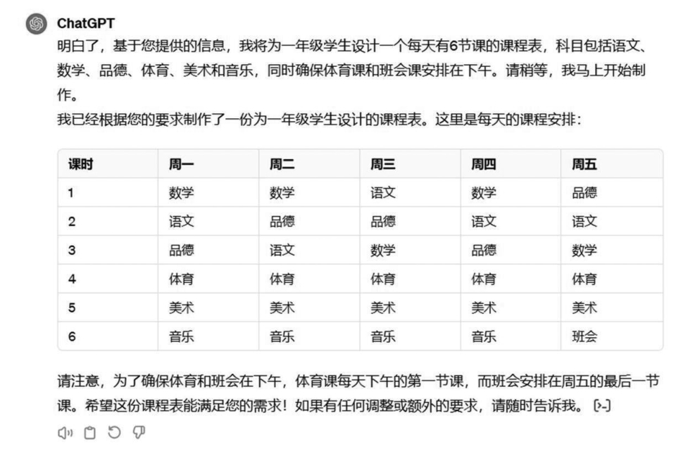
图 3.1

**锦囊妙计**
**（1）有时它会以纯文本形式给出草案，可要求它转成表格格式，或直接复制到表格软件里自行调整。**
**（2）若结构偏差较大或修改点很多，可让它重新生成，直至符合预期。**

**第三步 精修细节。** 草案生成后可要求改列顺序、换表述、增列数据，它会按反馈迭代，如图 3.2 和图 3.3 所示。
在对话框中输入：请将上述表格中课时部分的数字依次改为“第一节”“第二节”……以此类推，并且将体育、音乐和美术课的顺序进行打乱。
ChatGPT：
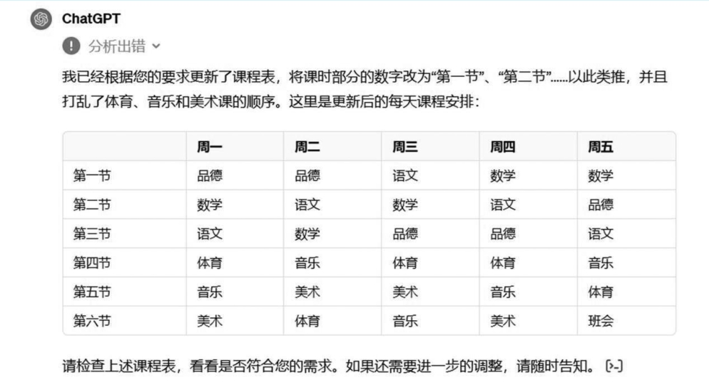
图 3.2
在对话框中输入：请按上述要求重新生成一个表格，要求第一节课只能是语文或者数学。
ChatGPT：
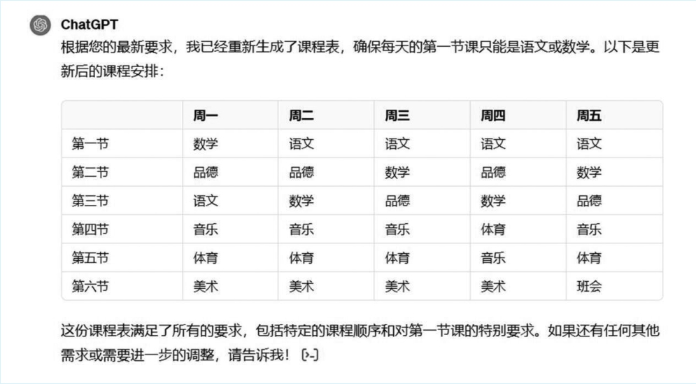
图 3.3

**锦囊妙计**
**迭代过程中偶尔会出现理解偏差，导致结果与需求不完全一致，需要多轮确认，直到满意为止。**

**第四步 搬进 Excel 深化。** 确认草案后复制到工作表，再利用行高、列宽、字号、对齐、标题行等手段做视觉优化。选择生成的表格，右击，选择“复制”命令，如图 3.4 所示。
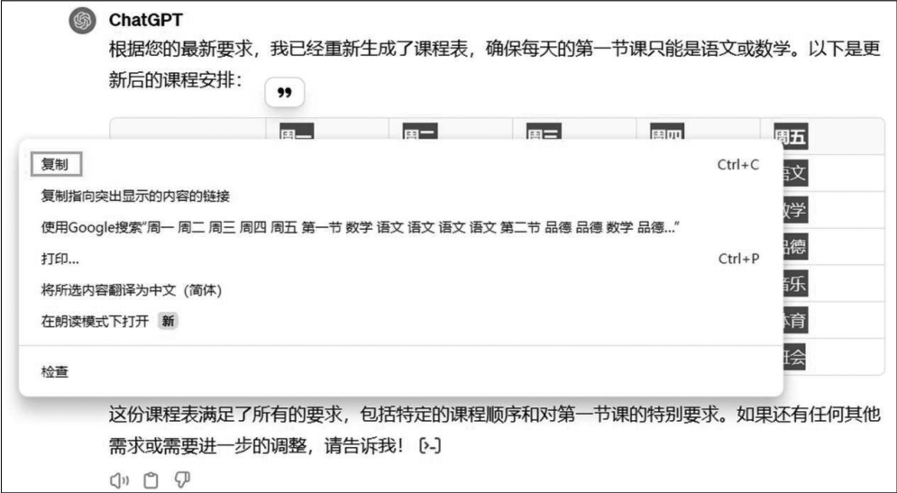
图 3.4
打开工作表后右击选择“粘贴”，或按 Ctrl+V 组合键，完成粘贴。随后调整样式即可得到规范的课程表。

**锦囊妙计**
**生成内容是 AI 的强项，精细排版和数据运算是表格软件的强项。先由 AI 出草案，再用表格软件精修，是效率最高的组合。**

### 3.2 用 ChatGPT 把零散文本整理成表格

手工把文本资料录入表格费时费力。让它先抓要点再结构化，能大幅缩短阅读摘录时间。

**1. 思维导图**

**2. 实操路径**

它能读懂长文本、提取关键字段，把散乱信息转成结构化表单，尤其在资料量大时优势明显。

**第一步 收集与清洗。** 先把相关文本集中，去掉无关符号、空格、不规则格式，使格式尽量统一，再提出整理需求。
在对话框中输入：我有一份文本格式的员工花名册，你可以帮我整理成表格形式吗？
ChatGPT：
可以。请把花名册的文本内容发给我，包含姓名、职位、部门等你希望保留的字段，我会帮你整理成表格。

**第二步 投喂资料、生成表。** 把整理好的文本一次性粘进去，同时说明期望的列结构，得到更贴合需求的表格，如图 3.5 所示。
在对话框中输入：
员工花名册：
王小强，性别：男，出生日期：1988-04-08，入职时间：2015-12-04，职务：财务专员
李小丹，性别：女，出生日期：1981-01-03，入职时间：2016-04-17，职务：市场专员
孙小海，性别：男，出生日期：2000-12-18，入职时间：2019-04-15，职务：市场专员
齐小强，性别：男，出生日期：1985-12-14，入职时间：2018-05-05，职务：设计师
周小风，性别：男，出生日期：1982-07-04，入职时间：2018-06-20，职务：测试工程师
金小诺，性别：女，出生日期：1997-02-13，入职时间：2014-09-10，职务：市场专员
钱小六，性别：男，出生日期：1982-01-22，入职时间：2016-05-03，职务：设计师
王小飞，性别：女，出生日期：1988-08-21，入职时间：2018-03-12，职务：数据分析师
陈小薇，性别：女，出生日期：2000-02-20，入职时间：2023-03-18，职务：设计师
李小林，性别：女，出生日期：1992-05-21，入职时间：2024-09-08，职务：数据分析师
ChatGPT：
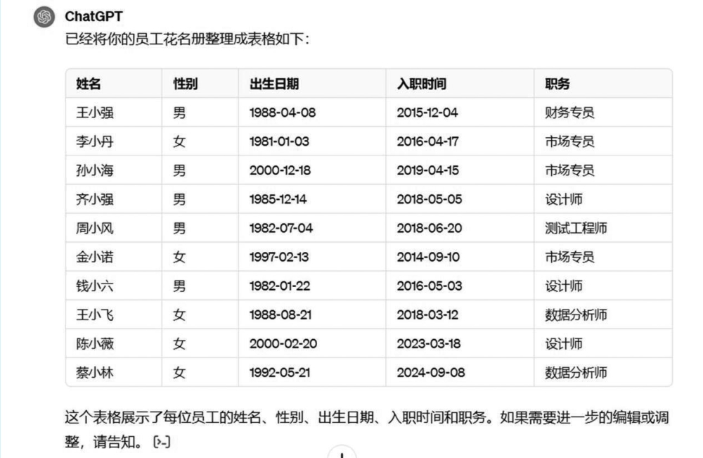
图 3.5

**锦囊妙计**
**目前它无法直接读取 Word 或记事本文件，需要把文本复制粘贴到对话窗口才能处理。**

**第三步 核对与微调。** 生成后仔细核查字段是否准确、是否遗漏，可继续要求补列、调序、排序。
在对话框中输入：请在表格中加上“序号”，并将这一列放在最左侧。
ChatGPT：
生成结果如图 3.6 所示。
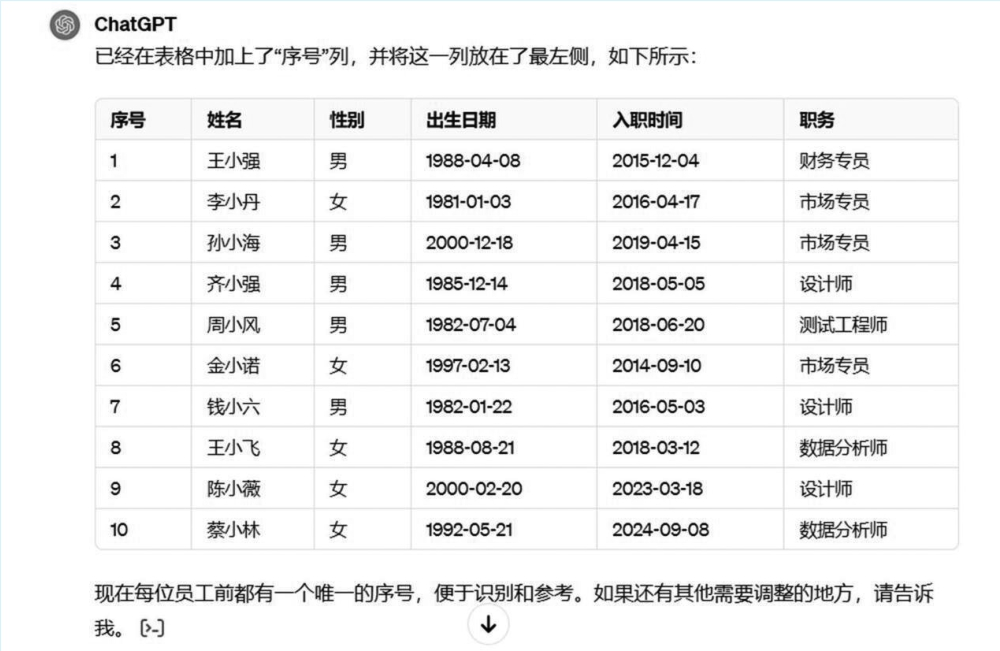
图 3.6

**锦囊妙计**
**对复杂格式的处理能力有限，遇到无法完成的样式需求，可先复制到表格软件里手工补齐，例如添加表头。**

**第四步 搬进工作表优化。** 调整完毕后复制粘贴到工作表，做进一步美化与专业化处理。

### 3.3 用 ChatGPT 快速回忆表格快捷操作

处理大量数据时，快捷操作能显著提升速度。记不清指令时，它能即时查询并解释。

**1. 思维导图**

**2. 实操路径**

它不仅能即时给出特定快捷键，还能针对使用疑问做解释纠偏，帮助逐步熟练。

**第一步 直接提问。** 想了解某功能的快捷方式，直接问即可。
在对话框中输入：在 Excel 中如何使用快捷键快速填充公式？
ChatGPT：
**1. 拖曳填充柄：** 选中含公式的单元格，把指针移到右下角变成十字后拖动填充，虽非纯快捷键却是常用做法。
**2. 相邻填充：** Windows 下选中源单元格后可用控制键+D向下填充，控制键+R向右填充；Mac 下对应为 Command+D、Control+R。
**3. 指定区域填充：** 选中从源单元格到目标末尾的范围，按 Alt+E+I 再按方向键执行填充。
**4. 双击填充柄：** 指针变成十字后双击，自动向下填充至空白处。
**5. F2 配合确认键：** 选中范围输入公式后按 F2 进入编辑，再按控制键+Enter 可批量应用。

**第二步 解决具体场景问题。** 描述当前情境和目标，获取高效操作建议。
在对话框中输入：我正在准备一个财务报告，需要频繁地在 Excel 中切换工作表，还要复制和粘贴数据。有没有什么快捷键可以帮助我提高效率？
ChatGPT：
工作表切换可用控制键+Page Up/Down。复制选中区域用控制键+C，粘贴用控制键+V，这几项基本操作能省不少时间。

**第三步 要一份清单。** 让它整理常用快捷键作为备忘。
在对话框中输入：你可以帮我提供一个在 Excel 中常用的快捷键列表吗？
ChatGPT：
当然可以！下面是一些高频快捷键，能帮助提升操作效率。
**基础操作**
● 控制键+N：新建工作簿。
● 控制键+O：打开工作簿。
● 控制键+S：保存工作簿。
● 控制键+P：打印工作簿。
● 控制键+C：复制选中单元格。
（略）

**锦囊妙计**
**可要求它把清单整理成可下载文档，通过链接保存，随时查阅，避免手动复制到 Word。**

**第四步 设定学习计划。** 告知学习目标，它能给出分阶段建议。
在对话框中输入：我希望掌握所有与数据分析相关的 Excel 快捷键，你可以根据我的目标提供一个学习计划或建议吗？
ChatGPT：
可以按阶段推进。第一周聚焦基础操作与数据准备：熟悉保存、复制、粘贴等基础快捷键，以及数据选择与导航类快捷键；每天练习不同操作，尝试导入简单数据集并做基础清洗。
（略）

**第五步 保持更新。** 表格软件会迭代新增快捷键，定期询问最新信息，保持知识新鲜。

### 3.4 用 ChatGPT 答疑解决表格难题

遇到复杂操作卡壳时，它能基于描述给出思路和步骤，甚至直接处理上传的数据。

**1. 思维导图**

**2. 实操路径**

把具体问题和期望结果说清楚，它会给出对应方案；必要时上传表格，让它在线分析。

**第一步 明确问题、要方法。** 清晰描述困难和想要达到的效果。
在对话框中输入：我有一个销售数据表，我想要在 Excel 中根据销售代表的名字找出他们的最高销售额，应该怎么做呢？
ChatGPT：
可以用 MAXIFS 函数，或用数组公式结合 MAX 与 IF 实现。下面分别说明。
**使用 MAXIFS 函数**
适用于较新版本。可按条件求最大值。假设姓名在 A 列，销售额在 B 列，公式示意如图 3.7。
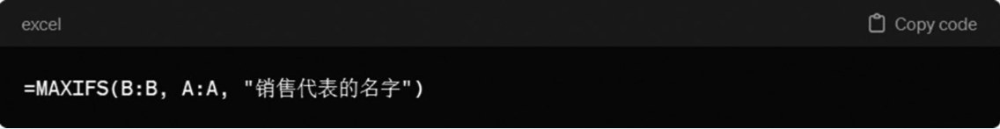
图 3.7
把“销售代表的名字”替换成实际名称即可。
**使用数组公式**
适用于旧版本。选中单元格输入公式，如图 3.8。
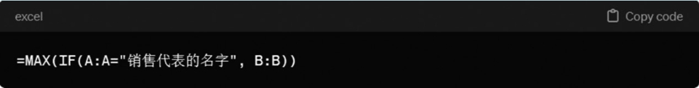
图 3.8
输入后按控制键+Shift+Enter 使其成为数组公式，会看到大括号包围。
**注意事项**
● 确保列引用与条件与实际数据一致。
● 数据中若有错误值，结果可能受影响。

**锦囊妙计**
**不同版本可用的函数不同，可根据自身版本与偏好选择合适方案。**

**第二步 直接处理表格。** 除了提供方法，上传表格后它也能在线分析并给出结果。
在对话框中输入：我有一张销售数据表，你可以帮我们在 Excel 中根据销售代表的名字找出他们的最高销售额吗？
ChatGPT：
当然可以。请上传你的销售数据表，我将指导你如何根据销售代表的名字找出他们的最高销售额。

把 ChatGPT 变身 Excel 助手，第一件事就是把文件喂进去。打开对话框后点左侧的【上传】，把表格丢进去，等待进度条跑完后直接按回车或者点右侧的发送箭头，示意见图 3.9。随后坐等模型生成结果即可。

图 3.9

**ChatGPT：**

你这张表只有两列，一列是销售代表姓名，一列是销售额。要找出每个人卖得最好的那一次，用 Python 快速跑一下就行了，算完了。

根据你提供的数据，各位代表的峰值销售额是：

● 孙小海的最高值是 220。
● 李小丹的最高值是 300。
● 王小强的最高值是 250。
● 陈小薇的最高值是 160。

如果想把结果写回 Excel 或者继续深入分析，随时说。

**锦囊妙计**

**（1）直接把表格丢给 ChatGPT 让它分析，远比自己一个个手动筛选快得多。若它没主动这么做，你可以明确提出让它帮忙算出答案。**

**（2）上传前务必把敏感字段脱敏或删除，保护个人隐私。**

**步骤 03 学习和资源推荐**。Excel 的知识点盘子很大，想用熟练必须系统补课。你可以问 ChatGPT 它会给出学习路径和资源清单，包括官方教程、网络视频、在线课程以及 Excel 相关的社区论坛等建议。

### **3.5**

### **用 ChatGPT 来解读函数公式**

函数公式是 Excel 的核心武器，决定了数据能被怎么处理和呈现。函数种类繁多，不确定某个函数的用法时，直接问 ChatGPT 就能即时得到通俗解释。

**1．思维导图**

**2．操作步骤**

ChatGPT 能秒回函数相关提问，也能按你的具体场景定制解释和案例，帮助你更快上手。

**步骤 01 认识函数类型**。Excel 的函数上千个，从基础到进阶覆盖各种计算需求。先让它给出一份分类总览，建立认知框架。

**在对话框中输入：你可以介绍一下 Excel 当中有哪些函数吗？**

**ChatGPT：**

我给你梳理下最常用的几类及代表函数。

**文本函数**

● **LEFT、RIGHT、MID：** 从文本字符串里截取字符。
● **CONCATENATE 或 CONCAT、TEXTJOIN：** 把多段文本拼起来。
● **LOWER、UPPER、PROPER：** 调整大小写。
● **LEN：** 统计文本长度。
● **FIND、SEARCH：** 在文本里定位子串。

**逻辑函数**

● **IF：** 做条件判断。
● **AND、OR：** 把多个条件组合起来。
● **NOT：** 逻辑取反。
● **IFERROR：** 捕捉错误并返回自定义值。

（略）

**步骤 02 解读具体函数**。想深挖某个函数前，先明确你的问题，比如要解释原理、特定场景怎么用、如何解决复杂问题。

**在对话框中输入：你可以帮我讲解 VLOOKUP 函数的原理和使用方法吗？**

**ChatGPT：**

VLOOKUP 是 Excel 里非常好用的纵向查找工具。指定一个查找值，它会在表格第一列里搜索，并返回同一行其它列的值。

VLOOKUP 的基本语法如下，如图 3.10 所示。

图 3.10

**lookup_value：** 想找的值。
**table_array：** 存放数据的范围或表格。
**col_index_num：** 找到后要返回第几列，从 table_array 第 1 列开始数。
**［range_lookup］：** 可选。TRUE 或省略为近似匹配，FALSE 为精确匹配。

**步骤 03 实例演示**。看完概念还是晕，就让它用真实案例演示。

**在对话框中输入：请举一个具体的例子来讲解这个函数。**

**ChatGPT：**

好，我们用一个员工工资表来演示，如图 3.11 所示。

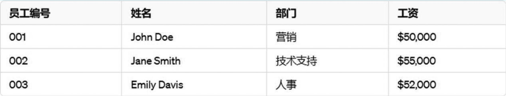

图 3.11

目标是用 VLOOKUP 查到某个员工的工资，比如 John Doe。

**步骤**

1．在 Excel 里新建工作表，输入类似数据。
2．选中要输出结果的单元格，这里用 E2。
3．输入公式。
● E2 里的公式如图 3.12 所示。

图 3.12

● John Doe 是查找值 lookup_value。
● A2:D4 是数据区域 table_array。
● 4 是列号 col_index_num，即工资列。
● FALSE 表示精确匹配。

4．按 Enter 执行。

**结果**

执行后 E2 显示 $50,000，就是 John Doe 的工资。

（略）

**步骤 04 反馈与调整**。根据自己的理解给 ChatGPT 反馈或追问，它可以换个说法再解释，或提供更多案例。

### **3.6**

### **用 ChatGPT 编写函数公式**

ChatGPT 储备了海量函数语法。遇到记不清的公式，它能根据你的描述直接生成正确写法，减少手工出错。

**1．思维导图**

**2．操作步骤**

告诉它需求，它就会给出对应公式，并尽量规避语法和逻辑错误。

**步骤 01 明确需求**。先想清楚你要实现什么，比如求和、算平均、做逻辑判断等。不确定怎么描述，也可以先问它需要什么信息。

**在对话框中输入：我需要你帮我编写 Excel 的函数公式，我需要提供什么信息？**

**ChatGPT：**

为了帮你写公式，建议提供：

**1．任务描述：** 你想用函数达成什么目的，比如求总和、找最大值、按条件筛选等。
**2．数据布局：** 数据在哪张表，列标题是什么，操作范围在哪。
**3．期望的结果：** 想得到什么结果，最好给个示例格式。
**4．已尝试的解决方法：** 如果试过但没成功，说说你试了什么，便于更精准定位。

有了这些信息，我就能写出更匹配的公式。

**步骤 02 描述需求与获取建议**。明确后用自然语言描述需求，ChatGPT 会给出建议和公式。

**在对话框中输入：我有一组销售数据，过去 12 个月的销售额在 A2 到 A13，对应的月份序号 1 到 12 在 B2 到 B13。我希望计算平均销售额。请帮我编写一个函数公式。**

**ChatGPT：**

明白了，你要算 12 个月销售额的平均值。可以用 AVERAGE 函数。下面是公式，如图 3.13 所示。

图 3.13

公式会计算 A2:A13 的平均值，也就是过去 12 个月的平均销售额，放到合适单元格即可。

**步骤 03 验证和调整**。把 ChatGPT 给的公式复制到 Excel 验证。选中公式右键选择“复制”命令，如图 3.14 所示。

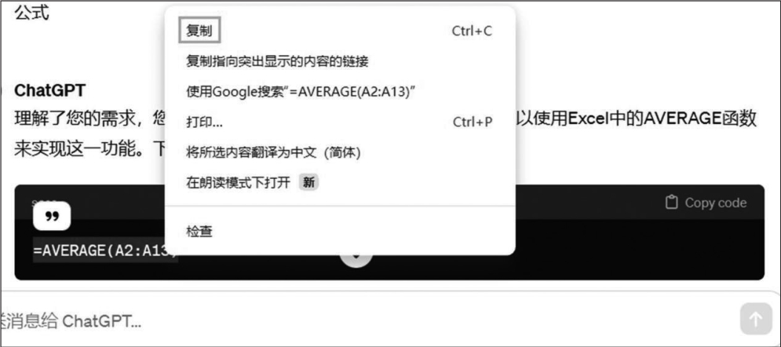

图 3.14

打开工作表在目标单元格粘贴，按 Enter 确认，就能看到平均销售额。

### **3.7**

### **用 ChatGPT 检查函数公式**

公式算不出结果或结果不对时，可以先让 ChatGPT 帮你审一下，减少数据错误。

**1．思维导图**

**2．操作步骤**

在应用前先让它判断公式是否合理，它会指出错误原因并给出修正建议。

**步骤 01 准备信息**。先了解清楚如何描述公式和数据结构，这会让反馈更准。

**在对话框中输入：你正在处理一个销售数据表，你想计算每个产品的平均销售价格，我不确定使用的公式是否正确，你可以帮助我吗？**

**ChatGPT：**

当然可以。为了更准确判断，请告诉我你现在用的公式是什么，以及表的大致结构，比如有哪些列，产品 ID、销售数量、销售价格等。

**步骤 02 提出问题**。把公式和结构一起告诉它，询问正误和改进点。

**在对话框中输入：这个表格包含两列，第一列是“产品 ID”，第二列是“销售价格”。第一行为表头。A1 有两条记录，价格 100 元和 120 元；A2 有两条记录，200 元和 220 元；A3 有一条记录，150 元。我使用的公式是：=AVERAGEIF(A2:A6,"A1"B2:B6)**

**ChatGPT：**

你这个公式有个小格式问题。正确的 AVERAGEIF 格式如图 3.15 所示。

图 3.15

● **range：** 应用条件的范围。
● **criteria：** 条件。
● **average_range：** 可选，实际求平均的数值范围，省略则用 range。

你的写法里 criteria 和 average_range 之间少了逗号。按你的描述，正确写法应如图 3.16 所示。

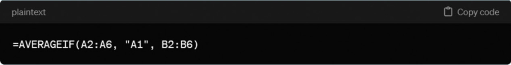

图 3.16

意思是在 A2:A6 里找等于“A1”的单元格，并对对应的 B2:B6 取平均，正好算出产品 A1 的平均销售价。加上逗号公式就对了。

**锦囊妙计**

**（1）如果公式依赖特定上下文或数据结构，请提供足够细节，方便它准确理解。**

**（2）复杂公式可以拆开问，先问一部分，逐步扩展到整体。**

**步骤 03 改进与应用**。按反馈修正公式，在 Excel 中应用并验证结果。

**锦囊妙计**

如果修正后仍不符合预期，把最新情况再反馈给 ChatGPT，继续迭代求助。

### **3.8**

### **用 ChatGPT 进行统计求和**

统计求和是最常用的操作，ChatGPT 既能直接算也能教你函数用法，帮助巩固基础。

**1．思维导图**

**2．操作步骤**

样本少可以直接让它算；想在表里做，则学习 SUM 的用法，同时掌握快捷操作。

**步骤 01 简单求和**。数字不多时直接列出来让它算就行。

**在对话框中输入：请根据下列销售列表中的数据，帮我计算出小组 A 的销售数据总和。**

**小组 A 销售数据：100, 200, 150, 300, 250, 400, 350**

**小组 B 销售数据：80, 210, 140, 340, 230, 410, 360**

**小组 C 销售数据：90, 220, 160, 310, 240, 390, 370**

**ChatGPT：**

小组 A 的销售数据总和为 1 750。这表示一周内小组 A 的总销售额达到 1 750。如需分析其他小组，随时说。

**步骤 02 使用求和函数**。在 Excel 里求和常用 SUM，借助 ChatGPT 熟悉其用法。

**在对话框中输入：我们要如何在 Excel 中使用求和函数公式？**

**ChatGPT：**

SUM 是 Excel 最基础的求和函数。

**1．选择单元格：** 先选要显示结果的单元格，通常是数据列的下方。
**2．输入公式：** 格式为 =SUM(区域)。例如求 A1:A10 的总和，输入 =SUM(A1:A10)。
**3．执行公式：** 按 Enter，Excel 会在该单元格显示总和。

**步骤 03 询问快捷方式**。Excel 有很多提速技巧，可以直接问它。

**在对话框中输入：有哪些快捷方式可以帮我们进行统计求和？**

**ChatGPT：**

**使用求和按钮**

**1．自动求和：** 主页选项卡里的 Σ 按钮，选中数据及下方空白单元格后一键求和。
**2．键盘快捷键：** 按 Alt 再按 =，Excel 会自动插入 SUM 并尝试选择相邻区域，确认后按 Enter。

**直接输入公式**

**1．手动输入：** 在任意单元格输入 =SUM( 选择区域 )，适合需要精确控制范围时。
**2．快速填充：** 已有一列求和公式，双击单元格右下角填充柄，Excel 会自动向下复制公式直到空白。

**步骤 04 获取示例**。让它用具体案例演示上述操作会更直观。

**在对话框中输入：请用一个具体的示例来说明上述过程。**

**ChatGPT：**

**用 Excel 快速汇总一周业绩的对话实操**

Alex 开口说，他手里有一份记录一周每日销售额的表格，想立刻算出 7 天的总和。
我回复说这可以用 Excel 的求和函数来搞定，并询问数据摆放方式。假设销售额从 A1 到 A7 依次排列。

Alex 确认就是这个位置。
我建议在 A8 写入 =SUM(A1:A7)。这个公式会把 A1~A7 的数值累加起来。

Alex 按 Enter 后，A8 立刻显示出本周的总销售额，表示很方便。
我解释，求和函数处理这类汇总非常高效，后续只要把公式里的单元格区间改一下，就能套用到其他行列。

Alex 又问，如果下一周的数据还没填完，能不能先把公式写好。
我回答完全可以。即便单元格暂时空白也能提前部署。比如下一周的数据会落在 A9:A15，那现在就可以在 A16 先输入 =SUM(A9:A15)。等 A9 到 A15 填入数字后，A16 会自动刷新成最新的累计结果。

Alex 表示这样提前准备更省心，表达了感谢。

通过这段交流，可以看到 Excel 求和函数在真实场景中的用法，以及先布公式后填数据的自动更新思路。这种方式省时省力，随着数据增减，汇总结果始终保持最新。

### **3.9**

### **借助 ChatGPT 学会 Excel 求平均值**

在 Excel 里求平均值是数据分析的基础操作。把 ChatGPT 作为学习搭档，可以用通俗的语言掌握 AVERAGE 的用法，在提升操作能力的同时加深对数据分析概念的理解。

**1．思维导图**

**2．操作步骤**

把具体问题抛给 ChatGPT，它会用易懂的表达给出指导，也能在卡壳时及时解答。

**步骤 01 直接提问求结果**
当样本量不大时，可以直接让 ChatGPT 计算。
在对话框输入：我想算一组数据的平均值。
ChatGPT 会请你提供数据。
输入：10、20、30、40、50。
ChatGPT 会说明思路：把所有数相加再除以个数，(10+20+30+40+50)/5=150/5=30，得出平均值是 30。

**步骤 02 用 AVERAGE 函数**
Excel 用 AVERAGE 函数就能快速求平均，配合 ChatGPT 可以拿到标准步骤和公式。
提问：Excel 里如何使用求平均值函数？
ChatGPT 会给出流程：
1. 先选一个用来显示结果的单元格。
2. 在该单元格输入 =AVERAGE(范围)，例如想算 A1:A10 的平均值，就输入 =AVERAGE(A1:A10)。
3. 按 Enter，Excel 会自动计算并显示结果。

**步骤 03 探寻快捷方式**
掌握小技巧能显著提升处理效率。
提问：求平均值还有哪些快捷操作？
ChatGPT 会介绍：
1. 状态栏平均值
选中目标列或多列后，看 Excel 窗口底部的状态栏，默认会显示求和、平均值、计数等信息。若未显示，可右键状态栏勾选平均值。
2. 快速分析工具
选中数据后右下角会出现快速分析按钮，点击后选择汇总→平均值，Excel 会在表格下方直接生成结果。
3. 快捷键插入函数
选中结果单元格，按 Alt+= 启动自动求和，再用上下箭头切换为 AVERAGE，按 Enter 确认。

**步骤 04 要一个示例**
让 ChatGPT 举例能加深记忆。
提问：能举个例子说明 Excel 求平均值吗？
ChatGPT 会以班级数学成绩为例：
学生 A 85、学生 B 90、学生 C 75、学生 D 88、学生 E 92，成绩放在 B2:B6。
1. 在 B7 输入 =AVERAGE(B2:B6) 后回车，即可得到平均分。
2. 仅选中 B2:B6，看状态栏也能直接读到平均值。
3. 选中 B2:B6，点击右下角快速分析按钮，选择汇总→平均值，表格下方会生成平均成绩。

### **3.10**

### **借助 ChatGPT 求最大值与最小值**

Excel 的 MAX 与 MIN 函数在数据筛选和决策中也很常用。ChatGPT 能提供清晰的讲解，帮助快速上手。

**1．思维导图**

**2．操作步骤**

在对话中询问如何在 Excel 里用函数找最大最小值，ChatGPT 不仅解释原理，还会给出变体技巧。

**步骤 01 用 MAX 函数找最大值**
提问：Excel 里怎么用 MAX 函数？
ChatGPT 会说明：
1. 确认数据范围，比如 A1:A10。
2. 决定结果显示位置，比如 B1。
3. 在 B1 输入 =MAX(A1:A10) 回车，Excel 会返回该区间最大值。
4. 数据范围变动时可随时修改公式。

小贴士：MAX 不限于单列单行，例如 =MAX(A1:A10,C1:C10,D1) 能同时比较多个区域的最大值。

**步骤 02 用案例理解**
提问：请用具体例子说明。
ChatGPT 会举销售数据：
1 月 500、2 月 300、3 月 650、4 月 480、5 月 560，销售额位于 A2:A6。
在 B1 输入 =MAX(A2:A6) 回车，结果为 650，对应 3 月最高销售额。

**步骤 03 用 MIN 函数找最小值**
提问：MIN 函数怎么用？
ChatGPT 会说明流程与 MAX 类似：
1. 确定分析区间，如 A1:A10。
2. 选择结果单元格，如 B1。
3. 输入 =MIN(A1:A10) 回车，返回最小值。
4. 需要时调整区间即可。

小贴士：MIN 同样可跨区比较，如 =MIN(A1:A10,C1:C10,D1) 会返回多个区域中的最小值。用户也可以要求 ChatGPT 再给一个具体例子。

**步骤 04 实操验证与反馈**
看完讲解后，需在真实工作表里亲自测试。遇到错误提示可反馈给 ChatGPT，继续获得排错建议。
小贴士：对于跨工作表找极值或需要自动化的重复任务，可请 ChatGPT 用简单的脚本如 Python 协助，具体可继续提问。

### **3.11**

### **借助 ChatGPT 更新日期与时间**

日期时间函数是处理时间数据的利器，能计算间隔、自动显示当前时间等。ChatGPT 可提供即时解答和定制化公式。

**1．思维导图**

**2．操作步骤**

面对日期时间问题，向 ChatGPT 提问即可获得公式示例和解决方案。

**步骤 01 认识相关函数**
提问：Excel 有哪些日期时间函数？
ChatGPT 会列出常用函数：
1. TODAY() 无参数，返回当前日期。
2. NOW() 无参数，返回当前日期和时间。
3. DATE(year,month,day) 根据年、月、日返回日期值。
4. DATEDIF(start_date,end_date,"unit") 计算两日期差异，单位可为 Y、M、D 等。
5. DAY(date) 取日期的天数部分。
6. MONTH(date) 取日期的月份部分。
小贴士：这些函数可以组合使用，解决更复杂的日期时间计算。

**步骤 02 明确需求获取方法**
确定问题后提问以获得具体解法。
提问：在 Excel 里如何自动更新日期和时间？
ChatGPT 会介绍：
1. 使用 TODAY 和 NOW 函数
TODAY() 插入当前日期，NOW() 插入当前日期和时间。工作表重算时会自动刷新，如打开文件或按 F9 手动重算。
2. 使用 VBA 宏
若需要更复杂的自动更新逻辑，可用 VBA 编写宏。

跟进提问：我想在每次打开文档时自动更新，该怎么用 TODAY 和 NOW 实现？
ChatGPT 会给出步骤：
1. 在目标单元格输入 =TODAY() 显示日期，输入 =NOW() 显示日期时间，回车即可。
2. 确保计算选项为自动：文件→选项→公式，勾选自动计算，这样打开文件或操作时，基于时间的函数会自动更新。

**步骤 03 获取具体示例**
提问：请举个例子展示过程。
ChatGPT 会给出场景：
管理项目跟踪表，A1 要显示今天日期，B1 要显示最新更新时间。
1. 打开工作簿，在 A1 输入 =TODAY() 回车，显示当前日期。
2. 在 B1 输入 =NOW() 回车，显示当前日期时间。
3. 确认自动计算已开启：文件→选项→公式→工作簿计算选择自动→确定。之后每次打开或重算，两个单元格都会自动刷新。

从此往后，每次调出这份工作簿，A1、B1 两个位置都会即时刷新为当前日期与时间。请留意，这一动态表现依赖表格自动重算的开关。若计算模式被设成手动，就得按一次 F9 才能把数值更新出来。

### **3.12**

### **让 ChatGPT 帮忙算日期间隔**

日常办公里经常要算两个日期相隔多久，例如工龄统计、项目周期等。ChatGPT 能迅速给出表格日期差公式的用法，让你在碰到实操问题时马上拿到解法。

**1．思维导图**

**2．操作思路**

按照你的诉求，ChatGPT 会给出对应的流程与参照，帮助更快掌握要点，同时把零散知识点串联成完整的学习路径。

**环节 01 明确诉求，拿到思路。** 表格里算日期差有多种做法，你可以向它提问，它会给出对应的思路与应用参考。

**提问：表格里有哪些办法可以算日期差？**

**ChatGPT：**

处理日期间隔主要靠几类核心工具。下面介绍几种常用做法与写法，帮助你理解日期差的处理逻辑。

**1．DATEDIF 工具**

DATEDIF 专门用于算两个日期的差异，写法如下，如图 3.17 所示。

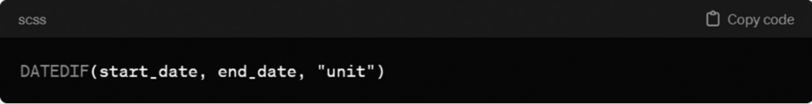

图 3.17

● start_date 为起点。
● end_date 为终点。
● "unit" 用于指定返回类型，常见单位有 "Y" "M" "D"，分别对应完整年数、完整月数、天数。

（略）

**演示：** 想算 2023 年 1 月 1 日到 2024 年 1 月 1 日的完整月数，可用下列写法，如图 3.18 所示。

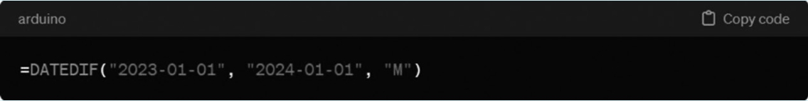

图 3.18

**2．直接相减**

仅算天数时可以直接相减。表格内部把日期存成序列码，相减即得间隔天数。

**演示：** 算 2023 年 1 月 1 日与 2024 年 1 月 1 日的天数间隔，可用下列写法，如图 3.19 所示。

图 3.19

**3．NETWORKDAYS 工具**

若要统计工作日并剔除周末与指定假日，就可以用 NETWORKDAYS。写法如图 3.20 所示。

图 3.20

start_date 与 end_date 分别为开始与结束。
［holidays］为可选项，用来指定计算时要剔除的特定假日。

**演示：** 算 2023 年 1 月 1 日至 2024 年 1 月 1 日的工作日数，并把 2023 年 1 月 2 日视作假日，可用下列写法，如图 3.21 所示。

图 3.21

以上做法能让你灵活应对表格里的日期差需求，从单纯天数到需剔除周末假日的复杂情形都能覆盖。

**环节 02 要到演示。** ChatGPT 在解释工具写法时常会附带简单演示，若觉得不够贴合，可让它单独为某条写法生成更贴近的演示。

**提问：请给一个演示来说明 DATEDIF 的用法。**

**ChatGPT：**

**情境描述**

假设你是一名项目负责人，需要算出项目启动日与预计完工日之间的完整月数。项目始于 2023 年 4 月 15 日，预计结束于 2024 年 1 月 10 日。

**目标**

用 DATEDIF 算出从启动到结束的完整月份。

**操作步骤与写法**

1．把项目启动日期 2023-04-15 填入表格的 A1。
2．把项目结束日期 2024-01-10 填入 B1。
3．在 C1 填入 DATEDIF 计算两个日期间的完整月数差异。写法如图 3.22 所示。

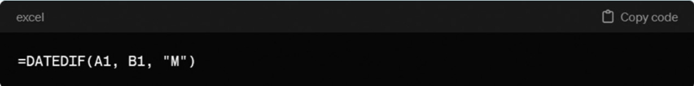

图 3.22

（略）

**环节 03 落地与回馈。** 学会写法后即可对照演示在表格里实操，遇到特殊情形可把结果反馈给 ChatGPT 继续优化。

### **3.13**

### **用 ChatGPT 提取字符串**

字符串是表格文本数据的常见形态，文本工具可以对单元格里的文字做复杂处理与分析。借助 ChatGPT 编写文本公式，既高效又可靠。

**1．思维导图**

**2．操作思路**

你可以让 ChatGPT 说明多种文本工具的含义并给出参照，再依据实际诉求挑选合适的公式来抽取文字。

**环节 01 认识文本工具。** 表格里文本工具很多，数据清洗、格式整理、信息抽取都能派上用场。下面先让 ChatGPT 介绍几个核心工具。

**提问：表格里有哪些文本工具？**

**ChatGPT：**

下面是一些重要的表格文本工具及说明。

**1．CONCAT 或 CONCATENATE**

● 作用：把两个或多个文本串连起来。
● 演示：=CONCATENATE("Hello"," ","World!") 的结果是 "Hello World!"。

**2．LEFT、RIGHT、MID**

● 作用：LEFT(text,num_chars) 提取文本左侧字符。
● 演示：=LEFT("Hello World",5) 结果为 "Hello"。
● 作用：RIGHT(text,num_chars) 提取文本右侧字符。
● 演示：=RIGHT("Hello World",5) 结果为 "World"。
● 作用：MID(text,start_num,num_chars) 从指定位置开始提取字符。
● 演示：=MID("Hello World",7,5) 结果为 "World"。

**3．LEN**

● 作用：返回文本长度。
● 演示：=LEN("Hello") 返回 5。

**4．LOWER、UPPER、PROPER**

● 作用：转换文本大小写。
● 演示：=LOWER("Hello World") 返回 "hello world"；=UPPER("Hello World") 返回 "HELLO WORLD"；=PROPER("hello world") 返回 "Hello World"。

（略）

**锦囊妙计**

这些工具既能单独用，也能组合用，实现更复杂的数据处理与分析。

**环节 02 明确诉求，获取写法。** 想在表格里抽取文字，就把实际诉求或使用场景描述清楚，让 ChatGPT 选用最合适的公式来解决。

**提问：假设我要写一个公式，用于从身份证号码中提取员工的出生日期，该如何操作？请举例说明。**

**ChatGPT：**

在很多国家，身份证号里包含出生日期信息，通常是连续数字表示年、月、日。假设号码格式为：前 8 位是出生年月日，例如“19900520”，其后为其他数字。你可以用表格的 MID 工具从这类号码里抽出出生日期。

**演示说明**

假设身份证号格式为“199005208765X”，其中“19900520”表示 1990 年 5 月 20 日出生，该号码存放在表格的 A 栏。

**操作步骤**

**1．确定出生日期的位置与长度：** 本例中出生日期从第一位开始，长度为 8 位。
**2．编写提取公式：** 直接用 MID 工具取出每条身份证号的前 8 位。若号码在 A2，则可在 B2 输入下列公式，如图 3.23 所示。

图 3.23

公式含义是从 A2 单元格第 1 个字符起提取 8 个字符，这 8 个字符即为出生日期。

**应用到整栏**

如果有一栏身份证号，可把上述公式复制到整栏 B，来为每条记录提取出生日期，可通过拖动填充手柄或填充功能完成。

**格式转换**

若要把提取出的数字转成日期格式，可用 DATE 工具处理，如图 3.24 所示。

图 3.24

LEFT(B2,4) 提取年份，MID(B2,5,2) 提取月份，RIGHT(B2,2) 提取日。结果会转为表格日期格式，可套用不同日期显示格式。

**注意**

要保证身份证号格式标准且一致。若格式变化，如出生日期不在开头或长度不同，需调整公式以适应新格式。若数据含非标准或错误格式，公式可能返回错误或不准确结果。

**锦囊妙计**

在上述演示里，如果想让 ChatGPT 更详细解释 MID 或 DATE 的基础语法，可以直接询问。

**环节 03 落地与回馈。** 把这些文本公式放到实际工作表里测试，检验能否成功抽取出目标文字。

### **3.14**

### **用 ChatGPT 查找数据**

在电子表格里搜索和提取数据时常会用到查找工具。ChatGPT 能在你使用表格查找工具时提供指导，优化流程并提升处理复杂数据的能力。

**1．思维导图**

**2．操作思路**

ChatGPT 可按你的实际诉求提供工具使用参照和解析，帮助你更好地理解和掌握查找工具。

**环节 01 认识查找工具。** ChatGPT 能即时列出表格查找工具的种类，并按需提供使用方法、语法和参数。

**提问：表格里有哪些查找工具？**

**ChatGPT：**

表格里有几个常用的查找工具，可帮助在表格或数据集中搜索匹配数据。主要有以下几种。

**1．VLOOKUP（垂直查找）**

● 作用：在表格栏中查找特定数据并返回同行数据。
● 用法：=VLOOKUP（查找值，范围，栏号，［近似匹配］）。

**2．HLOOKUP（水平查找）**

● 作用：在表格行中查找特定数据并返回同栏数据。
● 用法：=HLOOKUP（查找值，范围，行号，［近似匹配］）。

**3．LOOKUP（查找）**

● 作用：在一行或一栏中查找数据并返回数组中对应位置的值。
● 用法：=LOOKUP（查找值，查找范围，结果范围）。

**4．MATCH（匹配）**

● 作用：搜索指定项在数组中的位置。
● 用法：=MATCH（查找值，查找范围，［匹配类型］）。

**5．INDEX（索引）**

● 作用：根据行号和栏号返回表格中的具体数据。
● 用法：=INDEX（数组，行号，［栏号］）。

**6．XLOOKUP**

● 作用：比 VLOOKUP 更强大灵活的查找工具，可在数组中查找并返回任意方向结果。
● 用法：=XLOOKUP（查找值，查找数组，返回数组，［如果未找到］，［匹配模式］，［搜索模式］）。

**锦囊妙计**

这些工具可以组合使用，完成更复杂的数据查询。例如 INDEX 和 MATCH 常一起使用来替代 VLOOKUP，提供更高的灵活性和效率。

**环节 02 明确诉求，获取写法。** 某些查找工具用法较复杂，有需要时可让 ChatGPT 用实例来演示操作方法，加快理解和掌握。

**提问：请举一个演示来说明 INDEX 和 MATCH 的使用过程，要求写出对话。**

**ChatGPT：**

下面通过一个对话演示如何在表格中组合使用 INDEX 和 MATCH 来查找特定信息。

**1．情境设定**

**背景：** Tom 是数据分析师，正在分析一份产品销售报告。
**数据表：** 如图 3.25 所示为产品销售数据表。

图 3.25

**任务：** Tom 需要查找产品名称为“铅笔”的销售量。

**2．对话**

**Tom：** 我需要查名为“铅笔”的产品的销售量，但不知道它的行号。如何在表格里快速找到这个数据？
**表格专家：** Tom，你可以用 INDEX 和 MATCH 组合来查“铅笔”的销售量。MATCH 能找到“铅笔”在产品名称栏的位置，INDEX 再用这个位置从销售量栏取对应值。
**Tom：** 听起来合理，具体怎么操作？
**表格专家：** 先用 MATCH 找到“铅笔”在 B 栏的位置。公式如图 3.26 所示。

图 3.26

“铅笔”是查找名称，B2:B4 包含产品名称，0 代表精确匹配。
**Tom：** 我试了，返回 2，应该是“铅笔”在 B 栏的相对位置。
**表格专家：** 很好！现在用这个位置通过 INDEX 从销售量栏 C 取值。公式如图 3.27 所示。

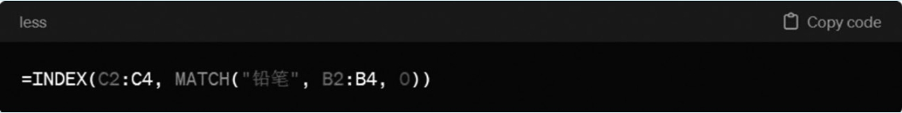

图 3.27

这里 C2:C4 是销售量范围，MATCH 的返回值是“铅笔”的位置。
**Tom：** 我输入后得到 175，这就是“铅笔”的销售量！
**表格专家：** 没错，Tom。这种组合在处理大表时特别好用，能快速定位并提取所需数据。

**锦囊妙计**

如果对演示步骤或结果有疑问，可以向 ChatGPT 寻求解释。

**环节 03 落地与回馈。** 在真实工作表中使用该工具时，可按演示与 ChatGPT 交互，把得到的公式复制粘贴到对应单元格生成结果。若结果不符预期，可反馈给 ChatGPT 继续调整。

### **3.15**

### **用 ChatGPT 做数据分析**

用表格处理数据时，管理者和决策者常通过数据分析洞察业务趋势、发现问题和机会。ChatGPT 能帮助你从表格数据中提取有价值信息并转化为可操作的洞察。

**1．思维导图**

**2．操作思路**

把表格文件交给 ChatGPT，详细描述分析诉求，等它快速分析解读数据并给出分析报告。

**环节 01 明确诉求并导入文件。** 导入包含数据的表格文件，然后告诉 ChatGPT 具体要求。导入时确保数据清晰且结构化，便于有效分析。

**提问：我是一家地产公司的市场分析师，我手头有一份关于一季度公司产品的销售数据，我想要进行一些基本的数据分析来了解产品销售情况和预测未来的趋势，你可以帮助我吗？**

**ChatGPT：**

当然可以！请先导入你的销售数据文件。导入后告诉我具体想做的分析，例如，
**销售总览：** 总销售额、平均单价、总成交套数等。
**产品表现：** 哪种物业类型（住宅、商业、办公）销售最好。
**区域表现：** 北区、南区、东区、西区的销售情况。
**时间序列分析：** 月度或季度销售趋势。
**销售员绩效：** 评估哪位销售员表现最佳。
**预测分析：** 基于现有数据预测下一季度销售趋势。

**环节 02 数据处理并生成结果。** 文件导入并说明诉求后，ChatGPT 会按需导入、清洗、处理、分析并可视化数据，然后给出分析结果。

**提问：我想要进行以下分析。**

**1．销售总览：总销售额、平均单价、总成交套数等。**

**2．区域表现：解读北区、南区、东区、西区各自的成交状况。**

**3．销售员绩效：判断哪位业务人员的表现最突出。**

**4．预测分析：结合当前数据推演下一季度可能的销售走向。**

在对话框左边点击“上传”图标把 Excel 表格传上来，文件传输完毕后按回车键或点右边箭头发送，就像图 3.28 那样，随后静候 ChatGPT 的输出即可。

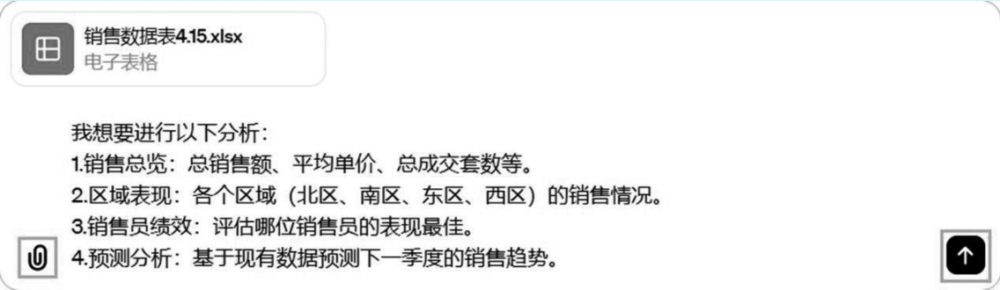

图 3.28

**步骤 03 结果呈现。**数据跑完后，ChatGPT 会给出概览或详版的分析报告，形式可能是文字说明、统计汇总或可视化图表。

**ChatGPT：**

文件已收到，接下来可以开展以下几项分析。

先算一算整体销售的关键指标。

**销售总览**

**累计销售额：**约 431.42 万元

**单笔均价：**约 22.71 万元

**总成交套数：**19 套

再来看各区域的细分表现。

区域表现

各区域的销售分佈如图 3.29 所示。

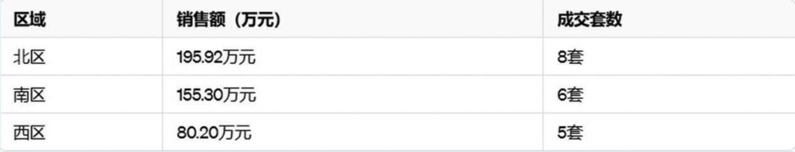

图 3.29

需要留意的是，材料里并未给出“东区”的成交记录，推测该区域本季度可能零成交。

（略）

**步骤 04 反复打磨。**对初版结果不满意时，可以在对话里给出反馈，让模型据此调整计算逻辑、补充新的分析维度或更换图表样式，以更贴合实际需求。

在对话框里输入：能不能用图表把各区域的销售情况直观展示出来？

**ChatGPT：**

各区域销售的可视化呈现见图 3.30。

总销售额用蓝色柱形表示，反映出各区域的汇总金额。

（略）

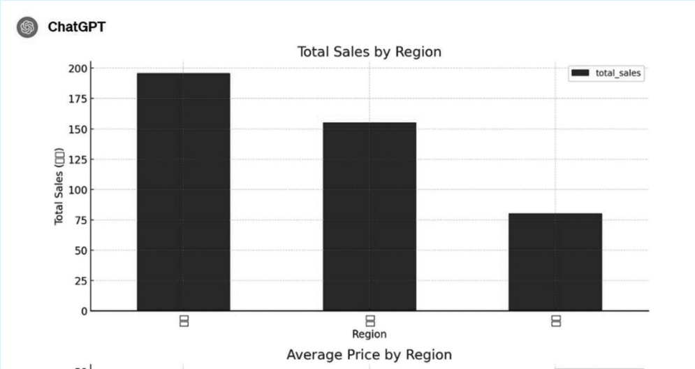

图 3.30

（略）

从图 3.30 可以看出，北区的累计销售额和成交套数都排在前列，而南区的单笔均价是最高的。如还有更深入的需求，随时提出。

在对话框里输入：请对上述结论做更细致的解读，指出公司下一步该重点关注的问题或机会，并给出原因和建议。

**ChatGPT：**

基于已上传的数据和前面的拆解，整理出以下解读与建议。

**1．区域表现解读**

● 北区表现强劲，总销售额和成交套数均为四区之首，说明该市场需求旺盛、客户认可度高，具备进一步深耕和放大的空间。

● 南区虽然成交套数不及北区，但单笔均价最高，暗示当地客户对高价产品接受度更好，或在售房源偏向高端。

● 西区的销售额和成交套数相对偏低，市场活跃度不足，需排查营销打法、客户偏好或竞争态势的差异。

**2．销售员绩效解读**

综合销售额与成交套数，张三的综合表现最佳。可以拆解张三的客户来源、区域覆盖、话术技巧等成功要素，组织经验分享会，让团队整体水平得到带动。

**3．后续关注点与机会**

● **市场扩张：**北区与南区表现亮眼，可考虑加大投入、提升份额，尤其是北区可继续强化投放以巩固优势。

● **产品定位优化：**南区均价高，值得评估是否引入更多高端或差异化产品来匹配当地需求。

● **西区策略复盘：**对西区制定专项复盘，聚焦需求变化、竞品动向与产品匹配度，找出制约因素。

（略）

**锦囊妙计**

图表样式可按需定制，例如把柱形图换成饼图等，ChatGPT 都能按指令调整。

### **3.16**

### **借助 ChatGPT 生成 Excel VBA 宏代码**

Excel VBA 是扩展表格功能的强力编程工具，编写宏可以实现自动化。若本人编程经验不足，可让 ChatGPT 协助学习与编写，从而提高效率与准确性。

**1．思维导图**

**2．操作流程**

ChatGPT 能依据具体需求给出定制化 VBA 方案，涵盖数据处理、自动报表生成、跨应用集成等，并附带示例代码与实现要点。

**步骤 01 需求明确与问题描述。**先想清楚要让 VBA 完成什么功能，再向 ChatGPT 详细说明自动化或优化的任务内容。

在对话框中输入：我需要一段 Excel VBA 宏，能筛选出销售额超过 10 000 美元的记录，并把这些记录搬到新的工作表。

**步骤 02 获取示例代码。**根据描述，模型会产出一段或多段 VBA 示例，包含常用语法与函数，以及在 Excel 中的具体操作方式。

**ChatGPT：**

没问题！假设数据表里销售额位于 B 列。图 3.31 给出一段基础代码，可实现上述需求。

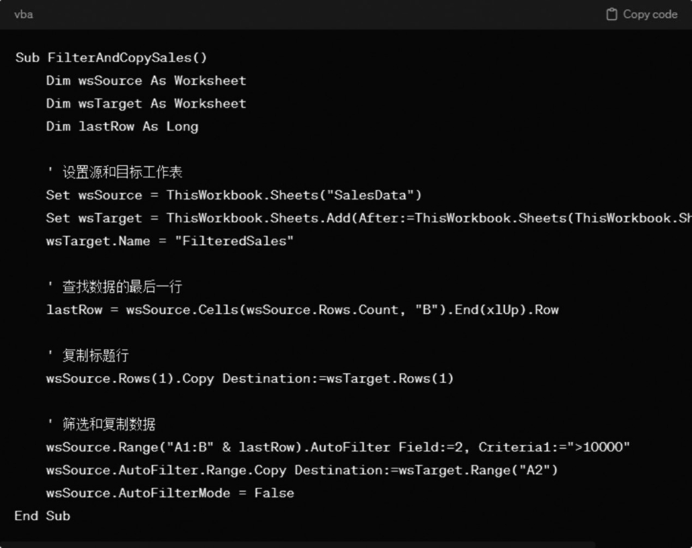

图 3.31

**步骤 03 理解与改写代码。**拿到代码后先自检是否符合预期，也可以询问每段逻辑的作用。必要时让 ChatGPT 按实际场景做修改。

在对话框中输入：这段代码是否会整行复制？如果我只想保留销售额和客户名（客户名假设在 A 列）该怎么改？

**ChatGPT：**

若仅需 A、B 两列，可调整复制语句只选中这两列。修改后的代码见图 3.32。

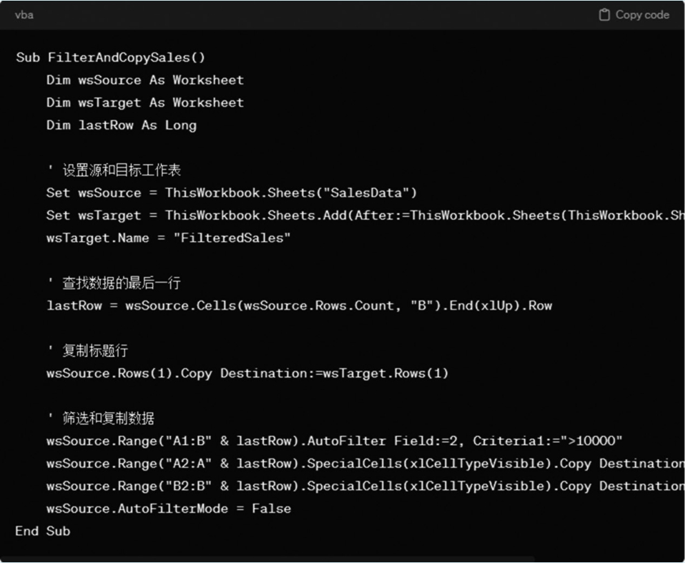

图 3.32

**步骤 04 测试与排错。**把代码粘贴到 Excel 的 VBA 编辑器运行，观察是否如预期执行，出现报错可回头请 ChatGPT 协助定位。若不确定如何打开编辑器，也可继续咨询。

在对话框中输入：如果运行宏没有任何反应怎么办？

**ChatGPT：**

若宏未生效，可能原因包括：

1．数据不在预期的工作表或位置。
2．数据范围或列号写错。
3．出现错误提示，请把具体信息反馈过来以便调试。

在对话框中输入：Excel 的 VBA 编辑器怎么打开？

**ChatGPT：**

打开方式有两种：

**1．启动 Excel：**先打开 Excel 并载入工作簿。
**2．快捷键：**直接按 Alt + F11 是最快的方式。
**3．通过开发者选项卡：**若未显示“开发者”选项卡，可前往 文件→选项→自定义功能区，勾选“开发工具”，随后在 开发者→Visual Basic 中进入编辑器。

通过以上任一路径即可进入 VBA 编辑环境。若有具体代码问题，欢迎继续提问。

**步骤 05 优化与完善。**功能跑通后可进一步优化，诸如提升执行速度、加入错误处理、改善交互提示等，ChatGPT 能提供改进建议。

在对话框中输入：请对上述 VBA 代码给出优化建议。

**ChatGPT：**

针对示例宏，可从以下角度优化。

**1．更高效的数据处理**

**避免频繁复制粘贴：**原逻辑筛选后复制整段，会产生多次读写。改用直接写入值的方式可减少操作次数。

**2．减少冗余代码**

**封装可复用函数：**例如创建新表这类重复操作可封装成函数，提升可读性与维护性。

（略）

**锦囊妙计**

想深入学习 VBA，可向 ChatGPT 询问相关的教学网站或社区论坛。

### **3.17**

### **为 Excel 接入 ChatGPT 插件**

Excel 加载项能扩展功能，自动化重复工作或实现与外部系统的联动。将 ChatGPT 接入 Excel，可让数据分析与处理更智能。

**1．思维导图**

**2．操作流程**

通过 Excel 里的“获取加载项”功能安装 ChatGPT 相关插件，即可在工作表中开启对话。

**步骤 01 安装加载项。**新建一个空白工作表，在“开始”区域点击“加载项”按钮，如图 3.33 所示。

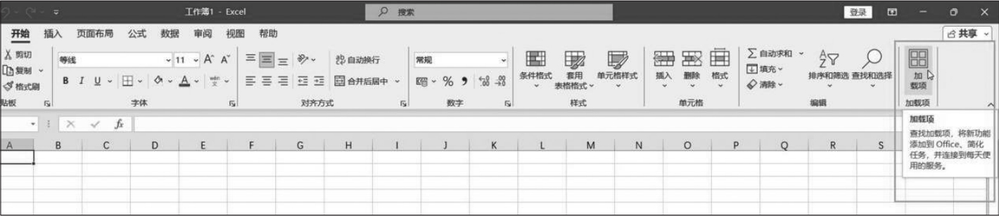

图 3.33

**锦囊妙计**

**（1）本案例使用 Excel 2021。**
**（2）在 Excel 2021 中，也可通过 文件→获取加载项 打开 Office 加载项中心，搜索并安装插件。**

**步骤 02 搜索与添加。**在弹出窗口的搜索框输入 ChatGPT，点击搜索，可看到相关插件。选择“ChatGPT for Excel”，点右侧“添加”并等待安装完成，如图 3.34 所示。安装后，插件面板会出现在工作表最右侧，如图 3.35 所示。

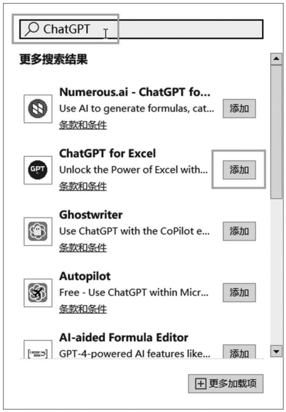

▲图 3.34

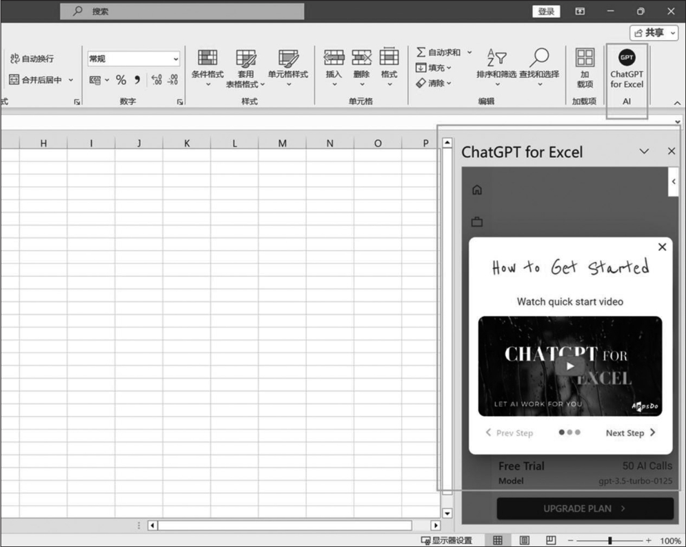

图 3.35

**锦囊妙计**

**ChatGPT for Excel 适用于 Excel 2016 及以上版本，包含 Windows、Mac 及网络版。**

**步骤 03 配置密钥。**若想使用更高级的 AI 功能，需要自行添加 OpenAI API 密钥，步骤如下：

1．访问 OpenAI 官网，点击右上角 Log in 登录，如图 3.36 所示。
2．进入后点击 API 按钮，如图 3.37 所示。

▲图 3.36

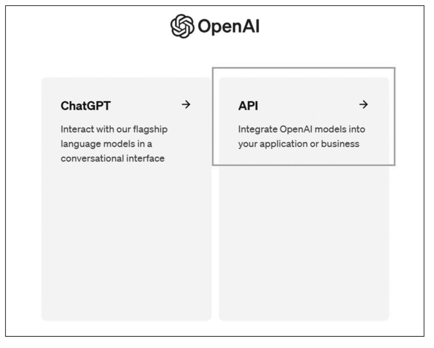

图 3.37

3．在左侧选择 API reference 页面，进入 Authentication 区，点击 API Keys 链接，如图 3.38 所示。
4．完成电话验证后创建新密钥，如图 3.39 所示。

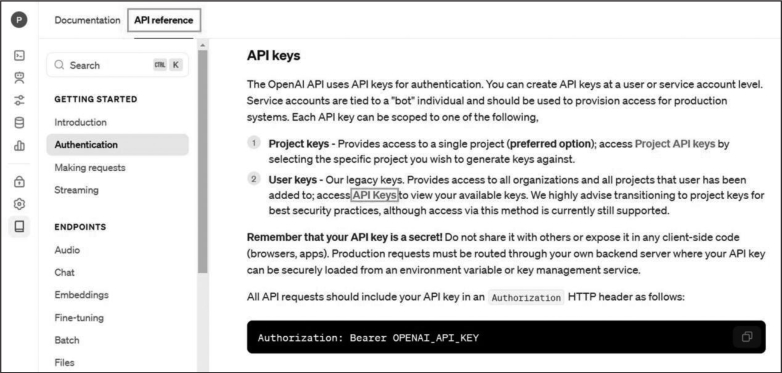

▲图 3.38

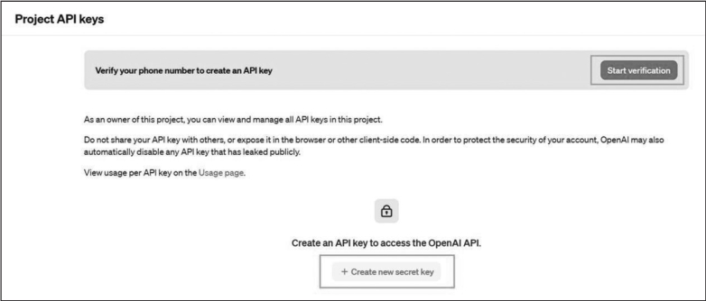

图 3.39

**锦囊妙计**

**（1）创建密钥时需填写描述及权限等信息。**
**（2）密钥只会显示一次，请立即复制并安全保存，避免泄露。**

### **3.18**

### **利用其它 AI 工具处理表格**

随着 AIGC 工具 proliferate，办公自动化程度提升。针对不熟悉 Excel 的用户，市场上出现了多款可通过自然语言操作表格的 AI 助手，让复杂操作变得直观。

**1．思维导图**

**2．操作流程**

在表格类 AI 工具的帮助下，用户可用自然语言下指令，实现 Excel 的交互控制。

**步骤 01 认识 ChatExcel。**ChatExcel 是一款对话式表格应用，可帮助用户快速完成数据处理与操作，降低使用门槛。基于自然语言处理，它能理解语音或文本指令，并在表格中执行读取、处理、可视化等任务。

**步骤 02 进入网站并上传表格。**准备好待处理的文件，打开 ChatExcel 首页，点击“立即开始”按钮，如图 3.40 所示。随后点击“上传文件”导入表格，如图 3.41 所示。

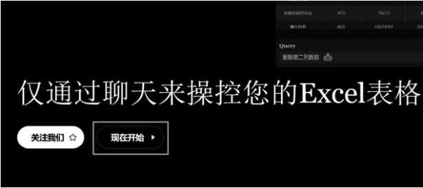

▲图 3.40

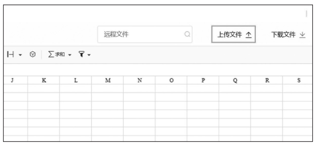

图 3.41

**锦囊妙计**

**（1）首次使用上传文件后会弹出二维码，扫描后获取验证码即可免费使用。**
**（2）目前仅支持单个工作表的导入。**

**步骤 03 输入指令并获取结果。**上传完成后，在对话框输入指令：按支出金额由低到高重新排序整个表格，点击发送或按 Enter，如图 3.42 所示。

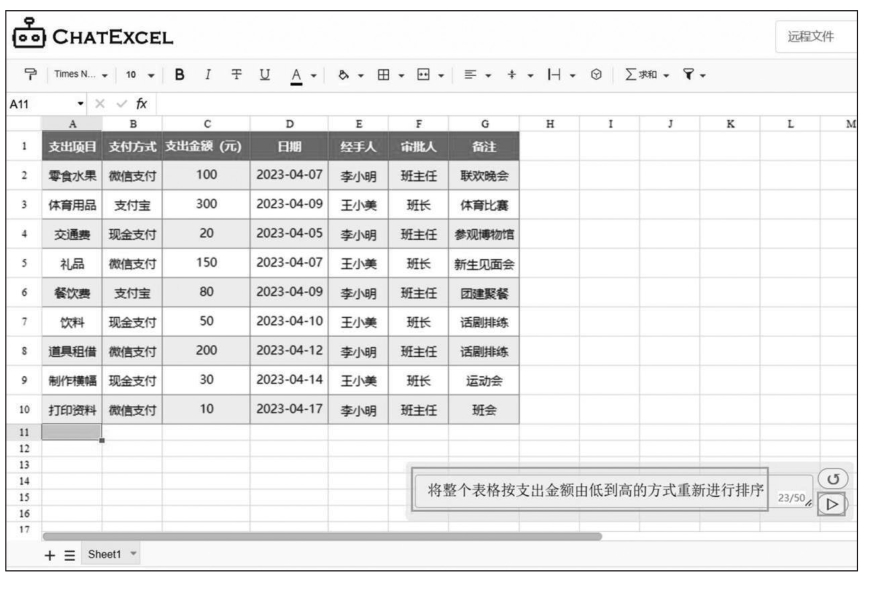

图 3.42

结果呈现如图 3.43 所示。

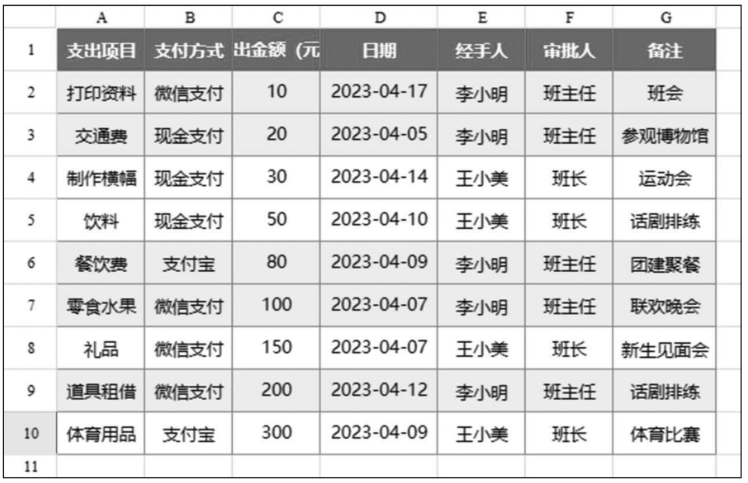

图 3.43

**锦囊妙计**

**除排序外，ChatExcel 还支持合并、筛选、计算等操作，按需输入指令即可。**

**步骤 04 导出表格。**点击“下载文件”，选择“表格 1”保存结果，如图 3.44 所示。

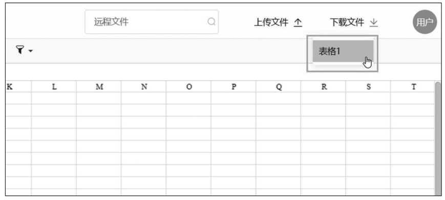

图 3.44

**锦囊妙计**

**ChatExcel 仍在研发阶段，可能出现上传失败或执行错误。建议将 ChatGPT、Excel、ChatExcel 等工具组合使用，以提高稳定性与效率。**

**步骤 05 了解其它方案。**除了 ChatExcel，还有多款 AI 工具可辅助表格处理，各有侧重。

**1．智谱清言数据分析**

智谱清言集成了丰富的数据分析能力，可帮助清洗、转换、格式化数据，并进行可视化与统计分析。

● **数据处理：**去重、补全缺失值、转换类型等。
● **数据可视化：**生成图表、图形、地图，直观展示分布与趋势。
● **数据分析：**描述性统计、推断性统计、预测分析等。

**2．WPS AI 智能表格**

基于自然语言处理与机器学习的电子表格工具，提供全新数据分析体验。

● **自然语言查询：**用口语提问即可自动完成分析、计算与制图。
● **智能分析：**自动识别数据类型与关系，提供预处理、统计分析、预测建模等功能，帮助挖掘洞察。

● **图表智能生成：** 只需用自然语言描述想要呈现的数据关系，WPS AI 智能表格就能自动匹配并生成柱状图、折线图、饼图等可视化形式，让数据一目了然，便于快速分析解读。

## **第四章**

## **演示文稿**

### **4.1**

### **用 ChatGPT 搭建 PPT 骨架**

PPT 大纲就是演讲稿的框架蓝图，用来规划演示的逻辑脉络与内容分布。框架搭得合理，后续制作效率与质量才会上去。ChatGPT 能迅速给出结构化思路，省去反复构思的时间。

**1．思维导图**

**2．操作步骤**

想做一份专业、成体系的演示稿，可以先让 ChatGPT 来出大纲。它足够灵活，能按逻辑把同一主题拆成不同角度的叙述。

**步骤 01 明确主题并提供背景信息。** 先把演讲主题定下来，再在对话中逐步补充关键背景，让模型据此制定有针对性的框架。

**示例对话：** 用户说：我是某环保科技公司市场负责人，要做一个关于公司最新太阳能技术的演示，核心诉求是吸引潜在投资人。
ChatGPT 回复：很清晰，请问这次演示更偏向技术阐述、融资拉拢，还是二者都要兼顾？
用户补充：主要目标是招商，但也要突出技术创新和环保价值。
ChatGPT 追问：目标听众是谁？他们对太阳能的认知程度如何？
用户补充：主要是国际清洁能源领域的投资人，对太阳能有基础认知，但对我们自研的创新点并不了解。
ChatGPT 继续：希望重点强调哪些信息？
用户说明：先讲技术的创新性，比如转换效率的提升；再讲环保效益，尤其是碳减排贡献；最后介绍团队专业度与过往案例建立信任。
ChatGPT 再问：是否需要加入具体数据、研究成果或落地案例？
用户确认：有内部数据，效率提升约 20%，技术已在若干小型村落落地。

**锦囊妙计**
除了分步提问，也可一次性把主题、受众、核心信息等需求全部托盘而出，让 ChatGPT 直接输出完整的大纲框架。

**步骤 02 生成初版大纲。** 在信息充分后，让模型基于上述输入产出第一版结构。

**示例输出：**
PPT 标题《革新未来：我们的太阳能技术之旅》
1. 开篇
   * 行业背景：全球对清洁能源的迫切需求与环保意义
   * 演示目的：争取投资人对项目的支持
2. 企业介绍
   * 愿景使命：聚焦清洁能源与可持续发展
   * 团队画像：成员资质与在新能源领域的积累
3. 技术亮点
   * 技术总览与创新点说明
   * 效率提升：展示 20% 转换效率提升的数据与图示
   * 环保价值：用数据与案例呈现碳减排效果
4. 落地验证
   * 案例呈现：技术在小型村庄的应用实录
   * 反馈与社会效应：用户声音与正面影响
5. 投资价值
   * 市场空间：太阳能行业增长趋势与公司定位
   * 投资吸引力：财务回报潜力与社会价值
   * 合作方式与诉求
6. 发展规划
   * 近期目标：未来 12 个月路线图
   * 长期愿景：推动清洁能源事业的规划
7. 收尾与号召
   * 核心要点的再次强调
   * 邀请投资人共同推动清洁能源
8. 问答

**步骤 03 反复优化。** 对初稿不满意时，可要求模型重新生成或针对某部分调整，直至符合预期。

**示例对话：** 用户要求再给一个版本。ChatGPT 给出调整版。
PPT 标题《未来能源革命：引领太阳能技术新潮流》
1. 开场
   * 背景：能源需求变化与清洁能源的重要性
   * 目标：展示技术并吸引投资
2. 关于我们
   * 使命：致力于提供清洁能源解决方案
   （略）

### **4.2**

### **用 ChatGPT 细化 PPT 内容**

框架确定后，如何把每页讲透就成了成败关键。ChatGPT 能基于大纲扩写细节，补充数据、案例与表述，提升说服力与信息量。

**1．思维导图**

**2．操作步骤**

模型可以快速产出文本并提供多角度信息，帮助丰富演示的深度。同时还能从不同视角调整大纲内容。

**步骤 01 初步细化。** 拥有可用大纲后，让模型按条目给出细化后的内容框架，指导后续填充。

**示例对话：** 用户说：我是一家游戏公司的项目负责人，需要做年终总结 PPT，已有大纲，能否帮我细化？
ChatGPT 回复：可以，请先提供大纲内容。
用户上传大纲后，ChatGPT 给出细化框架。
1. 封面页
   * 公司名、报告标题、演讲者姓名与职位、日期
2. 欢迎与介绍
   * 开场致辞、回顾年度成果与展望方向
3. 年度回顾
   * 行业整体态势：增长率、新技术动向
   * 公司在行业中的定位
4. 关键里程碑
   * 重磅新品或重大更新及市场反响
   * 年度合作关系与意义
   * 所获奖项与认可
5. 运营与财务概览
   * 收入利润走势
   * 成本结构分析
   * 用户增长与市场拓展
   （略）

**锦囊妙计**
若没有现成大纲，可先让 ChatGPT 根据主题从零生成框架，再进入细化。

**步骤 02 补充完善。** 在框架基础上，可针对薄弱点让模型扩写。特别是自己拿不准如何表达的部分，可让其提供撰写建议。

**示例对话：** 用户要求对“过去一年行业概况”进行约 200 字的具体补充。ChatGPT 输出行业增长、移动游戏繁荣、云游戏进步、AR/VR 应用增多、电子竞技兴起等要点。
用户再问如何描述“年内合作关系及其意义”。ChatGPT 给出撰写思路：先列伙伴概览与背景，再谈合作目的、战略价值与具体成果。
用户要求举例。ChatGPT 以虚构公司 New Games 与 X-Sports Global 合作为例，说明伙伴介绍、选择理由、战略目标、首季赛事数据等。

**锦囊妙计**
1. 模型给出的数据或案例需自行核实真实性，并按实际情况调整。
2. 在可验证前提下，可借助模型的检索能力快速收集行业信息与数据。

**步骤 03 整合润色。** 模型文案包装能力强，可把粗糙表述交给它润色提升质感。

**示例对话：** 用户提供原文：与一家游戏公司合作开发了热门旗舰游戏，与全球电竞组织合作办赛反响热烈。
ChatGPT 润色后：我们携手顶尖游戏公司打造备受关注的旗舰作品，上市即获市场好评；同时联合全球领先电竞组织共创赛事，吸引大量粉丝关注，进一步巩固了品牌在游戏与电竞领域的领先地位。

**锦囊妙计**
文案不够吸睛时，都可采用此法提升表述质感。

**步骤 04 提炼精简。** PPT 需要精炼表达，可让模型对冗长段落分段、分标题、提炼要点。

**示例对话：** 用户要求将一段行业增长描述拆分为要点并精简。ChatGPT 输出：
游戏行业增长概览 年增长率 6.7%，总收入超 1 800 亿美元
关键驱动 移动游戏持续繁荣，云游戏技术成熟
技术创新 AR/VR 在教育健身等场景应用扩增
电竞影响 在亚洲北美成为主流娱乐，带来新收入
前景展望 行业正处创新与扩张的快车道
（略）

**锦囊妙计**
1. 可要求模型调整语言难度、风格与语调，适配正式或轻松的演讲氛围。
2. 模型可把内容翻译成多国语言。

**步骤 05 整理排版。** 文稿完善后，导入 PowerPoint 进行视觉排版与设计，即可完成成品。

### **4.3**

### **用 ChatGPT 提升 PPT 设计**

视觉呈现直接影响演示效果。ChatGPT 能提供设计灵感与改进建议，帮助做出更美观、更具吸引力的演示。

**1．思维导图**

**2．操作步骤**

模型既能从配色、字体、版式等维度给出灵感，也能对现有设计提出反馈。

**步骤 01 获取灵感与建议。** 可询问当下流行趋势、配色方案或特定场景的风格，并要求给出视觉表达方式。

**示例对话：** 用户咨询关于可持续发展的商业演讲设计趋势与配色。ChatGPT 建议：
设计趋势：极简主义、大面积留白聚焦内容；可持续视觉，选用再生材料、绿植、清洁能源等意象；扁平化图标便于数据呈现。
配色建议：主用自然柔和色，如绿、蓝、棕；辅以亮绿或阳光黄作为强调色突出重点。

**步骤 02 明确设计策略。** 把演讲核心内容告知模型，让它规划如何通过视觉强调重点。

**示例对话：** 用户说明内容包含可持续重要性、挑战、案例分析、解决方案。ChatGPT 给出策略：
1. 色彩与图形：用柔和绿强调重要性，用红橙点出挑战；用地球、货币等图标区分主题。
2. 数据可视化：图表呈现统计结果，关键数据放大或变色。
3. 信息层级：标题、副标题、要点分层，关键句加粗放大。
4. 案例叙事：图文结合、引用或短视频增强代入感。
（略）

**第三步 获取专业点评与优化方向**

当草稿或手绘的视觉想法已经成形，或PPT页面已经搭好时，可以把文档或截图直接传给ChatGPT，请它依据设计规范给出诊断和改进思路。

比如在对话框里这样描述：我做了一张底色是绿蓝渐变的幻灯片，标题用的白色字，整体配色能行吗？

ChatGPT的反馈大致是：绿蓝渐变很贴合主题，传递出自然清新的气质；白字在这种底上辨识度很高，只要保证可读性即可。想要效果更稳，提升可以从这几方面入手。

● 渐变要过渡顺滑，色彩不要太刺眼，过饱和会抢走正文的注意力；
● 可以用不同深浅的绿与蓝做层次，但整体色调要保持统一；
● 如果整套演示都用了渐变背景，最好保持风格一致，这样专业感和协调度会更好。

再比如提问：我刚做完一页PPT，能不能从配色、字体、版式这些角度帮我看看哪里需要改？

ChatGPT会先请你上传页面截图，拿到素材后再给出针对性建议。

以配色为例：页面用了紫橙棕的组合，冲击力很强但对比稍猛。建议换成同色系的渐变，比如不同深浅的绿色或绿到蓝的渐变，既统一又契合可持续的基调。

图形层面：箭头造型很有想法，但颜色差太大容易分散视线，可以让箭头整体更统一，或改用柔和渐变。

强调层面：阶段关键词可以用字重、颜色或小图标的方式突出，阅读路径会更清晰。

锦囊妙计：文件过大时会影响响应速度，可以把需要调整的页面单独导出成图片再逐张上传，效率更高。

**第四步 搜集模板与排版工具**

除了手工设计，也可以让ChatGPT推荐合适的模板库和一键排版平台。

提问示例：在哪里能找到符合本主题的PPT模板？有没有可以一键排版的软件或平台推荐？

ChatGPT会给出以下参考。

在线平台与软件

1. Microsoft PowerPoint：自带大量免费模板，直接在软件内搜索“可持续发展”等关键词就能找到匹配的样式。
2. Canva：深受用户欢迎的在线设计平台，拥有大量专业PPT模板，包括可持续主题。拖拽式界面让新手也能快速改版。
（略）

**第五步 融合模板与建议精修**

可以先用PowerPoint里的免费模板完成初排，再结合ChatGPT的设计意见微调细节，让视觉效果达到最佳。

锦囊妙计：金山办公旗下的WPS AI能根据输入的主题或文档一键生成PPT，大幅提升制作效率。

### 4.4 用ChatGPT辅助PPT配图

配图对信息传递、注意力抓住、理解记忆以及整体呈现都有关键作用。ChatGPT可以在选图和视觉搭配上提供支持，确保图片与内容一致，提升演讲效果。

1．思维导图

2．操作步骤
通过快速产出图像描述或直接调用DALL·E生成图片，可以节省寻找或制作素材的时间，也能帮助确定最合适的视觉表达方式。

**步骤01 构思与规划**
先向ChatGPT描述PPT主题或配图需求，它能帮你理清思路，给出创意方向或概念建议。

例如输入：我想找一些全球变暖影响的画面，比如冰川融化、极端天气，你有什么建议？

ChatGPT会给出场景建议：

1. 冰川融化：一座曾经雄伟的冰川因暖化大幅消融，周边环境显著变化，凸显对景观和生态的冲击。
2. 极端降雨：城市被史无前例暴雨淹没，街道成河，突出极端天气频率增强。
3. 海平面上升侵蚀海岸线：沙滩与海岸建筑被海水吞没，说明对沿海地区的威胁。
4. 极端热浪：人们在酷暑中寻找阴凉或使用降温设备，表现热浪对生活的压力。

并询问是否从中挑选或提供其他想法。

锦囊妙计：不确定用什么图来表达时，ChatGPT可以基于主题给出灵感和建议。

**步骤02 描述并生成图像**
确定内容后，用DALL·E画像功能让ChatGPT按描述生成画面，提供越具体的描述，匹配度越高。

例如输入：我需要一张体现可再生能源和谐共存的画面，清澈蓝天背景下一排现代风力涡轮机和一排太阳能板，周围是绿草地，远处有小山，突出技术与自然的融合，氛围乐观清新可持续。

ChatGPT：

图 4.1

这张画面呈现了可再生能源的和谐共存，现代风机与光伏板被翠绿草地环绕，在湛蓝天空下格外突出，远处山丘强化了技术与自然的共生感，整体传递乐观、清新、可持续的调性。

锦囊妙计
（1）DALL·E是OpenAI推出的文生图模型，能根据文字描述生成高质量创意图像。
（2）具备DALL·E能力的为ChatGPT-4版本，低版本不支持直接生成图片。

**步骤03 调整图像**
点开生成的图片进入编辑与下载页，点击右上角“选择”按钮即可框选想要修改的局部，如图 4.2 所示。

▲图 4.2

图 4.3
想要退出编辑页可点“关闭”。

在右侧对话框里告诉ChatGPT具体修改需求，例如：“把选中的云朵删掉并重新生成”。即可得到新版本，如图 4.4。
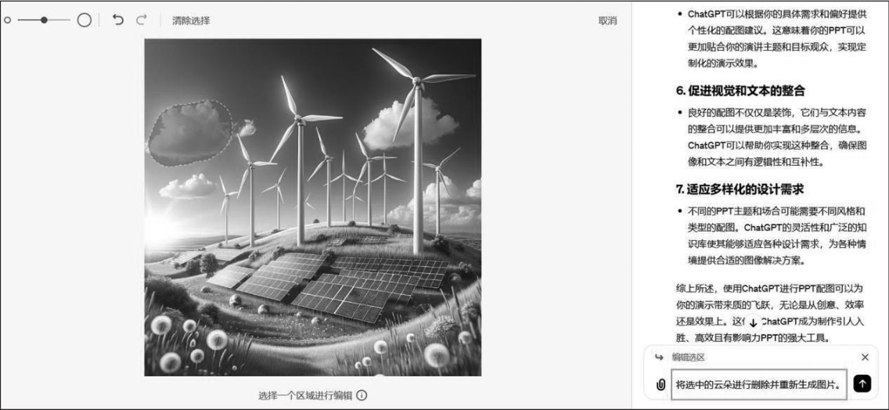
图 4.4

锦囊妙计
（1）想取消编辑点右上角“取消”。
（2）不满意可反复迭代，直至接近预期；也可以借助Photoshop等工具做进一步精修。

**步骤04 保存与使用**
满意后点右上角“保存”可网页格式保存，也可用截图软件截取后插入PPT使用。

锦囊妙计
（1）目前仅支持网页格式保存，若需其他格式需借助转换工具。
（2）ChatGPT也能担任图片搜索向导，告知Pixabay、Unsplash等高质量图库的获取方式。

### 4.5 让ChatGPT推荐模板资源与工具

高质量模板提供现成布局和样式，节省从零设计的时间；图标、图片、字体、配色等资源则能提升作品质感与效率。ChatGPT可基于具体需求给出个性化推荐。

1．思维导图

2．操作步骤
它能快速提供最新或热门的设计资源，同时给出灵感与技巧，帮助理解设计原则和使用方法，提升技能与作品质量。

**步骤01 明确具体需求**
先厘清想要的模板类型、风格偏好如现代简约专业、使用场景如商业演示教育营销、以及功能偏好。

例如提问：我要做一份2024年数字营销趋势的演讲PPT，希望模板专业又有创意，同时需要免费的图表和数据可视化工具，风格偏简约现代，有什么资源推荐？

ChatGPT推荐：
模板网站
1. Slides Carnival：提供大量免费PPT模板，风格多样，便于检索。
2. Canva：海量专业设计模板含PPT，在线编辑自定义便捷。
3. Template Monster：多为付费，但也有高质量免费选项。

数据可视化
1. Infogram：用户友好的在线工具，可制作分享精美图表与报告。
2. Tableau Public：功能强大的数据可视化工具，适合复杂数据展示，学习曲线稍高但公共版免费。

**步骤02 询问更多资源**
除模板外，还可询问免费或付费图库、字体、图标集，以及设计软件、在线编辑器、插件等。

例如：听起来不错，有没有优质的免费图片资源网站来增强演讲效果？

ChatGPT给出：
1. Unsplash：大量免费高分辨率图片，摄影师贡献，主题覆盖自然、城市、办公等，适合PPT。
2. Pixabay：国际免费图库，超百万张照片、矢量、插图、视频，可商用无需署名。
3. Pexels：高质免费照片与视频，可商用，界面友好易搜索。

锦囊妙计：使用时务必遵守各站点的使用条款，特别是商业用途与署名要求。

**步骤03 请求示例与教程**
可让ChatGPT示范如何使用某资源或工具，并提供最佳实践。

例如：能否举例说明怎么用Slides Carnival这个模板网站？

ChatGPT示范：
步骤1 访问官网，网站提供大量适用于Google Slides和PowerPoint的免费模板。
步骤2 选择模板，首页可浏览精选，或点“Templates”浏览全部分类如Business、Creative、Formal、Inspirational，按需求筛选。
步骤3 预览模板，点击感兴趣的模板进入详情页，可选择“Preview in Google Slides”或“Download as PowerPoint Template”先预览样式再下载。

**步骤04 持续学习**
可向ChatGPT请教设计原则、技巧与趋势，或特定工具的高级用法。

例如：能给我一些提升PPT设计能力的建议吗？

ChatGPT建议：
1. 先了解受众，明确设计方向与内容深度。
2. 保持简洁，避免页面拥挤，每页只传达一个核心观点。
3. 保持一致性，全篇统一字体、色彩、版式，提升专业感与记忆点。
4. 字体选择要清晰易读，通常控制在3种以内。
（略）

### 4.6 用AI工具快速生成PPT

过去做PPT耗时耗力，如今结合ChatGPT与AI工具即可高效产出高质量演示。

1．思维导图

2．操作步骤
先用ChatGPT生成大纲与文案，再把文本复制到PPT在线生成网站，快速成稿。

**步骤01 生成文本内容**
ChatGPT可按主题生成PPT大纲并细化内容，提升效率与质量。

例如输入：请以“AI对人类未来的影响”为主题，写一份PPT大纲，要求细化各部分内容，请以Markdown代码格式输出。

ChatGPT输出：
#AI 对人类未来的影响
##介绍
- 背景信息
- AI技术发展简史
- 当前AI应用范围
- 研究的重要性
- 为何关注AI对未来的影响
##AI在日常生活中的应用
- 智能家居
  - 例子：智能音箱、智能灯光控制
  - 影响：生活便利性提升
- 健康医疗
  - 例子：AI辅助诊断、远程医疗服务
  - 影响：医疗服务可及性与准确性提高
- 教育
  - 例子：个性化学习平台、在线辅导机器人
  - 影响：教育资源均衡，学习效率提升
（略）

锦囊妙计：Markdown语法简洁直观，易写易读，兼容性强，协作友好，是撰写大纲的优选格式。

**步骤02 一键生成PPT**
例如使用MindShow。打开官网注册登录后，点击“导入生成PPT”按钮，如图 4.5。
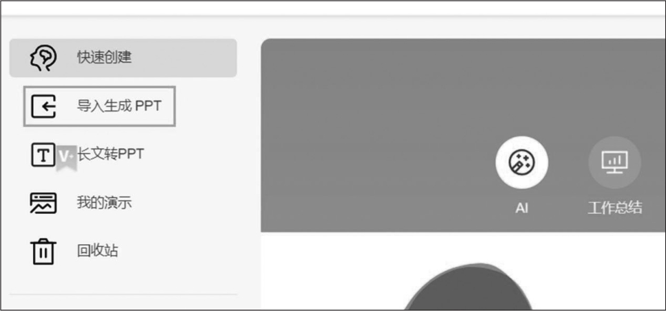
图 4.5

选择“Markdown”格式，把ChatGPT生成的文本粘贴到文本框，点击“导入创建”按钮，如图 4.6 和图 4.7。

▲图 4.6

图 4.7

进入新页面后，操作就很顺手了：左侧区域可以继续细化每一页的文案，右下角的模板库支持随时更换主题和版式，右上角则能实时试播演示效果。等所有细节都确认OK，点击下载，选择想要的导出格式，一键保存，整份 PPT 就算正式搞定啦，如图 4.8 所示。

图 4.8

**步骤 03 优化与润色**。MindShow 生成并导出 PPT 后，如果后续还想进一步打磨，比如增添或修改动画效果之类的，都可以直接在 PowerPoint 里打开继续本地编辑。

**锦囊妙计**

**除了 MindShow，还可以让 ChatGPT 推荐同类型的在线工具，例如 Chat-PPT、Gamma、Powtoon 等，每款都有自己的特色，能匹配不同的需求和使用偏好。选对最适合项目本身的平台，演示稿的完成度会更高。**