# AI办公提效新引擎：DeepSeek 实战应用全攻略

# 作者简介


## 关东升

深耕 IT 行业三十余载的老兵，现为软件架构师、高阶培训讲师与 IT 作家，精通 Java、Kotlin、Python 等语言，擅长游戏开发、数据库设计与软件架构。曾主导北京市政交通一卡通百亿级项目设计开发，参与国家农产品追溯系统、金融系微博等移动端研发，近期为中国移动、中国联通、南方航空、中国石油、工商银行、平安银行、天津港务局等单位授课。

著有《看漫画学Python》《漫画Java》《Java从小白到大牛》《Python从小白到大牛》《iOS开发指南》等五十余部计算机图书，累计发行量超百万册。

## 配套及赠送资源获取

扫码关注微信公众号

回复关键词：8098


# 内容简介

本书围绕办公效率升级与 AI 技术深度融合展开，是一本以实战案例为核心的效率手册。全书共 11 章。

第1至第5章聚焦 DeepSeek 的基础使用与效率提升方法，从模型认知与多工具联动讲起，到独创沟通方式与工作思维优化。

第6至第8章切入 Word、PPT、Excel 等日常办公软件的融合用法。

第9至第10章探索办公场景的创新玩法，聚焦图片与视频生成，详解 DeepSeek 与豆包、通义万相、即梦 AI 等工具的组合打法。

第11章为综合实战篇，覆盖高效会议纪要与邮件沟通、商业文案创意优化、优质产品介绍视频制作、简历精准优化、股票分析辅助等典型办公场景，帮助读者融会贯通，实现全方位提效。

全书以 50 个精选案例串联，形成从理论到落地的完整路径。无论是办公新手还是追求突破的老手，都能借此快速掌握 DeepSeek 的日常应用，开启智能化办公新阶段。

策划编辑：龚风光 王絮

责任编辑：王絮 郭湛崎

封面设计：李纳纳

# 前言

当下信息化浪潮澎湃，AI 已成为最具颠覆性的科技力量，正悄然重塑各行各业的工作与生活方式。在这场 AI 浪潮中，DeepSeek 如同冉冉升起的新星，以强劲性能与多元场景迅速成为全球关注焦点。

DeepSeek-R1 模型于 2025 年 1 月 20 日正式亮相，凭借惊人的自然语言处理能力与高效执行力，像一位开路者般快速占领市场。

面对这样一个里程碑式的 AI 助手，我们决心挖掘其价值，于是有了此书。本书旨在系统梳理 DeepSeek 的核心能力与多领域应用，为读者提供一扇了解 DeepSeek 的窗口。借由生动的案例剖析与强实操指引，无论你是 AI 新人还是资深从业者，都能学会在工作中高效驾驭 DeepSeek，提升创造力与生产力，在 AI 赋能时代从容应对挑战，把握机会。

最后致谢本书支持者。感谢 DeepSeek 研发团队的付出；感谢为编写提供资料、建议与指导的专家与业内人士；感谢出版社编辑与工作人员的专业付出。希望本书助你开启探索 DeepSeek 的旅程。

关东升

2025 年 2 月 16 日于鹤城

## 第1章 解锁 DeepSeek 的办公新可能

职场竞争加剧，效率与质量成为关键。AI 的到来为办公带来革新契机。DeepSeek 作为新生代 AI 工具，潜力巨大。本章探寻它将如何开启办公新境界。

### 1.1 DeepSeek 全景认知

DeepSeek 公司即杭州深度求索人工智能基础技术研究有限公司，2023 年成立，由梁文锋创办，获私募巨头幻方量化控股。公司聚焦开源大语言模型与基础技术研发，推动通用人工智能落地，提升全球 AI 水平。DeepSeek 为其自研模型系列。

#### 1.1.1 模型家族

DeepSeek 模型均基于 Transformer 架构，依托注意力机制，以海量语料预训练，结合监督微调与人类反馈强化学习进行对齐，并增设审核过滤等安全机制。

主要代表：

1. DeepSeek-R1：参数规模达 6710 亿，专攻推理类任务，在数学与编程上表现突出，部分基准测试超过 OpenAI o1。
2. DeepSeek-V2：参数 2360 亿，混合专家架构，上下文支持 128K，采用 MLA 与 DeepSeekMoE，提升推理效率与训练经济性。
3. DeepSeek-V3：参数 6710 亿，混合专家架构，上下文 128K，多项评测超越 Qwen2.5-72B、Llama-3.1-405B，与 GPT-4o、Claude-3.5-Sonnet 等顶尖闭源模型相当。
4. DeepSeek-R1-Distill：基于知识蒸馏，利用 DeepSeek-R1 生成样本微调 Qwen、Llama 等开源模型得到的高增强模型。

DeepSeek 在性能与成本上具备明显优势，有力推动行业发展。

> 蒸馏是深度学习中的模型压缩手段，将大模型即教师模型的知识迁移至小模型即学生模型，在保持效果的前提下降低参数量与计算开销。

#### 1.1.2 典型能力

DeepSeek 面向用户与开发者，能力覆盖：

1. 自然语言处理：智能对话、通用与专业问答、文本创作、语义理解、分类、实体识别、多语种翻译与格式转换、情感分析、关系抽取。
2. 计算推理：数学运算、逻辑分析、知识推理、因果推理、逻辑推理。
3. 代码能力：代码生成与补全、代码注释。
4. 数据分析：趋势分析、数据分析、可视化、流程优化。
5. 决策辅助：专业建议、任务拆解、方案规划、建议生成、风险评估、决策支持。
6. 知识处理：知识图谱构建、知识整合、多源信息融合、概念关联。
7. 交互能力：上下文理解、多轮对话、情感回应、工具调用与任务协调、多模态交互含指令理解、语音识别、图像理解、跨模态转换。

#### 1.1.3 使用路径

可通过网页与手机 App 访问。

1. 网页入口。打开 https://www.deepseek.com，进入官网，点击“开始对话”即可免费体验 DeepSeek-V3，未注册用户需先完成邮箱注册。
登录后进入对话界面。
2. 操作要点：
功能模式选择：输入框下方提供“深度思考 R1”与“联网搜索”。需深度推理时启用深度思考，需最新资讯时开启联网搜索。
回复处理：发送指令后等待生成，审阅结果，满意则结束，不满意可补充信息或重改指令进行多轮追问。
3. 移动端：官网点击“获取手机 App”，前往应用商店下载官方免费客户端。

### 1.2 DeepSeek 跨工具协同

AI 正从单打独斗走向融合互补。DeepSeek 与专长互补的 AI 工具联动，能释放更强办公能量。

#### 1.2.1 联合通义万相：视觉创意升级

1. 品牌形象搭建。DeepSeek 可深度解析企业文化、价值观、产品特性与目标人群，输出设计需求与方向。以一家主打环保的科技公司为例，DeepSeek 会提炼科技感与环保融合的基调，通义万相据此生成 Logo、配色方案、宣传海报等视觉稿，精准传达品牌调性。
2. 空间设计可视化。DeepSeek 根据功能需求、地理位置、客户偏好生成初步布局与流线规划，通义万相将其转化为三维效果图，直观展示材质与风格搭配，缩短决策周期。

#### 1.2.2 联合即梦 AI：视频内容革新

1. 影视剧本与分镜。即梦 AI 依据剧本快速生成专业水准片段。
2. 在线教育视频制作。DeepSeek 设计教学脚本，规划知识点顺序、案例引入与互动环节，即梦 AI 加入动画、特效与配音，打造趣味性强的教学视频。

#### 1.2.3 联合豆包：文本处理极致化

1. 专业文稿撰写优化。DeepSeek 进行主题研究并输出大纲与核心观点，豆包负责转化为流畅优美的初稿。后续 DeepSeek 把控逻辑与专业性，豆包润色语言，确保高质量交付。
2. 智能客服增强。DeepSeek 快速理解用户意图并制定精准应答策略，豆包将其转化为自然亲切的对话语言，提升服务效率与满意度。

### 1.3 小结

本章介绍 DeepSeek 模型全貌、使用方式及其跨工具协同价值，涵盖创意设计、视频制作、文本优化等场景，展现其解决办公痛点、激发创新、推动智能化的巨大潜力，为后续学习奠基。

## 第 2 章 掌握与 DeepSeek 的高效沟通术

了解 DeepSeek 的能力只是起点，建立适配的沟通方式才是释放价值的关键。本章聚焦如何与 DeepSeek 高效交互。

### 2.1 提示词实战指南

提示词是交互的核心，设计得当可显著提升准确率与效率。

1. 目标明确，避免模糊
核心：清晰目标带来精准输出。
对比：模糊“我想学编程，有什么建议吗？” vs 明确“我想零基础学 Python 目标做简易网页应用，请给出学习路径与入门资源。”
延伸：补充身份背景、具体需求。

2. 结构化表达，分点说明
核心：拆解复杂问题。
对比：笼统“帮我写篇 AI 文章” vs 结构化“需写篇 AI 文章，含基本概念、医疗应用、伦理讨论，请给框架与要点。”
延伸：用序号列需求，明确字数、风格。

3. 提供上下文，提升相关性
核心：背景信息越全越贴合。
对比：仅说“帮我写邮件” vs 说明对象、目的、截止日期提前原因等细节。
延伸：补充场景、人物、时间地点。

4. 指定输出格式
核心：限定形式便于使用。
对比：泛问“列出常用机器学习算法” vs 指定“以表格列出算法名称、适用场景、优缺点。”
延伸：指定 Markdown、JSON、代码块、标题注释等。

5. 迭代优化，逐步细化
核心：不满意可补充。
示例：首轮“推荐 AI 书籍”→次轮“推荐中文版初学者书籍并附简介。”
延伸：用“进一步说明”“补充要求”推动。

6. 角色扮演
核心：指定身份提升专业性。
对比：普通“如何提高写作能力？” vs “假设你是资深作家，给我 3 条实用建议并附练习方法。”
延伸：指定产品经理、历史学家、程序员等角色及风格。

7. 限制回答长度
核心：控制简洁或详细程度。
对比：未限制“解释量子计算原理” vs 限制“用不超过 100 字解释。”
延伸：限定字数、段落数、要点数。

8. 结合具体工具或资源
核心：明确技术栈需求。
对比：笼统“如何分析数据？” vs 具体“用 Python Pandas 清洗 CSV，请给示例代码。”
延伸：指定语言、库、提供样本数据。

精髓在于清晰与具体：明确目标、背景、需求；明确细节、格式与限制。

（3）反复打磨：先看模型给出的回复是否达标，再据此修正提问的表述，循环优化直到结果满意。

### 2.2 用 Markdown 实现高效的文档创作

DeepSeek 当下的主要产出仍是纯文本，还做不到直接生成 Word、Excel、PDF 等成品。但我们完全可以发挥它的潜力，让它返回符合规范的 Markdown 源文件。随后借助 Typora 等编辑器，或专门的格式转换工具，就能把这段代码快速转成目标格式的文件，满足不同场景的文档需求。

#### 2.2.1 Markdown 基础语法速览

Markdown 是一种轻量级的标记语言，用来以简洁易读的方式书写文本，并可转换成 HTML 或其他格式。配合工具，Markdown 代码就能变成 Word、PDF 等文件。

常用语法如下：

1. 标题

用 “#” 表示层级，支持从 “#” 一级到 “######” 六级标题，多个 “#” 嵌套使用。注意 “#” 后要空一格再写标题内容，例如：

```
# 一级标题
## 二级标题
### 三级标题
#### 四级标题
##### 五级标题
###### 六级标题
```

用预览工具打开，能看到图 2-1 的呈现效果。

2. 列表

无序列表可用 “-” 或 “*”，有序列表用数字加 “.”。符号后同样要空一格，例如：

```
- 第一项
- 第二项
  - 子项1
  - 子项2

1. 第一项
2. 第二项
   1. 子项1
   2. 子项2
```

预览后效果如 图 2-2 所示。

3. 引用

用 “>” 表示引用， “>” 后空一格，例如：

```
> 这是一段引用文本。
> 这是一段引用文本。
> 这是一段引用文本。
> 这是一段引用文本。
```

预览效果见图 2-3。

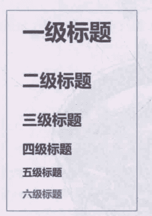

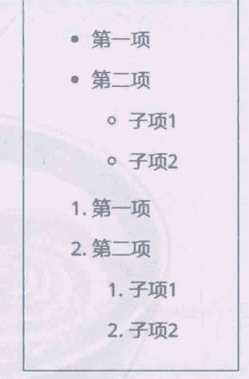


4. 粗体和斜体

用 “**” 包裹文本得到粗体，用 “*” 包裹文本得到斜体，例如：

```
这是**粗体**文本，这是*斜体*文本。
```

预览后如 图 2-4 所示。


5. 图片

图片语法为：

```

```

示例代码如下：

```

```

预览效果见图 2-5。


图 2-5 Markdown 图片预览效果

6. 链接

创建超链接的写法是 [链接文本](URL)，例如：

```
[点击这里访问DeepSeek](https://www.deepseek.com)
```

预览后效果如 图 2-6 所示。


图 2-6 Markdown 链接预览效果

7. 代码块

用三个反引号 ``` 包裹代码，并在首行注明语言，例如：

```
代码块示例：
python
def greet():
    print("Hello, DeepSeek!")
```

预览效果见图 2-7。


图 2-7 Markdown 代码块预览效果

> 在三个反引号后指定语言，比如示例中的 “python”，可实现关键字高亮。

8. 表格

表格用 “|” 分隔列，用 “-” 分隔表头与内容，例如：

```
| 姓名 | 年龄 | 城市 |
|------|------|------|
| 小明 | 25   | 北京 |
| 小红 | 30   | 上海 |
```

预览后效果如 图 2-8 所示。

| 姓名 | 年龄 | 城市 |
|------|------|------|
| 小明 | 25   | 北京 |
| 小红 | 30   | 上海 |

图 2-8 Markdown 表格预览效果

以上就是 Markdown 的核心语法，已足以支撑日常工作。若有特殊需求，可再自行扩展学习。

#### 2.2.2 Markdown 工具的选择

工欲善其事必先利其器。写 Markdown 需要合适的编辑预览软件。

此类工具主要用于编辑与实时预览 Markdown 文件，常见选择有：

1. VS Code：免费开源代码编辑器，对 Markdown 支持很好。可装插件实现预览、Emoji 自动替换、PDF 导出等。当前非常主流。
2. Typora：界面简洁美观，操作流畅。支持实时预览、插入图片、表情、目录等，是很多人的首选写作工具。
3. Mark Text：开源编辑器，界面干净，功能强，支持实时预览、模式切换、插件扩展，同时屏蔽复杂设置，聚焦写作。
4. Ulysses：专业写作软件，支持 Markdown 及多种格式，提供丰富的导出选项，界面精致，专业性强，但付费较高。
5. iA Writer：专注写作，界面极简，Markdown 支持出色，可自定义主题字体，沉浸感强，但功能相对精简。

根据个人习惯挑选合适的工具，结合 DeepSeek 使用，能大幅降低工作量，提升创作效率与质量。

#### 2.2.3 案例 1：生成 Markdown 文档

安装好工具后，可通过案例熟悉如何让 DeepSeek 生成 Markdown 文档。

> 提示词示例：

请生成一份 Markdown 格式的项目计划文档，包含项目名称、目标、时间安排、任务分工和里程碑。

DeepSeek 可能返回如下 Markdown 文档：

```
# 项目计划书
## 1. 项目概述
**项目名称**：智能客服系统开发
**项目负责人**：张三
**团队成员**：李四、王五、赵六
**启动日期**：2025年2月15日
**预计完成日期**：2025年8月30日

## 2. 项目目标
- 开发一款基于AI的智能客服系统，提高客户服务效率
- 支持多轮对话，自动识别客户需求并提供答案
- 集成语音识别、文本分析等功能，实现多模态交互

## 3. 主要任务和分工
| 任务名称 | 负责人 | 预计完成时间 |
| --- | --- | --- |
| 需求分析 | 张三 | 2025-03-01 |
| 技术选型 | 李四 | 2025-03-10 |
| AI模型训练 | 王五 | 2025-04-15 |
| 前端界面设计 | 赵六 | 2025-05-01 |
| 后端系统开发 | 李四 | 2025-06-01 |
| 集成与测试 | 全员 | 2025-07-15 |

## 4. 里程碑计划
- **2025年3月1日** - 需求分析完成
- **2025年4月15日** - AI模型初步训练完成
- **2025年6月1日** - 前后端开发基本完成
- **2025年8月30日** - 产品上线

## 5. 资源需求
- 服务器资源：GPU服务器2台，存储服务器1台
- 开发工具：Python、TensorFlow、React、MySQL
- 预算：50万元

## 6. 风险评估与应对
- **技术风险**：AI模型准确率不足 → 提前进行小规模测试
- **进度风险**：开发进度延期 → 设立紧急预案，定期调整计划
- **资金风险**：预算超支 → 设定资金预警机制，合理规划开支

## 7. 结论
该项目将通过AI技术提升客服效率，减少人工成本，并提升客户满意度。团队将在既定时间内完成开发任务，并确保系统稳定可靠。
```

把代码复制保存为“需求文档.md”，如图 2-9。

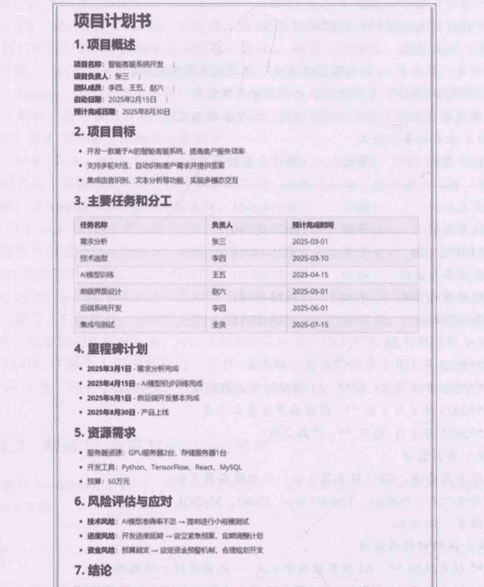

图 2-9 需求文档预览结果

> 每次提问的结果都可能不一样，这在 DeepSeek、ChatGPT 等生成式模型中很常见。因为模型是基于概率生成答案，会根据上下文推测最可能的结果，而非每次都走同一路径。

#### 2.2.4 将 Markdown 文档转为 Word 文档

有时需要把 Markdown 转成 Word。可借助以下两种方式：

1. Pandoc

Pandoc 是强大的文档转换工具，命令行即可完成转换，支持输出 .docx 等多种格式。

可在官网 https://pandoc.org/installing.html 下载对应系统版本，如图 2-10。

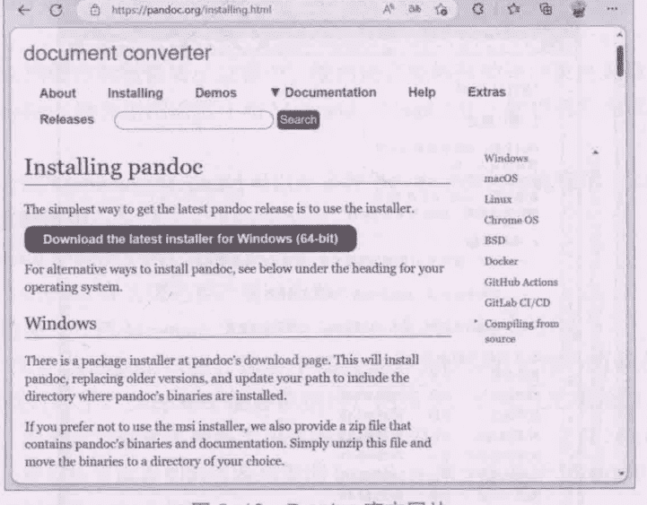

下载后注意添加到系统路径。安装完成后在终端输入：

```
pandoc input.md -o output.docx
```

其中 input.md 为源文件，output.docx 为目标文件。

除 Pandoc 外，在线转换器、VS Code 插件也能实现类似功能，可按需选择。

把“需求文档.md”转为“需求文档.docx”的命令示例如图 2-11。


转换成功后当前目录会出现生成的 docx 文件，打开效果如图 2-12。

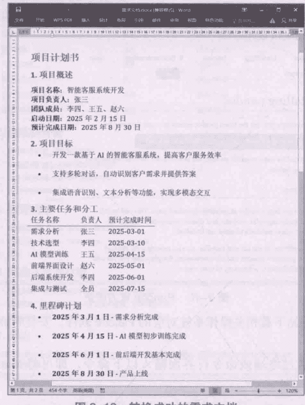

2. Typora

Typora 可直接导出 Word。打开文件后点击菜单栏“文件”→“导出”→“Word”，选择保存路径即可。

#### 2.2.5 将 Markdown 文档转为 PDF 文档

Markdown 转 PDF 可用 Pandoc 或 Typora，也可先转 Word 再导出 PDF。

具体步骤：

（1）打开 Word 文档：用 Microsoft Word 或 WPS 等打开已生成的 Word 文档。
（2）导出 PDF：点击“文件”→“导出”，选择“创建 PDF/XPS 文档”。

### 2.3 绘图语言

在文档创作和数据展示中，绘图语言能更直观地表达思路、流程和结构。DeepSeek 结合 Mermaid、PlantUML 等绘图语言，让图形与流程图的生成变得非常便捷。

本节聚焦 Mermaid。它可在多种平台绘制流程图、甘特图、时序图、状态图等。

使用流程如下：

（1）用 Mermaid 语法描述图形。
（2）通过渲染工具把文本渲染为 SVG 或 PNG 图片。

有了 DeepSeek，读者无需精通语法，直接让 DeepSeek 按指令输出代码即可。本书不深入讲解语法，而是重点指导如何借助 DeepSeek 高效完成图表绘制。

感兴趣可参考官方文档：

（1）流程图 https://mermaid-js.github.io/mermaid/#/flowchart
（2）甘特图 https://mermaid-js.github.io/mermaid/#/gantt
（3）时序图 https://mermaid-js.github.io/mermaid/#/sequenceDiagram
（4）状态图 https://mermaid-js.github.io/mermaid/#/stateDiagram

流程图代码示例：

```
graph TB
    A[产品设计] --> B[开发]
```

渲染工具很多，官方在线编辑器 Mermaid Live Editor 可实时预览。打开 https://mermaid.live/，如图 2-13，左侧为代码区，右侧为渲染结果。

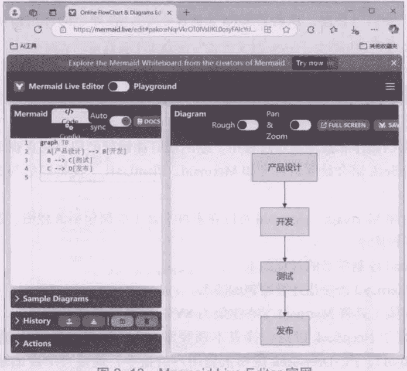

在左侧输入代码，右侧会自动同步渲染。若需导出，可点“Actions”按钮，打开如图 2-14 的面板，选择保存或分享图片。

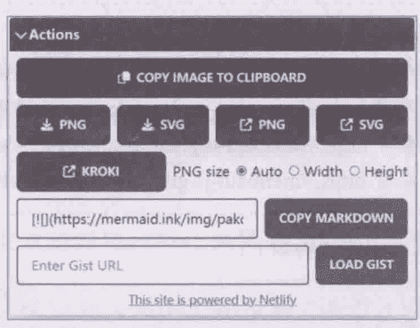

## 2.4 本章小结

本章围绕与 DeepSeek 的有效沟通展开。先掌握提示词技巧，精准传达需求；再深入 Markdown，学会基础语法与常用工具，实现高效文档创作；并学会把 Markdown 转换为 Word、PDF。最后对绘图语言有了初步认识。这些能力能帮助你在办公场景中更好地运用 DeepSeek，提升效率。

# 第 3 章 借助 DeepSeek 优化工作思维

本章将借助 DeepSeek 的能力，探索工作思维的优化方法。我们将学习用表格清晰呈现数据，用思维导图规划蓝图，用鱼骨图找准问题根源，开启思维升级之旅。

## 3.1 用表格清晰呈现工作数据与信息

工作中数据的整理与呈现至关重要。表格简洁直观，能有序组织信息，便于分析对比。借助 DeepSeek，可更高效地创建与优化表格。

### 3.1.1 Markdown 表格

Markdown 表格非常重要，既能快速创建结构化表格，又可借助 DeepSeek 优化生成与处理流程。

第 2.2 节介绍了基础语法，下面补充对齐方式：

Markdown 表格通过在表头分隔线中使用冒号控制对齐，支持左对齐、右对齐与居中对齐。

（1）左对齐：默认左对齐，例如：

```
| 姓名 | 职位 | 入职日期 |
|------|------|----------|
| 张三 | 开发工程师 | 2023-01-01 |
| 李四 | 产品经理 | 2022-06-15 |
| 王五 | 测试工程师 | 2021-12-22 |
```

为明确指定左对齐，可在分隔线左侧加冒号。预览效果见图 3-1。

| 姓名 | 职位 | 入职日期 |
| --- | --- | --- |
| 张三 | 开发工程师 | 2023-01-01 |

Markdown 表格的可读性很大程度上取决于列内文字的排列方式。下面先介绍三种常用的排列规则。

没有任何额外符号时，内容会默认贴左显示，样例如下：

| 李四 | 产品经理 | 2022-06-15 |

| 王五 | 测试工程师 | 2021-12-22 |

图 3-1 Markdown 表格预览效果（左对齐）

想让整列贴右，只需要在分隔行的右侧补充一个冒号即可，写法示范如下：

```
| 姓名 | 职位 | 入职日期 |
|-------:|-------:|----------:|
| 张三 | 开发工程师 | 2023-01-01 |
| 李四 | 产品经理 | 2022-06-15 |
| 王五 | 测试工程师 | 2021-12-22 |
```

在渲染器中打开即可看到图 3-2 的呈现。

| 姓名 | 职位 | 入职日期 |

| --- | --- | --- |

| 张三 | 开发工程师 | 2023-01-01 |

| 李四 | 产品经理 | 2022-06-15 |

| 王五 | 测试工程师 | 2021-12-22 |

图 3-2 Markdown 表格预览效果（右对齐）

若希望内容居中展示，就在分隔行的两侧同时加上冒号：

```
| 姓名 | 职位 | 入职日期 |
|:-------:|:-------:|:----------:|
| 张三 | 开发工程师 | 2023-01-01 |
| 李四 | 产品经理 | 2022-06-15 |
| 王五 | 测试工程师 | 2021-12-22 |
```

预览后的样式如图 3-3。

| 姓名 | 职位 | 入职日期 |

| --- | --- | --- |

| 张三 | 开发工程师 | 2023-01-01 |

| 李四 | 产品经理 | 2022-06-15 |

| 王五 | 测试工程师 | 2021-12-22 |

图 3-3 Markdown 表格预览效果（居中对齐）

### 借助智能助手制作投放渠道清单的实践

下面以真实场景演示如何让 DeepSeek 产出表格。某运动品牌的外包投放项目需要把渠道、花费、受众、亮点等信息汇总成表，策划同事让模型直接输出 Markdown 语法。

背景是广告公司要为运动品牌制定投放方案，核心在于把各渠道的特点、预算、覆盖人群说清楚，便于决策，因此依靠该模型加速表格搭建。

当时的指令是：请帮我生成一个 Markdown 格式的表格，用于展示运动品牌广告投放的不同渠道信息。表格需包含渠道名称、单次投放费用（单位：元）、预计覆盖受众数量（单位：人）、受众年龄区间、适合推广的产品类型、投放优势。请列举 5 种常见的广告投放渠道及其相关数据，数据请合理设置。

模型给出的结果如下：

## 运动品牌广告投放渠道信息

| 渠道名称 | 单次投放费用（元） | 预计覆盖受众数量（人） | 受众年龄区间 | 适合推广的产品类型 | 投放优势 |

| --- | --- | --- | --- | --- |

| 社交媒体平台 | 30,000 | 500,000 | 18～35 岁 | 运动鞋、运动服、配件 | 精准定位年轻人群，互动性强 |

| 搜索引擎广告 | 20,000 | 300,000 | 18～45 岁 | 健身器材、运动营养品 | 高转化率，用户意图明确 |

| 体育赛事广告 | 50,000 | 800,000 | 18～50 岁 | 高端运动鞋、运动装备 | 高曝光度，关联性强 |

| 线上视频平台 | 40,000 | 600,000 | 18～40 岁 | 跑步鞋、运动服、健身器材 | 强视觉冲击力，覆盖面广 |

| 户外广告 | 60,000 | 1,000,000 | 18～60 岁 | 跑步鞋、运动装备、饮料 | 高街头曝光率，适合大规模投放 |

把代码复制另存为“运动品牌广告投放渠道信息.md”，效果如图 3-4。

## 运动品牌广告投放渠道信息

| 渠道名称 | 单次投放费用（元） | 预计覆盖受众数量（人） | 受众年龄区间 | 适合推广的产品类型 | 投放优势 |

| --- | --- | --- | --- | --- |

| 社交媒体平台 | 30,000 | 500,000 | 18～35岁 | 运动鞋、运动服、配件 | 精准定位年轻人群，互动性强 |

| 搜索引擎广告 | 20,000 | 300,000 | 18～45岁 | 健身器材、运动营养品 | 高转化率，用户意图明确 |

| 体育赛事广告 | 50,000 | 800,000 | 18～50岁 | 高端运动鞋、运动装备 | 高曝光度，关联性强 |

| 线上视频平台 | 40,000 | 600,000 | 18～40岁 | 跑步鞋、运动服、健身器材 | 强视觉冲击力，覆盖面广 |

| 户外广告 | 60,000 | 1,000,000 | 18～60岁 | 跑步鞋、运动装备、饮料 | 高街头曝光率，适合大规模投放 |

图3-4 “运动品牌广告投放渠道信息” Markdown 表格

### CSV 也是可输出的格式

前面讲的是 Markdown 语法，同样能让 DeepSeek 输出 CSV。CSV 即 Comma-Separated Values，用纯文本保存表格数据，Excel、Google Sheets 等程序都能读取。每行对应一条记录，字段间以逗号分隔，第一行通常是表头。下面是一个带表头和三行数据的简例：

```
姓名,年龄,部门,职位
张三,28,销售部,销售代表
李四,32,技术部,软件工程师
王五,25,市场部,市场专员
```

因为是文本格式，用记事本就能编辑，图 3-5 就是记事本打开的情形。


导出时命名为“员工信息.csv”，如图 3-6，建议字符集选 ANSI。

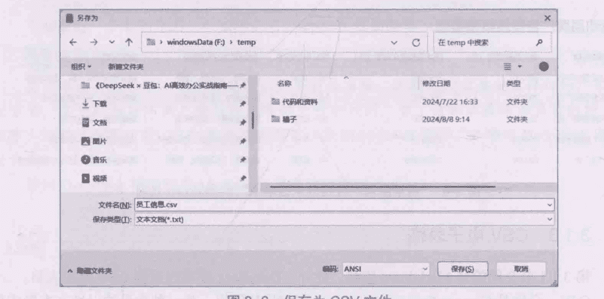

导出后可直接用 Excel 或 WPS 打开，图 3-7 为 WPS 打开的效果。

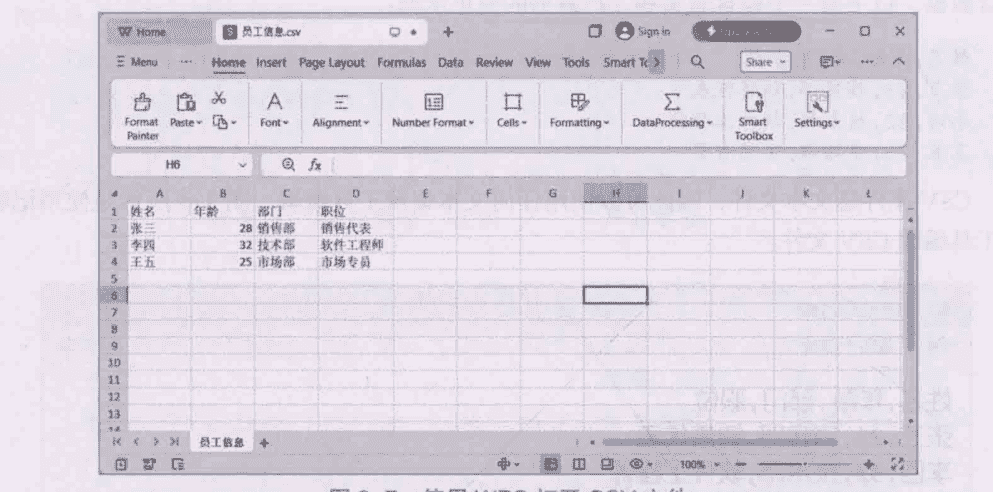

> 字符集问题要留意。简体中文环境下推荐用 ANSI，对应 GBK。若编码选错，中文会乱码。图 3-8 显示用 Excel 打开 UTF-8 编码的 CSV 会出现乱码，而 WPS 则正常。

## 第3章 借助 DeepSeek 优化工作思维

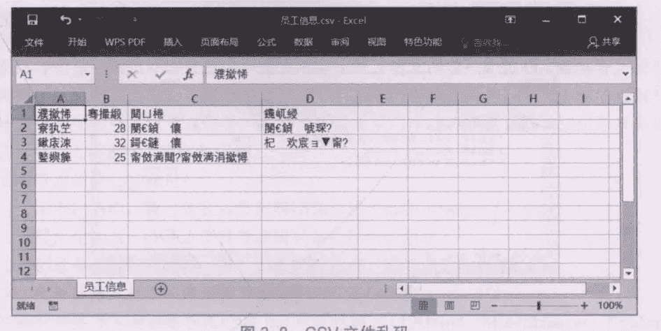

图 3-8 CSV 文件乱码

CSV 以英文逗号作列分隔，若字段内容本身包含逗号就容易错位。比如图 3-9 中编号 1 的智能手表，其商品特点本应为“长续航，健康监测，心率追踪，睡眠分析”，因为内容里有逗号，被错误拆成两列，导致显示混乱。最简便的解决办法是把内容里的英文逗号换成中文逗号，如图 3-10。

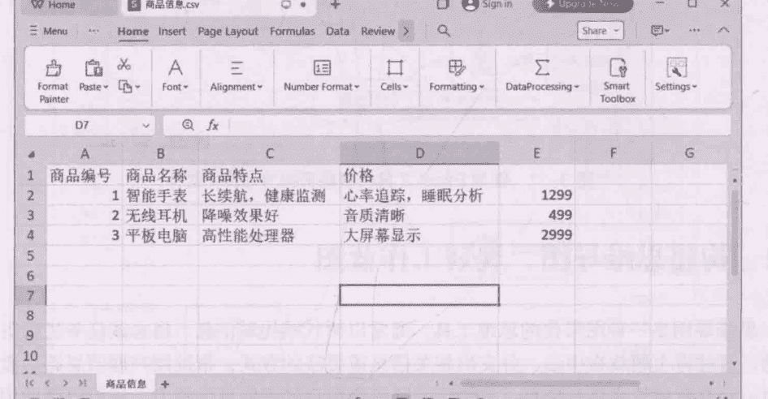

图 3-9 内容显示混乱

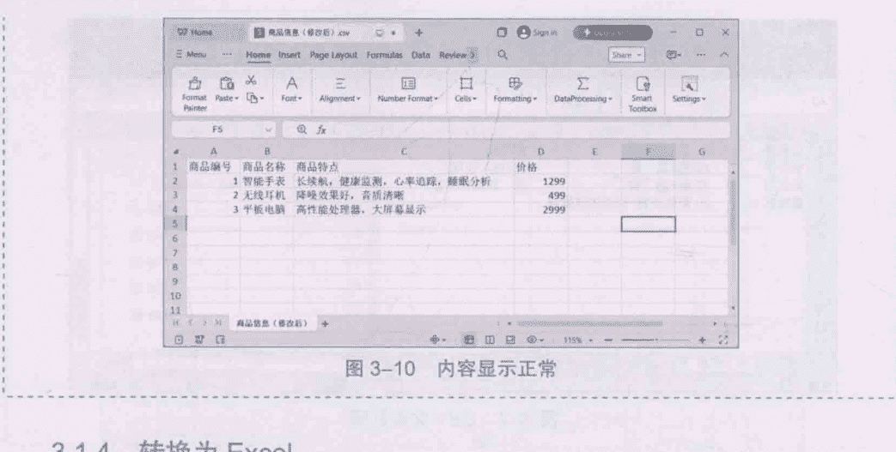

### 把 CSV 转成 Excel

做好的 CSV 怎么变成 .xlsx？直接用 Excel 或 WPS 打开后，通过菜单“文件→另存为”，在文件类型里选择 *.xlsx 即可，如图 3-11。

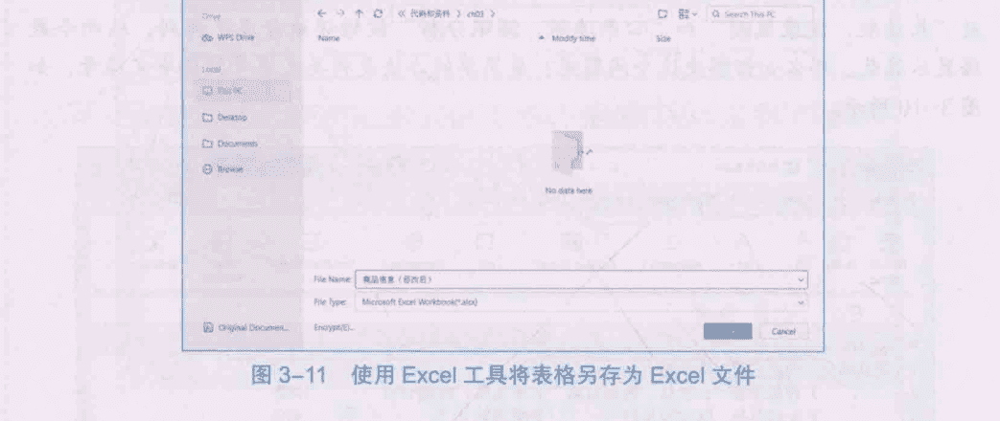

## 3.2 构建思维导图，规划工作蓝图

思维导图是一种图形化思维工具，以树状或放射状结构把主题和分支展开，帮助理清思路、激发灵感、管理复杂信息，尤其适合梳理大量内容时使用。

### 3.2.1 思维导图概述

思维导图围绕中心主题展开，分支层层递进，节点包含细节或任务，常借助颜色、符号、图形强化记忆。核心特点有：图形化结构、层次化关系、创意表达、简单易懂。

市面上工具不少，比如 XMind、MindManager、FreeMind、百度脑图等。XMind 绘图强、样式多；MindManager 在协作和项目管理上表现突出，支持多人同 edits。图 3-12 所示是 XMind 绘制的效果。

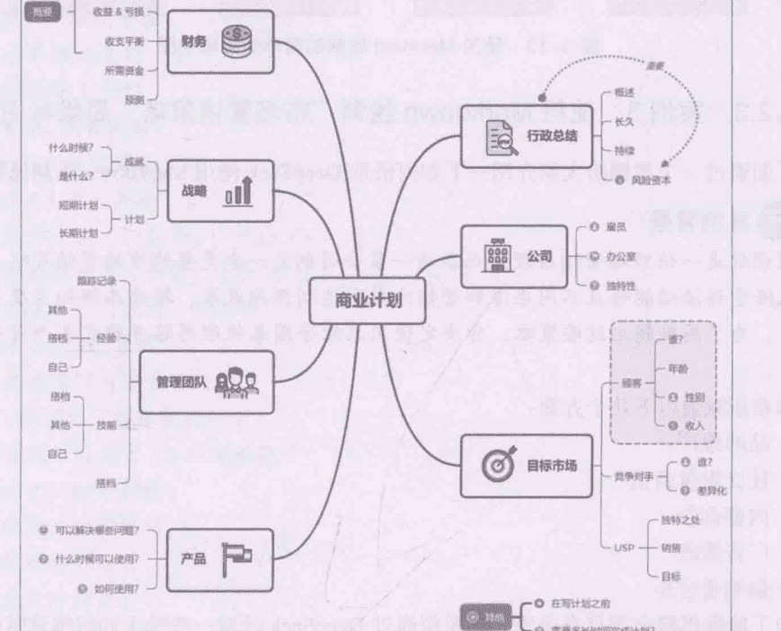

图 3-12 XMind 绘制的思维导图

### 3.2.2 借助 DeepSeek 优化思维导图

DeepSeek 能在构建和优化思维导图时提供支持，常见做法有：用 DeepSeek 生成 Markdown 描述的思维导图，再导入到绘图工具；或让 DeepSeek 用 Mermaid 语法绘制，图 3-13 就是一个 Mermaid 绘制的示例。

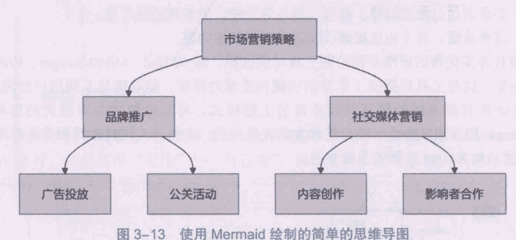

### 3.2.3 案例 3：用 Markdown 画“市场营销策略”导图

假设你是市场营销经理，需要为公司制定完整策略，覆盖品牌推广、社交媒体营销、内容创作、广告投放、影响者合作等环节。为提高效率，决定先用 DeepSeek 获取结构化框架，再转为思维导图。

提示词为：请帮我规划一个关于“市场营销策略”的思维导图，包含品牌推广、社交媒体营销、内容创作、广告投放和影响者合作等方面的内容。返回 Markdown 文档，注意主题层次关系。

DeepSeek 返回的 Markdown 文档如下：

```
# 市场营销策略思维导图
## 一、品牌推广
### 1.1 品牌定位
- 目标市场分析
- 核心价值主张
- 差异化竞争策略
### 1.2 品牌形象
- VI 视觉系统（Logo/ 配色/ 字体）
- 品牌故事与情感联结
- 品牌文化输出
### 1.3 品牌传播
- 公关活动策划
- 跨界联名合作
- KOL 背书策略
## 二、社交媒体营销
### 2.1 平台选择
- 微信平台（公众号/ 小程序）
- 短视频平台（抖音/ 快手 /B 站）
- 社交平台（微博/ 小红书）
### 2.2 内容策略
- 热点追踪与借势营销
- UGC/PGC 内容激励计划
- 话题标签运营（#品牌话题）
### 2.3 互动管理
- 评论区运营技巧
- 粉丝社群运营
- 裂变活动设计
## 三、内容创作
### 3.1 内容规划
- 用户需求图谱分析
- 内容矩阵搭建（图文/视频/直播）
- 内容日历排期
### 3.2 创意生产
- 痛点场景化呈现
- 数据可视化表达
- A/B 测试优化
### 3.3 分发渠道
- 自有媒体（官网/App）
- 付费媒体（信息流广告）
- 赢得媒体（口碑传播）
## 四、广告投放
### 4.1 渠道选择
- 搜索引擎广告（SEM）
- 信息流广告（头条/腾讯广点通）
- DSP 程序化购买
### 4.2 投放策略
- LBS 地理定向
- 人群画像分层
- 智能出价系统
### 4.3 效果评估
- CTR 点击率分析
- CVR 转化率追踪
- ROAS 广告回报率计算
## 五、影响者合作
### 5.1 达人筛选
- 粉丝画像匹配度
- 内容调性评估
- 商业合作历史分析
### 5.2 合作模式
- 产品体验种草
- 直播带货分佣
- 联名内容共创
### 5.3 效果追踪
- 互动量监测（点赞/评论/分享）
- 带货转化链路跟踪
- 品牌搜索指数变化
```

把代码保存为“市场营销策略.md”。XMind 支持导入 Markdown，直接通过“文件→导入→Markdown”选择文件即可，导入成功如图 3-14。

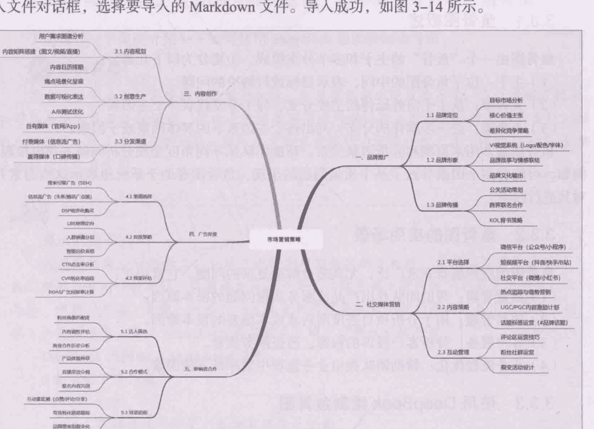

## 3.3 利用鱼骨图，精准找出问题根源

鱼骨图又称因果图或石川图，用鱼骨结构展示结果与其影响因素的关系。图 3-15 是一个项目逾期原因分析的示例。

### 3.3.1 鱼骨图概述

鱼骨图由主干、大骨架、小骨架组成。主干表示目标或问题；大骨架是主因素；小骨架是具体因素。它能帮助团队从多角度系统分析问题，找出根源。

### 3.3.2 鱼骨图的应用场景

鱼骨图用途广泛，常用于质量管理找出产品服务问题根源、项目管理分析进度滞后或成本偏差、客户服务分析投诉原因、业务流程优化等。

### 3.3.3 用 DeepSeek 绘制鱼骨图

DeepSeek 能辅助绘制，主要体现在：分析问题描述提取关键信息与影响因素；搭建鱼骨框架，包括鱼头、大骨架、各级小骨架；自动生成初稿，方便人工调整；对鱼骨图进行解读并给出改进建议。需要注意的是，复杂概念和专业逻辑仍需人工复核校正。

### 3.3.4 案例 4：绘制“销售额下滑问题”鱼骨图

某电商公司季度分析发现销售额明显下滑，决定用鱼骨图系统分析原因。提示词为：我是某电商公司的员工，公司在进行季度销售数据分析时，发现销售额显著下滑。我们想用鱼骨图分析原因。请帮我生成一个关于“销售额下滑问题”的鱼骨图框架，从人员、市场、产品、营销、运营几个方面分析可能导致该问题的原因，每个方面至少列举 3 个具体原因，并以 Markdown 文档格式呈现，方便我后续整理。

DeepSeek 返回如下 Markdown 文档：

```
# 销售额下滑问题
## 人员方面
- 销售人员销售技巧不足，无法有效促成交易。
- 客服人员服务质量下降，导致客户流失。
- 新员工培训不到位，工作效率低下。
## 市场方面
- 市场竞争加剧，竞争对手推出更具吸引力的产品和优惠活动。
- 目标市场需求发生变化，公司未能及时调整产品和策略。
- 经济形势不佳，消费者购买力下降。
## 产品方面
- 产品质量出现问题，影响品牌声誉和客户购买意愿。
- 产品更新换代慢，无法满足消费者对新功能和新体验的需求。
- 产品种类单一，无法满足不同客户群体的需求。
## 营销方面
- 广告投放效果不佳，未能有效吸引目标客户。
- 营销活动缺乏创意，没有引起消费者的兴趣和关注。
- 社交媒体营销不到位，品牌曝光度不足。
## 运营方面
- 物流配送速度慢，导致客户满意度下降。
- 网站或 App 性能不稳定，影响用户购物体验。
- 库存管理不善，出现缺货、断货现象。
```

把前面整理好的代码存成名为“销售额下滑问题.md”的文件，参照第 3.2.3 节的说明，用 XMind 打开这份 Markdown 文件，就能得到对应的思维导图。导入完毕后的呈现效果见图 3-16。

图 3-16 呈现的是普通的思维导图，并不是鱼骨结构。要得到鱼骨效果，需要在 XMind 里做转换，转换过程如图 3-17 所示。转换完成后得到的结果如图 3-18 所示。

图 3-18 转换完成的鱼骨图

如果对默认样式不满意，可以进入“画布”菜单选择“变更风格”。图 3-19 就是笔者调整样式后的鱼骨图。

图 3-19 变更风格后的鱼骨图

借助这张鱼骨图，销售额下滑的成因能够一目了然地展示出来。

## 3.4 本章小结

本章围绕如何借助 DeepSeek 提升工作思维展开。我们掌握了用表格来呈现数据与信息的技能，涵盖 Markdown 表格的搭建、CSV 格式表格的制作以及格式互换；学会了借助思维导图梳理工作思路，并让 DeepSeek 参与打磨；还掌握了以鱼骨图追根溯源的方法，并通过案例了解了让 DeepSeek 绘制鱼骨图的完整流程。这些做法有效强化了思维能力和解决问题的能力，让工作效率明显提升。

# 第 4 章 时间管理的智能伙伴

在节奏紧凑的现代办公环境里，时间是最稀缺的资源。如何在有限时段内完成更多事项，是每个职场人都要面对的难题。科学的安排不仅能提升产出，也能改善生活质量，实现工作与生活的平衡。

本章将探讨如何让 DeepSeek 成为时间规划的得力搭档。我们会学习用日历工具优化排程，并利用番茄工作法提升专注度，让时间规划更轻松高效，助力职场脱颖而出。

## 4.1 借助日历管理，优化日程安排

日历管理是时间规划的基础，能让我们清晰看到每日安排，确保事项准时完成。当前智能日历可自动排程、提醒重要事项，并帮助合理分配时间。

### 4.1.1 常用时间规划工具

现代职场中，时间规划已不只是靠自律与规划。各类智能工具能大幅提升效率，优化流程。以下工具已成为日常工作的常用助手：

1. 日历：最基础也最常用的排程工具。
2. 待办清单：把待办事项列出，按重要程度与截止时间排序。
3. 综合规划软件：如 Todoist、印象笔记、钉钉等，集合提醒、排序、排程等功能。
4. 番茄工作法：基于番茄钟的专注技巧，通过工作与休息交替提升效率。

可根据个人习惯挑选合适的工具并掌握使用技巧，达到事半功倍的效果。下面重点介绍日历与番茄工作法，以及它们与 DeepSeek 的结合方式。

### 4.1.2 日历管理的使用思路

日历能以日为单位规划时间，把事项或事件标注上去，避免遗忘或延误。

市面上日历软件众多，笔者推荐 Excel 模板日历、桌面或移动端的日历应用。

### 4.1.3 Excel 日历

Excel 提供了日历模板，如图 4-1 所示，可据此制作 Excel 日历，如图 4-2 所示。

图 4-1 Excel 日历模板

图 4-2 Excel 日历

Excel 日历的具体操作步骤在此不再赘述。

> 注：因 Office 版本差异，部分读者可能找不到图 4-1 的模板，可在本书配套资料中找到文件。

### 4.1.4 Windows 操作系统日历工具——Microsoft Outlook

Microsoft Outlook 如图 4-3 所示，是集日历与邮件管理于一体的工具，在企业环境中应用广泛。它能高效管理日常工作，进行事项提醒、事件邀请、会议安排等。

### 4.1.5 Google 日历

Google 日历如图 4-4 所示，是由 Google 提供的免费在线日历，与 Gmail、Google Meet、Google Drive 等服务深度整合，便于随时随地管理日程、安排会议并分享活动。

图 4-4 Google 日历工具

### 4.1.6 案例 5：用 DeepSeek 优化一周工作日程安排

一周日程安排是否合理，直接影响事项推进效率。面对多项目会议、演讲汇报、团队建设等复杂事项，可借助 DeepSeek 进行科学优化。下面以含三个项目会议、两次演讲汇报、一次团建的一周安排为例。

假设初始安排如图 4-5 所示。

| 日期 | 上半天 9:00~12:00 | 下半天 13:30~17:30 |
| :--- | :--- | :--- |
| 周一 | 出席首个项目会议 | 跟进项目相关工作，为第二次演讲报告做初步准备 |
| 周二 | 撰写第一次演讲报告的内容 | 出席第二个项目会议 |
| 周三 | 完善第一次演讲报告材料，进行排练 | 进行第一次演讲报告 |
| 周四 | 准备第三个项目会议资料 | 出席第三个项目会议 |
| 周五 | 进行第二次演讲报告 | 开展团队建设活动 |
| 周六、周日 | 休息 | 休息 |

图 4-5 初始一周工作日程安排

该安排存在切换频繁、准备时间不足等问题。例如周一的上半段刚开完会，下半段就切换到项目处理和演讲准备；周二、周三的演讲与会议连排，缺乏缓冲。

借助 DeepSeek 优化的提示词如下：

我目前的一周工作日程安排如下：周一上半段出席第一个项目会议，下半段继续处理项目相关任务并为第二次演讲报告做初步准备；周二上半段撰写第一次演讲报告的内容，下半段出席第二个项目会议；周三上半段完善第一次演讲报告材料并进行排练，下半段进行第一次演讲报告；周四上半段准备第三个项目会议资料，下半段出席第三个项目会议；周五上半段进行第二次演讲报告，下半段开展团队建设活动；周六和周日休息。这个日程存在任务转换频繁、准备时间不足等问题。请帮我优化这份日程安排，确保每个事项都有足够的准备时间，避免过度集中在某一天，同时合理安排休息和调整的时间，提高工作效率。

DeepSeek 给出的优化结果：

周一：上半段出席第一个项目会议。下半段处理项目相关任务并整理会议记录、梳理后续步骤。开始为第二次演讲报告收集资料、构建思路。

周二：上半段撰写第一次演讲报告的框架和内容。下半段出席第二个项目会议，记录要点并规划后续任务。整理第二次演讲报告的内容结构。

周三：上半段继续完善第一次演讲报告材料，优化内容并准备排练。下半段进行第一次演讲报告排练，调整节奏，做好心理准备后实施汇报。

周四：上半段准备第三个项目会议资料，确保信息清晰完整。下半段出席第三个项目会议，会后处理相关任务并总结讨论要点。

周五：上半段进行第二次演讲报告，确保准备充分。下半段开展团队建设活动，放松身心并回顾本周工作。

周六：全天休息，完全放松，可进行轻松活动或思考下周重点。

周日：全天休息，保证充足恢复以迎接新周。

经优化后，日程更科学合理，提升效率并平衡工作与生活。按此安排录入日历后效果如图 4-6 所示。

## 4.2 用番茄工作法提升专注度

番茄工作法由意大利管理顾问弗朗西斯科·西里洛于 1992 年提出。利用番茄钟把工作切分为 25 分钟专注与 5 分钟短休的循环，帮助保持状态、提高专注。

### 4.2.1 实施步骤

1. 选择一项事项，启动 25 分钟番茄计时器，全神贯注执行。
2. 25 分钟结束，记录一枚番茄完成并休息 5 分钟，可伸展、喝水。
3. 重复上述循环，完成 4 枚番茄后休息 15~30 分钟恢复精力。
4. 一日安排 3~4 个番茄工作轮，记录完成的番茄数与工作量，清晰掌握进度。

### 4.2.2 案例 6：用番茄工作法管理团队项目进度

李华将产品推广计划拆解为多个子事项，按番茄法分配给团队，单次番茄 25 分钟，完成后休息 5 分钟，4 枚番茄后休息 15~30 分钟。

工作划分：
1. 完成市场调研报告：4 枚番茄，分别调研市场趋势、竞争对手、目标人群、数据整理。
2. 广告素材设计：6 枚番茄，分配给设计师与文案，负责创意构思、初稿设计、修改完善。
3. 社交媒体推广方案：3 枚番茄，市场推广与社媒专家协作，完成内容策划、执行计划、效果评估规划。
4. 产品文案撰写：2 枚番茄，文案人员负责创作与编辑。

借助 DeepSeek 制定番茄工作法详细步骤的提示词：

有如下工作划分，请帮我制定实施番茄工作法的详细步骤。具体划分如下：1. 完成市场调研报告：拆分为 4 个番茄...2. 进行广告素材设计：拆分为 6 个番茄...3. 撰写社交媒体推广方案：拆分为 3 个番茄...4. 撰写产品文案：拆分为 2 个番茄...

DeepSeek 输出的执行方案包含准备、执行、总结三阶段。准备阶段强调安静环境、关闭通知、准备资料与计时器。执行阶段对每个事项按番茄循环细化工作内容与休息安排。总结阶段要求回顾完成情况、评估成果、提炼改进点，为下次执行优化提供依据。

## 4.3 本章小结

本章聚焦 DeepSeek 在时间规划上的应用。学习了 Excel 日历、Microsoft Outlook、Google 日历等工具的使用方法，掌握了合理规划日程的技巧；通过案例了解了 DeepSeek 辅助优化日程的流程；并介绍了番茄工作法的操作步骤及在团队项目中的增效作用。借助 DeepSeek 进行时间规划，能更合理利用时间，提升专注与效率。

## 第5章 智能重塑计划管理：待办清单、工作计划制订与跟踪的全方位变革

在办公场景中，计划管理是高效工作的核心支撑，涵盖待办清单拟定、工作计划编排与跟踪调控。面对复杂多变的工作，传统手段已难满足需求，DeepSeek 的智能能力为计划管理带来革新。本章将探讨如何借助 DeepSeek 生成待办清单、制定工作计划并进行跟踪优化，以提升效率与成果质量。

### 5.1 生成待办清单，让工作事项一目了然

待办清单是计划管理的起点，能清晰呈现待办事项，为后续推进提供指引。

制定清单前应先梳理完整事项。一个高质量的待办清单通常包含：
- 事项标题：明确工作内容与目标。
- 重要程度：按重要与紧急程度排序。
- 进展状态：如未开始、进行中、已完成，便于实时追踪。
- 开始/结束时间：用于时间管控。
- 完成比例：直观显示进度。
- 是否完成：用是/否标记，快速区分待办与已办。
- 补充说明：记录详情、注意事项或风险提示。

完整的待办清单应涵盖标题、重要程度、状态、时间、进度与说明等要素。图 5-1 为简单的待办列表示例。

#### 5.1.1 传统手工清单的局限

在智能工具普及前，清单多靠手工整理。手工方式易遗漏细节，如筹备大型会议时可能忽略资料装订；同时缺乏系统性，事项顺序随意，难以把握重点，影响效率。

#### 5.1.2 DeepSeek 驱动的待办清单生成

随着 DeepSeek 等工具的出现，清单生成进入新阶段。DeepSeek 能整合多源信息，自动输出结构化、完整的待办清单。

DeepSeek 正在改写项目管理的方式，从“人脑苦思”变成“三步就能理清”。它的核心价值并不是替你做决定，而是把目标、经验和资源快速翻译成可落地的行动清单。

第一招是目标拆解。面对一个研发类项目，DeepSeek 会先抓住功能定位、市场需求这些关键维度，把整体流程拆成可执行的小块，比如把软件编程调试再细化到模块代码编写层面。

第二招是历史复盘。它会调取类似项目的过往数据来做前瞻。比如智能硬件在电磁兼容性测试上经常翻车，下一次排计划时就会自动加上预测试、加固等预防性动作，避免重蹈覆辙。

第三招是人岗匹配。工具能够结合人员技能和负荷做分配，例如在广告营销项目里依据文案人员的擅长方向精准下发选题，保证执行效率而不是平均用力。

### 案例一：把一周计划变成可追踪的任务表

项目经理李华要同时推进多个跨部门项目，每周手写计划既耗时又容易遗漏。他把接下来一周的安排喂给 DeepSeek，让它生成标准化的周计划清单。

周一3月15日的工作是推进新功能 Demo，核心动作是跟踪开发进度并对已上线功能给出优化建议。
周二3月16日安排 Java 高级工程师面试，上午9点先和 HR 确定流程和题目，9点半到中午进行笔试初面，筛选出2到3人，下午1点到5点再由部门经理复面，最终定出1名录用。
周三3月17日开始汇总下周项目进度报告，先联络各项目经理收集进展和下周计划，再整理分析信息形成报告大纲。
周四3月18日进入报告撰写阶段，利用各项目提供的材料完成正文并同步调整工作计划。
周五3月19日做收尾，完善报告内容、复核关键项目的拆解和里程碑，同时和财务核对本周各项目费用成本。

李华的提示词是希望得到包含任务名称、优先级、状态、开始日期、截止日期、完成百分比、是否完成这七个字段的 Markdown 表格。DeepSeek 直接输出了一张包含9条记录的表格，全部标记为未开始、完成0%，优先级多为高，财务核对项为中。

李华发现纯 Markdown 改起来不方便，于是让模型把表格转成 CSV 格式，方便在 Excel 里拖拽编辑。具体转换指令是把上一步的 Markdown 表结构转成 CSV。DeepSeek 返回结果后保存为下周计划任务清单.csv，再用 Excel 打开即可查看和修改。```
任务名称,优先级,状态,开始日期,截止日期,完成百分比,已完成
跟进项目开发进度，检查已实现功能并提出优化意见,高,未开始,2023-03-15,2023-03-15,0%,否
与HR经理确定面试流程与题目,高,未开始,2023-03-16,2023-03-16,0%,否
进行笔试与面试，评选候选人,高,未开始,2023-03-16,2023-03-16,0%,否
安排候选人与部门经理面试，并确定聘用人选,高,未开始,2023-03-16,2023-03-16,0%,否
联络项目经理，收集项目进展报告与下周计划,高,未开始,2023-03-17,2023-03-17,0%,否
整理并分析各项目信息，准备进度报告大纲,高,未开始,2023-03-17,2023-03-17,0%,否
撰写进度报告内容并调整工作计划,高,未开始,2023-03-18,2023-03-18,0%,否
完善进度报告内容并确认时间节点,高,未开始,2023-03-19,2023-03-19,0%,否
与财务部门核对项目费用与成本情况,中,未开始,2023-03-19,2023-03-19,0%,否
```

复制上述代码保存为“下周计划任务清单.csv”，然后使用 Excel 工具打开文件，如图 5-3 所示。

图 5-3 “下周计划任务清单” CSV 表格

CSV 仍不是最终的编辑形态，后续可自行导入 Excel 完成格式美化，这一步不需要模型参与。

### 案例二：用 DeepSeek 全流程制订 6 个月软件开发计划

一家公司要为中小企业开发财务管理软件，目标6个月内完成开发测试并上线，覆盖财务数据管理、报表生成、预算管理等核心功能。制订计划被拆成四步走。

细化任务。让 DeepSeek 基于过往同类项目拆分为需求分析、软件设计、编码开发、软件测试、上线部署、培训与支持六大阶段，每一阶段再向下展开到沟通收集需求、竞品分析、架构规划、功能模块设计、后端编码、前端开发、数据库搭建、单元测试、集成测试、系统测试、服务器配置、数据迁移、上线检查、培训资料准备、技术支持等具体动作。

资源分配。模拟配置如下：需求分析阶段资深分析师1人4周、助理1人4周；软件设计阶段架构师1人3周、数据库设计师1人2周、软件设计师2人3周；编码开发阶段后端工程师3人8周、前端工程师2人6周、数据库工程师1人4周；软件测试阶段测试工程师2人4周、测试主管1人4周；上线部署阶段运维工程师1人2周、技术支持1人2周；培训支持阶段培训讲师1人3周、技术支持2人长期。物力方面约15台办公电脑、Axure Navicat 等开发工具、3台开发测试云服务器、2台生产云服务器、网络设备及培训投影设备。财力估算人员薪酬约50万元、软件工具费约5万元、服务器租赁约8万元、设备费约4万元，总计约67万元。

风险应对。模型结合资源配置预测了四大类风险：人力方面技能不足、核心人员离职、负荷不均；物力方面工具兼容性、服务器网络不稳或安全漏洞、设备故障；财力方面预算超支、资金不到位；市场与技术方面需求快速变化与法规调整、技术迭代导致竞争力下降。

排定时间。需要依据任务逻辑、工作量和资源安排，自2025-01-01起计算各阶段起止。

提示词如下：

根据任务之间的逻辑关系、每个任务的工作量和资源分配情况以及每个任务的开始时间（2025-01-01），计算结束时间。

DeepSeek 给出的时间线为：需求分析从2025-01-01开始，4周后结束于2025-01-28；软件设计紧接其后从2025-01-29启动，以最长的3周计算，结束于2025-02-18；编码开发从2025-02-19启动，后端最长8周，结束于2025-04-15；软件测试从2025-04-16启动，4周后结束于2025-05-13；上线部署从2025-05-14启动，运维与技术支持各2周。

从这两次实践能看出，DeepSeek 能在计划制订的拆解、预测、分配、排期等环节提供高效参考，但最终的审核与微调仍需人工把关，才能让计划真正落地且具备弹性。

发布与实施收尾的结束节点定在2025-05-27，时间窗口从5月14日往后约两周。

6. 培训支持
本次人员规划为讲师1名、投入3周，技术支持2名长期驻场跟进。
启动日安排在2025-05-28，为上线实施收尾的隔天。
整体周期为3周。
预计完成时间为2025-06-17，从5月28日算起，5月剩余4天后延续至6月17日。

第五步：生成表格


提示词如下：

将上述计划制作成 Markdown 表格，返回 Markdown 代码。

DeepSeek 生成结果为：

| 任务名称 | 人力配置 | 开始时间 | 工作量（周） | 结束时间 |
| --- | --- | --- | --- | --- |
| 需求分析 | 资深分析师 1 名（4 周），助理 1 名（4 周） | 2025-01-01 | 4 | 2025-01-28 |
| 软件设计 | 架构师 1 名（3 周），数据库设计师 1 名（2 周），软件设计师 2 名（3 周） | 2025-01-29 | 3（取最长工时） | 2025-02-18 |
| 编码开发 | 后端工程师 3 名（8 周），前端工程师 2 名（6 周），数据库工程师 1 名（4 周） | 2025-02-19 | 8（取最长工时） | 2025-04-15 |
| 软件测试 | 测试工程师 2 名（4 周），测试主管 1 名（4 周） | 2025-04-16 | 4 | 2025-05-13 |
| 上线部署 | 运维工程师 1 名（2 周），技术支持 1 名（2 周） | 2025-05-14 | 2 | 2025-05-27 |
| 培训支持 | 培训讲师 1 名（3 周），技术支持 2 名（长期） | 2025-05-28 | 3 | 2025-06-17 |

把上面这段代码保存为“软件开发项目工作计划.md”，然后用 Markdown 预览工具打开，呈现效果如图 5-5。

| 任务名称 | 人力配置 | 开始时间 | 工作量（周） | 结束时间 |
| --- | --- | --- | --- | --- |
| 需求分析 | 资深分析师 1 名（4 周），助理 1 名（4 周） | 2025-01-01 | 4 | 2025-01-28 |
| 软件设计 | 架构师 1 名（3 周），数据库设计师 1 名（2 周），软件设计师 2 名（3 周） | 2025-01-29 | 3（取最长工时） | 2025-02-18 |
| 编码开发 | 后端工程师 3 名（8 周），前端工程师 2 名（6 周），数据库工程师 1 名（4 周） | 2025-02-19 | 8（取最长工时） | 2025-04-15 |
| 软件测试 | 测试工程师 2 名（4 周），测试主管 1 名（4 周） | 2025-04-16 | 4 | 2025-05-13 |
| 上线部署 | 运维工程师 1 名（2 周），技术支持 1 名（2 周） | 2025-05-14 | 2 | 2025-05-27 |
| 培训支持 | 培训讲师 1 名（3 周），技术支持 2 名（长期） | 2025-05-28 | 3 | 2025-06-17 |

图 5-5 “软件开发项目工作计划” Markdown 表格

第六步：计划优化


提示词如下：

有如下的初步计划，帮我进行评估，并给出建议。

1. 需求分析：
人力：资源分析师 1 名（4 周），助理 1 名（4 周）。
开始时间：2025-01-01
工作时间：4 周
结束时间：2025-01-28（因为 1 月有 31 天，4 周共 28 天）
2. 软件设计：
人力：架构师 1 名（3 周），数据库设计师 1 名（2 周），软件设计师 2 名（3 周）。
开始时间：2025-01-29（需求分析结束后的第二天）
考虑到该阶段最长的工作时间是软件设计师的 3 周。
结束时间：2025-02-18（从 1 月 29 日开始，往后推 3 周，1 月剩 3 天，加上 2 月 18 日）
3. 编码开发：
人力：后端工程师 3 名（8 周），前端工程师 2 名（6 周），数据库工程师 1 名（4 周）。
开始时间：2025-02-19（软件设计结束后的第二天）
考虑到该阶段最长的工作时间是后端工程师的 8 周。
结束时间：2025-04-15（从 2 月 19 日开始，2 月剩 10 天，加上 3 月 31 天，共 41 天；8 周共 56 天，所以到 4 月 15 日）
4. 软件测试：
人力：测试工程师 2 名（4 周），测试主管 1 名（4 周）。
开始时间：2025-04-16（编码开发结束后的第二天）
工作时间：4 周
结束时间：2025-05-13（从 4 月 16 日开始，往后推 4 周，4 月剩 15 天，加上 5 月 13 日）
5. 上线部署：
人力：运维工程师 1 名（2 周），技术支持 1 名（2 周）。
开始时间：2025-05-14（软件测试结束后的第二天）
工作时间：2 周
结束时间：2025-05-27（从 5 月 14 日开始，往后推 2 周）
6. 培训支持：
人力：培训讲师 1 名（3 周），技术支持 2 名（长期）。
开始时间：2025-05-28（上线部署结束后的第二天）
工作时间：3 周
结束时间：2025-06-17（从 5 月 28 日开始，5 月剩 4 天，加上 6 月 17 日）

DeepSeek 生成结果为：

1. 评估

时间安排合理性：
每个阶段的时间分配看起来合适，但没有太多的缓冲时间。如果某个阶段遇到意外问题（如需求变化、设计复杂度高、开发进度慢等），可能会对后续阶段造成影响。

人员配置与工作量：
软件设计阶段：架构师和软件设计师的时间安排较合理，但数据库设计师的工作量相对较少，可能会浪费一些人力资源。

编码开发阶段：后端工程师的工作量较大，若进度有延迟，可能会影响整个编码阶段的完成时间。考虑到开发复杂度，可能需要更多的前端或后端工程师来分担任务。

软件测试阶段：测试工程师和主管的安排合适，但需要确保有足够时间进行回归测试，纠正软件错误后进行验证。

交接与过渡时间：
各阶段之间的过渡时间很紧凑，尤其是在编码开发结束后直接进入软件测试阶段。如果开发过程中出现延误，测试阶段的时间可能不够。

2. 建议

增加缓冲时间：
各阶段之间增加 1～2 天的缓冲时间，特别是编码开发与软件测试之间。这样可以应对开发进度上的任何延误。

优化人力配置：
软件设计阶段：增加数据库设计师的工作量或让其参与其他任务，确保资源得到充分利用。

编码开发阶段：后端工程师工作量较大，可以考虑增加部分后端工程师，分担开发任务，或者减轻后端工程师的负担。

并行工作与提前准备：
在上线部署阶段，可以提前准备一些工作，比如技术支持团队可以在测试阶段就开始为部署做好准备。这样可以减少部署时的压力。

培训支持阶段可以提前准备部分培训资料和基础课程，提前做好计划。

定期检查与风险管理：
在每个阶段设定关键检查点，确保及时发现进度延误或质量问题。这样可以更早进行调整，降低后续的风险。

3. 总结
整体上，计划时间合理，但应增加一些缓冲期和资源灵活性，尤其是在开发和测试之间的过渡期。如果可能，提前准备部分工作并增加人力支持，可以提高项目的灵活性和抗压能力。

## 5.2.3 使用甘特图

甘特图是项目排期可视化的常用手段，用横向条形来展现每项工作的起止与持续时长。横轴为时间，纵轴为任务清单，条形的长度对应工期，位置对应具体节点。通过甘特图，团队可以直观地掌握进展、识别风险、排序优先级，并向相关方同步排期。

甘特图可以手绘，也可以用专业工具生成。市面上常用的工具有：

（1）Project：微软推出的项目管理软件，甘特图与计划图功能强大，可与 Excel、Word 等 Office 产品联动。图 5-6 为用 Project 绘制的简易排期甘特图。

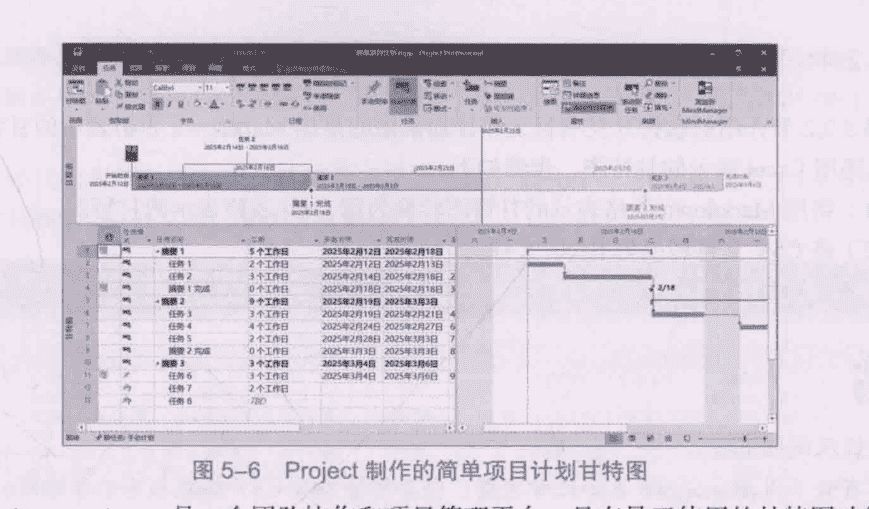

图 5-6 Project 制作的简单项目计划甘特图

（2）Asana：团队协作与项目管理平台，甘特图操作友好，同时支持任务指派、工时统计、依赖设定、进度汇报与看板视图。

（3）Trello：轻量级协作工具，提供基础甘特图能力，支持清单、标签、批注、附件、截止日期等，并能按时间轴归类。

（4）Smartsheet：云端企业协作平台，界面类似 Excel，具备甘特图、排程、任务分派、资源管理与自定义报表等能力。

（5）TeamGantt：专注在线甘特图的工具，便于制定与共享计划，支持任务指派、工时记录、进度汇报、评论与文件共享。

（6）Excel：也能手工搭建甘特图。图 5-7 为 Excel 制作的甘特图。但 Excel 缺少自动依赖计算与进度追踪，在复杂项目面前专业工具更具优势。

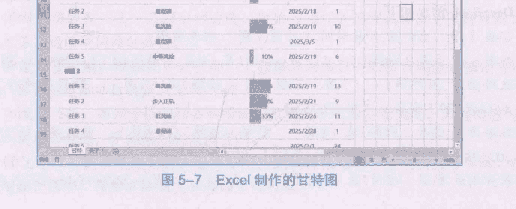

图 5-7 Excel 制作的甘特图

## 5.2.4 案例 9：使用 DeepSeek 制作 Excel 甘特图

5.2.2 节的项目计划以 Markdown 表格呈现，若需要 Excel 形式的甘特图，可按以下两步操作。

1. 将 Markdown 表格转成 CSV 表格。
2. 把 CSV 导入 Excel。

实现过程如下。


提示词如下：

有如下用 Markdown 表示的甘特图，将其转换为用 CSV 格式表示的甘特图。

| 任务名称 | 人力配置 | 开始时间 | 工作量（周） | 结束时间 |
| --- | --- | --- | --- | --- |
| 需求分析 | 资深分析师 1 名（4 周），助理 1 名（4 周） | 2025-01-01 | 4 | 2025-01-28 |
| 软件设计 | 架构师 1 名（3 周），数据库设计师 1 名（2 周），软件设计师 2 名（3 周） | 2025-01-29 | 3（取最长工时） | 2025-02-18 |
| 编码开发 | 后端工程师 3 名（8 周），前端工程师 2 名（6 周），数据库工程师 1 名（4 周） | 2025-02-19 | 8（取最长工时） | 2025-04-15 |
| 软件测试 | 测试工程师 2 名（4 周），测试主管 1 名（4 周） | 2025-04-16 | 4 | 2025-05-13 |
| 上线部署 | 运维工程师 1 名（2 周），技术支持 1 名（2 周） | 2025-05-14 | 2 | 2025-05-27 |
| 培训支持 | 培训讲师 1 名（3 周），技术支持 2 名（长期） | 2025-05-28 | 3 | 2025-06-17 |

DeepSeek 生成结果为：

```
任务名称,人力配置,开始时间,工作量（周）,结束时间
需求分析,资深分析师1名（4周），助理1名（4周）,2025-01-01,4,2025-01-28
软件设计,架构师1名（3周），数据库设计师1名（2周），软件设计师2名（3周）,2025-01-29,3(取最长工时),2025-02-18
编码开发,后端工程师3名（8周），前端工程师2名（6周），数据库工程师1名（4周）,2025-02-19,8(取最长工时),2025-04-15
软件测试,测试工程师2名（4周），测试主管1名（4周）,2025-04-16,4,2025-05-13
上线部署,运维工程师1名（2周），技术支持1名（2周）,2025-05-14,2,2025-05-27
培训支持,培训讲师1名（3周），技术支持2名（长期）,2025-05-28,3,2025-06-17
```

将上述代码复制并保存为“软件开发项目工作计划.csv”，然后根据第 3.1.4 节内容将 CSV 文件转换为 Excel 文件，如图 5-8 所示。

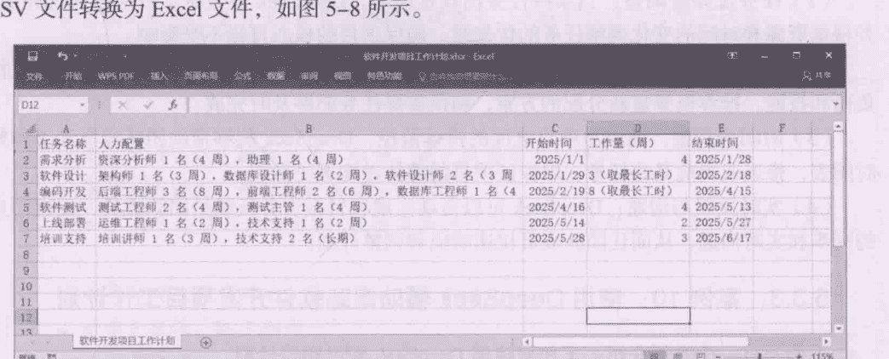

## 5.3 进行计划跟踪与优化，及时调整工作方向

制定计划只是起点，执行与跟踪才是关键。通过智能化手段实时捕捉偏差并快速调整，才能保证项目按目标推进。DeepSeek 在跟踪与优化环节可提供数据分析与前瞻预测，助力团队精准校准方向。

### 5.3.1 DeepSeek 驱动的计划跟踪

融合多源数据与智能预测，DeepSeek 可帮助项目经理实时掌握进展并给出优化思路，主要体现在：

（1）实时数据监控：追踪各项任务完成度、实际耗时与计划偏差，确保推进节奏可控。
（2）智能预警机制：基于进度与历史数据预测潜在风险，如延期或资源不足，并提前发出提醒。
（3）多维度分析：剖析各阶段完成情况、资源占用、人员表现等，评估计划合理性，定位瓶颈。
（4）优化建议：据数据提出任务再分配、时间优化、资源增补等建议，提升效率。

### 5.3.2 计划的优化与调整

项目运行中实际往往偏离原定方案，需要动态优化。DeepSeek 的支持方式包括：

（1）任务优先级调整：任务延误时，自动分析整体优先级，按资源与时间变化重新排序，保障核心目标。
（2）资源重新分配：对滞后任务，结合成员负载与技能推荐调配方案，确保重点工作按时交付。
（3）时间表调整：持续监控进度后动态推迟或提前任务，保持整体节奏。
（4）实时反馈与沟通：自动生成项目报告并分发，促进信息同步与快速响应。

### 5.3.3 案例 10：使用 DeepSeek 辅助跟踪软件开发项目工作计划

#### 案例背景

项目执行中发现软件设计阶段滞后约 1 周，后端开发负载偏重，可能拖累整体。团队引入 DeepSeek 开展智能分析，并据此开会讨论调整方案。


提示词如下：

原定的项目计划如下，当前软件设计阶段进度滞后，影响后续编码开发，帮我评估影响并调整优先级。

任务名称,人力配置,开始时间,工作量（周）,结束时间

需求分析,资深分析师 1 名（4 周），助理 1 名（4 周）,2025-01-01,4,2025-01-28

软件设计,架构师 1 名（3 周），数据库设计师 1 名（2 周），软件设计师 2 名（3 周）,2025-01-29,3,2025-02-18

编码开发,后端工程师 3 名（8 周），前端工程师 2 名（6 周），数据库工程师 1 名（4 周）,2025-02-19,8,2025-04-15

软件测试,测试工程师 2 名（4 周），测试主管 1 名（4 周）,2025-04-16,4,2025-05-13

上线部署,运维工程师 1 名（2 周），技术支持 1 名（2 周）,2025-05-14,2,2025-05-27

培训支持,培训讲师 1 名（3 周），技术支持 2 名（长期）,2025-05-28,3,2025-06-17

DeepSeek 生成结果为：

影响评估：若设计阶段延误 1 ~ 2 周，编码开发相应推迟，最终可能影响测试、
## 第 5 章 智能重塑计划管理：任务清单、工作计划制订与跟踪的全方位变革

上线部署，导致整个项目进度滞后 1 ～ 2 周。

为了控制影响，确保项目整体进度，我们可以采取以下优先级调整方案：

1. 并行推进部分编码任务（减少等待时间）
   - 让数据库工程师于 2 月 12 日提前进行数据库结构优化，减少编码开发压力。
   - 让前端工程师于 2 月 12 日开始搭建前端框架，不依赖软件设计完全结束。
2. 提高核心模块设计优先级（缩短软件设计阶段）
   - 让架构师和软件设计师聚焦核心业务逻辑设计，先完成后端关键模块，优先提供给后端开发。
   - 让数据库设计师支持数据库工程师，避免数据库成为瓶颈。
3. 调整人力资源，缩短设计时间
   - 增加 1 名软件设计师（短期），提高软件设计效率，争取 2 月 14 日结束（原定 2 月 18 日）。
   - 让架构师投入额外时间，加速技术方案的确定。
4. 时间表微调，减少影响
   - 若设计仍然滞后，则后端开发优先启动，前端任务稍微延后（避免所有任务同步推迟）。
   - 测试阶段提前进行单元测试，减少后期整体测试压力。

这种交互式的对话形式，清晰而详尽地呈现了利用 DeepSeek 辅助进行计划跟踪管理的全过程。这让工作变得高度透明与可控，我们可以轻松掌握存在的问题并及时修正，最终高效地完成工作任务。

## 5.3.4 案例 11：使用鱼骨图分析项目延迟的原因

项目走到中后期，进度出现偏差几乎是常态。对负责把控的人来说，重点不在于追究责任，而在于快速厘清滞后背后的真实诱因，给出可落地的优化路径，保持整体节奏的平稳。

把鱼骨图与 AI 助手配合，可以搭建一套透明的根因追溯框架。下面以一次实操为例说明思路。

> 情境说明
> 某软件研发已进入设计环节，设计节奏明显慢于原定计划，进而影响到后续编码。负责人李华希望在短时间内找到症结。经过初步调研，他决定引入 DeepSeek 参与诊断，并借助鱼骨图把问题本质梳理清楚，以便制定有针对性的对策。


输入指令：
进行项目延迟原因分析，返回 Markdown 代码。

架构师任务过载，导致设计进度滞后。
需求频繁调整，造成设计的返工。
团队沟通不畅，尤其是前后端协作效率低，造成重复工作。

模型返回的内容：

## 项目延迟原因分析

1. 架构师任务过载
   - 导致设计进度滞后。
   - 解决：合理分配任务，增加架构师或团队成员。

2. 需求频繁调整
   - 造成设计返工。
   - 解决：确保需求明确并冻结，减少后期变动。

3. 团队沟通不畅
   - 前后端协作效率低，造成重复工作。
   - 解决：加强沟通与协作，定期同步进度。

参考第 3.3 节将上述 Markdown 代码生成鱼骨图，如图 5-9 所示。


章节回顾

本章围绕 DeepSeek 对计划管理的赋能展开。先拆解了手工清单的局限，掌握了借助 DeepSeek 生成任务清单的方法，并通过案例演练学会了编制下周计划任务清单。随后介绍了如何利用 DeepSeek 制定工作计划，包括软件开发类项目的工作计划，并认识了甘特图的使用方式。最后聚焦计划的跟踪、优化与调整，并结合实际案例展示其落地效果，有助于提升计划管理的智能化水平，推动工作高效进行。

第六章 Word 高效创作技巧

在日常办公中，Word 文件使用频率很高，无论是撰写报告、方案，还是记录会议纪要，都离不开它。很多人仅停留在文字输入和简单排版，未能充分发挥其功能，导致创作效率不高、质量一般。

掌握一些高效技巧，能让 Word 处理事半功倍。本章将从内容生成到格式排版，全方位介绍借助 DeepSeek 实现 Word 文件高效创作的方法。

### 6.1 借助 AI 助手制作 Word 文件

Word 在现代办公中应用广泛，利用 DeepSeek 辅助制作 Word 文件在实践中价值较大。

#### 6.1.1 DeepSeek 在 Word 文件创建中的应用

目前主流的 DeepSeek 尚不能直接输出 Word 这种二进制格式，如何借助它完成 Word 文件的生成？可按以下流程操作。

1. 先由 DeepSeek 产出 Markdown 源文件。
2. 再通过转换工具把 Markdown 源文件转为 Word 文件。

#### 6.1.2 案例 12：撰写商业计划书

下面通过一个具体案例介绍如何借助 DeepSeek 生成 Word 文件。

> 情境说明
> 一家创业公司准备撰写商业计划书以寻求投资，团队需要在很短时间内完成一份高质量的 Word 文件。

步骤 1：使用 DeepSeek 生成 Markdown 文本。


输入指令：
请帮我生成商业计划书框架并返回 Markdown 文档。

模型返回的内容：

```
# 商业计划书
## 1. 执行摘要
- **项目概述**：简要描述项目背景、目标及实施方案。
- **市场机会**：阐明市场需求与机会，目标市场及潜在用户群体。
- **产品/服务介绍**：简要说明你的产品或服务，突出其独特性和创新性。
- **财务预测**：对预期收入、成本、利润等方面进行初步的财务预测。
- **融资需求**：若计划融资，描述所需资金、用途及投资回报。
## 2. 公司概况
- **公司背景**：公司成立背景、行业定位及主要业务。
- **使命与愿景**：公司的长期发展目标和使命。
- **管理团队**：核心管理团队成员的背景、经验和职责。
- **法律结构**：公司注册的法律形式（如有限责任公司、股份有限公司等）。
## 3. 产品与服务
- **产品/服务描述**：详细介绍你的产品或服务，解决了哪些痛点，具有什么竞争优势。
- **技术或创新**：如果有技术背景，阐述技术实现的核心与独特之处。
- **定价策略**：产品或服务的定价方案，定价依据及市场反应。
- **产品生命周期**：产品或服务的开发阶段、市场推广计划及未来迭代。
## 4. 市场分析
- **市场概况**：行业整体发展趋势，市场规模，细分市场等。
- **目标市场**：明确你的目标客户群体，包括年龄、性别、地域、职业等。
- **竞争分析**：行业内主要竞争者，他们的优势和劣势，以及你的竞争策略。
- **市场需求与趋势**：通过市场调研分析市场需求、趋势和潜在机会。
- **SWOT 分析**：分析公司的优势、劣势、机会与威胁。
## 5. 营销与销售策略
- **营销策略**：如何通过品牌建设、广告、公关等手段提升市场认知度。
- **销售渠道**：通过哪些渠道销售产品（如线上、线下、直销、代理等）。
- **客户获取与保留**：客户的获取策略与维护策略，包括社交媒体营销、忠诚度计划等。
- **定价策略与促销**：产品定价逻辑以及如何通过促销吸引客户。
## 6. 运营计划
- **运营流程**：从生产到销售的具体流程及运作方式。
- **供应链管理**：产品的原材料采购、生产及物流等流程。
- **合作伙伴与供应商**：核心供应商和合作伙伴的介绍及合作模式。
- **质量控制**：如何确保产品质量及服务标准。
## 7. 财务计划
- **收入预测**：未来 3 ~ 5 年的收入预期。
- **成本分析**：主要成本构成及成本控制策略。
- **现金流分析**：现金流的管理计划，确保企业在运营中的流动性。
- **融资需求**：如果需要外部融资，明确资金需求和回报预期。
## 8. 风险管理
- **市场风险**：潜在的市场变化及应对策略。
- **技术风险**：技术实现、维护及更新中可能面临的风险。
- **财务风险**：如融资困难、现金流问题等。
- **法律与合规风险**：行业内相关法律法规的风险以及合规管理策略。
- **应急预案**：应对突发情况的预案。
## 9. 退出策略
- **投资回报**：投资者如何获得回报，包括分红、资本增值等。
- **退出方式**：如通过 IPO、并购、收购等方式退出。
## 10. 附录
- **团队成员简介**：提供核心团队成员的详细背景。
- **市场调研数据**：包括调研报告、统计数据等支持材料。
- **财务报表**：提供详细的财务预测和报表。
- **其他**：任何相关的附加信息。
```

把上述 Markdown 源码复制并保存为“商业计划书.md”，然后使用预览工具查看，如图 6-1 所示。

步骤 2：将 Markdown 文本转换为 Word 文件。

参考第 2.2.4 节将 Markdown 文本转换为 Word 文件，转换成功的 Word 文件如图 6-2 所示。

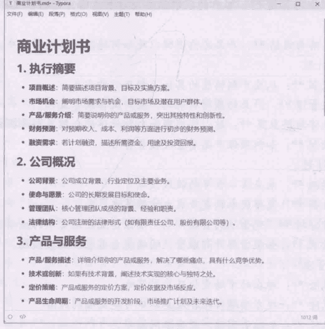

图 6-1 Markdown 工具预览文档（部分内容）

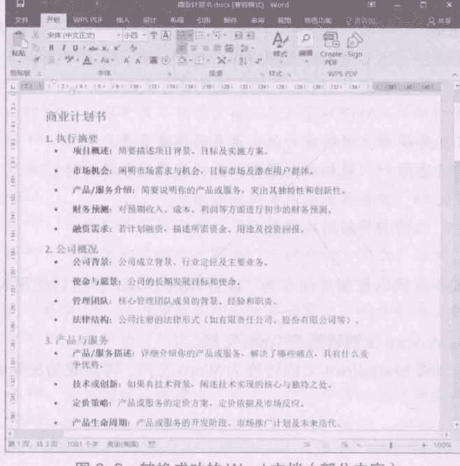

图 6-2 转换成功的 Word 文件（部分内容）

### 6.2 借助 DeepSeek 制作 VBA 脚本

在使用 DeepSeek 生成 Word 文件时，可通过 VBA 自动化处理一些常见重复工作。

#### 6.2.1 VBA 简介

VBA 是 Microsoft Office 等办公软件的内置编程语言，允许使用者定制和扩展 Office 应用。VBA 的主要功能包括：

1. 作为 Office 套件如 Excel、Word、Access 等的编程语言，可自动完成许多任务，创建自定义功能等。
2. 基于 Visual Basic，语法面向对象，上手相对容易。
3. 可对 Office 应用进行深度定制，如创建宏代码、样式更改、创建自定义表单等。
4. 可直接嵌入 Office 文件，便于分享传播。
5. 无需独立开发环境，直接在 Office 应用中开发，方便调试和维护。

如何打开 VBA 编辑器？不同 Office 版本入口略有差异，以 Office 2016 为例。

打开 Word 2016，按下 Alt + F11 键，就可以打开 VBA 编辑器了，如图 6-3 所示。开发者也可以在开发工具菜单栏中找到“Visual Basic”按钮，然后单击它打开 VBA 编辑器。如果在 Excel 中无法看到开发工具菜单栏，可按以下步骤启用。


1. 单击“文件”选项卡。
2. 单击“选项”。
3. 在 Excel 选项对话框中，单击“自定义功能区”。
4. 在右侧的“主选项卡”列表中，选中“开发工具”复选框。
5. 单击“确定”按钮，关闭 Excel 选项对话框。

启用后，开发工具菜单栏会出现在 Excel 的顶部菜单栏，可通过它打开 VBA 编辑器。

此外，执行代码还需要插入 VBA 代码模块，插入方法是在图 6-3 所示的 VBA 编辑器界面选择“插入” → “模块”，然后插入代码模块，如图 6-4 所示。


例如，插入以下 VBA 语句，可弹出“世界，您好！”的提示框。

```
Sub SayHello()
    MsgBox "世界，您好！"
End Sub
```

将代码粘贴到右侧代码窗口，如图 6-5 所示，然后按 F5 键执行，执行时会弹出图 6-6 所示的提示框。

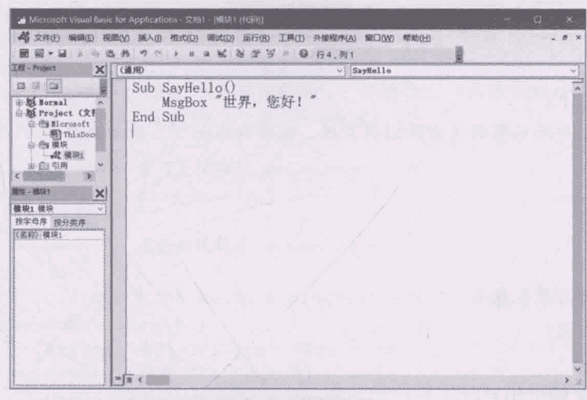

图 6-5 编写代码


图 6-6 弹出提示框

#### 6.2.2 案例 13：使用 DeepSeek 生成 VBA 脚本

本案例演示如何借助 DeepSeek 生成 VBA 脚本，从而自动化完成 Word 文件的生成与格式化任务。通过 DeepSeek 的辅助，可在很大程度上提高文档创作效率，完成内容的快速产出、格式的统一设置等操作。

情境说明

假设我们需要生成一份商业计划书文件，包含以下几个部分：

- 封面
- 目录
- 执行摘要
- 市场分析
- 财务预测
- 结论与建议
- 页眉页脚

输入指令：
我们需要一个完整的商业计划书文档，包括内容如下，请帮我生成 VBA 代码：

- 封面
- 目录
- 执行摘要
- 市场分析
- 财务预测（带表格）
- 结论与建议
- 页眉页脚

模型返回的内容：

```
Sub GenerateBusinessPlanTemplate()
    On Error GoTo ErrorHandler
    Dim doc As Document
    Set doc = Documents.Add
    Application.ScreenUpdating = False

    ' ============ 封面生成 ============
    With doc
        .content.InsertAfter "商业计划书" & vbCrLf
        .Range(.content.End - 1).style = "标题"
        .content.InsertAfter vbCrLf & "公司名称：" & vbCrLf
        .content.InsertAfter "日期：" & Format(Date, "yyyy年mm月dd日")
        .content.InsertAfter vbCrLf & vbCrLf & "机密文件"
        .Paragraphs(1).Range.Font.Color = RGB(31, 73, 125)  ' 深蓝色
        .Sections(1).PageSetup.DifferentFirstPageHeaderFooter = True
    End With

    ' ============ 目录生成 ============
    InsertSectionBreak doc
    doc.content.InsertAfter "目录" & vbCrLf
    doc.Range(doc.content.End - 1).style = "标题 1"
    doc.content.InsertAfter vbCrLf
    doc.TablesOfContents.Add Range:=doc.Range(doc.content.End - 1), _
        UseFields:=False, UseHeadingStyles:=True

    ' ============ 主体内容生成 ============
    CreateSection doc, "执行摘要", "标题 1", "? 公司概述" & vbCrLf & _
        "? 核心优势" & vbCrLf & "? 财务亮点"
    CreateSection doc, "市场分析", "标题 1", _
        "## 市场规模" & vbCrLf & "数据来源: Statista 2023" & vbCrLf & _
        "## 竞争分析" & vbCrLf & "主要竞争对手: ..."
    CreateFinancialSection doc
    CreateSection doc, "结论与建议", "标题 1", "实施步骤: " & vbCrLf & _
        "1. 第一阶段..." & vbCrLf & "2. 第二阶段..."

    ' ============ 页眉页脚设置 ============
    SetHeadersFooters doc

    ' ============ 最终格式优化 ============
    With doc
        .content.Find.Execute FindText:"##", ReplaceWith:"", Replace:=wdReplaceAll
        .Styles("标题 1").Font.Size = 16
        .Styles("标题 2").Font.Size = 14
        .UpdateStylesOnOpen = True
    End With

    Application.ScreenUpdating = True
    MsgBox "商业计划书模板生成完成！"
    Exit Sub

ErrorHandler:
    Application.ScreenUpdating = True
    MsgBox "错误 " & Err.Number & ": " & Err.Description
End Sub

' ============ 自定义函数 ============
Sub InsertSectionBreak(doc As Document)
    doc.Sections.Add.Range.InsertBreak Type:=wdSectionBreakNextPage
End Sub

Sub CreateSection(doc As Document, title As String, style As String, content As String)
    InsertSectionBreak doc
    With doc.content
        .InsertAfter title & vbCrLf
        .Paragraphs(.Paragraphs.Count).Range.style = style
        .InsertAfter content & vbCrLf
    End With
End Sub

Sub CreateFinancialSection(doc As Document)
    InsertSectionBreak doc
    With doc
        .content.InsertAfter "财务预测" & vbCrLf
```

### 6.3 使用 DeepSeek+VBA 实现文件格式批量转换

借助 DeepSeek 生成 VBA 脚本，可实现 Word 文件格式的批量转换：

（1）把早期版本格式的文件转换为当前标准格式的 Word 文件。
（2）把 Word 文件批量转换为 PDF 文件。

#### 6.3.1 案例 14：将早期版本文件格式的 Word 文件批量转换为当前标准格式的 Word 文件

办公中常需把 Word 早期格式 .doc 转为当前标准格式 .docx，主要原因有：

（1）兼容性更好：.docx 与新版 Office 的兼容性更好，.doc 在新版 Office 中打开可能出现格式错乱。
（2）体积更小：.docx 文件的体积通常小于同样内容的 .doc 文件，可节约存储空间，也更便于传输。

（3）可承载更多进阶能力：.docx 能够完整保留 Word 2007 以后加入的高阶特性，例如视频内嵌播放、图片的深度编辑等，而在 .doc 环境下这些特性容易丢失或无法正常呈现。

（4）结构更规范易维护：.docx 采用更透明清晰的封装方式，规范程度更高，技术检修、程序解析与信息提取时都更顺手。

总体来看，把一批 .doc 统一迁移到 .docx，就能一次改善兼容性不佳、包体偏大、可用功能受限等问题，让整体文档库更统一、更先进。

原生 Word 也能手工把 .doc 另存为 .docx，只是无法一次处理多份。借助 VBA 脚本即可实现两种格式间的自动化批量迁移，为工作带来明显便利。

场景说明
假设指定的来源目录里存有多份 .doc 类型文档，目标是把这些文档全部转成 .docx 类型。

用户输入的指令：
请编写 VBA 程序，实现批量迁移。将 .doc 文档转换为 .docx 文档。注意需要使用目录挑选窗口指定来源和导出位置。

模型生成的代码片段：
```vba
Sub ConvertDocToDocx()
    Dim InputFolder As String
    Dim OutputFolder As String
    Dim FileName As String
    Dim WordApp As Object
    Dim Doc As Object

    ' 选择输入文件夹
    With Application.FileDialog(msoFileDialogFolderPicker)
        .Title = "请选择包含.doc文件的文件夹"
        If .Show = -1 Then
            InputFolder = .SelectedItems(1) & ""
        Else
            MsgBox "未选择输入文件夹，操作取消。"
            Exit Sub
        End If
    End With

    ' 选择输出文件夹
    With Application.FileDialog(msoFileDialogFolderPicker)
        .Title = "请选择保存.docx文件的文件夹"
        If .Show = -1 Then
            OutputFolder = .SelectedItems(1) & ""
        Else
            MsgBox "未选择输出文件夹，操作取消。"
            Exit Sub
        End If
    End With

    ' 创建Word应用程序对象
    Set WordApp = CreateObject("Word.Application")
    WordApp.Visible = False

    ' 获取输入文件夹中的第一个.doc文件
    FileName = Dir(InputFolder & "*.doc")
    Do While FileName <> ""
        ' 打开.doc文件
        Set Doc = WordApp.Documents.Open(InputFolder & FileName)
        ' 生成新的.docx文件名
        Dim NewFileName As String
        NewFileName = Left(FileName, InStrRev(FileName, ".") - 1) & ".docx"
        ' 保存为.docx格式
        Doc.SaveAs2 OutputFolder & NewFileName, 16 ' 16 代表 .docx 格式
        ' 关闭文档
        Doc.Close SaveChanges:=False
        ' 获取下一个.doc文件
        FileName = Dir
    Loop

    ' 退出Word应用程序
    WordApp.Quit

    MsgBox "所有.doc文件已成功转换为.docx文件。"
End Sub
```

把上面这段 VBA 程序粘贴到代码模块中，如图 6-8 所示，然后启动 F5。启动后会弹出输入目录和输出目录的选择对话框，如图 6-9 所示。

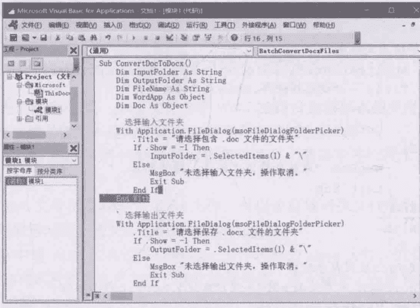

图 6-8 转换为 .doc 文件的 VBA 代码模块（部分内容）

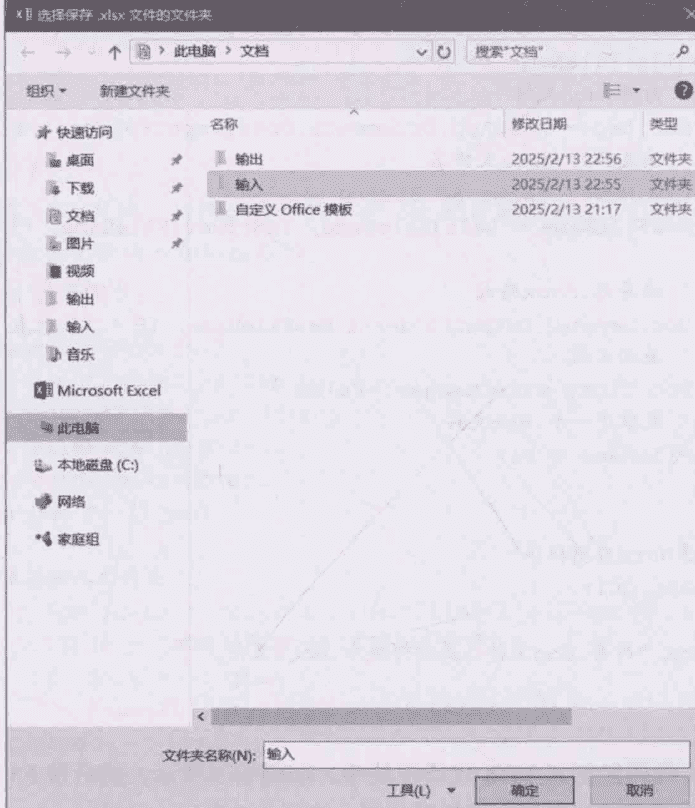

图 6-9 选择文件夹对话框

点击“确定”，程序开始运行，运行结果可见图 6-10 所示的输入目录中的 .doc 文档被转为 .docx 文档，如图 6-11 所示。

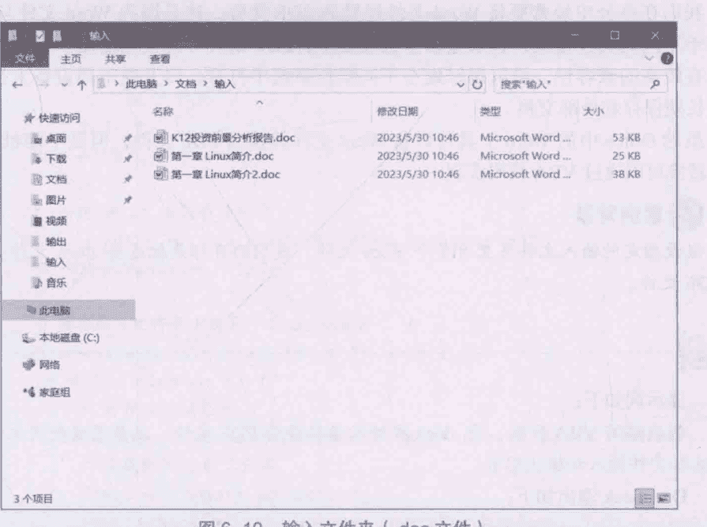

图 6-10 输入文件夹（.doc 文件）

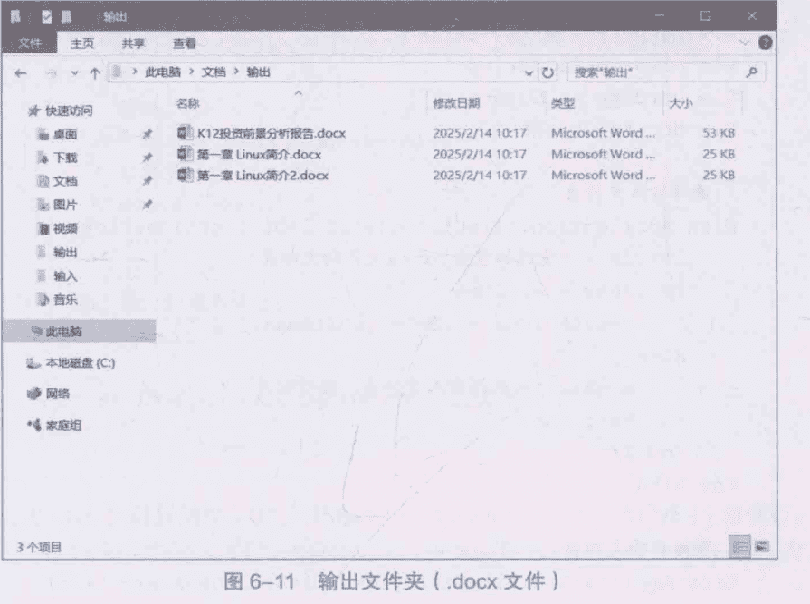

图 6-11 输出文件夹（.docx 文件）

#### 6.3.2 案例 15：将 Word 文件批量转换为 PDF 文件

日常办公中经常需要把 Word 文档转成 PDF。两者属于不同载体，在某些场景或设备上 PDF 更适用。PDF 具备很高的通用性，能在不同操作系统中稳定打开，在不同设备上打印效果可靠，更适合长期归档和对外交换。

虽然 Office 自带的 Word 功能可以将 Word 文档转换为 PDF，但是不能一次处理多份。批量处理可以通过 VBA 脚本实现。

场景说明
假设指定的来源目录里存在多份 .docx 类型文档。目标是把这些文档全部转为 PDF。

用户输入的指令：
请编写 VBA 程序，将 .docx 文档批量转换为 PDF 文件。注意需要使用目录挑选窗口指定来源和导出位置。

模型生成的代码片段：
```vba
Sub ConvertDocxToPdf()
    Dim inputFolder As String
    Dim outputFolder As String
    Dim fileName As String
    Dim wordApp As Object
    Dim doc As Object

    ' 选择输入文件夹
    With Application.FileDialog(msoFileDialogFolderPicker)
        .Title = "请选择包含.docx文件的文件夹"
        If .Show = -1 Then
            inputFolder = .SelectedItems(1) & ""
        Else
            MsgBox "未选择输入文件夹，操作取消。"
            Exit Sub
        End If
    End With

    ' 选择输出文件夹
    With Application.FileDialog(msoFileDialogFolderPicker)
        .Title = "请选择保存.pdf文件的文件夹"
        If .Show = -1 Then
            outputFolder = .SelectedItems(1) & ""
        Else
            MsgBox "未选择输出文件夹，操作取消。"
            Exit Sub
        End If
    End With

    ' 创建 Word 应用程序对象
    Set wordApp = CreateObject("Word.Application")
    wordApp.Visible = False

    ' 获取输入文件夹中的第一个.docx文件
    fileName = Dir(inputFolder & "*.docx")
    Do While fileName <> ""
        ' 打开.docx文件
        Set doc = wordApp.Documents.Open(inputFolder & fileName)
        ' 生成新的.pdf文件名
        Dim newFileName As String
        newFileName = Left(fileName, InStrRev(fileName, ".") - 1) & ".pdf"
        ' 保存为.pdf格式
        doc.ExportAsFixedFormat outputFolder & newFileName, 17 ' 17 代表 PDF 格式
        ' 关闭文档
        doc.Close SaveChanges:=False
        ' 获取下一个.docx文件
        fileName = Dir
    Loop

    ' 退出 Word 应用程序
    wordApp.Quit

    MsgBox "所有.docx文件已成功转换为.pdf文件。"
End Sub
```

把上面这段 VBA 脚本复制到代码模块中，如图 6-12 所示，然后按下 F5 键启动。运行结果可见图 6-13 所示的输入目录中的 .docx 文档被转为 PDF 文件，如图 6-14 所示。

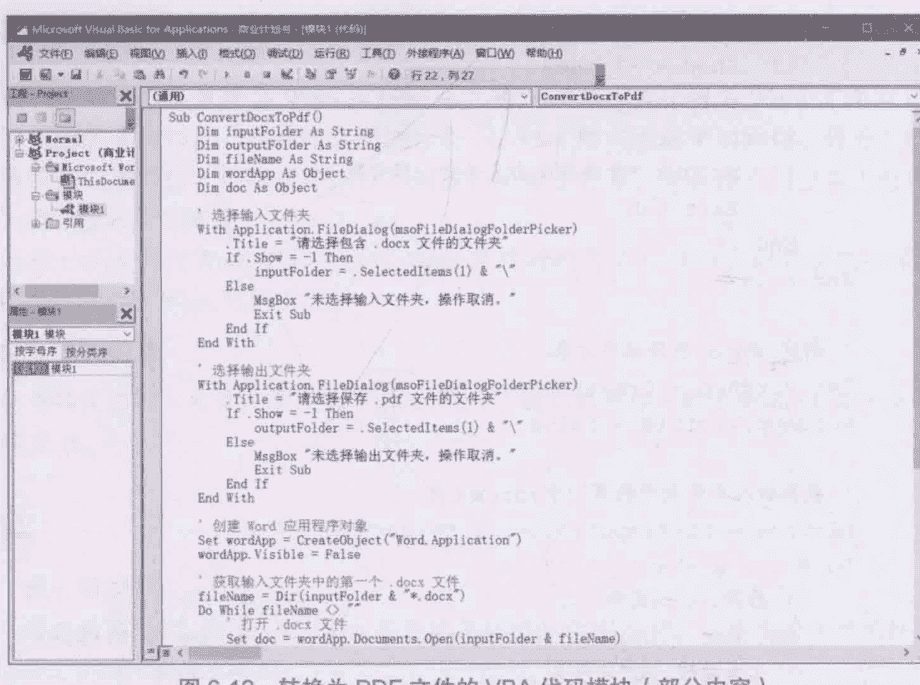

图 6-12 转换为 PDF 文件的 VBA 代码模块（部分内容）

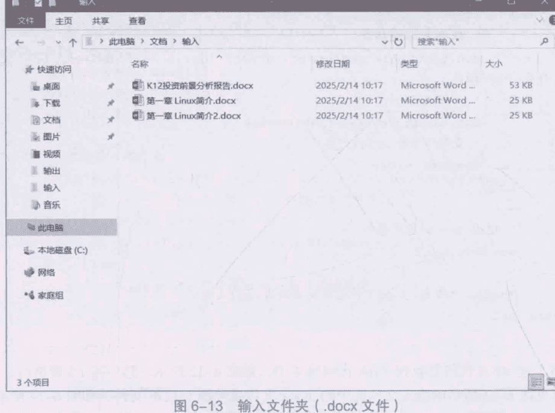

图 6-13 输入文件夹（.docx 文件）

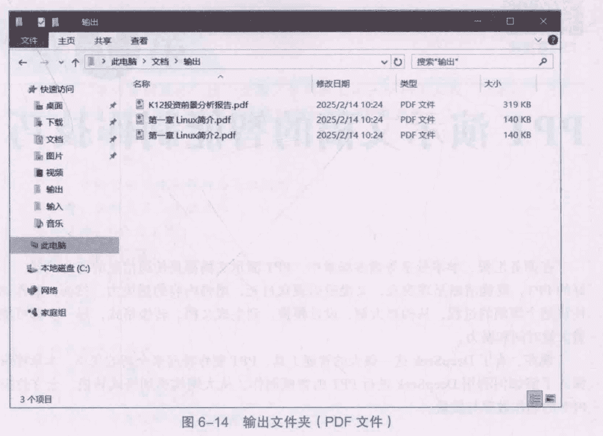

图 6-14 输出文件夹（PDF 文件）

### 6.4 本章总结

本章围绕 DeepSeek 与 VBA 提升 Word 文档处理效率展开。起初探讨了 DeepSeek 在文档创建中的作用，并以商业计划书撰写为例说明其实用性；随后介绍了 VBA，并以生成脚本为例说明自动化处理文档的优势；最后通过两个案例展示了如何借助 DeepSeek 与 VBA 实现格式的批量转换，包含 Word 版本升级和将 Word 文档转为 PDF。这些技巧有助于提高 Word 文档处理的效率。

# 第 7 章 PPT 演示文稿的智能制作技巧

在商务汇报、学术分享等诸多场景中，PPT 演示文稿都是传递信息的有力武器。一份好的 PPT，既能清晰呈现观点，又能吸引观众目光，增强内容的感染力。然而，制作 PPT 往往是个繁琐的过程，从构思大纲、设计模板，到生成文档、转换格式，每一步都可能耗费大量时间和精力。

现在，有了 DeepSeek 这一强大的智能工具，PPT 制作将迎来全新的变革。本章将带你深入了解如何利用 DeepSeek 进行 PPT 的智能制作，从大纲构思到格式转换，全方位提升 PPT 的制作效率与质量。

### 7.1 利用 DeepSeek 构思 PPT 大纲

在制作 PPT 时，构思一个条理清晰、逻辑严密的大纲至关重要。DeepSeek 能够根据主题自动生成合适的 PPT 大纲，并规划每一页的内容和结构。

#### 7.1.1 输入主题，自动生成大纲

输入 PPT 的主题，例如“市场营销策略”或“年度财务报告”，为 DeepSeek 生成大纲提供基础信息。DeepSeek 可以利用自然语言处理技术对输入的主题进行分析，识别核心概念和关键信息，根据常见的 PPT 结构（如封面、引言、主体、结论）自动生成初步的大纲。

#### 7.1.2 案例 16：构思“市场营销策略”PPT 大纲

我们以一个案例介绍一下如何使用 DeepSeek 构思 PPT 大纲。

场景说明
公司计划制作一个关于市场营销策略的 PPT，主题是展示过去一年市场营销活动的成果，并为下一年度的营销策略提供建议。该 PPT 将用于向高层管理团队汇报，内容需要涵盖市场分析、竞争态势、当前策略执行情况以及未来营销优化建议。


提示词如下：

请基于“市场营销策略”这一主题，帮助我生成一个 PPT 大纲，涵盖以下内容：市场分析、竞争态势、当前策略执行情况以及未来营销优化建议。

DeepSeek 返回如下：

幻灯片 1：封面

标题：市场营销策略全解析与未来规划

副标题：洞察当下，决胜未来

公司名称：[公司名称]

日期：[具体日期]

幻灯片 2：目录

- 市场分析

- 竞争态势

- 当前策略执行情况

- 未来营销优化建议

幻灯片 3 ~ 6：市场分析

幻灯片 3：市场规模与增长趋势

- 过去五年市场规模变化折线图

- 未来三年市场规模预测柱状图

- 列举驱动市场增长的主要因素（如经济发展、技术进步等）

幻灯片 4：目标客户群体细分

- 按年龄、性别、消费能力等维度划分的客户群体饼状图

- 阐述各细分群体的消费特征与需求痛点

- 估算针对不同群体的潜在市场规模

幻灯片 5：市场需求与痛点

- 展示采用问卷调查、访谈等方式得出的需求数据

- 深度剖析消费者未被满足的需求

- 预测需求变化趋势（如季节性、周期性变化等）

幻灯片 6：市场趋势与机会

- 解读行业政策对市场的影响

- 列举新兴技术带来的市场机遇

- 分析社会文化潮流对消费行为的引导

幻灯片 7 ~ 9：竞争态势

幻灯片 7：主要竞争对手识别

- 竞争对手名单及简要介绍

- 各竞争对手的市场份额占比条形图

- 竞争对手的核心业务与产品特点对比表格

幻灯片 8：竞争优势与劣势对比

- 本公司与竞争对手在产品质量、价格、服务等方面差别的雷达图

- 优势与劣势的详细文字说明及案例支撑

- 突出展示与竞争对手的差异化竞争点

幻灯片 9：竞争对手的营销策略分析

- 统计竞争对手的广告投放渠道与频率

- 评估促销活动形式与效果

- 分析品牌建设与公关活动案例

幻灯片 10 ~ 12：当前策略执行情况

幻灯片 10：营销策略目标回顾

- 年初设定的营销目标列表（如销售额增长、市场份额提升等）

- 目标设定的依据与背景说明

幻灯片 11：策略执行效果评估

- 展示各项营销活动的实际成果数据（如销售量、客户增长率等）

- 实际成果与目标的对比柱状图

- 解读效果评估的关键指标（如 ROI、客户满意度等）

幻灯片 12：执行过程中的问题与挑战

- 列举遇到的主要问题（如渠道堵塞、推广效果不佳等）

- 深入分析问题产生的原因

- 已采取的应对措施及效果反馈

幻灯片 13 ~ 15：未来营销优化建议

幻灯片 13：优化目标设定

- 确定基于市场分析和竞争态势的未来营销目标

- 论证目标的合理性与可行性

- 目标的分解与阶段性成果预期

幻灯片 14：具体优化策略

- 产品策略优化（如产品升级、产品线拓展等）

- 价格策略调整（如差异化定价、价格促销等）

- 渠道策略改进（如开拓新渠道、优化现有渠道等）

- 促销策略创新（如互动式促销、精准营销等）

幻灯片 15：实施计划与资源需求

- 优化策略的实施时间表甘特图

- 所需的人力、物力、财力资源清单

- 资源分配方案与预算规划

### 7.2 借助 DeepSeek 设计 PPT 模板

在制作 PPT 时，具有设计感的 PPT 模板不仅能提升 PPT 的视觉效果，还能增强信息的传达效果。DeepSeek 可以通过分析内容和主题提供智能化的模板设计方案，帮助用户快速生成合适的 PPT 样式。

#### 7.2.1 与 DeepSeek 沟通模板需求

与 DeepSeek 沟通模板需求体现在如下几个方面。

1. 明确核心需求

在开始设计 PPT 模板之前，需要清晰地明确自己的核心需求，包括 PPT 的主题（市场营销策略、科技成果展示、企业文化宣传等）、使用场景（商务汇报、学术演讲、培训课程等）、受众群体（专业人士、普通大众、学生等）。如果是制作一个向企业高层汇报的市场营销策略 PPT，那么在与 DeepSeek 沟通时，要强调商务性、专业性和数据可视化的需求。

2. 详细描述设计风格

向 DeepSeek 详细描述期望的设计风格，可以提及色彩偏好，如希望使用冷色调营造专业冷静的氛围，或者使用暖色调传递热情活力的感觉；字体风格，是选择简洁现代的无衬线字体，还是选择具有古典韵味的衬线字体；整体布局的偏好，是倾向于简约大气的纯文字风格，还是倾向于丰富多样的图文混排风格。比如，对于一个展示科技成果的 PPT，可以要求 DeepSeek 使用蓝色系的冷色调，搭配简洁的无衬线字体，突出展示图片和数据图表。

3. 提供参考案例

如果有类似风格的 PPT 模板作为参考，可以向 DeepSeek 提供相关信息或图片。这有助于 DeepSeek 更准确地理解你的需求。例如，你可以说“我希望这个模板类似苹果公司产品发布会 PPT 的简洁风格，色彩上以白色和灰色为主，搭配少量蓝色”。

#### 7.2.2 DeepSeek 生成模板设计建议

DeepSeek 生成模板设计建议体现在如下几个方面。

1. 色彩搭配方案

DeepSeek 会根据你提供的需求生成合适的色彩搭配方案。它会考虑色彩心理学原理，如红色通常代表热情、活力和警示，蓝色代表专业、冷静和信任等。对于市场营销策略 PPT 模板，DeepSeek 可能会建议使用橙色和蓝色的搭配，橙色能够吸引注意力，激发兴趣，蓝色则体现专业性和可靠性。同时，DeepSeek 还会给出每种颜色在模板中的具体应用建议，如标题使用橙色，正文使用蓝色，背景使用白色等。

2. 字体选择与排版

在幻灯片精修阶段，DeepSeek 往往会主动给出字形搭配与版面数值的参考思路。选字时会权衡阅读舒适度与整体调性，并附带字号、字重、行高及段间留白等量化信息。

以正式汇报为例，正文常被提示选用清爽的无衬线样式，像 Arial 与雅黑系列，阅读负担低；标题则偏好更具张力的字形，比如 Impact 或方正大黑简体，能带来更强的视觉冲击。版面方面会提醒优化段间空白与行高，使信息层次更分明。

在构架上，系统会依据材料属性与使用目的来安排版式。例如面向市场洞察、竞争格局、策略落实与营销改进的汇报，推荐多栏网格排布，把不同板块分隔开，观感更利落。需要被强调的信息可用放大字号、图标或配图来突出；在市场解读页中，核心数据置于页面中央以图表呈现，柱状与折线图采用不同配色区分指标，重点立刻凸显。

### 7.2.3 案例 17：“医疗领域人工智能创新应用” PPT 模板设计

下面以实操案例说明如何借助 DeepSeek 搭建模板。

背景是医疗行业的人工智能应用范围持续扩大，涵盖智能诊断、个性化治疗与医学影像解析等。为让主题表达更直观专业，可以让系统按主题生成商务风格模板。

提示思路是：以“医疗领域人工智能创新应用”为主题，做一个商务风演示稿，要包含落地场景、核心技术、案例解析、未来走向，风格简洁有科技感，适合专业会议演示，并给出版式、配色与字形建议，保证结构清晰可读。

系统回复如下：

《医疗领域人工智能创新应用》PPT 模板方案

封面页
排布上，标题略偏上居中放大，副标题位于其下方字号稍小，企业名与日期置于右下角，字号最小。
配色：底色选用深蓝 RGB: 0, 32, 96，显得专业沉稳。主标题为白色，副标题用淡蓝 RGB: 135, 206, 250，形成对比与层次。企业名与日期使用浅灰 RGB: 200, 200, 200。
字形建议：主标题建议采用粗黑体加粗，醒目有力；副标题用无衬线简洁体，易读；企业名与日期用宋体。
信息：标题 医疗领域人工智能创新应用，副标题 科技赋能，重塑医疗未来，企业名称 [公司名称]，日期 [具体日期]。

目录页
排布：页面左侧纵向排列目录标题，右侧可配科技线条或小图标，每项前面加圆或方图标，支持跳转。
配色：底色延续封面的科技蓝。目录标题为白色，图标用淡蓝。
字形建议：目录标题用无衬线简洁体加粗。
信息：医疗场景应用、核心技术、案例解析、未来走向。

医疗场景应用
排布：左右分区，左侧文字右侧配图或图表，每种场景独立成页，页首有小标题。
配色：底色用浅科技蓝 RGB: 224, 240, 255，小标题深蓝 RGB: 0, 32, 96，正文深灰 RGB: 50, 50, 50，图片图表边框淡蓝。
字形建议：小标题黑体，正文宋体。
信息：
疾病诊断 小标题 精准洞察，快速诊断。正文：模型通过分析大量医学影像如 X光、CT、MRI，能捕捉早期疾病微小特征，辅助医生更准判断。例如肺癌筛查可识别小于 1 厘米结节并评估恶性概率。图片展示模型分析影像界面。
药物研发 小标题 加速进程，创新突破。正文：算法可模拟分子与靶点作用，预测疗效与副作用，缩短周期降成本。某药企借助技术把抗癌药研发时间从数年压缩到数月。图表对比传统研发与模型辅助的时间成本。
健康管理 小标题 个性化关怀，全程守护。正文：结合可穿戴设备与健康数据，提供个性化管理方案，包括饮食、运动与疾病预警。智能手环可实时监测心率睡眠并给出健康提示。图片展示可穿戴设备及健康管理 App。

核心技术
排布：上下分区，上半部分技术名与简介，下半部分详细说明加图表。
配色：底色为科技蓝渐变由深到浅，技术名称白色，简介淡蓝，说明深灰，图表用不同亮色区分数据。
字形建议：技术名称黑体加粗，简介无衬线简洁体，说明宋体。
信息：
机器学习 简介：让计算机靠数据学习模式规律，无需显式编程。说明：在医疗上可分析电子病历临床数据预测发病风险和治疗效果，如逻辑回归预测心脏病概率。图表展示训练流程。
自然语言处理 简介：让计算机理解处理人类语言。说明：用于电子病历分析、智能问诊等，智能问诊系统可理解症状描述并给出初步建议。图表展示应用流程。
计算机视觉 简介：让计算机像人一样理解图像视频。说明：在医学影像解析中用于肿瘤自动检测分割，通过卷积神经网络 CNN 精准定位病变区域。图表展示工作原理。

案例解析
排布：每页呈现一个案例，图文结合，图上文下。
配色：底色白，案例标题深蓝，说明深灰，图片加淡蓝边框。
字形建议：案例标题黑体，说明宋体。
信息：
案例一 某医院引入智能诊断系统。标题 智能助力，提升诊断效率。说明：三甲医院引入智能诊断系统用于肺部疾病，诊断时间平均缩短 ×%，误诊率降低 ×%。系统通过深度学习学习大量肺部影像，快速识别肺炎、肺结核等。图片展示使用场景。
案例二 某药企利用模型研发新药。标题 模型提速，新药研发新突破。说明：创新药企用模型研发罕见病药物，算法筛选数百万化合物快速锁定潜力分子，研发周期比传统缩短 × 年，临床疗效良好。图片展示实验室与算法界面。

未来走向
排布：列表式，每点前面配圆图标。
配色：底色浅科技蓝，走向标题深蓝，说明深灰，圆图标淡蓝。
字形建议：走向标题黑体，说明宋体。
信息：
多模态数据融合 说明：未来将整合医学影像、基因数据、临床记录等多模态数据，模型综合分析提供更全面精准决策。
远程医疗与模型结合 说明：依托 5G 与物联网，远程医疗设备与模型实时连接，专家可远程诊断治疗，提升资源利用效率。
个性化医疗普及 说明：基于基因信息、生活习惯与健康数据，模型为患者制定个性化治疗方案，改善疗效与生活质量。

总结页
排布：标题居中，总结内容置下，底部放企业 Logo 与联系方式。
配色：底色科技蓝，标题白，总结内容淡蓝，Logo 保持原色，联系方式浅灰。
字形建议：标题黑体加粗，总结内容无衬线简洁体。
信息：标题 总结与展望。总结内容：人工智能在医疗创新应用已有显著成果，技术与案例共同展示其巨大潜力，未来技术持续演进将带来更多变革机遇。企业 Logo [ 公司 Logo ]，联系方式 [ 邮箱、电话等 ]。

致谢页
排布：居中简洁，“感谢聆听”置中。
配色：底色科技蓝，文字白。
字形建议：黑体加粗字号较大。
信息：感谢聆听

### 7.3 使用 DeepSeek 生成 PPT 文档

DeepSeek 目前无法直接导出 PPT 文件，实际操作可分为两步。
1. 先让 DeepSeek 撰写完整的 PPT 文本内容。
2. 再借助 VBA 脚本把内容自动生成为 PPT 文档。

7.3.1 案例 18：借助 DeepSeek 与 VBA 制作“医疗领域人工智能创新应用”PPT
有了文字稿后，可以让 DeepSeek 协助编写 VBA 流程来创建文件。


提示词如下：

根据“医疗领域人工智能创新应用”这一主题，通过 VBA 脚本生成一份商务风格 PPT 的内容，包含以下部分：

人工智能在医疗中的落地场景，如智能诊断、疾病预测、个性化治疗等。

核心技术介绍，包括机器学习、自然语言处理、医学影像解析等。

国内外医疗 AI 应用案例解析。

未来走向，如 AI 与大数据结合、远程医疗与精准医疗等。

请确保内容简洁明了，适合专业会议展示。

DeepSeek 回复如下：

```vba
Sub CreateAIMedicalPPT()
    Dim pptApp As Object
    Dim pptPres As Object
    Dim slide As Object
    Dim slideIndex As Integer

    ' 启动PowerPoint应用
    Set pptApp = CreateObject("PowerPoint.Application")
    pptApp.Visible = True

    ' 创建新PPT
    Set pptPres = pptApp.Presentations.Add

    ' === 1. 封面 ===
    slideIndex = slideIndex + 1
    Set slide = pptPres.Slides.Add(slideIndex, ppLayoutTitle)
    slide.Shapes(1).TextFrame.TextRange.Text = "人工智能在医疗领域的创新应用"
    slide.Shapes(2).TextFrame.TextRange.Text = "AI赋能未来医疗 | 科技商务演示"

    ' === 2. AI在医疗中的应用场景 ===
    slideIndex = slideIndex + 1
    Set slide = pptPres.Slides.Add(slideIndex, ppLayoutText)
    slide.Shapes(1).TextFrame.TextRange.Text = "AI在医疗中的应用场景"
    slide.Shapes(2).TextFrame.TextRange.Text = "• 智能诊断\n• 疾病预测\n• 个性化治疗"

    ' === 3. 关键技术 ===
    slideIndex = slideIndex + 1
    Set slide = pptPres.Slides.Add(slideIndex, ppLayoutText)
    slide.Shapes(1).TextFrame.TextRange.Text = "AI在医疗中的关键技术"
    slide.Shapes(2).TextFrame.TextRange.Text = "• 机器学习\n• 自然语言处理\n• 医学影像分析"

    ' === 4. 案例分析 ===
    slideIndex = slideIndex + 1
    Set slide = pptPres.Slides.Add(slideIndex, ppLayoutText)
    slide.Shapes(1).TextFrame.TextRange.Text = "案例分析"
    slide.Shapes(2).TextFrame.TextRange.Text = "• 某医院AI诊断系统案例\n• 远程医疗应用案例"

    ' === 5. 未来趋势 ===
    slideIndex = slideIndex + 1
    Set slide = pptPres.Slides.Add(slideIndex, ppLayoutText)
    slide.Shapes(1).TextFrame.TextRange.Text = "AI医疗未来趋势"
    slide.Shapes(2).TextFrame.TextRange.Text = "• AI与大数据结合\n• 远程医疗的普及\n• 精准医疗的推动"

    ' === 保存PPT ===
    pptPres.SaveAs "C:\Users\YourUsername\Documents\AIMedical_Presentation.pptx"

    ' 释放对象
    Set slide = Nothing
    Set pptPres = Nothing
    Set pptApp = Nothing
End Sub
```
ppLayoutText 是幻灯片版式。它是 VBA 中定义的常量，样式如图 7-1 所示，即“标题和文本”版式。这是最常用的版式。

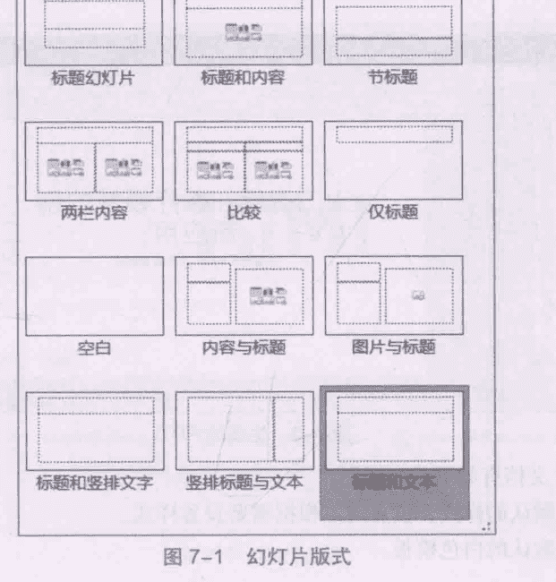
将上述 VBA 代码复制到 VBA 代码模块中，如图 7-2 所示，然后将生成的 PPT 路径（C:\Users\YourUsername\Documents\AIMedical_Presentation.pptx）修改为自定义路径，按 F5 键执行，就会在指定的目录下生成 PPT 文件。打开 PPT，内容如图 7-3 所示。

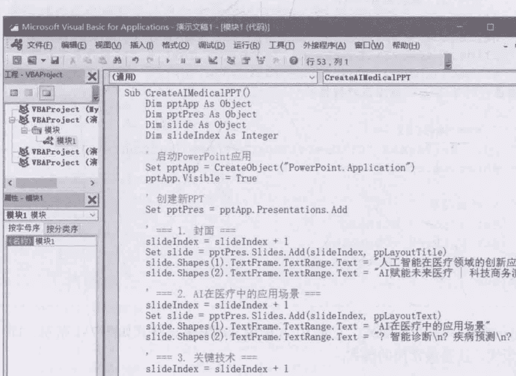
图 7-2 生成 PPT 的 VBA 代码模块（部分内容）


图 7-3 生成的 PPT

生成后的文件存在两个明显问题：样式还是默认样式，可自行调整；模板是默认白色模板。这两个问题可以通过更换模板解决。图 7-4 显示了更换模板后的效果，具体换模板步骤不再展开。


7.3.2 使用 DeepSeek+Kimi 生成 PPT
Kimi 由月之暗面科技有限公司 Moonshot AI 开发，主页如图 7-5 所示，最大特点是长文本处理能力强。


Kimi 提供了 PPT 助手，可用来生成 PPT。点开主页左侧边栏进入 Kimi+，如图 7-6 所示，就能看到 PPT 助手。点击 PPT 助手按钮打开界面。

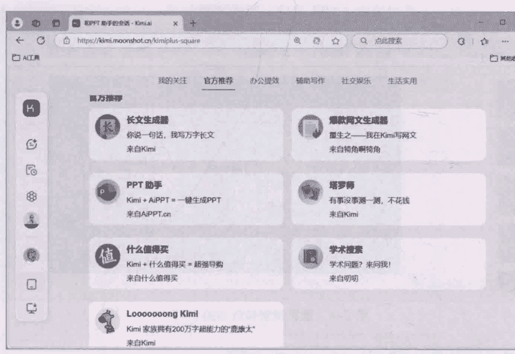
图 7-6 Kimi+


图 7-7 PPT 助手

在该界面里，Kimi 会要求用户提供大纲或简要内容。用户可直接粘贴准备好的大纲，也可让 Kimi 自动生成。如图 7-8 所示，大纲生成后会出现“一键生成 PPT”按钮。

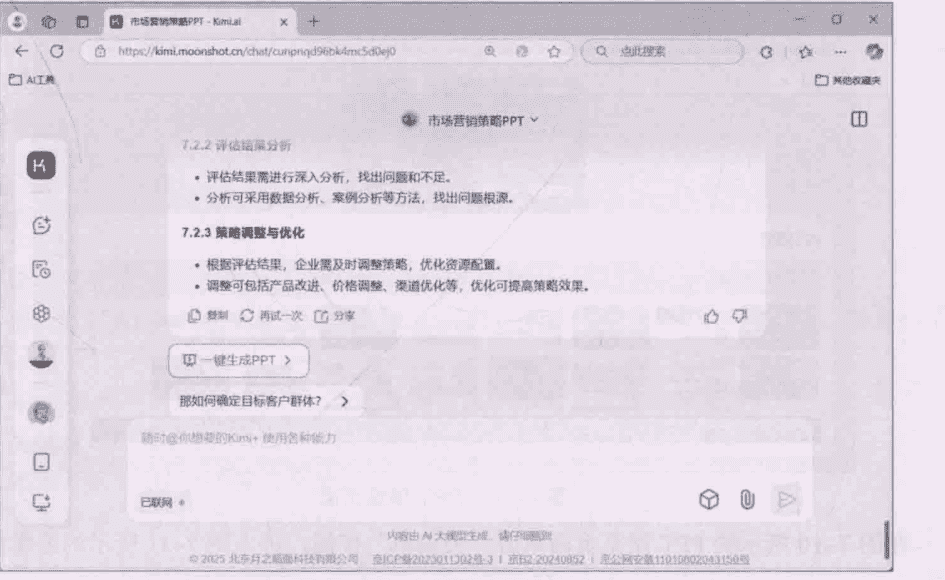
图 7-8 PPT 助手生成 PPT 大纲

点击“一键生成 PPT”，进入模板选择页。选好模板后点生成，进入预览页。

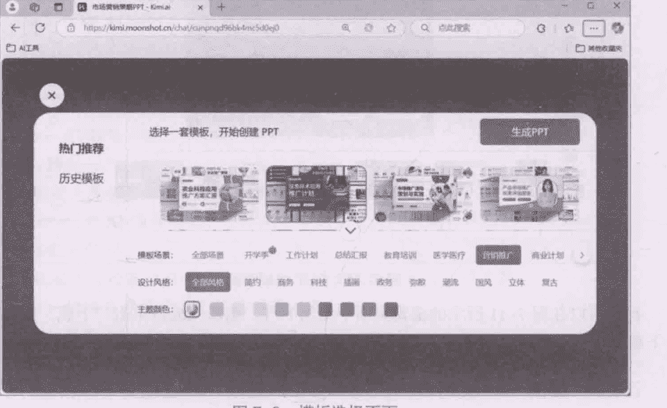
图 7-9 模板选择页面


图 7-10 PPT 预览页面

在预览页点击“去编辑”，进入编辑页。


图 7-11 PPT 编辑页面

编辑完成后点击下载即可导出文件。

7.3.3 案例 19：使用 DeepSeek+Kimi 生成“医疗领域人工智能应用”PPT
依托强大的算法和先进的模型，DeepSeek 能够快速分析输入的主题，在短时间内生成完整且逻辑严密的 PPT 大纲。无论是商业汇报、学术演讲还是产品介绍，DeepSeek 都能迅速搭建起清晰的内容架构。

本章示范了如何借助 DeepSeek 和 Kimi 协作完成一份专业医疗主题演示文稿的全流程，先由 DeepSeek 搭建骨架，再由 Kimi 快速成稿，随后用 DeepSeek 辅助 VBA 实现格式批量处理。

第一步，调用 DeepSeek 完成主题定调与大纲生成。


输入的指令思路是：围绕“AI 在医疗领域的应用”这个核心，请模型输出一份可用于专业会议的 PPT 框架，要求覆盖以下维度：
应用场景，例如智能辅助诊断、疾病风险预测、个体化治疗方案等；
核心技术，例如机器学习、自然语言处理、医学影像解析等；
国内外代表性落地案例；
发展走向，例如 AI 与大数据融合、远程医疗、精准医疗等。
同时强调整体表述要精炼清晰。

模型返回的框架大致如下：

PPT 主题：AI 在医疗领域的应用

1. 开场
主题总览：AI 在医疗体系中的渗透度与发展潜力。
目标说明：探讨 AI 如何重塑服务流程，提升诊疗精准度与疗效。

2. 应用场景
智能诊断：以 AI 解析 CT、MRI 等影像，辅助早期发现疾病，如肿瘤、心血管类疾病的辅助判读。
疾病预测：依托大数据挖掘疾病演进规律，实现早期预警，例如癌症、糖尿病、心血管疾病的风险评估。
个体化治疗：结合基因组、病历、生活环境等多源数据给出定制方案，例如癌症精准治疗、用药个体化。
医疗机器人：AI 驱动的手术辅助机器人与康复机器人提升操作精度与效率，例如达芬奇手术系统、AI 康复训练。

3. 关键技术
机器学习：通过模型训练识别疾病模式，用于诊断与预测等场景，例如深度学习在影像中的应用。
自然语言处理：处理病历、报告等文本，提升医务文书撰写效率，例如智能问诊、病历自动解析。
医学影像分析：自动解读 X 光、CT、MRI，快速定位病变，例如肺癌、乳腺癌筛查。
大数据分析：挖掘海量医疗信息，为精准诊疗提供支撑，例如优化新药研发与疾病预测。

4. 国内外案例
国外：IBM Watson Health 用于癌症诊疗与个体化方案推荐；Google DeepMind 在眼科疾病早期筛查中提升准确率；PathAI 在病理分析中提高癌症诊断可靠性。
国内：百度智能医疗在癌症筛查中的辅助诊断效率提升；腾讯觅影在乳腺癌、肺癌筛查中降低漏诊；阿里健康借助 AI 优化药品采购与供应链管理。

5. 未来趋势
AI 与大数据结合：增强预测能力，推动精准医疗落地，例如基因组数据驱动的个性化方案。
远程医疗：AI 赋能远程诊疗，打破地域限制，改善偏远地区可及性，例如远程诊断与健康监测。
精准医疗：融合基因、环境、行为等多维度信息，实现高度定制化治疗，例如癌症免疫治疗的个体化设计。
普及化进程：技术成熟后医疗 AI 将覆盖更多环节，降低成本并提效。

6. 收尾
影响总结：AI 正系统性改变医疗行业，全面提升诊断、治疗与运营效率。
未来展望：随技术演进，精准医疗与远程医疗将成为 AI 重点发力区。

备注要点：各模块保持简洁，便于现场展示；突出真实应用与技术原理，让听众直观理解 AI 的医疗价值。

第二步，利用 Kimi 的 PPT 助手把大纲转化为成品。

输入的提示大致是：已有上述大纲，请据此生成一份完整的 PPT。
通过该指令与 Kimi 交互后，即可快速得到演示稿，对应图 7-12 所示。


图 7-12 “AI 在医疗领域的应用” PPT

### 7.4 使用 DeepSeek+VBA 实现文件格式批量转换

借助 DeepSeek 生成 VBA 代码，可实现两种常见的批量格式转换：
1. 将早期版 .ppt 转为当前标准版 .pptx。
2. 将 .pptx 批量导出为 PDF。

#### 7.4.1 案例 20：把早期版 PPT 批量转为当前标准格式

日常办公中把 .ppt 换成 .pptx 的必要性体现在：
兼容性更好，.pptx 自 Office 2007 起成为通用标准，跨设备打开更稳定；
文件更小，压缩效率更高，便于传输与归档；
格式更丰富，支持新动画、主题、媒体类型；
安全性更强，加密机制更完善；
可支持宏代码，实现更复杂的交互，而旧格式不支持。

案例前提：输入目录中存放若干 .ppt 文件，目标是全部转为 .pptx。


提示词要点：请编写 VBA 代码，完成 .ppt 到 .pptx 的批量转换，并使用文件选取框指定输入与输出路径。

DeepSeek 给出代码片段后：

```vba
Sub ConvertPPTToPPTX()
    Dim InputFolder As String
    Dim OutputFolder As String
    Dim FileName As String
    Dim PPTApp As Object
    Dim Pres As Object

    ' 选择输入文件夹
    With Application.FileDialog(msoFileDialogFolderPicker)
        .Title = "请选择包含.ppt文件的文件夹"
        If .Show = -1 Then
            InputFolder = .SelectedItems(1) & ""
        Else
            MsgBox "未选择输入文件夹，操作取消。"
            Exit Sub
        End If
    End With

    ' 选择输出文件夹
    With Application.FileDialog(msoFileDialogFolderPicker)
        .Title = "请选择保存.pptx文件的文件夹"
        If .Show = -1 Then
            OutputFolder = .SelectedItems(1) & ""
        Else
            MsgBox "未选择输出文件夹，操作取消。"
            Exit Sub
        End If
    End With

    ' 创建 PowerPoint 应用程序对象
    Set PPTApp = CreateObject("PowerPoint.Application")

    ' 获取输入文件夹中的第一个.ppt文件
    FileName = Dir(InputFolder & "*.ppt")
    Do While FileName <> ""
        ' 打开.ppt文件
        Set Pres = PPTApp.Presentations.Open(InputFolder & FileName)
        ' 生成新的.pptx文件名
        Dim NewFileName As String
        NewFileName = Left(FileName, InStrRev(FileName, ".") - 1) & ".pptx"
        ' 保存为.pptx格式
        Pres.SaveAs OutputFolder & NewFileName, 24 ' 24 代表PPTX格式
        ' 关闭演示文稿
        Pres.Close
        ' 获取下一个.ppt文件
        FileName = Dir
    Loop

    MsgBox "所有.ppt文件已成功转换为.pptx文件。"
End Sub
```

把代码粘贴进 VBA 模块，如图 7-13 所示，按 F5 运行。运行时会弹出输入文件夹与输出文件夹的选择窗口。

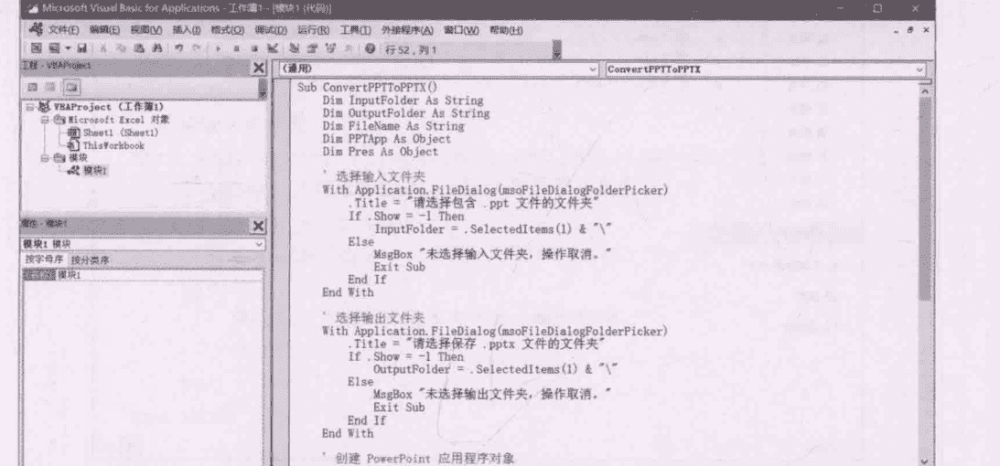

图 7-13 转换为 .pptx 文件的 VBA 代码模块（部分内容）

确认选择后程序开始转换，源文件夹的 .ppt 被批量生成为 .pptx，效果见图 7-14 与图 7-15。

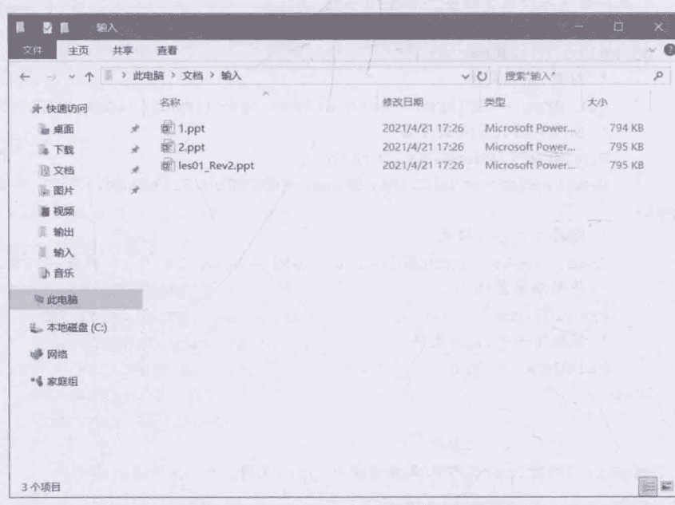

图 7-14 输入文件夹（.ppt 文件）

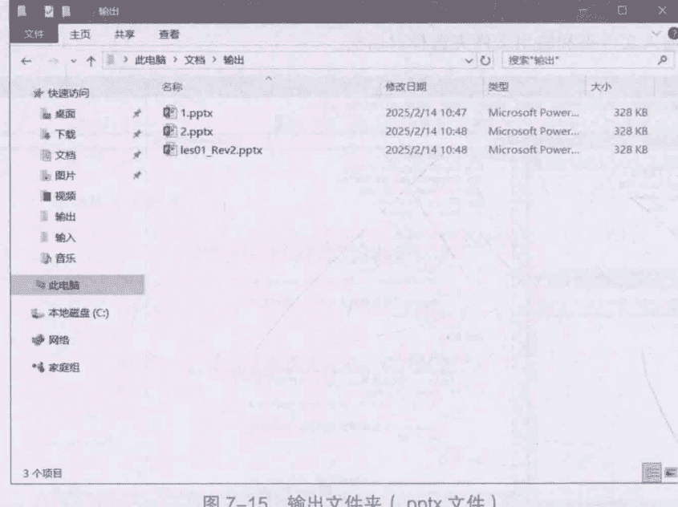

图 7-15 输出文件夹（.pptx 文件）

#### 7.4.2 案例 21：把 PPT 批量转为 PDF

PPT 与 PDF 在使用场景上各有侧重，后者兼容性强、打印效果稳定，更适合长期保存与对外分发。虽然 Office 可手动导出 PDF，但无法批量处理，可通过 VBA 实现自动化。

案例前提：输入目录包含多个 .pptx 文件，目标是全部输出为 PDF。


提示词要点：请编写 VBA 代码，完成 .pptx 到 .pdf 的批量转换，并使用文件选取框指定输入与输出路径。

DeepSeek 返回代码：

```vba
Sub ConvertPPTXToPDF()
    Dim InputFolder As String
    Dim OutputFolder As String
    Dim FileName As String
    Dim PPTApp As Object
    Dim Pres As Object

    ' 选择输入文件夹
    With Application.FileDialog(msoFileDialogFolderPicker)
        .Title = "请选择包含.pptx文件的文件夹"
        If .Show = -1 Then
            InputFolder = .SelectedItems(1) & ""
        Else
            MsgBox "未选择输入文件夹，操作取消。"
            Exit Sub
        End If
    End With

    ' 选择输出文件夹
    With Application.FileDialog(msoFileDialogFolderPicker)
        .Title = "请选择保存.pdf文件的文件夹"
        If .Show = -1 Then
            OutputFolder = .SelectedItems(1) & ""
        Else
            MsgBox "未选择输出文件夹，操作取消。"
            Exit Sub
        End If
    End With

    ' 创建PowerPoint应用程序对象
    Set PPTApp = CreateObject("PowerPoint.Application")

    ' 获取输入文件夹中的第一个.pptx文件
    FileName = Dir(InputFolder & "*.pptx")
    Do While FileName <> ""
        ' 打开.pptx文件
        Set Pres = PPTApp.Presentations.Open(InputFolder & FileName)
        ' 生成新的.pdf文件名
        Dim NewFileName As String
        NewFileName = Left(FileName, InStrRev(FileName, ".") - 1) & ".pdf"
        ' 保存为.pdf格式
        Pres.SaveAs OutputFolder & NewFileName, 32 ' 32 代表 PDF 格式
        ' 关闭演示文稿
        Pres.Close
        ' 获取下一个.pptx文件
        FileName = Dir
    Loop

    MsgBox "所有.pptx文件已成功转换为.pdf文件。"
End Sub
```

将代码导入 VBA 模块，如图 7-16 所示，按 F5 执行，会弹出输入与输出文件夹选择框。确认后执行，源文件被批量生成 PDF，效果见图 7-17 与图 7-18。

## 第 7 章 PPT 演示文稿的智能制作技巧

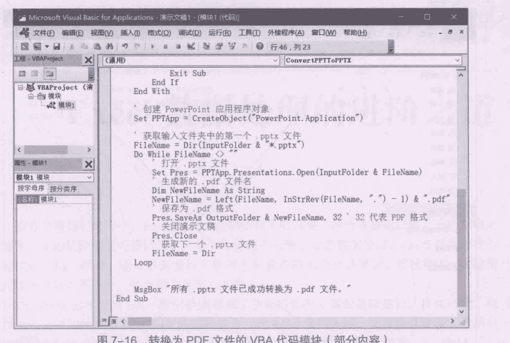

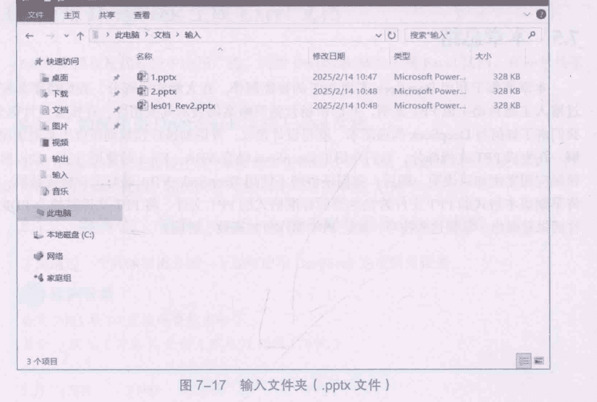

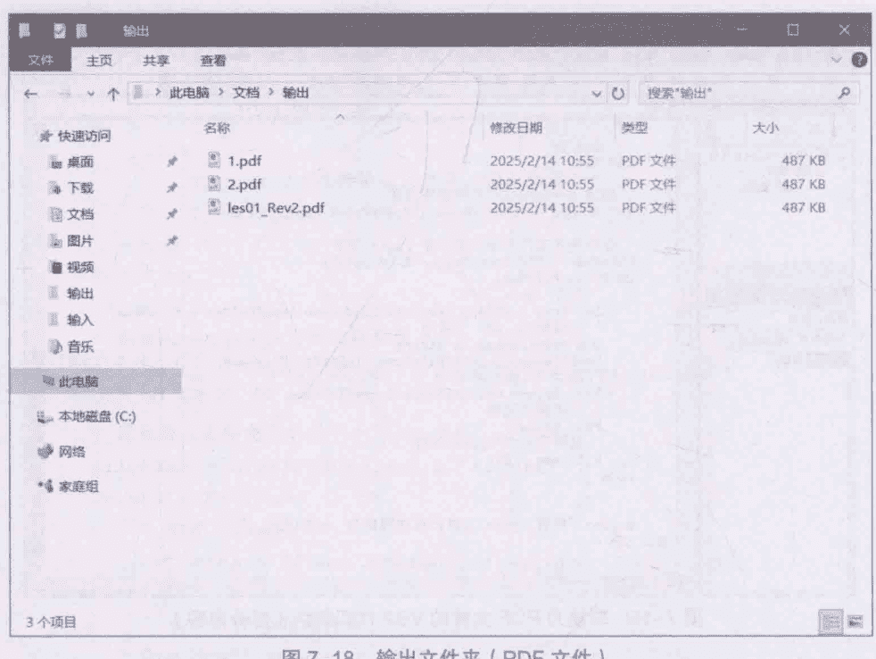

### 7.5 本章总结

本章围绕 DeepSeek 助力幻灯片智能化制作展开。先从提纲构建入手，演示如何把一个主题交给 DeepSeek 自动归纳成可用的演讲大纲，并以前期市场营销策略的实操为例说明落地价值。随后进入版式打磨阶段，讲解怎样向 DeepSeek 提出设计诉求并获取可执行的排版建议，同时以医疗行业的创新应用案例帮助理解沟通技巧。接下来是文档成型环节，重点介绍 DeepSeek 配合 VBA、Kimi 完成 PPT 生成的工作流，并同样以医疗场景的案例做说明。最后补充了 DeepSeek+VBA 在格式处理上的能力，比如把老旧版本 PPT 成批转为当前主流格式、把整批 PPT 统一导出为 PDF 等。将这些手段串起来，演示制作的效率和智能程度都会明显提升。

第 8 章 Excel 数据处理的进阶之道

在日常办公的庞大数据里，Excel 就像一艘功能完备的工作舰艇，承担着记录、核算、分析以及呈现的任务。从简单的清单登记到繁复的财务建模、业务汇总，几乎每一块都离不开它。但数据体量增大、需求越来越细时，纯手工操作很容易变成低效且易错的瓶颈。

DeepSeek 的加入为 Excel 带来了新的进阶路径。本章会围绕借助 DeepSeek 在 Excel 文件创建、格式批量处理、数据分析与可视化报表等层面实现升级展开，帮助打开数据处理的下一阶段。

### 8.1 借助 DeepSeek 生成 Excel 文档

Excel 文档的使用频率极高，而用 DeepSeek 来辅助生成，在办公效率上意义很大。

#### 8.1.1 生成 Excel 文档的做法

DeepSeek 本身无法直接输出二进制的 Excel 文件，但可以先产出 CSV 文本，再把 CSV 导入为 Excel，具体转换细节可参考第 3.1.3 节和第 3.1.4 节的做法。

#### 8.1.2 案例 22：用 DeepSeek 生成财务报表 Excel 文档

下面通过一个真实场景说明生成财务报表的流程。

> **案例背景**
>
> 公司 2023 年 10 月份销售数据如下：

| 月份 | 收入（万元） | 支出（万元） | 利润（万元） |

| :--- | :--- | :--- | :--- |

| 1 月 | 500 | 300 | 200 |

| 2 月 | 600 | 350 | 250 |

| 3 月 | 550 | 400 | 150 |

| 4 月 | 700 | 450 | 250 |

| 5 月 | 750 | 500 | 250 |

| 6 月 | 800 | 600 | 200 |

| 7 月 | 650 | 400 | 250 |

| 8 月 | 720 | 460 | 260 |

| 9 月 | 750 | 480 | 270 |

| 10 月 | 800 | 520 | 280 |

| 11 月 | 850 | 530 | 320 |

| 12 月 | 900 | 550 | 350 |


提示词如下：

根据如下数据帮我生成报表，返回CSV数据：

月份 | 收入（万元）| 支出（万元）| 利润（万元）

1月 | 500 | 300 | 200

2月 | 600 | 350 | 250

3月 | 550 | 400 | 150

4月 | 700 | 450 | 250

5月 | 750 | 500 | 250

6月 | 800 | 600 | 200

7月 | 650 | 400 | 250

8月 | 720 | 460 | 260

9月 | 750 | 480 | 270

10月 | 800 | 520 | 280

11月 | 850 | 530 | 320

12月 | 900 | 550 | 350

DeepSeek 返回的结果：

```
月份,收入（万元）,支出（万元）,利润（万元）
1月,500,300,200
2月,600,350,250
3月,550,400,150
4月,700,450,250
5月,750,500,250
6月,800,600,200
7月,650,400,250
8月,720,460,260
9月,750,480,270
10月,800,520,280
11月,850,530,320
12月,900,550,350
```

把上面生成的逗号分隔文本拷贝并粘贴保存为“2023 年财务报表.csv”，随后用表格软件打开即可，见图 8-1。

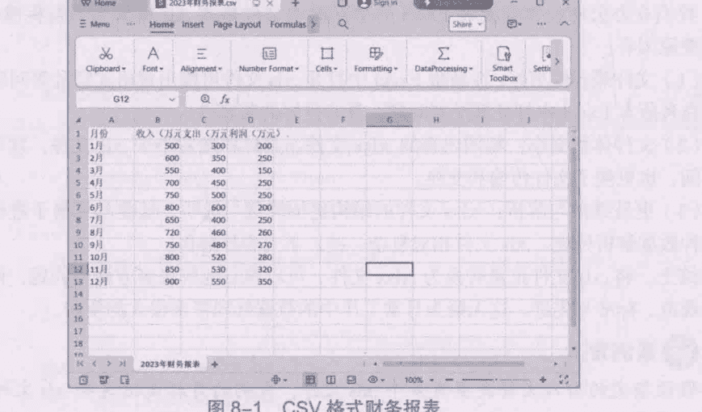

随后把文本导入为表格文档，见图 8-2。

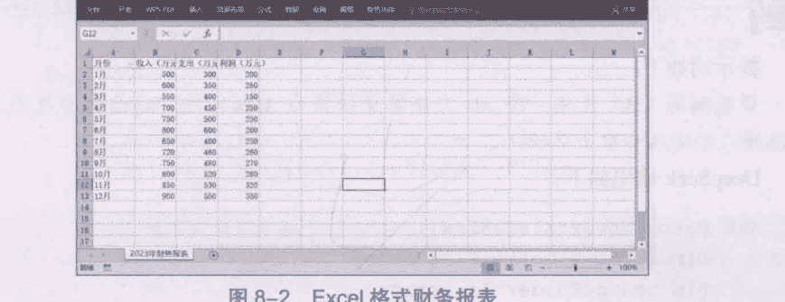

### 8.2 用 DeepSeek+VBA 实现文件的批量转换、合并与拆分

Excel 天生支持 VBA，所以可以让 DeepSeek 帮忙写 VBA 脚本来完成批量化操作：

- 把早期格式的 Excel 文件批量升级为当前标准格式；
- 批量把 CSV 转成 Excel；
- 把多个 Excel 文件合并到一个；
- 把一个 Excel 文件拆分成多个。

#### 8.2.1 案例 23：把早期格式 Excel 批量转为当前标准格式

日常办公中常需要把 .xls 换成 .xlsx，主要原因在于：

- 兼容性更好：新版 Excel 打开 .xls 容易出现排版错位，而 .xlsx 在各版本间打开都很稳定；
- 体积更小：同等内容下 .xlsx 通常更轻便，有利于存储和传输；
- 维护解析更方便：.xlsx 结构规范透明，更利于后续的技术维护和数据解析，而 .xls 结构相对复杂。

因此批量转换可以让文件体系更规范、更现代，也大幅提升数据处理的便利度。

**案例背景**

假设输入目录里存放着一批 .xls 文档，目标是全部转成 .xlsx。

提示词如下：

> 帮我编写 VBA 脚本，将 .xls 文档批量转换为 .xlsx 文档。注意需要使用路径选取窗口选择文件输入和输出目录。

DeepSeek 返回的结果：

```vba
Sub BatchConvertXlsToXlsx()
    Dim FileDialog As FileDialog
    Dim SourceFolder As String
    Dim DestFolder As String
    Dim FileName As String
    Dim wb As Workbook
    Dim File As String
    Dim SourceFile As String
    Dim DestinationFile As String

    ' 选择输入文件夹
    Set FileDialog = Application.FileDialog(msoFileDialogFolderPicker)
    FileDialog.Title = "选择包含.xls文件的文件夹"
    If FileDialog.Show = -1 Then
        SourceFolder = FileDialog.SelectedItems(1) & "\"
    Else
        MsgBox "未选择输入文件夹，操作终止。", vbExclamation
        Exit Sub
    End If

    ' 选择输出文件夹
    Set FileDialog = Application.FileDialog(msoFileDialogFolderPicker)
    FileDialog.Title = "选择保存.xlsx文件的文件夹"
    If FileDialog.Show = -1 Then
        DestFolder = FileDialog.SelectedItems(1) & "\"
    Else
        MsgBox "未选择输出文件夹，操作终止。", vbExclamation
        Exit Sub
    End If

    ' 获取源文件夹下的所有文件
    File = Dir(SourceFolder & "*.*")

    ' 遍历文件并转换
    Do While File <> ""
        ' 仅处理.xls文件（排除 .xlsx）
        If LCase(Right(File, 4)) = ".xls" And LCase(Right(File, 5)) <> ".xlsx" Then
            ' 构造文件路径
            SourceFile = SourceFolder & File
            Set wb = Workbooks.Open(SourceFile)

            ' 生成新的文件名
            DestinationFile = DestFolder & Left(File, Len(File) - 4) & ".xlsx"

            ' 保存为.xlsx格式
            wb.SaveAs DestinationFile, FileFormat:=xlOpenXMLWorkbook

            ' 关闭工作簿
            wb.Close False
        End If

        ' 处理下一个文件
        File = Dir
    Loop

    MsgBox "所有.xls文件已成功转换为.xlsx！", vbInformation
End Sub
```

把上述 VBA 脚本复制到代码模块中，见图 8-3，然后按 F5 键执行。执行时会弹出输入目录和输出目录选择窗口，见图 8-4。

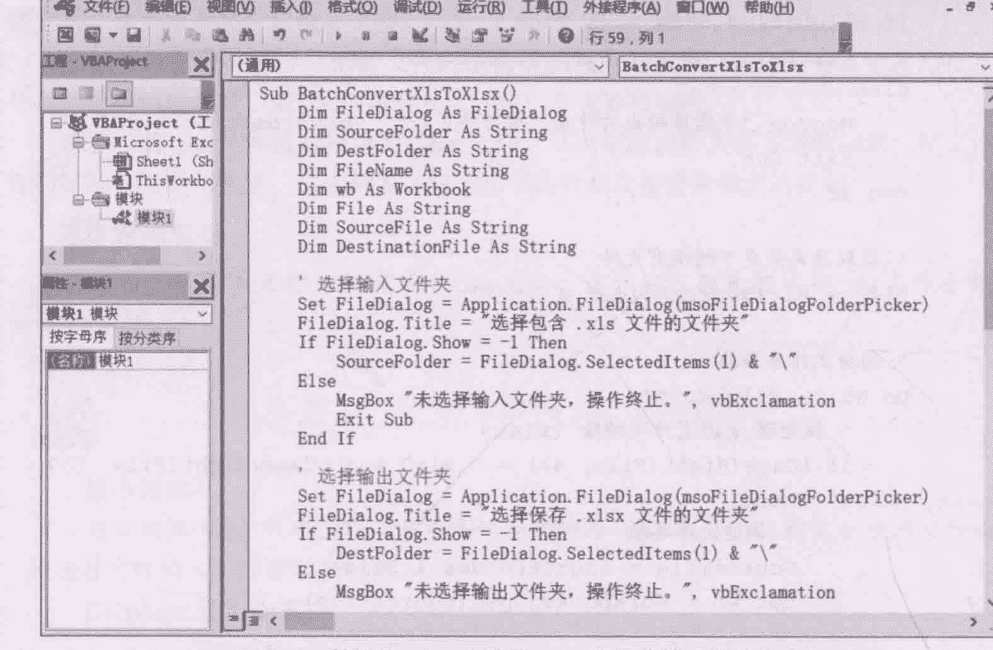

在窗口中点确定后程序开始执行，执行结果可见图 8-5 所示的输入目录中的 .xls 文档被转换为 .xlsx 文档，见图 8-6。

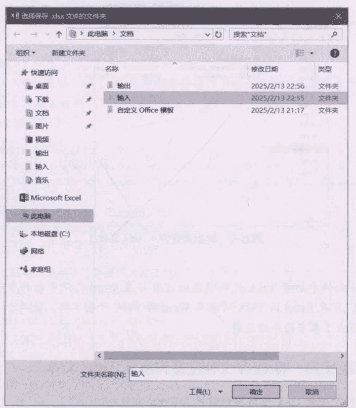

图 8-4 选择目录窗口

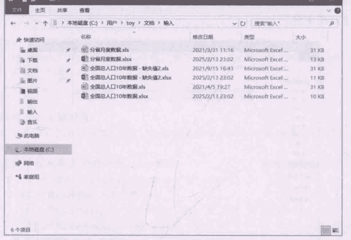

图 8-5 输入目录（.xls 文档）

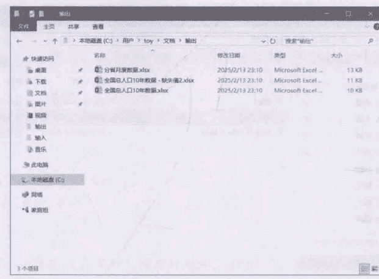

图 8-6 输出目录（.xlsx 文档）

> 在 Excel 文件中打开 VBA 代码模块的过程与在 Word 文件中打开 VBA 代码模块的过程类似，只是 Excel 的 VBA 对象与 Word 的 VBA 对象不同，这属于 VBA 的具体 API 细化，超出了本书的介绍范围。

#### 8.2.2 案例 24：批量把 CSV 转成 Excel 文件

有时手上会有一批 CSV 需要统一转为 Excel。

**案例背景**

见图 8-7，指定的输入目录里有多个 CSV 文档。我们的目标是把这些 CSV 文档全部转换为 Excel 文档。

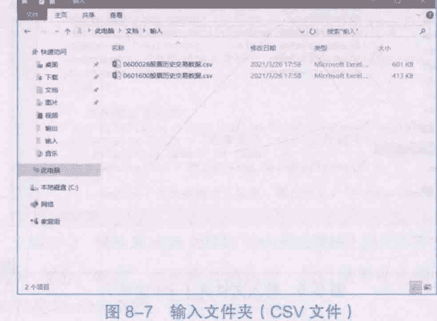

图 8-7 输入目录（CSV 文档）

提示词如下：

帮我编写 VBA 脚本，将 CSV 文档批量转换为 Excel 文档。注意需要使用路径选取窗口选择文件输入和输出目录。

DeepSeek 返回的结果：

```vba
Sub ConvertCSVtoXLSX()
    Dim inputFolder As String, outputFolder As String
    Dim fileName As String, inputFilePath As String, outputFilePath As String
    Dim fileDialog As fileDialog
    Dim wb As Workbook
    Dim fso As Object

    ' 选择输入文件夹（存放 CSV 文件）
    Set fileDialog = Application.fileDialog(msoFileDialogFolderPicker)
    fileDialog.Title = "选择包含.csv文件的文件夹"
    If fileDialog.Show = -1 Then
        inputFolder = fileDialog.SelectedItems(1)
    Else
        MsgBox "未选择输入文件夹，操作取消！", vbExclamation
        Exit Sub
    End If

    ' 选择输出文件夹（存放 XLSX 文件）
    fileDialog.Title = "选择保存.xlsx文件的文件夹"
    If fileDialog.Show = -1 Then
        outputFolder = fileDialog.SelectedItems(1)
    Else
        MsgBox "未选择输出文件夹，操作取消！", vbExclamation
        Exit Sub
    End If

    ' 创建文件系统对象
    Set fso = CreateObject("Scripting.FileSystemObject")

    ' 遍历输入文件夹中的所有.csv文件
    fileName = Dir(inputFolder & "\*.csv")
    Do While fileName <> ""
        inputFilePath = inputFolder & "\" & fileName
        outputFilePath = outputFolder & "\" & Replace(fileName, ".csv", ".xlsx")

        ' 打开CSV文件
        Set wb = Workbooks.Open(inputFilePath)

        ' 将CSV文件另存为XLSX格式
        wb.SaveAs outputFilePath, xlOpenXMLWorkbook ' 51 = xlOpenXMLWorkbook

        ' 关闭当前文件
        wb.Close SaveChanges:=False

        ' 处理下一个文件
        fileName = Dir
    Loop

    ' 释放对象
    Set wb = Nothing
    Set fso = Nothing
    Set fileDialog = Nothing

    MsgBox "批量转换完成！", vbInformation
End Sub
```

把上述 VBA 脚本复制到代码模块中，见图 8-8，然后按 F5 键执行。具体过程不再赘述。

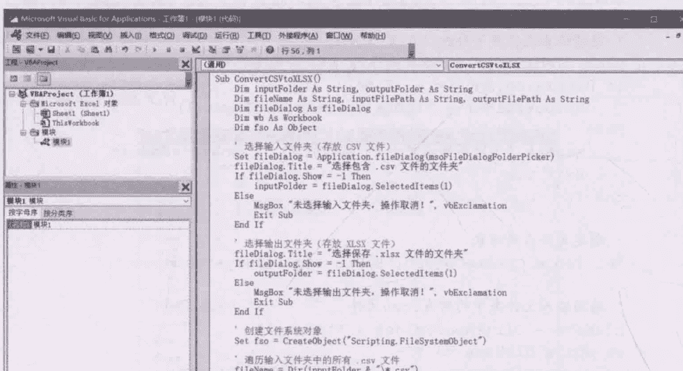

转换完成后的 Excel 文档见图 8-9。

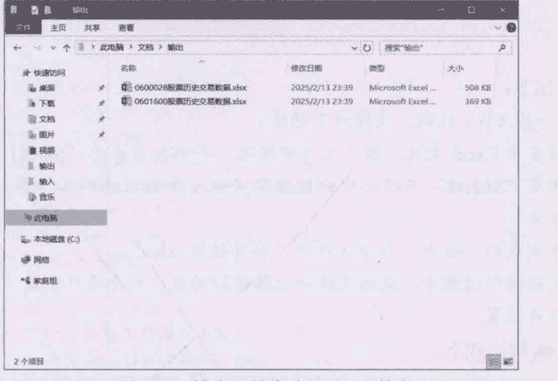

图 8-9 输出目录（Excel 文档）

#### 8.2.3 案例 25：把多个 Excel 文件合并为一个

在需要集中管理分散数据源或做汇总时，把多个 Excel 合并成一个很常见。本节演示如何让 DeepSeek 生成 VBA 脚本，完成合并任务。

**案例背景**

见图 8-10，指定的输入目录中有多个 Excel 文档。我们的目标是将这些 Excel 文档合并，生成一个新 Excel 文档，且将新 Excel 文档里对应明细页的名称设置为源文档的文件名。

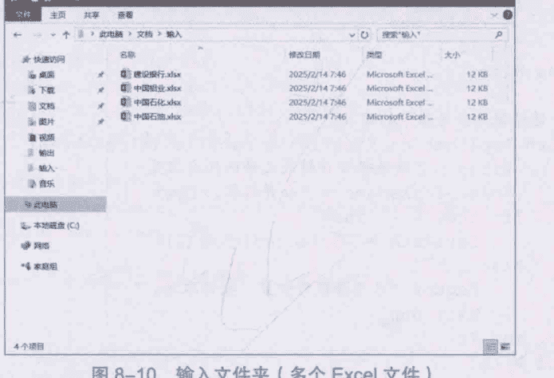

图 8-10 输入目录（多个 Excel 文档）

提示词如下：

请编写一段 VBA 脚本，实现以下功能：

- 遍历多个 Excel 文档，这些文档中的每一个都包含名为 “Sheet1” 的明细页。

- 将所有 “Sheet1” 明细页中的数据合并到一个新创建的活页簿，明细页名为该文件名。

- 合并完成后，将新活页簿保存为 “合并结果.xlsx”。

- 在脚本运行过程中，提供选择输出目录的功能，允许用户指定 “合并结果.xlsx” 的保存位置。

DeepSeek 返回的结果：

```vba
Sub MergeExcelFilesToNamedSheets()
    Dim FolderPath As String
    Dim FileName As String
    Dim SourceWorkbook As Workbook
    Dim SourceSheet As Worksheet
    Dim DestinationWorkbook As Workbook
    Dim DestinationSheet As Worksheet
    Dim SavePath As String

    ' 选择包含要合并文件的文件夹
    With Application.FileDialog(msoFileDialogFolderPicker)
        .Title = "请选择包含Excel文件的文件夹"
        If .Show = -1 Then
            FolderPath = .SelectedItems(1) & "\"
        Else
            MsgBox "未选择文件夹，操作取消。"
            Exit Sub
        End If
    End With

    ' 选择保存合并结果的路径
    With Application.FileDialog(msoFileDialogSaveAs)
        .Title = "请选择合并结果文件的保存位置"
        .InitialFileName = "合并结果.xlsx"
        If .Show = -1 Then
            SavePath = .SelectedItems(1)
        Else
            MsgBox "未选择保存位置，操作取消。"
            Exit Sub
        End If
    End With
```

## 第8章 Excel 数据处理的进阶之道

```vba
' 创建新的工作簿
Set DestinationWorkbook = Workbooks.Add

' 遍历文件夹中的Excel文件
FileName = Dir(FolderPath & "*.xlsx")
Do While FileName <> ""
    ' 打开源工作簿
    Set SourceWorkbook = Workbooks.Open(FolderPath & FileName)
    On Error Resume Next
    Set SourceSheet = SourceWorkbook.Sheets("Sheet1")
    On Error GoTo 0

    If Not SourceSheet Is Nothing Then
        ' 在目标工作簿中添加新工作表
        Set DestinationSheet = DestinationWorkbook.Sheets.Add(After:=DestinationWorkbook.Sheets(DestinationWorkbook.Sheets.Count))
        ' 去除文件名的扩展名，作为工作表名称
        Dim sheetName As String
        sheetName = Left(FileName, InStrRev(FileName, ".") - 1)
        ' 确保工作表名称唯一
        sheetName = GetUniqueSheetName(DestinationWorkbook, sheetName)
        DestinationSheet.Name = sheetName
        ' 复制数据
        SourceSheet.UsedRange.Copy DestinationSheet.Range("A1")
    End If

    ' 关闭源工作簿，不保存更改
    SourceWorkbook.Close SaveChanges:=False
    FileName = Dir
Loop

' 删除新建工作簿的默认工作表
Application.DisplayAlerts = False
DestinationWorkbook.Sheets(1).Delete
Application.DisplayAlerts = True

' 保存合并后的工作簿
DestinationWorkbook.SaveAs FileName:=SavePath
DestinationWorkbook.Close

MsgBox "合并完成，结果已保存到 " & SavePath
End Sub

Function GetUniqueSheetName(ByRef wb As Workbook, ByVal baseName As String) As String
    Dim tempName As String
    Dim counter As Integer
    counter = 1
    tempName = baseName

    Do While SheetExists(wb, tempName)
        tempName = baseName & " (" & counter & ")"
        counter = counter + 1
    Loop

    GetUniqueSheetName = tempName
End Function

Function SheetExists(ByRef wb As Workbook, ByVal sheetName As String) As Boolean
    Dim ws As Worksheet
    On Error Resume Next
    Set ws = wb.Sheets(sheetName)
    On Error GoTo 0
    SheetExists = Not (ws Is Nothing)
End Function

Sub ConvertCSVtoXLSX()
    Dim inputFolder As String, outputFolder As String
    ' ... (代码未完整显示)
End Sub
```

把上文生成的宏脚本粘贴进 VBA 编辑器的模块窗口，位置参照图 8-11，随后按下 F5 键启动。后续操作细节在此省略。


整合完成后，汇总而成的工作簿展示效果见图 8-12。


#### 8.2.4 案例 26：将一个工作簿拆分为多个工作簿

在实际作业中，常有把一份大型文档拆成若干独立文档的需求，往往是因为记录量过大，或希望让每个表格页单独发送或单独处理。本小节将演示借助 DeepSeek 产出宏程序，实现按页拆分工作簿。

### 案例背景

设想手头有一份叫做“股票数据集”的工作簿，示意如图 8-13。里面每支股票的记录各自占用一个表格页。现需编写宏程序，把该工作簿里的每一页分别导出为独立文档，并让新文档的名字与原页的标题保持一致。


输入指令如下：

请给出一段 VBA 宏程序，完成如下目标：

把一份工作簿里所有表格页各自保存为独立文件，文件名采用对应页的标题。

DeepSeek 回复如下：

```vba
Sub SplitWorksheetsToFiles()
    Dim wb As Workbook
    Dim ws As Worksheet
    Dim newWb As Workbook
    Dim savePath As String
    Dim currentPath As String

    ' 获取当前工作簿
    Set wb = ThisWorkbook

    ' 获取当前工作簿所在路径
    currentPath = wb.Path
    If currentPath <> "" Then
        currentPath = currentPath & "\"
    End If

    ' 遍历当前工作簿中的每个工作表
    For Each ws In wb.Sheets
        ' 复制当前工作表到新工作簿
        ws.Copy
        Set newWb = ActiveWorkbook

        ' 生成保存路径和文件名
        savePath = currentPath & ws.Name & ".xlsx"

        ' 保存新工作簿
        newWb.SaveAs Filename:=savePath
        ' 关闭新工作簿
        newWb.Close SaveChanges:=False
    Next ws

    MsgBox "工作表拆分完成，文件已保存到 " & currentPath
End Sub
```

启动“股票数据集”工作簿，把前述宏脚本粘贴到 VBA 编辑器的模块中，参考图 8-14 的位置，随后触发 F5 运行。操作步骤在此不展开。


运行成功后，在原工作簿所在的文件夹里会生成多份拆分后的文档，效果如图 8-15。


### 8.3 数据分析

在日常业务里，数据处理与分析既普遍又耗时，借助 DeepSeek 能有效提升效率并保证结果的可靠性。

#### 8.3.1 借助 DeepSeek 进行数据清洗

信息来源多样，常常需要对数据进行整理提纯。整理提纯的目的是提升整体质量，具体体现在以下几个方面：

- 1. 提升准确度：排查并修正错误值、异常值以及记录冲突，降低噪音与错误，提升整体可信度。
- 2. 填补空缺：依据预设规则对缺失字段进行补全，使数据更完整，为后续分析提供更充分的基础。
- 3. 规范格式：对列名、数据类型、单位等进行标准化，确保符合分析需求，提升处理效率。
- 4. 清理重复：找出并剔除重复记录，只保留唯一条目，简化数据体量，便于管理和后续分析。
- 5. 剔除冗余：识别并移除不需要的列或字段，让数据结构更紧凑。
- 6. 纠正偏差：修正采集环节引入的偏差，使结果更真实地反映客观情况。

DeepSeek 能有力支撑上述各项整理工作。相较于人工操作，它不仅速度更快，还能保证结果保持稳定且可靠。

#### 8.3.2 案例 27：借助 DeepSeek 清洗电商订单数据

下面用一个具体例子说明如何借助 DeepSeek 完成订单数据的整理。

### 案例背景

电商平台会产生海量订单记录，分析前必须先进行整理，以保证质量。经由去重、补全、格式转换等步骤，可使分析结论更可靠且可用。

案例数据如图 8-16 所示。

| 订单编号 | 客户姓名 | 订单日期 | 商品名称 | 商品数量 | 商品单价（元） | 订单金额（元） | 收货地址 | 联系方式 |
| :--- | :--- | :--- | :--- | :--- | :--- | :--- | :--- | :--- |
| ORD001 | 张三 | 2023/08/15 | 苹果手机（128G） | 1 | 5999 | ¥5999 | 广东省深圳市 | 138 |
| ORD002 | 李四 | 2023-08-16 | 小米手环7 | 2 | 299 | 598, | 上海市 | 136xxxxxxx |
| ORD003 | 王五 | 08/17/2023 | 华为笔记本电脑 MateBook 14s | 1 | 7999 | 7999.000 | 北京市海淀区 | 158xxxxxxx |
| ORD001 | 张三 | 2023/08/15 | 苹果手机（128G） | 1 | 5999 | ¥5999 | 广东省深圳市 | 138 |
| ORD004 | 赵六 | 2023.08.18 | 戴尔鼠标（无线） | 1 | 99 | $99 | 江苏省南京市玄武区 | 188xxxxxxx |
| ORD005 | 孙七 | 2023年8月19日 | 无线路由器 TP-Link | 1 | 199 | 199, | 浙江省杭州市 | 139xxxxxxx |

图 8-16 订单数据

该表存在以下异常：

1. 编号重现：ORD001 在表中出现了两行，重复的编号容易引发统计偏差。
2. 金额书写不统一：各行金额采用的货币符号与表达形式各异，如 ORD001 记为“¥5999”，ORD004 记为“$99”，符号不同会导致后续计算出错。
3. 联系方式缺失片段：部分号码仅保留前几位，例如“138”，后续数字缺失，不利于后续联络。
4. 日期写法各异：ORD003 用“08/17/2023”，ORD005 用“2023年8月19日”，后者含中文，易造成解析失败。
5. 金额数值表达异常：ORD002 的金额写成“598,”，疑似分隔符使用错误；ORD003 的金额为“7999.000”，小数位多余。
6. 地址信息缺失：部分订单仅提供省市级别，如 ORD001 与 ORD005，缺少街道门牌等细节，可能影响配送。
7. 商品名称写法不统一：名称中括号、空格使用不规范，如“苹果手机（128G）”与“华为笔记本电脑MateBook 14s”，影响统一处理。

借助 DeepSeek 对上述问题进行整理，具体步骤如下。


提示词如下：

有如下数据，请帮我修复和清洗，返回Markdown表格。

| 订单编号 | 客户姓名 | 订单日期 | 商品名称 | 商品数量 | 商品单价（元） | 订单金额（元） | 收货地址 | 联系方式 |

|----------|----------|----------|----------|----------|----------------|----------------|----------|----------|

| ORD001 | 张三 | 2023/08/15 | 苹果手机（128G） | 1 | 5999 | ¥5999 | 广东省深圳市 | 138 |

| ORD002 | 李四 | 2023-08-16 | 小米手环7 | 2 | 299 | 598, | 上海市 | 136xxxxxxxx |

| ORD003 | 王五 | 08/17/2023 | 华为笔记本电脑MateBook 14s | 1 | 7999 | 7999.000 | 北京市海淀区 | 158xxxxxxxx |

| ORD001 | 张三 | 2023/08/15 | 苹果手机（128G） | 1 | 5999 | ¥5999 | 广东省深圳市 | 138 |

| ORD004 | 赵六 | 2023.08.18 | 戴尔鼠标（无线） | 1 | 99 | $99 | 江苏省南京市玄武区 | 188xxxxxxxx |

| ORD005 | 孙七 | 2023年8月19日 | 无线路由器TP-Link | 1 | 199 | 199. | 浙江省杭州市 | 139xxxxxxxx |

DeepSeek输出如下：

| 订单编号 | 客户姓名 | 订单日期 | 商品名称 | 商品数量 | 商品单价（元） | 订单金额（元） | 收货地址 | 联系方式 |

|----------|----------|----------|----------|----------|----------------|----------------|----------|----------|

| ORD001 | 张三 | 2023-08-15 | 苹果手机（128G） | 1 | 5999 | 5999 | 广东省深圳市 | 138xxxxxxxx |

| ORD002 | 李四 | 2023-08-16 | 小米手环7 | 2 | 299 | 598 | 上海市 | 136xxxxxxxx |

| ORD003 | 王五 | 2023-08-17 | 华为笔记本电脑 MateBook 14s | 1 | 7999 | 7999 | 北京市海淀区 | 158xxxxxxxx |

| ORD004 | 赵六 | 2023-08-18 | 戴尔鼠标（无线） | 1 | 99 | 99 | 江苏省南京市玄武区 | 188xxxxxxxx |

| ORD005 | 孙七 | 2023-08-19 | 无线路由器 TP-Link | 1 | 199 | 199 | 浙江省杭州市 | 139xxxxxxxx |

整理后的订单清单先以 Markdown 文档保存，再通过阅读器预览，呈现效果如图 8-17，可直观感受到 DeepSeek 在数据清理环节的助力。

| 订单编号 | 客户姓名 | 订单日期   | 商品名称                 | 商品数量 | 商品单价（元） | 订单金额（元） | 收货地址         | 联系方式   |
|----------|----------|------------|--------------------------|----------|----------------|----------------|------------------|------------|
| ORD001   | 张三     | 2023-08-15 | 苹果手机（128G）         | 1        | 5999           | 5999           | 广东省深圳市     | 138xxxxxxxx |
| ORD002   | 李四     | 2023-08-16 | 小米手环7                | 2        | 299            | 598            | 上海市           | 136xxxxxxxx |
| ORD003   | 王五     | 2023-08-17 | 华为笔记本电脑 MateBook 14s | 1        | 7999           | 7999           | 北京市海淀区     | 158xxxxxxxx |
| ORD004   | 赵六     | 2023-08-18 | 戴尔鼠标（无线）         | 1        | 99             | 99             | 江苏省南京市玄武区 | 188xxxxxxxx |
| ORD005   | 孙七     | 2023-08-19 | 无线路由器 TP-Link       | 1        | 199            | 199            | 浙江省杭州市     | 139xxxxxxxx |

图 8-17 订单数据（清洗后）

#### 8.3.3 案例 28：利用 DeepSeek 从邮件往来中抽取联系人信息
本案例演示如何让 DeepSeek 读取一批邮件，自动识别寄件、收件、发出时点及电话等要素，完成批量归集。

案例背景
现有一组邮件记录，需抽取以下要素：
- 邮件发出方
- 邮件接收方
- 邮件发出时点
• 邮件正文中出现的电话号码

邮件记录：
邮件 1：
发件人：alice@example.com
收件人：bob@example.com
发送时间：2023/08/12 09:30
内容：请确认项目进展，电话：+86 138 1234 5678
邮件 2：
发件人：charlie@example.com
收件人：alice@example.com
发送时间：2023/08/12 10:00
内容：会议将在下午3点开始，请提前准备，联系电话：139 2345 6789
邮件 3：
发件人：bob@example.com
收件人：alice@example.com, charlie@example.com
发送时间：2023/08/12 11:00
内容：合作细节可以通过电话讨论，联系方式：137 3456 7890

操作步骤：
（1）让 DeepSeek 解析邮件正文，自动产出寄件、收件、时间及号码。
提示词：
从如下文本中提取联系人信息，返回 Markdown 表格。
邮件 1：
发件人：alice@example.com
收件人：bob@example.com
发送时间：2023/08/12 09:30
内容：请确认项目进展，电话：+86 138 1234 5678
邮件 2：
发件人：charlie@example.com
收件人：alice@example.com
发送时间：2023/08/12 10:00
内容：会议将在下午3点开始，请提前准备，联系电话：139 2345 6789
邮件 3：
发件人：bob@example.com
收件人：alice@example.com, charlie@example.com
发送时间：2023/08/12 11:00
内容：合作细节可以通过电话讨论，联系方式：137 3456 7890
DeepSeek 返回如下：
| 发件人 | 收件人 | 联系电话 |
| --- | --- | --- |
| alice@example.com | bob@example.com | +86 138 1234 5678 |
| charlie@example.com | alice@example.com | 139 2345 6789 |
| bob@example.com | alice@example.com, charlie@example.com | 137 3456 7890 |
将生成的 Markdown 源码复制保存为“联系人信息.md”，用阅读器打开后效果如图 8-18。

| 发件人 | 收件人 | 联系电话 |
| --- | --- | --- |
| alice@example.com | bob@example.com | +86 138 1234 5678 |
| charlie@example.com | alice@example.com | 139 2345 6789 |
| bob@example.com | alice@example.com, charlie@example.com | 137 3456 7890 |

图 8-18 “联系人信息” Markdown 表格

（2）数据规范化：
① 统一日期书写方式。
② 电话号码统一为同一规范，例如“+86 138 1234 5678”。
③ 去除无有效电话的记录。
提示词：
有如下数据，请帮我修复和清洗，返回 CSV 表格。
| 发件人 | 收件人 | 联系电话 |
| --- | --- | --- |
| alice@example.com | bob@example.com | +86 138 1234 5678 |
| charlie@example.com | alice@example.com | 139 2345 6789 |
| bob@example.com | alice@example.com, charlie@example.com | 137 3456 7890 |
DeepSeek 返回如下：
发件人,收件人,联系电话
alice@example.com,bob@example.com,+86 138 1234 5678
charlie@example.com,alice@example.com,+86 139 2345 6789
bob@example.com,alice@example.com;charlie@example.com,+86 137 3456 7890
把 CSV 文本保存为“联系人信息.csv”，用 Excel 打开后效果如图 8-19。

图 8-19 “联系人信息” CSV 文件
如有需要，也可把 CSV 进一步转为 Excel 格式，具体步骤略。

### 8.4 可视化报表

在办公自动化里，可视化报表是关键环节。它大幅提升信息共享与业务汇报效率，对自动化、提效与决策科学性意义重大。

#### 8.4.1 借助 DeepSeek 制作可视化报表
常见做法：
（1）零编码：由 DeepSeek 生成 Excel 数据，再用 Excel 自带功能绘图。
（2）编程：借助 VBA 或 Python 的可视化库实现。

#### 8.4.2 案例 29：DeepSeek+VBA 生成 2023 年财务数据图表
图 8-20 为 Excel 中存放的 2023 年财务数据。目标是借助 VBA 将 Sheet1 的数据绘制成收入与支出对比柱状图，区域为 A1:C13。
提示词：
帮我写一段 Excel VBA 代码，根据 Sheet1 中的 2023 年财务数据（包含月份、收入、支出列）生成一个展示收入和支出对比的柱状图，数据范围为 A1:C13 单元格。
DeepSeek 返回如下：
```
Sub CreateIncomeExpenseChart()
    Dim ws As Worksheet
    Dim chartObj As ChartObject
    Dim dataRange As Range
    '获取当前工作表
    Set ws = ThisWorkbook.Sheets("Sheet1")
    '设置数据范围
    Set dataRange = ws.Range("A1:C13")
    '创建图表
    Set chartObj = ws.ChartObjects.Add(Left:=100, Top:=50, Width:=375, Height:=225)
    With chartObj.Chart
        .SetSourceData Source:=dataRange
        .ChartType = xlColumnClustered
        .HasTitle = True
        .ChartTitle.Text = "2023年每月收入与支出对比"
    End With
    MsgBox "图表生成完成！", vbInformation
End Sub
```
把代码粘贴进 VBA 编辑器，如图 8-21。按 F5 运行，即可在工作表生成柱状图，如图 8-22。

## 第 8 章 Excel 数据处理的进阶之道
运行成功后，柱状图会出现在工作表中。可将其复制到画图或图片编辑工具保存，如图 8-23。

#### 8.4.3 案例 30：DeepSeek 零代码生成图表
并非所有人都擅长编程，且模型产出的代码偶有瑕疵。下面介绍一种无需编程的图表生成方式。

案例背景
某大型电商希望分析全年各品类销售额变化，以优化策略和促销。管理层需要直观的趋势图来识别高峰与低谷。
数据来源于 2023 年 1~12 月销售记录，涉及五大品类：电子产品、服装类、家居用品、食品饮料、美容化妆。具体为：
- 电子产品：1 月 5000 件，12 月 15000 件，增长 200%
- 服装类：1 月 7000 件，12 月 14000 件，增长 100%
- 家居用品：1 月 3000 件，12 月 6000 件，增长 100%
- 食品饮料：1 月 4000 件，12 月 9000 件，增长 125%
- 美容化妆：1 月 2000 件，12 月 4500 件，增长 125%

步骤 1：让 DeepSeek 分析并返回 CSV
提示词：
根据以下电商平台不同产品类别的销售数据，返回 CSV 表格。
电子产品：1 月 5000 件，12 月 15000 件，增长 200%
服装类：1 月 7000 件，12 月 14000 件，增长 100%
家居用品：1 月 3000 件，12 月 6000 件，增长 100%
食品饮料：1 月 4000 件，12 月 9000 件，增长 125%
美容化妆：1 月 2000 件，12 月 4500 件，增长 125%
DeepSeek 返回如下：
```
产品类别,1月销售量（件）,12月销售量（件）,增长百分比
电子产品,5000,15000,200%
服装类,7000,14000,100%
家居用品,3000,6000,100%
食品饮料,4000,9000,125%
美容化妆,2000,4500,125%
```
保存为“销售数据.csv”，如图 8-24。

图 8-24 销售数据 CSV 表格
步骤 2：把 CSV 转成 Excel 表格，如图 8-25。

图 8-25 销售数据 Excel 表格
步骤 3：用 Excel 制作图表。
1. 打开 Excel，录入数据并整理成表格。
2. 选中区域，点击“插入”选项卡，选择“图表”，会出现多种类型可选，如图 8-26。

图 8-26 “插入图表” 页面
选中类型后确定，即生成图表，如图 8-27。

图 8-27 销售数据图表

### 8.5 本章总结
本章围绕 Excel 数据处理的进阶思路，阐述如何借助 DeepSeek 提升处理效率与质量。文档生成部分演示了生成 Excel 文档并以财务报表为例；格式转换部分展示了 DeepSeek+VBA 实现旧文件升级、CSV 转 Excel、文件合并拆分；数据分析部分介绍了借助 DeepSeek 规范化数据，如电商订单与邮件联系人提取；可视化报表部分掌握了零代码生成图表的方法。掌握这些技巧后，Excel 数据处理将更高效智能。

# 第 9 章

## AI 图片生成技术，为办公增添视觉魅力

当前办公场景对视觉内容的需求持续攀升，报告设计、广告创意、社媒内容都更依赖精美画面。AI 图片生成工具让文字描述即可产出高质量图像，成为办公与创意人员的得力助手。豆包、通义万相、百度文心一言、DALL·E、Midjourney 等平台正推动创作更便捷多元。

### 9.1 图片生成技术的办公应用
应用场景覆盖报告设计、社媒内容、营销推广、数据可视化等。

#### 9.1.1 商务报告中的数据可视化呈现
图片生成对报告可视化至关重要。
1. 传统数据图表生成
用 Excel 等工具把数据转成直观图表。销售业绩可用柱状图对比地区、时间、产品；折线图展示随时间变化；饼图呈现占比，如市场份额。
以季度销售报告为例，将各产品线销售额整理后生成柱状图，不同颜色代表不同产品线，柱高直观反映业绩，便于管理层快速决策。详见第 8.4 节。
2. 复杂数据模型的图形化展示
对复杂关系可转化为易懂图形。金融分析可用流程图展示资金流向、投资组合结构；思维导图呈现市场趋势各因素关系。见第 3.2 节。
例如投资项目评估报告，用甘特图展示各阶段时间节点，用关联图呈现利益相关者关系，使内容更清晰利于协作。见第 5.2 节。

#### 9.1.2 营销推广活动中的创意素材制作
营销离不开吸睛素材，AI 图片生成作用明显。
1. 宣传海报设计
借助 Photoshop、Canva 等可生成高质量海报，用于线下展会促销，也用于线上社媒、邮件营销。
例如电商大促时，用 Canva 模板结合主题与产品特点设计色彩鲜艳的海报，突出产品图、价格与优惠，提升参与度与销量。
2. 产品图片处理与展示
精美产品图是转化关键。AI 可调整颜色、对比度、添加特效，让产品更美观。
例如时尚品牌在官网与电商平台展示服饰时，优化光线与色彩突出面料细节，加入时尚背景与配饰营造氛围，显著提升购买意愿。

### 9.2 使用 AI 图片生成工具开启创意图片生成之路
AI 图片生成在设计、广告、社媒创作领域应用广泛，既能高效产出高质量图像，也能加速创意实现。
下面将重点介绍几款主流 AI 图片生成工具，展示它们如何助力企业与个人开启创意新时代。

#### 9.2.1 使用豆包生成图片

豆包属于国内较为前沿的图像创作系统，它把生成式人工智能与设计思维融合在了一起。用户只需提供文字描述、关键词、主题或色彩走向等信息，系统就能自动合成风格鲜明的创意视觉。因为上手门槛很低、交互很直观，它在广告、海报、社媒等视觉物料的制作上很受欢迎，即便是没有美术基础的人也能迅速产出。

1. 核心能力
（1）文本驱动绘图：输入简短的描述，平台能够自动转化为质感不错的创意图像。
（2）风格对齐：依据用户给出的风格与主题要求，自动呈现符合预期的视觉效果。
（3）模板库：内置大量设计模版，可直接套用并在此基础上做二次创作。

2. 常见用途
（1）广告策划：为品牌推广、活动宣传等制作兼具创意感的海报与宣传图。
（2）社媒素材：迅速产出吸睛的封面、帖子配图等内容。
（3）品牌视觉：帮助品牌快速定制与其调性一致的视觉图。

在电脑端打开豆包官网首页，如图 9-1 所示。初次使用需要注册或登录，有抖音账号的用户可选择抖音授权登录，具体流程略。登录后即可见到图 9-2 所示的工作界面。

要使用图像合成功能，点击“图像生成”进入图 9-3 所示的豆包图片生成页面。

## 第 9 章 AI 图片生成技术，为办公增添视觉魅力


图 9-2 豆包操作界面


图 9-3 豆包图像生成操作界面

#### 9.2.2 案例 31：使用豆包生成促销活动海报

在当下商业环境里，促销海报是吸引客流、提升销量的重要手段。海报需要创意和视觉冲击力，才能在众多竞品中脱颖而出。借助人工智能绘图方案，可以迅速产出既符合品牌调性又具备吸引力的海报。

### 案例背景
一家电子产品零售商计划在双十一期间开展促销。为提升活动曝光、抓住顾客目光，需要制作一张促销海报。需求如下：
- 主题：双十一大促
- 配色：以红色和金色为主，营造节日氛围
- 内容：突出大幅折扣，例如“全场 5 折”，并展示智能手机、耳机等指定商品
- 风格：现代简洁，重点突出促销信息，吸引眼球

提示词如下：
> 帮我生成图片：双十一大促销，5 折起，智能手机、耳机热卖，红色和金色色调，现代简洁风格，突出促销信息和商品展示，节日氛围浓厚，明亮清晰，突出折扣和产品亮点。

豆包的返回结果如图 9-4 所示：


从中挑选一张满意的图片，如图 9-5 所示。


图 9-5 满意的双十一大促销图片

从图 9-5 能看出中文显示存在问题，因当前版本生成图像时中文易出现乱码。生成效果的关键在于提示词。为降低使用门槛，豆包提供了模板，如图 9-6 所示。


图 9-6 豆包的模板功能

选用模板后，豆包会给出绘图提示词，再由用户据需调整。笔者挑选了一个麦卡伦酒模板，得到如下提示词。
帮我生成图片：一瓶麦卡伦放在木托盘上，旁边是一个装满酒的玻璃杯，桌上有一颗青梅，白梅花，阳光，树林，美食摄影，淡雅的色调，比例 4 : 3。

笔者对描述做了修改，并把图像比例调整为 16 : 9，修改后如下。
帮我生成图片：一瓶麦卡伦放在木托盘上，旁边是一个装满酒的玻璃杯，桌上有一颗青梅，白梅花，阳光，树林，美食摄影，淡雅的色调，比例为 16 : 9。

执行后得到如图 9-7 的结果。


图 9-7 豆包生成的麦卡伦酒图片

## 9.2.3 案例 32：使用 DeepSeek+ 豆包生成一张未来科幻风格的城市景观图

无论选择哪款智能方案，提示词的质量都决定最终效果。借助 DeepSeek 进行推理，能够推导出更精准的提示词，再把这些描述导入豆包执行，就能得到更高质量的图像，同时提升创作效率。

本节演示如何结合 DeepSeek 推理能力与豆包图像合成能力，产出一张“未来科幻风格的城市景观”主题图像。

步骤 1：借助 DeepSeek 产出精准提示词。
让 DeepSeek 分析需求。针对关键词“未来科幻风格的城市景观”，DeepSeek 会推导出包含风格、元素、氛围等细节的描述，确保结果贴合构思。

> 提示词如下：
我想生成一张未来科幻风格的城市景观图，应该如何操作？

DeepSeek 的结果：
生成一张未来科幻风格的城市景观图，包含高楼大厦、霓虹灯、飞行汽车，夜晚场景，科技感十足。

步骤 2：将描述输入豆包生成图像。
把上述描述输入豆包的图像生成模块，豆包会据此智能生成符合要求的未来科幻城市景观，如图 9-8 所示。


通过 DeepSeek 与豆包的配合，可以把创意精准转化为可视化图像。DeepSeek 提供精确的提示词，豆包负责据此生成高质量图像，展现了人工智能在创意设计中的强大潜力。

#### 9.2.4 使用通义万相生成图片

通义万相是阿里云推出的 AI 创意作画平台，支持文生图、图生图、涂鸦作画、虚拟模特、个人写真等多种任务。主要特点如下：

1. 多模态创作：涵盖文生图、风格迁移、相似图生成等，满足不同场景需求。
2. 艺术风格丰富：提供水彩、油画、中国画等多种风格，可按需选择。
3. 高质量输出：依托阿里云算力，可快速生成高分辨率、细节丰富的高质量图像，满足商业级应用。
4. 风格迁移：可将指定艺术风格应用到原图上，保留原图特征与细节。
5. 视频生成能力：2.1 版本新增视频生成，支持 1080P 长视频，具备复杂动作呈现、物理规律还原等能力，适用于影视、动画等领域。
6. 音画同步：视频生成时可添加与画面匹配的音效与背景音乐，提升沉浸感。
7. 易用界面：操作界面直观，无需专业技能即可快速实现创意。

在电脑端打开通义万相首页，如图 9-9 所示。使用前需登录，最便捷的方式是手机验证码登录，具体流程略。登录后点击“文字作画”→“去生成”，进入图 9-10 所示的文字作画界面。


例如，让通义万相执行第 9.2.2 节豆包模板中生成并修改后的麦卡伦酒提示词（帮我生成图片：一瓶麦卡伦放在木托盘上，旁边是一个装满酒的玻璃杯，桌上有一颗青梅，白梅花，阳光，树林，美食摄影，淡雅的色调，比例为 16:9），如图 9-11 所示。


图 9-10 通义万相文字作画操作界面


图 9-11 通义万相生成麦卡伦酒图片界面

笔者挑选其中一张，如图 9-12 所示，图 9-13 为豆包生成的图像，两者表现相近。


图 9-12 通义万相生成的麦卡伦酒图片


图 9-13 豆包生成的麦卡伦酒图片

#### 9.2.5 案例 33：使用通义万相生成促销活动海报

在第 9.2.2 节我们已用豆包制作了促销海报。若海报中包含中文，豆包生成的图像容易出现乱码。下面看通义万相的表现。

> 提示词如下：
帮我生成图片：双十一大促销，5折起，智能手机、耳机热卖，红色和金色色调，现代简洁风格，突出促销信息和商品展示，节日氛围浓厚，明亮清晰，突出折扣和产品亮点。

通义万相的回答如图 9-14 所示：


图 9-14 通义万相生成双十一大促销图片界面

初次生成部分图像仍出现中文乱码。经过多次生成，如图 9-15 所示，乱码问题得到改善。从中挑选一张满意的图像，如图 9-16 所示。


图 9-15 通义万相再次生成双十一大促销图片界面


图 9-16 满意的双十一大促销图片

## 9.2.6 案例 34：使用 DeepSeek+ 通义万相生成未来科幻风格的城市景观图

DeepSeek 具备较强的推理能力，可智能产出提示词，而通义万相对 DeepSeek 的提示词兼容性较好，二者搭配效果突出。

为作对比，仍采用第 9.2.3 节案例中的提示词生成未来科幻风格城市景观图。生成流程不再展开，结果如图 9-17 所示。


图 9-17 通义万相生成的未来科幻风格的城市景观图

## 9.2.7 案例 35：使用 DeepSeek+ 通义万相创作小说插画

在小说创作中，插画能丰富情节、增强沉浸感。结合 DeepSeek 的文本生成能力与通义万相的图像生成技术，可高效为小说场景配图。

步骤 1：借助 DeepSeek 产出精准提示词。
根据小说章节或场景，让 DeepSeek 生成详细描述文本。

假设小说中有如下描写：
“在月光下，少女站在古老的石桥上，手持红色伞，凝视着远方的湖面。”

> 提示词如下：
我的小说场景是“月光洒在古老的石桥上，少女身穿白色长裙，手持红色伞，静静地站在桥中央，凝视着远方的湖面，湖水在月光下泛起微波。”帮我生成绘图提示词。

DeepSeek 的结果：
> 请绘制一幅图，展现出在皎洁月光的轻柔倾洒下，那座纹理古朴、布满岁月痕迹的古老石桥。桥上，一位身姿婀娜的少女身着一袭如雪般纯净的白色长裙，裙摆随风轻摆，裙边绣着精致的月光花图案。她右手轻撑一把色泽明艳的红色油纸伞，伞面上绘有灵动的锦鲤戏水图。少女静静地伫立在桥中央，微微仰头，眼神中透着一丝淡淡的怅惘，专注地凝视着远方那片在月光下泛着细碎银波的湖面。湖水波光粼粼，宛如无数颗钻石在闪烁，湖面上还漂浮着几片凋零的荷花花瓣。岸边垂柳依依，柳枝在微风中轻轻摇曳，投下斑驳的树影，营造出静谧而略带忧伤的氛围。

步骤 2：将提示词输入通义万相生成图像。
把上述描述输入通义万相文字作画界面，生成并挑选一幅，如图 9-18 所示。


图 9-18 通义万相生成的小说插画

## 9.2.8 案例 36：使用 DeepSeek+ 通义万相定制个性化头像

在数字时代，个性化头像是社交媒体、在线游戏等平台不可或缺的元素。借助人工智能技术，可轻松打造专属头像。

### 案例背景
希望为个人社交媒体账号制作独特的头像，需求如下：
- 风格：现代简洁，凸显个性特征
- 元素：融入音乐、旅行等兴趣爱好
- 色调：明亮活泼，契合年轻审美

步骤 1：借助 DeepSeek 生成精准提示词。
> 提示词如下：
根据如下内容帮我生成绘图提示词。
风格：现代简洁，突出个性化特征。
元素：包含用户的兴趣爱好，如音乐、旅行等。
色调：明亮、活泼，符合年轻人的审美。

DeepSeek 的结果：
帮我生成图片：现代简洁风格，突出个性化特征，包含音乐和旅行元素，色调明亮、活泼，符合年轻人的审美。

步骤 2：将提示词输入通义万相生成图像。
把提示词输入通义万相文字作画界面，生成并挑选一幅，如图 9-19 所示。


图 9-19 通义万相生成的个性化头像

## 9.2.9 案例 37：使用 DeepSeek+ 通义万相设计产品概念图

DeepSeek 与通义万相结合具有较强的功能延展性，可赋能多元创新场景。本节解析一个产品概念图设计的典型案例。

### 案例背景
某科技公司拟推出面向运动爱好者和都市白领的智能手表。市场上同类产品存在操作复杂、外观欠佳、健康监测不够精准等问题。公司希望新品具备简洁操作、时尚实用外观与精准功能，但在概念设计初期受限于创意生成慢、概念图制作难。于是采用 DeepSeek 与通义万相辅助设计。

步骤 1：借助 DeepSeek 生成精准提示词。
> 提示词如下：
我是一名智能手表产品设计师，正在为新款智能手表设计概念图，希望生成一份包含详细功能、外观材质及特色亮点描述的提示词，交给通义万相生成概念图，要求语言简洁，突出产品科技感和时尚感。帮我生成绘图提示词。

DeepSeek 的结果：
帮我生成图片：现代简洁风格，突出科技感和时尚感，采用圆形表盘设计，配备 1.5 英寸 AMOLED 柔性曲面屏，分辨率高，显示效果细腻；表壳采用高强度钛合金材质，表面经过喷砂处理，呈现亚光质感，增强耐磨性。配备多功能旋转表冠，方便用户操作；支持心率监测、血氧检测、GPS 定位、NFC 支付等功能，满足日常健康管理和支付需求；表带采用高分子氟橡胶材质，柔软舒适，适合运动佩戴。

步骤 2：将提示词输入通义万相生成图像。
把提示词输入通义万相文字作画界面，生成并挑选一幅，如图 9-20 所示。


图 9-20 通义万相生成的产品概念图

### 9.3 本章总结
本章围绕人工智能绘图在办公中的价值展开，首先说明图像生成在商务报告可视化与营销创意素材制作中的重要作用，随后详细讲解了豆包、通义万相的使用方法，并通过促销海报、未来科幻城市景观等案例展示实践效果。此外，还探讨了 DeepSeek 与这两类工具的协同应用，涵盖小说插画创作、个性化头像定制、产品概念图设计等场景。学习后能够掌握借助人工智能为视觉工作增添魅力的有效路径。

# 第 10 章 AI 视频生成技术，为内容创作注入鲜活动力


扫码看视频

随着信息传播形态的快速变化，视频已成为内容呈现的主流载体。无论是社交平台上的创意短片，还是专业领域的讲解视频，视频凭借生动直观的特性吸引大量观众。传统视频制作耗时耗力、成本高昂。

人工智能视频生成技术的出现，为内容创作带来了全新变革。它打破传统制作的限制，以高效智能的方式开启视频创作新纪元。本章将深入了解人工智能视频生成技术，探索各类智能工具在视频生成中的应用，并说明如何借助 DeepSeek 生成精彩的视频脚本与提示词，为内容创作注入鲜活动力。

### 10.1 人工智能视频生成技术概述
人工智能视频生成技术依托深度学习与神经网络，可根据输入的文本、图像、音频或其他媒体素材自动生成完整视频。其核心在于高效自动化，能让创作者以极低成本和时间投入产出专业级短视频、广告片、教学视频等。

#### 10.1.1 人工智能视频生成技术在内容创作中的应用场景
人工智能视频生成在内容创作中的应用主要体现在以下方面。

1. 影视创作领域
   (1) 特效制作：为影视特效带来革新，通过生成虚拟场景、角色与特效，大幅降低制作成本并缩短周期。例如科幻片中的外星生物、未来城市等，均可快速生成并按导演创意调整。
   (2) 剧本创作辅助：分析海量剧本数据，为创作者提供剧情走向、角色塑造等建议；还能依据文本描述生成分镜脚本，帮助导演直观规划拍摄。
   (3) 虚拟演员应用：生成虚拟演员，可完成危险或难以实现的动作，并按需定制。例如部分影片已开始使用虚拟演员承担重要角色，为观众带来全新视觉体验。

2. 广告营销领域
   (1) 个性化广告制作：基于用户兴趣、行为与偏好数据，制作个性化广告视频。例如电商平台可根据用户浏览历史与购买记录，生成相关商品广告并展示，提升点击率与转化率。
   (2) 创意广告生成：快速产出多种创意广告方案，为广告主提供灵感；通过学习大量广告数据，生成具有独特创意与视觉冲击力的广告视频，吸引消费者注意。

3. 教育领域

AIGC 让影像创作的门槛在快速下探，从课堂讲解到短视频分发，创作者都能用更少的投入、更快的节奏把想法变成可发布的画面。下面对当下最典型的应用场景、价值点以及主流平台与实操路径做一次梳理。

**一、教学与社交场景里的常用打法**

教育侧，智能影像能把抽象概念具象化。动画演示、虚拟实验等形式可以把知识点具象呈现，让学习者直接看到操作流程与现象变化。比如物理、化学等依赖演示的学科，用模型生成的虚拟实验片段，就能把过程讲得更透，也更容易调动学习兴趣。

与此同时，按需定制的学习影像需求在增长。系统可依据学习者的进度与能力水平，自动拼装适配的内容包，实现差异化教学，从而更精准地满足个体需求并提升学习成效。

在短视频与社交平台，时效性与吸引力是关键。

快速产出：用户需要持续更新，智能影像工具能把照片串成动态片段，自动叠加特效、配乐与转场，大幅缩短制作周期。

追热点创作：通过对平台热搜、用户偏好的分析，为创作者提供选题建议与灵感。例如基于当下流行话题或挑战赛自动生成相关内容，提升曝光与互动。

**二、智能影像创作的核心价值**

提效降本
传统拍摄剪辑依赖多人协作，后期剪辑、音效合成、字幕制作耗时费力。模型驱动的影像生成把周期压缩、人力成本下探。以 DeepBrain 为例，创作者仅需输入一段简短的文字描述，就能迅速得到可用片段。

定制化表达
从视觉风格到配乐氛围，都能按创作者意图进行个性化调整，满足差异化表达。

数据驱动的调优
系统可实时读取播放数据与观众反馈，自动调整画面风格、时长节奏等参数，让内容更贴合受众口味，提升粘性与传播效果。

**三、主流影像生成平台盘点**

Sora
支持文本转影像，输入简短描述即可产出对应画面，适合快速制作轻量短片。特点是生成速度快、风格多样。

Runway
兼顾图文视频三种输入，文本转影像能力强，支持模型实时预览与编辑。特点是功能丰富、可交互调整。

Synthesia
擅长制作带虚拟主播或数字讲解员的影像，输入文本即可生成真人感讲解画面。特点是适合培训、广告及多语言内容制作。

通义万相
提供文本到影像、图像到影像双向服务。特点是图文生成质量高，支持多种创意效果，并集成 AI 艺术创作功能。

即梦
由剪映团队推出，专注文本到影像生成，擅长风格化内容，支持丰富场景与人物设定。特点是文本转影像能力强，可生成短视频、广告片、动画等，并支持用户自定义风格，兼顾视觉表现与创意，适合创作者和品牌营销。

可灵
整合生成、编辑与智能创作，提供从图像到影像的制作链路，可上传图片并结合文字描述优化输出。特点是高质量图转影像、内置剪辑特效工具，强调智能化与个性化，能快速产出符合品牌调性的素材，广泛应用于广告、短视频和社交媒体。

**四、即梦的实操体验**

即梦定位为智能便捷的影像编辑工具，面向抖音生态的创作者、品牌方和营销人员，帮助快速产出符合平台调性的短视频，让创作者把精力集中在创意与传播上。


图 10-1 即梦 首页

使用前需注册登录，抖音账号可授权登录。登录后进入操作界面。


图 10-2 即梦 操作界面

点击“视频生成”进入创作页面。


图 10-3 即梦 视频生成操作界面

该页面提供两种入口：
1. 文生视频：用提示词生成视频
2. 图生视频：基于图片生成视频

案例 38：文生视频
短视频博主小张想做“奇幻森林冒险”主题。用即梦生成时，他写了详细提示词：场景为“阳光透过树叶洒在青苔小径，雾气弥漫，神秘迷人”，主角是“勇敢的少年身穿探险服，背一背包，眼神坚定，充满了好奇”，森林元素为“彩鸟扑翅飞过，叽叽喳喳似引路”“小松鼠抱着松果，警惕地看向少年”。

操作步骤
1. 选择“视频生成”→“文本生成视频”，在提示框中填入上述描述。


图 10-4 即梦 视频生成操作界面
2. 点击“生成视频”按钮，系统开始渲染，结果如下。


图 10-5 即梦 文生视频

案例 39：图生视频
下面介绍通过单张图片生成视频。

图 10-6 所示是笔者使用即梦 生成的图片。


生成步骤如下。
1. 选择“视频生成”→“图片生成视频”，点击“上传图片”导入素材，如图 10-7 所示。

2. 点击“生成视频”按钮，开始处理，成片效果见图 10-8。


**五、借助 DeepSeek 辅助脚本与创意**

DeepSeek 本身不是影像生成器，但在创作链路中能提供强力支持。

脚本生成：输入主题如“30 秒旅游景点介绍”，即可输出带时间轴、旁白、字幕和画面描述的完整脚本。
提示词优化：把模糊画面描述改写成符合 Midjourney 等工具规范的专业提示词，包含场景、光线、风格等要素。
流程串联：生成的脚本与提示词可配合 Midjourney 出图、可灵 生成视频、剪映后期剪辑，形成闭环。
创意启发：在灵感枯竭时提供新颖思路与结构建议。

脚本的基本构成
脚本是视频制作的蓝图，明确对话、场景、动作、时间、镜头语言、旁白字幕等要素，保证团队协作一致。

基本组成部分包括：
对话：角色台词及称谓
场景描述：环境、氛围、时间、地点
动作描述：人物或物体的具体行为
时间安排：分段时长与节奏
镜头指示：机位、切换、焦点
旁白、字幕：补充信息与解说

常见类型有电影脚本、电视剧剧本、广告脚本、视频脚本、舞台剧本等。

以旅游介绍为例：
场景 1 日间城市全景，镜头由远及近展示地标建筑，阳光明媚。旁白：“欢迎来到美丽的城市 XXX，它以浓厚的历史文化著称。”
场景 2 游客在古老街道漫步，神情轻松。旁白：“这里不仅是历史的见证，更是现代游客的天堂。”

调用 DeepSeek 制作脚本的优势在于节省时间、提升效率、增强创意。可快速获得可执行框架并在此基础上拍摄剪辑。适用场景包括广告公司、社交媒体内容制作、品牌营销与教学视频。

案例 40：普洱茶宣传脚本生成
某茶叶品牌想推广主打普洱茶，突出产地、工艺、口感与韵味，时长约 30 秒。借助 DeepSeek 设计脚本。


提示词：我要为我们品牌的普洱茶制作一个宣传视频，希望突出普洱茶的产地优势、制作工艺以及独特口感和韵味。视频时长控制在 30 秒左右。帮我设计一个包含脚本、文案、画面描述以及音效搭配的完整脚本，以表格形式输出。

DeepSeek 输出如下：

| 时间轴 | 画面描述 | 旁白文案 | 字幕 | 音效搭配 |
| :--- | :--- | :--- | :--- | :--- |
| 0:00—0:05 | 空镜头，远景拍摄普洱茶的产地，青山绿水，云雾缭绕。 | 在云南的青山绿水之间，孕育着最优质的普洱茶。 | 普洱茶的家——云南 | 温暖的风声、清晨的鸟鸣声，轻柔的背景音乐逐渐渗入。 |
| 0:06—0:10 | 展示茶园，茶农在采摘茶叶，阳光洒落在茶树上。 | 这里的茶树生长在得天独厚的自然环境中，吸收着大自然的精华。 | 天然生态，优质茶叶 | 轻快的背景音乐，配合茶农采摘的声音，微风轻拂的效果。 |
| 0:11—0:15 | 特写镜头，展示手工制茶的过程，茶叶被揉捻、蒸压。 | 传统手工艺，每一片茶叶都经过精心的揉捻与蒸压。 | 匠心工艺，精致制作 | 手工揉捻、蒸汽升腾的声音，带有轻微的自然声音。 |
| 0:16—0:20 | 展示泡茶过程，茶叶在水中舒展，茶汤清澈透亮。 | 冲泡后的茶汤，色泽清澈，香气四溢。 | 色泽清澈，香气扑鼻 | 暖茶水注入的声音，背景音乐逐渐升高，营造舒适感。 |
| 0:21—0:25 | 展示茶杯中的茶汤，慢慢端起，品茗的动作。 | 每一口，都蕴含着普洱茶的浓厚韵味，回味悠长。 | 浓厚韵味，回味无穷 | 轻柔的品茶动作声，优雅的背景音乐，带有静谧感。 |
| 0:26—0:30 | 画面逐渐拉远，品牌 Logo 出现在茶杯旁，背景是茶园。 | 普洱茶，源自云南，传递自然与匠心。 | 普洱茶，传递自然与匠心 | 背景音乐渐弱，最后以一个平静、悠扬的音符结尾。 |

案例 41：元宵花灯主题脚本生成
某市文旅部门为提升元宵节影响力，需制作花灯主题宣传片。借助 DeepSeek 生成 45 秒脚本。

提示词：请以元宵花灯为主题，生成一个 45 秒的视频脚本，包含详细的场景描述、旁白文案、镜头语言和背景音乐推荐。

DeepSeek 输出如下：

| 镜号 | 景别 | 时长 | 场景描述 | 旁白文案 | 镜头语言 | 背景音乐 |
| :--- | :--- | :--- | :--- | :--- | :--- | :--- |
| 1 | 远景 | 0 ~ 7s | 夜幕降临，城市的上空还残留着一抹淡淡的霞光。古色古香的街道渐渐被点亮，一盏盏形态各异的花灯依次亮起，如同繁星洒落人间。街道两旁的建筑在灯光的映衬下，显得格外古朴而美丽。 | 当夕阳隐去最后一抹笑脸，元宵节的花灯，点亮了这座城市的夜晚。 | 镜头从高空缓缓下降，由远及近，呈现出街道被花灯点亮的全景画面，展现出整体的繁华氛围。 | 《彩云追月》，节奏轻快，旋律优美，营造出温馨、欢快的氛围，引入主题。 |
| 2 | 中景 | 8 ~ 15s | 街道上，人群熙熙攘攘，大人小孩们穿着色彩鲜艳的新衣，脸上洋溢着喜悦的笑容。孩子们手里拿着造型可爱的手提花灯，有兔子灯、荷花灯，蹦蹦跳跳地穿梭在人群中。 | 瞧，大人们带着孩子漫步在花灯的海洋，欢声笑语，传递着节日的喜悦。 | 镜头跟随人群移动，捕捉人们的表情和动作，重点拍摄孩子们提着花灯的欢快模样，采用平移镜头。 | 《彩云追月》 |
| 3 | 特写 | 16 ~ 22s | 一盏精美的走马灯，灯面上绘着古代的英雄人物，随着灯内烛光的转动，人物仿佛在策马奔腾，栩栩如生。灯的边缘装饰着精美的流苏，随着微风轻轻摆动。 | 看这走马灯，流转的光影仿佛诉说着古老的故事，每一处细节都凝聚着匠人的智慧。 | 镜头推近，对走马灯进行特写，聚焦灯面的图案和转动的细节，再拉远一些展示整体造型。 | 《彩云追月》 |

从教学到营销，从脚本到成片，智能影像工具正在把创意门槛不断拉低，让内容生产更高效、更个性、更智能。

AI 影像创作正在为内容生产注入新动能，下面把元宵氛围短片的分镜、微课脚本的 AI 辅助撰写、提示词构建以及办公实务操作串联起来，供自媒体创作者借鉴使用。

### 节庆短片分镜示例

第4镜，采用宽视角，时间 23-30秒。广场上，着民族服饰的表演者带来舞龙舞狮。灯火映照下巨龙金光流动，时而跃起时而盘旋，狮子灵活跳跃翻滚，与龙势相呼应。观众热烈鼓掌，不少人举起手机记录。旁白强调龙狮为元宵增添喜庆，灵动身形在灯下展现传统活力，点燃节日热情。拍摄以环绕式多角度呈现，突出热闹氛围与精彩瞬间。音乐选用《金蛇狂舞》，节奏昂扬，营造欢快感。

第5镜，特写镜头，时间 31-37秒。年轻情侣手牵手立于心形花灯前，女生面露幸福笑意，男生温柔凝视，两人依偎格外甜蜜。文案点出灯下情愫悄然蔓延，祝愿有情人共享良辰美景。镜头逐步推近，捕捉互动细节与眼神交流。配乐采用《月亮代表我的心》轻音乐版，旋律舒缓温馨，强化浪漫调性。

第6镜，宽视角，时间 38-45秒。一家人在街边小桌围坐，桌上元宵热气腾腾。边品尝香甜点心边赏灯，偶尔交谈，脸上满是满足。街市灯火璀璨，人潮依旧喧闹。文案总结吃一碗甜糯元宵、走一段绚烂花灯，就是元宵的团圆温暖与美好。镜头先呈现家庭围坐，再缓慢拉远展示整条街道，最后渐暗收尾。音乐为《花好月圆夜》，轻快优美，升华团圆主题。

### 第10章 AI 视频生成技术，为内容创作注入鲜活动力

#### 10.3.5 案例 42：用 DeepSeek 撰写细胞分裂分子机制学术微课脚本

当前生命科学教学里，细胞分裂的分子机制是中学与高校基础课程的关键。把握染色质变化、纺锤体装配、调控蛋白作用等，对理解生命延续、生长发育和遗传变异至关重要，但概念抽象、过程复杂，学习难度较大。随着 AI 辅助教学普及，DeepSeek 能按指令产出逻辑严谨、专业度高的文本。

某中学生物教研组与高校基础教学团队在备课时，尝试让 DeepSeek 撰写细胞分裂分子机制的学术微课脚本，希望把复杂知识讲得更清晰生动，同时节省备课耗时。期望脚本包含细致画面说明，便于动画或演示呈现；准确易懂的解说，解释分子原理及蛋白酶作用；醒目的字幕提示，突出重点；匹配学术氛围的音效。


示例指令为：

请为细胞分裂的分子机制制作一份约四分钟的学术微课脚本。内容需包含细致画面说明，以动画呈现分裂全过程，例如染色体的形态变化、纺锤体的出现等；解说要清晰准确，解释相关分子机制原理，说明涉及的蛋白质、酶等分子的作用；补充合适的字幕提示，突出重点知识；搭配符合学术氛围的音效。

DeepSeek 给出的示例结构如下：

镜号 时长 画面内容 解说词 字幕提示 音效

1 0:00—0:20 微课开场，呈现色彩明亮结构清晰的细胞模型，细胞器清晰可见，细胞核突出。镜头缓缓推近聚焦细胞核，核内丝状染色质若隐若现。 在生命旅程里，细胞分裂是关键活动，犹如接力传递，让新细胞不断产生，维系生长发育与繁殖。今天我们深入探索细胞分裂的分子机制。 细胞分裂的分子机制 维持生命的重要活动 舒缓探索感背景乐，如轻柔钢琴，音量适中。

2 0:21—0:50 展示细胞进入分裂间期，核内染色质活跃，动画呈现 DNA 双螺旋解旋，游离核苷酸按碱基互补配对，在 DNA 聚合酶作用下合成新链，完成复制。染色质同步准备复制。 细胞分裂前需经历准备阶段——分裂间期。核心事件是 DNA 的拷贝。DNA 聚合酶像勤劳工匠，沿解开的链将核苷酸连接，精确复制出与原 DNA 相同的分子，为后续遗传物质均分奠基。 分裂间期 DNA 的拷贝 DNA 聚合酶 背景乐延续，加轻微电子脉冲模拟分子活动。

3 0:51—1:30 间期结束进入前期。染色质高度螺旋化缩短变粗，形成清晰染色体；两极中心体发出星射线，纺锤体雏形出现；染色体着丝粒清晰可见。 完成物质准备后进入分裂期。前期变化显著，染色质高度螺旋化转为染色体形态。同时两极中心体开始发挥作用，发射星射线汇聚成纺锤体，宛如精密牵引装置，为染色体移动做准备。 前期 染色质→染色体 纺锤体形成 背景乐节奏稍快，加轻微嗡嗡声表现细胞内活跃变化。

4 1:31—2:00 中期到来，染色体在纺锤丝牵引下整齐排列于赤道板，每条染色体着丝粒均与纺锤丝连接。 接下来是中期，关键且有序。在纺锤丝强力牵引下，染色体整齐排列于细胞赤道板，如士兵接受检阅。此时每条染色体的着丝粒准确与纺锤丝连接，确保后续分离准确。 中期 染色体排列在赤道板上 背景乐保持节奏，点缀清脆咔嗒声模拟染色体就位。

5 2:01—2:40 后期，着丝粒分裂，姐妹染色单体在纺锤丝牵引下向两极移动，染色体形态位置明显变化。 到了后期，出现决定性事件。着丝粒突然分裂，姐妹染色单体分开。在纺锤丝拉动下，染色单体被无形之手牵引迅速移向两极，使两极各获得一套完整遗传物质。 后期 着丝粒分裂 姐妹染色单体分离 背景乐节奏加快力度增强，加类似拉伸的嗖声表现动态。

6 2:41—3:20 末期，到达两极的染色体逐渐解螺旋变回染色质。纺锤体逐渐消失。动物细胞膜由中部向内凹陷缢裂成两子细胞；植物细胞在赤道板形成细胞板，扩展成新细胞壁分隔细胞。 最后是末期，细胞恢复平静。到两极的染色体解螺旋重回细长染色质。纺锤体完成使命逐渐消失。动物细胞膜内陷缢裂成两子细胞；植物细胞于赤道板形成细胞板，进而发育成新细胞壁把细胞分隔。 末期 染色体→染色质 细胞缢裂/细胞板形成 背景乐节奏放缓音量减小，加柔和呼呼声模拟平静。

7 3:21—4:00 画面重现初始细胞模型，随后分裂成两个相同的子细胞，旁侧文字说明细胞分裂意义与重要性，最后渐暗出现课程结束字幕。 通过细胞分裂，生物体实现细胞更新与繁殖，保证生命延续发展。细胞分裂分子机制精密复杂，每一步都离不开众多分子协同。希望学习更深入理解细胞分裂。感谢观看！ 细胞分裂的意义 课程结束 背景乐逐渐减弱至消失。

### 10.4 使用 DeepSeek 生成提示词

DeepSeek 可基于用户提供的主题、内容或画面要求，生成适配 Midjourney、DALL·E、即梦 AI 等图像视频生成工具的专业提示词，提升创作效率与质量。

提示词生成流程：
1. 用户输入信息：提供关键词、简述或主题，如“普洱茶制作过程”“海滩日出风景”“未来城市建筑”。
2. DeepSeek 分析并生成提示词：依据主题自动生成符合特定工具格式的专业提示词，涵盖场景、光线、色调、风格等，确保生成效果贴合预期。
3. 优化和调整：用户可按需调整画面风格、色调或特定元素，提升精准度。

提示词关键元素：
1. 场景描述：标明主要环境或背景，如“茶园远景”“未来城市夜景”。
2. 光线要求：描述光照状况，如“柔和阳光”“黄昏金色光线”。
3. 风格：视觉风格，如“水彩画风格”“极简主义风格”。
4. 细节和情感：补充情感或细节，如“宁静氛围”“繁忙都市街道”。
5. 色调和色彩：指定主色调与色彩，匹配品牌调性或内容需求。

例如生成普洱茶制作过程图片：
输入主题：普洱茶制作过程
DeepSeek 产出的提示词：
场景：茶园宽广景观，茶树层层叠叠，远处山脉为背景。
光线：阳光透过云层洒在茶树上，画面温暖。
风格：自然主义风格，强调真实环境与茶叶自然色泽。
细节：茶农身着传统服饰手工揉捻茶叶，周围清新茶香氛围。
色调：以绿色为主，辅以棕色与黄色，呈现自然清新感。

### 10.4.1 案例 43：使用 DeepSeek+ 即梦 AI 生成未来城市夜景视频

本节演示如何用 DeepSeek 生成未来城市夜景视频提示词，再用即梦 AI 精准创建充满赛博朋克与未来感的城市夜景，重点呈现霓虹灯、繁忙街道、悬浮汽车与现代化高楼的动态氛围。

步骤 1：用 DeepSeek 生成精准提示词。

提示词如下：
帮我根据如下内容，生成视频提示词：
主题：未来城市的夜景
描述：需要展示一个未来感十足的城市夜景，充满科技感和现代感，闪烁的霓虹灯和高楼大厦。
考虑到场景、光线、风格、细节和色调。

DeepSeek 回复如下：
请生成一个时长约 3 分钟，以“未来城市夜景”为主题的视频脚本。脚本中需展现出满是科技感与现代感的未来城市，高楼大厦的外墙被形态各异、不断闪烁变化的霓虹灯所覆盖，这些霓虹灯可呈现出动态的立体图案和绚丽色彩。同时，要有空中车道上悬浮汽车穿梭的画面，以及街道上智能机器人忙碌工作、身上闪烁指示灯的场景。脚本需包含不同景别，如俯瞰城市全景的远景、展现高楼细节的中景、聚焦霓虹灯变化的近景等，语言生动形象，能体现出未来城市夜晚的繁华与奇幻。

步骤 2：将提示词输入即梦 AI 生成视频。

将上述提示词输入即梦 AI 生成视频，如图 10-9 所示。


图 10-9 即梦 AI 生成未来城市夜景视频

### 10.4.2 案例 44：使用 DeepSeek+ 即梦 AI 生成海滩日出视频

本节用 DeepSeek 生成海滩日出视频提示词，再通过即梦 AI 生成。

步骤 1：用 DeepSeek 生成精准提示词。

提示词如下：
帮我根据如下内容，生成视频提示词：
主题：海滩日出景象
描述：需要表现海滩上日出时的宁静景象，阳光照亮沙滩和海面，色调柔和。

DeepSeek 回复如下：
请为我生成一个以“海滩日出景象”为主题，时长约 3 分钟的视频脚本。脚本要展现出海滩在日出时的宁静氛围，一开始画面是黎明前的海滩，黑暗中只有海浪轻轻拍打着沙滩的声音。随着时间推移，天边渐渐泛起鱼肚白，柔和的光线慢慢照亮沙滩上的贝壳和脚印。太阳缓缓升起，金色的阳光洒在波光粼粼的海面上，海天一色，色调温暖而柔和。脚本中需包含不同景别，如从远处拍摄海滩全景的远景，到聚焦沙滩上小螃蟹爬行的近景，还有拍摄太阳跳出海平面的特写等。同时，配以舒缓、宁静的旁白文案，描述日出时的美好与宁静。

步骤 2：将提示词输入即梦 AI 生成视频。

将上述提示词输入即梦 AI 生成视频，如图 10-10 所示。


### 10.4.3 案例 45：使用 DeepSeek+ 即梦 AI 生成夏日森林探险视频

本节用 DeepSeek 生成夏日森林探险视频提示词，再通过即梦 AI 生成。

步骤 1：用 DeepSeek 生成精准提示词。

提示词如下：
帮我根据如下内容，生成视频提示词：
主题：夏日森林探险
描述：需要展示一个人在森林中冒险的场景，阳光透过树叶，探险气氛浓厚。

DeepSeek 回复如下：
请生成一个时长约 3 分钟，以“夏日森林探险”为主题的视频脚本。脚本中要展现一个探险者独自深入森林的场景，阳光透过茂密的树叶，形成一道道金色的光柱洒在铺满落叶的小径上。探险者背着行囊，手持指南针，小心翼翼地前行，脸上露出既好奇又警惕的神情。途中，他会遇到色彩斑斓的蝴蝶在身边飞舞，听到不知名鸟儿的鸣叫。脚本需包含丰富的景别，如从高处俯拍森林全貌的远景，展现探险者脚步和周围植物细节的近景，以及捕捉阳光透过树叶缝隙的特写等。同时，配上紧张又充满期待的旁白，营造出浓厚的探险氛围。

步骤 2：将提示词输入即梦 AI 生成图像视频。

将上述提示词输入即梦 AI 生成视频，如图 10-11 所示。


### 10.5 本章总结

本章聚焦 AI 视频生成技术及其在内容创作中的应用，先概述技术特点并分析其在影视创作、广告营销、教育、社交媒体及短视频领域的应用场景，随后介绍即梦 AI 的视频生成功能，并通过“文生视频”和“图生视频”案例展示其创作能力。

此外，还探讨了 DeepSeek 在生成视频脚本和优化提示词方面的应用，并通过多个案例演示如何利用 AI 高效创作各类视频内容。


扫码看视频

## 第 11 章 综合案例实战

前几章系统学习了 DeepSeek 在办公各环节的应用技巧，涵盖文档创作、数据处理、图片与视频生成等多个方面。理论只有落地到实际场景才能发挥价值。

本章聚焦综合案例实战，通过 5 个代表性案例，展示 DeepSeek 在高效会议纪要与邮件沟通、商业文案创意与优化、打造产品介绍视频、精准优化简历以及辅助股票分析等实际办公场景的具体方法与步骤，帮助巩固知识、提升解决实际问题的能力。

### 11.1 案例 46：DeepSeek 助力高效会议纪要与邮件沟通

在当代商业环境中，企业会议是沟通决策的关键环节，但传统会议纪要整理与邮件沟通方式效率低、易出错，影响协作与推进。

ABC 科技公司随业务拓展会议增多、沟通成本攀升，引入 DeepSeek 优化会议纪要与邮件沟通流程。

目标：
1. 运用 DeepSeek 快速精准从会议纪要中提取关键信息，节省人力时间。
2. 借助 DeepSeek 辅助组织邮件语言，使内容逻辑清晰、重点突出，提高沟通效果。
3. 优化流程，减少信息传递误差，降低沟通成本，提升团队协作效率。

工具：
1. DeepSeek：具备强大自然语言处理能力，可对会议纪要进行分析处理。
2. 通用邮件客户端：用于邮件编辑、发送与接收。

#### 11.1.1 步骤 1：录入会议纪要

1. 录制会议内容：使用录音设备或会议软件如钉钉、腾讯会议等录制全过程，确保音频清晰。
2. 转换音频为文字：将录制音频上传至 AI 语音转文字工具，如讯飞听见会记，快速准确转为文字。
3. 上传文字稿到 DeepSeek：将转换后的文字稿粘贴上传到 DeepSeek。

#### 11.1.2 步骤 2：提取核心信息

将整理好的 ABC 公司项目进度推进会议纪要录入 DeepSeek 后，DeepSeek 运用自然语言处理技术对文本进行细致分析，识别出会议关键议题。此次会议关键议题围绕项目进度展开，涵盖研发、测试、市场推广和销售等多个方面。


提示词如下：

有如下 ABC 公司项目进度推进会议纪要，帮我提取一下核心信息。

项目进度信息：

项目中期盘点：进度踩刹车，协同踩油门

这周的项目复盘会上，大家的共识很清晰：数据跑通了，客户的声音也收到了，但研发这条主线明显在掉队，需要用组织动作把节奏拉回来。

研发这边，主干功能的代码已经写到七成左右，比原定计划晚了五天。最棘手的是数据库交互和算法这块，实时更新功能原先估了十天，现在已经干了十五天仍未收敛。账面上的研发花费是八十万，比预算多出五万。

测试组虽然动作早，单元测试提前上场已经揪出十二个小瑕疵，但受研发拖累，整体排期被动往后推。系统级测试原本要做到三成进度，实际上只推进到了一成半。测试费用花掉十五万，超支三万。

市场侧算是稳的。调研已经收尾，四百九十九份有效问卷入库，团队梳理出了潜在用户最在意的产品点，以及主要竞争对手的市场份额分布。这块投入十万。

销售已经聊了三十家意向客户，反馈很集中：六成的客户觉得现阶段报价偏高，五成的客户明确表达了想要增补特定功能的需求。价格敏感度与功能诉求并存。

问题到底在哪？技术层面，数据库在并发场景下的承载能力没达标，前期对复杂度的预判偏乐观，接下来要补上这块短板，预计还得追加十万的研发投入。管理层面，部门之间信息同步慢，传话有延迟，导致衔接点总在等。

怎么破？研发内部迅速组建了一个五人技术攻坚组，目标是三天内给出初步优化方案，一周内把技术卡点彻底清掉。同时从今天起，固定每天十七点开十五分钟跨部门线上碰头会，保证信息实时对齐，减少等待。

接下来时间表已经锁死。

研发：十一月二十二日前把所有功能模块的编码收官，计划安排十五人投入，费用二十万；十一月二十八日做内部集成测试，八人投入，费用八万。

测试：十二月五日前完成全系统测试，十人投入，费用十二万；十二月十日输出测试报告。

市场推广：十二月十五日完成推广方案细化，六人投入，费用十五万；十二月二十日正式启动推广，八人投入，费用二十五万。

销售：十二月二十五日依据客户反馈调整策略和价格体系；十二月三十日加大拜访力度，扩充客户池。

会上决策明确：认可并支持成立技术攻坚组的方案，要求严格按节点交付；跨部门十五分钟日常会机制正式确立；市场端的差异化推广思路和销售端的优惠举措建议均获批准。

现在不是讨论要不要加码的时候，而是把人、钱、时间都钉在节点上执行。进度可以追回，但前提是技术问题快刀斩乱麻，协同摩擦归零。


在打造运动腕带功能插画时，写实质感与信息可读性需要同时兼顾。

心脏实时追踪的画面建议置于健身房跑步机之上。主角正以较快频率奔跑，神情专注，衣料被汗水浸透。腕部设备屏幕清晰呈现当前心跳数值，旁侧悬浮一条动态更新的心电波动线。背景布置铁架、跑台及其他锻炼者，凸显此类能力在真实训练场景中的实用价值。

夜间休息记录的画面转入安静卧室。月光透窗铺在床面，有人侧卧入睡呼吸平稳。腕间设备泛起柔和蓝光，周边环绕梦幻线条与小图标，暗示浅睡深睡、睡眠质量评分等信息。床边悬浮半透明面板，罗列就寝时刻、起床时刻、总时长等详细报告，直观呈现记录能力。

路线轨迹保存建议以户外骑行呈现。骑行者在青山绿水环绕的山间公路前行，阳光洒身。腕表屏幕展示骑行路线地图，轨迹与实际路线一致，同时呈现里程、均速、海拔等参数。可点缀飘动云朵与飞鸟，提升生动感，突出记录功能兼具实用与趣味。

文尾号召图可做两种调性。
互动趣味调性：多位年轻人佩戴腕带在户外跑步、打篮球、骑行，笑容满面充满活力。屏幕分别显示不同运动数据与成就徽章。画面底部置对话框，文案为“持续阅览，共同开启健康活力生活！”，对话框旁配可爱手势指向订阅按钮。整体色调浓烈明快。
激励鼓舞调性：一名运动员佩戴腕带立于领奖台，手持奖杯神情自豪。背后是欢呼人群与飘扬旗帜，营造成功荣誉感。屏幕显示赛事数据与破纪录提示。画面上方以醒目字号呈现“佩戴智能腕带，激励自我持续突破！订阅开启运动新篇章！”，以激励语气促成订阅。

参考封面方向，若为微信号选科技时尚调性，可在通义万相输入类似描述：主体是一只色彩缤纷的智能腕带，表身流转幽蓝色光晕，光影灵动，科技感十足。腕带被一支时尚优雅的手轻托，背景是繁华都市夜景，高楼霓虹闪烁，未来氛围浓厚。空中交织卫星轨迹与数据线条，象征科技与健康的融合。屏幕若隐若现显示心跳、步数、路线等实时信息，时尚外观搭配多色光环形成视觉冲击，色调大胆鲜明，瞄准20至40岁热爱运动、追求时尚的用户群体。

图 11-1 通义万相生成微信公众号封面配图界面

笔者从中挑选一张作为最终封面，如图 11-2 所示。

图 11-2 通义万相生成的微信公众号封面配图

11.2.4 步骤 4：整合与发布

在新媒体编辑后台把优化后的文案与生成的配图合理搭配。留意图片的摆放位置、尺寸比例与版面节奏，确保图文和谐统一，提升阅读体验。

发布前仔细核对内容完整性与准确性，以及排版规范。检查超链接、话题标签等设置是否正确无误。

依据平台发布规范与流程，将成稿推送至目标渠道。

11.3 案例 48：借助 DeepSeek 共同制作高质量产品介绍视频

在市场竞争加剧的背景下，一支精良的产品介绍视频对拉动销量、提升品牌认知至关重要。传统制作周期长、难以精准契合产品特质与受众偏好。借助 DeepSeek 的智能拆解与创意能力，结合即梦 的视频生成与通义万相的图片生成，能够高效精准地打造高吸引力的产品介绍片。

目标
制作信息丰富、形式活泼的产品介绍视频，配合优质图文素材，有效传递产品价值，提升推广成效。核心诉求为抓住消费者注意力，提高曝光与转化，促进销售。

工具
DeepSeek：依据产品信息与风格要求，生成视频脚本创意、大纲，并优化文字内容。
即梦：按脚本快速生成视频初稿，提供多元风格与特效。
通义万相：基于脚本关键信息生成高质量契合的图片素材，增强视频视觉吸引力。

11.3.1 步骤 1：获取脚本创意与大纲

向 DeepSeek 详细描述产品信息，以智能运动腕带为例：
产品特点：具备心跳追踪、睡眠追踪、轨迹记录、消息提醒等功能，续航15天，多种配色可选。
功能优势：监测精准、续航长、外观时尚、操作简便。
目标受众：20至40岁热爱运动、关注健康的人群。
视频风格要求：活力时尚、动感有趣，吸引目标人群。

使用提示词：
我想为一款智能运动腕带制作产品介绍视频。产品特点为具备心率监测、睡眠追踪、运动轨迹记录、消息提醒功能，电池续航15天，有红、蓝、黑、白、绿五种颜色可选，采用防水设计，可用于游泳场景，配备高清触控屏幕且操作灵敏。功能优势是监测精准度达98%、续航长、外观时尚、操作简便，还具备运动数据分析功能，可提供个性化运动建议。目标受众是20～40岁热爱运动、关注健康、常使用智能手机且对科技产品接受度高的人群。视频风格要求活力时尚、动感有趣以吸引目标受众。请生成该产品介绍视频的脚本创意和大纲。

DeepSeek 输出：
脚本创意：
以一名年轻运动爱好者的一天为叙事主线，展现智能运动腕带在不同运动场景与日常生活中的使用，通过生动动画与特效突出各项功能与优势，吸引目标受众。

大纲：
阶段 | 时长 | 画面 | 旁白/台词 | 音乐/音效
开场 | 0:00 — 0:10 | 阳光透进卧室，主角从睡梦中醒来，手腕腕带泛起微光，屏幕呈现睡眠追踪数据。 | “新的一天，从了解自己的睡眠开始。” | 轻柔起床音乐，闹钟声
睡眠监测功能展示 | 0:11 — 0:30 | 特写腕带屏幕，展示睡眠时长、深浅睡比例、质量评分等数据，画面切换至动画，呈现睡眠中身体状态变化。 | “这款智能运动腕带，能精准监测你的睡眠，让你了解自己的睡眠质量，为新的一天做好准备。它的监测精准度高达98%，数据可靠又详细。” | 舒缓音乐，轻微呼吸声
起床及日常消息提醒 | 0:31 — 0:45 | 主角起床洗漱，腕带亮起显示新消息提醒，主角查看后微笑。 | “不仅如此，它还能及时提醒你重要消息，不错过任何精彩。高清触控屏幕，操作灵敏，轻轻一点，信息尽在掌握。” | 轻松日常音乐，消息提示音
运动前准备 | 0:46 — 1:00 | 主角换上运动装备，佩戴腕带，画面展示多色外观，主角挑选喜爱的颜色。 | “多种颜色可选，满足你的个性需求。时尚的外观，让你在运动中也能成为焦点。” | 动感运动前奏
运动场景及心率监测 | 1:01 — 1:30 | 主角户外跑步，腕带实时显示心率，旁现动画心率曲线，随跑步节奏跳动。 | “开始运动啦！腕带的心率监测功能，实时为你保驾护航。精准的监测，让你的运动更科学、更安全。” | 动感跑步音乐，脚步声
运动轨迹记录 | 1:31 — 2:00 | 画面切换至地图模式，展示主角运动轨迹，腕带屏幕显示距离、速度、消耗卡路里等数据。 | “它还能准确记录你的运动轨迹，每一次奔跑，每一段旅程，都有它为你见证。运动数据分析功能，会为你提供个性化的运动建议，助你不断突破自我。” | 动感音乐，风声
游泳场景及防水功能展示 | 2:01 — 2:30 | 主角在泳池游泳，腕带在水中清晰可见，屏幕数据正常显示。 | “即使在游泳时，它也能陪伴着你。强大的防水设计，让你无须担心。” | 水花声，动感音乐延续
续航能力强调 | 2:31 — 3:00 | 对比画面，其他品牌腕带电量不足闪烁，而本款腕带电量充足，可使用10天以上。 | “15天的超长续航，让你告别频繁充电的烦恼。无论何时何地，它都能持续为你服务。” | 轻松音乐，对比音效
结尾 | 3:01 — 3:30 | 主角运动结束，脸上洋溢满足笑容，展示腕带，屏幕出现品牌logo与购买信息。 | “选择这款智能运动腕带，开启活力时尚、健康有趣的运动生活。快来拥有它吧！” | 欢快音乐渐弱

11.3.2 步骤 2：生成图片素材

将脚本要点输入通义万相生成配图。

输入“生成公园中，年轻人戴智能运动腕带跑步、骑车、打篮球的活力动感图片”用于开场。通义万相生成图片后，挑选合适的下载保存，如图 11-3 所示。


输入“制作智能运动腕带特写图，展示外观与颜色，用黑色背景突出腕带的质感”用于产品展示。通义万相生成图片后，挑选合适的下载保存，如图 11-4 所示。


输入“创作女士躺在床上，腕带发光显示睡眠监测数据的温馨舒适图片”用于睡眠监测功能演示。通义万相生成图片后，挑选合适的下载保存，如图 11-5 所示。


图 11-5 通义万相生成的睡眠监测功能演示图

11.3.3 步骤 3：制作视频初稿

利用即梦 的图生视频功能，将上一步生成的静态素材按脚本转化为动态初稿。如图 11-6 所示，生成开场视频。


图 11-6 即梦 生成开场视频

在生成过程中，即梦 提供流畅运镜与自然动效，支持调节运镜方式、速度等参数，实现更生动的视觉呈现。此过程可高效把静态图转为动态内容，为后续优化奠定基础。

11.3.4 步骤 4：优化调整视频

将视频初稿的旁白、字幕等文字交给 DeepSeek 进行语言润色。例如把“腕带的心率监测功能”优化为“它像贴心健康管家，精准监测心率变化”。

依据 DeepSeek 反馈，可在即梦 中调整画面与剪辑。如节奏不佳或场景不清晰，可放慢心率监测画面、调整场景切换顺序等。

11.4 案例 49：DeepSeek 精准优化简历，提升求职成功率

在就业竞争激烈的环境下，一份出色的简历是脱颖而出的关键。多数求职者难以精准把握招聘方需求，突出自身优势，导致简历难以吸引注意。DeepSeek 能够依据招聘信息与求职者个人情况进行精准分析与优化，提升面试机会。

目标
帮助求职者通过 DeepSeek 对简历进行精准优化，使其更好匹配岗位要求，凸显核心竞争力，从而提高获得面试概率。

使用
DeepSeek：用于分析招聘信息与求职者简历，提供针对性优化建议。
文字处理软件（如 Word、WPS）：用于撰写、编辑与保存简历。

11.4.1 步骤 1：收集招聘信息

选择招聘渠道：利用综合招聘网站如智联招聘、BOSS 直聘、前程无忧，企业官网、社交媒体平台如领英，专业行业论坛及校园招聘等。以小张为例，可在 BOSS 直聘搜索上海地区互联网公司数据分析岗位，同时关注知名互联网企业官网招聘信息。

筛选并整理信息：在各渠道使用关键词搜索目标岗位，按发布时间、企业规模知名度、岗位要求匹配度等初筛。将岗位名称、职责、任职要求、公司名称、工作地点、薪资福利等信息记录文档，便于后续分析。

借助 DeepSeek 分析：将整理好的招聘信息输入 DeepSeek，让其提炼共性与差异，提取关键技能、经验、学历要求。例如分析显示多数数据分析岗位要求掌握 SQL、Python 等数据分析工具，具备数据可视化能力，有1至3年相关经验等。

假设收集到以下招聘信息。

1. 招聘网站收集（BOSS 直聘、智联招聘）

岗位一：新媒体运营主管
公司：×× 在线教育科技公司
岗位职责：
全面负责公司新媒体矩阵（微信公众号、抖音、B站等）的运营管理，制定并执行整体运营策略与年度、季度、月度计划。
带领团队进行内容策划、制作与发布，包括图文、视频、直播等，提升品牌影响力与用户黏性。
分析平台数据，依据反馈优化运营策略与内容方向，提升粉丝增长、活跃度与转化率。
策划执行各类新媒体营销活动，与外部合作方洽谈，拓展品牌推广渠道。
管理与培养新媒体运营团队，提升整体业务能力与工作效率。
技能要求：
具备3至5年新媒体运营管理经验，有成功项目操盘经验。
熟悉各大平台规则与玩法，掌握内容创作、数据分析、活动策划等技能。
具有优秀团队管理、沟通协调与项目管理能力。
能敏锐捕捉行业热点与趋势，具备创新思维与执行力。
任职资格：
本科及以上学历，新闻传播、市场营销、广告学等相关专业优先。
有教育行业新媒体运营经验者优先。

岗位二：新媒体内容策划专员
公司：×× 时尚美妆品牌公司
岗位职责：
负责公司新媒体平台（小红书、微博、抖音等）的内容策划与选题，结合品牌定位与市场需求制定吸引力内容方向。
撰写高质量新媒体文案，包括产品介绍、种草笔记、活动文案等，注重趣味性、互动性与传播性。
与设计、摄影团队合作完成视觉呈现，确保图文视频质量。
跟踪分析内容数据，优化内容策略，提升曝光量与转化率。
关注时尚美妆行业动态与热点话题，及时调整内容方向，保持时效性与新鲜感。
技能要求：
具备1至3年新媒体内容策划或文案撰写经验，美妆时尚领域经验优先。
文字功底扎实，能撰写不同风格文案，熟悉新媒体语言与表达。
了解图片处理与视频剪辑软件基本操作，能与设计团队有效沟通。
具备数据分析能力，能通过数据优化内容策略。
任职资格：
本科及以上学历，中文、广告、传媒等相关专业优先。

岗位三：新媒体营销专员
公司：×× 互联网金融公司
岗位职责：
负责公司新媒体平台（微信公众号、今日头条、百家号等）的营销推广，制定并执行营销计划，提升品牌知名度与产品销量。
策划执行各类新媒体营销活动，如线上直播、抽奖、专题推广等，吸引用户关注与参与。
与用户互动，回复咨询留言，维护良好用户关系，提升满意度与忠诚度。
分析营销数据，评估效果，依据反馈调整策略与方案。
与其他部门协作完成营销目标，与产品部门沟通产品特点，制定针对性方案。
技能要求：
具备2至4年新媒体营销经验，金融行业营销经验优先。
熟悉新媒体营销渠道与推广方式，掌握社交媒体广告投放、搜索引擎优化等技能。
沟通能力强，具备团队协作精神。
具备数据分析能力，能评估营销效果并优化方案。
任职资格：
本科及以上学历，市场营销、金融、经济等相关专业优先。

岗位四：新媒体运营专员（电商方向）
公司：×× 跨境电商公司
岗位职责：
负责电商平台（亚马逊、速卖通、Shopify 等）的新媒体运营，包括店铺主页运营、产品推广、客户服务等。
制定并执行平台新媒体营销策略，提升店铺流量与转化率，增加销量。
策划执行促销活动，如限时折扣、满减、赠品等，吸引客户购买。
分析平台新媒体数据，了解客户需求与市场趋势，优化运营与推广策略。
与供应商、物流商保持良好沟通，确保供应与配送顺畅。
技能要求：
具备1至2年电商平台新媒体运营经验，跨境电商经验优先。
熟悉平台规则与操作流程，掌握电商营销工具与推广方式。
具备良好的英语读写能力，能与国外客户有效沟通。
具备数据分析能力，能通过数据优化运营与营销效果。
任职资格：
本科及以上学历，电子商务、国际贸易等相关专业优先。

2. 企业官方网站收集（×× 科技公司官网）

岗位五：新媒体运营助理
岗位职责：
协助新媒体运营主管进行公司新媒体平台（微信公众号、抖音、微博等）日常运营，包括内容编辑、发布与审核。
收集整理行业资讯、热点话题与用户反馈，为内容策划提供素材与建议。
参与新媒体营销活动的策划与执行，协助推广宣传。
负责平台用户互动与管理，回复留言评论，维护用户关系。
协助进行新媒体数据统计与分析，制作简单数据报表。
技能要求：
应届毕业生或有1年以上新媒体运营相关实习经验。
具备一定文字编辑能力，能进行简单文案撰写与内容排版。
熟悉新媒体平台基本操作，了解行业发展趋势。
工作认真负责，沟通与团队协作能力强。
任职资格：
大专及以上学历，新闻传播、市场营销等相关专业优先。

3. 社交媒体和专业论坛收集（领英网）

岗位六：新媒体创意策划经理
公司：×× 国际广告公司
岗位职责：

在 AI 工具普及的当下，找工作和做投资的打法都在被重写。同样一份素材，交给 DeepSeek 之后，简历能从“流水账”变身成“求职利器”，股票分析也能从手动整理进化到一键自动化。下面这套实操思路，直接照搬就能用。

**先看求职侧：新媒体岗位到底要什么**

近期从 BOSS 直聘、智联到企业官网、领英，收集到的新媒体相关招聘需求指向很清晰。管理岗强调矩阵运营、内容生产节奏把控、数据驱动策略迭代和团队培养；内容策划岗看重平台调性把控、文案穿透力、视觉协同和数据复盘；营销岗侧重投放、活动拉新、用户关系维护和跨部门协同；电商运营岗则聚焦店铺增长、促销玩法和多语种沟通；助理岗则要求扎实的编辑、排版、数据统计和学习迁移能力。岗位共性是平台规则熟练、数据敏感、执行力强、沟通顺畅。

简历写作本身有三个抓手。第一，先把个人信息拆清楚：基础信息、求学经历、过往履历、项目经历、证书技能和个人特质，全部用文字处理软件按标准结构梳理齐。第二，要做匹配度提炼，把跟目标岗位强相关的经验往前放，用工具方法和可量化结果说话。第三，信息要精炼，控制在 1-2 页，言简意赅。

以应届生林晓的原始简历为例，基本信息是 23 岁女，新闻学本科 2024 年 6 月毕业，求职意向新媒体运营专员。求学阶段只写了传播学、新媒体概论等课程。在 ×× 广告公司做新媒体运营助理 2023 年 7 月到 9 月，职责写成帮忙更新公众号、偶尔参与策划，成果自评“没啥大成果”。校园项目“校园活动新媒体推广” 2023 年 10 月到 2024 年 3 月，职责是发活动消息，成果是“感觉效果还行”。证书只有计算机二级和英语四级，个人优势描述为沟通还可以、学习凑合、能 teamwork。整体信息模糊、缺乏量化、关键词不匹配。

把招聘信息和这份初稿一起丢给 DeepSeek，提示词很简单：现有如下简历、网站招聘职位信息，帮我优化简历。模型会按匹配度做重构。

优化后的版本在教育背景上把课程补全为传播学、新媒体概论、新媒体文案写作、网络广告、新闻摄影与摄像、数据分析基础等，并点明对运营工作的理论支撑。工作经历拆成内容运营和活动策划执行两块：独立负责公众号日常更新每周 3-5 篇，结合热点做选题，文章平均阅读提升 35%，点赞增长 40%；参与小红书微博的初步规划，提供选题与文案思路。活动方面协助完成 3 场线上抽奖和话题互动，负责文案、海报跟进与推广，参与人数均提升约 50%，活动后做用户反馈收集和简单数据统计。

项目经历部分把校园推广写成完整闭环：主导微信公众号、微博、抖音宣传方案，发布推文 10 余篇、短视频 5 条，文案总阅读超 5000 次、视频总播放超 8000 次；联合社团扩大触达。成果是参与人数达 850 人，超出预期 25%，话题曝光破 10000 次，并总结出数据分析与策略调整能力。

技能证书扩充为计算机二级、英语四级、Photoshop 基础操作、剪映入门，分别对应办公效率、阅读资料、英文沟通、视觉制作和短视频剪辑。个人优势拆成沟通协作、学习创新、数据分析三个维度，并给出实习和项目中的具体事例。

完成优化后，把结果复制到 Word 保存备用，后续投递时再做微调即可。

**再看投资侧：DeepSeek + 豆包 实现股票数据自动化**

投资决策离不开实时干净的数据。这套组合打法是：豆包负责抓取，DeepSeek 负责清洗解析，Excel 做可视化。

整体目标是用全流程自动化完成股票数据的爬取、清洗、分析与可视化，并得到智能解读。数据获取分两种路径。编程方式用 Python、R 配合 BeautifulSoup、Scrapy、Selenium 自定义规则定时拉取，灵活性高。零编程方式适合非技术用户，把网页数据复制到剪贴板，再交给 DeepSeek 解析清洗导出 CSV 或 Excel，操作门槛低。

实操举例：中国移动按周查询的历史数据。先在网页上框选数据区域，Windows 下按 Ctrl+C，macOS 下按 Command+C 复制。

选择股票数据，返回，复制到剪贴板。

把剪贴板内容粘贴给 DeepSeek，使用提示词：我们有如下中国移动按周查询的股票历史数据，请帮我整理成 CSV 表格。从 2024-10-17 至 2025-02-14 按日 按周 按月

| 日期 | 开盘 | 收盘 | 涨跌额 | 涨跌幅 | 最低 | 最高 | 成交量（手） | 成交金额（万） | 换手率 |
|---|---|---|---|---|---|---|---|---|---|

| 累计：2024-10-18 至 2025-02-14 | 4.08 | 3.76% | 100.5 | 119.51 | 11489267 | 12368287.49 | 34.1% | | |

| 2025-02-14 | 108.91 | 112.65 | 4.51 | 4.17% | 108.69 | 113.70 | 1066801 | 1183005.75 | 3.90% |

| 2025-02-07 | 110.39 | 108.14 | -0.88 | -0.81% | 107.01 | 110.60 | 426573 | 460562.19 | 1.53% |

模型会把表格结构化清洗干净，后续即可导入 Excel 做图表和趋势解读，实现从数据到结论的闭环。

简历和股市，看似两个领域，底层逻辑相同：把散乱信息结构化、量化、可视化。DeepSeek 正是把“经验”和“数据”变成可被市场读懂的语言的桥梁。

把周度报价从网页到洞察的完整操作链路

下面是一段从公开页面读取的周K记录，列的顺序依次对应：日期、开盘价、收盘价、涨跌额、涨跌幅、最低价、最高价、成交手数、成交金额（万元）、换手率。

| 2025-01-27 | 109.05 | 109.02 | 1.95 | 0.02% | 108.70 | 111.20 | 140111 | 154334.72 | 1.55% |
| 2025-01-24 | 108.81 | 109.02 | -0.08 | -0.07% | 106.60 | 111.36 | 579562 | 629122.56 | 1.05% |
| 2025-01-17 | 109.00 | 109.10 | -0.20 | -0.18% | 106.96 | 110.50 | 601808 | 653037.38 | 1.24% |
| 2025-01-10 | 114.47 | 109.30 | -4.78 | -4.19% | 108.21 | 115.35 | 637477 | 705124.62 | 1.93% |
| 2025-01-03 | 114.25 | 114.08 | -0.52 | -0.45% | 112.62 | 119.51 | 533838 | 618851.69 | 1.59% |
| 2024-12-27 | 111.43 | 114.60 | 3.20 | 2.87% | 111.43 | 116.88 | 490654 | 561698.19 | 1.45% |
| 2024-12-20 | 108.63 | 111.40 | 2.61 | 2.40% | 108.60 | 114.99 | 725519 | 816667.12 | 3.36% |
| 2024-12-13 | 107.23 | 108.79 | 1.57 | 1.46% | 106.06 | 109.65 | 643281 | 690867.38 | 1.54% |
| 2024-12-06 | 105.90 | 107.22 | 0.84 | 0.79% | 104.81 | 108.66 | 527375 | 564137.94 | 1.47% |
| 2024-11-29 | 103.30 | 106.38 | 2.98 | 2.88% | 102.88 | 108.13 | 577536 | 610387.19 | 1.36% |
| 2024-11-22 | 104.60 | 103.40 | -1.63 | -1.55% | 102.32 | 106.80 | 587756 | 611957.38 | 2.56% |
| 2024-11-15 | 102.60 | 105.03 | 2.22 | 2.16% | 100.50 | 108.00 | 1081524 | 1121824.75 | 1.85% |
| 2024-11-08 | 103.45 | 102.81 | -0.59 | -0.57% | 101.51 | 103.74 | 741691 | 760369.12 | 1.47% |
| 2024-11-01 | 101.88 | 103.40 | 1.47 | 1.44% | 101.00 | 103.68 | 632960 | 647495.69 | 1.60% |
| 2024-10-25 | 107.11 | 101.93 | -5.17 | -4.83% | 101.33 | 107.13 | 862463 | 894222.44 | 2.15% |
| 2024-10-18 | 107.94 | 107.10 | -1.47 | -1.35% | 105.07 | 111.70 | 632338 | 684621.38 | 2.50% |

* 注：每次查询最多显示 100 条

把原始记录落盘是起步动作。模型给出的写法是：

```
日期,开盘,收盘,涨跌额,涨跌幅(%),最低,最高,成交量(手),成交金额(万),换手率(%)
2025-02-14,108.91,112.65,4.51,4.17,108.69,113.70,1066801,1183005.75,3.90
2025-02-07,110.39,108.14,-0.88,-0.81,107.01,110.60,426573,460562.19,1.53
2025-01-27,109.05,109.02,1.95,0.02,108.70,111.20,140111,154334.72,1.55
2025-01-24,108.81,109.02,-0.08,-0.07,106.60,111.36,579562,629122.56,1.05
2025-01-17,109.00,109.10,-0.20,-0.18,106.96,110.50,601808,653037.38,1.24
2025-01-10,114.47,109.30,-4.78,-4.19,108.21,115.35,637477,705124.62,1.93
2025-01-03,114.25,114.08,-0.52,-0.45,112.62,119.51,533838,618851.69,1.59
2024-12-27,111.43,114.60,3.20,2.87,111.43,116.88,490654,561698.19,1.45
2024-12-20,108.63,111.40,2.61,2.40,108.60,114.99,725519,816667.12,3.36
2024-12-13,107.23,108.79,1.57,1.46,106.06,109.65,643281,690867.38,1.54
2024-12-06,105.90,107.22,0.84,0.79,104.81,108.66,527375,564137.94,1.47
2024-11-29,103.30,106.38,2.98,2.88,102.88,108.13,577536,610387.19,1.36
2024-11-22,104.60,103.40,-1.63,-1.55,102.32,106.80,587756,611957.38,2.56
2024-11-15,102.60,105.03,2.22,2.16,100.50,108.00,1081524,1121824.75,1.85
2024-11-08,103.45,102.81,-0.59,-0.57,101.51,103.74,741691,760369.12,1.47
2024-11-01,101.88,103.40,1.47,1.44,101.00,103.68,632960,647495.69,1.60
2024-10-25,107.11,101.93,-5.17,-4.83,101.33,107.13,862463,894222.44,2.15
2024-10-18,107.94,107.10,-1.47,-1.35,105.07,111.70,632338,684621.38,2.50
```

若页面限制复制，可用画面截取配合视觉大模型完成信息搬运。先获取画面，再交给豆包这类多模态模型把表格内容读出来。


模型返回的结构化内容如下：


第二阶段的重点是净化。A股披露规范使原始行情整体干净，主要工作是把时间列统一并从最早到最晚排列。

使用的净化指令示范：


净化完成后进入图形呈现。把逗号分隔文件打开为电子表格，选中全部区域，按常规向导生成折线。


(3)将折线图复制到画图工具等图片编辑工具中，就可以保存图片了，如图11-12所示。


最后一步是智能解读。DeepSeek 作为推理模型，能从价格、成交、手换率等多维度提炼规律，给出方向判断与风险提示。

示例提问为让模型基于周K数据输出Markdown格式的分析。模型给出的核心结论包括：

一、整体走势
区间累计上涨约 4.08 元，涨幅 3.76%，呈现温和上行。2024 年 12 月 27 日突破 100.5-111.4 的震荡区间，随后在 2025 年 1 月 10 日出现 -4.19% 的单周深度回调，反映多空分歧。

波段上，2024 年 11 月 15 日 100.5 元附近启动主升段，至 2025 年 1 月 3 日最高 119.51 元，涨幅约 18.9%，期间量能逐步放大；2025 年 1 月 10 日的回撤周成交金额达 70.5 亿元，形成阶段性高点。

二、量价关系
2024-11-15 当周价格 +2.16%，成交量 108 万手，量价齐升；
2025-01-10 当周价格 -4.19%，成交量 63.7 万手，属于放量下跌的警示信号；
2025-02-14 当周价格 +4.17%，成交量 106.7 万手，显示突破放量。

整体来看，模型认为该区间先抑后扬，回调后具备再上攻的动能，但需关注放量下跌后的风险控制。

用AI把一堆K线、成交数据揉成可读的复盘，其实就是把信息提炼、结构化、再给出可执行的判断。以下是一份近期标的的AI辅助分析重写版，逻辑和素材完全一致，但表达全部重写，便于自媒体传播。

**技术面给出明确信号**
2月14日当天换手率冲到3.9%，刷新了本轮区间的单日峰值，同时价格一举站上此前113.7元的前期高点，量价配合完成一次放量突破，具备技术性上行特征。

**趋势与波段拆解**
整体区间累计上涨4.08元，涨幅3.76%，节奏偏温和向上。2024年12月27日股价突破100.5-111.4的横盘箱体，但2025年1月10日很快出现-4.19%的单周深度回撤，市场分歧明显。

主升段从2024年11月15日的100.5元一路推升至2025年1月3日的119.51元，涨幅达18.9%，期间成交量持续放大。随后进入调整，1月10日当周暴跌4.19%，成交金额高达70.5亿元，留下短期顶部特征。

**量价配合要点**
2024年11月15日当周上涨2.16%，周成交约108万手，呈现量价同涨的健康态势。2025年1月10日当周下跌4.19%，成交约63.7万手，属于放量回落的危险信号。2025年2月14日当周上涨4.17%，成交约106.7万手，属突破性放量。

**波动与风险量化**
核心波动带集中在105-112元之间，约七成的收盘价落于此区间。极端波动出现在2025年1月3日当周，振幅达6.12%，从112.62震荡至119.51。

风险维度上，最大回撤为-15.8%，由119.51回落至100.5。每周收盘价的标准差约2.15%，波动节奏可控但不平淡。

**关键位判断**
支撑方面，105元是强支撑，三次探触后均获得反弹；108.7元在2025年1月多次得到验证，是次级支撑。压力方面，短期压力位在113.7元，即2月14日的高点；长期压力位是119.51元的历史高点。

**资金面观察**
2024年12月20日当周成交81.7亿元，换手率3.36%，量能集中放大，疑似机构在低位建仓。风险在于2025年1月27日当周成交仅15.4亿元，缩至区间最低，流动性出现枯竭迹象，需要警惕。

**综合结论与交易思路**
短期来看，突破113.7元关键阻力后，有望去冲击120元整数关口，前提是周成交手数能稳定在100万手以上。风险提示若跌破108元支撑，价格可能回落至105元中枢，下方100.5元是强平警戒线。

激进思路：在113元上方逐步分批锁定利润，回调至108元附近再加仓。稳健思路：等价格站稳115元后再做右侧交易，跌破105元坚决止损。建议配合MACD与RSI校验趋势强度，特别留意季度财报前后出现的量价异动。

把以上内容整理成《股票分析报告.md》，用Markdown工具打开预览即可，还原出图11-13所示的结构。
如果需要，可以将其转换为 Word 或 PDF 等文件，过程不再赘述。

### 11.6 本章总结
本章以DeepSeek为核心，演示了5个跨场景综合实战案例，直观呈现其能力边界与应用广度。从高效会议纪要与邮件撰写、商业文案创意优化、产品介绍视频制作、简历精准打磨，到本次的股票数据辅助分析，DeepSeek都在信息抽取、内容生成、数据处理等关键环节大幅提速提质。工具兼具通用性与智能性，能为不同领域提供即插即用的效率方案。随着模型迭代，未来可在更多工作流中落地，持续推动办公智能化升级。

# DeepSeek
办公新动能 智能应用实践指南（案例版）

# 本书特色
- 聚焦办公场景，专为职场定制DeepSeek实操指南。
- 案例驱动应用，手把手教你用AI解决办公实际问题。
- 工具组合实战，深度整合办公与AI利器，效率翻倍。
- 立体学习方案，书+配套视频+拓展课程+学习资源。


关注微信公众号
海量资源免费送


体验更多精彩阅读
尽在中国经济出版社微信平台
请扫描二维码或查找zgjjcbs
上架建议：计算机·人工智能

定价：79.00元