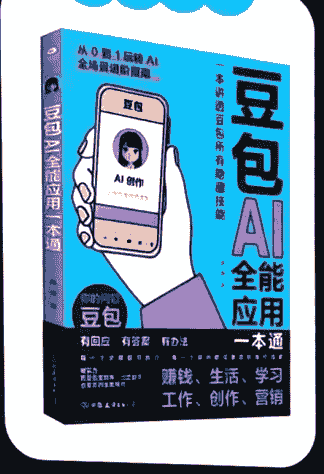

# AI+抖音、快手、小红书、视频号爆款打造与持续盈利

## 作者简介

徐浪，资深编辑、作者，从事图书出版行业十余年，对图书创作、策划与出版全流程具备系统而深入的理解。近年来，聚焦互联网营销、新媒体运营、短视频等领域，积累了大量的创作经验。善以媒体人特有的冷静洞察力与睿智思维，融合多元视角解析行业趋势。

## 前言

我们身处一个特殊的时代。抖音、快手、小红书、视频号（即微信视频号），这些平台构建起一个巨大的数字舞台，每天都有数以亿计的用户在这里消费内容，也有数以千万计的创作者，像你我一样，渴望在这里留下自己的印记，并从中获得实实在在的回报。

然而，当下短视频行业早已告别“拍条视频就能火”的时代。我们见过太多“流星式”的网红，一夜爆红，又迅速沉寂；我们也见过太多“苦力式”的创作者，内容优质，却始终无法将流量转化为“留量”，将影响力转化为生产力。

为什么会出现这样的问题呢？核心就在于我们过于专注“创作”，而疏于理解“生态”；我们精于“内容”，而拙于“运营”。这正是我们撰写本书的初衷。

本书的第一章深度解析了抖音、快手、小红书、视频号的底层盈利逻辑与核心用户画像。你将不再仅仅知道抖音是“潮”，快手是“老铁”，小红书是“种草”，视频号是“社交”，而是清晰地掌握抖音的“流量池”逻辑是如何驱动“爆款—涨粉—变现”飞轮的；快手的“私域土壤”是如何培育出高黏性、高信任度的“老铁经济”的；小红书的“信任社区”基因是如何让“种草”成为一种商业模式的；视频号是如何借助强社交实现商业转化的。只有明白了这些，你的内容创作才能有的放矢。

了解了四大平台的底层逻辑，你还需要知道如何定位账号、如何创作优质内容，以及如何通过引流推广获取流量，这些都是实现账号变现的“基石”。本书的第二章到第四章详细地阐述了这些方面的内容和技巧，能帮你少走弯路，快速建立起稳定的内容生产与运营体系。

打好基础后，就来到了最核心的部分——多元变现。本书第五章至第八章，系统梳理了当下短视频行业最主流、最有效的变现模式：从私域运营的流量沉淀与复购，到广告合作的报价策略与品牌匹配；从知识付费的课程设计与销售转化，到电商带货的选品逻辑与直播技巧，为创作者提供了“多模式组合盈利”的全面指导。

在 AI（Artificial Intelligence，人工智能）技术飞速发展的今天，“AI 赋能”已成为短视频盈利的“新风口”。善于利用 AI 工具，不仅可以让运营效率翻倍、成本降低，还可以让创作者将更多精力放在“创意”与“策略”上，在竞争中抢占先机。本书第九章就对此进行了细致的解构，其他章节也提供一些 AI 应用案例与模板，能够帮助大家迅速掌握 AI 技术的应用技巧。当然，书中提供的 AI 生成内容仅为笔者操作时的个例，不同的人在实际操作中得到的结果可能有所不同，建议读者以书中提供的方法为基础，辨证看待 AI 工具生成的结果。

最后，我想强调的是，短视频的赛道依然广阔，“野蛮生长”的时代已经过去，专业化、系统化、精细化的时代正在到来。未来属于那些既懂内容又懂商业、既有创意又有方法的“超级个体”。希望这本书能成为你从“创作者”到“盈利者”蜕变之路上的最强向导！

## 第一章 重塑认知：读懂四大平台变现的底层逻辑

### 第一节 抖音：多元文化下的流量变现机遇

权威数据显示，截至 2025 年 3 月，抖音（包括抖音极速版）月活跃用户数量已突破 10 亿。如此庞大的用户数量，让抖音成为多元文化交织背景下，将用户的“注意力”精准转化为“购买力”的黄金场域。换句话说，就是多元文化需求与内容供给的精准匹配场。

在抖音这个平台上，有着包罗万象的多元文化：从一线城市的工作日常，到乡村田野的质朴生活；从硬核科技的知识科普，到轻松搞笑的幽默段子；从国风汉服的典雅，到时尚潮流的炫酷……每一种文化、每一个兴趣圈层，都能在这里找到归属感。

多元文化为创作者提供了取之不尽的选题宝库和精准的受众定位。作为创作者，无论你的爱好多么小众，技艺多么独特，都能在这里找到欣赏你的用户。

正是这种多元文化以及巨大的流量，带来了商业变现的无限可能。流量本身不是钱，但抖音构建了一套环环相扣的精妙系统，其核心逻辑可以概括为：以内容吸引注意力，以注意力建立信任，以信任促成商业变现。

基于这样的逻辑，抖音平台为不同圈层的创作者开辟了多条变现路径。

#### 1 接单推广：流量的直接租赁

这是最直接的变现方式。当创作者的账号拥有稳定的流量和鲜明的标签后，品牌方会通过抖音平台寻找创作者合作。无论是美妆博主推荐护肤品，还是科技博主推荐数码产品，都是将创作者聚集的注意力和信任感“租赁”给品牌，实现价值转化。

#### 2 兴趣电商：流量的即时变现

这是目前最主流的变现模式，无论是乡村土特产、手工工艺品，还是大品牌商品，都能在对应的文化圈层中找到买家。兴趣电商在抖音平台主要有以下两种表现形式。

- ①短视频带货：在短视频中嵌入商品链接，使用户产生兴趣并购买商品。
- ②直播带货：通过实时互动、专业讲解和优惠促销，将粉丝的信任与冲动消费欲望相结合，实现极高的转化率。

#### 3 知识付费：“专业”的价值兑现

对于知识文化类创作者，这是绝佳的路径。这类创作者可以通过出售专栏课程、提供付费咨询、开设线上训练营等方式，将专业知识系统化地变现。粉丝为创作者的学识和经验付费，是对内容的深度和价值的高度认可。

#### 4 私域引流与个人品牌打造：流量的长期经营

许多创作者通过在个人简介中留下微信号，将公域流量引导至私域（如微信群、公众号），进行更深度、更长久的运营，最终销售更高客单价的产品或服务。同时，通过内容输出持续强化个人品牌，也能带来更多跨界合作等多元收入。

抖音这个多元文化的熔炉，给了每一个普通人被看见、被认可，并将热爱转化为事业的机会。当你理解了抖音的流量变现逻辑后，只要坚持深耕某一领域，持续为用户提供真实、有价值、有温度的内容，并精心维护与用户之间的信任纽带，就一定能在流量生态中构建独特的竞争力，实现持续变现。

### 第二节 快手：“老铁文化”驱动的强信任变现体系

在头部短视频 APP 中，快手选择了和抖音不同的定位。快手以其独特的“老铁文化”构筑了一座坚不可摧的信任堡垒，其草根化、平民化的社区氛围，在部分人看来或许不够潮、不够精致，但正是这种独特的气质让快手挤进了国内头部短视频平台的行列。

当下，快手凭借着超过 7 亿的月活跃用户，构建起了差异化的商业生态。其核心竞争力并非流量规模的绝对优势，而是源于“老铁文化”的强信任连接。快手的这种商业生态得益于其平台的三大特性。

（1）去精致化的真实
与追求“高光时刻”不同，快手更崇尚记录真实甚至有些粗糙的日常生活。“老铁”们分享的不仅是内容，更是“过日子”的本色，这种不加修饰的真实感，极大地拉近了用户与创作者之间的距离。

（2）高互动的社区感
在快手平台，“双击 666”不只是一句口号，而是嵌入基因的互动仪式。创作者与粉丝之间更像是邻居、朋友，通过频繁的评论区互动、直播聊天，建立起牢固的“准熟人关系”。

（3）强黏性的情感连接
这种“老铁”关系，带来的不是轻飘飘的“关注”，而是沉甸甸的“认同感”。粉丝对创作者的支持，源于长期积累的情感认同，这构成了强信任变现最坚实的土壤。

基于这种“老铁文化”的社交符号，快手掌握了贯穿内容生产与商业变现的底层逻辑，支撑起兼具情感温度与商业效率的变现体系。简单概括就是：真实内容→“老铁”关系→深度信任→商业变现。

快手平台的具体变现途径体现在以下几个方面。

#### 1 情感变现：直播打赏获得回馈

在快手的直播间里，打赏不仅仅是金钱上的支持，更是一种情感表达和社交行为。“老铁”们给喜欢的主播“刷礼物”，就像为朋友的精彩表演喝彩、为家人的困难解囊相助。这种基于情感共鸣的打赏模式，成了快手最基础、最稳固的变现方式。

#### 2 信任电商：直播带货的核心变现

这是“老铁经济”最淋漓尽致的体现，快手的电商逻辑与单纯“货找人”的精准推荐不同，它更侧重于“人带货”。

（1）家人、朋友的推荐
快手主播在带货时，话术往往是：“‘老铁’们，这个产品我用了很久，质量杠杠的，今天给家人们争取到了最低价”。在这里，粉丝看重的不只是产品，更是对主播的信任。主播的选品就是其个人信用的背书。一旦主播失信，失去的将是其整个粉丝群体。

（2）高复购与高客单价
正因为信任度高，“老铁”的忠诚度和容忍度也更高。他们不仅复购率高，对于主播推荐的大家电、家具、汽车等高客单价商品，也拥有远超其他平台的下单率。

#### 3 私域流量：稳固的变现池

快手的一大特点是其强大的私域流量。这意味着创作者发布的内容能够稳定地触达自己的粉丝群体。也就是说，算法推荐的公域流量不过是拉新的手段，粉丝群体的私域流量才是创作者运营的核心阵地。

因此，创作者如果与粉丝建立了“老铁”关系，就相当于在快手平台上拥有了一个自己可以随时“开业”的“数字门店”，变现的自主性和稳定性极强。

总的来说，快手以其独特的“草根文化”，构建了一个以人为中心、以信任为纽带的商业生态系统。想要成功变现，就必须与平台调性深度契合。作为创作者，想要深耕快手，不仅要付出时间和创意，更要保持真心与诚意。当你真正成为“老铁”们信赖的人时，商业的成功便会随之到来。

### 第三节 小红书：内容“种草”带来的商业转化

在数量众多的社交媒体中，小红书以美妆穿搭类内容起家，之后越来越多元化，逐渐渗透到生活的方方面面。这吸引了众多年轻人的入驻，他们在这里分享自己购物、美妆、生活等方面的经验。

根据官方数据统计，目前小红书月活跃用户数量已超过3亿，男女比例约为3：7。其中，一线、新一线城市用户占比超66%，“90后”占比在36%以上。

作为创作者，如果想要在小红书取得成功，就必须从以下3个方面深刻理解平台的特征与调性。

- ① “种草”文化与消费心理。小红书比其他平台更有“种草”氛围，用户来这里大多是为了寻找、分享美好生活的方式，一篇篇笔记往往会影响用户的消费决策。
- ② 女性主导的社区文化。小红书庞大的女性用户群体决定了平台交流的方式更倾向于共情和分享。因此，创作者在创作内容时，一定要记住共情胜过说教，并注重与粉丝的情感联结。有些创作者之所以失败，就在于习惯了“展示专业”，而不是“分享感受”。
- ③ 真实与理想的矛盾平衡。小红书最迷人的地方就在于它满足了用户对真实和理想的双重渴望。一方面，用户想看到真实的使用体验；另一方面，用户又想看到憧憬的理想生活。理解这种矛盾是创作爆款内容的关键。

基于平台的这种调性，小红书构建了一套看似温和、实则高效的商业转化模式。其核心不是硬广的狂轰滥炸，而是润物细无声的内容“种草”。这与传统电商的“人找货”和直播电商的“货找人”都不同。

具体来说，小红书的商业转化逻辑就是“种草”“养护”与“拔草”。

#### 1 精准“种草”

KOL（Key Opinion Leader，关键意见领袖）：负责引爆话题、树立品类认知，用专业的内容制作能力，将产品信息以极具吸引力的方式呈现，完成初步的市场教育。

KOC（Key Opinion Consumer，关键意见消费者）：负责夯实信任、推动决策，其分享更真实、更贴近普通用户，是“临门一脚”的关键。大量KOC的“种草”，会让用户产生“大家都在用，看来真的不错”的从众心理，极大地降低新用户的决策门槛。

作为创作者，我们不要生硬地进行笔记广告“种草”，而要成为产品的“体验官”和“翻译官”，把产品的功能“翻译”成用户能感知到的价值和生活场景。

#### 2 持续“养护”

用户被“种草”后，往往不会立刻购买。他们会在小红书平台搜索产品测评、关键词笔记、同类对比等内容。这时，平台海量的UGC（User Generated Content，用户生成内容）就构成了一个庞大的“信息数据库”，持续为这棵“草”浇水施肥，加固用户的购买决心。

作为创作者，我们一定要注重用户搜索内容和评论区。这是因为，用户搜索内容是强烈的“意向表达”，是转化的前奏；而评论区真实的问答、反馈，是打消用户疑虑的重要环节。

#### 3 高效“拔草”

为了实现从“种草”到“拔草”的无缝衔接，小红书不断完善其商业闭环，尽可能缩短“拔草”路径，创作者可以通过以下方式实现商业转化。

- ①站内直链：笔记中的商品卡片、视频中的商品链接，用户点击后可直接跳转至小红书商城或淘宝等外部平台完成下单。路径越短，流失越少。
- ②直播带货：小红书平台的直播更侧重于深度讲解和氛围感营造，是对图文、视频“种草”的集中转化和信任变现。主播更像一个懂行的朋友，在直播间里为用户详细地解读相关信息。
- ③私域引流：通过内容精准吸引目标用户，再引导至私域（如微信群），进行长期运营和深度转化，实现客户终身价值的最大化。

### 第四节 视频号：社交关系下的“微生态”商业

在短视频竞争日益激烈的当下，视频号依托其独特的社交生态，逐渐成为连接内容、社交与商业的阵地。由于微信平台庞大的用户基数支持，目前视频号的月活跃用户数量已突破 8 亿，其中 30 岁以上用户的占比超过 65%，用户消费能力较强。视频号已然成为头部短视频平台之一。

那么，为什么视频号能异军突起呢？

视频号的核心竞争力在于微信超过 14 亿的月活跃用户。也就是说，视频号并非独立存在，而是深度融入微信的社交网络、公众号、小程序等生态中。因此，相较于抖音、快手等平台的“算法推荐为主、社交为辅”模式，视频号的流量分发始终围绕“社交关系链”展开，这为视频号的商业变现奠定了低成本、高信任的基础。

作为创作者，如果想在视频号平台实现持续变现，就必须理解其基于社交关系的引流逻辑。

#### （1）社交信任优于内容曝光

视频号内容的分发高度依赖微信社交链，好友的互动行为直接影响内容的传播范围。用户发布的视频会优先推送给微信好友，好友的点赞、评论、转发等行为会进一步将内容扩散至好友的社交圈，形成

## 第一章 重塑认知：读懂四大平台变现的底层逻辑

“一传十，十传百”的裂变效应。

这种基于熟人关系的传播，不仅让内容触达更精准，更自带“信任背书”——好友的互动行为本质上是对内容的认可，这种认可会直接降低后续商业转化的门槛。

#### （2）公私域联动生态

视频号与公众号、小程序、微信小店、企业微信、朋友圈等无缝衔接，形成“内容—互动—转化—运营”的全链路闭环。创作者可以通过视频号主页的“添加微信”“进入社群”等入口，将观看视频的公域流量转化为私域用户。

这些基于社交关系沉淀的用户，不仅复访率高，还能通过二次传播为创作者带来新的流量，形成“流量—变现—再裂变”的良性循环。

由此可见，视频号的变现，本质上是将“社交信任”转化为“商业价值”的过程。基于社交关系链的传播特性，其变现路径呈现出由低到高的梯度结构，主要表现为以下几种模式。

## 1 广告变现

广告变现是视频号创作者最易上手的变现方式，其核心是利用社交传播带来的流量曝光，为品牌提供宣传渠道。由于视频号的流量源于社交关系，广告内容更易通过“好友推荐”的形式实现“软植入”，降低用户的抵触心理。

具体来看，广告变现主要分为以下3种形式。

### （1）原生广告植入

创作者将品牌信息自然融入视频内容中，如美妆博主在教程中推荐某款护肤品，母婴博主在育儿分享中提及某款母婴用品等。这种方式依托创作者的个人魅力和社交信任，转化效果远超硬广告。

### （2）品牌合作任务

创作者通过视频号“创作者中心”的任务广场承接品牌任务，按照播放量、点赞量或转化率获取收益，适合粉丝数量中等的创作者。

### （3）流量主收益

当创作者粉丝数量达到一定门槛（目前为 1000）后，可开通流量主功能，通过视频末尾的广告贴片或直播中的广告弹窗获取收益。

## 2 电商变现

电商变现是视频号商业价值的核心体现，其依托“微信支付＋视频号小店＋社交传播”的生态优势，构建了“内容展示—社交分享—即时购买”的最短转化路径。与其他平台相比，视频号电商的最大优势在于“社交信任驱动转化”，好友的分享和推荐会直接刺激用户的购买欲望，而微信支付的便捷性则进一步降低了转化阻力。

视频号电商变现主要有以下两种核心模式。

### （1）短视频带货

创作者在视频中展示产品的使用场景、核心优势，通过视频下方的“小黄车”直接链接到视频号小店或京东、拼多多等第三方平台，方便用户快速完成下单。

### （2）直播带货

这是视频号电商变现的主流形式。直播的实时互动性能够进一步强化社交信任，创作者通过与粉丝的实时沟通解答疑问、演示产品，再配合“限时折扣”“好友拼团”等社交玩法，激发用户的购买冲动。

此外，视频号直播还支持“私域导流”，创作者可通过直播引导用户加入微信群，实现用户的长期运营和复购。

## 3 知识付费与服务变现

对于具备专业能力的创作者而言，视频号还能实现知识付费和服务变现，这是基于社交信任的高价值变现路径。由于视频号的流量源于熟人社交，用户对创作者的专业能力更易产生认可，为知识和服务付费的意愿也更高。

知识付费的形式主要包括售卖课程和运营社群。创作者可通过短视频分享专业知识片段，吸引有需求的用户，再通过视频号主页的链接引导用户购买线上课程或加入付费社群。例如，职场博主分享职场技巧短视频，然后推出“职场晋升课程”；教育博主分享知识点讲解视频，再引导用户加入“学习打卡社群”。

服务变现则适合线下实体商家或服务行业从业者。例如，健身教练通过视频号分享健身技巧，吸引本地用户预约私教课；律师通过视频号普及法律知识，承接法律咨询服务。这种变现方式将线上流量转化为线下服务，实现了“线上引流—线下转化”的闭环。

### 第五节 用户画像解析：找准变现目标人群

当下，短视频平台已然成为大众生活不可或缺的一部分。尤其是抖音、快手、小红书、视频号，它们以独特的魅力吸引着海量用户，构建起风格各异的内容生态与用户社群。在这些平台中，有娱乐，也有商业，每一个人都可以成为这里的主角。

作为运营者和渴望变现的创作者，如果想要在各平台深耕内容、实现变现，就必须深刻理解这四大平台的用户画像差异。唯有如此，你才能锁定变现目标人群，实现商业价值。

以下解析内容有助于我们快速了解 4 个平台的目标人群特性。

## 1 抖音

### （1）用户画像关键词
一二线城市，年轻，追逐潮流，消费能力强，兴趣广泛。

### （2）用户核心特征
①地域分布：高度集中于一二线城市，用户见多识广，对新事物接受度高。
②年龄结构：以 18 ~ 30 岁的年轻人为主，他们是抖音平台及消费市场的主力军。
③用户心态：用户带着放松和娱乐的目的，期待看到高密度、强节奏、新奇酷炫的内容。
④内容偏好：潮流音乐、剧情短剧、知识科普、美妆时尚、豪车豪宅等一切能带来视觉冲击和即时爽感的内容。

### （3）针对不同目标用户的变现方式

- ①潮流敏感型消费者：18～25岁一二线城市年轻人，关注美妆、潮牌、数码产品。针对这类目标用户，适合通过“爆款短视频＋小黄车”带货，并配合广告实现品牌曝光与转化。
- ②直播冲动型买家：25～40岁全地域用户，对直播间福利、场景化演示敏感。针对这类目标用户，需要打造“专业主播”人设，可以主攻服饰、食品等快消品，利用算法推流实现爆单。
- ③知识付费受众：30～45岁职场人士，偏好理财、职场技能类内容。针对这类目标用户，可通过“短视频引流＋课程售卖”变现。

## 2 快手

### （1）用户画像关键词

三四线城市及下沉市场，普惠，真实，重人情，高黏性。

### （2）用户核心特征

①地域分布：三四线及以下城市用户占比更高，覆盖了广阔的下沉市场。
②年龄结构：分布相对更均匀，从青年到中老年用户都有深厚的根基。
③用户心态：用户更看重真实感和人情味，追求“老铁”式的社交信任。平台算法注重“人”与“关系”，强调社区的普惠性与黏性。
④内容偏好：记录普通生活的 Vlog（Video log，视频日志）、家庭幽默剧、手工艺人、农业养殖、本地化生活内容等，强调“真实可感”。

### （3）针对不同目标用户的变现方式

- ①下沉市场家庭消费者：30～55岁乡镇用户，关注农产品、家居日用品、平价服饰。针对这类目标用户，需以“产地直供”“工厂源头”为卖点，通过直播建立信任，搭配私域社群运营实现复购。
- ②“老铁”黏性粉丝：全年龄段忠诚用户，对才艺、剧情类主播认可度高。针对这类目标用户，可通过“直播打赏＋周边带货”变现。
- ③区域特色需求用户：三四线城市创业者、宝妈，关注本地团购、技能培训。针对这类目标用户，可利用快手广告投放平台精准投放广告。

## 3 小红书

### （1）用户画像关键词

一二线城市，女性，高知，高消费，决策依赖“种草”。

### （2）用户核心特征

①性别与地域：女性用户占绝对主导地位，且集中在一二线城市，普遍拥有良好的教育背景和独立经济能力。
②用户心态：用户带着明确的需求或潜在的兴趣，主动搜索攻略、评测和“种草”内容，将小红书视为“生活决策的搜索引擎”。
③内容偏好：美妆护肤、穿搭时尚、母婴育儿、家居装修、旅行攻略、健身减肥、美食探店等一切与“提升生活品质”相关的深度图文或视频笔记。

### （3）针对不同目标用户的变现方式

- ①精致生活追求者：20～35岁一二线城市女性，聚焦美妆护肤、轻奢配饰、家居好物。针对这类目标用户，需要产出“测评+教程”类深度笔记，通过蒲公英平台承接品牌合作。
- ②决策参考型用户：25～40岁母婴、教育领域人群，关注育儿干货、升学攻略。针对这类目标用户，可开设小红书店铺销售绘本、早教工具，搭配“种草”关键词抢占搜索入口。
- ③本地生活消费者：18～30岁城市青年，热衷探店、露营等场景。针对这类目标用户，可以与本地商户合作，通过“体验笔记+团购链接”变现。

## 4 视频号

### （1）用户画像关键词

全年龄覆盖、依赖微信、重视熟人分享、公私域连通。

### （2）用户核心特征

- ①年龄与场景：用户年龄分布广泛，30岁以上用户占比显著，消费能力强；使用场景深度嵌入微信社交与日常生活，常见于家庭群、朋友群、熟人分享等场景。
- ②用户心态：用户更多出于社交推荐与关系维护的目的浏览内容，被动但信任度高。
- ③内容偏好：日常生活记录、知识经验分享、新闻资讯解读、家庭情感、本地生活、技能教学等。

### （3）针对不同目标用户的变现方式

- ①家庭与品质生活决策者：30～50岁的女性及家庭用户，关注健康、家居、育儿、食品等品类。针对这类目标用户，可通过直播带货与商品橱窗，以“身边人”身份推荐日用百货、健康食品等，结合社群运营实现复购。
- ②本地到店消费者：年龄范围广，热爱生活，喜欢线下实体店体验，如餐饮、美发等。针对这类目标用户，可利用视频号本地推送与社交传播的优势，通过短视频展示产品制作过程、门店环境，结合团购小程序与企业微信引流到店。
- ③高黏性知识付费与私域用户：有知识或技能需求，关注教育、财经、技能培训等。针对这类目标用户，可通过短视频引流，依托公众号深度内容与粉丝建立信任，通过小程序销售课程、提供付费咨询服务，实现高客单价转化。

由此可见，4个平台凭借各自独特的用户画像，构筑起的内容生态与商业变现模式也有所差异。这就要求运营者或创作者在选择平台时，一定要深度剖析自身定位、产品特性以及目标受众的特征，精准匹配平台，这样才能实现内容价值与商业价值的最大化。

### 第六节 创作者如何树立正确的盈利心态？

在做内容账号前，很多创作者心头都会闪过一个念头：“我做的内容，真的能赚钱吗？”有这个疑问很正常，毕竟每一位创作者都希望自己创作的内容能带来收益，获得回报。换句话说，盈利是每一位创作者都绕不开的核心话题。

然而，有不少创作者急于求成，总想着一夜爆红，看着自己账号缓慢增长的数据，焦虑、自我怀疑汹涌而来。这种心态不仅会影响创作的质量，还可能影响坚持的动力。如何才能打破这个困局呢？关键点就在于树立正确的盈利心态。

## 1 要有正确的盈利认知

很多创作者把“盈利”简单地看作“赚钱”，这是狭隘的。作为创作者，我们首先要拓宽对“盈利”的理解。一般来说，盈利可分为短期盈利和长期盈利。

短期盈利＝金钱：广告、商单、平台补贴等直接收入。

长期盈利＝资产：你的个人品牌、忠实粉丝群、行业影响力、持续创作的能力。

正确的盈利心态，应该是追求长期盈利即资产的积累，让金钱成为自然而然的副产品。当你只盯着眼前的金钱时，就容易陷入“标题党”、蹭热点、抄袭的泥潭，最终损耗信誉。而当你专注于构建你的“品牌资产”时，你会更有耐心，走得更远。

## 2 从追求流量到价值的转变

每一位创作者在运营之初都可能陷入乞求流量的误区，如期待平台多给自己流量、希望粉丝多点赞等。这种心态容易让创作者被动、焦虑，被数据牵着鼻子走。

因此，创作者必须从“追求流量”转为“创造价值”，明白自己是为特定人群解决一个问题、提供一种情绪价值或分享一种知识。即不是“要”关注，而是“提供”价值；不是“追”热点，而是“创造”吸引力；不是平台的“打工人”，而是自己内容领域的“创始人”。

为此，在创作每一条视频前，创作者都应该问自己3个问题：“我的目标观众是谁？”“用户看完我的视频，会获得什么？（是笑了，学到了，还是被感动了？）”“这条视频是否能增强用户对我的信任和喜爱？”

## 3 平衡创作与收益，正视盈利差异

创作者在做短视频内容时，一定要注重平衡创作与收益的关系，不能为了盈利而影响内容的质量和创作的初心，尤其是要正视盈利的差异。

在盈利时，创作者要考虑用户的感受和接受度，避免过度商业化。例如，在植入广告时，要选择与内容相关、质量有保障的产品或品牌，并且控制广告的数量和时长，以免引起用户的反感。

当盈利情况出现波动或差异时，创作者要保持平和的心态，不要因为一时的收益不佳而灰心丧气，也不要因为短期的高额收益而骄傲自满。多总结经验，不断优化自己的内容和盈利策略，你的盈利能力会得到进一步提升。

总之，创作者要明白，每个人的成长节奏不同，只要坚持下去，不断提升自己，就一定能够在短视频行业找到属于自己的盈利空间。

### 第七节 持续盈利的核心：个人品牌与品牌价值

有句话说得好：“流量如潮水，来时汹涌，去时无踪。” 相信很多创作者对此都有过深刻体验，当爆款出现的时候充满了无限喜悦，但很快流量趋于平静，于是又陷入对下一波流量何时到来的焦虑中。这种期待流量带来盈利的方式是难以长时间持续的。

那么，真正能持续的盈利之道是什么呢？

答案就是打造个人品牌，并为此注入永恒的品牌价值。作为创作者，我们首先要厘清一个关键误区——流量可以实现持续盈利。

为什么流量无法实现持续盈利呢？简单来说，流量思维追求的是单条视频的爆红。很多用户是“看过即走”，他们记住的是内容，而不是账号或创作者。即便一条视频拥有千万播放量，如果无法沉淀，那么商业价值也仅限于一次性的平台补贴。也就是说，这种盈利模式被动且脆弱。

为此，创作者必须跳出单纯依靠流量的思维，并建立个人品牌与品牌思维。

## 1 个人品牌——持续盈利的“流量入口”

个人品牌并非简单的“人设”，而是创作者在特定领域通过持续输出有价值的内容，在用户心中形成的“专业标签”与“情感联结”。它是吸引精准流量的“磁石”，也是实现商业变现的“信任桥梁”。

首先，优质的个人品牌能快速打破短视频平台的“算法壁垒”，实现精准流量的持续积累。在信息过载的短视频生态中，用户更愿意关注“有温度、有个性、有专长”的创作者。例如，某知识领域博主，以“用案例解读法律＋传递法治思维”的个人品牌形象，让法律知识突破圈层，从而收获了千万粉丝。

其次，个人品牌是降低用户决策成本、提升变现转化率的关键。在短视频变现的常见模式中，无论是直播带货、知识付费，还是广告合作，本质上都是“信任交易”。当用户认可某个创作者的个人品牌时，会天然对其推荐的产品、分享的知识产生信任。

总之，当你成功塑造起个人品牌时，用户就会因为是你创作的内容而观看，并成为你的粉丝。他们消费的不仅是内容，更是与你这个“人”的关联。盈利也会因此变得主动、多元且可持续。

## 2 品牌价值——让盈利走向“长期复利”

如果说个人品牌是“吸引用户的利器”，那么品牌价值就是“留住用户、实现持续盈利的护城河”。很多创作者误以为“有流量＝能盈利”，却忽略了流量的“流动性”——没有品牌价值的支撑，流量再高也难以转化为长期收益。

我们知道，品牌价值的核心在于为用户提供“超越内容本身的价值”，它是个人品牌价值的灵魂。当创作者的内容拥有品牌价值时，用户内心自然而然就会对其产生信任感、好感度和价值预期，从而实现“用户生命周期的长期变现”，让盈利产生“复利效应”。

作为创作者，我们一定要明白，依赖“爆款视频”可能带来短期盈利，但想要获得持续的长期盈利，就必然要重视个人品牌的“信任沉淀”与品牌价值的“护城河效应”。只有将二者结合，创作者才能突破“流量焦虑”困境，走向长期盈利。

## 第二章 账号定位：找到最能赚钱的赛道与人设

### 第一节 如何让天赋、兴趣与市场需求匹配？

无论是做抖音、快手，还是小红书、视频号，找到自己的方向是创作者首先要解决的问题。通常，大多数创作者会从自己的天赋、兴趣入手。不可否认，天赋是一个人自带的“创作基因”，兴趣则是持续输出的“动力引擎”，挖掘、展示自己的天赋和兴趣是非常不错的选择。

然而，仅仅点燃内心的“火花”还不足以获得成功，创作者必须让天赋、兴趣与市场需求相匹配，因为市场需求决定了创作的内容能否被看见、被认可。作为创作者，只有找到两者的平衡点，才能在竞争激烈的短视频赛道上站稳脚跟，实现创作价值与商业价值的双重突破。

那么，具体该如何让我们的天赋、兴趣与市场需求高效匹配呢？

## 1 拆解自我，锁定天赋与兴趣的核心区

要挖掘自己的天赋和兴趣，首先要对自己有清晰的认知，即明确哪些能力是自己的“天赋所在”，哪些领域是自己的“兴趣所向”。创作者可以从以下两个方面来拆解。

### （1）挖掘天赋

天赋往往藏在日常的一举一动中。例如，你能轻松捕捉生活中的幽默瞬间，用几句文案就能让人捧腹；你擅长通过镜头语言展现场景氛围，即使是普通街道也能被你拍得有故事感；你能快速抓住热点本质，用独特视角进行二次创作……

以上这些都可能是你的天赋表现，把这些“擅长点”列出来，再对应到短视频的细分能力中，如文案、拍摄、剪辑、人设、选题、互动等，就能初步锁定你的天赋领域。

### （2）聚焦兴趣

兴趣是对抗创作倦怠的关键。创作者如果不能保持持久的兴趣，很容易陷入“为更新视频而更新视频”的内耗中。想要判断自己对某个领域是不是感兴趣，你可以问自己3个问题：“即使没有流量，我也愿意花时间研究的领域是什么？”“看到哪些类型的视频，我会忍不住想‘我也能做好’？”“在过去的创作中，哪些内容让我有‘越做越兴奋’的成就感？”

然后，把天赋清单与兴趣清单交叉对比，找到两者可以结合到一起的“核心区”。例如，“擅长文案＋喜欢职场话题”，就可以初步定位“职场干货类短视频”，让天赋和兴趣都得到发挥。

## 2 了解市场需求，找到“需求缺口”

锁定“核心区”后，我们还需要了解市场需求，这样才能避免陷入“我觉得好”但“市场不买账”的误区。了解市场需求的核心就是要找到“市场需要且我能做好”的缺口。创作者可以从以下两个方面入手。

### （1）用数据工具找“需求方向”

新手创作者可以从下面几个工具入手。

- ①抖音、快手的“创作灵感”“热点榜单”：看 Top100 的内容中，哪些领域是“长期热门”，哪些是“新兴趋势”。
- ②巨量算数或蝉妈妈：输入关键词，如“职场干货”，查看“需求图谱”——用户更关注“简历优化”“职场沟通”还是“副业选择”；同时看“竞争度”，避免进入“内容饱和、头部垄断”的赛道。
- ③小红书“搜索框”：输入核心领域关键词，看“下拉推荐”——这些都是用户真实的搜索需求。例如，定位“职场干货”，通过数据发现“00后职场生存指南”“职场副业避坑”的搜索量上升快，但优质内容少，那么这就是可切入的“需求缺口”。

### （2）分析竞品找“市场空白”

找到需求方向后，还要分析竞品的“不足”。例如，搜索“职场副业”，发现多数视频是“罗列10个副业”，但评论区常出现“不知道怎么开始”“担心被骗”。你的机会就是做“职场副业拆解系列”，每个视频聚焦1个副业，详细讲“适合人群”“启动步骤”“避坑要点”，用“更具体、更实用”的内容填补市场空白。

创作者要始终明白一个道理：市场需要的不是“另一个同类内容”，而是“比现有内容更好的差异化内容”。你的天赋和兴趣，正是打造差异化内容的核心武器。

让天赋、兴趣与市场需求匹配，其实就是“找到自己擅长、喜欢且市场需要”的创作坐标系。作为创作者，你的任务不是把自己塞进某个市场模板，而是持续雕琢你的独特表达，直到市场无法忽视你的价值。当你在自己擅长的、热爱的领域深耕，并真诚地为他人提供价值时，你就已经成功了。

### 第二节 确定赛道：用 DeepSeek 筛选细分领域

大多数创作者在准备做短视频时都会面临这样一个问题：我应该做什么？

的确，短视频的类别有很多，从中筛选适合自己的赛道是有一定难度的。创作者需要面临如“热门赛道这么卷，我能挤进去吗？”“我好像什么都不精，能做起来吗？”等各种担忧。这是几乎所有创作者都会经历的“定位迷茫期”。

那么，有没有什么好的解决方法呢？这里，我向大家介绍 AI 助手——DeepSeek。它可以帮助创作者进行账号定位分析，找出最适合的赛道。下面用实例具体讲解一下操作技巧。

## 1 针对零基础创作者的操作技巧

如果你还未踏入短视频领域，也就是零基础，现在正准备做短视频。那么，你首先要确定你能做什么。此时可以借助 DeepSeek 来帮助你分析。

例如，在 DeepSeek 的对话框中输入如下提问内容。

我是一名工作5年的用户界面设计师，擅长C4D建模和家居配色，手头有500+原创设计案例，想在抖音平台做短视频。请结合我的优势生成至少3种适合我的短视频定位，需包含人设标签、内容方向、变现路径。

输入这段内容后，我们就会得到由 DeepSeek 给出的账号定位方案，如表 2-1 所示。

#### 表 2-1 DeepSeek 给出的账号定位方案

| 人设标签 | 内容方向 | 变现路径 |
| :--- | :--- | :--- |
| 家居美学设计师 | 户型改造+配色教程 | 设计咨询+软装带货+课程 |
| C4D可视化达人 | 3D还原明星家居布局 | 商单建模+软件培训 |
| 职场转型导师 | 设计师副业变现经验分享 | 私域社群+简历优化服务 |

如果觉得 DeepSeek 输出不够精准，你可以补充输入“职业经历细节”，如曾负责10家民宿的设计工作；或进行“资源限制”，如每周只能更新2条视频等，让 DeepSeek 进一步优化方案。

确定账号定位后，我们还可以继续通过 DeepSeek 生成可操作的运营方案，这对新手来说非常有帮助。

例如，我们沿用上一个案例，在 DeepSeek 的对话框中继续输入：“我已确定账号定位是‘家居美学设计师’，目标受众为25～35岁城市购房族，主打‘低成本简约设计’内容。请帮我制订抖音平台相关运营方案，要求包含：前30天内容选题表（分入门、进阶、爆款阶段）；冷启动期（1 ～ 7 天）执行流程；3 种变现测试方案。”

输入这段内容后，DeepSeek 会自动结合平台特性生成运营方案。创作者根据这些生成的内容进行筛选、修改，然后执行即可。

## 2 针对有一定基础创作者的操作技巧

如果你已经进入短视频领域，并积累了一定的粉丝量，但纠结要不要当作全职来运作，或者不确定接下来应该往哪个方向走，同样可以借助 DeepSeek 智能分析工具帮你做决策。

例如，在 DeepSeek 的对话框中按如下模板输入。【】内的内容可以根据个人需求进行填充，后续类似情况不再赘述。

> 我是一名短视频创作者，目前在【】平台有【】粉丝，当下在账号定位和创作方向上存在一些困惑。我的兴趣是【】，从事的职业是【】。请帮我分析我的账号适合什么样的赛道，列出 3 个可选的方向。

输入这段内容后，DeepSeek 就会生成相应的方案。创作者可以从中选择最契合自身的方向去尝试，如果觉得不满意，可以让 DeepSeek 列出更多的方向。

在这个过程中，创作者要明白 DeepSeek 的核心价值在于帮助自己跳出“自我局限”与“信息盲区”，但最终方向的选择仍需创作者去把握。

## 3 挖掘“蓝海”赛道的操作技巧

当前短视频领域已进入存量竞争阶段。有数据显示，头部 1% 的内容创作者获取了平台 80% 的流量。这意味着单纯地跟随热点和爆款，只会让你陷入“内容同质化”的泥潭。想要在众多的账号中脱颖而出，真正的破局之道是开辟“蓝海”赛道。

所谓“蓝海”赛道，就是指竞争较小且有需求的市场。在这种赛道里，创作者更容易被用户发现，也更容易建立影响力。“蓝海”赛道如此有优势，怎样才能进入呢？我们可以借助 DeepSeek 进行分析。

这里需要注意的是，提问要掌握技巧：一是要说清楚平台和领域，不同的平台调性不一样，只有指明具体的领域，才能让 DeepSeek 有针对性地给出回答；二是要提出具体的需求；三是要求给出具体的建议。这样 DeepSeek 才能给出更精准的“答案”。

例如，在 DeepSeek 的对话框中输入如下内容。

> 我想在抖音平台中找到适合自己发展的“蓝海”赛道。请分析最近 3 个月内美妆领域的热门关键词，筛选出 3 个搜索量高但竞争较小的细分赛道。对于每个赛道，请给出一定的数据支持、内容形式建议和变现路径。

输入这段内容后，DeepSeek 会生成相应的详细回答。通过 DeepSeek 的帮助，创作者可以迅速了解自己想做的领域还有哪些“蓝海”赛道。如果觉得不满意，还可以进一步向 DeepSeek 追问，让它给出更精准、更具体的建议。

### 第三节 拆解账号：用 DeepSeek 分析竞品账号

在短视频的运营中，“爆款”并非完全偶然，头部账号之所以能够打造吸引百万流量的内容，往往有其内在逻辑。作为创作者，系统化地拆解爆款账号，精准提炼可复用的成功经验，是快速学习行业最佳实践经验、优化自身内容策略的重要方法。

通常，在拆解头部账号时，可以从以下角度进行系统性分析。

## 1 账号要素拆解

不同的头部账号，其内容在结构上存在差异。例如，有的账号选择“钩子公式”，即“痛点数字＋悬念前置”；有的账号则选择“信任公式”，即“权威背书＋对比实验＋成分可视化”。

通过拆解爆款内容的结构要素，创作者可以从中获得启发和借鉴。

## 2 账号数据洞察

头部账号与普通账号在各项数据上往往存在一定的差异，主要体现在完播率、用户互动率、用户画像对比等方面。了解具体的用户行为数据，有助于创作者及时调整方向。

例如，头部账号短视频前 3 秒的流失率一般控制在 25% 以下，而普通账号短视频前 3 秒的流失率可能达到 40% ~ 50%。另外，如果同行业头部账号的目标用户主要是 25 ~ 30 岁的人群，而你的账号的目标用户主要是 18 ~ 24 岁的人群，就说明你在目标用户的定位方面出现了错误。

另外，借助 AI 工具分析是运营者必须掌握的一项技能。我们可以通过 DeepSeek 找到行业头部账号的核心优势，分析自己账号与头部账号的差距，并让 DeepSeek 提出优化建议。

以下是借助 DeepSeek 对头部账号进行分析的提问模板。

> 请分析 ×× 行业头部短视频账号的数据、内容风格，并与我的账号对比，找出我的账号可优化的方向，以及挖掘它们没有覆盖的点。

以下是需要分析的账号数据：

头部账号（可选择若干个）：内容风格为【】，核心亮点是【】，粉丝数为【】，平均播放量为【】，完播率为【】，互动率为【】。

以下是我的账号数据：

内容风格为【】，核心亮点是【】，粉丝数为【】，平均播放量为【】，完播率为【】，互动率为【】。

分析需求如下。

①分析头部账号的流量增长、选题方向、内容结构及风格等。

②找出我的账号与头部账号的核心差距。

③基于数据的分析，提出 3 ~ 5 条有针对性的优化建议。

输入这些内容后，DeepSeek 就会根据数据给出相应的回答。根据 DeepSeek 给出的建议，创作者可以逐条进行分析，针对确实存在的问题进行小范围的“测试验证”。例如，调整“选题方向”，先创作 2 ～ 3 条相关视频，观察数据表现，如果数据优于之前的视频，则继续跟进优化。

拆解爆款账号的最终目的，是为了学习其背后的逻辑。这个过程可以训练我们的网感、洞察力和系统化思维能力。通过一次又一次地拆解，创作者将不再凭感觉做内容，而是能清晰地知道为什么某个内容会爆火，以及该如何打造下一个爆款。

### 第四节 塑造人设：设计一个讨喜又吸金的形象

打造一个成功的人设才能更好地获取流量和粉丝，进而赢得更多变现的机会。通常，一个成功的人设应该是能让用户产生“一见如故”的亲切感，又能在众多创作者中具有独特的记忆点，并最终实现“粉丝愿意追、品牌愿意投”的吸金效果。

那么，如何精准设计出既讨喜又吸金的人设呢？

## 1 找到讨喜的核心点

人设的本质是“用户认知的浓缩”，即一个让用户熟悉的外在形象。人设讨喜的前提是“让目标用户看到自己”。因此，你需要寻找一些自身具备的、有传播度并符合目标定位的标签。总的来说，树立一个讨喜的人设，你需要做好以下3点。

（1）锁定垂直人群，拒绝“泛人设”

讨喜的人设必然是“小而美”，而非“大而全”。例如，“‘90后’‘北漂’女孩的一人食”比“分享各种美食做法”更有记忆点。前者精准锁定了单身人群、“北漂”群体，让目标用户感受到“这就是我每天的生活”。

（2）放大反差感，制造记忆点

平铺直叙的人设难以让人记住，而适度的反差能快速打破刻板印象，形成独特标签。当然，反差感不是刻意标新立异，而是在“真实底色”上叠加亮点。

例如，“学霸博主分享摸鱼学习法”，既保留了“学霸”的专业属性，又通过“摸鱼”贴近普通学生的真实情况，从而让人设更鲜活。

（3）明确“价值输出”，解决用户痛点

讨喜的本质是“有用”，即要么提供情绪价值，要么解决实际问题。例如，职场人设“每天3分钟教你避开一个坑”，就精准解决了职场新人的职场焦虑。

因此，在设计人设时，创作者要先想清楚“我的人设能为用户带来什么独特价值”，然后再围绕价值设计形象和内容。

## 2 用内容强化人设属性

人设不是靠“口号”喊出来的，而是通过每一条创作内容的细节沉淀出来的。很多创作者前期人设清晰，后期却逐渐“跑偏”，最根本的一个原因就是“想讨好所有人”，这样一来，人设就模糊了，内容方向难免走偏。

因此，创作者一旦确立了人设，就不能轻易改变。每一次选题策划，都必须考虑是否与人设相符。也就是说，创作者要在内容中强化人设属性。

（1）用“固定元素”强化人设标签

重复的视觉或内容元素能让观众形成条件反射，快速记住人设。例如，固定的开场白、场景、道具等。这些元素不需要多复杂，却能成为人设的强化“符号”。

（2）用“故事化内容”加深人设形象

比起生硬的知识输出，故事更能让人设深入人心。例如，“创业老板”人设，与其每天讲“如何管理团队”，不如拍“和员工一起奋斗”的视频，通过具体的故事展现团队在创业中的种种表现，从而引发观众的共鸣。

## 3 建立情感联结，让讨喜变成吸金

吸金的前提是“有忠诚的粉丝”，而粉丝的忠诚度来自与创作者的情感联结。也就是说，创作者想要实现商业转化，不仅要让观众认识自己，更要让观众喜欢、信任自己。因此，我们要注意以下两点。

（1）接地气才会讨喜

高冷的人设容易让用户产生“仰望感”，而接地气的人设能拉近距离。例如，美妆博主拍一条“昨天化的妆被朋友吐槽像‘鬼’，今天教大家怎么避开这个雷区”，这种自嘲的方式就能快速拉近与用户的距离。

（2）成为粉丝的情绪价值“加油站”

短视频的本质是“陪伴”，很多粉丝关注某个账号，是因为能从中获得稳定的情绪价值。例如，励志博主不能只是喊“加油”，还要分享自己“今天没动力，但还是坚持完成了一件小事”的真实状态。这样的人设就容易让粉丝感受到“我不是一个人在努力”，从而形成“每天看他发布的内容已经成了习惯”的依赖感。

当你完成了以上几个步骤后，你的人设基本就打造起来了。需要注意的是，打造一个成功的人设需要时间和耐心，创作者不要因为短期数据不好或变现慢就放弃或改变核心特质。只要你找准自己的定位，用细节沉淀人设，用真诚连接粉丝，就一定会有所收获。

## 第三章 内容创作：打造持续引爆流量的爆款体系

### 第一节 抖音：短平快、强冲突的爆款内容逻辑

抖音平台起初的内容主要是音乐类短视频、才艺表演，随着用户数量的不断增长，内容越来越丰富，涉及范围越来越广，给人一种有创意、潮流炫酷的感觉。正是这些有趣的内容让抖音脱颖而出，成为短视频领域的“一哥”。

作为创作者，你是不是时常感叹：为什么有些视频看似平平无奇却能一夜爆火，而精心打磨的作品却石沉大海？其实，答案就藏在抖音“短平快、强冲突”的底层内容逻辑之中。只有读懂并运用这套逻辑，你才能在激烈的流量竞争中脱颖而出。

#### 1 “短平快”：适配注意力经济的效率法则

抖音的“短平快”并非单纯追求缩短时长，而是以最高效的方式传递核心价值，精准匹配用户“瞬时决策”的浏览习惯。

（1）短：黄金时长锁定完播率

抖音爆款视频时长多集中在 15～60 秒，过长的内容容易导致用户中途划走。这一时长贴合平台算法逻辑：完播率作为核心权重指标，直接决定视频能否进入更大的流量池。

因此，创作者应摒弃冗余铺垫，将核心信息或亮点浓缩在有限时间内，让用户在短时间内获得明确的价值反馈。

（2）平：低门槛的普适表达

“平”意味着内容通俗易懂、贴近大众认知，避免复杂深奥的逻辑或小众化表达方式。抖音用户群体广泛，从下沉市场到一线城市，从青少年到中老年，低门槛的内容往往能跨越年龄、圈层的界限。

因此，无论是生活技巧、情感感悟还是热点解读，都应以直白的语言、直观的画面呈现，让不同群体都能快速获取核心信息。

（3）快：节奏紧凑的感官冲击

“快”体现在节奏把控与信息传递效率上。一是视频的镜头平均2～5秒切换一次，搭配节奏感强的热门BGM（Background Music，背景音乐），让视频充满动感；二是口播语速要略快于日常交流，关键信息用醒目字幕强化，避免画面停滞。这样才能更好地吸引用户的注意力。

#### 2 “强冲突”：撬动用户情绪的万能杠杆

如果说“短平快”是骨架，那么“强冲突”就是为内容注入血肉和灵魂的关键。冲突制造了不确定性，激发了好奇心，是促使用户完成观看、点赞、评论的核心驱动力。

（1）视觉冲突：最直接的刺激

视觉冲突是指利用视觉上的“反常识”设定制造话题性，让用户产生“没想到”的好奇感。例如，剧情反转、身份反差、视觉奇观、前后状态的强烈对比等。这种极致的反差，瞬间就能吸引人的眼球。

（2）价值冲突：引发站队与讨论

价值冲突是指通过观念对立、代际矛盾、社会热点评论等引发价值冲突。例如，提出一个有争议性的观点，或在剧情中设计两种对立的选择，引导用户在评论区“吵起来”，从而提升视频的推送权重。这种冲突不一定要有对错，但一定能引发观众的共鸣和站队。

（3）情感冲突：共情是流量的密码

情感冲突是指通过制造悬念、期待、感动、愤怒或怀旧引发用户的关注。创作者可以设置一个明确的情感锚点，并通过镜头、音乐和演技，将这种情绪精准地传递给观众。例如，讲述一个寻亲故事让用户感动，拍摄一个坏人得逞的片段激起用户的公愤，等等。

了解了抖音内容的特性，我们就有了更多的爆款内容模板。例如，“痛点＋解决方案”“好奇＋悬念反转”“共鸣＋情感宣泄”等，利用这些模板来创作内容，就会让流量向你倾斜。当然，理解抖音的逻辑，并非要求我们放弃深度和创意，恰恰相反，它要求我们以更高超的技艺去创作。

### 第二节 快手：真实感、烟火气是优质内容的特点

快手作为国内头部短视频平台之一，选择了与抖音不同的发展路线。抖音的模式强调中心化，以它的算法为核心，希望大家看到更多爆款视频；而快手则是去中心化，更强调每个人的主观意识和人的价值，以及独特的具有真实感和烟火气的内容生态。这种内容特质不仅塑造了快手的社区氛围，更重新定义了什么是优质内容。

#### 1 原生态的真实：不完美的魅力

与其他追求精致、完美的短视频平台不同，快手的内容魅力恰恰来自它的“不完美”。

在这里，你可以看到未经修饰的日常生活：农民在田间地头分享耕作经验，工人在工地记录施工过程，宝妈展示育儿中的酸甜苦辣。这些内容没有专业的灯光、精致的妆容，却因真实而动人。

你还能看到坦诚相见的互动：快手创作者与粉丝之间的关系更为亲密，评论区充满了真诚的交流和建议，创作者也乐于分享自己的失败经历和人生教训。

这种原生态的真实感，打破了传统媒体精心构建的滤镜，让每一个普通人都有勇气展示自己的生活，也让用户看到了一个更加立体、多元的世界。

#### 2 浓郁烟火气：社会生活的微观缩影

除了“真实感”外，如果再用一个词来形容快手的内容，那就是“烟火气”。快手的“烟火气”体现在它对普通人生活细节的关注和呈现上。

- ①地域文化的展示：从东北的农村宴席到广州的早茶文化，从西北的民歌到江南的手工艺，快手成了展示各地民俗风情的“博物馆”。
- ②行业知识的普及：卡车司机分享行车经验，厨师传授烹饪技巧，电工讲解安全知识……各行各业的一线工作者在快手上变成了知识传播者，实用价值极高。
- ③市井生活的温情记录：街头小吃摊的忙碌、集市上的吆喝、邻里之间的互助，这些日常生活中容易被忽视的瞬间，在快手上被赋予价值和意义。

可以说，快手凭借其具有真实感和烟火气的内容特色，展现出了独特的竞争优势，在吸引用户和培养用户黏性方面同样表现出色。

与其他平台相比，快手更注重普通人的生活分享，给予每一个用户平等展示自己的机会。这种普惠的价值观使得快手的内容更加贴近大众生活，更容易引发用户的共鸣。

快手的内容生态丰富多样，涵盖了各个领域，满足了不同用户的兴趣需求。无论是美食、旅游、健身、教育，还是科技、艺术、手工制作等，用户都能在快手上找到自己感兴趣的内容。而且，快手上的内容不仅仅是简单的娱乐，还具有很强的实用性和教育意义。

快手平台通过算法推荐，精准地为用户推送他们感兴趣的内容，让用户在浏览过程中不断发现惊喜，延长了用户的停留时间，提高了用户的使用频率。同时，快手注重用户之间的互动交流，鼓励用户在评论区留言、点赞、分享，形成了良好的社区氛围。

正是基于以上特点，快手在短视频行业保持着领先的地位。在这里，用户与创作者因真实的情感共鸣紧密相连。作为创作者，我们不必过度追求设备的专业和画面的完美，而应该将精力放在发掘自己生活中真实、独特的经历，以及培养与粉丝真诚的关系上。总之，在快手平台，最好的内容策略就是“做自己”。

### 第三节 小红书：干货价值与场景化的“种草”内容

在互联网日益发达的时代，用户不仅仅需要娱乐，更渴望提升自我、获取快速解决实际问题的技能。在这一浪潮中，小红书以其独特的内容模式，从一个海外购物分享社区，快速成长为国内最具影响力的生活方式分享平台之一。

小红书的内容到底有什么独特之处呢？为什么它可以吸引如此多的用户？答案就藏在干货价值与场景化“种草”之中。了解小红书平台的这两种特质，有助于创作者更好地深耕内容，从而获得收益。

#### 1 干货价值：小红书内容的“立身之本”

在信息过载的时代，用户对“无效内容”的容忍度越来越低，他们在使用小红书时，大多带着明确的目的，如学习化妆技巧、寻找旅游攻略、了解产品测评、装修避坑等。而小红书的创作者们精准抓住了这一需求，将“有用性”贯穿内容创作的始终。这种干货价值并非晦涩难懂的专业理论，而是经过筛选、提炼后，贴近普通人生活的实用信息，能直接为用户提供解决方案或新知的内容。

小红书的干货价值主要表现为以下几种内容形式。

（1）攻略与教程

这是小红书最经典的内容形式。这类内容将复杂的知识拆解为简

## （2）清单与总结

这类内容通过高度的归纳和总结，为用户节省了大量搜寻和筛选信息的时间，效率极高，如“20 件露营必备装备清单”“考研党必备 APP 合集”等。

## （3）深度测评与横评

当用户面临消费决策时，他们需要客观、翔实的参考。这类内容通过创作者亲身试用和数据分析，构建了强大的信任基础，如“5 款全网热门洗面奶深度测评，红黑榜一目了然”等。

## （4）知识科普与经验分享

这类内容分享了专业领域的知识或个人宝贵的经验教训，具有长久的参考价值，如“健身小白必须了解的 10 个基础知识”“我从大厂离职创业的 3 个教训”。

作为创作者，我们要确保每一篇内容都包含明确的信息点，问问自己：用户看完我的笔记后，能带走什么？是一个技巧、一个清单、一个结论，还是一个新观点？总之，干货价值是你内容的硬通货。

## 2 场景化“种草”：情感的“连接器”

干货是骨架，场景化就是让内容变得有血有肉、生动可感的关键。“种草”不仅仅是推荐一个产品，更是售卖一种生活方式和解决方案。而最高明的“种草”，是将产品无缝嵌入用户具体、真实的生活场景中。

小红书场景化“种草”的魅力在于以下几个方面。

### （1）创造需求与共鸣

场景化描述能引发用户共鸣。例如，干巴巴地说“这款咖啡好喝”，不如描绘这样一个场景：“周末清晨，阳光洒进厨房，我用新入手的咖啡豆/粉做了一杯拿铁，屋子里飘满香气，瞬间感觉一周的疲惫都被治愈了。”这样的场景容易激发用户对惬意生活的向往，从而产生对产品的需求。

### （2）降低决策成本

通过场景化演示，用户能直观地想象出自己使用产品的情景。例如，“有了这款便携挂烫机，出差时再也不用担心参加重要会议时衣物不整，真的太方便了！”用这样的文案搭配视频展示，要比单纯罗列产品参数更易让用户做出购买决策。

### （3）构建身份认同

场景化的内容通过定义场景和身份，精准地吸引目标人群，让用户产生“这就是为我量身定做”的强烈归属感。例如，“职场新人如何打造通勤穿搭？”这句话就能让在上班前苦恼如何穿搭的职场新人产生认同感。

由此可见，小红书的内容魅力在于它以“干货价值”建立信任，以“场景化”激发共鸣，共同构建出兼具实用性与感染力的内容生态。作为创作者，我们要以用户需求为核心，先找到用户的真实痛点场景，再以干货内容提供解决方案，最后自然植入产品或理念，这样才能让用户真正愿意接受“种草”。

### 第四节 视频号：强社交、生活化的圈层内容

起初，视频号依托微信生态的社交裂变属性，内容多以亲友间分享的生活片段、家庭日常、身边小事为主；随着用户基数的持续扩大，内容边界不断延伸，如今已涵盖亲子教育、职场干货、乡土风情、银发生活等多个领域。尽管如此，视频号的内容却始终保留着真实、温暖的核心特质。

正是基于社交关系与生活本真的独特气质，视频号在短视频赛道中开辟出差异化道路。对于创作者而言，理解并掌握视频号生活化与圈层化的内容逻辑，是实现破圈的关键。

## 1 生活化：真实共鸣构建的内容底色

生活化是视频号内容最显著的风格标签，也是引发社交分享的情感基础。从职场干货、知识科普到家庭日常、情感故事；从传统文化、地域特色到热点评论、新闻分享，几乎所有与用户生活息息相关、能引发情感共鸣的内容，都容易获得点赞与转发。

当然，视频号内容的“生活化”，并不是粗糙地记录，而是对日常生活进行提炼、共情化的表达。其主要体现在3个方面。

### （1）场景真实：代入感胜过精致感

视频号的用户更倾向于观看和分享那些源于真实生活场景的内容，如居家生活、带娃日常、工作片段、厨房美食、周末出行等，这些场景具有极强的普适性和代入感。

对于创作者来说，我们不需要搭建华丽的布景，只需善于从平凡生活中捕捉闪光点，用“人人身边皆有”的熟悉感拉近与用户的距离。

### （2）情感共鸣：共情力驱动传播力

情感共鸣的核心在于“真实”与“共情”。例如，记录与父母日常的温情视频，能触动用户的亲情共鸣；讲述职场人奋斗经历的励志视频，能引发上班族的身份认同；展现地域特色的美食或风景视频，能激发用户的乡愁或旅行欲望，等等。

所以，创作者需要扮演“代言人”角色，将个人体验升华为群体情绪，从而引发“这就是我们”的共鸣，进而促使用户为你转发。

### （3）价值实用：“有用”是硬道理

在信任的社交环境中，用户对内容的“实用价值”有更高的期待。生活技巧、专业知识、经验心得、避坑指南等“干货”类内容，因其明确的利他属性，更容易被收藏和转发给需要的人。这类内容具有长尾效应，能通过搜索和二次分享持续获取流量。

## 2 圈层化：精准连接塑造的内容生态

基于社交关系的自然分层，视频号的内容生态呈现出鲜明的圈层化特征。例如，因身份不同、兴趣不同、地域不同而产生的圈层。因此，作为创作者，我们不必追求“出圈”，而应该深耕“入圈”。

### （1）身份圈层：基于职业、家庭等社会角色的认同

身份圈层主要体现在职业的不同，如医生、教师、宝妈、创业者等。同一圈层里分享的专属话题与知识、讨论的痛点，这样的内容极易建立专业信任和身份认同，形成稳固的粉丝群体。

### （2）兴趣圈层：基于爱好与生活方式的聚集

除了不同职业产生的各种群体外，兴趣的不同也可以产生不同的群体。因此，围绕钓鱼、园艺、读书、健身等兴趣爱好创作内容，可以吸引高黏性的同好群体。这类圈层用户互动深、付费意愿强，是进行社群运营和精准商业化的优质土壤。

### （3）地域圈层：基于地理位置的信息与服务

不同的地域有着各自的文化、习俗等。因此，本地资讯、探店体验、同城活动等内容，依托微信的强地域社交属性，能高效触达同城用户，同时也为本地生活服务商家提供绝佳的曝光与转化渠道。

总的来说，视频号的内容特征，其实是微信生态逻辑的延伸，即以社交关系为核心，以用户需求为导向，以情感共鸣为纽带。作为创作者，我们在创作内容时要紧扣这些核心特征，并结合自身优势精准定位，找到属于自己的创作赛道，实现内容的传播与价值最大化。

### 第五节 爆款密码：用 DeepSeek 搭建爆款选题库

在当下短视频行业竞争日益激烈的情况下，能否持续输出高质量的内容成为每一个创作者的核心挑战。你可能苦思冥想几个小时迸发的灵感却反响一般；跟风拍热点内容却没有流量。其实，爆款并非偶然，背后藏着可复制的选题逻辑。

本节将分享如何利用 DeepSeek 搭建选题库，让你彻底告别选题焦虑，实现内容创作的高效产出。具体的爆款选题库可以从以下两个方面来搭建。

## 1 进行选题收集

选题库的丰富程度决定了内容创作的广度和深度。因此，创作者必须在平时大量收集选题，把“触角”伸向每一个可能产生灵感的地方，并将这些素材收集起来。一个非常高效的方法是借助 DeepSeek 来完成。

首先，你需要向 DeepSeek 提供你的账号基本信息。以下是可参考的提问模板。

> 我是【 】领域的内容创作者，主要面向【 】群体，过往表现最好的作品是【 】。请基于【 】数据来源，帮我整理一批该领域高互动性、高需求、高潜力的选题。

输入这段内容后，DeepSeek 会依据你提供的信息生成相应的内容。针对这些选题方向，你可以按如下模板继续向 DeepSeek 追问。

> 针对该领域内容，我想适配【 】平台的推荐机制和用户喜好，请帮我分析对应平台的内容呈现方式和注意事项。并且，关于你给出的【 】选题，我想结合个人经验 / 行业背景 / 平台定位做差异化内容，请帮我分析并给出具体的建议。

这样，我们可以通过 DeepSeek 收集大量的选题方向，并可以针对性地对某个选题进行进一步的分析，这极大地丰富了我们的创作思路。

## 2 筛选、优化选题库

通过上面一步的收集，你会获得大量的选题，但并非所有选题都适合落地。因此，需要借助 DeepSeek 进行筛选和优化，提升选题的“爆款转化率”。

### （1）筛选选题

你可以将初步收集的选题整理成列表，让 DeepSeek 从受众匹配度、内容可行性、引流潜力 3 个维度进行评分，并给出淘汰或保留的理由。这样能帮你快速剔除“看似不错但难以落地”的选题。

以下是向 DeepSeek 提问的模板。

> 我的初步选题列表有：500 元搞定一周通勤装；职场晋升穿搭——从实习生到主管的穿搭进化史；明星同款通勤装平替测评……请结合我的账号定位（25 ~ 35 岁职场女性低成本穿搭），从受众匹配度、内容可行性、引流潜力进行评分（1 ~ 10 分），并说明每个选题的优势和不足，哪些值得保留，哪些需要淘汰。

输入这段内容后，我们可以根据 DeepSeek 生成的内容来决定选题的去留。

### （2）优化选题细节

对于筛选后保留的选题，需要进一步优化细节，如打磨标题、设计内容结构等。DeepSeek 能帮你生成更具吸引力的标题，并规划视频的核心内容框架。

以下是向 DeepSeek 提问的模板。

> 请帮我优化选题“500 元搞定一周通勤装”，生成 5 个不同风格（包括痛点型、数字型、福利型）的标题，并规划这个选题的视频内容结构，要求结构清晰，包含开场吸引点、核心穿搭技巧、单品推荐、结尾引导互动 4 个部分，每个部分简要说明内容要点。

输入这段内容后，DeepSeek 会给出详细的回答，你可以在此基础上进一步优化。

经过筛选和优化后，选题库中的每个选题都具备了“受众匹配度高、内容可行性强、引流潜力大”的特点，这有助于大幅提升你的创作效率。

## 第三章 内容创作：打造持续引爆流量的爆款体系

### 第六节 低成本拍摄：拍出高质量视频的小技巧

一提到拍摄，不少创作者首先想到的是专业的设备。这其实是本末倒置的，短视频的核心竞争力在于内容本身，而非昂贵的器材。对低成本创作者来说，手机就是最核心的拍摄设备。当下主流智能手机的摄像头配置已足够满足短视频拍摄需求，只要我们掌握以下技巧，就能拍出高质量的短视频内容。

## 1 设置好参数，让画面质感翻倍

想要达到手机相机的最佳画质，需要设置相应的相机参数。通常，以下参数是我们需要重点设置的。

### （1）分辨率和帧率

要想获得高质量的画面，需要将分辨率和帧率调至最高。分辨率选 1080P 及以上，帧率设置为 30 帧（日常拍摄）或 60 帧（慢动作、动态画面），这样可以使画面更清晰、细节更丰富，后期剪辑也有更大的空间。

### （2）“自动对焦”和“自动曝光”

手机默认的自动模式容易因光线变化或拍摄主体移动，导致画面忽明忽暗、焦点偏移。因此，可以手动锁定对焦和曝光，长按屏幕3秒，等到出现“自动曝光 / 自动对焦锁定”提示即可。

### （3）网格线

网格线功能可以帮助我们快速找准构图比例，如将拍摄主体放在网格交叉点上，画面会更协调、更有层次感。我们只需在手机里找到该功能并启用即可。

## 2 充分利用现有的场景和光线

低成本拍摄不需要搭建专业布景，对日常生活中的场景稍加利用就是绝佳拍摄地，如客厅、阳台、小区花园、街角咖啡馆等。

首先，选择场景时要遵循“简洁统一”原则，避免背景杂乱。拍摄人物时，可以让主体靠墙站立，减少背景元素；拍摄物品时，可以用纯色桌布或书本作为背景，突出主体。

光线是画面的“灵魂”，好的光线能让手机拍摄效果提升一个档次。我们要利用好自然光线，拍摄时间建议选在上午9点前或下午4点后。这两个时间段阳光柔和，不会出现强烈阴影。拍摄时让光线从侧面或正面照射主体，避免逆光拍摄。

如果在室内拍摄，尽量靠近窗户，利用窗外自然光；如果光线较暗，可打开室内灯，但要避免多个光源混用，以免画面出现色偏。如果条件允许，也可以购置几盏摄影灯。

## 3 稳定运镜，拍出画面感

很多新手拍摄时不知道该如何运镜。其实，运镜方式不需要太复杂，掌握以下几种基础运镜技巧即可满足多数场景需求。

- ①固定镜头：适合拍摄静态画面，如物品展示、人物讲解等。
- ②推镜头：镜头缓慢向主体靠近，突出细节。
- ③拉镜头：镜头从主体缓慢拉远，由近及远展现主体与环境的关系。
- ④横摇镜头：镜头左右平稳移动，展示场景全貌。

掌握了以上运镜技巧，在拍摄时还要注意“慢且稳”：双手紧握手机，肘部贴近身体，以减少手部抖动；也可利用身边道具，如将手机放在桌子、书架上实现固定镜头拍摄，或用自拍杆当简易支架，拍摄推、拉镜头时缓慢移动自拍杆，以保持画面平稳。

另外，每段镜头拍摄时间建议不少于3秒，以方便后期剪辑。拍摄时多拍“空镜”和“细节镜头”，如场景的全景、人物的手部动作、物品的纹理等。这些镜头在后期剪辑时能起到过渡、丰富画面的作用，让视频更有层次感，还能弥补主体镜头的不足。

### 第七节 文案力：用 DeepSeek 生成标题与文案

在短视频的创作中，标题和文案永远是吸引流量的关键因素。一个能瞬间吸引眼球的标题，一段能激发行动的文案，很大程度上决定了视频的点击率、完播率和转化率。但并非每个创作者都天生具备“爆款文案基因”，有时候改来改去依然效果不理想，怎么办呢？

AI 工具的出现，恰好为我们提供了一条高效提升文案创作能力的捷径。例如，DeepSeek 可以分析上亿个热门标题，帮助我们快速写出最吸引人的标题和文案。

那么，如何利用 DeepSeek 精准生成高转化率的标题与文案呢？

## 1 标题：3 个技巧让点击率翻倍

标题是短视频的“门面”，有研究表明，短视频的点击率 80% 取决于标题的吸引力。借助 DeepSeek 生成符合爆款逻辑的标题，需要掌握以下 3 个技巧。

### （1）给出“精准画像”，避免标题“空泛”

要让 DeepSeek 生成精准的标题，先要给 DeepSeek 画好用户画像，包括受众年龄、性别、痛点、需求场景等。例如，我们让 DeepSeek 生成“减肥短视频标题”，不要简单地输入“请帮我写 3 个减肥短视频标题”，可以按如下模板提问。

> 请帮我写 3 个减肥短视频标题，内容主要针对 25 ~ 30 岁的职场女性，她们久坐不动、想瘦腰腹、没时间去健身房，标题要突出省时、不用节食。

这样，DeepSeek 就可以根据你给的用户画像生成更加精准的标题，直击目标受众的痛点，点击率自然更高。

### （2）植入关键词，撬动算法流量

短视频平台的算法会根据标题中的关键词匹配流量，我们可以提前整理行业内的关键词，让 DeepSeek 在生成标题时重点植入。不同行业的关键词不同，如美妆行业的“持妆”“遮瑕”“平替”，育儿行业的“省心”“益智”“哄睡”等。

例如，我们让 DeepSeek 生成植入关键词的“母婴用品短视频标题”，可以按如下模板提问。

> 请帮我写 5 个母婴用品短视频标题，目标受众是 0 ~ 1 岁婴儿的母亲，痛点是宝宝夜醒频繁，标题需植入“夜醒”“哄睡”“省心”“新手妈妈”等关键词，风格要亲切、接地气。

这样，DeepSeek 就会生成植入关键词后的标题。这些标题既能被算法精准识别，又能让受众快速获取核心信息，一举两得。

### （3）用固定句式框定方向，提升优质率

爆款标题都有固定的句式，我们可以把这些句式总结成模板，让 DeepSeek 按照模板生成，减少无效产出。常见的高转化率标题句式如下。

- ①痛点提问式：先点出痛点，再引发好奇。例如，“30 岁还在熬夜？这 3 个抗衰误区正在毁掉你的脸！”
- ②利益前置式：直接告知受众能获得的好处。例如，“月薪 5000 也能穿出高级感！3 个平价穿搭技巧必看。”
- ③数字量化式：用数字增强可信度和可操作性。例如，“5 分钟搞定早餐！上班族不踩雷的 3 款快手食谱。”
- ④反常识式：打破用户的固有认知，激发好奇心。例如，“别再给宝宝喝骨头汤了！补钙效果不如这种常见食材。”

## 2 文案：框架＋场景化，提升完播率

如果说标题决定了点击率，那文案就决定了完播率和转化率。短视频文案需要紧凑、有节奏，还要配合画面传递情绪。如果你想让 DeepSeek 生成爆款文案，最重要的是说清楚要它做什么，描述得越具体，它生成的内容就越来越接近你想要的结果。

### （1）定好框架

好的文案是有框架的，因此，必须先给 DeepSeek 一个优秀的框架。例如，把“开场钩子→痛点拆解→解决方案→效果证明→引导转化”这样一个框架告诉 DeepSeek，它就能按照框架填充具体内容。

我们可以参考如下模板进行提问。

> 请按照以下框架，帮我写一个60秒推荐平价粉底液短视频的文案。
> ①开场钩子：15 秒说出油皮夏天使用粉底液的痛点。
> ②痛点拆解：出油脱妆、卡粉斑驳、持妆时间短。
> ③解决方案：推荐这款 68 元粉底液，说明它的控油成分和持妆技术。
> ④效果证明：说出自己实测 12 小时的效果，不脱妆不卡粉。
> ⑤引导转化：点击小黄车，活动期间前 100 名下单用户可获赠美妆蛋。
> 还要注意，风格要接地气，像闺蜜间的分享。

有了框架的约束，DeepSeek 生成的文案就会逻辑清晰，更符合短视频的传播节奏。

### （2）注入场景化细节

好的文案一定是场景化的，能让用户联想到自己的生活。例如，推广便携式保温杯的场景化文案应该是这样的：“早上出门前灌进去的热水，中午在公司喝还是温热的，装在包里不占地儿，通勤、出差揣着就走，想喝热水随时有。”

DeepSeek 生成的文案容易空泛，这就需要我们在提问时要求 DeepSeek 加入具体的场景化细节。我们可以参考如下内容向 DeepSeek 明确场景化需求。

> 请帮我写一段有关便携式保温杯的短视频文案，要求加入通勤、出差、办公室 3 个场景的细节，突出“长效保温”“轻便”两个核心卖点，语言口语化。

这样，DeepSeek 就会按照要求让生成的文案更有画面感，从而让用户更有代入感和购买意愿。

## 第四章 引流推广：精通平台算法，低成本获取流量

### 第一节 了解四大平台推荐算法，实现流量突围

在短视频与内容社区的创作中，理解平台的推荐算法就等于掌握了“流量密码”。例如，抖音的“爆款逻辑”，快手的“普惠基因”，小红书的“‘种草’内核”，视频号的“社交信任”，本质上都源于各自独特的推荐算法机制。掌握这套算法机制的“底层逻辑”，有助于创作者更精准地适配平台规则，实现流量突围。

接下来，我们就来深入了解抖音、快手、小红书、视频号四大平台的推荐算法机制。

## 1 抖音：强中心化的“流量分级”机制

抖音的推荐算法以“高效筛选爆款”为核心目标，采用强中心化的流量分发模式，通过多轮“赛马”筛选出高潜力内容，再集中推送至更大流量池。其核心逻辑可分为“标签匹配—流量池晋级”两个关键环节。

#### （1）标签匹配

抖音算法的基础是“双向标签匹配”，即同时对内容和用户进行标签化处理。内容标签由系统通过 AI 识别画面、音频、文案关键词等生成；用户标签则基于浏览历史、互动行为、关注领域等数据构建，形成“兴趣画像”。当内容标签与用户标签高度匹配时，内容会被优

#### （2）流量池晋级

抖音对新发布的内容采用“阶梯式流量池”分发模式，而非一次性推送大量流量。新内容首先进入“初始流量池”，覆盖数百至数千名与内容标签匹配的“种子用户”。系统会在这个阶段统计完播率、点赞率、评论率、转发率、关注率等核心数据指标。

如果初始流量池的指标达标，内容会进入“中级流量池”，覆盖数万至数十万用户；如果中级流量池指标仍达标，内容将进入“高级流量池”，覆盖数百万甚至数千万用户，成为爆款内容。反之，如果初始流量池不达标，系统会将内容判定为“潜力低”，并停止后续流量推送。

## 2 快手：去中心化的“普惠分发”逻辑

与抖音的“爆款导向”不同，快手的推荐算法以“普惠性”为核心，更注重“熟人社交”与“中小创作者扶持”，采用“去中心化+社交关系加权”的分发模式，让普通创作者也能获得稳定流量，其核心机制概括如下。

### （1）社交关系加权

快手算法的核心特色是“社交关系权重”，即用户的关注、好友互动等行为对推荐结果影响极大。系统会优先将创作者的内容推送给其粉丝和好友，如果粉丝互动率较高，内容会进一步扩散至粉丝的好友及“兴趣匹配用户”。

### （2）流量去中心化

与抖音的“流量集中于爆款”不同，快手采用“去中心化”的流量分配策略，通过算法调控避免头部创作者垄断流量。系统会将大部分流量分配给腰部及普通创作者，头部创作者获得的流量占比相对较小。

## 3 小红书：“内容价值导向”的“种草”算法

小红书的核心定位是“生活方式分享平台”，推荐算法以内容价值和“种草”效率为核心，采用“搜索+推荐”双驱动的模式，既重视内容的关键词匹配度，也注重社区互动质量，其核心机制如下。

### （1）关键词匹配

小红书算法的核心是“关键词匹配”，系统会通过 AI 提取内容中的“核心关键词”，建立“关键词索引库”。当用户搜索某一关键词时，系统会从索引库中调取“关键词匹配度高”的内容。同时，这些含有关键词的内容也会被推送给“有相关搜索历史或兴趣标签”的用户。

### （2）内容价值评分

小红书对内容的“价值评分”直接决定推荐权重，评分维度重点包括收藏率、实用价值和真实性 3 个方面。收藏率是小红书算法的“黄金指标”，直接反映内容的“种草”潜力；实用价值则通过“干货密度”来判断；真实性是底线，系统会打击虚假“种草”，这类内容会被降低权重甚至限流。

### （3）社区互动加权

小红书的社区互动权重排序是：收藏率>评论质量>点赞率>转发率。其中评论质量比较重要。如果评论区出现“求链接”“已买，真的好用”等“种草”式评论，该内容就会被系统判定为“高价值内容”，进一步扩大推荐范围。

## 4 视频号：“社交信任导向”的圈层推荐算法

视频号的核心定位是“社交生态内的短视频组件”，其算法逻辑以社交关系链和信任传递为核心驱动，采用“社交推荐为主、兴趣推荐为辅”的混合推荐模式。算法不仅评估内容本身，更着重衡量内容在用户社交网络中的互动质量与传播深度，其核心机制如下。

### （1）社交链分发

视频号算法的启动引擎是“社交关系链”。系统会优先将内容推荐给发布者的好友，以及互动频繁的好友的好友。内容的初始曝光高度依赖好友的互动行为（尤其是点赞、转发、评论）。因此，算法本质上是一个“社交信任度放大器”，好友的互动就相当于投票，投票越多，内容获得基础流量池推荐的机会越大。

### （2）社交裂变与圈层渗透

基于社交关系的互动数据，视频号算法会推动内容实现“圈层递进式”扩散。

首先，发布的内容会在发布者的核心好友圈引发互动。

其次，如果内容在某个特定圈子（如家庭群、行业群、兴趣社群）内互动数据（特别是转发和深度评论）突出，算法会将其推荐给与该圈层特征相似的其他用户，即使他们与发布者无直接好友关系。

最后，如果内容在多个圈层均获得高互动效率评分，就有机会进入更广域的“兴趣推荐”流量池，但社交关系权重始终贯穿其中。

### 第二节 发布时机、标签的精细化运营技巧

在短视频行业竞争越来越激烈的当下，做好内容很重要，运营推广同样不可或缺。很多创作者产出了高质量的内容，却因为不重视运营推广而错失流量，这是非常可惜的。在这个“酒香也怕巷子深”的赛道环境下，运营技巧是每一个创作者都需要重视的。

其中，发布时机、标签搭配作为流量入口的核心要素，很大程度上决定了内容的曝光量级与转化效果。掌握这些要素的运营技巧，有助于创作者实现流量突围。接下来，我们逐一拆解这两个要素。

## 1 发布时机：踩准“流量高峰”

发布时机不是玄学，而是一门基于用户活跃度的数据科学，其本质上是与目标受众的活跃时段精准匹配。在正确的时间发布，意味着你的内容在冷启动阶段能遇到更多“对的人”，从而快速获得正向数据反馈，撬动更大流量。

作为创作者，我们要重视“黄金时段”，同时也要根据受众、场合、数据等选择合适的发布时机。

### （1）根据受众画像，锁定发布时间

不同圈层的受众，活跃时间存在显著差异。创作者需先明确内容的目标群体，再有针对性地规划发布时间。例如，职场人群在早通勤时段（7:30—9:00）、午间休息时段（12:00—13:30）、晚通勤时段（18:00—19:30）和睡前时段（21:00—23:00）较为活跃；老年人群更倾向于早晨（6:00—8:00）和傍晚（17:00—19:00）刷视频。

### （2）结合内容场景，避开流量“红海”

除了受众活跃时段，内容场景与发布时间的适配性也至关重要。例如，职场干货类内容可在午间12:30—13:30发布，此时用户利用休息时间充电的需求强烈；情感共鸣类、睡前故事类内容则适合在21:30—22:30发布，契合用户睡前的情绪放松场景。

同时，要学会“错峰发布”。传统的“黄金时段”是头部创作者的流量主战场，中小创作者可选择高峰时段开始前1小时至30分钟发布，借助平台初始推荐的流量验证期，在高峰时段到来前积累一定数据，提升进入更大流量池的概率。

### （3）关注特殊节点，借势节点发布

节假日、节气、热点事件等特殊节点往往伴随着巨大流量，创作者可以提前规划发布节奏。例如，春节前一周发布“年货采购攻略”“春节穿搭技巧”等内容；高考期间可针对考生和家长发布“考前减压方法”“志愿填报指南”等内容。借势节点发布相应内容，更容易获得平台的流量倾斜。

## 2 标签搭配：精准定位＋流量扩容，打通流量通道

标签是平台算法识别内容的“语言”，精准的标签搭配能让内容快速进入目标流量池，而多元化的标签组合则能实现流量扩容。很多创作者存在“标签堆砌”或“标签无关”的问题，导致算法无法精准识别内容，错失曝光机会。

因此，我们需要掌握更精细化的标签运营技巧，遵循“精准为主、多元为辅”的原则，构建“核心标签＋拓展标签＋流量标签”的组合体系。

### （1）核心标签——锁定目标受众

核心标签是与内容主题、领域、受众最匹配的标签，通常为“领域词＋核心关键词”，数量控制在2～3个即可。例如：美妆教程类内容的核心标签可设为“美妆教程”“新手化妆”；母婴类内容的核心标签可设为“母婴好物”“新手妈妈”。

核心标签的选择需精准到“细分领域”，避免使用过于宽泛的标签。例如，“美食”标签就过于宽泛，而“家常菜”“减脂餐”等细分标签能更精准地匹配目标受众，获得更高的曝光转化率。

### （2）拓展标签——覆盖潜在受众

拓展标签是在核心标签的基础上延伸出的相关标签，用于覆盖潜在受众，数量控制在3～4个。拓展标签可从场景、人群、用途3个维度切入。例如，场景拓展标签有“办公室零食”“宿舍做饭”等；人群拓展标签有“学生党美妆”“宝妈穿搭”等；用途拓展标签有“减脂好物”“送礼攻略”等。

### （3）流量标签——提升曝光量级

流量标签是平台官方推出的热门标签、活动标签或节点标签，自带平台流量倾斜，数量应控制在1～2个。例如，抖音的“DOU＋小助手”“抖音热门”，快手的“快手热门”“创作者扶持计划”，等等。

短视频的精细化运营没有“万能公式”，但发布时机的精准匹配、标签的科学组合，是所有爆款内容共同的底层逻辑。创作者需结合自身领域与受众特点，不断测试、复盘、优化，才能将内容价值转化为流量红利，在竞争激烈的赛道中持续突围。

### 第三节 引爆评论区，让粉丝为你“添砖加瓦”

在短视频的引流中，评论区是一个不可忽视的“流量富矿”，它是提升互动、增强粉丝黏性、实现引流转化的关键一环。在这里，用户可以自由表达自己的观点，创作者可以和粉丝建立情感联结。可以说，做好评论区运营，才能真正实现流量的裂变式增长。

如何引爆评论区呢？这需要创作者掌握一定的方法和技巧。接下来，我们从互动引导、内容延伸、引流转化3个维度，系统拆解如何高效运营评论区，让粉丝主动为你“添砖加瓦”。

## 1 互动引导：点燃用户评论欲望

评论区的活跃度，很大程度上取决于创作者的引导策略。如果短视频结尾只是简单说“欢迎评论”，很难激发粉丝的表达欲。因此，需要进行有效的互动引导。

### （1）设计“互动钩子”，激发用户评论欲

创作者可以在视频结尾或文案中，有意识地设置互动问题，引导用户留言，如“你学会了吗？评论区交作业”“你更支持哪一种？来评论区站队”“你有没有类似的经历？快来分享你的故事”。用带有指向性的问题为粉丝搭建表达框架，让他们“有话可聊”。

### （2）主动“下场互动”，拉近与粉丝的距离

粉丝的每一条评论，本质上都是一次“情感投递”，创作者的回应质量直接决定了粉丝的留存率和活跃度。因此，创作者要及时回复评论，针对不同类型的评论要给出不同的回应，这能极大增强粉丝的归属感和参与感。

## 2 内容延伸：评论区的“补充说明”

评论区不仅仅是“夸夸群”或“吐槽地”，创作者更应该把它看成是对视频内容的延伸和补充，可以进一步提升内容价值。

### （1）补充信息，解答疑问

针对视频中未展开的细节或用户常见问题，创作者可以在评论区以“作者回复”的形式统一补充。例如，发布穿搭视频后，在评论区列出服装链接、尺码建议等。

### （2）发起话题讨论，延续内容热度

创作者可以在评论区发起与视频相关的新话题，引导用户持续参与。例如，发布旅游打卡视频后，发起“你最近一次打卡是在什么地方？”的话题讨论，以激发用户分享欲。

### （3）埋设彩蛋，激发用户探索欲

创作者还可以在评论区设置隐藏信息或彩蛋，如口令抽奖、暗号福利等，激励用户主动翻阅评论，提升评论区的浏览深度。

## 3 引流转化：让评论区成为你的私域入口

引爆评论区的最终目的，是实现流量的精准转化。评论区是引导用户进入私域流量池的重要跳板，创作者只要在此合理设置引流内容，就可以成功实现粉丝的沉淀与转化。常见的方法有以下几种。

### （1）引导关注，沉淀粉丝

在评论区以亲切口吻引导用户关注账号，如“喜欢这类内容的话，记得点个关注，后续更多干货等你来拿”。或者在视频结尾承诺后续会发布更加优质的内容，吸引粉丝关注账号，如“想知道更多细节？评论区扣‘1’，关注我下期详细讲”。

### （2）引流至其他平台或社群

在评论区置顶或回复中，引导用户进入粉丝群、公众号等，实现跨平台引流；如“评论区扣‘进群’，我拉你进粉丝群，群里每天分享资料，还会定期抽奖送福利”。

### （3）促销优惠，实现转化

在推荐好物或课程时，可以在评论区发布专属优惠码、团购信息或购买链接，促进转化，如“评论区前 50 名下单送同款试用装”。

### 第四节 善于追踪热点与借势，让你永远快人一步

不管是做短视频，还是做社区内容。“流量”二字始终是创作者追逐的核心。想要获取更多流量，“热点”是绕不开的话题。所谓热点，就是比较受广大群众关注的新闻，或者某段时间引人注目的问题。可以说，热点本身就是流量。

因此，蹭热点是创作者必须学会的一项技能。我们一定要明白，热点不是转瞬即逝的热闹，而是可遇不可求的流量风口，它可以带来两个好处：一是使你的内容在某个时间迅速传播开来；二是让你的内容迅速成为爆款。

蹭热点，是让你的短视频引起更多关注的助推器。如果你创作的内容与热点相关，那么就会让那些关注热点的人关注到你，你就能比较容易获得流量。具体操作时，你需要注意以下几点。

## 1 建立你的“热点雷达站”

热点并不只是“突发新闻”，它还可以是节日、节气、社会话题、流行梗、平台活动等任何具备高关注度的事件或现象。因此，建立系统的热点追踪机制是高效借势的第一步。创作者可以从以下几个方面来感知热点。

### （1）查看热点榜单

抖音热榜、微博热搜、百度指数等工具，是发现社会热点和话题风向的“晴雨表”。建议创作者每天固定时间浏览这些榜单，尤其注意与自身领域相关的关键词，及时发现合适的内容切入点。

### （2）预判节点型热点

节假日、纪念日、赛事等属于“可预见热点”。这类热点爆发前往往有较长的准备期，创作者可提前 1 ～ 2 周策划内容。

## 2 巧妙融合，实现“热点+”内容升级

追踪热点不是为了蹭而蹭，而是要找到热点与自身内容的自然结合点，实现“内容增值”。硬蹭热点反而容易引发用户反感，影响账号调性。因此，在蹭热点的过程中，创作者要注意以下几点。

### （1）找到热点与定位的共鸣点

创作者要找到热点与自身领域的内在联系。例如，你是美妆类创作者，可以针对“毕业季”热点推出“毕业照妆容教程”；你是知识类创作者，可以在“世界杯”期间发布“足球规则科普视频”。

### （2）角度要新颖，避免同质化

蹭同一热点的内容，往往容易陷入同质化竞争。因此，你需要从差异化角度切入。例如，针对“高温天气”热点，别人做“防暑小技巧”，你可以做“高温下的历史事件回顾”，以提升内容的独特性。

### （3）把握“价值输出”的核心

热点借势不能只停留在“蹭热度”的层面，更要通过内容为用户提供价值，如实用知识、情感慰藉、娱乐体验等。例如，针对“毕业季”热点，教育类创作者可以分享“毕业求职攻略”“大学生职业规划建议”等有价值的内容。

## 3 执行节奏要快、准、稳

热点的生命周期通常很短，尤其是突发性热点。因此，执行效率直接决定了内容能否赶上流量快车。这就要求创作者注意以下几点。

- （1）快速响应，抢占第一波流量
对突发热点，建议在 2 ～ 4 小时内完成内容策划、制作与发布，抢占第一波关注。
- （2）中期跟进，深度解读或二次创作
如果未能赶上首发，可在热点爆发中期从解读、延伸、反差等角度切入，提供增量信息。
- （3）后期复盘，沉淀热点运营经验
每次热点结束后，及时复盘内容的曝光、互动、转化数据，总结哪些类型的热点更适合自己，逐步形成自己的“热点内容方法论”。

热点借势能带来显著的流量效果。但作为创作者，你必须记住：热点只是流量的“催化剂”，你的自身创作实力才是流量永久的“续航动力”。在蹭热点的过程中，保持“原创性”，并融入自身的思考和创意，才能真正获得平台的流量支持。

### 第五节 积极参与平台活动，低成本撬动流量

流量是衡量内容价值的重要标尺，更是实现商业变现的核心基础。因此，获得更多流量是每一个创作者都需要面临的一个问题。除了前文我们讲的蹭热点外，积极参与平台活动也是获取流量的重要方式。

平台活动本质上是“官方牵头的流量聚合场”，对于预算有限的创作者来说，积极参与平台活动，是性价比高、可持续的流量增长策略。它能够为我们带来以下3个核心优势。

- （1）自带流量扶持
平台举办活动，核心目的就是提升用户活跃度和内容生态繁荣度。因此，官方会投入巨大的流量资源。创作者的内容只要符合活动要求，就能直接进入流量池，无须从零开始“冷启动”，尤其对于新手创作者而言，这是快速突破流量瓶颈的捷径。
- （2）降低创作决策成本
很多创作者会陷入“不知道拍什么”的困境，而平台活动大多有明确的主题、风格甚至形式要求，相当于为创作者提供了现成的“创作命题”。创作者无须在选题上反复纠结，只需结合自身定位拆解主题，大大提升创作效率。
- （3）精准匹配受众
平台活动通常带有专属话题或标签，即针对特定用户群体设计。创作者参与对应活动，发布的内容会精准推送给对主题感兴趣的用户。

由此可见，积极参与平台活动不仅能带来流量，还对内容创作、推广有着积极作用。那么，如何参与平台活动并将其转化为流量收益呢？我们可以通过以下几个步骤来实现“低成本获流”的目标。

## 1 精准筛选，选对平台活动

平台活动五花八门，并非所有活动都适合参与。盲目跟风热门活动，不仅无法获得流量，还可能导致粉丝流失。因此，在筛选平台活动时，我们要精准锁定目标，具体可以通过以下 3 个方面来判定。

- （1）看流量级别
平台活动有大有小，我们应该尽可能优先选择规模较大的核心活动，这类活动往往资源投入较多、流量较大。
- （2）看主题契合度
账号定位决定了粉丝群体和内容风格，活动必须与定位高度契合。所以，是否参加平台活动主要看创作者的内容领域、个人风格是否与活动高度匹配。
- （3）看活动规则
不同活动的规则差异较大，如参与方式、内容要求、奖励机制等。如果活动符合你的目标，那就选择参与。

## 2 做出创新，用差异化内容获取流量

参与活动不等于机械地“贴标签”。想要在众多内容中脱颖而出，你就必须在活动框架内做出差异化的内容。

### （1）找准切入点

同一个活动主题，从不同角度切入会产生不同的效果。例如，活动主题是“记录美好生活”，你可以将其细化为“我家阳台的365天”“上班路上的治愈瞬间”等，小而美的切入点更吸引人。

### （2）融入个人特色标签

个人特色是创作者的“流量名片”，无论是独特的语言风格、标志性的动作，还是专属的内容结构，都可以恰当地融入活动内容中。例如，搞笑类创作者参与“家庭日常”活动时，可延续自身“夸张演绎+反转结尾”的风格。

## 3 发布与互动，让内容快速传播

创作者完成内容创作后，掌握发布、互动小技巧，能进一步提升流量获取效率。这些技巧无须付出额外成本，却能让内容在活动流量池中更具竞争力。

### （1）优化标题和话题标签

标题要兼具活动主题相关性和吸引力。例如，参与“健身打卡”活动，标题可写“#30天健身打卡# 第7天：新手必学的3个燃脂动作，在家就能练”，既点出活动主题，又突出内容价值。

话题标签方面，除了添加活动官方话题，还可搭配1～2个细分领域话题，扩大内容的覆盖范围。

### （2）善用平台辅助工具

很多平台会为活动提供专属辅助工具，如特效滤镜、背景音乐、字幕模板等，使用这些工具不仅能让内容更贴合活动氛围，还可能获得平台的额外流量加权。例如，创作者可直接套用抖音的“活动特效”、快手的“话题模板”等。

### （3）积极互动让流量滚起来

创作者在发布内容时务必 @ 活动主办方，这可以增加内容被用户看见的概率。同时，创作者可以在视频中或文案里，巧妙地设置话题，引导用户点赞、评论、参与互动等。

平台活动是触手可及的“流量红利”。它不需要高额的推广成本，只需创作者精准筛选活动、打造差异化内容，就能以低成本撬动流量。作为创作者，我们要时刻保持对平台活动的敏感度，持续参与、持续优化，学会借平台之势，才能让内容更快地被用户看见并得到认可。

## 第五章 私域沉淀：构建你的忠实粉丝“小金库”

### 第一节 为什么公域流量再大，也要做私域？

打开抖音、快手或是小红书，当你看到精心制作的内容突然暴涨成千上万的播放量和新粉丝时，你的内心一定是无比激动的，这一刻你仿佛站在了流量之巅。但，请你冷静下来，思考一个问题：这些因算法推荐而来的海量用户，真的属于你吗？

答案或许有些残酷——他们并不属于你。因为这些用户是基于公共平台而存在的，他们就像流沙一样难以把控。在这个巨大的公域流量池里，获取流量或许不难，但想实现流量持续、稳定变现却有一定难度。你可能要面临越来越高的投流成本、过低的粉丝黏性，以及平台规则的变化等，这些都都可能让你的公域流量断崖式下跌。

正是基于此，越来越多的创作者开始运营私域流量。

什么是私域流量呢？简单来说，就是创作者通过合法合规的方式，将公域平台的用户沉淀到自己可直接、反复触达的载体中的流量，常见的私域载体包括个人微信号、微信粉丝群、公众号、企业微信等。这些用户属于“创作者自己的资产”，可以摆脱对平台的依赖。私域流量的价值主要体现在以下几点。

- **1 低成本反复触达**
  公域流量每次获取用户都可能需要一定的成本，甚至是高额的费用，而私域用户只要沉淀下来，就能通过朋友圈、群公告、私信等方式免费触达。
  例如，美妆博主可以在粉丝群里预告新视频主题，引导用户准时观看，提升播放量；知识博主可以在公众号推送干货文章，唤醒沉睡粉丝的关注，这种几乎“零成本激活”的能力，能大幅降低运营成本。

- **2 高黏性带来高转化率**
  私域场景的互动性更强，创作者可以通过一对一答疑、群内话题讨论、专属福利发放等方式建立与用户之间的高度信任。当用户从“刷到你的视频的路人”变成“愿意和你聊天的朋友”时，转化效率会显著提升。
  例如，很多短视频带货博主，将粉丝导入私域后，通过分享产品使用心得、解答售后问题，将复购率提升至纯公域带货的 3 ~ 5 倍。

- **3 摆脱公域流量依赖**
  私域载体不受公域平台的规则制约，即使公域账号出现问题，私域里的用户资产也不会受损。同时，创作者能直接了解用户需求，如在群里发起“下期想看什么内容”的投票，让内容创作更精准；甚至可以根据粉丝反馈开发定制产品，实现从“内容创作者”到“品牌主理人”的升级。

- **4 实现流量复利效应**
  私域用户的裂变成本极低，通过“老粉拉新，赠福利”的方式，就能让流量自主增长。例如，在粉丝群推出“邀请 3 位好友进群可获剪辑教程”的活动，既激活了老粉，又带来了精准新粉，形成“沉淀—激活—裂变”的良性循环。

如果说公域流量是流量增量的主要来源，能让你的内容被更多人看见，那么，私域流量则是“流量存量”的沉淀，能让你实现持续变现。公域流量主要影响你的“知名度”，私域流量主要影响你的“稳定变现”。

作为创作者，我们既要在公域流量中深耕，也要去沉淀私域资产。当你拥有上千人数且活跃度高的私域粉丝群时，就会发现：真正的流量密码，不是完全依靠平台的曝光，而是用户对你的信任。

### 第二节 各大平台导流至私域的安全导流技巧

虽然私域流量存在诸多优势，但沉淀起来并非易事。无论是抖音、快手，还是小红书、视频号，对导流都有着明确的限制，进行硬广式导流很容易引发限流甚至封号等风险。那么，有什么方法可以安全导流呢？

首先，我们要明白一个核心原则，即无论哪个平台，安全导流的核心逻辑都离不开“合规”与“价值”。

合规是避免封号风险的基础，因此，我们要严格遵守平台规则，坚决杜绝直接留微信号、二维码等硬广式行为。

提供价值是最高级的导流方式。你的内容有价值，用户才会主动添加微信，只有让用户感知到“添加微信能获得专属福利或服务”，才会愿意配合导流动作。

当然，我们还要掌握一些不同平台导流至私域的技巧。

- **1 抖音：巧用“软植入”与官方工具**
  抖音的算法审核机制较为严格，对“微信”等相关关键词及导流其他平台行为的检测敏感度高，直接引导极易触发限流。因此，我们需要用更为安全的导流方法。
  - **（1）口播引导**
    在短视频或直播中，通过暗示传递私域的专属价值，避免直接提及“微信”。例如，在直播中这样说：“这个问题比较复杂，我整理了一份详细的文档，想要的同学发私信进群就能领……”
  - **（2）评论区引导**
    发布视频后，我们可以用自己的账号在评论区发布一条精心设计的引导语，如“很多同学问资料在哪里，统一回复：由于平台限制无法直接发，请私信获取哦！”并将这条评论置顶。
  - **（3）官方工具引流**
    抖音粉丝群是抖音官方鼓励的私域工具，我们可以先引导用户加入粉丝群，然后在群公告、群聊中进行导流。如果你有企业号，还可以在主页申请添加“联系方式”组件，直接展示电话或微信，这是官方许可的引流方式。

- **2 快手：直播间+私信高效转化**
  快手的平台氛围更偏向“熟人社交”，“老铁”属性强，用户对创作者的信任度较高，导流时可依托“直播互动+私信”的模式进行。
  - **（1）直播间引导**
    直播时，通过“唠家常”式的互动拉近与用户的距离。例如，在直播时说：“铁子们，今天给老粉准备了专属福利，这个福利只给加了我私域好友的老铁，想要的老铁扣‘想要’，我私信告诉你怎么加。”此处用“私信”转移引导动作，降低直播违规风险。
  - **（2）私信引流**
    一对一的私信聊天，可以避开很多规则，是很好的导流方式。例如，在私信中告诉粉丝：“××老铁，加我那个‘绿色聊天软件’就行，搜×××，备注‘老铁福利’，我马上发你。”快手对“聊天软件”“私域”等词汇的敏感度较低，话术可相对直接，但仍需避免出现“微信”等明确词汇。
  - **（3）评论区引导**
    对于评论区询问“福利怎么领”“产品怎么买”的用户，可回复“私信你啦，注意查收”，再通过私信引导至私域。在评论区应避免直接回复导流信息，防止被平台限流。

- **3 小红书：评论+私信“软引导”**
  小红书是内容“种草”平台，用户对“干货内容”“专属福利”的需求强烈，平台对导流的限制集中在“硬广留号”，对软引导的接受度较高，建议采用“笔记干货‘种草’+评论区互动+私信导流”的模式。
  - **（1）笔记内容引流**
    撰写笔记时，先输出高质量干货内容再引流。例如，穿搭博主详细讲解穿搭技巧后，结尾写“我把文中提到的5家高性价比店铺、3套穿搭的单品链接整理成了清单，想要的姐妹可以评论区扣‘清单’，我发你领取方式”。笔记中避免出现任何与导流相关的敏感词，仅用“福利钩子”引导用户评论。
  - **（2）评论区互动**
    用户评论“清单”后，回复“姐妹，已经私信你领取方式啦！”将用户引导至私信页面。在评论区应避免出现“微信”“加我”等词汇，仅做“私信引导”的动作。
  - **（3）私信导流**
    私信时先发送部分干货内容，增强用户信任。例如，在私信中告诉粉丝：“姐妹，关于《小个子穿搭清单》的完整清单和单品链接我放在朋友圈了，你加那个‘绿色聊天软件’，搜×××，备注‘穿搭清单’，我发你完整版本”。小红书用户对“朋友圈干货”的接受度高，用“朋友圈”作为载体，既合规又能体现价值。

- **4 视频号：社交生态内的“信任延伸”导流**
  视频号根植于微信生态，其“公域展示、私域沉淀”的路径天然短且高效。视频号平台不禁止合理的私域引流，但强调“用户体验优先”，反感生硬广告。导流的核心在于利用视频号的社交信任基础与生态内无缝跳转优势，将“关注”自然地延伸为“好友”，实现关系的深度绑定。具体可通过以下方式引流。
  - **（1）视频内容引流**
    在干货分享类视频结尾，可口头或通过字幕提示：“更多内容我放在主页上了，需要的朋友可以点进我主页，按背景图/个性签名的指引领取。”注意视频中绝不能出现二维码或直接口播微信号，仅引导用户查看主页信息。
  - **（2）主页引流**
    我们可以充分利用视频号主页的各个组件。例如，通过艺术化处理，将微信号融入背景图片的设计中；在个性签名处写明“资源领取 / 交流请私信”；直接关联公众号链接，引导用户订阅深度内容等。
  - **（3）评论区互动引流**
    当用户在评论区提问时，我们可以用简洁话术将其引导至私信，不提及任何导流载体相关词汇，仅完成“场景转移”动作。例如，回复用户：“具体方式我发你私信了，可以看下。” 将公开讨论引导至一对一的私信流程，避免在评论区直接暴露敏感信息。

总之，从四大平台导流至私域的核心，不是如何绕过平台规则，而是如何通过价值输出建立用户信任，让用户主动愿意进入私域，其重点在于通过“合规的载体”传递“专属的价值”。只有严格遵守平台规则，持续输出价值，才能实现流量的安全沉淀与长期转化。

### 第三节 私域变现的核心：做好产品与服务

私域流量建立起来后，如何将这些流量真正转化为持续的收益，是每一个创作者面临的核心问题。有的创作者执着于裂变话术，期待用话术促进流量的转化；也有的创作者一心钻研社群运营，企图利用技巧快速变现。这些做法都无可厚非，但需要一个前提——做好产品，做好服务。

为什么做好产品和服务对私域变现如此重要呢？

- **1 信任是私域变现的基石**
  我们知道，公域流量是陌生人的“一面之缘”，交易结束，关系可能就断了。但私域流量池里的，是你的朋友、你的粉丝、你的“家人”。他们关注你，是基于对你的内容、人格或价值的认同，以及因此产生的深度信任。
  这份信任，是一个无比珍贵的“情感账户”。你每提供一次优质内容、一次真诚互动，都是在为这个账户充值。当你向他们推荐一种产品或服务时，他们购买的初衷，很大程度上也是基于这份信任。
  如果你提供了优质的产品或服务，这次购买就成为一次完美的信任验证。用户如果体验很好，会觉得“果然没信错你”，你的专业度和可信度就会飙升。这带来的是复购、转介绍和口碑传播。你的私域流量池会变得更加活跃，并自动流入新用户。
  如果你提供了劣质的产品或服务，那就是一次赤裸裸的“信任透支”。用户会觉得“我把你当朋友，你把我当韭菜”。一次失败的交易，足以让你之前积累的所有好感瞬间归零。他们会默默离开，甚至会在社群里发表负面评价，引发“信任雪崩”。
  因此，想维持长久的信任，你必须做好产品和服务。

- **2 私域的终极目标是“终身价值”**
  私域变现的魅力不在于一夜暴富，而在于细水长流。我们追求的是一个用户的终身价值。一个信任你的用户，可以一次又一次地购买你的产品，从你的初级课程，到你的进阶社群，再到你推荐的任何好东西。
  如何才能让用户心甘情愿地一次又一次为你付费？靠的不是花言巧语，而是每一次交付时，产品与服务带来的超预期体验。这主要体现在以下两个方面。
  - **（1）好产品是硬实力**
    产品力能让私域流量“滚雪球式增长”，前提是你推荐的产品能切实解决用户需求。例如，健身博主推荐的运动装备兼具舒适度与性价比，育儿博主分享的育儿用品安全又实用，粉丝会从“消费者”转变为“口碑传播者”。他们会主动在朋友圈分享、拉身边有需求的人进群，这种“信任裂变”带来的流量，不但成本低，而且转化率高。
  - **（2）好服务是软实力**
    私域流量的黏性，很大程度上取决于用户在消费全流程中的“体验感”。优质服务让用户更愿意为“服务溢价”付费。例如，社群里的及时答疑、完善的售后服务、给予用户充分的尊重，这些“服务”细节构成了用户对你的整体品牌感知。当用户觉得“在你这里不仅能买到产品，还能获得超出预期的价值”，变现自然水到渠成。

由此可见，要想把私域流量转化为持续收益，就必须回归本质：把产品做扎实，把服务做细致。创作者需要重新审视自己的产品，如产品能否为解决用户某个问题而提供核心价值，以什么样的形式呈现，能提供什么样的附加服务，等等。

把以上工作做好，你的私域流量才能真正实现“变现增值、长久盈利”。

### 第四节 朋友圈运营：不刷屏也能成交的奥秘

朋友圈作为短视频流量沉淀、信任培育和成交转化的阵地，成为许多创作者推广、变现的窗口。然而，不少创作者陷入了“刷屏”推广的误区，认为只要不断地发朋友圈，就可以增加变现的概率。结果要么引来粉丝反感，要么被粉丝拉黑、屏蔽。

其实，真正高效的朋友圈运营，从来不是靠数量取胜，而是靠“精准价值输出”实现润物细无声的转化。我们必须要有这样的认知：用户愿意停留在你的朋友圈并最终下单，不是因为你告诉他“你在卖什么”，而是因为他通过朋友圈感受到了你传递的价值并信任你。

所以，请告别无脑刷屏的行为。朋友圈的核心功能是“社交”，成交只是社交的自然结果。不刷屏也能成交的关键，在于把朋友圈打造成“个人价值展示窗”，通过持续输出精准内容培育信任，让粉丝主动产生“我需要你的产品、服务”的想法。具体可以按如下方法操作。

- **1 建立“专业+信任”的人设**
  人设是朋友圈的“灵魂”，也是粉丝记住你的关键。作为创作者，你的朋友圈人设要和平台人设保持一致。例如，你是“接地气的美妆测评博主”，在朋友圈就不能给人“高冷”的感觉，要延续“真实、敢说、懂行”的风格。
  搭建“专业+信任”的人设可以从专业标签、个性标签和价值标签入手。专业标签展示你的领域能力，一定要有干货；个性标签展示你的性格特点，要能让用户感受到你的独特；价值标签展示你能给粉丝的价值，可以是技巧的分享，也可以是福利发放。
  将以上这3个标签贯穿你的朋友圈内容，粉丝就会逐渐对你形成“专业、靠谱、有价值”的认知。

- **2 输出“高价值内容矩阵”**
  这是不刷屏也能吸引粉丝的核心。建议每天发布3～5条内容，覆盖“干货”“生活”“轻营销”三大类型，比例控制在2：1：1，既保证价值输出，又不引起反感。
  - ①干货内容是吸引粉丝、体现专业度的关键，所以占比最高。作为创作者，你可以把短视频里的核心内容“拆解延伸”到朋友圈，也可以在朋友圈发领域内的“行业洞察”，让粉丝觉得“关注你能学到东西”。
  - ②生活内容是拉近与粉丝距离的“黏合剂”，要真实可感。不要发全是滤镜的“完美生活”，反而要发“接地气的日常”，如“剪辑视频到凌晨，喝杯咖啡续命”，让粉丝看到“你也是普通人”。也可以发“小成就”，如“今天视频上了热门，感谢粉丝支持”等。
  - ③轻营销内容是促成交易的“临门一脚”，要自然不生硬。避免直接发“产品××元，快来买”，而是结合“场景+价值”输出。例如，可以发“今天有个学员说，用了我教的脚本创作方法，第一条视频就涨了 500 粉丝，截图给你们看看（附聊天记录）”；也可以发“限时福利，今天报名课程打八折，只有 5 个名额”，用“案例＋稀缺性”打动粉丝。

- **3 积极互动，激活“粉丝黏性”**
  发完内容不是结束，互动才是让朋友圈“活起来”的关键。互动时要注意以下两点。
  - （1）回复粉丝要“及时且有温度”
    当看到粉丝的评论时，不要只回“谢谢”，而是延伸话题。例如，粉丝评论“你讲的脚本技巧太有用了”，你可以回“能帮到你太好了！有问题随时问我”。如果粉丝提问题，则要认真解答，甚至可以私信补充，让粉丝感受到你很重视他。
  - （2）主动互动要“精准且用心”
    你可以每天花 10 分钟浏览粉丝的朋友圈，给你重点关注的潜在客户点赞、评论。评论要“走心”，如粉丝发“加班好难”，不要只点赞，要回复“加班确实累，记得买杯热饮暖暖胃”；也可以发起一个有话题性的提问，如“你们觉得下一个视频风口是什么？”“这两套衣服哪套更好看？”评论区的互动本身就是最好的内容。

做好以上 3 点，你的朋友圈转化率就会大幅提升。在这个过程中，创作者一定要有耐心，因为信任的建立需要时间，不要指望发几条内容就成交，坚持 1 ～ 2 个月输出高质量内容并保持真诚互动，粉丝就会逐渐认可你，成交也会自然而然地发生。

### 第五节 维护私域用户黏性，建立长期的消费习惯

私域作为创作者的“流量自留地”，不仅获客成本较低，而且能通过深度运营实现用户的长期留存与复购。因此，维护私域用户黏性、建立长期消费习惯，是每一位创作者都应该重视的事情。这也是实现可持续变现的“核心项”。

我们知道，私域用户黏性的本质，是用户对创作者的“信任度”与“价值认同感”的叠加，其核心优势在于“可反复互动”，但这种互动绝非简单的信息轰炸，而是需要构建一套从“吸引进入”到“持续信任”再到“主动消费”的完整逻辑。

那么，作为创作者该如何落地这套逻辑，让私域用户从“过客”变成“常客”，从“观望者”变成“忠实消费者”呢？

- **1 强化用户认知，提供专属价值**
  私域用户大多源于公域内容的吸引，这意味着用户进入私域时，已对创作者的某一领域形成初步认知。因此，私域运营时一定要强化这种认知，避免“内容跑偏”导致用户流失。
  另外，要为私域用户设置“专属价值”，让用户感受到“进群不亏”。“专属价值”包括私域专属的答疑服务、独家资料包、提前剧透公域未更新的内容等。这种“精准匹配＋专属福利”的组合，能快速让用户建立对私域的“价值依赖”，为后续提升用户黏性打下基础。

- **2 让互动成为私域黏性的“黏合剂”**
  私域的核心是“人”，而非“流量”，只有让用户感受到“被重视”“有温度”，才能形成双向互动的情感纽带。创作者可以通过“常态化互动＋场景化活动”实现这一目标。
  - **（1）常态化互动**
    我们应该摒弃“只发广告不互动”的误区，每天固定时间分享内容后，主动抛出话题引导讨论，如“有没有宝妈遇到过宝宝夜醒的问题，一起聊聊解决办法”。对于用户的留言、提问，要做到“及时回复、精准解答”，甚至可以记住核心用户的偏好。
  - **（2）场景化活动**
    这可以进一步激发用户的参与感。例如，发起“粉丝妆容挑战赛”，让用户提交作品后在公域展示并给予私域福利奖励；逢年过节开展“私域专属抽奖”“好友助力领福利”等活动，既能提升互动率，又能带动用户主动分享，实现私域裂变。
  这些互动不仅能提升用户的活跃度，还能让用户从“关注内容”升级为“认同创作者”，情感黏性自然水涨船高。

- **3 用激励建立用户长期消费习惯**
  私域运营的最终目的，是实现流量变现，但消费习惯的建立需要循序渐进，避免因急功近利导致用户反感。因此，我们可以构建“低门槛尝试—中高频复购—高忠诚度裂变”的梯度转化体系，激励用户建立长期消费习惯。
  - ①低门槛尝试阶段，可以推出“私域专属体验装”“9.9元秒杀款”等低价产品，降低用户消费决策成本，让用户通过小额消费感受产品价值。
  - ②中高频复购阶段，可以通过“会员体系”“积分制度”锁定用户，如消费累计积分可兑换专属福利、会员享折扣价＋优先购权益；同时根据用户消费记录做“精准推荐”，如用户购买粉底液后，主动向其推荐同系列定妆粉。
  - ③高忠诚裂变阶段，设立“老带新奖励”，如老用户邀请好友进群可获得双重福利，新用户消费后老用户再得额外奖励，既激励复购，又带动私域扩容。

最后，我们一定不能忽视“消费后的反馈闭环”。当用户购买产品后，我们应该主动询问使用体验，收集建议并及时反馈，让用户感受到“消费不仅是买产品，更是享服务”，从而形成“消费—满意—复购”的良性循环。

## 第六章 广告变现：成为品牌方争相合作的优质博主

### 第一节 构建报价体系：你的一个视频值多少钱？

作为一名短视频创作者，当你收到第一个商业合作询价时，内心肯定是无比兴奋的。但紧接着，你可能会陷入报价的纠结中。报高了，可能直接吓跑潜在商家；报低了，不仅耗费了自己的时间和精力，还可能扰乱行业生态，让后续合作陷入“低价内卷”的困境。

那么，如何衡量一个广告视频的价值呢？这需要从自身实力、市场行情和合作需求3个方面综合评估。如果你想在与商家的博弈中占据主动，就必须构建一套属于自己的、科学合理的报价体系。

通常来说，一个广告视频的报价由“基础费用＋增值费用”构成，不同合作模式对应不同的费用组合。

## 1 基础费用——你的创作“底价”

在谈利润之前，我们要先学会算成本。基础费用是创作者完成视频创作的“保底收入”，主要覆盖时间成本、人力成本和设备成本。

在计算基础费用时，我们可以参考以下两个标准。

一是行业均值，通过同行交流、广告平台（如星图、新抖等）报价了解同量级、同领域账号的基础报价，避免偏离市场行情。

二是自我成本核算，主要包括设备折旧、场地费、道具费等硬成本，以及策划、拍摄、制作、运营等软成本。具体的成本底价公式为：硬成本＋软成本＋时间 × 你的时薪。时薪可以根据当地视频制作行业的平均时薪，或者根据你期望的月收入反推。

需要注意的是，基础费用不是固定值，要根据视频的复杂度调整。例如，简单的口播视频，成本较低，基础费用可适当降低；而剧情类视频需要脚本、演员、多场景拍摄，成本较高，基础费用要相应上浮。总之，你的最终报价，绝不能低于这个成本底价。

## 2 增值费用——额外价值的溢价

增值费用是基于基础费用之上，根据合作的额外要求和附加价值收取的费用，是拉开报价差距的关键。常见的增值项包括以下内容。

（1）平台分发增值
如果商家要求视频在多个平台（如抖音、快手、小红书）分发，每个额外平台可收取基础费用的 20% ～ 30%，因为多平台分发需要适配不同平台的规则和风格，增加了创作成本。

（2）互动数据增值
如果商家要求视频达到特定互动数据，如点赞 10000 ＋、评论 500 ＋，创作者可以设置“数据达标奖金”，奖金金额为基础费用的 10% ～ 50%，具体比例根据数据达成难度协商。

（3）定制化增值
如果商家需要原创脚本、实地取景、专业演员或后期特效等定制化服务，可单独收取“创作服务费”，费用根据具体需求协商，例如，原创脚本可收取基础费用的 30% ～ 50%。

（4）授权使用增值
如果商家需要将视频用于线下宣传、其他账号转发等非平台内的商业使用，须收取“版权授权费”，通常为基础费用的 50% ~ 100%，这样有利于避免版权纠纷。

除了“基础+增值”的固定报价模式，不同的合作模式也会影响最终报价，创作者可根据自身优势选择。例如，合作只负责视频发布和曝光，不承诺转化，则报价应以基础费用为主，增值费用根据平台和数据要求调整；如果与商家签订长期合作协议，则可以给予基础费用 10% ~ 20% 的折扣，因为长期合作能降低沟通成本和获客成本，同时也能稳定收入。

另外，如果你是新账号，或合作的商家是小众品牌，也可以采用“产品置换+少量现金”的合作模式，这样一方面可以积累案例，另一方面也能降低商家合作门槛，但要注意置换产品的价值和自身需求，避免“亏本换物”。

### 第二节 品牌合作：选对广告变现的形式很重要

对于创作者而言，接到品牌合作邀请意味着迈出了变现的第一步。此时，你需要考虑一个问题——选择正确的广告合作形式，因为不同的形式，意味着不同的创作自由度、投入成本和商业回报。创作者只有充分了解它们，才能在与品牌的对话中掌握主动。

那么，主流的广告合作形式有哪些呢？它们各自又有哪些核心优势？下面我们一起来拆解这些内容。

## 1 植入式广告

植入式广告是短视频领域最常见的合作形式，指将产品、品牌Logo、核心卖点等元素自然融入短视频的剧情、场景或台词中，避免生硬说教。根据融入深度的不同，又可细分为场景植入、剧情植入和台词植入等。

这种合作形式的核心优势在于“润物细无声”。短视频用户对硬广的抵触情绪较强，而植入式广告将商业信息与内容场景深度绑定，既能保证内容的完整性和观赏性，又能让粉丝在接收内容的过程中潜移默化地接收品牌信息，降低粉丝反感度。

另外，植入式广告的适配性极强，无论是剧情类、知识类、测评类短视频还是日常 Vlog，都能找到合适的植入方式。对于创作者而言，这种形式对内容创作的干扰较小，能最大程度保留自己的内容风格。

## 2 定制化内容广告

定制化内容广告是指创作者围绕品牌核心诉求专门策划拍摄专属短视频，以内容为载体全面传递品牌理念、产品功能或活动信息。这类广告通常具有明确的主题导向，如品牌新品发布会的短视频解读、品牌发起的公益活动宣传、产品使用教程的深度定制等。

其最大优势在于“深度匹配与价值共鸣”。定制化内容能够精准契合品牌的传播目标，创作者可以结合自身的内容特长和粉丝画像，将品牌信息转化为粉丝喜闻乐见的内容形式，实现品牌诉求、创作者风格、粉丝需求的三方统一。

这种形式不仅能让品牌信息传递更透彻，还能借助创作者的专业度为品牌背书，增强粉丝对品牌的信任度。此外，定制化内容往往具有更强的传播性，如果内容质量过硬，不仅能在创作者的账号传播，还可能被品牌方转发至官方渠道，形成二次传播，扩大影响力。

对于创作者而言，定制化内容广告的议价能力更高，同时也能通过深度策划提升自身的内容创作能力，树立专业形象。

## 3 直播带货

直播带货是指创作者通过直播的形式，向粉丝实时介绍、演示产品，并引导粉丝直接下单的合作形式。这种形式打破了传统广告“只曝光不转化”的壁垒，实现了“内容展示—互动答疑—即时成交”的一站式变现。

从合作模式来看，直播带货包括品牌专场直播，也包括直播过程中的产品客串讲解；从结算方式来看，直播带货通常采用“固定服务费＋销售提成”的模式，部分头部创作者也会采用纯提成模式。

直播带货的核心优势在于“高转化率”。直播的实时互动性让创作者能够即时解答粉丝关于产品价格、性能、使用方法等的疑问，降低粉丝的决策成本；而“限时折扣”“限量秒杀”等直播专属福利，能进一步刺激粉丝的购买欲望，实现流量的快速变现。

对于创作者而言，直播带货的收益与销售业绩挂钩，潜力巨大，同时还能通过实时互动增强粉丝的黏性。需要注意的是，这种形式对创作者的控场能力、产品讲解能力以及粉丝信任度要求较高，更适合有一定粉丝基础且风格适配的创作者。

广告变现的本质是“内容价值与商业价值的平衡”。所以，没有最优的合作形式，只有最合适的选择。新手创作者可以从植入式广告入手，在积累粉丝的同时熟悉商业合作逻辑；有一定基础的创作者可尝试直播带货，追求高转化率；而头部创作者则可承接定制化内容广告，实现品牌与自身的价值共振。

### 第三节 用 DeepSeek 创作高转化率的广告内容

我们知道，实现广告变现有两个重要指标：一是商家愿意找你合作，二是你拍的广告有人愿意看。许多创作者成功实现了第一个指标，但却在如何拍好短视频广告上陷入了困境，或者广告发出去了，数据却一点儿也不好看，这难免会失去再次合作的机会。

因此，创作高转化率的广告内容是每一位想要实现广告变现的创作者都绕不过去的坎。那么，有没有什么好方法或技巧可以帮助创作者呢？这里推荐使用 DeepSeek，只要用得好，你的广告内容就会更加出色。

通常，在接到商家要推广的产品时，许多创作者可能一时间不知道如何下手。毕竟要创作出一条高转化率的广告需要对产品和市场有足够的了解。此时，借助 DeepSeek，你只需要按以下模板输入问题内容，就可以轻松搞定广告脚本。

> 请根据以下产品信息，生成一个适合【】平台的短视频广告脚本，风格为【】，目标受众是【】，时长控制在【】，产品信息为【】。

输入这段内容后，DeepSeek 就会给出相应的回答。
例如，我们要让 DeepSeek 生成一款减脂茶的短视频广告脚本，可以输入如下提问内容。

> 请根据以下产品信息，生成一个适合抖音的短视频广告脚本，风格为活泼搞笑，目标受众是 25 ~ 40 岁的都市女性，时长控制在 60 秒内，产品信息为：一款主打健康瘦身的减脂茶，口感清香，0 糖，适合忙碌的上班族女性。

DeepSeek 生成的详细内容如下。
标题：《“孽缘”退散！办公室“瘦神”养成记》。
视频风格：活泼、搞笑、情景剧、接地气。
目标受众：25 ~ 40 岁都市女性。
时长：45 ~ 60 秒。
核心卖点：健康瘦身、口感清香、0 糖 0 负担、适合上班族女性。
脚本详情如表 6-1 所示。

表 6-1 DeepSeek 生成的脚本详情

| 镜头序号 | 画面内容 | 音效、台词、字幕 | 时长 |
| :--- | :--- | :--- | :--- |
| 1 | 开场痛点：小美一脸沮丧地捏着自己腰侧的“游泳圈”，对着镜头叹气。旁边的小丽正在狂吃薯片 | 音效：一声沉重的叹气声 小美：“姐妹们，谁懂啊？过了 30 岁，喝口水都胖！” 字幕（大号字体）：“30+ 的痛！” | 5 秒 |
| 2 | 冲突搞笑：小丽递过来一块蛋糕，小美眼神渴望但身体抗拒。她叹了一口气，肚子上的肉把衬衫扣子崩开了一颗 | 音效：“砰！”一声卡通音效 小美（惊恐状）：“我和蛋糕的‘孽缘’，到此为止了！” 字幕：“减肥flag已立！” | 5秒 |
| 3 | 引入产品：小美从抽屉里神秘地掏出一个精美的盒子，拿出那款减脂茶。包装上“0糖”“清香”字样要清晰。她泡了一杯，热气袅袅升起 | 音效：“叮！”发现宝藏的音效 小美（神秘兮兮）：“直到我遇到了它——我的‘神仙快乐水’！” 字幕：“健康瘦身新选择！” | 5秒 |
| 4 | 展示产品优势：小美陶醉地闻了一下茶香，然后喝了一大口，露出非常满足的表情 | 音效：“咕咚”喝水声+“啊～”享受的音效 小美（陶醉）：“哇！是清香的！0糖的！再也不怕有负担啦！” 字幕：“口感清香” | 6秒 |
| 5 | 效果夸张对比（快切镜头）： ①小美在工位前优雅地喝茶 ②旁边的小丽依然在狂吃，身材逐渐“膨胀” ③而小美身边仿佛有“仙气”缭绕，身材变得轻盈，穿着漂亮的裙子自信地转圈 | 背景音乐：轻快、有节奏感的网红BGM 画外音/字幕：“坚持喝了一段时间，我和闺蜜的‘差距’就这么拉开了！” 字幕：“健康刮油，轻松做瘦子！” | 15秒 |
| 6 | 结尾号召行动：小美自信地对着镜头微笑，举起手中的茶杯。屏幕下方出现产品购买链接的图标 | 小美（活力满满）：“告别‘喝水都胖’的体质！同款健康瘦身茶，就在下方小黄车！点击带走你的‘瘦神’茶吧！” 字幕（大且醒目）：“点击下方，立即变身！” | 10秒 |

表演风格：在拍摄广告时，演员的表演可以稍微夸张一些，尤其是面部表情和肢体语言，要符合抖音的“网感”。

节奏把控：因为广告本身的时长较短，所以整体节奏要快，特别是中间对比部分，可以利用快剪和音效吸引用户注意力。

视觉焦点：产品的特写镜头一定要美观、有质感，突出“清香”“健康”的视觉感受。

背景音乐：选择一首当前抖音上流行的、轻快活泼的卡点 BGM，能更有效地带动用户的情绪。

字幕设计：字幕要醒目，对于关键信息如“0糖”“健康瘦身”等，可以用不同颜色或放大字体来突出。

以上就是 DeepSeek 给出的初步方案。我们还可以按如下模板继续向 DeepSeek 提问，以优化脚本结构，提高点击率与转化率。

> 请针对以上这段广告脚本，帮我分析一下这段广告脚本的逻辑是否清晰，如何优化可以吸引更多用户的兴趣，促成用户下单？

输入这段内容后，我们就可以得到 DeepSeek 给出的优化建议。按照这些建议对其进行相应的调整，最后我们就获得了相对完整的广告脚本，按照脚本拍摄短视频即可。

### 第四节 如何与品牌方建立长期的合作关系

在广告变现的过程中，我们不能满足于一次成功的品牌合作，而应该与一个品牌建立稳定、持久的合作关系，因为长期合作意味着更低的沟通成本、更高的创作默契、更稳定的收入来源，以及更深入的价值绑定。

那么，如何从“一锤子买卖”走向“长期合作共赢”呢？想要实现这一目标，就离不开谈判。与追求短期利益的单次谈判不同，长期合作谈判更考验创作者的全局思维与沟通智慧，要求我们聚焦构建不可替代的长期价值。

我们可以通过以下谈判技巧，提升与品牌方建立长期合作的成功概率。

## 1 注重输出价值，才能赢得品牌方信任

在长期合作谈判中，品牌方更关注持续收益，而非单次合作的价格高低。因此，创作者要避免陷入“低价竞争”的误区，而是要以“价值输出”为核心，进而赢得品牌方的认可。

谈判初期，我们可以先向品牌方传递自身与品牌的契合点，结合受众画像与品牌定位，说明“为什么我的账号能长期为品牌方创造价值”。例如，母婴类创作者可以对母婴品牌方说：“我的粉丝 80% 是 0 ~ 3 岁宝宝的妈妈，与你家婴幼儿辅食的目标用户完全匹配，过往合作中粉丝复购率达 20%，如长期合作，我们可通过‘产品使用+育儿知识科普’的内容形式，持续强化粉丝对品牌的信任，提升用户生命周期价值。”

同时，用数据支撑价值主张，展示过往与同类品牌长期合作的案例成果。如“与某母婴品牌合作 1 年，其产品在我账号的推广转化率较初期提升 30%，品牌在粉丝群体中的认知度提升 45%”，让品牌方直观看到长期合作的收益。

## 2 提出阶梯合作方案，激发品牌方长期合作意愿

谈判中不仅要达成当前合作共识，更要为长期合作“铺路”。创作者可以通过规划合作升级路径，即阶梯式的合作方案，让品牌方看到持续合作的可能性。

例如，在谈判时主动提出：“我们可以先从 3 个月的基础合作开始，根据这 3 个月的转化数据与粉丝反馈，调整第 4 ~ 6 个月的内容方向，如果效果达标，第 7 个月可升级为‘品牌专属内容打造’，结合你的新品周期策划系列内容。同时，我可以作为品牌‘体验官’参与线下活动，实现线上线下联动推广。”

这种“小步试错+逐步升级”的合作路径，更能让品牌方产生长期合作的意愿。另外，我们还可以约定“长期合作福利机制”，如合作满 1 年，可享受品牌新品优先推广权、合作费用梯度优惠等，以进一步提升品牌方的长期合作意愿。

## 3 灵活应对异议，用真诚获得品牌方认可

长期合作的关键在于“相互包容”，创作者需在坚守核心利益的前提下，灵活调整合作细节，展现合作诚意。

当品牌方对合作费用提出异议时，我们不要直接拒绝，而是提出“费用与价值挂钩”的调整方案。例如，我们可以向品牌方提议：“如果合作周期延长至1年，我可以将基础合作费用降低10%，同时额外增加4次直播专场推广，保证年度总转化量不低于××。”

另外，我们要主动关注品牌方的潜在担忧。例如，品牌方对数据真实性有顾虑，我们可提出“每月提交详细数据报告，包含播放量、转化率、粉丝反馈等，接受第三方数据平台监测”等建议，通过透明化机制消除品牌方的疑虑。

与品牌方建立长期合作的谈判，是一个价值匹配与信任构建的过程。作为创作者，我们要保持足够的专业性和真诚，认真地对待每一次合作。另外，在合同执行的过程中，尽可能地超预期交付，保持即时、专业的沟通，同样有助于长期合作关系的建立。

### 第五节 掌握广告合规与粉丝体验之间的平衡

一则好的广告必然是既符合平台规则，又不引起粉丝反感。想要做到这一点并非易事，这需要创作者掌握两者之间的平衡。一方面，广告合规是创作者不可逾越的底线，关系到账号的存续；另一方面，粉丝是创作者的核心资产，粉丝体验的好坏直接决定了账号的黏性与商业价值。当广告内容破坏了这种价值供给时，粉丝就会产生抵触心理，甚至直接取关。

那么，如何在保证广告合规的同时还能维护好粉丝体验呢？以下几点需要我们特别注意。

## 1 树立合规意识

树立合规意识，在创作广告内容时才不会踩坑。因此，创作者需要学习、了解广告监管规则与平台审核标准。

一方面，主动关注国家市场监督管理总局、国家广播电视总局等部门发布的广告监管政策，重点学习《中华人民共和国广告法》《互联网广告管理办法》中关于短视频广告的具体要求，尤其是要牢记虚假宣传、低俗营销、无资质推广等违规行为的边界。

另一方面，创作者还要熟悉所在平台的广告审核规则，不同平台对广告内容的呈现方式、标注要求可能存在差异，我们要根据平台规则调整广告形式，避免因不熟悉规则导致违规。一个好方法是关注行业内的合规违规案例，从中吸取经验，及时规避风险。

## 2 将广告融入内容，降低违和感

生硬的“硬广”是破坏粉丝体验的主要因素，而内容融合能让广告自然融入短视频场景，实现“广告即内容”的效果。

因此，我们可以采用“场景化植入”“剧情化演绎”“专业测评”等方式，将广告产品的功能、优势与短视频内容有机结合。

例如，生活类博主在拍摄“周末大扫除”视频时，可以自然地展示清洁产品的使用过程及效果；科技类博主以“新品测评”为主题，通过专业测试呈现数码产品的性能，同时明确标注“广告”字样，等等。

通过这种方式呈现出来，既满足了合规要求，又为粉丝提供了有价值的内容，还能有效降低广告的违和感。

## 3 严格把控广告品质

对产品品质的不信任是粉丝抵触广告的一大因素。因此，创作者在承接广告时，应将粉丝需求与产品品质放在首位，建立严格的广告筛选机制。创作者需要注意以下几个方面。

①优先选择与账号定位、粉丝需求相匹配的产品，确保产品与粉丝的消费习惯、兴趣偏好一致。

②对产品进行实地试用、效果验证，拒绝推广劣质、虚假的产品，必要时可要求品牌方提供商家资质证明、产品质检报告等材料。

③在广告内容中要客观展示产品的优缺点，避免夸大其词，这种“真诚推荐”的态度能有效提升粉丝对广告的接受度，同时规避违规风险。

## 4 保持透明沟通，强化粉丝信任

透明化的沟通能拉近创作者与粉丝的距离，减少广告带来的抵触情绪。创作者可通过“提前预告”“真诚说明”“互动反馈”等方式，与粉丝建立信任纽带。

例如，在广告视频中，以真诚的语气说明推荐理由：“这款产品我用了3个月，解决了××问题，觉得很适合大家才推荐的。”

发布后，创作者应主动关注粉丝的评论反馈，对粉丝提出的疑问及时解答，对负面评论诚恳回应。这种透明化的沟通不仅符合“明确标注广告”的合规要求，更能让粉丝感受到创作者的诚意，增强对创作者的信任度。

对于创作者而言，我们首先是内容创作者，然后才是商业合作者。因此，当我们能够在合规框架下，用创意和真诚打造既符合监管规定，又能为粉丝提供适配、优质的价值的广告时，也就意味着我们进入了“商业变现与粉丝增长”的良性循环。

## 第七章 知识付费：将你的经验与技能打造成“产品”

### 第一节 如何快速找到知识变现“切入点”？

短视频变现的方式很多，知识变现作为“一次创作、多次收益”的高价值变现路径，是许多创作者都青睐的变现方式。然而，面对自身账号的内容，到底该从哪里下手把内容变成付费知识？这是我们需要解决的首要问题。

在决定做什么内容前，我们要明白一个变现的底层逻辑——提供的知识必须是“有壁垒、有需求、可交付”的。因此，创作者必须注意以下3个要点。

#### （1）定位账号“核心资产”
你的账号“核心资产”是什么？如果你不确定答案，可以在过去发布的内容中，观察哪些视频的点赞、评论、收藏数据最高。这些数据往往体现了什么内容是最受粉丝欢迎的，这也是你的账号的“核心资产”。

#### （2）明确自身“能力边界”
你是有专业资质，如注册会计师证书、教师资格证书，还是有独家经验，如从零开始做成拥有10万粉账号、用半年瘦身30斤？如有专业资质则适合做体系化课程；如有独家经验则适合做实战型指导。比起泛泛而谈的理论，粉丝更愿意为“能复制的经验”付费。

#### （3）锁定粉丝“真实需求”
分析账号的粉丝画像，看年龄、性别、地域、职业分布；翻评论区和私信，把粉丝问得最多的问题列出来。这些高频问题，就是知识变现的“需求入口”。

当你对这3个问题深入了解后，你就可以尝试着寻找知识付费的切入点。以下介绍几个普适性强、启动门槛低的切入点，创作者可以根据自身账号的情况灵活选择并尝试。

## 1 垂直技能拆解类课程
如果你有某方面的专业技能，就可以将自己的实操技能拆解成“步骤化、可复制”的知识产品，解决粉丝“想做但不会做”的痛点。例如，你的账号里常发“视频剪辑技巧”类内容，就可以推出以下3类付费产品。

- ①基础课：“9.9元剪映入门小课”，讲分割、转场、配乐等基础操作。
- ②进阶课：“99元爆款视频剪辑课”，教调色、字幕排版、卡点技巧等进阶操作。
- ③高阶课：“999元1对1剪辑指导”，针对粉丝的具体视频做优化指导。

这类知识付费内容，比较适合有具体实操技能的创作者，如美妆师、摄影师、剪辑师、手账达人、美食博主等。

## 2 经验复盘总结类课程
如果你在某方面有失败教训和成功经验，而粉丝想“学知识”，又不想“走弯路”。那么，你的失败教训和成功经验就有了高价值。

例如，你是一个成功的短视频创作者，从零开始做成拥有10万粉丝的账号，那么你就可以制作“新手起号实战指南”课程，内容涵盖账号定位、选题技巧、流量规则、变现路径等，并加入“当初踩过的3个致命坑”“新手最容易犯的选题错误”等独家复盘。

做这类内容不需要创作者有“专家”身份，只要有真实经验就能做，粉丝信任度高，转化成本低，一般适合有特定领域实战经验的创作者，如职场新人逆袭者、考研上岸者、宝妈育儿达人、自媒体起号成功者等。

## 3 资源整合打包类内容
所谓资源整合打包，就是创作者将自己掌握的独家资料筛选、解读、打包为知识库。当粉丝在学习过程中需要大量资料，却不知道去哪里找、哪些有用，而你的资源整合包正好能解决这个“信息差”问题时，它就有了价值。

例如，你是考研博主，账号主要分享考研干货，就可以推出“考研英语备考全套资源包”，包含历年真题及解析、高频词汇表、作文模板、听力素材、名师课程笔记等。为了提升竞争力，还可以加入“每月更新最新资料”“资料使用指导”等增值服务。

这类课程比较适合擅长收集、整理、筛选信息的创作者，如考研博主、考公博主、职场提升博主等。另外，需要注意的是，资源整合不是简单的“复制粘贴”，而要加入自己的筛选和解读，如在词汇表里标注“高频考点”“易混淆词辨析”等，让资源更有专属价值。

找到切入点后，我们不要急于做大课，可以先用“小成本试错”验证需求。例如，把切入点的核心内容做成1～3条免费内容，如果粉丝反响强烈，再进行后续内容的制作。总之，做知识付费课程，一定要锚定自身优势、精准切入点，先做小而精的产品，再逐步拓展。

### 第二节 知识付费形态：专栏、课程、咨询如何选？
知识付费的变现方式有多种，最常见的是专栏、课程和咨询。许多创作者在初期进行知识付费时不知道该如何选择，主要是因为对这三者没有足够的了解。虽然它们都属于知识付费的形式，但各自的核心逻辑、受众匹配度和创作要求存在差异。

作为创作者，选对知识付费的变现方式，既能最大化地发挥自身优势，又能精准满足用户需求。接下来，我们对这三者的核心特点与优势进行拆解，看看究竟哪种方式更适合你。

## 1 专栏：碎片化知识的长效变现载体
专栏的核心定位是“碎片化知识的系统聚合”，通常以系列文章、音频或短视频合集的形式呈现，围绕一个核心主题展开，单篇内容相对独立，整体形成知识体系。其最大特点是“轻阅读、强连贯”，适合用户利用通勤、午休等碎片化时间学习的场景。

从优势来看，专栏对创作者的门槛相对较低。短视频创作者可依托自身已有的内容积累，将同类主题的短视频整合优化，形成专栏内容，无须投入大量时间进行体系化重构。例如，美妆类短视频创作者可将“底妆技巧”“眼妆教程”“卸妆步骤”等零散内容整合为“新手美妆全攻略”专栏。

专栏还具备“长尾收益”的特性，一旦上线，只要主题不过时，就能持续吸引目标用户购买，且后续维护成本低，仅需定期更新补充少量内容即可。另外，专栏的受众覆盖面较广，价格通常在几十到几百元，属于“轻决策”消费，更容易实现规模化销售，适合积累初期用户和打造个人品牌影响力。

## 2 课程：体系化知识的深度价值传递
课程主要以“体系化、强互动、有结果”为核心标签，是围绕一个明确的学习目标构建的完整教学闭环，通常包含课前预习、课中讲解、课后练习、答疑辅导等环节，内容呈现形式多为录播长视频。与专栏的“碎片化”不同，课程更强调“沉浸式学习”，旨在帮助用户掌握某一具体技能或解决某类核心问题。

课程的核心优势在于价值感强、用户黏性大。由于内容体系完整且包含互动辅导环节，用户的学习效果更易被量化，因此课程的定价空间更大，从几百元到数千元不等。

对于短视频创作者而言，课程能充分体现自身的专业深度。例如，摄影类创作者可以推出“短视频拍摄＋剪辑全流程实战课”，系统讲解拍摄技巧、脚本设计、后期调色、爆款逻辑等内容，这种“手把手教学”的模式能快速建立用户信任。

另外，课程的“复购延伸性”比较强。通过课程积累的精准用户，后续可转化为高阶课程、训练营或私教服务的消费者。

## 3 咨询：个性化问题的精准解决方案
咨询是知识付费中个性化程度最高的形态，以一对一或小范围的沟通形式为主，针对用户的具体问题提供定制化解决方案，其核心逻辑是“用经验解决个性化痛点”。服务场景多样，可分为职业咨询、创作咨询、问题诊断等。

咨询的最大优势是客单价高、变现效率高。由于需要创作者投入专属时间和精力，咨询服务的定价通常较高，从数千元到数万元不等，适合具备资深行业经验的创作者快速实现高收益。例如，拥有10年短视频运营经验、孵化过多个百万粉丝账号的创作者，其“账号起号全案咨询”服务定价数万元仍有市场需求。

咨询还能建立“最强信任连接”。一对一的沟通模式让创作者与用户深度绑定，用户的满意度极高，易成为“忠实粉丝”并主动宣传，为创作者带来口碑裂变。

知识付费传递的是价值，无论是专栏、课程还是咨询，核心都在于为用户提供真正有价值的内容或服务。对于新手创作者，可以从专栏切入，积累用户与经验；对于有专业技能的创作者，则可以主打课程；而对于资深行业专家，可以在咨询方面发力，实现高收益变现。

### 第三节 课程开发：用DeepSeek设计课程大纲的技巧
在知识付费变现的过程中，如何才能把自己的一技之长变成一门赚钱的课程呢？这需要创作者有很强的整理、归纳和提炼能力，如根据自身账号内容提炼出课程大纲。然而，初次开发课程的创作者可能会感到无从下手。

怎么办呢？别急！借助DeepSeek可以帮助我们轻松地提炼出课程大纲。具体可以按如下模板向DeepSeek提问。

> 我想做一套线上知识付费的短视频课程，请帮助我设计一个完整的课程大纲。大纲的课程主题是【 】，适合的目标人群是【 】，我的优势在于【 】，整套课程的时长为【 】。我希望将课程分成【 】个模块，每个模块里有【 】节课。请帮我列出：课程的名称，每个模块的标题名称、主要内容，每节课的标题和简单介绍，整个课程的亮点和卖点。

以上这段提问内容的逻辑就是告诉DeepSeek“我想讲什么，我有什么优势，请帮我打包成能卖出去的课程产品”。之后，DeepSeek就会根据你的要求生成相应的内容。确认方案后，照着执行即可。

下面，我们以一个剪辑者的身份，使用DeepSeek生成一段“3小时学会剪映剪辑技巧”的知识付费课程。

提问内容如下。

> 请帮我设计一套知识付费的课程大纲，主题是用剪映剪辑短视频的技巧，目标人群是有剪辑需求、想做短视频的创作者，我的优势是具有多年的剪辑经验＋熟练使用剪映软件。课程时长在1小时左右，包含3个模块，每个模块包含3～5节课。
> 请列出：课程名称、模块划分、每节课的标题。

DeepSeek生成的详细内容如下。

课程名称：80分钟快速学会剪映剪辑技巧——从新手到高手的进阶。

（1）模块1：剪辑篇——流畅叙事与节奏掌控（总时长：约25分钟）
目标：掌握核心剪辑技巧，让视频流畅有力，告别冗长枯燥。
课程安排如下。
- 第1课（10分钟）：剪辑灵魂——3步搞定粗剪、精剪、节奏剪，让废话去无踪。
- 第2课（5分钟）：转场秘籍——如何自然过渡？常用转场的正确使用时机。
- 第3课（10分钟）：声音魔法——背景音乐、音效、录音、降噪的完美搭配技巧。

（2）模块2：美学篇——高级感调色与画面优化（总时长：约30分钟）
目标：学会调色，让视频拥有“电影感”，提升画面质感。
课程安排如下。
- 第4课（10分钟）：调色基础——理解光影与色调，用“调节”功能拯救废片。
- 第5课（5分钟）：滤镜美学——告别胡乱套用，教你根据视频主题选择并微调滤镜。
- 第6课（10分钟）：美颜与瘦身——自然不露痕迹的人物美化技巧。
- 第7课（5分钟）：画质升级——如何通过剪辑和设置让视频更清晰？

（3）模块3：创意篇——酷炫特效与文字动画（总时长：约25分钟）
目标：运用特效、文字和贴纸，打造视觉亮点，强化视频表达。
课程安排如下。
- 第8课（10分钟）：文字动画——制作吸引眼球的三维花字、热门标题和动态字幕。
- 第9课（10分钟）：特效应用——关键帧动画、氛围特效、转场特效的综合运用。
- 第10课（5分钟）：蒙版与混合模式——揭秘高级视频合成效果（如分屏、遮罩转场）。

以上就是DeepSeek给出的初步方案，我们可以根据自身账号的内容或者自身的技能特点，对方案做出进一步整合、完善，形成最终的课程大纲。

### 第四节 咨询服务变现：打造个人品牌与合理定价
咨询服务，就是利用你的知识、经验和技能，一对一或一对多地解决特定用户问题的终极方式。它作为知识付费的形式之一，凭借着“高精准匹配、强互动价值”的特点，成为许多资深领域创作者变现的首选。

然而，不同于标准化的课程产品，咨询服务的核心竞争力源于个人专业度与客户信任度的深度绑定。要想做好它，我们就必须打造个人品牌以及合理定价。

## 1 打造咨询服务的个人品牌
咨询服务的本质是“信任变现”，客户付费购买的不仅是专业知识，更是对创作者解决问题能力的信任。因此，你的内容不能只停留在“有趣”，更要迈向“有用”和“有深度”。

#### （1）凸显专业：从“泛娱乐”到“垂直类专家”
泛而杂的定位会稀释专业度，难以让客户对你形成清晰的认知。因此，短视频创作者需结合自身优势，聚焦垂直领域，明确“我能为谁解决什么问题”。

一方面，要输出深度方法论，即将你的知识系统化，用一系列短视频讲述你的核心方法论，如“3步搞定短视频算法”“5个底层逻辑教你做爆款内容”等。这能让你从“操作工”升级为“策略师”。

另一方面，要清晰标注服务对象、凸显专业能力，如“专注中小商家短视频获客，3个月陪跑20家门店流量翻倍”。同时，要聚焦垂直领域痛点，形成“问题拆解+解决方案”的内容范式，让客户通过内容直观感知你的专业能力。

#### （2）信任构建：让权威成为你的代名词
只有用户信任你，才会为你的内容付费。通常，你可以通过成功的案例展示来获取用户的信任，如用匿名或经允许的方式，展示自己通过咨询帮助客户解决了什么问题，取得了什么成果。

另外，客户证言也是最有效的信任背书，你可以主动积累并展示。一方面，在咨询服务结束后，邀请客户撰写或录制短视频证言，重点突出“问题解决效果”；另一方面，可以将客户案例整理成图文或短视频内容，在短视频账号和私域中持续传播，形成“案例越多—信任越强—客户越多”的正向循环。

## 2 合理定价的科学策略
定价是咨询服务变现的难点，定高了没人买，定低了没利润且显得不专业。定价的核心逻辑是“价值定价”，即根据服务能为客户创造的价值来定价，而非单纯依据时长或成本，具体可以参考以下几个定价方式。

#### （1）阶梯定价法
为不同层级的服务设定不同价格，以满足不同客户的需求。例如，基础咨询800元/次（1.5小时）；进阶咨询3000元/3次（每次2小时，含资料包+随访）；高端陪跑15000元/1个月（4次1对1沟通+全案方案+资源对接）。

这种阶梯定价既能覆盖广泛客户，又能引导客户向高价值服务升级。

#### （2）打包定价法
将“核心咨询服务+附加服务”打包成套餐，通过套餐优惠吸引客户购买更高价值的服务，提升客单价。例如，“短视频起号套餐”包含3次进阶咨询+脚本模板包+1个月随访+1次线上沙龙名额，定价3800元（单独购买总价值4500元）。

需要注意的是，打包定价需明确套餐内容和价值，让客户感觉物有所值。

#### （3）动态调价法
随着个人品牌成长和服务能力提升，逐步调整定价。例如，新手期基础咨询定价500元/次，积累20个成功案例后调整为800元/次，成为行业知名咨询师后调整为1500元/次。

调价时需提前告知老客户，并通过“老客户专属优惠”维护关系。同时，可以通过内容输出传递“定价提升的原因”，让新客户接受定价。

### 第五节 通过免费内容，精准吸引付费用户的策略
精心打造的知识付费内容，如何才能精准吸引付费用户？这是许多创作者都会遇到的问题。为了解决这一难题，我们可以用免费内容做引流工具，以此获得用户的信任，并促进用户下单。

不过，想要通过免费内容吸引付费用户，就必须做好免费内容的设计与运营。只有让用户感觉免费内容有足够多的干货，符合他们的需求，他们才愿意购买付费内容。作为创作者，我们可以从以下几个方面提升免费内容的吸引力。

## 1 用“超预期免费内容”建立信任
知识付费的本质是“信任付费”。用户只有相信你的内容能解决他的问题，才会愿意付费。而免费内容，就是你证明自己“有料”的最佳载体。因此，切忌把免费内容做成“劣质缩水版”，而要拿出“诚意满满的干货”，让用户产生“免费内容都这么好，付费内容肯定更超值”的心理预期。具体操作时需要注意以下两点。

#### （1）提供可直接落地的解决方案
免费内容最忌讳“只讲大道理，不讲方法论”。短视频的时长有限，更要聚焦“小而美”的知识点，让用户看完就能用。例如，做家庭教育知识付费，免费视频可以讲“孩子写作业磨蹭，1个番茄钟公式立刻见效”，把具体的操作步骤、注意事项讲清楚，甚至附上实操案例。当用户用你的免费内容解决问题后，自然会认可你的专业度，进而关注你的付费内容。

#### （2）展示付费内容的核心价值片段
我们可以将付费内容中普适性强、门槛低的部分拆解成免费内容，让用户直观感受到付费内容的深度和价值。例如，做自媒体运营付费课程，免费视频可以讲“自媒体起号的3个核心逻辑”，传递干货的同时暗示付费课程有更系统的方法论，激发用户的探索欲。

## 2 用“钩子”实现付费的转化
免费内容的核心目标之一，是引导用户产生“进一步获取更多价值”的需求，这就需要在免费内容中巧妙“留钩”，既不能过于生硬地推销，也不能让用户看完就“划走离场”。比较常用的“钩子”有以下几种。

#### （1）“问题延伸式”钩子
当免费内容解决一个基础问题后，我们可以引出“更复杂的同类问题”，并告知用户付费内容中有完整解决方案。例如，讲Excel技巧的免费视频，在教完“基础数据排序”后说：“刚才讲的是单一条件排序，如果遇到‘多条件排序+按颜色筛选’的复杂场景怎么办？我在付费内容里用3个案例拆解了全流程，连新手都能直接套用。”

#### （2）“资源补充式”钩子
为免费内容搭配“专属福利”，但福利的“完整版本”需要通过付费获取。例如，讲文案写作的免费视频，结尾可以说：“我把刚才讲的‘爆款标题公式’整理成了PDF版手册，里面还补充了100个高转化率的标题案例，手册的完整版在我的付费课程里可以直接领取，另外课程里还有‘标题打磨’的实战训练营。”

最后，需要注意的是，不同的短视频平台，用户画像和内容偏好也不同，免费内容的呈现形式和分发策略也需要因地制宜。例如，抖音、快手等流量型平台，免费内容要“短平快、强钩子”，快速传递核心价值；而小红书等内容型平台，则可以做“深度拆解类”免费内容，通过深度内容吸引愿意投入时间学习的精准用户，这类用户的付费意愿往往更强。

## 第八章 电商带货：构建从内容到交易的闭环

### 第一节 短视频带货：通过“种草”吸引用户付费
短视频带货作为内容电商的一种变现方式，已成为许多创作者的选择。无论是素人博主，还是头部达人，太多的案例证明，通过优质的内容进行“种草”，是吸引用户下单的有效方式之一。

所谓“种草”，是指通过优质内容的形式展现商品，让用户产生一种“拥有了这款商品，生活会更美好”的强烈预感。成功的“种草”，能让用户的想法从“我需要”变为“我想要”，最终转化为“我必须买”。

可见，与传统硬广的直接推销不同，“种草”以更具感染力、信任度的方式传递给用户，从而实现“内容引流—情感共鸣—行动转化”的闭环。

作为创作者，我们应该如何通过短视频来完成“种草”呢？

## 1 精准选品
不是所有产品都适合短视频“种草”。有句话说得好：“选对品，你就成功了一半。”可见选品很大程度上决定了带货的成交率与创作者口碑。那么，如何选择合适的产品呢？我们可以根据以下标准来挑选。

#### （1）高颜值、强视觉冲击的产品
短视频是“视觉驱动”的内容形式，颜值高、形态独特或效果直

#### （2）独特、解决痛点的产品

这类产品拥有独特功能，能解决用户某个具体又棘手的问题。例如，防脱洗发水解决脱发焦虑，静音键盘解决办公噪声问题。这类产品可精准击中用户的核心困扰，提升转化率。

#### （3）高性价比的产品

这类产品能给用户带来物超所值的满足感。例如，9.9元10包的抽纸、买一送一的洗衣液等，直接突出价格优势，契合大众“薅羊毛”的心理，适合下沉市场或作为引流选品。

#### （4）高复购率的产品

单次转化只能带来短期收益，高复购率的产品则能提升用户生命周期价值，支撑账号长期盈利。因此，快消品类、刚需品类都是非常合适的带货选择。

## 2 输出高转化率的“种草”内容

短视频带货的核心是内容“种草”，而非生硬推销。因此，带货视频的内容需要巧妙的构思，兼顾“观赏性”与“说服力”，让用户在接收信息的过程中产生购买欲望。最高明的方法，就是让商业内容看起来像纯粹的有价值信息。

创作者可以通过以下几个方法来打造高转化率的“种草”内容。

### （1）痛点刺激法

从用户的痛点入手，先引起用户共鸣，而后进行产品展示，解决用户的痛点。具体的内容可以这样设计：“你是否也遇到过……” + “我之前也深受其扰” + “直到我发现了这款产品” + 展示使用过程与理想效果。

### （2）场景沉浸法

场景化植入能让产品自然地融入内容，提升用户接受度。因此，在制作“种草”内容时，我们可以构建一个令人向往的使用场景，如周末精致的早餐、井井有条的书桌等，再将产品无缝植入该场景中，让它成为美好生活的一部分，这样用户更易于接受。

### （3）价值提供法

用户愿意为“专业”付费。因此，创作者可通过输出价值内容，如产品测评、知识科普、避坑指南等，强化自身专业形象，提升产品说服力。用户会为了你提供的知识或为了获得解决方案而付费。

完成了选品和“种草”内容后，创作者还需掌握一些促成转化的技巧。例如，营造稀缺感与紧迫感，驱动用户立即行动；展示火爆数据、好评，利用从众心理让用户觉得“大家都在买，肯定不会错”；提供7天无理由退货、运费险等服务，降低用户的决策门槛。当这一切都落实后，用户下单就水到渠成了。

### 第二节 直播带货：在互动中引导用户下单

近年来，各大超级网红直播带货异常火爆。在这种浪潮下，人人都渴望通过直播创富。许多创作者白天拍摄短视频内容，晚上则进行账号直播，以此来获取粉丝数量的增长，当积累了足够多的粉丝时，则开启直播带货模式。

与短视频通过内容吸引用户购买商品不同，直播带货是商家通过直播平台对接主播或者一些直播机构直播售卖货品，它是一种非常直观的合作、变现方式。一般来说，直播带货的变现模式可以分为以下3种。

#### （1）商家合作模式

为了推广商品，品牌商家会选择一些有一定粉丝基数和流量的账号进行合作。创作者通过收取固定的坑位费加上销售佣金的形式与品牌商家进行合作，这是目前最主流的直播带货合作方式。

#### （2）纯佣金模式

创作者根据实际销售金额按约定比例获得佣金，没有固定的坑位费或保底收入，这是完全按效果付费的合作方式。以抖音为例，你只要开通商品分享功能，就可以通过选品平台自由选择商品添加到直播间。

#### （3）自有店铺模式

创作者拥有自己的品牌或店铺，通过直播直接销售自有产品，无须与第三方分成，获得全部销售利润，而且可以完全掌控产品质量、定价和品牌形象。这是最高阶的直播带货模式。

这3种直播带货模式各有特点，具体如表8-1所示。创作者可以根据自身账号的实际情况来选择适合自己的直播带货模式。

**表8-1 三种直播带货模式的对比**

| 维度 | 商家合作模式 | 纯佣金模式 | 自有店铺模式 |
| :--- | :--- | :--- | :--- |
| 启动门槛 | 中等（需一定粉丝量） | 低（零门槛） | 高（需完整供应链） |
| 收入稳定性 | 高 | 低 | 中等 |
| 利润率 | 中等（15% ~ 30%） | 变动大（20% ~ 50%） | 高（50% 以上） |
| 控制权 | 低 | 低 | 高（完全控制） |
| 长期价值 | 中等 | 低 | 高 |
| 适合阶段 | 成长期创作者 | 新手期 | 成熟期 |

直播带货需要账号有自带的粉丝基础与内容信任度，这是实现变现的关键。它的优势在于实时性和互动性，不管我们选择哪种带货模式，都需要将这种信任转化为互动黏性，进而完成转化。有研究表明，有效的直播互动能将转化率提升30%以上。

因此，在直播带货时，我们需要摒弃“单向讲解”的模式，转而采用递进式的互动，让粉丝从“围观者”转变为“购买者”。

## 1 用场景互动唤醒潜在需求

直播间的粉丝并不是都有明确的购买需求，因此需要通过场景化互动“唤醒”他们。直播时可以结合产品特点，构建贴近粉丝生活的场景，让粉丝在互动中联想到自身需求。

例如，推荐破壁机时，可这样设计互动：“家人们，有没有早上想喝豆浆又嫌外面买的不卫生的困扰？扣个‘有’我看看。这款破壁机非常方便，晚上把豆子放进去，设置预约时间，早上醒来就能喝到热乎的豆浆，还能打果汁、做辅食，单身或多人都能用”。

另外，还可通过“问题互动”挖掘粉丝的潜在需求。例如，推荐护肤品时这样说：“家人们，到了夏天是不是觉得脸容易出油，还总冒痘痘？扣‘是’的家人们，这款控油精华你们一定要试试，我自己用了一个月，脸上的出油量明显少了。”通过提问引发粉丝的共鸣，再顺势介绍产品的功效，让粉丝意识到“这个产品我需要”，从而激发粉丝购买欲望。

## 2 用群体互动强化购买冲动

直播带货的核心优势之一是“群体效应”，通过群体互动能快速烘托氛围，让粉丝在从众心理的驱动下产生购买冲动。因此，直播时可通过“数据互动”“福利互动”等方式调动群体积极性。例如，发起集体互动任务：“咱们直播间现在有1000人，点赞量冲到10万，我再给大家加100单福利价！”引导粉丝共同参与，形成“热闹抢购”的氛围。

## 3 用定向互动锁定意向用户

当粉丝有购买意向时，定向互动可以助力精准催单。例如，当有粉丝在直播评论区询问“怎么买”“有没有优惠”时，我们要直接定向回应：“宝宝点击左下角的小黄车1号链接就能拍，现在拍还送赠品……”并实时演示购买流程，降低操作门槛。

另外，可以通过“限时福利”“专属优惠”进一步引导犹豫的粉丝。例如，我们可以这样说：“家人们，这款商品的福利价只持续到直播结束，下播后就恢复原价了，现在拍最划算。”“新进直播间的家人，扣‘新人’再减5元，只有新人才能享受的专属福利哦。”通过这样的定向互动，推动意向用户快速下单。

总而言之，直播带货变现的前提在于“以互动为桥梁，以信任为基石”。做好直播中的每一次互动，围绕“粉丝需求”展开话术，让粉丝在互动中感受到价值与被重视，那么成交就是水到渠成的事。

### 第三节 高佣金、高转化率的“爆款”选品策略

做电商带货，内容是流量入口，选品是盈利核心。再优质的短视频内容，如果选择的产品缺乏竞争力，也难以实现高转化率。相反，选对一款“爆款”产品，借助产品自身优势和账号流量，就能很好地实现佣金收益的爆发式增长。

那么，如何才能挑选出兼具高佣金与高转化率的爆款产品呢？这需要我们遵循以下几个选品策略。

## 1 锁定高佣金产品

选品的第一步，是对市场趋势有精准的把握。我们知道，不同品类的佣金比例差异较大，因此要尽可能地选择高佣金的产品。例如，美妆护肤、家居百货、数码配件等品类的佣金比例较高，普遍为15% ~ 30%，部分新品的佣金比例可达40%以上；而食品生鲜、家电等品类的佣金比例相对较低，一般为5% ~ 15%。

电商带货应优先选择高佣金产品，但需明白“佣金比例≠实际收益”，我们还需要结合客单价计算，即“佣金收益＝客单价 × 佣金比例 × 转化率”。

另外，在筛选高佣金产品时，一定要选对渠道。一方面，针对短视频平台内置的“商品橱窗”或“选品中心”，需通过佣金比例排序筛选，同时关注携带“平台优选”“高转化率”标签的产品，这类产品经过平台初步验证，风险较低。

另一方面，针对第三方选品平台，如蝉妈妈、新抖等，可以按“品类、佣金比例、销量、转化率”等多维度筛选，还可以查看产品的历史销量波动、佣金变化等，避免选择“短期高佣金但销量暴跌”的产品。

在选择高佣金产品时，我们要特别警惕“超高佣金”陷阱。例如，某些产品佣金比例超过50%，但客单价极低，如9.9元包邮，实际佣金收益仅几元，且可能存在“低价低质”问题，导致售后问题率高。

## 2 选品要贴合内容风格

选择带货产品要与账号的内容风格、人设定位一致，这样才能强化用户信任。

例如，“测评类”账号可以选择“有差异化卖点、可对比展示”的产品，通过“横向测评”凸显产品优势；“剧情类”账号可将产品融入剧情场景中，如在“夫妻日常”剧情中自然植入油污清洁剂，通过清洁前后的对比展示效果。

另外，如果你的账号人设是“性价比达人”，则要避免推荐高价奢侈品；如果你的账号人设是“精致宝妈”，则要避免推荐“低价劣质”的婴幼儿用品，否则会破坏用户对你的人设信任，影响长期转化。

## 3 不盲目跟风，选择“上升期”爆款产品

短视频带货的时效性极强，热点产品的生命周期通常为1～3个月。想要抢占先机，我们就必须捕捉处于“上升期”的产品，而不是处于“衰退期”的爆款。

通常情况下，如果某产品有以下3个方面的现象，就可判断该产品处于上升期。

- ①在平台热榜中，该产品的搜索量、短视频播放量呈持续上升趋势，但销量尚未达到峰值。
- ②同领域的腰部创作者开始带货该产品，且转化效果较好，头部创作者尚未大规模入局。
- ③第三方工具显示，该产品的“销量增长率”连续7天高于行业平均水平。

## 4 选择可视化性强的产品

短视频的核心是视觉冲击，通过画面直观展示产品的优势，更易吸引用户下单。因此，可视化性强的产品带货效果相对更好。

例如，服装类产品可以通过“穿搭展示”凸显版型、面料；美妆类产品可通过“上脸效果”展示色号、遮瑕能力；家居用品可通过“场景使用”体现实用性，等等。这些产品都可以在视频中得到很好的展示，激发用户的购买欲望。

对于那些抽象化、需要复杂解释的产品，如工业用品、专业仪器等，要慎重选择。这类产品难以通过短视频快速传递核心价值，转化难度较大。

总之，带货选品不是靠“偶然的运气”，而是综合各个方面的结果。作为短视频创作者，我们要建立自己的“选品库”，持续积累优质产品和靠谱商家资源，同时通过“小批量测试”验证产品转化效果，根据用户反馈和数据及时调整选品策略。这样才能实现“高转化率—高复购率—好口碑”的良性循环，让带货收益持续增长。

### 第四节 高停留、高转化率的直播间搭建技巧

影响直播带货转化的因素很多，直播间的设计就是其中之一。一个精心搭建的直播间，能通过视觉体验留住观众，用场景氛围激发用户购买欲。可以说，直播间搭建得好坏，一定程度上影响着用户的停留时长和转化效率。

作为创作者，我们必须掌握一定的高停留、高转化率的直播间搭建技巧。具体可以从场景定位、灯光布置、设备选择、细节设计4个核心维度入手。

## 1 场景精准匹配品类，打造“代入感”

直播间场景是让观众产生第一印象的关键内容，很大程度上影响着用户的去留。精准的场景定位能让观众快速理解直播主题，产生“这就是我需要的”的代入感，从而愿意停留。相反，杂乱无章或与品类脱节的场景，则容易让观众瞬间划走。具体来说，创作者需要注意以下两点。

（1）明确“场景适配原则”

不同品类的直播，场景搭建逻辑截然不同。例如，对于美妆护肤类产品，场景应简洁干净，以白色、米色等浅色系为基调，背景可摆放产品陈列架，既突出产品又营造专业美妆氛围；对于服饰穿搭类产品，背景可采用简约的纯色幕布或冷色调挂毯，搭配衣架、配饰架等道具，方便快速换装和搭配展示，同时预留出走动展示的区域；对于美食类产品，厨房场景是最佳选择，以真实的灶台、橱柜为背景，摆放新鲜食材和烹饪工具，或者搭建简约餐桌场景，搭配餐布、餐具等道具，提升精致感。

（2）控制“视觉复杂度”

场景并非越丰富越好，过多的装饰反而会分散观众对产品的注意力。因此，直播场景应遵循“极简+核心道具”的原则，除了与品类相关的核心道具外，背景装饰不超过3种，颜色不超过4种，避免高饱和度颜色的堆砌，保持整体色调统一。

## 2 巧用光线，突出直播画面质感

要想直播画面有质感、让人看起来舒服，光线的运用很关键。恰当的光线能让主播状态更显精神，更加突出产品的细节和质感。试想，如果画面昏暗、肤色暗沉、产品失真，自然难以吸引观众。

因此，在灯光布置上，我们需要准备3～4盏灯，让整个直播间主次分明、明暗协调。

（1）主光

主光是核心光源，负责照亮主播面部和核心展示区域，是决定画面亮度的关键。建议采用柔光箱，放置在主播正前方45度位置，高度与主播肩部平齐或略高。如果预算有限，也可选用环形补光灯，直径不小于30cm，放置在镜头正前方，能照亮面部细节。

（2）补光

补光用于弥补主光的不足，消除阴影。可在主光的对侧放置一盏辅助补光灯，功率略低于主光，避免光线过强导致画面明暗不均。如果需要展示产品细节，如珠宝、首饰、化妆品质地等，可在产品侧方放置一盏小功率的桌面补光灯。

（3）背景光

背景光用于分离主播与背景，避免画面扁平化。可在主播身后1～2米处放置一盏射灯或柔光箱，打向背景墙，形成渐变的光影效果，让主播形象在画面中更立体。

另外，我们要根据品类调整灯光色调。例如，对于美妆、服装类产品，建议采用冷白光，色温为5500～6000K，还原产品的真实颜色；对于美食、家居类产品，建议采用暖黄色光，色温为3000～4000K，营造温馨氛围，激发观众的购买欲望。

## 3 稳定的设备是基础

设备是直播间画面和声音质量的基础，模糊的画面、嘈杂的声音容易让观众产生不适感。不过，设备并非越贵越好，新手创作者可根据预算选择“高性价比组合”，只要满足“画面清晰、声音干净、稳定不抖”的标准即可。

（1）画面设备

新手可直接使用手机直播，像素应不低于1200万，支持高清拍摄。同时，搭配手机稳定器或三脚架，避免画面抖动。如果预算充足，可升级为入门级相机，能更清晰地展示产品。

（2）声音设备

建议配备专业麦克风。例如，可以选用领夹式麦克风，直接夹在主播衣领上，能有效收录人声，隔绝背景噪声；也可以选用桌面麦克风，保证声音清晰。具体可以根据直播时的便捷度来选择。

搭建直播间的目的是获得更好的直播效果，不必一味地堆砌昂贵的设备和装饰。新手创作者更不必追求一步到位，可从简单的场景布置和基础设备入手，结合自身品类和风格不断优化，并通过直播后的数据分析逐步升级，最终打造出属于自己的高竞争力直播间。

### 第五节 用DeepSeek生成带货话术，实现高额成交

直播带货时代，每一句话都是潜在的销售利器。很多博主带货效果不好，主要就是因为话术不够给力。不少创作者喜欢一上来就介绍产品功能，讲一大堆缺少重点的内容；或者说话时语气平淡、表情过于夸张等，这些都容易让用户反感、失去耐心。话术是连接产品与用户的重要桥梁，一段精准的话术能瞬间激发用户需求、建立信任并促成下单。

不过，优质话术的创作需要耗费大量时间研究产品、分析受众，还需积累丰富的成交经验。可以说，持续创作高转化率的话术是每一个创作者都要面临的难题。那么，有什么方法可以快速提升我们的带货话术呢？

DeepSeek作为AI工具，可以很好地辅助我们创作带货话术。它可以通过精准的指令引导，快速生成贴合场景、直击痛点的带货话术。下面从实操角度讲解利用DeepSeek生成高转化率的带货话术。

以下是可参考的提问模板。

> 我想通过短视频介绍【】，请帮我生成一段口播词。口播的语气是【】，从【】的角度说出来，主要针对【】群体，时长为【】，产品的特点是【】。

这里我们以一款新上市的防晒霜为例，提问内容如下。

> 我想通过短视频介绍一款新上市的防晒霜，请帮我生成一段口播词。口播的语气是活泼、亲切且专业，从上班族女性的角度说出来，主要针对25～35岁的都市白领女性，时长为30秒，产品的特点是：12小时持久防护、轻薄不黏腻、带有自然提亮效果。

输入这段内容后，DeepSeek给出了如下回答。

“所有早八通勤的姐妹们，是不是每天都在烦恼：防晒霜涂了也白涂，一到下午就暗沉，还黏腻腻的不舒服？（展示产品）快来看看我最近挖到的宝藏——这款全新上市的‘上班盔甲’防晒霜！它真的太懂我们都市上班族了！12小时超长持久防护，意味着你早上涂一次，就能稳稳守护你一整个工作日。中午补涂？真的不用啦！质地更是绝了，超级轻薄，一抹化水，完全不会黏腻腻地搓泥或者闷痘。最关键的是，它还有自然的提亮效果，不是那种假白，而是能让你的肤色看起来透亮有光泽，后续上底妆都更服帖了！（看着镜头，做出总结手势）一支就能搞定持久防护、清爽肤感和提亮肤色，让你在通勤、午休甚至下班约会时都保持好状态！链接已经给大家放在评论区啦，今天下单还有专属开播福利哦，快去冲吧！”

这段话术的设计思路如下。

- ①精准痛点切入。开头直接点出上班族“下午暗沉”“黏腻”的核心痛点，迅速引起读者的共鸣。
- ②打造记忆点。给产品起了个花名“上班盔甲”，生动形象，易于记忆和传播。
- ③特点清晰转化。12小时防护——“早上涂一次，守护一整个工作日”，解决了上班族没时间补涂的烦恼；轻薄不黏腻——“一抹化水”“不搓泥不闷痘”，具体描述使用感；自然提亮——“不是假白”“透亮有光泽”，并关联到“后续上底妆更服帖”这个化妆需求。
- ④场景化营销。将产品价值融入“通勤、午休、下班约会”等多个上班族女性的日常场景，增强代入感。
- ⑤明确的行动指令。直接告知“链接在评论区”和“有开播福利”，促进即刻转化。

以上便是DeepSeek给出的口播话术及设计思路，如果对话术不够满意，还可以让DeepSeek继续生成多个不同风格的话术。另外，虽然DeepSeek作为智能工具，能帮助我们节省大量创作时间，但要实现高额成交，核心仍在于精准匹配用户需求。

因此，作为创作者，我们需要先理解带货话术的底层逻辑，明确产品、受众、场景的核心信息，然后再通过精准指令引导DeepSeek生成话术，并结合实际需求优化调整。将工具赋能与自身经验结合，才能让带货话术真正实现“开口即成交”。

### 第六节 做好售后与粉丝维护，提升复购率与口碑

无论是短视频带货，还是直播带货，亮眼的销售数据是每个创作者都渴望的。但如果高销售额背后是无数的售后问题和粉丝吐槽，这样的数据就不够完美。因为售后问题处理得不好，带来的可能是零复购和大量用户的一去不复返。

电商带货的本质是建立信任，而售后和粉丝维护，正是这份信任最关键的保鲜剂。对于创作者而言，做好售后服务是兑现带货承诺的表现，维护好粉丝则是沉淀私域流量的有效方法，这两者直接决定了复购率的高低与口碑的好坏。

因此，在实际运营中，做好售后与粉丝维护是每一个创作者都应该注重的问题，具体可以从以下几个方面入手。

## 1 前置化服务，降低售后风险

售后的最高境界是“减少售后”，这就需要在带货前端做好铺垫。首先，在短视频和直播中，要对产品进行真实、详细的讲解，不夸大功效、不隐瞒瑕疵。例如，带货服装时，要明确说明面料成分、尺码标准、洗涤注意事项；带货食品时，要清晰告知保质期、储存条件、口味特点，等等。

其次，在商品链接的详情页中，补充完整的产品信息、常见问题解答，包括退换货政策、物流时效等，让粉丝在下单前就能全面了解产品，从源头减少因信息不完整导致的售后问题。

此外，对于预售、定制类产品，要提前明确告知发货时间、定制流程，避免粉丝因等待过久而产生不满。

## 2 高效响应，给用户“被重视”的体验

当出现售后问题时，“及时回复”是第一要务。粉丝在私信、评论区反馈问题后，如果长时间得不到回应，其不满情绪会迅速升级，甚至可能转化为负面评价。创作者应建立如下高效的售后响应机制。

### （1）黄金1小时原则

在用户提出问题后，应尽量在1小时内首次响应。即使无法立刻解决，一句“您好，已收到您的问题，正在紧急为您处理”也能极大地安抚用户情绪。

### （2）多渠道覆盖

在个人简介、粉丝群公告、视频置顶评论等处，明确售后联系渠道，如专属客服微信、邮箱、售后群等，避免用户求助无门。

### （3）提供透明化的流程

呈现“提交问题—客服确认—处理中—已解决”的清晰售后流程，让用户能随时看到进度。

### （4）保持主动沟通的态度

对于咨询、退换货、补发等情况，不要等用户来催，而是应主动告知用户。这种超预期的主动，能有效化解用户的不满。

## 3 进行粉丝分层，用精细化运营保持粉丝黏性

不同粉丝的购买能力、互动频率、忠诚度是不一样的，如果采用“一刀切”的维护方式，获得的转化效果就会大打折扣。因此，我们需要根据粉丝数据进行分层，如将粉丝分为“新粉丝”“活跃粉丝”“高价值粉丝”等。

针对新粉丝，首次下单后可以发送欢迎短信和新人福利券，引导其关注粉丝群；针对活跃粉丝，可以在直播中点名互动、优先解答其问题，定期发放专属优惠券；针对高价值粉丝，则可以提供一对一的专属服务，如新品提前试用、售后问题优先处理，甚至邀请其参与产品选品环节。通过这种有针对性的策略，维护各层粉丝的黏性。

## 4 强化互动，加深与粉丝的联结

互动是保持与粉丝黏性最好的方式之一，有助于加深与粉丝之间的联系。创作者可以从以下几个方面加强与粉丝的互动。

### （1）评论区保持活跃

创作者可以在评论区留言：“你最想让我们带什么产品？”“你遇到过哪些售后难题”等，可以对优质的留言进行回复并赠送小礼品。

### （2）直播时多互动

直播时可以设置“粉丝点单”环节，根据粉丝的需求讲解产品，甚至邀请粉丝连麦分享使用体验；还可以分享“幕后故事”，如选品过程、发货环节等，让粉丝感受到你的用心。

### （3）打造“有温度”的社群

创作者可以通过短视频、直播、私信等渠道引导粉丝加入社群，通过社群每天分享实用干货、发起话题讨论，或者定期举办社群专属活动，如“晒单有礼”“群内拼团”“生日福利”等，形成良好的互动氛围。

## 第九章 AI 赋能：多平台矩阵的全面智能运营之道

### 第一节 AI 助力短视频内容全面智能化

2025 年，短视频 AIGC（Artificial Intelligence Generated Content，人工智能生成内容）领域迎来了标志性的技术突破。例如，字节跳动研发的 AIGC 工具 Vidi2 和快手研发的 AIGC 工具 Kling O1 先后发布，分别从“理解”与“生成”两个维度，将短视频智能化创作推向了新高度。二者的特点与差异如表 9-1 所示。

表 9-1 字节跳动 Vidi2 与快手 Kling O1 的特点与差异

| 特性维度 | 字节跳动 Vidi2 | 快手 Kling O1 |
| :--- | :--- | :--- |
| 核心定位 | 视频理解与自动化剪辑 | 视频生成与精准编辑 |
| 关键技术 | 长时序理解、时空定位、端到端剪辑指令生成 | 统一多模态模型、导演级指令控制、保持角色一致性 |
| 主要输入 | 长视频原始素材+自然语言指令 | 文本、图像、视频片段+编辑指令 |
| 核心输出 | JSON 格式的详细剪辑指令表 | 可直接使用的生成或编辑后视频 |
| 典型应用 | 影视粗剪、体育赛事集锦、素材智能拆解 | 创意短片生成、广告素材制作、视频特效编辑 |
| 解决痛点 | 处理海量素材时效率低，关键镜头检索困难 | 高质量视频生成成本高，复杂编辑门槛高 |

由此可见，不管是字节跳动的 Vidi2 模型，还是快手的 Kling O1 模型，都让短视频行业在内容创作、制作、运营等方面迈入了智能化时代。

## 1 创意破局：AIGC 重构内容生产起点

创意是短视频内容的核心竞争力，也是创作者最头疼的“拦路虎”。在传统短视频创作中，脚本构思往往依赖个人经验和灵感，不仅效率低下，还容易陷入重复化、套路化的误区。AIGC 的出现，彻底改变了这一现状，让创意变得高效且多元。

如今，创作者只需输入简单的关键词（如“职场新人逆袭”“宠物搞笑日常”），再搭配风格要求（如治愈、悬疑）和时长限制，AIGC 工具就能快速生成多版脚本框架，涵盖剧情走向、台词设计、镜头建议等核心要素。

更值得一提的是，AIGC 工具能够基于海量的行业数据，分析当下热门话题、用户偏好趋势，为脚本注入贴合市场需求的创意点。例如，当“citywalk”成为热门趋势时，AIGC 工具可自动结合不同城市的特色地标，生成“小众城市 citywalk 攻略”类脚本，帮助创作者精准踩中流量风口。

除了脚本构思，AIGC 工具在内容主题拓展上也展现出强大能力。对于垂直领域创作者而言，AIGC 工具能基于领域知识生成细分内容，如知识类创作者能通过 AIGC 工具拆解复杂知识点，转化为“3 分钟看懂量子力学”等通俗短视频内容，极大降低了内容创作的门槛。

## 2 制作升级：AIGC 实现效率与质量双提升

传统短视频制作涉及拍摄、剪辑、配音、字幕、特效等多个环节，不仅对创作者的专业技能要求高，还耗费大量时间和精力。AIGC 工具的普及，让“零基础出大片”成为可能，实现了制作环节的效率革命和质量升级。这具体体现在以下几个方面。

①在素材处理方面，AIGC 工具解决了创作者“素材荒”和“版权忧”的难题。一方面，AIGC 工具可根据脚本需求生成虚拟素材，如通过 AI 绘画工具生成动画场景、人物形象，通过 AI 生成工具制作产品演示画面，无须实地拍摄就能获得高质量素材；另一方面，部分 AIGC 平台整合了正版素材库，结合 AI 检索功能，创作者只需输入需求就能快速匹配到合适的正版图片、音频、视频片段，既避免了版权风险，又提升了素材获取效率。

②剪辑环节是 AIGC 赋能的核心场景之一。AI 剪辑工具能够实现“一键剪辑”，只需导入素材和脚本，工具就能自动匹配镜头、衔接转场、搭配背景音乐，还能根据内容风格智能调色。同时，AI 剪辑工具还支持智能字幕生成，不仅能精准识别音频内容生成字幕，还能自动校正错别字、匹配字幕样式，极大减少了后期校对的工作量。

③在配音方面，AIGC 也展现出惊人的实力。AI 配音工具已能提供多种音色选择，涵盖男声、女声甚至方言、外语，还能根据内容情感调整语速、语调，如悬疑视频选用低沉沙哑的音色，治愈视频选用温柔舒缓的音色，音质丝毫不逊色于专业配音。

④在特效制作上，AIGC 工具可快速生成贴合内容的特效，如针对科技类视频添加 AI 生成的数据流特效，针对剧情类视频通过 AI 实现画面风格转换，如漫画风、复古风等，让短视频更具视觉冲击力。

AIGC 对短视频行业的赋能已经不可逆转，未来的发展趋势必然是“人机协同”的创作新生态。AIGC 将承担创意生成、素材制作、数据处理等重复性、技术性工作，而创作者则可以将更多精力投入内容策划、情感表达、个性创新等核心环节，通过注入个人风格和价值观，让作品更具温度和感染力。

### 第二节 AI 客服让运营变现更加高效

在如今的数字化时代，客服作为商家与用户连接的桥梁，其运营效率和服务质量直接影响着用户对品牌的满意度。尤其是对于带货类运营者而言，客服是连接“流量”与“转化”的关键环节，做好客服服务，意味着拥有更多的变现机会。

然而，传统的客服模式已难以满足流量变现的需求，面临着以下劣势。

- ①人力成本高昂。企业不仅需要大量客服人员应对日常咨询，还需要投入培训成本提升人员专业度，且人员流动率较高，进一步加剧了成本压力。
- ②服务效率受限。人工客服存在工作时间限制，无法实现 24 小时不间断响应，同时面对海量重复咨询时，容易出现回复延迟、答案不一致等问题。
- ③数据价值挖掘不足。人工客服与用户的沟通信息分散，难以快速整合、形成有效数据来支撑运营决策。

值得庆幸的是，随着 DeepSeek 等 AI 大模型的出现，这些痛点得到了极大的改善。例如，AI 客服能够通过自然语言处理、深度学习和知识库整合，理解复杂问题、提供精准回答，并在与用户互动中不断学习和优化。可以说，AI 客服的出现，为电商变现带来了便利。这具体体现在以下几个方面。

## 1 智能问答：实现标准化咨询的即时响应

在电商带货场景中，用户的购买欲望往往具有即时性，如果客服响应超过 30 秒，用户很可能会放弃购买。而 AI 客服可实现“毫秒级响应”，通过提前训练的行业话术库，精准解答用户的常见问题。

例如，当用户咨询“这款面霜适合敏感肌吗？”时，AI 客服可立即回复：“亲亲，这款面霜主打配方温和，添加了神经酰胺和泛醇，敏感肌可以放心使用哦！现在下单还送 5 毫升小样，今天下单明天就能发货呢！”这样不仅解答了问题，还主动引导了下单，提升了转化效率。

## 2 自动化处理：提升复杂问题的流转效率

对于超出智能问答范畴的复杂问题，如产品质量投诉、个性化需求反馈等，需要转入工单系统由专业人员处理。AI 客服可自动识别并转接人工客服，同时将用户的问题记录、历史互动信息同步给人工客服，避免用户重复描述，提升客服响应效率。

有数据显示，接入 AI 客服后，客服响应时长可从平均 5 分钟缩短至 10 秒内，这可以有效降低潜在订单的流失率。

## 3 分析数据：激活复购潜力

优质的客服不仅能解决问题，还能挖掘用户的复购潜力。AI 客服可通过分析用户的购买记录、咨询内容、互动频率等数据，对用户进行分层，如新用户、高频复购用户、潜在流失用户等，并针对不同层级的用户推送个性化话术与活动。

此外，AI 客服还能根据用户的咨询内容挖掘需求痛点，进行关联推送。例如，当用户咨询“干皮适用的面霜”时，AI 客服除了解答问题，还会主动推送“同系列的干皮精华水，搭配使用保湿效果更好，现在购买套装立减 30 元”，实现“一次咨询，多单转化”。这种个性化的客服运营可以提升复购率，成为稳定的盈利增长点。

对于短视频创作者而言，AI 客服的价值在于实现“轻运营”。当你的粉丝量突破 10 万后，私信咨询量会呈爆发式增长，“产品怎么买？”“售后问题找谁？”这些重复问题会占据大量精力，压缩创作内容的时间。而 AI 客服的加入，可以让你从中解放出来，将更多的精力应用到运营决策中，从而保持自身的竞争优势。

### 第三节 多平台联动：为什么需要建立矩阵？

无论是做短视频平台，还是做内容社区，当下都需要面对复杂的流量环境。一方面，主流平台的投流成本不断攀升，且面临平台政策变动、算法调整的巨大风险；另一方面，用户的数字生活正裂变为跨平台、多形态、高频次的碎片，单一渠道已难以有效触达目标人群。

面对这样的情况，应如何破局？这就需要我们及早进行多平台联动的全渠道布局，通过构建多元化的内容矩阵来实现流量的聚合与放大。这样一来，即使主号或者某个平台的账号受到冲击，其他账号仍能保持稳定。

总结来说，建立内容矩阵可以获得以下优势。

#### （1）分散风险

内容矩阵通过在多个平台、多个账号布局，能够有效分散“平台依赖风险”。

#### （2）多元化收益

多平台布局能增加内容的曝光量，提升影响力，吸引更多商业合作机会。而且通过矩阵联动可以整合各平台的变现渠道，实现“一份内容，多平台收益”的效果。

#### （3）受众全覆盖

通过内容矩阵，创作者可以针对不同平台的用户特点定制内容，实现对目标受众的“全方位包围”，避免因平台用户画像与自身内容不匹配导致的流量浪费。

内容矩阵作为品牌战略的一部分，它不是账号的简单堆砌，而是一个有战略、有层次、有分工的生态系统。当你在各平台都有账号和内容时，就相当于建立了互通的网络，这些账号之间很容易实现流量闭环。

也就是说，单一的平台是线性增长，而多平台矩阵则是指数级增长，因为每个平台都在为其他平台赋能。作为创作者，建立内容矩阵势在必行。接下来，我们来了解内容矩阵的 3 大类型，看看哪一个更适合你。

## 1 跨平台矩阵——同内容多平台分发

跨平台矩阵是以一个核心平台为基础，同步布局多个不同属性的外部平台，形成“一核多翼”的格局。其核心特点是“差异化适配”，即基于不同平台的调性对内容进行二次创作，而非简单的内容搬运。

例如，核心平台为抖音的美食创作者，可以将抖音上 60 秒的美食视频提炼为图文笔记，搭配食材清单和制作技巧发布到小红书。这种矩阵模式的优势在于能够最大化地利用内容素材，降低创作成本，同时覆盖不同平台的用户群体，形成全域流量网络。

需要注意的是，跨平台运营需深入理解各平台的规则，避免因内容不适配导致违规。例如，小红书对广告内容的标注有明确要求，需规范发布等。

## 2 同平台多号矩阵——差异化定位

同平台多号矩阵是在同一平台内运营多个账号，通过差异化定位覆盖平台内的不同细分受众，实现“单点突破，多点开花”。其核心特点是“精细化切割”，即基于核心领域，拆分出不同的细分方向，每个账号聚焦一个细分场景，避免账号之间的内部竞争。

例如，在抖音平台运营育儿类矩阵，你可以设置“3～6岁启蒙教育”“育儿好物测评”“职场妈妈育儿指南”等多个账号，每个账号针对特定年龄段或育儿场景的用户提供内容。这种矩阵模式的优势在于能够在单一平台内形成品牌合力，提升品牌在垂直领域的影响力，同时通过细分定位精准触达目标用户，提高内容的转化率。

此外，同平台多号之间可以相互转发、评论，形成流量联动，提升账号权重。但运营难度在于需要保证每个账号的内容质量和差异化，避免内容同质化导致账号被平台判定为“营销号”，同时需要投入更多的人力成本进行多账号管理。

## 3 全域内容矩阵——完美的布局

全域内容矩阵是指结合跨平台矩阵和同平台多号矩阵的优势，同时覆盖多个平台、运营多个账号，并搭配多种内容形态，如短视频、图文、直播、音频、社群等，形成“内容生产—流量获取—用户沉淀—变现转化”的完整闭环。其核心特点是“多形态联动”，即通过不同内容形态的互补，满足用户在不同场景下的需求，实现流量的层层转化。

例如，你是一个健身领域创作者，那么你的全域矩阵布局可以这样操作：在抖音运营“健身动作教学”主号和“健身饮食搭配”副号，发布短视频内容引流；在小红书发布“健身穿搭＋器械测评”图文笔记，实现“种草”，通过不同平台、差异化内容来建立内容生态网络。

这种矩阵模式可以说是当前最完善的流量布局方式，能够实现公域流量的获取、私域流量的沉淀和商业价值的转化，但对创作者的综合能力要求极高，创作者需要具备内容创作、平台运营、私域管理、商业变现等多方面的能力，适合有一定运营基础和团队支撑的创作者。

### 第四节 借助 DeepSeek 构建内容矩阵

内容矩阵的核心价值在于通过“多平台＋多形式＋多主题”的组合，触达更广泛的目标受众，强化品牌认知并降低单一内容失效的风险。作为创作者，即便是新手，也可以通过合理的规划，逐步建立自己的内容矩阵。例如，在起步阶段，我们可以从“1个主平台＋1个辅助平台”或者“1个主账号＋1个辅助账号”做起。

如果思路不够清晰，借助 DeepSeek 辅助构建矩阵是一个很有效的方法。具体可以按如下模板来进行提问。

> 请根据以下有关信息，帮我设计一个起步阶段的内容矩阵规划。
> · 我的领域：【】。
> · 个人特点：【】。
> · 可投入的时间：【】。
> · 初步的目标：【】。
> 
> 要求生成以下内容。
> · 适合我的主账号定位和平台。
> · 1 ~ 3 个辅助账号或平台（抖音、快手、小红书、视频号）的建议。
> · 各个账号的差异化定位。
> · 账号之间的联动机制设计。

输入这些内容后，DeepSeek 就会根据要求生成内容。当你有了平台规划后，你就可以不断地输出内容来获取全域流量。如果你想提高构建内容矩阵的效率，还必须学会对内容进行二次利用，即将同一内容调整后分发到多个平台或账号上。

那么，如何将核心内容拆解或转换为多种形态呢？我们同样可以借助 DeepSeek 来实现。具体可以按如下模板来进行提问。

> 请帮我将以下内容转化为多平台适用的不同形态。
> · 原始内容：【 】。
> · 目标平台：【 】。
> 
> 请生成以下内容。
> · 不同平台的图文内容（标题、文案及结构建议）。
> · 不同平台的短视频脚本（分镜建议、情节安排、文案等）。
> · 不同版本的特色调整建议。

输入这些内容后，我们就可以获得由 DeepSeek 生成的适合多平台的内容。如果想要在拆解核心内容时更加精准，使其符合不同账号的定位，又该怎么办呢？我们可以采用横向拆分法和纵向延展法。

## 1 横向拆分法

当你要把一条时长较长、专业度较高的视频内容拆分成短视频时，你可能会面临不知道该如何删减的问题。这个时候，就可以借助 DeepSeek 将大的主题拆分成多个小的切入点。具体可以按如下模板来进行提问。

> 请帮我将以下这个主题拆分为适合不同账号的多个内容角度。
> 主题：【】。
> 我的不同账号定位如下。
> · 账号 A 定位：【】。
> · 账号 B 定位：【】。
> 
> 请提供以下内容。
> · 适合账号 A 的 3 个内容角度和标题建议。
> · 适合账号 B 的 3 个内容角度和标题建议。

通过 DeepSeek 的分析和解答，你就可以快速地获得拆分的内容方向，这会大大提升效率。接下来，你要做的就是根据新的主题做从原主题衍生出来的内容。

## 2 纵向延展法

无论是新手还是经验丰富的创作者，在做内容的时候，都很容易把握不好内容的深浅。例如，你在短视频推广的内容里讲了一些很专业的术语，用户可能根本就听不懂。因此，在拆解内容或将内容转换为多种形态时，我们可以借助 DeepSeek 来进行分层：哪些是入门内容，哪些是进阶内容。具体可以按如下模板来进行提问。

> 请帮我将这个主题按照深度层级进行纵向延展。
> 核心主题：【】。
> 目标受众：【】。
> 
> 请按以下深度层级设计内容。
> - 入门级内容（适合普通短视频、图文账号，激发用户初步兴趣）。
> - 进阶级内容（适合专业号，满足实操需求）。
> - 专业级内容（付费内容，深化知识体系）。

通过设置不同层次的内容，有助于更精准地吸引用户。当然，我们可以在生成内容的基础上，进行“人工精加工”，特别是对于时效性热点、高价值品牌内容，要根据平台特性进行深度优化，最后再分发到不同平台。

总之，对于创作者而言，我们面对的不再是单一账号的流量竞争，而是矩阵布局的“生态位”竞争。这要求我们不仅要有内容生产力，更要有组织力、数据力和生态协作力。将矩阵思维与AI工具深度结合，对我们构建可持续发展的流量体系会有极大的帮助。

### 第五节 多平台适配：用 DeepSeek 调整内容风格

在做多平台内容时，同一内容需要匹配不同平台的用户调性才能实现效果的最大化，这是许多创作者容易忽视的问题。同一个选题、同一篇内容，如果套用同样的表达方式，在抖音可能成为爆款，在小红书则可能无人问津，这就是内容与平台不适配导致的。

因此，在创作跨平台的内容时，我们需要先调整内容的风格再分发。如何高效地完成这一步呢？借助 DeepSeek 是很好的方式。DeepSeek 作为具备强风格迁移与内容优化能力的工具，可以帮助我们高效生成不同风格的脚本，从而让内容适配各平台特性。

在具体操作时，我们可以这样向 DeepSeek 输入提问内容。

> 请为【 】主题生成【 】个适用于【 】平台的【 】类短视频脚本，结构为：【 】+【 】+【 】。要求：节奏【 】、语言风格【 】、时长【 】……

输入这段内容后，DeepSeek 就会生成相应的内容。

下面，我们带入户外博主的视角，针对“新手驴友如何挑选户外帐篷”让 DeepSeek 生成 3 ~ 5 个适用于抖音的科普类短视频脚本，提问内容如下。

> 请为“新手驴友如何挑选户外帐篷”主题生成3～5个适用于抖音平台的科普类短视频脚本，结构为：提出问题＋逻辑讲解＋优缺点对比。要求：节奏适中，语言风格为年轻化、接地气，时长控制在3分钟内，结合日常案例和知识图标，适合年轻群体。

DeepSeek 很快生成了几个脚本，其中一个脚本内容如下。

脚本名称：帐篷形状怎么选？别再纠结了

时长：2分45秒。

特点：快节奏对比＋生活化场景。

适用人群：露营新手。

脚本结构如下。

## 1 提出问题

画面：人物在帐篷展区前纠结。

旁白：“第一次买帐篷，看到各种形状的帐篷直接懵了？别急，今天1分钟讲清它们的秘密！”

字幕：“圆顶？隧道？金字塔？新手的第一顶帐篷怎么选？”

## 2 分类讲解

（1）圆顶帐篷

画面：圆顶帐篷展示＋两人公园野餐场景。

旁白：“两根交叉杆支撑，像雨伞一样自动立起，适合新手快速搭建。”

字幕：“周末带女友去公园野餐，5分钟搞定浪漫小窝！”

（2）隧道帐篷

画面：隧道帐篷展示＋家庭露营场景。

旁白：“多根平行杆串联，空间大到能摆下麻将桌！”

字幕：“全家出行＋有宠家庭，还能分区放行李！”

（3）金字塔帐篷

画面：金字塔帐篷展示＋徒步登山场景。

旁白：“单杆支撑抗风强，雪地山上都能扛，但需要登山杖辅助搭建。”

字幕：“登山首选，技术门槛较高。”

## 3 优缺点对比

画面：分屏表格，左栏优点、右栏缺点，内容如下。

（1）圆顶帐篷

优点：搭建快、价格亲民。

缺点：空间小、抗风性差。

（2）隧道帐篷

优点：空间大、适合家庭。

缺点：重！需多人搭建。

（3）金字塔帐篷

优点：抗风性强、轻量化。

缺点：搭建麻烦、中间有杆碍事。

## 4 结尾互动

旁白：“你常去的露营地点是哪里？评论区告诉我，帮你精准推荐！”

标签：露营干货、帐篷避坑、新手露营。

以上就是 DeepSeek 给出的初步方案的其中一部分。在确定使用某个方案后，我们还可以继续向 DeepSeek 追问，让其针对具体的方案进行调整和优化。总之，多平台内容风格的转换，是在每个平台上用最适配的“语言”讲述同一个有价值的故事。DeepSeek 的价值在于它的“多语言能力”让这种风格转换变得高效可行，让创作者可以把更多精力放在创造核心价值上。

## 推荐阅读

《豆包AI全能应用一本通》

责任编辑：白 鎏
策划编辑：汲鑫欣
特约编辑：张启蒙
装帧设计：淼 玖

## 低成本布局多平台
AI 赋能放大收益

四大平台爆款逻辑 × AI 全流程赋能 × 多元变现路径

一套可复制、可迭代的智能创作与盈利系统

让你的创作成本**降低**
涨粉效率与盈利收入**倍增**

