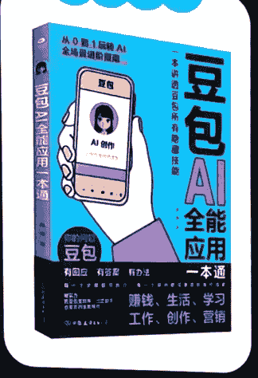

# AI赋能下的抖音、快手、小红书、视频号爆款打造与持续盈利

## 关于作者

徐浪长期深耕图书出版领域十余年，对从选题到策划再到发行的全流程有系统把握。近年重心转向互联网营销、新媒体运营和短视频创作方法论积累，以媒体人的冷静洞察和复合视角拆解行业走向。

## 写在前面

当下我们正处在一个内容重构的特殊周期。抖音、快手、小红书、视频号共同搭建起一个体量庞大的数字场域，每天都有上亿人来此消耗内容，也有数千万创作者希望在此留下印记并获得实际回报。

短视频早已不复“拍一条就可能火”的蛮荒阶段。不少人一夜走红又迅速陨落，更多创作者埋头做内容却难以把流量沉淀为留量、把影响力兑现为生产力。

症结在哪里？多数人过度聚焦于“做出内容”，却忽视了平台生态的运行规则；擅长做内容，却不擅长做运营。这是本书的出发点。

本书第一章拆解了抖音、快手、小红书、视频号的底层盈利机制与主流用户画像。你会发现，抖音并非简单的“潮”，快手并非只是“老铁”，小红书不止是“种草”，视频号也不止是“社交”。抖音的流量池机制怎样推动爆款-涨粉-变现的闭环，快手的私域土壤如何培育高粘性老铁经济，小红书的信任社区基因怎样让种草成为商业模式，视频号怎样借助强关系完成交易，都将讲清楚。认知清晰了，创作才有的放矢。

搞清底层逻辑后，还需要账号定位、内容生产、流量获取这些基本功。第二章到第四章围绕这些环节展开方法与技巧，帮你少走弯路，快速搭建稳定的内容与运营体系。

打好基础后，进入最核心的多元变现。第五章到第八章梳理了当前主流变现方式：私域沉淀与复购，广告合作的报价与品牌匹配，知识付费的课程设计与转化，电商带货的选品与直播打法，提供多模式组合盈利的完整思路。

在AI快速迭代的背景下，AI赋能已成为效率提升的新支点。用好AI工具能降本增效，让创作者把更多精力放在创意与策略上。第九章专门拆解AI应用，其他章节也会给出案例与模板。书中AI生成示例仅为个人实操结果，不同使用者会有差异，请以方法为基准，批判性看待工具输出。

短视频赛道依然宽阔，粗放增长已结束，专业化、系统化、精细化成为新常态。未来属于既懂内容又懂商业、既有创意又有方法论的超级个体。希望本书能助你从创作者向盈利者跃迁。

## 第一章 认知重塑：读懂四大平台变现的底层逻辑

### 抖音：多文化交织的流量变现场

权威数据截至2025年3月，抖音含极速版月活已超10亿。庞大体量让它成为注意力向购买力转换的黄金场景，也是多元文化需求与供给精准匹配的场所。

平台内容包罗万象：北上广的职场日常与乡村的质朴生活并存，硬核科普与搞笑段子共生，国风美学与潮流时尚同台。每个兴趣圈层都能找到归属。小众爱好也能在此找到受众。

多元与流量共同带来商业空间。抖音构建的是一套环环相扣的系统：用内容抓注意力，用注意力建信任，用信任促交易。基于此，不同层级创作者都有变现路径。

1. 接单推广：流量直接租赁。账号具备稳定流量与清晰标签后，品牌会付费合作。以美妆博主推护肤品、科技博主推数码为例，本质是把聚集的注意力和信任出借给品牌。
2. 兴趣电商：即时转化。土特产、手工艺品到大牌商品都能在对应圈层找到买家。常见形式是短视频挂链引导点击购买，以及直播互动讲解加优惠促销实现高转化。
3. 知识付费：专业变现。知识类创作者可通过专栏、付费咨询、线上训练营把专业系统化出售，是对内容深度价值的认可。
4. 私域经营与个人品牌。个人简介留微信导流至社群或公众号做深度运营，可售卖高客单产品与服务；长期输出强化个人品牌，也能带来跨界合作收入。

理解流量变现逻辑后，持续深耕垂直领域，用真实有价值有温度的内容维系信任，就能在流量生态里建立差异化竞争力。

### 快手：老铁文化驱动的强信任变现体系

快手与抖音走不同路线，以“老铁文化”筑起信任壁垒。草根、平民的社区氛围虽不追求精致，但形成了独特的黏性，目前月活超7亿。

其差异化不在于流量规模，而在于强关系连接。平台有三点特质支撑商业生态：

去精致化的真实。快手更看重还原粗糙但真实的生活切片，拉近创作者与用户距离。
高互动的社区感。“双击666”是平台互动仪式，评论区和直播聊天让双方更像邻居朋友，形成准熟人关系。
强黏性的情感连接。粉丝支持源于长期情感认同，而非一时的关注。

变现底层逻辑可概括为：真实内容→老铁关系→深度信任→商业转化。

1. 情感变现：直播打赏。礼物既是金钱支持也是社交表达，像为朋友喝彩，构成最稳固的基础收入。
2. 信任电商：直播带货是老铁经济的核心。与“货找人”不同，快手更像“人带货”。主播常说“我用很久了，今天给家人们争取最低价”，粉丝买的是对人的信任，失信即流失。信任高带来高复购和高客单，家电家具甚至汽车也能成交。
3. 私域流量：稳定变现池。算法推荐用于拉新，粉丝群体的私域才是运营核心。建立老铁关系等于拥有可随时开业的数字门店，自主性和稳定性强。

深耕快手需要契合调性，付出时间创意更要保持真诚。当你成为老铁信赖的人，商业自然随之。

### 小红书：种草驱动的商业转化

小红书起家于美妆穿搭，后向生活全域延展，吸引大量年轻用户分享购物、美妆、生活经验。官方数据显示月活超3亿，女性占比约7成，一线新一线城市用户超66%，90后占比36%以上。

想在小红书做得好，需把握三点：

种草文化与消费心理。用户为寻找和分享美好生活而来，笔记常直接影响决策。
女性主导的社区氛围。交流更重共情而非说教，分享感受比展示专业更有效。
真实与理想的平衡。用户既想要真实使用体验，也渴望理想生活想象，理解这一矛盾是做出爆款的关键。

小红书的商业模式外表温和，转化高效。核心是种草、养护、拔草的链条。

1. 精准种草。KOL负责引爆话题和品类认知，KOC负责夯实信任和促成决策，真实贴近的分享带来从众心理，降低决策门槛。创作者应做体验官和翻译官，把功能转化为生活场景价值。
2. 持续养护。用户被种草后不会立刻下单，会搜索测评、关键词笔记、同类对比。海量UGC构成信息数据库，持续加固购买决心。关注搜索词和评论区问答是关键。
3. 高效拔草。平台不断缩短路径：笔记商品卡片和视频链接直达商城；直播偏深度讲解和氛围营造，集中转化图文种草；私域引流至微信群做长期运营，最大化客户终身价值。

### 视频号：熟人社交下的微生态商业

视频号依托微信生态崛起，月活已破8亿，30岁以上用户占比超65%，消费力较强。微信超14亿月活用户为其提供土壤，视频号深度嵌入社交、公众号、小程序，形成内容-互动-转化-运营闭环。

核心竞争力是社交关系链分发。内容优先推送给好友，好友点赞评论转发会继续扩散，形成裂变。熟人背书自带信任，降低商业转化阻力。

1. 社交信任优先于单纯曝光。基于熟人传播更精准，且好友互动即是信任背书。
2. 公私域联动。主页可添加微信、进入社群，将公域流量沉淀私域。沉淀后的用户复访率高，且能二次传播，形成流量-变现-再裂变的循环。

变现梯度从低到高主要包括：

广告变现。原生植入将品牌信息融入内容，如美妆教程带护肤品；品牌合作任务通过创作者中心承接，按播放点赞转化结算；达1000粉丝可开通流量主，通过贴片或直播广告获收益。
电商变现。依托微信支付、视频号小店与社交传播，形成内容展示-分享-即时购买的短路径。短视频带货以“小黄车”链接商品，直播带货强化实时互动，通过限时折扣和拼团激发购买，同时可导流私域做复购。
知识付费与服务变现。熟人信任让高价值内容更容易付费。可先放片段吸引需求用户，再引导购买课程或加入付费社群。线下服务者也能线上引流线下转化，如健身教练预约私教、律师承接咨询。

### 用户画像：锁定变现人群

1. 抖音
关键词：一二线城市、年轻、追潮流、消费力强、兴趣广。
特征：集中一二线，18-30岁为主，追求放松娱乐，高密度强节奏新奇内容偏好。内容偏爱潮流音乐、剧情短剧、科普、美妆时尚、豪车等视觉冲击内容。
变现指向：18-25岁一二线年轻潮流敏感人群，适合爆款短视频+小黄车带货叠加品牌曝光。

做内容要先看人，再看平台。不同平台的用户画像决定了内容风格和赚钱方式，选错赛道再努力也是白搭。

抖音上有一类典型的冲动型直播购买人群，年龄集中在25到40岁，分布全国。他们的特点是对直播间优惠力度和现场化演示特别敏感。这类人群要拿下，就得经营一个专业可靠的主播形象，重点进攻服饰、食品等快消品类，配合算法的快速分发，冲出爆单。

另一类是30到45岁的职场人群，他们是典型的知识付费接受者，关注理财、职业技能等干货。转化路径比较清晰，先用短视频把人吸引进来，再通过课程售卖完成变现。

快手的用户底色是下沉市场。核心关键词是三四线及以下、普惠、真实、人情味浓、粘性高。

人群分布上，三四线及以下城市占比更大，覆盖面极广。年龄层很平均，从年轻人到中老年人都有深厚存量。用户心态上更在意真实感和人情味，追求老铁式的信任关系，平台算法也更看重人与关系的链接，社区的普惠性和粘性是核心。

内容上他们爱看记录普通生活的Vlog、家庭幽默剧、手工艺人日常、农业养殖、本地化生活等一切真实可感的东西。

对应的变现打法有三种。第一种是30到55岁的乡镇家庭消费者，关注农产品、家居日用、平价服饰。卖点要放在产地直供、工厂源头，直播间主打建立信任，后续靠私域社群做复购。

第二种是全年龄段的老铁型忠实粉丝，对才艺、剧情类主播认可度高。变现靠直播打赏加周边带货。

第三种是三四线城市的创业者、宝妈群体，需求集中在本地团购和技能培训上。可以用快手广告投放平台做精准投放。

小红书的调性完全不同。核心画像是一二线城市里的高知女性，消费能力强，决策高度依赖种草。

性别和地域上女性占绝对主流，集中在一二线，教育背景好、经济独立。用户带着明确需求或潜在兴趣来主动搜攻略、看测评，把小红书当成生活决策的搜索引擎。内容偏好美妆护肤、穿搭时尚、母婴育儿、家居装修、旅行攻略、健身减脂、美食探店等一切能提升生活品质的深度图文或视频笔记。

变现方式也围绕种草展开。20到35岁追求精致生活的都市女性，聚焦美妆护肤、轻奢配饰、家居好物，需要产出测评加教程类的深度笔记，通过蒲公英平台接品牌合作。

25到40岁的决策参考型用户集中在母婴教育领域，关注育儿干货和升学攻略。可以开设店铺卖绘本、早教工具，并用种草关键词卡位搜索入口。

18到30岁的本地生活型年轻人热衷探店、露营等场景，可以和本地商家联动，用体验笔记加团购链接实现转化。

视频号的本质是依附微信的熟人社交。关键词是全年龄覆盖、重微信生态、看重熟人分享、公域私域打通。

年龄跨度大，30岁以上占比明显，付费能力强。使用场景嵌在家庭群、朋友群、熟人分享里。用户更多是被动浏览，但因为来自熟人推荐，信任度很高。内容偏好日常生活记录、经验分享、资讯解读、家庭情感、本地生活、技能教学。

变现逻辑也围绕信任和关系。30到50岁的家庭品质决策者，多为女性，关注健康、家居、育儿、食品。以身边人身份做直播带货和商品橱窗，推日用百货、健康食品，配合社群做复购。

本地到店人群年龄面广，喜欢线下体验餐饮美发等。可以借助视频号本地推送和社交传播，用短视频展示制作过程和门店环境，再用团购小程序和企业微信把人导到店。

还有一类高粘性知识付费和私域用户，关注教育、财经、技能培训。用短视频引流，用公众号做深度内容沉淀信任，再通过小程序卖课或付费咨询做高客单转化。

四家平台用户画像不同，内容生态和商业模式自然不同。运营者必须先拆解自己的定位、产品特性和目标受众，再精准匹配平台，才能把内容价值和商业价值都做到最大化。

做账号别只盯着赚钱，先把盈利认知理清。很多创作者把盈利等同于赚钱，这太狭隘。盈利分短期和长期。短期是金钱，广告、商单、平台补贴。长期是资产，个人品牌、忠实粉丝、行业影响力、持续创作能力。

正确的思路是先积累长期资产，让金钱成为副产品。只盯钱容易掉进标题党、蹭热点、抄作业的陷阱，反而损耗信誉。专注品牌资产建设才走得远。

第二步是思维转换，从追流量到造价值。早期容易陷入要点赞、要推流的焦虑，被数据牵着走。要转成为特定人群解决问题、提供情绪价值或分享知识。不是去要关注，而是去提供价值；不是去追热点，而是去创造吸引力；不是平台的打工人，而是自己领域的创始人。

创作前可以自检三个问题：目标观众是谁？看完能获得什么情绪或知识？这条内容能否增强信任和好感？

第三步是平衡创作和商业，客观看待收益差异。做商业化时要考虑用户接受度，选择相关性强、品质有保障的产品，控制频次和时长。收益有波峰波谷很正常，保持平常心，复盘优化内容和变现策略，能力会逐步提升。

流量像潮水，来得猛去得快，靠单条爆款续命不可持续。能长期盈利的核心是个人品牌和品牌价值。

个人品牌不是简单的人设，而是你在某个领域持续输出价值后，在用户心智里形成的专业标签和情感连接。它是吸精准流量的磁石，也是商业转化的信任桥梁。好的个人品牌能破平台算法壁垒，实现持续积累，也是直播带货、知识付费、广告合作的信任基础。用户买的不仅是内容，更是和你这个人建立的关系。

品牌价值是留人的护城河。它提供的是超越内容本身的价值，让用户产生信任感、好感和价值预期，从而实现用户生命周期的长期变现，形成复利效应。爆款带来短期收益，品牌价值带来长期复利。

账号定位要从天赋、兴趣和市场需求三者匹配入手。单纯靠天赋和兴趣不够，必须对上市场需求才能被看见。

先拆解自我。挖掘天赋，看看你在文案、拍摄、剪辑、人设、选题、互动等环节的天然优势。聚焦兴趣，问自己没有流量也愿意深耕的领域是什么？看到什么内容会想我也能做？哪类创作让你越做越兴奋？把天赋清单和兴趣清单交叉，找到核心区。

再看市场需求。用数据工具找方向。抖音快手的创作灵感和热点榜单看长期热门和新趋势。巨量算数、蝉妈妈输入关键词看用户关注点和竞争度。小红书搜索框看下拉推荐，捕捉真实搜索需求。分析竞品不足，比如大家都在罗列副业清单，评论区却问怎么开始、怕被骗，这就是差异化机会。市场要的不是又一个同类内容，而是比现有内容更好的表达。

确定赛道可以用DeepSeek辅助。新手可以输入自己的职业背景、技能、资源，让AI生成3种定位，包含人设标签、内容方向、变现路径，并据此要前30天选题表、冷启动执行流程和变现测试方案。

有一定基础的创作者可以输入平台、粉丝量、兴趣、职业，让AI给出3个可选项，跳出自我局限。

想找蓝海赛道，要明确平台和领域，提出具体需求。让AI分析近3个月的美妆或目标领域热门关键词，筛出搜索量高竞争小的细分赛道，并给出数据支撑、内容形式和变现路径。这样就能快速找到可切入的空位。

定位的本质是找到自己擅长、喜欢且市场需要的坐标系，不断雕琢独特表达，直到市场无法忽视你的价值。当你真诚为他人提供价值时，成功自然会到来。

短视频里走红的作品从来不是纯靠运气，头部账号能持续把百万级流量稳定拿下，背后都有可以拆解的底层方法。把爆款账号做系统化拆解，把能复用的经验提炼出来，是创作者最快的学习路径，也是优化内容策略的抓手。

一、拆爆款账号，从结构与数据两条线入手

账号拆解先看内容骨架。不同赛道头部号的起势公式并不相同，有的人吃“钩子公式”，先用痛点数字抓眼再埋悬念；有的人走“信任公式”，靠权威背书加对比实验再配合成分可视化来建立说服力。把结构要素剥开看，启发点自然就出来了。

再看数据体征。头部号和普通号在完播、互动、画像上差距明显。数据是方向盘，能及时告诉你该拐弯了。

举个基准：头部短视频前三秒的流失通常能压到25%以内，普通账号往往在40%到50%徘徊。还有用户画像，若同行头部核心人群是25到30岁，而你的账号主力是18到24岁，就意味着人群定位跑偏了。

现在运营必须会用AI做差距分析。用DeepSeek这类工具，把行业头部和自己的账号并列评估，快速定位短板并要到优化建议。

可直接复用的提问框架是：

请拆解XX行业头部短视频账号的数据与内容风格，并与我的账号做对比，给出可优化的方向和未被覆盖的机会点。

头部账号信息：内容风格【】、核心亮点【】、粉丝数【】、平均播放【】、完播率【】、互动率【】

我的账号信息：内容风格【】、核心亮点【】、粉丝数【】、平均播放【】、完播率【】、互动率【】

分析要求：
①头部账号的流量增长路径、选题偏好、内容结构和风格特征
②我号与头部号的核心差距
③基于数据给出3到5条可执行的优化建议

喂入数据后得到建议，先小范围做测试验证，比如调整选题，先连发2到3条同方向内容看数据反馈，优于基准再持续迭代。拆解的终点不是抄，而是训练网感、洞察力和系统化思维，让你清楚内容为何爆、下一个爆点怎么造。

二、塑造人设：把讨喜变成吸金

人设决定了你能不能留住人并变现。一个好的人设要让用户有“一见如故”的亲切，又有让人记住的差异，最终实现粉丝追、品牌投。

找准讨喜的抓手有三点。

第一，锁定垂直人群，拒绝泛化。讨喜的人设是“小而美”。“90后北漂女孩的一人食”比“分享各种美食做法”更鲜明，前者直接戳中单身、北漂群体的日常共鸣。

第二，放大反差形成记忆。平铺直叙记不住，在真实底色上叠加反差点更抓人。比如“学霸博主分享摸鱼学习法”，保留专业感的同时用“摸鱼”拉近距离，人设更立体。

第三，明确价值输出。讨喜本质是有用，要么给情绪价值，要么解决实际问题。像“每天3分钟教你避开一个坑”的人设，就直击职场新人的焦虑。

人设靠内容沉淀，不是喊口号。确定人设后选题必须自洽，别想讨好所有人。强化人设的两个做法：用固定元素做符号，比如固定的开场白、场景、道具，形成条件反射；用故事化内容加深印象，比如“创业老板”与其讲管理方法论，不如拍和员工一起奋斗的真实片段，让观众共情。

吸金靠情感联结。接地气才能讨喜，过度高冷会产生仰望感。美妆博主说“昨天妆被朋友吐槽像鬼，今天带你避雷”，自嘲就能拉近距离。更要做粉丝的情绪加油站，比如励志博主不只喊加油，而是分享“我今天也没动力，但还是完成了小事”的真实状态，让粉丝感到“原来不是我一个人在努力”。人设需要时间沉淀，短期数据波动不要轻易改动核心特质。

三、平台内容逻辑：按题做题

抖音：短平快加强冲突
抖音爆款的底层是效率与情绪。短平快适配注意力经济。

短：黄金时长多在15到60秒，完播率是算法核心权重，信息要浓缩，拒绝冗余铺垫。
平：表达要低门槛、通俗易懂，用直白语言加直观画面跨圈层传播。
快：镜头平均2到5秒一换，配节奏感BGM，口播语速略快于日常，关键信息用字幕钉住。

强冲突是情绪杠杆。视觉冲突用反常识、反转、身份反差制造“没想到”；价值冲突用观念对立、代际矛盾引发站队讨论；情感冲突用悬念、感动、愤怒、怀旧触发共鸣。常见模板有痛点加解决方案、好奇加悬念反转、共鸣加情感宣泄。

快手：真实与烟火气
快手走去中心化路线，靠真实感和烟火气建立信任。

原生态真实是魅力所在。没有精修灯光和妆容，农民分享耕作、工人在工地记录、宝妈记录育儿酸甜苦辣，这类不完美更动人。创作者与粉丝互动更亲密，愿意晒失败和教训。

烟火气体现在对普通生活的聚焦。地域文化展示、行业一线知识普及、街头市井温情记录，都是快手的高频内容。策略核心就是做自己，别过度追求专业设备，把真实经历和真诚关系做出来。

小红书：干货价值加场景种草
用户来小红书是带着需求搜答案，干货是立身之本。

干货常以攻略教程、清单总结、深度测评横评、知识科普经验分享呈现。用户看完要能带走技巧、清单、结论或新观点。

场景化是种草的连接器。干巴巴的产品介绍没人买账，把产品嵌进具体生活场景才有效。周末清晨咖啡的治愈感、便携挂烫机解决出差尴尬的演示、职场新人通勤穿搭的身份共鸣，都在降低决策成本、构建身份认同。先找痛点场景，再用干货给解法，最后自然植入产品。

视频号：强社交、生活化、圈层化
视频号依托微信关系链起家，内容以亲友分享的生活片段为主，如今扩展到亲子教育、职场干货、乡土风情、银发生活，但始终保持真实温暖的气质。

生活化是底色。场景真实比精致感重要，居家、带娃、工作片段、厨房美食都有强代入感；情感共鸣驱动传播，亲情、奋斗、乡愁类内容易引发转发；实用价值受欢迎，生活技巧、避坑指南更易被收藏和转给身边人。

圈层化是生态特征。基于身份、兴趣、地域自然分层，创作者不必追求泛出圈，而要深耕入圈，比如按职业、家庭角色建立认同，精准连接。

视频号能做起来，本质上是抓住了微信的社交底层逻辑。内容要围着关系走，回应用户真正的需求，用情绪做连接，这三点缺一不可。

圈层是内容破圈的基础。身份圈层最直观的就是职业标签，医生、教师、宝妈、创业者各自的日常、困扰和专业话题高度重合，在同一个职业圈里分享干货、聊痛点，很容易形成专业信任和强烈的身份认同，粉丝粘性自然上去。

兴趣圈层则是靠爱好和生活方式聚人。钓鱼、园艺、读书、健身这类爱好，都能沉淀出高活跃的高粘性人群。这类人群爱互动、爱讨论、付费意愿也更高，非常适合做社群和精准转化。

地域圈层利用的是本地生活的即时性。不同城市有不同的文化和习惯，本地资讯、同城探店、线下活动这类内容，借着微信的强地域属性，能快速触达附近的人，对本地生活商家来说也是精准曝光和成交的入口。

说到底，视频号的调性就是社交关系为核心，用户需求为导向，情感共鸣为纽带。创作者要紧扣这个特质，结合自身优势找准赛道，才能把传播和价值做大。

第五节 爆款密码：用 DeepSeek 搭建选题库

短视频卷到今天，选题焦虑是最大瓶颈。灵感靠等等于没戏，跟风拍更是浪费时间。爆款是可以复用的选题逻辑，DeepSeek 能帮你把选题库系统化。

第一步是选题收集。选题库的宽窄决定了创作的广度和上限。平时要把触角伸得更远，借助 DeepSeek 批量捕捞灵感。

先喂给模型账号画像。示范提问可以是：我是XX领域创作者，主要服务XX人群，过去表现最好的作品是XX，请结合XX数据来源，帮我梳理一批高互动、高需求、高潜力的选题。

拿到方向后继续深挖。再问：针对这个领域，我想适配XX平台的推荐逻辑和偏好，请分析该平台的呈现方式和注意事项，并且针对你给出的选题，结合我的经验、背景和平台定位做差异化打法，给出具体建议。

这样就能规模化获取选题，同时让每个方向更有针对性。

第二步是筛选优化。海量的选题不等于好选题，需要筛选和打磨。

筛选阶段，把初筛列表丢给模型，从受众契合度、落地难度、引流潜力三个维度打分，从1到10。并让它说明每个选题的利弊，哪些保留哪些淘汰。

举例提问：我的备选有500元搞定一周通勤装、职场晋升穿搭从实习生到主管的进化史、明星同款通勤装平替测评，请结合我的定位25到35岁职场女性低成本穿搭，从受众契合度、内容可行性、引流潜力打分并给出保留或淘汰理由。

筛选后就要优化细节。DeepSeek 可以帮忙出更吸睛的标题，并搭建视频骨架。

提问示范：请帮我优化选题500元搞定一周通勤装，给出5个不同风格的标题，包含痛点型、数字型、福利型等，并规划视频结构，要有开场钩子、核心穿搭技巧、单品推荐、结尾互动引导四个部分，每个部分说明要点。

经过筛选加优化，留下的选题才具备高契合、高可行、高转化的特质，创作效率会大幅提升。

第三章 内容创作：打造持续引爆流量的爆款体系

第六节 低成本拍摄：拍出高质量视频的小技巧

拍摄不靠器材，靠方法。手机就是主力机，现在的旗舰手机画质完全够用，关键是参数和手法。

参数先调好。分辨率建议1080P以上，日常拍摄帧率30帧，慢动作或动态画面用60帧，画面更稳剪辑空间更大。手机自动对焦和自动曝光容易因光线和主体移动而跳变，可以手动锁定，屏幕长按三秒左右出现锁定提示即可。打开网格线，能把主体放在交叉点上，构图更舒服层次更清晰。

场景和光线是质感来源。布景不用花钱，客厅、阳台、花园、咖啡角都行。原则是简洁统一，背景别乱。拍人让主体靠墙减少杂物，拍物用纯色布或书本做背景突出重点。

光线决定档次。自然光最佳，早上9点前和下午4点后光线柔和阴影小，尽量用侧光或正面光，避免逆光。室内就靠近窗边用窗外光，补光时别混用太多光源防止色偏，条件允许可备一两盏摄影灯。

运镜要稳。常用的基础运镜有四种：固定镜头适合展示和讲解；推镜头是缓缓靠近主体突出细节；拉镜头是由近及远带出环境关系；横摇镜头是平稳左右移动展现全景。

拍摄时双手握紧手机，肘部贴近身体减少抖动，也可以用桌子、书架固定，或者自拍杆当简易支架。每个镜头别低于3秒，方便剪辑。记得多补空镜和细节，如全景环境、手部动作、物品纹理，能丰富节奏弥补主体镜头不足。

第七节 文案力：用 DeepSeek 生成标题与文案

标题决定点击，文案决定完播。AI 能大幅降低试错成本。

标题的三个关键技巧。

第一，给精准画像，避免空泛。不要只说帮我写减肥标题，要说标题面向25到30岁职场女性，久坐不动想瘦腰腹没时间去健身房，突出省时不节食。画像越准，痛点越准。

第二，植入关键词，利于算法。不同领域有各自的热词，美妆有持妆遮瑕平替，育儿有省心益智哄睡等。提问时直接要求植入核心词，例如写5个母婴用品标题，面向0到1岁宝宝妈妈，痛点是夜醒频繁，必须出现夜醒、哄睡、省心、新手妈妈等词，口吻亲切接地气。这样既能被算法识别，也能让用户秒懂。

第三，用固定句式提升命中率。爆款标题都有套路，可以让模型套模版。常见的有痛点提问式，比如30岁还在熬夜，这三个抗衰误区正在毁掉你的脸；利益前置式，比如月薪5000也能穿出高级感，3个平价穿搭技巧必看；数字量化式，比如5分钟搞定早餐，上班族不踩雷的3款快手食谱；反常识式，比如别再给宝宝喝骨头汤了，补钙效果不如这种常见食材。

文案要靠框架加场景。

先定框架，模型才好执行。比如推荐粉底液，可以让模型按开场钩子说出油皮夏天痛点15秒、痛点拆解出油脱妆卡粉斑驳持妆短、解决方案推荐68元粉底液讲控油成分和持妆技术、效果证明实测12小时不脱妆不卡粉、引导转化点小黄车前100名赠美妆蛋，风格像闺蜜分享。

再注入场景化细节。空泛的内容没人信，具体的画面才有代入感。推广保温杯，场景就是早上灌好热水中午在公司还是温热，包里不占地方通勤出差随身带，想喝热水随时有。提问时要求模型加入通勤出差办公室三个场景，突出长效保温和轻便，语言口语化，生成的文案画面感和购买欲都会提升。

第四章 引流推广：精通平台算法，低成本获取流量

第一节 了解四大平台推荐算法，实现流量突围

不同平台的底层分发逻辑不同，适配才是突围关键。

抖音是强中心化的分级赛马机制。先做双向标签匹配，系统通过画面音频文案给内容打标签，同时根据用户浏览互动构建兴趣画像，匹配后才进入分发。分发用阶梯式流量池，新视频先进初始池几百到几千人，考核完播率点赞率评论率转发率关注率达标就进中级池几万到几十万，再达标就进高级池上百万甚至上千万。初期数据不过关就会流转停止。

快手是去中心化的普惠分发。核心是社交关系加权，优先推给创作者的粉丝和好友，互动好再扩散到好友的社交圈和兴趣匹配用户。流量分配更均衡，腰部和普通创作者能获得稳定曝光，头部占比相对有限。

小红书是内容价值导向的种草算法，搜索加推荐双驱动。核心关键词匹配，系统提取内容关键词建索引，用户搜索或有相关兴趣就推送。内容价值评分看收藏率、实用性和真实性，收藏是黄金指标，干货密度和真实性直接影响权重。互动权重排序为收藏大于评论质量大于点赞大于转发，评论里出现求链接、已买好用等种草信号，内容会进一步放大。

视频号是社交信任导向的圈层推荐。启动引擎是社交关系链，先推给发布者的好友和好友的好友，点赞转发评论的互动量决定初始流量池大小。内容先在核心好友圈引发互动，再在家庭群行业群兴趣社群等特定圈层内发酵，如果圈层内转发和深度评论突出，就跨圈层扩散到相似特征用户，最后才有机会进入兴趣推荐大池，社交权重始终贯穿全程。

第二节 发布时机、标签的精细化运营技巧

内容好还不够，运营决定起跑线。发布时机和标签是流量入口的关键。

发布时机本质是和目标人群活跃时段对齐，冷启动时遇到对的人才容易拿到正向数据。需要结合受众画像锁定时间，先分析粉丝的年龄职业作息，找到他们刷手机的高峰窗口...

不同圈层的用户在平台上“在线”的时刻并不相同。想让内容被看见，第一步就要把目标人群画像想清楚，再反推投放的时间窗口。比如白领一族的活跃高峰会集中在早高峰通勤 7:30—9:00、午休 12:00—13:30、晚高峰通勤 18:00—19:30，以及睡前放松的 21:00—23:00；而中老年群体则更偏爱清晨 6:00—8:00 和傍晚 17:00—19:00 的刷屏时段。

除了看人，还要看场景。发布时间与内容调性的匹配度，决定了触达的效率。职场干货、效率技巧这类偏工具的内容，放在午间 12:30—13:30 发布最合适，用户正好利用碎片休息时间“充电”。而情感共鸣、睡前故事、温柔治愈系，则更适合 21:30—22:30 ，与用户的情绪放松节奏同频。

与此同时要学会错峰。所谓的黄金档，本质上是头部账号的争夺场。中小创作者不如把发布时间往前挪 30 分钟到 1 小时，先用平台的冷启动试探期把基础数据跑出来，等大流量涌入时再借势突围。

特殊节点更是天然的流量窗口。节假日、节气、考试季、社会热点，关注度会集中放大。提前做内容排期很容易吃到红利，例如春节前一周输出《年货清单怎么买不踩坑》《过年穿搭三套公式》；高考期间则可以针对考生和家长做《考前减压小方法》《志愿填报避坑指南》。借势节点发布，平台的推荐倾斜会明显。

### 标签搭配：用精准定位打通流量，再用多元组合做扩容

标签是算法读懂内容的“字典”。标签准了，内容才能快速进入正确的流量池；组合多元了，才能破圈。很多创作者要么堆砌标签，要么标签与内容脱节，结果被算法误判。

更稳妥的做法是遵循“精准为主，延展为辅”的思路，搭建核心标签+拓展标签+流量标签的三层体系。

核心标签用来锁定人群，数量控制在 2 到 3 个，通常是领域词+核心关键词。比如美妆教程类的核心标签可以是“美妆教程”“新手化妆”；母婴类的可以是“母婴好物”“新手妈妈”。核心标签要切到细分，不要停留在“美食”“穿搭”这种大词，用“家常下饭菜”“减脂低卡餐”这种细分词，转化率更高。

拓展标签用来覆盖潜在人群，3 到 4 个左右，从场景、人群、用途三个维度延伸。场景类如“办公室零食”“宿舍做饭”；人群类如“学生党美妆”“宝妈穿搭”；用途类如“减脂好物”“送礼攻略”。

流量标签用来拉高曝光，1 到 2 个即可，多为平台官方的热榜标签或活动标签，自带流量加权。比如抖音的“DOU+小助手”“抖音热门”，快手的“快手热门”“创作者扶持计划”。

精细化运营没有万能公式，但发布时间与标签的科学搭配，是爆款的共性底层逻辑。持续测试、复盘、迭代，才能把内容价值稳定转化为流量。

### 让评论区成为粉丝自发“添砖加瓦”的场域

评论区是短视频里最容易被忽略的流量富矿，也是提升互动、增强粘性、实现转化的关键口。做好评论区运营，流量才会裂变。

互动引导是点燃评论欲的第一步。视频结尾一句空洞的“欢迎评论”很难奏效，需要设计指向明确的互动钩子。比如“学到了吗？评论区交作业”“你站哪一派？来评论区投票”“你有没有类似的经历？讲出来一起聊”。给出明确的表达方向，用户才有话可说。

引导之外还要主动下场。粉丝的每条留言都是情感投递，创作者的回应质量直接影响留存。及时回复，并根据留言类型给出差异化反馈，能极大提升归属感和参与感。

评论区也是内容的延伸。可以在评论区补充视频里没展开的细节，例如穿搭视频后统一放购买链接和尺码建议；也可以在评论区发起关联话题延续热度，例如旅游打卡后问“你最近一次打卡去哪了？”。还可以埋彩蛋，比如口令抽奖、暗号福利，促使用户主动翻阅评论，增加停留深度。

最终目标是把评论区变成私域入口。引导关注时可以用亲切口吻承诺持续价值，“喜欢这类内容记得关注，后续干货持续更新”；或在视频结尾说“想看完整版？评论区扣‘1’，关注我下期细讲”。跨平台引流可以用置顶评论引导进粉丝群或公众号，“评论‘进群’我拉你，群里每天分享资料还有抽奖”。带货时则可在评论区发放专属优惠码、团购码或前 N 名赠品，促进即时转化。

### 热点借势：建立雷达，保持速度

热点本身就是流量。蹭热点不是跟风，而是抓住可遇不可求的流量风口，让内容在特定时间迅速扩散并成为爆款。

先要建好热点雷达。热点不止是突发新闻，还包括节日、节气、社会议题、流行梗和平台活动。每天固定浏览抖音热榜、微博热搜、百度指数等榜单，重点关注与自身领域相关的关键词；同时对可预见的节点热点，如假日、纪念日、赛事，提前 1 到 2 周策划。

借势要自然融合。先找到热点与账号定位的共鸣点，美妆号可在毕业季推出毕业照妆容教程，知识号可在世界杯期间做足球规则科普。其次要避免同质化，用差异化角度切入，别人做高温防暑小技巧，你可以做高温下的历史事件回顾。最重要的是输出价值，实用知识、情感慰藉或娱乐体验，才是让用户留存的底气。

执行节奏决定成败。突发热点建议 2 到 4 小时内完成策划制作发布，抢第一波关注；赶不上首发的可在中后期做解读、延伸或反差二次创作；热点结束后及时复盘曝光互动转化数据，沉淀出适合自己的热点方法论。热点是催化剂，持续的创作实力才是续航动力。

### 参与平台活动：用低成本撬动官方流量

平台活动是官方牵头的流量聚合场，对预算有限的创作者性价比极高。它带来自带流量扶持，降低选题决策成本，并实现精准人群匹配。

参与前要精准筛选。优先看活动体量，选择资源投入大的核心活动；看主题契合度，确保与账号定位和粉丝画像高度匹配；看规则细节，确认参与方式、内容要求和奖励机制是否可操作。

在活动框架内做差异化。找到细化的切入点，比如主题是“记录美好生活”，可以细化成“我家阳台的 365 天”“上班路上的治愈瞬间”。同时融入个人特色标签，保持独特的语言风格或标志性结构，让内容在同质化中脱颖而出。

发布后用细节放大效果。标题要兼顾活动相关性和吸引力，例如参与“健身打卡”活动可写“#30 天健身打卡# 第 7 天：新手必学的 3 个居家燃脂动作”。标签除了官方活动话题，再搭配 1 到 2 个细分领域话题扩大覆盖。善用平台提供的活动特效、配乐、字幕模板，也可能获得额外加权。发布时 @ 活动主办方，并在文案中设置点赞评论互动的引导，能让内容在活动池里更快滚起来。

### 从公域到私域：把一次性流量变成可复用的资产

公域流量可以带来爆发，但不属于你。算法推荐带来的海量播放和新增粉丝，如同流沙，难以掌控。投流成本攀升、粉丝粘性低、平台规则变化，都可能让流量断崖式下跌。

私域则是创作者真正可控的资产池。通过合规方式把用户沉淀到个人微信、粉丝群、公众号、企业微信等自己能反复触达的载体里，实现低成本反复触达、高粘性高转化、摆脱平台依赖和流量复利。

在私域里可以几乎零成本激活用户，美妆博主可在群内预告视频主题提升播放，知识博主可推送干货唤醒沉睡粉丝；通过一对一答疑、专属福利建立信任，带货的复购率常被提升数倍；私域不受平台规则制约，还能直接收集用户需求做投票、做定制产品升级；老粉拉新裂变成本极低，形成沉淀-激活-裂变的闭环。

安全导流的核心是合规+价值。杜绝直接留微信号二维码等硬广行为，用内容价值让用户主动添加。

抖音为例，审核对导流词敏感，更适合软植入。口播时用暗示传递价值，“这个细节比较复杂，我整理了一份文档，想要的同学私信进群领取”。评论区用账号统一回复引导，“很多同学问资料在哪，平台限制无法直接发，请私信获取”，并置顶。官方工具上，抖音粉丝群是官方鼓励的过渡私域，先拉群再在公告内引导；企业号可在主页组件合规展示联系方式。

快手则可利用直播间的高效互动+私信转化场景，将公域的关注转化为可长期运营的私域用户。

快手整体气质更接近熟人社交，铁粉文化很重，观众对创作者的信任度偏高，导流时最顺的打法是直播互动配合私聊承接。

（1）直播间做柔性引导
直播要用唠家常的口吻拉近距离。比如可以这样说：“铁粉们，今天给老粉准备了独家权益，这个权益只给加了我私域的好友，想要的朋友扣‘想要’，我私聊告诉你加入方式。”把引导动作放到私聊里，既能完成转化，也能降低被平台判违规的风险。

（2）私聊做单独承接
私聊沟通相对隐蔽，是绕开规则限制的常用渠道。聊的时候可以说：“XX 老铁，加我那个绿色通讯工具就行，搜XXXX，备注‘老铁权益’，我马上把东西发你。”快手对‘通讯工具’‘私域’这类词的容忍度较高，话术可以偏直白，但要避开‘微信’等敏感表述。

（3）留言区只做转移
当有人在留言区问“权益怎么领”“怎么买”，统一回复“已私聊通知，请注意查收”，随后在私聊里完成引导。留言区本身不要出现任何导流信息，避免触发限流。

小红书：用干货种草加留言牵引加私聊收口的软引导
小红书是种草阵地，观众渴望干货和独家权益，平台主要打击硬广留号，对软性引导的容忍度更高。通用路径是笔记输出价值、留言区制造互动、私聊完成转化。

（1）笔记内容里埋钩子
先给足干货再引流。比如穿搭博主在详细拆解技巧后，结尾可以写：“文中的5家高性价比店铺、3套单品清单我整理好了，想要的姐妹在留言区扣‘清单’，我告诉你领取方法。”笔记正文里不要出现导流敏感词，只用权益钩子让用户主动留言。

（2）留言区只做私聊提示
用户留言“清单”后，回复：“姐妹，已私聊你领取方式啦！”留言区保持干净，不出现‘微信’‘加我’等字眼，只完成从公开到私聊的切换。

（3）私聊先给价值再导流
私聊先发一部分干货建立信任，再引导进私域。比如：“姐妹，《小个子穿搭清单》的完整版和链接我放在朋友圈了，你加那个绿色通讯工具，搜XXXX，备注‘穿搭清单’，我把完整版发你。”小红书用户对‘朋友圈干货’的接受度很高，用朋友圈做载体合规又显价值。

视频号：借助微信生态做信任延伸
视频号依托微信，公域曝光到私域沉淀的链路很短。平台不禁止合理的私域引导，但非常看重用户体验，排斥生硬广告。核心是利用社交信任和生态内的无缝跳转，把‘关注’自然延伸为‘好友’。

（1）视频里只指引主页
干货类视频结尾可用口播或字幕说：“更多内容我放在个人主页了，需要的朋友点进主页，按背景图或个性签名的提示领取。”视频中严禁出现二维码或直接报微信号，只能引导看主页。

（2）主页组件做信息沉淀
可把微信号艺术化融入背景图设计；在个性签名写“资源领取/交流请私聊”；挂载公众号链接引导深度内容订阅，把导流信息留在可公开查阅的位置。

（3）留言区做场景转移
用户提问时，用简洁话术把对话拉到私聊，例如：“具体方式我发你私聊了，可以看一下。”不提任何载体名称，只完成从公开讨论到一对一私聊的转移。

总体来看，四平台导流的关键不是钻规则空子，而是用持续的价值输出换取信任，让用户主动愿意进入私域。合规的载体传达独家的价值，才是流量安全沉淀和长期转化的前提。

第三节 私域变现的核心：商品和服务过硬
私域搭建好后，如何稳定变现是创作者的终极难题。有人盯着裂变话术，有人琢磨社群玩法，但所有技巧都建立在一个前提上——商品要经得起检验，服务要让人满意。

1、信任是变现的底座
公域是一面之缘，交易结束关系就断；私域里是一群基于内容、人格和价值认可的粉丝。这份信任像情感账户，每一次优质内容、真诚互动都在充值。推荐商品时，用户买的更多是信任。好商品和好服务能验证信任，带来复购、转介绍和口碑，私域会越滚越大。反之，劣质商品或糟糕服务就是透支信任，用户会觉得被当韭菜，一次失望就能让之前的积累归零，甚至引发信任雪崩。

2、私域追求的是终身价值
私域的魅力在于细水长流，而非一夜暴富。让用户反复付费靠的不是话术，而是每一次交付的超预期体验。

（1）好商品是硬实力
商品要真正解决用户痛点。健身博主推荐的装备舒适且性价比高，育儿博主分享的用品安全实用，粉丝就会从消费者变成传播者。这种信任裂变成本低、转化高。

（2）好服务是软实力
私域的粘性来自全流程体验。社群及时答疑、完善售后、对用户的尊重，这些细节构成品牌感知。用户觉得买的不只是商品，还有超出预期的服务，变现就自然发生。

想把流量变成持续收益，就必须回归本质：商品做扎实，服务做细致。审视商品能否解决核心问题、以何种形式交付、提供哪些附加服务，才是变现增值的关键。

第四节 朋友圈运营：拒绝刷屏也能成交
朋友圈是流量沉淀、信任培育和成交落地的阵地。很多创作者陷入刷屏误区，结果只剩下反感和屏蔽。高效的朋友圈靠的不是数量，而是精准的价值输出，让用户因信任而主动下单。朋友圈的核心是社交，成交是社交的自然结果。把它打造成个人价值展示窗，用持续的内容培育信任，成交才会发生。

1、搭建专业加信任的人设
人设是朋友圈的灵魂，要与平台人设一致。构建人设可从专业形象标识、个人风格标识、价值主张标识三方面入手。专业形象标识体现领域能力，要有干货；个人风格标识展现性格，让人感受到独特性；价值主张标识明确能给粉丝什么。三类标识贯穿内容，粉丝才会形成专业、靠谱、有价值的认知。

2、输出高价值内容矩阵
每天发3-5条，覆盖干货、生活、轻营销，比例约2:1:1。

干货内容占比最高，把短视频核心拆解到朋友圈，或分享行业洞察，让粉丝觉得“关注你能学到东西”。生活内容是黏合剂，要真实接地气，比如“剪辑到凌晨靠咖啡续命”“视频上热门感谢支持”，让粉丝看到普通人的一面。轻营销要自然，避免硬广，可用场景+价值呈现，如“学员用我教的脚本，第一条涨500粉，截图共享”，或“限时八折仅剩5个名额”，用案例和稀缺性推动决策。

3、互动激活粘性
发完内容不是结束，互动才是关键。回复要及时且有温度，不要只说“谢谢”，而是延伸对话，遇到问题可私聊补充。主动浏览粉丝朋友圈，每天花十分钟给重点客户点赞评论，评论要走心，比如对方说“加班好难”，回复“记得买杯热饮暖胃”。适时抛出话题提问，也能提升参与感。

坚持1-2个月的高质量输出加真诚互动，信任会累积，成交也会自然到来。

第五节 维护私域粘性，建立长期消费习惯
私域是创作者的流量自留地，获客成本低、留存空间大。维护粘性、培养复购是可持续变现的核心。私域粘性的本质是信任和价值认同叠加，核心优势是可反复互动，但互动不是信息轰炸，而是一套从吸引进入到持续信任再到主动消费的闭环。

1、强化认知，提供独家权益
私域用户因公域内容而来，运营时要守住内容定位，避免跑偏。并设置独家权益，如私域专属答疑、独家资料包、提前剧透公域未更新内容，让用户感受到“进群不亏”，建立价值依赖。

2、让互动成为黏合剂
私域的核心是人。常态化互动加场景化活动可增强情感纽带。每天固定时间分享后抛出讨论话题，如“宝妈们宝宝夜醒怎么解决”。对留言提问做到及时精准回复，记住核心用户的偏好。场景化活动如“粉丝妆容挑战赛”，作品在公域展示并给予私域权益奖励；节假日做私域专属抽奖、好友助力领福利，提升活跃度和裂变。

3、用激励培养长期消费习惯
避免急功近利，采用阶梯转化：低门槛尝试阶段推出体验装、9.9元秒杀，降低决策成本；中高频复购阶段用会员体系、积分制度锁定用户，消费累积积分可换权益，会员享折扣和优先购权益，并基于消费记录做精准推荐；高忠诚裂变阶段设老带新奖励，老用户邀新可获双重权益。并做好消费后反馈闭环，主动询问使用体验、收集建议并反馈，让用户感受到买的是商品也是服务，形成消费-满意-复购的良性循环。

第六章 广告变现：成为品牌方争相合作的优质博主

第一节 构建报价体系：一个视频值多少钱
收到第一个商业合作询价时，报价是关键。报高吓跑商家，报低陷入内卷。广告视频的价值要综合自身实力、市场行情和合作需求来评估。报价通常由基础费用加增值费用构成。

1、基础费用是创作底价
覆盖时间、人力和设备成本。参考行业均值，也可自我核算：硬成本+软成本+时间×时薪。时薪可参考当地制作行业均值或反推月收入目标。基础费用不是固定值，口播类成本低可下调，剧情类需脚本演员多场景则上浮。报价不能低于成本底价。

2、增值费用是溢价部分
基于基础费用之上收取。平台分发增值，多平台投放每个额外平台收基础费20%-30%；互动数据增值，要求点赞评论达标可设达标奖金，10%-50%不等；定制化增值，原创脚本、实地取景、专业演员、后期特效可收创作服务费，脚本约30%-50%；授权使用增值，用于线下宣传或他号转发需收版权授权费，50%-100%。 

合作模式也会影响报价。只负责发布不承诺转化，以基础费为主；长期合作可给基础费10%-20%折扣。账号或品牌体量小的情况下可采用商品置换加少量现金合作，积累案例的同时降低门槛，但要注意价值匹配，避免亏本。

第二节 品牌合作：选对形式很重要
不同的广告形式决定创作自由度、投入成本和商业回报。创作者需要充分了解主流形式才能在合作中掌握主动。

1、植入式广告
将商品、Logo、卖点自然融入剧情、场景或台词，避免生硬说教。可分为场景植入、剧情植入、台词植入。优势是润物细无声，用户对硬广抵触强，植入能降低反感并保证内容观赏性。适配性强，剧情、知识、测评、Vlog都能植入，对内容风格干扰小。

2、定制化内容广告

定制型商家短片的本质，是账号主人为某位客户单独策划并拍摄的一条原生影像。围绕客户的传播诉求展开构思，让商家主张、商品卖点或活动信息在剧情里自然流露。这类单子主题通常很聚焦，比如对新品上线的解读短片、为公益项目做的宣传短片、针对使用方法的深度教学定制等。

它最大的竞争力来自高度贴合带来的情感共鸣。账号主人能够借助自身的表达习惯和受众画像，把商家信息转化为观众乐意观看的呈现形式，让客户意图、主人风格、受众偏好三者达成一致。信息因此传递得更透彻，也因为主人的专业度得到背书，观众的信任感随之提升。优质的定制稿件自带传播势能，除了在主人账号扩散，还常被官方渠道二次转载，进一步放大声量。

对账号主人而言，定制单的报价弹性更足，同时深度策划的过程也能锤炼创作能力、强化专业人设。

直播推品则是账号主人以直播形态实时讲解演示商品并引导下单的合作方式。它打破了传统投放只做曝光的局限，实现了从作品展示到互动答疑再到即时成交的闭环。

从合作形态看，既有商家的专场直播，也有直播过程中穿插讲解的商品；从结算看，多采用保底费用加销售提成的组合，部分头部也会走纯提成。直播的核心优势是成交效率高。实时互动可以马上解答价格、性能、使用方式等疑问，降低决策门槛；限时折扣、限量秒杀等专属福利则进一步刺激购买，快速把流量变现。

这种模式收益和业绩挂钩，上限高，还能通过即时互动提升受众黏性。但对现场掌控力、商品讲解能力和受众信任感要求很高，更适合已有一定基础且调性匹配的博主。

商业化变现的底层是作品价值和商业价值的平衡，并没有放之四海而皆准的最佳形式，只有最合适的选择。入门博主可从植入式推广切入，边积累受众边熟悉商业逻辑；已有一定积累的博主可尝试直播推品，追求高成交；头部博主则更适合承接定制稿件，实现商家和个人的价值共振。

### 第三节 用 DeepSeek 打磨高转化推广内容

商业化要看两个关键指标：客户愿意找你，以及观众愿意看你拍的推广。很多博主卡在了第二步：不知道怎么拍好一条推广，或者发布数据惨淡，很快失去复投机会。

因此，提升推广内容成交效率是博主绕不开的课题。DeepSeek 可以成为有力的助手，用得好能显著提升脚本质量。

接到客户brief时，往往因对商品和市场理解不足而无从下笔。这时可以用统一模板提问：

依据下方商品资料，为【】平台定制一份短片推广脚本，要求风格呈现为【】，面向【】群体，视频长度约【】，商品详情如下【】。

输入后即可获得初步方案。

以一款轻盈管理茶为例，可这样提问：

依据下方商品资料，为抖音定制一份短片推广脚本，要求风格呈现为活泼搞笑，面向 25 ~ 40 岁的都市女性，视频长度控制在 60 秒内，商品详情如下：一款主打轻盈管理的茶饮，口感清淡，无糖，适合忙碌的白领女性。

DeepSeek 输出的方案如下。

标题：《缘分已断！办公室瘦身养成记》

视频风格：活泼、搞笑、情景剧、接地气

目标受众：25 ~ 40 岁都市女性

时长：45 ~ 60 秒

关键卖点：轻盈管理、口感清淡、无糖无负担、适合白领女性

表 6-1 DeepSeek 产出的脚本详情

| 片段编号 | 画面描述 | 声音与文字 | 时长 |
| :--- | :--- | :--- | :--- |
| 1 | 开场痛点：阿香失落地捏着腰侧的“游泳圈”，对镜头叹气。旁边阿玲正在吃薯片 | 音效：一声沉重叹气 阿香：“姐妹们，谁懂啊？过了 30 岁，喝口水都胖！” 字幕大字：“30+ 的痛！” | 5 秒 |
| 2 | 冲突搞笑：阿玲递蛋糕，阿香眼神挣扎，衬衫扣子被撑开 | 音效：“砰！”卡通音 阿香（惊恐）：“我和蛋糕的‘孽缘’到此为止了！” 字幕：“减肥决心已下！” | 5秒 |
| 3 | 引入商品：阿香神秘地从抽屉掏出精美盒装轻盈茶，包装上“无糖”“清香”清晰可见，冲泡时热气升腾 | 音效：“叮！”宝藏音效 阿香（神秘）：“直到我遇到了它——我的‘神仙快乐水’！” 字幕：“轻盈管理新选择！” | 5秒 |
| 4 | 展示优势：阿香闻香后大口饮用，露出满足表情 | 音效：“咕咚”喝水声+“啊～”享受音 阿香（陶醉）：“哇！清淡的！无糖的！再也不怕负担啦！” 字幕：“口感清淡” | 6秒 |
| 5 | 夸张对比快切：①阿香在工位优雅喝茶 ②阿玲继续狂吃，身材视觉“膨胀” ③阿香似有仙气缭绕，身形轻盈，穿裙自信转圈 | 背景音乐：轻快网红BGM 画外音/字幕：“坚持喝了一段时间，我和闺蜜的‘差距’就这么拉开了！” 字幕：“健康刮油，轻松做瘦子！” | 15秒 |
| 6 | 结尾行动号召：阿香自信微笑举杯，屏幕下方出现购买链接图标 | 阿香（活力）：“告别‘喝水都胖’体质！同款轻盈管理茶就在下方小黄车！点击带走你的‘瘦身’茶吧！” 字幕大且醒目：“点击下方，立即变身！” | 10秒 |

表演风格：拍摄时可适度夸张面部表情与肢体，更符合抖音网感。

节奏把控：整体节奏紧凑，尤其是对比段落用快剪加音效抓注意力。

视觉焦点：商品特写要美观有质感，突出清香健康的视觉暗示。

背景音乐：选用当下流行的轻快卡点BGM，增强情绪带动。

字幕设计：字幕醒目，关键信息如“无糖”“轻盈管理”等可用不同颜色或放大突出。

获得初稿后，可继续优化。以如下模板追问：

请针对以上这段推广脚本，帮我分析一下这段推广脚本的逻辑是否清晰，如何优化可以吸引更多用户的兴趣，促成用户下单？

根据反馈调整，最终形成可拍摄的完整脚本。

### 第四节 如何与商家建立长期协作

一次成功的协作只是起点，长期稳定的协作关系才意味着更低的沟通成本、更高的默契、更稳的收入和更深的价值绑定。从一次性到长期共赢，关键在谈判思维的转变。

1. 用价值输出赢得信任

商家更看重持续收益而非单次价格。账号主人要避免陷入低价竞争，以价值输出为核心。

谈判初期先传递契合点，结合受众画像和商家定位说明长期价值。例如母婴类账号可说：“我的受众 80% 为 0 ~ 3 岁宝宝的妈妈，与你家婴幼儿辅食目标用户高度重合，过往协作受众复购率达 20%，如长期协作，可通过‘商品使用+育儿知识科普’持续强化信任，提升用户生命周期价值。”

用数据支撑主张，展示过往长期协作案例成果，如“与某母婴商家协作 1 年，账号转化率较初期提升 30%，商家在受众圈认知度提升 45%”，让商家直观看到长期收益。

2. 提出阶梯方案激发长期意愿

为长期协作铺路，可规划升级路径。例如：“先从 3 个月基础协作起，根据转化数据与反馈调整第 4 ~ 6 个月作品方向，若效果达标，第 7 个月升级为商家专属作品打造，结合新品周期做系列作品；我也可作为商家体验官参与线下活动，实现线上线下联动。”

这种小步试错逐步升级的路径更易被接受。还可约定长期福利，如协作满 1 年享新品优先推广权、费用梯度优惠等。

3. 灵活处理异议，用真诚获认可

长期协作需要相互包容。费用被质疑时，不宜硬碰，可提“费用与价值挂钩”的调整方案：“若协作周期延至 1 年，基础费用降 10%，同时额外增加 4 次直播专场，保证年度总转化量不低于××。”

主动关注商家的潜在顾虑，如数据真实性，可承诺每月提交播放量、转化率、受众反馈等详细报告，接受第三方监测，用透明机制消除疑虑。

长期谈判是价值匹配和信任构建的过程，保持专业和真诚，合同执行中超预期交付、保持即时专业沟通，有助于关系持续。

### 第五节 在合规和观众体验间找到平衡

优质推广既要符合平台规则，也不引发受众反感。合规是底线，观众体验决定账号黏性和商业价值。

1. 建立合规观念

创作前需学习推广监管政策和平台审核标准。关注市场监管总局、广电总局等发布的规范，熟悉《广告法》《互联网广告管理办法》中关于短片推广的要求，明确虚假宣传、低俗营销、无资质推广等红线。同时熟悉各平台标注、呈现差异。借鉴行业合规案例，提前规避风险。

2. 让推广融入作品，降低违和感

生硬硬广最伤体验。可用生活化植入、剧情化演绎、专业评测等方式把商品功能和作品自然结合。例如生活博主在“周末大扫除”作品里自然展示清洁商品使用效果；科技博主以评测为主题专业展示数码性能并明确标注推广。这样既合规又有价值感。

3. 严格把控推广品质

观众对商品不信任就会抵触。应建立筛选机制：优先选择和账号定位、受众需求匹配的商品；实地试用并验证效果，拒绝劣质虚假商品，必要时索要资质证明、质检报告；在作品中客观呈现优缺点，真诚推荐更易被接受，也降低违规风险。

4. 保持公开沟通，强化信任

公开能拉近和受众距离。可提前预告、真诚说明推荐理由：“这款商品我用了 3 个月，解决了××问题，觉得合适才推荐。”发布后主动回应评论疑问，对负面反馈诚恳回复。公开沟通既满足标注合规要求，也传递诚意。

账号主人首要是内容生产者，其次才是商业协作方。在合规框架内用创意和真诚打造适配优质的推广，才能进入商业变现和观众增长的良性循环。

## 第七章 知识付费：将经验与技能做成产品

### 第一节 如何快速找到知识变现切入口

知识付费是“一次创作、多次收益”的高价值路径。但不知道从哪下手，是常见困惑。

底层逻辑是交付的知识须具备壁垒、需求、可交付性。需关注三点：

定位账号核心资产：回顾过往作品，看哪些视频点赞、评论、收藏最高，反映观众最爱的作品。

明确自身能力边界：是有专业资质如注册会计师、教师资格证，还是有独家经验如从零做成 10 万粉、半年瘦身 30 斤。专业资质适合体系化课程，独家经验适合实战指导。观众更愿为可复制的经验买单。

锁定观众真实需求：分析观众画像，整理评论区和私信高频问题，这些就是需求入口。

三个普适切入口：

技能拆分型课程：把实操技能拆成步骤化、可复制的知识产品。例如常发剪辑技巧的作品，可推出 9.9 元剪映入门小课、99 元爆款剪辑进阶课、999 元 1 对 1 指导。适合剪辑师、美妆师、摄影师、手账达人、美食博主等。

经验复盘总结类课程：将失败教训和成功经验产品化。例如从零做到 10 万粉的账号主人，可做《新手起号实战指南》，涵盖定位、选题、流量、变现，并加入踩过的致命坑、常见选题错误等独家复盘。门槛低、信任度高，适合有实战经验的账号主人。

资源整合打包类内容：把掌握的独家资料筛选解读打包成知识库。例如考研博主推出“考研英语备考全套资源包”，含历年真题解析、高频词汇表、作文模板、听力素材、笔记等，并提供每月更新、使用指导。适合擅长信息整理的博主。注意不是简单搬运，需加入筛选和解读。

找到切入点后先小成本试错，把核心内容做成 1 ~ 3 条免费作品测试反馈，强烈受好评后再做完整产品。先小而精再逐步拓展。

### 第二节 知识付费形态：专栏、课程、咨询如何选

常见形态有专栏、课程和咨询，三者逻辑和创作要求不同。

专栏的核心是碎片化知识的系统聚合，通常以系列文章、音频或短片合集呈现，围绕单一主题展开，单篇独立、整体成体系。最大特点是轻阅读、强连贯，适合通勤、午休等碎片时间学习。

知识变现的本质是把自己的实战经验打包成别人愿意买单的产品。以短片为主的作者，基本盘就三条路径：专辑、课程、咨询。选对赛道，起步策略完全不同。

**专辑：低门槛起步的长周期现金流**
专辑对作者最友好的是启动成本低。已经在平台沉淀的分散素材，直接整理归类就能复用。以美妆号为例，此前发布过的底妆技巧、眼妆教程、卸妆步骤等片段，稍作归纳就能升级为《新手美妆全攻略》这类专辑，无须从零做系统重构。

另外两点优势也很明显。一是长周期收益强，上线后只要主题不过时，就能持续被检索购买，后续只需少量补充更新；二是单价多在几十到几百元，属于轻决策消费，受众面广，很适合冷启动积累用户池、塑造个人影响力。

**课程：从碎片到闭环的沉浸式交付**
如果说专辑是碎片阅读，课程就是闭环学习。它的核心标签是系统化、互动性强、可量化，通常围绕一个明确学习目标来设计，包含课前预习、课中讲解、课后练习、答疑辅导，呈现以录播长视频为主，强调沉浸感。

因学习成效易被看见，课程的价值感和用户粘性更高，定价也从数百元到数千元不等。对作者而言，这是证明专业深度的最好方式，比如摄影类作者可以推出《短片拍摄+剪辑全流程实战营》，系统讲解脚本、拍摄、调色、爆款逻辑，手把手带教最容易建立信任。

课程还有很强的复购延伸能力。先靠基础课筛选精准人群，再引导到进阶课、训练营、私教服务，形成成长路径。

**咨询：用时间换高溢价的定制化服务**
咨询是知识变现里个性化程度最高的一环，单人对话或小范围沟通，直接为用户定制解决方案，核心逻辑是用实战经验去解决他人痛点。常见形态有职业咨询、创作咨询、问题诊断等。

最大特点是客单价高、转化效率高。作者需要投入专属时间和精力，所以定价通常在数千到数万元。以拥有十年短片运营经验、孵化过多个百万粉账号的从业者为例，推出《账号起号全案咨询》，定价数万元仍有稳定需求。

单人沟通带来的深度绑定，也是口碑裂变的关键。满意度高，很容易变成铁粉并主动宣传。

综合来看，新手作者建议从专辑开始积累用户和经验；有系统知识储备的，课程最能放大专业；资深行业专家，则适合靠咨询实现高收益变现。

**课程开发：借助AI把经验打包成产品**
很多作者卡在把素材整理成框架上。用DeepSeek可以大幅降低提炼成本。提问思路是告诉AI：我想讲什么、面向谁、我的优势是什么、时长和单元怎么分。

一个常用提问模板是：
我想做一套线上知识变现的短片课程，请帮我设计完整课程框架。课程主题是【 】，适合的目标群体是【 】，我的优势在于【 】，整套课程的时长为【 】。我希望将课程分成【 】个单元，每个单元里有【 】节课。请帮我列出：课程名称，每个单元的标题名称、主要内容，每节课的标题和简单介绍，整个课程的亮点和卖点。

举例：以剪辑者身份，要求主题是用剪映剪辑短片技巧，目标群体是有剪辑需求想做短片的作者，优势是多年剪辑经验并熟练剪映，时长约1小时，3个单元各3-5节课。

AI给出的方案是《80分钟快速学会剪映剪辑技巧——从新手到高手的进阶》。
单元一聚焦剪辑约25分钟，讲粗剪精剪节奏把控、转场时机、背景音乐音效降噪搭配；单元二美学约30分钟，讲调节功能基础调色、滤镜选择与微调、自然美颜瘦身、画质提升设置；单元三创意约25分钟，讲三维花字动态字幕、关键帧特效转场、蒙版混合模式的分屏遮罩效果。拿到初稿后，结合自己的账号素材再整合完善即可形成最终框架。

**咨询变现：先做影响力，再谈定价**
咨询变现的核心是信任变现，客户买的不是知识点，而是你解决问题的能力。

打造个人影响力分两步。第一是凸显专业，从泛娱乐走向垂直专家。清晰定位“我能为谁解决什么问题”，把零散经验系统化成方法论，比如“3步搞定算法”“5个底层逻辑做爆款”。同时把服务对象和成果写清楚，比如“专注中小商家短片获客，3个月陪跑20家门店流量翻倍”，用问题拆解加解决方案的素材范式让专业可感知。

第二是信任构建。用匿名或授权的成功案例展示你帮客户解决了什么、获得了什么结果。收集中视频证言、图文案例，在账号和私域持续传播，形成案例多→信任强→客户多的正循环。

定价要遵循价值定价，而非时长定价。常用三种策略：
阶梯定价法：基础咨询800元/次1.5小时；进阶咨询3000元/3次含资料包随访；高端陪跑15000元/1个月含单人沟通加全案加资源对接，覆盖不同预算并引导升级。
打包定价法：把核心咨询加模板加随访加沙龙名额打包成套餐，如《短片起号套餐》3800元，单独购买价值4500元，让客户感知超值。
动态调价法：随着案例积累和影响力成长逐步上调。新手期基础咨询500元/次，积累20个成功案例后调至800元，成名后调至1500元。调价需提前告知老客户并给予专属优惠，同时用素材输出传递涨价原因。

**用免费干货做信任入口，再用钩子引导付费**
免费素材的核心是建立“免费都这么值，收费版更超值”的预期。

首先，免费素材要超预期。可直接落地的解决方案是关键，比如家庭教育类免费视频讲“孩子写作业拖延，1个番茄钟公式立刻见效”，把步骤、注意事项、案例讲透。也可以展示收费版的核心价值片段，比如自媒体运营免费视频讲“起号的3个核心逻辑”，暗示收费课程有更完整的方法论。

其次，在免费素材里留钩子。问题延伸式钩子：讲完基础数据排序后追问“多条件排序加按颜色筛选怎么做？收费版里用3个案例全流程拆解”。资源补充式钩子：免费讲完爆款标题公式，结尾说“100个高转化标题案例的PDF完整版和实战训练营在收费课程里领取”。

平台策略也要区分。抖音快手适合短平快强钩子的素材，小红书更适合深度拆解，通过深度素材吸引愿意投入时间学习的精准用户，付费意愿更强。

**电商带货：从种草到下单的闭环**
短片带货的核心是种草，让用户从“我需要”到“我想要”再到“我必须买”。

选品四标准：高颜值强视觉冲击的商品，适合影像展示；能解决具体痛点的独特功能品，如防脱洗发水、静音键盘；高性价比引流品，9.9元10包抽纸、买一送一；高复购刚需品，支撑长期盈利。

种草素材要兼顾观赏性和说服力。痛点刺激法：你是否也遇到过…我之前也深受其扰…直到发现这款商品…场景沉浸法：把商品植入精致早餐、整洁书桌等向往场景中，让它成为生活的一部分。价值提供法：做测评、科普、避坑指南强化专业形象，让用户为知识而来为商品买单。促单时配合稀缺感、好评数据、7天无理由等降低决策门槛。

直播带货则更依赖互动。商家合作模式需一定粉丝量，通过坑位费加佣金变现，收入稳定但控制权低；纯佣金模式零门槛按效果分成，启动容易但收入不稳；自有店铺模式需要完整供应链，利润最高控制权最大，适合成熟期作者。

不管哪种模式，都要从单向讲解转向场景互动唤醒需求。比如推破壁机时问“早上想喝豆浆又嫌外面买的不卫生的人扣个有”，紧接着讲预约功能、打果汁做辅食的场景，帮助粉丝把商品和自身需求连接起来。

素材是入口，信任是桥梁，产品是落点。专辑打基础、课程做规模、咨询拿高价、带货做闭环，四条线跑通，才能形成可持续的变现体系。

直播间里，成交从来不是硬卖出来的，而是聊出来的。把互动当成桥梁、把信任当成地基，每一次对话都在为下单铺路，下面这套打法能帮你把转化做实。

**先用提问把需求点出来，再顺势带货**

别一上来就报功效，先把粉丝的日常困扰抛出来。聊护肤就说：“夏天到了，家人们是不是脸控不住油，还老冒痘？在评论区扣‘是’的，这款控油精华我自己用了整整一个月，出油真的肉眼可见地降下来了。”先共鸣再给答案，粉丝自己会把产品等同于“正好我需要的”，购买欲就起来了。

**用群体氛围放大冲动**

直播的最大优势是“一起买”。人多就热闹，热闹就好买。你可以用数据型和福利型互动一起推。比如下一句：“现在间里一千人了，点赞冲到十万，我就再加一百单福利价！”大家一起点赞、一起抢，现场感和从众心理会迅速推高下单速度。

**对准意向用户一对一催单**

当评论区出现“怎么买”“有没有优惠”这类信号，就是最佳出手时机。立刻定向回复：“宝宝点左下角的小黄车1号链接就能拍，今天拍还送赠品，我现在手把手演示一遍。”流程拆清楚、门槛降下来。犹豫的人再用稀缺感推一把：“这价只到直播结束，下播就恢复原价；新进来的家人扣‘新人’立减5元，专属福利。”精准回应，转化自然顺畅。

总结一句话：以互动连通粉丝需求，以信任沉淀购买决策，细节打透，成交水到渠成。

### 高佣金高转化的爆款选品思路

内容决定流量，选品决定利润。选对一件自带势能的产品，佣金就可能爆发式增长。

**1. 盯准高佣金品类，但算清真实收益**

不同品类佣金差很多。美妆护肤、家居百货、数码配件普遍在15%到30%之间，部分新品甚至能到40%以上；而食品生鲜、家电则多在5%到15%。选高佣金只是起点，真正到手要看“客单价×佣金比例×转化率”。平台自带的商品橱窗和选品中心里，按佣金排序并优先看带“平台优选”“高转化”标签的货；第三方工具如蝉妈妈、新抖则可以按品类、佣金、销量、转化等多维度筛，还能回看历史销量和佣金波动，避免踩到短期高佣后销量断崖的坑。对“佣金超50%但客单价只有9.9包邮”这类陷阱要警惕，看似高佣实收几元，还容易因低价低质引发售后。

**2. 产品要和人设内容同频**

货品必须强化账号信任感。测评号适合有差异化卖点、能横向对比的品；剧情号适合把产品自然嵌进生活场景，比如在夫妻日常里植入油污清洁剂，前后对比直观。性价比人设就别推天价奢侈品，精致宝妈人设也不能推低质婴儿用品，否则人设崩塌，长期转化受损。

**3. 别追尾款，抢上升期**

短视频爆款生命周期一般1到3个月。上升期的信号是：平台热榜里搜索量和视频播放量持续走高但销量还没封顶；腰部创作者开始带且反馈不错，头部还没大规模入局；第三方工具显示近7天销量增速连续高于行业均值。抓到这个窗口，抢占先机。

**4. 优先可视化强的品**

短视频是看出来的。服装要能展示版型面料，彩妆要能上脸看色号遮瑕效果，家居要能入景演示使用感。工业品、专业仪器这种需要复杂讲解的品目，转化难度高，建议谨慎。

选品不是靠运气，是积累选品库+小批量测试+根据数据反馈快速迭代，才能形成高转化、高复购、好口碑的闭环。

### 让观众愿意留的直播间搭建法

画面决定第一印象，第一印象决定停留时长。

**场景要对品类做减法**

美妆护肤用简洁干净的白米色基调，背景放产品陈列架，专业感出来；服饰穿搭用纯色幕布或冷调挂毯加衣架配饰架，预留走秀空间；美食就用真实厨房或简约餐桌，摆食材、餐具提升食欲。记住“极简+核心道具”，背景装饰不超过3种，色彩不超过4种，避免高饱和堆砌抢戏。

**光线打好质感**

准备3到4盏灯，主次分明。主光用柔光箱放在主播正前方45度，高度与肩平或略高，也可用直径不小于30cm的环形灯补面部细节。补光放在主光对侧，功率稍低去阴影，展示珠宝化妆品质地时可用小功率桌面灯侧打。背景光放在身后1到2米打向墙面，形成层次感，让人像更立体。色温也要配品类：美妆服饰用5500到6000K冷白光还原真实；美食家居用3000到4000K暖黄营造温馨。

**设备求稳不求贵**

新手用1200万像素以上的手机加稳定器或三脚架就够，追求更好的可上入门相机。声音建议领夹麦或桌面麦，保证收声干净。直播间不必一步到位，先满足画面清晰、声音干净、画面不抖，再按数据迭代升级。

### 用DeepSeek快速产出高转化话术

话术是产品和用户的连接器。想快速提质，可以用AI辅助，先给清晰指令再人工优化。

通用提问框架：我想通过短视频介绍【产品】，请帮我生成一段口播词。语气是【】，从【】角度说出，主要针对【人群】，时长【】，产品特点是【】。

以新防晒霜为例：活泼亲切专业、上班族女性视角、针对25到35岁都市白领、30秒、12小时持久防护、轻薄不黏腻、自然提亮。

AI会给出类似这样的脚本：早八通勤的姐妹是不是都烦，防晒涂了也白涂，下午就暗沉还黏腻？我最近挖到宝——这款‘上班盔甲’防晒霜，12小时长效，早上涂一次撑满工作日，不用中午补。质地一抹化水，不搓泥不闷痘，还有自然提亮，不是假白，是透亮有光泽，上妆更服帖。通勤、午休、下班约会都hold住，链接在评论区，今天开播福利，快去冲。

设计要点在于：先点痛点共鸣，起个易记昵称做记忆点，把功能翻译成使用场景的好处，最后给清晰行动指令。可以让AI多出几版风格，再结合自身经验微调，开口即成交。

### 售后和粉丝维护，复购的根基

高销售额若伴随售后差评，就不是好生意。

**前置服务降风险**：直播和视频里如实讲解，不夸大不隐瞒瑕疵。服装要说清面料、尺码、洗护；食品要说清保质期、储存、口味。链接详情页补全退换政策、物流时效等信息，预售定制类提前告知发货节奏，减少信息差带来的纠纷。

**响应要快且透明**：建立黄金一小时原则，用户反馈后1小时内首次响应，即使没解决也先安抚。多渠道公示售后入口：简介、粉丝群公告、置顶评论。给用户看清晰流程：提交—确认—处理中—已解决，并主动推送进度，超预期沟通能化解不满。

**分层运营做精细化**：新粉丝给欢迎短信+新人券引导进群；活跃粉丝直播点名、优先答疑、定期发专属券；高价值粉丝提供一对一服务、新品优先试用、售后快速通道，甚至邀请参与选品，增强归属感。

**互动保持温度**：评论区常问“你最想我们带什么”“你遇到过什么售后难题”，优质留言送小礼；直播设粉丝点单、连麦分享使用体验，分享选品发货等幕后故事；社群里做晒单有礼、拼团、生日福利等活动，形成持续互动。

### AI 赋能多平台矩阵运营

2025年短视频AIGC迎来关键突破。字节跳动的Vidi2主打视频理解与自动化剪辑，通过长时序理解和时空定位输出剪辑指令；快手的Kling O1主打视频生成与精准编辑，基于统一多模态模型实现导演级指令控制。二者分别从“理解”和“生成”两端推动内容生产智能化。

创意是最难的瓶颈，AIGC让脚本从依赖灵感到可批量生成，让重复性剪辑和素材拆解效率大幅提升。站在智能化浪潮上，用工具提效、用人味做决策，才能在多平台矩阵里实现稳定且规模化的增长。

如今内容生产者的日常已被生成式技术重塑。只需要丢进一个简短的搜索词，比如职场逆袭或者宠物日常趣事，配合调性偏好与时长上限，模型就能快速产出多套创作大纲，内含故事推进、对话设计、画面提示等关键要素。

更突出的是，模型能依托庞大的行业信息库捕捉当下热词与受众口味，把契合市场的灵感点植入大纲。比如 citywalk 成为潮流时，系统会结合各城地标自动生成小众城市漫步指南类的选题，帮助生产者更快抓住流量入口。

在细分赛道同样有效。知识型博主可以让模型把专业概念拆解为像 3 分钟读懂量子力学 这样的大众短内容，极大降低创作门槛。

## 制作升级：效率与品质同步跃升

过去一条短视频要经历拍摄、剪辑、配音、字幕、特效等全链路，对技能与时间消耗极大。现在借助生成式能力，零基础也能产出较高水准作品，实现效率与质量的同步跃升。

①素材环节。生成式能力同时缓解素材匮乏与版权焦虑。按大纲需求可生成虚拟素材，用 AI 绘画生成动画场景与人物形象，用生成模型制作产品演示画面，无需实地取景。部分平台还内置正版素材库并搭载智能检索，输入需求即可匹配合规图片、音频、视频片段，安全且高效。

②剪辑环节。智能剪辑可实现自动完成。导入素材与大纲后，系统自动匹配镜头、衔接转场、搭配背景音乐，并依据风格进行智能调色。字幕也能自动生成，能识别语音、自动纠错、匹配字幕样式，后期校对负担明显下降。

③配音环节。智能配音音色库丰富，涵盖男女声、方言、外语，还能按情绪调整语速语调，如悬疑选用低沉沙哑、治愈选用温柔舒缓，质感接近专业配音。

④特效环节。特效生成提速明显。科技类视频可自动添加数据流特效，剧情类视频可一键进行画面风格迁移，如漫画风、复古风，视觉冲击力显著增强。

对短视频行业的赋能已成定局，未来主流是人机协同。重复性、技术性的创意生成、素材制作、数据处理交由模型，生产者聚焦内容策划、情感表达、个性创新，以个人风格与价值观为作品注入温度。

### 第二节 智能客服让运营变现更顺畅

数字化环境下，客服是商家与用户连接的关键枢纽，服务效率与质量直接决定满意度与转化率。对带货型运营而言，客服即流量到成交的转换器。

传统模式已显吃力：

- 人力成本高昂，需大量人员及持续培训，流动率高推升费用
- 服务效率受限，人工无法全天候在线，海量重复咨询易导致延迟与答复不一致
- 数据价值挖掘不足，沟通记录分散难以快速整合为决策依据

DeepSeek 等大模型的出现明显缓解痛点。自动化客服机器人依托自然语言理解、深度学习与知识库整合，能理解复杂问题、给出精准答复，并在交互中持续优化。对电商变现的帮助体现在三方面。

## 1 自动答疑：标准化咨询即时响应

带货场景中用户购买冲动往往仅几十秒，响应超过30秒易流失。自动化客服可实现瞬间回复，借助预训练行业话术库精准解答高频问题。

例如用户询问面霜是否适合敏感肌，系统可即刻回复：亲亲，这款面霜配方温和，添加神经酰胺与泛醇，敏感肌可安心使用，下单还赠5毫升小样，当天下单次日发货哦。既解答疑问，又顺势引导成交。

## 2 自动流转：复杂问题处理更顺

超出答疑范围的质量投诉、个性化需求反馈等，自动化客服可自动识别并转人工，同时将问题记录与历史互动同步给人工，避免用户重复描述。据统计接入后响应时长可从平均5分钟降至10秒内，有效降低订单流失。

## 3 数据洞察：激活复购潜力

自动化客服不仅解决，还能挖掘。系统会分析购买记录、咨询内容、互动频率，对用户进行分层：新客、高频复购客、潜在流失客，再推送差异化话术与活动。

同时可基于咨询意图做关联推荐。用户咨询干皮适用面霜时，除了解答，还会主动推荐同系列干皮精华水，搭配使用保湿更佳，现购套装立减30元，实现一次咨询多单转化，形成稳定盈利增长点。

对短视频创作者而言，自动化客服的价值在于轻运营。粉丝破10万后私信量会爆发，产品购买、售后咨询等重复问题会吞噬创作时间。有了自动化客服，可从重复沟通中解放，更多时间投入决策与内容，保持竞争优势。

### 第三节 多渠道协同：为何需要矩阵化布局？

无论是短视频还是内容社区，生产者均需面对投放成本上涨、站点规则与算法随时变动、用户生活碎片化跨站点分布的现实。单一渠道已难以稳定触达。

破局之道是提前布局全渠道，以多元化账号组合聚合放大流量。即便核心账号或某站点受冲击，其余账号仍可保持稳定。

建立组合的核心收益有三：

#### （1）分散风险
跨站点多账号布局可有效对冲站点依赖风险。

#### （2）多元化收益
曝光面扩大，商业合作机会增多，通过组合联动整合各渠道变现路径，实现一份内容多渠道收益。

#### （3）受众全覆盖
针对各站点用户画像定制内容，实现目标人群全方位包围，避免因不匹配浪费流量。

账号组合不是简单堆砌，而是具备战略、分工与层次的生态系统。单一站点为线性增长，跨站点组合为指数增长，因每个站点都在为其他站点导流。对生产者而言，建立组合势在必行。常见三种形态。

## 1 跨站点分发——同素材多渠道投放
以核心站点为轴，向外拓展属性不同的外部站点，形成一核多翼格局。关键在于差异化适配，而非简单搬运。

例如以抖音为核心的美食生产者，可将60秒美食视频提炼为图文笔记并附食材清单与做法发布至小红书。可最大化复用素材，降低创作成本，同时覆盖不同用户群体。

需注意深入理解各站点规则，如小红书对广告标注有明确要求。

## 2 单站多号——定位区分
在同一站点运营多个账号，通过精细化切割覆盖不同细分受众，实现单点突破多点开花。

例如抖音育儿组合可设3-6岁启蒙教育、育儿好物测评、职场妈妈育儿指南等账号，各自聚焦特定场景。组合内可互相转发评论形成流量联动，提升权重。难点在于保证每个账号质量与区分度，避免被判定为营销号，且人力投入更大。

## 3 全景式布局——最完善方案
结合跨站点与单站多号优势，同时覆盖多站点、多账号，并搭配短视频、图文、直播、音频、社群等多种形态，形成内容生产—流量获取—用户沉淀—变现转化的完整闭环。特点是多形态联动，满足用户不同场景需求，实现流量层层转化。

例如健身领域生产者，可在抖音运营健身动作教学核心号与健身饮食搭配副号引流，在小红书发布健身穿搭与器械测评图文实现种草。这是目前最完善的流量布局，能实现公域获取、私域沉淀与商业转化，但对内容创作、站点运营、私域管理、商业变现等综合能力要求极高，适合具备团队支撑的生产者。

### 第四节 借助 DeepSeek 搭建内容组合

账号组合的核心价值在于通过多站点+多形式+多主题触达更广人群，强化品牌认知，降低单条内容失效风险。新手可从一主站点一辅站点或一核心号一辅助号起步。

思路不清晰时，可让 DeepSeek 辅助规划。例如使用以下提问模板：

> 请根据以下信息帮我设计起步阶段的内容组合规划。
> · 我的领域：【】
> · 个人特点：【】
> · 可投入时间：【】
> · 初步目标：【】
> 要求生成：适合我的核心账号定位和站点；1~3个辅助账号或站点的建议；各账号定位区分；账号联动机制设计。

拿到站点规划后，需学会内容二次利用，将同一核心素材调整后分发至多站点。

如何拆解？可采用两种方法。

## 1 横向切分思路
将一条长视频或专业度高的内容拆分为多个短切口。可这样提问：

> 请帮我将以下主题拆分为适合不同账号的多个内容角度。主题：【】。账号A定位：【】。账号B定位：【】。请提供适合账号A的3个内容角度和标题建议，适合账号B的3个内容角度和标题建议。

快速获得拆分方向后，再基于新主题延展内容。

## 2 纵向分层思路
控制内容深浅，避免术语过多导致用户听不懂。可这样提问：

> 请帮我将这个主题按深度层级纵向延展。核心主题：【】。目标受众：【】。请按入门级、进阶级、专业级设计内容，分别对应普通短视频图文、专业号实操、付费内容深化。

分层内容可更精准吸引用户。生成后建议做人工精加工，特别是时效热点与高价值品牌内容，按站点特性深度优化后再分发。

总之，生产者面对的不再是单账号流量竞争，而是组合生态位竞争。需要内容生产力、组织力、数据力与生态协作力。将组合思维与AI工具结合，才能构建可持续流量体系。

### 第五节 多渠道风格校准：用 DeepSeek 调整表达

跨渠道分发时，同一选题用相同表达在抖音可能爆款，在小红书可能沉寂，核心在于风格不适配。创作前先调整风格再分发。

DeepSeek 具备强风格迁移能力，可高效生成适配各站点的脚本。提问方式可为：

> 请为【】主题生成【】个适用于【】站点的【】类短视频脚本，结构为：【】+【】+【】。要求：节奏【】、语言风格【】、时长【】……

以户外博主为例，主题为新手驴友如何挑选户外帐篷，提问：

> 请为“新手驴友如何挑选户外帐篷”生成3~5个适用于抖音站点的科普类短视频脚本，结构为提出问题＋逻辑讲解＋优缺点对比。要求节奏适中、语言年轻化接地气、时长3分钟内，结合日常案例和知识图标。

生成的一个脚本示例：帐篷形状怎么选？别再纠结了，时长2分45秒，面向露营新手。

提出问题画面在帐篷展区前纠结，旁白点出形状懵圈的痛点。

分类讲解圆顶帐篷适合新手快速搭建，隧道帐篷空间大适合家庭，金字塔帐篷抗风强但搭建门槛高。

优缺点对比用分屏表格呈现搭建快价格亲民但空间小抗风差，空间大但重需多人，抗风轻量化但搭建麻烦等。

结尾互动提问常去的露营地点，评论区精准推荐。

确定方案后，还可继续追问 DeepSeek 进行细化优化。多渠道风格转换本质是用不同站点语言讲述同一个有价值故事，DeepSeek 的价值在于让这种转换高效可行，使生产者把更多精力放在创造核心价值上。

## 推荐阅读

《豆包AI全能应用一本通》

责任编辑：白 鎏

策划编辑：汲鑫欣

特约编辑：张启蒙

装帧设计：淼 玖

## 低成本布局多平台

AI 赋能放大收益

四大平台爆款逻辑 × AI 全流程赋能 × 多元变现路径

一套可复制、可迭代的智能创作与盈利系统

让你的创作成本**降低**

涨粉效率与盈利收入**倍增**

