# AI动漫一本通：三分钟速通影视+动漫+设计创作


# 前言

Preface

生成式AI的飞速发展无疑是当今技术进步的一个缩影。从ChatGPT的迅速走红，到各类生成式AI产品的商用化仅仅用了不到两年的时间，这种技术迭代的速度前所未有，足以令业界为之震撼。对于那些已经开始接触或使用生成式AI的用户而言，学习并掌握这项技术不仅仅是一种技能的积累，更是紧跟时代潮流、抓住未来机遇的关键。

从笔者对各相关行业的了解来看，现如今已经有大量的企业在试着向内部的生产部门引进生成式AI来作为降本增效的工具，其中就包含了影视动漫制作的相关领域。对于商业公司，稳定性依然是其主要诉求，在新技术的尝试上会有一定的滞后性，但是对于个人创作者来说就不一样了。

对于那些没有技术背景的人来说，以往很多需要专业技术的内容创作，现在都可以通过生成式AI轻松完成。早期如果要设计一张高质量的动漫人物立绘，设计师需要具备专业的绘画技能和丰富的设计经验才能做到，而如今，只需输入一个简单的提示词，AI就能生成符合要求的精美图片。这种技术的普及使得内容创作的门槛大大降低，让更多人可以参与到创作中来，无论是艺术、音乐、写作，还是视频剪辑、动画制作，生成式AI都为用户提供了新的创作可能性。那些曾经因为技术门槛而无法实现的创意都可以通过AI得以实现，这为影视动漫的爱好者，以及想要在这个行业自力更生的人打开了一条通路。

本书所面向的主要是个人创作者，考虑到工程量以及实现难度，在很多创作细节上不得不进行妥协。但这并不意味着作品的粗制滥造，有了AI的辅助，我们还是能最大限度地保证作品的完成质量。

为了尽可能完整地展示AI的生成效果，本书尽量不去改动AI工具的生成结果，其中的内容难免会有错漏，在此提前告知各位读者。

# 1 AI的崛起与影视动漫创作

生成式AI的出现是AI发展历程中的一次爆发。尽管现阶段AI的性能还远谈不上成熟，但对于创意领域的创作者来说，生成式AI所展现出的想象力已经足够成为我们提升创作效率的强大武器。

## 1.1 生成式AI都能做什么

“生成式AI”这个名字其实已经非常直白地道出了这些工具的功用，就是为创作者生成各式各样的内容。随着生成式AI的应用变得越来越普遍，其在文本、图像、视频和音频方面都展现出了巨大的潜力。

在文本生成方面，生成式AI对语言的处理能力已经达到了一种比较惊人的地步。基于输入的提示词，AI能够生成各种形式的文本内容，包括但不限于小说故事、剧本、对话、新闻报道以及专业论文。目前模型的短板主要在于知识性的缺陷，对于一些深度的垂直领域缺乏理解，但是在除此之外的场合中，AI都表现出了非常强大的语言理解能力。网络实现机器学习的奠基性发现和发明”。

为了应对不同的应用场景，文本生成AI也有着不同的模式。有些AI模型会倾向于在生成内容时加入一定的“创意修饰”，这类似于一种“默认模式”。这种模式在创作故事、剧本或广告文案时尤其有用，因为它能够让文字表达更加生动，富有情感。比如当我们输入提示词“一个英雄的冒险故事”时，通过分析，AI会使用一种适合书写故事的语言风格，不仅会生成一段故事情节，还能加入一些细节描述和情感铺垫，使故事更加引人入胜（图1-1）。

但是在一些需要精确表达的场景中，比如撰写法律合同、技术文档或者学术论文的时候，创作者就需要一种更加中性的文本生成方式。此时AI可以切换到类似的模式，更加遵循提示词的指引，直接输出内容而不进行额外的润色，这样一来所生成的文本会更加精准、简洁，适合那些追求准确性而非创意性的应用场景。

图像生成则是生成式AI最直观的应用之一，通过输入提示词或参考图像即可生成相应的视觉作品。与传统的绘画或设计工具不同的是，生成式AI能够快速输出高质量的图像，覆盖各种风格和场景，从写实到抽象，从现代艺术到古典风格，可以说无所不包。为了加强画面的效果呈现，不同的AI模型会有各自独特的“美学滤镜”，这些滤镜可以理解为一种自动的风格化处理。一些模型在生成图像时会倾向于添加一些艺术性的效果，使画面更具创意和视觉冲击力。这对于制作影视或者动漫素材的创作者来说是非常有帮助的，这种优化方式可以让他们在短时间内获得多样化的设计灵感和创作素材（图 1-2）。

有时创作者的需求不仅仅是追求艺术性，还需要更精准、更真实的效果，比如一些要凸显真实性的摄影作品，这就需要生成式AI能够准确还原提示词的本义。针对这种情况，一些AI模型会提供一种“原始风格模式”（类似于 Midjourney中的style raw模式），这意味着生成的图像没有经过额外的美学处理，更加接近于提示词所表达的真实效果。这些模式让生成式AI的应用更加灵活，可以在不同场景下满足多样化的需求——既可以生成高度艺术化的插图，也可以生成完全忠于现实的照片级别图像。对于用户而言，他们可以根据项目需求自由选择是要“更具创意地表现”还是“更精确地呈现”。

视频生成模型的出现比起其他的AI工具要晚一些，它的原理基于图像生成模型能力的拓展，通过生成连续的图像来完成视频的制作。在最初的版本中，AI所生成的视频无法保持很高的连续性，每一帧的画面之间都有很大的差异，在内容上只能保持主体上的相似。经过数个版本的迭代之后，目前有几个比较先进的模型已经能够制作出相当有表现力的视频素材（图 1-3）。

目前视频生成AI依然有着时长上的缺陷，大多数模型的视频时长只能维持在10秒左右。呼声最高的Sora AI还处于内测阶段，从放出的素材片段来看，Sora确实将视频生成AI的上限拔高到了令人惊喜的地步，但是其还没有投入正式的使用中，所以具体的效果还比较难说。

音频AI在应用上有两个大方向，一个是语音合成，一个是音乐生成。语音合成是通过大量语音材料的训练来让AI具有文字转语音的能力，每一个语音模式都相当于一个独立的语音模型。它可以用一种极其自然的腔调将输入的文字念出来，避免了传统语音模型“机器音”的问题，在使用AI进行角色配音的时候有着很不错的效果（图1-4）。

图1-4 生成的语音文件

而通过学习海量的音频数据，AI能够生成从简单的背景音乐到复杂的多声道交响乐等不同类型的音乐。与图像和文本生成不同，音频合成技术的难点在于对声音的细节处理，如音高、节奏、和声的协调等，这使得生成式AI在这一领域的表现更加具有技术性。在制作电影配乐或动漫背景音乐时，生成式AI可以根据提示词快速生成多种风格的音乐片段，为创作者提供选择。这种“自动化生成音乐”的方式特别适合那些需要大量素材的项目，比如影片的预告片剪辑或广告片段。输入一些关键词或参考音乐就可以让AI生成符合项目需求的音轨，让创作者能够快速制作出风格多样的作品（图1-5）。

图 1-5 AI生成的音乐文件

在这些工具中，文本生成AI可以说是目前最为成熟的AI工具，头部产品与追随者之间早已没有了代差，各家之间基本上的差距基本上在一到两个版本之间。其他工具之间的差别就比较大了，就拿AI绘画工具来说，不同的图像生成AI之间还存在着不小的差距，目前来说能够达到商用标准的只有Stable Diffusion、Midjourney等少数几个模型，市场上大部分的产品还处于只能作为“玩具”的阶段。这种情况也同样发生在视频生成工具、音频合成工具上面，在挑选平台的时候最好选择那些技术上比较成熟的平台。

## 1.2 AI为影视动漫创作带来的改变

制作影视动漫是一个非常庞杂的系统性工程，个人创作者面对这样的复杂度是很无力的。即便是一个比较简单的个人作品也需要耗费很久的时间，而为了节省工作量，一般来说还会砍掉配音和配乐，只进行作画方面的创作。生成式AI的介入带来了一种新的局面，让更多个人创作者有了独立完成完整作品的可能。

影视动漫的制作流程包括了剧本编写、分镜设计、角色设计、场景绘制、动画制作、配音配乐等多个环节，每一个环节都需要专业人员进行长期投入，稍有疏忽，整体进度就会被拖慢。这也是为什么在以往能够独立完成一部高质量作品的个人创作者非常少见。

在文本创作方面，生成式AI让复杂的剧本编写与分镜设计成为可能。对于很多创作者而言，编写一个完整的剧本往往需要大量的时间和精力，尤其是那些需要长篇幅叙述和复杂角色设定的作品。AI的介入让剧本创作变得更加轻松和高效，通过自然语言处理技术，AI可以帮助创作者生成初步的故事大纲，甚至细化到具体的对话和场景描述。这种智能化的剧本生成不仅能快速形成基础的故事框架，还能够根据用户的提示进行自动补充和修改，让创作者在短时间内获得多样化的故事素材。

AI在剧本创作中的另一个优势是能够迅速进行语言风格的调整和优化。传统的剧本编写，需要创作者反复修改推敲，以确保语言表达符合角色性格和情节发展。而现在，AI可以根据角色设定自动调整台词风格，帮助创作者节省大量的修订时间。这不仅加快了剧本创作的进程，还提升了故事表达的连贯性和丰富性。

角色与场景设计一直是影视动漫创作中最具挑战性和创意性的部分，设计师需要在角色的外观、性格、服装以及场景的细节、氛围、光影效果等方面进行深入考虑。而这一过程往往是耗时费力的，特别是当创作者希望追求高质量的视觉效果时，更是需要经过多次迭代和调整。

而通过AI模型，创作者可以在初期设计阶段输入简单的提示词或草图，AI会根据这些信息生成多个不同风格的设计方案。例如，输入“一个冷酷的剑士站在古老的城堡前”，AI会根据设定自动生成多个不同风格的角色和场景设计，从写实风格到卡通风格，创作者可以从中选择合适的方向进行进一步调整。这种快速生成的特性不仅能够帮助创作者节省大量时间，还能提供更多灵感。过去需要反复试验才能确定的视觉设计，如今只需简单操作即可完成。更重要的是，AI还能够自动进行光影渲染和细节填充，让生成的设计图像更加真实和生动。

在配音与配乐方面更是如此。术业有专攻，配音和配乐需要专业的音效师和配音演员，能够完成全方位制作的通才毕竟是少数，一般来说一位创作者也只能精通某一个领域的专业技术。生成式AI在音频合成方面的进步使得个体创作者也能轻松实现高质量的配音和配乐。通过AI语音合成技术，创作者可以根据角色设定自动生成对应的角色配音，从语音语调到情感表达，AI都能够进行精准模仿。这种技术不仅节省了邀请配音演员的费用，还能根据创作者的需求随时调整声音风格，保证了作品的连贯性。

专业团队才能完成的任务变得唾手可得，为影视动漫创作带来了前所未有的效率和便利，大大降低了创作门槛，让更多人可以自由探索创作的可能性。

## 1.3 如何理解生成式AI

目前生成式AI都是通过问——答的方式来生成内容，因此也可以把它们称作问答式AI。这个问答的过程其实就相当于一个简化的编程过程，所以换句话说，生成式AI把所有人都变成了程序员。

生成式AI的工作机制可以简单理解为一个“输入——输出”的过程，其中输入的部分就相当于编程中的代码，输出则是AI生成的内容。与传统的编程不同，生成式AI并不需要编写复杂的代码逻辑，而是通过自然语言的提示词或参数配置来指导AI生成所需的结果。这种“问——答”的形式让人们可以更加直观、简便地与AI进行互动，不需要编程基础，也能够轻松实现各种创意构想。

在生成式AI的工作过程中，输入的提示词相当于一个简化的“命令”，通过这些指令引导AI模型生成相应的内容。这种问答式的交互过程类似于人们向AI提出问题（或请求），而AI根据已有的数据和模型逻辑生成相应的回答（或作品）。比如我们输入一段提示词“科幻风格的未来城市”，绘画AI会根据内置的模型和训练数据，从数百万张图像和文本中提取出与“科幻”和“未来城市”相关的特征，从而生成一张符合描述的图像。这种过程看似简单，实际上包含了对多个维度的理解和处理，比如风格、主题、色调、构图等，最终生成的结果往往能让人耳目一新。

与传统编程中的“函数调用”类似，生成式AI的提示词也是一种“调用参数”，通过改变这些参数，用户可以在不修改底层逻辑的情况下，获得完全不同的输出结果。比如通过修改关键词，改变描述语气，或者增加一些限定条件，生成式AI的输出内容可以从图像到文本，从情感分析到语音合成，满足各种不同的需求。这种灵活的“问——答”方式，让AI的使用变得更加直观、自由，也为创作者打开了更多的可能性。

由此也可以看出，提示词的设计是使用AI工具的核心内容，可以将其理解为编程中的“代码编写”部分。与传统编程需要严格遵守语法和规则不同，生成式AI的提示词设计更像是在用自然语言进行描述。这种灵活的表达方式，让用户可以通过关键词、短语甚至完整的句子来引导AI的输出。

在设计提示词时有一些常见的技巧和方法，在生成图像时用户可以通过描述颜色、光线、风格等细节来调整最终的效果。如果希望得到一幅充满活力、色彩鲜艳的画作，可以在提示词中加入“明亮的色彩、动感的构图”等描述。反之，如果希望得到一张柔和、安静的作品，则可以加入“柔和的灯光、简洁的线条”等关键词。

类似于编程中的“调试过程”，用户可以通过不断调整和修改提示词，逐步优化生成结果。这种方式被称为“提示词工程”（Prompt Engineering），用户通过试验不同的描述语句，不断摸索出最能表达创意和意图的提示词组合。比如，想要生成一个魔幻风格的城堡，初始提示词可能是“城堡”，但经过几轮测试和调整后，用户最终可能会确定使用“在雾气笼罩的山巅上，矗立着一个古老的魔幻城堡”这样的描述，这样生成的图像会更加符合预期效果。

生成式AI不仅能够理解提示词，还可以根据用户的需求进行风格上的调整，这就像是在编程过程中给函数添加了一些特定的参数和选项。如果只使用提示词来控制生成结果，在想要表现的内容比较复杂的时候可能精确无法控制AI的表现，所以有些AI工具会加入额外的控制机制来补强细节上的生成控制，比如参数控制，比如局部的重新生成。这些机制都是提示词的补充内容，学会运用这些额外的机制能够更好地使用AI工具。

生成式AI的另一个核心优势在于“学习能力”，与传统的静态编程不同，AI能够通过大量的数据进行“学习”从而不断优化自身的生成效果。这种学习的过程类似于人类在不断积累经验，从而变得更加熟练、精准。一些文本生成AI通过分析海量的小说、新闻、对话等文本数据，不断学习不同语境下的语言使用方式，从而在生成内容时，能够更加符合人类的表达习惯。而在图像生成中，AI通过分析成千上万张图像，从中学习不同风格、色彩搭配和构图技巧，使得生成的图像更加多样化、逼真。

这种数据驱动的学习机制，赋予了生成式AI“进化”的能力。它能够通过持续的模型更新和数据扩充，不断提升输出的质量。这种与生俱来的“自我优化”特性使得生成式AI在各个领域的应用变得更加广泛和强大，无论是艺术创作还是技术设计，生成式AI都能迅速适应新的需求，生成符合当下潮流的作品。

## 1.4 抢占技术先机

在技术的发展史中，先行者的优势总是非常明显。越早发现技术趋势，越早投入学习和应用，就越能够在这场技术变革中占据主动地位。

生成式AI的快速崛起带来了许多新的机会，无论是商业领域还是个人创作领域都可以看到它的影子。技术的迭代速度正在加快，那些最早尝试使用这些工具的人率先摸索出了如何将其应用在实际场景中，并通过不断试错积累了宝贵的经验。这些经验不仅能够帮助他们快速上手后续更成熟的版本，也会让他们在这一技术浪潮中获得独特的优势。随着生成式AI的应用越来越广泛，产品的封装程度会越来越高，换句话说，未来的AI工具会更加智能和易用，用户无须理解复杂的技术细节，也能够使用这些工具完成各类任务。然而这也意味着对于那些想要在这一领域深入发展的用户来说，理解AI的底层逻辑就变得更为重要。

越早学习生成式AI较为底层的技术原理，就越能在未来的技术更新和产品升级中保持对其应用的理解和掌控。当生成式AI模型的参数设置、训练方法发生变化时，那些具备基础技术知识的人可以更快地适应新版本的变化，甚至在遇到问题时可以根据对模型的理解进行自我调整。这种技术回溯能力不仅是解决具体问题的利器，也是深入挖掘生成式AI潜力的钥匙。深层次的技术理解能够帮助用户更灵活地调整AI的使用场景，找到更适合自身需求的解决方案，而这种能力将成为未来AI应用时代的核心竞争力。

在AI技术不断进化的背景下，从被动接受技术到主动创造技术也是一条必要的路径。过度依赖封装后的工具容易让人忽略创新的本质，而深入学习生成式AI的技术逻辑不仅能够让用户理解AI工具的运作原理，还可以让他们在实际应用中不断发掘新的可能性，通过组合不同的AI工具创造出更为复杂和精细的作品。正是在这种持续探索和创新的过程中，用户不仅是在使用AI工具，更是在推动生成式AI技术的进步。

对于那些希望在AI时代掌握主动权的人来说，学习生成式AI不仅是一个技术上的选择，也同样是一个未来发展的重要决策。通过不断提升自身的技术素养，理解生成式AI的运作原理和发展趋势，创作者将能够在未来的技术浪潮中拥有更多的机会和成功的可能性。

# 2 文本内容创作

文本生成AI是所有AI工具的基础，无论是绘画AI还是音频AI，他们的内部都要用到相似的算法来处理提示词。而除了故事与镜头脚本的创作之外，在实际使用中，文本生成AI也能帮助其他的工具处理一些内容上的难题。

## 2.1 工具简介

能够理解自然语言是大模型最大的优势之一，这一次的AI浪潮正是从文本生成AI开始的。作为技术迭代时间最长的AI工具，市面上主流的产品之间已经没有了所谓的代差，无论是OpenAI的ChatGPT，还是谷歌的Gemini，抑或是我们国产的文心一言、通义千问，他们之间的差距都在逐渐缩小。

本书后续的内容将以文心一言作为文本生成AI的应用案例进行讲解，如果读者想要尝试其他的AI工具，同样可以参考本书中的使用方法。搜索模型的关键字，来到欢迎页面（图2-1）。


图 2-1 欢迎页面

点击查看详情即可进入文心一言的工具首页（图2-2）。


下面介绍一下在软件面板中比较重要的几个模块。

第一，新建对话。文本生成AI以“话题”作为生成内容管理的基本单位。在同一个对话单元内，AI可以保持一定长度的记忆能力，也叫作上下文记忆能力。每当我们提出问题时，AI会在当前单元内评估这个问题与之前的问题的关联性，然后依据自己所记忆的内容进行回答。新建对话的作用就是重新创建一个话题，AI在不同的话题之间不会共享记忆。

第二，对话管理。在这个模块中系统会按照时间顺序罗列出曾经创建过的话题，如果需要浏览历史话题的话，直接点击话题名即可回到对应话题的对话列表中，并且可以继续之前的对话。默认情况下系统会根据对话中第一个问题的内容来给话题命名。

第三，对话输入框与对话显示窗口。这个文本输入框就是输入文字信息的地方，将问题输入后按下回车，或者是点击右下方的箭头就可以将问题发送给AI。随后系统会在对话窗口内进行回答（图 2-3）。


图 2-3 生成对话

在聊天输入框内还有一些扩展功能，下方“文件”“图片”两个按钮分别可以将本地的文档文件以及图片文件进行上传，AI可以简单总结这些文件的内容。而上方的功能中对创作者最有用的是“我的命令”这一项，它的功能是将固定的提问内容存储为命令关键字，这样在使用一些固定格式进行提问时直接使用命令关键字就可以让AI理解我们的意图（图 2-4）。


图 2-4 自定义指令

第四，模型选择。这里可以选择不同版本的文心一言模型，高级的收费版本文字处理能力更强，上下文长度也更长，根据自己的需求选择合适的版本即可。

## 2.2 灵感构思与主题设计

### 2.2.1 作品“是什么”

创作的第一步需要解决“是什么”的问题，也就是我们的作品拥有什么样的主题，以及故事的大致发展。那么这就牵扯到两种不同的创作模式——以灵感作为起点，或者是以确定的主题作为起点。

一部作品的灵感往往来自一个想法，一个画面，或者是一次现实中的事件。灵感的来源不一而足，以灵感为主导的创作方式往往都是由一个“点”开始，从这个点出发慢慢扩充出整部作品的内容。然而也是因为如此，使用灵感作为出发点往往会面临同一个问题，许多创作者在进行具体的创作时会经历“灵感瓶颈”——脑海中闪现无数点子却无法归纳出一个切实可行的方向，这个时候就可以让文本生成AI来介入了。生成式AI在这里可以扮演“灵感引擎”的角色：通过输入一些关键词和大致的构思，AI能够为创作者生成多个主题选项，让创作者在主题筛选和扩展上拥有更大的自由度。

问：

我正在构思一部动漫的主题，作品是都市奇幻加科幻题材，大致内容包括几个家族暗中与通过时空裂缝进入人类社会的克苏鲁系神祇进行战斗，还有未来人通过时空裂缝赶回来修补时间线的情节，请你为我设计这个故事的主题，给出三种可能性。

文心：

这部都市奇幻+科幻题材的动漫，可以从以下三个不同的主题方向进行发展，每个主题强调不同的元素，使作品的核心和情感更为鲜明：

+   （1）“命运的守护者”
主题概述：几大家族作为人类文明的隐秘守护者，承担起与跨越时空裂缝的克苏鲁系神祇对抗的使命。他们不是被选择的英雄，而是因血缘和命运而被迫承担这个宿命。在与神祇的对抗中，每个家族成员都要面对自身的恐惧、内心的黑暗以及是否愿意为人类牺牲的困惑。
核心情感：宿命与抗争、牺牲与守护、亲情与背叛。
设定亮点：强调家族传承的仪式感，家族的血脉力量，以及每一代守护者为了避免成为神祇祭品的挣扎。

+   （2）“时间的重启者”
主题概述：来自未来的人类在家族的帮助下，试图穿越时空裂缝修补因为神祇介入而扭曲的时间线。他们不是为了修复历史，而是为了避免时间的彻底崩溃。每一次修补都意味着历史可能被重写，曾经存在过的事物可能会消失甚至被遗忘，甚至家族的记忆也被一点点吞噬。
核心情感：记忆与遗忘、时间与代价、真实与幻象。
设定亮点：通过“修补时间”的设定让角色时常陷入“真实”与“伪装”之中，不断质疑自己的记忆是否真实。未来人的科技与家族古老的秘术相互交织，在保留传统的同时还带来一种现代感。

+   （3）“永恒与终结”
主题概述：几大家族不仅为了保护人类而战斗，更是为了防止时间线的彻底崩溃。克苏鲁系神祇的出现和未来人的介入使得时间线逐渐陷入混乱。每个角色不仅面临物理上的对抗，更是和时间本身进行角力。最终，他们发现这场斗争是一个无限循环，每一代都在“终结”与“重生”之间挣扎。
核心情感：轮回与自我、存在的意义、无尽的抗争。
设定亮点：构建一种复杂的时间循环机制，每一代人都要付出巨大代价才能理解这一循环的本质。时间的流逝、记忆的丧失以及家族的“重生”成为故事的关键，角色们在永恒的时间中寻找自己的存在意义。

这样AI就帮助我们总结了创作主题，使灵感转化为了具体的故事架构。创作者可以从中选出最具吸引力的方向，再进一步深化，使得整个主题逐步成型并赋予故事以鲜明的核心。就像上面这个例子一样，我们可以把AI所给出的建议进行删改与整合，从而形成更加丰富具体的故事架构。

纯粹依靠“灵感”是一种作者式的创作方式，它的优缺点都十分明显。对于个人创作者来说，鲜明的个人印记能够让观众快速地记住作者，好的点子也能够让作品呈现出极具差异性的质感与视野。这些都是好事，在如今视频作品如此风靡的情况下，差异化是作品爆火最重要的特质之一。然而这种方式是很难具有延续性的。新鲜的灵感可遇不可求，如果追求商业上的成功，那么稳定与连续的作品输出是维持商业可行性最基本的要求。更何况并非人人都是天才，对于普通人来说如何将一个影视动漫的创作账号持续运营下去才是最现实的需求。

在这样的前提下，以明确的主题作为创作切入点才是更加有可行性，更加有持续性，也是更加符合商业规律的创作方式。

问：
帮我列出十个现在最热门的影视、动漫的创作主题方向。

文心：
现在影视和动漫领域的热门创作主题方向有很多种，以下是十个比较流行的主题：

- 人工智能与技术未来：探讨人工智能和高科技对社会的影响。
- 都市奇幻：将魔法和超自然元素融入现代城市环境中。
- 后末日世界：围绕世界末日后的生存挑战，探索人类在资源极度匮乏情况下的社会和文化。
- 心理惊悚：深入人的心灵和情感的黑暗面，探讨人性的极限。
- 时间旅行与平行宇宙：涉及穿越时间和访问平行世界的复杂情节。
- 青春成长：描述青少年成长过程中的友情、爱情和自我发现。
- 超级英雄：关于拥有超能力的英雄与反派的对抗，以及英雄内心的挣扎和牺牲。
- 历史与古风：重新诠释历史事件或者古代传说，或者用现代视角重塑古风题材。
- 生存恐怖：探索人物在极端环境下的生存斗争，常包含心理和生理上的恐怖元素。
- 宇宙探险：围绕宇宙旅行和外太空探险，探讨人类在未知宇宙中的地位和挑战。

这些主题不仅反映了当前的文化趋势，也显示出观众对于不同类型故事的持续兴趣。
在AI生成的主题方向之下，创作者可以进一步将其扩展为二级主题，形成更加具体的主题分类。接下来可以利用这些主题来形成具体的选题题目，这样一个主题方向至少能扩展出 100 个具体的选题，这种指数级的增长方式最终会帮助我们构建起一个非常庞大的选题库。

问：
将“历史与古风”这一项扩展出十个次级主题，并进行简短的主题讲解。

文心：
“历史与古风”是一个丰富多彩的创作领域，具体可以扩展成以下十个主题，并对每个主题进行简短的解释：

帝国更替：围绕古代帝国的兴衰更替进行叙述，探索权力的转移和历史的变迁。
英雄传说：重新诠释历史上的英雄人物，通过他们的冒险和战斗展现其伟大的精神和影响。
宫廷斗争：描述古代宫廷中的权力斗争，涉及复杂的人际关系和心理战。
古代神话：借鉴古代神话故事，结合神祇与凡人之间的互动，展现古人对宇宙和生命的看法。
时空穿梭：现代人穿越回古代，与历史人物互动，影响或观察历史进程的变化。
历史重大事件：围绕历史上的重大事件，如战争、和平条约、发明或发现，描绘当时人们的生活和决策。
民间故事：挖掘并改编各地的民间故事，展示地区文化的特色和传统。
古风爱情：古代背景下的爱情故事，通常涵盖了忠贞、牺牲和家族的重要性。
历史文化交流：描绘不同历史文明之间的文化交流，如丝绸之路上的贸易与思想交流。
传统节庆与习俗：通过描述古代的节庆活动和社会习俗，反映当时社会的生活方式和人们的信仰。
这些主题可以为影视和动漫创作提供丰富的素材，吸引对历史和文化有兴趣的观众。

### 2.2.2 作品的背景世界

有了主题之后，下一步便是构建故事的世界观和背景设定，一般来说包括对角色、地理环境、历史背景等的描绘。尤其是对于那些奇幻或科幻类作品而言，世界观的构建往往是一个庞大且复杂的任务，而生成式AI可以通过“设问法”来协助创作者梳理和完善背景设定，使世界观更具逻辑性和一致性。例如，在构思一个架空的魔幻世界时，AI可以提出一些引导性的问题：“这个世界的魔法体系如何运作？它是否与自然力量相关？”“这个社会中是否存在明显的阶层差异？主要冲突源于何处？”通过AI的设问，创作者可以更加系统地思考每一个要素，并在AI生成的内容基础上进一步加工和调整，让世界观更加立体和完整。就拿上一小节的第一个例子来说，把整合后的内容发送给AI，让它来回答所有的疑问。

问：

下面“”中的内容是我所选择的内容框架，请你根据这个内容框架回答我的问题：
（1）这个世界的魔法体系是如何运作的？
（2）克苏鲁系的神祇是如何在精神层面影响人类的？
（3）这些被影响的人类在社会中的组织架构是怎样的？

> “主题概述：几大家族作为人类文明的隐秘守护者，承担起与跨越时空裂缝的克苏鲁系神祇对抗的使命。他们不是被选择的英雄，而是因血缘和命运而被迫承担这个宿命。在与神祇的对抗中，每个家族成员都要面对自身的恐惧、内心的黑暗以及是否愿意为人类牺牲的困惑。

斗争是残酷的，人类社会内部早已成长出很多这些外来生物的忠实拥趸，有些是因为神祇对于精神的影响，有些是因为本身的反人类倾向。而家族内部的损耗也是巨大的，不断有人陷入疯狂，不断有人被毁灭。而随着战争的进行，人们发现神祇对于时间线的影响是毁灭性的，按理来说整个时空早就应该灰飞烟灭了，但是整个世界却维持在一种微妙的平衡之中，疑似有未来的人类经由时空裂缝不断地在对时间线进行修正。

他们不是为了修复历史，而是为了避免时空的彻底崩溃。每一次修补都意味着历史可能被重写，曾经存在过的事物可能会消失甚至被遗忘，甚至家族的记忆也被一点点吞噬。这似乎是一场永无尽头的战争，每一代都在“终结”与“重生”之间挣扎，每一代人都要付出巨大代价才能理解这一循环的本质。每个人不仅要面对内心的煎熬，也要在永恒的时间中寻找自己的存在意义。”

文心：

根据你提供的内容框架，以下是对魔法体系、克苏鲁神祇精神影响，以及被影响人类的组织架构的解答：

（1）魔法体系的运作
魔法源起：这个世界的魔法体系源于古老的仪式与血脉传承。几大家族通过代代相传的古老知识和力量，维持着与克苏鲁系神祇抗衡的能力。魔法并非自然赋予人类，而是家族长久以来从时空裂缝中提取的能量，通过牺牲、血祭或是某种意志的强大传递获得。神秘的仪式与符文是魔法的核心，施法者需要借助仪式来让这些符文在现实中具象化。

能量与代价：家族成员在施展魔法时，必须牺牲自身的一部分能量、记忆甚至精神以换取短暂的力量。长期使用魔法会逐步消耗他们的生命力和精神状态，导致幻觉、失忆甚至完全的精神崩溃。

魔法的形式：这种魔法主要体现在感知、空间操控和封印等领域，尤其擅长封印裂缝、屏蔽神祇的影响和净化被污染的意识。通过复杂的法阵，家族成员可以屏蔽神祇的探知，但这种屏蔽需要付出巨大的精力和精神力量来维持。

（2）克苏鲁系神祇的精神影响
影响方式：克苏鲁系神祇通过时空裂缝逐步渗透进人类意识，以低频的精神震荡干扰人类的思维方式。这些神祇以潜意识为通道，直接作用于人类的原始恐惧、欲望与绝望，让人类陷入无形的精神侵蚀中。其效果类似一种慢性毒药，使被影响者逐渐丧失理智。

感染症状：被影响者会表现出异常的幻觉、情绪失控，甚至对非人类的事物产生强烈崇拜。他们往往会开始研究禁忌知识，试图解读不可名状的符号和语言，逐步脱离现实世界并被神祇的意志操控。随着影响深入，这些人会变得极具攻击性，甚至对家人、朋友表现出敌意。

精神寄生与觉醒：神祇会在一些特别适合的人类意识中寄生，逐步建立“觉醒者”，这些人类通过神祇的力量获得极强的精神干扰能力，甚至能吸引其他人类加入他们的信仰。

（3）被影响者的社会组织架构
神祇教团：这些被影响的人类自发组织成一种类似于地下教团的组织，称为“神祇教团”。该教团由层级森严的结构组成，核心成员被称为“觉醒者”，他们在神祇的指引下具有更高的精神感染力，能够引导新成员接受神祇的思想。

社会渗透与掩护：教团以极具隐秘性的方式在各个阶层中渗透，许多成员隐藏在科研机构和文化艺术领域，他们通过影响舆论、操控信息来逐步引导倾向于混乱和不安。教团的活动看似零散，但实际上在某些关键时刻会集中行动，以配合神祇的计划。

伪装与洗脑：一些普通成员被引导入教后并未完全知晓真相，他们认为自己加入的是一种追求“真理”的团体，通过接触神秘知识来寻找存在意义。这种教团结构在外人看来相对无害，但内部已被神祇的意志深度操控，为未来的全面“觉醒”做铺垫。

例子中所做的提问都比较粗浅，实际上一部作品的设定非常庞杂，大大小小的设计不仅仅要出彩，更重要的是设定与设定之间要合乎逻辑，不能互相冲突。所以在提问时可以采取循序渐进的方式，首先让AI进行最基础的设计，在此之上再让它对更多的细节进行发散，所有的设计都保持在一个框架之内，利用其上下文的记忆能力来完成逻辑上的一致性。

## 2.3 剧本与故事线创作

剧本与故事线的创作直接决定了观众的观看体验以及能否产生情感共鸣，扎实的剧本不仅需要清晰的结构，还需具备流畅的情节发展、自然的角色互动和细致的场景描写。在生成式AI的辅助下，这些复杂的步骤能够得到显著优化，帮助创作者快速构建、完善并润色剧本内容，为作品奠定坚实的故事基础。

### 2.3.1 剧本的结构

剧本的结构是故事得以展开的框架，经典的三幕结构和五幕结构分别适用于短篇和长篇故事创作。三幕结构通过设定、冲突、高潮和结局来构建简洁而有力的故事，而五幕结构则通过添加更多的起承转合来加深情节的复杂性。AI可以通过输入的故事主题和核心情节，自动生成每一幕的剧情节点和关键事件，为创作者提供结构上的指导。比如在创作三幕结构时，AI能够帮助生成设定中的角色目标、冲突中的转折事件以及高潮中的决断或反转，使每一幕的情节都具备明确的目标和转折。结构化的生成不仅帮助创作者在故事构思阶段有条理地规划内容，还能确保整体剧本的情节紧凑、叙事流畅。而这种剧作的结构可以同时作用在单集的内容叙事上和整个剧集的层面上。

问：
请帮我设计三幕结构和五幕结构在故事单集创作以及整部剧集上的应用。

文心：

+   （1）单集剧集的结构选择
在单集的创作上，三幕结构适合用于一些较短的、强调快速节奏的剧集，比如可以用于故事的开场设定、冲突的引入、高潮事件与解决等。

第一幕：快速设定本集主题，提出本集的核心冲突，例如家族成员发现裂缝异动或意识到有敌方势力在城市中活跃。
第二幕：角色为解决冲突采取行动，遭遇阻碍，甚至开始对抗克苏鲁教团，揭露出更多危机。
第三幕：本集的核心冲突达到高潮并得到暂时解决，但留下更大谜团或隐患，为下一集铺垫。

五幕结构则适合复杂的单集，尤其是长篇剧集或有更多角色、情节发展的集数：
第一幕：引出一个诱人的神秘事件，吸引观众并逐渐揭示家族的使命。
第二幕：家族成员尝试调查，但遭遇障碍，展现他们之间的关系和各自的内心恐惧。
第三幕（高潮）：核心对抗或冲突场面，进一步揭示教团的力量或神祇的意志。
第四幕：高潮的余波中，角色们付出代价，展现内心的矛盾。
第五幕：剧情收尾，给出小的解答，但留下悬念，为后续情节奠定基础。

（2）整季剧集的结构选择

三幕结构可以作为整季剧集的大致框架，将每一季内容的起承转合分成三个部分：
第一幕（前几集）：介绍家族、世界观、魔法体系，并揭示时间裂缝与神祇的存在，建立起观众的兴趣。
第二幕（中间几集）：家族与教团冲突加剧，角色逐渐深入谜团，意识到更深的威胁，情感与心理压力增加，开始出现内部矛盾。
第三幕（最后几集）：时间线危机加剧，角色发现裂缝背后的真相并做出关键抉择。主线达到一个暂时的结局，但留下新的问题为下一季铺垫。

五幕结构则可以用更丰富的情节层次和伏笔构建出多层次的冲突与情感张力：
第一幕：介绍背景与家族的使命，引入观众和角色的“日常”，展现他们与克苏鲁系势力对抗的日常。
第二幕：新事件揭露裂缝异常或教团的活动，逐步引出未来人修补时间线的行为。
第三幕（季中高潮）：剧集的主要冲突在中点达到高潮，例如家族成员与神祇的第一次正面对抗，并付出沉重代价。
第四幕：家族面临失利后的调整，揭示家族与神祇间的更深宿命纠葛，角色关系逐渐深入。
第五幕（季终高潮）：最终与神祇教团的较量，甚至是家族内部的背叛与牺牲，使时间线暂时得到平衡，但留下更大的伏笔。

在实际创作中可以将这种创作结构应用于每一集的情节发展上，同时将整季结构作为更宏观的框架，从而确保单集之间环环相扣，又逐步推进整季的核心主线。比如每一集的三幕、五幕结构确保紧凑的节奏和高密度的故事情节，整季的三幕、五幕结构则提供一个宏观的故事进程，逐步揭开世界观的复杂性和角色之间的宿命纠葛。这样处理的好处在于不仅能让观众在单集观看中保持投入，也会在整季观看中感受到剧情层层递进的快感。

利用AI对于剧本的结构化处理就可以使用下面的提问方式来将剧集的故事走向进行具体的分割。

问：
请按照五幕剧的形式将整个剧集内容分割成二十集的体量。

文心：
以下是按照五幕剧结构，将整个剧集内容划分为二十集的体量。每一幕包含四集，每集逐步推进情节与角色的发展，并在整季的五幕结构中形成完整的剧情弧线。

第一幕：背景与设定（第1～4集）
第1集：家族的传承
介绍家族成员及其守护使命，展示家族与克苏鲁系神祇的长期对抗。
主角发现一处新的裂缝，初步揭示异界生物的威胁。
第2集：裂缝的动荡
裂缝活跃异常，引发家族成员的关注，家族内部产生对是否继续战斗的分歧。
主角深入裂缝，偶然遭遇教团成员并激发小规模冲突。
第3集：神秘的教团
教团成员逐渐渗透人类社会，家族开始搜寻教团线索。
教团的力量初露端倪，对人类的精神影响逐渐显现。
第4集：未来的警告
家族成员在调查中接触到来自未来的修补者，了解到神祇的影响已波及时间线。
修补者告知家族若不控制裂缝，时间将彻底崩溃，形成对抗的初步动机。

第二幕：危机的深入（第5～8集）
第5集：力量的觉醒
家族成员的特殊能力逐渐觉醒，同时也带来代价（记忆丧失或精神负担）。

主角体验到魔法的极限，但也遭受神祇影响，产生第一次精神错乱。

第 6 集：教团的诱惑
教团成员开始接近社会中有影响力的个人，扩大他们的支持者。
主角面临教团成员的挑衅与拉拢，一些普通人也在逐渐倾向反社会。

第 7 集：家族的背叛
家族内部出现叛徒，一名成员受教团影响背叛家族，甚至泄露家族秘密。
裂缝在失控边缘，叛徒的行为导致更严重的冲突。

第 8 集：神祇的窥探
一场仪式让神祇暂时通过裂缝窥探现实世界，引发一场激烈的对抗。
未来的修补者再次出现，警告家族危险在加剧，推动家族开始全面备战。

……

第五幕：命运的终结（第 17～20 集）

第 17 集：时间的回溯
家族为挽救崩溃的时间线而选择重新穿越裂缝，试图改变命运。
主角在时空深处见到被神祇侵蚀的未来世界，坚定要阻止历史重演。

第 18 集：最终决战
教团集结所有力量，试图将神祇完全带入现实。家族与教团展开最终对抗。
修补者帮助家族完成最后一战，主角在战斗中牺牲，成功关闭裂缝。

第 19 集：世界的修复
裂缝被暂时封闭，教团瓦解，但代价是时间线被重塑。世界在一种陌生的秩序中重生。
失去记忆的家族成员恢复平凡生活，但仍有模糊的英雄感在内心深处。

第 20 集：宿命的轮回
故事似乎平静落幕，但某些征兆表明裂缝的威胁并未完全消失。
新一代的家族成员隐约察觉到使命的存在，开启新一轮的宿命循环，留下未来的伏笔。

这样的五幕二十集结构不仅保证了每一幕的高潮起伏，同时也为整季剧集提供了完整的主线和丰富的情感张力。在结尾留有一些未解之谜，为可能的续集或新一代故事提供空间。

### 2.3.2 情节设计

故事线与情节设计，尤其是主要故事线与支线的交织关系能够使得剧情既有深度又有层次。生成式AI可以在这一环节发挥极大的作用，通过自动生成关键情节点和情节走向，为创作者提供情节的发展路线。在设计剧情时，AI能够生成“意外转折”或“冲突升级”等情节设计，让故事更具张力。如果是一部悬疑剧本，AI可以在高潮处生成一个出人意料的转折，让观众产生强烈的情绪波动，从而增强故事的吸引力。支线情节的生成则为主要情节增添了深度，AI可以根据主要情节的需求，生成符合整体氛围的小故事或次要冲突，使故事更加丰满，同时保持情节的一致性和连贯性。

问：
请你按照三幕剧的结构为第 2 集设计具体的故事线与情节走向，其中要有部分的支线剧情，为后面的情节做铺垫。

文心：
以下是三幕结构下第 2 集《裂缝的动荡》的具体故事线与情节设计，兼具直线剧情和为后续情节铺垫的安排。

#### 第一幕：裂缝异动的初现

引入情境：
清晨，主角（家族的年轻一代）与家族成员在日常巡查中发现城市中一处原本安静的裂缝出现异常波动，裂缝边缘泛出诡异的光芒，给周围带来不祥的氛围。裂缝附近的动物表现出不安，空气中似乎隐隐有低语声。主角察觉到这是神祇活动的迹象，暗自紧张。

内部争论：
主角迅速返回家族，向长辈们汇报异常情况。家族中的年长者认为裂缝的异常是未来更严重危机的信号，主张立刻采取行动。然而，部分家族成员担心对抗会进一步消耗家族的力量，特别是考虑到上一代已因战斗力竭而牺牲，内部产生了对是否继续战斗的分歧。

推动主角的决心：
虽然争论未果，但主角深知裂缝的危险，决心私下调查。主角的内心充满了矛盾：一方面他不愿放弃自己的使命，另一方面害怕成为家族中下一位牺牲者。最终，他决定独自深入裂缝一探究竟，为家族的未来寻找答案。

#### 第二幕：深入裂缝的冒险

进入裂缝：
主角利用家族的法术进入裂缝内部。这是他第一次独自进入如此活跃的裂缝，周围的空间变得扭曲，空气中似乎有一种压迫感。主角察觉到裂缝内部的能量流动异常强大，仿佛有什么存在试图从另一侧进入这个世界。

偶遇教团成员：
在裂缝深处，主角意外遭遇了一名教团成员。这位教团成员正在裂缝中进行某种神秘的仪式，似乎在召唤某种力量，甚至在用不可名状的语言低声诵咒。主角立刻明白教团的意图，他们试图利用裂缝的活跃状态加速神祇的降临。

小规模冲突：
主角决定阻止教团成员的仪式，引发一场小规模的战斗。在这场冲突中，主角意识到教团成员的力量并非仅仅源于神祇的精神影响，而是通过某种方式获得了裂缝中的能量增强。战斗过程中，主角凭借自身的魔法技巧险胜对方，但也付出一定的代价，体力耗尽并出现短暂的精神错乱。

冲突的后果：
教团成员在临死前留下威胁，暗示主角这只是开始，未来还会有更大的危险。主角感受到教团的决心与无畏，他们似乎早已接受了某种疯狂的信仰，不惧死亡反而视之为通往“真理”的方式。这场对峙让主角对教团的力量和信仰有了更深的认识。

#### 第三幕：真相的揭露与家族的隐患

家族内部的进一步分歧：
主角重回家族，将这次战斗的细节汇报给长辈。长辈们意识到教团的威胁比想象中更大，但对是否继续战斗的分歧依旧存在。部分成员认为应当联合其他家族共同对抗教团，而另一部分则坚持继续隐藏，避免引火上身。家族分裂的迹象初露端倪。

长辈的警告与教团的隐患：
家族中的一位资深成员提醒主角，教团不仅仅是人类中的异端，他们正在使用古老且危险的力量，这可能会进一步破坏裂缝的平衡，甚至造成时间线的紊乱。家族中的长辈提及“未来修补者”的存在，暗示未来某些关键时刻的命运可能会受到影响，但详细情况依旧模糊。

成长和对抗提供了动机和冲突基础。同时，这一集在剧情上保持了紧凑的节奏，并为后续的情节埋下了关键伏笔。

本书只是简单地呈现如何使用生成式AI进行创作，其中有很多的“毛刺”并没有进行清理。生成式AI所输出的内容并不一定符合创作者对于作品的要求，正常情况下的创作过程其实是一个反复迭代的过程，不满意的部分随时修改，然后反馈给AI，各位读者在使用AI的时候切忌一次性出成果，多检查AI的生成内容，多想想自己想要的结果，这才是创造高质量作品的正确路径。

### 2.3.3 对话设计

一个出色的剧本需要通过角色的对话和互动来传达情感、推动情节和揭示人物性格，这方面也可以使用AI来代劳。AI在设计对话方面能够基于角色的设定生成符合角色性格、情感语气以及特定语言风格的对话内容。在一个严肃而冷静的角色和一个活泼而好奇的对话中，AI会根据角色设定自动生成个性化的台词，让对话更具真实感和代入感。而且结合上下文，AI生成的对话能够保持角色之间的性格一致性，使每个角色在剧情推进过程中始终如一，避免因台词风格不一而导致的角色形象偏差。这种自然的对话流动性，让角色互动更贴近现实，也能更好地增强故事的沉浸感。

问：

（剧情提要：白家长女白桦在追踪一起灵异的杀人案件中，意外确认了一个名叫黄琼的犯罪嫌疑人，并且在追踪的过程中发现只要是他出现的地方就会存在时空裂缝。此时她并不知道黄琼是另一个世家黄家的人，只是把他当作一个危险分子）
请你为两人初次见面的场景设计对话，黑夜，下雨，污秽的城市街道是这段对话的背景。

文心：

夜幕低垂，暴雨倾盆，城市的昏暗街道充满了阴湿的污水和闪烁的霓虹灯光。白桦站在巷口，目光如炬，雨水顺着她的风衣袖口滑落，滴在地面上。她正在追踪一起灵异的杀人案，线索指向一个神秘男子黄琼，然而当她转角追上时，那人的背影正缓缓出现在阴影中。

对话

白桦（冷冷地注视着黄琼）：你就是黄琼，对吧？这么巧，总是在这些诡异案件现场出现，你该不会是故意引我过来的吧？

黄琼（缓缓转身，淡漠的眼神在闪烁的霓虹灯下带着一丝不屑）：哦？引你过来？我可不记得我们认识。

白桦（盯着黄琼，毫不退缩）：不认识？你走过的地方却总是留下混乱和……时空裂缝。你是谁？到底在做什么？

黄琼（挑眉，似乎对“时空裂缝”这个词微微动容，语气冷静且疏离）：时空裂缝？看来你知道的不少……不过，好奇心太强，有时可不是什么好事。

白桦（语气中带着一丝警惕和不信任）：只有那些试图掩盖真相的人才会劝别人不要好奇。而且，这次的案件明显与你有关。灵异痕迹处处指向你，你还敢说和那些受害者无关？

黄琼（嘴角微微上扬，带着冷淡的笑意）：他们的死与我无关。你追踪灵异事件，不代表每个超自然现象都需要一个人类的凶手……有时候，真相远比你想象的要复杂。

白桦（不耐地打断他）：少来这套。我见过太多“复杂”的真相了，死者的魂灵告诉我，他们看到的最后一个人，就是你。

黄琼（沉默片刻，眼中带着若有所思的冷冽）：魂灵？看来白家对灵术的掌握还是一如既往。不过，白家的人从不掺和其他世家之事，这次，你们又是为何而来？

白桦（微微一愣，稍纵即逝，迅速恢复冷静）：你认识白家？

生活，白家不该被卷入这些无穷的困境。

白桦（眼神坚定）：低调生活？如果真能让家族安宁，我早就放弃了这条路。但既然选择了，我会一直追下去，直到找到真相。

黄琼（沉默片刻，脸上掠过一丝复杂的神情）：既然如此，随你吧。不过，你要做好付出代价的准备。

白桦：那你最好也记住，真相在我眼前，总会显现，而你终有一天，会露出马脚。

黄琼没有回应，转身隐入雨夜的阴影中，似乎一切都未曾发生过。白桦站在原地，雨水打在脸上，带着寒意和不安。她知道，这场追逐才刚刚开始。

此外，故事中的很多内容需要在成片中转换为旁白的形式，这也是为了弥补使用AI创作时镜头表现的不足，就比如对话中角色的表情、情绪、思绪等，同时可以借助旁白省掉很多额外的绘制工作。旁白的设计工作同样可以让AI来做。

### 2.3.4 场景描写

场景描写是为了之后的分镜设计，以及场景画面生成，AI可以通过输入特定的描述要求来生成具有沉浸感的场景描写，营造出真实的故事世界。比如在描述一个偏僻的小村庄时，AI可以生成细致的场景描写，从房屋的破旧、空气的潮湿到远处林间的鸟鸣，构建一个可感知的环境，然后在分镜设计中转换为具体的镜头设计。不同的叙述风格也能通过AI来调整，比如简洁的叙述适合紧凑的动作情节，而带有诗意的描述则适合缓慢而富有情感的场景。通过根据故事风格选择合适的AI生成叙述风格，创作者能够保持一致的叙事风格，从而强化故事的情感表达和整体体验。

问：
请为主角首次见到不可名状的克苏鲁神祇做场景设计。

文心：

场景设计：主角首次见到不可名状的克苏鲁神祇
场景背景：夜晚的城市，电闪雷鸣。暴雨倾盆，空气中弥漫着刺鼻的腥咸味。四周的街道仿佛染上了一层诡异的暗影，霓虹灯光在雨水中模糊不清。主角白桦跟踪一个灵异案件的线索，来到了城市中一片废弃的工业区。这里荒无人烟，建筑破旧，一道难以察觉的裂缝在空气中微微扭曲。

场景描述：
白桦站在裂缝前，心跳加速，空气中传来隐约的低语声，仿佛从另一个世界传来。她感到一种前所未有的压迫感，这种感觉就像在无边的深海中被看不见的巨大生物凝视，寒意沿着脊背蹿上。
她下意识地往后退了一步，却在那一瞬间感受到一种不可抗拒的力量，从裂缝深处缓缓涌出。这股力量不属于人类的世界，扭曲了空间和现实，仿佛要将她整个吞噬。她的灵脉敏锐地察觉到这股邪恶力量，甚至在心中拉响了警报，催促她逃离此地，但她的脚步像被固定住了一般，无法动弹。

视觉与感知：
裂缝中，一个模糊的黑影缓缓显现，它的轮廓似乎无法被任何人类的语言描述。白桦只能隐约分辨出一片触手般的影子，那些影子仿佛在液体中扭动，溢出异样的光芒。黑暗的形体与四周的空间格格不入，似乎在超越三维空间，不断膨胀又收缩，闪烁着人类难以理解的颜色和形态。
白桦的眼前忽然开始出现不正常的幻象——那些触手在空中悬浮，如同黑暗的枝蔓，一点点接近她。她感觉到自己的思维在逐渐被侵蚀，仿佛有什么看不见的东西在她脑海中低语，声线仿佛千百人同时低喃，重复着她无法理解的语言。她的灵魂仿佛被拖入一个深渊，四周的一切都变得不真实，她的记忆在逐渐模糊，甚至开始怀疑自己是否还存在于此地。

内心挣扎：
白桦意识到，她面前的存在就是那些传说中的“不可名状之物”——一种无法被理解、无法被抗拒的存在。她开始感觉到一股前所未有的恐惧，这种恐惧并非来自生死的威胁，而是来自面对一个超越人类认知极限的存在。她从未如此接近一股纯粹而不容置疑的毁灭性力量。
她艰难地逼迫自己冷静下来，试图用家族传承的灵术来抵御这股力量。但就在她准备咏诵灵术的咒语时，她的声音被不可见的力量压制，咒语在嘴边却难以成声。这一刻，她感觉到自己和整个世界的联系正在消失，意识到自己的存在似乎变得渺小无比。

神祇的显现：

在一阵难以忍受的眩晕中，白桦眼前的裂缝似乎在扩大，那不可名状的存在向她倾注了一个念头，仿佛是对她的“注视”。她的脑海中突然浮现出一片深蓝色的海洋，那是她从未见过的黑暗水域，海底的暗流汹涌，而在海洋深处，隐约有一双眼睛注视着她，仿佛是亘古以来一直存在的生命，不断流露出对人类的冷漠和蔑视。

危急时刻：

就在白桦的意识逐渐崩溃之际，四周的环境突然变得明亮，一道光芒闪过，将她从那诡异的幻境中拉回现实。原来，是黄琼出现在她身后，施展某种法术暂时封闭了裂缝。他的脸上带着冷漠而又警惕的神情，目光中流露出一丝复杂的情绪。

黄琼对她低声说道：“你不该靠近这些存在。它们不是你能理解的东西。”

白桦这才从惊恐中回过神来，意识到自己竟然在恐惧中失去了冷静，甚至差点丧命。她死死地盯着黄琼，恨恨地说道：“我不需要你来救我。”但内心深处，她第一次感受到自己作为灵术师的无力感，也感受到面前这个人对这些不可名状之物的熟悉与冷静。

两人之间的关系，在这夜雨中的交错中，变得更加复杂和不可解。

场景的设计是跟着剧情的发展走的，对于故事发生的地点可以做一些概念性的设计，但是更加具体的场景内容要根据情节的发展来定。

除了主要情节和对话，故事细节的丰富度也跟提升剧本深度和真实性有着很大的关系。生成式AI可以通过补充细节来增强故事的细腻度，例如在场景设定中生成精细化的背景描述，在情节发展中补充历史背景或角色的日常行为。这些细节不仅使故事更具可信度，也能让读者更容易被情节吸引，从而产生更深的共鸣。比如在设计一个主角的卧室时，AI可以生成该角色的物品摆放、墙上的装饰等细节，为角色形象增添更多生活化的特质，增强角色的真实感和代入感。

### 2.3.5 剧本优化

在剧本完成初稿后，AI还可以对剧本内容进行“润色”，提升语言流畅性和表达生动性。AI在语言优化上具有高度的适应性，它能够识别出冗余的表述，并将其简化，使得整体叙述更加简洁明了。AI还可以通过调整词汇、句式、语气等细节使得语言表达更加生动。比如将“主角看着窗外”润色为“主角凝视着窗外，漩涡发出的巨大光亮映照在瞳孔中”，让文字更具表现力。AI也能够保持叙述的通顺性，确保整个剧本的语言风格和语气一致，使剧本更加流畅，便于后续的分镜创作。

## 2.4 分镜脚本

在完成剧本的创作之后，还需要将其转化为分镜脚本。在影视动漫创作中，分镜脚本的功能是将文字剧本转化为视觉表现，除了让观众得以清晰理解故事之外，它更重要的作用是给后面的图像素材生成提供精确的画面构图指导。

通过图像、镜头描述和场景注释，分镜脚本将剧情的每一个关键节点、角色动作以及场景氛围直观地展现在面前，AI技术在分镜脚本的生成中引入了自动化和智能化元素，不仅帮助创作者节省了大量的时间，也在整体视觉呈现、节奏掌控、氛围设计等方面为影视创作带来了崭新的可能性（图2-5）。

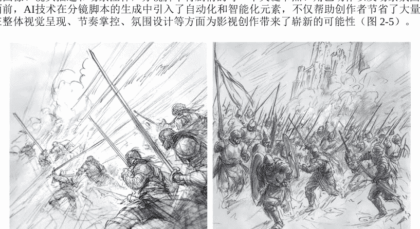

分镜脚本的基础元素包括镜头类型、景别、视角、角色动作和台词等细节信息。通过这些要素的组合，分镜脚本能够把剧本的情节用视觉化的方式逐帧呈现。比如在一场关键对话中，分镜脚本需要标注出镜头类型（如特写、全景，如图2-6），角色的动作与表情，甚至拍摄的角度（如低视角或高视角，如图2-7）等，这些信息帮助团队执行具体的构思，同时保证了影片的视觉连续性和叙事流畅性。生成式AI在这一过程中可以生成完整的分镜框架，从镜头的切换到动作描述，帮助创作者快速获得视觉化的脚本草图。

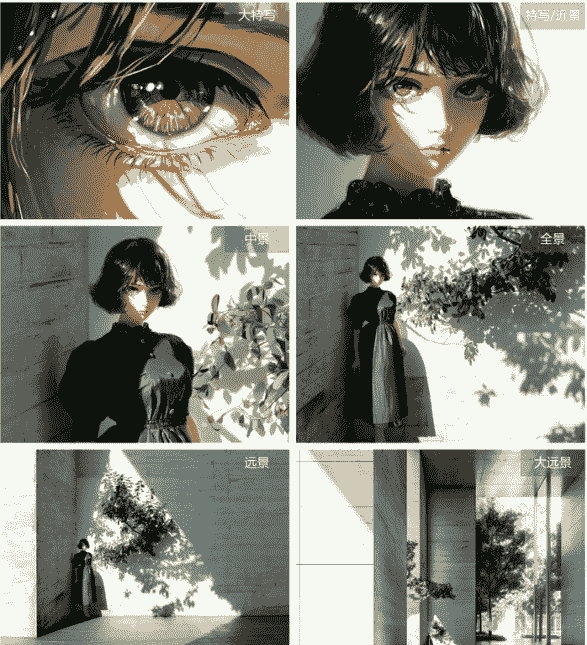

图 2-6 景别

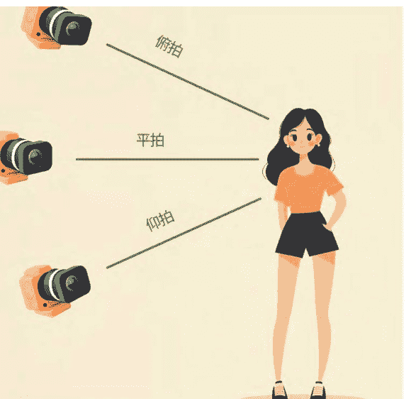

图 2-7 拍摄角度

AI生成的分镜框架在镜头节奏的控制上也表现得非常出色，AI能够根据剧本内容自动设定镜头的远近切换，比如在一段紧张的追逐戏中，AI可以给出“远景——近景——特写”相结合的镜头序列，使画面节奏紧凑，增加观众的紧张感。AI不仅能够识别剧本中的关键情节，还可以通过镜头切换表达出情绪的变化和剧情的推进。如果故事中涉及角色的内心转变，AI能够通过镜头的逐步拉近（由远景到近景再到特写）来凸显角色表情和情绪的变化。这样一来，分镜框架不仅具有逻辑性，也在视觉上形成了自然流畅的叙事节奏（图 2-8）。

在分镜脚本中，场景和角色动作的描述让故事情节得以流畅呈现，生成式AI可以自动生成符合情节发展的角色动作和场景布置，这就大大提升了分镜的自动化程度。以一场对抗戏为例，AI能够为角色生成合适的动作描述，比如角色在面对对手时的防御动作、进攻姿态，甚至是细微的表情变化，这些都可以帮助创作者细致地刻画出角色的行为与情绪。AI不仅能够提供合理的动作设定，还可以根据场景需求调整角色的位置和互动方式。在多人对话的场景中，AI可以生成每位角色在场景中的站位、目光交流等动作描述，确保画面中的每个角色互动都自然且符合情节的需求。

除了动作描述，分镜脚本还需要在视觉氛围上提供具体的指导，以保证画面氛围与剧情情绪相呼应。AI能够自动设计适合的光影效果、镜头角度和色彩倾向，使得场景氛围更加贴合剧情需求。在一场紧张的夜间场景中，AI可以为分镜设计冷色调、低光源的光影效果，营造出神秘和危险的氛围。在温馨的家庭场景中，AI则会设计柔和的暖色调和充足的光线，增强观众的舒适感与情感共鸣。通过AI生成的这些视觉元素，创作者可以更轻松地在分镜脚本中构建出多样的情绪氛围，增强作品的情感表达和观众的沉浸体验。

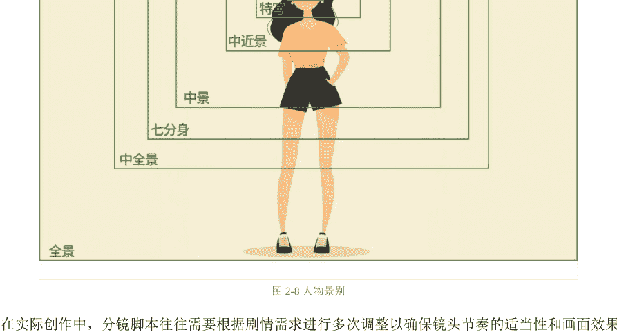

图 2-8 人物景别

在实际创作中，分镜脚本往往需要根据剧情需求进行多次调整以确保镜头节奏的适当性和画面效果的连贯性。生成式AI在分镜脚本的调整和优化中同样提供了便捷的帮助。如果我们对某场戏的镜头安排不满意，那么可以将意见直接告诉AI，让其为我们优化其中的分镜设计。下面来看一个实际的例子。

问：

请为主角首次见到不可名状的克苏鲁神祇的场景设计做分镜头设计，并为镜头加入旁白。

文心：

以下是该场景的分镜头设计，将主角白桦首次见到不可名状的克苏鲁神祇的紧张氛围和超自然压迫感逐步展现出来。

镜头 1：俯视镜头——全景——街景
类型：固定镜头
景别：全景
视角：俯视
动作：镜头从高处俯视整个废弃工业区，建筑物破败，霓虹灯光微弱且闪烁，雷雨伴随闪电划过夜空。
旁白：在这座不眠之城的深夜中，雨水洗涤着每一条街巷，但它无法冲淡那些隐藏在阴影中的秘密。这里，黑暗并不只是夜幕的表象，而是无法名状的存在正缓缓侵入的征兆。

……

镜头 8：插入镜头——幻象中的海洋
类型：闪回镜头
景别：大景
视角：仰视
动作：镜头插入一片深蓝色的海洋，远处出现一双巨大而冷漠的眼睛在黑暗中注视，海底的暗流翻涌。
旁白：深蓝色的海洋在她的眼前浮现，仿佛是从裂缝中涌出的记忆。那是人类无法触及的深渊，在无尽的黑暗之下，一双冷漠的眼睛俯瞰着她，仿佛在嘲笑着她的渺小与无知。

……

镜头 14：中景——白桦的背影
类型：定焦镜头
景别：中景
视角：背视
动作：白桦站在原地，凝视裂缝消失的位置，雨水不停打在她身上，她的目光中闪过坚定的光芒。
旁白：雨依旧在下，黑夜依旧笼罩着这座城市。白桦站在原地，凝视着已然消失的裂缝。她知道，今夜所见的神祇、所遇的人，都是她未曾预料到的未知，但她也知道，这只是一个开始……

通过这些分镜头设计，将白桦首次见到不可名状神祇的紧张、恐惧和神秘感充分呈现，同时引入黄琼的角色，让他以神秘的姿态出场，为剧情和角色关系的发展做出铺垫。

AI为每一个镜头都加入了旁白，这显然是没有必要的。我们可以挑选一些关键镜头为其加入旁白，在不影响观众理解故事内容的部分忽略掉即可。有些时候AI生成的内容会缺少一些信息，比如在生成分镜头时并没有给出所使用的镜头类型。为了避免这种情况的出现，最好在生成的时候就把具体的需求完整地告诉AI，像上面这个问答更加标准的问法应该是下面这样。

问：
请为主角首次见到不可名状的克苏鲁神祇的场景设计做分镜头设计，其中要包含镜头类型、景别、视角、角色动作和台词等细节信息，并附上旁白。

总结一下文本创作的整个流程，就是由灵感、主题到具体的故事与剧本设计，把故事情节细化为不同的场景，再将每个场景都分解为多个分镜头的过程。

前面的不再过多解释，我们主要把生成故事情节之后的内容再过一遍。一个故事有长有短，如果要形成具体的画面，就需要将整个故事打散，形成以集为单位的不同段落。然后再将故事的情节按照时间顺序和空间位置细化为一系列场景，每个场景都是故事发展中的一个重要节点，通常围绕特定的事件、特定的地点和特定的人物进行布局。

将场景进一步分解为分镜头是为了详细规划和可视化场景中的动作和对话，每个分镜头包括镜头的类型、角度、运动和持续时间等详细信息，有了这些信息，下一步就可以指导图像生成AI来制作每一个分镜的静态图，之后再根据需要来将这些静态图制作成动态的视频片段。最后将这些视频片段拼接起来，辅以对话配音、旁白配音以及配乐，就完成了一集的制作。

考虑到创作难度，一些步骤不可避免地要进行简化。但是按照本书的步骤，即便是一个创作上的新手，所做出的成品质量也足以超过短视频平台上大多数个人制作的影视、动漫作品，这就是AI的力量。

# 3 图像生成工具：Midjourney

图像生成是AI影视动漫的核心内容，如果说文本生成AI能够帮助创作者设计作品的整体框架，那么框架中的基石就是用AI作画来构建的。而相较于其他的AI工具，图像生成AI的使用方面也更为复杂，所以我们单独用一章的篇幅来把工具的使用方法讲得更透彻一些。

## 3.1 图像生成AI简介

当前性能最强大的图像生成AI工具要数Stable Diffusion和Midjourney这两个平台，它们都诞生于 2022 年，并且使用着相同的Diffusion底层架构。

Stable Diffusion最大的优势在于其开源性，Stability AI选择将模型的代码和权重公开，开发者、研究人员和创作者可以自由地下载、修改和使用这个模型，开放的开源策略使得许多开发者能够在其基础上开发出新的应用和工具。开源社区的火热也说明了这种发展策略的成功，社区内部已经涌现了许多基于其模型的插件、工具和应用，使得Stable Diffusion生态系统非常丰富。

Midjourney则是一个商业化的AI平台，在使用的时候需要支付一定的费用。相较于Stable Diffusion的开放性，Midjourney则采用了闭源的策略，通过商用的收入来维持其后续的版本升级。

而本书之所以没有选择Stable Diffusion，是因为它与Midjourney发展策略的不同导致了需求面向上的差别。作为一个开源平台，Stable Diffusion并没有在用户友好度上下过太多功夫，想要使用Stable Diffusion需要付出很高的学习成本。而Midjourney则是反其道而行之，在易用性方面要领先于Stable Diffusion，用户不需要花费太多的时间就能熟练地进行生图操作。

另外，Stable Diffusion需要在本地部署，也就是说用户还需要一台带有新型号显卡的高性能电脑才能流畅地生图，即便是租用服务器通过云端来使用Stable Diffusion，它的易用性也没有提高多少，还多了部署服务器的麻烦，而Midjourney只需要登录Web端就可以直接使用。

当然，想要在图像生成上更进一步的话，那么肯定绕不开Stable Diffusion。笔者的建议是在熟悉了Midjourney的使用之后再去尝试Stable Diffusion，这样既不会耽误各位读者快速地上手制作实际内容，学习难度的曲线也会降低不少。

## 3.2 Midjourney版本介绍

目前Midjourney有两种使用渠道，一种是通过Discord这个在线聊天室平台的Midjourney频道来调用绘画机器人进行图像生成，另一种则是通过Midjourney的Web端生成图像。

聊天室版本的优点是比较成熟，毕竟这边的版本已经发展了不短的时间（图3-1）。


而Web端版本则是针对聊天室版本的缺陷做了一些修改，正在逐步发展成为一个独立版本（图 3-2）。

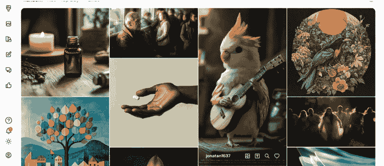

图 3-2 Web端版本的软件界面

虽然Web端版本还处于alpha测试阶段，但是在整体的使用逻辑以及生成图像的管理方面，测试版本已经有了很大的进步，所以本书还是选择了Web端版本作为主要讲解的版本。需要注意的是，在后续的更新中，软件的界面分布以及功能排布可能会有比较大的改变，但是主体的功能应该不会再有太大的变动。

## 3.3 提示词创作区域

Midjourney的主界面如图 3-3，我们先从其中标注的模块开始讲起。位于界面上方的输入框就是提示词的输入区域。所有生成式AI都依赖于提示词的输入，将我们想要呈现的内容形成文字后输入到文本框内，按下回车，AI就会将这些文字“转化”为图片还给我们。

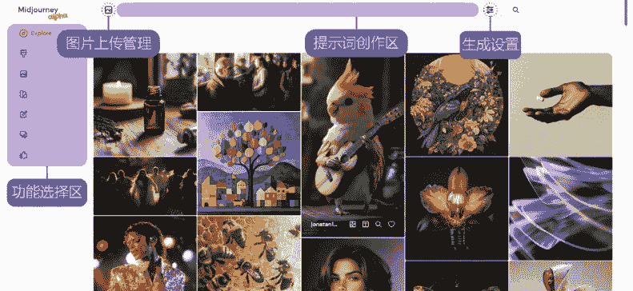

对于Midjourney来说，它的提示词遵从图 3-4 中这样的结构：


提示词的结构包含三个部分，其中决定图像内容的是提示词的主体，这部分用来向AI描述创作者具体想要创作什么内容，有什么样的内容需要用怎样的形式出现在画面中，比方说下面这样：

提示词：
一条黑狗在泳池中游泳，戴着墨镜。
(A black dog swimming in a pool, wearing sunglasses)。

输入对应的英文后按下回车，AI就会生成相应的图像（图 3-5）。


剩下的两个部分并不是必要的，但是他们会极大地影响生成结果。AI会模仿参考图片的风格、构图来生成新的图像，我们来看图 3-6 这个例子。

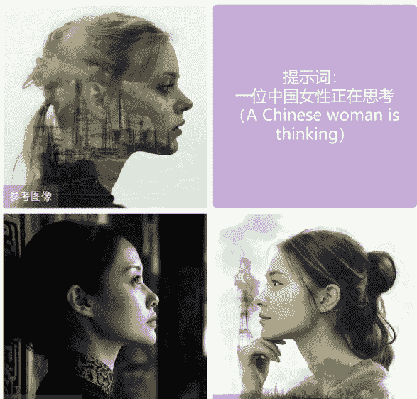

原始的参考图像使用了二次曝光的效果，可以看到在不使用图像参考的时候所生成的图像内容就是按照提示词所说，一位女性正在凝神思考。而使用图像参考时候，画面的构图与设计都模仿了参考图像的内容。这个功能在制作影视动漫素材的时候非常好用，调用图像参考的底层实现方法是在提示词的前端加入参考图片的URL，在Web端这项功能得到了进一步的封装，参考图像的上传、调用与管理现在可以在一个模块之内搞定，具体的位置就在提示词输入框左侧的图片图标（图 3-7）。


点击后即可进入管理菜单，菜单内容的排布如图 3-8 所示。

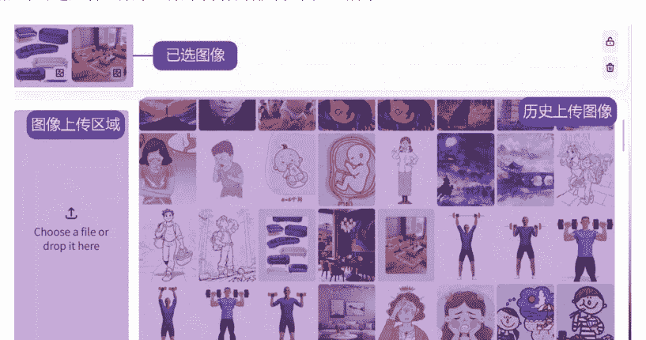

图像参考是通过调用图片的URL来实现的，因此需要将本地图片先一步变成拥有URL的网络图片才行。上传图片的功能位于菜单的左侧区域，点击这里就可以选择本地的图片进行上传，或者直接把文件夹中的图片文件拖拽到这个区域也是可以的。

完成上传后，图片就会出现在右侧的管理区域，在这里我们可以浏览、管理曾经上传的图片，也可以把不再需要的图片给删掉。单击图片将会让其出现在上方的选中区域，默认情况下单击后图片就会作为参考图像被选中，用来当作参考的图像可以多于一张。

参数是Midjourney中非常重要的一部分内容，它可以从底层来调整AI的生成效果。参数拥有固定的格式，有一些还有一定的取值范围，这部分的内容我们会放在稍后的生成实例中进行讲解，现在先来简单认识一下这些参数（表 3-1）。

表 3-1 Midjourney常用参数

| 参数名 | 书写格式 | 缩写格式 | 取值范围 | 默认值 | 简介 |
|---|---|---|---|---|---|
| chaos 参数 | --chaos+ 数字 | --c | 0~100 | 0 | 增加生成图像的随机性 |
| stylize 参数 | --stylize+ 数字 | --s | 0~1000 | 100 | 提升画面细节与质感 |
| weird 参数 | --weird+ 数字 | --w | 0~3000 | 0 | 增强图像的怪异程度 |
| style raw 参数 | --style raw | 无缩写 | 开启或关闭 | 关闭 | 取消 AI 的默认美化滤镜 |
| 样式参考参数 | --sref + 图片 URL | 无缩写 | 无 | 无 | 模仿参考图片的样式内容 |
| 角色参考参数 | --cref + 图片 URL | 无缩写 | 无 | 无 | 参考样例的角色 |
| 否定参数 | --no+ 内容 | 无缩写 | 无 | 无 | 设置不会出现在画布中的内容 |
| 宽高比参数 | --ar+ 宽：高 | 无缩写 | 不同宽高比 | 1 : 1 | 改变画面比例 |
| 质量参数 | --quality+ 数字 | --q | 0.25~2 | 1 | GPU 渲染时长 |
| 重复工程参数 | --repeat+ 数字 | --r | 2~4（基础订阅）2~10（标准订阅）2~40（专业订阅） | 1 | 设置同一提示词重复生成的次数 |
| 种子参数 | --seed+ 数字 | 无缩写 | 0~4294967295 | 随机 | 设置生成图像所使用的种子编号 |
| 拼贴参数 | --tile | 无缩写 | 无 | 无 | 增加生成图像的随机性 |
| 停止参数 | --stop+ 数字 | 无缩写 | 10~100 | 100 | 提升画面细节与质感 |
| 视频参数 | --video | 无缩写 | 无 | 无 | 增强图像的怪异程度 |
| 模型版本参数 | --version+ 版本号 | --v | 不同版本号 | 最新版本号 | 切换不同版本的模型 |
| Niji 模型调用 | --niji+ 版本号 | 无缩写 | 不同版本号 | 最新版本号 | 切换 Niji 模型生图 |
| 个性化参数 | --personalize+ 编码 | --p | 不同用户的风格化编码 | 用户自己的偏好 | 用户自己的偏好 |
| iw 参数 | --iw+ 数字 | 无缩写 | 0~2 | 2 | 决定图像参考的程度 |
| cw 参数 | --cw+ 数字 | 无缩写 | 0~2 | 2 | 决定角色参考的程度 |

在书写Midjourney提示词的时候一定要对空格多加留意，每种结构之间都需要使用空格进行区隔。而在参数部分对于空格的要求是最严格的，在--parameter与后面的取值之间、不同参数之间必须有空格，否则生图时会发生报错。

输入框右侧的图标则是用来更改图像生成的基本设置，点击后会出现如下界面（图 3-9）。

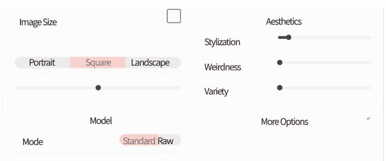

这项设置与参数控制相关性非常大，其中的内容基本上就是把一些本来需要使用参数来控制的部分作为独立的功能单独进行封装，下面逐项认识一下这些功能与对应的参数。

第一，宽高比设置。Image Size这一项用来设置生成图像的宽高比，它所实现的就是--ar参数的功能（图 3-10）。

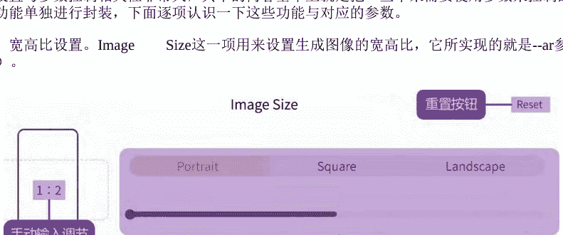

在快捷调节窗口中可以通过点击上方的标题栏来快速切换画幅设置，默认值为正方形画幅（Square），也就是宽高比为 1:1（--ar 1:1）。左边是纵向画幅（Portrait），也就是宽小于高的画幅，右侧的横向画幅（Landscape）则是宽大于高的画幅。通过拖动下方的滚动条能够更加精确地调整画面的宽高比，结果会显示在左侧的演示区域。

点击演示区城的比值能够直接手动输入宽高比，这样当然是最精确的。如果想要消除宽高比的设置，点击右上方的重置（Reset）按钮即可。下面是一些常用的宽高比效果演示（图 3-11）。

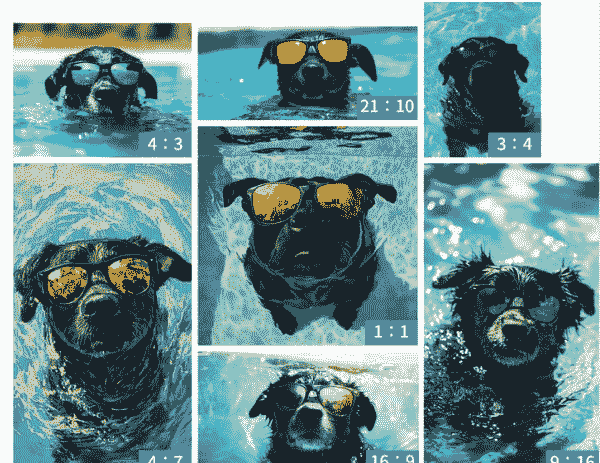

第二，模型相关设置。在宽高比下方的Model是几个与模型设置相关的项目。

Mode选项对应的是--style raw模式开关。在默认情况下，Midjourney生成图像时带有一定的效果优化，会在提示词之外给画面更多一些的美学滤镜，让画面变得更好看。在一般情况下这种美化确实会让画面更加有表现力，但是如果创作者追求的是贴近真实的画面表现，默认的美化滤镜所起的就是反效果了。

Raw模式会取代Midjourney模型版本的默认美学效果，让生成的画面遵从提示词的本义。使用该模式可以帮助创作者创建更加逼真的照片效果和电影场景，画面中的角色、背景以及光线会更加贴近现实中的场景。

Version用来更换绘画所调用的模型版本，对应的是--version参数。Midjourney发展到现在已经经历了六个大版本，目前最新的版本为V6.1，这也是生图的时候默认使用的模型。虽说新版本在性能与生成效果上优于老版本，但是绘画不同于文本生成，老版本有时会有一些特别的绘画表现效果。这个功能面向的是老用户，如果你对某个历史版本的某些效果有着一定的偏好，那么就可以使用这一项来调整模型（图 3-12）。

提示词：

哈苏相机拍摄的照片，一位美丽的女子在森林中摆姿势，四周环绕着秋天的色彩 --ar 4：3。

(Hasselblad photo of a beautiful woman posing in a forest with the fall colours all around her --ar 4：3)。

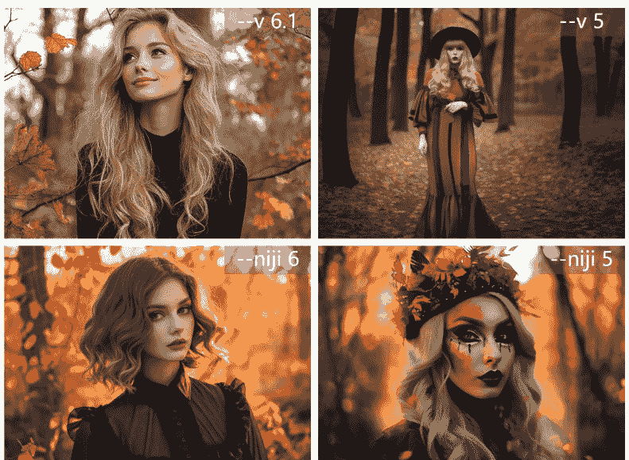

需要注意的是这里只能调节Midjourney的模型版本，如果想要调用Niji模型的话，依然需要通过写入参数--niji来实现。

个性化风格参考（Personalize）是V6 版本之后新加入的功能，使用参数实现的话就是--personalize参数。如果开启这一项的话，AI就会根据创作者的喜好来调整生成图像的风格倾向。而系统判断创作者喜好的方式是通过我们对图片的点赞以及初始开启模式时所选择的风格倾向来计算的，具体如何操作会在功能区域的相关内容中进行讲解。

第三，美学风格设置。右侧的美学风格（Aesthetic）设置包含了三项参数。

风格化设置（stylization）项对应的是--stylize参数，这一项设置会影响Midjourney美学应用的强度，包括滤镜的强度以及细节上的丰富度。参数的取值范围是 0-1000，默认的情况下为 100（图 3-13）。


较低的风格化参数值会生成与提示词更贴合但艺术感较弱的图像，同时图像的细节也会变差；较高的风格化取值则会生成非常艺术化的图像，但与提示词的关联性会降低，具体的效果可以参考下面的示例（图 3-14）。

提示词：
一位美丽的中国女性在水下跳舞，周围环绕着色彩鲜艳的珊瑚和各种色彩斑斓的鱼群，阳光透过水面，映照出她美丽的身姿 --s 3：2。

(A beautiful Chinese woman dances underwater, surrounded by vibrant coral and colorful fish. Sunlight filters through the water, illuminating her graceful figure --s 3: 2)。

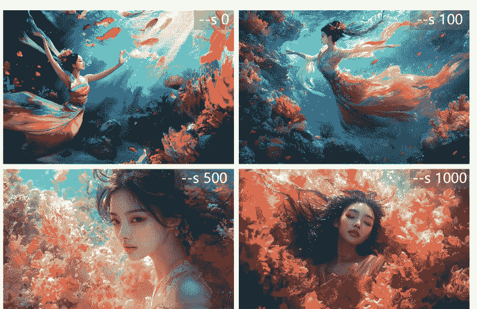

可以看到风格化参数值的增加可以显著地提高画面细节与整体的质量，但是它的取值还是应该保持在合理的取值范围内。过高的取值会让画面出现很多不必要的细节，图像的整体效果会变得过于繁杂，而且超过一定界限之后画面的主题也会受到影响。一般来说 300 是一个比较适当的数值，如果在这个值之下画面的细节依然不够的话，再去考虑增加这个值。

怪异度设置（weirdness）对应的是--weird参数，利用这项设置可以为生成的图像引入古怪的特质，从而产生独特且出人意料的效果。它的取值范围是0~3000，默认情况下取值为 0，也就是不对图像进行怪异化处理（图 3-15）。


这项参数一般用于黑暗风格的作品生成，像是恐怖的、悬疑的、黑暗的题材。在面对这些题材的时候，单纯地使用提示词是很难实现特别出色的效果的，Midjourney在处理画面方面整体上还是偏向于积极向上的，这种偏向在打开weirdness这个开关之后就会发生变化（图 3-16）。

提示词：
哥特风格，一艘破烂的幽灵船正缓缓驶向岸边，船上站着已经变成骷髅的船员。
(Gothic style, a tattered ghost ship slowly drifts toward the shore, with skeletal crew members standing aboard)。

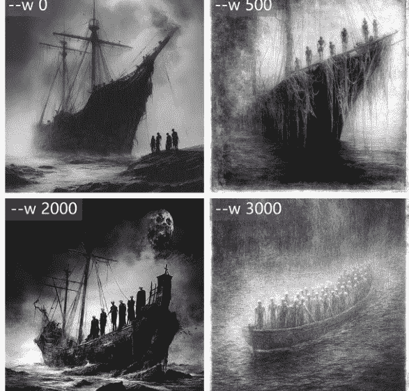

画面的怪异、黑暗程度会随着参数取值的变大而不断加深，一般来说怪异度的调整还需要搭配--stylize参数来使用，这样生成的图像细节会更加丰富，表现力也会进一步提高。

多样化设置（variety）对应的是--chaos参数，也就是混沌值参数，它的取值范围是 0~100，默认值为0（图 3-17）。


多样化同样是用来影响生成图像的风格倾向，但不同于风格化和怪异度，--chaos参数所能带来的是完全随机的一种变化，高数值会产生更不寻常和出人意料的效果及构图，低数值则提供更稳定、可重复的结果（图 3-18）。

提示词：
一只穿得像珊莎史塔克的猫。
(Cat dressed as Sansa Stark)。

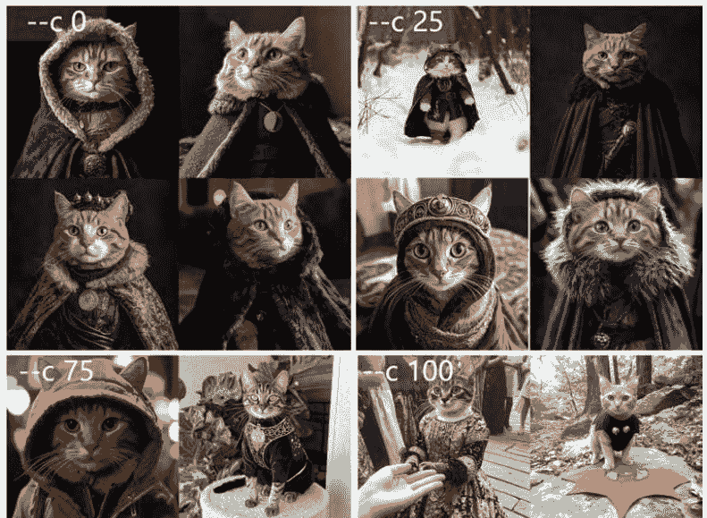

参数的取值越高，图像在构图、内容、风格上偏离提示词也就越远，这就是多样化设置的效果。一般在进行图像创作时可以将参数设置在 20~30 的范围内，这样的取值既为画面内容带来了更多的可能性，而且也不会偏离主旨太远。

第四，其他设置。在这个设置下面本意是放一些工作室还没想好怎么分类的项目，目前这里只有一项生成速度设置（图 3-19）。


每个月系统会根据账号的订阅状态而赠送一定的快速生成时间，在这个选项中就是对这个时间来进行的设置。

休闲模式（Relax）以较慢的可变速度生成图像，这个模式不会消耗快速时间；快速模式（Fast）是默认速度，以中等速度生成图像并消耗快速时间。在快速时间消耗完毕后，它与后面的极速模式都会降为休闲模式；

极速模式（Turbo）会以更快的速度生成图像，在使用这个模式的时候基本上几秒钟的时间图像就能完成，但是会消耗双倍的快速时间。

## 3.4 探索页面

功能选择区域罗列了软件几乎所有的功能模块，下面我们按照顺序带着大家快速浏览几个常用功能的主要界面。

在探索页面内，系统会展示一些其他用户制作的精美图片。在缺乏灵感的时候可以来逛一逛，说不定就能受到其他人的启发。点击其中的一张图片，界面会跳转到作品的详情页，包括提示词、参数设置以及参考图像等详细信息都会陈列在这个页面中（图 3-20）。

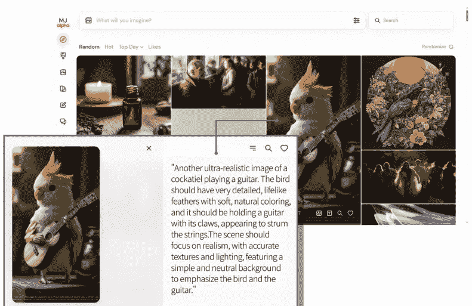

对于喜欢的图片，可以在图片的右下角（或者在详情页的右上角）点赞，这样一来图片就会存储到探索页面中的Likes选项卡中，后续如果想要查询图片的提示词，直接在选项卡中找到点赞过的图片。

在详情页的下方可以看到图 3-21 中这样几个选项。


图 3-21 图像引用

其中“Image”是图像参考，点击后当前图片会作为参考图像输入到提示词框中，代表图像参考的图标也会被点亮（图 3-22）。

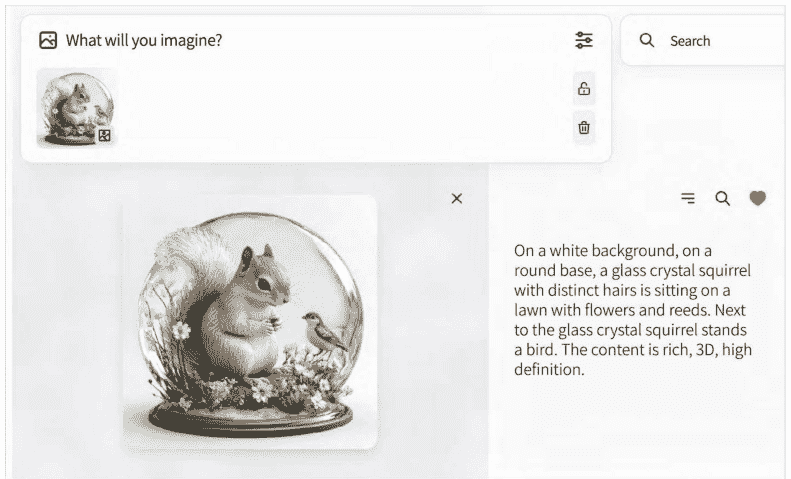

图 3-22 图像参考

“Style”这一项则是代表的样式参考参数--sref，它与图像参考所实现的功能比较类似，只是在最终结果的相似度上有所差异，点击后图片就会作为样式参考的参数提供给提示词，同时图标也会被点亮（图 3-23）。

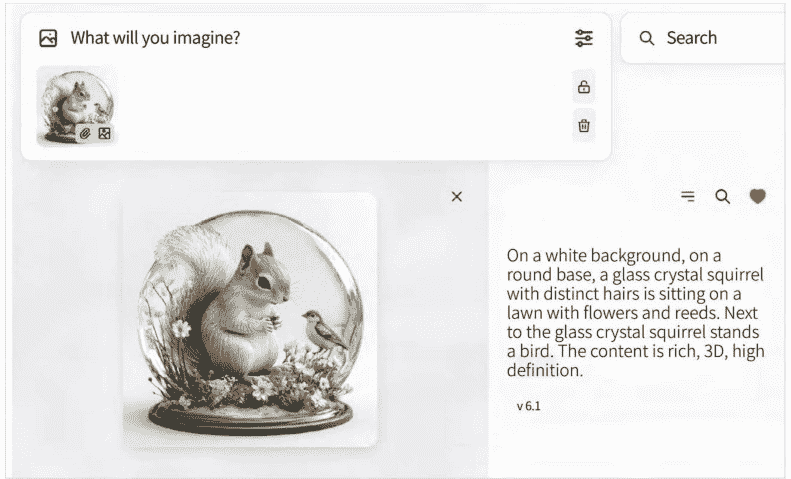

图 3-23 样式参考

最后一项“Prompt”则是完整复制当前图片的提示词，点击后全部提示词会被复制到提示词输入框中，包括参考图像、角色参考、样式参考以及参数设置这些内容也都会被一并复制（图 3-24）。

On a white background, on a round base, a glass crystal squirrel with distinct hairs is sitting on a lawn with flowers and reeds. Next to the glass crystal squirrel stands a bird. The content is rich, 3D, high definition.--v 6.1

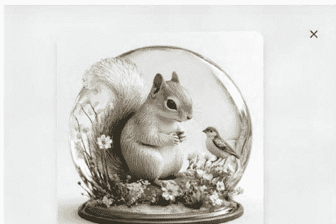

On a white background, on a round base, a glass crystal squirrel with distinct hairs is sitting on a lawn with flowers and reeds. Next to the glass crystal squirrel stands a bird. The content is rich, 3D, high definition.

v 6.1

图 3-24 提示词复制

## 3.5 创作管理

创作管理页面并不是传统意义上的创作页面，Midjourney对于图像的生成是通过顶部的提示词框来完成的，这个创作管理页面则是用来进一步管理和修改生成结果的功能区（图 3-25）。

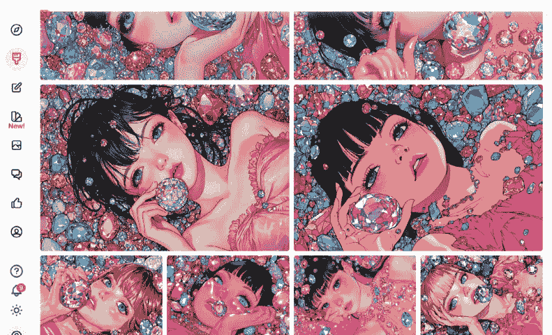

在页面中所有生成的图片会以四张为一组来存放，这是因为每一次Midjourney默认生成的图片就是四张。在图片的右侧会显示生成这组图片时所使用的提示词以及相关的图像引用和参数设置。在右下方会有一些管理选项，如图3-26。


“Rerun”的意思是重新跑一遍生图，也就是使用完全一样的提示词设置再生成一遍图像，结果如图 3-27。

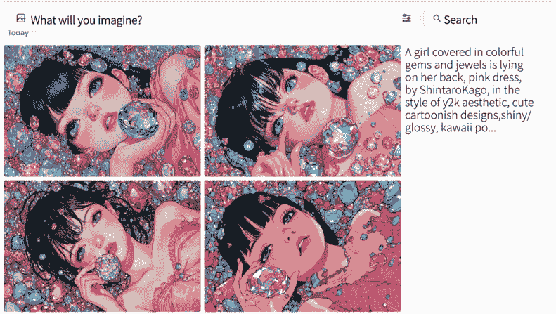

“Use”则与探索功能中的“Prompt”效果相同，点击后会把生成图像所使用的提示词完整地复制到提示词输入框中（图 3-28）。

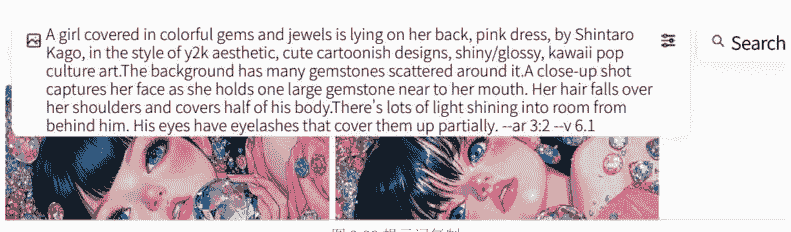

“Hide”会更改这组图片的状态，将其设置为隐藏。隐藏后图片将不再在当前页面显示（图 3-29）。

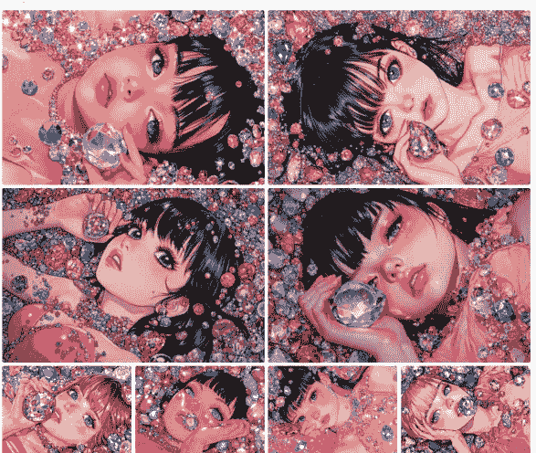

如果要重新显示图片的话，需要在收藏管理功能中进行设置。

“More”中包含了关于图片的更多设置项，点击后会弹出额外的操作选项。其中“Copy”操作主要是把各种各样的信息复制到剪切板中（图 3-30）。


- “Prompt”：把当前图片的提示词复制到剪贴板中。
- “Job ID”：把当前图片的Job ID复制到剪贴板中。Job ID是Midjourney在生成图像时给予图片的标识符，就像是我们的身份证号码一样。这个标识符拥有唯一性，通过这串标识符就能准确地查找到对应的图片。
- “Seed”：Seed也叫作种子。在AI生成图像时，第一步会生成满屏幕的噪点，就像是电视机没有信号时的雪花点。AI生成图像的过程就是一层一层去除这些噪点的过程，而种子就决定了初始噪点排布的方式。使用相同的提示词和相同的种子值，我们就能生成一模一样的两组图片。在参数控制中使用--seed参数即可指定生成图像所使用的种子值（图 3-31）。

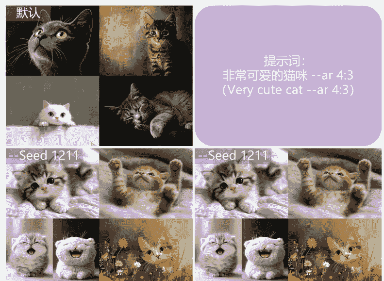

示例中左上方在生图时没有加入种子参数，使用的是随机种子，而下方的两次生图均使用了同样的种子值，最终下方的两次生图结果完全相同。那么借助种子值的复制，我们就可以生成完全一致的图像。

- “Image”：把当前图片复制到剪贴板中。这一项是为了弥补Web端相较于聊天室版本的Midjourney所缺少的功能。在聊天室版本中，每次生成的图像在初始状态是四张图片拼接成的一张大图，而Web端在生成图像后，这一组图片是相互独立的，这里的复制就是用来实现这样的组图生成效果。
- “Image URL”：复制图片的URL地址到剪贴板中。注意，这里复制的是组图的URL地址。
- “Report”：举报功能。如果用户发现生成的内容中有违规内容，可以通过这个选项跟后台进行举报（图 3-32）。


- “Download”：将图片下载到本地。这里同样是下载的组图。
- “Open in Discord”：在Discord聊天室版本中打开当前的图片。

而当鼠标悬停在图像上方时，图片中会出现下面两个选项（图 3-33）。

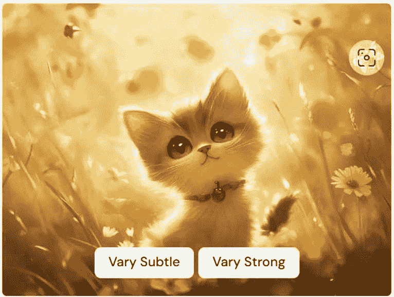

图 3-33 重新生成

**Vary**是Variation的意思，使用这两个命令可以将当前的图片作为底本重新生成一组图片，所不同的是**Vary Subtle**会尽量地模仿原图片的构图、色彩以及角色的外形和动作，只进行很少的改动，而**Vary Strong**所做的改动幅度则要大一些（图 3-34）。

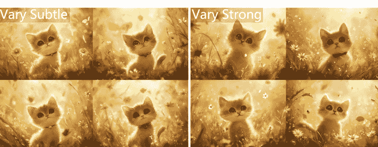

图 3-34 两者的区别

点击生成的图片后进入详细的编辑面板，如图 3-35。在这个面板中通过滚动鼠标滑轮可以切换当前编辑的图片。

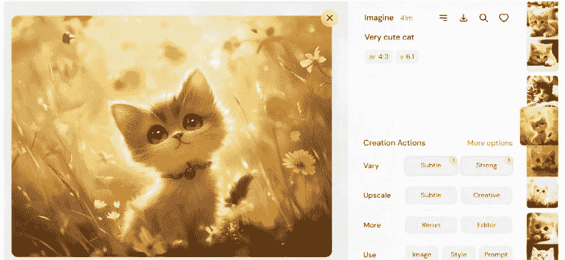

面板的右上部分会显示当前图片的提示词以及参数的使用情况，右下则是具体的编辑功能。

Vary功能与上面所讲的Variation是同样的作用，并且按钮上还会显示当前图片是否经过这项功能的编辑，比如这里Subtle和Strong都显示为 1，表示这张图片之前经过一次Vary Subtle的重新生成以及一次Vary Strong功能的生成。

接下来的Upscale用来提升图片的分辨率，并进行一定的细节修饰。原始的生成图片分辨率为1024×1024，经过这项功能的处理之后，会生成新的图片，并且分辨率会提升到 2048×2048。Subtle与Vary的程度类似，它会尽量贴近原始画面的内容，只进行分辨率的提升，而Creative则会进行比较大幅度的修改，原始画面中的很多细节都会发生变化（图 3-36）。

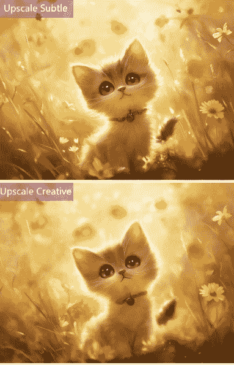

在“More”这一行中，“Rerun”同样表示使用相同的提示词再生成一次图像，编辑器“Editor”则是一个比较重要的功能，它允许我们在已经完成生成的图像上进行内容的修改。

我们将编辑器的界面分为五个功能区域，如图 3-37。

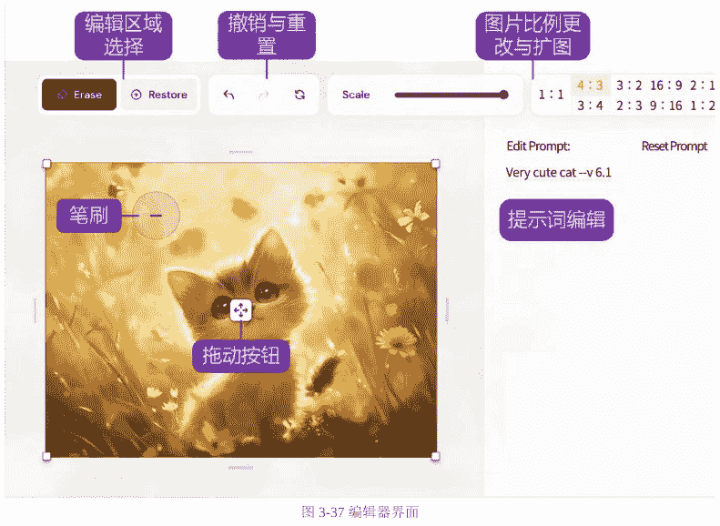

编辑区域选择内包含两项功能，擦除“Erase”就是把需要更改的区域从画面上擦掉，擦除的工具就是画面中的笔刷。恢复“Restore”则是把擦除的区域恢复成原始状态，所使用的工具同样是笔刷（图 3-38）。

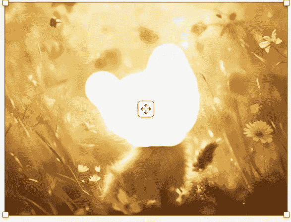

撤销与前进功能会按照步骤恢复之前的操作，重置按钮会清除掉所有的更改效果。

接下来图片比例更改这部分会稍微复杂一点，其中涉及内容扩充的操作。“Scale”可以等比例缩放当前的图片，如图 3-39。

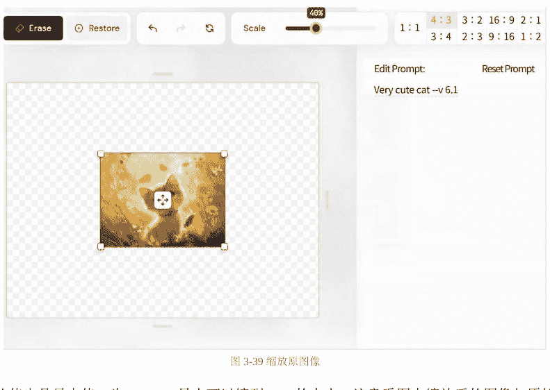

其默认值也是最大值，为 100%，最小可以缩到 10%的大小。注意看图中缩放后的图像与原始图像框之间的对比，此时点击“Submit”生成图像的话，新图片的大小会按照原始图像框的范围进行生成，原始图像与图像框之间的空白会被填充新的内容（图 3-40）。

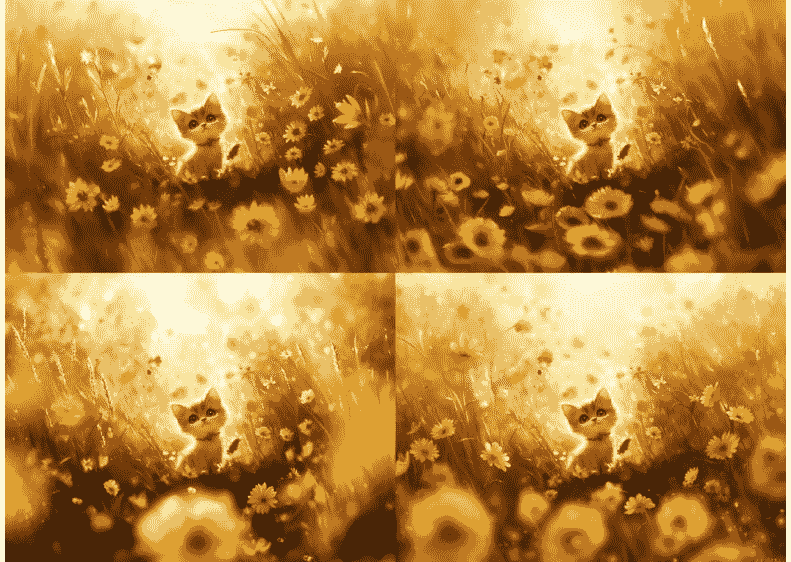

图像预览区域中间的拖动按钮可以让我们拖拽原图像来改变其在画幅中的位置，处于框体外的部分会被舍弃掉，而框体内部空白的部分则会被填充进新的内容（图 3-41）。

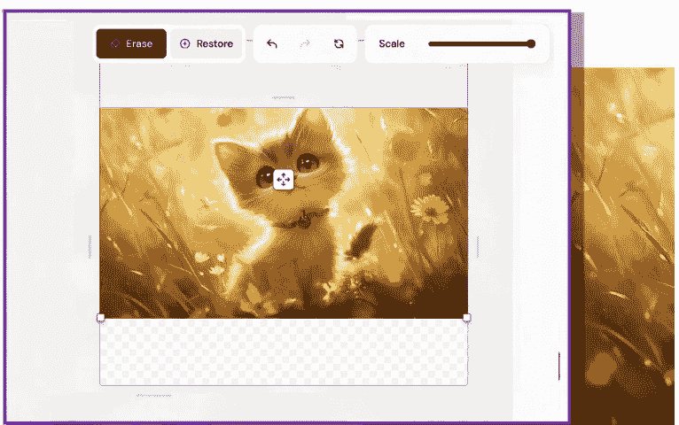

图 3-41 拖动原图像

这一点在更改比例的设置中也同样适用（图 3-42）。

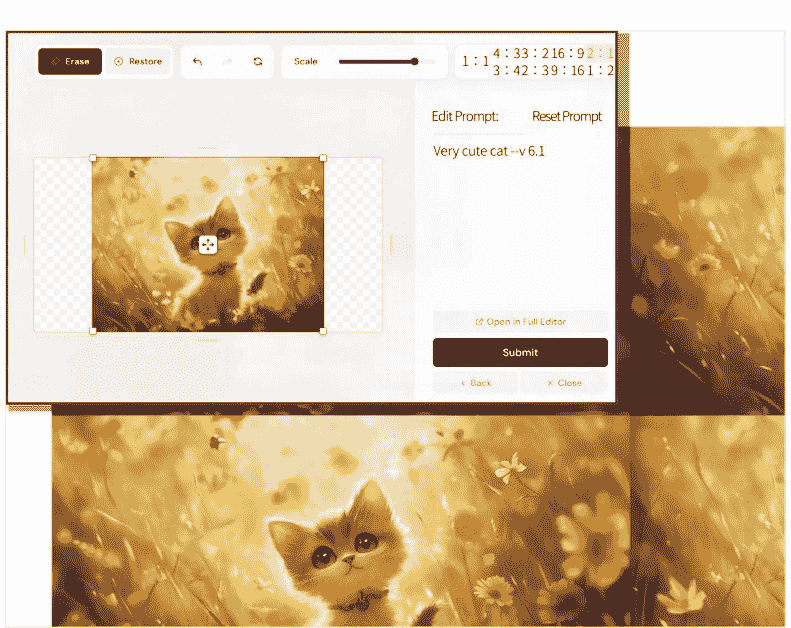

图 3-42 改变比例的扩图效果

而提示词编辑这一部分可以跟其他的所有擦除与比例更改产生互动。一般情况下，如果使用擦除功能是为了修改图像中的错误，如人物的手指、肢体比例等，那么是不需要更改提示词的。但假如画面内容需要更改的话，就得修改相应的提示词了，比如角色是什么样的属性，或者扩图的时候在扩展的部分需要出现什么新的内容（图 3-43）。

提示词：
非常可爱的 **黑色** 猫咪， **旁边有一只史莱姆**。
(Very cute **black cat**, **with a slime creature beside it**)。

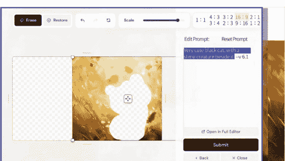

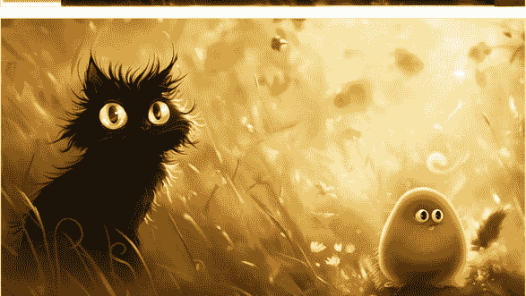

图 3-43 结合提示词修改画面内容

借助编辑器，创作者可以对图像进行非常精确的修改，能够实现很多强大有趣的效果。这个例子中AI把原本小猫的位置重绘成了史莱姆，主要是因为我们把涂抹和扩图合并到了一个步骤之中，提示词由此产生了歧义。如果把两个步骤分开来实现，即更改猫的毛色和加入新的画面内容使用两次编辑，那么结果就会更加符合创作者的意图。

## 3.6 收藏管理

收藏管理（Organize）用来存储、整理所生成的图片。它的逻辑非常直观，展示面板会根据生成的时间对所有的图片自动排序，而右侧则是主要的操作区域（图 3-44）。

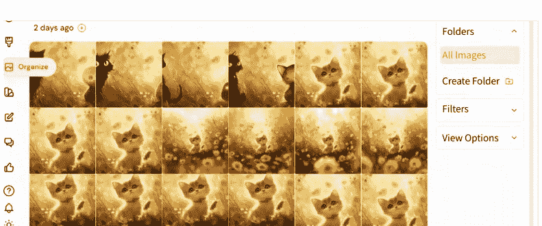

### 3.6.1 文件夹管理

文件夹管理（Folders）可以创建次级文件夹来存储图片，这个其实就是分类存储的功能，给不同的文件夹起上对应的关键字作为名字就可以实现图片的分类存放。初始的根目录为“All Images”文件夹，所有的图片在初始状态都会存储在该文件夹内（图 3-45）。


### 3.6.2 过滤器

通过过滤器（Filters）可以设置图片的显示规则，从而筛选符合规则的图片进行显示。比方说在前面的图片编辑部分，我们曾把一组图片设置为“隐藏”，处于隐藏状态的图片是完全没有办法查看的，此时就可以在Filters中选中“Hidden”作为筛选条件，过滤后就可以查看这组图片了（图 3-46）。

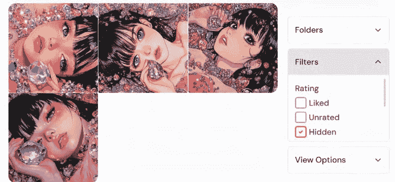

### 3.6.3 查看图标设置

查看功能（View Options）类似于Windows中的查看设置，也就是设置图片缩略图的大小、比例等（图 3-47）。

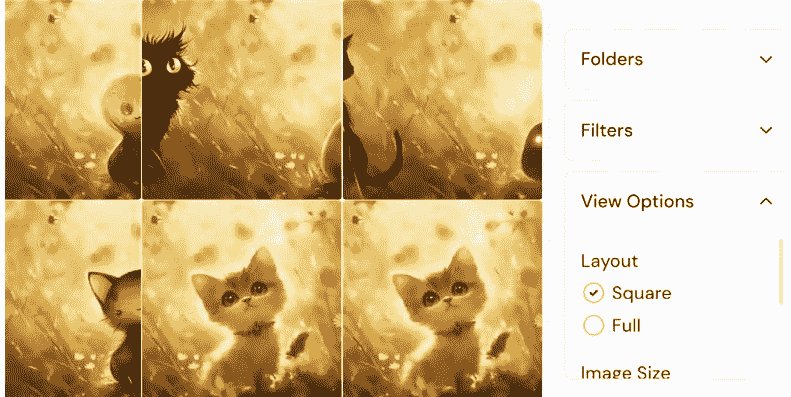

## 3.7 个性化风格设置

个性化风格设置是一个新加入的功能，通过参考创作者对于绘画风格的偏好，AI可以在后续生成图像时更改画面的风格倾向。目前个性化风格需要用户主动开启，进入功能页面后的界面如图 3-48 所示。


点击“Start Teaching”后会进入训练进程，这个训练是为了让AI对用户的偏好有一个基本的认识，系统会提供大概 200 组的图像来让用户选择，训练完成后个性化的开关就可以开启了（图 3-49）。


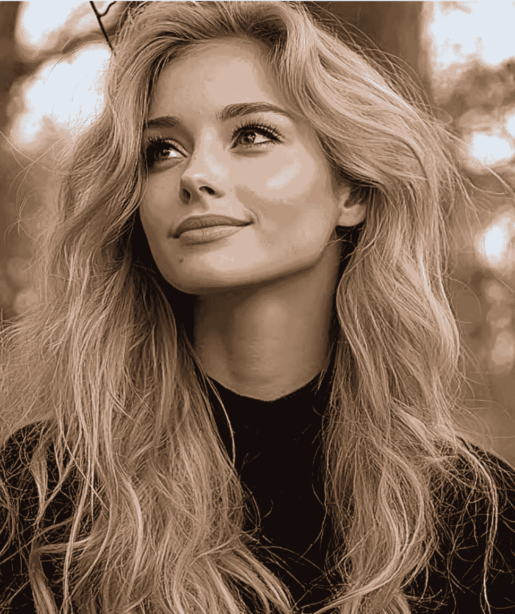

# 4 角色与场景设计：流程编

在完成剧本和分镜这些纸面上的内容之后，下一步就要开始为我们的作品设计具体的角色与场景素材。这一部分要用到的工具主要是文本生成AI与绘画AI，而AI绘画工具的一些进阶使用方法则是本章内容的重点。

## 4.1 角色背景故事与角色形象设计方案

在使用生成式AI来创作影视和动漫作品的时候，制作角色设计稿最主要的目的是保持视频内容的一致。AI的底层算法导致了其在生成内容时有很大的随机性，这对制作视频素材来说是很不利的，如果在讲述一个故事的时候角色的形象一直发生变化，那么故事本身也就难以成立了。角色的设计稿可以帮助创作者确定一个锚点，使得AI能够始终围绕着相同的角色外貌来生成素材内容。

而回归到角色设计的本质，我们同样需要把抽象的概念变成具体的样子，从角色的内在到外在，通过外形的设计来传达出角色一些深层次的重要信息。

### 4.1.1 角色定位与人物小传

设计角色的第一步要从故事的框架出发，搞清楚在这个故事中需要出现哪些角色，这些角色的定位和功能是怎样的——谁是主角，谁是配角，他们对故事的发展起着怎样的作用。然后再为这些角色撰写人物小传，为角色构建丰富的背景故事，包括他们的过去经历、动机、恐惧和愿望，角色的主体性格是怎样的等。

有时在故事大纲中已经分配好了角色的定位，这样的话只需要丰满人物的具体背景就可以了。这些工作全部能够用文本生成AI来搞定，可以依靠创作者自身的理解与想法，给出一些主要的设计，然后让AI来扩充这些内容，也可以完全委托给AI，让它帮助我们设计角色的相关文本。

问：

请根据下面这篇故事大纲丰满其中的主要女性角色，具体内容包括姓名、年龄、职业、性格特点、能力描述以及人物小传：
（故事框架……）

文心：

姓名：白桦
年龄：28岁
职业：私人侦探兼灵术师
性格特点：冷静果断、聪慧、内敛温柔
能力描述：白桦的灵术让她能够感知并操控城市中的灵脉，这些灵脉如同无形的能量网络，贯穿着整座城市。她能够通过灵脉探测到异常能量的流动，甚至与迷失的灵魂进行短暂的交流。她的能力不仅让她能够解开常人无法解释的谜团，还让她在危急时刻借助灵脉的力量增强自身的速度和力量。
人物小传：白桦是一个生活在现代都市中的年轻女性，表面上她是一个不起眼的私人侦探，专门处理那些普通人不愿意或者不敢触碰的复杂案件。但实际上，她是一个有着非凡力量的灵术师，能够感知并操控人们看不见的“灵脉”，即贯穿整个城市的神秘能量网络。

她的灵术来自家族的传承，白家是数代传承的灵术世家，隐匿于都市的阴影中，默默守护人们免受超自然力量的侵害。作为家族传人，白桦自幼被灌输了灵术的知识，但她不喜欢墨守成规，相较于家族传统的低调生活，她更喜欢亲自去探索城市中的奇妙和危险。

在普通人的眼中，白桦只是一个冷静且善于分析的侦探。她总是穿着简单而考究的风衣，脚步轻盈，言语不多，但每一句话都充满智慧。她有着深邃的目光，仿佛能够看透人们心中的秘密。实际上，白桦确实能通过灵脉感知到他人的情绪波动，这也是她侦探工作中一项不可或缺的能力。

尽管她的外表显得冷静且有些难以接近，白桦内心深处却怀抱着对这个城市的温柔和关爱。她常常在夜晚巡游于街道之间，帮助那些受到灵异困扰的普通人，无论是寻找失踪的灵魂，还是解开被诅咒的谜团。她相信每一个生命都有它的独特之处，而她的职责就是守护这种独特性不被黑暗吞噬。

白桦最害怕的，是那种孤独感——她曾在追踪一个强大邪灵的过程中失去了最好的朋友，自此以后，她便对亲密关系有所抗拒，尽量避免与他人建立过于深厚的联系。然而，每当她解开一个谜团、救下一个无辜的人，她又感觉自己与这个城市的灵脉更加紧密地相连，那些人们看不见的感激与温暖，让她找到继续前行的力量。

她的故事，是关于在繁华都市的霓虹灯下，如何面对自我内心的阴影与恐惧，也是关于守护人性中最美好与脆弱的部分。即使站在黑暗与光明的交界处，白桦依旧选择了坚定地往光明中迈步。

### 4.1.2 角色形象设计方案

完成角色的背景设计之后，把整个人物的状态交给AI，为角色设计出一整套的形象设计方案，比如面部特征、体型、肢体语言等身体上的细节，还有服饰风格、配饰选择等外在表现，让角色通过视觉的方式精确地表现出来。这些视觉元素不仅要符合角色的内在特质，还得考虑到其在整个作品中的整体视觉效果。

问：

现在请你根据白桦的角色描述，为她设计形象。注意要客观描写她的外貌特点，要清楚地描述出角色的外表特征。

文心：

好的，根据角色的背景设计，以下是她的形象设计方案：
外貌描述：白桦拥有一头乌黑亮丽的长发，通常简单地束在脑后，以方便行动。她的眼睛深邃且富有神秘感，仿佛能直视人心，眼眸中时常闪烁着一丝淡淡的蓝光，尤其是在她使用灵术时更为明显。她的肤色偏白，五官柔美中带着一丝冷峻，给人一种既温和又难以接近的矛盾感。她喜欢穿着深色的风衣，里面搭配简洁的高领毛衣与紧身裤，脚上是一双舒适的短靴，既方便她快速移动，又不失优雅与干练的风格。
服装风格：白桦的服装风格偏向实用主义，她经常选择深色调的服装，风衣是她的标志性衣物，具备多功能的口袋，方便她随身携带各种工具和符咒。她的饰品很少，但总是戴着一条银质项链，坠子是一个小巧的家族灵符，具有保护作用。
气质与姿态：白桦的气质冷静而坚定，她行走时脚步轻盈，目光总是警惕地扫视四周，仿佛随时准备应对突如其来的危险。她的姿态总是挺拔，给人一种自信而可靠的感觉，但当她在夜晚独自站在城市天台上时，偶尔也会露出一丝孤寂与疲惫。
武器与道具：白桦随身携带一把精致的小型匕首，这是她母亲留给她的护身符，除了近战防身外，这把匕首还能与灵术结合使用，切断邪灵的力量。此外，她的风衣口袋里还装有几张符咒、灵石和一个古老的指南针，这些都是她侦查灵异案件的重要工具。

虽然有了一份详细的角色外貌方案，但是这份方案作为图像生成的提示词来说有点过于详细了，没有办法直接使用。接下来就让AI将这份描述浓缩为更加精炼的提示词。

问：

请将这份外貌设计方案凝练为更加简洁的描述，用于作为绘画AI所使用的提示词。提示词的格式应该尽可能的简洁与精准，参考格式如下：一位中国女性，28岁，头发乌黑亮丽，眼睛深邃，瞳孔为蓝色……

文心：

一位中国女性，28岁，乌黑亮丽的长发，深邃的目光带有一丝淡蓝色的神秘光芒。肤色偏白，五官柔美而略带冷峻，穿着深色风衣，内搭高领毛衣和紧身裤，脚穿舒适短靴。她身上佩戴银质项链，坠子是家族灵符，为她提供保护。气质冷静坚定，姿态自信，随身携带一把小型匕首和几张符咒、灵石，以及古老的指南针，用于侦查灵异事件。

现在这段描述就可以作为提示词来使用了。让AI将其翻译为英文，方便在Midjourney中使用。

问：

请将这段提示词翻译为英文。

文心：

> "A 28-year-old Chinese woman with long, shiny black hair typically tied back, her deep eyes twinkling with a faint mysterious blue light, especially when using spiritual arts. Her complexion is fair, features are delicate yet slightly stern, dressed in a dark trench coat, paired with a high-neck sweater and tight pants, and comfortable short boots. She wears a silver necklace with a small family talisman for protection. Her demeanor is calm and resolute, confident in posture. She carries a small dagger, several talismans, spiritual stones, and an ancient compass, essential tools for investigating supernatural cases."

需要注意的是，虽然可以把提示词总结与提示词翻译这两个步骤合二为一，但是在使用中并不建议这么做。一般来说，总结后的中文提示词还是需要进行适度修改，假如直接转化为英文提示词，那么对于英文水平不高的人来说是很麻烦的一件事情。这就是将任务步骤原子化的意义所在，单独的任务内容便于创作者查错与修改，所以尽管这并不是一种强制性的约束规则，但是笔者依然强烈建议单一步骤只执行单一操作。

## 4.2 角色形象设计稿

本章后续的生图内容还是以参数实现作为主要的手段，方便各位读者进一步熟悉Midjourney的底层逻辑。具体在操作时可以参考第3章被封装后的设置方法，将两者对比着来看。

### 4.2.1 角色站姿初稿

接下来利用翻译后的提示词来进行角色外貌的实际生成，先不做任何修改，直接把提示词输入给AI（图4-1）。

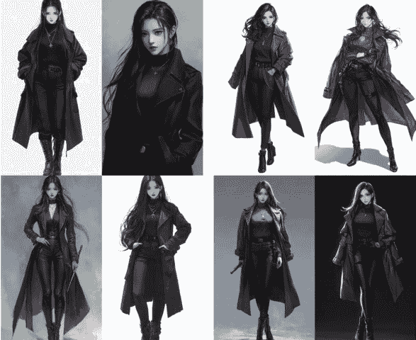

这里在提示词的尾部加入了控制参数，--ar用来决定生成图像的比例，由于要生成角色的全身像，这里采用了4：7的宽高比。而右侧多使用了一组参数--niji 6，这个参数的意思是更换绘制图像时所使用的模型。目前Midjourney共有两组模型可以选择，一组是平台的默认模型，在不使用参数的状况下，生图所使用的就是默认模型。默认模型最新的版本为V6.1，需要切换版本的时候使用参数--v+版本号进行更换。第二组模型则是Midjourney平台与Spellbrush合作开发的Niji模型，这组模型主要是针对动漫与插画的绘制风格所训练的特调模型，调用时使用--niji+版本号格式，最新的版本为Niji 6。

默认模型更加的全能，尤其是在表现偏写实的内容时，模型有着非常强大的发挥。而对于动漫风格这个细分领域来说，Niji模型有着更为丰富的风格表现，创作者使用较短的提示词就能得到不错的生图结果，从前面的生成结果中就能很明显地感觉出二者的不同（图 4-2）。

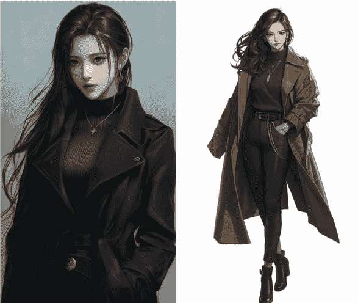

虽说都是动漫风格，但是默认模型会更加偏向写实的画风，而Niji模型更加符合“二次元”的审美。当然，本节的示例只用了初始的提示词来生成角色，在绘制角色的时候，画面的风格也是一个必要的考虑因素。

### 4.2.2 角色的绘制风格

基于数据集的分类，Midjourney能够支持海量的绘画风格。如果在书写提示词时不提及特定的风格，那么生成结果就会进行概率性的随机，使用一些与内容主题相似的情况下常见的绘画风格。如果想要自己指定的话，就需要在文本提示词的开头写上自己的诉求，限制AI的生成方向。绘画风格提示词通过关键词进行调用，比方说想要生成水墨风格的图像，那么关键词就是“Chinese ink style”，格式就像下面这句。

```
Chinese ink style, a 28-year-old Chinese woman...
```

下面来看一些角色绘制风格的示例（图 4-3、图 4-4）。

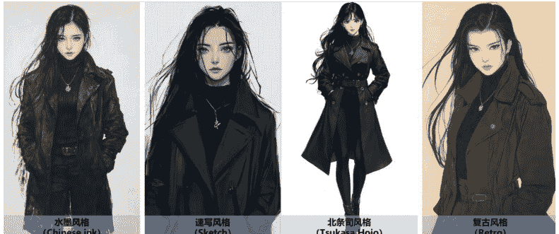

理论上来说，关键词添加到提示词的哪个段落都可以，但是在提示词较多的情况下，加在后段的风格关键词有可能被AI忽略掉，所以一般推荐直接把关键词写在提示词的开头，能省掉很多麻烦。这些风格提示词同样适用于场景的生成。

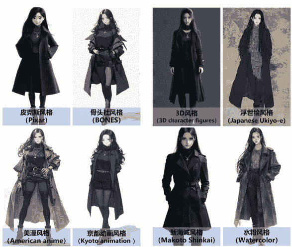

## 4.3 场景与角色的融合

制作角色参考图只是第一步，随后创作者还得把角色与分镜头脚本的内容结合起来，生成具体的情节。在制作镜头作业的时候，有两种方法可供创作者进行选择。如果场景比较简单的话，直接使用提示词加角色参考的方式进行生成即可；而对于元素比较复杂的场景，如果直接使用提示词进行创作，在生成的过程中需要注意场景和角色两方面的效果，要达到两者同时让人满意的试错成本会相当高。此时不如像生成角色一样，单独生成场景画面，然后再将场景与角色通过参数进行结合，这样就能极大地缩短创作时间。

### 4.3.1 角色参考

Midjourney调用角色参考图像的方式是通过--cref参数后缀图片的URL地址来实现的。关于--cref参数的使用我们会在下一小节进行详细解释，这里先使用常规的方法来实现角色参考。

如果是使用Midjourney生成的图片，直接在收藏或者创作管理页面找到这张图片，点击进入详情页（图4-5）。

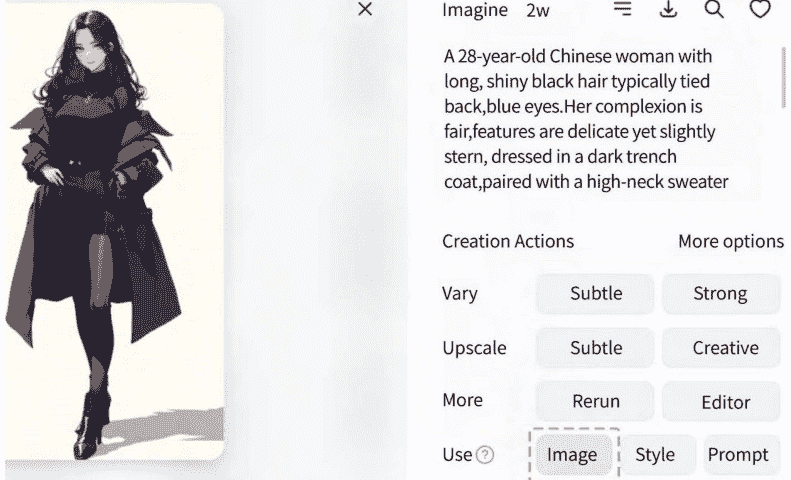

选中右下方的“Image”或者“Style”选项，两者虽然不是角色参考的功能，但是却能把图片提交到提示词中。此时选中左边的人物剪影图标，并确保其他两个图标处于未激活状态，这样就完成了角色参考的设置（图 4-6）。

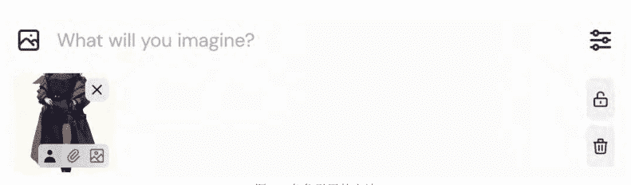

如果使用的是本地上传的图片，那么可以参考本书第 3 章关于图片上传与图像参考的设置方法，最后同样是选中角色剪影的图标即可。

### 4.3.2 融合角色与场景描述

这一部分的内容我们先来认识--cref这个参数。从Midjourney V6 以及Niji 6版本开始，系统新加入了--cref参数的调用功能，参数允许创作者可以参考某个角色来进行图像的生成。这里可以做一个横向对比，在Midjourney中还有一个样式参考参数--sref，这个参数同样需要参考图像，所不同的是参数--sref会让新生成的图像去匹配参考图像的整体风格，而参数--cref则是尝试让新生成的图像中的角色去匹配角色参考图像。

从字面来看也能理解这两项参数的功能取向，--cref表示角色引用（character reference），开头的c代表character，而--sref则表示style reference，s表示style。

与--cref参数强相关的还有--cw参数，这是--cref的拓展参数。通过不同的取值，--cw可以控制在新生成的图像中角色对参考角色的模仿程度。在后续的内容中样式参考与--cw参数的使用方法同样会有所涉及，这里就不展开细讲了。

角色参考参数的调用格式为：

```
--cref+角色参考图URL
```

在提示词输入框中将图片的URL添加到参数名的后面即可完成调用，更便捷的方法是直接拖拽聊天框中的图片到提示词输入框中，或是像上一小节那样在详情页进行设置，这样系统会自动添加图片的URL，然后再设置图片为角色参考即可（图 4-7）。

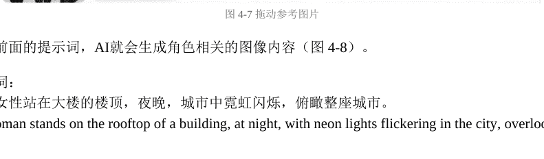

结合前面的提示词，AI就会生成角色相关的图像内容（图 4-8）。

提示词：

一位女性站在大楼的楼顶，夜晚，城市中霓虹闪烁，俯瞰整座城市。

提示词越简单，角色引用的效果就会越自然。但假如像示例中这样，提示词包含很多比较细节的描绘，比如角色的姿势和动作细节，以及角色所处的环境场景，如果还是像示例中这样直接调用--cref参数的话，角色与场景的融合上可能会出现一些问题，造成不连贯的效果，那么这种情况下就要搭配--stylize参数来使用了。

### 4.3.3 风格化参数与画面优化

如果发现生成结果的细节方面需要补充更多的效果，或者是人物与场景存在着过渡不自然的问题，那么就可以尝试使用--s来解决问题。下面给上一节的示例加入参数--s 500（图 4-9）。

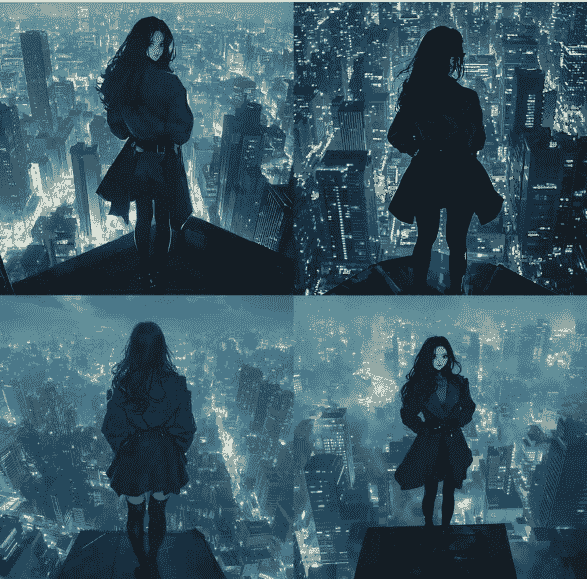

加入参数后画面的色彩、细节与质感有了进一步的提升，但是现在又出现了一个新问题。在新生成的图像中，角色所穿的并不是提示词中所要求的风衣，角色的下装基本上都变成了裙装，如图 4-10 所示。

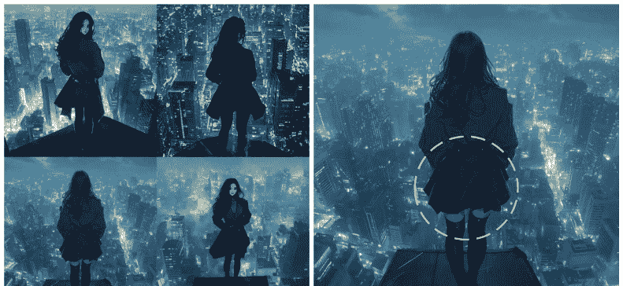

从画面构图以及各方面来说，现在图像 3 是比较理想的一张图片，除了衣物的差错之外，这张图片很适合作为后续处理的素材。这种情况下就需要对图片进行局部上的调整了。

### 4.3.4 局部重绘

进入图片详情页，点击“Editor”，在编辑页面使用局部重绘功能来调整角色的下装（图 4-11）。

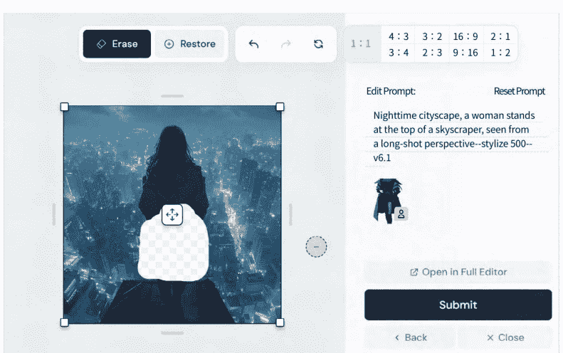

框选需要更改的部分，并在提示词中进行修改，将“长风衣”作为关键词写入提示词，之后执行重绘（图 4-12）。

提示词：
夜晚的城市景观，一位女士站在摩天大楼的顶部，身穿长风衣，从远景角度拍摄 --s 500
(Nighttime cityscape, a woman stands at the top of a skyscraper, wearing a trench coat, seen from a long-shot perspective --s 500)


图 4-12 局部重绘

在更改提示词并进行局部重绘后，角色的下装依然存在问题，这就说明大概率是AI在理解角色的参考图像时出了问题。这种情况下想要单纯地通过提示词更改生成结果是不会有效果的，那么就轮到--cw参数登场了。

作为--cref的衍生参数，--cw可以调整AI模仿角色参考图像的程度，它的取值范围在 0～100，取值为100 表示AI会完全模仿参考图像，当取值减到 0 时，AI会专注于角色面部特征的模仿而忽略剩下的部分。将--cw 20 加入到重绘部分的提示词中，最终得到了正确的图像（图 4-13）。

提示词：
Nighttime cityscape, a woman stands at the top of a skyscraper, wearing a trench coat, seen from a long-shot perspective --s 500 --cw 20。


图 4-13 调整--cw后的重绘结果

### 4.3.5 混沌参数与角色模型表

不断地重复前面的步骤，最终我们会得到一些符合使用标准的图像素材。虽然使用AI绘图不需要像传统的动漫制作方式那样去制作详细的角色模型表，但是如果在生图过程中出现了比较不错的人物各朝向图，还是需要将其保存下来。这些图片能够在结合场景的时候帮助创作者节省大量的时间（图 4-14）。


图 4-14 角色不同的朝向

使用AI工具制作具体的角色模型表是一件非常复杂的事情，由于AI随机性的问题，即便用相同的提示词、相同的角色参考图，在生成角色表情这样细节的内容时也很容易产生或多或少的差异。所以，如果想要制作角色表情模型，需要大批量地对单一表情进行生图，再从中挑选出合格的图像。

此外，在制作场景融合的时候也一定要善用--chaos参数。--chaos参数可以带来更多构图与画面内容的可能性，也更容易让创作者收到意外的素材（图4-15）。

提示词：
一位女性坐在咖啡馆中 --chaos 25。
(A woman sitting in a café --chaos 25)。


图 4-15 添加混沌度的生成结果

### 4.3.6 复杂的场景融合

如果分镜头的场景比较复杂，那么单单使用提示词加上角色参考会有很大的不确定因素，可能场景与镜头调度合适的时候角色出现问题，反过来也是一样。为了得到满意的结果就需要大量的生图，这样就会多出大量的重复劳动。与其如此麻烦，不如先通过提示词来生成合适的场景画面，再通过图像参考与角色参考来将角色与场景进行融合。

下面就来做一下尝试，先使用提示词来生成合适的场景（图 4-16）。

提示词：
一名女性身穿风衣，漂浮在虚无之中，画面中是破碎的空间，背景有一个巨大的模糊身影 --ar 4:3 --stylize 300 --weird 500 --niji 6。

(A woman wearing a trench coat, floating in the void, with a scene of shattered space and a huge blurred figure in the background --ar 4:3 --stylize 300 --weird 500 --niji 6)。


在生成画面的时候可以适当地提高混沌度，而对于角色的描述在外貌上也要保持一致，这样在后期替换的时候会比较方便。得到合适的图片后，将角色与场景融合在一起（图 4-17）。


使用参考图来生成图像时，图像的质量会比单纯使用提示词生成要差一些，在细节上也更容易出问题，如角色的手、面部等都需要多加注意（图 4-18）。


图 4-18 生成结果

对于整体效果都比较满意的作品，使用局部重绘修改有问题的细节，就得到了最终的作品（图 4-19）。


图 4-19 修改之后的成品

# 5 角色与场景设计：提示词编

这一章我们展开讲一讲绘画AI的提示词。在Midjourney平台，控制AI生成结果的手段主要就是提示词与参数，其中提示词更是决定了画面的整体内容、构图与基调。虽然书写提示词可以直接使用人们平日里说话所使用的自然语言，但是在内容组织与结构上还是有一些需要注意的方法和技巧。

## 5.1 饱满的画面元素

一张绘画中究竟包含了哪些内容，如果想要加以结构化的描述，那么就必须将画面中不同的元素进行归类。

### 5.1.1 画面主题

当我们向朋友介绍一幅画面时，往往会从主角开始讲起。同样地，在跟AI描述时，我们也需要详细说明画面中的主角是谁，他们正在做什么事情，比如一位穿着复古连衣裙的少女正在读书，或是一位年迈的渔夫在整理他的渔网。如果将画面的主题作为提示词，它所包含的内容已经足够让AI生成具体的画面（图5-1、图5-2）。

提示词：
一位穿着复古连衣裙的少女正在读书。
(A young girl in a vintage dress is reading a book)。


图 5-1 画面主题 1

提示词：
一位年迈的渔夫在整理他的渔网。
(An elderly fisherman is tending to his fishing nets)。


图 5-2 画面主题 2

这里将角色的形象、状态描述一并放在了主题之中，为了保持角色的一致性，在创作影视和动漫素材的时候一般都要使用角色参考，但是这并不妨碍在生成具体的场景时先一步将角色应该持有的特征写在提示词中。

主要角色不一定非要是人或者动物这些活物，它也可以是山、水、石头、天空这些没有生命的指象（图 5-3）。

提示词：
一块有着裂缝的巨石，在裂缝处闪着金光。
(A giant rock with cracks, shimmering with golden light at the cracks)。


图 5-3 无生命角色

### 5.1.2 环境描述

既然有了“谁在做什么”这样的画面主题，那么，接下来就要描述角色在哪里做这件事情，这就凑齐了时间、地点、人物这三要素（图 5-4）。

提示词：
一位身穿运动衣的中国女性在山顶看日出。
(A Chinese woman in sportswear watches the sunrise from a mountaintop)。

### 5.1.3 光影

光线在影视动漫的制作中有着非常重要的位置。其实不只是影视动漫，只要是视觉艺术，那么如何利用光线都是一门很深的学问。在提示词中对于光线的描写可以总结为光照条件、光源位置及光线与角色的互动关系这三个方面（图 5-7、图 5-8）。

提示词：
女性的面部正面特写照片，温暖的灯光从右侧打在脸上，形成非常有层次的阴影。
(A close-up front view photo of a woman's face, with warm lighting coming from the right side, creating very layered shadows)。


图 5-7 光影 1

提示词：
秋天，一位中国女性站在树林中，逆光拍摄，阳光穿过她的头发，形成美丽的光晕 --style raw。
(In autumn, a Chinese woman stands in a forest, photographed against the light, with the sunlight filtering through her hair --style raw)。


第二个例子在提示词的末尾使用了--style raw参数，这个参数一般用在需要呈现真实感的场景中。Midjourney的模型在生成图像的时候会默认进行一些美化的修正，这并不是一件坏事，在提示词很简单的情况下，这种艺术加工会让图像拥有很出色的质感。但是遇到需要照片这种真实质感的场景，Midjourney的加工就显得多余了，它的修正会让画面看起来就像经过了PS的修改一样。在遇到类似的情况时就可以使用--style raw参数来去除掉模型的修正效果，让画面忠实于提示词的描写，呈现出一种写实的光影质感（图 5-9）。

提示词：
一位中国女性站在麦田中，麦子的高度有一人高，女人手抚麦穗，阳光穿过她的头发，形成美丽的光晕。
(A Chinese woman stands in a wheat field, with the wheat as tall as a person. She runs her hand through the wheat spikes, and the sunlight passes through her hair, creating a beautiful halo)。


图 5-9 未经--style raw参数处理过的画面效果

### 5.1.4 色彩方案

选择色彩方案就是在选择画面的情感基调，创作者可以要求使用温暖的橙黄色调来传达温馨的氛围，或是选择深邃的蓝紫色调来营造神秘的感觉，色彩的选择直接影响着观者的情感体验（图 5-10、图 5-11）。

提示词：
冷色调，一位女性蜷缩在街头的一角，天气很冷，她的双手放在嘴的前面，向着手吹气来取暖。
(In a cool tone, a woman curls up in a corner of the street; it's very cold, and she places her hands in front of her mouth, blowing on them to warm up)。


图 5-10 冷色调

提示词：
温暖的橘黄色调，一位女性坐在沙发上低头看书，右手握拳支撑着自己的侧脸，旁边有一个壁炉。
(In a warm orange hue, a woman sits on a sofa, reading a book with her head bowed. Her right hand is clenched in a fist, supporting her cheek, and there is a fireplace beside her)。


图 5-11 暖色调

### 5.1.5 画面构图

构图决定了我们要以怎样的视角来讲述这个故事，表现为怎样的景别，画面元素的位置，是否使用广角、超广角的方案等。就像电影导演选择镜头一样，我们可以选择是要近距离捕捉人物的细微表情，还是要以全景的方式展现整个场景的壮阔，不同的构图方式能带来不同的视觉体验以及内在的镜头逻辑（图 5-12）。

提示词：
一位看起来很有知识分子气质的女学生骑着自行车，旁边是一位男性朋友一起骑行，二十世纪三十年代，时尚却不失学术气质，夏日氛围，风景宜人，幸福感满满，使用模拟胶卷拍摄，中幅相机，鱼眼镜头，态度很潇洒，仰拍视角 --ar 2: 3 --stylize 50。
(Intellectual student woman on bike with a man riding next to her, friends 二十世纪三十年代, fashinable still intellectual, summer feeling, landscape, happiness, analog film, medium format, fish eye,cool attitude low-angle shot --ar 2: 3 --stylize 50)。


在这个例子中，除了画幅参数，我们还将风格化参数降到了 50。这样做会减少画面中的细节，在制作一些复古风格的绘画时可以增强年代感。

### 5.1.6 情绪

这里所说的情绪主要是画面在整体上所展现出的情绪。情绪是连接画面与观者的桥梁，图 5-12 构图与镜头示例，不同于描述人物的表情、动作，以及整体色调上所传达出的情感，我们可以直接告诉AI当前的作品整体上要表现出一种怎样的情绪，然后让AI来自行理解画面中的元素应该怎样来营造这种情绪氛围（图5-13、图 5-14）。

提示词：
愤怒的情绪，一位年轻的中国女性正在向前奔跑。
(Angry emotion, a young Chinese woman is running forward)。


提示词：
一位女士坐在公园的长椅上，秋天，画面表现出忧伤的情绪。
(A lady sits on a park bench in autumn, the scene conveying a melancholic mood)。


图 5-14 忧伤的情绪基调

### 5.1.7 绘画风格

关于绘画风格在角色绘制的部分已经做过一些讲解，这里再稍微做一下扩展。准确来说，在提示词中所使用的绘画风格应当分为两个层次，第一个层次是图像媒介，也就是图像是基于哪一种媒介形式的风格，如照片、油画、插画、雕塑、浮雕、木雕、涂鸦、挂毯、建筑等这些大类（图 5-15、图 5-16）。

提示词：
木雕，锦鲤。
(Wood carving, koi fish)。


图 5-15 木雕风格

提示词：
挂毯风格，一位安静的少女。
(Tapestry style, a quiet young girl)。


图 5-16 挂毯风格

第二个层次则是具体的艺术风格，也就是更加精确的风格化分类，比如波普艺术、印象派艺术这些不同的派别，不同的艺术家也都有着自己独特的创作风格（图 5-17、图 5-18）。


图 5-17 浮世绘风格的人物

提示词：
波普艺术风格，一个年轻女性留着黑色短发，戴着墨镜，手托下巴，思考着关于宇宙的奥秘。
(In the style of pop art, a young woman with short black hair and sunglasses holds her chin in her hand, pondering the mysteries of the universe)。


图 5-18 波普艺术风格

这两个层次的绘画风格有时会有重合，有时也会存在一定的从属关系，但在整体上采用这样的结构进行划分与使用是没有太大的问题的。关于风格的理解与记忆需要创作者在平时多多积累，碰到好的关键词最好存储起来，不然空有宝库却不知道开启的办法会是一件很可惜的事情。

## 5.2 清晰的语言结构

在语言的组织上，一般来说保持语句清晰的逻辑性，将所要绘制的场景顺序描述就是合格的提示词，比如下面这个例子（图 5-19）。

提示词：
一名穿着夹克和牛仔裤的中国男性与一名穿着风衣的中国女性依偎在一起坐在长凳上看日落时的风景，视线越过镜头看着前方，落日的余晖照亮了两个人的脸，35 毫米电影风格。
(A Chinese man in a jacket and jeans and a Chinese woman in a trench coat snuggle together on a bench watching the sunset view.Their gaze extends past the camera to the front, with the afterglow of the sunset illuminating their faces, in the style of 35mm film--style raw --ar 16: 9)。


示例中这样的提示词虽然足够AI来了解我们的意思，但是它的结构是不够清晰的，在生成绘画时可能会造成细节上的错误。本书比较推荐的写法是将角色、角色描述、画面元素等这些内容拆分成独立的小部分进行书写，这样呈现出的结构更加清楚明了，AI的理解能够更加贴合我们的本意，并且在后续需要更改内容的时候也更加方便，比如下面这个例子（图 5-20）。

提示词：
35 毫米电影风格，一名中国男性和一名中国女性依偎在一起坐在长凳上看风景，男性坐在左侧穿着夹克和牛仔裤，女性坐在右侧穿着风衣，两人视线越过镜头看着镜头外的风景，落日的余晖照亮了两个人的脸 --style raw --ar 16: 9。
(In the style of 35mm film, a Chinese man and a Chinese woman are nestled together on a bench watching the sunset. The man, sitting on the left, is dressed in a jacket and jeans, while the woman, sitting on the right, is wearing a trench coat. Both look past the camera at the sunset outside the frame, with the afterglow of the setting sun illuminating their faces -style raw --ar 16: 9)。


图 5-20 更改结构后的提示词

在需要作出修改时，清晰的提示词结构可以帮助创作者更加快速地定位和修改文本内容（图 5-21）。

提示词：
35 毫米电影风格，一名中国男性和一名中国女性依偎在一起坐在长凳上看风景，男性坐在左侧穿着古代盔甲，女性坐在右侧穿着高科技战斗服，两人视线越过镜头看着镜头外的风景，落日的余晖照亮了两个人的脸 --style raw --ar 16: 9。
(In the style of 35mm film, a Chinese man and a Chinese woman are nestled together on a bench watching the sunset. The man, sitting on the left, is dressed in ancient armor, while the woman, sitting on the right, is wearing high-tech combat gear. Both look past the camera at the sunset outside the frame, with the afterglow of the setting sun illuminating their faces -style raw --ar 16: 9)。


图 5-21 局部重绘

## 5.3 角色与动作设计提示词示例

### 5.3.1 双手合十的女孩

提示词：
油画，一位有翅膀的女孩，像天使一样。身穿白色衣裙，头发上点缀着几朵花，双手交叠于胸前，仿佛正在祈祷，背景采用柔和的粉彩色调，整体氛围传递出宁静和平的感觉 --ar 4: 3 --style raw --stylize 750。
Oil painting of a winged girl, resembling an angel. She is dressed in a white gown, with a few flowers adorning her hair. Her hands are folded across her chest, as if she is praying. The background is set in soft pastel tones, creating an overall mood of peace and tranquility --ar 4: 3 --style raw --stylize 750。


### 5.3.2 外星士兵

提示词：
雄性外星战斗士兵，特写，大眼睛反射着镜头的光芒，身穿黑色制服 --quality 2 --stylize 250。
(Male alien combat soldier, close-up. Large eyes reflecting the camera's light, dressed in a black uniform --quality 2 --stylize 250)。


图 5-23 外星士兵

### 5.3.3 机甲战士

提示词：
巨型太空战士，身穿古老的红白蓝色动力装甲，装甲上饰有象形文字，手持一把巨大的发光能量十字架，闪烁着神圣的能量光芒，头盔的面罩散发出耀眼的金色光芒，背景是一座山和一扇 10 米高的古老大门，画面超写实、庄严且神圣 --chaos 30 --ar 4: 7 --style raw --stylize 750。
(A colossal space marine, clad in ancient red, white, and blue power armor adorned with hieroglyphs. He wields a massive, glowing energy ankh, crackling with divine energy, and his helmet visor emits a radiant golden light. The background features a mountain and an ancient 10-meters-tall door. The image is hyper-realistic, majestic, and divine --chaos 30 --ar 4: 7 --style raw --stylize 750)。

### 5.3.4 幻想生物

提示词：
浴火重生的凤凰，在天空中展翅，身上火焰的红色与云层中所透出的金色融为一体 --ar 4：3。
A phoenix rising from the ashes, spreading its wings in the sky. The red flames on its body merge with the golden hues emanating from the clouds --ar 4：3。

图 5-25 凤凰

### 5.3.5 梦幻场景

提示词：
一位身穿白色长裙的美丽年轻女子在阳光下与鹿共舞，在冬天清晨的雪林中，四周环绕着积雪和树木，还有飘落的雪花，阳光透过她的发丝照亮了她微笑的脸庞，微风轻拂过她们的羽毛 --style raw --stylize 750。
(A beautiful young woman in a white dress dances with deer under the sun, in a snow-covered forest on a winter morning. She is surrounded by snow, trees, and drifting snowflakes. The sunlight filters through her hair, illuminating her smiling face, while a gentle breeze brushes past their feathers --style raw --stylize 750)。

图 5-26 与鹿共舞的女孩

### 5.3.6 写实场景

提示词：
一个棕发短发的男孩，背着深蓝色的背包，身穿白色衬衫，和一个金发女孩，背着白色的背包，身穿深蓝色长裙，在日落时分并肩走在街上，背影视角--stylize 750。
(A brunette guy with a short haircut, carrying a dark blue backpack, wearing a white shirt, and a blonde girl with a white backpack, dressed in a dark blue long dress, walking side by side down the street at sunset, viewed from behind --stylize 750)。

图 5-27 双人背影

### 5.3.7 角色特写

提示词：
一名身穿未来感服装的男子回到家中，带着沮丧的表情坐在桌旁，身上携带着科技设备，他是一个拥有强烈英雄气质的角色，身姿高大，身上的装甲细致而粗犷，结合了高科技和后末日元素，呈现出金属光泽，上面刻有复杂的图案和纹理，面部轮廓分明而富有表现力，眼神深邃，透露出强烈的情感和决心，背景是一片荒凉却美丽的废土，有着残破的文明遗迹和远方一丝希望的微光，色调以大地色为主，点缀着亮丽的色彩，采用中景镜头，超现代风格，融合蒸汽朋克与科技，后末日废土风格，功能性时尚或科技穿搭，充满未来感 --ar 16: 9 --quality 2 --stylize 500。
(A man dressed in futuristic clothing returns home, sitting at a table with a dejected expression, carrying technological equipment on his body. He is a character with a strong heroic presence, standing tall, with armor that is both detailed and rugged, combining high-tech and post-apocalyptic elements. The armor has a metallic sheen, adorned with intricate patterns and textures. His face is chiseled and expressive, with deep eyes that convey strong emotions and determination. The background is a desolate yet beautiful wasteland, featuring remnants of a fallen civilization and a faint glimmer of hope in the distance. The color palette is dominated by earthy tones, accented with bright colors. A medium shot captures this ultra-modern scene, blending steampunk and technology, post-apocalyptic wasteland style, with functional fashion or techwear, exuding a futuristic vibe --ar 16: 9 --quality 2 --stylize 500)。

图 5-28 角色面部特写

### 5.3.8 战争场面

提示词：
超写实的单反摄影作品，展现黎明时分在经过一场辉煌的胜利后战场上的景象，埃及士兵们身穿黑金相间的铠甲，挺立在战斗的残骸中，他们的长矛和盾牌反射着清晨的阳光，前景中，倒下的敌军士兵和散落的武器遍布在尘土飞扬的沙漠地面上，背景中，战车停驻，金字塔在灿烂的天空下巍然耸立，增添了壮丽的气势。一些埃及战士跪地表达感恩，另一些则举起武器庆祝。整个场景在风暴后的平静中充满了骄傲和胜利感，士兵们环视战场，这片土地现在属于他们。
(A hyper-realistic DSLR photograph capturing the scene at dawn, after a glorious victory on the battlefield. Egyptian soldiers, clad in black and gold armor, stand tall amidst the remnants of the battle, with their spears and shields reflecting the morning sunlight. In the foreground, fallen enemy soldiers and scattered weapons lie across the dusty desert ground. In the background, chariots are stationed, and pyramids rise majestically under the radiant sky, adding a sense of grandeur. Some Egyptian warriors kneel in gratitude, while others raise their weapons in celebration. The entire scene exudes pride and victory in the calm after the storm, as the soldiers survey the battlefield, which now belongs to them)。

图 5-29 战争场面

### 5.3.9 简单的角色生成

提示词：
一位 25 岁的亚洲女性，穿着橙色裙子，丝绸衬衫，短发。
(A 25-year-old Asian woman wearing an orange skirt and a silk shirt, with short hair)。

图 5-30 利用特质生成女性参考角色

### 5.3.10 手部与物体特写

提示词：
男人用手护着一盏阿拉伯油灯，电影镜头和灯光效果，非常真实且细致 --ar 16: 9。
(A man shielding an Arabian oil lantern with his hand, captured with cinematic lens and lighting, very realistic and detailed --ar 16: 9)。

图 5-31 手与油灯

### 5.3.11 3D角色特写

提示词：
史诗般的场景，一名深蓝肤色的女性，拥有铂金色的长发和高科技的光滑机械下颚。她的眼睛呈白色且失焦，增添了一种超凡脱俗的效果。有机人类特征与生物机械下半脸的结合，创造了自然与人造之间的鲜明对比。她的表情宁静且几乎超然，仿佛体现了未来主义或后人类的理想。这一赛博朋克与未来主义主题将时尚与技术增强结合在一起。机械元素的光滑、亮丽表面与人类特征形成了尖锐的对比，强调了超人类主义以及有机与合成生命的融合。该作品细节极其丰富，超高清晰度，具有电影级照明效果，类似电影海报 --chaos 20 --ar 3: 4 --quality 2 --style raw。
(Epic scene, featuring a dark blue-skinned woman with platinum blonde hair and a high-tech, glossy mechanical jaw. Her eyes are white and unfocused, enhancing the otherworldly aura. The fusion of organic human traits with a biomechanical lower face presents a vivid contrast between natural and artificial elements. Her expression is serene and transcendent, suggesting she represents a futuristic or posthuman ideal. This cyberpunk and futurism theme merges fashion with technological enhancements. The smooth, sleek finish of the mechanical parts sharply contrasts with the human features, underscoring themes of transhumanism and the integration of organic and synthetic life. The artwork is extremely detailed, hyper-resolution, with cinematic lighting, resembling a movie poster --chaos 20 --ar 3: 4 --quality 2 --style raw)。

图 5-32 3D角色

### 5.3.12 角色表情特写

提示词：
观众惊讶地用手捂住嘴巴 --ar 4：3。
(audience gasp with hand closing mouth --ar 4：3)。

图 5-33 惊恐的表情特写

### 5.3.13 模型效果

提示词：
一组维京战士的纸模型，他们手持火把，正在深夜里快步穿行于一个荒凉的小型维京村庄。从侧面看，他们正从我们身边经过，带着烧毁一座建筑的险恶计划。火把营造出阴影和气氛，建筑物、小屋和房屋都历史精准，角度动态，角色表情丰富 --ar 16: 9 --stylize 50。
(Papercraft of a small group of viking warriors with torches walking briskly together through a small desolate viking village in the dead of night, they are viewed from the side as they're passing us by, they have a sinister plan to torch one of the buildings. The torches create shadows and atmosphere, the buildings, lodges and houses are historically accurate, dynamic angles and expressive characters --ar 16: 9 --stylize 50)。

图 5-34 纸模型效果

# 6 动态素材生成

比起其他的AI工具，视频生成AI在可用性方面还是要差上一些。早期的视频生成模型单以Diffusion架构作为基础，虽然能够生成内容连续的视频，但是架构的随机性导致画面连续性表现得非常糟糕。后期加入的Transformer架构在很大程度上解决了视频生成的一致性问题，但是算力方面的限制还是让视频生成处于一个比较尴尬的位置。

以每秒 30 帧来算，单是一秒钟的视频就需要AI进行 30 次作画，这个工作量是非常可怕的，也就导致了视频生成对于算力的消耗巨大。现阶段视频生成的应用端限制比较大，我们在使用视频AI的时候尽量把单个镜头的设计控制在 10 秒钟之内。

## 6.1 工具简介

本书所选择的工具是可灵AI，它的表现在国产视频生成AI中目前排在比较靠前的位置。在搜索引擎中输入关键字即可搜索到平台，其首页如图6-1。

点击“立即体验”，简单注册之后来到平台的起始页面（图6-2）。

选择“AI视频”这一项，进入视频生成工具页面（图6-3）。

图 6-3 视频生成工具界面

第一，模型选择。通过下拉菜单可以切换生成视频所使用的AI版本，目前有V1.0 和V1.5 两个版本可供选择，新版模型在生成质量上要高于老版本，但是所要消耗的算力也要更高，目前在生成的设置上还有一定的限制。

第二，生成模式。视频生成主要有两种生成模式可供选择，文生视频是通过提示词来生成视频内容，而图生视频则是通过给出参考图片来固定视频的首帧或者首尾帧，进而再根据提示词来生成视频内容。在创作影视动漫的视频素材时基本上都是通过图生视频来实现的。

第三，生成控制。这里就是视频生成的操作区域，像是提示词的编辑、参数的设置等都是在这里进行。不同的生成模式所能进行的操作也是不同的。

第四，视频预览。用户所生成的视频可以在这个区域进行预览。

第五，历史浏览。列表中会列出此前所生成的视频，点击后可切换至对应视频的预览与编辑界面。

## 6.2 文生视频操作解析

### 6.2.1 提示词

文生视频最关键的是提示词的书写，区域内的“创意描述”就是填写提示词的位置（图6-4）。

AI视频生成所使用的提示词可以参考图像生成，上图所展示的是一种比较基础的结构。而与图像生成不同的地方在于，视频生成的提示词可以描述一段过程，比如画面中的角色在整个视频过程中发生了怎样的变化，或者是摄影机的运动方式等。

界面下方的推荐是系统随机生成的一些提示词，例子中的提示词所使用的就是“火山”这一关键词所生成的内容，创作者可以看看系统的语法是怎样的一种表示方法。在提示词确定之后，点击“立即生成”即可让AI开始制作视频（图6-5）。

稍作等待之后，视频就完成了。如果排队人数较多的话，等待时间可能会比较久。完成后即可在预览区域内查看视频（图6-6）。

图 6-6 根据提示词生成的视频

### 6.2.2 视频参数设置

在提示词书写区域的下方是视频的参数设置面板，用户可以在这里对生成视频设置进行一些简单的设置（图 6-7）。

图 6-7 参数设置面板

面板中的第一条可以拖动，左侧创意想象力可以理解为让AI自由发挥，右侧的创意相关性则表示与提示词的贴合程度。这一项的设置类似于Midjourney的--chaos参数，就是控制AI自由发挥的程度，越贴近左端，AI发散的程度就会越高，而越接近右侧，视频的内容就会越贴近提示词，默认取值是 0.5。

生成模式用来控制视频的质量，在高品质模式下视频的分辨率更高，而且视频的细节也会更多，但是相应的生成时长也会变长。接下来的生成时长比较直观，就是视频的时长控制，在可灵中最长能够达到 10 秒。秒，足够一个镜头的长短了。

视频比例决定了视频的宽高比，目前系统支持三种宽高比，正好对应PC端与移动端两种显示格式，而1：1的比例更加灵活一些，可以根据具体需要进行裁切。最后的生成数量则表示一次生成所出的视频数量，根据项目的需求进行调整即可。

### 6.2.3 运镜控制

运镜就是视频中镜头的运动轨迹，虽然通过提示词也可以控制镜头，但是如果想要运镜更加细致的话，还是在运镜控制模块中进行设置的效果会好一些。

镜头的运动方式有很多种，下面以镜头推进、拉远的前后运动为例来看一下具体的设置方法（图 6-8）。


点击“运镜方式”，在下拉菜单中选中推近或拉远。界面中央，蓝色圆点表示的是镜头中心，灰色框体表示镜头的初始位置，蓝色框体表示镜头的结束位置。通过拖动下方的进度条可以调整具体是推近还是拉远镜头，以及镜头运动的幅度，下面我们用例子来实现推进镜头的效果（图 6-9、图 6-10）。

提示词：
一位女性正在收拾行李准备旅行。


图 6-9 视频镜头推近效果 1

提示词：
一位男性正在收拾行李准备旅行。


图 6-10 视频镜头推近效果 2

### 6.2.4 否定提示词

用户可以把不希望出现在视频中的内容通通写在这个模块里面，系统能够根据理解屏蔽掉这些东西。在文本输入的位置，系统也给出了一些例子，比如“动画”的意思就是不要生成动画效果，视频就会以拟真视频为基调来进行创作（图6-11）。


目前使用这一项功能比较容易出现瑕疵，但是可以通过多次生成来弥补这方面的缺陷。

## 6.3 图生视频操作解析

文生视频会带来大量的变数，这种不确定性对于影视动漫的创作来说是一种无法解决的困扰。目前解决这个问题的办法是通过参考图来固定视频的角色与主体构图，然后借助提示词来描述镜头的具体经过。从底层实现来说，文生视频的质量肯定更高，如果想要通过图生视频来获得合适的素材的话，只能多做尝试。

### 6.3.1 上传图片

图生视频同样需要把本地图片上传至服务器，上传的方法与大多数平台类似。把生成模式切换至“图生视频”，会发现生成控制面板比起文生视频模式要多出几个模块，其中位于最上方的就是图片上传功能（图6-12）。


点击黑框区域内部，选择要作为参考图的本地图片即可完成上传。上传完成后这里会显示参考图的缩略图，也可以点击右侧的垃圾桶图标删除这张图片（图6-13）。


### 6.3.2 用提示词控制视频过程

在使用参考图片作为视频的第一帧之后，同样要使用提示词来描述接下来的视频过程。图生视频的参考图更具有目的性，用户的主要任务是描述参考图片中的角色如何运动，以及场景与镜头会发生怎样的变化（图 6-14）。


编写提示词时应该使用简单的词语和句子结构，避免复杂的语言表达，同时应避免使用比喻和修辞手法，保持字面含义，并给出明确的方向指示，如“向左”“向右”“向上”等。在描述动作时，需要按照时间顺序，使用清晰的时序词来组织内容。

物体与角色的运动最好能符合物理规律，尽量描述在图片场景中可能发生的自然运动，避免描述突然或不自然的速度变化，确保人物动作符合人体结构限制。对于复杂的动作，最好将其分解为简单的步骤，同时要考虑重力和惯性的影响。目前的技术还难以准确呈现高速或瞬间完成的动作，因此应该避免这类描述。当描述内容与原始图片差异较大时，就会导致画面产生镜头切换。为了保持视频的连贯性，应该避免场景的剧烈变化，注意保持光线和环境的一致性。采用渐进式的场景转换比突变更容易实现，同时要注意保持物体和人物的一致性。

以目前的技术而言，像球类的弹跳、高空抛物等这些复杂物理运动都较难准确呈现。同样的道理，精细的物体互动、液体、烟雾等复杂粒子效果，以及多个物体同时运动的场景都应该尽量避免。

如果想要比较精确地控制构图细节，就需要明确交代主体和背景的关系，注意深度关系的描述，并控制画面中的元素数量。要给出清晰的景深关系，保持视角的稳定性，同时避免过于复杂的镜头运动。这些原则能帮助生成更自然、流畅的视频效果（图 6-15）。


### 6.3.3 画出运动轨迹

如果想要更加精确地控制画面元素的运动过程，创作者还可以使用运动笔刷这个功能来画出画面中各元素的运动轨迹。毕竟在运动控制方面“画”比“说”要好用，几段话说不明白的运动效果可能两笔就给画出来了（图 6-16）。


运动笔刷同样在生成控制面板中，具体的位置在提示词输入框的下方，点击后进入运动轨迹编辑面板（图 6-17）。


在笔刷设置中可以切换笔刷选择运动区域或是擦除区域的状态，以及更改笔刷的大小。右侧的自动检测开关开启后，系统可以自动帮用户选择运动区域，在这种情况下区域选择笔刷的相关设置会失效（图 6-18）。


系统算法自动选择的区域还是比较精准的，所以一般优先使用自动区域选择，笔刷作为候补手段来补充算法没有准确识别的部分。在右侧的管理面板中，处于同一区域下的选中部分会被识别为同一运动主体，并且共享同样的运动轨迹。而当轨迹这一项处于选中状态时，在编辑面板中鼠标就会切换为轨迹绘制状态，此时就可以为运动主体画出整体的运动路径（图 6-19）。


如果想要实现毛发飘动或者猫耳朵来回摆动的效果，可以给运动主体画上波浪线的运动轨迹，这一技巧的使用频率非常高，一般想要给图片加入简单的动态效果时就会采用这个办法（图 6-20）。


目前可灵AI支持6组运动区域的选择与轨迹设置，每一组的区域可以选择多个部位，但是运动轨迹只能绘制一条（图 6-21）。


最下方的静止区域则会让画面中的某些区域在视频中保持完全的静止，这个功能一般用来固定某些视频中的背景，以此来固定镜头。它的操作方法与运动区域选择相同，处于选中状态时选择需要保持静止的区域即可（如图 6-22）。


完成轨迹绘制后，点击右下角的确认添加就能够保存所有的运动轨迹设置。

### 6.3.4 插入尾帧

除了固定首帧来确定视频的起始画面之外，我们还可以插入尾帧来决定视频最后的画面，这样就能完整地设置视频起点与终点，再通过提示词来生成中间的变化过程。

打开图片上传面板右上角的“首尾帧”开关，系统会允许用户多上传一张图片作为视频的尾帧，上传操作与之前相同，完成后界面会显示出首尾帧图片的缩略图（图 6-23）。


图 6-23 固定首尾帧

例子中的尾帧图片是通过Midjourney的扩图功能来生成的，拖动图片的位置并添加新的提示词，实现镜头的移动并加入新的角色（图 6-24）。


图 6-24 扩图生成新的尾帧

设置完首尾帧之后，稍微修改一下提示词，把视频的整个过程描述出来，最后的生成结果如图 6-25。

提示词：
一只小猫站在雪地中，镜头左移，一匹马走入画面


有一点需要注意，首尾帧模式不支持绘制运动轨迹，所以没有办法像首帧模式那样精确地控制角色的运动方式。


# 7 配音与配乐

音频生成工具主要应用存在两个方向，一个是人声语音合成，另一个是音乐生成，所以这一章的内容我们分为两个部分来讲。

## 7.1 AI配音工具简介

目前AI配音工具的选择面还是比较宽的，根据效果实现以及学习成本大致可以分为三个档次。如果创作者对于配音质量的要求很高，那么可以选择像是魔音工坊这一类专业性比较强的AI配音工具。它们所能达成的效果是最好的，但是使用门槛比较高（图7-1）。


另一类AI配音工具的封装程度更高，虽然没有办法像那些比较专业的配音工具一样从细节上控制配音内容，但是胜在使用简单，输入文本就能生成对应的配音文件。有些工具还能在一定程度上控制配音的情绪变化，或者是训练个性化的音色配音AI，比如Fish Audio。虽然这部分工具的配音表现中规中矩，但是对于一般的个人创作者来说性价比非常高，不用花费太多时间就能制作出质量不错的配音音频（图7-2）。


另外还有一些剪辑软件中也会自带文本配音的功能，比如剪映就是如此。经常使用抖音的朋友对短视频中的AI配音应该不会感到陌生，它确实能完成最基本的配音任务，但是有非常强的机械感，也没有什么情感起伏，在音色上也比较单一（图 7-3）。


图 7-3 剪辑软件自带配音

综合考虑之下，本书选择了第二类工具来创作AI配音。

## 7.2 AI配音工具操作解析

点击主页面选项卡上的“语音合成”，即可进入配音制作页面（图 7-4）。


页面如图 7-5，其中主要有两个功能模块。在“您的文本”下方是文本输入窗口，在这里输入对话文本。在没有升级的情况下，文本输入长度有500 UTF-8字节的限制，每个汉字占用3字节。对于对话来说这个长度是足够的。如果想要减少重复生成的次数，有一种便捷的方法，那就是一次性输入某个角色的多段对话，在将素材导入剪辑软件后再把每段对话单独裁剪出来即可。比如把下面这些内容作为文本同时输入。

你就是黄琼，对吧？这么巧，总是在这些诡异案件现场出现，你该不会是故意引我过来的吧？
不认识？你走过的地方却总是留下混乱和……时空裂缝。你是谁？到底在做什么？
只有那些试图掩盖真相的人才会劝别人不要好奇。而且，这次的案件明显与你有关。灵异痕迹处处指向你，你还敢说和那些受害者无关？

最后系统会生成一个语音文件，取好文件名，做好标记，最后在剪辑软件中完成分割和拼接。


输入语音文本后点击下方的加号添加语音模型，也就是念文本所使用的声音（图 7-6）。选择页面共有三个选项卡，“最近使用”会把用户最近所使用的语音模型按照时间顺序排列，“探索”会把社区目前人气比较高的语音模型展示出来，“我的语音”则是用户自己所训练的语音模型。


选择完语音模型后，点击“创建”，系统就会使用选定的语音模型来创建文本的朗读音频文件，并将结果显示在右侧的预览区域（图 7-7）。


播放音频可以试听生成结果，点击右侧的“...”可在下拉菜单中找到下载按钮，这样就能把生成好的音频文件下载到本地。音频文件同样可以在我的声音生成结果中进行查看（图 7-8）。

### 我的生成


| 新闻 | 成功 | 创建时间 | 类型 | 语音声音 | 文本 | 播放 |
| :--- | :--- | :--- | :--- | :--- | :--- | :--- |
| | | Nov 5, 2024, 15:31 | tts | 新闻 | 你就是黄琼，对吧？这么巧，总... | |

图 7-8 生成的音频文件

### 7.3 生成自己的语音模型

如果对社区中的语音模型不满意，也可以着手训练自己的模型。点击图 7-4选项卡上的“构建声音”即可进入模型创建页面（图 7-9）。


页面的上半部分主要是填写一些基本信息，如新模型的名称、标签、简易描述、封面图标设置这些。

页面的下半部分是训练材料的提交区域。训练新的声音模型需要创作者提交一部分的声音文件作为训练材料，在经过学习之后，模型就能够以材料中的语调朗读文本。提供训练材料总共有两种方式，一种是上传已经录制好的声音文件作为训练材料（图 7-10）。注意系统对音频文件的限制。


另一种方法则是直接现场录制训练材料，在选项卡中系统会给出一段建议文本，点击录制按钮后，用户对着麦克风复述这段文本即可。当然，用户也可以使用自己的文本进行录制，但是要确保其中能够包含尽可能多的发音音节（图7-11）。


上传或者录制成功后，训练音频会显示在面板内（图 7-12）。


图 7-12 录制完成

之后点击创建，稍作等待，利用训练的模型生成一段语音样本，然后就能完成模型的训练了（图 7-13）。


图 7-13 完成语音模型的训练

这之后就可以在生成配音的时候调用我们自己的模型了。

## 7.4 AI配乐工具简介

目前技术最成熟的AI音乐生成工具是Suno AI，作品中的背景音乐以及主题曲都可以使用这个AI工具来制作。平台的首页如图 7-14 所示。


左侧是平台功能导航，其中最重要的三个功能页是创作页面（Creat）、收藏页面（Library）和探索页面（Explore）。

乐曲的创作主要是在创作页面内完成，中间的区域用来输入提示词、歌词以及设置一些乐曲的相关信息，右侧则是生成乐曲的预览区域（图 7-15）。


收藏区域收录了用户的创作历史，而且所收藏的其他作者的音乐也能在这里找到（图 7-16）。


探索页面的功能是帮助用户激发灵感，其中收录了大量的音乐风格以及对应的乐曲示例，点击相应的风格标签即可聆听这种风格的AI乐曲。如果不知道听什么，或者是没有灵感，那么可以点击播放器中间的骰子，这样系统会随机选择一种风格的音乐进行播放（图 7-17）。


### Explore new styles of music with Suno

Here's a small taste (or whatever the listening equivalent is) of what's possible

Pick a style, or roll the dice...


图 7-17 探索页面

## 7.5 如何生成配乐

进入创作页面，Suno的创作模式有两种，可以通过页面顶部的自定义开关（Custom）进行切换（图 7-18）。


### 7.5.1 默认创作模式

在开关处于未激活状态时，所使用的是默认模式，也可以叫作灵感模式。默认模式的创作面板非常简单，只有提示词输入框和提示词辅助模板两部分内容（图 7-19）。


默认模式不需要设置太过复杂的内容，只需要在输入框中描述用户想要的音乐风格和主题就可以让AI生成音乐。这里的音乐风格目前只能使用明确指定的音乐类型或者是对音乐氛围的描述，不可以是艺术家或艺术团的名字以及具体的歌曲名，在这一点上Suno还无法做到Midjourney那样的程度。

这些内容是输入中文的，模型对于中文的支持做得不错。下面我们先用默认模式创作一首动漫的主题曲（图 7-20）。


输入提示词后点击“Create”，AI就会开始生成乐曲。生成进度可以在右侧的预览区域查看，完成后会在乐曲的左侧出现提示红点，并且乐曲封面上面也会显示曲子的时长（图 7-21）。


与图像生成类似，音乐的生成结果也是以“组”的形式，每一组为两首歌。点击曲名可以进入到试听页面查看与试听曲子的具体内容，AI会自动为曲子添加歌词（图 7-22）。


点击乐曲右侧的“...”，在弹出菜单中就可以下载乐曲。下载的格式有MP3和WAV两种，付费账号可以下载WAV格式，清晰度会更高一些（图 7-23）。可以看到在格式选择的下方还可以直接为乐曲生成对应主题的视频，这个功能所制作的视频只是一个音乐的播放视频，对我们创作影视动漫来说帮助不大（图7-24）。

### 7.5.2 自定义创作模式

打开图 7-18 中的自定义开关即可切换至自定义模式。这个模式提供了更加丰富的设置选项，而且它的提示词输入格式也做了扩展。

#### 7.5.2.1 提示词与元标签

首先在提示词的书写上，自定义模式对这个步骤做了细分。把上一小节的提示词同样输入到文本框中（图 7-25）。

图 7-25 内容与主题提示词

此时点击下方的“Write About”， AI会把提示词转化为整首乐曲的结构与歌词（图 7-26）。

图 7-26 提示词填充

转化后的提示词才是Suno提示词的正式形态。下面把这段完整的提示词放出来，了解一下它的构成。

[Verse]
星空下的战场 没有人在
黑暗中潜伏 多么巨大
英雄站在悬崖边 目光如炬

[Verse 2]
风声呼啸 惊起夕阳
无形之敌 阴影徜徉
他挥剑迎战 希望闪光

[Chorus]
勇敢无畏 挺身而出
黑暗中燃起 心中火焰
再多艰难 也不退缩
英雄的名字 铭刻心间

[Verse 3]
山河破碎 英雄不悔
鲜血染透 他的战铠
夜幕降临 心未曾冷

[Verse 4]
眉头紧锁 双拳紧握
未知恐怖 面前挥霍
他眼神坚毅 不屈服命运

[Chorus]
勇敢无畏 挺身而出
黑暗中燃起 心中火焰
再多艰难 也不退缩
英雄的名字 铭刻心间

这些用中括号括起来的内容叫作元标签，它们与Midjourney中的--parameter参数相似，都是用特定的格式来表示特殊语义，像这里的[Verse]、[Chorus]属于结构元标签，也就是塑造乐曲整体结构的元标签。它们将曲子分割成不同的段落，歌词便分布在这些不同的段落中，并由AI谱曲。

元标签是Suno的特殊机制，它对于生成结果的影响以段落为单位，每一组元标签只会控制位于其后的一段乐曲的生成效果，遇到下一组元标签后，当前元标签就会失效。这里我们用的是“一组”这个量词，因为段落前的元标签可以同时生效数个。但是最好不要超过三个，否则AI生成的内容可能会非常混乱。

[Interlude] [Rock] [Drum Solo]

这组元标签的意思就是接下来的一段是乐曲的间奏，摇滚风格，内容是架子鼓Solo。相较于Midjourney的参数，元标签的内容要自由得多，它不存在固定的答案，只要是在音乐领域合理存在的单词或词组，AI基本上都可以理解。甚至于一些环境音效或者人类的对话音、白噪声也都是可以的（如城市噪声[City Noise]、电视白噪声[TV Static]、哭泣声[Crying]）。

既然如此，创作者完全可以使用文本生成AI来帮助自己写一些元标签的内容，只需要将具体的规则告诉AI即可。

问：

我需要你帮我列举一些音乐生成AI所使用的元标签，元标签的格式如下。
前奏：[Intro]
主歌：[Verse]
副歌：[Chorus]
请你帮我列举出表示乐曲结构的元标签

文心：

在音乐生成AI中，使用元标签来指示歌曲的不同部分是常见的做法，这有助于AI理解和生成具有结构的音乐作品。下面是一些常用的表示乐曲结构的元标签：

前奏：[Intro]—表示歌曲的开头部分，通常用于引入主旋律或主题。
主歌：[Verse]—歌曲的主要部分，通常包含故事叙述或情感表达。
副歌：[Chorus]—歌曲中重复的部分，包含核心主题和旋律，易于记忆。
桥接：[Bridge]—连接不同主歌或副歌的部分，常用于提供音乐或情感上的对比。
间奏：[Instrumental]—仅包含乐器演奏的部分，无人声。
结尾：[Outro]—歌曲的结束部分，通常用来平缓地结束整首歌曲。
间奏：[Interlude]—歌曲中用于过渡的短小部分，可以是乐器独奏或其他形式的音乐片段。
重复：[Repeat]—指示某一部分（如副歌）需要重复的标签。
尾奏：[Coda]—一首歌曲的最后部分，用于总结并结束曲目，常出现在结构复杂的音乐作品中。
这些元标签可以根据需要组合使用，以创造出结构丰富且符合特定创意需求的音乐作品。

除了元标签以外，如果用户对Suno默认生成的歌词不满意，也同样可以使用生成式AI来完成歌词的创作。

#### 7.5.2.2 歌曲风格的选择

提示词窗口的下方是歌曲风格窗口，在这里输入歌曲所要呈现的具体风格，如爵士乐、摇滚乐、中国民乐等。如果对各种风格流派不熟悉的话，可以去Suno的探索页面多试听一些例曲（图7-27）。

面板上方的“Exclude Styles”开关可以开启一个子面板，其中主要是输入一些用户完全不想在成曲中听到的音乐风格，它的作用就好像Midjourney的--no参数一样。

#### 7.5.2.3 风格复制

接下来的风格复制则是一项新功能，可以使用示例音乐的整体风格与唱腔声音来创作新的作品。
点击项目即可进入选择界面，用户可以将自己此前生成的音乐指定为示例音乐，也可以选择其他人生成的热门曲目（图7-28）。

图 7-28 风格模仿界面

# 后记

作为一个见证并参与AI创作发展的亲历者，笔者深深体会到我们正站在一个前所未有的时代节点上。就在两年前，要说AI能够协助，甚至主导影视动漫产出，恐怕很多人都会觉得不现实。而今天这已成为现实，并且以令人目眩的速度在改变着创意产业的方方面面。

写这本书是源于笔者在实践中的深切体会：AI创作工具固然强大，但如何真正掌握并运用好这些工具，需要系统性的思考和方法论的指导。在与许多创作者交流的过程中，笔者发现大家普遍存在这样的困惑：面对铺天盖地的AI工具，该如何选择？如何将这些工具有机地整合进现有的工作流程？如何在保持创作本质的同时，又能充分发挥AI的优势？

这本书正是试图回答这些问题。从文本创作到角色设计，从场景构建到动态视频生成，再到配音配乐，我们努力构建了一个完整的AI辅助创作体系。它不仅仅是一本技术指南，更是一本创意思维的启发手册。

在编写这本书的过程中，笔者始终在思考一个问题，那就是AI时代的创作者究竟应该扮演什么样的角色。经过深入的实践与思考，笔者认为，答案是：我们要成为“AI时代的导演”。就像优秀的导演需要统筹全局、把控创意方向、协调各个环节一样，在使用AI工具时，创作者也需要具备同样的能力。

书中详细介绍的工具和方法都是基于这样的理念。AI是强大的助手，但真正的创意和艺术决策权始终在创作者手中。从第1章对AI本质的解读，到后面各章节对具体工具的详细剖析，笔者始终在强调这一点。

在完成这本书的同时，AI技术仍在飞速发展。新的模型、新的功能几乎每周都在涌现。但笔者相信，书中提出的方法论和创作思维框架将会持续适用。因为这些原则不是建立在具体工具之上，而是建立在对创作本质的理解之上。

期待这本书能够帮助更多创作者驾驭AI工具，创作出更多精彩的作品。在未来，也许我们会看到更多令人惊叹的AI辅助创作工具，但创作者的核心价值永远不会改变，那就是用独特的视角讲述动人的故事，传递真挚的情感。

最后，感谢在写作过程中给予笔者帮助和启发的每一个人，特别是正在阅读这本书的你。正是像读者朋友这样愿意拥抱新技术、勇于创新的创作者，才能让整个行业充满活力和希望。让我们一起，在这个AI与人类创意共舞的新时代中，创造无限可能。