# 用AI三分钟搞定影视动漫设计：从零到完整的创作通关手册

# 起笔说

生成式AI的爆发正好映照出当下技术狂飙的轮廓。ChatGPT一夜走红，到各路生成工具完成商用落地，间隔不足两年，迭代速度之快让整个行业目不暇接。对已经尝鲜的人来说，学会这套能力不仅是技能储蓄，更是卡位未来、把握机会的必修课。

从接触的行业里看，众多企业都在尝试把生成式AI塞进内部生产线当降本增效的利器，影视动漫制作也在其中。商业公司更看重稳定，尝新步伐普遍滞后；个人创作者则完全不同。

过去没技术背景的人想做专业内容往往无从下手。如今一张高质量的动漫人物立绘，不再需要扎实的绘画功底和多年设计经验，输入一句清晰的提示词就能得到成品图。门槛被拉低后，艺术、音乐、写作、剪辑、动画等领域都向普通人敞开了大门。那些因技术而搁置的创意，现在都能借助AI落地，为影视动漫爱好者以及想单干的创作者开辟出一条可行之路。

本书聚焦个人创作者，基于体量和难度，细节处难免取舍妥协。但这不等于粗制滥造，在AI加持下作品的完成度仍能得到最大保障。为了真实呈现AI的生成样貌，本书尽量保留工具原生输出，其中也会出现错漏之处，先行告知读者。

# 1 生成式AI的崛起与影视动漫创作

生成式AI是AI发展史上的一次集中爆发。现阶段模型远谈不上成熟，但其迸发的想象力已足以成为创意从业者提升效率的强力武器。

## 1.1 生成式AI到底能干什么

“生成式”这个词本身就很直白，就是为创作者制造各类内容。应用普及后，文本、图像、视频、音频四大方向都释放出可观潜力。

文本创作方面，模型对语言的驾驭能力令人惊讶。给一句提示，就能产出小说、剧本、台词、新闻稿、专业论文等多种文本。现在的短板主要在知识面，垂直深度的理解有限，但在常规场景里语言理解能力相当出色。网络在机器学习领域实现了奠基性的发现与发明。

为适配不同需求，文本模型常提供两种风格。一种是带创意润色的默认模式，适合故事、剧本、广告文案，文字更生动、情绪更饱满。比如输入“一个英雄的冒险”，AI会按叙事文风生成情节并补充细节描写，让故事更抓人。

另一种是中性精简模式，适用于合同、技术文档、学术论文这类追求准确的场景。此时模型会严格跟随指令，少做修饰，输出更精准简洁。

图像生成是最直观的应用。只需提示词或参考图，就能快速得到高质量视觉结果，风格覆盖写实到抽象、现代到古典。不同模型自带的美学滤镜相当于自动风格化，有的会增强艺术感与视觉冲击，对影视动漫素材制作很有帮助。

当需求偏向真实还原而非艺术化时，可切换到“原始风格模式”，类似Midjourney的style raw，去掉额外美化，让画面更贴近提示原意。这种灵活性让用户既能要高度艺术的插画，也能要接近照片的真实还原。

视频生成起步较晚，本质是把图像生成能力延展成连续帧。早期帧间连贯性差，画面跳变明显。经过多轮迭代，部分领先模型已能产出有表现力的素材。目前通病是时长，受限在约10秒左右。备受关注的Sora仍在内测，样片显示上限被大幅抬高，但尚未正式开放，效果仍待验证。

音频AI主要分语音合成与音乐生成。语音合成靠海量语音训练实现文转音，每种音色相当于独立模型，能以自然腔调读出文字，避免机械感，在角色配音里效果不错。

音乐生成则学习大量音频数据，可产出背景音乐到多声道交响。难点在于音高、节奏、和声细节，技术含量较高。做电影配乐或动漫BGM时，输入关键词就能快速得到多风格片段，适合预告片、广告等需要大批量素材的项目。

目前文本生成已相当成熟，头部产品差距只有一两个版本。其他赛道分化明显。以AI绘画为例，能达到商用水准的只有Stable Diffusion、Midjourney等少数模型，市面上多数产品仍是玩具级。视频、音频工具亦然，选型时建议优先技术成熟的平台。

## 1.2 AI如何重塑影视动漫制作

影视动漫是高度复杂的系统工程，个人面对这种复杂度很容易被压垮。即便做个小型个人项目，也要花费大量时间，很多人为省工会砍掉配音配乐，只留下作画。生成式AI改变了这个局面，让个体独立完成完整作品成为可能。

行业流程涵盖剧本、分镜、角色设计、场景绘制、动画、配音配乐等环节，每一步都需要长期投入，稍有失误进度就会拖慢。过去能独立做出高质量作品的个人凤毛麟角。

在文本环节，AI让剧本与分镜变得可行。写完整剧本本就耗时耗力，尤其是长篇与复杂人物设定。AI可借助自然语言处理生成故事大纲，并细化到对话与场景描述，快速搭框架，并按用户提示自动补充修改。

风格调整也是优势。传统写作需反复推敲以匹配角色与情节，AI可根据设定自动调节台词口吻，大幅节省修改时间，提升连贯性与丰富度。

角色与场景设计是创作里最考验创意的部分，需兼顾外观、性格、服装、氛围、光影等。手工迭代耗时巨大。

AI可在前期输入简单提示或草图，批量产出多风格方案。例如输入“冷峻剑士立于古堡前”，就会得到写实到卡通的多种设计供挑选。快速生成节省时间并提供灵感，AI还能自动补光渲染细节，让画面更真实生动。

配音配乐同样如此。专业需要音效师与配音演员，全才稀少。AI语音合成可按角色设定生成对应配音，模仿语调与情感，省去邀约费用，随时调整风格保证连贯。专业团队才能完成的活现在触手可及，大幅提升效率，降低门槛，让更多人能自由探索创作可能。

## 1.3 如何理解生成式AI的工作方式

现在的生成式AI基本都以问答形式工作，也可称问答式AI。整个问答流程像极了简化版编程，于是可以说AI把每个人都变成了程序员。

本质上是输入输出。输入相当于编程里的代码，输出是生成内容。与传统编程不同，它不需要写复杂逻辑，只需用自然语言的提示词或参数指引结果。问答交互更直观，无需编程基础也能实现创意。

提示词相当于简化指令，引导模型生成。输入“科幻风格的未来都市”，绘画模型会从海量图文数据中提炼相关特征，生成符合描述的画面。背后涉及风格、主题、色调、构图等多维理解，最终效果常有惊喜。

类似函数调用，提示词就是调用参数。改变关键词、语气、限定条件，就能从图像到文本、从情感分析到语音合成获得不同结果。

提示词设计是核心，相当于编程里的代码编写。和严格语法不同，它更像自然描述，可用关键词、短语或完整句子引导输出。

常见技巧是细节化。想要活力鲜艳，可加入“明亮色彩、动感构图”；想要柔和安静，可加“柔和灯光、简洁线条”。

像调试一样反复优化提示词，逐步逼近预期，被称为提示词工程。比如从“城堡”迭代到“雾气笼罩的山巅上矗立着古老魔幻城堡”，结果会更贴合预期。

当描述复杂时，仅靠提示词难以精控，部分工具会加入参数控制、局部重绘等补充机制，学会使用能显著提升掌控力。

另一个核心是学习能力。传统编程静态，AI能靠海量数据持续优化。文本模型分析大量小说、新闻、对话，学会不同语境下的表达；图像模型学习成千上万图片的风格、配色、构图，生成更丰富逼真。数据驱动让模型具备进化能力，持续更新与数据扩充不断提升质量，自我优化特性让应用场景越扩越大。

## 1.4 先下手为强

技术史里先行者总占便宜。越早感知趋势、投入学习、付诸实践，就越能占据主动。

生成式AI的爆发带来商业与个人创作的双重机会。最早尝试的人摸索出落地方法，通过试错积累经验。经验不仅帮助快速上手新版本，也形成差异化优势。随着工具封装度越来越高，未来AI会更智能易用，普通用户无需懂技术也能完成任务。但这也意味着想深耕的人更需理解底层逻辑。

越早学习底层原理，就越能在模型参数、训练方式变动时快速适应，甚至自行调整。具备技术回溯能力，才能在问题出现时自救，并在应用里挖出更多潜力。深入理解让使用者能灵活匹配场景，找到最合适的解决方案，这将成为AI时代的核心竞争力。

由被动接受到主动创造是必然路径。过度依赖封装工具会淡化创新本质。深入学习运作逻辑不仅能理解原理，也能在实际使用中组合工具，产出更复杂精细的作品。在持续探索中，用户不仅在使用AI，也在推动技术进步。

想在AI时代掌握主动权，学习生成式AI既是技术选择，也是未来发展的战略决策。提升技术素养、理解原理与趋势，创作者才能在浪潮中获得更多机会与成功可能。

# 2 文本内容创作

文本生成是所有AI工具的基础，绘画、音频等内部同样依赖相似算法处理提示词。除了故事与镜头脚本，文本模型还能帮其他工具解决内容难题。

## 2.1 工具上手

理解自然语言是大型模型的杀手锏，AI浪潮也由此起步。作为迭代最久的品类，主流产品已无明显代差。OpenAI的ChatGPT、谷歌的Gemini，以及国产的文心一言、通义千问等差距在缩小。

本书后续以文心一言为例展开，其他工具可参照方法使用。搜索关键词进入欢迎页。


图 2-1 欢迎页面

点“查看详情”进入文心一言首页。


下面是面板里几个关键模块。

其一，新建对话。文本AI以“话题”管理内容，同一会话内保持一定记忆，称为上下文记忆。每次提问时模型会评估与之前问题的关联，按记忆作答。新建对话相当于开新话题，不同话题间不共享记忆。

其二，对话管理。按时间顺序列出过往话题，点击名称可返回历史会话并继续。默认按首条提问内容自动命名话题。

其三，输入区与展示区。输入框用于打字，发送后模型在对话窗口即时作答。


图 2-3 生成对话

在对话面板的外围，额外配了几组实用的扩展控件。最底部的文档入口和图像入口，可以把本地的资料文件和图片直接传进来，系统会自动抽取要点做简要概括。往上方的菜单里，创作人群里使用频率最高的要数“我的命令”，它能把反复使用的提问固化成关键词，后续只要输入这个词，模型就会按预设的提问逻辑去理解创作意图。


图 2-4 自定义指令

再往后是模型选择。文心一言提供多档版本可选，付费的高阶版本在语言理解的细致度和可承载的上下文长度上更有优势，按实际需求挑选即可。

## 2.2 灵感构思与主题设计

### 2.2.1 作品“是什么”

创作起步先要把作品想表达的核心理念和大致走向理清楚，这一阶段大致有两种入口：从灵感入手，或从明确的主线切入。

灵感通常来自一个念头、一帧画面或一次现实触动，来源很杂。以灵感到位推动的创作往往从一个原点展开，围绕它慢慢延展成完整内容。但也正因如此，落笔时很容易卡住：脑子里点子很多，却拼不出一套可执行的方案。这时生成式文本就可以充当灵感加速器，只需喂入关键词和粗线条设想，模型就能给出多套可供挑选的主题方向，扩大筛选和延展的空间。

问：
我正在构思一部动漫的核心理念，题材是都市奇幻叠加科幻，骨架是几大家族暗中与穿越时空裂隙进入人间的克苏鲁类异神作战，同时未来人从时间裂隙赶回来修补时间脉络，请给出三种主题走向。

文心：
这个设定可以从三个侧重点展开，各自突出不同的重心和情绪张力：

+ （1）“命运的守护者”
主线简介：多大家族作为文明的隐秘守卫，承担抵御穿越裂隙的克苏鲁类异神的职责。他们不是被挑选的英雄，而是被血脉和宿命推着走。交锋中，每位成员都要直面自身恐惧、内心阴影，以及是否愿意为人类付出代价的抉择。
情绪主线：宿命对抗、牺牲守护、亲情背叛。
亮点：突出传承仪式的庄重感、血脉力量，以及每一代守卫为避免沦为异神祭品的挣扎。

+ （2）“时间的重启者”
主线简介：来自未来的个体在家族帮助下穿越裂隙，试图修补被异神介入后扭曲的时间脉络。目的并非复原历史，而是防止时间彻底崩解。每一次修补都可能改写过往，让本该存在的事物消失或被遗忘，甚至连家族记忆也被逐步侵蚀。
情绪主线：记忆遗忘、时间代价、真实幻象。
亮点：修补时间的设定让角色不断在真实与伪装间摇摆，反复质疑记忆是否可靠。未来科技与家族古老秘术交织，保留传统韵味的同时注入现代气息。

+ （3）“永恒与终结”
主线简介：多大家族既要护住人类，也要阻止时间脉络彻底坍塌。异神降临与未来人的介入让时间陷入混乱。人物不仅要做物理对抗，更要与时间本身角力。最终会发现这场战争是一个无尽循环，每一代都在终结与重生之间徘徊。
情绪主线：轮回自我、存在意义、无尽抗争。
亮点：构建复杂的时间循环机制，每一代都需要付出惨重代价才能接近循环本质。时间流逝、记忆流失与家族轮回构成关键，人物在永恒的时间里追问自己的存在价值。

模型整理后，灵感被转化为可操作的架构。创作者可以挑出最有吸引力的方向再做深化，让主线逐步成型并赋予作品鲜明内核。就像上述案例一样，可以对模型建议进行删改整合，形成更丰满具体的架构。

纯粹依赖灵感属于作者型路径，利弊都很明显。个人印记鲜明容易让观众记住作者，好点子也能带来差异化的质感与视角，在内容竞争中差异化是爆发的关键。但这种方式难以持续，灵感不可控，若要追求商业上的稳定输出，持续连贯的作品是基本要求。并非人人都是天才，对普通创作者而言，如何长期经营一个影视动漫账号更现实。在此前提下，以明确主线作为创作入口更具可行性、延续性和商业合理性。

问：
帮我列出十个当前最火的影视动漫创作方向。

文心：
现在影视动漫领域比较流行的方向包括：

- 人工智能与技术未来：探讨智能体与高科技对社会的影响走向。
- 都市奇幻：把魔法与超自然元素植入现代都市环境。
- 后末日世界：聚焦世界末日后的生存难题，描绘资源极度匮乏下的社会文化。
- 心理惊悚：深入心灵阴暗面，触碰人性极限。
- 时间旅行与平行宇宙：围绕穿越时空、访问平行世界的复杂情节展开。
- 青春成长：呈现青少年在友情、爱情与自我认知过程中的成长。
- 超级英雄：描绘拥有超能力的英雄与反派对决，以及英雄内心的挣扎与牺牲。
- 历史与古风：对历史事件或古代传说进行再诠释，或以现代视角重塑古风题。
- 生存恐怖：在极端环境下的人物生存斗争，常兼具心理与生理恐惧。
- 宇宙探险：围绕太空旅行与外星探索，思考人类在未知宇宙中的位置与挑战。

这些方向反映了当下的文化风向，也显示出观众对多元类型故事的持续兴趣。

在模型给出的方向之上，可以再拆分为二级分类，形成更具体的划分。随后利用这些分类生成选题题目，一个方向至少能扩展出上百个具体选题，指数级扩增最终能搭建起庞大的选题库。

问：
将“历史与古风”这一项扩展出十个次级方向，并做简短说明。

文心：
“历史与古风”可以细化为：

帝国更替：围绕古代帝国的兴衰转移，讲述权力更迭与历史变迁。
英雄传说：重塑历史上的英雄人物，通过冒险与战斗展现其精神与影响。
宫廷斗争：刻画古代宫廷的权力角力，涉及复杂人际与心理战。
古代神话：借鉴古神话，结合神祇与凡人互动，呈现古人对宇宙生命的看法。
时空穿梭：现代人回到古代，与历史人物互动，影响或观察历史进程。
历史重大事件：以战争、盟约、发明或发现等大事为背景，描绘当时人们的生活与决策。
民间故事：挖掘各地民间叙事，展现地域文化的特色与传统。
古风爱情：以古代背景为舞台，讲述忠贞、牺牲与家族观念下的爱情。
历史文化交流：描绘不同文明间的交流，如丝绸之路上的贸易与思想往来。
传统节庆与习俗：通过古代节日活动与社会风俗，反映当时的生活方式与信仰。

这些方向能为影视动漫提供丰富素材，吸引对历史与文化感兴趣的观众。

### 2.2.2 作品的背景世界

确定主线后，下一步是搭建世界设定与背景，通常涉及人物、地理、历史等要素。尤其对奇幻或科幻作品而言，世界搭建庞大而复杂，生成式AI可通过设问法协助创作者梳理与完善，让设定更具逻辑与一致性。例如在构思一个架空魔幻世界时，AI可以提出引导性问题：“该世界的魔法运转规则如何？是否与自然力量相关？”“社会是否存在明显阶层分野？主要冲突来自何处？”借助AI的提问，创作者能系统思考每个要素，并在模型产出内容的基础上加工调整，使设定更立体完整。仍以上一节的第一个例子，将整合后的内容交给模型，让它逐项回应疑问。

问：
下面“”中的内容是我所选择的内容框架，请你根据这个内容框架回答我的问题：
（1）这个世界的魔法运转规则是如何的？
（2）克苏鲁系的神祇是如何在精神层面影响人类的？
（3）这些被影响的人类在社会中的组织架构是怎样的？

> “主题概述：几大家族作为人类文明的隐秘守护者，承担起与跨越时空裂缝的克苏鲁系神祇对抗的使命。他们不是被选择的英雄，而是因血缘和命运而被迫承担这个宿命。在与神祇的对抗中，每个家族成员都要面对自身的恐惧、内心的黑暗以及是否愿意为人类牺牲的困惑。
斗争是残酷的，人类社会内部早已成长出很多这些外来生物的忠实拥趸，有些是因为神祇对于精神的影响，有些是因为本身的反人类倾向。而家族内部的损耗也是巨大的，不断有人陷入疯狂，不断有人被毁灭。而随着战争的进行，人们发现神祇对于时间线的影响是毁灭性的，按理来说整个时空早就应该灰飞烟灭了，但是整个世界却维持在一种微妙的平衡之中，疑似有未来的人类经由时空裂缝不断地在对时间线进行修正。
他们不是为了修复历史，而是为了避免时空的彻底崩溃。每一次修补都意味着历史可能被重写，曾经存在过的事物可能会消失甚至被遗忘，甚至家族的记忆也被一点点吞噬。这似乎是一场永无尽头的战争，每一代都在“终结”与“重生”之间挣扎，每一代人都要付出巨大代价才能理解这一循环的本质。每个人不仅要面对内心的煎熬，也要在永恒的时间中寻找自己的存在意义。”

文心：
依据你提供的内容框架，对魔法运转规则、异神精神影响及被影响人类组织架构的解答如下：

（1）魔法运转规则
来源：该世界的魔法源于古老仪式与血脉传承。几大家族依靠代代相传的古老知识和力量与克苏鲁系神祇抗衡。魔法并非自然赋予，而是家族长期从时空裂缝中汲取的能量，通过牺牲、血祭或意志强化获得。神秘仪式与符文是核心，施法者借助仪式让符文在现实中具象化。
能量与代价：施法时家族成员须付出自身能量、记忆甚至精神，换取短暂力量。长期使用会逐步损耗生命力与精神，诱发幻觉、失忆甚至精神崩溃。
魔法形态：主要体现为感知、空间操控与封印，尤其擅长封印裂缝、屏蔽神祇侵扰和净化受污染意识。法阵可以阻隔神祇窥探，但维持需要巨大精力与精神投入。

（2）克苏鲁系神祇的精神影响
影响方式：神祇通过时空裂缝渗透人类意识，以低频精神震荡干扰思维，以潜意识为通道作用于原始恐惧、欲望与绝望，形成无形精神侵蚀，类似慢性毒药。
感染表现：受影响者会出现异常幻觉、情绪失控，对非人事物产生强烈崇拜，常研究禁忌知识，解读不可名状符号与语言，逐步脱离现实并受神祇意志操控。随着感染加深，会变得极具攻击性，对亲友产生敌意。
精神寄生与觉醒：神祇会在合适的意识中寄生，建立“觉醒者”，这些人类获得强大的精神干扰能力，甚至能吸引他人加入信仰。

（3）被影响者的社会组织架构
神祇教团：受影响人类自发形成地下教团式的组织，称“神祇教团”。结构层级森严，核心为“觉醒者”，在神祇指引下拥有更强精神感染力，引领新成员接受神祇思想。
社会渗透与掩护：教团隐秘渗透各阶层，许多成员藏身科研机构与文化艺术领域，通过舆论与信息操控加剧混乱与不安。活动看似零散，关键时刻会集中行动配合神祇计划。
伪装与洗脑：部分普通成员加入时并不知全貌，以为加入的是追求“真理”的团体，通过接触神秘知识寻找存在意义。教团在外人看来相对无害，内部却已被神祇意志深度操控，为未来的全面“觉醒”做准备。

示例中的提问较为粗浅，实际作品设定庞杂，大小设计既要出彩，也要互相自洽。在提问时可采取循序渐进的方式，先让模型完成基础设计，再在此基础上发散细节，保持在统一框架内，利用其对话记忆能力维持逻辑一致性。

## 2.3 剧本与故事线创作

剧本与故事线的质量直接决定观感和情感共鸣，扎实的剧本需要清晰结构、流畅情节、自然互动与细腻场景描写。在生成式AI辅助下，这些复杂步骤可被显著优化，帮助创作者快速搭建、完善与润色剧本，为作品奠定故事基础。

### 2.3.1 剧本的结构

剧本结构是故事展开的骨架，经典三段式与五段式分别更适合短篇与长篇。三段式通过设定、冲突、高潮、结局构建简洁有力叙事，五段式则加入更多起承转合深化情节复杂度。AI可根据主题与核心情节自动生成各段的剧情节点与关键事件，提供结构指导。例如在三段式创作中，模型能帮助生成设定中的角色目标、冲突中的转折事件与高潮中的决断或反转，让每段都有明确目标与转折。结构化生成既帮助构思阶段条理规划，也确保整体紧凑流畅。这一结构可同时作用于单集叙事与整季层面。

问：
请帮我设计三段式布局和五段式布局在故事单集创作以及整部剧集上的应用。

文心：
+ （1）单集剧集的结构选择
单集中使用三段式适合节奏较快的短篇，快速完成设定、引入冲突、高潮与收束。
第一段：迅速交代本集主题，抛出核心冲突，例如家族成员察觉裂缝异动或发现敌对势力在城市中活动。
第二段：角色行动以解冲突，遭遇阻碍，甚至与克苏鲁教团对上，揭露更多危机。
第三段：本集冲突达到高潮并暂时解决，但留下更大谜团或隐患，为后续集数埋设悬念。
五段式更适合情节复杂的单集，尤其是长篇或角色众多的集数：
第一段：抛出诱人神秘事件，吸引观众并逐步揭示家族使命。
第二段：家族成员展开调查，遭遇障碍，同时展现彼此关系与内心恐惧。
第三段：核心对抗或冲突场面，进一步揭示教团力量或异神意志。
第四段：高潮余波，角色付出代价，展现内心矛盾。
第五段：收尾给出小解答，但留下悬念，为后续情节奠定基础。

（2）整季剧集的结构选择
三段式可作为整季的大框架，将一季内容分为起承转合三部分：
第一段（前几集）：介绍家族、世界观、魔法运转规则，揭示时间裂隙与异神存在，建立观众兴趣。
第二段（中间几集）：家族与教团冲突加剧，角色深入谜团，意识到更深威胁，情感与心理压力上升，内部矛盾显现。
第三段（最后几集）：时间脉络危机加剧，角色发现裂隙背后真相并做出关键抉择。主线暂时收束，但留下新问题为后续季铺垫。
五段式则提供更丰富的层次与伏笔：
第一段：介绍背景与家族使命，展现角色“日常”，以及与克苏鲁势力对抗的常态。
第二段：新事件揭示裂隙异常或教团活动，逐步引出未来人修补时间脉络的行为。
第三段（季中高潮）：主要冲突在中段达到高潮，例如家族与异神首次正面对抗并付出沉重代价。
第四段：家族在失利后调整，揭示与异神更深的宿命纠葛，角色关系进一步深入。
第五段（季终高潮）：与神祇教团最终较量，甚至出现家族内部背叛与牺牲，使时间脉络暂时平衡，但留下更大伏笔。

实践中可将创作结构用于每集情节发展，同时以整季结构作为宏观框架，确保单集环环相扣且逐步推进季核心主线。每集的三段/五段保证节奏紧凑与高密度情节，整季的三段/五段提供宏观进程，逐步揭开世界观复杂性与角色宿命纠葛。这样既能让观众在单集观看时保持投入，也能在整季观看时感受到层层递进的快感。

借助模型对剧本的结构化处理，可用以下提问方式把剧集走向具体拆分。

问：
请按照五段式形式将整个剧集内容分割成二十集的体量。

文心：
以下按五段式结构把剧集划分为二十集，每段四集，逐步推进情节与角色，并在整季形成完整弧线。

第一段：背景与设定（第1～4集）
第1集：家族的传承
介绍家族成员及其守护使命，展示与克苏鲁系异神长期对抗的历史。主角发现新的裂隙，初步揭示异界威胁。
第2集：裂缝的动荡
裂隙异常活跃，引发家族关注，内部产生是否继续战斗的分歧。主角深入裂隙，偶遇教团成员并爆发小规模冲突。
第3集：神秘的教团
教团成员逐步渗透人类社会，家族开始追查线索。教团力量初露端倪，对人类精神的影响开始显现。
第4集：未来的警告
家族调查中接触到来自未来的修补者，了解到异神影响已波及时间脉络。若不控制裂隙，时间将彻底崩溃，形成对抗动机。

第二段：危机的深入（第5～8集）
第5集：力量的觉醒
家族成员特殊能力逐渐觉醒，同时带来代价如记忆丧失或精神负担。主角体验魔法极限，并因异神影响产生首次精神错乱。
第 6 集：教团的诱惑
教团成员接近社会有影响力人物，扩大支持者。主角面临挑衅与拉拢，部分普通人开始倾向反社会。
第 7 集：家族的背叛
家族内部出现叛徒，受教团影响泄露家族秘密。裂隙濒临失控，叛徒行为导致更严重冲突。
第 8 集：异神的窥探
一次仪式让异神暂时窥探现实，引发激烈对抗。未来修补者再次出现，警告危险加剧，推动家族全面备战。
……

第五段：命运的终结（第 17～20 集）
第 17 集：时间的回溯
家族为挽救崩溃的时间脉络选择重新穿越裂隙，试图改变命运。主角在时空深处见到被异神侵蚀的未来世界，坚定阻止历史重演。
第 18 集：最终决战
教团集结力量试图将异神完全带入现实。家族与教团展开最终对抗，修补者协助完成最后一战，主角在战斗中牺牲，成功关闭裂隙。
第 19 集：世界的修复
裂隙被暂时封闭，教团瓦解，但代价是时间脉络被重塑。世界在陌生秩序中重生，失去记忆的家族成员恢复平凡生活，内心仍残留模糊的英雄感。

一部完整季度的搭建往往先从宏观骨架谈起。以二十集五幕的格局为例，最后一段落看似收束，实则暗流未止。第２０集《宿命的轮回》表面是平息，细微的征兆却在提醒裂缝的危机仍在潜伏。新一代族人已经隐约感受到继承在身的责任，新的轮回 quietly 启动，为后续埋下伏笔。这种五幕二十集的编排既能保证每一幕都有起伏的高潮，也让整季保持清晰的主线与饱满的情感张力，结尾留白的未解之谜则为续作或新一代的故事预留空间。

### 2.3.2 情节设计
主线与支线的交织是让剧情既有深度又有层次的关键。生成式AI在这里可以作为很强的辅助，能够批量产出关键节点和走向，为创作者提供可参考的路线图。在具体操作时，AI 能主动给出“意外反转”“冲突升级”之类的设计，让戏剧张力更足。以悬疑类型为例，AI 可以在高潮段落补一个出人意料的转折，制造强烈的情绪冲击。支线方面，AI 会根据主线需求编出贴合整体氛围的小故事或次要矛盾，使整体更丰满，同时维持一致性和连贯性。

在实践中会遇到这样的需求：请用三幕剧的方式为第２集《裂缝的动荡》搭出故事线，并加入少量支线做铺垫。AI 给出的示例大致如下。

第一幕 裂缝异动的初现
清晨巡查时，主角与家族成员发现城中一处原本沉寂的裂缝开始波动，边缘泛起诡光，附近的动物惊慌，空气里似有低语。主角判断这像是神祇活动的迹象，心情紧绷。回到家族后，长辈认为这是更大危机的前兆，主张立刻行动；另一部分人则担心消耗战会把家族拖垮，毕竟上一代已在战斗中力竭牺牲。分歧无解，主角虽矛盾却决定私下探查，潜入裂缝寻找答案。

第二幕 深入裂缝的冒险
借助家族法术，主角首次单独进入活跃的裂缝。空间扭曲，压迫感强烈，能量流动异常，像有东西正从另一侧试图进来。深处，他撞上教团成员，对方正在进行诡异仪式，用不可名状的咒语试图加速神祇降临。主角出手阻止，双方爆发小规模争斗。交锋中他发现对手的力量并非单纯的精神影响，而是汲取裂缝能量后的增强。虽以术法险胜，却体力透支并出现短暂的意识混乱。临死前的教团成员放出狠话，称这是开始，信仰让他们不惧死亡。主角第一次真正认识到教团的决绝。

第三幕 真相的揭露与家族的隐患
归队汇报后，家族对是否联合他族对抗、是否继续隐忍的争论加剧，分裂苗头显现。资深族人提醒，教团动用的是古老且危险的能量，可能扰乱裂缝平衡，甚至影响时间线，并提到“未来修补者”的模糊概念。这一集保持了紧凑节奏，同时为后续埋下关键伏笔。

需要说明的是，本书只是示范了生成式AI的用法，输出中带有不少“毛刺”。AI的初稿未必符合创作者的预期，真实创作是反复迭代的过程：不满意就修改，把反馈再丢回去。切忌求一次成稿，多复核、多思考，才能产出高质量成果。

### 2.3.3 对话设计
优秀剧本靠角色对话传递情感、推动情节、勾勒性格，AI也能代劳。它能按人物设定生成符合性格、情绪与语言风格的台词，让不同气质的角色拥有辨识度，并在上下文中保持一致，避免人设漂移，让互动更真实可信。

例如给到一段剧情梗概：白家长女白桦在追踪灵异杀人案时，锁定嫌疑人黄琼，并发现他出现的地方总伴随时空裂缝，此时她还不知对方是黄家世家之人。要求为两人初次见面设计对话，背景是黑夜、下雨、污浊的城街。AI产出的片段呈现出雨中巷口的压抑氛围，白桦冷硬质问，黄琼淡漠回击，双方围绕“时空裂缝”“灵异痕迹”你来我往，最终黄琼隐入雨夜，白桦意识到追逐才刚开始。故事里不少细节在成片中会转为旁白，以弥补AI创作在镜头表现上的不足，旁白同样可以交由AI来辅助撰写。

### 2.3.4 场景描写
场景描写为分镜和画面生成提供基础。AI可以根据要求生成沉浸感强的环境刻画，从建筑破旧、空气潮湿到远处鸟鸣都能细化；叙述风格也能切换，紧凑的动作戏用简洁语言，情感戏则可用诗意描写，保持全片叙事统一。

以主角首次直面不可名状的克苏鲁神祇为例，AI生成的场景设在雷雨夜的废弃工业区。裂缝前低语环绕，主角感到如深海被巨物凝视的压迫。裂缝中浮现无法言说的黑影，触手般的轮廓在扭曲空间里闪烁异色，幻象中出现深蓝海域与冷漠巨眼，思维被侵蚀，咒语难以出口。黄琼随后出现暂时封印裂缝，并警告其不应靠近。这一刻白桦体会到自身的无力，也感知到黄琼对这类存在的熟悉。

场景会随剧情发展而调整，概念性的地点可以先定，具体内容则跟着情节走。除主线和对话外，细节的丰富度也决定真实感。AI能补充历史背景、日常物件摆放等，让角色更有生活气息。

### 2.3.5 剧本优化
初稿完成后，AI还能润色语言。它会识别冗余表述并精简，让叙述更顺畅；通过词汇、句式、语气的微调增强表现力，如把“主角看着窗外”改为“主角凝视着窗外，漩涡投出的巨大光亮映进瞳孔”。同时保持风格统一，便于后续分镜。

## 2.4 分镜脚本
剧本完成后需要转化为视觉化的分镜脚本，供图像生成和拍摄参考。分镜以镜头、画面构图和场景注释把每个关键节点直观呈现，AI的介入让这一环节更自动化，节省时间并提升视觉节奏与氛围把控。
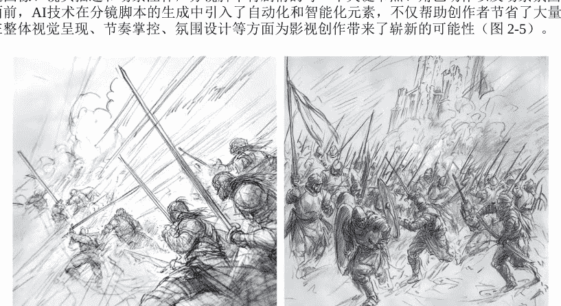
分镜脚本的核心要素包括镜头类型、景别、视角、角色动作与台词等。通过这些要素的组合，文字被逐帧视觉化。比如关键对话要标注镜头类型如特写、全景，角色的表情、动作以及拍摄角度如低视角或高视角，这些信息保证执行时的一致性与叙事流畅。生成式AI可以快速生成完整的分镜雏形，从切换到动作描述。
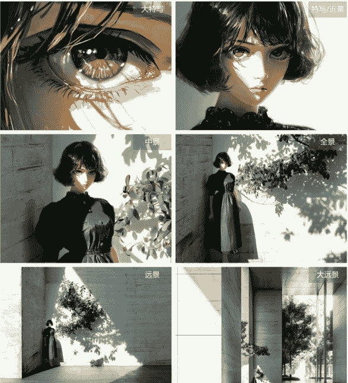
图 2-6 景别
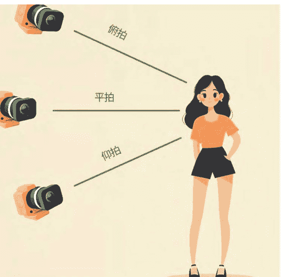
图 2-7 拍摄角度
AI在节奏控制上表现也较好，能依据剧本自动设定远近切换。紧张追逐时可给出远景—近景—特写的序列，增强压迫感；角色内心变化时，通过从远到近的拉近突出情绪。如此分镜既有逻辑也自然流畅。
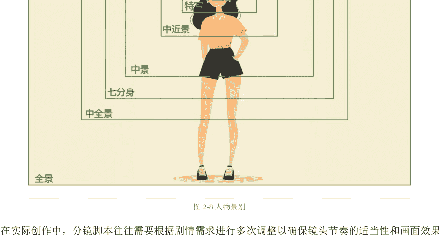
图 2-8 人物景别
AI还能自动生成符合情节的角色动作与场景布置，提升自动化程度。对抗戏中可给出防御、进攻及细微表情；多人对话时可安排站位与视线交流，保证自然。视觉氛围方面，AI会根据剧情调配光影、角度与色调，夜间紧张戏用冷色调低光，温馨家庭戏用暖色柔光，增强沉浸。

在实际应用中，分镜常需多次调整。AI可根据意见优化镜头安排。举例来说，为主角首次见到不可名状神祇的场景设计分镜头并加入旁白，AI产出了一组镜头：俯视全景的废弃工业区开场，配以关于黑暗侵入的旁白；之后是裂缝前的中景、幻象中的深蓝海洋大景等，镜头14以背视中景收束，强调追逐才开始。但每个镜头都配旁白显然过量，更合理的处理是挑关键镜头加旁白，其余保持画面自述。为避免信息缺失，提问时应把需求完整写清，例如明确要求列出镜头类型、景别、视角、动作与旁白的取舍。

请为男主角初次遭遇不可名状的克苏鲁神祇这一桥段，撰写一份包含镜头类型、景别、视角、角色动作与台词，并配有旁白说明的分镜设计。

把文字创作的整体脉络梳理出来，其实就是从灵感与主题出发，落实到故事与剧本，再把情节拆解成若干场景，最后把每个场景再拆成多个分镜头的过程。

前面已讲过的内容不再赘述，我们重点回顾生成情节之后的环节。故事有长有短，要让它变成可视化的画面，就得先把整体叙事打散，按集划分成不同的段落。随后依据时间顺序与空间位置，把情节细化为一系列场景，每个场景都是推进叙事的关键节点，通常会围绕特定的事件、特定的地点和特定的人物来展开。

再把场景往下拆成分镜头，才能对动作与对白进行精细规划与可视化。一个分镜头会标明镜头的种类、角度、运动方式以及大概时长。拿到这些信息后，就可以让图像生成类AI为每一个分镜产出静态画面，必要时再把静态图转成动态片段。最后把这些片段串起来，叠加对话配音、旁白配音与背景音乐，一集的内容就算完成了。

创作门槛摆在那里，部分工序肯定会做简化。即便如此，只要按本书的流程操作，一个完全的新手做出来的成片质量，也足以在短视频平台上碾压绝大多数个人自制的影视、动漫作品，这正是AI带来的效率。

# 3 图像生成工具：Midjourney

在AI影视动漫的制作链条里，图像生成是核心环节。如果说文本生成类AI负责搭建作品的整体框架，那么这个框架的砖石就是靠AI绘画来堆砌的。相较于其他AI品类，图像生成工具的使用复杂度更高，所以本章会单独把它的操作方法讲透。

## 3.1 图像生成AI概览

当前表现最强的两款图像生成平台是Stable Diffusion与Midjourney，均诞生于2022年，底层都采用Diffusion架构。

Stable Diffusion最大的卖点是开源。Stability AI公开了模型代码与权重，研究者、开发者与创作者都能自由下载、改装与使用。开放的策略催生了大量衍生应用与插件，社区生态非常繁荣。

Midjourney则走商业闭源路线，使用需要付费，通过商业收入来支撑版本迭代。与Stable Diffusion的开放不同，Midjourney更注重易用性。

本书不以Stable Diffusion为主角，正是因为两者在需求定位上的差异。开源平台对上手要求较高，学习成本不低。Midjourney则反其道而行，操作门槛低，短时间内就能熟练出图。

部署方式上，Stable Diffusion要本地运行，需要配备新型号显卡的高性能主机；即便用云服务器代跑，易用性提升有限，还要额外处理部署。Midjourney只要登录网页端就能直接用。

当然想把图像能力再往上推，终究绕不开Stable Diffusion。建议先用Midjourney快速上手并产出内容，再去探索Stable Diffusion，这样学习曲线更平缓。

## 3.2 Midjourney版本介绍

Midjourney目前有两条使用路径，一是借助Discord在线聊天室里的Midjourney频道调用绘图机器人，二是通过Midjourney官方Web端直接生成。

Discord渠道更为成熟，发展时间更久（图3-1）。


Web端是在此基础上做的改进，正在逐步独立成体系（图 3-2）。

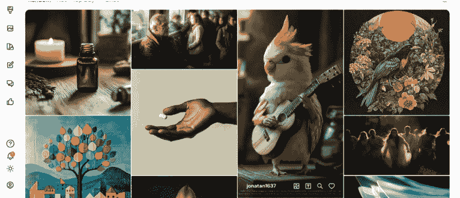

图 3-2 Web端版本的软件界面

Web端现在仍处在alpha测试阶段，但在使用逻辑与作品管理上已有明显进步，所以本书以Web端为主讲解。需要提醒的是，后续更新可能改动界面布局与功能位置，但核心能力不会有大变化。

## 3.3 提示词创作区域

Midjourney主界面如图 3-3。最上方那个输入框就是提示词输入区。所有生成式AI都依赖提示词，把想要表达的内容写成文字提交，AI就会把它转成图像。

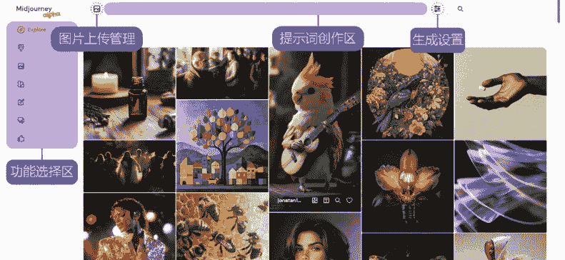

Midjourney的提示词遵循图 3-4 的结构：


总体可分成三部分，决定画面内容的是提示词主体，用来描述创作者希望呈现的具体画面、元素与表现形式，例如：

提示词：

一条黑狗在泳池中游泳，戴着墨镜。

(A black dog swimming in a pool, wearing sunglasses)。

输入英文后回车，AI就会生成对应图像（图 3-5）。


其余两部分并非必须，但会显著影响结果。AI会模仿参考图的风格与构图生成新图，看图 3-6 的例子。

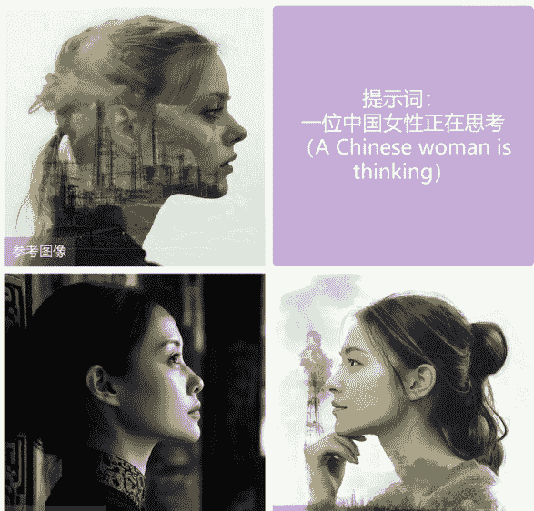

原始参考图使用了二次曝光效果，未使用参考时图像严格按提示词生成，一位女性在凝视思考；使用了参考后，画面构图与设计都借鉴了参考图。这种能力在影视动漫素材制作中十分实用。调用参考图的底层实现是把图片URL加到提示词前端，Web端已做封装，上传、调用与管理集中在一个模块，具体入口在提示词输入框左侧的图片图标（图 3-7）。


点击后进入管理菜单，布局如图 3-8。

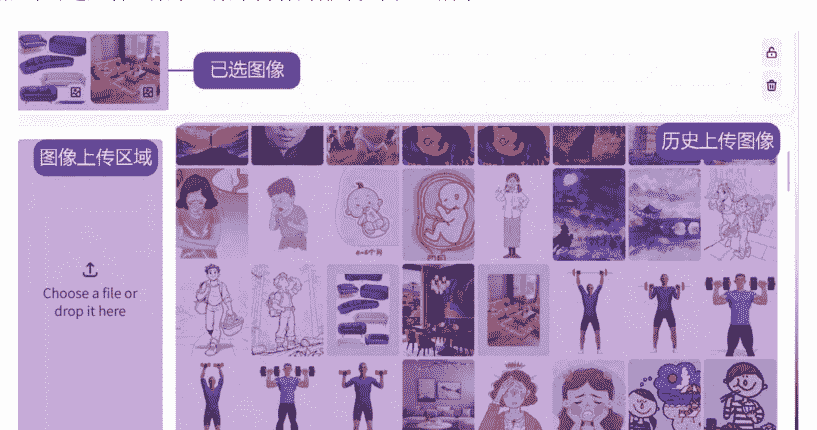

图像参考需要URL，所以本地图片先要上传成网络可访问的图片。上传入口在菜单左侧，可选择本地文件，也可直接拖拽文件夹里的图片。

上传完成的图片会出现在右侧管理区，可以浏览、管理和删除。单击图片即可送到上方选中区，默认即作为参考使用，可同时选多张。

参数是Midjourney的重要调节手段，能从底层改变生成效果。参数有固定写法，部分有取值范围，下面先做概览（表 3-1）。

表 3-1 Midjourney常用参数

| 参数名 | 书写格式 | 缩写格式 | 取值范围 | 默认值 | 简介 |
|---|---|---|---|---|---|
| chaos 参数 | --chaos+ 数字 | --c | 0~100 | 0 | 增加生成图像的随机性 |
| stylize 参数 | --stylize+ 数字 | --s | 0~1000 | 100 | 提升画面细节与质感 |
| weird 参数 | --weird+ 数字 | --w | 0~3000 | 0 | 增强图像的怪异程度 |
| style raw 参数 | --style raw | 无缩写 | 开启或关闭 | 关闭 | 取消 AI 的默认美化滤镜 |
| 样式参考参数 | --sref + 图片 URL | 无缩写 | 无 | 无 | 模仿参考图片的样式内容 |
| 角色参考参数 | --cref + 图片 URL | 无缩写 | 无 | 无 | 参考样例的角色 |
| 否定参数 | --no+ 内容 | 无缩写 | 无 | 无 | 设置不会出现在画布中的内容 |
| 宽高比参数 | --ar+ 宽：高 | 无缩写 | 不同宽高比 | 1 : 1 | 改变画面比例 |
| 质量参数 | --quality+ 数字 | --q | 0.25~2 | 1 | GPU 渲染时长 |
| 重复工程参数 | --repeat+ 数字 | --r | 2~4（基础订阅）2~10（标准订阅）2~40（专业订阅） | 1 | 设置同一提示词重复生成的次数 |
| 种子参数 | --seed+ 数字 | 无缩写 | 0~4294967295 | 随机 | 设置生成图像所使用的种子编号 |
| 拼贴参数 | --tile | 无缩写 | 无 | 无 | 增加生成图像的随机性 |
| 停止参数 | --stop+ 数字 | 无缩写 | 10~100 | 100 | 提升画面细节与质感 |
| 视频参数 | --video | 无缩写 | 无 | 无 | 增强图像的怪异程度 |
| 模型版本参数 | --version+ 版本号 | --v | 不同版本号 | 最新版本号 | 切换不同版本的模型 |
| Niji 模型调用 | --niji+ 版本号 | 无缩写 | 不同版本号 | 最新版本号 | 切换 Niji 模型生图 |
| 个性化参数 | --personalize+ 编码 | --p | 不同用户的风格化编码 | 用户自己的偏好 | 用户自己的偏好 |
| iw 参数 | --iw+ 数字 | 无缩写 | 0~2 | 2 | 决定图像参考的程度 |
| cw 参数 | --cw+ 数字 | 无缩写 | 0~2 | 2 | 决定角色参考的程度 |

写提示词时要特别注意空格，每段结构之间都要用空格分隔，参数部分要求更严格，--parameter与取值、不同参数之间都必须有空格，否则会报错。

输入框右侧的图标用于修改基础生成设置，点击后出现如下界面（图 3-9）。

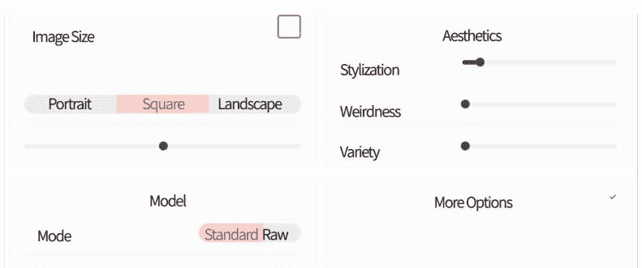

这项设置与参数高度相关，把原本需要写参数控制的功能独立封装成可视化选项，下面逐一说明。

第一，宽高比设置。Image Size负责设定输出画面的宽高比，等同于--ar参数的功能（图 3-10）。

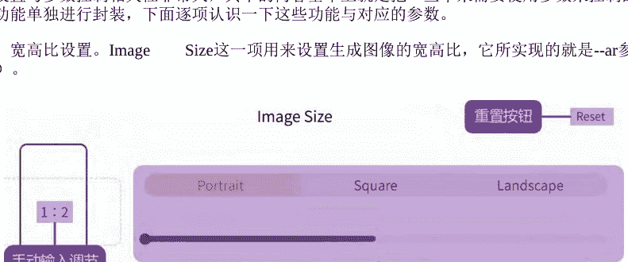

快捷调节窗可通过顶部标题快速切换画幅，默认正方形 Square，即 1:1。左侧为纵向 Portrait，右侧为横向 Landscape。下方的滚动条可精细调节比例，结果在左侧演示区实时显示。

点击演示区的比例可直接手动输入，精度最高。要清除宽高比设置，点击右上角重置 Reset即可。常用比例效果见图 3-11。

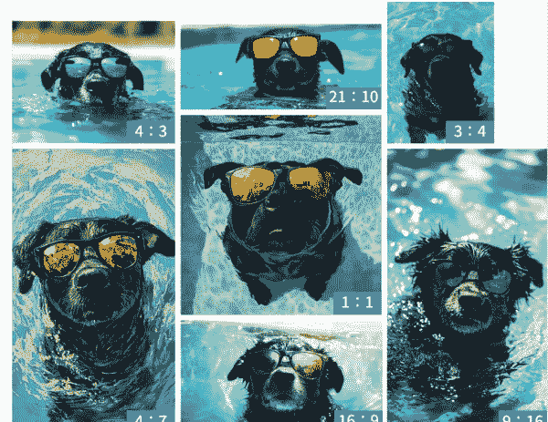

第二，模型相关设置。宽高比下方是Model区。

Mode对应--style raw开关。默认状态下Midjourney会对画面做美学优化，加入滤镜让画面更讨喜。一般情况下表现力更好，若追求高度写实的镜头感，默认美化反而会成为干扰。

Raw模式会关闭模型自带的默认美学倾向，让画面更贴合提示词原文，有助于产出更逼真的照片感与电影感画面，角色、背景与光线会更接近现实。

Version负责切换绘画模型版本，对应--version参数。Midjourney迄今已迭代六个大版本，当前默认使用V6.1。新版本在综合能力上更强，但老版本偶有独特的绘画质感，面向老用户提供选择（图 3-12）。

提示词：

哈苏相机拍摄的照片，一位美丽的女子在森林中摆姿势，四周环绕着秋天的色彩 --ar 4：3。

(Hasselblad photo of a beautiful woman posing in a forest with the fall colours all around her --ar 4：3)。

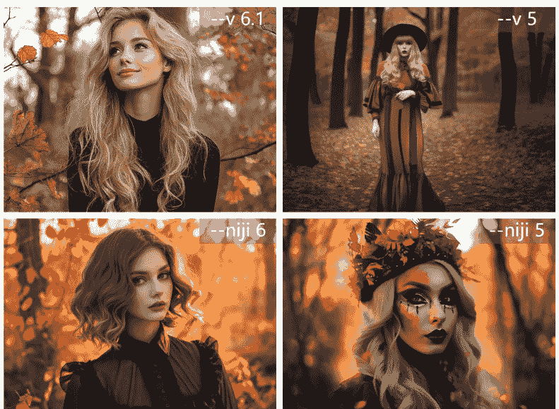

注意这里只能调节Midjourney自家模型版本，想调用Niji模型仍需在提示词里写入--niji。

个性化风格参考 Personalize 是V6后新增的功能，对应--personalize参数。开启后AI会按创作者的偏好调整风格倾向，系统通过点赞记录与初始风格选择来判断偏好，具体操作会在后续功能区讲解。

第三，美学风格设置。右侧Aesthetic包含三项参数。

风格化 stylization 对应--stylize，影响美学应用强度与细节丰富度，取值0-1000，默认100（图 3-13）。


数值低时画面更忠于提示词，艺术感弱且细节偏少；数值高时艺术化增强，与提示词的相关性下降。示例见图 3-14。

提示词：

一位美丽的中国女性在水下跳舞，周围环绕着色彩鲜艳的珊瑚和各种色彩斑斓的鱼群，阳光透过水面，映照出她美丽的身姿 --s 3：2。

(A beautiful Chinese woman dances underwater, surrounded by vibrant coral and colorful fish. Sunlight filters through the water, illuminating her graceful figure --s 3: 2)。

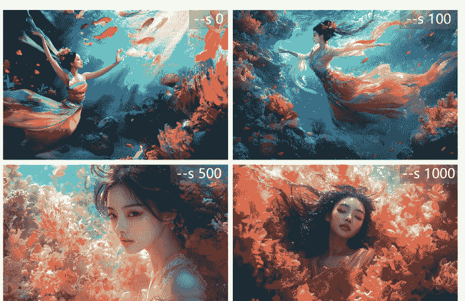

提升风格化能明显改善细节与整体质感，但取值需保持合理。过高会导致冗余细节、画面杂乱，主题也可能被冲淡。一般300左右较为合适，细节仍不足再考虑上调。

怪异度 weirdness 对应--weird，取值0~3000，默认0（图 3-15）。


该参数用于引入古怪特质，产出意外效果，常用在恐怖、悬疑、黑暗题材。Midjourney本身偏向积极正向的画面审美，开启weirdness后这种倾向会被打破（图 3-16）。

提示词：

哥特风格，一艘破烂的幽灵船正缓缓驶向岸边，船上站着已经变成骷髅的船员。

(Gothic style, a tattered ghost ship slowly drifts toward the shore, with skeletal crew members standing aboard)。

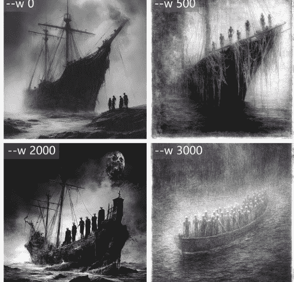

怪异强度随数值增大而加深，通常会配合--stylize一起使用，细节与表现力会更好。

多样化 variety 对应--chaos，即混沌值，取值0~100，默认0（图 3-17）。


不同于风格化与怪异度，--chaos带来的是随机性变化。高数值产生更出人意料的构图与效果，低数值则结果更稳定可复现（图 3-18）。

提示词：

一只穿得像珊莎史塔克的猫。

(Cat dressed as Sansa Stark)。

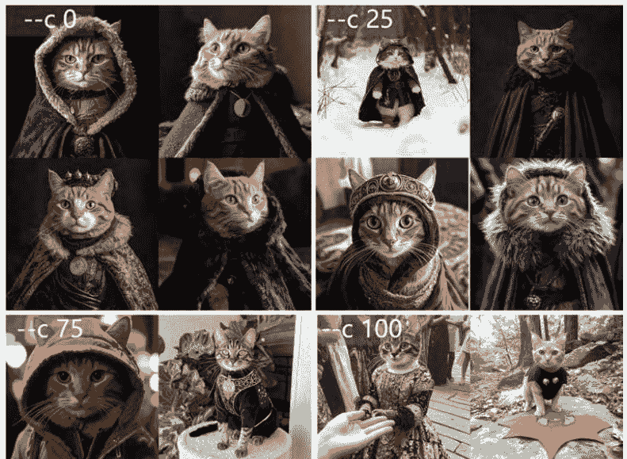

数值抬高之后，画面在构图、画面内容与风格上的偏离幅度会随之放大，这正是多样化参数所带来的特征。实际创作时，推荐把该数值落在20到30的区间，处于这个范围能够让输出更具变化，同时又不会让主体走向跑偏。

第四，其它设置。该分类原本是工作室暂未归类功能的归纳位，目前可见的功能仅有生成速度的调节（图 3-19）。


账号的快速生成时长会按月度订阅情况发放，入口内可对这部分时长的消费逻辑进行调整。

Relax 休闲模式以较慢且不稳定的节奏产出，开启后不占用快速时长；Fast 快速模式为默认状态，以中等节奏产出并会消耗快速时长。快速时长耗尽后，Fast 以及后续的 Turbo 都会自动降级为 Relax；

Turbo 极速模式以更高速度产出，通常数秒即可见图，但会消耗双倍的快速时长。

## 3.4 探索页面

顶部功能区罗列了软件绝大部分模块，下面按顺序带大家掠过几个高频模块的界面。

探索页面会汇聚其他创作者发布的高质量画面。灵感不足时逛逛，常能获得启发。点进任意画面，界面会跳转到作品详情，提示词、参数配置、参考图等信息均在此呈现（图 3-20）。

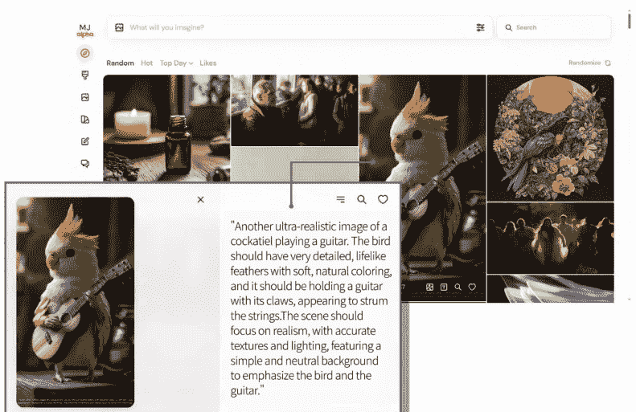

对心仪的作品，可在画面右下角或详情页右上角点赞，被点赞的作品会进入探索页的 Likes 列表，后续查询提示词时直接在该列表检索即可。

详情页底部可见图 3-21 中的若干操作。


图 3-21 图像引用

其中 Image 即图像参考，点击后当前画面会被写入提示词框作为参考，对应图标随之点亮（图 3-22）。

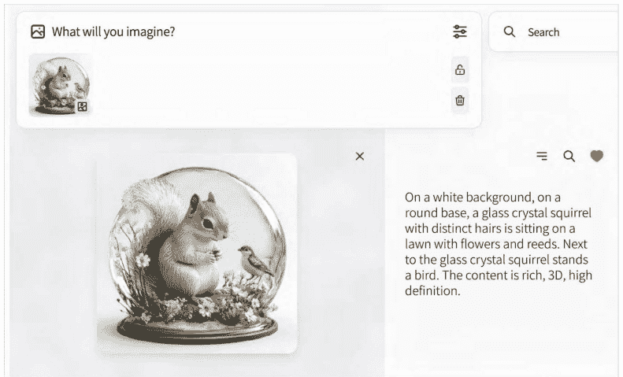

图 3-22 图像参考

Style 代表样式参考参数 --sref，其实现效果与图像参考相近，差异主要在最终相似度上。点击后该画面会作为样式参考提供给提示词，图标同步点亮（图 3-23）。

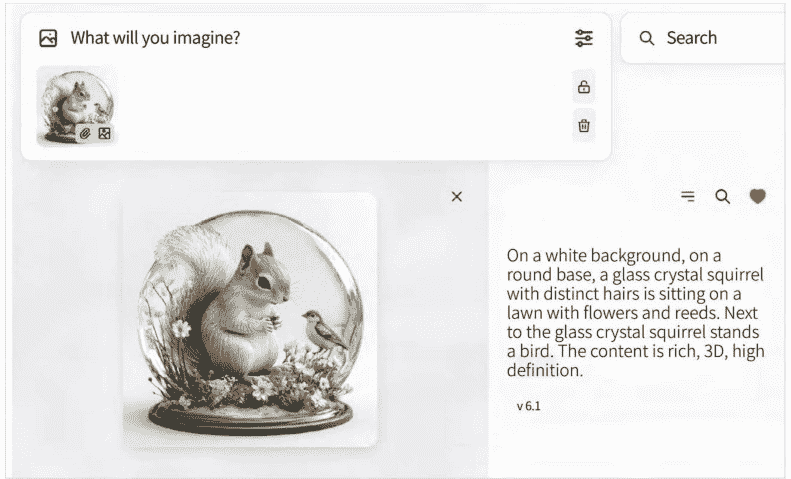

图 3-23 样式参考

末项 Prompt 用于整条提示词搬迁，点击后全部内容会送入提示词输入框，参考图、角色参考、样式参考与参数设置均会被带上（图 3-24）。

On a white background, on a round base, a glass crystal squirrel with distinct hairs is sitting on a lawn with flowers and reeds. Next to the glass crystal squirrel stands a bird. The content is rich, 3D, high definition.--v 6.1

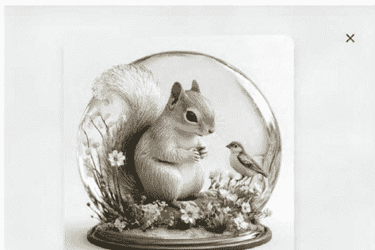

On a white background, on a round base, a glass crystal squirrel with distinct hairs is sitting on a lawn with flowers and reeds. Next to the glass crystal squirrel stands a bird. The content is rich, 3D, high definition.

v 6.1

图 3-24 提示词复制

## 3.5 创作管理

创作管理并非传统意义上的创作入口，Midjourney 的图像产出依旧通过顶部提示词框触发，该页面主要承担结果的管理与二次编辑（图 3-25）。

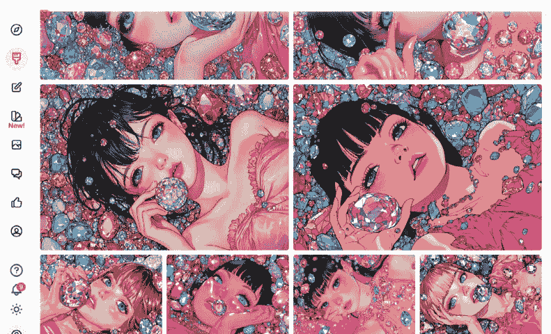

页面内所有产出均以四连图为单位归档，因为一次默认产出即为四张。画面右侧会展示该组所用提示词、关联参考图与参数。右下角排列着若干管理入口，如图 3-26。


Rerun 的含义是用完全相同的配置重新产出一次，效果如图 3-27。

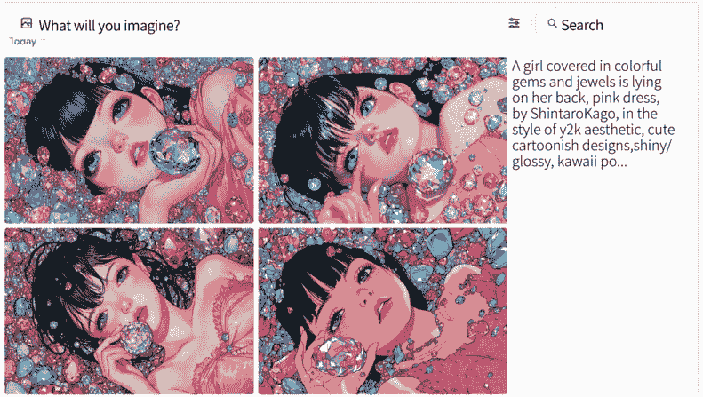

Use 的效果与探索页里的 Prompt 一致，点击后会把该组画面所用整条提示词完整复制到输入框中（图 3-28）。

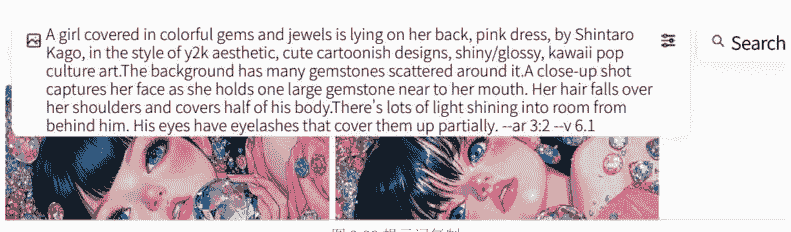

Hide 会把该组状态改为隐藏。隐藏后该组将不再在当前列表中出现（图 3-29）。

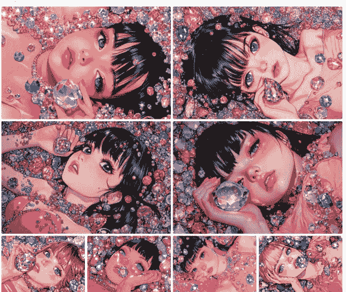

若想恢复显示，需在收藏管理中进行设置。

More 汇总了该图的更多设置，点击后会弹出额外操作。其中 Copy 负责把各类信息复制到剪贴板（图 3-30）。


- Prompt：把当前图的提示词复制到剪贴板。
- Job ID：把当前图的 Job ID 复制到剪贴板。Job ID 是 Midjourney 为每张图分配的唯一编号，类似身份证，具有唯一性，通过该编号可以精确定位到对应图。
- Seed：Seed 即种子。AI 制图第一步是生成满屏噪点，类似无信号的雪花。整个过程是逐层去噪，而种子决定了初始噪点分布方式。相同提示词、相同种子即可复现完全一致的结果。参数控制中用 --seed 来指定种子值（图 3-31）。

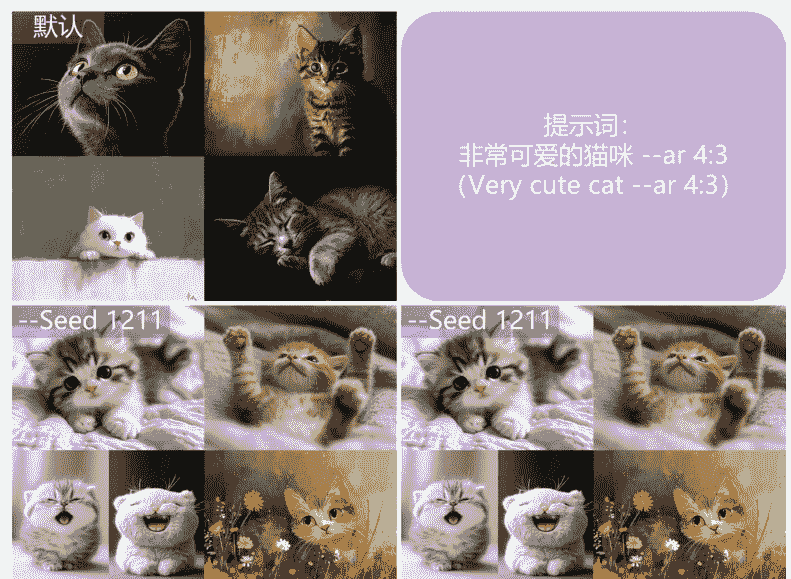

示例里左上方产出时未加入种子，使用的是随机种子，下方两次产出均用了相同种子，最终结果完全一致。借助种子的复制，可以稳定复现画面。

- Image：把当前图复制到剪贴板。这是为弥补 Web 端相对聊天室版所缺少的功能。聊天室版初始为四张拼成的大图，而 Web 端为各自独立，这里复制可实现组图效果。
- Image URL：复制该图的 URL 到剪贴板。注意，这里复制的是组图的链接。
- Report：举报入口。若发现违规内容，可通过此项向后台反馈（图 3-32）。


- Download：把画面下载到本地。这里同样下载的是组图。
- Open in Discord：在 Discord 聊天室版中打开当前画面。

当鼠标悬停在画面上方时，会浮现两个选项（图 3-33）。

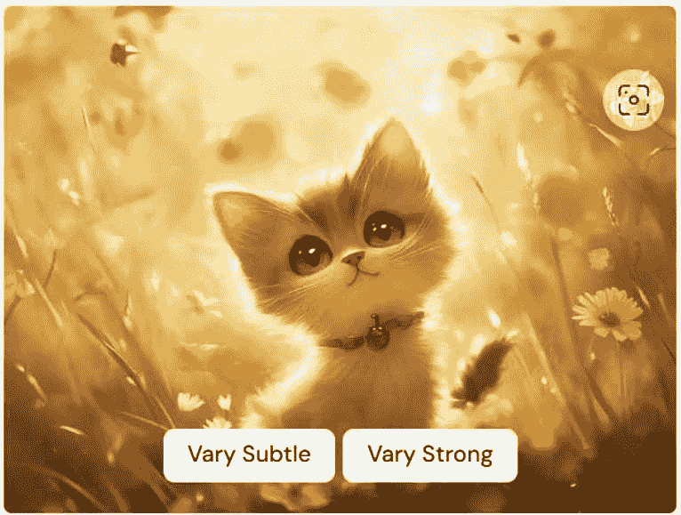

图 3-33 重新生成

Vary 即 Variation，这两个指令可把当前画面作为底稿重新生成一组。Vary Subtle 会尽量保留原图的构图、色彩、角色外形与动作，只做小幅调整，而 Vary Strong 的改动幅度更大（图 3-34）。

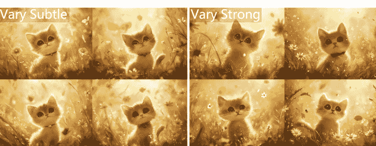

图 3-34 两者的差别

点开生成结果后进入详细编辑面板，如图 3-35。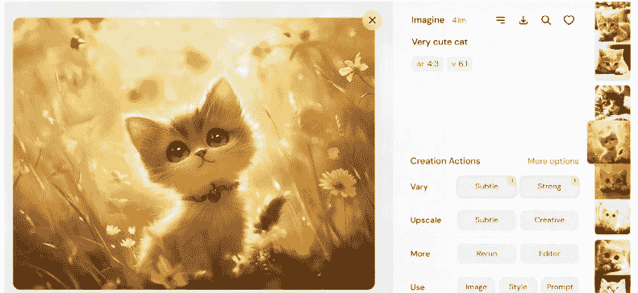
该面板里，通过滚动鼠标滚轮可以切换正在编辑的画面。

面板右上显示当前画面的提示词及参数使用情况，右下为具体编辑功能。

Vary 功能与前述 Variation 作用相同，按钮上还会标注当前画面是否经过该功能编辑，例如这里 Subtle 和 Strong 均显示为 1，表示该画面曾被 Vary Subtle 处理过一次，也被 Vary Strong 处理过一次。

接下来是 Upscale，用于提升分辨率并做细节修饰。原始画面分辨率为 1024×1024，处理后会生成新图，分辨率提升至 2048×2048。Subtle 的程度与 Vary 相近，会尽量贴近原画面只做分辨率提升，而 Creative 会做较大改动，原图的诸多细节会发生变化（图 3-36）。

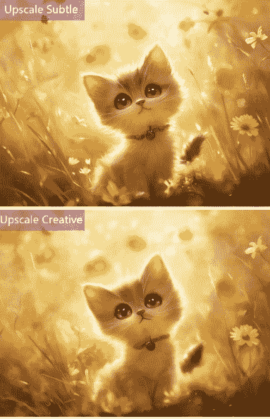

在 More 行中，Rerun 同样表示用相同提示词再生成一次，编辑器 Editor 是一个关键功能，允许在已生成的图上做内容修改。

我们把编辑器界面划分为五个区域，如图 3-37。

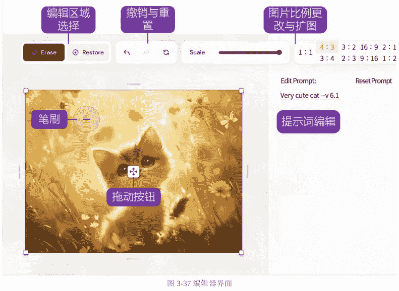

编辑区域选择包含两项，擦除 Erase 即把需要修改的区域从画面抹去，工具为画笔。恢复 Restore 则把被擦除的区域还原至原始状态，工具同样为画笔（图 3-38）。

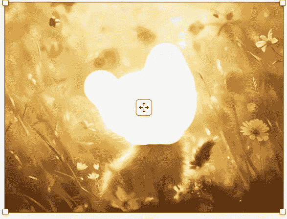

撤销与前进可按步骤回溯操作，重置按钮会清除所有修改。

紧接着是画面比例调整，涉及内容扩充。Scale 可等比缩放当前画面，如图 3-39。

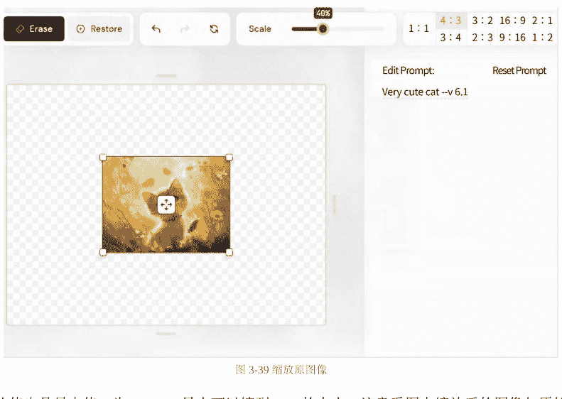

默认值也是最大值 100%，最小可缩至 10%。注意缩放后画面与原始画框的对比，此时点击 Submit 生成，新图的大小会按原始画框范围生成，原始画面与画框间的空白会被填入新内容（图 3-40）。

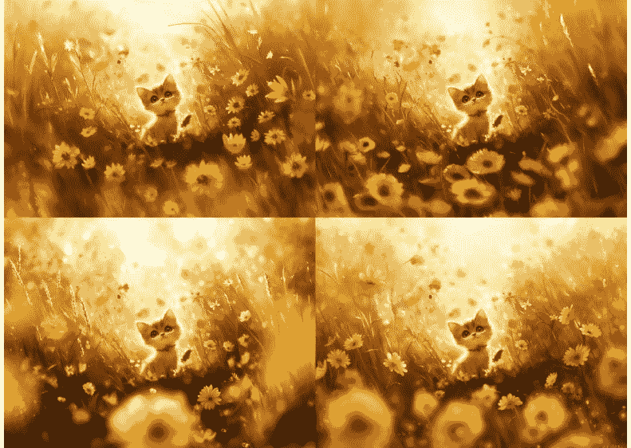

预览区中间的拖动手柄可让我们拖拽原图改变其在画幅中的位置，超出框体的部分会被丢弃，框内空白则会被填充新内容（图 3-41）。

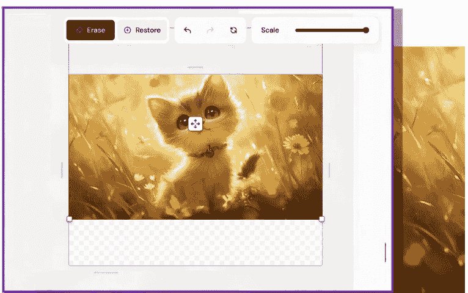

图 3-41 拖动原图像

这一点在调整比例时同样适用（图 3-42）。

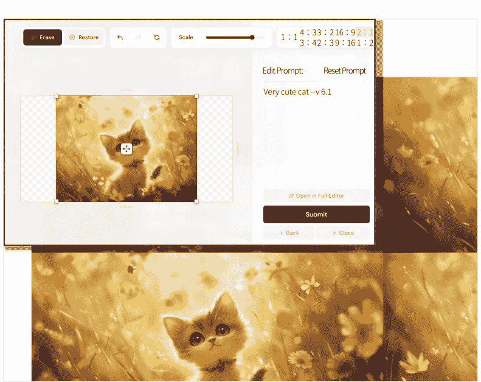

图 3-42 改变比例的扩图效果

提示词编辑可与擦除、比例调整相互作用。一般若擦除是为了修正错误，如手指、肢体比例等，无需改动提示词。但若画面内容需要变更，就要修改对应提示词，例如角色属性，或扩图时在新增区域希望出现的新元素（图 3-43）。

提示词：

非常可爱的 **黑色** 猫咪， **旁边有一只史莱姆**。

(Very cute **black cat**, **with a slime creature beside it**)。

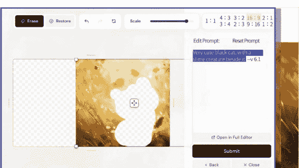

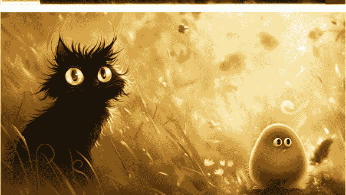

图 3-43 结合提示词修改画面内容

借助编辑器，可对画面做非常精细的调整，实现多种有趣效果。该例中 AI 把原本小猫的位置重绘成了史莱姆，主要是因为涂抹与扩图被合并到一步，提示词产生歧义。若将两步拆开，先改毛色再加入新内容，分两次编辑，结果会更贴合创作意图。

## 3.6 收藏管理

收藏管理 Organize 用于保存与整理已生成的画面。其逻辑直观，展示面板会按生成时间对所有画面自动排序，右侧为主要操作区（图 3-44）。

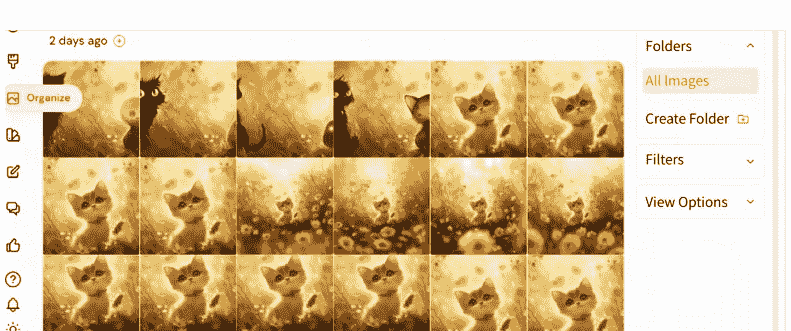

### 3.6.1 文件夹管理

文件夹管理 Folders 可创建子文件夹来存放画面，本质是分类存储功能，为不同文件夹命名关键词即可实现分类存放。初始根目录为 All Images 文件夹，所有画面初始均存放在该目录下（图 3-45）。


### 3.6.2 过滤器

通过过滤器 Filters 可设定画面的显示规则，从而筛选出符合条件的图进行展示。比如前面在编辑时曾把一组图设为隐藏，隐藏状态的图完全不可见，这时可在 Filters 中选择 Hidden 作为筛选条件，过滤后即可查看该组图（图 3-46）。

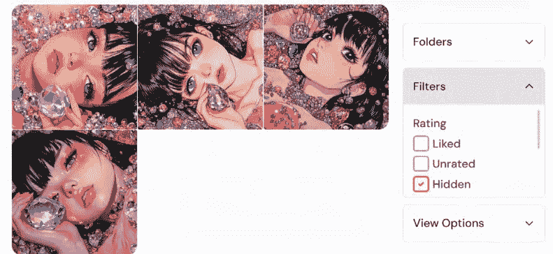

### 3.6.3 查看图标设置

查看功能 View Options 类似 Windows 的查看设置，用于设置缩略图大小、比例等（图 3-47）。

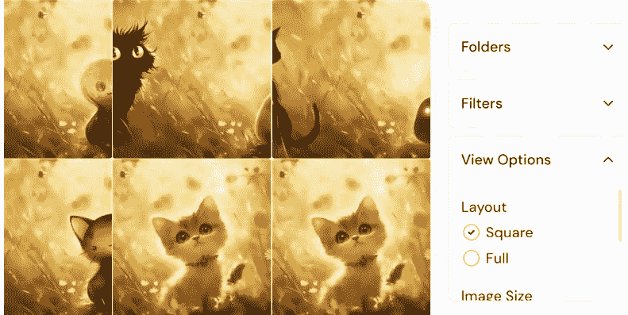

## 3.7 个性化风格设置

个性化风格设置是新加入的功能，通过参考创作者对绘画风格的偏好，AI 可在后续生成时调整画面的风格倾向。目前该功能需用户主动开启，进入页面后的界面如图 3-48 所示。


点击 Start Teaching 后会进入训练流程，训练的目的是让 AI 对用户偏好形成初步认知，系统会提供约 200 组画面供用户挑选，训练完成后个性化开关即可启用（图 3-49）。


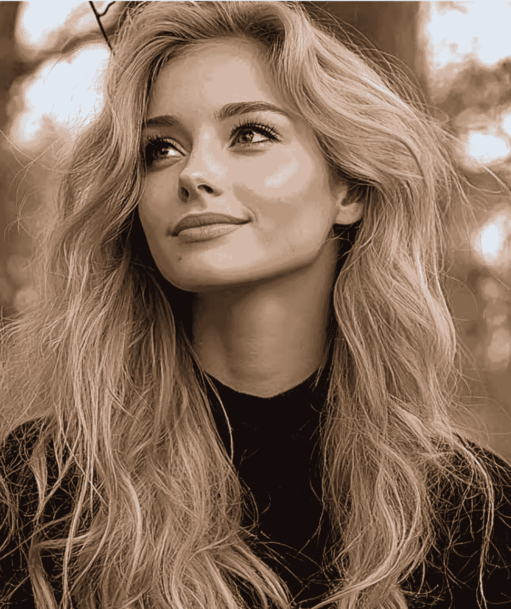

# 4 角色与场景设计：流程编

剧本与分镜这些纸面工作完成后，紧接着就要开始为作品设计具体的角色与场景素材。本部分主要依赖文本生成 AI 与绘画 AI，而 AI 绘画工具的进阶用法是本章重点。

## 4.1 角色背景故事与角色形象设计方案

使用生成式 AI 创作影视和动漫作品时，制作角色设计稿的核心目的在于保持视频内容的一致性。AI 底层算法导致生成结果随机性较大，这对视频素材制作并不友好，若故事讲述过程中角色形象不断变化，故事本身便难以成立。角色设计稿可帮助创作者确定一个锚点，让 AI 始终围绕同一外貌生成素材。

回归角色设计的本质，同样需要把抽象概念具象化，从内在到外在，通过外形传达角色深层次的重要信息。

### 4.1.1 角色定位与人物小传

设计角色的第一步要从故事框架出发，先明确故事中需要哪些角色、定位与功能如何——谁为主角、谁为配角、他们对情节发展起怎样的作用。随后为这些角色撰写人物小传，构建丰富的背景，包括过往经历、动机、恐惧与愿望，角色的核心性格等。

有时故事大纲已分配好角色定位，这时只需把人物具体背景丰满即可。这些工作均可借助文本生成 AI 完成，可依据创作者自身理解给出主要方向让 AI 扩充，也可完全委托 AI 来设计相关文本。

问：

请根据下面这篇故事大纲丰满其中的主要女性角色，具体内容包括姓名、年龄、职业、性格特点、能力描述以及人物小传：

（故事框架……）

文心：

姓名：白桦

年龄：28岁

职业：私人侦探兼灵术师

性格特点：冷静果断、聪慧、内敛温柔

能力描述：白桦的灵术让她能够感知并操控城市中的灵脉，这些灵脉如同无形的能量网络，贯穿着整座城市。她能够通过灵脉探测到异常能量的流动，甚至与迷失的灵魂进行短暂的交流。她的能力不仅让她能够解开常人无法解释的谜团，还让她在危急时刻借助灵脉的力量增强自身的速度和力量。

人物小传：白桦是一个生活在现代都市中的年轻女性，表面上她是一个不起眼的私人侦探，专门处理那些普通人不愿意或者不敢触碰的复杂案件。但实际上，她是一个有着非凡力量的灵术师，能够感知并操控人们看不见的“灵脉”，即贯穿整个城市的神秘能量网络。

她的灵术来自家族的传承，白家是数代传承的灵术世家，隐匿于都市的阴影中，默默守护人们免受超自然力量的侵害。作为家族传人，白桦自幼被灌输了灵术的知识，但她不喜欢墨守成规，相较于家族传统的低调生活，她更喜欢亲自去探索城市中的奇妙和危险。

在路人视角里，白桦是一名沉稳且擅长推敲的侦探。她习惯穿着裁剪利落却不过分张扬的风衣，步伐轻快，话语简练，每一句都切中要害。眼神深沉绵长，仿佛能窥见他人内心的隐秘。实际上她确实能借由灵脉捕捉他人的情绪波动，这种感知正是她办案时不可或缺的能力。

外表上她显得冷淡难亲，内心却对这座城市怀着柔软的守护之意。每逢深夜，她便穿梭于街区巷弄，为受灵异困扰的普通人提供帮助，或是寻找迷失的灵魂，或是拆解被诅咒的谜案。她笃信每个生命皆有其独一无二的价值，而自己的职责就是让这种独特性不被黑暗吞没。

白桦最惧怕的是孤独的空洞。她曾在追缉一只强大邪灵时失去挚友，从此对亲密关系心存戒备，刻意与人保持距离。可是每当她揭开一个真相、救下一个无辜者，她与城市灵脉的连结便愈发紧密，那些无形却温暖的感激，正是她继续前行的动力。

她的故事是关于如何在霓虹流转的繁华都市里直面内心的阴影与恐惧，也是关于守护人性中最美好又最脆弱的部分。即便站在明暗交界，她依然坚定地朝向光明迈步。

### 4.1.2 角色形象设计方案

人物背景搭建完毕后，即可把整体状态交由AI进行系统化的视觉方案构建。涵盖面部结构、体态比例、肢体习惯等身体细节，也包含着装取向、配饰选用等外在表现，让角色在画面中被精准具现。这些视觉要素既要呼应内在性格，也要契合作品整体的美学统一。

问：

现在请你根据白桦的角色描述，为她设计形象。注意要客观描写她的外貌特点，要清楚地描述出角色的外表特征。

文心：

好的，基于上述人物背景，下面给出形象构建建议：

外貌描述：白桦发色乌黑发亮，发长及腰，通常低束于脑后以便行动。双眼深邃，带神秘感，仿佛能洞察人心，施展灵术时瞳中偶会泛起淡蓝微光。肤质白皙，轮廓柔和中透着一丝冷硬，整体呈现温润与疏离并存的矛盾感。她偏爱深色风衣，内搭素净高领毛衣与修身长裤，脚穿实用短靴，既兼顾机动性又不失利落美感。

服装风格：着装取向偏向功能性，惯用暗色调，风衣作为标志单品，剪裁利落且内藏多个可用口袋，便于携带工具与符纸。配饰极简，唯一常戴的是银色细链，坠饰为家族传承的小型灵符，用作护身。

气质与姿态：气质沉稳坚毅，行走步态轻快，眼神常保持环视状态，仿佛时刻警戒突发状况。站姿挺拔，自信可靠，但独处于夜晚天台时，神情会流露出一抹孤独与倦意。

武器与道具：随身配有一把精致小匕首，为母亲所赠，既作近身自卫，也可与灵术配合斩断邪祟力量。风衣口袋常备符纸、灵石与一枚古朴指南针，均为调查灵异案件的核心装备。

详细的外貌方案对绘画AI来说信息过载，难以直接使用。接下来可将描述浓缩为更精炼的提示词。

问：

请将这份外貌设计方案凝练为更加简洁的描述，用于作为绘画AI所使用的提示词。提示词的格式应该尽可能的简洁与精准，参考格式如下：一位中国女性，28岁，头发乌黑亮丽，眼睛深邃，瞳孔为蓝色……

文心：

一名28岁的中国女性，黑亮长发，深目带淡蓝幽光。肤白，五官柔和中透出几分冷硬，着深色风衣配高领毛衣与贴身长裤，脚登短靴。颈间系银链，坠为家族灵符起护佑作用。神态冷静坚决，举止自若，携小匕首、符咒、灵石与古老罗盘，专用于灵异调查。

这段表述即可作为提示词使用。随后把它转为英文，便于在Midjourney中调用。

问：

请将这段提示词翻译为英文。

文心：

> "A 28-year-old Chinese woman with long glossy black hair usually tied back, her deep gaze carries a faint mystic blue glint that intensifies when using spirit arts. Fair skin, delicate yet somewhat severe features, wearing a dark trench coat over a turtleneck sweater and slim trousers, with practical ankle boots. A silver chain with a tiny ancestral amulet hangs for protection. Her demeanor is calm and resolute, posture confident. She carries a small dagger, a few talismans, spirit stones and an old compass, essential gear for paranormal investigations."

将中文提示词的提炼与英文翻译合并执行虽可行，但不建议这么做。中文总结后最好再作适当调整，直接转译成英文对非母语者负担较大。这体现了任务原子化的价值，拆分步骤便于核查与修改，即便非强制规则，笔者仍强烈建议单步只做单一操作。

## 4.2 角色形象设计稿

本章后续的生成环节仍以参数驱动为主，帮助读者更熟悉Midjourney底层逻辑。操作时可对照第3章封装后的设置方式进行对比学习。

### 4.2.1 角色站姿初稿

先用翻译后的提示词直接生成角色外貌，不做任何改动即可输入AI（图4-1）。

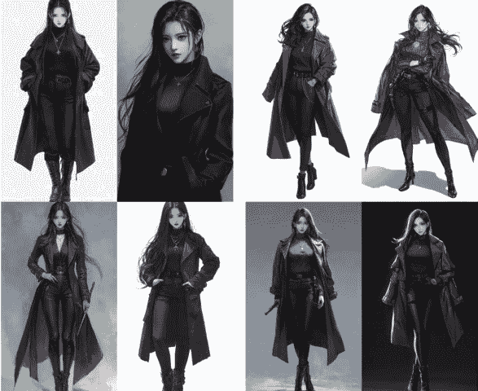

提示词末尾可追加控制参数，--ar 用来设定画面比例，因需全身照，这里采用4:7。右侧另叠加了--niji 6，用于切换绘图模型。Midjourney现提供两类模型：默认模型，未加参数时即使用，最新为V6.1，切换可用--v后接版本号；另一类是与Spellbrush联合开发的Niji模型，针对动漫与插画做了专门训练，调用格式为--niji后接版本号，现行最新为Niji 6。

默认模型全能性强，写实表现尤其出色；Niji模型在二次元范畴更具表现力，短提示也能得到不错结果，对比可明显看出差异（图 4-2）。

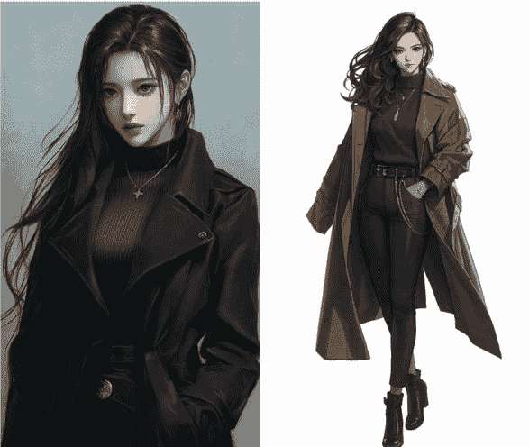

虽然同属动漫走向，默认模型偏写实化处理，Niji模型则更贴近二次元审美。本节示例仅使用初始提示词生成角色，实际创作中风格设定同样不可或缺。

### 4.2.2 角色的绘制风格

Midjourney基于数据分类可支持海量绘画风格。若提示词中未指定风格，系统会按概率随机匹配与主题相近的常见风格。若想指定，需在文本开头写入诉求以限定生成方向。风格关键词即可调用，例如水墨风格的关键词为“Chinese ink style”，格式示例如下。

```
Chinese ink style, a 28-year-old Chinese woman...
```

下面展示若干角色绘画风格的示例（图 4-3、图 4-4）。

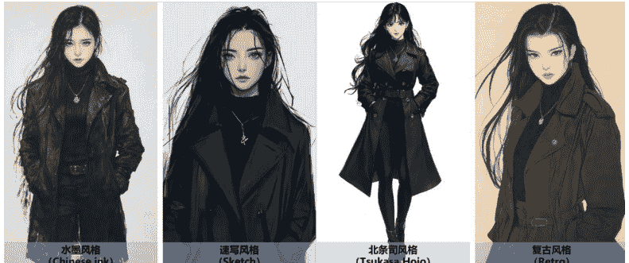

理论上关键词可放在提示词任一段落，但在提示较长时置后易被忽略，建议直接置于开头可省去麻烦。风格提示同样适用于场景生成。

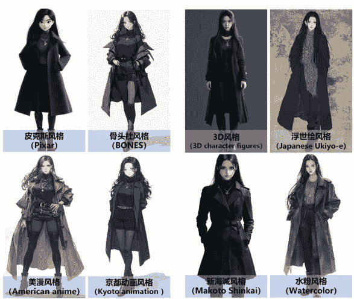

## 4.3 场景与角色的融合

制作角色参考图只是第一步，后续还需把角色与分镜脚本结合，生成具体情节。镜头制作有两种思路：场景简单时可直接用提示词加角色参考生成；场景元素复杂时，若直接用提示词创作，角色与场景同时达标的试错成本很高。此时不如先单独生成场景，再通过参数融合角色，可大幅缩短创作时间。

### 4.3.1 角色参考

Midjourney通过--cref参数后接图片URL实现角色引用。关于--cref的细节将在下一节展开，这里先用常规方式演示。

若图片由Midjourney生成，可在收藏或创作管理页找到，进入详情页（图4-5）。

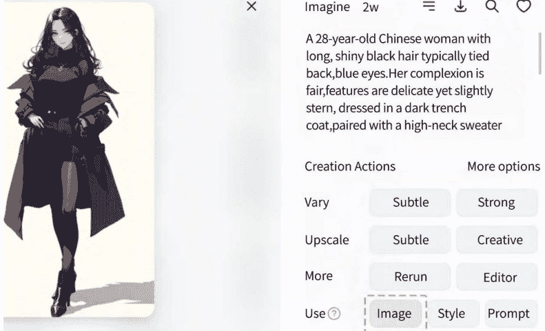

点选右下方的“Image”或“Style”选项，可将图片提交至提示词，随后选中左侧人物剪影图标并确保另两图标未激活，即完成角色参考设置（图 4-6）。


本地上传图片时可参考第3章的图片上传与图像引用设置，最终同样需选中角色剪影图标即可。

### 4.3.2 融合角色与场景描述

先认识--cref参数。从V6及Niji 6起，系统新增--cref调用，允许以某角色为参考生成图像。对比来看，Midjourney还有样式参考参数--sref，二者均需参考图，但--sref匹配整体风格，--cref则尝试匹配图像中的角色。

从命名即可理解，--cref即character reference，c代表character；--sref即style reference，s代表style。

与--cref强相关的为--cw参数，作为其扩展，可控制新图中角色对参考的模仿程度，后续会结合样式参考一并涉及，这里暂不展开。

角色参考参数的调用格式为：

```
--cref+角色参考图URL
```

在提示词输入框将图片URL追加于参数名后即可调用，更便捷的做法是直接拖拽聊天框中的图片至输入框，或在详情页设置，系统会自动补全URL并设为角色参考（图 4-7）。

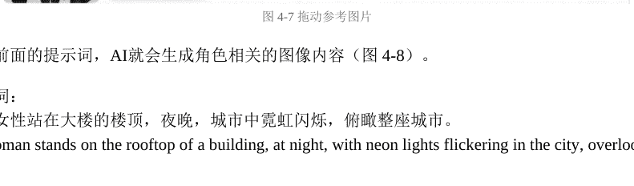

结合前述提示词，AI会生成相关角色图像（图 4-8）。

提示词：

一位女性站在大楼的楼顶，夜晚，城市中霓虹闪烁，俯瞰整座城市。

提示词越简洁，角色引用的效果越自然。若提示包含大量细节，如姿势、动作与环境描写，仅用--cref易导致角色与场景融合不连贯，此时可搭配--stylize参数使用。

### 4.3.3 风格化参数与画面优化

若生成结果细节不足或人物与场景过渡不自然，可尝试使用--s。下面在示例中加入参数--s 500（图 4-9）。

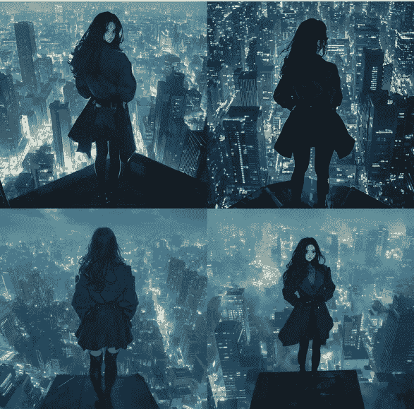

加入参数后色彩、细节与质感均有提升，但出现新问题：角色所穿并非提示词要求的风衣，下装基本变为裙装，如图 4-10 所示。

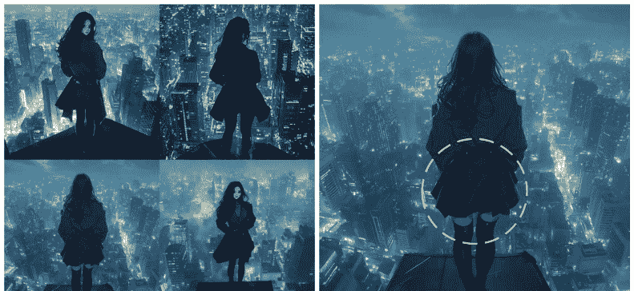

从构图等角度看，图像3除衣物错误外已较为理想，适合作为后续处理素材，此时需对局部进行调整。

### 4.3.4 局部重绘

进入图片详情页，点击“Editor”，在编辑页使用局部重绘功能调整角色下装（图 4-11）。

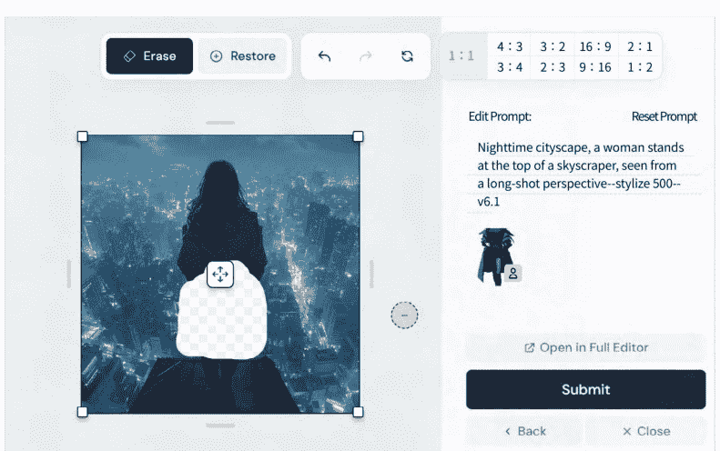

框选需修改区域，并在提示词中写入“长风衣”作为关键词后执行重绘（图 4-12）。

提示词：

夜晚的城市景观，一位女士站在摩天大楼的顶部，身穿长风衣，从远景角度拍摄 --s 500

(Nighttime cityscape, a woman stands at the top of a skyscraper, wearing a trench coat, seen from a long-shot perspective --s 500)

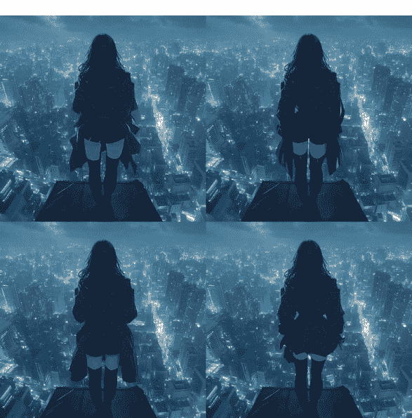

图 4-12 局部重绘

修改提示词后局部重绘，角色下装仍有问题，说明AI对角色参考图的理解出现偏差。此时仅靠提示词难以纠正，需要--cw参数介入。

作为--cref的衍生参数，--cw可调节模仿程度，取值0到100，100表示完全模仿，降至0则更专注面部特征。加入--cw 20后得到正确图像（图 4-13）。

提示词：

Nighttime cityscape, a woman stands at the top of a skyscraper, wearing a trench coat, seen from a long-shot perspective --s 500 --cw 20。


图 4-13 调整--cw后的重绘结果

### 4.3.5 混沌参数与角色模型表

反复执行上述步骤，最终可得到符合标准的图像素材。AI绘图无需传统动漫的详细角色表，但若在生成过程中获得不错的人物朝向图，仍建议保存，可在场景结合时节省大量时间（图 4-14）。


图 4-14 角色不同的朝向

用AI制作角色表颇为复杂，因随机性即使提示词与角色参考相同，表情等细节仍易有差异。若要制作表情表，需批量生成单一表情再挑选合格图。

另外，场景融合时务必善用--chaos参数，可带来更多构图与画面可能性，也更容易得到意外素材（图4-15）。

提示词：

一位女性坐在咖啡馆中 --chaos 25。

(A woman sitting in a café --chaos 25)。


图 4-15 添加混沌度的生成结果

### 4.3.6 复杂的场景融合

若分镜头场景复杂，仅用提示词加角色参考不确定性高，可能场景合适角色出错，反之亦然。大量试错会带来重复劳动，不如先用提示词生成合适场景画面，再以图像参考与角色参考融合角色。

下面先用提示词生成场景（图 4-16）。

提示词：

一名女性身穿风衣，漂浮在虚无之中，画面中是破碎的空间，背景有一个巨大的模糊身影 --ar 4:3 --stylize 300 --weird 500 --niji 6。

(A woman wearing a trench coat, floating in the void, with a scene of shattered space and a huge blurred figure in the background --ar 4:3 --stylize 300 --weird 500 --niji 6)。


生成画面时可适度提高混沌度，角色外貌描述保持一致，便于后期替换。得到合适图片后，将角色与场景融合（图 4-17）。


使用参考图生成时，图像质量通常不如纯提示词生成，细节易出错，如角色手部、面部均需多加注意（图 4-18）。


图 4-18 生成结果

当初版的整体观感到位后，仅需对局部不理想的细节做重绘，就能收敛为最终成品。


图 4-19 修改之后的成品

# 5 角色与场景设计：提示词编

本章着重拆解绘画类大模型的指令写法。以 Midjourney 为例，成像效果由指令文本与参数共同决定，其中指令文本主导内容、构图和基调。虽然可以用日常口语来写，但信息组织与结构仍有讲究。

## 5.1 饱满的画面元素

要把画面结构化描述清楚，就要把各部分拆开归类。

### 5.1.1 画面主题

向人介绍画面时习惯先从主角说起。对模型也一样，需要交代清楚主体是谁、在进行什么行为。比如身着复古长裙的少女在看书，或是年长的渔夫在收拾渔网。仅凭这类主体行为的描述，模型已能生成可识别的画面。

提示词：

复古长裙少女在阅读书籍

(A girl in retro dress reading a book)


图 5-1 画面主题 1

提示词：

年长渔夫在整理渔具

(An old fisherman tending his nets)


图 5-2 画面主题 2

角色的外观与状态通常与主题合并书写。为了保持影视、动漫素材里人物的统一性，实际创作会使用角色参考，但先把关键特征写进指令，也能为后续场景生成打基础。

主体不必是活物，山、水、石块、天空这类无生命意象也能成为核心。

提示词：

裂缝中透出金光的巨岩

(A giant rock with cracks glowing golden)


图 5-3 无生命角色

### 5.1.2 环境描述

有了“谁在做什么”，下一步要补足“在哪里做”。人物、时间、地点三要素完整，场景才立得住。

提示词：

运动服华人女性在山顶观赏日出

(A Chinese woman in sportswear watching sunrise from mountaintop)

### 5.1.3 光影

光是视觉艺术的灵魂。指令里的光影可归纳为光照条件、光源位置以及光线与人物的互动。

提示词：

女性面部正面特写，右侧暖光打在脸上，形成分明的阴影层次

(A front close-up of a woman’s face lit from right with warm light, layered shadows)


图 5-7 光影 1

提示词：

秋日林中华人女性逆光站立，阳光自发间透出光晕 --style raw

(In autumn a Chinese woman stands in a forest backlit, sunlight through hair --style raw)


第二个例子在末尾使用了 --style raw。该参数适用于追求真实质感的场景。Midjourney 默认会对图像做美化修正，指令简单时这种润色会提升质感；但要照片级写实时，模型的过度修饰会让画面像经过后期处理。此时用 --style raw 可去掉默认修正，让结果更贴近文字描写，光影也更写实。

提示词：

华人女性立于高秆麦田中，手抚麦穗，阳光掠过发丝形成光晕

(A Chinese woman in a wheat field as tall as a person touches the spikes, sunlight through hair creates halo)


图 5-9 未经--style raw参数处理过的画面效果

### 5.1.4 色彩方案

色彩决定情绪基调。可要求暖调橙黄营造温馨，或选用深蓝紫调制造神秘感，色彩直接影响观感。

提示词：

冷调，女性蜷于街角，天气寒冷，双手置于唇前哈气取暖

(In cool tone a woman curls in a street corner, cold weather, hands before mouth blowing warm air)


图 5-10 冷色调

提示词：

暖橘黄调，女性坐在沙发上低头阅读，右手握拳托腮，旁有壁炉

(In warm orange hue a woman sits on sofa reading with head down, right fist supporting cheek, fireplace beside)


图 5-11 暖色调

### 5.1.5 画面构图

构图决定叙事视角、景别、元素布局以及是否采用广角、超广角等镜头语言。就像导演选镜头，可近距离捕捉微表情，也可用全景展现场面。

提示词：

知识分子气质女学生骑自行车，旁有男性友人同行，三十年代风情，时尚且学术，夏日氛围，风景宜人，幸福感，使用胶片拍摄，中画幅，鱼眼镜头，潇洒姿态，仰拍视角 --ar 2: 3 --stylize 50

(Intellectual student woman biking with man beside, 1930s style, fashionable academic, summer feel, landscape, happiness, analog film, medium format, fisheye, cool attitude low-angle --ar 2: 3 --stylize 50)


该例除了画幅控制，还把风格化数值压到 50。降低 stylize 会收敛细节，做复古风绘画时更有年代感。

### 5.1.6 情绪

此处情绪指画面整体氛围。它是连接观者与作品的桥梁，和人物表情、动作及色调不同，可直接告知模型让整幅作品呈现某种情绪，由模型自行组织元素烘托。

提示词：

愤怒情绪，年轻华人女性向前奔跑

(Angry mood, young Chinese woman running forward)


提示词：

女士坐在公园长椅上，秋日，画面传达忧伤氛围

(A lady on a park bench in autumn, melancholic atmosphere)


图 5-14 忧伤的情绪基调

### 5.1.7 绘画风格

风格大致分两层。第一层是图像媒介，即照片、油画、插画、雕塑、浮雕、木雕、涂鸦、挂毯、建筑等大类。

提示词：

木雕，锦鲤

(Wood carving, koi fish)


图 5-15 木雕风格

提示词：

挂毯风格，安静少女

(Tapestry style, quiet young girl)


图 5-16 挂毯风格

第二层是具体的艺术流派或艺术家风格，如波普、印象派等。


图 5-17 浮世绘风格的人物

提示词：

波普艺术风格，年轻女性短黑发戴墨镜，托腮沉思宇宙奥秘

(Pop art style, young woman with short black hair and sunglasses chin resting, pondering universe)


图 5-18 波普艺术风格

两层风格有时重合有时从属，使用时保持逻辑清晰即可。对风格关键词的积累需要长期沉淀，遇到好词及时存档。

## 5.2 清晰的语言结构

指令保持逻辑清晰，按顺序描述场景即可。比如：

提示词：

夹克牛仔裤华人男性与风衣华人女性依偎在长凳上看日落，视线越过镜头，余晖照亮面部，35毫米电影风格

(A Chinese man in jacket jeans and a Chinese woman in trench coat snuggle on bench watching sunset, gaze past camera, afterglow lights faces, 35mm film style --style raw --ar 16: 9)


读来明白，但结构不够拆分，生成时易出错。本书更推荐把角色、角色说明、画面元素拆成独立小块，结构更清晰，后期改动也更方便。

提示词：

35毫米电影风格，华人男性与华人女性依偎坐于长凳赏景，男性坐左穿夹克牛仔裤，女性坐右穿风衣，两人视线越过镜头看向外景，落日余晖照亮面部 --style raw --ar 16: 9

(In 35mm film style a Chinese man and woman sit together on bench watching sunset, man left in jacket jeans, woman right in trench coat, both look past camera, afterglow illuminates faces --style raw --ar 16: 9)


图 5-20 更改结构后的提示词

结构清晰后，定位和修改会更迅速。

提示词：

35毫米电影风格，华人男性与华人女性依偎坐于长凳赏景，男性坐左穿古装盔甲，女性坐右穿高科技战斗服，两人视线越过镜头看向外景，落日余晖照亮面部 --style raw --ar 16: 9

(In 35mm film style a Chinese man and woman sit together on bench watching sunset, man left in ancient armor, woman right in high-tech combat gear, both look past camera, afterglow illuminates faces --style raw --ar 16: 9)


图 5-21 局部重绘

## 5.3 角色与动作设计提示词示例

### 5.3.1 双手合十的女孩

提示词：

油画，有翅膀的女孩如天使，身着白裙，发间点缀花朵，双手合于胸前似在祈祷，背景为柔和粉彩调，整体宁静平和 --ar 4: 3 --style raw --stylize 750

(Oil painting of winged girl like angel, white gown, flowers in hair, hands folded at chest praying, soft pastel background, peaceful mood --ar 4: 3 --style raw --stylize 750)


### 5.3.2 外星士兵

提示词：

雄性外星战斗士兵特写，大眼反射镜头光，身穿黑色制服 --quality 2 --stylize 250

(Male alien combat soldier close-up, large eyes reflecting camera light, black uniform --quality 2 --stylize 250)


图 5-23 外星士兵

### 5.3.3 机甲战士

提示词：
庞大的星际战士身着红白蓝三色古老动力外骨骼，外骨骼表面布满象形符号，手握一柄巨大的光能权杖，权杖释放出神圣光晕，头盔护目镜透出耀眼金色辉光，远景为山体与一扇十米高古旧巨门，画面超写实、庄严神圣 --chaos 30 --ar 4: 7 --style raw --stylize 750。

An immense cosmic soldier in vintage red-white-blue powered exoskeleton covered with hieroglyphic motifs. He grips a huge luminous energy ankh pulsing with sacred power, while his helmet visor shines with dazzling gold glow. Behind him stands a mountain and a ten-meter ancient gateway. The render is ultra-realistic, solemn and holy --chaos 30 --ar 4: 7 --style raw --stylize 750。

### 5.3.4 幻想生物

提示词：
涅槃重生的火鸟展翅掠空，体表烈焰红与云间透出的金辉相互交融 --ar 4：3。

A fiery bird reborn from embers soars with wings spread. Its crimson plumage blends into the golden tones filtering through clouds --ar 4：3。

图 5-25 凤凰

### 5.3.5 梦幻场景

提示词：
冬日清晨雪林里，阳光下白裙少女与麋鹿共舞，四周白雪覆盖、树木环绕，雪花缓降。光线穿过秀发映亮笑颜，轻风拂动衣袂与鹿毛 --style raw --stylize 750。

In a snow-laden woods at winter dawn, a young woman in white gown dances with deer beneath sunlight. Snow piles, trees and falling flakes surround them, light filters through hair illuminating her smile, gentle breeze brushes their coats --style raw --stylize 750。

图 5-26 与鹿共舞的女孩

### 5.3.6 写实场景

提示词：
黄昏街道上，短棕发少年背深蓝双肩包、着白衬衫，与金发少女并肩前行，她背白包、穿深蓝长裙，画面取背影 --stylize 750。

A short-haired brown-haired boy with dark blue backpack and white shirt walks side by side with blonde girl carrying white backpack in dark blue long dress at sunset, seen from behind --stylize 750。

图 5-27 双人背影

### 5.3.7 角色特写

提示词：
未来风格男子归家后坐在桌边，神情低落，身上挂满科技装置。人物气质英勇挺拔，装甲兼具精细与粗犷，融合高科技与末世元素，金属质感上雕刻繁复纹样。面部线条清晰富有戏剧性，眼神深邃传递坚定情感。背景是荒凉却动人的废墟地带，远处残垣与一抹微光，整体色调偏大地色系点缀亮色。中景构图，超现代、蒸汽朋克与科技融合的后末世风格，功能性未来穿搭 --ar 16: 9 --quality 2 --stylize 500。

A man in futuristic outfit returns home sitting at table with dejected mood, equipped with tech gear. He possesses strong heroic aura, tall stature, armor detailed yet rugged merging high-tech and post-apocalyptic motifs with metallic sheen and intricate patterns. Face chiseled and expressive, deep eyes convey emotion and resolve. Background is desolate yet beautiful wasteland with ruined civilization relics and faint hope glow in distance. Palette dominated by earth tones with bright accents. Medium shot, ultra-modern steampunk-tech fusion, post-apocalyptic wasteland style, functional techwear --ar 16: 9 --quality 2 --stylize 500。

图 5-28 角色面部特写

### 5.3.8 战争场面

提示词：
超写实单反摄影，黎明时分胜利后战场。埃及战士着黑金铠甲屹立于残骸中，长矛盾牌映出晨光。前景遍布倒下的敌军与散落兵器，尘土飞扬的沙地。远处战车停放，金字塔在灿烂天幕下耸立。部分战士跪地感恩，部分高举武器欢呼，整片战场在暴风过后的宁静中透出骄傲与归属感。

A hyper-realistic DSLR shot at dawn after a glorious victory. Egyptian troops in black-gold armor stand amid battle debris, spears and shields catching morning light. Fallen foes and scattered arms lie on dusty desert ground. Chariots rest in background, pyramids rise majestically under radiant sky. Some warriors kneel in gratitude, others raise weapons in celebration. The scene exudes pride and ownership in post-storm calm.

图 5-29 战争场面

### 5.3.9 简单的角色生成

提示词：
25岁亚裔女性，短发，着橙色连衣裙搭配丝绸上衣。

An Asian woman around 25, short hair, dressed in orange skirt with silk blouse.

图 5-30 利用特质生成女性参考角色

### 5.3.10 手部与物体特写

提示词：
男子以手遮护阿拉伯式油灯，电影级镜头与光影，写实细腻 --ar 16: 9。

A man shielding an Arabian oil lantern with his hand, captured with cinematic lens and lighting, very realistic and detailed --ar 16: 9。

图 5-31 手与油灯

### 5.3.11 3D角色特写

提示词：
史诗场景，深蓝色皮肤的女性，铂金长发配高科技光滑机械下颌。眼白失焦增添超凡感，有机面部与生物机械下半脸融合形成自然与人造对比。神情宁静近乎超然，体现未来或后人类理想。赛博朋克主题融合时尚与技术增幅，机械面光滑亮丽与人面形成强烈反差，强调超人类主义与有机合成融合。细节极丰富，超高清，电影级光照，近似海报 --chaos 20 --ar 3: 4 --quality 2 --style raw。

Epic scene, featuring a dark blue-skinned woman with platinum blonde hair and high-tech glossy mechanical jaw. Eyes white and unfocused enhancing otherworldly aura. Fusion of organic human traits with biomechanical lower face creates vivid natural vs artificial contrast. Expression serene and transcendent suggesting futuristic or posthuman ideal. Cyberpunk theme merges fashion with tech enhancements, smooth sleek mechanical finish sharply contrasts human features underscoring transhumanism. Extremely detailed hyper-resolution with cinematic lighting, movie poster feel --chaos 20 --ar 3: 4 --quality 2 --style raw。

图 5-32 3D角色

### 5.3.12 角色表情特写

提示词：
观众惊愕掩口 --ar 4：3。

Spectators react in surprise covering mouth with hand --ar 4：3。

图 5-33 惊恐的表情特写

### 5.3.13 模型效果

提示词：
一组维京战士纸模型手持火把，深夜快步穿行于荒凉小维京村落。侧面视角从眼前掠过，意图焚烧某建筑。火把制造阴影氛围，建筑与小屋历史准确，构图动态，人物表情丰富 --ar 16: 9 --stylize 50。

Papercraft of a small group of viking warriors with torches walking briskly through a desolate viking hamlet at dead of night, viewed from side as they pass. Sinister plan to torch a building. Torches create shadows and mood, buildings historically accurate, dynamic angles and expressive characters --ar 16: 9 --stylize 50。

图 5-34 纸模型效果

# 6 动态素材生成

相较于图像类模型，视频生成在可用性与成熟度上明显滞后。早期视频模型多基于 Diffusion 搭建，能产出看似连贯的画面，却因随机性强导致镜头衔接易崩。引入 Transformer 后时序一致性与画面稳定性大幅改善，但算力瓶颈仍让视频创作处于尴尬区间。

以 30 帧每秒计，一秒素材需完成 30 次绘制，算力消耗巨大。实操中建议单镜头时长控制在 10 秒以内，兼顾质量与落地效率。

## 6.1 工具简介

本书实操选用可灵 AI，在国产视频生成阵营中表现靠前。搜索引擎输入关键词即可定位平台，首页如图6-1。

点击“立即体验”完成简易注册后进入起始页如图6-2。

选择“AI视频”进入生成工作台，如图6-3。

图 6-3 视频生成工具界面

第一，模型选择。通过下拉菜单切换引擎，目前提供 V1.0 与 V1.5，V1.5 画质更优但算力需求更高，部分功能受限。

第二，生成模式。文生视频靠提示词直接生成；图生视频先用参考图锁定首帧或首尾帧，再结合提示词生成。影视动漫素材制作多采用图生视频。

第三，生成控制。提示词编辑与参数调节区，不同模式可用项有差异。

第四，视频预览。成片可在该区实时查看。

第五，历史浏览。列表记录过往任务，点击可返回对应项目的预览与编辑页。

## 6.2 文生视频操作解析

### 6.2.1 提示词

文生视频核心在于提示词撰写，“创意描述”即为输入区如图6-4。

视频提示词可借鉴图像写法，同时能描述动态过程，如角色行为变化或镜头运动。界面下方提供随机示例，可参考其语法风格。确认后点“立即生成”即可开始制作如图6-5。

等待片刻后成片，排队多时耗时更长。完成即可在预览区查看如图6-6。

图 6-6 根据提示词生成的视频

### 6.2.2 视频参数设置

提示词下方为参数面板如图6-7。

图 6-7 参数设置面板

首项为创意想象力与创意相关性滑块，左侧偏自由发挥，右侧偏严格贴合提示词，类似 Midjourney 的 --chaos 作用，默认 0.5。

生成模式决定成片质量，高品质模式分辨率与细节更高，耗时也更长。生成时长可手动设定，可灵目前上限 10 秒，足以覆盖一个镜头。

视频比例提供三种宽高比，对应 PC 与移动端展示，1:1 更灵活便于裁切。最后是生成数量，表示单次请求产出版本数，按项目需求调整。

### 6.2.3 运镜控制

运镜指镜头运动轨迹，提示词可描述但精细控制建议在运镜模块设置。下面以前后推进与拉远为例说明设置方法如图6-8。


打开运镜设置后，先从下拉列表里挑出推近或拉远。画面中间的蓝色圆点代表镜头中心点，灰色矩形是起始构图，蓝色矩形是结束构图。底部的时间轴可以拖动，来决定推拉的距离和幅度。下面用两个案例演示推近的效果。

提示词：

一名女子正在收拾行李准备外出旅行。


图 6-9 视频镜头推近效果 1

提示词：

一名男子也在整理行李箱准备远行。


图 6-10 视频镜头推近效果 2

### 6.2.4 否定提示词

不想要出现的元素都写进否定词区域，系统将据此屏蔽。文字输入区也提供了范例，例如填入“动画”，输出就会以写实影像为主，不会走动画风格 图6-11。


这个功能目前偶尔会出现瑕疵，重复生成几次可以弥补。

## 6.3 图生视频操作解析

纯文字生成视频变数很大，对影视动漫创作来说难以控制。比较稳妥的做法是先用基准画面锁定人物和主体构图，再用文字描述镜头走向。从原理上说，文生视频上限更高，若想用图生视频拿到可用素材，只能多试几次。

### 6.3.1 上传图片

图生视频同样需要把本地素材传到云端，流程和多数平台类似。把模式切换到“图生视频”，控制面板会多出若干区块，最上部就是基准画面导入入口 图6-12。


点进黑色区域，选择本地的基准画面即可完成导入。导入后会显示缩略图，右边的小垃圾桶可以删除这张图 图6-13。


### 6.3.2 用提示词控制视频过程

把基准画面设为首帧后，仍需用文字描述后续画面。图生视频里基准画面的指向更明确，用户主要要描述人物如何移动，以及场景和镜头将怎样变化 图6-14。


写描述建议用词简单、句式直接，避免复杂表达，不要用比喻修辞，保持字面意思，并给出明确方位指示，像“向左”“向右”“向上”等。描述动作要按时间顺序，用清晰的时序词串联。

运动最好符合物理常识，尽量写画面里可能发生的自然变化，避免突兀的速度跳变，人体动作也需符合结构限制。复杂动作宜拆成简单步骤，同时考虑重力和惯性。现在的技术难以还原高速或瞬间完成的动作，所以要避开。描述与原图差异过大容易触发镜头切换。为保持连贯，应避免场景剧烈变动，注意光线环境的一致，渐进式过渡比硬切更容易实现，同时保持人物与物体的统一。

以现有技术来看，球类弹跳、高空抛物等复杂物理都很难精准呈现。精细的物体互动、液体烟雾等粒子效果，以及多物体同时运动的场景也建议避开。

若想精细控制构图，需明确主体与背景关系，注意景深描述，并控制画面元素数量。给出清晰的景深，保持视角稳定，避免过度复杂的镜头运动。这些要点有助于生成更自然流畅的视频效果 图6-15。


### 6.3.3 画出运动轨迹

若想更精确掌控元素运动，还能用运动画笔功能绘制轨迹。运动控制上画比说更直观，说不清的几句描述，有时两笔就能解决 图6-16。


运动画笔也在控制面板中，位于文字输入框下方，点选进入轨迹编辑页 图6-17。


在画笔设置里可切换选择运动区或擦除区，并调整画笔粗细。右边自动检测开关打开后，系统将自动框选运动区，此时手动选择设置会失效 图6-18。


算法自动选择的区域通常很准，所以一般优先用自动选区，画笔作为补充修正漏选部分。在右边管理面板里，同一区域下的选区会被识别为同一运动主体，并共享同一轨迹。当轨迹选项被选中时，编辑区的鼠标会变成轨迹绘制模式，此时可为主体绘制整体路径 图6-19。


若想实现头发飘动或猫耳摆动，可给主体画波浪线轨迹，这个技巧使用频率很高，给画面加简单动态时常用到 图6-20。


目前可灵AI最多支持6组运动区及轨迹设置，每组可包含多个部位，但轨迹只能画一条 图6-21。


最底部的静止区可让画面中某些区域在视频里完全不动，通常用来固定背景以固定镜头。操作方法与运动区选择相同，选中状态下框选需要静止的区域即可 如图6-22。


轨迹绘制完成后，点选右下侧确认添加即可保存全部设置。

### 6.3.4 插入尾帧

除了固定首帧确定起点，还可以插入尾帧确定终点，这样就能完整设定起点与终点，再用文字生成中间过渡。

打开图片导入面板右上侧的“首尾帧”开关，系统允许再导入一张图作为尾帧，导入方式与之前一致，完成后会显示首尾帧缩略图 图6-23。


图 6-23 固定首尾帧

示例中的尾帧是通过Midjourney扩图生成的，拖动图片位置并补充描述，实现镜头移动并加入新角色 图6-24。


图 6-24 扩图生成新的尾帧

设置首尾帧后，微调描述把全过程写清楚，最终生成结果如图6-25。

提示词：

一只小猫站在雪地里，镜头向左移动，一匹马进入画面


需要注意，首尾帧模式不支持绘制运动轨迹，所以无法像首帧模式那样精细控制角色运动。


# 7 配音与配乐

音频生成主要分两条线，一条是人声语音合成，一条是音乐生成，本章分两部分讲解。

## 7.1 AI配音工具简介

AI配音工具选择面较广，按效果和学习成本大致分三档。若对音质要求极高，可选魔音工坊这类专业工具，效果最好但门槛也高 图7-1。


另一类工具封装更完善，虽然不能像专业工具那样精细控制，但操作简单，输入文字即可生成配音。部分还能调节情绪或训练个性音色，比如Fish Audio。对普通创作者来说性价比很高，花费不多时间就能做出可用配音 图7-2。


还有剪辑软件自带文本转语音，如剪映。常用抖音的人对短视频里的AI配音不陌生，它能完成基础任务，但机械感强，情绪平淡，音色单一 图7-3。


图 7-3 剪辑软件自带配音

综合来看，本书选用第二类工具进行配音创作。

## 7.2 AI配音工具操作解析

点主页面标签“语音合成”，进入配音制作页 图7-4。


页面如图7-5，主要分两块。“您的文本”下方是输入区，填写对话内容。未升级时输入上限为500字节，每个汉字占3字节。对话场景下通常足够。若想减少重复生成，可一次性输入角色的多段台词，导入剪辑软件后自行裁剪即可。例如把下面内容一起输入。

你就是黄琼，对吧？这么巧，总是在这些诡异案件现场出现，你该不会是故意引我过来的吧？

不认识？你走过的地方却总是留下混乱和……时空裂缝。你是谁？到底在做什么？

只有那些试图掩盖真相的人才会劝别人不要好奇。而且，这次的案件明显与你有关。灵异痕迹处处指向你，你还敢说和那些受害者无关？

系统将生成一段语音，保存文件名并做好标记，最后在剪辑软件里完成分割拼接。


输入文字后点底部的加号添加语音模型，即朗读用的声音 图7-6。选择页分三个标签，“最近使用”按时间排序，“探索”展示社区热度高的模型，“我的语音”展示自训练模型。


选好模型后点“创建”，系统将用该模型生成朗读音频，结果显示在右边预览区 图7-7。


播放可试听，点右边“...”可从下拉菜单下载，文件也能在“我的声音生成结果”里查看 图7-8。

### 我的生成


| 新闻 | 成功 | 创建时间 | 类型 | 语音声音 | 文本 | 播放 |

| :--- | :--- | :--- | :--- | :--- | :--- | :--- |

| | | Nov 5, 2024, 15:31 | tts | 新闻 | 你就是黄琼，对吧？这么巧，总... | |

图 7-8 生成的音频文件

### 7.3 生成自己的语音模型

若对社区模型不满意，也可自行训练。点图7-4标签上的“构建声音”进入创建页 图7-9。


上部填写基础信息，如模型名称、标签、简短描述、封面图标等。

下部是训练材料提交区。训练新声音需提供若干音频作为样本，学习后模型就能以该语调朗读。提供方式有两种，一种是导入提前录制好的音频作为材料 图7-10。注意系统对文件的限制。


另一种是现场录制，选项卡会给出建议文本，点选录制按钮对着麦克风复述即可。也可用自己的文本录制，但要保证发音覆盖面广 图7-11。


导入或录制成功后，训练音频会显示在面板中 图7-12。


图 7-12 录制完成

之后点创建，等待片刻，用训练好的模型生成一段样本，即可完成训练 图7-13。


图 7-13 完成语音模型的训练

之后在配音时即可调用自己的模型。

## 7.4 AI配乐工具简介

目前最成熟的AI音乐工具是Suno AI，背景音乐和主题音乐都可以用它制作。首页如图7-14。


左侧是功能导航，最核心的三个页面是创作页、收藏页和探索页。

创作主要在创作页完成，中间区域输入提示词、歌词及相关设置，右边是预览区 图7-15。


收藏区收录创作历史，也能找到收藏的他人作品 图7-16。


探索页用来激发灵感，收录大量风格及示例，点击风格标签即可聆听对应AI音乐。不知道听什么时，可点播放器中间的骰子，系统将随机播放一种风格 图7-17。


### Explore new styles of music with Suno

Here's a small taste (or whatever the listening equivalent is) of what's possible

Pick a style, or roll the dice...


图 7-17 探索页面

## 7.5 如何生成配乐

进入创作页，Suno提供两种创作模式，可通过顶部自定义开关切换 图7-18。


### 7.5.1 默认创作模式

开关未激活时使用默认模式，也叫灵感模式。面板很简洁，只有提示词输入框和辅助模板两部分 图7-19。


默认模式无需复杂设置，只需描述想要的音乐风格和主题即可。风格目前只能写明确的类型或氛围描述，不能写艺术家或具体曲名，这点上Suno不及Midjourney。

中文输入支持良好。下面先用默认模式创作一首动漫主题音乐 图7-20。


输入提示词后点“Create”，AI开始生成，进度在右边预览区查看，完成后左侧出现红点，封面也会显示时长 图7-21。


类似图像生成，音乐结果以组形式呈现，每组两首。点曲名可进入试听页查看详情，AI会自动生成歌词 图7-22。


在 Suno 里把一首成品带走其实很简单，点开曲目右侧的三个点就会弹出下载入口。目前能导出的音频格式只有 MP3 和 WAV 两种，其中 WAV 需要付费账号才能拿到，音质保留会更完整。格式选项下面还藏着一个“一键生成主题视频”的按钮，点出来的是单纯的纯音乐播放画面，对做影视、做动漫的实战帮助不大，只是个看看效果的小彩蛋。

真正有意思的在自定义创作模式里。打开图 7-18 那个自定义开关，整个工作台就换了套玩法。选项明显变多，提示词的写法也做了升级，自由度直接拉满。

### 自定义模式里的提示词和元标签

和普通模式不同，这里把提示词的填写法拆得更细。你把上一节的那段描述原样粘进输入框里，就像图 7-25 那样。随后点下方的 Write About，Suno 会把一段平铺的描述扩写成带结构和词的具体提示。这里生成的文本才是 Suno 能真正听懂的正式提示。

扩写后的样例大概长这样：

[Verse]

星空下的战场 没有人在

黑暗中潜伏 多么巨大

英雄站在悬崖边 目光如炬

[Verse 2]

风声呼啸 惊起夕阳

无形之敌 阴影徜徉

他挥剑迎战 希望闪光

[Chorus]

勇敢无畏 挺身而出

黑暗中燃起 心中火焰

再多艰难 也不退缩

英雄的名字 铭刻心间

[Verse 3]

山河破碎 英雄不悔

鲜血染透 他的战铠

夜幕降临 心未曾冷

[Verse 4]

眉头紧锁 双拳紧握

未知恐怖 面前挥霍

他眼神坚毅 不屈服命运

[Chorus]

勇敢无畏 挺身而出

黑暗中燃起 心中火焰

再多艰难 也不退缩

英雄的名字 铭刻心间

用方括号括起来的部分就是元标签，和 Midjourney 的参数写法有异曲同工之妙，用来声明特殊含义。[Verse]、[Chorus] 这类属于结构类标签，负责把整首歌切成不同段落，歌词就依托这些段落来分布，AI再据此配曲。

元标签的作用范围是“段落级”。一组标签只管它后面紧跟的那一段，碰到下一组就失效。一个段落前面可以叠加多个标签，但最好控制在三個以内，太多反而容易让生成结果乱掉。

比如 [Interlude] [Rock] [Drum Solo]，意思就是接下来这一段是间奏、摇滚质感、内容是架子鼓独奏。相比 Midjourney 的固定参数，元标签的词汇更开放，只要是音乐领域里说得通的词组，基本都能被识别。环境音、口语片段、白噪音都可以写进去，比如城市声 City Noise、电视雪花声 TV Static、哭泣声 Crying。

写标签也可以借助文本类大模型，先把规则告诉它就能批量出灵感。

有人会问，到底有哪些结构标签可以用？常见的有：

前奏 Intro，用来铺陈主题；
主歌 Verse，承载叙事和情绪；
副歌 Chorus，重复的核心记忆点；
桥段 Bridge，连接主歌与副歌的转折；
纯器乐 Instrumental，全器乐无人声；
尾声 Outro，平缓收束整曲；
间奏 Interlude，短小的过渡段落；
重复 Repeat，提示需要再唱一次；
尾奏 Coda，结构复杂的作品常用的收尾总结。

这些标签可以自由组合，拼出更丰富的曲式。如果 Suno 默认生成的歌词不合胃口，照样可以用生成式 AI 重新写词再喂回去。

### 风格怎么选

提示词框下面就是风格输入区，这里写的是音乐呈现的具体倾向，比如爵士、摇滚、中国民乐之类。风格库太大不熟的话，可以去 Suno 的探索页多听几首做参考，图 7-27 就是那个入口。

面板顶部的 Exclude Styles 开关点开后会出现一个排除区，专门填入不想出现的风格，效果类似于 Midjourney 的 --no。

### 风格复制功能

风格复制是比较新的玩法，能把一首示范曲的整体调性与人声质感搬到新作里。点击进入选择界面后，既可以用自己之前做过的曲子当参照，也可以挑取平台上热门的作品做模仿，图 7-28 就是这个界面。

### 后记

亲眼看着 AI 创作从天方夜谭变成日常工具，这两年变化的速度让人眩晕。以前说 AI 能主导影视动漫内容制作，大多数人会摇头，现在它已经实打实地在重塑创意产业。

写下这些内容，是因为在实践里反复感受到：工具再强，没有方法论和系统思维也很难用好。跟很多创作者聊下来，大家的困惑其实很集中：工具太多怎么选，怎么把它们串进现有流程，如何在保留创作本质的同时发挥 AI 优势。

这本书想搭起的就是从文本、角色、场景到动态视频、配音配乐的一整套 AI 辅助创作体系。它既是操作手册，也是创意思维的启发。

反复思考后我觉得，AI 时代的创作者最合适的定位是“导演”。优秀的导演统筹全局、把握方向、协调协作，用 AI 时也需要同样的能力。AI 是极强的助手，但审美判断和艺术决策始终在人手里。

工具会每周都在更新，但建立在创作本质上的方法论和思维框架不会过时。希望这些内容能帮到更多人更好地驾驭工具，讲出更动人的故事，传递更真挚的情感。感谢每一位愿意拥抱变化、敢于创新的读者朋友，让我们一起在人与 AI 共舞的新时代创造更多可能。