# AI 动漫大师

# 前言

作为新兴的内容形态，动漫短剧凭借着强大的创作潜力与传播力，成为创作者与观众的宠儿。优秀的动漫短剧不仅能为观众带来视觉享受，还能传递丰富的文化内涵，引起观众的情感共鸣。在文化产业迅速发展的今天，动漫内容已成为提升文化软实力、增强文化自信的重要载体。

人工智能（artificial intelligence, AI）技术的快速进步赋予了动漫短剧创作前所未有的便利和创新可能性。生成式 AI 只需要用户输入几句文字，就能生成一段完整的视听内容，这让动漫短剧具备了参与主流内容竞争的条件。作为与 AI 技术关联密切的领域，AI 生成动漫短剧在短短几个月内就成为行业争相关注的热门赛道，在不到半年的时间里，行业内已涌现出多部在一定范围内获得广泛关注与认可的作品，其迭代速度远超想象。

相较于传统动漫短剧，AI 技术直接切中了动漫行业的痛点——生产力不足。过去需要数十人的团队才能完成的作品，如今可能只需要一两个人就能轻松地将想法落地，所要花费的仅仅是 AI 模型的使用费用而已，在成本控制上的优势是传统制作方式无法比拟的。

当然，AI 生成动漫短剧并非完全没有挑战。比如，叙事技巧、视听表达、工具操作、提示词设计等，不仅需要创作者具备优秀的创意，还要求创作者掌握运用 AI 技术将想法落地的实操能力。但相比传统动漫短剧模式所面对的严峻竞争压力，AI 技术的出现无疑降低了创作的试错成本，为创作者提供了低成本创作内容的更多可能性。

基于此，本书紧密结合当前 AI 技术应用的最新成果和实践经验，以清晰易懂的语言深入浅出地向读者传递技术要点与实操技巧。每章除了理论阐释外，还配备了丰富的实操案例，使读者能够循序渐进地掌握动漫短剧制作的全流程。本书分为 3 个主要篇章，分别为前期策划篇、中期制作篇和后期剪辑篇，共涵盖 8 章内容，分别探讨了动漫短剧在策划、素材生成制作及剪辑流程中的各项重点和具体的 AI 工具操作流程。

本书既可以作为 AI 动漫创作相关领域的必备读物，也可以作为广大内容创作者、动漫从业人员和动画爱好者的重要参考书。书中观点客观、内容全面、语言通俗易懂，既适合专业人士阅读，也适合对动漫制作和 AI 技术感兴趣的普通读者。

在撰写本书的过程中，笔者得到了相关领域的众多学者的帮助与指导。他们提供了大量专业意见和宝贵经验，在此表示衷心的感谢。由于时间和水平有限，书中难免存在不足，恳请各位读者批评指正，以便笔者在今后的研究和创作中不断完善与提高。希望本书能为您带来新的思路和启发，助您在动漫短剧创作道路上走得更远。

## 前期策划篇

作为整个制作流程的基础，前期策划主要负责将创意构思转化为可执行的制作计划，以确保后续制作能够顺利进行。
正如很多专业工作室所强调的那样，前期多思考，就能给后期制作节约数倍的返工成本。恰好，AI 工具就像一个博闻强识的朋友，可以帮助用户进行更加系统的深度思考。
本篇使用工具：
文本生成：DeepSeek。

### 第 1 章 一个点子，三个问题

好点子并不罕见，很多伟大的作品也都始于一个简单的想法。而之所以好作品如此凤毛麟角，最大的原因是横亘在“想法”与“落地”之间的那条巨大鸿沟。

在这一点上，AI工具最大的意义，就是帮助普通人完成这一跨越，从而真正进入到创作领域。

#### 1.1 从一个点子开始

从深层次来说，灵感的产生与个人的生命历程息息相关。人的所见、所闻会在某个时刻从脑海中冒出来，形成一个意象，或是变为一个点子。而点子在很多时候是模糊的、不清晰的，某时某刻的灵光一闪可能只有几个字、一个概念，或是一幅画面。

比如，有人产生了这样一个念头：“结合国潮文化打造一部古风动漫短剧。”然而，想要将这个点子扩展为一个可行的选题，确实存在一定困难。目前的创意只是简单的一句话，因此需要借助AI对其进行扩展。

打开DeepSeek，在文本框中输入以下内容（图1-1）。

# 我是 DeepSeek，很高兴见到你！

我可以帮你写代码、读文件、写作各种创意内容，请把你的任务交给我吧~

我想要结合国潮文化来打造一部古风动漫短剧，目前只有这么一个简单的创意。请你对我进行一些启发式的帮助，让我能够搞清楚自己到底想要做什么。

相比于直接让 DeepSeek 输出内容，利用 AI 工具启发、延伸自己的想法这种启发式的提问方式，既能够加入创作者自身的更多思考，也能让 AI 给出的最终方案更加个性化。

按下回车键，将问题发送给 AI。如果开启“深度思考（R1）”模式，DeepSeek 会经历一段时间的“深思熟虑”再给出回答（图 1-2）。

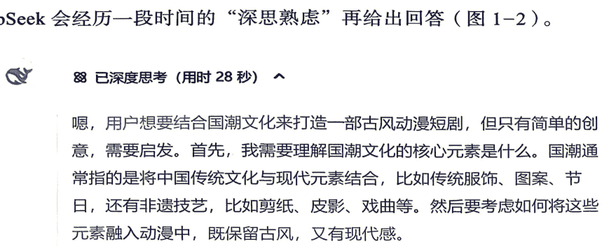

下面是 DeepSeek 给出的回答（后续问答均以文本对话的形式展示）。

> **DeepSeek：**
> 你的创意——结合国潮文化来打造一部古风动漫短剧的设想非常有潜力！我将通过系统性提问和案例启发，帮你逐步梳理思路。
> 首先要解决的是核心定位，即你想传递什么。

1. 文化符号的深层选择
你是想侧重非遗技艺？
还是想侧重传统哲学思想（如道家天人合一、儒家仁义）？
或是想侧重民俗意象（如傩面、山海经异兽、二十四节气）？
案例启发：《雾山五行》将五行学说与武侠结合，《中国唱诗班》用古诗重构历史场景。

2. 情感共鸣点
你是想表达文化传承的使命感？
还是想表达传统与现代的碰撞？
或是想表达纯粹的美学复兴，打造视觉奇观式的东方幻想？
你可以就核心定位的问题继续跟我探讨，也可以让我给出下一步的创作建议。①

如果说“我想要什么”是一个捉摸不透的创作难题，那么在跟 DeepSeek 探讨的过程中，至少创作者可以一步步地确定“我不想要什么”，从而接近自己的创作构想。

最终，作为本书的示例，“国风动漫短剧”这一简单的点子逐渐发展为一套具体的创作思路。

这部国风动漫短剧讲述的是一个包裹在古典东方外衣之下的现代故事，风格偏向写实。其中的设定要融合中国传统哲学思想与民俗意象，同时赋予角色现代人的思维，使故事中人物遭遇的困境也与现代人高度相似。

在找到创作想法之后，创作者接下来要问自己 3 个比较具体的问题，从而搭建起整部作品的创作框架。

① 为了能够呈现 AI 的生成效果，本书所展示的 AI 生成内容没有进行修正，可能会存在部分错漏。

# AI 小贴士

在向 AI 输入问题的时候，可以注意到聊天框的下方有两个选项：深度思考（R1）与联网搜索。它们对应的是 DeepSeek 的两个进阶功能。

默认情况下（不打开深度思考开关），DeepSeek 在与用户交流的时候调用的是 DeepSeek V3 模型，但只要打开深度思考开关，调用模型就会切换到 DeepSeek R1 版本。

这两个模型之间存在显著差异。简而言之，V3 模型是一个普通版本的语言大模型，它的回答会严格遵循提示词输入语的要求，做到有问必答、精准回应。而 DeepSeek R1 多了大量的推理步骤，在用户提问的时候，它会判断用户为什么会问这样一个问题，思考用户有哪些可能的需求没有被提及，是否要加入一些其他方向的发散性回答（图 1-3）。

开启联网搜索功能后，DeepSeek 在回答问题前可以在网络上搜索相关内容作为参考，这样，DeepSeek 回答问题的时效性得到了保障，可以参考最近发生的新闻；还在一定程度上缓解了“大模型幻觉”这一问题，提高了 DeepSeek 回复内容的可靠程度（图 1-4）。

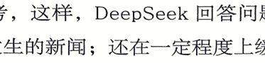

#### 1.2 观众是谁

第一个问题：这部剧要拍给谁看？
在创作的时候，千万不要产生“所有人都是我的观众”这种错觉。创作的最终目标是与观众产生有效的情感联结与互动，但是不同受众群体之间的差异较大，他们的审美需求、价值取向和心理期待都各不相同。因此，只有清晰地定位观众，才能提高动漫短剧的市场竞争力，确保作品有效地触达目标观众，进而实现商业和艺术价值的最大化。

##### 1.2.1 不同年龄层的偏好

在动漫短剧策划中，行业普遍按照 3 岁为一个年龄段的方式对儿童进行分段，在此基础上向上延伸到青少年、青年与成人阶段，由此构建出 6 个主要受众区间。每个区间在认知发展、情感共鸣和审美取向上都存在显著差异，创作者必须针对这些差异调整情节结构、语言难度与视听元素。

###### 3—5岁

3—5 岁的幼儿尚处于前运算思维阶段，对因果关系的理解浅显，专注时间多在 10 分钟以内。此年龄段的动画需要画面简洁、色块饱满、角色线条圆润，并通过重复性高的歌谣或口号形成记忆点；情节应围绕单一目标展开，如“找朋友”“认识颜色”，避免多线叙事和复杂冲突；语言应以短句、口语化表达为主，配角数量不宜超过 3 人，以免削弱幼儿的注意力。

###### 6—8岁

6—8 岁的儿童开始发展具体运算能力，能够理解基本因果关系和团队协作。此年龄段的动画可以适度增加情节层次，如加入简单悬念、拼图式任务或“双主角互助”结构；视觉设计仍保持鲜明对比，但可引入更多细节与纹理，鼓励儿童观察与思考；对白可拓展至复合句，插入幽默或拟声词来调节节奏。

###### 9—11 岁

9—11 岁的儿童认知能力快速提升，已能处理多线并行的故事。这个年龄段的观众开始对冒险、竞争和自我成长话题表现出浓厚兴趣，创作者可尝试设定章节目标和阶段性胜负，让角色面对规则冲突与友谊考验；视觉语言可增加速度感与动作特写，对话中可以传递求知欲或价值选择。此时引入简单的历史、科学或文化背景，有助于增加内容深度，引发观众共鸣。

###### 12 岁及以上

当孩子成长到 12 岁时，他们开始步入抽象思维阶段，愿意探讨社会议题、道德两难与现实隐喻。短剧可采用季播连贯剧情，角色动机需更立体，冲突也可涉及自我认同与群体责任。画面风格不必过于明亮，可使用对比光影和复杂镜头语言。对白允许出现隐喻、成语和双关，鼓励观众二次思考。音乐、剪辑节奏可以向青年剧集靠拢，但需谨慎控制暴力和惊悚元素强度。

超出儿童范畴后，观众被划分为青少年（12—17 岁）、青年（18—25 岁）与成人（26 岁及以上）3 个年龄层。青少年群体情感波动大，倾向于与角色共情和成长弧线，对热血、友情和青春困境高度敏感。作品可以增加长弧剧情、主线反派和价值冲突，镜头语言的运用可更自由，配乐可使用流行或电子风格。青年观众追求审美个性与题材新颖，对各类内容的接受度高，乐于解读跨文化符号与多元价值。叙事方面可深化社会议题，采用碎片化倒叙、多视角叙事或现实与幻想交错的结构。成人观众则重视主题深度与情感真实，关注现实映射、哲学思考及艺术表现。此阶段的作品可使用复杂的时间线、反英雄角色和开放式结局，但需要确保节奏紧凑和逻辑自洽。

不同年龄段对节奏、时长、语言和视觉都有专属需求：低龄阶段追求重复与明亮色彩，中龄阶段需要动作与谜题，高龄阶段看重深度与多线交织，成人阶段则强调情感与思想共振。

因此，在策划过程中，创作者首先要确认的就是作品适合的年龄区间，并让 AI 记住此信息，从而影响 DeepSeek 后续的创作方向。

> 问：
> 我想要制作的这部国风动漫短剧，受众群体的年纪在哪个区间？
> （将之前确定的创作想法输入给 AI，详细内容略）

> DeepSeek：
> 综合题材特征与年龄段认知发展，建议将核心受众定位为 12—17 岁（初中至高中），并预留向青年观众（18—25 岁）自然外扩的空间。

| 维度 | 12—17 岁匹配度 | 说明 |
|---|---|---|
| 情节理解 | 抽象思维刚刚成熟，能接受“古典皮 + 现代核”的双层设定 | 可欣赏哲学隐喻，又不会因深度过高而脱离兴趣 |
| 共鸣点 | 正处于价值观塑形期，容易与“现代国境”共情 | 学业、亲友关系、身份认同等元素与剧情困境契合 |
| 美术审美 | 对国风视觉、东方幻想有天然吸引力 | 高中生是国风手作、国潮潮玩消费的主力之一 |
| 叙事节奏 | 能接受长弧主线与多线角色 | 适合季播模式或短剧形态 |
| 合规与宣发 | 不受低幼审查限制；社媒渠道（B站、抖音）在此年龄段较为集中 | 社群运营、二创扩散潜力大 |

延伸策略：
向下兼容（9—11 岁）：简化哲学概念，用更直接的视觉象征；降低台词深度，突出动作与冒险。
向上覆盖（18—25 岁）：在主线外加入社会议题副线，采用更成熟的情感描写和摄影式分镜。
这样划分既能保证主要受众在理解题材、感受思想深度的同时“听得懂、看得爽”，又能让内容自然辐射到年轻成人群体，扩大后期衍生与二创价值。

##### 1.2.2 不同性别的偏好

性别倾向是仅次于年龄层的维度。它直接影响到情节推进方式、角色塑造侧重、视觉符号选择及宣发话术等方面。对男性受众和女性受众进行差异化分析，并据此设计兼容策略，不仅可以提高观看完播率和二创活跃度，还能在动漫短剧上线后迅速收集更精准的用户反馈，指导后期迭代。

本小节围绕3个问题展开：男性和女性各看重什么、两类偏好在叙事和美术上的具体表现是什么及如何通过平衡策略兼顾双向需求。

###### 男性为主的内容的结构要点

目标驱动情节：设置明确的外部目标，冲突以物理对抗或策略对决为主，胜负节点节奏紧凑。

团队冒险与等级成长：主角多在团队内部完成升级，突出“兄弟”间的互助与竞争；插入任务式关卡，让观众获得即时成就感。

视觉与音效：运用高对比度配色、动态运镜和爆发性配乐，强化刺激感，角色动作设计要强调速度感与打击反馈。

角色形象：主角需要具备鲜明的目标与成长弧；辅助角色分担战术或搞笑调剂的功能。

男性受众普遍偏爱外部目标明确、结构紧凑且行动高效的故事，作品如果围绕“晋级”“夺冠”“破关”“打倒强敌”展开，能使男性受众获得即时的代入感。更进一步地说，男性观众热衷于看到技能升级与团队协作，他们关注角色在一次次对抗中的实力提升和伙伴支援。因此，剧本在节奏上可以呈现“问题提出—战术筹划—高能对抗—即时反馈”四步循环，每2～3分钟便有一次阶段性刺激，以避免其注意力衰减。

在视觉和音效方面，高对比度配色、大幅镜头摇移、快速剪辑和重低音打击乐能放大动作张力。角色造型多采用锐利的线条，强调力量感与冲击感。对话以简洁直接为主，常用简短口号或战斗宣言辅助情绪渲染。为了保持吸引力，主角通常具备可量化的成长体系，如等级、装备或技能树，使观众能清晰感知角色的进步。

###### 女性为主的内容的结构要点

以情感关系为主线：故事围绕亲情、友情或浪漫关系推进，以情绪张力带动高潮。侧重角色对话和情感递进节点，冲突多为价值观碰撞与自我怀疑。

角色内心变化：运用内心独白、回忆蒙太奇和象征场景艺术创作表现手法展示人物心理。故事强调“选择—结果—成长”的情感闭环。

细腻的审美氛围：配色柔和，光影细腻，场景布置注重文化纹理。选用以钢琴、弦乐等为主的抒情配乐，提升共情体验。

多元角色关系网：配角不只是功能支撑，更承担情感映射与主题呼应的责任。

女性受众更倾向于情感驱动的叙事和细腻的角色刻画。故事结构最好围绕人物之间的关系演变来展开，如亲情修复、友情考验、爱情萌芽，或者围绕人生选择与价值观冲突来展开。情节发展强调情绪递进，每一集都需要提供新的心理节点，让观众对主角的内心变化维持持久的兴趣。女性观众也乐于欣赏高完成度的美术风格，色彩往往柔和，光影变化细腻，场景布置注重文化细节与情感氛围的营造。

角色对白应保留一定思考与反问，展示人物内心的纠结与成长，让观众产生情感共鸣。音乐应以抒情钢琴或弦乐为主，偶尔配合轻快节奏，烘托心动或释然气氛。对于视觉符号，女性受众常被具有文化意涵或自然意象的元素吸引，如花纹、流苏、传统饰品等，这些元素能在不增加台词负担的情况下提升作品的品质。

##### 受众差异对叙事节奏的影响

男性为主的剧情峰值集中，爆发点间隔短；女性为主的剧情讲究情绪层次，允许缓冲段落深入角色心理。

在视觉符号上，男性受众更容易接受夸张动作和锋利造型；女性受众对服装纹理、色彩渐变与表情细节的敏感度更高。

不同性别的观众对幽默的偏好也有差异：男性受众偏爱粗线条、搞笑或吐槽式互动；女性受众更偏爱生活化、轻松而带点自嘲的幽默。

在选择动画角色时，男性受众更注重“技能与实力的展示”，而女性受众更看重“可信和有深度的动机”。

##### 平衡策略

为了扩大潜在用户面，作品可采用下面两种方法兼顾双向需求。

第一，群像结构：设置多位核心角色，让他们分别承担动作、策略、情感、搞笑等功能。这样，男性观众可在战斗型角色上获得爽点，女性观众则能通过情感型角色体验心理成长。此外，群像设计还能支撑衍生内容开发，如角色歌或外传短篇。

第二，双线叙事：主线围绕外部目标推进，保持紧凑节奏；副线聚焦角色内心和人物关系发展，在主线高能节点间起到缓冲与深化的作用。制作阶段可通过分镜脚本把主线和副线时长比例规划为 7 : 3 或 6 : 4，两条线在关键节点相互交融，形成高低错落的节奏韵律。

除了上述两种方法，作品还可以从以下两方面进一步优化。

第一，转场与节奏调控：动作高潮后插入情感对话段落，利用音乐和光影过渡。情感高潮后快速切回任务节点，保持整体张力。

第二，性别中立符号：使用全人类共同价值主题，如自我认同、责任与选择，弱化性别专属意象。引入宠物、理想城或技能系统等跨性别喜爱的元素。

如果想要做的题材有明显偏向，那么按照不同性别观众的喜好来制作就可以了。但一般情况下，还是要考虑兼容不同的性别群体，以此来扩大受众面。

接下来，在上一节问答的基础上，将关于性别平衡的想法告诉 DeepSeek，让它做好准备。

问：
这部国风动漫短剧适合哪种性别群体？能否做到双方的平衡？

DeepSeek：
从内容气质与受众心理两方面综合判断，这部以“古典外观＋现代心境”构成的写实国风短剧在性别取向上并不天然偏向某一方。12—17岁这一年龄段受众的核心兴趣点通常集中在以下3类：可被代入的情感体验、足够新鲜的视觉／世界观刺激，以及能够映射自己现实处境的价值拷问。您的创作设定恰好同时触及这3类诉求，因此具备“跨性别”吸引力。

1. 目标受众中的性别侧重
(1) 男性群体。
关注点：动作场面、世界观规模、主角升级与目标推进。
匹配度：古典东方的打斗段落可以满足动作与力量展示的要求；现代困境（责任、选择）可作为成长的驱动力。
(2) 女性群体。
关注点：角色情感、内心冲突、审美氛围。
匹配度：传统哲学与民俗意象有助于打造富有情感象征的场景；现代思维使角色心理贴近现实生活，更易引发共鸣。
结论：题材本身对两类群体具有天然吸引力，但需要在叙事重心和视觉符号上进行配比。

2. 实现两性平衡的可行方案

| 设计环节 | 针对男性 | 针对女性 | 协调方式 |
| :--- | :--- | :--- | :--- |
| 主线冲突 | 设定清晰的外部目标 | 在达成目标的过程中突出人物情感与价值选择 | 把“外部任务”与“内部抉择”并行推进 |
| 角色阵容 | 配置动作型或策略型角色 | 配置情感型或文化学识型角色 | 群像结构，让关键剧情点由多角色共同完成 |
| 节奏设计 | 保证每 3 ～ 4 分钟有一次动作或情节爆点 | 在爆点之间穿插情感对话或内心独白 | 主、副线交替，维持整体张力 |
| 视觉符号 | 高对比度动作镜头、兵刃特效 | 柔和光影、传统纹样、色彩层次 | 同一场景内分层呈现：前景突出动作，背景强化氛围 |
| 配乐与音效 | 强节奏鼓点、民族打击乐 | 抒情管弦、古琴或笛子段落 | 根据剧情转换进行无缝衔接 |

3. 如何进一步兼顾男女观众的喜好
角色阵列平衡：用多主角或群像结构，把行动线与情感线交错分配给男角色和女角色，让观众都能找到“情感寄托”。
困境类型多元化：既呈现外部行动（国家、家族、命运），也呈现内部冲突（自我价值、情感选择、代际矛盾），避免把冒险归男生、把情感归女生的刻板印象。
情感表达方式并存：针对同一关键情节，可使角色通过“言语对抗”与“动作决断”两种方式同步推进，以满足不同性别观众的观赏节奏需求。
符号中和：传统哲学意象、服饰色彩、武器或器物设计可以避开“粉—蓝”“刚—柔”标签，把重心放在“功能与象征”上，而非性别暗示。
只要在角色阵容、情节分布与视觉符号上保持这种“镜面对称”思路，就能使男女观众的收视占比大体持平，甚至在二创与讨论热度上形成互补效应，为作品构建更具长尾效应且多元化的粉丝生态。

#### 1.3 题材定位

第二个问题：这部剧要做什么题材？

题材定位决定了一部动漫短剧的“卖点”，原因在于不同的受众群体对题材存在偏好差异，并且不同的题材有着不同的制作要求与呈现效果。

动画行业常见题材可归纳为八大类：动作冒险、悬疑侦探、日常、奇幻科幻、教育启蒙、音乐、历史文化与喜剧讽喻。这些类别在全球动画与影视作品中有成熟的受众基础，并且在商业化、衍生开发上具有不同的优势。

##### 动作冒险

核心元素：外部目标、等级成长、团队协作。

吸引力与优势：“旅程 + 目标”天然带来悬念和节奏，适配升级式关卡、可视化的奇观场景；每条视频等于过一关，天然适合连载。

创作要点：保持每一集的爆点节奏；突出场景转换和战斗特写；角色技能树需可量化，方便观众记忆与理解。

##### 悬疑侦探

核心元素：谜团、线索、推理。

吸引力与优势：案件驱动，观众参与感强，适合推理互动；单元案件可做系列剧，长线真相能撑起连续剧；好的悬念能够留住观众，视频完播率高。

创作要点：多线叙事与时间线交错；线索提示与误导需成比例；音效中加入环境噪声增强紧张氛围。

##### 日常（校园/工作/生活）

核心元素：生活细节、节奏轻松、情感共鸣。

吸引力与优势：贴近观众的生活，观众共情能力强，情绪负担轻；角色间的化学反应是重点。

创作要点：场景重复利用率高；对白量大，动作量小；适合低预算长线运营。

##### 奇幻科幻

核心元素：世界观设定、超自然或科技设定。

吸引力与优势：设定驱动，充满想象力。

创作要点：世界观文档需在前期锁定；视觉设计要有统一的符号体系；配乐可选用民族乐器演奏或者采用电子合成音效，以突出作品氛围。

##### 教育启蒙

核心元素：知识点、互动引导、正向反馈。

吸引力与优势：功能性强，政策与平台补贴多，许多短视频平台对知识类内容有流量扶持。

创作要点：单集主题聚焦一个知识点；加入歌曲、口号增强记忆；遵循各地儿童节目合规要求。

##### 音乐

核心元素：歌曲、动画演出。

吸引力与优势：对学龄前儿童的吸引力大；素材简单，生成难度低；目前已有一些成熟的音乐大模型，可以批量生产音乐。在版权方面，使用这些模型生成音乐时，通常符合版权范围，但仍需留意具体的使用场景与相关规定，以确保版权合规。

创作要点：在以儿歌为主体的前提下，尝试融合更多的音乐风格；确保生成的视频素材保持明亮的色彩，画面简洁。

##### 历史文化

核心元素：史实事件、传统艺术、文化符号。

吸引力与优势：历史的厚重感，或传统或新奇的解读角度；有成体系的史料及专家解读可以参考；制作方向多，与现代文化结合后容易引发关注并获得认可。

创作要点：史料考证与改编要保持平衡；尝试不同的制作方向；在使用相关素材时要注意版权问题。

##### 喜剧搞笑

核心元素：夸张、冲突、讽刺、包袱频率高。

吸引力与优势：节奏快，短视频平台天然友好，平台的算法也容易推流。

创作要点：对白节奏要快，情节要轻量化，视觉要夸张化；适合短视频裂变式传播。

题材代表着作品的外在标签和整体风格，一部作品可以拥有多个标签，比如，创作者想要制作的这部国风动漫短剧就属于奇幻题材，但还可以给它加上“动作冒险”的题材标签。具体到单集内容，也可以呈现不同的题材特色。以一部校园日常题材的作品为例，其中某一集也可以采用悬疑、冒险等题材进行制作。

如果不确定想要做什么题材的动漫短剧，也可以把问题抛给 DeepSeek，让它给出具体的建议。

问：
这部国风动漫短剧适合哪种题材呢？

DeepSeek：
推荐的主轴定位：动作冒险 + 历史文化（辅以轻悬疑）。

1. 题材契合度解析

动作冒险提供“外部驱动力 + 等级成长”框架，可在古风场景中自然植入山川秘境、机关遗址、异域民俗等视觉奇观；每集一次“闯关”恰好与短剧节奏吻合。

历史文化保证“东方哲思与民俗意象”落地：借用真实朝代或改编典章，实现“古典外衣”的质感，同时给剧情注入文化厚度与可考性。

轻悬疑作为调味剂：用谜团串联文物真伪、古籍残卷或失传仪式，让观众用推理解锁深层设定，增强互动，提高完播率。

三者叠加后，既能满足 12—17 岁观众对节奏、视觉与情节参与感的需求，又能避免陷入单纯战斗或说教的窠臼，即兼具刺激与深度。

2. 性别平衡策略

双线成长：并列男 / 女主（或互补小队），在同一遗迹任务中各自刷“技能树”。战斗与智取并行，让不同性别观众都能投射自己。

行动 + 情感双任务：外部打怪升级、内部自我认同 / 家族期待并行；避免把动作交给男生、把情感交给女生的刻板分工。

符号配饰中和：兵器、法器、服装以功能隐喻而非性别或色彩区分，如青铜剑＝正直，纸伞＝守护，不用粉蓝对立。

3. 创作落地要点

等级显式化：古籍“卷轴”“法印”替代传统数值设定；每集结尾触发一次“卷轴开印”，以此直观呈现角色成长。

文化考据与再造：用真实典故（庄周梦蝶、羿射九日等）二创成可视机关或谜题，既有熟悉感又保留新鲜度。

悬疑节拍设计：“开场留谜—中段误导—结尾半解”三步固定呈现，保持 5 ～ 7 分钟的张力峰值。

视觉统一：水墨厚重配冷暖对撞，兵器金属光 + 植物纹样；主配乐以打击乐节拍推动动作段，以管弦与洞箫渲染思辨、悬疑段。

互动延展：每集发布前一日放出“古卷残图”彩蛋，引导观众考据；鼓励二创解谜，形成社群裂变。

4. 其他题材的取舍说明

纯悬疑侦探：推理逻辑密度高，短剧篇幅易显仓促，不利于大场景动作与文化展示。

日常/教育启蒙/音乐：与“写实国风+现代困境”冲突不大，但缺少冒险刺激感与视觉张力，难以持续吸引12—17岁观众。

喜剧讽喻：可作为支线段子穿插，但若主轴喜剧化，古哲思辨力度会被稀释。

5. 结论

以“动作冒险”为骨、以“历史文化”与“轻悬疑”为血肉，可兼顾男女生兴趣偏好与东方写实名片质感；在短剧形态下既好拆分又能层层递进，有利于连载与社群运营。

#### 1.4 故事要怎么讲

第三个问题：选择什么样的叙事模式？
受众与题材确定后，叙事模式将直接决定短剧整体的开发流程。在宏观上，动漫短剧分为系列剧和连续剧两种模式。

##### 1.4.1 系列剧模式

系列剧是指一集一个独立的故事，观众可以从任何一集开始观看而不影响理解，因此特别适合低幼、日常或教育类的内容。

系列剧的优势在于“进入门槛低”与“创作弹性大”之间形成的良性循环。每一集自成一体，观众不必按顺序观看即可理解剧情，这种结构适应了碎片化的观看习惯。当用户在闲暇时随手点开平台页面，只要缩略图、标题或封面足够吸引人，他们就能立即投入，不会因为担心“从中间开始看不明白”而犹豫，这对吸引新观众非常重要。平台算法也更愿意向尚未关注该剧的潜在观众推送独立成章的内容，因为完播率和跳出率更容易保持在理想范围内。

从创作者的角度看，系列剧能把制作风险分散到单集之中，哪怕个别剧集出现需要返工或审查修改的地方，也不会拖累整季的更新计划。此外，系列剧还提供“边播边改”的机会，在上线几集后即可收集弹幕、评论和社群反馈，迅速调整后续集数的角色戏份、节奏密度或笑点风格，从而让作品更贴合受众口味。对于需要验证市场的原创 IP，这种灵活迭代的方式能显著降低因早期决策失误带来的损失。

教育和公益属性的内容同样受益于系列剧模式，每集聚焦一个知识点、价值观或行为示范，便于家长和教师按需选择播放顺序。系列剧的高复播率特性也可延长长尾收益，即使几年后重新上线，在搜索推荐场景中仍能持续吸引流量，为创作者带来稳定的被动收入。

平台数据也表明，系列剧容易使观众产生“休闲回看”的行为。观众在感到有压力或疲惫时，会反复观看熟悉且独立的剧集片段，以获得情绪安慰。这种反复播放大幅延长了单集内容的生命周期，间接提升了作品的商业价值。相比需要完整追番的连续剧，系列剧对“回流流量”更加友好，用户不必担心忘记剧情或角色关系链，可以随时快进到自己喜欢的桥段。

系列剧既是一个安全的起点，也是长线运营的可靠底座。在流媒体生态强调完播率与持续更新的今天，系列剧带来的内容可拆解、投放易调度和观众易回流三大优势，显得更加不可替代。

问：
我想把这部国风动漫短剧制作成系列剧，请你给我一些创作方面的建议。

DeepSeek：

下面从“内容设计”“结构节奏”“角色运用”“视觉与音乐统一”“观众互动”五个维度，给出将本片做成系列剧的实操建议。它们既维持了你对低门槛与高弹性的期待，也照顾到了12—17岁观众对刺激、思考与审美的多重需求。

1. 内容设计：用“母命题 + 子单元”锁定主题一致性

母命题先行：如“人在传统与现代张力中的自我选择”，这条暗线虽然不强行连剧情，但能为每集提供价值坐标。

子单元聚焦：每集挑一则传统哲理（“知行合一”“明心见性”等）或一种民俗意象（龙舟、踏青、七夕）做核心隐喻，让角色在现代处境里碰撞出“古意新思”。

仪式化收束：结尾保持一句角色独白或一个象征性动作，把当集哲理落点轻轻点出；既不说教，也给观众留下二次解读的空间。

2. 结构节奏：固定“开—破—合”三幕模板，减少创作摩擦

| 段落 | 分钟段 | 功能 | 提示 |
| :--- | :--- | :--- | :--- |
| 开 | 0:00—1:00 | 用冲突或谜像吊观众胃口 | 冷开场：闪现危险/怪异景象再回溯，或直接抛难题 |
| 破 | 1:00—5:30 | 行动 + 推理双线推进 | 保持每90秒一个节奏点（战斗/笑点/信息翻转） |
| 合 | 5:30—7:00 | 冲突小高潮→哲理落点 | 留10秒彩蛋，引向下一集“母命题”的另一面 |

提示：把这个节奏模板固化进分镜脚本模板，后期只需填充差异化元素即可，以保证更新效率。

3. 角色运用：群像“螺旋式成长”

每集主视角可轮换，但在团队核心五人内循环，男女生各占2～3人，保证性别平衡与人物组合的情感吸引点。

给所有主角预置一条螺旋式长弧：看似在原地踏步（每集可从零开始看），实则在纵向主题上层层逼近自我答案，观众若按顺序看，也能体会“暗暗升级”的感觉。

客串/路人尽量从传统角色中变形（游方术士、说书先生、木偶戏匠），可重复客串，既省人设成本又营造“江湖网状感”。

4. 视觉与音乐统一：资产循环 + 符号矩阵

资产循环：固定3套主场景（古街、山寺、茶铺后院）+若干可改头换面的变体（夜景、雨景、霜景），大幅降低布景成本。

符号矩阵：色彩采用“黛青—赭石”基调；每遇关键哲理时插入一抹“朱砂”点题，形成条件反射。

音乐模板库：以打击乐节拍为骨，以洞箫/古筝主题乐为血肉，配合现代低音鼓演奏；把每集战斗段落的节奏控制在105～115 BPM，思辨段落的节奏降至70～80 BPM，维持可感知的节奏差异，降低原创音轨的工作量。

5. 观众互动：把“碎片易看”升级为“碎片易玩”

弹幕解谜：每集留2～3处隐写字、易错典故或镜头一闪而过的机关纹样，鼓励观众考据。

社群投票改写：在官方账号放出两版剧情分支草图，让粉丝票选下一集的“古籍谜题”或“队伍分工”，实现边播边改。

用户原创内容（UGC）挑战：发布可商用的空镜头或背景音乐小样，鼓励二创配诗、翻跳或剪辑动画音乐视频；引流回正片。

6. 最后的实践建议

制作流水线：剧本、分镜、3D场景/2D角色表、配音、合成、校色，拆成并行子团队，以保证周更。

风险缓冲：首季先做8集；上线前锁定前4集成片，其余脚本预留20%可改空间，配合互动反馈调整。

数据监测：关注“首30秒留存”“90秒中点完播率”“弹幕高峰”3项指标，快速识别哪类内容吸引策略最有效，迭代后续选题。
用这样的结构化方法，既能享受系列剧低风险、高弹性的优势，又能在视觉、主题与角色层面保持一以贯之的“古风写实+现代心智”调性，最终形成既散可拾、又合成章的完整IP体验。

##### 1.4.2 连续剧模式

连续剧是一种强调前后剧情逻辑递进的叙事模式，故事像一条不断前行的河流，观众必须按照既定顺序跟随角色的遭遇、冲突与成长，才能完全理解情节的来龙去脉。这种结构的好处在于能够持续积累情感张力与世界观深度，创作者可以自由布设伏笔、悬念和成长节点，用递增式的矛盾驱动观众保持追更热情，这一特性也能很好地提高完播率和订阅黏性。由于情节因果关系紧密，创作者在视觉符号和价值主题上也更易形成鲜明统一的印象，为账号运营奠定风格基础。

根据情节组织方式方面的差异，连续剧可以继续细分为板块式、背景主线式、圆形闭合式3类叙事模式。

###### 板块式连续剧

把长篇故事再分为若干个小单元，每个单元分解为3～5集，且拥有自洽的阶段目标、冲突与高潮，这就是“板块式连续剧”的创作模式。

板块式连续剧的优势在于兼顾了连续剧的情感积累方式和系列剧的灵活性。创作者可以以板块为最小生产单元，根据上一板块的播放数据和社群反馈快速调整人物戏份和节奏密度，实现“边播放边优化”。对于观众而言，每当完成一个板块就能获得阶段性满足，同时又被新的悬念牵引着继续追看，心理节奏上形成了正向循环。

###### 背景主线式连续剧

“背景主线式连续剧”则将宏大时代冲突、世界危机这样的大主题设定为故事的恒定牵引力，主角的个人命运与背景事件同步推进，微观情感与宏观议题交织发酵。这种模式的优势体现在世界观深度与角色群像的厚度上，持续扩张的外部危机为剧情源源不断地提供张力，观众在追踪角色选择的同时，也被迫思考更广阔的价值命题。由于背景线条长且信息量大，社区会自然衍生考据、时间轴梳理和同人创作，使作品在社交平台上获得长尾讨论与二次传播。

###### 圆形闭合式连续剧

以首尾呼应的方式让情节完成一次结构上的闭环，故事往往从某个充满暗示的起点出发，经历多重变化后回到原点，但角色已在旅程中完成蜕变，观众也因首尾映照而重新审视全局意义。这类结构的最大优势是主题聚焦与情感冲击力度大，当结局揭晓首集伏笔时，观众会产生强烈的“恍然大悟”体验，进而自发重复观看以挖掘隐藏细节。平台数据显示，闭环作品的复播率显著高于线性作品，因为观众乐于回到开篇寻找象征线索和隐喻镜头。对于创作者而言，圆形闭合式结构要求在立项阶段就规划完整弧线，这促使剧本、美术与音乐从一开始就保持高度同步，从而能够降低后期修改成本，保证完整性。

系列剧与连续剧叙事模式在不同维度下的对比如表 1-1 所示。

表 1-1 系列剧与连续剧叙事对比
| 评估维度 | 系列剧 | 连续剧 |
| :--- | :--- | :--- |
| 观众进入门槛 | 低 | 中～高 |
| 角色成长深度 | 低～中 | 中～高 |
| 制作灵活性 | 高 | 中 |
| 数据迭代速度 | 快 | 中 |
| 观众黏性 | 中 | 高 |

接下来继续向 DeepSeek 提问，看看 AI 的创作建议。下面这段问答展示的是结合了多次提问的成果，这也是使用 DeepSeek 的一个重要诀窍，即将一个复杂问题的框架交给 AI，然后让它分点、分段地逐条回答。这样做是为了充分发挥 DeepSeek 的上下文记忆能力，同时单次回答只解决一个点的方式，也能让 DeepSeek 有更好的发挥。

> 问：
我想把这部国风动漫短剧制作成背景主线式连续剧，请你给我一些创作方面的建议。

DeepSeek：

1. 宏大冲突设定
先用 1 页纲要把“时代级裂缝”钉死，如“天工断层”——传统天地循环被无形 AI 算法误算，导致节气错位、山川逆流。将所有角色的社会身份（电竞少年、考古实习生、街舞达人）与这条错位危机串起因果：有人因算法闪崩而破产，有人因为河道逆流而失去故乡。必须明确，角色若不行动，错位会在下一个节气全面失控；只有同时调和古老符号与现代科技，方能复归秩序。如此，观众每集都能感知危机半径扩大、时间压力加大，个人困境与宏观险象螺旋式上升。

2. 分层信息披露
外层，大众可见异常：新闻推送突然播报同城温差 20 ℃，短视频热搜里遍布“倒走的河”“午后降霜”等片段。这是观众的即时感官入口。
中层，角色掌握半真相：主角团队在古籍与代码里对照出“天工算法”与“七十二候”交错的蛛丝马迹，得到抽丝剥茧式的片段拼图。
内层，季终核心逻辑：最终揭露千年前的“人器契约”与今世算法的耦合，代价是谁成为“人桥”来承载天地复位。

三层披露每向核心推进一次，就让视觉标识升级一次：起初是天空噪点，然后是人物瞳孔中的星轨错位，最终是整座城市像十字折纸般翻折。

##### 3. 角色目标与主线增幅

私人动机必须为大局“铺路”：舞者女主只想赢下全国街舞赛以换来出国机会，她钻研古代祭舞借势编排，阴差阳错掌握“调息步法”；考古实习生本想给导师刷业绩，却在修复断碑时破解了“人器契约”残文；程序员男主急于推掉父亲逼迫的公务员路线，沉迷于重写算法自证价值，结果让自己成为解决“天工断层”问题的唯一解码人。随着危机外放，所有小我动机被吸进命运旋涡——他们越成长，主线所需关键钥匙就越齐备。

##### 4. 三幕四节点节奏

第一幕（1—3集），谬象初临 + 临时联盟：城市错位现象爆发，三位主角因各自动机偶遇古代机关的激活点，被迫同行。

第二幕（4—8集），线索交织、重大挫败、危机倍增：古籍残页误导导致启动错误仪式，局部空间坍塌使友情与信任分裂；对手势力借机夺走核心算法。

第三幕（9—12集），真相揭露、大对峙、情感收束：破解契约代价真相——必须有人成为“活数据针”牺牲，众人挣扎抉择；最终团队协作重塑算法，让礼乐同频，天地复位。

在每集片尾固定 15 秒：新闻快闪标题、算法崩溃倒计时、古符浮印残影，让粉丝持续参与拼图与弹幕考据。

##### 5. 视觉策略

基础配色锁定“宣纸白 + 墨青灰”营造留白；断层异象加入低饱和电蓝与光粒噪点，制造数字失真感。正常空间纹样以简化云雷纹 / 回纹为基调；异象空间叠加裂缝化“山海兽纹”，二者在镜头交叉时暗示世界缝合线。资产复用可通过实时光效脚本调整纹样占比：

回纹 → 50%，山海纹 → 50% 即表示危机过半，方便后期快速批量渲染。

##### 6. 音乐“双主题动机”

现代段落：以钢琴分解和弦 + 低频电子鼓为核心主导元素，BPM 设定在约 110，展现都市脉搏。

异象段落：以古筝吟泛音、埙波音 + 木鱼点为核心主导元素，BPM 设定在约 75，营造天地回响。

在关键转场（人物觉醒或空间衔接）处使用“二声部交叠”，先让钢琴旋律降速并逐渐失真，再让埙音在同调爬升进入，听觉上完成“科技—古意”交替。混音层维持 2：3 权重切换即可保证风格统一且对比鲜明。这样既能顾及年轻观众对电子节拍的喜爱之情，又不失国风底蕴，完美契合“古今双解”的故事主题。

进行到这里，短剧策划已初具规模。接下来需要继续填充细节，完善各项设定。

# 第 2 章
## AI 创意策划要做的事

在创作方向确定之后，需解决如何在框架内丰满想法的问题。
利用 AI，创作者可以快速而精准地构建出完整的世界观、鲜活的人物形象及引人入胜的故事框架，让想法一步步走向现实。

#### 2.1 世界观设计

除了故事发生的时空背景外，一个完整的“世界观”还需要构建一整套支撑情节运转的规则体系，其内容既涵盖地理版图、历史脉络、制度、科技水平以及超自然法则，也涵盖角色所共享的价值观与审美取向。
世界观是动漫短剧的地基。若没有清晰、稳固且自洽的世界观，观众很难相信角色行为的合理性，也难以在视觉和情感上持久投入。
相反，一个逻辑严密又富于细节的世界观能够带来三方面好处。
第一，提高叙事可信度。当观众理解了魔法、仙术或未来科技的运行原理之后，即便作者在推进剧情时加入高强度的戏剧冲突，也不至于让观众感到突兀、勉强。
第二，确保创作时的一致性。编剧、分镜、美术、配乐和后期能依据同一个规范做创作决策，可以避免出现风格割裂和设定冲突的问题。
第三，有利于账号的长期运营。假设创作者有一部作品产生了很高的热度，那么就可以继续沿用这部作品的世界观，开发续集、外传等衍生作品，形成流量的延续与辐射。观众对这个宇宙的熟悉感将持续转化为内容消费与讨论热情。

##### 2.1.1 一些常用的世界观

从创作视角出发，世界观大体可以分成以下几种典型形态。

**现实主义**
现实主义世界观以真实历史或者当代城市为蓝本，强调社会与人性冲突的写实呈现。

**历史架空**
历史架空世界观在真实朝代和地理的外壳内加入改变历史走向的关键设定，让熟悉的文化符号与意外的事件形成新的张力。

**科幻**
科幻世界观又分为硬科幻和软科幻两种。硬科幻世界观侧重科学原理和技术细节，要求一切超常现象都能在未来学和物理学框架中自洽；软科幻则更关注哲学议题和社会寓言，对技术原理的描写比较宽松，但在人文思辨方面的挖掘比较深入。

**奇幻**
奇幻世界观一般分为低魔和高魔两种形态。低魔奇幻依托现实地理，植入有限的超自然元素；高魔奇幻则会构建完全独立的多神、多种族、多魔法体系。

**风格型世界观**
赛博朋克、蒸汽朋克、后末日以及远古神话都是以美学风格或者文明阶段为核心的衍生形态。它们都是一些综合性的世界观，有着较为固定的主题与美学形式。

国风题材也可以归类到风格型世界观中，它的常见处理方式有两种。

一是舞台放在现代，把古代神话、民俗体系和现实社会并置，从而创造一种熟悉的陌生感。

现世 + 隐藏空间：将现实世界与一个普通人难以接触的“隐藏空间”并置，通过两个世界的交错来制造故事冲突和神秘感。这个隐藏空间与现实世界并存，但被大多数人忽视，或者无法轻易进入。它可以是真实存在但隐秘的地方（古老的遗迹、神秘部族的隐居地），也可以是通过特殊方式才能进入的异空间（传说中的神域、妖怪栖息地、时空裂缝后的世界）。这个空间通常承载着超自然力量、古老文明、神灵妖怪等元素，是剧情冲突的源泉。

现实表象 + 历史的隐蔽脉络：作品中的主舞台看起来是人们熟悉的现代社会，但在这个现实表层之下，还存在着某种来自过去的力量、传统、记忆或未竟之志。它可能是古代神话、民间信仰、被封印的异界，也可能是祖先的遗物、朝代更替中失落的历史秘密。

二是将整个舞台放在过去，这个“过去”可以是架空的奇幻世界，也可以是基于历史的真实世界。

##### 2.1.2 如何对 DeepSeek 提问

世界观的构建较为复杂，重点在于分层、循序渐进地提出具体的问题。

比如，当创作者大致确定了如下动漫短剧框架设计。

故事发生在一个架空的中古时代，讲述了几位少年主角无意间得到了一部时空穿越机器，于是他们不断进入神话、历史典故中冒险的故事。该剧集采用系列剧的形式，每集一个小故事。

受众群体主要是 12—17 岁的青少年，也可向上或向下延伸。剧集的内涵是一些包裹在古典东方外衣之下的现代故事。其中的设定要融合中国传统的哲学思想及民俗意象，但角色要拥有现代人的思维，所遭遇的困境也与现代人相同。

接下来需要将这些设定输入给 DeepSeek，让其一步一步地搭建起整部短剧的世界观。

> 问：
以下是我对这部国风动漫短剧的初步设定，请列出你需要进一步了解的要素，以帮助我构建完整的世界观：
（将剧集的框架设定输入在这里，详细内容略）

DeepSeek：
为帮助构建完整且自洽的世界观，以下几个方面需要进一步明确。
下面这些问题只聚焦于世界观本身，不涉及制作、音乐或商业化，方便你补全核心设定。

1. 时空机器的本质
它是谁制造的？为何存在？是否独一无二？它的运作原理是术法机关、失落科技还是组合模式？

2. 穿越触发与限制
穿越是需要特定地点、时间节点、祭仪还是情绪值才能启动？
一次能携带多少人或物？有冷却时间或副作用吗？

3. 历史／神话空间的性质
少年们进入的是单一线性的“真史”，还是无限平行分支的“故事维度”？
每个维度内部的时间流动与现实世界是否同步？

4. 改写后果与因果律
若改变了典故走向，会反向影响现代现实吗？若有影响，会产生怎样的“时间伤痕”或蝴蝶效应？

5. 宏观矛盾或世界危机
整个世界观的核心失衡是什么？灵脉紊乱、时空裂缝、神话能量外泄抑或其他？

6. 守护者 / 反噬机制
是否存在看守时间秩序的神祇、机关兽或人类组织？
这些力量与主角目标是对立、合作还是暧昧？

7. 哲学与能量体系
阴阳、五行、天人合一等观念怎样具象化为规则、法则或能量？
现代科技思维能否解析或改写这些法则？

8. 民俗意象在系统中的角色
节气仪式、图腾纹样、庙会祭典只是美术符号，还是实际可触发机关 / 法术的钥匙？

9. 空间地理与社会结构
架空中古时代的政治、经济、宗教与民间信仰大致面貌如何？
神话空间与凡俗王朝是并行、重叠，还是互不相知？

10. 语言与文化隔阂
少年们如何与古代人物交流？是机器自动翻译、精神共鸣还是学习古代语言？

11. 伦理边界与规则
世界是否设定“不可杀死关键人物”“不可带走神器”等硬性禁令？违反会触发什么惩罚？

12. 团队与个人命运的绑定方式
每位主角在现代的个人困境如何与宏观危机产生关联：是被机器选择、血脉传承，还是纯粹偶然？

回答这些问题后，就可以搭建出清晰的时空框架、明确能量规则并确定冲突驱动力，为后续剧情填充提供坚实骨架。
你需要根据上面的问题，挑选关键点先回答一部分，然后我们可以逐层完善。

提出这些问题，目的在于了解创作者心中最终的世界观设计究竟是怎样的。而对于不确定、不了解的条目，创作者可以继续跟 DeepSeek 进行探讨，让它提供一些实际的例子作为参考。

> 问：
关于守护者/反噬机制这点，请给我 3 个示例。

DeepSeek：

1. 示例一：钧衡司辰——“节点神祇”守护体系
在时空长河的每一个关键转折点，都栖息着名为“钧衡司辰”的微型神祇。它们以铜铃大小的星核为核心，在无形层面校准“事件权重”。少年若在神话场景中做出足以改变节点走向的举动，司辰会先发出“时音”警告（古乐残音逆放），若仍继续干预，就触发“回溯噬魂”，直接卷走施事者与当场目击者的部分记忆，迫使剧情退回干预前五分钟。这样既能保留角色的情感代价，又能保证历史“总体轮廓”不被轻易撕裂。

2. 示例二：璇缱铜鳞——“机关兽”反噬体系
时空机器的能源来自五行晶簇，一旦在错误方位或节气启动，封存在地脉里的机关兽“璇缱”便会现身。它的形态随气候而变：春雨时像鲤，冬雪时如狼，鳞甲内刻满齿轮纹。机关兽不以击杀为目的，而是锁定机器本体，吞噬其能量并倒灌进启动者经络，造成“灵脉倒冲”——短暂强化后迅速衰竭，让主角们痛感“超能力反噬”。想平息它，必须精准复原当地民俗仪式（如放河灯、击鼓驱寒等）才能重新封印。

3. 示例三：纪封司——“人类猎时者”守护体系
自洪武年间起，民间便流传着一支隐秘人类组织“纪封司”。他们世代记录穿越涟漪，一旦侦测到历史线中出现非原生器物或“未来语”，就会派出“猎时者”干预，猎时者会使用削年刃（可剪除物体时间痕迹）与封缄符（压制时光波动）。机制分三步：先遮蔽异常记忆，让涉事人以为自己“做了一场梦”；若异常仍扩散，则回收或毁灭穿越机；最后手段是“锁节”——将被改写的时间段整体封存为“不可访问层”，代价是那一段历史永远成为空白，导致现实中对应资料无故失佚。
这一套体系把守护者与主角置于灰色对立面：纪封司既是潜在盟友，也是随时可能清除他们的威胁。

完成基础的世界观框架后，可以要求 DeepSeek 把现有信息汇总成世界观条目，并标注出仍留空的设定缺口，以便在之后的创作中继续填补。
在这个基础之上，可以再追加一些主题、故事线设定类的深度提问，让 DeepSeek 给出社会运行法则和伦理冲突更具有针对性的细节。
世界观的设计究竟要细致到哪一步，取决于作品的定位。
对于创作者用来练手的作品，大可不必太过考究。在这个阶段，关注细节的雕琢远不如锻炼自己对作品整体框架的把握能力，以及熟悉整体的生成流程带来的帮助大。

### AI 小贴士

在使用 DeepSeek 这类文本生成 AI 时，除了向它提问，学会让 AI 向创作者提问也是一个非常重要的功能。
AI 的提问会促使我们进一步澄清角色动机、世界观细节及剧情冲突，从而让原本模糊的灵感迅速具象化。就像这一节构建世界观的例子一样，当 DeepSeek 反过来询问时，创作者能够被引导着补足核心信息。这样的交互也能帮助创作者及时发现逻辑漏洞，如果 AI 追问角色能力的上限或魔法体系的限制，而我们一时间答不上来，就说明剧本框架仍需打磨，此时就可以继续跟 DeepSeek 探讨更加细节的问题。
此外，AI 的提问往往具有概率模型对常见叙事模式的敏感度，它能提醒创作者跳出套路，在情节走向或角色弧光方面做出更具惊喜的选择。通过这种“你问我答、我问你思”的往返式对话，DeepSeek 生成的内容会兼具深度与个性化，帮助创作者在短时间内完成对动漫短剧文案的迭代。

当然，如果创作者时间紧迫，或者走以量取胜的路线，那么直接让 DeepSeek 给出答案也可以，现如今文本生成模型的内容生成下限具有一定的保障。

#### 2.2 角色设定

角色是连接观众想象与世界观规则的媒介，角色设定的第一道门槛，是明确由“谁”来承担叙事焦点与情感投射的点。这个“谁”既可以是人类，也可以是动物、植物、器物，甚至是抽象概念的具象化。只要创作者对其生命状态与行动逻辑做出自洽的说明，任何存在都能在荧屏上拥有角色地位。

如果角色是非人类，那么还需确定角色的拟人化程度。比如，一只猫妖可以保持四足行走、不会说人话，只通过尾巴和耳朵的动作表达情绪，也可以选择二足站立、拥有完整的台词体系，与人类平等对话。确定拟人化程度后，视觉造型、动作设计与配音风格也会随之确定，在制作早期就会形成明确的艺术指导方针。

##### 2.2.1 角色塑造的几个维度

为了让角色更易被观众识别和记忆，创作者可以从四个维度来构建信息。

（1）功能维度，即角色在故事中的叙事职责，如主角、反派、导师、工具人、喜剧角色等。明确功能能够帮助编剧安排冲突与转折点的出场顺序和戏份比例。

（2）人物维度，如姓名、年龄、生理特征、口音、口头禅、喜好、恐惧、缺点、价值观、人生目标等。这一维度决定了观众是否产生共情，也能为日后衍生品开发提供素材。

（3）戏剧维度，这一维度要求角色与外部世界的矛盾和内部心灵成长曲线必须形成张力，强调角色必须通过行动改变环境，或被环境所改变。

（4）符号维度，即角色在视觉和听觉层面的识别记号，如独特剪影、配色逻辑、服装纹样、配饰图形、主题乐段、常用音效等。符号维度让角色哪怕仅以剪影或单句台词出现，观众都能在瞬间认出并完成情感唤起。

非人类角色的设定还要考虑生态与社会属性。

例如，想要让一棵樟树担任智者，那么它究竟是扎根在原地通过树枝摆动与人沟通，还是可以幻化成树人离开土壤？它对阳光、水分的需求是否会成为剧情限制？它是否遵循植物生长周期规律，对季节变化具有独特感知？这些生态逻辑不仅会影响剧情张力，也会影响美术素材的制作参考。

社会属性则涉及角色与世界观中其他元素的权力关系。例如，动物族群是否拥有自己的管理体系？植物能否参政议政？无机物是否被赋予灵魂地位？如果世界观主打群像，角色之间的权力等级、合作模式和文化差异都应在文档里标注清楚，方便后期多线叙事。

##### 2.2.2 利用 DeepSeek 设定角色大纲

在实践中，创作者可以将复杂的设定拆解为多个问题。

首先，提供题材、受众和世界观摘要。

> 问：
这是一部面向 12—17 岁观众的系列剧式的国风动漫短剧，故事发生在现代社会，几位主角是一所学校的中学生，各自都有着自己的烦恼、自己的问题。
一天，几位主角得到了一部能够穿越时空的机器，从此开始了在不同的神话与历史典故中的冒险。在这个过程中，他们发现，在很多情况下古人所面对的问题要比自己严重得多，于是在经历过故事中的冒险之后，角色也打开了心结，完成了自我成长。
请给出主要角色的设计方案。

DeepSeek：
下面给出五位主要角色的完整设计方案。为便于后续编剧，每个角色都按“当下身份→内心缺口→成长收束”三段展开，并附上可视化要点与团队分工。这样既能直接落进分集脚本，也方便后期海报、人设稿与周边的开发。

1. 李云夕（女，15岁）——“完美主义的班长”
当下身份：重点中学九年级班长，成绩优异，钢琴十级，是老师与家长眼中的“准学霸”。
内心缺口：持续高压导致失眠、偏头痛，对“失败”有病态恐惧，经常暗中自责“如果考不到第一就不是好孩子”。
成长收束：在主线后期的“庄子·庖丁解牛”篇章中领悟“养神”概念，懂得张弛有度地分配精力。
团队分工：分析与决策核心，负责梳理时间线并确定任务的优先级。

2. 陈泽言（男，14岁）——“压着跑的运动健将”
当下身份：校田径队短跑主力，父亲是退役军人，家庭期望他在省赛中拿到金牌。
内心缺口：对“必须赢”的执念让他凡事争先，却害怕受伤、怕拖累队友，表面阳光，实则缺乏安全感。
成长收束：懂得把“速度”让位于“配速”，从短跑单兵转向接力团队，现实中主动组建校队陪练小组。

团队分工：体能与突围担当，执行危险动作，保护队友。

3. 赵如是（女，15岁）——“吐槽系动漫达人”
当下身份：漫画社副社长，擅长速写与剪辑，成绩中游，在社交媒体短视频平台拥有少量粉丝。
内心缺口：自嘲“兴趣无用”，既想走艺术道路又害怕父母质疑，常用吐槽掩饰自卑。
成长收束：将冒险速写做成“神话小报”张贴在校园，引得老师认可，立志走视觉传达专业。
团队分工：记录者与创意策划，负责破解机关上的图案、符号。

4. 贺星阑（男，15岁）——“代码里长大的独行者”
当下身份：信息竞赛种子选手，沉迷硬件改装与游戏服务器运维，平时话少。
内心缺口：父母常年在外工作，长期独处，对人际互动充满恐惧。
成长收束：回到现实后，主动承担学校科技节舞台灯光控制的工作，与同学配合布置。
团队分工：技术支持，破解古代机关，修理穿越机器，承担情报检索。

5. 林寄微（女，14岁）——“笑面温度计”
当下身份：心理委员，热衷志愿活动，表面开朗，内心却因父母离异而极度敏感。
内心缺口：担心自己只能做倾听者而没有人会真正理解她，害怕情绪被忽视。
成长收束：学会正视“被倾听”的需求，主动向朋友袒露脆弱，成为团队情绪纽带。
团队分工：情绪协调员，擅长观察古代人物的微表情，化解冲突。

群像关系与色彩呼应：
五人代表“金木水火土”五行互补：李云夕（金·理智）、陈泽霄（火·行动），赵如是（木·创造）、贺星阑（水·思维流动）、林寄微（土·情感承载）。
服饰配色以校服蓝白为基底，穿越后各自叠加个人专属暖冷偏色，与神话遗物形成视觉识别。

角色弧线互锁：
- （1）“完美”与“速度”发生理念冲突，李云夕和陈泽言在失败后学会互相让步。
- （2）赵如是的记录让贺星阑的技术可视化，二人互补“右脑—左脑”。
- （3）林寄微贯穿全队，关键抉择前用情绪共振促成一致。

如此设计，既可在系列剧里轮换主视角，又能稳固团队整体成长；每人对应古今镜像，保证观众在任何一集都至少能代入一个“自己的影子”。

其次，根据 AI 给出的角色原型继续提问，让 AI 进一步完善角色设定。

> 问：
请继续完善“李云夕”这一角色的背景资料，300 字左右。

DeepSeek：
李云夕，15 岁，出生在江城一条临河的老街，祖父曾是地方书院最后一任院长，家道中落后仍保留满墙刻板印章与旧课桌。父母皆为小商贩，对她寄予“家族翻身”的厚望。她 5 岁起学钢琴、书法与英文演讲，一周课程排到晚上 10 点。为了不让家人担心，她把每一次测验卷子按成绩高低整齐叠好放进书柜，失败的一页也不许有折痕。班级里，她永远是负责统计分数和写黑板报的人，对同学彬彬有礼，却很少真正放声大笑。夜深时，她会躲进祖父遗留下的木阁楼，用手电简翻阅散发墨香的古籍，幻想自己穿越字里行间，逃离随时可能坍塌的“第一名”高台。

这样就能快速得到一条角色弧线的雏形。

##### 2.2.3 角色形象设定

接下来，用 DeepSeek 进一步扩展角色的视觉表现，让角色的内在属性“外显”。

> 问：
进一步完善“李云夕”的外貌设计，要体现出她的性格底色。

DeepSeek：
李云夕外貌设定基线：
发型：浓密乌黑的长发扎成马尾辫。
身形气质：身姿挺拔，肩背微绷；举手投足干净利落，透露出自我约束的迹象。
表情常态：平日总是冷着一张脸，眉梢常不自觉地轻蹙，紧绷与克制并存。

李云夕的形象以“极度自律的清雅线条”为核心。
她的校服永远熨得笔挺，白衬衫的扣子扣至最上，袖口笔直无折痕；深蓝色百褶裙的每一道褶裥分明如琴键；黑色系带皮鞋维持镜面反光。配色极简，仅限黑、白、藏蓝三色，强化了她对“可控秩序”的依恋。行走时步伐轻而匀速，双臂贴身，肩胛轻收，像在演练无声的指挥；站立时重心微微前倾，体现随时迎接评价的警觉。近景特写可捕捉她指尖纤长却紧握成笔直的线条，暗示钢琴训练与完美主义的束缚。情绪波动时，她先是眼神轻颤，随后一缕碎发悄然垂落，这成为她严肃外表出现裂缝的唯一视觉信号。整个设计在冷淡色调中，让“苛求自己、克制外放”的底色自然浮现。

李云夕的古装造型整体以“洁白墨韵”为核心风格，同样传递出她克制、追求无瑕的性格底色。
上衣为雪白直领对襟襦，衣襟、袖口和下摆皆以极细的“淡墨分割线”绣出极其规整的平行纹，如书法练字格般严谨；布料选用轻薄缎面，经雾染处理呈微微珠光，使整件衣裳在阳光下保持克制的柔亮。下着湖雾灰长裙，垂坠挺括，裙褶间距精确等宽，行走时层次分明，象征她对秩序的执念。腰间系同材质细束带，仅以隐藏式暗扣固定，避免任何视觉赘余。
袖型略收，方便行动；走袍摆时，胸前与袖下偶尔可见手工留白的“残笔”水痕纹理，象征她在完美框架里渴望自由流动的心境。足蹬无跟烟青色软底履，步伐轻而稳，衬托出她自幼练琴养成的挺拔站姿与不容松懈的自律气场。整体色调冷静、线条严整，却在细微水痕纹与垂鬓中泄露少女难以掩饰的柔软与挣扎。

模型生成方案后，便可据此让图像 AI 绘制人物概念草图。这种循环提问的方式能够把抽象设定逐步推进到可执行的动画语言。

示例给出的内容比较简略，在实际操作过程中，建议使用本节开始部分总结的不同维度的关键词，让 DeepSeek 生成角色的详细设定文档，并保存在本地。

##### 2.2.4 角色发展规划

角色内心的转变以“季”（系列剧）或者“板块”（连续剧）为一个单元，因此同样可以让 DeepSeek 去设计角色要经历怎样的事情，体现怎样的成长逻辑（并不需要具体的情节，只让 DeepSeek 设置几个大致的情节点）。

比如，示例中的这个角色，创作者的规划是让角色从自身困境中解脱出来。因此，具体到系列剧的一季（如果不分季，就具体到多少集）中，创作者需要确定角色大体上要完成什么程度的转变，再为这种转变安排几处伏笔。

> 问：
请规划角色完整的成长弧线，最终让其从自身困境中解脱出来。
设计几个主要的情节节点，与主角的核心缺陷形成镜像关系。

DeepSeek：
李云夕成长弧线（完美主义 → 张弛有度）：
核心缺陷：把“第一名”当作自我价值的唯一衡量标准；对失败和未知有强烈的控制欲，导致长期焦虑和失眠。
1. 节点1：崩点引燃——“满分的裂缝”
现代开篇。月考作文被扣两分，李云夕在空教室里偷偷落泪，却仍把卷面折得整齐；回家路上，她与同伴偶然触发时空机器，被卷入洪荒时代的大洪水。
镜像：她对“两个失分点”耿耿于怀，而面对大禹三过家门的屡败屡战，却发现自己过于小题大做，坚韧与不言弃才是人成功的基石。
2. 节点2：第一次自我松动——“洪水的缓速法”
在大禹治水过程中，她尝试精确计算堤坝角度，却因数据不足导致溃口，眼见村民财产被冲走。大禹只是让她调小目标，逐段导流。
镜像：完美方案反而失手，小步迭代才稳。她学会把计划拆分为细化的阶段目标。
3. 节点3：反弹与低谷——“纸上完美的代价”
回到现实的期中考，她照旧把全部精力压在统筹班级复习上，拒绝队友协助；熬夜导致头晕，模拟考数学时大意失误。成绩失守引爆舆论，李云夕崩溃欲退出冒险小队。
镜像：现实重演“清口”，她以为自己已放下完美，其实只换了场景。
4. 节点4：顿悟——“庖丁解牛的节奏”
队友拉她进入战国时代，在庖丁解牛的场景中，老厨师示范“依筋而入，因势而导”。云夕被要求闭眼切一根葛藤，需靠“听息”而非尺规。
镜像：当她跟随呼吸节拍完成切割，发现“心在刀先”而非“刀逼心走”，体会到专注与松弛可以共存。
5. 节点5：回馈集体——“不完美的协奏”
现代线迎来校艺术节。她主动放弃钢琴独奏，改编古代节气乐章为五人合奏，把易错段落分给最弱的同学练习。演出中出现节拍错位，她沉着地用简化和弦兜底，救场成功。
镜像：允许失误、现场修正，比死守谱面更能完成作品。
6. 节点6：顶峰试炼——“时音回溯”
最终季，司辰神祇判定团队干预过多，要“回溯噬魂”重置五人记忆。云夕提议用“阶段性微调”替代一次性纠正，让司辰周期性校核而非清零。她用自己掌握的分段导流、节奏切分理念说服神祇接受试行。
镜像：她把“分段—递进—留白”上升为拯救时空的方法，完美主义彻底蜕变为“动态调衡”。
7. 节点7：收束——“轻声的第一名”
剧季结尾，她在期末考试中仅列年级第二，却心平气和地把卷子叠进书柜；镜头转向她书桌上的羽簪与青铜芯片——象征“轻盈与软化”。她抬头望向窗外，耳畔响起同伴练习合奏的错音，她笑着跟着哼唱，指尖轻点木桌打拍子。
镜像：过去遇到杂音就皱眉，如今主动融入未必完美的旋律，困境已转化为新的节奏感与创造力。

成长轨迹总结：
李云夕的每一次古今对照都让“硬线条”被“弹性线”蚕食：洪水教她拆分目标；庖丁师授以她张弛节奏；协奏让她拥抱集体的不完美；司辰谈判则把个人领悟升华为拯救世界的系统方案。
最终，她仍追求卓越，但衡量尺度不再是卷面满分，而是能否在有限条件下为自己与伙伴留出呼吸空间，“第一名”成为一种心态，而非数字。

其他的角色设定也是同样的道理。创作者也可以设置一些其他关键配角，让短剧的故事变得更丰满。比如，在动漫短剧中有一种非常经典的角色形象——主角的跟班。
这种角色一般不会有太强大的力量，但是却有着金子一般的内心世界。他们会与主角形成鲜明的对照，在受到主角的帮助之后，会选择跟在其身边，在旅途中做一些力所能及的事情，并逐渐成为主角心理状态转变的关键因素。

每个角色都有其成长弧线，当故事中的角色越来越多，为了避免他们之间的弧线脱节，需要把现有的角色资料整理出来，形成一张关系网。在后续的短剧制作中，每个角色之间要做出差异，或者也可以有意设计出镜像角色，展现不同角色在面对相似问题时做出的不同抉择，并以此影响其他主要角色。

## AI 小贴士

在同一个话题内，文本生成 AI 能记住之前的对话内容，这就是人们常说的“上下文记忆能力”。
但是，AI 的“记忆力”是有限的，根据不同平台的设置，一般在几万字之内。超出这个界限后，AI 就会“忘记”之前做出的设定，所输出的内容就会与创作者的期望产生偏差。

为了解决这个问题，创作者需要把设定内容整理成文档。当发现 DeepSeek 的回答开始出现混乱的状况后，就再开启一个新对话，将之前的设定内容重新发送给 DeepSeek，这样就可以继续工作了（图 2-1）。

以角色设定为例，建议创作者用单独话题专门制作角色设定。开始之前，先把所完成的种种设计以文档的形式发送给 AI（图 2-2）。

这样，DeepSeek 就能知道创作者正在做什么事情，之前完成了哪些步骤，以及之后需要做哪些设计。

#### 2.3 故事的整体走向

在完成世界观设定与角色设定之后，便可基于这些内容规划故事走向并撰写故事梗概。此阶段并不需要呈现太详细的内容，只需确定故事的核心主旨与大致轮廓即可。

一方面，创作者需要嵌入此前构建的世界观与角色设定；另一方面，创作者必须将篇幅控制在能够一览全局、快速理解的尺度。而想要兼顾完整性与可读性，需要先界定“故事方向”与“故事梗概”各自的目标。

故事方向是宏观上对故事的阐述，它指向作品的主题基调、核心议题和叙事弧的走向，可以让 DeepSeek 用一两句话概括“这部动画为什么要被拍”“它想给观众留下什么核心印象”。故事梗概则是以情节为骨干的微缩版剧本，要直白，让人能看懂谁，在什么时候、因何事踏上怎样的旅程，遭遇了哪些冲突，最终达成何种转变。两者结合才能为后续拆分季纲、分集及分镜提供指导。

> 问：
接下来，请以简洁、精确的语言，给出这部动漫短剧的故事方向以及故事梗概。

DeepSeek：
1. 故事方向
一群背负学业压力与自我焦虑的现代中学生，意外得到一部时空机器，被迫往返于中国神话与历史节点中。每一次穿越都让他们在古人更极端的困境中重新审视自己的烦恼，进而以现代思维与传统智慧并用的方式化解危机。整部剧以“古今对照、镜像自省”为基调，旨在让青春期观众体会：真正的成长不是摆脱问题，而是学会在更广阔的历史视野中重新审视自身价值与选择。
2. 故事梗概
李云夕、陈泽言、赵如是、贺星阑和林寄微同在江城第二中学读九年级，因一次校园科技展误触祖宅地窖里的“度界仪”，穿越到《山海经》洪水篇，并在危急中救下了一颗“时印核”。他们发现，只要将时印核嵌回度界仪，便能随仪器设定的坐标跳入不同典故，如大禹治水、女娲补天、墨子守城、孟姜女哭长城等。每次任务都由度界仪自动生成“修正指令”，指明他们需让故事大势回归正轨，才能带时印核归位并返回现实。

在重压下，五人各自的完美焦虑、必胜执念、兴趣自卑、社交恐惧与情感孤独被无限放大，又在古人坚韧与奉献面前获得全新视角。随着时印核逐步集齐，他们察觉历史在被另一股力量暗中篡改，来自“纪封司”的猎时者正试图封禁所有民间传说，以阻止度界仪失控。最终，少年们在“嫦娥奔月”节点与猎时者正面对峙，选择保全神话记忆，让度界仪封存于江城博物馆，并把穿越经历绘成《青春山海札记》公开分享。现实中，他们不再被分数与评价束缚，而是以重新确立的自我价值迎接中考与人生的下一段旅程。

如果对 AI 给出的内容不满意，创作者可以先回归世界观设定与角色设定，查看主题命题与世界逻辑是否已经内含天然的戏剧张力，然后对 DeepSeek 做出约束，让它按照自己的思路给出答案。

#### 2.4 场景设定

场景设定需要把故事发生的地点设计得更为具体。

除了提供故事发生的背景之外，场景还兼具辅助叙事的功能。具体来说，很多场景都自带“标签”，这些标签会让场景具有天然的功能性。
一提起议事厅、忠义堂、中军帐这些地点，很多人下意识地就会感觉到一种庄重的氛围，废弃码头、渺无人烟的丛林深处则代表着危险，而夜市街头、夏夜的学校操场则有一种天然的烟火气与亲切感，这就是场景能够为叙事带来的情绪铺垫。

儿童短剧相对来说比较简单，故事发生的地点大多是生活场景，只需要对这些场景做简单描述即可，如主人公生活的小区是什么样的，学校是什么样的，会不会涉及动物园、海洋馆（不常出现的场景也可以等到其在剧情中出现时再设计），城市有着怎样的特点等。

对于世界观较为复杂的作品，如果主角需要长期待在某一个地点（如主角几人经营了一家客栈），同样可以采用这种设计方法，让 DeepSeek 生成具体的场景设定。

> 问：
我正在制作一部动漫短剧，大致的故事走向如下：
“故事发生在一个中古的虚构世界，适逢战乱，主角几人在一个偏远的小镇上开了一家客栈。此时的战火还没有殃及这里，小镇上还保持着以往的宁静。”
请你帮我做主要场景的场景设定，包括一座老朽却干净的两层楼客栈，客栈的外观与内部布局，整个小镇的布局，以及小镇周围的环境。确保文字描述充实丰富，足够细致。

DeepSeek：
1. 场景总览
在风云动荡的中古年代，群山与深林环抱的一处河谷中坐落着“槐风镇”。镇子临着一条名为“驹水”的缓流小河，河水清凉，终年不冻；沿河砌起的青石街面向西延伸，仅一里来长，便把全部人烟串成一条弯月。外有竹篱与田埂，隔出梯田与桑园；更远处是雾锁松柏的丘陵，偶尔冒出的废弃烽火台，仿佛在提醒人们战火的方向。

2. 小镇布局
槐风镇民居为木骨泥墙、灰瓦覆顶，铺面沿河排开。镇口单孔石桥侧立着红底黑字的“槐风镇”镇牌石，风雨剥蚀出斑驳锈迹。街心依次是铁匠铺、药材铺、镇公所兼祠堂、一口雕龙古井、往生纸扎铺，以及一座建筑——“青叶客栈”。客栈后分三巷：北巷去窑场，东巷至屠夫巷，南巷达小码头。夜里，油纸灯笼从桥头排到码头，像一条柔软的红线。

3. 客栈外观
青叶客栈紧贴河岸，两层半高，由乌桐木立柱支撑，木色因岁月榷成银灰，却因上蜡被打理得柔润。去年翻瓦，仍保留屋脊兽面。正门杉木格肩上方挂来漆招牌“青叶”二字，传为游学士手笔。门口石阶凹陷，却洗刷得一尘不染，掌柜每日清晨必洒薄盐水，仿佛与乱世对抗。

4. 客栈内部布局
入门先见青石地坪，中央一缸睡莲。右首樟木柜台上摆放算盘与琉璃油灯；左首用膳堂里列榆木八仙桌，堂角土灶终日吊着砂锅高汤。后通走廊铺麻毯，接后院与楼梯。
楼梯杉木造，每级踏板下藏竹片减吱声。二楼回廊围天井，中置青石假山与老梅，冬春暗香，二楼客房8间：临河4间推窗可俯瞰驹水；背街4间结构稳固供长住。室内陈设简单素净：榆木榻、方桌、善面铜灯与衣柜，墙角备炭火铜盒。窗棂新糊棉纸，风来纸面轻颤如远鼓。
走廊尽头暗门通储物间，堆腌渍坛与备用被褥，也是主角们的秘密藏身之处。阁外小浴室置铜桶，夜深水汽腾起，与松脂香混成旅人最怀念的味道。
后院呈长方形，东侧竹架种豆瓜，深处古井井栏刻“永安”。井边常晒白色床单，随风鼓起，像出征的船帆又似安稳的誓言。每逢初一、十五，掌柜焚香祭水，淡淡檀香顺风溢进房间。

5. 周边环境
越河堤南坡成水田；春稻浅绿如绸。北丘古松间散见废烽台；雨后苔痕如墨。东麓羊肠古道通战区，偶有披甲骑卒疾驰；西为衰败柿林，秋叶如火，林后废寺，暮鼓时断时续。落日染镇子成金色，驹水如碎金闪耀。

6. 氛围与四时
槐风镇四季分明：春杏花雨，夏蝉与萤，秋稻香与柿红，冬霜雪与梅影。镇民日落前收铺闭门，夜半由青叶客栈的灯火守街口。酒客常谈，这盏灯就像镇子的心脏，虽然微弱却坚定。
镇上的声音也成了客栈的背景乐：清晨铁匠叮当的打铁声；午后豆腐郎敲木梆的声音；傍晚田埂传来牧童横笛的乐声，夜深只余河水拍岸与风铃细语。正因为这些声音依旧准时出现，镇民才相信秩序尚在，明天还会来临。
偶遇的流民若愿付一枚铜铢，便可在店门口的木桶里洗去尘土，再获一碗热粥，这份小小仁慈，使客栈在兵祸未至前已成为逃亡者心中的平安符。客栈二楼最东侧的阁楼里，主角们常点着一盏海棠花形薄瓷灯，围桌摊开简陋军势图谈论各地传闻，他们的低声商议混杂着梅香与纸张味，像一条尚未被书写的命运之河，在夜色中静静分流。
整座槐风镇如战争暗潮下的一片静水。白昼炊烟与河雾交织，掩去远处烽火；夜幕油灯倒映在河面摇曳，如为流离旅客指路。青叶客栈立于水光与旧瓦之间，以固执的灯火护住避乱之人的片刻安宁。

如果主角需要来往许多地方，就没有办法设定得这么清楚了，取而代之的是在世界观之下，对整个世界版图的不同区域、风土人情、地貌特色做出规划，等到情节发展到那里的时候，再去做扩展。

> 问：
我正在制作一部奇幻类型的动漫短剧，请将故事发生地的地理版图做详细规划，把整个大陆分为四个区域，每个区域都有着不同的风土人情和地貌特色。确保文字描述充实丰富，足够细致。

DeepSeek：
地理总览：这片大陆宛如一枚扭曲的古铜莲叶，西北高、东南低，星宿灵脉自极北天穹倾泻而下，沿山河分流成五条隐伏支脉。千年来，战祸与妖潮反复席卷，人类在断裂的地形与文化缝隙间挣扎求存，逐渐形成四大区域。它们以地貌分界，又因信仰、祭仪、方言与物产各异而迥然分立，构成主角漫游的四重舞台。

1. 北域——“寒灯关外·风刀雪骨”
北域横跨极寒苔原与长白孤峰，终年飘雪，雪线之下却暗藏地火温泉，孕育出被称为“红脉松”的血色林海。居民为坚甲戍边将士与游牧猎户。
地貌与气候：长白孤峰拔地破云，火山口成“天眼湖”，夜映极光犹如星宿倒悬。山脚散布温泉雾谷，升腾的热浪与风雪纠缠，形成罕见的“冰雾虹”。
风土人情：此地战事最烈，男丁多随诸侯征战，留下“戍妇”自给自治。妇女织“冰蚕纱”、酿烈乳酒，以灯火守望返乡人；猎户则循星捕捉“雪原鹿”，以鹿血入祭，用于抵御妖瘟。
信仰与仪式：北域供奉“执旌星君”，祭仪为在冰湖凿孔投灯。灯若沉底，则预示妖潮；若浮而不沉，则来年风调雨顺。
故事意义：寒冷外壳下的温泉与火山反衬主角冷感外表下的热情；“灯沉灯浮”仪式成为第一场妖瘟的线索。

2. 东陆——“泽国千汀·沉钟水市”
东陆低洼，地势平坦广阔，江网密布，河汊如蛛网。每逢梅雨，潮水倒灌，一半陆地化为泽国。居民世代以舟为厝，浮宅成市，善歌善舞。
地貌与气候：芦苇汀洲与沙洲围出“千镜湖”，湖底埋有洪荒兽骨，灵气浓郁却易滋生湿瘴；岸边高耸“苍江竹”，竹节可贮水引潮，号称“会呼吸的堤坝”。
风土人情：人们以“舟灯会”替代陆地庙会，十万盏纸灯顺水漂流，绕城三日。竹匠制“潮舟”，渔娘擅唱“水调入梦”曲，传说可安抚溺魂。

##### 信仰与仪式：东陆奉“潮母星宸”，相信星辰牵引潮汐。水灾时必以贝壳、龟甲为供，在潮落时刻埋入湖心沙洲，祈星宿顺流。

故事意义：水域妖魔易化无形，迫使主角学会“倾听”湿地回声；东陆歌谣唤起主角对传统声律的共鸣。

##### 3. 南疆——“断脊云岭·百药幽谷”

南疆由绵延群山与雾蔽雨林构成，地形起伏似巨龙脊骨。山岭阻绝，形成上百独立谷地，被称为“百药谷”，毒草与灵药并生，蛊师和医者共存。

地貌与气候：云岭常年云蒸霞蔚，山腹藏“雾心草原”，晴日罕见却繁花似锦。雨林深处有地下溶洞，洞顶垂“磷光藤”，如昼夜双幕。

风土人情：族群血缘复杂，通婚以“药盟”替代聘礼，男方献解毒草，女方献疗伤花。少年猎手背竹筐养蛊，巫医善作木叶箫，可吹“风蛊”驱疫。

信仰与仪式：尊“药灵星妹”，以“药火”代香火，夜半将百药粉点燃，火青蓝，烟绘星图。若烟柱断裂，示警山间有妖。

故事意义：蛊与药并存映射力量与代价；主角在此学会区分“抑妖”与“养心”，并面对自己对牺牲的恐惧。

##### 4. 西荒——“赤沙回廊·风蚀骨城”

西荒是一望无际的红沙盆地，沙丘间矗立着远古石柱与枯骨城残墙。日间酷热，夜晚骤寒，罕水之地却埋藏最深灵脉。

地貌与气候：赤沙富含铁锰，日落时大漠像燃烧一样。风蚀形成天然“回音峡”，只要风起就会放大远处的哭号。沙下潜伏着“星陨晶脉”，星光映沙，夜如银河坠地。

风土人情：多为商旅与流民聚散，大漠行脚客铸“流银铃”挂驼首，以辨方向；骨城遗民身披“沙纹骨甲”，信奉“以骨抵债”观念。

信仰与仪式：祭“执炬星王”，相信炬火可引魂归骨。每逢风暴之首，他们将先祖骨灰撒入焚灯孔，烟随风升腾指向避风石窟。

故事意义：赤沙失序的星陨脉是终局天象错轨之源；骨城祭仪让主角理解“放下”与“归宿”的真义。

##### 5. 四域流动与整体脉络

四域并非孤立存在，北城雪融成河注入东陆；东陆潮水南涌倒灌云岭雨林；南疆河源潜流西荒，沙下灵脉逆生清泉；西荒星陨尘随风北上，为北域极光添赤焰。正是这条循环的水气与星尘链，使妖潮可随战乱四处蔓延，也让星宿契约必须“汇众愿、贯四域”方能复位天象。

主角行经四城，将亲历“冰灯·沉灯·药火·炬火”4种祭星火色，由冷至暖、由孤到群，映照其心境渐亮；而每域独有的方言歌谣、器物纹样、祭礼舞步，亦成为视觉与听觉上的国风符号，使整部动画呈现“一陆四域、众声合星”的宏阔气象。

可以看到，创作者虽然只让 DeepSeek 设置地理环境，但它已经将之前的一些设定融入其中。因此，创作者只需修改其中不合理、不合心意的部分，后续在进行故事与剧本创作时，便可直接以这片地域为背景展开。

## AI 小贴士

DeepSeek 生成的角色设定和场景设定，不仅会在叙事中发挥作用，也是为提前确定图片素材生成的锚点。但需要注意的是，DeepSeek 给出的设定有时在细节上过于丰富，这类内容很难通过图片生成模型来实现。在生成图片时，应更多关注情节的完整呈现以及画面、人物的一致性，在细节方面要学会“抓大放小”，否则对个人创作者而言，将会面临巨大的工程量挑战。

### 第 3 章 AI 动漫短剧故事大纲与剧本创作

故事框架确定后，如何将其有效地展开让情节饱满又不失节奏感，成为创作者需要面对的一个新问题。下面将讲述怎样借助 AI 工具，快速而准确地生成详细的大纲和剧本。

策划阶段推进至此，一部动漫短剧的设定环节基本结束，后续仅需开展一些较为具体的内容扩展工作。关于系列剧与连续剧的文本创作，本章运用两个完整案例，详细展示了整个创作过程。

#### 3.1 系列剧大纲生成

前期在做设定时，AI 给出了一些额外的建议，产生了许多细枝末节的补充，其中难免有互相冲突的地方。大纲生成阶段则是进行有效汇总的良好契机。此时，需对故事进行收束，明确作品的核心主题与主线矛盾，剔除与之无关或冲突的细节，让故事沿着一条清晰的主线发展。

如果期望更好地展现个人创作意图，创作者最好亲自处理提问内容，重新梳理并强调此前主要设定中的关键点，同时附上整理好的故事走向，让 DeepSeek 在创作者预先构建的框架内生成大纲。

问：

让我们重新整理这部动漫短剧的各项设定：

一群背负学业压力与自我焦虑的现代中学生，意外得到一部时空机器，被迫往返于中国神话与历史节点中。每一次穿越都让他们在古人更极端的困境中重新审视自己的烦恼，进而以现代思维与传统智慧并用的方式化解危机。整部剧以“古今对照、镜像自省”为基调，旨在让青春期观众体会：真正的成长不是摆脱问题，而是学会在更广阔的历史视野中重新审视自身价值与选择。

动漫短剧的故事模式：

在每一个单集中，神话、历史典故都由于某些势力的干涉发生了扭曲，原本的故事角色不再按照既定的故事路线行动。比如，遇到了与主角团相似的镜像难题，产生了极大的负面情绪，致使故事没有办法进行下去。

主角团因收到警报，进入这些被修改的故事中，在帮助故事中角色的过程中，逐渐解决了自身的困境。

每一季都有不同的反派势力出场，他们搞破坏的原因各不相同。

现在请你为这部系列剧制作完整的剧情大纲，仅给出每一季的整体大纲即可，暂时不需要细分为每一集。

DeepSeek：

4季剧情总纲：

1. 第一季·《时印初鸣》

度界仪无意被启动，引来了黑市文物贩集团“夺印会”，他们篡改神话节点，偷走生成的“时印核”以高价贩售。少年们追随失序迹象，历经大禹治水、女娲补天等篇章，帮古人重回既定选择，逐颗夺回时印核。5名主角各自面对“完美焦虑、必胜执念、兴趣自卑、社交恐惧、情感孤独”，并在古人困境的映照下得到初步松动。最终，他们在“后羿射日”场景击碎夺印会的时空锚点，进而意识到：世界上没有一次性解决的难题，只有持续承担的责任。

2. 第二季·《算法失衡》

未来大型科技公司“ChronaCore”远程投送自学习程序，试图用数据逻辑替换“非理性”神话，以打造可预测的单一路径历史。算法将屈原、孟姜女等悲剧角色的情感“剪除”，导致故事停摆。少年们必须在每一个节点内让“情感变量”重新写入叙事，从而复位度界仪的纹式平衡。李云夕学会放下百分制思维，陈泽言领悟团队配速，赵如是发现创意的社会价值，贺星阑跨出与人协作的第一步，林寄微敢于表达需要。季末，他们在“精卫填海”篇章逆向攻入算法，用“无法量化的执念”让神话重燃，迫使ChronaCore撤退。

3. 第三季·《空史之书》

隐秘组织“纪封司”相信神话是时空动荡的根源，决意封禁所有民间传说以稳定时空。他们使用“削年刃”剪除关键节点，整段历史被剪成空白“无字卷”。少年们穿梭于残缺时空，协助仓颉补书、墨子修城、庄周续梦，逐页拼回空史。然而，恢复神话意味着重启风险，团队内部首次出现分歧：是守护想象，还是用空白换取安全？在冲突中，他们逐渐理解“成长＝责任感＋选择权”，最终一致决定，让多元故事并存，由当代人自行取舍。纪封司被说服转为守望者，留下“未来若再失衡，亦需群体共同书写”的约定。

4. 第四季·《归衡之门》

度界仪能量接近临界，若不关停将彻底撕裂古今。幕后真源浮现：上古钧衡司辰以机器为舟，盼后世众生自悟“平衡”再归还。少年们回到“盘古开天地”原初裂隙，需集齐前三季凝结的“勇、衡、创、联、诚”五枚心印，与司辰共筑新节点，既守传统根脉，又给未来留白。历经群像对决与自我牺牲试炼，他们合力将度界仪封存为公共博物馆展件，向全时代分享《青春山海札记》。故事落点：真正的成长，是在看见历史与神话的无限尺度后，仍愿意肩负当下的微光选择。

要想简化流程，也可以让 AI 代为整理。只要将前期各种设定的完整文档发送给 DeepSeek，并附上具体的要求即可。以下为提问示例。

> 问：
文档内是关于这部动漫短剧的各种设定及故事走向。我的想法是让主角团成为神话、历史典故的守护者，防御来自不同势力的篡改，帮助故事中的角色回归到原有的故事线上。
现在请你按照我的想法，整合原有的文档，给出这部系列剧完整的剧情大纲，仅给出每一季的整体大纲即可。然后指出对原文档中的哪些部分做了修改。

需要注意的是，完成大纲制作之后，还需依据大纲修改之前的设定，否则部分内容可能存在偏差，进而影响后续的素材制作。

#### 3.2 连续剧大纲生成

连续剧大纲的制作也是相似的流程，创作者可以根据不同的叙事模式，找出整部短剧的重要节点，并以这些节点为坐标生成整体的大纲。下面以板块式的叙事结构为例，生成一个推理悬疑短剧的剧情大纲。为了区分于系列剧，下面使用一个不同的例子进行展示。

> 问：
请你根据下方的故事梗概，并结合之前的场景设定（这个例子使用的是之前场景设定中对“槐风镇”的设定），生成一部板块式连续动漫短剧的情节大纲。要求总集数为 12 集，分为 4 个板块，每个板块包含3集。

剧情主要讲述青叶客栈掌柜沈伯与几位主要角色（女医姜苔、铁匠关重、流亡学士顾行之、少年伙计阿瓜）在槐风镇的生活。

随着战火的蔓延，各色人等开始出现在镇上，主角团则以自己的聪明才智，解决着各种各样的事件，维护着镇上的安宁。本季以“山河策”作为暗线，并在板块四（第10—12集）集中爆发出来。前面每一板块解决一桩表面看似无关联的事件，却层层揭开同一幕后黑手“潜鸦”谍团的渗透阴谋。

DeepSeek：

《槐风疑云·无名卷》第一季（12集 / 4板块）：

基调：日常温暖、战时暗流、轻悬疑推理。

舞台：战火未至的槐风镇与两层旧楼青叶客栈。

暗线：“山河策”残卷与谍团潜鸦的渗透。

风格定位：通过“青叶客栈”静水深流的视角，把单元事件串进一张“潜鸦阴谋”的巨网，既满足推理爱好者的逻辑需求，又保留乱世抉择的情感重量。

1. 第一板块“河灯失轨”（第1—3集）

槐风镇一年一度的河灯节将至，却在深夜逆流而上漂来30余盏陌生河灯。沈伯本想收起灯笼免得镇民惊慌，却发现灯座里藏着硝砂、铜丸等火工材料。翌日深更，青叶客栈后院险被引燃，姜苔嗅出灯油被掺了硝石，关重在铜丸上认出半只折翼鹤的烙印。众人循着河岸查到一艘弃置木筏与制灯工具，顾行之在工具箱夹层里找到写着“策·丙页·河谷”的残卷碎片。经过一系列推理与埋伏，他们擒住假扮“沙匠”的可疑商人，成功阻止客栈被利用为火药库的阴谋。事件以“潜鸦”谍团的鹤形暗记作结，暗示有人在为更大的计划试水。

2. 第二板块“井水微尘”（第4—6集）

几日后，槐风镇古井的水突然带甘苦味，镇民先后染上腹痛的怪病。姜苔检查出稀有药材“寒碧草”的粉末，属于慢性泻毒。关重就地打造滤水槽，而阿瓜奔走送净水稳住民心。调查指向北丘废瓷窑，那里藏着空瓷罐、草药残渣与通往古井暗渠的管道。夜探窑场时，众人发现瓷罐碎片能拼出“策·丁页·水律”字样。最终，他们凭借免费的药膳将黑市“药贩”诱入客栈，揭穿其投毒的阴谋。嫌犯供出接头暗语“黑鹤落枝，山河有声”，确认潜鸦正在研究以水攻为主的兵法，而“山河策”似乎记录着这套攻城手段。

3. 第三板块“铜铢疑影”（第7—9集）

战区银根紧张，槐风镇却突然流入大量轻薄“新铜铢”，导致物价飞涨。姜苔接连诊治出铅毒症状的孩童，关重将“新铜铢”熔化检查后确认其含铅量过高。官差在关重的炉里搜到熔铅残渣，将其当成铸币元凶关进牢里。沈伯奔走求情，顾行之在镇税簿里发现被涂改的铜模库存，断定盗模者另有其人。众人夜探祠堂地窖，挖出暗铸室与通向河堤的地道；盗模者乃镇府小吏，其与潜鸦合作，企图用伪币瓦解本地经济。墙上的完整鹤影浮雕揭示“黑鹤”极可能就是镇公所主簿。关重洗清嫌疑，而官府威信被重创，让潜鸦进一步有机可乘。

4. 第四板块“烽烟山河”（第10—12集）

前线吃紧，潜鸦开始为敌军渗透铺路，多户镇民的户籍卷宗被盗，镇外流民暴增。顾行之推断对方欲冒名顶替，暗中命令敌军假扮本地百姓混进城镇。沈伯与镇上其他商铺的掌柜们号召全镇联防，却在半夜遭到假巡防队包围，要求交出“山河策”。凭借客栈暗门、天井与密道，主角团护送镇民突围。姜苔在匆忙躲避中，于客栈梁柱暗格中发现密使当年留下的策卷，正是丙、丁二页。随后，在废弃烽台下的对峙中，镇公所主簿现出“黑鹤”真身，意欲用策卷与失窃户籍引敌军夺取槐风镇。顾行之提出交换策卷拖延时间，沈伯攀上烽台点燃狼烟示警官军。潜鸦首领被擒，敌军伏击计划瓦解，残卷安全交还朝廷。战线虽逼近，青叶客栈的灯火依旧在夜色里守望，众人各自迎来新的十字路口。“山河策”尚余甲、乙两页不知所终，也为下一季留下悬念。

结构特色与观看体验：

板块闭环：每3集解决一场危机，确保节奏紧凑；结尾必抛出新线索。

客栈日常穿插：烹茶、打铁、行医、喂猫等温柔场景与战乱阴影形成对比。

场景再利用：河灯、井水、地窖、烽台皆源自最初场景设定，形成熟悉又变化的“地图感”。

主线递进：“山河策”每板块揭一页用途：引爆—毒水—扰币—引军，最后整合成攻城大计。

这份12集情节大纲既保留槐风镇温情氛围，又让观众在无命案的前提下体验步步升级的谍影与智斗，为后续剧集留出充分空间。

与系列剧相比，连续剧最大的难点在于“逻辑齿轮”必须做到严丝合缝。由于单个故事的跨度太长，且情节之间环环相扣，很容易出现前后矛盾的地方。所以在处理连续剧情节时，从大纲阶段就要保证故事在整体上不出现瑕疵，把整个逻辑链条捋顺。

## AI 小贴士

即使生成式 AI 再强大，也不可避免地会犯错。相信接触过早期模型的读者，对于这一点肯定深有体会。在自身训练语料能够充分覆盖的领域，AI 能够参考已有的信息做出回答，这样给出的答案会比较可靠。而一旦进入它“不熟悉”的领域，AI 就容易胡编乱造，业内把这种现象称为“AI 幻觉”。

虽然 DeepSeek 的推理能力已经跻身第一梯队，但它出现“幻觉”的概率同样名列前茅。尽管随着技术的演进，这样的情况已经越来越少，但大语言模型的底层逻辑归根结底仍是概率推断，因此也就无法杜绝失误。

就动漫短剧创作而言，在创作者给出比较完整的创作要求时，AI 出错的概率会明显降低。但是像本节示例这样，几乎将情节设计全权交给 DeepSeek，并且情节中所涉及的逻辑结构、谜题也较为复杂，那么 AI 出错的概率就会大大提高。出错的点主要集中在两个方面：一是逻辑不通，因果错乱；二是上下文不一致，在一些设定上前后冲突。

要想解决这一问题，除了靠人工确认整条逻辑链之外，创作者还可以引入其他推理能力强的大模型进行交叉验证，以进一步降低出错的概率。

#### 3.3 系列剧分集大纲

大纲确定之后，下一步需要把主线拆分为若干独立但又与母题相互关联的单集。

系列剧的顺序编排没有那么严格，创作者可以先把计划的集数体量告诉 DeepSeek，让其生成一份分集大纲。

在设计提示词的时候，可以先让 DeepSeek 为每一集拟定一句简洁的剧情主旨，使之和人物动机直接对应，再让其给出本集对主要角色关系影响的描述，包括新结盟、旧矛盾激化以及情感回落，最后梳理触发事件、发展事件和收束事件，把所有动作线和情感线按时间顺序排列。

如果需要插入副线内容，应写清副线在总体剧情中的功能，再决定它出现的时长和结尾时机，防止副线拖慢节奏。

问：
请为第一季制作分集大纲。本季共分为 10 集，每集对应一个神话故事、历史典故，都要包含完整的起承转合，且分集梗概不得少于 200 字。为每一集拟定一句简洁的剧情主旨，使之和人物动机直接对应。
除了梗概之外，大纲应包含对事件的整体梳理，以及从事件发生到事件结束的完整过程时间线。

DeepSeek：
第一季《时印初鸣》分集大纲（共 10 集，每集 5～10 分钟）：

1. 第一集 “洪水分流·大禹治水”

（1）剧情主旨：只有接受“分阶段”而非“一次到顶”，才能真正前进，对应李云夕的完美焦虑。

（2）分集梗概（约 230 字）：度界仪警报首次响起，洪水节点紊乱：大禹因连年治水无果，被山川怨声压垮，选择弃民自守。少年们落入滔天急流，以云夕为首加入治水现场，却被大禹拒绝。仪器提示“分流法”是正史缺位要素。云夕执意“一口气截洪”，导致堤坝崩裂，众人几乎溺亡。泽言救人途中理解“配速”概念，提议沿山势分疏 3 道潜渠。大禹受启示重燃意志，少年协力引流，洪患渐缓。临别时，大禹将“测水石尺”赠予云夕，提醒她“涓滴亦成势”。

（3）事件时间线：

- ①触发警报→穿越洪水前线。
- ②发现大禹逃避→云夕冲动截洪失败。
- ③泽言提出分流→众人助禹掘潜渠。
- ④洪水回落→夺回首颗“时印核”→返回现代。

2. 第二集 “九天残壁·女娲补天”

（1）剧情主旨：情绪崩溃不是软弱，而是重建前的必要缝隙，对应林寄微的“伪坚强”。

（2）分集梗概（约 210 字）：天空决口扩大，女娲炼石失败后一心自责，久久跪伏。寄微察觉诸神不敢触其悲痛，导致炼石炉熄火、熔浆凝滞。少年们进入云隙，以古琴声引出女娲心绪，寄微主动袒露父母离异的脆弱，与女娲共鸣。众人同采五色石，云夕用石尺划分色层比例，星阑以青铜芯片稳温，最终启动二次炼石。天裂封合，寄微获得“云心火种”，学会直面自身需求。

（3）时间线：

- ①天幕裂缝→女娲沉默→炼炉停顿。
- ②寄微共情→情绪宣泄→火种复燃。
- ③众人采石→重炼五色石→补天完成。
- ④时印核回收→返校。

3. 第三集“衔木成海·精卫填海”

（内容略）

4. 第四集“长城哀歌·孟姜女”

（内容略）

5. 第五集“墨守机城·墨子”

（内容略）

6. 第六集“逐日尽头·夸父夙愿”

（内容略）

7. 第七集“龙舟溯源·屈原离歌”

（内容略）

8. 第八集“木鸢初飞·鲁班”

（内容略）

9. 第九集“广寒孤月·嫦娥”

（内容略）

10. 第十集“射日终章·后羿”

整体递进：前五集侧重“个人缺口”初步松动，后五集在更大格局中让五人协力、互补，最终以“时印核合矢”完成第一季成长闭环，为下一季的更高维度威胁埋下伏笔。

此次创作中，创作者借助 DeepSeek 生成了分集标题与梗概。但经过审视发现，DeepSeek 给出的第一集大纲存在不合理之处。在最初的创作构思中，故事应始于一次意外，主角们在日常生活中被卷入故事世界才是故事的起点。然而，在 AI 生成的分集大纲中，第一集主角就已踏上了旅程。在实际创作过程中，出现此类状况很常见。一方面，模型本身可能偶尔出现失误；另一方面，若创作者输入的提示词不够精准、严谨，也容易导致 AI 对创作意图的理解产生偏差。面对问题，关键在于解决。因此，创作者需通过进一步提问，引导 DeepSeek 重新生成第一集的大纲。

> 问：
你给出的第一集大纲与之前的设定不同，我会重新描述第一集所要讲述的故事，请你依据这个故事，按照分集大纲的生成要求，重新给出第一集的大纲：
在第一集的开始，主角团还没有开始他们的故事。在一次学校组织的博物馆参观中，主角五人意外触发了时空机器，进入了某个神话故事。
他们发现一位故事中的角色，但是他/她的态度很敷衍，并没有像故事中记载的那样，去解决某个问题、事件。最后，在主角团的鼓励以及实质性的帮助下，这位故事中的角色终于恢复正常，使整个故事得以按照既定的故事线发展下去。
因为是第一集，所以此时不要牵扯主角团的成长，只用展现出几

##### 1. 第一集“愚公初志·移山再起”

剧情主旨：五位性格迥异的少年第一次携手行动，唤醒原本敷衍塞责的愚公，让故事重新踏上“移山”正途。

##### 2. 分集梗概（约 240 字）

江城二中九年级学生李云夕、陈泽言、赵如是、贺星阑和林寄微随班级参观市博物馆。在古代科技展厅，他们无意间同时触摸到了一件失考青铜“度界仪”，瞬间被光纹卷入时空涡流，跌落到传说中的太行、王屋之间。眼前的愚公并非传统典故里那位意志坚定的老人，多年搬运毫无进展又被智叟冷嘲后，他心灰意冷，坐在乱石堆上自嘲“移山不过笑谈”。大片山石滑坡堵死村口，村民怨声四起，故事陷入停滞。

少年们意识到，只有让愚公恢复行动，神话才能继续。云夕用随身笔记列出“每日小目标”降低难度；泽言示范分组滚石的省力姿势；如是以速写描绘未来平坦的田地激发想象；星阑即兴改造牛车制成简易滑轮；寄微在夜幕下生起篝火讲述村民团结的意义。愚公的意志被点燃，率众移走第一块巨石，山体浮现，“时印核”自石缝中飘出。度界仪自动显形，带少年们回到博物馆，现实指针仅跳过一秒，而仪器已稳稳落入他们手中。

##### 3. 事件时间线

- (1)【博物馆】五人触碰度界仪 → 时空裂隙开启。
- (2)【太行脚下】遇见敷衍塞责的愚公 → 村民进退失据。
- (3) 少年分工：规划—体能—激励—技术—情绪 → 搬动首块巨石。
- (4) 山体恢复光辉 → 时印核出现 → 度界仪启动返程。
- (5)【博物馆】回到现实仅过一秒 → 度界仪成为少年团的“新课题”。

作为系列剧的开篇之集，首要目标是为观众留下良好的第一印象，建立起主要的核心情节，确立关键角色，引入核心冲突，提供世界观建设并展示基调。因此，第一集不宜堆砌过多信息，否则容易使观众产生“信息过载”之感，降低追剧的兴趣。如同示例剧集大纲一样，可适当隐去“角色成长”线索，让 DeepSeek 挑选的戏中故事也尽量简单。

最终的系列剧分集大纲应以连贯的文本段落呈现，确保读者在阅读时能迅速把握每一集的核心走向与情节重点，同时清晰洞察整季剧情脉络的划分方式。待分集大纲确定后，方可据此推进后续的创作工作。

## AI 小贴士

人与 AI 交流的过程是一个不断迭代、螺旋上升的过程。不要奢望模型能够在第一次回答中就给出完美答案，这是不现实的。因此，在使用 AI 进行创作的过程中，一般会将所要进行的任务拆分到最小的可执行步骤，再让 AI 顺次执行创作命令。这样做，除了能让 AI 每次专注于解决一个问题，提升回答的质量，更重要的是一旦出现问题，便于让 AI 有针对性地改进自己的回答。

#### 3.4 连续剧分集大纲

连续剧的分集设计重点在于贯通时间线与因果链，保证观众的悬念在整季中不断升级。创作者在让 DeepSeek 输出分集大纲时，可以通过提示词，让其同时把主要事件的完整时间表列出来，并标记出时间轴。下面以第一板块为例展开介绍。

> 问：
请给出第一板块的分集大纲。分集梗概不少于 300 字，并为每一集拟定一句简洁的剧情主旨。
除了梗概之外，大纲应包含对事件的整体梳理，以及从事件发生到事件结束的完整时间线。

DeepSeek：
第一板块 “河灯失轨” 分集大纲：
1. 第一集 “逆流而来的灯”
（1）剧情主旨：神秘河灯逆漂，危机在暗流中点燃。
（2）分集梗概（约 310 字）：槐风镇一年一度的河灯节前夕，驹水本应灯火顺流东去，却在夜半逆漂而上 30 余盏陌生河灯，引得镇民恐慌。沈伯担心信俗受冲击，召集姜苔、关重、阿瓜连夜将河灯全部打捞起放到青叶客栈后院，以备次日礼送河神。阿瓜在擦拭灯座时，意外发现底部塞有硝砂与铜丸；姜苔闻到灯油带硝味，关重以铁匠眼力认出铜丸质地多为火药引信常用。顾行之手持灯罩花纹与古籍比对，推断河灯并非祭河所用，而是某种信号或兵器。沈伯决定暂不声张，先锁灯于柴房，再偷偷巡望河岸，却在湿草上摸到一串未干的杂乱脚印。与此同时，一名自称 “沙匠” 的外乡商贩于市集暗中收购大批粗盐，为后续阴谋埋下伏笔。

2. 第二集 “暗火未燃”
（1）剧情主旨：火光险起，真相初露轮廓。
（2）分集梗概（约 300 字）：深夜子时，客栈后院突然升腾起焦臭白烟，柴房角落的几盏河灯自燃并引爆，幸被半夜熬药的姜苔扑灭，仅烧坏几片木板。关重检查残灯，确认芯绳被浸透硝浆，点火后会快速蹿烧；他在炸裂的铜丸上发现了一只折翼鹤的半截烙印。顾行之进一步拆解灯架，找出细如蚁丝的引线，只要盐粒吸潮溶化，便可导通硝浆，引爆铜丸。沈伯回到河堤追查脚印时，撞见“沙匠”持伞测量风向，并以高价向渔民打听河灯漂流的规律。阿瓜则趁雨夜守在柴房，意外聆听到后墙外两人用生僻暗语低声交谈，提及“策丙页”与“试火”。众人推断：有人企图利用逆流河灯在节日人潮中纵火制造混乱，甚至引爆谣言称客栈藏军火，从而动摇镇民的信心。

3. 第三集 “追灯入谷”
（1）剧情主旨：破局擒凶，“山河策”碎片浮现。
（2）分集梗概（约 300 字）：黎明前，顾行之根据河灯行迹推算逆漂可能的放灯点，锁定上游狭窄河谷。众人分兵行动：关重与阿瓜沿河岸搜寻留下的制灯残料；姜苔随采药农上山寻找可制硝浆的野花硝源；沈伯与顾行之则潜至河谷，两人在浅滩草丛处找到被草席掩埋的木筏与半成品灯架，筏身刻有“策·丙页·河谷”字样。“沙匠”现身欲焚毁证据，反被赶到的关重用铁链掣倒。经逼问得知，他是“潜鸦”谍团试火小组一员，此行任务仅为确认河灯燃爆效果与风向，为更大规模纵火打前站。众人把“沙匠”押送镇公所，河灯危机暂告平息，但木筏暗格里遗留的残破羊皮纸令顾行之悚然，因为纸上绘着槐风镇地形图与几条红笔箭头，下一目标似指向古井与祠堂，也暗示“山河策”的背后远不止燃火之计。

4. 事件整体时间线梳理
- 节前三日（午后）：陌生“沙匠”以收盐为名进入槐风镇。
- 节前二日（夜半）：逆流河灯漂至镇口桥下，被沈伯等人打捞。
- 节前一日（午后—夜半）：白天“沙匠”在集市高价买盐→入夜灯油硝浆吸潮，柴房自燃未遂，被姜苔扑灭→阿瓜听到墙外暗语提及“策丙页”。
- 节日前晨（寅时）：主角团分头追查，在上游河谷发现木筏、制灯工具与残卷。
- 同晨（卯—辰时）：对峙抓获“沙匠”，阻断潜鸦试火计划。
- 节日当天（午时）：镇民照常放平安河灯，青叶客栈加派人手巡查，危机解除。残卷交由顾行之保管，为下一板块埋下伏笔。

在此基础上，还可以让 DeepSeek 给出结构更清晰的单集架构，并让它解释整体的剧情设计思路，只需要在提示词中添加以下要求即可。

> 问：
每一集的分集梗概只陈述行动与结果，并在末尾明确三个要素：本集新增的线索、本集解决的疑点以及本集留下的未解问题。在回答的最后，给出这个板块的逻辑链条，一条用来解释反派的整体行为以及预期，另一条用来解释主角团的破局方式。

DeepSeek：
1. 第一集“逆流而来的灯”
（1）剧情主旨：神秘灯漂失序，暗火悄然入镇。夜半，原本顺流东去的驹水忽然逆漂 30 余盏陌生河灯。沈伯担心民心动摇，率姜苔、关重与阿瓜将河灯悉数捞起，暂存青叶客栈后院柴房。阿瓜在擦拭灯座时发现了掉出的细沙与铜丸；姜苔试油，硝味刺鼻；关重辨认铜丸为火药引信常用规格。顾行之翻旧志发现灯罩花纹不属当地习俗。沈伯立即封存河灯并夜巡河岸，在草滩发现未干脚印，同时目睹一名自称“沙匠”的外乡汉高价收购粗盐。翌晨，客栈加派伙计守柴房，镇民对逆漂之事尚不知情，表面平静。
（2）新增线索：细沙与铜丸、硝味灯油、“沙匠”收盐。
（3）解决疑点：确认河灯非祭祀用品而是可燃装置。
（4）未解问题：放灯者为何逆漂河灯？目的何在？

2. 第二集“暗火未燃”
（1）剧情主旨：火光险燃，半鹤暗记浮现。深夜子时，柴房忽起白烟，两盏河灯自燃爆裂；姜苔及时用药炉余水扑灭火势，仅烧焦几块木板。关重从爆裂铜丸上刮出一只折翼鹤的半截烙印，又拆出因盐粒潮解激发的细引线。沈伯循声追至河堤，发现“沙匠”正测风向并向渔民打听漂灯节的规律。阿瓜守后墙，无意中听见两名陌生人低语“策丙页”“试火”后匆匆离去。顾行之据此判定：有人想在节日人潮中借河灯引爆客栈，制造“藏军火”恐慌。沈伯决定兵分两路，一组暗盯“沙匠”，一组逆溯河灯漂出点。
（2）新增线索：折翼鹤烙印、咸湿自燃原理、暗语“策丙页”。
（3）解决疑点：河灯为何逆漂——为选择客栈后院作为燃点。
（4）未解问题：折翼鹤与“策丙页”指向何人何物？

3. 第三集“追灯入谷”
（1）剧情主旨：擒获试火者，策卷碎页现身。黎明前，顾行之依灯漂速度与回流角度推算上游峡谷为放灯源。关重、阿瓜沿岸搜得散落灯架与硝砂袋，姜苔在山脚采到可制硝浆的野花硝源。沈伯与顾行之潜入峡谷，在浅滩草席下发现木筏与半制灯具，筏身刻字“策·丙页·河谷”。“沙匠”赶来销毁纵火证据，被关重的铁链绊倒后，随后被擒住。审问得知，他隶属“潜鸦”谍团试火小组，任务是测试逆漂河灯的爆炸效能，为节日大纵火做前置勘验。木筏暗格内藏一张残破羊皮纸，上绘槐风镇地形图与数条红线，红线直指古井、祠堂等地。众人将“沙匠”移交镇公所，河灯危机解除，但残卷与折翼鸦烙印宣告更大阴谋尚未停止。
（2）新增线索：木筏刻字“策·丙页·河谷”、羊皮镇图、潜鸦身份。
（3）解决疑点：是谁放灯与其意图——潜鸦试火准备纵火。
（4）未解问题：红线标记的下一个目标是什么？“山河策”完整内容如何？

4. 板块逻辑链条
（1）反派行为与预期：潜鸦谍团→借节前逆漂河灯试验火攻→验证硝浆灯自燃与风向→节日当日计划大规模纵火烧青叶客栈→散布藏火药谣言动摇镇民民心→削弱槐风镇防务为后续渗透做铺垫。
（2）主角破局方式：沈伯等人捞灯隔离→检材识火药→夜守查源→追踪逆漂航迹与可疑收盐沙匠→分头搜证锁定上游放灯点→现场擒获试火者→缴获策卷碎页与镇图→向官署递解犯人并稳民心→成功阻断潜鸦第一波破坏攻势。

如果 DeepSeek 对分集的情节设计含混不清，或者创作者感觉逻辑上有问题，同样可以让其进行进一步的阐述或者修改。

> 问：
“请详细解释 × × 内容在逻辑上的设计思路。”
“这一部分内容与之前的情节在逻辑上是怎样串联起来的。”
“× × 部分的逻辑有问题，请详细拆解这部分内容，并进行修改。”
“请详细解释角色这样做的动机。”

初稿完成后，最好将整个分集大纲再交还给 DeepSeek 让它进行自检，查验人物行为是否与设定一致，证据链是否闭合，以及是否存在时间方面的矛盾。如果检出矛盾，就要求它给出修正方案，并说明修改对后续集数的影响。

> 问：
现将第一个板块的分集大纲和时间表整理如下：
（将整理好的分集大纲以及时间表放在此处，详细内容略）
请你检验其中的人物行为、证据链条、推理链、时间是否有不合理的地方。如果有，请标记出来，并给出修改意见，以及修改后对后续内容的影响。

此步骤也可借助其他 AI 大模型进行交叉验证，但需确保所选模型具备良好性能。就当前情况而言，除 DeepSeek 外，ChatGPT、Claude 和 Grok 等模型的推理能力处于领先水平。在确认所有内容在逻辑上的冲突与递进关系均无误后，便可输出最终稿。

## AI 小贴士

“第一集”远比想象中重要。在如今的短视频时代，无论是系列剧还是连续剧，“第一集”都有着举足轻重的地位，创作者必须以最简洁直观的内容，以及最能体现这部剧特色的情节布置来吸引观众的注意力。具体来说，要尽力完成 3 件事：让观众对主角产生情感投射，对核心冲突产生好奇心，对作品整体基调形成预期。如果第一集无法达成这 3 点，那么大量观众就会在剧情结束前退出播放。在流媒体时代，这种观众流失几乎无法挽回，而且这些观众同样会对剧集的后续内容丧失兴趣。

为什么会出现这种情况呢？如今，受众的选择空间被算法无限放大，可替代内容随手可得，如果一部动漫短剧不能在一集之内吸引住观众，那么观众就会迅速失去兴趣，转而投向其他内容。此外，首集的播放量与完播率也会影响视频平台后续的流量分配。如果首集表现不佳，那么平台对该剧集的推送权重就会相应降低，从而陷入一种恶性循环——推送越少，播放数据越差；播放数据越差，推送就越少。

#### 3.5 AI剧本创作

在完成分集大纲之后，编剧要立即将大纲转换为可以进行分镜环节的剧本初稿。下面以系列剧的首集为例，展示具体的创作方法。

##### 3.5.1 简易的生成方法

最直接的操作方式是，将分集大纲提供给 DeepSeek，让其在大纲的基础上自行完成剧本创作。鉴于此处新开了一个对话话题，所以有必要将资料同步给 DeepSeek。

> 问：
我正在创作一部动漫短剧的剧本，其世界观设定、角色设定、整体大纲等内容都在上传的文档中。
现在请你创作第一集的剧本。

DeepSeek：
动画分镜剧本第一集“愚公初志·移山再起”（每集 5～10 分钟；全片对白与旁白均为简体中文）。

1. 场景 1：博物馆展厅·白天
游客与学生队伍穿梭，展厅中央陈列着巨大的青铜异形仪器（度界仪）。
画外音：讲解员介绍“未解之谜——失考青铜器”。
李云夕抬手抚平校服褶皱，认真做笔记。
陈泽言背着双肩包，小跑着穿过人群。
赵如是蹲下给青铜器速写，吐槽：“像个外星咖啡机。”
贺星阑戴着耳机，用手机扫描铭文。
林寄微帮同学调相机，笑容柔和。
（五人性格速写一目了然）
人潮涌动，五人几乎同时触摸度界仪表面的同心旋纹。
铜纹瞬间亮起淡金光芒，空气炸出涡流。
特写：旋纹逆转，五人被吸入光圈，尖叫声盖过人声。

2. 场景 2：太行山麓·傍晚
尘埃落定，五人跌坐在乱石间。远处两座大山遮天蔽日。
山脚村庄淹没在山石滑坡的阴影里，浓烟与哀号声交织。
云夕（紧张）：“这里好像——《愚公移山》？”
星阑（翻看手机无信号）：“定位失效。”
泽言（手抚胸口）：“冷静，冷静。”
如是（瞪大眼）：“第一次穿越就打硬核副本？”
寄微（安抚式拍手）：“先确认安全，再想办法。”
五人走近一堆碎石，发现愚公坐在破旧杠杆旁喃喃自嘲：“搬不完的山，何苦折腾。”
智叟在旁冷笑，村民绝望，故事停摆。

3. 场景 3：愚公营地·夜
云夕提出按日目标拆解工程，掏出笔直接列出计划表。愚公无动于衷。
泽言示范“滚木杠杆”省力技巧，却累得满头大汗。
如是用木炭在岩壁速画“移山后的丰收景”，吸引孩童驻足。
星阑利用随身工具改装牛车，加装滑轮与绳索。
寄微给村民分发热汤，倾听怨言，逐渐稳定士气。
愚公接过云夕递来的计划书，上面写着“今日：移一石”。
老人眼中重燃微光：“一石也好。”
镜头切换：村民与少年齐心撬动巨石，火星四溅。

4. 场景 4：山体断崖·翌日清晨
第一块巨石被推下山洞，滚落尘烟。阳光透过山隙。
山体表层浮现金色纹路，“时印核”沿裂缝升起。
时印核像琥珀流光，内封山形符号。度界仪半虚影显现，自动定位时印核。
五人互望——第一次成功！

5. 场景 5：返程涡流·瞬间
度界仪全亮，卷起光圈。镜头闪白。

6. 场景 6：博物馆展厅·白天（前一秒）
光芒渐退，五人站回原地，周围的同学尚未察觉。时钟秒针只跳了一格。
云夕低头发现度界仪缩成掌心罗盘，时印核嵌在中心。
泽言（小声兴奋）：“这下放学也能去环球呀！”
星阑（理智）：“先研究它。下次去哪，得有备而去。”
如是举起手机拍照：“史上最离谱的春游打卡！”
寄微环顾人群，轻声笑：“我们五个人的秘密，先小心保管。”
画外音（讲解员继续）：“……青铜器的真正用途尚未可知……”
画面定格于五人默契地交换眼神。度界仪微光在指针间脉动，暗示新的故事即将开启。

可以看到，用这种方式虽然能够生成剧本，整体流程也没错，但是剧本内容太简陋了，场景之间的衔接、场景内的叙事逻辑也有很大的问题。这些问题并不是多生成几次就可以解决。为了剧本质量，编剧需要把单集剧本的创作拆分成更加详细的步骤，然后让 DeepSeek 分步骤地填充内容。以此例来说，可以从以下几个方面来考虑，循序渐进地生成剧本内容：①这一集有几个场景；②所有场景之间的衔接逻辑；③单个场景内所要演绎的信息。

##### 3.5.2 场景拆分

“场景”是一条因果链中最小的单元，每一场以单一时间与单一空间为界，一旦时间跳跃或地点转换，情节逻辑也需要一个“呼吸点”让观众重新定位角色目标和冲突走向。5～10分钟的短剧一般最多能容纳10个场景，因此编剧需要通过对话的方式让 DeepSeek 把具体需要几个场景分配出来。在动漫短剧中，每增加一个场景，就意味着需要新增一张背景图。如果故事允许，尽量把时间短、信息量小的片段融入前后场景中，以减少不必要的场景制作成本，节省时间和资源。

> 问：
我正在依据分集大纲制作剧本，请你根据第一集的大纲，将其拆分为数个场景，并附带简要的场景与功能介绍。场景数量尽量少，但必须以不损害叙事为前提。

DeepSeek：
第一集“愚公初志·移山再起”场景划分（共5场）。
1. 场景1：江城博物馆·古代科技展厅
内容：班级参观进入“失考青铜器”展柜。五位主角先后展现出各自的性格：云夕记笔记，改正错别字。泽言竟走到下一个展牌。如是拍短视频、吐槽灯光。星阑用手电检测铸纹。寄微安抚被挤到一旁的同学。五人几乎同时触摸“度界仪”，展柜骤亮，空间旋转坍塌。
功能：快速介绍主角个性与集体起点，触发时空穿越。

2. 场景 2：太行山脚·巨岩封路的村口
内容：少年跌落尘土，面对山体滑坡与怨声载道。愚公无力地抱膝坐在石堆上，被智叟奚落“搬山是笑话”。
功能：呈现“故事扭曲”的状况与敷衍的愚公，引出主线任务。

3. 场景 3：村口篝火夜谈
内容：云夕用石片和木枝画出“每日小目标”表。星阑修好破旧牛车并装上滑轮。如是速写未来田景给村民看。泽言示范省力的滚石动作。寄微讲团结小故事，化解村民恐慌。愚公被触动，决定再试一次。
功能：展现五人分工、鼓励愚公，剧情“承→转”。

4. 场景 4：次晨山坡·首块巨石移位
内容：村民与少年协力，用滑轮牵引巨石。愚公领头推送，石块轰然落谷，山体泛起金光，时印核飞出。
功能：故事高潮与结局，故事线回归；时印核出现，引动返程。

5. 场景 5：博物馆展厅·时间仅逝 1 秒
内容：光芒闪烁，五人惊魂未定仍站在展柜前，秒针才刚跳格。度界仪缩小落到云夕手中。众人交换眼神，意识到冒险才刚刚开始。
功能：收束首集，留下悬念与伏笔，为后续集数做铺垫。

DeepSeek 这次只给出了剧本的框架，方便编剧进行大致的判断。接下来就可以针对不合理的部分进行修改。

##### 3.5.3 有针对性地修改

DeepSeek 给出的场景拆分并无较大问题，但问题与之前的简易版剧本相同，即场景之间的衔接逻辑及单个场景内的剧情逻辑存在缺陷。

比如，在场景 1 和场景 2 之间，几名少年被吸入神话世界之后，按照常理来分析，他们的第一反应肯定是惊讶，甚至是恐惧。切换场景之后，一定有几个人摸不着头脑，接下来才是遇到愚公的情节。

类似问题在整个剧本框架内有好几处，所以需要与 DeepSeek 进行沟通，让它将这些不合理的部分改掉。

> 问：
你所给出的场景之间，衔接得有问题。从场景 1 进入场景 2 时，主角团一开始应该会很困惑，不知道发生了什么事情。在简单聊了几句之后，他们发现了身边的“度界仪”，猜测可能与它有关，之后，将其带在了身边。随后他们听到不远处一名老者在嘲笑另一位老者，言语中主角团知道了被嘲笑的老者名叫“愚公”。那位老者话语中的意思是，愚公现在这样安逸度日才是对的，之前花费那么大的力气想要移山，简直是异想天开。现在整天没事晒晒太阳、睡睡懒觉才是神仙一样的日子。愚公躺在石板上也不言语，不多时，另一名老者便走开了。主角团心生好奇，这跟神话故事里讲的不一样，怀疑是哪里出了问题。于是便接近愚公，有了一番对话，才引出此后种种。

类似问题在很多场景之间都存在。现在请你好好思考故事中的逻辑，重新设计一套场景分割。

DeepSeek：
第一集场景划分（6场）。

1. 场景 1：江城博物馆·古代科技展厅
事件：5名学生在各自性格小动作中亮相→同时触摸“度界仪”→展柜爆出白光，环境瞬间翻转。
衔接逻辑：穿越触发点，观众与主角一起“断片”。

2. 场景 2：太行山脚·乱石坡
事件：少年们跌落，短暂惊慌→发现脚边缩小的度界仪在发光振动→初步猜测它与穿越有关，收入口袋→远处传来老者嘲讽声。
衔接逻辑：先交代“我们在哪 + 神器何在”，再把注意力引向故事角色。

3. 场景 3：乱石坡前·智叟嘲愚
事件：主角团躲在石后旁听，智叟冷嘲愚公“安逸度日最好”→智叟离去，愚公懒散晒太阳→少年上前交谈，发现神话走偏（愚公彻底放弃移山）。
衔接逻辑：直接把“故事扭曲”的问题抛到主角面前，给出行动动机。

4. 场景 4：村口篝火·夜间策划
事件：五人随愚公回村休息，夜里讨论对策与分工。
云夕列“日目标表”。
星阑改良牛车加滑轮。
如是速写愿景鼓舞村民。
泽言示范省力滚石方法。
寄微讲团结故事稳情绪→愚公被触动决定再试一次。
衔接逻辑：展现团队性格与能力，完成“起→承→转”。

5. 场景 5：次晨山坡·首石移位
事件：村民 + 少年协作→滑轮牵引巨石落谷→山体泛光，时印核浮出→度界仪自动激活返程倒计时。
衔接逻辑：问题解决、任务完成，为回归做铺垫。

6. 场景 6：博物馆展厅·时间仅逝 1 秒
事件：白光一闪，五人仍站在展柜前，秒针刚跳一下→度界仪缩小落到云夕掌心→大家面面相觑，意识到冒险才刚开始。
衔接逻辑：圆满闭环，同时抛出后续悬念。

经过修改，故事的逻辑变得更加畅通。

##### 3.5.4 生成单个场景的剧本

整体框架通顺之后，便可以填充剧本内容了。此时，不必设计太多的提示词，可以先让 DeepSeek 自由发挥，看看效果怎么样。

> 问：
请你将场景 1 扩充为完整的剧本。

DeepSeek：
江城博物馆·古代科技展厅。
高挑的拱形天花板下，一群中学生在展柜前参观。老师的讲解声在大厅里回荡。
班主任：大家保持队形，别碰展品……
李云夕（15 岁，班长）停在“青铜测露壶”前。
她掏出小笔记本，认真速写壶形，又皱眉看向展牌。
李云夕（低声自语）：“测露壶”？是“漏”，字都写错了。
她拿出中性笔，飞快地在便签纸上写下正确文字，贴在展牌的角落。

几步之外，陈泽言（14岁，短跑健将）踮脚朝下一排展柜呼喊。
陈泽言：哎！魁首，看这边！——谁最后跑到那头就谁请吃冰激凌！
说罢已像箭一般冲出队伍，在地面指示灯上“嗖”地滑步前行。
保安立刻投来警告的眼神。

赵如是（15岁，漫画达人）拿手机横拍、竖拍，给灯光吐槽配旁白。
赵如是（对镜头）：背光死区三连击——感谢博物馆提供鬼畜氛围。
她弯腰仔细地拍下一截青铜螺纹，眼里闪着兴奋的光芒。

贺星阑（15岁，科技宅）徐徐蹲到“失考青铜器”展柜前，掏出小手电与放大镜。
贺星阑（喃喃）：高锌含量……但铜绿走势像晚期沙漠氧化……奇怪。
他敲敲玻璃，指尖却被无形静电弹开。

林寄微（15岁，心理委员）在人群末尾照看一个被人群挤开的低年级学生。
林寄微：别慌，握住我的手。等他们前挪，我们跟上就好。
小孩点头，露出放松的笑容。寄微的目光随即被前方的蓝光吸引。

焦点展柜：一件无名的青铜器，形似浑天仪，球体嵌十余枚符号按钮，标签仅写“未知用途”。
五人不约而同地聚到展柜前——
- 云夕想核对文字资料；
- 泽言想确认是否能转动；
- 如是想拍特写；
- 星阑想测金属成分；
- 寄微想帮同学看得更清楚。

他们几乎同时将手掌贴在玻璃表面。刹那，玻璃内壁浮出流动纹，像墨水在水里炸开。
低沉电流音：轰——
馆内灯光闪烁。展柜外壳抽出一道炽白光带，把五人手掌“吸”进光芒里。
李云夕（惊呼）：松手！——
但已来不及。场景迅速塌缩，光与影扭曲成旋涡——
场景切换：黑场。
一秒钟的寂静，只有幽微的心跳声。
切换到下一场景。

在框架正确的前提下，DeepSeek 的生成能力值得信赖。
第一个场景的剧本达成了预期效果，仅用简洁的笔触便勾勒出几位主要角色的性格特征。“时空传送”这一设定在单一场景内实现了自然衔接，节奏紧凑不拖沓。
目前待修改的主要是一些细节问题，如角色的台词、动作等。唯一需要大改的是，主角几人在某个时间点凑巧共同出现在传送器的周围，这样改会使剧情逻辑更严密。
鉴于上述修改细节，由人工进行处理更为妥当。若继续让 DeepSeek 进行修改，反而会使流程更加烦琐。修改完成后，将修改的部分反馈给 AI，这样它就会知道这一场景的内容做了哪些改动，进而在后续生成分镜稿时把这些改动体现出来。
后续每个场景都采用相同的生成与修改流程，待全部场景处理完毕，即可得到完整一集的剧本。

## AI 小贴士

用好 AI 的前提是必须能够主动“驾驭” AI，而不是反过来被 AI 牵着鼻子走。
创作者首先需要在自己心中形成一条完整的创作逻辑链，然后利用这份纲要去指导 AI 生成自己想要的东西，而不是 AI 生成什么就用什么，那样得到的作品质量并不会太高。
梳理好创作逻辑其实并不难，如果没有思路，不妨试试本书之前所讲的方法，通过让 DeepSeek 提问来协助我们进行深度思考，从而发现自己真正想要的内容是怎样的。

#### 3.5 文字分镜脚本

完成剧本创作之后，接下来让 DeepSeek 把剧本的内容转化成文字分镜脚本。“文字分镜脚本”是介于剧本和视觉分镜图之间的一份文字版说明文件，它的作用是将“故事文本”翻译成“镜头语言”，用连贯的文字而非绘图的方式，描绘出短剧的“画面”。
相比纯剧本只描述了“谁在说什么、发生了什么”，文字分镜脚本需要进一步把每场戏拆解成一个个明确的镜头单元，标明镜头类型、持续时长、摄像机运动、角色调度与听觉元素，从而让创作者在开始绘制故事板之前，清楚地知道画面需要呈现的重心和节奏。
在运用 AI 创作动漫短剧的过程中，视觉分镜图并非不可或缺，仅依靠文字分镜脚本便足以满足需求。完成文字分镜脚本的创作后，即可进入素材制作阶段。
通常而言，文字分镜脚本有两种形式：一种是纯文本形式，其内容丰富，对细节的描述更为详尽；另一种是表格形式，其结构清晰，便于查阅。因为是借助 AI 开展相关工作，所以可同时采用这两种形式，只需额外向 AI 提出需求即可。

##### 3.6.1 列出分镜脚本所需内容

首先让 DeepSeek 列出分镜脚本包含的元素。

> 问：
我正在制作一部动漫短剧，请你详细列出文字分镜脚本需要包含哪些元素。

DeepSeek：
下面这份清单涵盖了一份文字分镜脚本在实际制作流程中常用的核心栏目与可选栏目。你可以视团队规模、项目复杂度和管线软件自由增减，但完整专业的剧集分镜通常包含①—⑩这几项。

| 序号 | 栏目 | 说明 | 常见格式 / 示例 |
| :---: | :--- | :--- | :--- |
| ① | 场景编号 (Scene) | 按故事大结构划分，便于与剧本、场景美术一一对应 | SC-05 |
| ② | 镜头编号 (Shot/Cut) | 在场景内自增；方便剪辑与后期对号入座 | SC-05-C03 |
| ③ | 画面框 / 缩略图 | 手绘板绘、AI 草图或 3D 拍屏，标出取景框。若文字脚本阶段尚无画面，可留空或插入参考链接 | |
| ④ | 画面描述 (Action/Layout) | 谁在何处做什么：角色位置、动作、表现重心、景别、光影、特效 | 女主左前景抬手，镜头略仰，夕阳逆光 |
| ⑤ | 摄影信息 (Camera) | 景别（远景 / 中景 / 特写）、机位、运动方式（推、拉、摇、移、跟）、镜头语言（主观、俯拍等） | 中近景 / 横移跟拍 3 秒 |
| ⑥ | 时长 / 帧数 (Timing) | 单位为秒或帧；关联后期配乐节奏与动画关键帧 | 72 帧 |
| ⑦ | 对白 / 旁白 (Dialogue/ Narration) | 台词内容及台词开始—结束时刻；必要时标注语言或语气 | “(气音)‘怎么会这样……’” |
| ⑧ | 音效 (SFX) 与环境声 | 敲门、风声等；可附参考声库文件名或拟音文字 | “SFX：木门嘎吱” |
| ⑨ | 背景音乐 (BGM) | 曲目名、情绪、BPM、小节起止；若未定曲，可写“抒情钢琴 Solo” | “BGM 淡入至 12 秒处淡出” |
| ⑩ | 转场及后期备注 (Transition/VFX) | 切、叠化、闪白、慢动作、运动模糊、粒子、图形字幕、分层说明 | “Match-cut 至下一镜头” |
| ⑪ | 角色台本链接 | 指向声优录音台本或 ADR 表格的文件路径 | |
| ⑫ | 美术参考 / 色彩键 | 角色设定、色板、氛围插图；便于灯光与合成对齐 | |
| ⑬ | 屏幕文字 / UI | 若画面含手机、终端界面等需另行标注具体文案与字体 | |
| ⑭ | 字幕 / 内嵌字幕指令 | 国际版需预留安全区；注明行数、换行处、特效字 | |
| ⑮ | 制作里程碑标记 | 关键帧 (Key)、过版 (Layout)、动检 (Check)、上色 (Paint) 等提交节点 | |

注意事项：
保持编号唯一：后期合成时一句“请把 SC-05-C03 左上角的光晕加强”就能精准定位。
时间轴尽量精确：哪怕先用估算，也能让分镜在音乐节拍上对得更准。
图文两条腿：若美术 / 导演无法及时出图，可先写“文字分镜”，但务必描述到位，便于后端同事画出同样的画面。
同步技术规范：提前约定帧率、分辨率、色彩空间，避免后期返工的麻烦。
预留备注栏：每个镜头下方留一两行自由备注，供导演、分镜师、制片人写批注。

AI 给出的内容是传统动漫短剧制作所需的分镜脚本项。鉴于采用 AI 工具进行生成，部分项目可按需选择是否保留。例如，项目③以及项目⑪至⑮可以忽略。如果有美术参考图，可在 Excel 中保留相关项，但无须提交给 DeepSeek。

##### 3.6.2 拆分镜头

与剧本创作类似，创作者可先让 DeepSeek 将一个场景拆分成不同的镜头。此时还不用考虑太细节的问题，只需要用不同的镜头组合出整个场景即可。

> 问：
请将第一集的第一个场景拆分为不同的镜头。不用给出太详细的分镜参数，仅标出镜头编号、画面描述梗概、摄影信息即可。

DeepSeek：
第一集·场景 1 镜头拆分表：

| 镜头编号 | 画面描述梗概 | 景别 | 机位与运动 | 镜头语言 |
| :--- | :--- | :--- | :--- | :--- |
| 1 | 展厅全貌，拱形穹顶与陈列柜纵深，高校师生队伍鱼贯而入 | 远景 | 固定三脚架正面 | 客观 |
| 2 | 班主任领队经过镜头前，边走边提示“别碰展品” | 中景 | 轻微跟移，左→右 | 客观 |
| 3 | 李云夕在“测露壶”前停步，记笔记 | 中近景 | 推镜至特写 | 客观 |
| 4 | 李云夕贴便签改错别字，手指轻抚展牌 | 特写 | 静态 | 客观 |
| 5 | 陈泽言突然冲出队伍沿地灯跑，镜头随身快速跟拍 | 中景→中近景 | 跟随镜头 | 主观动感 |
| ...... | | | | |

这样做，可以从整体上检查 DeepSeek 的镜头分割是否存在不足。若发现问题，直接将想法告诉 DeepSeek，让其修改即可。

##### 3.6.3 生成文字分镜脚本

确定好镜头的分割逻辑之后，即可借助 DeepSeek 开展更细致的设计工作。首先从详细的文字分镜脚本人手，将之前整理好的文字分镜表模板输入给 DeepSeek，并告诉它需要哪些内容，从而让其对具体的镜头内容进行扩充。

> 问：
（将整理好的分镜表模板发送给 DeepSeek）发送给你的表格是分镜表模板，请你参考表格中所含项，为镜头 1 生成一份纯文字的分镜脚本，内容要详细。

DeepSeek：
镜头 1，景别为远景，使用固定三脚架正面机位，35 mm 镜头，F5.6，快门 1/50 s，ISO 400。画面从高挑拱形穹顶向下对准整座古代科技展厅，顶部暖白色筒灯与地面蓝色导览灯带交错照亮抛物线形空间，背景可见成排玻璃展柜与深褐色立柱。展厅中央的主走道纵深占据画面三分之一，左侧人群渐次进入右侧灯影，形成明显的透视线。班主任带领两列学生鱼贯而入，脚步声与讲解声在穹顶下有轻微回响，整体氛围庄重而带些青年嬉闹的嘈杂感。画面前景稍有游离光斑，以模拟玻璃的折射；中景区域的导览灯带颜色略偏青，以区分冷暖色对比；远处展柜顶部的射灯呈暖黄高色温，投射点状高光在玻璃表面形成星点反射。声音设计：室内空调低频嗡鸣作为底环境音，叠加师生杂谈与皮鞋胶底交替踏地声；讲解员的无线扩音器在右声道略微增强，制造空间立体感。镜头持续8秒无运动，仅在画面第6秒时通过光影流动和人流进入引导观众目光，最终定格于“失考青铜器”展柜方向，为下一镜头的机位跟移留下动线。

这样就得到了一份详细的分镜脚本。这份脚本就是后续生成关键帧和动画素材以及剪辑的依据。
为了方便查询和管理，这些内容最好按照“集→场景→镜头”的顺序存储，同时要搭配分镜表一起使用。

##### 3.6.4 生成分镜表

创作者只需要接续刚才的问题，让 DeepSeek 生成表格即可。

> 问：
请将这份分镜脚本按照模板的形式整理为表格。没有内容的部分留白即可。

DeepSeek：

| 序号 | 栏目 | 内容 |
| :--- | :--- | :--- |
| ① | 场景编号（Scene） | SC-01 |
| ② | 镜头编号（Shot/Cut） | SC-01-C01 |
| ③ | 画面描述（Action/Layout） | 江城博物馆古代科技展厅远景。固定正面机位略低仰角捕捉拱形穹顶与纵深主走道；暖白顶灯与地面冷青导览灯交错照亮。左侧入口两列学生在班主任带领下鱼贯而入，脚步与讲解声在穹顶下回响。前景偶有玻璃折射光斑；中景导览灯带冷暖对比；远处“失考青铜器”展柜在暖黄射灯中形成星点反射，引导视线 |
| ④ | 摄影信息（Camera） | 远景；固定三脚架正面机位；无运动；35 mm 镜头，F 5.6，1/50 s，ISO 400；客观镜头语言 |
| ⑤ | 时长/帧数（Timing） | 8 秒（约 192 帧） |
| ⑥ | 对白/旁白（Dialogue/Narration） | 班主任（平声）：“大家保持队形，别碰展品……”学生低声交谈、惊叹声散布全景，无主观旁白 |
| ⑦ | 音效（SFX）与环境声 | 环境底噪：空调低频持续；人群脚步（胶底与皮鞋混合）；玻璃展柜反射轻微叮响；偶有书本翻页、讲解员无线扩音混响 |
| ⑧ | 背景音乐（BGM） | 无配乐；保持自然馆内氛围，留白以突出后续异象声效 |
| ⑨ | 转场及后期备注（Transition/VFX） | 片尾以硬切（Cut）进入下一个镜头；前景光斑可加轻微镜头光晕插件以模拟玻璃折射；整体色调冷暖分区，方便后续白光异象形成对比 |

按照同样的操作方法，依次生成同一场景下的所有镜头，就得到了完整的分镜头脚本。存储时可以选择保存为本地文档文件，也可以使用笔记软件，只要能保持清晰的存储结构即可。
到此阶段，所有的前期文本内容均已创作完成。接下来将进入素材创作阶段。

## AI 小贴士

进入素材创作阶段后，内容出现改动非常正常。前期生成的内容难以做到面面俱到、细致入微，这是人力与工具的共同局限。部分事情只有在实际制作过程中，才会发现实现难度远超预期；也可能是创作者萌生了新的创意，抑或是在制作过程中察觉到某些不合理之处。
创作本就是一个反复修改、不断打磨的过程。建议读者不必过于执着，适时降低难度，避免无谓的时间浪费。

## 中期制作篇

有了完善的策划，还需依靠具体的实施才能将想法落实到作品上。
在本篇，本书将展示如何利用 AI 工具，将前期的策划内容一点一点地变成制作动漫短剧的各种素材。

本篇使用工具：
- 图片生成：即梦 AI。
- 视频生成：可灵 AI。
- 语音生成：Fish Audio。
- 音乐生成：海绵音乐。

# 第 4 章

## AI 角色设计

角色是动漫短剧的灵魂。因此，创作者需要从角色设定的蓝本中提取出主要外貌特征，让外形成为其性格的注脚。同时为了降低素材生成难度，创作者还要学会抓大放小，用最简洁的特征来完成提示词的构建。

#### 4.1 提取人物特征提示词

本书第 2 章第 2 节已阐述了生成角色形象设定的方法，本章的角色素材生成将以此为基准开展。
角色形象设定是一种综合性质的描述，如果想将其转化为用来生成图像的提示词，还需要进一步的处理。

##### 4.1.1 拆解特征

将形象设定的内容输入 DeepSeek，让它将内容分为两部分：外貌描述与服装描述。

> 问：
请从下面的角色形象设定中，分别提取出人物的外貌特征与服装特色：

李云夕外貌设定基线：
发型：浓密乌黑的长发扎成马尾辫。
身形气质：身姿挺拔，肩背微绷；举手投足干净利落，透露出自我约束的迹象。
表情常态：平日总是冷着一张脸，眉梢常不自觉地轻蹙；紧绷与克制并存。
李云夕的形象以“极度自律的清雅线条”为核心……

DeepSeek：
好的，下面我会将你提供的李云夕外貌设定描述，分别提取出外貌特征与服装特色，并对两种造型（校服、古装）分别进行整理。

一、外貌特征
1. 发型
浓密乌黑的长发，扎成马尾辫。
情绪波动时有一缕碎发垂落（视觉信号）。
2. 身形气质
身姿挺拔，肩背微绷。
举止干净利落，动作透露自我约束。
步伐轻盈匀速，双臂贴身，肩胛微收。
站立时重心微微前倾，呈现随时应对的警觉感。
指尖纤长，经常紧握成笔直的线条（暗示钢琴训练和完美主义）。
3. 表情惯态
平日表情冷淡，常年冷脸。
眉梢轻蹙，整体显得紧绷克制。
情绪波动时，眼神轻颤，碎发垂落，是外表出现裂缝的唯一信号。
4. 整体氛围
以“极度自律的清雅线条”为核心。
外在冷淡、克制，气质中透露出对自我的高标准和约束。
柔软与挣扎隐藏在细节之中（如垂鬓、指尖、眼神）。

二、服装特色

1. 校服造型

（1）服饰风格与细节。
校服永远熨烫得笔挺，无任何褶皱。
白衬衫扣子扣至最上，袖口笔直，无折痕。
深蓝色百褶裙，褶裥分明，如琴键般有序。
黑色系带皮鞋，始终保持镜面反光。
配色极简，仅用黑、白、藏蓝三色，强化对秩序和可控的依恋。

（2）穿着气质。
行走时步伐轻而匀速，动作规范。
双臂贴身，肩胛轻收，举止如演练指挥般有度。
细节如指尖、鬓发等，暗示内在张力与细致自律。

2. 古装造型

（1）风格与核心。
以“洁白墨韵”为核心风格，整体冷静克制，强调极致自律和追求无瑕。

（2）上衣。
雪白色直领对襟襦衣，衣襟、袖口、下摆用极细淡墨线绣出平行纹理（如书法格）。
选用轻薄缎面布料，雾染珠光效果，显得柔亮却不张扬。

（3）下装。
湖雾灰色长裙，垂坠挺括，裙褶等距，层次分明，象征对秩序的执念。
腰间系同材质细束带，隐藏式暗扣，无多余视觉元素。

（4）细节。
袖型略收，方便行动。
袍摆、胸前、袖下偶见手工留白的“残笔”水痕纹理，象征对自由流动的渴望。
足蹬无跟烟青色软底履，步伐轻稳，体现自律和练琴养成的站姿。
（5）整体气场。
色调冷静，线条整齐严谨。
柔软与少女心性在水痕纹、垂鬓等细节中若隐若现。

三、总结
外貌特征：突出自律、冷淡、克制、精致、纤长、挺拔、动作规范，外柔内刚。
校服服装特色：极简、笔挺、规范、无瑕疵、配色冷静、每一处细节都规整有度。
古装服装特色：以白墨冷色调为主，极致规整与细腻，纹理和面料细节蕴含克制与追求完美，同时通过少量留白和柔软细节点明她内心深处的挣扎与柔情。

将角色的形象设定一分为二后，这两部分的描述文字依然没有办法作为提示词使用。

原因是其中包含了太多的细节，而目前的图片生成 AI 在生成图像的稳定性方面依然有着不小的问题。为了确保角色在不同场景中的一致性，创作者必须减少不必要的细节，降低模型犯错的概率。

##### 4.1.2 简化提示词

为了简化细节，在人物外貌描述方面只关注脖子以上的部分，提取方式如下。

问：
在外貌特征方面，仅提取发型及表情惯态。

DeepSeek：
当然可以，以下是根据你的要求，仅提取发型表情惯态：
李云夕外貌特征提取：
1. 发型
浓密乌黑的长发，扎成马尾辫。情绪波动时有一缕碎发垂落，成为外表变化的唯一信号。
2. 表情惯态
平日常年冷脸，眉梢常不自觉轻蹙，整体神情紧绷与克制并存。情绪波动时，眼神会轻颤。

服装方面则略有不同。校服是一种制服类服装，可以在后续的服饰设定中统一进行设计。每个角色的古装造型都不一样，这是体现角色个性的点。为了简化古装服饰的细节，创作者可以重点使用色彩来体现不同角色的性格特质，在制式方面能省则省。

问：
请缩减古装造型的描述，省去不必要的细节，重点用色彩来衬托角色的性格，制式越简单越好。

DeepSeek：
李云夕的古装以冷白和灰墨为主色调，衣襟线条简单利落，无多余装饰。整体色调清冷，突出她自律、克制的性格。

简化后的描述就可以当作提示词使用了。

> AI 小贴士

目前来看，如何保障画面的一致性依然是 AI 使用方面的一个难题。

制作动漫短剧不同于普通的单幅生成，其对一致性的要求非常严苛。在生成单幅作品时，丰富的提示词细节可以生成非常漂亮的图片，但是这种“漂亮”缺乏延续性，即便是使用相同的提示词，也很难得到完全一致的画面细节。

这种缺陷源于模型底层的随机性，现在还没有太好的解决办法。因此，在制作动漫短剧时，能省略的细节一定要省略，这样才能有效降低素材的制作难度。

#### 4.2 生成表情设定表

表情设定表是一名角色不同角度、不同表情的头部图，也被称为模型表或表情设定，这是观众识别角色最重要的元素之一。

使用 AI 工具制作动漫短剧虽然与传统做法不一致，但是殊途同归。传统制作流程中，表情设定表是为了给原画师、动画师、后期等人员一个标准，确保无论谁来绘制该角色的头部、表情时，角色的风格、比例、特征都不会跑偏。而使用 AI 工具时，表情设定表就成为一种基础素材，后续在生成内容时，需要用这个表来固定图片中的角色。

##### 4.2.1 AI 工具简介

考虑到易用性，本书选择的图片生成工具是“即梦 AI”。

进入主页后，找到左上角的“AI 作图”卡片，即可进入图片生成界面（图 4-1）。

图 4-1 即梦作图 AI

界面的左侧为功能选项，主要用来控制图片的生成效果。

###### 提示词输入区域

“文生图”主要依赖提示词进行创作，所以提示词输入区域是文生图的核心（图 4-2）。

图 4-2 提示词输入区域

提示词需要输入到面板的输入框中，下面看一个简单的示例（图 4-3）。

> 提示词：
一位 15 岁的女中学生，中国籍，性格严谨，高马尾。

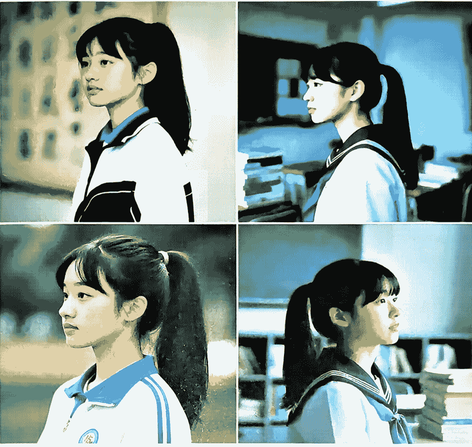

图 4-3 生成结果

面板中的其他 3 项功能都是为了辅助创作而设的。

其中，第一项“灵感向导”的作用是在内部调用文本生成大模型，以帮助创作者将一些简单的创意构建为更加合理的提示词（图 4-4）。

图 4-4 灵感向导模式

点击此项后会打开一个次级面板，排布情况大致与 DeepSeek 相同。灵感向导的输出格式被固定为提示词生成导向。在输入一些内容的时候，AI 会采取让 DeepSeek 提问的方式，先问用户一系列问题，再根据回答来决定提示词的内容。下面用一个例子来说明这个过程。

> 问：
一位 15 岁的女中学生，中国籍，性格严谨，高马尾。

灵感向导：
为了更精准地生成你想要的图片，我还想了解一些信息：这位女中学生处于什么样的场景中（如校园教室、操场、街道等），你希望图片呈现什么样的风格（如写实风、动漫风、水彩风等），使用什么样的镜头（近景、中景、全景等），营造怎样的氛围（活泼、安静、严肃等）呢？另外，图片的用途是什么，比如是作为插画、海报设计，还是其他用途？

> 问：
无背景图，动漫风，全景，严肃的氛围，用作人物设定。

灵感向导：
一位 15 岁中国籍高马尾性格严谨的女中学生，无背景，动漫风格，全景，严肃氛围，人物设定图。
你可以进一步明确女生的服饰、配饰细节，或者调整风格、氛围等方面的要求来优化生图效果。

梳理好提示词后，可以在对话框中直接将提示词转化为图片（图 4-5）。

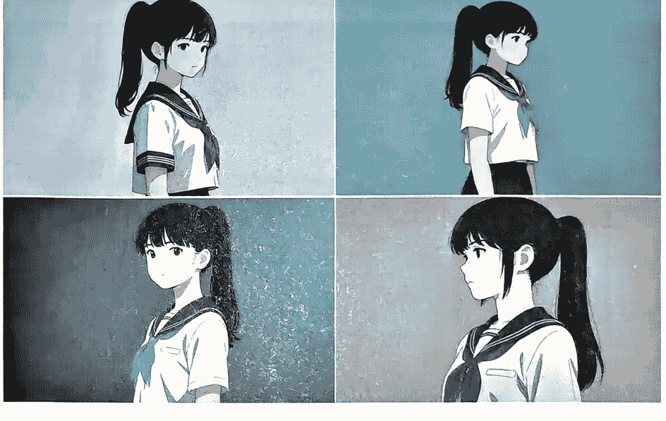

图 4-5 优化提示词后的生成结果

此时的生成结果会更加贴近创作本意。
第二项参考图机制会在后续内容中详细论述，它的作用是以参考图为基准生成新的图片，此处不再赘述。
第三项文字增强是一种对文字生成的补偿功能。在画面中生成文字是所有图片生成模型的短板，这是由模型的底层原理决定的。目前各模型平台的解决思路各不相同，“文字增强”便是即梦 AI 平台针对这一点的解决办法。

点击文字增强后，提示词输入框内会生成一对双引号，将需要呈现的文字输入到引号内之后，生成图片时，这些文字大概率能正确显示在画面中，具体例子见图 4-6。

> 提示词：
一位 15 岁中国籍高马尾性格严谨的女中学生，穿着现代中国校服。无背景，动漫风格，全景，严肃氛围，人物设定图。背景上写着角色的名字“李云夕”。

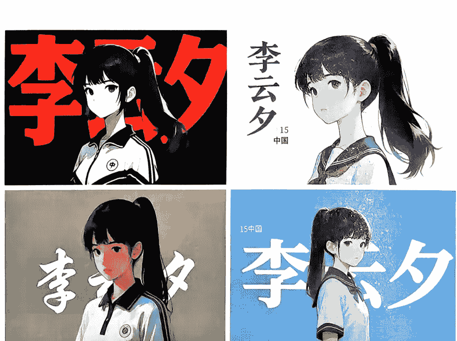

这些功能搭配起来就能比较好地完成生成任务。

###### 模型选择

提示词面板的下方是生图模型选择面板（图 4-7）。

图 4-7 模型选择

模型工具都是在不停迭代的，同一平台在多数情况下也会包含多个生图模型版本。一般来说，出于生成需求和生成资源花费的综合考量，平台会保留老版本模型，点击后可展开模型选择面板（图 4-8）。

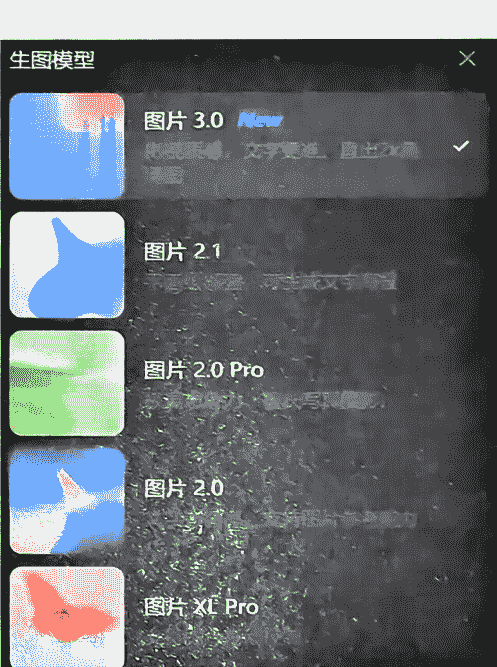

图 4-8 不同版本的生图模型

目前最新的生图模型为图片 3.0 版本，此版本多出了一项功能，即能输出 2K 清晰度的图片（图 4-9）。

图 4-9 图片 3.0 版本可以输出 2K 分辨率的图片

除了功能和性能有差距外，不同版本模型的生图风格取向也不尽相同。具体差别还要多试才能体会出来。

###### 图片比例

“图片比例”面板用来调节生成图片的宽高比。比较主流的宽高比是 16 : 9（长视频平台）和 9 : 16（短视频平台）。如果考虑后续需要裁切素材，也可以生成 1 : 1 的图片，这种比例在裁切的时候可以比较好地保留关键信息（图 4-10）。

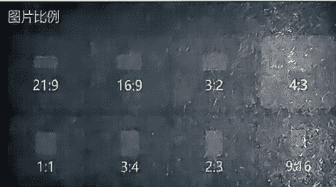

图 4-10 调整生图比例

创作者还可以在其下方的“图片尺寸”一项中自定义图片的大小和比例。如果不想使用固定比例，点击中间的锁扣按钮即可（图 4-11）。

图 4-11 图片尺寸自定义调整

##### 4.2.2 表情设定表

想要生成角色的表情设定表，需要使用上传“参考图”这一功能（图4-12）。

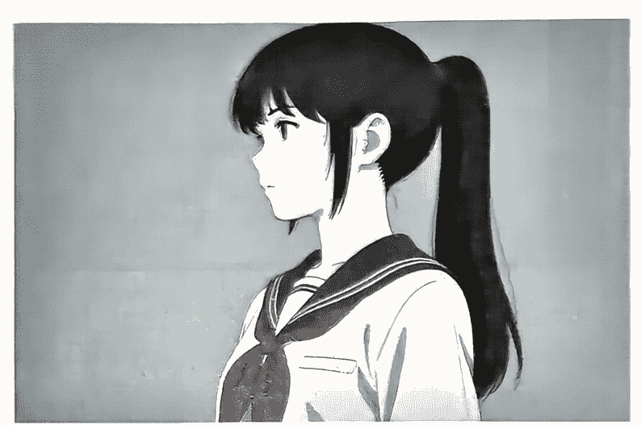

图4-12 参考图

参考图可视为生图的蓝本。在AI生成图片时，系统会根据设置将参考图的特定信息保留至新生成的图片中。这些信息可以涵盖角色外貌、画面风格，也可以是参考图中的场景、画面构图等内容。这种以提供参考模板为基础的生成方式，被称作“图生图”或“垫图”。用户点击提示词输入区域的“参考图导入”选项，即可上传本地图片作为参考图（图4-13）。

图4-13 点击进入参考图设置

成功导入参考图后界面如图 4-14 所示。

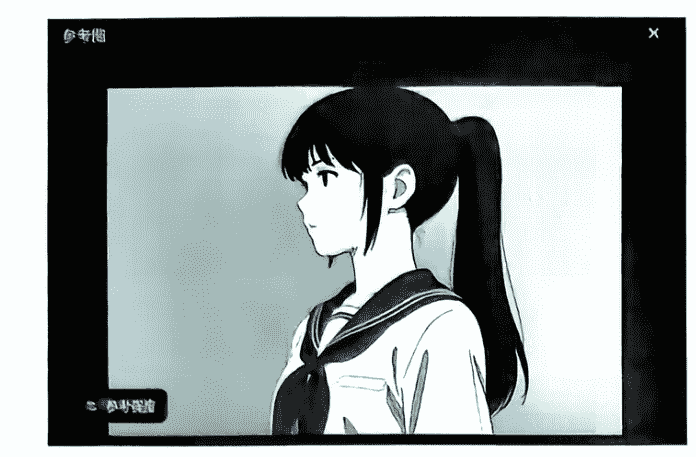

图 4-14 导入参考图

除此之外，还需对 AI 参考图片的具体部分进行设置（图 4-15）。通常情况下，选择“智能参考”即可满足需求。选择该选项时，AI 会依据后续输入的提示词，自动判断需要参考图片的具体内容，且判断的准确性较高。其他项目的针对性更强，但适用范围相对较窄。

图 4-15 不同的参考项

使用图生图的方式同样需要输入提示词，鉴于存在参考图，创作者需在提示词中明确指出所需参考的内容。加入图片参考后的提示词输入情况如图 4-16 所示。

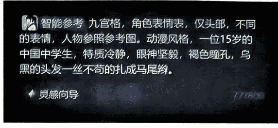

图 4-16 输入提示词

完成上述设置后，即可生成表情设定表（图 4-17）。

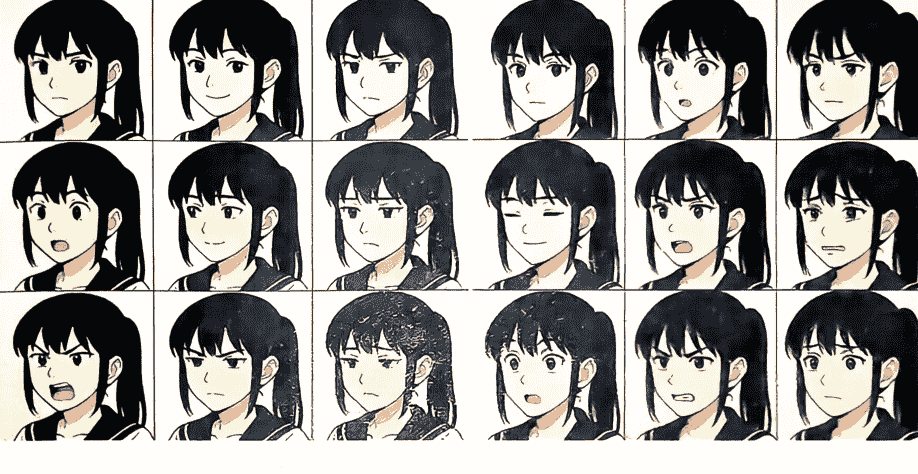

图 4-17 表情设定表生成结果

创作者可以使用相同的提示词多生成几次，这样得到的角色表情会更丰富。完成后建档存储，以备后用。

#### 4.3 生成三视图表

与表情设定表类似，角色的“三视图表”也是动画、漫画、游戏等视觉作品在角色设计阶段常用的一种基准图稿。它会把同一个角色在“正面”“侧面”“背面”3 个固定角度的外形一次性展现出来，在这张图里，人物的身高比例、头身比、服装层次、发型走向、配饰位置、色块分区乃至鞋底花纹都会被标注出来。在这里，三视图表的主要作用是为后续生成分镜帧提供角色参考，所以包含的内容不用这么详细。

下面用一个例子来展示三视图表的生成方法。生成角色的三视图表同样需要加入参考图，这里所用的参考图与上一节相同（图 4-18）。

> **提示词：**
一位黑发少女，高马尾配齐刘海，面容精致且坚毅，人物参照“人物参考图”。身穿一套以白色和天蓝色为主色调的现代中国校服，款式简约。用于动漫素材，动漫风格，展示全身，包含正面、侧面和背面三视图。

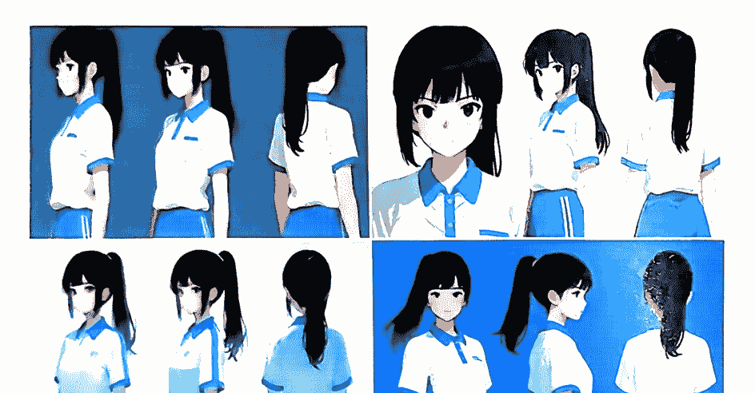

这里想要生成的是角色的校服三视图，这样在后续一些需要穿着校服的场景中，就可以用这张图的某一部分作为角色参考。从生成结果中挑选出比较优秀的一张进行存储（图 4-19）。

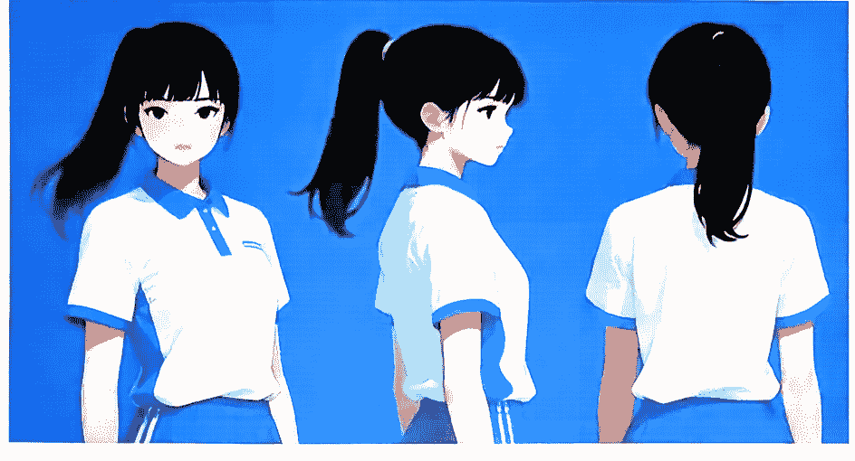

图 4-19 择优而取

这张角色三视图同样可以作为其他角色三视图的参考图来使用，这样还能保证所有角色的服装、画风都保持一致，可谓一举多得。生成时的示例提示词如图 4-20 所示。

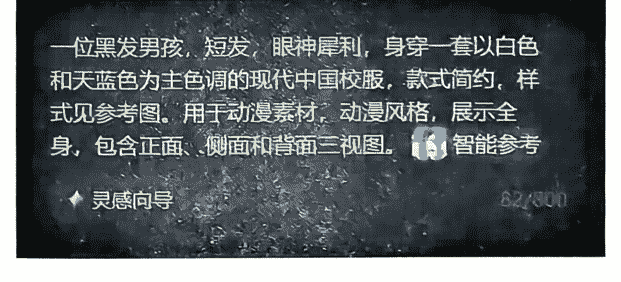

图 4-20 继续生成其他角色的示例提示词

在有参考图的情况下，生成的结果大体一致，但仍有些细节上的差异，因此从中选出服装差异最小的一张进行存档即可（图 4-21）。

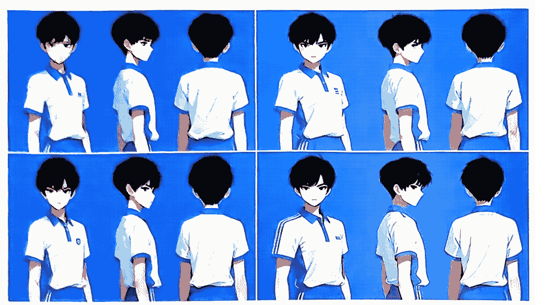

图 4-21 其他角色三视图生成结果

除了能够生成不同角色相同服装的三视图，还可以生成同一角色不同服装的三视图。下面的例子使用校服三视图作为参考图，提示词设计如图 4-22 所示。

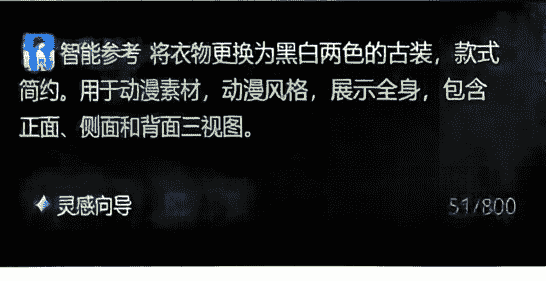

图 4-22 编写换衣提示词

生成结果如图 4-23 所示。

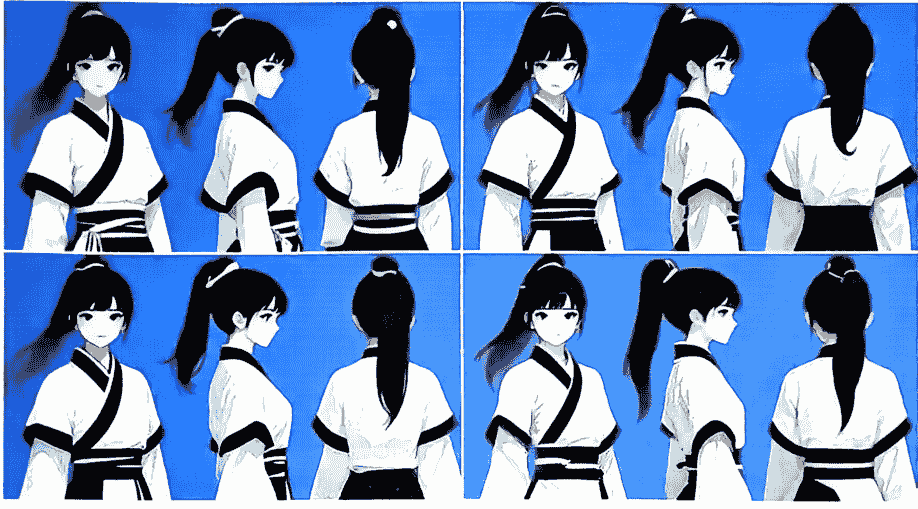

图 4-23 同一角色不同服装的三视图生成结果

按照相同的方法，为男性角色生成一组古装三视图（图 4-24）。

图 4-24 继续生成其他角色的古装三视图

生成结果如图 4-25 所示。

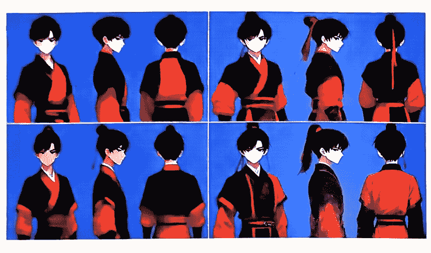

图 4-25 其他角色不同服装的三视图生成结果

这种循序渐进的生成方式，是制作动漫短剧人物的最优选择。

> ### AI 小贴士

在使用 AI 制作动漫短剧时，很多情况下都是从传统制作方式吸取经验，然后从它的工作流程中省略不必要的步骤，提炼出适合自己的创作体系。

以角色设定为例，传统流程中的这一步有很多项目，如动作 / 姿态设定、颜色设定等。而配合 AI 工具的特性，有很多创作内容都可以化繁为简。

#### 4.4 道具设计

在 AI 动漫短剧创作中，道具设计应尽量规避，若非必要，切勿增设实体。原因在于为了保持角色与场景的一致性，已经消耗掉大量的生成次数，若再加上道具，生成次数还会进一步增加。

若存在需在多个场景中出现的重要道具，其设计应尽可能简洁，最好在创作分镜时能直接通过提示词生成。比如，示例系列剧所用到的“度界仪”这一道具，应尽量进行简单设计，否则运用图生图进行融合将极为烦琐。此处仅生成一张道具参考图，在实际分镜中，仍应尽量借助提示词生成道具（图 4-26）。当然，使用 Photoshop（PS）类软件将道具融入分镜首尾帧也是一种可行的处理方式。

> 提示词：
圆形金属球，光滑，铜色。

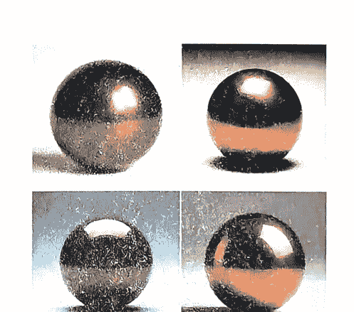

图 4-26 生成道具参考图

假设创作者想让角色捧起这颗“铜球”，该怎么做呢？
首先，将原始的三视图作为参考图输入给 AI（图 4-27）。

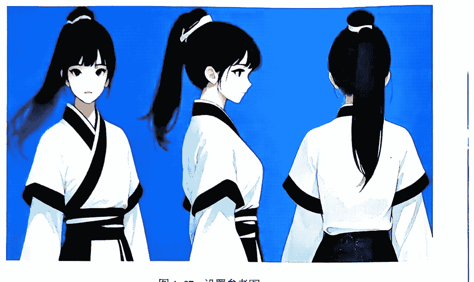

图 4-27 设置参考图

其次，输入下面的提示词进行生成（图 4-28）。

> 提示词：
参考图是一名角色的三视图，请让其手捧一枚光滑、铜色的圆形金属球。

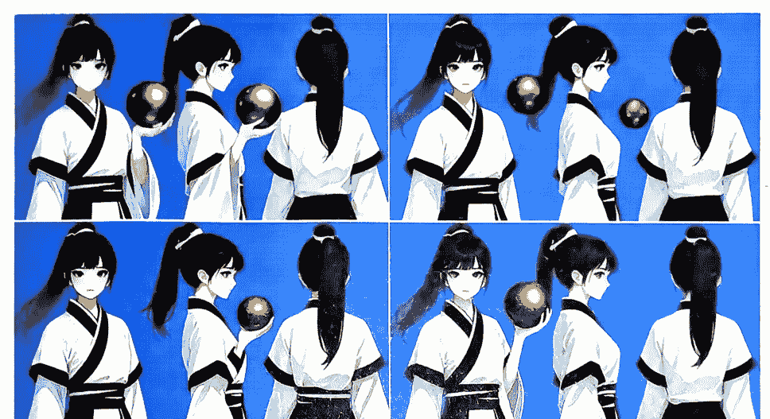

图 4-28 角色手捧“铜球”生成结果

在软件生成结果中，最契合需求的为图 4-29 所呈现的设计。然而，其中角色的手形存在问题，若要修正这一问题，有两种可行方法。

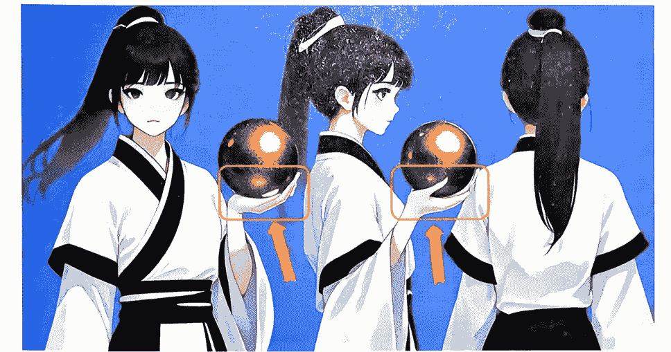

图 4-29 手型问题

##### 局部重绘

在生成结果中点击需要修改的图片进入编辑页面，点击“局部重绘”编辑项，此功能允许创作者在已生成的图片上进行局部修改（图 4-30）。

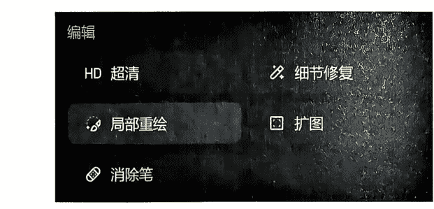

图 4-30 局部重绘

点击后即可进入修改页面（图 4-31）。这里通过鼠标涂抹选中相关区域，在界面左下方可以调整笔刷的粗细。

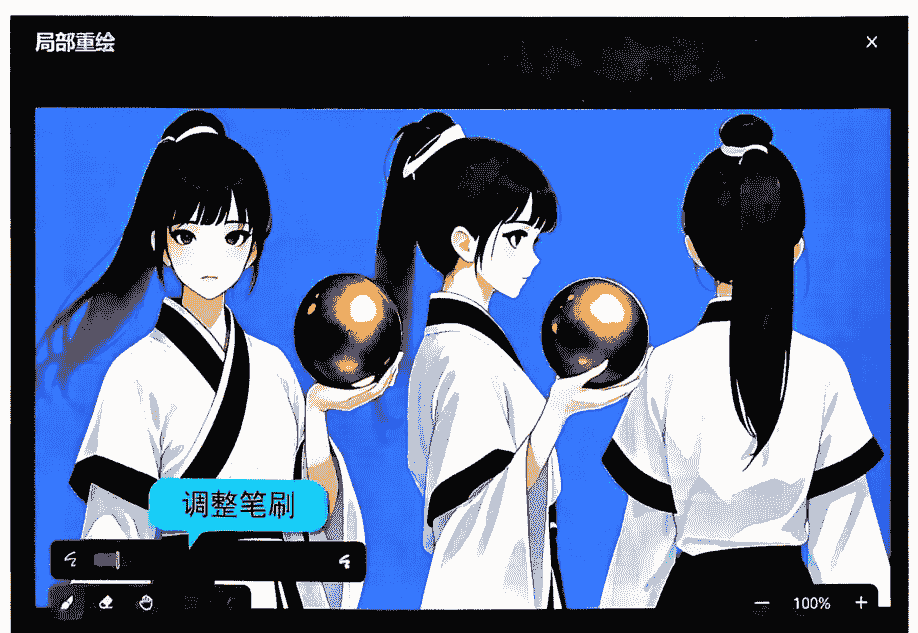

图 4-31 修改页面

涂抹后的效果如图 4-32 所示。

图 4-32 涂抹需要修改的区域

若想要修改原生成内容，可以在下方的提示词输入区域填写新的提示词，这样 AI 就会按照新的提示词来填充画面（图 4-33）。

图 4-33 提示词输入框

如果没有大的改动，只是进行修复，则不需要输入提示词，AI 在默认情况下会按照原提示词填充涂抹部分。然后点击“立即生成”即可进行修复。

##### 细节修复

另外一种方法是使用编辑面板中的“细节修复”功能（图 4-34）。

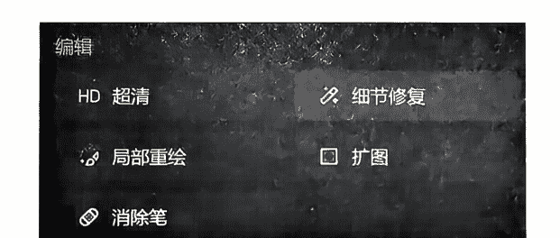

图 4-34 细节修复

点击细节修复后，AI 会自动查看图片中存在的细节问题，并尝试修复，所以创作者不必再去涂抹修复内容。

以图 4-29 这张图来说，点击细节修复，AI 会自动修复手形问题（图 4-35）。

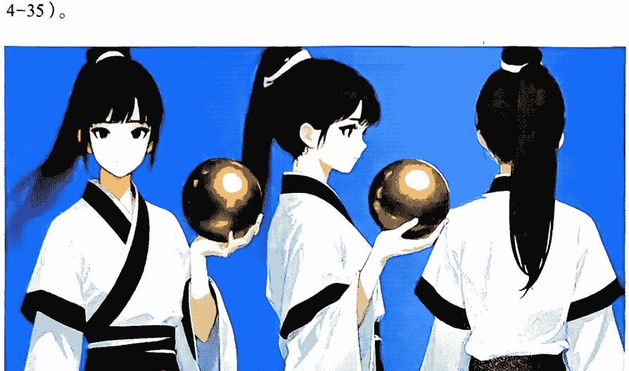

图 4-35 修复结果

但是使用“细节修复”可能会带来新的问题，比如图 4-35，虽然手形的问题解决了，但是修复后的图片清晰度却大幅下降。

要想解决这一问题，只需提升图片的清晰度即可。点击编辑选项中的“超清”，AI 会自动提升图片的清晰度（图 4-36）。

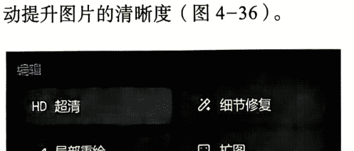

图 4-36 使用超清修复

提升后的效果如图 4-37 所示。

## AI 小贴士

AI 工具也存在着能力的边界。使用 AI 并不是“我要什么，你给什么”这么简单，这个过程也是对这条边界的探索过程。什么样的要求可以实现，什么样的要求可以换一种路径实现，这是需要创作者研究的问题。在触达 AI 能力边界后，想要再往前一步，可能需要花费数倍的时间与精力，这对于动漫短剧创作来说，已经是一件得不偿失的事。在工具能力未得到较大提升之前，最好是简化创作需求，让内容回归到 AI 的能力边界之内。

### 第 5 章 场景设计

场景是故事的发生地。在场景设定及分镜表中已经完成了对场景的文字描述，这里则需要从文字中提取出场景的具体特征，然后用 AI 将文字转化为场景设计图。

#### 5.1 提取场景特征

首先，让 DeepSeek 从分镜脚本中分离出场景与角色描写。

> 问：
请从下面的分镜头脚本中分别提取出场景描绘与角色描绘两个部分。
“近景俯拍，斜俯角锁定画面中心；摄影采用 50 mm 定焦，F4.0，1/48 s，ISO 320。镜头在 4 秒内做极轻微前推 10 cm，制造情绪逼近。画面所在环境为山林深处一片空地，落日透过稀疏松枝洒在地面，色温约 4300K，偏暖金橘。主光为右后方低角度夕阳，勾出人物肩颈暖色轮廓；地面散落细沙与落叶，被斜光照出金粉般的尘粒漂浮。景深浅，背景树干与藤蔓被压成柔焦。画面中央，古装少女瘫坐于地面，双膝弯曲，指尖死死抓住裙摆；眉心深锁，唇泛苍白，痛苦与隐忍交织。汗水与泪珠沿鬓发滑落，在暖光里高亮闪烁。环境声：山风掠过松针沙沙、远处石块偶尔滚落、间或虫鸣；加贴胸麦采集急促呼吸与喉间细碎哽咽。无配乐，仅低频风噪与心跳声渲染空旷。镜头末端对泪珠做呼吸式拉微焦，折射夕阳爆出一点金光，随后硬切至下一镜。”

DeepSeek：

1. 场景描绘

近景俯拍，45° 斜俯角固定画面中心，特写，50 mm 定焦、F4.0、1/48 s、ISO 320。镜头 4 秒内前推约 10 cm，营造逼近感。地点为山林深处一片空地，落日透过稀疏松枝洒下暖橘 4300 K 光线；右后方低角度夕阳勾勒暖色轮廓。地面散布细沙与落叶，斜光中尘粒漂浮闪烁。景深浅，背景树干与藤蔓成为柔焦。环境声有山风掠过松针、远处碎石滚落与零星虫鸣，低频风噪与人物心跳声营造空旷氛围。

2. 角色描绘

画面中央的古装少女瘫坐在地面，双膝弯曲，指尖紧抓黛色裙摆。眉心深锁，唇色发白，痛苦与隐忍交织。汗水与泪珠顺鬓而下，在暖光中高亮闪耀。呼吸急促、喉间哽咽清晰可闻；镜头末端拉微焦对准泪珠，折射夕阳迸出金光后切至下一镜。

这里的角色描绘同样需要保存起来，用于后续关键帧生成。

接下来进一步压缩场景描述，将其简化为提示词。

问：

请进一步简化场景描绘，删去多余的细节，只留一句话，使其适合用作动漫短剧的场景生成提示词。

DeepSeek：

简化后适用于图片生成的提示词：

> 山林深处一片空地，落日透过稀疏松枝洒向地面，傍晚时分，平拍视角，特写，动漫风格，清新氛围，暖色调。

缩减后的提示词就可以用来生成场景图了。

#### 5.2 生成具体的分镜场景

将 DeepSeek 的回答作为提示词输入，生成效果见图 5-1。

> 提示词：
山林深处一片空地，落日透过稀疏松枝洒向地面，傍晚时分，平拍视角，远景，动漫风格，清新氛围，暖色调。

为了提高生成场景的复用次数，特将“特写”这一关键词改为了“远景”，然后将生成的场景进行裁切处理，所得结果用作第一个镜头的场景。

裁剪后的场景如图 5-2 所示。

像这种需要裁切复用的素材，在生成时便应直接选择高清生成，这样才能在裁切后依然保持分辨率够用（图 5-3）。

需要注意的是，编辑面板中的“超清”功能提升的只是画面的清晰程度，并不是图片的分辨率（图 5-4）。所以生成后的图片是无法使用这项功能提升分辨率的。

## AI 小贴士

复用素材是一个有效的技巧，也是业内的通用做法。除了减少素材的生成次数外，也能更好地维持场景的一致性。比如，这一节的示例，从近景镜头 1 切换到远景镜头 2 的场景时，由于用的是相同的素材，所以不用考虑穿帮的问题。

### 第 6 章 绘制关键帧

本章主题聚焦于“融合”。在前述章节中，已分别生成了人物素材和场景素材，在此基础上，需将这些素材融合到一起，制作出分镜头生成所需要的一些关键帧。

#### 6.1 分析镜头起始的人物动作

首先从分镜头的内容设计中提取出人物的初始动作，这是为了给首帧生成做准备，比如下面这段内容。

> 白光闪过，李云夕来到了一个陌生的地方。周围是险峻的高山和茂密的树林，李云夕掉落在树林中的一片空地上。
>
> 李云夕明显摔疼了，龇牙咧嘴地，一边揉着腿，嘴里一边嘟囔着：“好痛！”她似乎注意到了周围的情况：“这里是哪里？怎么一个人都没有？”说着便慢慢站起身，慌张地朝四周张望起来。
>
> 天色逐渐暗了下去，李云夕依然没有发现其他人的身影。

对 DeepSeek 进行提问，让其帮助提取提示词。

> 问：
下面是动漫短剧中某个分镜头的内容设计，我需要你提炼出其中第一帧的人物动作。仅人物动作即可，不要描写环境，且文字要尽可能简练。

DeepSeek：
李云夕坐在地上，双手轻抚双腿，表情痛苦。

有了人物的初始动作，接下来开始分层实现分镜的首帧场景。

## AI 小贴士

使用 AI 工具的制作方式，对“关键帧”的需求是不一样的。在传统动漫制作中，“关键帧”是动作的支点，用来描述动作或镜头中最重要、最具代表性的瞬间的一组画面，决定了动作发生的主要时间点（起势、高潮、收势），从而定义了节奏、表演张力与情绪。在 AI 加持下的流程中，关键帧被简化为首尾两帧（有时候仅需要首帧即可），即一个镜头的起始画面及结束画面，中间过程则由视频生成 AI 来填充。所以在融合素材的时候，一个镜头最多只需要制作两帧画面就足够了。

#### 6.2 制作人物动作

这里要用到角色的三视图作为参考图，但是不能用整张，因此需要将其中贴近角色动作的一个视图裁切下来。下面的示例选择的是人物的侧面图（图 6-1）。

此外，还需要将比较接近的表情参考图裁切下来，作为首帧角色的表情参考（图 6-2）。

下面按照以下方式设计提示词（图 6-3）。

> 提示词：
无背景图，斜 45 度视角，远景，全身，一名古装 15 岁女性【参考图一，智能参考】摔了一跤坐在地上，表情痛苦【参考图二，智能参考】。

由于使用智能参考时不能更改图片比例，所以生成的图片与裁切的人物侧面参考图一致。这一点后面再进行调整，先挑出比较合适的一张，这里选择的是第二张（图 6-4）。

但是这张图片仍存在很多问题，如左手的位置及右臂的长度。接下来将这些部位进行重绘，选择的范围可以大一些（图 6-5）。

重绘结果如图 6-6 所示。

经过数次迭代之后，便能得到比较令人满意的人物动作图（图 6-7）。

#### 6.3 扩图

此时虽然图片已经没有问题了，但它是不完整的，没有露出人物的全貌，因此可以使用编辑面板中的“扩图功能”，让 AI 生成人物的完整形态（图 6-8）。

点击“扩图”，进入扩图设置界面（图 6-9）。

中间被框起来的黑灰格区域是画布，其展示的便是扩图后的图片大小，在面板下方可以调整画布比例（图 6-10）。

为了能够展示人物的全貌，这里用默认的 1 : 1 比例。下方的提示词窗口不要空着，把原提示词中剔除掉的参考图的部分输入进去，这样能保证 AI 不会在画面中乱加内容（图 6-11）。

> 提示词：
无背景图，斜 45 度视角，远景，全身，一名古装 15 岁女性摔了一跤坐在地上，表情痛苦。

至此，便得到了完整的人物姿态。

#### 6.4 人物抠图

生成完整的人物姿态后，为便于后续的融合作业，需将人物从背景中抠出来，制作成无背景图。本节将运用即梦 AI 的另一个功能——智能画布（图 6-12）。

智能画布的入口在即梦的首页，图片生成入口的右边。点击进入后，是一块 1024 × 1024 大小的画布（图 6-13）。

在该操作界面虽然可进行一些简单的文生图或图生图操作，但并不推荐使用此方式。由于该界面提供的生图选项有限，建议先于图片生成模块生成所需素材，再将其导入此界面进行处理。

具体操作如下：点击界面左侧的“上传图片”，上传之前扩图处理后的成果图片，上传成功后，图片将自动显示在画布内（图 6-14）。

图片上方的工具栏罗列了主要的功能选项，最后一项为“智能抠图”（图 6-15）。

点击智能抠图工具图标，系统开始自动识别画面中需要抠出的部分（通常默认是人物），进入等待时间（图 6-16）。

计算完成后，画面中的主体会被灰白格子涂抹标识（图 6-17）。

点击“抠图”，被标记的部分就会被成功抠出（图 6-18）。

确认无误后，点击“完成编辑”，即可保存抠图结果。图片背景越干净，AI 抠图的成功率越高。这也是在提示词中加入“无背景”这一关键词的原因。虽然 AI 给出真正无背景的情况很少，但是在这一关键词的约束下，即便是有背景、基本上也是纯色背景，这同样能够降低抠图难度。

## AI 小贴士

制作方式需与制作需求相适配。将素材生成过程拆解为多个步骤，其核心目的在于最大限度地保证生成结果的可控性，即前文提及的“一致性”。而具体采用何种制作流程，取决于创作者对自身作品的规划。如果创作者对最终成片质量要求相对较低，可采用较为粗放的制作方式，即不纠结于细节把控，仅依据人物参考图并搭配提示词来生成首尾帧画面。

#### 6.5 素材融合

本节将进行角色与场景的融合操作。首先上传分镜场景图（图 6-19）。

此时场景图片遮挡住了角色，为了让人物处于最上层，需要调整图层的顺序。

在画布右方可以查看目前画布上有几个图层，排位越靠前的图层，显示的优先级越高（图 6-20）。

选中人物图层，点击右侧的“…”，会弹出不同的图层设置（图 6-21）。

在“图层顺序”选项中，将图层置顶（或者选中场景图层向下移也是一样的效果），这样人物就会来到场景的上方（图 6-22）。

接下来调整人物比例，将其放置在合适的场景位置中（图 6-23）。

调整完后不必着急融合，图片的大小是根据画布大小生成的，如果不调整，那么场景与画布之间空白的部分就会被填充无法预判的内容。调整方式依然是在画布设置中（图 6-24）。

点击“画板适应图层”，此时的画布就会缩小为场景图片的大小（图 6-25）。

调整完后，选中人物图层，点击上方工具栏的第二项，即可融合人物与场景素材（图 6-26）。

此时，人物图层会成为前景图层，创作者还需选择场景图，将其作为背景图层（图 6-27）。

选择完后，在下方可以调节前景图层的保持程度，设置得越高，融合后前景的改变程度就越低。本书推荐将保持度拉至最高，否则人物的一致性很容易出问题（图 6-28）。

各项都调整完后，即可将这两种素材融合到一张图片中了（图 6-29）。

这样就完成了一个分镜中的首帧画面。

#### 6.6 简化版的素材融合

素材融合还有一种更简便的处理方法。观察图 6-27 可见，起始画面所呈现的效果已基本达到预期。因此，若对最终效果要求不高，可省略素材最终融合步骤，直接将人物从背景中单独抠出，借助如 PS 等图像处理软件，将其与场景简单叠加起来，然后导出为首尾帧。

虽然使用这种方式制作的画面，人物角色与场景之间的协调性会受到一定影响，但是该方法操作简单，不会产生废片，且能应用于一些复杂场景的制作，如多角色场景。

首先，挑选所需角色的三视图，并将其进行水平翻转（图 6-30）。

截取要用的角色参考（图 6-31）。

将其作为参考图上传给 AI，使用提示词生成人物动作图（图 6-32）。

> 提示词：
无背景图，远景，全身，一名古装 15 岁男性【角色参考图，智能参考】单膝跪地，皱眉【表情参考图，智能参考】。

抠除背景（图 6-33）。

点击画布上方工具栏中的“扩图”（图 6-34）。

选择比例为 1 : 1，并将范围扩大，要能放下角色的全身（图 6-35）。

扩图完成后的结果如图 6-36 所示。

导出素材，在 PS 类软件中将所有人物素材分为不同的图层，放置在场景素材图层上（图 6-37）。

## 第 7 章
### 视频素材制作

在素材制作阶段的最终环节，所生成的内容已能用于剪辑流程。在此阶段，除了将前面生成的首尾帧素材转化为动态视频素材外，还需统筹规划动漫短剧中的配音与配乐。

#### 7.1 文生视频简介

文生视频是指使用提示词生成视频。在动漫短剧制作过程中，该功能应用得较少，这是因为创作者在应用这一功能时需着重考虑视频内容的一致性问题，因此业界通常使用已制作完成的图片素材来生成视频素材。

然而，文生视频作为 AI 视频生成工具的重要构成部分，其部分功能在图生视频环节仍具有一定的应用价值。鉴于此，本节将对文生视频功能进行简要介绍。

##### 7.1.1 切换模型

进入首页后，点击左上方的“立即体验”，进入创作面板（图 7-1）。

图 7-1 可灵首页入口

进入创作面板后，在界面的左上方可以切换要使用的视频生成模型（图 7-2）。

图 7-2 切换模型

与图片生成模型类似，视频生成模型也分为不同的版本，每个版本之间除了有性能差异外，支持的功能也不尽相同（图 7-3）。

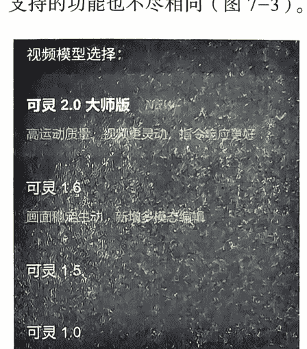

图 7-3 不同的模型版本

目前最新的模型版本是可灵 2.0 大师版，该版本也是系统默认模型。可灵 1.6 版本虽然生成能力稍差，但其支持的功能比较全。这两个版本的使用频率是最高的。

模型选择的下方是主要的视频生成参数调整区域，用户可在此切换不同的视频生成方式（图 7-4）。

图 7-4 切换生成方式

##### 7.1.2 创意描述

文生视频左上方的面板是创意描述面板（图 7-5）。下面将从四个部分对创意描述区域展开阐述。

###### 提示词输入区域

该输入框用于录入提示词。
进行视频生成时，提示词需清晰阐述以下内容：
谁（角色）在什么地方（场景设定）在做什么事情（动作与因果），画面采用什么样的风格，角色与镜头的关系（中、近、远景，是否使用特写镜头，俯仰视角），镜头如何移动。

（1）角色：即视频中的主体是谁，包括外貌、年龄、身份与情绪状态等。例如：

> 一位身穿复古夹克、约 25 岁的女性。

（2）场景设定：用富有画面感的描述点明地点、时代与氛围。例如：

傍晚的公园，她坐在长凳上。

（3）动作与因果：描述角色正在做什么，以及动作之间的逻辑衔接，帮助模型理解连贯的剧情。例如：

眼睛盯着远处的夕阳，然后扭过脸来盯着镜头。

（4）画面风格：指定整体视觉语言、色调、材质、光影、后期处理等。例如：

画面呈 20 世纪 80 年代赛博怀旧胶片质感，颗粒感轻微，晚霞高饱和但略带噪点。

（5）镜头语言：说明角色与镜头的距离、视角以及镜头运动方式。例如：

开场使用中景平视镜头，最后镜头升高 45° 俯视，缓慢向后拉出。

把这五项串成自然段，即可得到一条完整的视频生成提示词。输入提示词后，点击“立即生成”即可生成视频（图 7-6）。

图 7-6 生成结果

与图片生成提示词相比，视频生成提示词多了“时间”和“运动”这两个维度。创作者不仅要告诉模型“这一帧长什么样”，还要说明“接下来的每一帧如何变化、镜头怎样运动、动作之间的逻辑如何连贯”。而图片生成关注的是单帧静态构图与美学呈现，无须叙事化的动作链与镜头轨迹。

###### 调用 DeepSeek

此功能与即梦 AI 的“灵感向导”相似，也是通过调用第三方文本生成模型，帮助梳理提示词（图 7-7）。

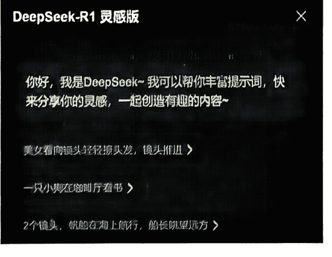

图 7-7 在可灵内部调用 DeepSeek

比如，将刚才的提示词输入给 DeepSeek，它能自动为提示词增改细节，使其更符合视频生成模型对提示词的理解逻辑。

> 问：
一位身穿复古夹克、约 25 岁的女性。傍晚的公园，她坐在长凳上。眼睛盯着远处的夕阳，然后扭过脸来盯着镜头。画面呈 20 世纪 80 年代赛博怀旧胶片质感，颗粒感轻微，晚霞高饱和但略带噪点。开场使用中景平视镜头，最后镜头升高 45° 俯视，缓慢向后拉出。

DeepSeek：
一位身穿复古夹克的年轻女性坐在公园长凳上，中景平视展现她凝视夕阳的侧脸，背景枫树叶片泛着橙红光泽，路灯在暮色中泛起柔和光晕，画面呈现轻微颗粒的赛博胶片质感。
她突然扭脸直视镜头，特写捕捉到眼中映着霞光的细微颤动，夹克领口金属装饰反射着高饱和晚霞，远处游乐设施轮廓在逆光中化为剪影，手持镜头轻微晃动增强临场感。

使用 AI 调整过的提示词，生成效果也会更出色（图 7-8）。

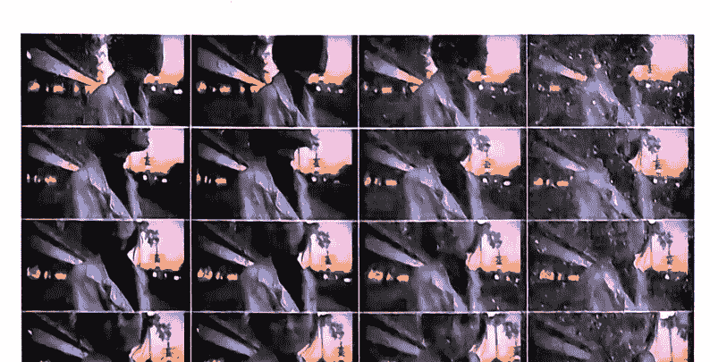

###### 词库与预设

“词库”是系统预先设定的固定提示词组合，借助系统词库能够便捷地控制视频生成效果。将鼠标悬停于不同的预设词上，可以预览具体的生成效果（图 7-9）。

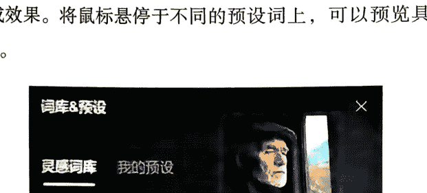

图 7-9 系统词库

系统词库分为五大类，具体内容见表 7-1。

表 7-1 系统词库内容

| 类别 | 预设词 |
| :--- | :--- |
| 镜头 | 围绕主体运镜、固定镜头、手持镜头、镜头拉远、镜头推进、镜头跟随 |
| 景别 | 近景、远景、仰视、俯视、景深、正面视角、特写、无人机拍摄 |
| 光影（多选） | 阳光、灯光、柔和光、霓虹光、暖光、自然光、烛光、城市夜景 |
| 画面（多选） | 细节丰富、背景简约 |
| 氛围（多选） | 神秘、宁静、温馨、生动、色彩艳丽 |

点击预设词后，该预设词将被添加至提示词中。比如，在提示词的特定位置点击“城市夜景”，添加后的效果如图 7-10 所示。

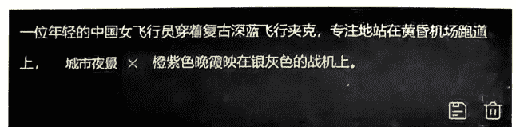

图 7-10 添加“城市夜景”

镜头、景别等类别的关键词还带有下拉菜单，可以随时调整更换（图 7-11）。

图 7-11 可调整的预设词

除了系统词库，创作者也可以在“我的预设”中自定义一些预设词（图 7-12）。

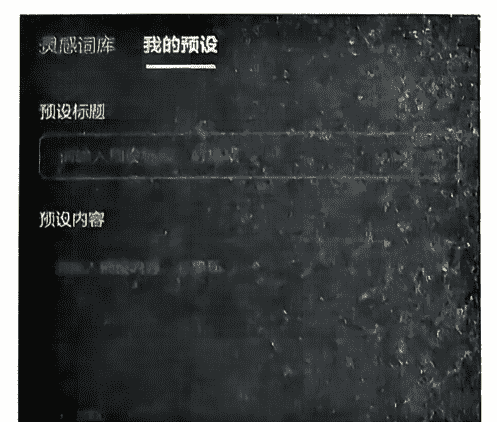

图 7-12 自定义预设词

其中的“预设标题”即预设词，“预设内容”即预设词所代表的含义，设置完成后点击“保存预设”即可。

###### 提示词推荐

此部分展示的是系统推荐的提示词模板，在缺乏生成思路时可作为参考。比如，点击“跳舞熊猫”选项，系统会将预设的提示词填入输入区域（图 7-13）。

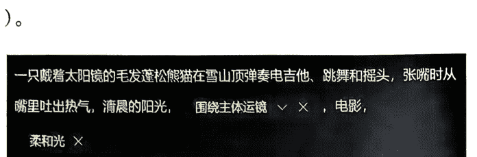

推荐提示词中也会包含一些词库内容，创作者可以参考这些词条在提示词中所出现的位置。

##### 7.1.3 不希望呈现的内容

该选项实际对应“反向提示词”功能，熟悉 Stable Diffusion 等模型的读者对这一功能应较为了解（图 7-14）。

通常输入至 AI 以生成相关内容的提示词，从分类角度属于“正向提示词”，其作用是告知 AI 生成结果应“包含”哪些内容。与之相反，反向提示词的作用是告知 AI 生成结果中需“排除”哪些内容。

反向提示词也可设置自定义预设词，用于快速排除视频素材中不期望出现的内容。点击面板右上方的“我的预设”即可进行设置（图 7-15）。

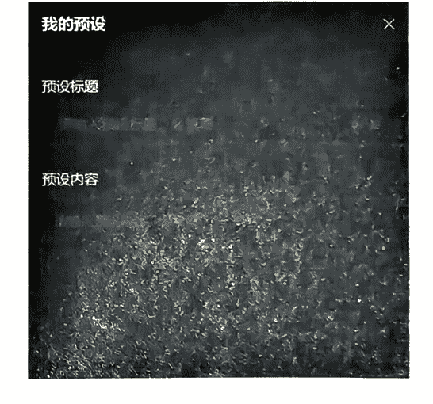

图 7-15 反向预设词的填写面板

##### 7.1.4 其他参数设置

除了上面这些项目，控制区域的下方还有一些额外的参数设置项（图 7-16）。

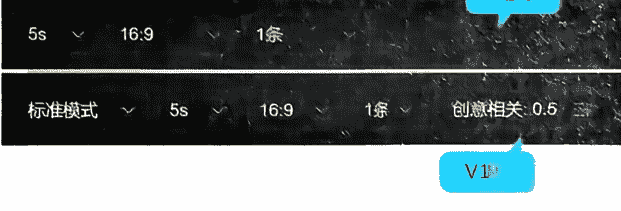

图 7-16 其他参数设置

不同版本的模型，所能设置的项目也不同。在图 7-16 中，上方是 2.0 版本的设置项，下方是 1.6 版本的设置项。

###### 模式选择

1.6 版本的模型可以选择是否使用高品质生成模式（图 7-17）。

图 7-17 切换两种模式

高品质模式可实现更好的生成效果，但所需的生成点数成本相对较高。

###### 生成时长

两个版本的模型都可以选择生成视频的总时长（图 7-18）。

图 7-18 选择生成视频时长

目前只能选择 5 秒或 10 秒。

###### 视频宽高比

两个版本的模型总共可以选择 16 : 9、9 : 16 和 1 : 1 三种宽高比（图 7-19）。

图 7-19 选择生成视频宽高比

前两种分别是长视频平台和短视频平台的常用宽高比，1 : 1 的宽高比则比较方便后期对视频进行裁切。

###### 生成条数

两个版本的模型可以选择一次生成几条视频（图 7-20）。

图 7-20 选择条数

一般而言，图片生成默认一次生成 4 张图片，但视频生成的资源消耗要远高于图片生成，单次生成的成本会比较高，所以默认的单次生成条数都是 1 条。

###### 创意相关

“创意相关”选项调整的是 AI 在生成内容时的自由发挥程度（图 7-21）。越靠近“创意想象力”，AI 的发挥空间越大；反之，越靠近“创意相关性”，生成的内容就会越靠近提示词的本义。

图 7-21 创意相关性调整

#### 7.2 利用首尾帧生成视频片段

除了文生视频，视频生成也有图生视频模式，其中较常用的是首尾帧生成模式。

##### 7.2.1 首尾帧设置

进入图生视频模块，设置区域的第一个面板便是首尾帧设置（图 7-22）。

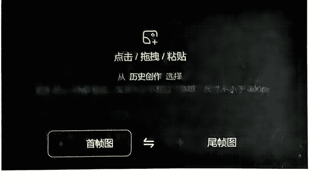

在首尾帧设置面板中，创作者可上传本地的首尾帧图片，上传后的效果如图 7-23 所示。

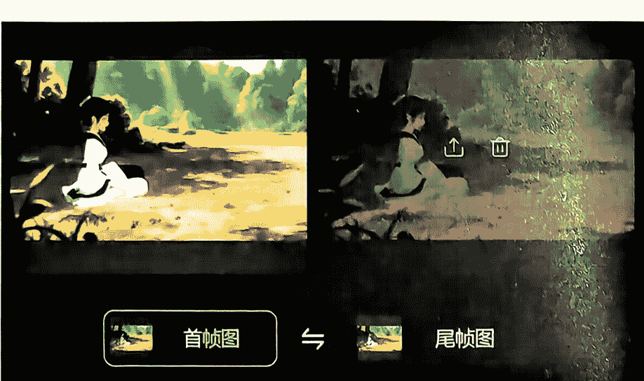

如果首尾帧使用相同的照片，场景将固定，创作者可聚焦于指定场景中角色与环境的变化情况。

> AI 小贴士
在部分情形下，无须上传完整的首尾帧图片，仅上传首帧图或尾帧图也可以。
若仅提供首帧图，AI 将基于此推测后续画面的发展；若仅提供尾帧图，AI 则会反向推测此前的情节，并使整个画面在尾帧处收束。

##### 7.2.2 提示词编写

图生视频同样有创意描述区域，用于录入提示词（图 7-24）。

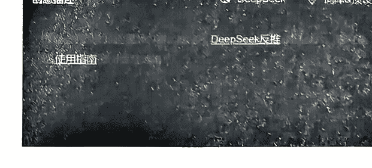

图生视频的功能与文生视频大致相同，但在提示词编写方面存在一定差异。由于视频首帧已固定，视频素材中的角色、风格和场景均有既定模板，因此无须进行详细描述。提示词编写应聚焦于描述角色运动和镜头移动等方面。

以该示例为例，可按图 7-25 所示设计提示词。

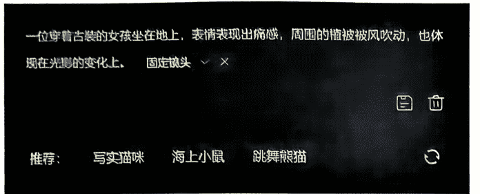

图 7-25 图生视频提示词设计

这个镜头讲的是角色刚进入神话世界时因摔倒而感到疼痛的状态，此时无须设计大幅度动作，所以在设计提示词时，应着重描述周围环境的动态变化及角色表情的细微变化。

上传首尾帧图片并完成提示词编写后，即可生成视频（图 7-26）。

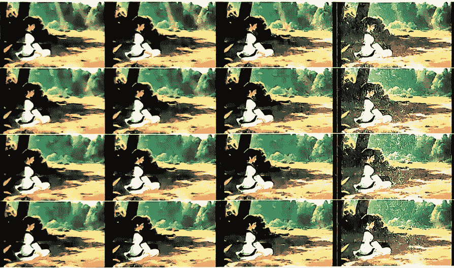

图 7-26 视频生成结果

##### 7.2.3 运动笔刷

如果仅依靠提示词未能达到预期效果，则可以使用“运动笔刷”精确指导角色动作。但需注意的是，运动笔刷和运镜控制功能相互排斥，不能同时使用（图 7-27）。

图 7-27 运动笔刷

点击进入笔刷控制页面。界面右侧设有运动区域及轨迹的管理面板，系统最多支持划分 6 个区域（图 7-28）。

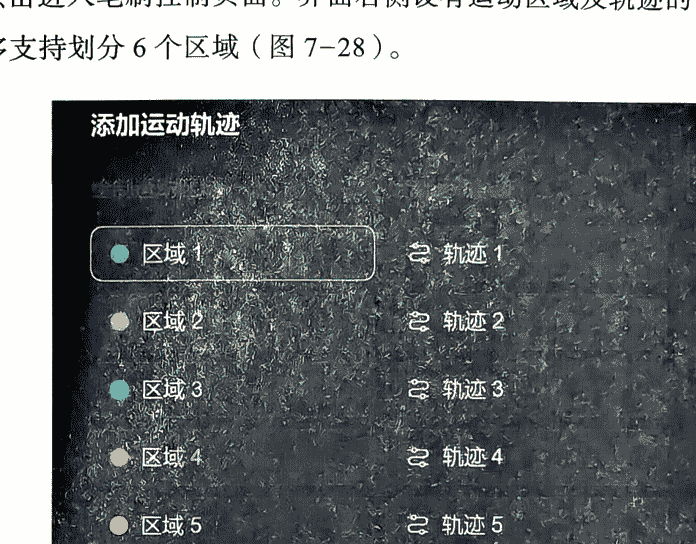

图 7-28 运动区域和轨迹管理

所谓运动区域，是指在视频中可视为一个整体进行运动的区域。选中“区域 1”后，在左侧的操作面板使用画笔涂抹出一个运动区域。此处选取人物头部作为一个整体运动区域（图 7-29）。

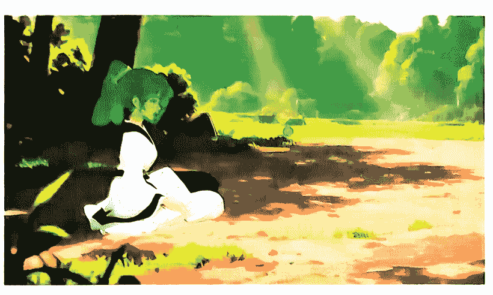

图 7-29 选择运动区域

涂抹完成后，在管理面板中选中“轨迹 1”，即可绘制此区域的运动轨迹（图 7-30）。

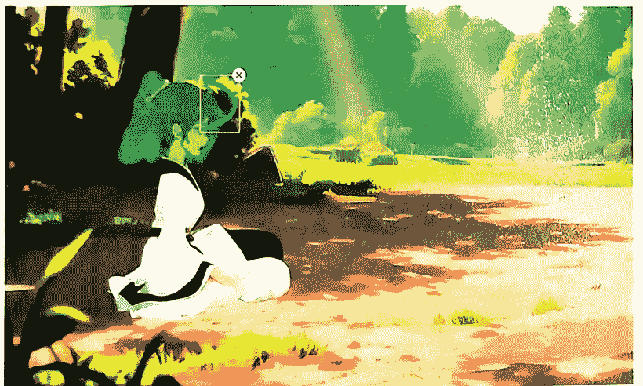

图 7-30 绘制运动轨迹

按照这条轨迹，视频中人物的头部会逆时针转动。
此外，还有一种更为便捷的区域选择方式，即开启界面顶部的“自动检测区域”开关（图 7-31）。

图 7-31 自动检测区域开关

这样，系统便会根据点击的位置自动判断需要涂抹的区域。在边缘判断上，系统要比人工涂抹更精确，之后只需要人工对某些瑕疵部分进行填补即可（图 7-32）。

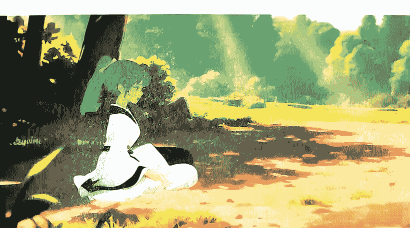

图 7-32 自动判断涂抹位置

按照相同的方法，将画面中物体的运动轨迹一一标记出来（图 7-33）。

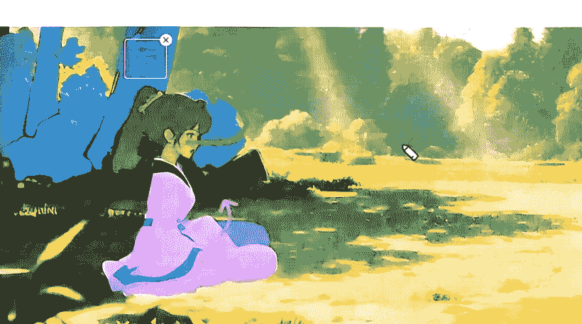

图 7-33 涂抹并绘制运动轨迹

如果场景中某些部分需要保持静止，则可以使用管理面板下方的“添加静止区域”进行设置（图 7-34）。

图 7-34 添加静止区域功能

点击后，选择需要保持静止的部分，这些区域会被涂抹为黑色，操作方法与选择运动区域相同（图 7-35）。

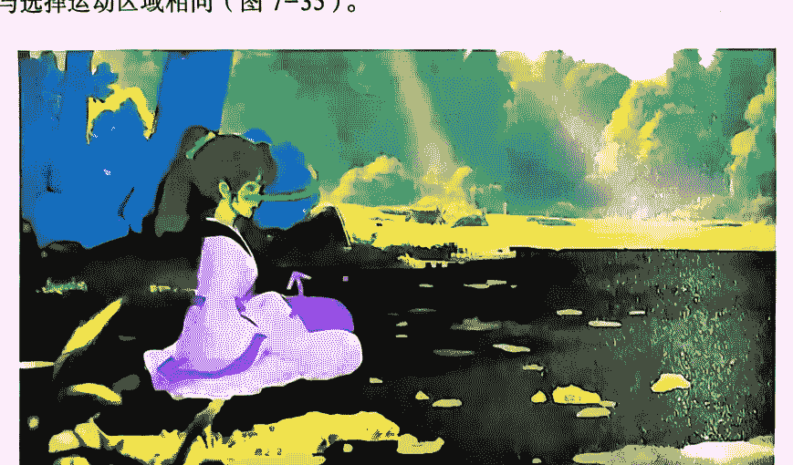

图 7-35 涂抹静止区域

所有设置完成后，点击“确认添加”即可保存并退出。

目前运动笔刷只支持在 V1.5 版本的高品质模式下使用，生成效果会稍逊于新版本模型的生成效果，容易出现画面撕裂、人物面部变形等问题，想要得到满意的画面会消耗较多生成次数。

##### 7.2.4 其他设置

除了前面的项目，图生视频也可以进行反向提示词等的设置，内容与文生视频完全一致，在此就不再赘述了。

> AI 小贴士

视频生成的注意事项：
（1）出现多角色的场景要尽量降低镜头运动的复杂度。
（2）一些复杂的动作场景并非无法实现，但是需要花费大量的时间，创作者需要做出取舍。
（3）复杂场景的废片率较高，根据实际经验，成片率可能低于30%。
（4）如果某一个镜头的制作难度过大，不好实现，则可以以“静态帧 + 动效”的方式呈现。

#### 7.3 其他功能

除了文生视频和图生视频的首尾帧模式，可灵还提供其他的生成、修改功能，但其可控性仍存在一定问题，需要等待版本的迭代，这里仅做简单的介绍。

##### 7.3.1 多图参考

多图参考是图生视频的另一项功能，它允许用户最多上传 4 张参考图，然后综合这些图来生成视频（图 7-36）。

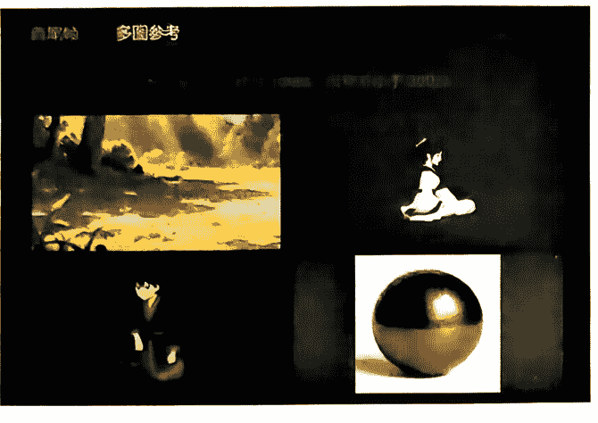

图 7-36 多图参考

如示例所示，上传单个场景所需的全部素材，并输入该场景的事件描述作为提示词，即可进行视频融合生成（图 7-37）。

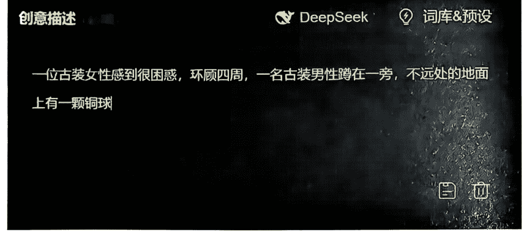

图 7-37 输入提示词

如果该功能能够实现，将极大地提升便捷性。然而，受当前模型性能的限制，生成内容往往会出现问题。

##### 7.3.2 多模态编辑

多模态编辑是一项极具创新性的功能，其入口位于图生视频功能旁（图 7-38）。

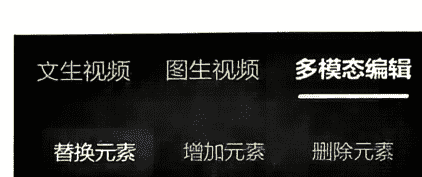

图 7-38 多模态编辑入口

多模态编辑允许用户对视频内容进行修改，分为替换元素、增加元素和删除元素这 3 种方式。由于这 3 项功能的操作逻辑与替换元素基本相同，因此下面仅以替换元素这一项功能为例进行阐述。

点击上传要编辑的视频文件（图 7-39）。

图 7-39 选择需要上传的文件

上传完成后，在弹出的界面中选择需要替换的主体（图 7-40）。

图 7-40 选中主体

界面下方设有视频时间轴，尽可能多地在该时间轴的时间点上选中同一主体，有助于 AI 进行精准判断（图 7-41）。

图 7-41 在多个时间点选中同一主体

选择完成后保存退出，然后上传替换的角色图片（图 7-42）。

图 7-42 上传角色图片

上传完成后，在弹出的界面中框选角色主体，越精确越好（图 7-43）。

图 7-43 框选替换角色的主体

完成后，在下方的提示词模板中填入替换与被替换的主体。该模板由系统预先设置，用户只需填入相应内容即可（图 7-44）。

图 7-44 编写提示词

点击“立即生成”即可查看替换效果。

#### 7.4 配音与配乐

配音与配乐素材同样可以使用 AI 工具来完成。

##### 7.4.1 配音素材生成

制作配音素材需要使用声音合成软件，本书使用的是 Fish Audio（图 7-45）。

图 7-45 Fish Audio 主页

登录 Fish Audio 主页后，在“语音合成”中找到“即时语音”入口，点击“创建”选项，以新建一个文本转语音项目（图 7-46）。

###### 输入语音文本

在输入区域输入需转化为语音的人物台词，此处标定的“500”是指 500 UTF-8 字节，每个汉字占 3 字节长度。比如，输入一句话包含 5 个汉字，则占用 15 字节的长度（图 7-47）。

在某些情况下，该输入限制会提升至 5000 UTF-8 字节。不过，就日常对话而言，单句话长度很少超过 100 字。

此外，在最新版模型中，可通过插入关键词来控制语气停顿，或添加呼吸、大笑等效果。具体关键词与对应功能关系见表 7-2。

###### 表 7-2 关键词释义表

| 关键词 | 效果 |
| :--- | :--- |
| (break) | 短停顿 |
| (long-break) | 长停顿 |
| (breath) | 插入呼吸音 |
| (laugh) | 插入笑声 |

提示词的编写格式如下：

> 好痛！（breath）这里到底是哪里？（break）怎么一个人都没有？

###### 语音声音选择

在该模块中可以选择用于朗读对话的声音（图 7-48）。

点击进入后，“最近使用”会按照时间顺序展示用户最近使用的语音模型，“探索”一项中列举的是平台的语音库，“我的语音”中则是用户自己训练的一些语音模型（图 7-49）。

###### 生成语音的设置

选定语音模型后，可在界面下方进行更为详细的设置（图 7-50）。

“高品质模式”会提高生成音频的质量，但是生成时间会延长；“语速”可以控制音频的语速，一般在迭代时使用，如果发现音频的语速过快或者过慢，再回到这里重新调整生成；“音量”保持默认即可，后期可以用一些编辑软件统一调整。

全部设置完后点击“创建”，即可生成相应的语音素材。

##### 7.4.2 配乐素材生成

目前，Suno AI 是泛用性最好的配乐生成软件（图 7-51）。然而，受限于相关条件，现阶段无法实现与之直连。

其他配乐生成软件之间的差距并不大，这里选择海绵音乐，其主页如图 7-52 所示。

图 7-52 海绵音乐

进入主页后，点击“创作”，进入创作面板（图 7-53）。

图 7-53 配乐创作面板

在输入框中输入对乐曲的具体要求、感想，点击“AI 写词”。

> 问：
国风歌曲，使用民族乐器，悠扬清新，歌曲的内容是几位少年保护神话故事，并在保护过程中获得成长。

AI 写词：

（前奏）

（主歌）

青铜铃摇醒山海另一边的晨光
少年踏过星屑铺就的异界长廊
古卷残页里飞出青鸟衔着锋芒
指尖划过云洲唤醒沉睡的青龙掌

（副歌）

以血为契刻下亘古的纹章
九重天外传来女娲石的回响
朱雀羽扫尽混沌时少年忽然生长
神话在瞳孔深处绽成不谢的洪荒

（间奏）

（主歌）

琥珀色月光浸泡着破损的箭囊
断弦琴弹出夸父逐日时的倔强
麒麟泪滴落修补碎裂的时光墙
少年背上长出精卫填海的翅膀

（副歌）

以血为契刻下亘古的纹章
九重天外传来女娲石的回响
朱雀羽扫尽混沌时少年忽然生长
神话在瞳孔深处绽成不谢的洪荒

（桥段）

月下篝火舔舐着泛黄的帛书
神兽化作图腾烙在锁骨

> 黎明前他们与伏羲背影道别
掌纹里蜿蜒出不周山的新月
（尾奏）

其中，“前奏”“主歌”等关键词是一种更为格式化的提示词，音乐生成模型能够从这些被标记的关键词中了解所要创作的音乐结构。

目前，国产 AI 工具的内部调用的文本生成模型大多是 DeepSeek，其生成能力表现良好。而在独立客户端中，创作者能输入更详细的资料，从而使 AI 生成的内容与动漫短剧情节更为契合。创作者可依据自身的需求选择具体的创作方法。

此外，在 AI 输出歌词的界面下方，还可以进行更多歌曲风格的设置（图 7-54）。

图 7-54 设置音乐风格

完成后点击“生成音乐”，AI 就会将前面生成的歌词变为一首动听的音乐（图 7-55）。

图 7-55 生成结果

生成场景配乐也是相似的操作方法，只不过要打开“纯音乐”的开关，这样 AI 生成的音乐便不会有歌词（图 7-56）。

图 7-56 “纯音乐”开关

#### 7.5 生成一组镜头

接下来，沿用相同的方法，制作多个分镜素材，使其构成一组完整的镜头。

首先，完成首尾帧图的制作。

分镜 2（图 7-57）：

图 7-57 分镜 2 首尾帧

分镜 3（图 7-58）：

图 7-58 分镜 3 首尾帧

分镜 4（图 7-59）：

图 7-59 分镜 4 首尾帧

其次，利用这些首尾帧顺次生成视频素材。

分镜 2 视频素材（图 7-60）：

图 7-60 分镜 2 视频素材

分镜 3 视频素材（图 7-61）：

图 7-61 分镜 3 视频素材

分镜 4 视频素材（图 7-62）：

图 7-62 分镜 4 视频素材

这组镜头不需要再制作额外的配音配乐，使用之前生成的素材即可。

至此，这组分镜所需的素材已经基本完成，下面只需把这些素材汇总到一起，将其剪辑为一组完整的镜头即可。

前面各篇章生成的所有素材，最终都将汇总到这一环节。在此阶段，创作者需承担起主导责任，完成最终成品的创作。作为 AI 动漫短剧制作的最后一步，就目前而言，较复杂的剪辑工作尚无法借助 AI 工具完成，仍需创作者亲力亲为。

本篇使用工具：
剪辑软件：剪映专业版。

# 第 8 章
## 汇总素材，剪辑成片

剪映是一款对新手非常友好的剪辑软件，本章将通过具体的示例向各位读者展示其基本功能的使用方法。

#### 8.1 导入素材

打开剪映，点击首页上方的“开始创作”，新建一个剪辑项目（图 8-1）。

图 8-1 新建工程

进入主页后，可以看到软件的素材区位于页面左上方（图 8-2）。素材区不仅支持导入本地视频素材，还提供了一些系统内置的在线素材，涵盖特效素材、转场效果素材、滤镜素材、字幕素材等常用类型。

图 8-2 素材区面板

点击“导入”，从本地文件夹中选中需要导入的素材，点击“打开”后即可将文件导入到剪映中（图 8-3）。此外，导入素材时还可以同时选择多个素材进行导入。

图 8-3 本地素材导入完成

上传素材后，还需要将其放到编辑区域（界面下方的编辑轨道）中，这样才能对其进行剪辑。

添加方法非常简单，只需将素材拖拽至轨道区域即可（图 8-4）。

图 8-4 编辑轨道

编辑轨道实质上是一段分轨式时间轴，使用者可将不同素材分配至不同轨道，并在对应的时间轴上对素材进行编辑与修改。界面中部的监视器可用于查看当前帧的状况。具体查看哪一帧，可在编辑轨道内通过鼠标点击进行选择。此外，该监视器也能用于查看视频剪辑后的最终效果（图 8-5）。

图 8-5 监视器画面

界面右上方是素材的参数设置面板。当选中编辑轨道内的素材后，可在此处对素材内容进行更为详细的设置。不同类型的素材，其包含的设置项存在差异，此处以选中视频素材为例（图 8-6）进行阐述。

图 8-6 参数设置面板

剪辑工作都是在以下 4 个功能区域完成，具体功能如下：

- 素材区：上传本地素材，查找和添加在线素材。
- 编辑轨道：将素材纳入剪辑流程，进行素材的拼接与处理。
- 监视器：可查看当前帧的具体效果及剪辑后视频的播放效果。
- 参数设置面板：对素材的各项参数进行调整。

#### 8.2 素材处理

对于一段原始视频素材，创作者需要对其做一些调整，才能使其符合剪辑需求。大部分处理工作可以在编辑轨道内完成，在编辑轨道区域的上方有这样一条工具栏（图 8-7）。

图 8-7 素材处理工具

鼠标状态切换（）：设置单击鼠标的不同功能，其中有 4 个设置项（图 8-8）。

图 8-8 单击鼠标功能切换

“选择”是默认的鼠标状态，在编辑轨道内点击鼠标时，可以选中素材、选择时间点（帧）。

点击“分割”后，在素材片段上单击鼠标，会直接在点击处将素材进行分割（图 8-9）。

图 8-9 鼠标分割状态

点击“向左全选”后，鼠标点击处左侧的所有素材都会被选中（图 8-10）。

图 8-10 鼠标向左全选状态

“向右全选”与“向左全选”的功能一样，只有方向不同。

撤销与重置（↩）：此功能在众多软件中颇为常见，功能也相同，即针对当前所做的修改执行撤销或重置操作。

分割（✂）：从当前选择的位置将素材一分为二（图 8-11）。

图 8-11 分割功能

向左/向右裁切（⌗ ⌗）：从当前所选位置开始，将左/右侧部分的素材删除（图 8-12）。

图 8-12 向左裁切

删除（🗑）：删除所选素材。

添加标记（🔖）：在当前所选位置添加标记（图 8-13）。

图 8-13 添加标记

定格（⏸）：将当前帧转换为 3 秒（默认，可调）的定格素材，插入到原素材的原位置（图 8-14）。

图 8-14 定格帧

倒放（■）：翻转素材的播放顺序，将“从头至尾”的播放顺序更改为“从尾至头”。

镜像（■）：镜像翻转原素材，左变为右，右变为左（图 8-15）。

图 8-15 镜像翻转

旋转（■）：顺时针旋转素材，每次旋转 90 度（图 8-16）。

图 8-16 旋转素材

旋转裁切（🔄）：旋转原素材画面并裁切（图 8-17）。

图 8-17 旋转裁切

#### 8.3 添加配音配乐文件

将第一个镜头的配音文件导入并添加到剪映中（图 8-18）。

图 8-18 配音文件

导入方法与视频素材相同，随后将其拖拽到剪映的编辑轨道中（图 8-19）。

图 8-19 导入音轨

导入后，初始的音轨素材与视频素材并不是对齐的，还需要对素材进行调整。

##### 8.3.1 根据配音调整视频

多数情况下，经过挑选并定型后的配音素材调整难度相对更大。对配音素材播放速度进行更改，会使音调发生改变；对裁切素材进行裁切，则会使台词节奏变得怪异。

相较起来，视频素材的调整空间较大，所以一般情况下会优先对视频素材进行调整。

###### 素材变速

调整素材的播放速度是一种常用的调整方法，能较为简便地解决素材时长过长或过短的问题。

选中视频素材后，在参数设置面板中找到“变速”选项并点击进入（图 8-20）。

图 8-20 变速设置

其中，常规变速是对视频素材进行整体性的变速设置。可以通过调整播放速率倍数改变素材的播放速度，但更常用的方式是通过设置时长使软件自动调整播放速率，这样有助于实现与配音素材的精准对齐。

曲线变速和变速卡点都是对素材的某一部分进行变速操作，不过曲线变速的设置更为精准，具备更多的可选设置（图 8-21）。

图 8-21 曲线变速

以子弹时间为例，它模仿的是电影《黑客帝国》首创的变速方式，即在某一重点片段采取升格镜头式的慢放处理方式。图 8-22 展示的就是子弹时间的设置面板，通过拖拽其中的时间点，能够调整慢放的起始点、终结点及慢放倍率等中间过程。

图 8-22 子弹时间

变速卡点是一种常用的短视频变速方式，要配合音频文件使用。通过在音乐的节奏点上设置变速，实现一种“卡点”的视频效果（图 8-23）。

图 8-23 变速卡点

变速卡点无法进行详细设置，仅提供一些预设值选项。选择相应效果后，软件算法会自动使视频匹配音乐节奏，并为画面附加一些特效以提升表现力。

此外，也可通过添加曲线变速与画面特效来实现这种效果，但手动处理相对烦琐。

###### 裁切与拼接

如果视频素材时间太短，需要进行拉长处理时，采用变速方式会让素材损失帧率，进而会使观看者感到卡顿。

因此，更好的处理方式是在画面相对静止的区域进行裁切和拼贴操作，这样才能在不改变帧率的前提下增加视频时长。

拼贴操作有一定要求，并非简单地裁取一块画面插入即可，其目标是在观众无明显感知的情况下完成该操作。以示例素材为例，为模拟真实的创作环境，将其中一段裁切出来作为需要延展的片段，并标记出该片段的起始与结束位置（图 8-24）。

图 8-24 裁切出一段素材

这段素材的起始端与前面的素材相连，末端与后续素材相连。复制素材并将其放置在原素材之后，设置为“倒放”，这样，两段素材的连接点就变成了这样一种情况（图 8-25）。

图 8-25 复制素材并倒放

两段素材末端相连，可保证画面的连续性，右侧倒放的素材将从末端播放至起始端。此时产生了一个问题，若要使右侧素材与后续内容保持连续，其结尾部分必须以末端结束。解决办法也很简单，即再次复制初始裁切素材并插入其中（图 8-26）。

图 8-26 再次复制原始素材

这样操作后，对比图 8-24 可以发现，整段视频都连接了起来，视频的长度也得到了有效延长。

##### 8.3.2 调整配乐

通常情况下，配乐文件时长远长于视频文件，此时需选择合适的段落对配乐文件进行裁切，并根据实际需要添加配乐的切入或切出效果。

###### 裁切配乐

聆听配乐，选定需要使用的段落，根据配乐切入或切出点之间的时长，裁剪出需要的部分（图 8-27）。

图 8-27 裁切配乐

###### 添加淡入淡出效果

选中这段配乐，在参数设置面板中找到“基础”选项（图 8-28）。

图 8-28 调整淡入淡出效果

在这里可以为配乐加入淡入或淡出的效果，根据需要调整效果的时长，也可以调整配乐的音量。

至此，配音和配乐便设置完成。

#### 8.4 添加字幕

在素材区找到“文本”选项，进入后点击默认文本下方的加号，将其添加到编辑轨道中（图 8-29）。

图 8-29 添加文本

选中文本轨道，在监视器中调整其位置与大小。调整完后可将监视器最大化，以查看字幕摆放是否合适（图 8-30）。

图 8-30 调整字幕大小和位置

随后，进入参数设置面板，在“文本”的“基础”选项中对字幕内容、字体、颜色等参数进行调整（图 8-31）。

图 8-31 调整字幕的各项参数

完成参数调整后，在编辑轨道区域根据镜头的文本量复制几段字幕到其中，并修改字幕的内容（图 8-32）。

图 8-32 制作完整的字幕

之后播放配音，按照配音节奏调整字幕的长度与出现时间（图 8-33）。

图 8-33 调整字幕时间

至此，字幕制作完成，效果如图 8-34 所示。

图 8-34 字幕的效果

按照相同的步骤，依次将单个分镜中所有内容都排列好，并处理好全部素材，便完成了动漫短剧单个镜头的粗剪工作。

后续可继续对视频进行精细打磨，为视频内容加入一些更好的效果。

#### 8.5 添加特效

##### 8.5.1 添加视频特效

特效在动漫短剧制作中应用较为频繁，以某个夜间场景为例，若需增添特效以烘托静谧气氛，原始视频素材如图 8-35 所示。

图 8-35 原始视频素材

在素材区找到“特效”一栏，在下拉菜单中选中“氛围”选项，将其中的“繁星点点”特效（也可以通过搜索功能查找）添加至编辑轨道（图 8-36）。

图 8-36 添加“繁星点点”特效

此时，编辑轨道区域会新增一条特效轨道，需将其与素材时长对齐（图 8-37）。

图 8-37 对齐特效轨道

添加该特效后，视频画面将呈现星光闪闪及类似萤火虫闪烁的动效，增添画面氛围感（图 8-38）。

图 8-38 增加特效后的画面

##### 8.5.2 添加转场特效

转场特效常用于不同镜头之间的衔接，是使用频率较高的特效类型。通过视觉化手段，转场特效可使不同时间、空间的镜头过渡得更加自然，增强叙事节奏与画面表现力，避免观众因画面跳跃产生割裂感。

###### 从转场素材库添加特效

在素材区找到“转场”一栏。若需实现简单的“淡入淡出”转场效果，在搜索栏输入关键词未找到该选项时，可选择添加“叠化”效果至视频素材（图 8-39）。

图 8-39 添加“叠化”转场

添加完毕后，两段素材将呈现如图 8-40 所示的效果。

图 8-40 轨道内的转场特效

转场特效的参数也可以进行调整。选中特效后，在参数设置面板中可调整特效的持续时长，将其设置为1秒（图 8-41）。

图 8-41 调整叠化持续时间

叠化转场效果如图 8-42 所示。

图 8-42 叠化转场的效果

转场特效中通常具有炫目效果，若要实现简单的淡入淡出效果，则需自行对素材片段进行调整。

###### 通过设置面板添加转场

选中末端需要添加淡出效果的素材，在参数设置面板中找到“动画”选项，在“出场”分栏下拉菜单中点击“渐隐”（图 8-43）。

图 8-43 尾部添加渐隐动画

此时，素材的末端就会添加动画效果。在参数设置面板的下方还可以调整动画的持续时长，默认时长为 0.5 秒，这里使用默认设置即可。

添加淡入效果同理。选中素材后，在“入场”中找到“渐显”动画，点击后添加（图 8-44）。渐显效果同样设置为 0.5 秒。

图 8-44 头部添加渐显动画

素材添加动画后，在编辑轨道内会有相应显示。在素材末端 / 起始端的下方会出现箭头，指示动画在素材中的位置及时长（图 8-45）。

图 8-45 轨道内的显示

此时，两段素材间可实现淡入淡出的转场效果（图 8-46）。

图 8-46 淡入淡出转场效果

#### 8.6 最后的工作

##### 8.6.1 设置封面

梳理好所有素材后，便完成了一组镜头的制作（图 8-47）。

图 8-47 完成一组镜头

此时需为该组镜头设置一张封面。点击编辑轨道最左侧的“封面”选项，进入封面设置面板（图 8-48）。

图 8-48 从本地上传封面素材

默认情况下（即视频帧一项），软件支持创作者从视频素材中挑选一帧作为视频封面。笔者建议同一集的场景使用相同的视频封面，并在封面上标注具体场景信息。从本地选择已设置好的视频封面素材后，可继续进行下一步设置（图 8-49）。

图 8-49 封面模板

软件提供了一些封面设计模板，若不需使用，也可进行简单的文字设置，设置方法与字幕制作类似（图 8-50）。

图 8-50 使用默认文本

将“默认文本”添加到封面上，双击文本框修改文字内容，并设置字体颜色与字号，最终的视频封面效果如图 8-51 所示。

图 8-51 封面效果

##### 8.6.2 导出视频

最后，将制作完成的视频导出至本地。导出功能位于软件的右上角、参数设置面板上方（图 8-52）。

图 8-52 导出选项

点击导出成功后，需调整视频的名称、存储位置，并设置具体的导出参数，如分辨率、帧率、码率等，具体设置应依据项目的实际情况确定。此处可直接采用默认设置进行导出（图 8-53）。

图 8-53 导出设置

视频导出完成后，还可以选择快速将视频发布到抖音、西瓜平台，此功能在短视频制作中应用较为广泛（图 8-54）。

图 8-54 快速发布

至此，本书关于 AI 动漫短剧创作内容的讲解全部结束。

### 后记

本书的创作初衷在于，为每一位热爱动漫、富有创造力却受限于制作门槛的人提供新的创作可能，使个体有机会借助相关工具将自己的奇思妙想通过屏幕传递给观众。

AI 技术的迅速发展与迭代，为创作者带来了前所未有的机遇。动漫短剧的创作不再单纯依赖资本投入和团队规模，而是更注重内容创意与表达能力。在撰写本书期间，笔者深切感受到了 AI 技术蕴含的无限潜力，因此更加坚定了推广这一创作模式的信念。

当然，技术仅是创作手段，故事和情感才是动漫创作的核心与灵魂。无论科技如何演进，创作者的核心竞争力始终是对人性的洞察以及讲述故事的能力。期望每位读者都能借助 AI 的力量创作出更多引人入胜的作品。

为了更真实地展现 AI 的能力，笔者在成书过程中尽量减少对输出结果的人为干预，因此书中难免存在不足，恳请读者谅解。诚盼能收到读者的反馈与建议，每一次指正都将助力本书的完善与进步。

最后，向所有陪伴本书完成创作的读者表示感谢。期望本书能够真正启发读者，激励其开启创作之旅。期待未来能在屏幕上欣赏到各位读者的动漫佳作。①

①本书是以下课题的阶段性成果：
安徽省高等学校科学研究项目：《基于 AIGC 淮河流域非遗文化的两创策略研究》阶段性成果（2024AH052969）；
安徽省优秀青年教师培育项目：《AIGC 赋能皖北非遗文化创造性转化与创新性发展研究》（YQYB2024199）；
安徽省社会科学创新发展研究项目《绘梦安徽非遗：AIGC 技术赋能安徽非遗文化国际传播绘本创作与推广》（2024KD013）；
阜阳师范大学科研项目《AIGC 文物科普动画：跨学科数字化普及策略与创作研究》（XJ2024017201）；
阜阳师范大学校级本科教学工程项目 “AI+ 美育” 驱动下跨学科融合实践育人创新模式研究”（2025SJYRZX08）；
阜阳师范学院科研项目 “基于数字动画技术的阜阳民俗文化传承与推广研究”（2020KYQ00025）。

本书系统讲解如何用AI高效生成动漫短剧内容
覆盖剧本策划、人物设计、场景搭建、
镜头运镜、配音剪辑等完整流程，
帮你从0打造属于自己的动画短片。

- 实用案例+模板指引，轻松掌握剧本写作与角色生成要点
- 覆盖文生视频、AI绘图、语音合成等多种主流AI工具应用
- 无需美术基础，快速完成分镜、场景、镜头等视觉表现
- 适合动漫创作者、自媒体内容人、AI新手快速上手创作

定价：88.00 元