# AI 动漫大师

# 前言

动漫短剧正以高爆发力冲进内容主流，成为创作者和观众都离不开的新形态。精良的短剧既能给人视听上的冲击，也能承载文化表达，触发情感共鸣。当下文化产业加速升级，动漫类内容已成为强化文化软实力、凝聚文化自信的关键抓手。

AI 技术的迭代让动漫短剧的创作门槛被彻底改写。借助生成式 AI，几句文字描述就能跑出完整的视听片段，让动漫短剧有了跻身主流赛道的底气。作为 AI 的高关联品类，AI 生成的动漫短剧在数月内迅速升温，半年内便出现了多部在小范围内引发关注的作品，更新速度令人咋舌。

与传统动漫相比，AI 最先击中的是生产力瓶颈。过去动辄数十人协作的项目，如今一人或两人就能把灵感落地，只需支付模型使用成本，性价比优势十分明显。

当然这条赛道并非毫无阻力。叙事能力、视听把控、工具熟练度、提示词设计等，都要求创作者既有创意又有实操能力。但总体来看，AI 把试错成本拉低了，为低成本持续产出提供了更多可能。

正是基于此，本书结合最新实践，以通俗易懂的方式拆解技术要义与落地技巧。每章都配有实操案例，帮助读者逐步掌握全流程。本书共分前期策划篇、中期制作篇、后期剪辑篇三大部分，合计八章，围绕策划、素材生成与剪辑展开，并详解具体 AI 工具的操作路径。

本书可作为 AI 动漫创作领域的入门参考，也适合内容创作者、动漫从业者与爱好者阅读。观点客观、体系完整、语言平实，既兼顾专业人群，也利于普通读者入门。在撰写过程中得到业内学者的诸多指点，在此致谢。受限于时间与水平，难免有不足之处，欢迎读者批评指正。希望本书能带来新灵感，助你在动漫短剧创作路上走得更远。

## 前期策划篇

前期策划是整个制作的定盘星，负责把模糊的灵感转化为可执行的制作方案。

正如很多工作室所言，前期多花心思，后期返工成本会省下数倍。AI 工具恰似一位博学而耐心的搭档，能帮助创作者做更系统的深度梳理。

本篇使用工具：
文本生成：DeepSeek

### 第 1 章 一个点子，三个问题

好点子并不稀缺，稀缺的是把点子落地为作品的能力。横亘在灵感与成品之间，往往是一道巨大的鸿沟。AI 最大的价值之一，就是帮普通人跨过这道鸿沟，真正进入创作场域。

#### 1.1 从一个点子开始

灵感的迸发通常与个人经历密切相关。所见所闻会在某个瞬间化作意象，变成一个萌芽的点子。而点子初期大多模糊，可能只是一句口号、一个概念或一幅画面。

例如，有人心里冒出：“能不能用国潮文化做一部古风动漫短剧。”这看起来像个选题，实则离可执行方案还很远，需要借助 AI 完成延展。

打开 DeepSeek，在输入框里写入如下内容。

# 我是 DeepSeek，很高兴见到你！

我可以帮你写代码、读文件、写作各种创意内容，请把你的任务交给我吧~

我想要结合国潮文化来打造一部古风动漫短剧，目前只有这么一个简单的创意。请你对我进行一些启发式的帮助，让我能够搞清楚自己到底想要做什么。

直接索要成品不如先做启发型提问，这样创作者能保持主导权，同时让 AI 的输出更具个性。

发送后，若开启“深度思考 R1”模式，模型会先做一段内部推演再回复。

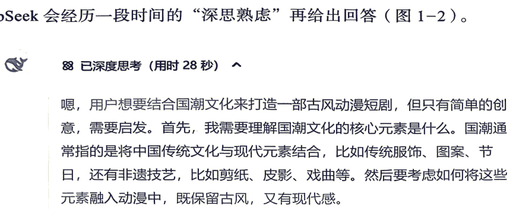

下面是 DeepSeek 的一段回复示例：

> DeepSeek：
> 你的设想很有潜力！我会用系统化提问和案例来帮你厘清思路。
> 先解决核心定位，你想传递什么？
> 1. 文化符号的选择
> 你更想聚焦非遗技艺？
> 还是传统哲学思想，比如道家天人合一、儒家仁义？
> 或是民俗意象，比如傩面、山海经异兽、二十四节气？
> 案例：《雾山五行》把五行学说与武侠结合，《中国唱诗班》以古诗重塑历史场景。
> 2. 情感锚点
> 你想表达文化传承的使命感？
> 还是传统与现代的碰撞张力？
> 或是纯粹的美学复兴，打造东方奇观？
> 可继续讨论定位，也可让我给出下一步建议。①

通过这样来回探问，创作者能先弄清楚“我不要什么”，从而逐渐逼近“我要什么”。

在本书示例中，“国风动漫短剧”这一初始念头，最终被细化为：外表是古典东方内核是当代的故事，风格偏写实。设定融合传统哲学与民俗意象，同时角色具备现代人的思维方式，所面临的困境也与当下观众高度贴合。

确定大致方向后，下一步要回答三个更具体的问题，从而搭建作品骨架。

① 为呈现生成效果，本书展示的 AI 内容未做修改，可能存在少量错漏。

# AI 小贴士

在 DeepSeek 侧边栏有两个进阶开关：深度思考 R1 与联网搜索。

默认不开启深度思考时，使用的是 DeepSeek V3，回答会紧贴提示词，有问必答。打开深度思考后切换到 R1，模型会增加推理链路，会猜测提问背后的真实需求，并给出发散性建议。

开启联网搜索后，模型在作答前会检索网络信息，时效性更强，也能在一定程度上缓解幻觉问题，提升可信度。

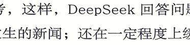

#### 1.2 观众是谁

第一个关键问题：这部剧到底为谁而做？

不要落入“所有人都是观众”的误区。不同人群的审美、价值观与心理预期差异很大，只有精准定位，才能提升竞争力和触达效率，实现艺术与商业的双赢。

##### 1.2.1 年龄层偏好

业内通常以 3 岁为一个分段，向上延伸至青少年、青年、成人，形成六大区间。每个区间在认知、情感与审美上差别显著，需要匹配不同的结构与表达。

###### 3—5岁
处于前运算阶段，因果理解浅薄，注意力约 10 分钟。画面要简洁、色彩饱满、线条圆润；情节单一，围绕“找东西”“认识颜色”等；语言短句口语化，配角不超过 3 人。

###### 6—8岁
开始具备具体运算能力，能理解基本因果与协作。可加入简单悬念、拼图任务或双主角互助，视觉上可增加细节，对白可用复合句，加入幽默和拟声词。

###### 9—11岁
认知快速提升，能处理多线故事。对冒险、竞争、成长感兴趣，可设章节目标与阶段胜负，加入动作特写，对白可传递求知欲与价值选择，适当引入历史、科学或文化背景。

###### 12岁及以上
进入抽象思维，愿意讨论社会议题与道德困境。可采用季播连贯剧情，动机更立体，冲突涉及自我认同与群体责任。画面可使用对比光影与复杂镜头，对白允许隐喻与双关，音乐剪辑更成熟，需控制暴力与惊悚强度。

儿童期之外划分为青少年 12—17 岁、青年 18—25 岁、成人 26 岁及以上。青少年情绪波动大，偏好共情与成长线，适合热血、友情、青春困境，配乐可流行化。青年追求审美个性与题材新颖，接受跨文化符号与多元价值，叙事上可采用碎片倒叙、多视角。成人看重主题深度与情感真实，偏好复杂时间线、反英雄与开放结局，但节奏须紧凑。

不同年龄对节奏、时长、语言、视觉的要求各不相同。低龄重重复与明亮，中龄重动作与谜题，高龄重深度与多线，成人重情感与思想。

因此策划时首先要锁定适配年龄，并让 AI 记住该信息，以影响后续创作走向。

> 问：
> 我想做的这部国风短剧，受众年龄大致在哪个区间？
> 详细创作想法略
> DeepSeek：
> 综合题材特征与认知发展，建议核心受众为 12—17 岁，并向 18—25 岁青年自然外延。

| 维度 | 12—17 岁契合度 | 说明 |
|---|---|---|
| 情节理解 | 抽象思维成熟，能接受“古典外壳+现代内核” | 可理解哲学隐喻，不易因深度流失兴趣 |
| 共鸣点 | 价值观形成期，易与“现代国境”共情 | 学业、人际、身份认同与剧情困境契合 |
| 美术审美 | 对国风视觉与东方幻想有天然好感 | 该群体为国潮手作与潮玩消费主力 |
| 叙事节奏 | 可接受长弧主线与多线角色 | 适合季播或短剧形态 |
| 合规与宣发 | 审查宽松，B站、抖音等社媒集中 | 二创与社群扩散潜力大 |

延伸策略：
向下兼容 9—11 岁：简化哲学概念，用视觉象征，直接动作冒险，台词浅化。
向上覆盖 18—25 岁：加入社会议题副线，情感描写更成熟，分镜更具摄影感。

##### 1.2.2 性别偏好

性别是仅次于年龄的关键维度，影响情节推进、角色塑造、视觉符号与宣发话术。差异化设计能提升完播与二创活跃度，并为迭代提供更精准反馈。

###### 以男性为主的内容要点
情节目标明确，冲突以物理对抗或策略对决为主，胜负节奏紧凑。主角常在团队中升级，强调兄弟互助与竞争，加入关卡式任务。视觉高对比、动态运镜、爆发配乐，动作强调速度与打击感。角色目标鲜明，成长可量化。

###### 以女性为主的内容要点
以关系为驱动，亲情、友情、情感线为主，情绪递进带动高潮。重视内心变化，用独白、回忆蒙太奇呈现心理。配色柔和、光影细腻、场景注重文化纹理，配乐以钢琴弦乐为主。配角承担情感映射，角色对话保留思考与反问。

在节奏上，男性偏好峰值密集、爆发间隔短；女性偏好情绪层次，允许缓冲段落。视觉符号上，男性接受夸张动作与锋利造型，女性对服装纹理、色彩渐变、表情细节更敏感。幽默上，男性偏好吐槽式，女性偏好生活化自嘲。对角色的期待也不同：男性看技能与实力，女性看动机是否可信有深度。

##### 平衡策略

要兼顾两性，可采用：
群像结构：多位核心角色分别承担动作、策略、情感、搞笑功能，兼顾爽点与共情。
双线叙事：主线推进外部目标保持紧凑，副线聚焦内心与关系做缓冲，时长比例可设 7:3 或 6:4，在关键节点交融。

进一步优化可做：
转场与节奏调控：动作高潮后接情感对话，情感高潮后切回任务节点，保持张力。
性别中立符号：以自我认同、责任与选择等普世价值为主，引入宠物、理想城、技能系统等跨性别元素。

若题材天然偏向某性别，可定向制作；一般情况建议兼容，以扩大受众面。

接下来把性别平衡的考量告诉 DeepSeek，让其在后续输出中保持平衡。

问：
这部国风短剧更偏向哪种性别？能否做到兼顾？
DeepSeek：
从气质与心理看，该作以“古典外观+现代心境”构建，并不天然偏向某一性别。12—17 岁群体的核心兴趣是可代入的情感体验、新鲜的视觉世界观、映射现实的价值拷问，设定恰好覆盖三点，因此具备跨性别吸引力。

1. 性别侧重
男性关注动作场面、世界观规模、升级推进，与古典打斗与现代责任成长匹配。
女性关注角色情感、内心冲突、审美氛围，与哲学民俗意象与现实心理贴合。
结论：题材对两类人群都有吸引力，需在叙事重心与视觉符号上配比。

2. 平衡方案
| 设计环节 | 男性视角 | 女性视角 | 协调方式 |

做一部能火的国风动漫短剧，本质上是把“打架好看、心里有戏、文化有味”拧成一股线。下面这套打法，是在大量素材和实操经验里提炼出来的创作通识，用来做框架拆解、题材判断和叙事选型都很管用。

先把骨骼立起来

核心冲突要外内双线走。先给观众一个看得见的外部任务，比如寻宝、解封、赶赴节气失衡的遗迹，任务必须具体且有紧迫感。任务推进的同时，不能只剩打打杀杀，而要在每一次关键抉择里暴露人物的情感取舍和价值观。比如为完成任务牺牲个人名声、违背师门戒律、或是选择拯救陌生人而不是亲人。外部行动和内心挣扎同步上场，才有张力。

角色配置要互补又分担。别堆一堆同质的战力，需要动作型或策略型的攻坚手，也需要情感型或通晓文化典故的解读手。群像大于单核，让重要的剧情节点由多人共同完成，男女生都能找到代入的支点。

节奏是留人的第一杠杆。每三到四分钟就要给一个动作爆点或情节反转，爆点之间用情感对谈或内心独白做缓冲。主线和副线轮换推进，像呼吸一样保持整体的紧张感。

视听符号要分层呈现。动作段落用高对比的镜头和兵器特效抓眼，文化段落用柔和光影、传统纹样和分明的色彩层次做情绪铺垫。同一画面里，前景负责动作冲击，背景负责氛围营造，这样信息不挤。

配乐音效随情绪切换。强节奏的鼓点和民族打击乐推动作，抒情的管弦乐、古琴或笛子段落托情感。剧情转场时做无缝衔接，让观众耳朵先感受到切换。

男女观众喜好怎么兼顾

把行动线和情感线交叉分摊给不同性别角色，用多主角或群像让每个人都有可投射的线。困境类型不要走偏，既要有国家、家族、命运级的外部行动，也要有自我价值、情感抉择、代际矛盾的内部冲突，避免把冒险全丢给男生、情感全丢给女生的刻板分工。

同一关键情节让角色同时用语言对抗和行动决断两种方式推进，能兼顾偏好快节奏的观众和偏好细腻表达的观众。符号设计上避开粉蓝、刚柔的标签，把兵器、法器、服饰的考量放在功能与象征上，比如青铜剑代表正直，纸伞象征守护。用这种镜面对称的思路，男女收视比例更容易持平，二创和讨论热度也会互相拉动，形成长尾生态。

题材定位决定卖点

行业里常见八大类：动作冒险、悬疑侦探、日常、奇幻科幻、教育启蒙、音乐、历史文化、喜剧讽喻。每一类都有成熟受众和不同的制作要求。

动作冒险靠外部目标、等级成长和团队协作，旅程感天然带来悬念，适合可视化奇观和连载。每集保持爆点、频繁场景转换、技能树量化是要点。

悬疑侦探靠谜团、线索和推理，观众参与感强，单元案件可做系列，长线真相能撑连续剧。需要多线叙事、线索与误导比例合适，环境音效加强紧张感。

日常类靠生活细节、轻松节奏和情感共鸣，化学反应是核心。场景复用率高，对白多动作少，适合低成本长线运营。

奇幻科幻靠世界观和超自然或科技设定，设定驱动想象力。世界观文档要前置，视觉符号统一，配乐可民族乐器结合电子合成。

教育启蒙靠知识点、互动引导和正向反馈，功能性强且易获平台扶持。单集一知识点，配合歌曲口号强化记忆，注意合规。

音乐类靠歌曲和动画演出，对学龄前吸引力大，制作门槛相对低。注意风格融合与画面明亮简洁，版权使用要合规。

历史文化靠史实、传统艺术和文化符号，厚重感强且改编空间大。考据与再创作要平衡，注意素材版权。

喜剧搞笑靠夸张、冲突和包袱高频，节奏快、平台友好。对白快、情节轻、视觉夸张，适合短视频裂变。

具体到国风项目，DeepSeek给出的主轴建议是动作冒险加历史文化，再辅以轻悬疑。动作冒险提供外部驱动和成长框架，历史文化赋予东方哲思与民俗质感，轻悬疑用文物真伪、古籍残卷串联推理，提升互动和完播。既能满足12到17岁观众对节奏和视觉的需求，又不落入纯打斗或说教。

性别平衡上，用并列的男女主或互补小队，同一遗迹任务里各自刷技能树，战斗与智取并行。行动与情感双任务同时推进，符号配饰用功能隐喻而非性别色彩区分。

落地要点包括：用古籍卷轴、法印替代数值显式成长，每集结尾开印呈现进阶；用庄周梦蝶、羿射九日等真实典故做可视机关，兼顾熟悉感与新鲜度；悬疑节奏固定为开场留谜、中段误导、结尾半解，保持5到7分钟张力峰值；水墨厚重配冷暖对撞，打击乐推动作、管弦与洞箫渲染思辨；上线前放古卷残图彩蛋引导考据，鼓励二创解谜。

不建议纯悬疑侦探做主轴，逻辑密度高不利于大场景和文化展示。日常、教育、音乐与写实国风冲突不大但刺激感不足。喜剧可作支线段子，主轴喜剧化会稀释哲思力度。

叙事模式怎么选

系列剧一集一故事，可任意切入，适合低幼、日常、教育。进入门槛低、创作弹性大，平台算法友好。制作风险被分散在单集，可边播边改，数据迭代快，回看率和长尾收益好。

把国风短剧做成系列剧，可用母命题加子单元法。母命题如人在传统与现代张力中的自我选择，为每集提供价值坐标；子单元每集聚焦一则哲理或民俗意象做隐喻。结尾用一句独白或象征动作收束，不说教却留解读空间。

结构上固化开破合三幕模板。0到1分钟冷开场抛危险或难题，1到5分30秒用行动加推理双线推进，每90秒一个节奏点，5分30秒到7分钟小高潮加哲理落点，留10秒彩蛋。

角色用螺旋式成长。单集视角可轮换，团队核心五人循环，男女各占。看似每集可零门槛观看，纵向主题却层层逼近自我答案。客串尽量用游方术士、说书先生等传统形象变形，省成本且有江湖网状感。

视觉音乐统一靠资产循环与符号矩阵。固定三套主场景加变体，降低布景成本；黛青赭石为基调，关键哲理点一抹朱砂形成条件反射；音乐模板用打击乐为骨、洞箫古筝为血肉，战斗段105到115 BPM，思辨段70到80 BPM。

互动把碎片观看变成碎片游戏。每集埋隐写字、典故误用、一闪而过的机关纹样，鼓励弹幕考据；放出两版分支草图让粉丝投票下一集谜题或分工；提供可商用空镜头和BGM引导二创回流。

连续剧强调前后递进，适合积累情感张力和世界观深度。细分有板块式、背景主线式、圆形闭合式三种。板块式以3到5集为单元，每个单元自洽且形成阶段满足，便于边播边优化。背景主线式以宏大时代危机为恒定牵引，个人命运与世界事件同步推进，考据和同人生态活跃。圆形闭合式首尾呼应，结局回扣起点伏笔，复播率高但需前期完整规划。

系列剧与连续剧对比来看，进入门槛低的是系列剧，角色成长深度高的是连续剧，制作灵活性高的是系列剧，数据迭代快的是系列剧，观众黏性高的是连续剧。

若选择背景主线式连续剧，需先钉死时代级裂缝，比如天工断层导致节气错位，让每个角色的社会身份与危机因果相连，并明确不行动就会失控的时间压力。

信息要分层披露：外层让大众看到新闻推送和短视频里的异常现象；中层让角色在古籍与代码里拼凑半真相；内层在季终揭露人器契约与算法耦合的核心逻辑。视觉标识随层级升级，从天空噪点到瞳孔星轨错位，再到城市折纸般翻折。

角色私人动机要为大局铺路，舞者为赢赛而钻研祭舞阴差阳错掌握调息步法，考古生为业绩修复断碑破解残文，程序员为自证价值重写算法成为唯一解码人。小我动机被吸进命运旋涡，成长即钥匙齐备。

三幕节奏可设为第一幕1到3集谬象初临临时联盟，第二幕4到8集线索交织重大挫败危机倍增，古籍误导导致仪式出错空间坍塌信任分裂，对手夺走核心算法。

总体来看，以动作冒险为骨、历史文化与轻悬疑为血肉，配合合理的角色分配与视听语言，既能兼顾不同性别偏好，也适合短剧形态的拆分与层层递进，为连载和社群运营提供长线价值。

第九到第十二集进入收官阶段，叙事重心从铺垫转向摊牌对撞与情绪收尾。核心冲突是把契约背后的隐性代价摊开——系统判定必须有人以活体数据针的形式献祭，全体陷入艰难抉择；最终靠团队合力重写运算逻辑，让礼乐同频，天地归位。

每集片尾保留十五秒固定彩蛋：新闻标题快闪掠过，算法崩溃倒计时跳动，古符残影划过，持续点燃观众拼图与弹幕考据的参与感。

视觉打法
基础配色锚定宣纸白与墨青灰，用留白制造呼吸感。进入断层异境时叠加低饱和电蓝与光粒噪点，营造数字污染的错位质感。日常空间的纹样以简化云雷纹与回纹为骨架；异象空间则覆盖裂纹化的山海兽纹，两套肌理在镜头交错时暗示世界缝合的痕迹。资产复用可借助实时光效脚本调节纹样占比，例如回纹占一半、山海纹占一半，就能表达危机已过半，后期可实现批量快速渲染。

音乐双动机
现代段落主音色由钢琴分解和弦搭配低频电子鼓构成，节奏约一百一十，呈现都市脉搏。异象段落主音色由古筝吟泛音、埙滑音与木鱼点缀构成，节奏降至约七十五，营造天地回响的氛围。关键转场启用二声部交叠，先让钢琴旋律降速并逐渐失真，再由埙音在同调上攀升接入，完成从科技到古意的听觉置换。混音权重维持二比三的切换，既保证风格统一又形成鲜明对比，既照顾年轻受众对电子节拍的偏好，也保留国风底蕴，契合古今双解的主题。

至此短剧骨架已初现，下一步需要继续填充细节，完善各项设定。

第2章
智能体在创意策划中的职能
方向确定后，核心问题是如何在既定框架内把灵感填实。

借助智能助手，创作者能够迅速搭建自洽的世界架构、丰满人物与引人入胜的故事骨架，让想法逐步落地。

2.1 世界架构设计
除故事发生的时空外，完整架构还需要一套支撑情节运转的规则体系，涵盖地域版图、历史脉络、制度形态、技术水平、超自然法则，以及角色共同的价值倾向与审美习惯。

架构是短剧的地基。没有清晰自洽的架构，观众难以信任角色行为，也难以持续投入情感。反之，逻辑严密且细节丰富的架构会带来三重收益。

其一，提升叙事可信度。观众理解了魔法、仙术或未来科技的运作原理后，即便剧情加入高强度戏剧冲突也不会显得突兀。
其二，保障创作一致性。编剧、分镜、美术、配乐与后期能依据同一规范决策，避免风格割裂与设定冲突。
其三，有利于账号长期运营。爆款作品的架构可被复用开发续集、外传等衍生内容，形成流量延续与辐射，观众的熟悉感转化为持续的消费与讨论。

2.1.1 常见架构形态
从创作视角看，架构大致可归为以下几类。

现实主义
以真实历史或当代都市为蓝本，聚焦社会与人性的写实碰撞。

历史架空
在真实朝代与地理的外壳中植入改变走向的关键设定，让熟悉的文化符号与意外事件产生新张力。

科幻
分为硬科幻与软科幻。硬科幻讲究科学原理与技术细节，要求超常现象在未来学和物理学框架内自洽；软科幻更关注哲学命题与社会寓言，对技术原理描写宽松，但在人文思辨上更深。

奇幻
分为低魔与高魔。低魔以现实地理为底，植入有限超自然元素；高魔则构建独立的多神、多族群、多魔法体系的世界。

风格型架构
赛博朋克、蒸汽朋克、后末日、远古神话等以美学风格或文明阶段为核心的综合形态，主题与美学形式相对固定。

国风题材可归入风格型，常见处理有两种。
一是舞台置于现代，将古代神话、民俗体系与现实社会并置，制造熟悉的陌生感。
现世加隐藏空间：现实世界与普通人难以触及的隐藏空间并置，通过交错制造冲突与神秘感。该空间与现实共存却被多数人忽视，可为真实隐秘之地，也可为需特殊方式进入的异界，常承载超自然力量与古老文明。
现实表象加历史隐脉：主舞台看似熟悉的现代社会，其表层之下潜藏来自过去的力量、传统、记忆或未竟之志，如古代神话、民间信仰、被封印异界或失落历史秘密。

二是整体舞台置于过去，该过去可为架空奇幻世界，也可为基于真实历史的世界。

2.1.2 如何向DeepSeek请教
架构构建重在分层递进、逐项明确。
例如创作者已大致确定：故事发生在架空的中古时代，几名少年主角偶得时空穿越机器，不断进入神话与历史典故冒险，采用单元剧形式，每集一故事。受众为12-17岁青少年，内核是包裹于古典东方外衣下的现代故事，融合中国传统哲学与民俗意象，人物思维现代，困境与当代人相似。

此时可先让DeepSeek列出需补充的要素：
请基于我这部国风动漫短剧的初步设定，列出构建完整世界架构前需要进一步明确的要素。

DeepSeek会聚焦架构本身提出问题：
1. 时空机器的本质：谁造？为何存在？是否唯一？原理是术法机关、失落科技还是混合？
2. 穿越的触发与限制：需特定地点、时间节点、祭仪或情绪值？一次可带多少人或物？有冷却或副作用吗？
3. 历史/神话空间的性质：进入的是单一线性真史，还是无限平行分支的故事维度？内部时间流速与现实是否同步？
4. 改写后果与因果律：若改变典故走向，会反向影响现代吗？会产生怎样的时间伤痕或蝴蝶效应？
5. 宏观矛盾或世界危机：核心失衡是什么？灵脉紊乱、时空裂缝、神话能量外泄等？
6. 守护者/反噬机制：是否存在维护时间秩序的神祇、机关兽或人类组织？与主角是敌对、合作还是暧昧？
7. 哲学与能量体系：阴阳、五行、天人合一等如何具象化为规则、法则或能量？现代科技能否解析或改写？
8. 民俗意象的系统角色：节气仪式、图腾纹样、庙会祭典仅为美术符号，还是可触发机关/法术的钥匙？
9. 空间地理与社会结构：架空中古时代的政治、经济、宗教、民间信仰面貌？神话空间与凡俗王朝是并行、重叠还是互不相知？
10. 语言与文化隔阂：少年如何与古代人物交流？机器翻译、精神共鸣还是学习古代语言？
11. 伦理边界与规则：是否有不可杀关键人物、不可带走神器等硬性禁令？违规则触发何种惩罚？
12. 团队与个人命运的绑定方式：每位主角的现代困境如何与宏观危机关联？被机器选择、血脉传承还是偶然？

回答后即可搭建时空框架、能量规则与冲突驱动力。创作者也可针对不确定条目继续追问，让模型提供参考案例。

关于守护者/反噬机制，请给出3个示例。

示例一 钧衡司辰——节点神祇守护
时空长河的关键转折点各栖息一名微型神祇钧衡司辰，以铜铃大小的星核校准事件权重。若少年干预节点走向，司辰先以古乐残音逆放发出时音警告，再进一步则触发回溯噬魂，卷走施事者与目击者的部分记忆，迫使剧情退回干预前五分钟，保留情感代价同时维系历史轮廓。

示例二 璇缱铜鳞——机关兽反噬
时空机器能源来自五行晶簇，错位方位或节气启动会唤醒地脉机关兽璇缱。形态随气候变化，春雨似鲤、冬雪如狼，鳞甲刻满齿轮纹。它不以击杀为主，而是锁定机器本体吞噬能量并倒灌启动者经络，造成灵脉倒冲——短暂强化后迅速衰竭。需以当地民俗仪式如放河灯、击鼓驱寒精准复原方能重封。

示例三 纪封司——人类猎时者守护
自洪武年间流传的隐秘组织纪封司世代记录穿越涟漪，一旦侦测到非原生器物或未来语，即派出猎时者干预，装备削年刃与封缄符。机制分三步：先遮蔽异常记忆让人以为做梦，若异常扩散则回收或毁灭穿越机，最后手段是锁节——将改写时段封存为不可访问层，代价是该段历史在现实中永久失佚。该体系使守护者与主角处于灰色对立。

完成基础架构后，可要求模型汇总条目并标注空缺，再追加主题与故事线设定的深度请教，获取更具针对性的社会运行法则与伦理冲突细节。

架构细化程度取决于作品定位。练手作品不必过度考究，重点应放在整体框架把握与生成流程熟悉上。

AI小贴士
使用DeepSeek时，除了发问，也要学会让AI反向请教。AI的追问能帮助澄清人物动机、架构细节与剧情冲突，使模糊灵感快速具象化。如构建架构时，模型追问能力上限或魔法体系限制，答不上来即说明框架需打磨。

AI请教还具叙事模式敏感度，能提醒创作者跳出套路，在情节与人物弧光上寻求惊喜。通过你问我答、我问你思的往返对话，生成内容兼具深度与个性化。

若时间紧迫或走量产路线，也可直接让模型给出答案，当前文本生成下限已有保障。

2.2 人物设计
人物是观众想象与世界架构规则的连接点。首要门槛是明确由谁承担叙事焦点与情感投射，可为人类、动物、植物、器物或抽象概念具象化，只要生命状态与行动逻辑自洽即可出场。

非人类人物需确定拟人化程度。如猫妖可保留四足行走、无法言语、靠尾巴耳朵表达，也可二足站立、完整台词、与人类平等对话。程度确定后，视觉造型、动作设计与配音风格即有明确艺术指导。

2.2.1 人物塑造的四个维度
1. 功能维度：人物在故事中的叙事职责，如主角、反派、导师、工具人、喜剧担当。明确功能利于安排冲突与戏份分配。
2. 人物维度：姓名、年龄、生理特征、口音、口头禅、喜好、恐惧、缺点、价值观、人生目标。决定共情基础，也为周边开发提供素材。
3. 戏剧维度：人物与外部世界的矛盾及内部成长曲线需形成张力，强调其通过行动改变环境或被环境改变。
4. 符号维度：视觉与听觉识别记号，如独特剪影、配色逻辑、服装纹样、配饰图形、主题乐段、常用音效。便于瞬间识别与情感唤起。

非人类人物还需生态与社会属性。例如一棵樟树担任智者：能否离土幻化？对阳光水分的需求是否构成剧情限制？是否遵循植物生长周期感知季节？这些逻辑影响张力与美术参考。社会属性涉及权力关系：动物族群是否自有管理体系？植物能否参政？无机物是否被赋予灵魂？群像作品需标注权力等级、合作模式与文化差异。

2.2.2 利用DeepSeek设定人物大纲
可将复杂设计拆解为多步请教。

先提供题材、受众与架构摘要：
这是一部面向12-17岁观众的系列国风动漫短剧，故事发生在现代社会，主角是几名中学生，各有烦恼。一天他们获得一部能穿越时空的机器，开始在不同神话与历史典故中冒险，发现古人面对的问题往往更严重，冒险后人物解开心结、实现自我成长。请给出主要人物设计方案。

DeepSeek可给出五人方案，并按当下身份→内心缺口→成长收束展开：

1. 李云夕，15岁，完美主义班长。重点中学九年级班长，成绩优异，钢琴十级。高压导致失眠偏头痛，对失败有病态恐惧。自认没考第一就不是好孩子。在庄子庖丁解牛篇领悟养神，学会张弛有度。团队中担任分析与决策核心，梳理时间线与任务优先级。
2. 陈泽言，14岁，压着跑的运动健将。校田径队短跑主力，父亲退役军人，背负省赛金牌期望。对必须赢的执念让他争强却惧伤、怕拖累队友。在冒险后懂得速度让位于配速，从单兵转向接力，现实中组建校队陪练。担任体能与突围担当，执行危险动作并保护队友。
3. 赵如是，15岁，吐槽系动漫达人。漫画社副社长，擅长速写与剪辑，成绩中游，拥有少量粉丝。自嘲兴趣无用，渴望艺术道路又怕父母质疑。将冒险速写做成神话小报贴校园获老师认可，立志视觉传达。负责记录与创意策划，破解机关图案符号。
4. 贺星阑，15岁，代码里长大的独行者。信息竞赛种子选手，热爱硬件改装与服务器运维，话少。父母常年不在，独处时间长，对人际互动恐惧。回归现实后承担科技节灯光控制，与同学协作布置。负责技术支持、破解古代机关、维修穿越机器与情报检索。
5. 林寄微，14岁，笑面温度计。心理委员，热衷志愿活动，因父母离异内心敏感。担心自己只能倾听却无人理解她，害怕情绪被忽视。学会正视被倾听的需求，主动袒露脆弱，成为团队情绪纽带。擅长观察古代人物微表情，化解冲突。

群像关系与色彩呼应：五人对应金木水火土。李云夕金理智，陈泽言火行动，赵如是木创造，贺星阑水思维流动，林寄微土情感承载。服饰以校服蓝白为基底，穿越后叠加个人专属冷暖色，与神话遗物形成视觉识别。人物弧线互锁，完美与速度理念冲突、记录与技术互补、情绪协调贯穿全队。

随后可继续追问完善：
请继续完善李云夕的背景资料，约300字。

得到人物雏形后，再扩展视觉表现。

2.2.3 人物形象设计
进一步完善李云夕的外貌设计，要体现性格底色。

基线：浓密乌黑长发扎成马尾辫，身姿挺拔肩背微绷，举手投足干净利落显自我约束。平日面色冷淡，眉梢常不自觉轻蹙，紧绷与克制并存。

作为长期拆解角色设定并做二次表达的写作者，我习惯把同一组信息换个说法再讲一遍，内核不动，表述全换。以下是对本期女主从外形到成长的再梳理。

当下造型的视觉抓手，是近似偏执的利落干净。制服始终维持着抚平后的挺括，雪白衬衫扣到最顶，袖口笔直没有褶皱；藏青百褶裙的每一道折痕分明得像琴键；黑色系带皮鞋始终能映出光泽。配色被压缩到黑、白、藏青三种，极简的色块凸显了她对可控秩序的眷恋。行走时步伐轻而稳，双臂贴身，肩胛略收，像在做无声的指挥练习；站位时重心略前倾，流露出随时接受评判的机敏。特写可落在她修长的指尖绷成笔直的线条，暗示钢琴训练带来的完美主义桎梏。情绪起伏时，先是目光微颤，随后一缕碎发悄然滑落，这成了严肃表象唯一可见的裂口。整体冷调里，自律苛求压制外放的气质自然浮现。

古装版本则以洁白墨韵为基调，同样在克制与无瑕之间徘徊。上装是雪白直领对襟襦，衣襟、袖口与下摆皆绣着极细淡墨分割纹，规整得像练字格；面料选用轻盈缎，雾染后带微珠光，阳光下只透出克制的柔亮。下装为湖雾灰长裙，垂感挺括，褶距相等，行走时层次分明，映射出她对秩序的执念。腰间系同材质细束带，以隐藏暗扣固定，杜绝视觉多余。

袖型略收以利动作；袍摆拂动时，胸前与袖下偶尔露出手工留白的残笔水痕纹理，暗喻她在完美框架里渴望自由流淌的内心。脚上无跟烟青软底履，步伐轻稳，呼应自幼练琴养成的挺拔站姿与不容懈怠的自律场域。整体色系冷静、线条严谨，却在细微水痕与垂鬓处泄露少女难以掩住的柔软与挣扎。

把人物设定固化成模型指令后，便可让图像AI据此绘制概念草图。靠这种反复追问的方式，能把抽象设定逐步推向可执行的动画语言。示例信息偏概要，实操时建议借助本节开头归纳的多维度关键词，引导DeepSeek产出角色的详细设定文档并存档本地。

##### 2.2.4 角色发展规划

人物内在转变通常以季或板块为一单元，也可以让DeepSeek来规划角色需经历哪些事情、呈现怎样的成长逻辑，不必写成具体情节，只需给出几个大致的情节点即可。

以示例角色为例，创作者希望她从自身困境中走出来。具体到一季或若干集，需要先确定角色大致要完成怎样程度的转变，再为这种转变铺设几处伏笔。

> 问：
请为角色规划一条完整的成长弧线，最终让她从自身困境中解脱出来，并设计几个与核心缺陷形成镜像关系的主要情节节点。

DeepSeek：

李云夕成长弧线 完美主义 走向张弛有度：

核心缺陷：把第一名当成自我价值的唯一标尺；对失败与未知有强烈的掌控欲，导致长期焦虑与失眠。

1. 节点1：崩点引燃 满分的裂缝
现代开篇。月考作文被扣两分，她在空教室里偷偷落泪，却仍把试卷折得整齐；返家路上与同伴偶然触发时空装置，被卷入洪荒时期的洪水。
镜像：她对两处扣分耿耿于怀，而面对大禹三过家门的屡败屡战，她才意识到自己本末倒置，坚韧与不言弃才是成功的基础。

2. 节点2：第一次自我松动 洪水的缓速法
在大禹治水时，她试图用精确计算确定堤坝角度，因数据不足导致溃口，村民受损。大禹让她缩小目标，分段导流。
镜像：完美方案反而失手，小步迭代更稳。她学会把计划拆解为阶段性小目标。

3. 节点3：反弹与低谷 纸上完美的代价
回到现实的期中考，她仍把全部精力押在统筹班级复习上，拒绝队友协助；熬夜致头晕，模拟考数学时因疏忽失误。成绩下滑引发舆论，她崩溃到想退出冒险小队。
镜像：现实重现清口，她以为放下完美，其实只是换了场景。

4. 节点4：顿悟 庖丁解牛的节奏
队友带她进入战国时代，在庖丁解牛场景里，老厨师示范依筋而入，因势而导。她被要求闭眼切一根葛藤，只能靠听息而非尺规。
镜像：跟随呼吸节奏完成切割，她体会到心在刀先而非刀逼心走，专注与松弛可以共存。

5. 节点5：回馈集体 不完美的协奏
现代线迎来校艺术节。她主动放弃钢琴独奏，改编古代节气乐章为五人合奏，把易错段落交给相对薄弱的同学练习。演出中出现节拍错位，她沉着用简化叠加的和弦兜底，成功救场。
镜像：允许失误并现场修正，比死守谱面更能完成作品。

6. 节点6：顶峰试炼 时音回溯
终季里，司辰神祇判定团队干预过度，要回溯噬魂重置五人记忆。云夕提议用阶段性微调替代一次性纠正，让司辰周期性校核而非清零。她以分段导流、节奏切分的理念说服神祇试点。
镜像：她把分段 递进 留白升华为拯救时空的方法，完美主义彻底蜕变为动态调衡。

7. 节点7：收束 轻声的第一名
季末，她在期末考中仅排年级第二，却平静地把试卷叠进书柜；镜头切到她书桌上的羽簪与青铜芯片，象征轻盈与柔化。她抬头望向窗外，耳边是同伴合奏的错音，她笑着哼唱，指尖轻点桌面打拍子。
镜像：过去一听到杂音便皱眉，如今主动融入未必完美的旋律，困境已化为新的节奏感与创造力。

成长轨迹总结：
李云夕的每次古今对照都在蚕食硬线条、长出弹性线：洪水教会拆分目标；庖丁师传授张弛节奏；协奏让她拥抱集体不完美；司辰谈判则把个人领悟升华为拯救世界的系统方案。最终她仍追求卓越，但衡量标准不再是试卷满分，而是能否在有限条件下为自己与伙伴留出呼吸空间，第一名变成心态而非数字。

其余角色设定同理。创作者也可以为短剧增添关键配角，比如动漫里经典的主角跟班。这类角色力量不强，却内心金贵，常与主角形成对照，在被帮助后选择跟随，在旅程中做力所能及的事，并逐渐成为主角心理转变的关键因素。

角色越多，弧线越易脱节，需要把现有资料整理成关系网。后续制作中，可让角色间形成差异，也可刻意设计镜像角色，呈现不同人面对相似问题时的不同选择，并以此影响主要角色。

## AI 小贴士

在同一话题下，文本生成类AI会记住之前的对话，这就是所谓的上下文记忆能力。但记忆是有限的，通常在数万字之内，超出后AI会遗忘之前的设定，输出就会偏离预期。

为避免这个问题，需要把设定整理成文档。当发现DeepSeek的回答开始混乱时，重新开启新对话并把之前的设定文档重新发送，就能继续工作。

以角色设定为例，建议创作者用单独话题专门制作角色设定。开始之前，先把已完成的设计以文档形式发给AI。

这样，DeepSeek就能明白创作者在做什么、已完成哪些步骤、接下来需要哪些设计。

#### 2.3 故事的整体走向

完成世界观与角色设定后，就能据此规划故事走向并撰写梗概。此阶段不必过细，只需确定核心主旨与大致轮廓即可。一方面要嵌入已构建的世界观与角色设定，另一方面要控制篇幅，便于一览全局。兼顾完整性与可读性的关键在于先界定故事方向与故事梗概的目标。

故事方向是宏观阐述，指向作品主题基调、核心议题与叙事弧走向，能用一两句话概括这部动画为何要拍、想留给观众什么核心印象。故事梗概则是以情节为骨干的微缩剧本，要讲清谁、在何时、因何事踏上怎样的旅程，遭遇哪些冲突，最终达成何种转变。两者结合才能指导后续拆分季纲、分集与分镜。

> 问：
接下来，请用简洁精确的语言，给出这部动漫短剧的故事方向以及故事梗概。

DeepSeek：

1. 故事方向
一群背负学业压力与自我焦虑的现代中学生，意外获得时空机器，被迫往返于中国神话与历史节点。每一次穿越都让他们在古人更极端的困境中重新审视自己的烦恼，进而以现代思维与传统智慧并用化解危机。整部剧以古今对照、镜像自省为基调，旨在让青春期观众体会：真正的成长不是摆脱问题，而是学会在更广阔的历史视野中重新审视自身价值与选择。

2. 故事梗概
李云夕、陈泽言、赵如是、贺星阑和林寄微同在江城第二中学读初三，因一次校园科技展误触祖宅地窖里的度界仪，穿越到山海经洪水篇，并在危急中救下一颗时印核。他们发现，只要把时印核嵌回度界仪，就能按仪器设定的坐标跳入不同典故，如大禹治水、女娲补天、墨子守城、孟姜女哭长城等。每次任务由度界仪自动生成修正指令，指明需让故事大势回归正轨，才能带回时印核并返回现实。

在高压下，五人各自的完美焦虑、必胜执念、兴趣自卑、社交恐惧与情感孤独被放大，又在古人坚韧与奉献面前获得新视角。随着时印核逐步集齐，他们察觉历史正被另一股力量暗中篡改，来自纪封司的猎时者正试图封禁民间传说，以阻止度界仪失控。最终，少年们在嫦娥奔月节点与猎时者正面交锋，选择保全神话记忆，让度界仪封存于江城博物馆，并把穿越经历绘成青春山海札记公开分享。现实中，他们不再被分数与评价束缚，而是以重新确立的自我价值迎接中考与人生下一程。

若对AI给出的内容不满意，可先回溯世界观与角色设定，检查主题命题与世界逻辑是否自带戏剧张力，再对DeepSeek做出约束，让它按自己的思路给出答案。

#### 2.4 场景设定

场景设定要把故事发生的地点写得更具体。场景除提供背景外，还兼具叙事功能。议事厅、忠义堂、中军帐会让人下意识感到庄重；废弃码头、深林代表危险；夜市街头、夏夜操场则自带烟火气与亲切感，这就是场景带来的情绪铺垫。

> 问：
我正在制作一部动漫短剧，大致走向如下：故事发生在一个中古虚构世界，战乱时期，主角几人在偏远小镇开了一家客栈。此时战火尚未波及，小镇仍保持往昔宁静。请帮我做主要场景设定，包括一座老朽却干净的两层楼客栈、客栈外观与内部布局、整个小镇布局，以及小镇周边环境。文字要充实细致。

DeepSeek：

1. 场景总览
风云动荡的中古年代，群山与深林环抱的河谷中坐落着槐风镇。镇子傍着名为驹水的缓流小河，河水清凉终年不冻；沿河砌起的青石街向西延伸约一里，把全部人烟串成弯月。外有竹篱与田埂，隔出梯田与桑园；远处是雾锁松柏的丘陵，偶尔冒出废弃烽火台，仿佛在提醒战火方位。

2. 小镇布局
槐风镇民居为木骨泥墙、灰瓦覆顶，铺面沿河排开。镇口单孔石桥侧立红底黑字的槐风镇镇牌石，风雨剥蚀出斑驳锈迹。街心依次是铁匠铺、药材铺、镇公所兼祠堂、雕龙古井、往生纸扎铺，以及青叶客栈。客栈后分三巷：北巷通窑场，东巷至屠夫巷，南巷达小码头。夜里，油纸灯笼从桥头排到码头，像条柔软的红线。

3. 客栈外观
青叶客栈紧贴河岸，两层半高，由乌桐木立柱支撑，木色因岁月润成银灰，却因上蜡被打理得柔润。屋脊保留兽面，去年翻瓦仍显新旧交错。正门杉木格肩上方悬挂漆招牌青叶二字，相传出自游学士之手。门口石阶凹陷，却洗刷得一尘不染，掌柜每日清晨必洒薄盐水，仿佛与乱世对抗。

4. 客栈内部布局
入门先见青石地坪，中央一缸睡莲。右首樟木柜台上放算盘与琉璃油灯；左首用膳堂里列榆木八仙桌，堂角土灶终日吊着砂锅高汤。后通走廊铺麻毯，接后院与楼梯。
楼梯为杉木造，每级踏板下藏竹片以减吱声。二楼回廊围天井，中置青石假山与老梅，冬春暗香。客房共8间：临河4间推窗可俯瞰驹水；背街4间结构稳固供长住。室内陈设素净：榆木榻、方桌、善面铜灯与衣柜，墙角备炭火铜盒。窗棂新糊棉纸，风来纸面轻颤如远鼓。
走廊尽头暗门通储物间，堆腌渍坛与备用被褥，也是主角们的秘密藏身处。阁外小浴室置铜桶，夜深水汽腾起，与松脂香混成旅人最怀念的味道。
后院呈长方形，东侧竹架种豆瓜，深处古井井栏刻永安。井边常晒白床单，随风鼓起，像出征的船帆又似安稳的誓言。每逢初一、十五，掌柜焚香祭水，淡淡檀香顺风溢进房间。

5. 周边环境
越河堤南坡为水田，春稻浅绿如绸。北丘古松间散见废烽台，雨后苔痕如墨。东麓羊肠古道通战区，偶有披甲骑卒疾驰；西为衰败柿林，秋叶如火，林后废寺，暮鼓时断时续。落日染镇子成金色，驹水如碎金闪耀。

6. 氛围与四时
槐风镇四季分明：春杏花雨，夏蝉与萤，秋稻香与柿红，冬霜雪与梅影。镇民日落前收铺闭门，夜半由青叶客栈的灯火守街口。酒客常说，这盏灯就像镇子的心脏，微弱却坚定。
镇上的声音也是客栈的背景乐：清晨铁匠叮当，午后豆腐郎敲木梆，傍晚田埂传来牧童横笛，夜深只余河水拍岸与风铃细语。正因这些声音依旧准时，镇民才相信秩序尚在，明天还会来临。
流民若愿付一枚铜铢，便可在店门口木桶里洗去尘土，再获一碗热粥，这份小仁慈使客栈在兵祸未至前已成为逃亡者心中的平安符。二楼最东侧阁楼里，主角们常点一盏海棠花形薄瓷灯，围桌摊开简陋军势图谈论各地传闻，低声商议混杂梅香与纸张味，像条尚未被书写的命运之河，在夜色中静静分流。

整座槐风镇如战争暗潮下的一片静水。白昼炊烟与河雾交织，掩去远处烽火；夜幕油灯倒映河面摇曳，为流离旅客指路。青叶客栈立于水光与旧瓦之间，以固执的灯火护住避乱之人的片刻安宁。

> 问：
我正在制作一部奇幻类型的动漫短剧，请将故事发生地的地理版图做详细规划，把整个大陆分为四个区域，每个区域都有不同的风土人情和地貌特色。确保文字描述充实丰富，足够细致。

DeepSeek：

地理总览：这片大陆宛如扭曲的古铜莲叶，西北高、东南低，星宿灵脉自极北天穹倾泻而下，沿山河分流成五条隐伏支脉。千年来战祸与妖潮反复，人类在断裂地形与文化缝隙间挣扎求存，逐渐形成四大区域。它们以地貌分界，又因信仰、祭仪、方言与物产各异而迥然分立，构成主角漫游的四重舞台。

1. 北域 寒灯关外 风刀雪骨
北域横跨极寒苔原与长白孤峰，终年飘雪，雪线之下却暗藏地火温泉，孕育出红脉松血色林海。居民为戍边将士与游牧猎户。
地貌与气候：长白孤峰破云，天眼湖夜映极光如星宿倒悬；山脚温泉雾谷，热浪与风雪纠缠形成罕见冰雾虹。
风土人情：战事最烈，男丁多征战，留下戍妇自给自治。妇女织冰蚕纱、酿烈乳酒，以灯火守望归人；猎户循星捕雪原鹿，以鹿血入祭抵御妖瘟。
信仰与仪式：供奉执旌星君，冰湖凿孔投灯。灯沉则示妖潮，浮而不沉则来年风调雨顺。
故事意义：寒冷外壳下的温泉与火山反衬主角冷感外表下的热情；灯沉灯浮仪式成为第一场妖瘟线索。

2. 东陆 泽国千汀 沉钟水市
东陆低洼广阔，江网密布，河汊如蛛网。梅雨时潮水倒灌，一半陆地成泽国。居民以舟为厝，浮宅成市，善歌善舞。
地貌与气候：芦苇汀洲围出千镜湖，湖底埋洪荒兽骨，灵气浓郁却易生湿瘴；岸边高耸苍江竹，节可贮水引潮，号称会呼吸的堤坝。
风土人情：以舟灯会替代陆地庙会，十万盏纸灯顺水漂流绕城三日。竹匠制潮舟，渔娘擅唱水调入梦曲，传说可安抚溺魂。
信仰与仪式：奉潮母星宸，相信星辰牵引潮汐。水灾时以贝壳、龟甲为供，在潮落时刻埋入湖心沙洲，祈星宿顺流。
故事意义：水域妖魔易化无形，迫使主角学会倾听湿地回声；东陆歌谣唤起主角对传统声律的共鸣。

3. 南疆 断脊云岭 百药幽谷
南疆由绵延群山与雾蔽雨林构成，地形如巨龙脊骨。山岭阻隔形成上百独立谷地，号称百药谷，毒草与灵药并生，蛊师与医者共存。
地貌与气候：云岭常年云蒸霞蔚，山腹藏雾心草原，晴日罕见却繁花似锦；深处地下溶洞，洞顶垂磷光藤，如昼夜双幕。
风土人情：族群血缘复杂，通婚以药盟替代聘礼，男方献解毒草，女方献疗伤花。少年猎手背竹筐养蛊，巫医善作木叶箫，可吹风蛊驱疫。
信仰与仪式：尊药灵星妹，以药火代香火，夜半将百药粉点燃，火青蓝，烟绘星图。若烟柱断裂，示警山间有妖。
故事意义：蛊与药并存映射力量与代价；主角在此学会区分抑妖与养心，并面对自己对牺牲的恐惧。

4. 西荒 赤沙回廊 风蚀骨城
西荒是一望无际的红沙盆地，沙丘间矗立远古石柱与枯骨城残墙。日间酷热，夜晚骤寒，罕水之地却埋藏最深灵脉。
地貌与气候：赤沙富含铁锰，日落时大漠如燃烧。风蚀形成天然回音峡，风起会放大远处哭号。沙下潜伏星陨晶脉，星光映沙，夜如银河坠地。
风土人情：多为商旅与流民聚散，大漠行脚客铸流银铃挂驼首，以辨方向；骨城遗民身披沙纹骨甲，信奉以骨抵债观念。
信仰与仪式：祭执炬星王，相信炬火可引魂归骨。每逢风暴之首，他们将先祖骨灰撒入焚灯孔，烟随风升腾指向避风石窟。
故事意义：赤沙失序的星陨脉是终局天象错轨之源；骨城祭仪让主角理解放下与归宿的真义。

5. 四域流动与整体脉络
四域并非孤立：北城雪融成河注入东陆；东陆潮水南涌倒灌云岭雨林；南疆河源潜流西荒，沙下灵脉逆生清泉；西荒星陨尘随风北上，为北域极光添赤焰。正是这条循环的水气与星尘链，使妖潮可随战乱四处蔓延，也让星宿契约必须汇众愿、贯四域方能复位天象。

主角先后踏入四座城池，每一站都会撞见一套祭祀星辰的火色语言，分别是冰灯、沉灯、药火、炬火。色温从清冷向暖意过渡，气质也由孤峭转向聚合，整条心路被映照得由暗转明。与此同时，各地的乡音小调、器物纹饰、祭祀舞步，共同承担了视觉与听觉上的国风标记，让作品呈现出“一陆四域、众声合星”的阔大格局。

从实操来看，创作者起初只让模型搭一个地理骨架，没想到它会自动把此前埋下的设定一并带入。所以只要把其中不合逻辑或不符合审美的地方做针对性修正，后续的情节与剧本就可以直接在这片区域上展开。

创作札记
模型给出的角色与场景设定，既能在叙事中发挥功能，也是后期为画面素材提供锚点的依据。但要提醒的是，模型提供的细节有时过于繁复，这类信息很难被现有的图像生成工具完全还原。做图时更应把重心放在情节连贯、画面与人物统一上，对细节采取抓大放小的策略，否则独立创作者很容易被工程量压垮。

第 3 章 人工智能动漫短剧框架与剧本撰写
框架确定后，如何把故事摊开、让情节饱满又兼顾节奏，是创作者的新课题。下面以借助智能辅助工具快速生成详细总览与剧本的思路展开说明。

到这个阶段，一部动漫短剧的设定工作基本收尾，后续只需做更具体的填充。针对季播与连载文本创作，本章用两个完整案例演示全流程。

3.1 季播蓝图整理
前期设定时，模型常会给出额外补充，枝节增多后难免出现自相矛盾。蓝图阶段正是收敛与整合的合适时机，需要把故事收束，厘清核心主题与主线矛盾，剔除无关或冲突的细节，让主线清晰贯通。

若想更贴合个人创作意图，最好由创作者亲自整理提问，重新梳理此前关键设定，并附上梳理好的走向，让模型在预设框架内生成蓝图。

问：
请把这部动漫短剧的设定重新梳理一下：
一批背负课业重压与自我怀疑的当代青少年，意外得到一台时空装置，被迫穿梭于华夏神话与史实场景。每一次穿梭都让他们在古人更极端的困境里反思自己的烦恼，进而用现代思路与传统智慧结合的方式化解危机。全剧基调为“古今对照、镜像自省”，希望青春期观众体会到：成长并非摆脱问题，而是在更宽广的历史视野中重新审视自我价值与选择。
故事模式：
单集中，神话或史实典故因某股势力的干预而扭曲，原角色不再按既定路线行动。比如遇到与少年队相似的镜像难题，负面情绪加剧，导致故事停滞。
少年队收到警报后进入被篡改的故事，在帮助其中角色的同时，逐步解决自身的困境。
每一季登场不同的破坏势力，动机各不相同。
现在请为这部季播剧集制作完整季度蓝图，只需给出各季整体框架，不要拆到单集。

模型：
四季蓝图
1. 首季《时印初鸣》
时空仪被误触，黑市文物贩团“夺印会”趁机篡改神话节点，并盗取生成的“时印核”高价销售。少年们追踪异常痕迹，先后进入大禹治水、女娲补天等篇章，帮助古人回到本应做出的选择并夺回时印核。五位少年分别对应“完美焦虑、必胜执念、兴趣自卑、社交恐惧、情感孤独”，在古人困境的对照下初步松动。季末在后羿射日场景打破夺印会的时空锚点，领悟到世上没有一次性解决的难题，只有持续承担的责任。
2. 次季《算法失衡》
未来科技公司“ChronaCore”投放自学习程序，试图用数据逻辑取代神话中的非理性，让历史走向可预测的单一路径。算法抹去屈原、孟姜女等悲剧人物的情感，导致故事卡死。少年们需要在每个节点重新植入“情感变量”，以恢复时空仪的纹式平衡。李云夕学会放下百分制思维，陈泽言理解团队配速，赵如是看到创意价值，贺星阑迈出协作第一步，林寄微敢于表达需求。季末于精卫填海篇章逆向攻击算法，以无法量化的执念点燃神话，迫使ChronaCore撤退。
3. 第三季《空史之书》
隐秘组织“纪封司”认为神话是时空动荡根源，决意封禁民间传说以求稳定。他们用“削年刃”剪除关键节点，形成空白的“无字卷”。少年穿梭于残缺时空，协助仓颉补书、墨子修城、庄周续梦，逐页拼回被剪空的历史。恢复神话意味着风险重启，团队首次出现分歧：守护想象还是以空白换安全。最终他们认识到“成长=责任感+选择权”，决定让多元故事共存，由当代人自行取舍。纪封司被说服转为守望者，约定未来失衡时需群体共同书写。
4. 末季《归衡之门》
时空仪能量逼近临界，若不封存将彻底撕裂古今。幕后真相浮现：上古钧衡司辰以机器为舟，期待后世自悟“平衡”后再归还。少年回到盘古开天地原初裂隙，需集齐前三季凝结的“勇、衡、创、联、诚”五枚心印，与司辰共筑新节点，既守传统根脉又为未来留白。历经群像对决与自我牺牲考验，他们将时空仪封存为公共展品，并向全时代分享《青春山海札记》。落点在于：看见神话与历史的无限尺度后，仍愿承担当下的微光选择。

也可以让模型直接整理流程。把前期所有设定文档发给模型并附具体要求即可。例如：
问：文档内是本动漫短剧的设定与故事走向。我想让五人组成为守护神话、历史典故的存在，抵御不同势力的篡改，帮助角色回归原有走向。请按此思路整合文档，给出季播完整季度蓝图，只需各季整体，不需单集。并指出对原文档做了哪些修改。
注意，蓝图完成后还需据此修正之前的设定，否则后续素材会偏差。

3.2 连载蓝图整理
连载蓝图的制作逻辑类似，可依据叙事模式找到关键节点，以此为坐标生成整体结构。下面以板块式结构为例，用山镇客栈的设定生成推理悬疑短剧总览。

问：
请根据下方梗概并结合之前的场景设定“山镇”，生成一部板块式连续动漫短剧情节总览。总集数12集，分4个板块，每板块3集。
剧情讲述一间老客栈掌柜与女医、铁匠、流亡学者、少年伙计在山镇的生活。战火蔓延，各色人物涌入，主角团以智慧解决各类事件，维护镇上安宁。本季暗线为“山河策”，在第10-12集集中爆发。前三板块各解决一桩表面无关的事件，层层揭开幕后黑手“潜鸦”谍团的渗透阴谋。

模型：
《山镇疑云·无名卷》首季 12集/4板块
基调：日常温暖、战时暗流、轻推理。
舞台：战火未至的山镇与两层旧楼客栈。
暗线：山河策残卷与潜鸦渗透。

1. 首板块“河灯失轨”第1-3集
河灯节夜里逆流漂来30余盏陌生河灯，灯座藏硝砂、铜丸等火工物。客栈险被引燃，女医辨出灯油掺硝石，铁匠在铜丸上认出半只折翼鹤烙印。循线找到弃置木筏与制灯工具，学者在工具箱夹层发现写有“策·丙页·河谷”的残卷碎片。擒获假扮沙匠的商人，阻止客栈被用作火药库。结尾以潜鸦的鹤形暗记收束，暗示更大计划试水。
2. 第二板块“井水微尘”第4-6集
古井水带甘苦味，镇民腹痛。女医检出稀有药材寒碧草粉末为慢性泻毒。铁匠打造滤水槽，伙计送净水稳民心。指向北丘废瓷窑，发现空瓷罐、草药残渣与通往古井暗渠。碎片拼出“策·丁页·水律”。以药膳诱捕黑市药贩，嫌犯供出暗语“黑鹤落枝，山河有声”，确认潜鸦在研究水攻兵法，山河策记录该手段。
3. 第三板块“铜铢疑影”第7-9集
战区银根紧，镇上流入金大量轻薄新铜铢，物价飞涨。女医诊出孩童铅中毒，铁匠熔检确认含铅。官差误把铁匠当铸币元凶关押。掌柜奔走，学者在镇税簿发现被涂改铜模库存。夜探祠堂地窖，发现暗铸室与通往河堤地道。盗模者为镇府小吏，与潜鸦合作企图用伪币瓦解经济。墙上完整鹤影浮雕揭示黑鹤可能为镇公所主簿。铁匠洗清嫌疑，官府威信受损。
4. 第四板块“烽烟山河”第10-12集
前线吃紧，潜鸦为敌军渗透铺路，镇民户籍卷宗被盗，流民暴增。学者推断对方欲冒名混入。掌柜号召联防，却在半夜遭假巡防队包围，要求交出山河策。凭借客栈暗门、天井、密道，主角团护送镇民突围。女医在梁柱暗格发现密使留下的策卷，正是丙丁二页。废弃烽台对峙中，镇公所主簿显露黑鹤真身，欲用策卷与户籍引敌夺镇。学者以交换策卷拖延，掌柜点燃狼烟示警。潜鸦首领被擒，伏击计划瓦解，残卷上交朝廷。灯火依旧，众人面临新抉择。山河策尚余甲乙两页，为下一季埋悬念。

结构特色与观看体验：板块闭环、客栈日常穿插、场景再利用、主线递进。

与季播相比，连载难点在于逻辑齿轮必须严丝合缝。单故事跨度长、情节环环相扣，容易前后矛盾。因此蓝图阶段就要把整体逻辑链捋顺。

创作札记
即使生成式模型很强，也会犯错。语料覆盖充分的领域回答较可靠，进入不熟悉领域就容易“模型臆造”。同类模型的推理能力虽强，幻觉概率同样不低。根源仍是概率推断，无法杜绝失误。
对动漫短剧创作，若创作者给出完整要求，出错概率会降低。但像示例这样几乎全权交给模型，且逻辑结构、谜题复杂的情节，出错概率大幅提高，主要集中在逻辑不通、因果错乱、上下文设定冲突。可通过人工核查逻辑链，或引入另一推理强模型交叉验证来降低风险。

3.3 季播分集蓝图
蓝图确定后，需把主线拆分为独立且关联母题的单集。季播顺序不严格，可先告知计划集数让模型生成分集蓝图。
设计提示词时，可先让模型为每集拟一句简洁剧情主旨并对应人物动机，再给出本集对主要角色关系的影响，包括新结盟、旧矛盾激化、情感回落，最后梳理触发、发展、收束事件，按时间顺序排列动作线与情感线。副线要写清功能、时长与结尾时机，避免拖慢节奏。

问：
请为首季制作分集蓝图。本季共10集，每集对应一个神话或历史典故，均含完整起承转合，分集梗概不少于200字。为每集拟一句简洁剧情主旨，使之与人物动机对应，并包含整体事件梳理与从发生到结束的时间线。

模型：
首季《时印初鸣》分集蓝图 共10集
1. 首话“洪水分流·大禹治水”
主旨：只有接受分阶段而非一次到顶，才能真正前进，对应李云夕的完美焦虑。
梗概：时空仪首次报警，洪水节点紊乱。大禹因治水无果被山川怨声压垮，选择弃民自守。少年落入急流，云夕执意一口气截洪导致堤坝崩裂，众人险溺。泽言提出配速概念，建议沿山势分疏三道潜渠。大禹重燃意志，少年协力引流，洪患渐缓。大禹赠“测水石尺”，提醒涓滴成势。时印核夺回。
时间线：报警穿越→发现大禹逃避→云夕冲动失败→泽言分流→掘潜渠→洪水回落→返现代。
2. 第二话“九天残壁·女娲补天”
主旨：情绪崩溃不是软弱，而是重建前的必要缝隙，对应林寄微的伪坚强。
梗概：天空决口扩大，女娲炼石失败后自责跪伏，炼石炉熄火。寄微察觉诸神回避其悲痛。少年以古琴声引出心绪，寄微袒露父母离异的脆弱，与女娲共鸣。众人采石，云夕划分色层比例，星阑以青铜芯片稳温，二次炼石成功。天裂封合，寄微获“云心火种”，学会直面需求。
其余集数蓝图在此略，整体递进：前五话侧重“个人缺口”初步松动，后五话在更大格局中让五人协力互补，最终以时印核合矢完成首季成长闭环，为下一季埋伏笔。

本次创作中，创作者借助模型生成分集标题与梗概，但审视后发现首话蓝图与前期设定不符。最初构思应始于意外，主角在日常中被卷入才是起点，而模型生成的首话主角已在旅程中。此类情况常见，模型偶发失误，或提示词不够精准导致理解偏差。解决关键在于引导重写。

问：
你给出的首话蓝图与之前的设定不同。请按以下故事重写首话蓝图：
首话开始五人组尚未开始故事。在一次学校组织的博物馆参观中，五人意外触发时空机器，进入某个神话故事。他们发现故事中角色态度敷衍，未按记载解决问题。最后在五人组鼓励与实质帮助下，该角色恢复正常，故事按既定路线发展。因为是首集，不牵扯主角成长，只需展现几...

##### 1. 首话“愚公初志·移山再起”
剧情主旨：五位性格迥异的少年第一次携手行动，唤醒原本敷衍塞责的愚公，让故事重新踏上“移山”正途。

##### 2. 分集梗概约240字
江城二中九年级学生李云夕、陈泽言、赵如是、贺星阑和林寄微随班级参观市博物馆。在古代科技展厅，他们同时触碰失考青铜“度界仪”，被光纹卷入时空涡流，跌落到传说中的太行、王屋之间。眼前的愚公并非传统典故里那位意志坚定的老人，多年搬运毫无进展又被智叟冷嘲后，他心灰意冷，坐在乱石堆上自嘲“移山不过笑谈”。大片山石滑坡堵死村口，村民怨声四起，故事陷入停滞。

少年们意识到，只有让愚公恢复行动，神话才能继续。云夕用随身笔记列出“每日小目标”降低难度；泽言示范分组滚石的省力姿势；如是以速写描绘未来平坦的田地激发想象；星阑即兴改造牛车制成简易滑轮；寄微在夜幕下生起篝火讲述村民团结的意义。愚公的意志被点燃，率众移走第一块巨石，山体浮现，“时印核”自石缝中飘出。度界仪自动显形，带少年们回到博物馆，现实指针仅跳过一秒，而仪器已稳稳落入他们手中。

##### 3. 事件时间线
- (1)【博物馆】五人触碰度界仪 → 时空裂隙开启。
- (2)【太行脚下】遇见敷衍塞责的愚公 → 村民进退失据。
- (3) 少年分工：规划—体能—激励—技术—情绪 → 搬动首块巨石。
- (4) 山体恢复光辉 → 时印核出现 → 度界仪启动返程。
- (5)【博物馆】回到现实仅过一秒 → 度界仪成为少年团的“新课题”。

作为季播开篇，首要目标是为观众留下良好的第一印象，建立起主要的核心情节，确立关键角色，引入核心冲突，提供世界架构并展示基调。因此首集不宜堆砌过多信息，否则容易使观众产生“信息过载”之感，降低追剧的兴趣。如同示例剧集蓝图一样，可适当隐去“角色成长”线索，让模型挑选的戏中故事也尽量简单。

最终的季播分集蓝图应以连贯的文本段落呈现，确保读者在阅读时能迅速把握每一集的核心走向与情节重点，同时清晰洞察整季剧情脉络的划分方式。待分集蓝图确定后，方可据此推进后续的创作工作。

创作札记

和大模型打磨，本质是一次次上台阶的复盘。别指望单轮对话就能交付可用稿，真正能打磨出质感的内容，都源于把大目标拆成可执行的小项，按序让模型执行。分而治之的好处很直接：单次任务聚焦，输出更稳；出现偏离也好定位，回溯修正成本低。创作同理，切碎配合度更高。

### 让章节框架更稳的思路

系列剧的关键在于把时序和因果脉络拉紧，让悬念在整季里持续抬升。让模型生成章节框架时，不要只索要概要，要同时要求它给出事件的总梳理和一段完整的时间表，把关键节点的具体时刻标出。下面用一个实操案例说明。

提示写法
请给出首单元的章节框架。每章概要不少于三百字，每章配一句简短的核心语。除概要外，框架还需包含对整段事件的总体梳理，以及从发生到结束的完整时序。

输出示例：单元《流灯异动》

首章《逆流而来的灯盏》
核心语：灯盏逆行，暗流初起。
節前夕，清河镇本该顺流东去的灯火，半夜却逆向漂来三十余盏来历不明的灯盏，民心波动。镇长沈伯召集姜苔、关重和阿瓜，连夜把灯盏打捞到青叶客栈后院暂存。阿瓜擦拭灯座时发现底座塞有硝砂与铜丸，姜苔闻到灯油带硝味，关重凭借铁匠经历判断铜丸是火药引信常用的规格。顾行之对照灯罩花纹和旧籍，推断这并非祭祀用品，更像是信号或兵器。沈伯决定先封存，夜巡河岸时在湿草上摸到一串未干脚印。同一时刻，自称沙匠的外乡商贩在市集大量收购粗盐，为后手埋线。

次章《暗火未燃》
核心语：险些起火，真相轮廓初显。
子时，客栈后院冒出焦臭白烟，几盏灯盏自燃并爆裂，幸被熬药的姜苔用余水扑灭。关重检查残骸，发现芯绳被硝浆浸透，盐粒吸潮后能快速导通引爆。铜丸上刮出一只折翼鹤的半截印记。顾行之拆解灯架，找到细如蚁丝的引线。沈伯沿脚印追到河堤，正撞见沙匠撑伞测风向，向渔民打听灯盏漂流规律。阿瓜守在柴房后墙，听到两人用生僻暗语交谈策丙页和试火。众人判断有人想借节日人潮在客栈引爆，制造藏军火谣言打击民心。

末章《追灯入谷》
核心语：擒下试火者，山河策碎片现世。
顾行之按灯漂速度推算放灯点在上游狭窄河谷。关重、阿瓜沿岸寻找制灯残料，姜苔上山寻找制硝浆的野花硝源，沈伯和顾行之潜入河谷，在浅滩草席下发现木筏和半成品灯架，筏身刻着策·丙页·河谷。沙匠回来销毁证据，被关重铁链绊住抓获。审问得知他是潜鸦谍团试火小组，任务是验证灯盏燃爆效果，为節日志大纵火探路。木筏暗格藏有一张残破羊皮纸，绘有清河镇地形图和数条红线，指向古井和祠堂，暗示山河策图谋远不止放火。

时序表
節前第三天午后：陌生沙匠以收盐名义入镇。
節前第二天半夜：逆流灯盏抵镇口桥下，被打捞。
節前一天午后至半夜：白天沙匠高价买盐，入夜柴房自燃未遂被扑灭，阿瓜听到策丙页暗语。
節日前清晨寅时：核心人物分头追查，上游河谷发现木筏、工具和残卷。
同晨卯至辰时：对峙擒获沙匠，试火计划被阻断。
节日当天午时：镇民照常放灯，青叶客栈加强巡查，危机解除，残卷由顾行之保管，对后续单元埋伏笔。

让框架更扎实的高阶提示
在上述基础上，可要求模型把单章结构再收紧。提示词加上：
每章概要只写行动和结果，结尾明确三项要素：本章新增线索、本章解决的疑点、本章留下的未解问题。最后再给出单元的逻辑链，两条并列：反派的行为路径和预期，核心人物的破局路径。

按此要求提炼后：
首章新增线索为细沙与铜丸、硝味灯油、沙匠收盐；解决疑点是确认灯盏非祭祀而是可燃装置；未解问题是放灯者动机何在。
次章新增折翼鹤印记、盐湿自燃原理、暗语策丙页；解决灯盏为何逆漂，是为挑选客栈后院作燃点；未解问题是折翼鹤和策丙页指向谁。
末章新增木筏刻字、羊皮镇图、潜鸦身份；解决放灯者是谁以及意图；留下红线目标和山河策全貌的悬念。

单元逻辑链：
反派：潜鸦谍团借節前逆漂灯盏试验火攻→验证硝浆自燃和风向→节日当天欲纵火烧青叶客栈并散布藏火药谣言→动摇民心削弱防务，为后续渗透铺路。
核心人物：捞灯隔离→检材识火药→夜守查源→追踪航迹和可疑收盐者→分头搜证锁定上游放灯点→现场擒获试火者→缴获策卷碎页和镇图→移交官署稳民心，成功阻断第一波破坏。

如果模型写的情节含糊或逻辑跳脱，可直接追问：
请详细解释××内容的逻辑设计思路。
这一段和前面情节在逻辑上如何串联。
××部分的逻辑有问题，请拆解并修改。
请解释角色此举的动机。

初稿完成后，最好把框架和时序表再丢回给模型做自检：人物行为是否符合设定，证据链是否闭合，时间上是否有矛盾。发现问题就让它给出修正方案，并说明对后续内容的影响。必要时可让ChatGPT、Claude、Grok做交叉复核，确保冲突和递进都通顺，再定稿。

小贴士：首章决定生死
在短视频逻辑下，无论系列还是长剧，首章的权重被无限放大。你必须用最简洁直观的画面和最具代表性的冲突，让观众完成三件事：对核心人物产生情感投射、对核心冲突产生好奇、对整体基调形成预期。达不到，观众就会中途退出，而且几乎不会回头。首章的完播率直接影响平台的推送权重，数据差→推送少→数据更差，会进入恶性循环。

### 从框架到脚本：别一次要完整版

章节框架定好后，下一步是能进分镜的脚本初稿。最省事的做法是把框架和世界观资料一起丢给模型，让它直接写首章。例如《愚公初志·移山再起》的初稿会出来，但场次衔接松、叙事逻辑弱，问题不是多跑几次就能好的。更稳的做法是把脚本撰写拆成步骤：先定场次数，再定场次间衔接，再填单场信息。

场次拆分原则
一场次等于一时间加一空间。时间或地点一换，就需要一个呼吸点让观众重新定位目标和冲突。五到十分钟的短剧，最多容纳十个场次，每多一个场次就多一张背景图。能合并的信息尽量融合，降低制作成本。

以《愚公初志》为例，合理的场次拆分：
1. 江城博物馆展厅。五人个性速写，触摸度界仪触发穿越。
2. 太行山脚乱石坡。跌落惊慌，发现发光度界仪收入口袋，远处传来嘲讽声。
3. 乱石坡前智叟嘲愚。旁听智叟说安逸度日最好，愚公沉默，神话走向被扭曲。
4. 村口篝火夜谈。五人分工策划，日目标表、改良牛车、愿景速写、省力滚石、稳情绪故事，愚公被触动。
5. 次晨山坡首石移位。协作推石，山体泛光，时印核浮现，度界仪启动返程。
6. 博物馆展厅。时间只走一秒，度界仪缩小，留下悬念。

相比初版五场，这个六场版先处理了落点后的困惑和神器确认，再展开嘲讽戏，让动机落地，衔接才顺。发现逻辑缝隙时，别回避，直接让模型重设计场次分割和因果关系。脚本是迭代出来的，不是猜出来的。

核心定位被改写为：白光掠过，五位同学仍守在玻璃柜旁，秒针才挪半格，度界仪骤然缩进班长掌心，众人互视，这才意识到真正的探险此刻才启动。

调整之后首尾形成完整回环，结尾同时埋下后续悬念，整体推进更顺。

3.5.4 单片文本的扩充

框架理顺以后便可填充细节。这一阶段不必设计复杂的指令，先让模型自由发挥看看效果即可。

> 问：

请把第一段落扩充为完整的稿件。

模型：

江城博物馆古科技展区。

拱形穹顶下，一支青少年队伍正在展台参观。讲解员的声音在馆内回荡。

班主任：保持队形，别触碰展品。

班长，15岁，停在“青铜量露壶”前。她取出小本子临摹壶形，随后皱眉看向说明牌。

班长低声：量露壶？该是“漏”，字写错了。

她拿出签字笔在便签上写下正确写法，贴在牌子角落。

不远处，短跑健将，14岁，踮脚望向下一排展台。

短跑健将：哎，魁首，过来这边，最后一名到头请客吃冰淇淋。

话音未落他如箭般冲出队伍，沿着地灯滑步疾行。保安投来警告的眼神。

漫画爱好者，15岁，手机横竖拍摄，对着灯光吐槽。

漫画爱好者：背光死区三连，谢谢博物馆提供这种氛围。

她弯腰拍下青铜螺纹，眼里满是兴奋。

科技宅，15岁，慢慢蹲到“失考青铜器”柜前，掏出手电和放大镜。

科技宅喃喃：锌含量偏高，可铜绿走向像沙漠晚期氧化，奇怪。

他敲敲玻璃，指尖却被无形静电弹开。

心理委员，15岁，在队伍末尾照看一个被挤开的低年级孩子。

心理委员：别怕，拉住我的手，等前面挪动我们再跟上。

孩子点头露出放松笑容。委员的视线随即被前方蓝光吸引。

焦点展台是一件来历不明的青铜造物，外形近似浑天仪，球体嵌着十几枚符号按钮，标签仅写“用途不明”。

五人几乎同时围到柜前——班长想核对文字，跑手想试转，漫画迷想拍特写，科技宅想测成分，委员想让同伴看清。

他们几乎同时把手掌贴上玻璃。刹那间，玻璃内壁浮现流动纹路，像墨汁在水中炸开。

低沉电流声轰——

馆内灯光闪烁。展台外壳抽出一道炽白光带，把五人的手掌吸进光里。

班长惊呼：松手！

已来不及。画面迅速坍缩，光影扭曲成漩涡。

段落转换：黑场。

一秒寂静，只有若有若无的心跳声。

切换至下一段落。

在框架正确的前提下，模型的生成能力值得信任。第一段落的稿件达到了预期，仅用简洁笔触勾勒出主要人物的性格。时空传送的设定在单一段落内实现了自然衔接，节奏紧凑。

目前仍需修正的，主要是细节比如台词、动作。唯一需要较大改动的是让五位主角恰好在同一时刻聚集到传送装置附近，这样剧情逻辑会更严密。

鉴于这些细节，由人工处理更妥当。若继续让模型反复修改，反而会增加烦琐。修改完成后把改动点反馈给模型，让它了解这一段落的调整内容，后续在生成分解时就能体现这些变化。

后续每个段落都沿用同样的生成—修改流程，待全部段落处理完毕，即可得到完整一集的稿件。

创作提醒

正确使用智能工具的前提是主动驾驭它，而不是被它牵着走。创作者首先要在脑中搭建一条完整的创作逻辑链，再用这份大纲去引导模型产出想要的内容，而不是照单全收模型随便生成的文字，那样作品质量难以保证。梳理创作逻辑并不难，如果缺乏思路，不妨借用书中提到的方法，让模型反向提问来协助深度思考，从而厘清自己真正想要的表达。

3.5 文字镜头脚本

稿件完成后，下一步是让模型把稿件转化为文字镜头脚本。文字镜头介于稿件和视觉分解之间，用文字而非绘图的方式把故事文本翻译成镜头语言，描绘短剧的画面。

相比纯稿件只交代谁说了什么、发生了什么，文字镜头需要把每场戏拆成明确的画面单元，标明画面类型、时长、机位运动、角色调度与听觉要素，让创作者在画分解板前清楚画面的重点和节奏。

在模型辅助的动漫短剧创作中，视觉分解并非必备，仅靠文字镜头脚本即可满足需求。完成后便可进入素材制作阶段。

文字镜头脚本大致有两种形式：一是纯文本，细节丰富；二是表格形式，结构清晰。因为借助模型工作，可同时采用两种形式，只需额外提出需求即可。

3.6.1 镜头脚本所需要素

首先让模型列出文字镜头脚本应包含的要素。

> 问：我正在制作一部动漫短剧，请详细列出文字镜头脚本需要包含哪些要素。

模型给出的清单涵盖了实际制作中常用的核心栏目与可选栏目，可根据团队规模和项目复杂度增减，但专业剧集通常包含①—⑩这几项。

序号、栏目、说明、常见格式示例。

注意事项：编号保持唯一，后期沟通更精准；时间轴尽量精确，即使先估算也能对齐音乐节拍；图文并重，若美术暂时无法出图，文字描述务必到位；提前统一帧率、解析度、色彩空间，避免返工；每个画面下方预留备注栏，供导演、镜头师、制片人批注。

模型给出的内容是传统动漫短剧制作的镜头脚本项。鉴于使用模型生成，部分项目可按需取舍。例如项目③以及项目⑪至⑮可以忽略。若有美术参考图，可在表格中保留相关项，但无需提交给模型。

3.6.2 镜头拆分

与稿件创作类似，创作者可先让模型把一个段落拆成不同画面。此时不必考虑过细参数，只需用不同画面组合出完整段落即可。

> 问：请把第一集第一个段落拆分为不同画面。不要给出太详细的分镜参数，只标出画面编号、画面梗概、摄影信息即可。

模型给出的第一集段落 1 画面拆分表：

画面编号、画面描述梗概、景别、机位与运动、镜头语言。

如此可从整体上检查模型的画面分割是否合理。若发现问题，直接告知模型让其修改即可。

3.6.3 生成文字镜头脚本

确定画面分割逻辑后，便可借助模型进行更细致的设计。首先从详细的文字镜头脚本入手，将整理好的模板输入给模型，并说明需要哪些内容，让其对具体画面进行扩充。

> 问：发送给你的表格是镜头表模板，请参考表格所含项，为画面 1 生成一份纯文字的镜头脚本，内容要详细。

模型给出画面 1，分景别远景，采用固定机架正面机位。画面自高挑拱形穹顶向下俯视整座古代科技展厅，顶部暖白筒灯与地面蓝导览灯带交错，照亮抛物线形空间，背景可见成排玻璃展台与深褐立柱。中央主走道纵深占据画面约三成，左侧人群渐次进入右侧灯影，形成明显透视。班主任带领两列学生鱼贯而入，脚步声与讲解声在穹顶下带轻微回响，整体氛围庄重中夹杂青年嬉闹的嘈杂。前景略有游离光斑，模拟玻璃折射；中景导览灯带偏青，与暖色形成对比；远处展台顶射灯暖黄，高色温投射点状高光，在玻璃表面形成星点反射。声音设计：室内空调低频嗡鸣作底，人群交谈与皮鞋胶底踏地声叠加；讲解员无线扩音在右声道略强，营造空间立体感。画面持续 8 秒无运动，第 6 秒时光影流动与人流进入引导视线，最后定格于“失考青铜器”展台方向，为下一画面的跟移动线做铺垫。

这样就得到一份详细的分镜脚本，后续生成关键帧、动画素材及剪辑可据此进行。

为了便于查询和管理，这些内容最好按“集→段落→画面”顺序存储，并配合镜头表使用。

3.6.4 生成镜头表

创作者只需接续刚才的问题，让模型生成表格即可。

> 问：请把这份镜头脚本按模板整理成表格。没有内容处留白即可。

模型给出表格包含段落编号、画面编号、画面描述、摄影信息、时长帧数、对白旁白、音效与环境声、背景音乐、转场及后期备注。

按相同方法依次生成同一段落下所有画面，即可得到完整镜头脚本。存储时可保存为本地文档或笔记软件，只要保持清晰结构即可。

至此，所有前期文本内容已创作完成。接下来将进入素材创作阶段。

创作提醒

进入素材创作阶段后，内容出现改动很正常。前期生成的内容难以面面俱到，这是人力与工具的共同局限。部分问题只有在实际制作中才会暴露，难度可能超出预期；也可能是创作者产生新想法，或在制作中发现不合理之处。

创作本就是反复修改和打磨的过程。建议不必过于执着，适时降低难度，避免无谓的时间浪费。

中期制作篇

有了完善的策划，还需具体实施才能把想法落实到作品上。

本篇将展示如何利用智能工具，把前期策划一点点变成动漫短剧的各种素材。

本篇使用工具：图片生成即梦 AI，视频生成可灵 AI，语音生成 Fish Audio，音乐生成海绵音乐。

第 4 章 模型角色设计

角色是动漫短剧的灵魂。因此，需要从角色设定蓝本中提取主要外貌特征，让外形成为性格的注脚。同时为降低素材生成难度，还要学会抓大放小，用最简洁特征构建提示词。

4.1 提取人物特征提示词

本书第 2 章第 2 节已阐述生成角色形象设定的方法，本章角色素材生成以此为基准展开。

角色形象设定是综合性描述，若要转化为图像生成的提示词，还需进一步处理。

4.1.1 拆解特征

将形象设定内容输入模型，让它分为两部分：外貌描述与服装描述。

> 问：请从下面的角色形象设定中，分别提取人物外貌特征与服装特色：

李云夕外貌设定基线：发型浓密乌黑的长发扎成马尾辫。身形气质身姿挺拔，肩背微绷；举手投足干净利落，透露出自我约束的迹象。表情常态平日总是冷着一张脸，眉梢常不自觉地轻蹙；紧绷与克制并存。李云夕的形象以“极度自律的清雅线条”为核心……

模型给出外貌特征与服装特色的拆解，包含发型、身形气质、表情惯态、整体氛围，以及校服造型与古装造型的细节。

将角色形象设定一分为二后，这两部分描述文字仍无法直接作为提示词使用。原因是其中包含太多细节，而当前图片生成模型在生成图像稳定性上仍有不足。为确保角色在不同场景中的一致性，创作者必须减少不必要细节，降低模型出错概率。

4.1.2 简化提示词

为简化细节，在人物外貌描述方面只关注脖子以上的部分，提取方式如下。

问：在外貌特征方面，仅提取发型及表情惯态。

模型给出简化后的结果。

遵照你的筛选要求，下面只保留发型与面部习惯两项要点：

李云夕外在抓点梳理：

1. 发型
乌黑浓密的长发束成高马尾，当情绪出现波动时，总有一缕发丝滑落，这几乎是她外观上唯一的动态暗示。

2. 表情习惯
平时呈现冷淡的面部状态，眉角会不自觉地微微收紧，整体显得紧绷而克制。情绪被触动时，眼神会出现轻微的颤动。

服饰的逻辑与上面不同。校服属于统一制式，后续可以在整体服饰规范里一并说明。每个角色的古装各不相同，这正是体现个性的抓手。若要精简古装细节，建议把重点放到色彩上，用色调去暗示人物性格，版型与制式能省就省。

问：请把古装造型的文字压缩，删去冗余细节，以色彩为主来衬托性格，款式要越简约越好。

DeepSeek：
李云夕的古装主色为冷白与灰墨，衣襟线条利落干净，几乎不加装饰。整体色感偏冷，有助于凸显她自律克制的气质。

精简后的表述可以直接作为生成指令使用。

> 创作者提示
现阶段，让画面保持稳定仍然是使用工具的一大难点。

制作动漫短剧和单幅成图的要求完全不同，对连贯性的诉求高很多。单幅图里，用丰富的文字指令往往能得到很漂亮的结果，但这种好看难以延续，即便指令相同也很难复刻一致的细节。

这种不稳定源于模型底层随机性，到现在仍无理想解法。所以做短剧时，能砍掉的细节一定要砍掉，才能有效降低制作难度。

#### 4.2 制作表情合集
表情合集是把角色在不同视角、不同情绪下的头部图像集中呈现，也常叫做模型表或表情设定，是观众辨认人物的核心依据之一。

用生成工具做动漫短剧在流程上与传统不同，本质殊途同归。传统流程里，表情合集是给原画、动画、后期等环节一个统一标准，确保谁来画头部与情绪，角色的风格、比例、特征都不会跑偏。而在生成流程里，表情合集就成了基础素材，后续生成画面时要靠它来锚定形象。

##### 4.2.1 生成工具简介
出于上手成本的考量，本书选用图片生成工具“即梦平台”。

打开首页后，在左上角找到“AI 作图”卡片即可进入绘图界面（图 4-1）。

图 4-1 即梦作图 AI

左侧是功能区，主要用来控制成图效果。

###### 指令输入区
“文生图”主要靠指令驱动，所以指令输入区是文生图的核心（图 4-2）。

图 4-2 提示词输入区域

指令需要填进面板的输入框，下面给一个简易示例（图 4-3）。

> 指令：
一位 15 岁的女中学生，中国籍，性格严谨，高马尾。

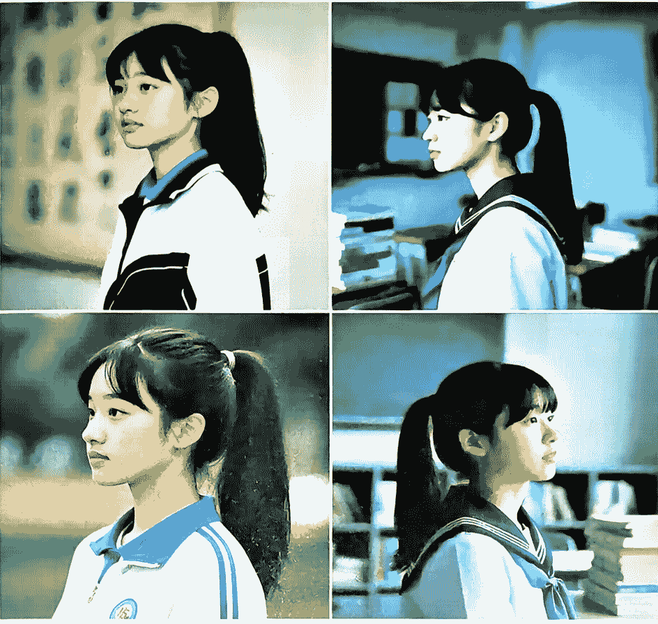
图 4-3 生成结果

面板里另外三项都是辅助创作的功能。

其中第一项“灵感向导”的作用是内部调用文本生成大模型，帮助创作者把简单的点子扩充成更合理的指令（图 4-4）。

图 4-4 灵感向导模式

点开后会出现一个次级面板，排版大致和 DeepSeek 接近。灵感向导的输出被限定为指令生成导向。在输入内容时，模型会先以提问的方式向用户确认一系列信息，再据此决定指令。下面用一个例子说明流程。

> 问：
一位 15 岁的女中学生，中国籍，性格严谨，高马尾。

灵感向导：
为了更精准地生成你想要的图片，我还想了解一些信息：这位女中学生处于什么样的场景中（如校园教室、操场、街道等），你希望图片呈现什么样的风格（如写实风、动漫风、水彩风等），使用什么样的镜头（近景、中景、全景等），营造怎样的氛围（活泼、安静、严肃等）呢？另外，图片的用途是什么，比如是作为插画、海报设计，还是其他用途？

> 问：
无背景图，动漫风，全景，严肃的氛围，用作人物设定。

灵感向导：
一位 15 岁中国籍高马尾性格严谨的女中学生，无背景，动漫风格，全景，严肃氛围，人物设定图。

你可以进一步明确女生的服饰、配饰细节，或者调整风格、氛围等方面的要求来优化生图效果。

把指令梳理清楚后，就可以在对话框里直接把指令转为图片（图 4-5）。

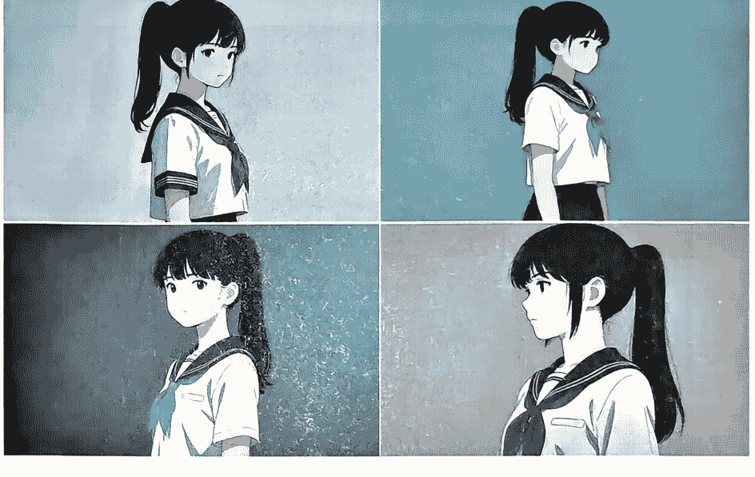
图 4-5 优化提示词后的生成结果

这时的成图会更贴合创作意图。

第二项基准图机制会在后面详细讲述，它的作用是以基准图为基准生成新图，这里暂不展开。

第三项文字增强是对文字生成的补偿功能。画面里生成文字是所有生图模型的短板，这由模型底层原理决定。各平台的解决思路不一，“文字增强”就是即梦平台对这一点的方案。

点击文字增强后，指令输入框会自动生成一对双引号，把需要呈现的文字填入引号内，生成时这些文字大概率会正确显示在画面中，具体例子见图 4-6。

> 指令：
一位 15 岁中国籍高马尾性格严谨的女中学生，穿着现代中国校服。无背景，动漫风格，全景，严肃氛围，人物设定图。背景上写着角色的名字“李云夕”。

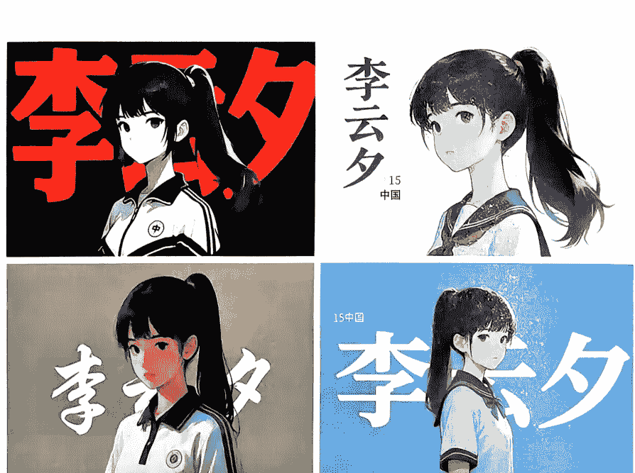
这些功能配合起来可以比较顺畅地完成生成任务。

###### 模型切换
指令面板下方是生图模型选择区（图 4-7）。

图 4-7 模型选择

模型工具都在持续迭代，同一平台通常会保留多个版本的老模型。综合生成需求与资源消耗的考量，平台会保留旧版本，点击后可展开模型选择面板（图 4-8）。

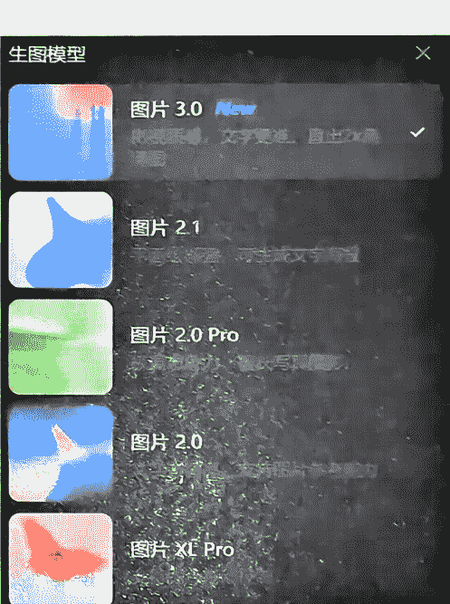
图 4-8 不同版本的生图模型

目前最新的生图模型是图片 3.0 版本，该版本新增了输出 2K 清晰度图片的能力（图 4-9）。

图 4-9 图片 3.0 版本可以输出 2K 分辨率的图片

除功能性能外，不同版本模型的成图风格取向也有差异，具体差别需要多试才能体会。

###### 画幅比例
“图片比例”面板用来调节生成图的宽高比。主流比例是 16 : 9 与 9 : 16，后者适合短视频平台。若后续需要裁切，也可以生成 1 : 1 的图，这种比例在裁切时能更好保留关键信息（图 4-10）。

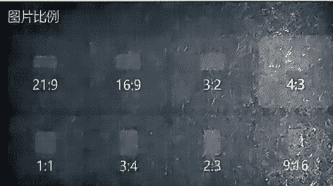
图 4-10 调整生图比例

创作者还可以在其下方的“图片尺寸”中自定义大小和比例。若不想用固定比例，可点中间的锁扣按钮解除锁定（图 4-11）。

图 4-11 图片尺寸自定义调整

##### 4.2.2 表情合集
要制作角色的表情合集，需要用到上传“基准图”的功能（图4-12）。

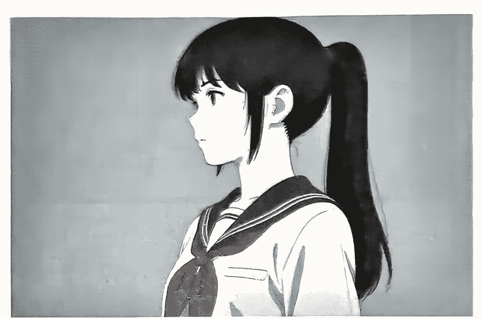
图4-12 参考图

基准图可视作生图的蓝本。模型在生成时，会依据设定把基准图中的特定信息保留到新图里。这些信息可以是角色外貌、画面风格，也可以是场景、构图等。以提供参考模板为基础的生成方式被称为“图生图”或“垫图”。用户点击指令输入区的“基准图导入”选项，即可上传本地图片作为基准图（图4-13）。

图4-13 点击进入参考图设置

成功导入后界面如 4-14 所示。

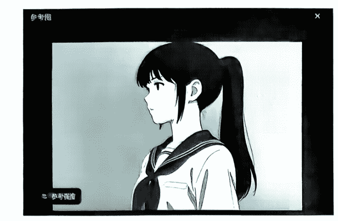
图 4-14 导入参考图

除此之外，还需对 模型参考图片的具体部分进行设置（图 4-15）。一般情况下，选择“智能参考”就能满足需求。选该选项时，模型会根据后续输入的指令自动判断需要参考的内容，判断准确率较高。其他选项针对性更强，但适用范围较窄。

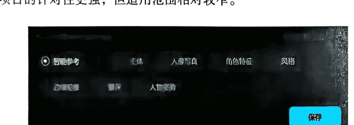
图 4-15 不同的参考项

图生图同样需要输入指令，由于已有基准图，创作者应在指令里明确指出要参考的内容。加入图片参考后的指令输入情况如图 4-16 所示。

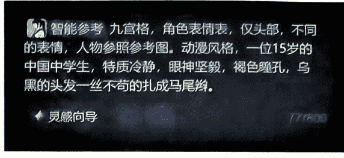
图 4-16 输入提示词

完成以上设置后，就能生成表情合集（图 4-17）。

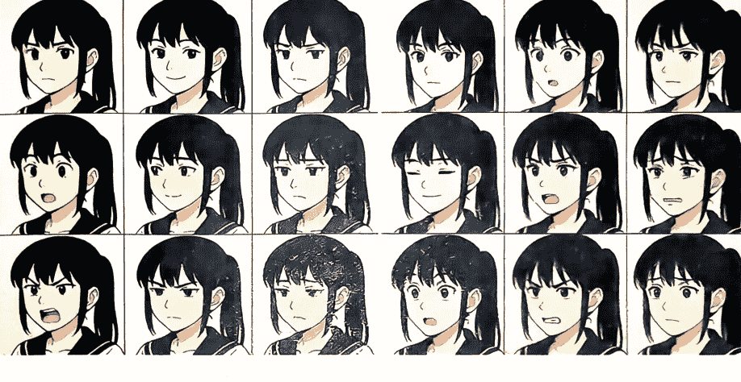
图 4-17 表情设定表生成结果

可用相同指令多生成几次，这样得到的表情会更丰富。完成后建档保存，以备后续使用。

#### 4.3 制作三角度图板
与表情合集类似，角色的“三角度图板”也是动画、漫画、游戏等视觉作品在角色设计阶段常用的基准图稿。它把同一角色的正面、侧面、背面三个固定角度的外形一次性呈现出来，图中会标注身高比例、头身比、服装层次、发型走向、配饰位置、色块分区甚至鞋底纹理。在本项目里，三角度图板主要用来为后续分镜帧提供角色参考，所以内容不需要那么详尽。

下面用一个例子演示三角度图板的生成方法。生成三角度图板同样需要加入基准图，这里用的基准图与上一节相同（图 4-18）。

> **指令：**
一位黑发少女，高马尾配齐刘海，面容精致且坚毅，人物参照“人物参考图”。身穿一套以白色和天蓝色为主色调的现代中国校服，款式简约。用于动漫素材，动漫风格，展示全身，包含正面、侧面和背面三视图。

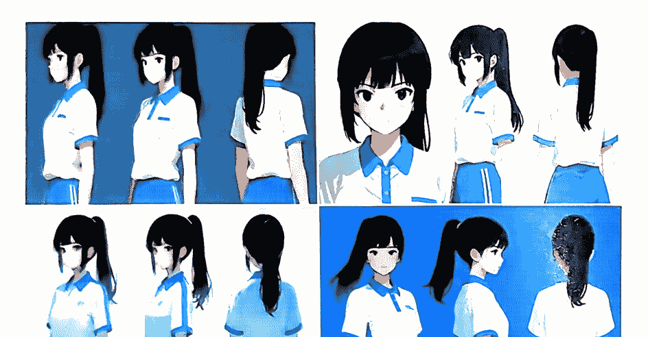
这里想要生成的是角色的校服三面图，这样在后续需要穿校服的场景中，就可以用这张图的某一部分作为角色参考。从生成结果里挑选出比较优秀的一张存档（图 4-19）。

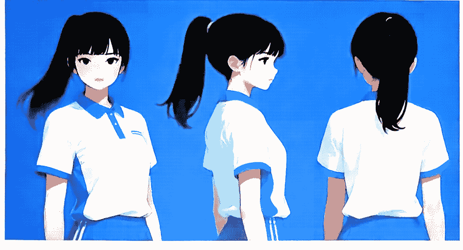
图 4-19 择优而取

这张角色三面图还能作为其他角色三面图的基准图使用，这样可以保证所有角色的服装、画风保持一致，可谓一举多得。生成时的示例指令如图 4-20 所示。

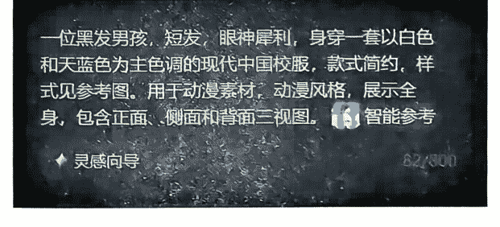
图 4-20 继续生成其他角色的示例提示词

在有基准图的情况下，生成结果大体一致，但仍存在细节差异，因此应选出服装差异最小的一张存档（图 4-21）。

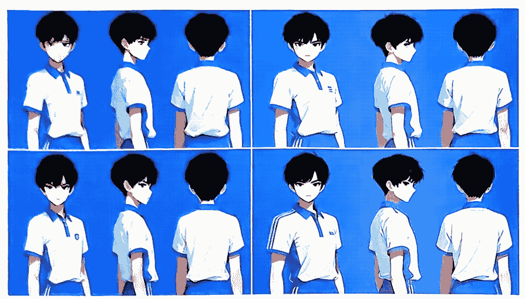
图 4-21 其他角色三视图生成结果

除了能生成不同角色相同服装的三面图，还可以生成同一角色不同服装的三面图。下面的例子以校服三面图为基准图，指令设计如图 4-22 所示。

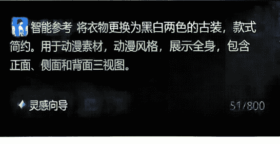
图 4-22 编写换衣提示词

生成结果如图 4-23 所示。

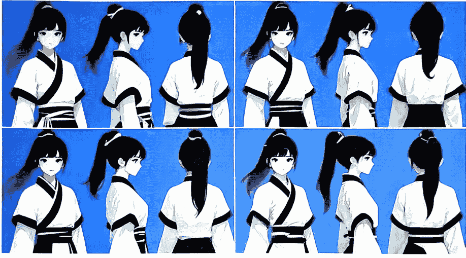
图 4-23 同一角色不同服装的三视图生成结果

按相同方法，为男性角色生成一组古装三面图（图 4-24）。

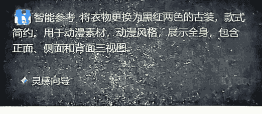
图 4-24 继续生成其他角色的古装三视图

生成结果如图 4-25 所示。

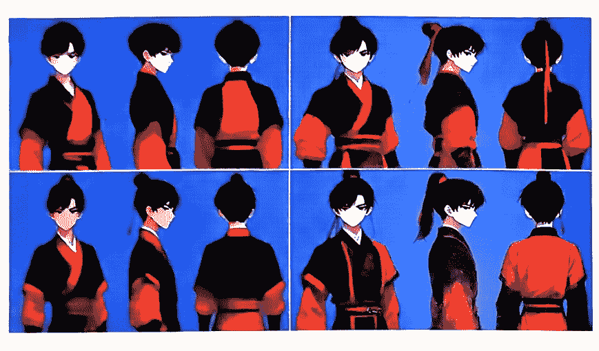
图 4-25 其他角色不同服装的三视图生成结果

这种逐步推进的生成方式，是制作动漫短剧人物的较优选择。

> ### 创作提示
用生成工具做动漫短剧时，很多情况下都是借鉴传统制作方式，从其工作流程里去掉不必要的步骤，提炼出适合自己的创作体系。

以角色设定为例，传统流程里包含很多项目，如动作/姿态设定、颜色设定等。配合生成工具的特性，很多创作内容都可以化繁为简。

#### 4.4 道具设计
在动漫短剧创作中，道具设计应尽量避免，若非必要，切勿增设实体。因为为了保持角色与场景的一致性已经消耗了大量生成次数，再加上道具，消耗还会进一步增加。

如果存在需要在多个场景中出现的关键道具，其设计应尽可能简洁，最好在创作分镜时能直接通过指令生成。比如示例系列剧使用的“度界仪”这一道具，就应尽量简单设计，否则用图生图融合会非常繁琐。这里仅生成一张道具基准图，在实际分镜中仍应尽量借助指令生成道具（图 4-26）。当然，用 Photoshop 等软件把道具融入分镜首尾帧也是一种可行做法。

> 指令：
圆形金属球，光滑，铜色。

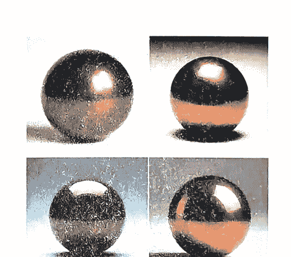
图 4-26 生成道具参考图

假设创作者想让角色捧起这颗“铜球”，该怎么做？

首先，将原始的三面图作为基准图输入给 模型（图 4-27）。

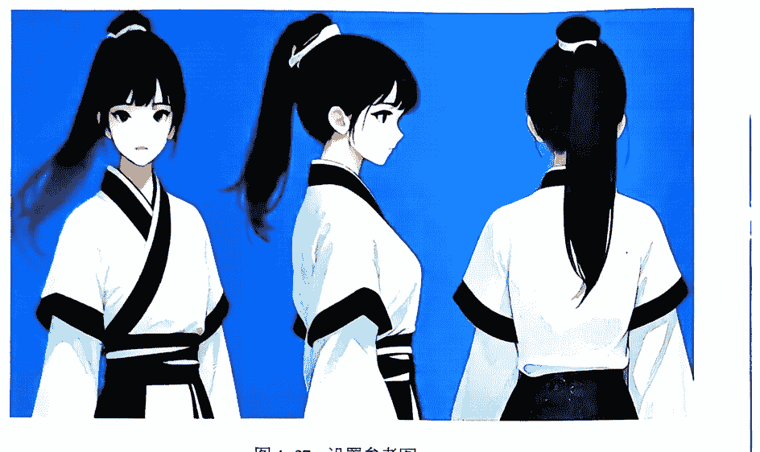
图 4-27 设置参考图

其次，输入下面的指令进行生成（图 4-28）。

> 指令：
参考图是一名角色的三视图，请让其手捧一枚光滑、铜色的圆形金属球。

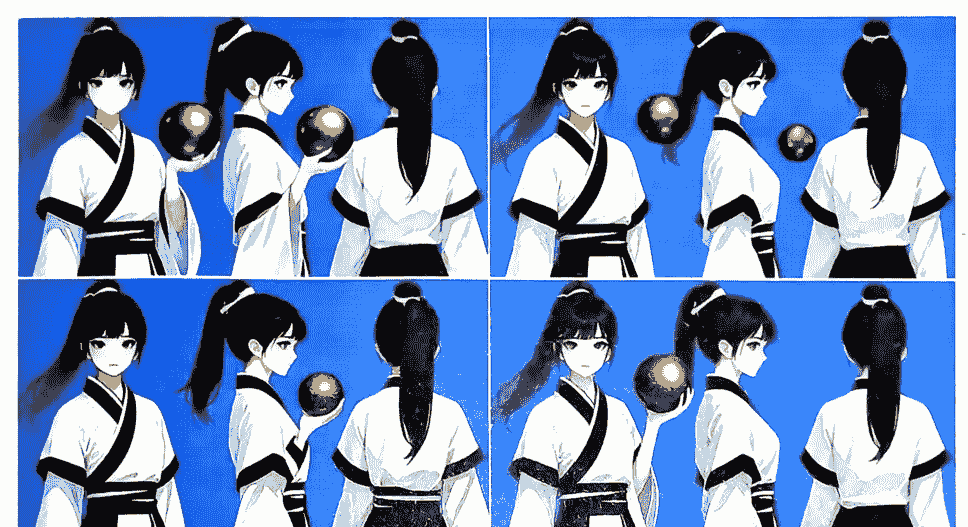
图 4-28 角色手捧“铜球”生成结果

在软件生成结果中，最契合需求的是图 4-29 所呈现的设计。然而其中角色的手形存在问题，若要修正，有两种可行方法。

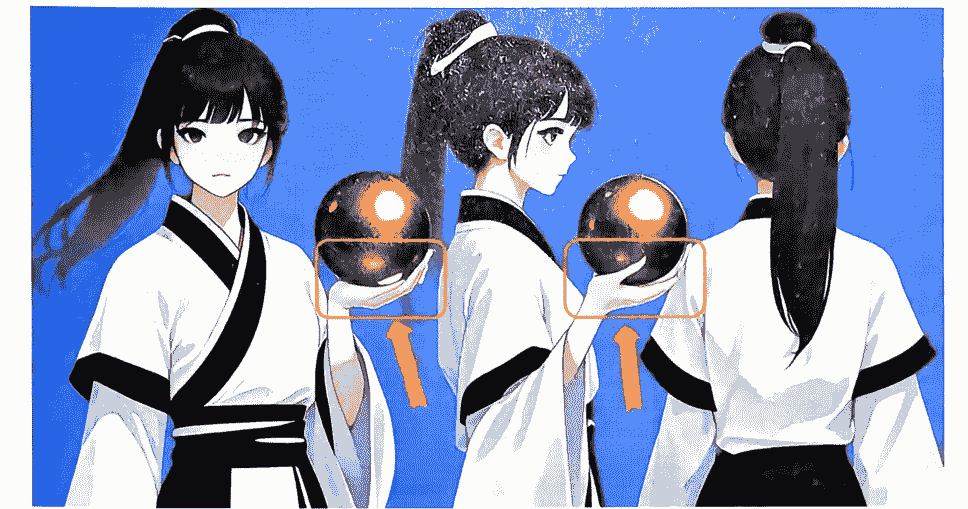
图 4-29 手型问题

##### 局部重绘
在生成结果中点开需要修改的图片进入编辑页，点击“局部重绘”编辑项，该功能允许在已生成的图片上进行局部修改（图 4-30）。

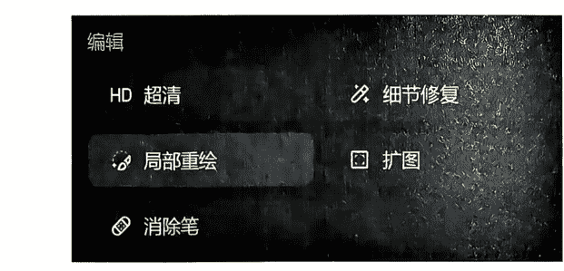
图 4-30 局部重绘

点击后进入修改页面（图 4-31）。这里可用鼠标涂抹选中相关区域，界面左下方可调节笔刷粗细。

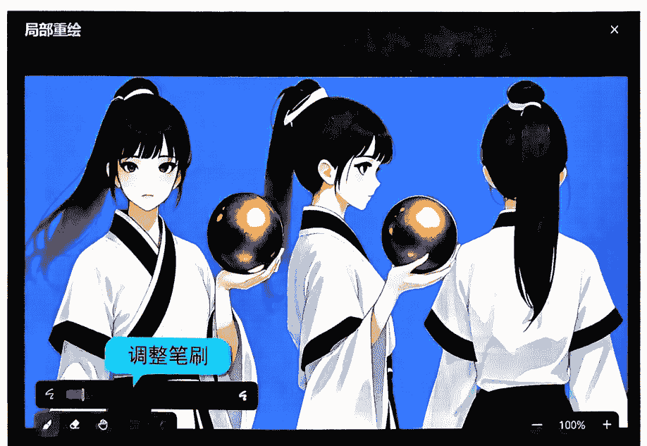
图 4-31 修改页面

涂抹后的效果如图 4-32 所示。

图 4-32 涂抹需要修改的区域

若想修改原生成内容，可在下方指令输入区填写新的指令，模型会按照新指令填充画面（图 4-33）。

图 4-33 提示词输入框

如果只是小范围修复，不需要输入指令，模型会默认按原指令填充涂抹部分。然后点击“立即生成”即可修复。

##### 细节修复
另一种方法是使用编辑面板里的“细节修复”功能（图 4-34）。

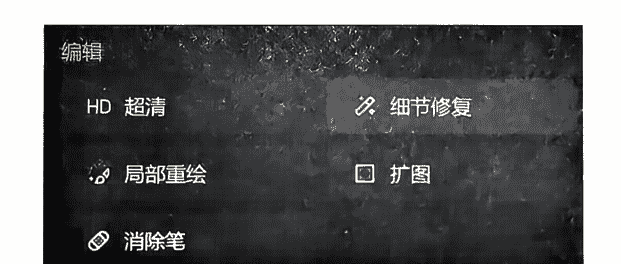
图 4-34 细节修复

点击细节修复后，模型会自动检测图片中存在的细节问题并尝试修复，创作者不必手动涂抹。

以图 4-29 这张图为例，点击细节修复，模型会自动修复手形问题（图 4-35）。

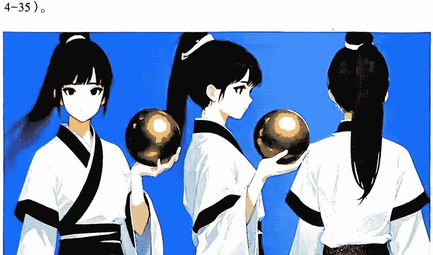
图 4-35 修复结果

但使用“细节修复”可能会带来新问题，比如图 4-35，手形虽已修正，但修复后图片清晰度大幅下降。

要解决此问题，只需提升图片清晰度即可。点击编辑选项中的“超清”，模型会自动提升清晰度（图 4-36）。

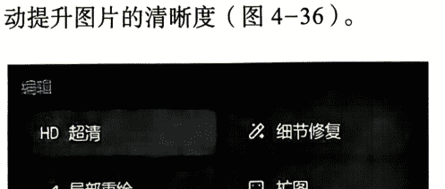
图 4-36 使用超清修复

提升后的效果如图 4-37 所示。

## 创作提示
生成工具也有能力边界。使用并不等于“我要什么，你给什么”，这个过程也是对边界的探索。哪些要求可以实现，哪些要求需要换一种路径实现，需要创作者去研究。在触及能力边界后，若想再往前一步，可能需要花费数倍的时间与精力，对动漫短剧创作来说已不划算。在工具能力未大幅提升前，最好简化创作需求，让内容回归到工具的能力边界之内。

### 第 5 章 场景设计
场景是故事发生的场所。在场景设定及分镜表里已经对场景做了文字描述，这里需要从文字中提炼出场景的具体特征，然后用 模型把文字转化为场景设计图。

#### 5.1 提取场景特征
首先，让 DeepSeek 从分镜脚本里分离出场景描写与角色描写。

> 问：
请从下面的分镜头脚本中分别提取出场景描绘与角色描绘两个部分。

视角以约四十五度自上而下切入，画面重心始终锁定中央。器材选用五十毫米定焦，F4.0、1/48 秒、ISO 320。约四秒的时间里，机位以几乎不可感知的幅度前移十厘米，带来逐步逼近的情绪张力。拍摄地点位于山林深处的一处空场，晚霞自稀疏松枝间漏下，色温约4300K，整体呈现暖金橘调。主光源来自右后方低位夕阳，在肩颈处勾勒出暖调轮廓。地面铺着细沙与落叶，侧光把空气中漂浮的尘埃映成金粉质感。景深很浅，后景树干与藤蔓化作柔和虚影。画幅中部，一位身着古风服饰的少女席地而坐，双膝微屈，十指紧握裙摆；眉宇紧蹙，唇色发白，痛苦与克制在面上交织。汗珠与泪滴沿鬓角滑落，在暖光中泛出高光。同期声包含山风扫过松针的沙沙声、远处偶发石块滚落声与零散虫鸣，胸麦收录到急促的呼吸及喉间细碎的哽咽。全流程无音乐，仅以低频风声与心跳声衬托空旷感。镜头收尾时对泪珠进行呼吸式微调焦，水珠折射夕阳迸出一道金点，随后硬切至下一画面。

DeepSeek：

1. 场景梳理
近距离俯视，四十五度斜俯角固定构图中心，特写呈现，五十毫米定焦、F4.0、1/48 秒、ISO 320。机位于四秒内前推约十厘米，产生逼近感。场景为林深处的空地，落日穿过稀疏松枝投下暖橙4300K光线，右后方低角度夕阳勾出暖色剪影。地面散布细沙与落叶，斜光里尘粒闪烁。景深极浅，后景树干与藤蔓化为柔焦。声景包含山风拂松针、远处碎石滚落与零星虫鸣，结合低频风噪与人物心跳营造空旷。

2. 角色梳理
画面中央的古风少女瘫坐地面，双膝弯曲，指尖紧抓黛色裙摆。眉心深锁、唇色泛白，痛楚与隐忍并存。汗液与泪珠自鬓边滑落，在暖光中高亮。呼吸急促、喉间哽咽清晰可闻；镜头末段对准泪珠做微调焦，夕阳在水珠中折射出金点后切走。

该部分也可保留下来，供后续关键帧制作使用。

随后对环境描述做进一步压缩，形成可用提示词。

问：
请把环境描写大幅简化，剔除冗余细节，只留一句，适配动漫短剧场景生成。

DeepSeek：
简化后可用于图像生成的提示：
> 密林深处空旷地，夕阳透过稀疏松枝洒向地面，傍晚时分，平拍视角，特写，动画风格，清新氛围，暖色调。

压缩后的提示即可用于生成场景图。

#### 5.2 生成分镜场景
将上述提示作为生成条件，效果见图5-1。

> 提示词：
山林深处空旷地，夕阳透过稀疏松枝洒向地面，傍晚时分，平拍视角，远景，动画风格，清新氛围，暖色调。

为提升场景复用率，这里把“特写”改成“远景”，生成后再裁切，用作首镜画面。裁切后场景如图5-2。

这类需裁切复用的素材，生成时最好直接选择高清输出，裁切后分辨率仍够用，如图5-3。

注意编辑面板里的“超清”只提升视觉清晰度，并非提升文件分辨率，如图5-4。因此生成后无法再用超清扩分辨率。

## AI 小技巧
复用素材是业内常用做法。不仅减少生成次数，也能保持场景一致性。比如本节从近景切到远景时使用同一素材，避免穿帮。

### 第 6 章 绘制关键帧
本章聚焦“融合”。此前已分别生成角色与场景素材，现在需要把它们结合，制作分镜所需的关键帧。

#### 6.1 分析镜头起点的人物动作
先从分镜设计中提取角色初始动作，为首帧做准备，例如下面这段。

> 白光闪过，李云夕来到了一个陌生的地方。周围是险峻的高山和茂密的树林，李云夕掉落在树林中的一片空地上。
> 
> 李云夕明显摔疼了，龇牙咧嘴地，一边揉着腿，嘴里一边嘟囔着：“好痛！”她似乎注意到了周围的情况：“这里是哪里？怎么一个人都没有？”说着便慢慢站起身，慌张地朝四周张望起来。
> 
> 天色逐渐暗了下去，李云夕依然没有发现其他人的身影。

向 DeepSeek 提问提炼提示词。

> 问：
下面是动漫短剧中某个分镜的内容设计，我需要你提炼出其中第一帧的人物动作。仅人物动作即可，不要描写环境，且文字要尽可能简练。

DeepSeek：
李云夕坐在地上，双手轻抚双腿，表情痛苦。

有了初始动作，接下来开始分层制作分镜首帧。

## AI 小技巧
在 AI 流程里，对关键帧的需求与传统不同。传统动漫关键帧是动作支点，用来定义起势、高潮、收势等代表瞬间，决定节奏与张力。AI 流程下关键帧被简化为首尾两帧，有时仅需首帧，中间由视频模型填充。因此融合素材时，一个镜头通常做两张画面就足够。

#### 6.2 制作人物动作
这里需要角色三视图作参考，但不能用整张，要裁切出与动作接近的视图。本例选用人物侧面图，如图6-1。

同时裁切出表情参考图，作为首帧表情依据，如图6-2。

提示词设计如下图6-3。

> 提示词：
无背景图，斜45度视角，远景，全身，一名古装15岁女性【参考图一，智能参考】摔了一跤坐在地上，表情痛苦【参考图二，智能参考】。

使用智能参考时图片比例不允许修改，生成结果会与裁切的侧面参考图一致。先筛选较满意的一张，这里取第二张，如图6-4。

该图仍有问题，如左手位置与右臂长度。接下来对这些部位做局部重绘，可适当放宽重绘范围，如图6-5。

重绘后如图6-6，经过多轮迭代可得到较为满意的人物动作图，如图6-7。

#### 6.3 扩图
此时人物图像已可用，但不完整，未露出全貌，可用编辑面板的“扩图功能”让AI补全整体形态，如图6-8。

点击“扩图”进入设置界面，如图6-9。

中间黑灰格区域是画布，显示扩图后大小，下方可调画布比例，如图6-10。

为展示全身，这里沿用默认1:1比例。下方的提示词区不要空着，把原提示词中参考图部分去掉，写入进去，以防止AI随意添加内容，如图6-11。

> 提示词：
无背景图，斜45度视角，远景，全身，一名古装15岁女性摔了一跤坐在地上，表情痛苦。

至此得到完整的人物姿态。

#### 6.4 人物抠图
生成完整姿态后，为方便后续融合，需要把人物从背景中抠出，得到无背景图。本节使用即梦AI的智能画布功能，如图6-12。

智能画布入口在即梦首页，图片生成入口右侧。进入后为1024×1024画布，如图6-13。

该界面虽可做简单文生图或图生图，但选项有限，不建议在此生成。建议先在图片生成模块生成素材，再导入处理。

操作：点击左侧“上传图片”，上传扩图后的成果，上传成功后自动显示在画布，如图6-14。

画布上方工具栏最后一项为“智能抠图”，如图6-15。

点击智能抠图图标，系统自动识别主体，进入等待，如图6-16。

计算完成后主体会被灰白格标记，如图6-17。

点击“抠图”，标记部分被抠出，如图6-18。

确认无误后点“完成编辑”保存。背景越干净抠图成功率越高，这也是提示词里加入“无背景”的原因。即使AI很难做到完全透明，也会得到纯色背景，降低抠图难度。

## AI 小技巧
制作方式要与制作需求匹配。把素材生成拆解为多步，核心是最大化可控性，即一致性。具体流程取决于创作者对成片质量的要求。若对质量要求不高，可采用粗放方式，直接依据人物参考图和提示词生成首尾帧。

#### 6.5 素材融合
本节进行角色与场景融合。首先上传分镜场景图，如图6-19。

此时场景覆盖了角色，需要调整图层顺序。

画布右侧可查看图层列表，越靠前的图层显示优先级越高，如图6-20。

选中人物图层，点击右侧“...”，弹出图层设置，如图6-21。

在“图层顺序”中把人物置顶，或把场景图层下移，人物就到场景上方，如图6-22。

接下来调整人物比例并放置到合适位置，如图6-23。

调整完不要急于融合，若画布大小未调，场景与画布空白处会被填充不可控内容。调整方式在画布设置中，如图6-24。

点击“画板适应图层”，画布会缩小为场景图片大小，如图6-25。

调整完毕后，选中人物图层，点击上方工具栏第二项进行融合，如图6-26。

此时人物图层为前景，需选择场景图作为背景图层，如图6-27。

下方可调节前景保持度，数值越高融合后前景变化越小。建议拉至最高，否则人物一致性易出问题，如图6-28。

设置完成后即可得到融合后的首帧画面，如图6-29。

#### 6.6 简化版的素材融合
素材融合还有更简便的方法。观察图6-27，起始画面已基本达标。若对效果要求不高，可省略最终融合，直接抠出人物后用PS等软件叠加到场景上，导出首尾帧。

这种方式协调性会下降，但操作简单、无废片，适合复杂多角色场景。

首先挑选角色三视图并水平翻转，如图6-30。

截取所需角色参考，如图6-31。

上传作参考图，用提示词生成动作图，如图6-32。

> 提示词：
无背景图，远景，全身，一名古装15岁男性【角色参考图，智能参考】单膝跪地，皱眉【表情参考图，智能参考】。

抠除背景，如图6-33。

点击画布上方工具栏“扩图”，如图6-34。

选择1:1比例并扩大范围，确保能容纳全身，如图6-35。

扩图结果如图6-36。

导出素材，在PS类软件中将人物素材分图层放置于场景图层上方，如图6-37。

## 第 7 章

### 视频素材制作
在素材制作的最后环节，生成的内容已可进入剪辑。在此阶段除了把前面生成的首尾帧转为动态视频外，还需统筹动漫短剧中的配音与配乐。

#### 7.1 文生视频简介
文生视频指用提示词生成视频。在动漫短剧制作中该功能使用较少，因为一致性要求高，业界通常用已制作好的图片素材生成视频。

不过文生视频作为AI视频生成工具的重要模块，其部分功能在图生视频环节仍有价值。下面做简要介绍。

##### 7.1.1 切换模型
进入首页后，点击左上方“立即体验”进入创作面板，如图7-1。

图 7-1 可灵首页入口

进入创作面板后，左上方可切换视频生成模型，如图7-2。

图 7-2 切换模型

与图片生成类似，视频模型分不同版本，性能与支持功能各异，如图7-3。
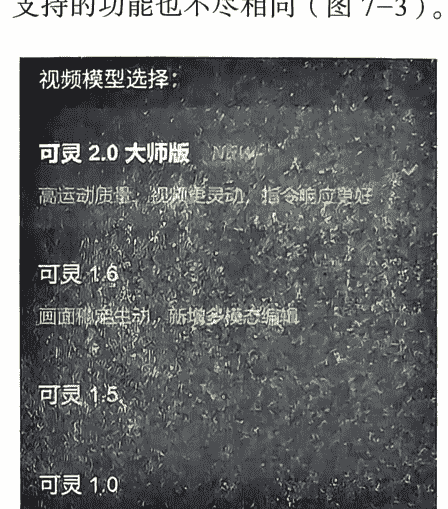
图 7-3 不同的模型版本

目前最新版本是可灵2.0大师版，也是系统默认。可灵1.6生成能力稍弱，但功能更全，这两个版本使用频率最高。

模型下方是主要参数调节区，可切换不同视频生成方式，如图7-4。

图 7-4 切换生成方式

##### 7.1.2 创意描述
文生视频左上方是创意描述面板，如图7-5。下面从四部分展开。

###### 提示词输入区域
该输入框用于录入提示词。

视频生成时提示词需清晰说明：
谁在什么地方做什么，画面风格，角色与镜头关系，镜头如何运动。

（1）角色：视频主体是谁，包括外貌、年龄、身份、情绪。如：
> 一位身穿复古夹克、约25岁的女性。

（2）场景设定：用画面感描述地点、时代、氛围。如：
傍晚的公园，她坐在长凳上。

（3）动作与因果：描述角色正在做什么及动作逻辑，帮助模型理解连贯剧情。如：
眼睛盯着远处夕阳，然后扭脸盯向镜头。

（4）画面风格：指定视觉语言、色调、材质、光影、后期。如：
画面呈20世纪80年代赛博怀旧胶片质感，颗粒轻微，晚霞高饱和略带噪点。

（5）镜头语言：说明角色与镜头距离、视角、运动方式。如：
开场中景平视，最后镜头升高45°俯视，缓慢向后拉出。

把五项串成自然段，即为完整提示词。输入后点“立即生成”即可，如图7-6。
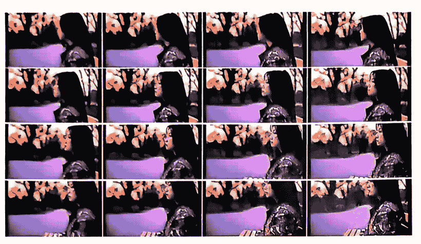
图 7-6 生成结果

与图片提示词相比，视频提示词多了“时间”和“运动”维度。创作者不仅要描述单帧长相，还要说明帧间变化、镜头运动、动作连贯性。图片生成关注单帧构图与美学，无需叙事化动作链与镜头轨迹。

###### 调用 DeepSeek
此功能类似即梦AI的灵感向导，通过第三方文本模型帮助梳理提示词，如图7-7。
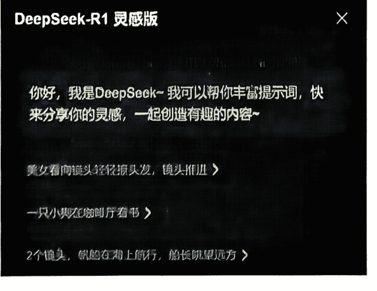
图 7-7 在可灵内部调用 DeepSeek

例如把提示词交给DeepSeek，它会自动增改细节，使其更符合视频模型理解逻辑。

> 问：
一位身穿复古夹克、约25岁的女性。傍晚的公园，她坐在长凳上。眼睛盯着远处的夕阳，然后扭过脸来盯着镜头。画面呈20世纪80年代赛博怀旧胶片质感，颗粒感轻微，晚霞高饱和但略带噪点。开场使用中景平视镜头，最后镜头升高45°俯视，缓慢向后拉出。

DeepSeek：
一位身穿复古夹克的年轻女性坐在公园长凳上，中景平视展现她凝视夕阳的侧脸，背景枫树叶片泛着橙红光泽，路灯在暮色中泛起柔和光晕，画面呈现轻微颗粒的赛博胶片质感。

她突然扭脸直视镜头，特写捕捉到眼中映着霞光的细微颤动，夹克领口金属装饰反射着高饱和晚霞，远处游乐设施轮廓在逆光中化为剪影，手持镜头轻微晃动增强临场感。

使用AI调整后的提示词，生成效果更出色，如图7-8。
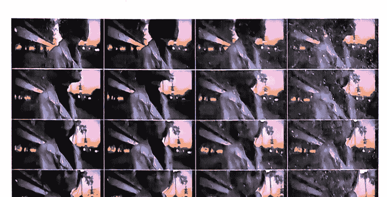
###### 词库与预设
“词库”是系统预设的固定提示词组合，可便捷控制生成效果。鼠标悬停不同预设词可预览效果，如图7-9。
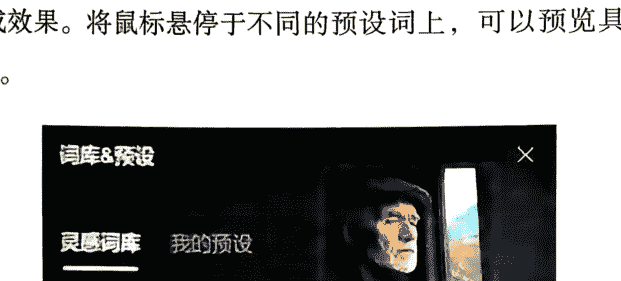
图 7-9 系统词库

系统词库分为五大类，具体见表7-1。

表 7-1 系统词库内容

| 类别 | 预设词 |
| :--- | :--- |
| 镜头 | 围绕主体运镜、固定镜头、手持镜头、镜头拉远、镜头推进、镜头跟随 |
| 景别 | 近景、远景、仰视、俯视、景深、正面视角、特写、无人机拍摄 |
| 光影（多选） | 阳光、灯光、柔和光、霓虹光、暖光、自然光、烛光、城市夜景 |
| 画面（多选） | 细节丰富、背景简约 |
| 氛围（多选） | 神秘、宁静、温馨、生动、色彩艳丽 |

点击预设词后会加入提示词。例如在提示词中加入“城市夜景”，效果如图7-10。
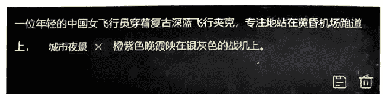
图 7-10 添加“城市夜景”

镜头、景别等关键词带有下拉菜单，可随时调整更换，如图7-11。

图 7-11 可调整的预设词

除系统词库外，创作者可在“我的预设”中自定义预设词，如图7-12。
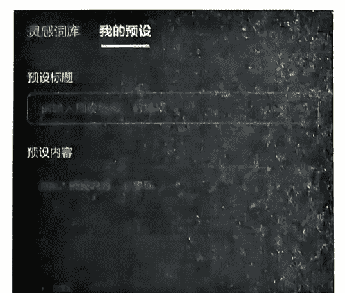
图 7-12 自定义预设词

其中“预设标题”为预设词名称，“预设内容”为其含义，设置后点“保存预设”即可。

###### 提示词推荐
此部分展示系统推荐的提示词模板，缺乏思路时可作参考。点击“跳舞熊猫”选项，系统会把预设提示词填入输入区，如图7-13。
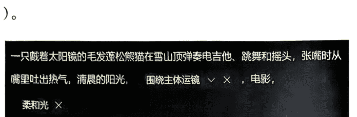
推荐提示词中也包含词库内容，创作者可参考其在提示词中的位置。

##### 7.1.3 不希望呈现的内容

这个开关其实就是大家常说的逆向指令机制，玩过 Stable Diffusion 这类模型的创作者基本都接触过（图 7-14）。

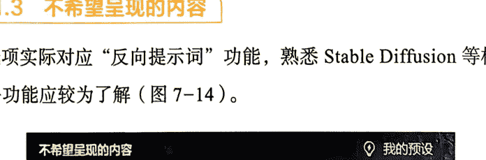

平时喂给模型用来让它产出画面的文字描述，归类上叫正面指令，职责是告诉系统“画面里要出现什么”。相对的，逆向指令则是列一张避坑清单，明确告诉系统“哪些元素必须剔除”。

这种逆向指令还能保存成个人的快速排除模板，一键把不想出现的画面元素挡掉。点进界面右上角的“我的预设”就能新增或调用（图 7-15）。

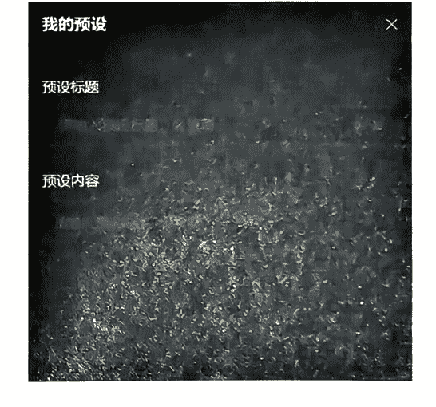

图 7-15 逆向预设输入区

##### 7.1.4 其他参数设置

除了前面提到的条目，操控区块的底部还藏着一批进阶调节选项（图 7-16）。

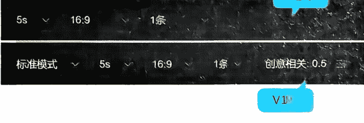

图 7-16 进阶调节概览

各类模型开放的调节项并不完全一致。图 7-16 上半部对应 2.0 版，下半部对应 1.6 版。

###### 模式选择

1.6 版可自行决定是否开启高画质渲染模式（图 7-17）。

图 7-17 模式切换示意

开启高画质后视觉表现会更扎实，不过消耗的点数也会跟着上涨。

###### 生成时长

两套版本都能指定影片的总长度（图 7-18）。

图 7-18 时长选择界面

现阶段仅提供 5 秒与 10 秒两档。

###### 画面比例

两套模型共提供 16:9、9:16、1:1 三种比例可选（图 7-19）。

图 7-19 比例选择界面

前两者分别契合横屏长视频与竖屏短视频的常规规格，1:1 则更利于后期裁剪复用。

###### 产出数量

两套版本都能设定单次产出几条片段（图 7-20）。

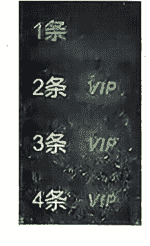

图 7-20 数量选择界面

图片生成默认一次四张，但影片的算力开销大得多，成本也更高，因此默认只产出一条。

###### 创意自由度

“创意相关”滑块控制模型发挥的余地（图 7-21）。往“创意想象力”拉，模型会更大胆发散；往“创意相关性”拉，输出会更贴近文字指引的字面意思。

图 7-21 创意自由度调节

#### 7.2 用首尾帧制作片段

除了文字生成影片，图像生成影片里最常用的就是首尾帧模式。

##### 7.2.1 首尾帧配置

进入图像转影片模块，首个出现的就是首尾帧配置面板（图 7-22）。

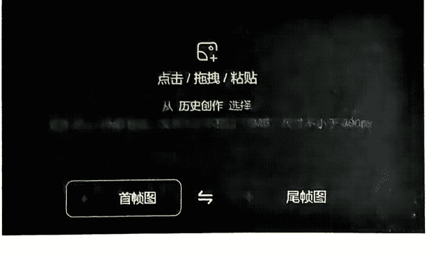

在该面板里可导入本地的首尾帧素材，导入完毕后的预览见图 7-23。

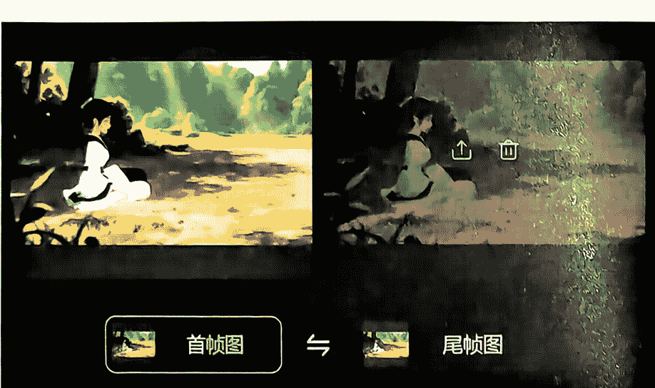

若首尾选用同一张图，场景会被锁死，重点可放在角色与环境的细微变化上。

> AI 提示

某些情况下不必提供成对画面，只给首帧或只给尾帧也能运行。

只给首帧时，系统会自行推演后续发展；只给尾帧时，系统会倒推之前的情节，并让画面在尾帧收束。

##### 7.2.2 文字指引撰写

图像转影片同样配备创意描述区，用来输入文字指引（图 7-24）。

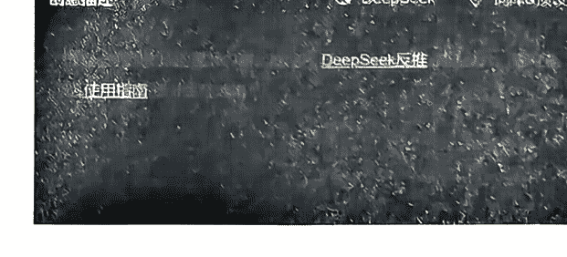

整体逻辑与文字生成影片相近，但写法不同。因为首帧已定，角色、风格、场景都有现成模板，无需重复描述。文字指引应集中在角色动作与镜头运动上。

参考示例，可按图 7-25 的思路组织指引。

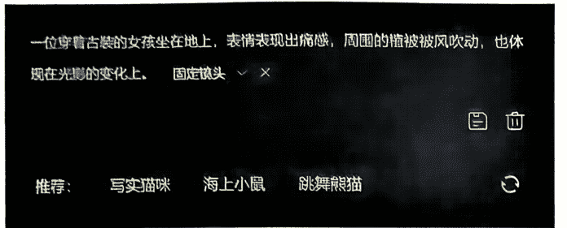

图 7-25 图像转影片指引示例

该镜头讲角色刚踏入神话世界摔倒后感到疼痛，动作幅度不大，因此指引要偏重环境氛围的动态与角色表情的细微波动。

首尾帧导入完毕、指引写好后即可开始渲染（图 7-26）。

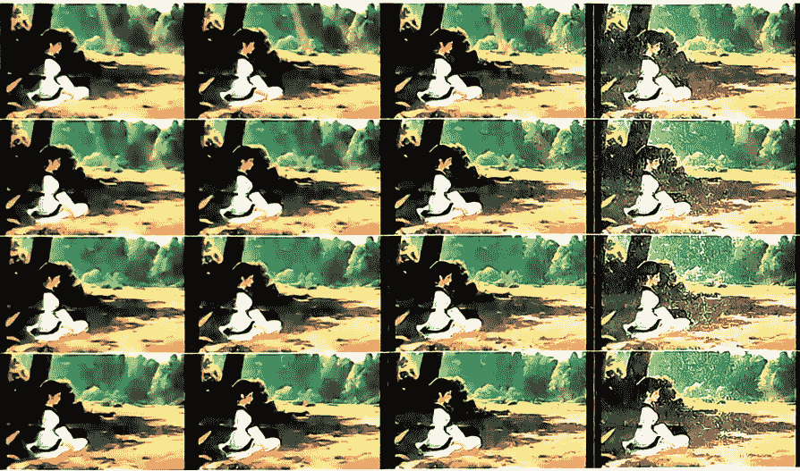

图 7-26 渲染结果示例

##### 7.2.3 运动画笔

若文字指引无法精确控制，可用“运动画笔”明确指导肢体动作。但要注意，运动画笔与镜头控制互斥，不能同时启用（图 7-27）。

图 7-27 运动画笔入口

进入画笔控制页后，右侧会出现运动区块与轨迹的管理面板，最多可划分六个区块（图 7-28）。

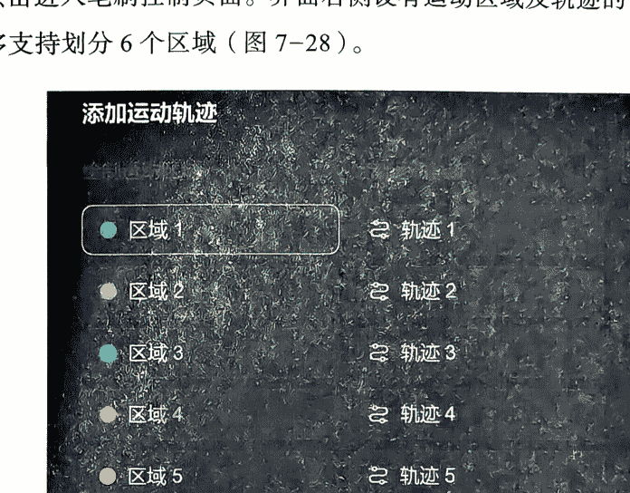

图 7-28 区块与路径管理

运动区块指的是在影片里被视作整体移动的区域。选中“区块 1”后，在左侧用画笔圈出范围，这里以人物头部为例（图 7-29）。

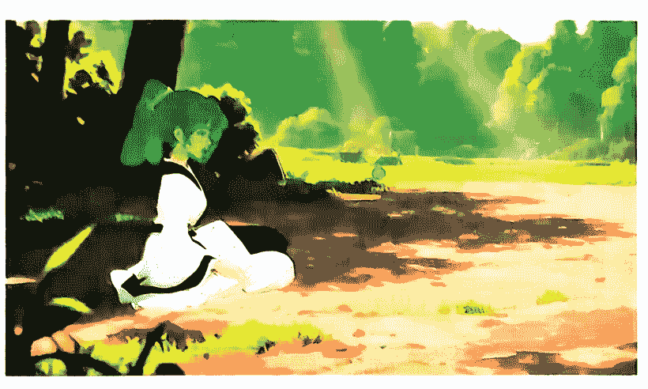

图 7-29 选取运动区块

圈选完毕后，在管理面板选中“路径 1”，即可为该区块绘制移动路径（图 7-30）。

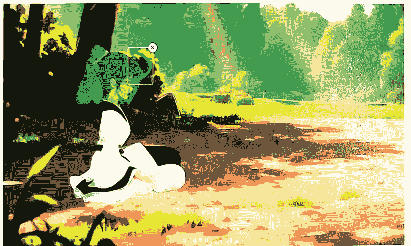

图 7-30 绘制移动路径

沿着这条路径，影片里人物的头部会呈现逆时针转动。

更省事的做法是打开顶部“自动识别区块”开关（图 7-31）。

图 7-31 自动识别开关

开启后，系统会依据点击位置自动勾勒区块，边缘识别比手工更精准，后续只需手动修补瑕疵（图 7-32）。

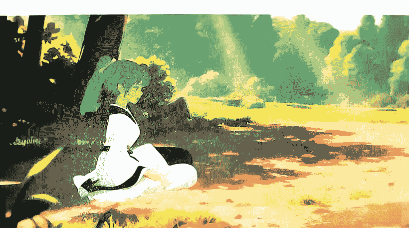

图 7-32 自动勾勒效果

同理，为画面中每个需要动的物体逐一标记路径（图 7-33）。

图 7-33 多物体路径标记

若某些部位需保持不动，可在管理面板底部使用“新增静止区块”功能（图 7-34）。

图 7-34 静止区块功能

点击后圈选需固定的部位，这些区块会变为黑色，操作逻辑与选运动区一致（图 7-35）。

图 7-35 静止区块涂抹

所有设定完毕后点“确认添加”保存并退出。

当前运动画笔仅在 V1.5 版的高画质模式下可用，成像质量相对新模型要差，容易出现撕裂、面部畸变，追求可用画面往往需要多次渲染。

##### 7.2.4 其他调节

图像转影片同样支持逆向指令等设置，与文字生成影片完全一致，这里不再重复。

> AI 提示

影片生成的几点注意：

（1）多角色场景尽量简化镜头运动。
（2）复杂动作并非不能实现，但会消耗大量时间，需权衡取舍。
（3）复杂场景废片率偏高，经验上成片率常低于30%。
（4）制作难度过大的镜头可采用“静帧+动效”的折中方案。

#### 7.3 其他可用工具

除了文字生成影片和首尾帧图像生成影片，可灵还提供若干生成与修改工具，可控性仍在迭代，这里简要介绍。

##### 7.3.1 多图参照

这是图像生成影片的另一项能力，支持最多导入四张参照图，综合这些画面合成影片（图 7-36）。

图 7-36 多图参照界面

像示例那样导入构成一个场景所需的所有素材，并输入事件描述作为文字指引，即可融合生成（图 7-37）。

图 7-37 文字指引输入

理想情况下能大幅提升效率，但在当前模型能力下，输出仍常出现异常。

##### 7.3.2 多模态编辑

这是一项颇具新意的编辑功能，入口位于图像生成影片旁（图 7-38）。

图 7-38 多模态编辑入口

它支持对已生成的影片进行修改，包含替换元素、新增元素、删除元素三种方式。因为三者操作逻辑相近，下面以替换元素为例说明。

先导入待编辑的影片文件（图 7-39）。

图 7-39 文件选择

导入后在弹出界面里选中需要被替换的主体（图 7-40）。

图 7-40 主体选中

底部有影片时间轴，尽量在多个时间点都选中同一主体，有助于模型更精准识别（图 7-41）。

图 7-41 多时间点标注

保存退出后导入替换用的角色图像（图 7-42）。

图 7-42 替换图导入

导入后在弹出框里尽可能精确地框出角色主体（图 7-43）。

图 7-43 主体框选

完成后在底部的文字指引模板里填写被替换与替换的主体名称，模板由系统预设，只需填入内容即可（图 7-44）。

图 7-44 指引填写

点“立即生成”即可查看替换效果。

#### 7.4 配音与配乐

音轨部分也可以交给 AI 完成。

##### 7.4.1 配音制作

配音制作采用 Fish Audio（图 7-45）。

图 7-45 Fish Audio 主页

登录后进入“语音合成”里的“即时语音”，点击“创建”新建一个文本转语音项目（图 7-46）。

###### 输入语音文本

在输入区填入人物台词，标注的 500 指 500 UTF-8 字节，一个汉字约占 3 字节。例如 5 个汉字约占 15 字节（图 7-47）。

部分场景下配额会提升到 5000 UTF-8 字节，但日常对话单句很少超过 100 字。

最新模型还支持用关键词控制语气停顿、呼吸、笑声等，关键词对照见表 7-2。

###### 表 7-2 关键词释义表

| 关键词 | 效果 |
| :--- | :--- |
| (break) | 短停顿 |
| (long-break) | 长停顿 |
| (breath) | 插入呼吸音 |
| (laugh) | 插入笑声 |

示例写法：

> 好痛！（breath）这里到底是哪里？（break）怎么空无一人？

###### 语音声音选择

该模块可选择朗读声线（图 7-48）。

进入后，“最近使用”按时间顺序展示历史模型，“探索”展示平台语音库，“我的语音”展示自训模型（图 7-49）。

###### 语音生成调节

选定模型后，在界面底部进行细节调节（图 7-50）。

“高画质模式”会提升音质但延长制作时间；“语速”用于迭代微调，发现过快过慢时可回头调整；“音量”保持默认，后期用编辑软件统一处理即可。全部确认后点“创建”即可导出配音。

##### 7.4.2 配乐制作

Suno AI 目前是泛用性最强的配乐工具（图 7-51），但受条件限制暂无法直连。

其他工具差距不大，这里选用海绵音乐，主页如图 7-52。

图 7-52 海绵音乐

进入主页后点“创作”进入创作面板（图 7-53）。

图 7-53 配乐创作面板

在输入框描述曲风需求后点“AI 作词”。

> 问：

国风歌曲，使用民族乐器，悠扬清新，歌曲的内容是几位少年保护神话故事，并在保护过程中获得成长。

AI 作词：

（前奏）

（主歌）

青铜铃摇醒山海另一边的晨光

少年踏过星屑铺就的异界长廊

古卷残页里飞出青鸟衔着锋芒

指尖划过云洲唤醒沉睡的青龙掌

（副歌）

以血为契刻下亘古的纹章

九重天外传来女娲石的回响

朱雀羽扫尽混沌时少年忽然生长

神话在瞳孔深处绽成不谢的洪荒

（间奏）

（主歌）

琥珀色月光浸泡着破损的箭囊

断弦琴弹出夸父逐日时的倔强

麒麟泪滴落修补碎裂的时光墙

少年背上长出精卫填海的翅膀

（副歌）

以血为契刻下亘古的纹章

九重天外传来女娲石的回响

朱雀羽扫尽混沌时少年忽然生长

神话在瞳孔深处绽成不谢的洪荒

（桥段）

月下篝火舔舐着泛黄的帛书

神兽化作图腾烙在锁骨

> 黎明前他们与伏羲背影道别

掌纹里蜿蜒出不周山的新月

（尾奏）

其中“前奏”“主歌”等标签是结构化指引，能帮助模型理解曲式。

国产工具内部多调用 DeepSeek，生成能力不错；在独立客户端里还能输入更详尽的分镜信息，让输出更贴合短片剧情。创作者可按需选择方案。

歌词下方还能设置更多风格选项（图 7-54）。

图 7-54 音乐风格设置

确认后点“生成音乐”，AI 会把歌词转化为完整曲目（图 7-55）。

图 7-55 生成结果

制作场景配乐时只需打开“纯音乐”开关，即可得到无歌词版本（图 7-56）。

图 7-56 纯音乐开关

#### 7.5 拼出一组镜头

沿用上述方法，先把首尾帧做好，再依次生成。

首先完成首尾帧制作。

分镜 2（图 7-57）：

图 7-57 分镜 2 首尾帧

分镜 3（图 7-58）：

图 7-58 分镜 3 首尾帧

分镜 4（图 7-59）：

图 7-59 分镜 4 首尾帧

随后利用这些首尾帧按顺序生成影片素材，即可组成完整的镜头组。

分镜 2 视频素材（图 7-60）：

图 7-60 分镜 2 视频素材

分镜 3 视频素材（图 7-61）：

图 7-61 分镜 3 视频素材

分镜 4 视频素材（图 7-62）：

图 7-62 分镜 4 视频素材

这组镜头无需再重新配音配乐，直接沿用之前已经生成的音频即可。

到这里，分镜所需的画面素材基本已经齐备，接下来要做的就是把它们集中起来，通过剪辑拼成一段完整的镜头。

前面各章节产出的所有素材，都将在本环节做最终汇总。到了这一步，创作者必须亲自上手主导，完成成品的落地。作为 AI 动漫短剧制作的收尾环节，时下比较复杂的剪辑操作仍然无法交给 AI 工具，必须由创作者亲力亲为。

本篇采用的工具：

剪辑软件：剪映专业版。

# 第 8 章

## 汇总素材，剪辑成片

剪映对新手相当友好，本章会以一个真实案例带你快速上手它的核心用法。

#### 8.1 导入素材

启动剪映后，点击首页上方的“开始创作”，新建一个剪辑工程（图 8-1）。

图 8-1 新建工程

进入工作界面后，左上方就是素材区（图 8-2）。这里既能导入本地的视频素材，也能调用系统内置的在线资源，涵盖特效、转场、滤镜、字幕等常用类型。

图 8-2 素材区面板

点“导入”，在本地文件夹里选中想要的素材，点击“打开”就能把文件拉进剪映（图 8-3）。一次可以多选，批量导入也很方便。

图 8-3 本地素材导入完成

素材导入后，还要把它放到下方编辑轨道里，才能进入剪辑流程。

操作很简单，直接把素材拖拽到轨道区域即可（图 8-4）。

图 8-4 编辑轨道

编辑轨道本质上是一条分层的时间轴，可以把不同素材分配到不同轨道，并在对应的时间线上进行编辑。界面中央的监视器负责预览当前帧，点选轨道上的位置就能切换帧，剪辑后的最终呈现效果也在这里观看（图 8-5）。

图 8-5 监视器画面

右上方是参数设置面板。选中轨道里的素材后，就可以在这里做更精细的调整。不同素材类型的可调项不一样，下面以视频素材为例说明（图 8-6）。

图 8-6 参数设置面板

整套剪辑工作围绕下面 4 个区域展开：

- 素材区：导入本地素材，检索并添加在线素材。
- 编辑轨道：把素材纳入流程，完成拼接与处理。
- 监视器：查看当前帧效果以及剪辑后的播放效果。
- 参数设置面板：对素材各项参数进行微调。

#### 8.2 素材处理

原始视频拿到手后，通常需要做些调整才能符合剪辑需求。大多数操作都在编辑轨道内完成，轨道上方有一排工具栏（图 8-7）。

图 8-7 素材处理工具

鼠标状态切换（）：设定单击鼠标的功能，共有 4 种模式（图 8-8）。

图 8-8 单击鼠标功能切换

“选择”是默认状态，点击轨道可选中素材或定位帧。

切到“分割”后，在片段上单击就会在该位置把素材切开（图 8-9）。

图 8-9 鼠标分割状态

切到“向左全选”后，鼠标点到的位置左侧所有素材会一并被选中（图 8-10）。

图 8-10 鼠标向左全选状态

“向右全选”的逻辑相同，只是方向相反。

撤销与重置（↩）：和多数软件一样，用于撤销或重置当前修改。

分割（✂）：在当前选中位置把素材一分为二（图 8-11）。

图 8-11 分割功能

向左/向右裁切（⌗ ⌗）：从选中点起删除左侧或右侧的片段（图 8-12）。

图 8-12 向左裁切

删除（🗑）：移除已选素材。

添加标记（🔖）：在当前选中位置插入标记（图 8-13）。

图 8-13 添加标记

定格（⏸）：把当前帧固定为默认 3 秒的定格素材，插入到原位置（图 8-14）。

图 8-14 定格帧

倒放（■）：反转播放方向，由尾到头播放。

镜像（■）：水平镜像，左右互换（图 8-15）。

图 8-15 镜像翻转

旋转（■）：顺时针每次旋转 90 度（图 8-16）。

图 8-16 旋转素材

旋转裁切（🔄）：边旋转画面边进行裁切（图 8-17）。

图 8-17 旋转裁切

#### 8.3 添加配音配乐文件

先把第一镜头的配音文件导入剪映（图 8-18）。

图 8-18 配音文件

导入方式与视频相同，之后拖拽到编辑轨道里（图 8-19）。

图 8-19 导入音轨

导入后音轨和画面通常不对齐，还需要做位置调整。

##### 8.3.1 根据配音调整视频

配音一旦选定再去改动成本很高。改速度会跑调，裁剪会导致台词节奏怪异。

相比之下视频的可塑性更大，所以一般优先调整画面。

###### 素材变速

通过改变播放速度来解决时长过长或过短，是常用手段。

选中视频后，在参数面板打开“变速”（图 8-20）。

图 8-20 变速设置

常规变速是对整段素材做统一处理。直接调倍数也可以，更常见的是设定目标时长，让软件自动计算速率，从而和配音更精准对齐。

曲线变速和变速卡点是对局部进行处理，曲线变速的可控性更强，选项更多（图 8-21）。

图 8-21 曲线变速

以子弹时间为例，它借鉴了《黑客帝国》的慢动作手法，在重点片段做升格慢放。图 8-22 就是子弹时间的调节点，可以拖拽来控制慢放起止和倍率变化。

图 8-22 子弹时间

变速卡点是短视频里常见的节奏配合方式，需要配合音乐使用。在音乐节拍点上做变速，形成卡点效果（图 8-23）。

图 8-23 变速卡点

卡点变速没有精细调节，只有预设效果可选。选好后软件会自动匹配音乐节奏并加入少量特效提升观感。

当然也可以用曲线变速加画面特效手动实现，只是操作更繁琐。

###### 裁切与拼接

如果素材太短，直接变速容易丢帧导致卡顿。

更好的做法是在画面相对静止处做裁切拼接，在不改变帧率的前提下拉长时长。

拼接要注意自然度，不能生硬插入。以示例为例，先把一段需要延展的片段裁出来并标记起止（图 8-24）。

图 8-24 裁切出一段素材

这段前后都与相邻素材相连。复制它放在原段之后并设为倒放，连接点就会变成这样（图 8-25）。

图 8-25 复制素材并倒放

两端相连保证画面连贯，右侧倒放段会从尾回到头。但此时结尾需要回到原末端，于是再复制一次原始裁切素材插入（图 8-26）。

图 8-26 再次复制原始素材

处理后整段衔接自然，时长也得到有效延长。

##### 8.3.2 调整配乐

配乐一般比视频长，需要挑段落裁剪并加上进出效果。

###### 裁切配乐

听一遍音乐，确定使用段落，按进出点裁出所需部分（图 8-27）。

图 8-27 裁切配乐

###### 添加淡入淡出效果

选中配乐段落，在参数面板进入“基础”选项（图 8-28）。

图 8-28 调整淡入淡出效果

在这里可以加入淡入淡出，调节时长，也可以单独调音量。

至此，配音与配乐的设置就完成了。

#### 8.4 添加字幕

在素材区打开“文本”，点击默认文本下方的加号，把它加到编辑轨道（图 8-29）。

图 8-29 添加文本

选中文本轨道，在监视器里调整位置和大小。需要时可把监视器放大，确认字幕摆放是否合适（图 8-30）。

图 8-30 调整字幕大小和位置

随后进入参数面板，在“文本”→“基础”里修改内容、字体、颜色等（图 8-31）。

图 8-31 调整字幕的各项参数

参数确定后，根据镜头文本量在轨道里复制几条字幕并改写内容（图 8-32）。

图 8-32 制作完整的字幕

播放配音时，按节奏调整字幕的显示时长和出现时机（图 8-33）。

图 8-33 调整字幕时间

字幕到此制作完成，效果如图 8-34。

图 8-34 字幕的效果

按同样步骤把单个分镜的所有元素排齐并处理完毕，就完成了动漫短剧单个镜头的粗剪。

之后可以继续打磨，为画面加入更精致的效果。

#### 8.5 添加特效

##### 8.5.1 添加视频特效

特效在动漫短剧里使用频率很高。以夜间场景为例，想营造静谧氛围，原始素材如图 8-35。

图 8-35 原始视频素材

在素材区打开“特效”，选择“氛围”分类，把“繁星点点”拖进轨道，也可以直接搜索（图 8-36）。

图 8-36 添加“繁星点点”特效

此时轨道会新增一条特效轨道，需要与画面时长对齐（图 8-37）。

图 8-37 对齐特效轨道

添加后画面会出现星光闪烁和类似萤火的动态，氛围感明显增强（图 8-38）。

图 8-38 增加特效后的画面

##### 8.5.2 添加转场特效

转场常用于镜头衔接，能让时间、空间的切换更自然，提升叙事节奏，避免跳跃感。

###### 从转场素材库添加特效

在素材区打开“转场”。如果想做简单的淡入淡出，搜不到对应名称时可以选择“叠化”效果（图 8-39）。

图 8-39 添加“叠化”转场

添加后两段素材的衔接如图所示（图 8-40）。

图 8-40 轨道内的转场特效

转场的时长也可以调。选中后在参数面板里把持续时间设为 1 秒（图 8-41）。

图 8-41 调整叠化持续时间

叠化效果如图 8-42。

图 8-42 叠化转场的效果

素材库里的转场多带炫目效果，若只要简单的淡入淡出，则需要通过动画手动实现。

###### 通过设置面板添加转场

选中需要淡出的素材，在参数面板打开“动画”，在“出场”里选择“渐隐”（图 8-43）。

图 8-43 尾部添加渐隐动画

素材末端即加入渐隐动画，面板下方还能调动画时长，默认 0.5 秒即可。

淡入同理。选中素材后在“入场”里添加“渐显”，时长同样设为 0.5 秒（图 8-44）。

图 8-44 头部添加渐显动画

添加动画后轨道上会出现箭头，指示动画位置和时长（图 8-45）。

图 8-45 轨道内的显示

此时两段素材就能实现淡入淡出的自然过渡（图 8-46）。

图 8-46 淡入淡出转场效果

#### 8.6 最后的工作

##### 8.6.1 设置封面

把所有素材梳理完毕，就完成了一组镜头的制作（图 8-47）。

图 8-47 完成一组镜头

镜头组收尾之后，就要为这段画面挑选封套。把剪辑轴最左端的“封面”按钮点开，右侧会弹出封套编辑区，见图 8-48。

图 8-48 从本地上传封面素材

默认的“视频帧”模式可以从素材库里抽一帧来当封套。建议同一集内相同情境保持封套统一，并在封套上写明具体情境信息。本地素材选定后，后续调整即可继续，参考图 8-49。

图 8-49 封面模板

系统自带了一些封套样式，若不采用模板，也可以自行输入文字。文字的调节方式与制作字幕的流程类似，见图 8-50。

图 8-50 使用默认文本

把预设文字块拖到封套上，双击即可改写内容，再调整字型、色调与大小。调整完毕后的呈现效果见图 8-51。

图 8-51 封面效果

##### 8.6.2 导出视频

全部工序完成后，需要把成品导出到本地。导出按键位于界面右上角，参数面板的正上方，图 8-52 可作参考。

图 8-52 导出选项

点开导出后，要填上文件名、保存路径，并设定像素尺寸、帧率、码率等细节，具体数值应结合项目需求决定。此处也可以直接保留出厂预设，界面如图 8-53。

图 8-53 导出设置

文件导出完毕后，还能一键直发至抖音和西瓜视频，该功能在短视频工作流里较为常见，图 8-54 示意。

图 8-54 快速发布

至此，关于借助生成式技术制作动画短剧的讲解告一段落。

### 后记

写下此书的初衷，是希望为偏爱动画、具想象力却被制作难度所困的作者群体，提供一条更轻量的表达路径，让个人创意借助工具在屏幕上与受众连接。

生成式工具的迭代加速，为内容生产带来了空前空间。短动画的制作已不只看预算与人手，更看重创意与表达力。在编撰期间，我明显感受到新技术蕴含的巨大潜能，也更坚定要推广这种方式。

技术只是工具，叙事与情感才是关键。无论技术怎样更迭，核心仍是对人性的洞察与讲好故事的能力。愿大家借力新工具做出更有吸引力的作品。

为呈现工具真实效果，编撰时尽量减少人工干预，故书中或有不足之处，请见谅。非常期待大家的意见与建议，每一条都将帮助完善。

最后，感谢一路相伴的读者。愿此书能点燃灵感，鼓励大家开始创作。盼望将来在屏幕上看到大家的动画佳作。①

①该书源自下述课题研究：

安徽省高等学校科学研究项目：《基于 AIGC 淮河流域非遗文化的两创策略研究》阶段性成果（2024AH052969）；

安徽省优秀青年教师培育项目：《AIGC 赋能皖北非遗文化创造性转化与创新性发展研究》（YQYB2024199）；

安徽省社会科学创新发展研究项目《绘梦安徽非遗：AIGC 技术赋能安徽非遗文化国际传播绘本创作与推广》（2024KD013）；

阜阳师范大学科研项目《AIGC 文物科普动画：跨学科数字化普及策略与创作研究》（XJ2024017201）；

阜阳师范大学校级本科教学工程项目 “AI+ 美育” 驱动下跨学科融合实践育人创新模式研究”（2025SJYRZX08）；

阜阳师范学院科研项目 “基于数字动画技术的阜阳民俗文化传承与推广研究”（2020KYQ00025）。

该书以体系化方式演示如何运用生成式技术高效制作短动画片，覆盖从故事构思、角色设计、场景构建、镜头调度到声音剪辑的完整链路，帮助读者打造个人风格的动画作品。

- 以实战案例配合范例模板，迅速理解剧本撰写与角色生成的关键
- 整合图生视频、智能绘图、语音合成等多种主流生成工具的应用技巧
- 无需专业绘画功底，也能快速完成分镜、场景、画面等视觉呈现
- 适合动画创作者、内容发布者以及生成技术入门者快速上手

定价：88.00 元