# 智能编程实战：Trae + CodeWhisperer + DeepSeek + Tabnine + Mintlify + Kimi

## 内容概览

生成式模型正以极快的节奏改写研发常态，交付时限被压缩、质量要求被抬高、重复手工消耗仍在吞噬时间。针对这组现实矛盾，本书提供了一套可直接落地的操作体系。整本书聚焦六款当下代表性强的智能开发组件，拆解它们在真实工程链路中的使用方式，从自动化编码、安全巡检、缺陷定位、文档产出到架构决策，形成闭环，并收录了13个高度还原的实战片段，均源自真实需求，覆盖Web端、移动端、分布式系统、安全体系、文档治理等多种场景，帮助读者在较短周期内实现生产力的明显提升。

体系兼顾全局观与可执行性，特别强调组件间的协同效应。Trae 能把自然语言描述转译为多语言全栈模块；CodeWhisperer 在编码时同步检出安全隐患；DeepSeek 擅长日志解读并自动锁定问题根源；Tabnine 提供团队风格统一的补全方案并支持私有库训练；Mintlify 可将源码快速转化为规范说明；Kimi 凭借大模型能力完成需求提炼与技术选型。这一组合式的智能矩阵，配合书中提供的配置清单、代码模板与自动化思路，能够让研发人员贯穿从编写、排错、重构、撰写说明到参与决策的完整链路，实现产出效率的显著提升。通过量化学习路径、分模块演练与工具评估模型，读者既能掌握单点用法，也能学会灵活组合，从而真正掌握借助智能完成开发工作的核心能力。

本书适合希望利用智能组件提升编码效率与代码水准的工程师；也适合计划在团队内引入智能矩阵、规范研发流程的技术负责人；可作为计算机、软件工程、人工智能相关专业的教学参考。

## 图书在版编目 (CIP) 数据

AI助力开发：Trae+CodeWhisperer+DeepSeek+Tabnine+Mintlify+Kimi / 孙志华编著. -- 北京：化学工业出版社，2025. 11. -- ISBN 978-7-122-49125-1

Ⅰ. TP18

中国国家版本馆CIP数据核字第2025E0J022号

责任编辑：杨 倩

责任校对：田睿涵

封面设计：王晓宇

装帧设计：盟诺文化

出版发行：化学工业出版社（北京市东城区青年湖南街13号 邮政编码100011）

印 装：北京云浩印刷有限责任公司

710mm × 1000mm 1/16 印张13¼ 字数266千字 2026年1月北京第1版第1次印刷

购书咨询：010-64518888

网 址：http://www.cip.com.cn

凡购买本书，如有缺损质量问题，本社销售中心负责调换。

售后服务：010-64518899

定 价：79.00元

版权所有 违者必究

## 前言

### 当协作伙伴从人变成立程序

动笔时，我常回想起数年前一次赶工的深夜。项目临近上线，我卡在一个隐蔽的异常接口上，日志翻阅、注释检索，根因却始终不明。那一刻最渴望的是一位真正懂行的伙伴，能帮我理清思路、指出风险、补全说明。几年后的今天，这类伙伴已以智能工具的形式进入日常。

写这本书的初衷很朴素：在软件工程复杂度持续攀升、交付窗口不断收窄的当下，不能再把时间浪费在重复、低效的环节。若仍固守传统的人力堆叠模式，就像在信息高速路上靠步行前进，越走越累。智能化提供了一条新路径：让工程师聚焦创造力、系统思维与架构判断，把机械重复的工作交给可靠的智能助手。

### 黄金窗口期到来

回望近年，GitHub Copilot 点燃了智能写码的第一波浪潮，随后 CodeWhisperer、Tabnine、DeepSeek 等产品逐步成熟，智能正以惊人速度渗透开发全流程。如今不仅能用自然语言生成多语言代码，还能查错、写说明、分析日志、辅助架构选型与技术决策。智能已不再是写几行代码的玩具，而是进入生产力系统的实用工具链。

但与众多一线工程师交流时，困惑依然存在：组件众多该如何挑选？是否真能提效？模型产出的安全性与规范性如何保证？团队如何统一智能辅助开发的规范？怎样让智能真正嵌入日常流程而非一次性尝鲜？这些正是本册试图回答的问题。

### 手册定位，而非炫技展示

关于智能开发组件的文章不少，要么空泛罗列，要么只讲组件本身而忽略真实落地与团队协作的可扩展性。因此本册以“开发任务”为组织主线，写成一本真正可用的手册。

全书聚焦六款在实际开发中最具代表性的组件：Trae、CodeWhisperer、DeepSeek、Tabnine、Mintlify、Kimi。

Trae 是自然语言驱动代码的“全能撰写员”，一句描述即可产出全栈模块；CodeWhisperer 是代码审查的利器，边写边扫安全漏洞；DeepSeek 是我验证过的缺陷诊断利器，尤其擅长日志分析、崩溃定位与性能瓶颈识别；Tabnine 注重补全体验，并支持团队风格统一与私有库训练；Mintlify 重塑技术文档流程，可从 API 到白皮书自动生成；Kimi 是架构师的得力助手，在长文解析、需求提炼、方案推演上表现突出。

为避免空谈，每个核心组件均配有多個高还原度实操案例，涵盖 Web 开发、跨平台应用、安全系统、分布式调试、历史项目重构、文档生成、金融系统架构选型等真实业务场景。案例均来自实际项目或社区提炼的问题解决路径，可按步复现、改造并推广到团队。

我也曾是凌晨两点调试崩溃程序的普通开发者，也在混乱的老项目前不知所措。希望把我在智能辅助开发中的实践经验、踩过的坑与解法毫无保留地分享出来，帮你少走弯路。

最后强调：智能不会取代开发者，相反，不善用智能的开发者会被善用智能的开发者超越。本书不为炒概念，而是帮助大家从“开发劳动力”转向“策划者、设计者、领导者”。站在智能肩上，曾经棘手的问题会变得游刃有余，而你能把精力放回真正需要创造力与判断力的地方。若你愿意，不妨从这本书开始，让智能成为你最信赖的开发搭档。

孙志华
2025年9月
在一个程序员还能闻到咖啡香的黄昏

## 第1章 编码提速的秘密

AI 助力开发：Trae+CodeWhisperer+DeepSeek+Tabnine+Mintlify+Kimi

### 1.1 编程全流程的智能化支援

还记得为一处程序 Bug 彻夜苦思的日子吗？还记得为了实现一个小功能而翻阅大量文档的焦虑吗？如今这些困扰正被人工智能悄然改变，编程变得更轻松高效，就像是身边随时待命的编程助手。

传统开发流程包括需求分析、编码、调试、测试、文档撰写等环节。以往每一步都需投入大量精力，尤其是编码与调试，往往占据绝大部分时间。开发者需记忆繁复的语法、API 与最佳实践，同时处理难以察觉的缺陷与边界情况，这对基础与经验要求极高。

而今，AI辅助编程工具如GitHub Copilot、ChatGPT、Claude等正在重塑传统模式。它们不仅能根据只言片语生成完整代码片段，也能读懂现有代码给出改进建议，揪出隐藏错误，甚至自动产出清晰文档。简单说，AI正成为开发者的得力副手，大幅提升效率并降低门槛。

代码生成是最直观的应用。只需用自然语言描述目标功能，AI就能给出对应实现。比如要求“帮我写个Python函数，读取CSV文件并提取指定列数据”，几秒内就能得到可用函数，省去查阅文档、反复试错的繁琐。

这种方式极大简化了编程流程，如同拥有分身能力。对新手而言，AI像一位贴心的导师，随时提供示例与解答。开发者不必死记硬背语法与API用法，可把精力放在解决问题与创意思考上。当然AI生成并非万能，偶尔也会“走神”，产出带缺陷或不够优雅的代码。即便如此，它提供的框架也比从零开始高效得多，就像有了草图，修改比起白纸起稿容易很多。

```python
import csv

def read_csv_column(file_path, column_name=None, column_index=None):
    """
    从CSV文件中读取特定列的数据
    
    参数:
        file_path (str): CSV文件的路径
        column_name (str, optional): 要提取的列名
        column_index (int, optional): 要提取的列索引（从0开始）
    
    返回:
        list: 包含指定列数据的列表
    
    注意:
        必须提供column_name或column_index中的一个参数
        如果同时提供了两个参数，将优先使用column_name
    """
    if column_name is None and column_index is None:
        raise ValueError("必须提供column_name或column_index参数")
    
    result = []
```

图 1-1 AI生成代码

程序员与Bug的较量似乎永无止境。传统调试像大海捞针，常常耗费数小时甚至数天。而AI调试助手则像经验丰富的侦探搭档。出现错误时，把报错信息与相关代码交给AI，它能迅速分析可能原因并给出修复建议。例如Python抛出“IndexError: list index out of range”时，AI不仅解释这是访问了不存在的位置，还能结合上下文分析诱因并给出具体修复方案。

AI 助力开发：Trae+CodeWhisperer+DeepSeek+Tabnine+Mintlify+Kimi

如何解决IndexError: list index out of range

Trae AI

#### 解决 IndexError: list index out of range 问题

IndexError: list index out of range 是 Python 中常见的错误，当你尝试访问列表中不存在的索引位置时会出现这个错误。

##### 常见原因

1. 访问超出列表长度的索引：例如，列表长度为3，但尝试访问索引为3或更大的元素

2. 列表为空但尝试访问元素：空列表没有任何元素可访问

3. 循环中的索引计算错误：特别是在循环中使用索引时，可能会超出范围

4. 负索引超出范围：例如列表长度为3，但尝试访问索引为-4或更小的元素

##### 解决方法

1. 在访问列表前检查索引是否有效

```python
my_list = [1, 2, 3]
index = 5

if 0 <= index < len(my_list):
    value = my_list[index]
else:
    # 处理索引无效的情况
    value = None  # 或其他默认值
```

图 1-2 AI 辅助调试

对初学者而言，这是福音。晦涩的报错会被通俗解释，如同编程世界的翻译官，甚至能顺带普及相关知识点，潜移默化提升技能。即使是复杂Bug，AI也能从宏观视角分析逻辑，指出潜在风险——“循环条件可能导致死循环”“该变量在多线程下存在竞态风险”，这类洞察常让人豁然开朗，节省大量试错成本。

AI文档生成工具则像突如其来的家政服务，收拾文档的混乱。让AI审阅代码，它就能整理成规范的API文档、函数说明与使用示例。例如对Python函数自动生成包含参数说明、返回值、异常处理与示例代码的完整docstring，既合规又信息丰富。

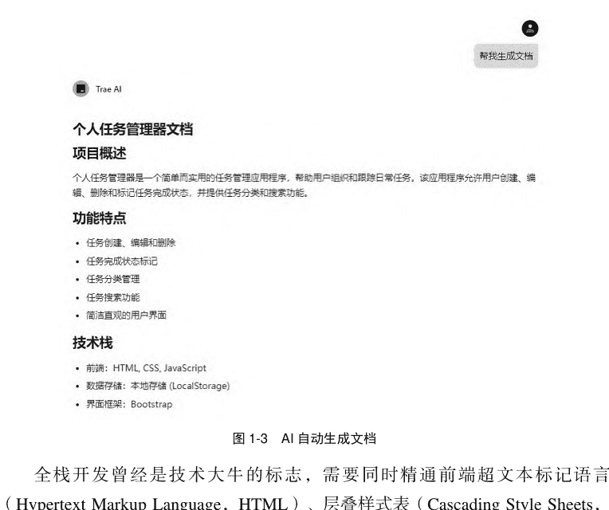

全栈开发曾是技术大牛的标志，需同时精通HTML、CSS、JavaScript及后端技术，如同一人兼诗文、武艺、化妆，堪称十八般武艺皆精。现如今借助AI这个“神队友”，普通开发者也能轻松触及全栈梦想。假设你是一名后端工程师，前端薄弱却需一个漂亮注册页，只需描述：“我需要一个简洁美观的用户注册页面，包含用户名、密码、确认密码和提交按钮”。几秒后，包含HTML、CSS与JavaScript的完整前端代码便生成。


#### 简洁美观的用户注册页面

我将为您创建一个简洁美观的用户注册页面，包含用户名、密码、确认密码和提交按钮。

以下是HTML和CSS代码：

```
html
<!DOCTYPE html>
<html lang="zh-CN">
<head>
    <meta charset="UTF-8">
    <meta name="viewport" content="width=device-width, initial-scale=1.0">
    <title>用户注册</title>
    <style>
        * {
            box-sizing: border-box;
            margin: 0;
            padding: 0;
            font-family: 'Segoe UI', Tahoma, Geneva, Verdana, sans-serif;
        }

        body {
            background-color: #f5f7fa;
            display: flex;
            justify-content: center;
            align-items: center;
            min-height: 100vh;
        }
    </style>
</head>
<body>
    <!-- 代码内容被截断 -->
</body>
</html>
```

图 1-4  AI 全栈辅助开发（1）

同样，前端开发者面对复杂后端逻辑时也不必犯难。AI可根据需求生成基础API代码与数据库操作指引，让前端也能轻松驾驭后端。这种跨界助力拓宽了能力边界，也为学习新技术提供了捷径。通过研读AI生成代码，开发者能迅速 grasp 不熟悉领域的范式与最佳实践，就像有资深导师在旁点拨。学习新技术不再是“望山跑死马”，而是“站在巨人肩上”的愉快体验。

#### API代码和数据库操作生成

我将为您生成个人任务管理器的基本API代码和对应的数据库操作。我假设您需要一个简单的任务管理系统，包括任务的创建、查询、更新和删除功能。

##### 数据库设计

首先，让我们创建一个简单的数据库模型文件：

```
package models

import (
    "time"
)

// Task 表示一个任务
type Task struct {
    ID          uint      `json:"id" gorm:"primaryKey"`
    Title       string    `json:"title" gorm:"size:100;not null"`
    Description string    `json:"description" gorm:"type:text"`
    Status      string    `json:"status" gorm:"size:20;default:'pending'"`
    Priority    int       `json:"priority" gorm:"default:0"`
    DueDate     time.Time `json:"due_date"`
    CreatedAt   time.Time `json:"created_at" gorm:"autoCreateTime"`
    UpdatedAt   time.Time `json:"updated_at" gorm:"autoUpdateTime"`
}
```

图 1-5 人工智能全栈辅助开发（2）

智能编码助手已从单纯提速的工具演变成初学者的陪练搭档。过去常见的入门路径是先捱过语法细节，再去碰真实问题。体系看似完整，实际曲线很陡，很多人记住了基础却不知如何把它用起来。

有了智能协作，学习会变得更活泼。普遍的做法是先确定一个自己感兴趣的小课题，比如简易网页小游戏或一份数据探索工具，用自然语言描述想要的功能，先拿到一段可运行的骨架。围绕阅读、调试、改写展开，编程概念会自然沉淀下来。像先用日常对话练习外语，再回头研究语法，节奏更顺畅，成就感也更强。

智能编码正在改写开发与学习的方式。它在提升效率的同时拉低门槛，为自学和创新打开空间。关键在于保持适度依赖，把智能体视作协作者而非替代品。在享受提速的同时保持独立思考，技术敏感度才能维持。未来的人机协作是创造力与算力的融合，告别重复劳动、晦涩报错和枯燥文档，走向更高效、更有想象力、更有乐趣的编码体验。

### 1.2 主流智能编程工具概览：从 Copilot 到 CodeWhisperer

当下智能编码市场扩张迅速，各类助手让开发效率明显提升。这些产品已超出单纯补全，能理解意图并给出高质量建议。下面介绍几款代表性产品。

GitHub Copilot，即 Copilot，是 GitHub 和 OpenAI 共同研发的一款基于大模型的编程助手，被视为开创者之一（见图1-6）。它能结合代码背景和注释推断意图，生成从片段到完整函数的实现。核心优势是训练语料覆盖大量开源代码，对 Python、JavaScript、TypeScript 等主流语言和框架适配度高。

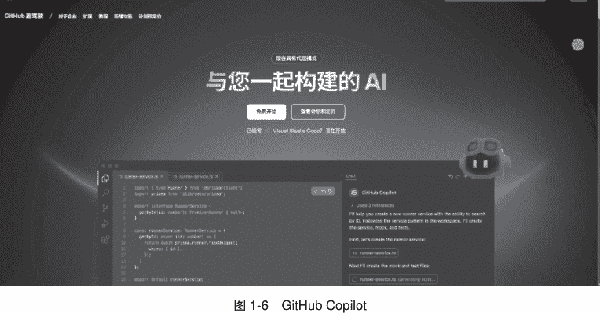

图 1-6 GitHub Copilot

亚马逊的 CodeWhisperer 是另一款强势产品（见图1-7），为亚马逊云服务生态做了专门优化。它对 AWS 服务和 API 理解深入，能针对云原生开发给出精准建议。工具还内置安全扫描，在生成代码时主动识别风险并给出更安全的写法。

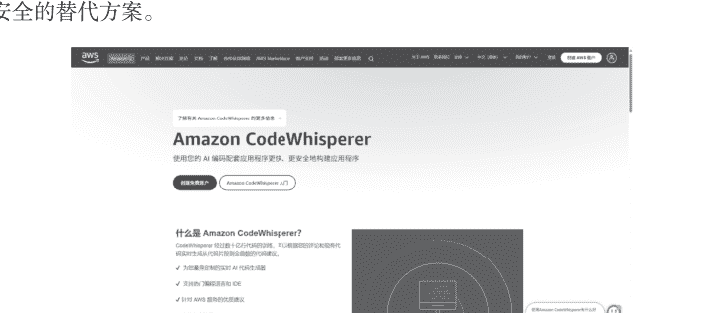

DeepSeek Coder 是由 DeepSeek 团队打造的开源智能编程工具（见图 1-8）。它在深度学习相关任务上投入较多，处理复杂算法和数据分析时表现突出。擅长理解和产出 PyTorch、TensorFlow 等框架代码，对数据科学家和人工智能研究者很有价值。


Tabnine 采用不同路线，使用本地模型运行，减少云依赖，提供更高隐私保障和更低延迟（见图1-9）。其学习能力强，会逐步捕捉开发者的编码习惯和项目特征，使用越久越贴合个人风格。兼容众多语言和主流 IDE，是较为全面的助手。

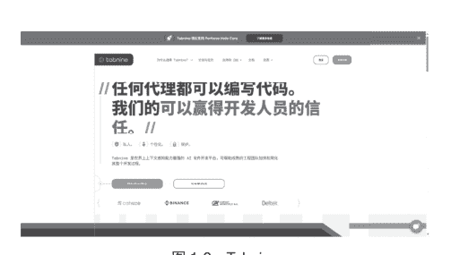

图 1-9 Tabnine

Mintlify Doc Writer 在文档自动化领域形成差异化（见图1-10）。多数工具聚焦代码生成，而 Mintlify 专注为现有代码自动生成高质量说明文档。它能解析结构和功能，输出清晰注释，大幅减轻文档负担。


图 1-10 Mintlify Doc Writer

Kimi 更强调自然语言交互的体验（见图1-11）。用户用口语化描述需求，Kimi 会将其转化为可执行代码。对新手友好，降低上手难度，也为资深开发者提供更直观的生成途径。


图 1-11 Kimi

这些产品各有侧重，适用场景不同。选型取决于项目类型、个人偏好和工作环境。随着技术迭代，功能持续增强，使用体验不断优化。下一步将深入探讨如何组合使用。

### 1.3 选对智能工具：语言、场景、协作的匹配思路

挑选合适的智能编程助手是提升效率的起点。每款产品的设计初衷和优势不同，按语言、场景和协作方式匹配，才能事半功倍。

在语言维度，各工具支持力度差异明显（见图1-12）。Copilot 在 Python、JavaScript 和 TypeScript 的编辑体验上尤为出色，这与其训练数据分布相关。对于企业常用的 Java、C/C++，CodeWhisperer 能提供更规范、结构化的建议。DeepSeek 在数据科学和机器学习相关的 Python 代码生成上具备专长，可智能实现复杂算法。Tabnine 作为本地运行助手，对主流语言覆盖面广，且能通过持续学习适应项目语言风格。

从开发场景看，不同项目需求各异。做云服务尤其是基于 AWS 的应用时，CodeWhisperer 更合适，它对 AWS SDK 和各项服务做了深度优化，输出符合云最佳实践。前端开发者会发现 Copilot 在 React、Vue 等组件开发中效率很高，能从设计描述快速生成符合组件规范的代码。后端开发涉及数据库操作、API 设计时，Tabnine 和 CodeWhisperer 都能给出高质量辅助。

在机器学习流水线、数据处理管道或嵌入式系统等细分领域，选择垂直擅长的工具收益更明显。DeepSeek 在模型构建和数据预处理环节表现突出。对于文档量大的复杂系统，Mintlify 能极大减轻文档编写和维护压力，生成清晰专业的 API 说明和使用指南。

协作方式也会影响选型。大型团队或企业环境更看重安全合规，CodeWhisperer 的安全扫描和许可证检查功能此时尤为关键，它能识别风险并提供代码审计，确保输出符合企业标准。追求敏捷迭代的团队，Copilot 的实时建议和广泛语言支持有助于加速原型和功能落地。

在分布式或远程协作场景下，具备云同步能力的工具如 Kimi 有助于保持代码风格一致，降低沟通成本。而在注重代码隐私或网络受限的环境中，Tabnine 的本地部署模式更安全。

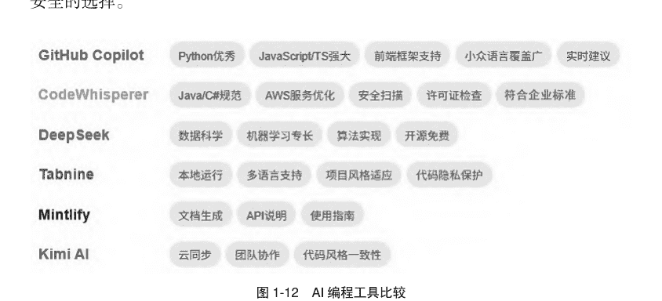

图 1-12 人工智能编程工具比较

初创公司和个人开发者可能更关注成本，可优先考虑提供免费版或开源替代品如 DeepSeek，在资源有限时仍能获得助力。随着项目扩张，可逐步引入更专业的产品。

更灵活的做法是按项目阶段组合使用。例如初期用 Copilot 快速搭原型，稳定期用 CodeWhisperer 排查安全隐患，最后用 Mintlify 产出完整文档。组合策略能扬长避短，最大化价值。

掌握匹配思路后，开发者就能依据技术栈、项目类型和工作方式挑选最合适的智能助手。随着实践积累，可形成个性化工具组合，实现效率的跨越式提升。

### 1.4 实战案例：配置开发环境，快速上手工具清单

在快节奏的软件开发中，智能编程工具已成为重要伙伴。合理配置不仅能加快编码，还能提升质量、减少调试时间，甚至辅助学习新技术。每个工具各有优势，搭配使用能显著改善开发体验。下面按顺序进行配置。

**步骤1：部署 Trae。**

打开浏览器，在地址栏输入 Trae 主页或通过搜索引擎访问。进入官网（见图1-13）后，点击醒目的“立即获取 Trae IDE”按钮，系统会自动检测系统配置并下载对应版本。下载完成后按提示完成安装，官网通常提供帮助文档和客服支持以解决安装问题。

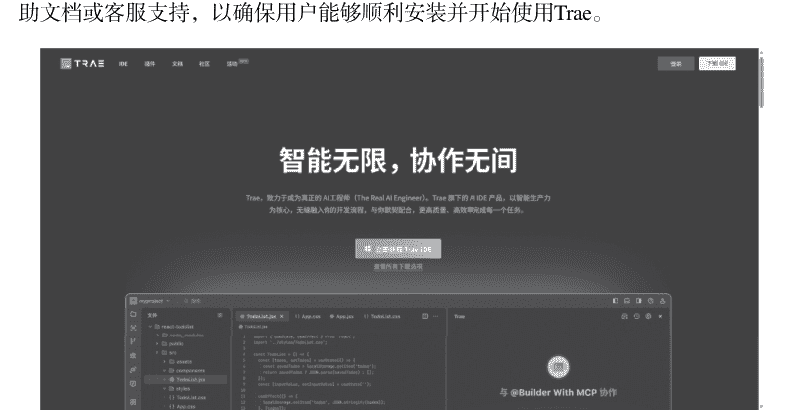

图 1-13 Trae 官网

**步骤2：配置 Amazon Q。**

安装完成后启动 Trae 编辑器，点击左侧的扩展图标（四个小方块样式），在搜索框输入 Amazon Q，找到官方扩展并安装（见图 1-14）。

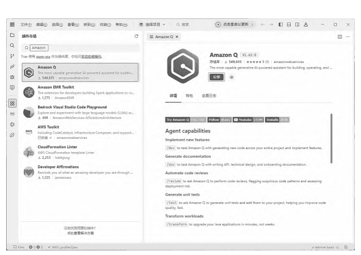

图 1-14 安装插件（1）

**步骤3：登录 AWS 控制台。**

打开 CodeWhisperer 官网，已有账号点击右上角“登录/注册”输入凭证登录。没有账号点击“创建免费账户”（见图 1-15）。注册需提供电子邮箱和密码、账户名称、联系信息、支付信息（个人版免费）、手机验证码完成验证，随后登录 AWS 控制台。


图 1-15 创建账户


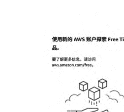

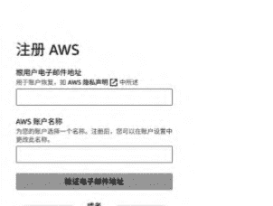

图 1-16 注册账户

账号创建成功后返回登录页，输入注册邮箱、密码和验证码，点击“登录”进入下一步（见图1-17）。

**步骤4：回到 Trae，打开 Amazon Q 工具面板。**

回到 Trae，左侧活动栏会出现 Amazon Q 图标，点击打开工具面板即可开始使用（见图1-18）。

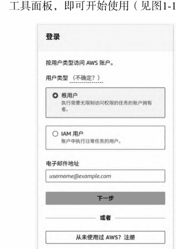

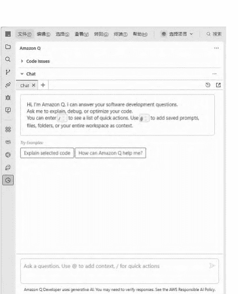

图 1-17 登录账户

图 1-18 使用 Amazon Q 扩展

人工智能助力开发：Trae + CodeWhisperer + DeepSeek + Tabnine + Mintlify + Kimi

#### 步骤5：配置 DeepSeek。

打开 Trae，点击顶部“文件”菜单，选择“首选项”，再选“设置”进入设置界面（见图1-19）。在设置页点击“Trae AI”按钮，可看到内置的 DeepSeek 模型已就绪，等待使用（见图1-20）。

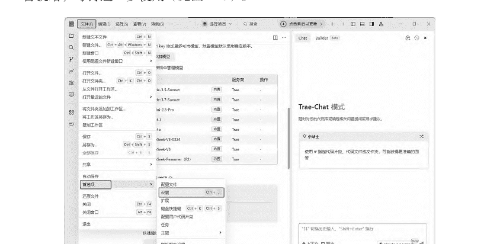

图 1-19 进入设置界面

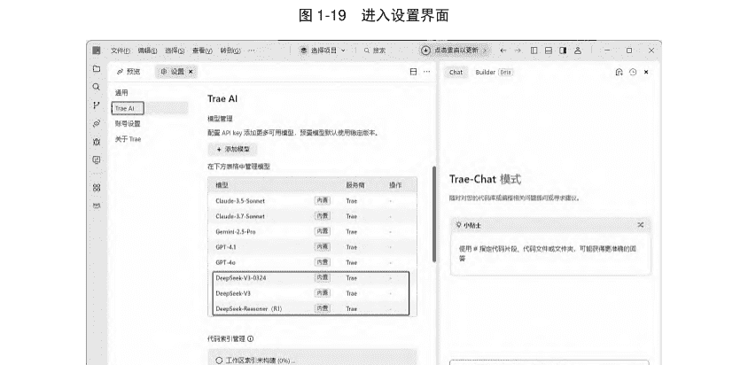

图 1-20 模型管理

#### 步骤6：配置 Tabnine。

点击左侧扩展图标，在搜索框输入 Tabnine，找到官方扩展并安装（见图 1-21）。安装后需登录 Tabnine 账号方可使用（见图 1-22）。

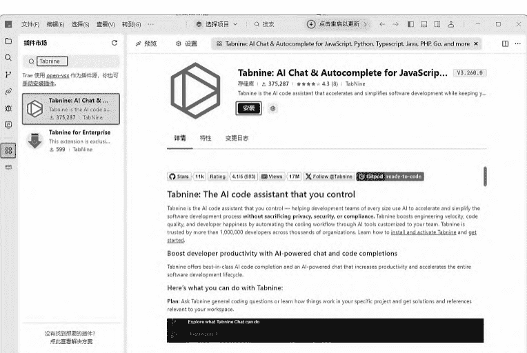

图 1-21 安装插件（2）

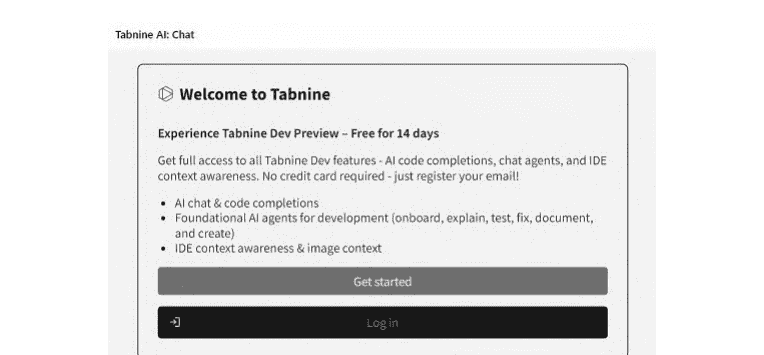

图 1-22 登录 Tabnine

接下来配置 Mintlify，点击左侧扩展图标，在搜索框输入 Mintlify 官网，找到官方扩展并安装（见图1-23）。

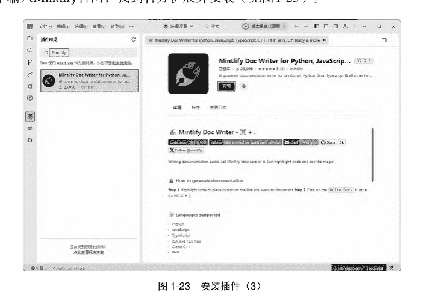

然后配置 Kimi，需把 VS Code 插件市场的插件安装到 Trae。前往 VS Code 插件市场搜索 Kimi 插件，进入详情页后点击“Version History”选项卡（见图1-24），结合插件页 URL 和版本历史信息提取以下信息。

itemName 字段：即 URL Query 中的 itemName，将小数点前后拆分为 fieldA 和 fieldB。

Version 字段：如图所示 0.0.6。

用提取的三个字段值替换下方 URL 中的对应占位符。

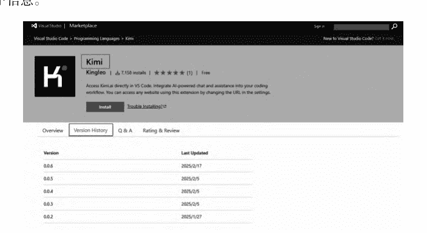

在浏览器打开修改后的 URL 回车下载插件。下载完成后返回 Trae 打开插件市场，将下载的 .vsix 文件拖入“插件市场”面板，Trae 会自动安装，安装完成后插件出现在“已安装”列表中（见图1-25）。

```
https://marketplace.visualstudio.com/_apis/public/gallery/publishers/${itemName.fieldA}/vsextensions/${itemName.fieldB}/${version}/vspackage
```

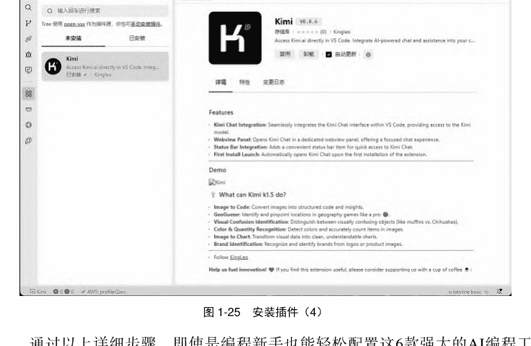

通过以上步骤，即使是编程新手也能快速配置这 6 款智能编程工具。合理搭配使用能明显提升开发效率，随着经验积累可进一步优化流程，充分发挥人工智能辅助编程的潜力。

人工智能辅助编程正在重塑软件开发范式。借助这些工具，开发者在代码补全、智能重构、算法优化、测试生成与调试等环节都能实现效率跃升。这不只是工具层面的革新，更是思维方式的转变——把程序员从繁琐重复的编码中解放出来，聚焦创造性和战略性工作。学会与人工智能协作、提出精准问题，正在成为现代程序员的核心竞争力。当然，扎实的编程基础依然不可替代，人工智能是强力助手而非替代品。人的创造力与人工智能的执行效率结合，才是新时代开发的制胜关键，而开发速度翻倍只是变革的起点。

## 第2章 智能编码与 Trae 全栈代码生成

### 2.1 什么是 Trae？适合哪些开发任务？

在当下软件开发领域，人工智能正以前所未有的速度改变工作方式。Trae 作为新一代智能编程工具，已成为全栈开发者的得力助手。简单来说，Trae 是一个基于大语言模型的代码生成平台，能把自然语言描述转化为高质量代码。与同类工具相比，Trae 的差异化在于对全栈开发的深度覆盖，无论是前端界面、后端逻辑还是数据库操作，都能轻松应对。

Trae 在语言与框架的理解深度上表现突出。JavaScript、Python、Java、Go、Rust 等常见语言，均可产出符合工程实践的输出；React、Vue、Angular 等前端框架，以及 Django、Spring Boot 等后端框架，也能稳定交付。覆盖面广意味着开发者不必在多套工具间频繁切换，完成从前端到后端的全流程更顺畅。

初学者会觉得 Trae 像一位即时辅导者。遇到陌生概念或框架时，用口语化方式说明目标，它便能给出可执行示例并附带通俗解释。这种对话式练习比查阅手册或观看教程更直观，帮助新人逐步把握逻辑，熟悉规范，同时减少因语法失误产生的挫败感。

项目体量增大时，Trae 的助力更清晰。只需提供业务层面的高层描述，它便能把组件或模块完整搭建，数据结构、函数实现、异常处理等要素一次性到位。概念转化的速度提升后，开发者能把更多精力放在架构设计与用户体验等高阶议题上。

原型验证与快速试错是 Trae 的擅长领域。产品早期常需先做可运行 demo 以检验想法，传统做法往往耗费数天至数周。借助 Trae，几分钟即可获得可用原型，想法落地周期大幅缩短，资源消耗降低，迭代灵活性也随之提升。

API 对接与集成同样流畅。现代应用普遍需要连接支付网关、社交平台、云服务等外部接口。把 API 文档或简要描述交给 Trae，它可生成完整的请求处理实现，包括参数组装、鉴权、响应解析、异常处理，节省查阅文档与调试的时间。

数据持久化环节常让开发者感到棘手，Trae 在此提供可靠支持。SQL 查询、ORM 模型定义、数据迁移脚本均能自动生成，尤其在多表关联与运行效率提升场景下，产出质量往往优于手工编写，更稳健安全。
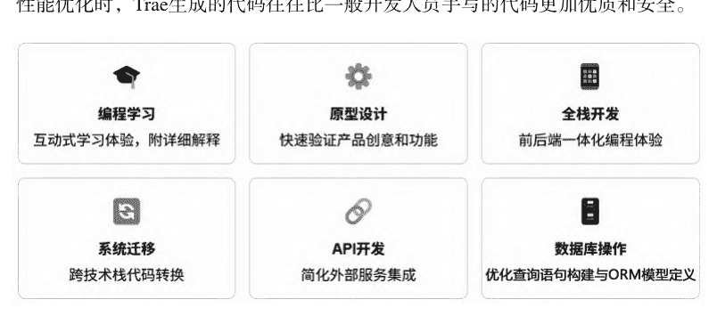
拥有遗留系统的团队同样受益。把旧系统关键功能用自然语言描述，Trae 可输出基于现代技术栈的等效实现，为系统升级提供低风险路径。技术栈迁移时，它也能提供代码转换支持。协作层面，团队可预先约定格式约定与架构模式，Trae 会按此生成输出，减少风格差异，让新成员更快适应项目节奏。

需要注意边界。极致性能的算法实现、底层系统编程、部分小众语言，仍需专业工具配合。涉及繁杂业务规则或强依赖领域知识的场景，输出结果应由资深人员审阅校准。

整体来看，Trae 适合端到端开发、原型设计、接口集成与编程学习。无论经验深浅，都能从其强大的程序生成能力中获益，提升交付效率与质量。AI 技术持续演进，Trae 这类工具正重塑软件开发方式，让编程更高效、更愉悦、更具创造性。

### 用自然语言点单写代码的实战心法

当程序编写像会话一样顺畅，开发体验就被改写了。借助 Trae 这类 AI 助手，关键在于掌握提问技巧。精确的自然语言说明相当于高质量的设计文档，能够一次性获得结构完整、功能闭合的模块。

首先明确目标。直接说明制作登录页面或实现计算器即可。例如，一位电商开发者提出：生成注册表单页面，需包含用户名、邮箱、密码及确认密码，并实现字段校验。Trae 回应了完整 React 组件，内含校验逻辑与提交流程（见图2-2和图2-3）。
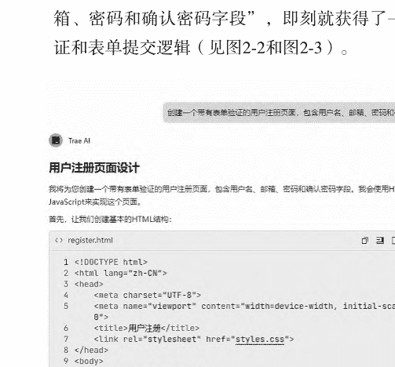
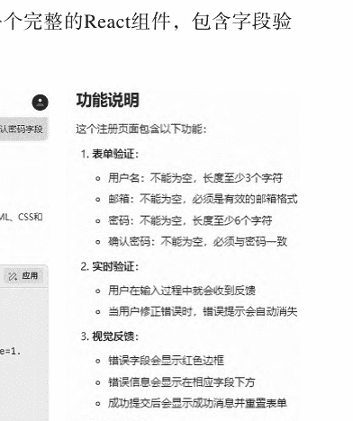
其次要指明技术栈。就像点餐需要说明烹饪方式，告诉模型使用 JavaScript 实现或使用 Python 编写，输出会更贴合预期。一位教育工作者希望为班级做计分板，她告诉 Trae：用网页技术制作计分板，可添加学生姓名与分数。结果得到可在手机上使用的网页，随时记录表现（见图2-4和图2-5）。
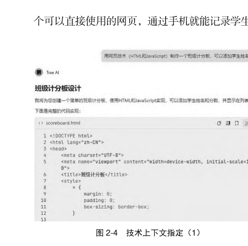
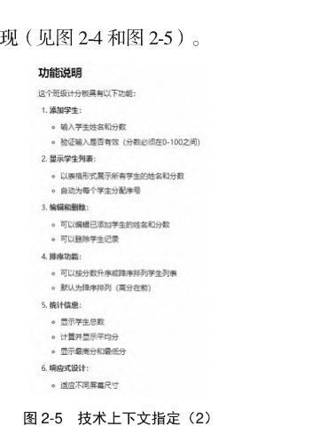
详细描述输入与输出能提升准确度。举例说明程序接收姓名和年龄，输出问候语。一位健身教练希望做卡路里估算工具，描述为：输入体重、运动时长与运动类型，计算消耗卡路里。生成的工具计算正确，且界面友好（见图2-6和图2-7）。
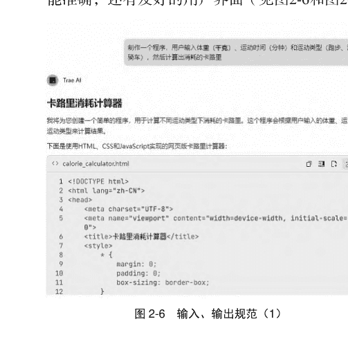
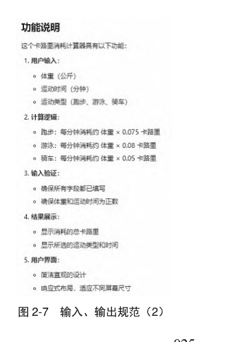
业务规则应提前说明，例如密码不少于8位，含大小写字母与数字，或满100元免运费。一位家长制作家务分配表，要求每周每位家庭成员至少两项任务，同一天同一人不超过两项，完成可打钩。生成的程序完全遵循约定，分配公平清晰。
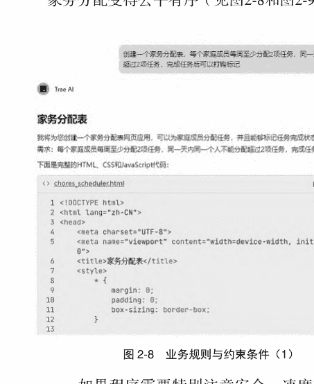
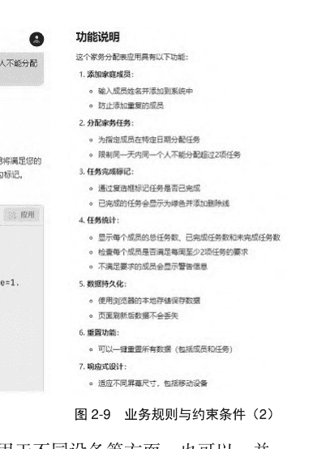
非功能需求也值得提及，例如设备适配或加载速度。摄影爱好者希望个人作品集网站在各类屏幕上呈现良好，加载迅速，即使移动网络下仍流畅，Trae 使用自适应布局与图片优化实现预期（见图2-10和图2-11）。

如果新功能需接入现有系统，提供上下文。企业主为客户管理系统增加生日提醒，说明现有系统已有客户姓名与生日，需每日检查并发送邮件通知。生成的代码可无缝接入。

创建一个展示照片的网站，照片在不同尺寸的屏幕上都能完美显示，加载速度要快，即使在手机网络下也能流畅

#### 运行效率提升特性

Trae AI

1. 自适应图片处理
   - 网格中用缩略图展示，降低首屏加载压力
   - 大图在用户查看时才加载高清原图
2. 懒加载技术
   - 图片进入视口附近再加载
   - 采用 IntersectionObserver API，效率更高
3. 自适应布局
   - CSS Grid 自动调整网格
   - 不同屏幕适配显示效果
   - 移动端使用更小缩略图
4. 资源预加载
   - 关键 JavaScript 文件提前加载
   - 灯箱中预载大图，保证切换顺滑
5. 效率优化
   - CSS 变量便于维护样式
   - 减少 DOM 操作，用文档片段批量添加
   - 动画用 transform 替代位置属性

#### 响应式照片展示网站设计

我将为您搭建一个在各类设备上都能完美呈现、并且针对手机网络优化加载速度的照片展示网站。

下面是完整的代码实现：
```
1 <!DOCTYPE html>
2 <html lang="zh-CN">
3 <head>
4     <meta charset="UTF-8">
5     <meta name="viewport" content="width=device-width, initial-scale=1.0">
6     <title>照片展示</title>
7     <link rel="stylesheet" href="styles.css">
8     <!-- 预加载关键资源 -->
9     <link rel="preload" href="js/lazy-load.js" as="script">
10 </head>
11 <body>
12     <header>
13         <div class="container">
14             <h1>我的照片集</h1>
15             <nav>
16                 <ul>
```
图 2-10 非功能需求（1）
图 2-11 非功能需求（2）

书写风格与结构也可以提前沟通。编程教师要求：创建几个简单的 Python 示例程序，代码要易于理解，变量名要有意义，包含详细注释，适合向初学者展示，得到的样例清晰易读，非常适合教学。

错误处理要主动说明，例如用户未输入姓名时给出提示，或网络失败时自动重试。旅游爱好者做天气查询，要求创建一个查询天气的应用，当网络连接失败或城市名称输入错误时，给出友好提示并允许用户重新输入，程序能优雅应对异常。

第一次结果不理想就反馈调整。父亲为孩子做乘法游戏，看到初版后补充游戏太难，能否加不同难度，并在答错时给提示。Trae 很快加入初级、中级、高级模式，孩子很喜欢。

提供具体例子帮助理解更高效，例如说明输入张三和18岁，页面应显示你好，张三，你已经18岁了。园艺爱好者做浇水提醒，示范：我添加了玫瑰，设置每3天浇水一次，那么从添加日期起，每过3天系统就应该提醒我该给玫瑰浇水了，直到我标记完成。示范让需求更清晰。

复杂项目可以拆块描述。社区活动组织者分步提出：先创建成员管理部分，可以添加、编辑和删除成员信息，完成后再加活动日历，最后加通知系统，最终拼出完整的管理平台。

拿到代码后仍需自检。医生拿到病人随访系统的初稿，发现缺少医院特定的隐私保护措施，便请同事一起调整。

掌握这些沟通技巧后，编程不再是少数人的特权，就像拍照一样人人可上手。好的需求描述节省时间，让人专注创意和应用本身。

### Java + Python + JavaScript 多语言协作的写法

实际项目很少局限于单一语言，类似建造房屋需要多工种配合。Java 侧处理关键业务，Python 侧进行数据分析，JavaScript 侧呈现交互，各展所长效率最高。

Trae 如同多语翻译，可把中文想法转为多种语言代码。即使不懂编程，也能得到可用程序。

典型场景是店铺管理系统。用户描述：需要咖啡店管理系统，记录销售、管理库存、追踪常客。后端用 Java，分析用 Python，前端用网页 JS。几分钟内得到多语言方案（见图2-12）。
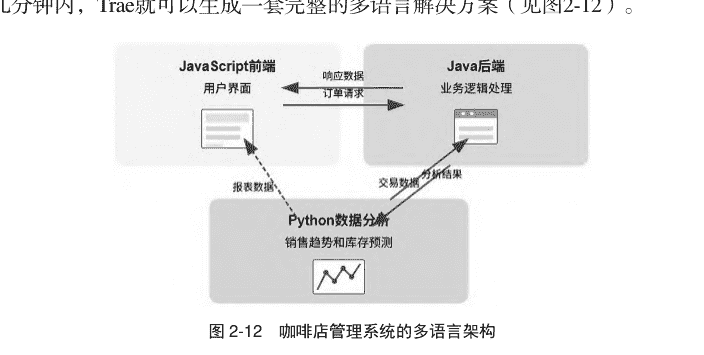
Java 侧处理交易、库存、客户数据，保证安全可靠。Python 侧像数据分析师，回答畅销品类、下周补货量等问题。JavaScript 侧生成界面，收银员与顾客在电脑、平板、手机上都能流畅使用。

三者需相互协作。Trae 通过规范接口设计实现衔接，前台订单由 JavaScript 传给 Java 后台处理，保存后供 Python 分析，结果再回传。整体像流水线一样顺畅。

多语言项目使用 Trae 还有好处：代码风格保持一致，后续维护更新更便捷。

总之，有 AI 助手，多语言开发像讲故事般简单。说清需求，AI 即可输出由多种语言构成的完整方案，让复杂开发变得可及。

### 自定义代码模板与风格配置

书写风格如个人笔迹，有人偏好简洁，有人喜欢详注，企业更需统一。用 Trae 时可训练其按团队习惯输出，像培养新同事。

企业中格式统一很重要。某电商技术主管引入 Trae 后发现，AI 输出功能正确但格式不一，集成成本高。后来在项目启动时明确约定，后续输出自动遵循团队标准，像多了一位熟悉风格的老员工。

最直接的方式是在需求里写明风格偏好。例如创业者要求：所有代码请使用4个空格缩进，类名采用大驼峰，方法和变量使用小驼峰，常量使用全大写下划线，每个函数必须有文档注释说明用途、参数和返回值。Trae 严格执行，代码看起来就像他亲手写的一样。

提供样例片段也很有效。自由设计师不懂编程，却有明确视觉要求。她提供一段喜欢的 HTML 和 CSS 片段，说请按照这个风格创建完整的网页。Trae 捕捉到命名习惯、注释风格和布局方式，保持了整体一致性。

结构组织同样关键。教育科技项目经理说明：希望采用 MVC 架构，将控制器放在 controllers 文件夹中，将模型放在 models 文件夹中，将视图放在 views 文件夹中。所有业务逻辑应从控制器中分离出来，放在 services 文件夹的服务类中。按此生成的代码符合团队架构，避免后期重构（见图2-13）。
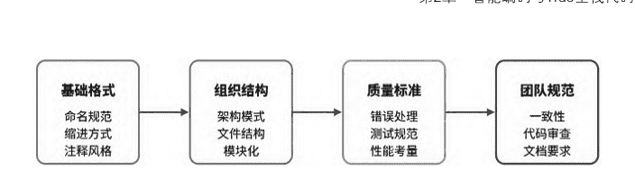

代码好不好读，关键往往在细节的统一上。Trae 的强大之处就在于能把这些细节风格吃透并稳定输出，让生成的代码浑然一体，像是团队自己手写的。

先说命名。零售分析公司的刘博士在让 Trae 处理数据脚本时特别交代：凡是和客户有关的变量一律以 customer_ 开头，产品相关的用 product_ 前缀，负责数据处理的函数统一用 process_ 起头，验证类的函数则用 validate_ 开头。只要模式保持一致，新人上手时一眼就能猜到变量和函数在干什么，学习成本直接被拉低。

注释的写法也可以按口味定。做医疗软件的赵工要求非常严谨，他告诉 Trae：每个类头上要有完整的说明，写清作者、创建时间和用途；每个方法都要有细节注释，讲清楚功能、参数、返回值以及可能抛出的异常；关键算法内部要有行内注释解释思路；凡是碰到医疗数据的处理，必须单独标注隐私保护的考虑。按这个标准出来的代码，既满足医疗行业的合规审计，也让后人敢用敢改。

错误处理的脾气也能定。金融科技的安全专家钱女士在设计支付模块时强调：所有异常都要明确捕捉并分类，网络问题、数据格式问题、业务逻辑问题分别用不同的自定义异常来表达；日志要记录足够的上下文，但敏感信息一律不写；抛给客户端的报错信息要简短友好。Trae 按此生成的代码既稳健又体贴，兼顾企业级稳定和用户隐私。

文件怎么拆、怎么分层同样可控。游戏开发的吴先生希望：游戏逻辑按功能拆成多个小文件，单个文件别超过 300 行；核心引擎、UI、音效、网络完全解耦；配置数据全部放到独立的 JSON 里，不要写死在代码中。结构清晰后，大型项目更好维护，成员可以并行开发，冲突也少了。

性能要求也能写进风格。物联网嵌入式开发的孙工在生成传感器处理代码时提醒：设备资源紧张，尽量省内存，禁止动态分配；循环里不要造临时对象；能用指针操作就别只做拷贝；热点路径上少做函数调用。Trae 按这个性能导向的指令，产出的是精简高效的代码，直接适配资源受限的场景。

做长期项目时，最省事的是先写一份风格说明书。软件咨询的技术总监林女士在立项前花了一天整理文档，覆盖命名、文件组织、注释规范、异常处理、日志记录等维度，然后告诉 Trae：后续所有代码都严格按这份指南来。这样无论团队怎么变化，代码风格始终统一。

框架规范也能无缝套用。前端开发的周先生要求 Trae 用 Angular Material 设计体系，遵循 Angular 官方风格指南，组件按展示组件和容器组件分离，状态管理用 NgRx，HTTP 请求统一走拦截器处理错误。生成的代码完全贴合 Angular 生态，看起来就是老手写的。

代码的洁癖程度同样可调。初创公司创始人黄先生追求极简：单个函数控制在 15 行以内，少用嵌套 if，偏好函数式写法，重复逻辑必须抽成工具函数，不要过度设计，先求直观好懂。Trae 按照这些原则输出的代码干净利落，非常契合快速迭代的节奏。

测试的风格也不能忽视。测试驱动爱好者马女士说明：每个功能模块都要配单元测试，测试名采用 should_expected-Behavior_when_condition 的格式，内部按 AAA 即 Arrange-Act-Assert 组织，覆盖率要到 90% 以上，兼顾主流程和边界情况。Trae 不仅生成符合要求的功能，还附带完整的测试用例，项目从一开始就有质量底座。

工具链的配合也能写进配置。持续集成专家郭先生指出：代码必须通过他提供的 ESLint 配置，构建用 Webpack 且配置文件结构固定，提交前一律用 Prettier 格式化。Trae 输出的代码天然兼容这套流水线，接入现有流程毫无摩擦。

用得多了，大家会攒自己的风格库。资深架构师丁女士维护了一份“Trae 风格指南”文档，收录了她常用的项目类型、语言和框架的规范。开新项目时直接引用对应章节，就能保证风格和历史项目一致，省去反复说明的麻烦。

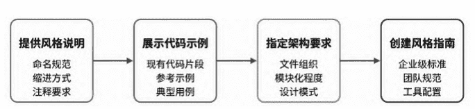

跨语言的一致性是企业团队的痛点。全栈负责人冯工发现，多语言项目里风格统一特别重要。他告诉 Trae：Java 后端、Python 数据层、JavaScript 前端都要用同一套命名和文档风格，变量函数语义保持一致，异常处理机制统一，接口命名遵循相同模式。这样开发者在不同技术栈间切换时认知负担大大下降。

项目演进时风格也可以动态调整。敏捷实践者田先生发现，早期制定的详细注释随着迭代有点繁琐，便向 Trae 更新指令：注释可以精简，只保留关键算法和复杂业务的说明；模块化程度再提升，多抽象重复逻辑；把性能优化的权重提高，热点路径上多做优化。Trae 灵活跟进，代码风格随项目成熟度一起进化。

当模板和风格调对味后，Trae 产出的代码能和现有仓库完美融合，看起来就像团队成员亲手写的。这不仅提升了质量和一致性，也省掉了大量的返工。无论是个人对编码美学的追求，还是企业对严格规范的需求，Trae 都能精准执行，把枯燥的格式工作自动化，让人专注在创造性问题上。

### 2.5 实战案例：用 Trae 搭建全栈 Web 应用

下面带大家做一个实操，从零开始用 Trae 搭一个功能完整的全栈应用。前端选用 HTML + CSS + jQuery，后端选用 Python 的 FastAPI，步骤清晰，新手也能跟上。

先把需求想清楚。比如要做一个满足日常记录想法的轻应用 SimpleNotes，允许用户新建笔记，每个笔记有标题和内容，随时记录灵感，不用管格式。创建页要简洁，利于专注写作。

技术栈确定后，就可以用 Trae 来辅助开发了。

#### 步骤1：打开 Trae 编译页面

进入 Trae 后台，默认会显示之前的项目。找到页面上的“打开文件夹”按钮并点击（见图 2-15）。在弹出的文件选择框里，选择已有目录或新建一个名为 SimpleNotes 的文件夹（见图 2-16）。

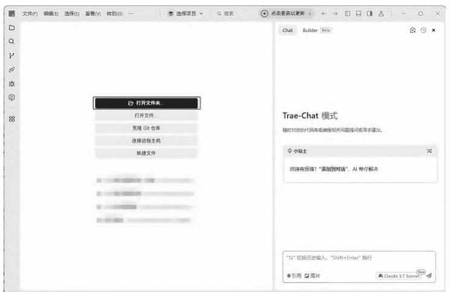

图 2-15 单击“打开文件夹”按钮

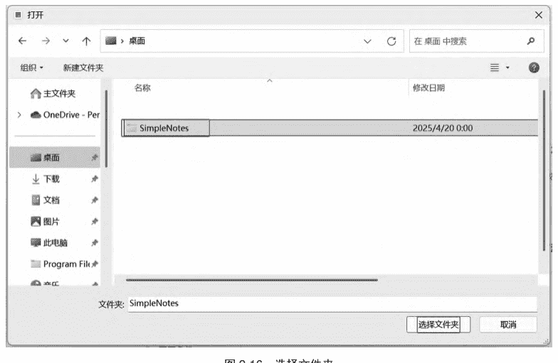

图 2-16 选择文件夹

#### 步骤2：描述想要构建的应用

进入界面后，右侧的自然语言输入区是核心。把功能点和技术栈用大白话写清楚。功能包括新建笔记、浏览笔记列表、查看笔记详情、删除笔记。技术栈明确写明前端用 HTML、CSS、jQuery，后端用 FastAPI。

在项目描述框中输入：

> 创建一个简易的笔记应用，用户可以创建新笔记（标题和内容）、查看所有笔记列表、查看单个笔记详情、删除不需要的笔记。前端框架选择“HTML+CSS+jQuery”，后端框架选择“FastAPI”。

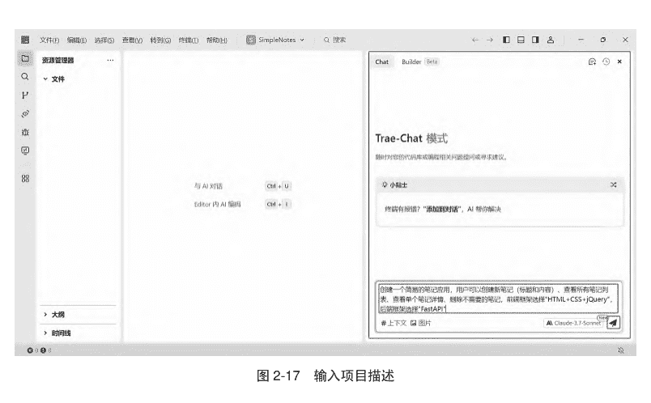

图 2-17 输入项目描述

#### 步骤3：生成初步规划

提交描述后，Trae 会先给出项目的目录骨架。结构里包含前端静态资源文件夹，用于放 HTML、CSS、JS；后端 API 模块，负责接收请求并返回数据。通过这个概览，能快速把握整体框架，便于后续开发。

```
SimpleNotes/
├── static/
│   ├── css/
│   │   └── style.css
│   └── js/
│       └── main.js
├── templates/
│   └── index.html
├── main.py
└── requirements.txt
```

根据规划，Trae 开始生成代码，耗时视项目复杂度而定。完成后在代码区右上角点“应用”按钮，Trae 会自动把变更写入指定文件夹（见图 2-18）。

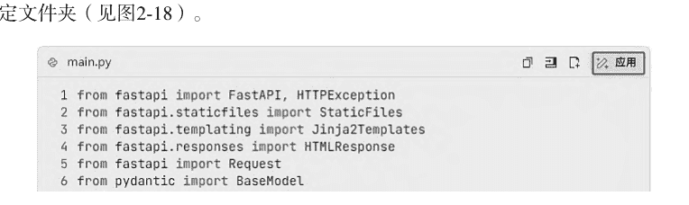

图 2-18 应用代码

#### 步骤4：后端程序设计

Trae 先搭建后端，用 FastAPI 提供 Web 服务。启动后可通过网页创建、查看、删除笔记。初期数据暂存于内存列表，每条笔记包含唯一 ID、标题、内容和创建时间。

> 框架初始化

导入核心模块：用 FastAPI 创建 API 实例，用 StaticFiles 托管前端静态资源，用 Jinja2Templates 渲染 HTML 模板，用 pydantic.BaseModel 定义数据校验模型，用 uuid 生成笔记唯一标识，用 datetime 记录创建时间。

配置应用基础：挂载静态文件目录，指定模板路径。

示例代码如下。

```python
#main.py#
from fastapi import FastAPI, HTTPException
from fastapi.staticfiles import StaticFiles
from fastapi.templating import Jinja2Templates
from fastapi.responses import HTMLResponse
from fastapi import Request
from pydantic import BaseModel
from typing import List, Optional
import uuid
from datetime import datetime

app = FastAPI(title="简易笔记应用")

##### 挂载静态文件
app.mount("/static", StaticFiles(directory="static"), name="static")

##### 设置模板
templates = Jinja2Templates(directory="templates")

##### 笔记模型
class Note(BaseModel):
    id: str
    title: str
    content: str
    created_at: str

##### 创建笔记请求模型
class NoteCreate(BaseModel):
    title: str
    content: str

##### 在内存中存储笔记
notes_db = []

@app.get("/", response_class=HTMLResponse)
async def read_root(request: Request):
    return templates.TemplateResponse("index.html", {"request": request})

@app.get("/api/notes", response_model=List[Note])
async def get_notes():
    return notes_db

@app.get("/api/notes/{note_id}", response_model=Note)
async def get_note(note_id: str):
    for note in notes_db:
        if note.id == note_id:
            return note
    raise HTTPException(status_code=404, detail="笔记未找到")

@app.post("/api/notes", response_model=Note)
async def create_note(note: NoteCreate):
    new_note = Note(
        id=str(uuid.uuid4()),
        title=note.title,
        content=note.content,
        created_at=datetime.now().strftime("%Y-%m-%d %H:%M:%S")
    )
```

#### 步骤5：生成 HTML 主页模板

随后生成主页模板，版面简洁且分区明确。页面共四块：顶部标题栏、笔记列表区、编辑区、详情查看区。标题栏展示应用名，中间主体采用三栏布局，方便在不同功能间切换。左侧列出所有笔记，中间提供标题和内容输入框及保存/新建按钮，右侧展示所选笔记的完整内容并提供删除与返回操作。页面引入 jQuery 简化交互，链接自定义 CSS 与主 JS 文件，负责样式和交互。整体遵循直观易用的原则，让笔记管理变得轻松。

示例代码如下。

```html
<!DOCTYPE html>
<html lang="zh-CN">
<head>
    <meta charset="UTF-8">
    <meta name="viewport" content="width=device-width, initial-scale=1.0">
    <title>简易笔记应用</title>
    <link rel="stylesheet" href="/static/css/style.css">
    <script src="https://code.jquery.com/jquery-3.6.0.min.js"></script>
</head>
<body>
    <div class="container">
        <header>
            <h1>简易笔记应用</h1>
        </header>

        <div class="main-content">
            <div class="notes-list">
                <h2>我的笔记</h2>
                <div id="notes-container"></div>
            </div>

            <div class="note-editor">
                <h2 id="editor-title">创建新笔记</h2>
                <form id="note-form">
                    <input type="hidden" id="note-id">
                    <div class="form-group">
                        <label for="title">标题</label>
                        <input type="text" id="title" required>
                    </div>
                    <div class="form-group">
                        <label for="content">内容</label>
                        <textarea id="content" rows="10" required></textarea>
                    </div>
                    <div class="form-actions">
                        <button type="submit" id="save-btn">保存</button>
                        <button type="button" id="new-btn">新建</button>
                    </div>
                </form>
            </div>

            <div class="note-detail" id="note-detail">
                <h2 id="detail-title"></h2>
                <div class="note-meta">
                    <span id="detail-date"></span>
                </div>
                <div class="note-content" id="detail-content"></div>
                <div class="detail-actions">
                    <button id="delete-btn">删除</button>
                    <button id="back-btn">返回</button>
                </div>
            </div>
        </div>

        <script src="/static/js/main.js"></script>
    </div>
</body>
</html>
```

这套样式为轻量级笔记工具打造了简约现代的界面观感。整体遵循响应式思路，让不同尺寸的屏幕都能获得顺手的体验。先从基础重置入手，统一元素的默认间距和盒模型计算方式，再搭建页面骨架，用柔和的灰底衬托白色的内容块，形成干净的层次对比。

布局里核心分为三块：左侧的笔记清单、中间的编辑区、右侧的详情页。桌面端借助弹性布局并排呈现，窄屏时自动堆叠成纵向流。每块面板都带上细微阴影和圆角，整体呈现出卡片堆叠的质感。输入框和多行文本域的内边距与边框都经过细调，手感更舒适。

交互色彩做了明确区分：保存用蓝色、删除用红色、返回和新建这类次要操作用灰色。鼠标悬停时按钮会略微变色，给出即时的视觉回应。再配合媒体查询的适配，手机端也能稳定运行。美观与实用兼顾，管理笔记的过程自然而轻松。

示例代码如下。

```css
* {
    margin: 0;
    padding: 0;
    box-sizing: border-box;
}

body {
    font-family: 'Microsoft YaHei', sans-serif;
    line-height: 1.6;
    color: #333;
    background-color: #f5f5f5;
}

.container {
    max-width: 1200px;
    margin: 0 auto;
    padding: 20px;
}

header {
    text-align: center;
    margin-bottom: 30px;
    padding: 20px 0;
    background-color: #fff;
    border-radius: 5px;
    box-shadow: 0 2px 5px rgba(0,0,0,0.1);
}

h1 {
    color: #2c3e50;
}

h2 {
    margin-bottom: 15px;
    color: #2c3e50;
}

.main-content {
    display: flex;
    flex-wrap: wrap;
    gap: 20px;
}

.notes-list {
    flex: 1;
    min-width: 300px;
    background-color: #fff;
    padding: 20px;
    border-radius: 5px;
    box-shadow: 0 2px 5px rgba(0,0,0,0.1);
}

.note-editor {
    flex: 2;
    min-width: 400px;
    background-color: #fff;
    padding: 20px;
    border-radius: 5px;
    box-shadow: 0 2px 5px rgba(0,0,0,0.1);
}

.note-detail {
    flex: 2;
    min-width: 400px;
    background-color: #fff;
    padding: 20px;
    border-radius: 5px;
    box-shadow: 0 2px 5px rgba(0,0,0,0.1);
    display: none;
}

.note-item {
    padding: 10px 15px;
    border-bottom: 1px solid #eee;
    cursor: pointer;
    transition: background-color 0.2s;
}

.note-item:hover {
    background-color: #f9f9f9;
}

.note-item h3 {
    margin-bottom: 5px;
    color: #3498db;
}

.note-item .date {
    font-size: 12px;
    color: #7f8c8d;
}

.form-group {
    margin-bottom: 15px;
}

label {
    display: block;
    margin-bottom: 5px;
    font-weight: bold;
}

input[type="text"], textarea {
    width: 100%;
    padding: 10px;
    border: 1px solid #ddd;
    border-radius: 4px;
    font-family: inherit;
    font-size: 16px;
}

textarea {
    resize: vertical;
}

button {
    padding: 10px 15px;
    background-color: #3498db;
    color: white;
    border: none;
    border-radius: 4px;
    cursor: pointer;
    font-size: 16px;
    margin-right: 10px;
}

button:hover {
    background-color: #2980b9;
}

.form-actions, .detail-actions {
    margin-top: 20px;
}

.note-meta {
    margin-bottom: 15px;
    color: #7f8c8d;
    font-size: 14px;
}

.note-content {
    line-height: 1.8;
    white-space: pre-wrap;
}

#delete-btn {
    background-color: #e74c3c;
}

#delete-btn:hover {
    background-color: #c0392b;
}

#back-btn, #new-btn {
    background-color: #7f8c8d;
}

#back-btn:hover, #new-btn:hover {
    background-color: #6c7a7d;
}

@media (max-width: 768px) {
    .main-content {
        flex-direction: column;
    }

    .notes-list, .note-editor, .note-detail {
        min-width: 100%;
    }
}
```

交互层由 JavaScript 完成，借助 jQuery 简化了 DOM 增删改查以及异步 XML 请求的处理。页面一进来就会触发 loadNotes，从服务端拉取笔记清单并渲染到列表。

按钮全部绑定了对应的事件：提交表单、新建笔记、删除笔记、返回列表等，构成一套完整的使用闭环。创建笔记通过表单完成，点击列表项可进入详情页，详情页再支持删除操作。所有动作都走 AJAX 与后端 API 对接，避免整页刷新，体验十分顺滑。

代码划分清晰，错误处理和确认机制齐全，删除前会弹出二次确认，防止误触。表单重置后可以直接开始下一次编辑。视图切换靠显示隐藏不同区域实现，在列表、编辑、详情三种状态间流转自然。

示例代码如下。

```javascript
$(document).ready(function() {
    // 初始状态
    loadNotes();

    // 表单提交事件
    $('#note-form').on('submit', function(e) {
        e.preventDefault();
        saveNote();
    });

    // 新建笔记按钮
    $('#new-btn').on('click', function() {
        resetForm();
    });

    // 删除笔记按钮
    $('#delete-btn').on('click', function() {
        const noteId = $(this).data('id');
        deleteNote(noteId);
    });

    // 返回按钮
    $('#back-btn').on('click', function() {
        $('.note-detail').hide();
        $('.notes-list, .note-editor').show();
    });

    // 加载所有笔记
    function loadNotes() {
        $.ajax({
            url: '/api/notes',
            method: 'GET',
            success: function(data) {
                renderNotesList(data);
            },
            error: function(error) {
                alert('加载笔记失败：' + error.responseJSON.detail);
            }
        });
    }

    // 渲染笔记列表
    function renderNotesList(notes) {
        const container = $('#notes-container');
        container.empty();

        if (notes.length === 0) {
            container.html('<p>暂无笔记，请创建新笔记。</p>');
            return;
        }

        notes.forEach(function(note) {
            const noteElement = $(`
                <div class="note-item" data-id="${note.id}">
                    <h3>${note.title}</h3>
                    <div class="date">${note.created_at}</div>
                </div>
            `);

            noteElement.on('click', function() {
                viewNoteDetail(note.id);
            });

            container.append(noteElement);
        });
    }

    // 查看笔记详情
    function viewNoteDetail(noteId) {
        $.ajax({
            url: `/api/notes/${noteId}`,
            method: 'GET',
            success: function(note) {
                $('#detail-title').text(note.title);
                $('#detail-date').text(note.created_at);
                $('#detail-content').text(note.content);
                $('#delete-btn').data('id', note.id);

                $('.notes-list, .note-editor').hide();
                $('.note-detail').show();
            },
            error: function(error) {
                alert('加载笔记详情失败：' + error.responseJSON.detail);
            }
        });
    }

    // 保存笔记
    function saveNote() {
        const title = $('#title').val();
        const content = $('#content').val();

        if (!title || !content) {
            alert('标题和内容不能为空');
            return;
        }
    }
});
```

AI 助力开发：Trae+CodeWhisperer+DeepSeek+Tabnine+Mintlify+Kimi

```javascript
    $.ajax({
        url: '/api/notes',
        method: 'POST',
        contentType: 'application/json',
        data: JSON.stringify({
            title: title,
            content: content
        }),
        success: function(data) {
            resetForm();
            loadNotes();
            alert('笔记保存成功！');
        },
        error: function(error) {
            alert('保存笔记失败：' + error.responseJSON.detail);
        }
    });
}

// 删除笔记
function deleteNote(noteId) {
    if (!confirm('确定要删除这个笔记吗？此操作不可撤销。')) {
        return;
    }

    $.ajax({
        url: `/api/notes/${noteId}`,
        method: 'DELETE',
        success: function(data) {
            $('.note-detail').hide();
            $('.notes-list, .note-editor').show();
            loadNotes();
            alert('笔记已删除！');
        },
        error: function(error) {
            alert('删除笔记失败：' + error.responseJSON.detail);
        }
    });
}

// 重置表单
function resetForm() {
    $('#note-id').val('');
    $('#title').val('');
    $('#content').val('');
    $('#editor-title').text('创建新笔记');
}
```

在文末会附上Python后端所依赖的清单文件，它明确列出了搭建这款简易笔记应用后端时必须引入的3个核心Python库以及各自对应的版本号，附带的样例代码可供直接参考。

```
##### requirements.txt
fastapi==0.95.0
uvicorn==0.21.1
jinja2==3.1.2
```

要让系统正常跑起来，前置准备不可少。首先是装包，执行这条指令后工具会自动读取 requirements.txt ，并一次性把文件里指定的所有依赖按要求版本安装到位。

```
pip install -r requirements.txt
```

随后需要启动后端服务。运行 python main.py 即可唤醒项目的核心程序，该文件承载着应用入口以及服务端的配置信息。

```
python main.py
```

完成上述两步操作之后，后端进程会进入运行状态，并在终端打印启动日志，包含监听地址与端口号等关键信息。服务器开始接收HTTP请求，前端页面就能通过接口与之交互，开发者随即可以进行笔记的新建、查阅和管理操作了。

第六步：验收测试。

在浏览器里输入 http://127.0.0.1:8000 即可打开简易笔记系统，进入功能验证环节，检查各项表现是否符合预期。

先验证新建笔记。右侧的编辑区是书写入口，顶部可填写标题，下方文本域用于录入正文内容，如图2-19所示。编辑完成后点按页面上的“保存”按钮，系统会将内容写入存储，后续可随时调阅。触发保存后会弹出提示框告知笔记已成功写入，如图2-20所示。

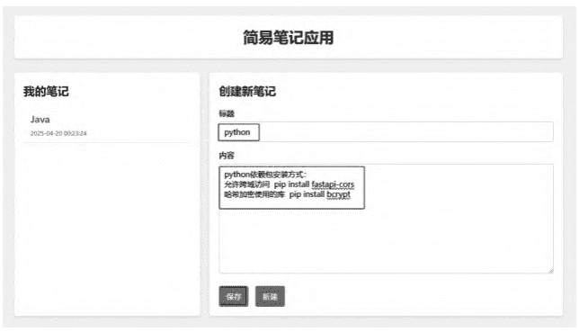

图 2-19 输入笔记内容


图 2-20 笔记保存成功

再来看笔记浏览。左侧面板呈现已有的笔记列表，整体按创建时间排序，如图2-21所示，上下滚动即可翻阅更早或更新的记录。每条条目简洁展示标题与创建日期，便于快速定位。


图 2-21 查看笔记列表

想查看完整内容，只需点击列表中对应的标题，即可跳转到该笔记的详情页，如图2-22所示。


删除功能的校验也不复杂。在详情页中能找到标注为“删除”的操作键，点击后会弹出二次确认，询问是否永久移除。确认后记录将被彻底清除且无法恢复，如图2-23所示。

新建条目的入口同样直观，点击界面上的“新建”按钮，当前表单会被清空，方便立即开始记录新的想法或信息，如图2-24所示。


经过上述几轮操作，可以判断该简易笔记应用是否满足创建、浏览、删除等核心需求。整体界面清爽易用，采用响应式布局，能良好适配不同尺寸屏幕。

这个例子充分体现了 Trae 作为 AI 编程助手的高效价值。传统开发往往从需求拆解到编码实现要经历漫长周期，多轮设计、编写、调试。而借助 Trae，只需用自然语言描述期望的功能和细节，就能在短时间内得到高质量的代码，实现从想法到可运行产品的快速跃迁。

以笔记应用为例，Trae 生成的代码遵循最佳实践，还细致处理了响应式适配、异常捕捉、友好提示等容易被忽略的点。这些细节对产品可用性至关重要，手工实现时常耗费大量时间。

对新手而言，Trae 输出的代码本身也是宝贵的学习材料。研读其项目组织方式、前后端交互逻辑、输入校验与错误处理等，能帮助理解全栈开发的核心要领。

当然，AI 生成的初版并非十全十美，往往需要根据具体场景做微调与优化。但它提供了一个扎实的基础，让开发者不必纠结于基础代码搬运，而能聚焦在更高阶的设计与创新上。

Trae 折射出 AI 编程的发展方向：让开发者更专注于解决难题与创造价值，降低重复编码的负担。

### 2.6 实战案例：跨平台移动应用的快速原型开发

下面用一个具体案例演示如何借助 AI 辅助工具快速搭建跨平台移动应用原型。以 HTML、CSS 与 jQuery 为技术基础，打造一款功能完整且简洁的个人记账本应用。即便没有编程经验，按步骤实践也能顺利完成。

#### 步骤1：明确项目需求。

先把功能边界理清。以“个人记账本”为例，目标是帮助用户管理日常收支。应用需要支持收入与支出的记录，并提供分类管理能力，既能随时记录财务动态，也能培养良好的财务习惯。

#### 步骤2：在用友开发端创建项目。

进入用友开发端，点击“创建项目”，填写应用名称与描述，选择“空白模板”，即可生成移动端的基础文件框架，如图2-25所示。

技术选型上延续经典稳妥的 HTML + CSS + jQuery 前端组合。完成这些前期规划后，便可开始借助 Trae 进行辅助开发。

# 第2章 智能编码与Trae全栈代码生成

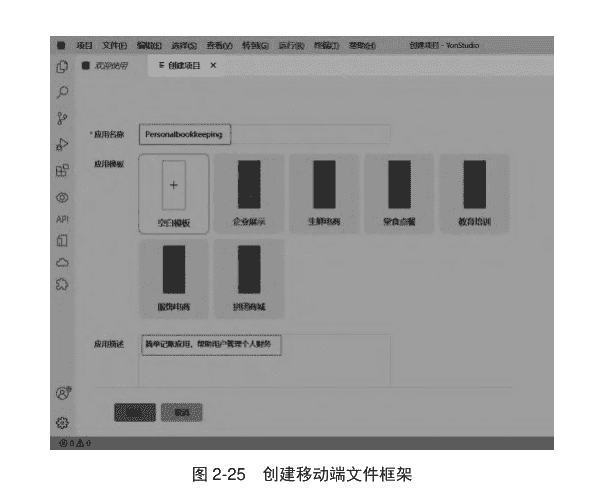

图 2-25 创建移动端文件框架

#### 步骤3：用Trae进行编译。

打开 Trae 后会进入工作台，找到“打开文件夹”入口并点击，如图2-26所示。在弹出的文件选择对话框中定位到刚才新建的 Personalbook-keeping 目录，如图2-27所示。

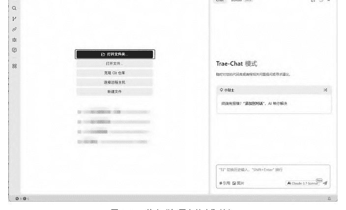

图 2-26 单击“打开文件夹”按钮


图 2-27 选择项目文件夹

#### 步骤4：描述应用功能。

进入项目界面后会看到中央的文本输入区，这是 Trae 最核心的功能之一，支持用日常语言描述想要实现的应用，如图2-28所示。在此详细说明业务需求与技术栈要求。

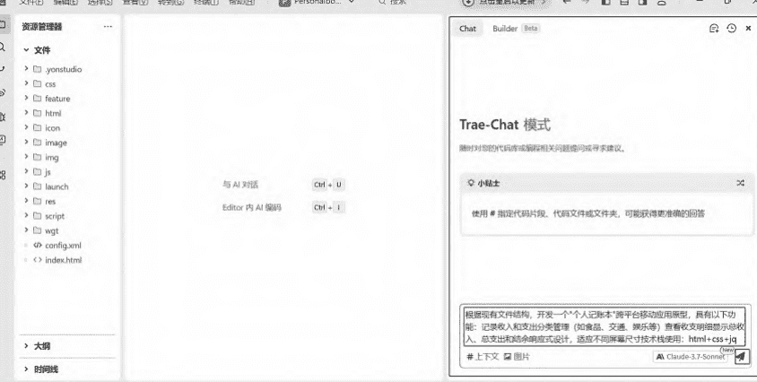

图 2-28 输入项目描述

在项目描述框里填入如下内容。

> 基于现有文件结构，开发一个“个人记账本”跨平台移动应用原型，功能包含：

- 记录收入与支出
- 分类管理，如食品、交通、娱乐等
- 查看收支明细
- 显示总收入、总支出与结余
- 响应式设计，适配不同屏幕尺寸
- 技术栈：HTML + CSS + JQ

提交后，Trae 会解析描述并开始生成代码，耗时从数秒到数分钟不等，取决于复杂度。随着进度推进，可看到定制化代码逐步成型。生成完成后，点击代码区右上角的“应用”按钮，Trae 会自动将变更同步到目标文件夹，如图2-29所示。

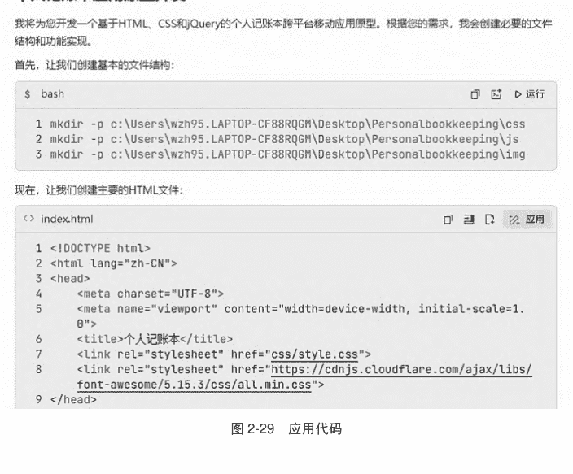

#### 步骤5：Trae自动生成功能代码。

Trae 首先在 Personalbookkeeping 根目录下创建了三个子目录：存放样式的 css、存放交互逻辑的 js、存放图片资源的 img。这样的分层方式让文件井然有序，类似把衣物、书籍、电器分抽屉存放，便于后续查找与维护，符合专业 Web 项目的规范，也为记账系统奠定了清晰的基础架构。

```
mkdir -p c:\***\Personalbookkeeping\css
mkdir -p c:\***\Personalbookkeeping\js
mkdir -p c:\***\Personalbookkeeping\img
```

随后生成了 HTML 主页模板，布局简明且功能完备。顶部醒目标注“个人记账本”标题，下方紧跟财务概览板块，一目了然地呈现总收入、总支出和结余三大核心数据。中间区域是交易录入表单，包含金额、描述、分类、日期、类型等必要字段，分类选项覆盖日常常见场景如食品、交通、工资等，满足基础记账需求。底部为交易记录展示区，内置筛选控件，可按收支类型或具体分类过滤历史记录，方便管理和回顾。整体操作流畅、结构清晰，具备实用性与良好的用户体验。

示例代码如下。

```html
<!-- index.html -->
<!DOCTYPE html> <!-- 文档类型声明，指定 HTML5 文档 -->
<html lang="zh-CN"> <!-- HTML 根元素，设置页面语言为中文 -->
<head>
    <meta charset="UTF-8"> <!-- 设置字符编码为 UTF-8，支持中文显示 -->
    <meta name="viewport" content="width=device-width, initial-scale=1.0"> <!-- 响应式设计，确保在移动设备上正确显示 -->
    <title>个人记账本</title> <!-- 页面标题，显示在浏览器标签页上 -->
    <link rel="stylesheet" href="css/style.css"> <!-- 链接自定义 CSS 样式表 -->
    <link rel="stylesheet" href="https://cdnjs.cloudflare.com/ajax/libs/font-awesome/5.15.3/css/all.min.css"> <!-- 导入 Font Awesome 图标库 -->
</head>
<body>
<div class="container"> <!-- 主容器，包含所有页面内容 -->
    <header>
        <h1>个人记账本</h1> <!-- 页面标题 -->
    </header>

    <div class="summary"> <!-- 财务概览区域，显示收入、支出和结余 -->
        <div class="summary-item">
            <h3>总收入</h3>
            <p id="total-income">¥0.00</p> <!-- 总收入显示区域，初始值为0 -->
        </div>
        <div class="summary-item">
            <h3>总支出</h3>
            <p id="total-expense">¥0.00</p> <!-- 总支出显示区域，初始值为0 -->
        </div>
        <div class="summary-item">
            <h3>结余</h3>
            <p id="balance">¥0.00</p> <!-- 结余显示区域，初始值为0 -->
        </div>
    </div>

    <div class="add-transaction"> <!-- 添加新交易记录的表单区域 -->
        <h2>添加新记录</h2>
        <form id="transaction-form"> <!-- 交易记录表单，用于收集用户输入的数据 -->
            <div class="form-group">
                <label for="amount">金额</label>
                <input type="number" id="amount" step="0.01" required> <!-- 金额输入框，要求输入数字，可精确到分 -->
            </div>

            <div class="form-group">
                <label for="description">描述</label>
                <input type="text" id="description" required> <!-- 交易描述输入框，必填字段 -->
            </div>

            <div class="form-group">
                <label for="category">分类</label>
                <select id="category" required> <!-- 交易分类下拉列表框 -->
                    <option value="">-- 选择分类 --</option> <!-- 默认选项 -->
                    <option value="食品">食品</option> <!-- 支出类别选项 -->
                    <option value="交通">交通</option>
                    <option value="娱乐">娱乐</option>
                    <option value="购物">购物</option>
                    <option value="住房">住房</option>
                    <option value="医疗">医疗</option>
                    <option value="教育">教育</option>
                    <option value="工资">工资</option> <!-- 收入类别选项 -->
                    <option value="奖金">奖金</option>
                    <option value="投资">投资</option>
                    <option value="其他收入">其他收入</option>
                    <option value="其他支出">其他支出</option>
                </select>
            </div>

            <div class="form-group">
                <label for="date">日期</label>
                <input type="date" id="date" required> <!-- 交易日期选择器 -->
            </div>

            <div class="form-group">
                <label>类型</label>
                <div class="radio-group"> <!-- 交易类型单选按钮组 -->
                    <input type="radio" id="income" name="type" value="income" required>
                    <label for="income">收入</label> <!-- 收入选项 -->
                    <input type="radio" id="expense" name="type" value="expense" required>
                    <label for="expense">支出</label> <!-- 支出选项 -->
                </div>
            </div>

            <button type="submit" class="btn">添加记录</button> <!-- 提交表单按钮 -->
        </form>
    </div>

    <div class="transactions"> <!-- 交易记录显示区域 -->
        <h2>交易记录</h2>
        <div class="filter"> <!-- 交易记录筛选工具 -->
            <label for="filter-type">筛选：</label>
```

## 第2章 智能编码与Trae全栈代码生成

这一阶段通过CSS来塑形产品的视觉面貌，整体走清爽简约的路线，让财务管理界面既专业又好上手。底色选用柔和的灰白系，重点模块则以纯白底搭配若有若无的阴影，视觉层次一下子就分明了。头部标题区点缀一条深蓝色的边框，沉稳里透着点活力。

财务概览部分做成卡片形式，收入以绿色呈现，支出用红色标注，余额则以蓝色突出，这种色彩映射让用户一眼就能读懂资金动向。

表单部分的排布很舒适，输入框的尺寸拿捏得刚好，操作按钮采用亮蓝色作为主色，自然引导视线与下一步操作。交易明细列表简洁规整，每一条都涵盖日期、说明、类别和金额，收支数字依旧沿用绿红对比，一眼就能区分。

全站做了全适配的响应式布局，无论是手机还是平板，都能保持流畅的浏览与操作体验，信息展示和交互细节都经过细致打磨，最终打造出兼具颜值与实用性的个人记账工具。

示例代码如下。

```html
<select id="filter-type"> <!-- 按交易类型筛选下拉列表框 -->
    <option value="all">全部</option>
    <option value="income">仅收入</option>
    <option value="expense">仅支出</option>
</select>

<select id="filter-category"> <!-- 按交易分类筛选下拉列表框 -->
    <option value="all">所有分类</option>
    <option value="食品">食品</option>
    <option value="交通">交通</option>
    <option value="娱乐">娱乐</option>
    <option value="购物">购物</option>
    <option value="住房">住房</option>
    <option value="医疗">医疗</option>
    <option value="教育">教育</option>
    <option value="工资">工资</option>
    <option value="奖金">奖金</option>
    <option value="投资">投资</option>
    <option value="其他收入">其他收入</option>
    <option value="其他支出">其他支出</option>
</select>
</div>

<ul id="transaction-list" class="transaction-list">
    <!-- 交易记录将通过 JavaScript 动态添加 --> <!-- 空列表，用于通过 JavaScript 动态添加交易记录 -->
</ul>
</div>
</div>

<script src="https://code.jquery.com/jquery-3.6.0.min.js"></script>
<!-- 导入 jQuery 库，简化 DOM 操作 -->
<script src="js/app.js"></script> <!-- 导入自定义 JavaScript 文件，包含应用逻辑 -->
</body>
</html>
```

```css
/* 基础样式 style.css */
* {
    margin: 0;           /* 移除所有元素的默认外边距 */
    padding: 0;          /* 移除所有元素的默认内边距 */
    box-sizing: border-box;  /* 使元素的宽度和高度包含 padding 和 border */
}

body {
    font-family: 'Helvetica Neue', Arial, sans-serif;  /* 设置页面主字体 */
    background-color: #f5f5f5;  /* 设置浅灰色背景 */
    color: #333;                /* 设置深灰色文字颜色 */
    line-height: 1.6;           /* 设置行高，增加文本可读性 */
}

.container {
    max-width: 800px;    /* 设置最大宽度，确保在大屏幕上不会过宽 */
    margin: 0 auto;      /* 容器居中 */
    padding: 20px;       /* 容器内边距 */
}

header {
    text-align: center;  /* 标题居中 */
    margin-bottom: 30px; /* 与下方内容的间距 */
}

header h1 {
    color: #2c3e50;      /* 标题颜色为深蓝灰色 */
    font-size: 2rem;     /* 标题字体大小 */
    padding: 10px 0;     /* 标题上下内边距 */
    border-bottom: 2px solid #3498db;  /* 添加蓝色底边框，增强视觉效果 */
}

h2 {
    color: #2c3e50;        /* 副标题颜色与 h1 一致 */
    margin-bottom: 15px;    /* 与下方内容的间距 */
    padding-bottom: 5px;    /* 底部内边距 */
    border-bottom: 1px solid #ddd;  /* 添加淡灰色底边框，区分内容板块 */
}

/* 摘要区域 */
.summary {
    display: flex;              /* 使用弹性布局 */
    justify-content: space-between;  /* 均匀布局子元素 */
    margin-bottom: 30px;        /* 与下方内容的间距 */
    flex-wrap: wrap;            /* 在小屏幕上允许换行 */
}

.summary-item {
    flex: 1;                    /* 弹性增长，使各项平均分配空间 */
    min-width: 150px;           /* 最小宽度，防止过窄 */
    background-color: white;    /* 白色背景 */
    padding: 15px;              /* 内边距 */
    border-radius: 8px;         /* 圆角边框 */
    box-shadow: 0 2px 5px rgba(0, 0, 0, 0.1);  /* 添加轻微阴影，增强立体感 */
    margin: 5px;                /* 项目间边距 */
    text-align: center;         /* 内容居中 */
}

.summary-item h3 {
    font-size: 1rem;            /* 标题字体大小 */
    margin-bottom: 10px;        /* 与下方数字的间距 */
    color: #7f8c8d;             /* 标题颜色为灰色 */
}

.summary-item p {
    font-size: 1.5rem;          /* 数字字体大小 */
    font-weight: bold;          /* 加粗显示 */
}

#total-income {
    color: #27ae60;             /* 收入显示为绿色 */
}

#total-expense {
    color: #e74c3c;             /* 支出显示为红色 */
}

#balance {
    color: #3498db;                /* 结余显示为蓝色 */
}

/* 表单样式 */
.add-transaction {
    background-color: white;       /* 白色背景 */
    padding: 20px;                 /* 内边距 */
    border-radius: 8px;            /* 圆角边框 */
    box-shadow: 0 2px 5px rgba(0, 0, 0, 0.1);  /* 添加轻微阴影 */
    margin-bottom: 30px;           /* 与下方内容的间距 */
}

.form-group {
    margin-bottom: 15px;           /* 表单元素之间的间距 */
}

label {
    display: block;                /* 标签独占一行 */
    margin-bottom: 5px;            /* 与输入框的间距 */
    font-weight: 600;              /* 标签文字加粗 */
}

input, select {
    width: 100%;                   /* 输入框占满容器 */
    padding: 10px;                 /* 内边距 */
    border: 1px solid #ddd;        /* 浅灰色边框 */
    border-radius: 4px;            /* 圆角边框 */
    font-size: 1rem;               /* 字体大小 */
}

.radio-group {
    display: flex;                 /* 使用弹性布局 */
    gap: 20px;                     /* 单选按钮之间的间距 */
}

.radio-group input {
    width: auto;                   /* 取消 100% 宽度设置 */
    margin-right: 5px;             /* 与标签的间距 */
}

.radio-group label {
    display: inline;               /* 标签内联显示 */
    font-weight: normal;           /* 取消加粗 */
}

.btn {
    background-color: #3498db;    /* 按钮背景色为蓝色 */
    color: white;                 /* 按钮文字颜色为白色 */
    border: none;                 /* 移除边框 */
    padding: 12px 20px;           /* 按钮内边距 */
    border-radius: 4px;           /* 圆角边框 */
    cursor: pointer;              /* 鼠标变为手型 */
    font-size: 1rem;              /* 字体大小 */
    width: 100%;                  /* 按钮宽度占满容器 */
    transition: background-color 0.3s;  /* 背景色变化过渡效果 */
}

.btn:hover {
    background-color: #2980b9;    /* 鼠标指针悬停于其上时的背景色深蓝色 */
}

/* 交易记录列表 */
.transactions {
    background-color: white;      /* 白色背景 */
    padding: 20px;                /* 内边距 */
    border-radius: 8px;           /* 圆角边框 */
    box-shadow: 0 2px 5px rgba(0, 0, 0, 0.1);  /* 添加轻微阴影 */
}

.filter {
    margin-bottom: 15px;          /* 与列表的间距 */
    display: flex;                /* 使用弹性布局 */
    align-items: center;          /* 垂直居中对齐 */
    flex-wrap: wrap;              /* 在小屏幕上允许换行 */
    gap: 10px;                    /* 筛选器元素之间的间距 */
}

.filter select {
    width: auto;                  /* 取消 100% 宽度设置 */
    padding: 8px;                 /* 内边距 */
}

.transaction-list {
    list-style: none;             /* 移除列表默认样式 */
}

.transaction-item {
    display: flex;                /* 使用弹性布局 */
    justify-content: space-between; /* 两端对齐 */
    align-items: center; /* 垂直居中对齐 */
    padding: 15px 0; /* 上下内边距 */
    border-bottom: 1px solid #eee; /* 底部边框，分隔各条记录 */
}

.transaction-info {
    flex: 1; /* 信息区域占据剩余空间 */
}

.transaction-date {
    color: #7f8c8d; /* 日期颜色为灰色 */
    font-size: 0.8rem; /* 日期字体较小 */
    margin-bottom: 5px; /* 与描述的间距 */
}

.transaction-description {
    font-weight: 600; /* 描述文字加粗 */
}

.transaction-category {
    display: inline-block; /* 内联块级显示 */
    background-color: #ecf0f1; /* 背景色为极浅灰色 */
    padding: 3px 8px; /* 内边距 */
    border-radius: 12px; /* 圆角边框，形成标签效果 */
    font-size: 0.8rem; /* 字体较小 */
    margin-top: 5px; /* 与描述的间距 */
}

.transaction-amount {
    font-weight: bold; /* 金额加粗显示 */
    font-size: 1.1rem; /* 金额字体稍大 */
}

.income {
    color: #27ae60; /* 收入颜色为绿色 */
}

.expense {
    color: #e74c3c; /* 支出颜色为红色 */
}

.delete-btn {
    background: none; /* 移除按钮背景 */
    border: none; /* 移除按钮边框 */
    color: #e74c3c; /* 按钮颜色为红色 */
    cursor: pointer; /* 鼠标变为手形 */
    font-size: 1.2rem; /* 按钮字体大小 */
    margin-left: 10px; /* 与金额的间距 */
}

/* 响应式设计 */
@media (max-width: 768px) { /* 中等屏幕（平板）媒体查询 */
    .summary {
        flex-direction: column; /* 摘要项垂直排列 */
    }

    .summary-item {
        margin-bottom: 10px; /* 项目之间的间距 */
    }

    .radio-group {
        flex-direction: column; /* 单选按钮垂直排列 */
        gap: 5px; /* 按钮之间的间距 */
    }
}

@media (max-width: 480px) { /* 小屏幕（手机）媒体查询 */
    .container {
        padding: 10px; /* 减少容器内边距 */
    }

    header h1 {
        font-size: 1.5rem; /* 减小标题字体大小 */
    }

    .summary-item p {
        font-size: 1.2rem; /* 减小摘要数字字体大小 */
    }

    .btn {
        padding: 10px; /* 减少按钮内边距 */
    }
}
```

收尾阶段的 JavaScript 把整套逻辑打包完成，变成一个能直接在浏览器里跑的本地记账系统。页面加载瞬间，脚本会先去本地存储里找有没有已有的流水，若没有就先建一个空列表，并自动把表单日期框填成今天。

这套工具能新增收支条目，支持金额、备注、分类、日期和收支类型等核心字段的填写，也支持随时删除不需要的记录，还提供了按收支类型和分类双维度筛选的入口，方便快速定位和整理数据。

账单列表默认按时间倒序排列，最新的条目排在最上方。每一条目都清晰呈现日期、说明、分类和金额，收入用绿色并配“+”号，支出用红色并配“-”号，一眼就能分辨。系统还会同步算出累计收入、累计支出和当前结余，让财务状况实时可见。所有信息都写进浏览器的本地存储，关掉页面或重启浏览器后数据依然在，保证使用便捷且私密。

下面附上示例代码。

```javascript
// app.js
$(document).ready(function() {
    // 初始化本地存储
    if (!localStorage.getItem('transactions')) {
        localStorage.setItem('transactions', JSON.stringify([]));
    }

    // 设置今天的日期为默认值
    const today = new Date().toISOString().split('T')[0];
    $('#date').val(today);

    // 加载并显示交易记录
    loadTransactions();
    updateSummary();

    // 添加新交易记录
    $('#transaction-form').on('submit', function(e) {
        e.preventDefault();

        const amount = parseFloat($('#amount').val());
        const description = $('#description').val();
        const category = $('#category').val();
        const date = $('#date').val();
        const type = $('input[name="type"]:checked').val();

        if (!amount || !description || !category || !date || !type) {
            alert('请填写所有字段');
            return;
        }

        const transaction = {
```

#### 步骤6：测试验收。

代码完成后，测试调试就是决定品质的关键环节。先在浏览器里打开 index.html，确认界面能否正常加载并呈现。

接着验证记账能力。用户可以开始实操记录收入和支出，通过操作界面新增一笔完整的收支。新增时不仅能填入具体的金额数值，还能补充文字说明，方便以后回看和分析（见图 2-30）。此外每笔流水都可以打上分类标签，比如“餐饮”“交通”“娱乐”等，有助于更精细地梳理开销结构（见图 2-31）。每条记录都会绑定精确的日期信息，确保资金流向的时间点可追溯。


随后检查明细查看功能。系统会把全部交易按时间先后重新排布，保证最新的一笔永远显示在列表顶部（见图2-32）。

先对筛选模块做功能核验，它帮助使用者按交易特征迅速归类检视。实操中既可依收入与支出类别做分离（见图2-33和图2-34），也能利用多套分类标准对账单进行归纳（见图2-35）。


070

# 第2章 智能编码与Trae全栈代码生成


图 2-33 筛选功能（1）


图 2-34 筛选功能（2）


图 2-35 筛选功能（3）

实测时发现汇总区将总收入、总支出及净结余全部置于页头，用户不用下滑就能掌握整体资金态势，一眼便可浏览（见图 2-36）。


图 2-36 数据展示

随后检查删除逻辑。先在清单里点选特定条目，再触发其关联的删除按钮，执行后该条目应彻底从清单中移除，以此判定删除是否生效。


图 2-37 删除记录

该应用采用浏览器本地持久化方式保存账本。即使刷新页面或关闭再重启浏览器，历史录入的记录仍完整留存，不会出现数据消失。

最后检视自适应效果，可通过拖动窗口或借助浏览器内置设备模拟来复现不同终端。在手机窄屏下需确认：概览卡片是否由横向并排改为纵向堆叠；表单输入区是否铺满视口宽度；交易列表及图表能否随视口伸缩；文字显示是否完整清晰无截断。

**步骤7：发布上线。**

返回用友开发后台，载入 Personalbookkeeping 文件夹，选择“移动打包”选项（见图2-38），填入应用名称、分类、目标平台与类型等参数后，点击底部的开始打包按钮以触发构建过程（见图2-39）。构建完毕后即可扫码安装该应用。


图 2-38 移动打包（1）

# 第2章 智能编码与Trae全栈代码生成

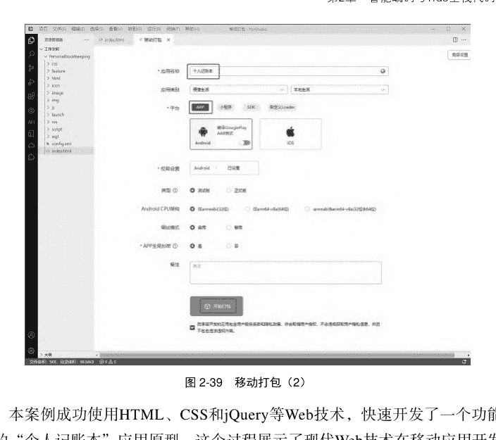

图 2-39 移动打包（2）

本实例利用 HTML、CSS 与 jQuery 等前端技术栈，短时间内完成了功能齐备的个人记账原型，体现了当下 Web 技术在移动端原型搭建上的高效潜力。

其最大优势在于门槛低且周期短。无需掌握复杂的原生移动开发技能，仅凭熟知的网页技术即可产出可用原型；同一套代码可在多端复用，显著压缩开发与维护成本。

AI 辅助编码并非冲击传统程序员岗位，而是提供了一种全新的学习与创作方式。阅读由 AI 产出的代码，能够吸收架构搭建思路、高频设计模式以及业界公认的最佳实践。

全栈代码生成的出现已经显著改变了软件研发路径。以 Trae 为代表的智能助手能将繁复的编码任务转化为自然语言描述，随后自动产出前端页面、后端业务、数据结构及接口定义。该能力大幅压缩了 idea 到上线的周期，也降低了参与门槛，让更多非专业人员加入创新。工程师的定位正从重复撰写模板代码的操作者，转向需求梳理与用户体验的规划者。审校产出、性能调优与安全保障依旧不可缺失。全栈生成并非要淘汰开发者，而是把重复劳动解放出来，留出更多时间做创造性思考，使技术落地与商业价值的转化速度达到新高度。未来属于能熟练驾驭智能协作工具的创造者。


# 第 3 章

## CodeWhisperer

边写边查漏洞，

AI 让代码更安全

### 3.1 程序员最容易踩的安全漏洞

编码犹如造房，基础或结构一旦出现缺陷整栋建筑都会受损。软件领域里这类隐患可能引发入侵、信息泄露，乃至金钱损失。即便经验丰富的工程师也难以避免细节失误，因安全风险常隐藏于暗处。

其中最典型的就是 SQL 注入式攻击。可以想象成服务员把客人随口的话当作厨房指令执行。若程序把用户提交的内容直接拼进数据库查询语句，恶意输入就能篡改查询逻辑，进而窃取或改动敏感信息。曾有大型零售企业因此类缺陷导致数十万客户付款信息外泄。应对之道是采用参数化查询，相当于点餐只能按既定菜单选择，无法更改后厨流程。

跨站脚本攻击同样常见。可类比为攻击者在公告栏张贴暗藏陷阱的通知。若站点未对用户提交内容做清洗，恶意 JavaScript 即可被植入，并在其他访客浏览时自动运行，盗取 Cookie、会话凭证或导向钓鱼页面。曾有一家小型教育站点因留言区缺少校验，第二天大量访客被转向伪造登录页导致账号失窃。核心防范是对所有外部输入做严格净化，保证展示内容无法被执行。

密码保管失误常是泄露事件的诱因。直接以明文保存如同把钥匙挂在门外；即便做了哈希，若未加盐或选用了脆弱算法也易被迅速破解。某知名社交平台曾因保管不当导致上亿用户凭证外泄，攻击者借助彩虹表快速恢复。更稳妥的做法是选用 bcrypt、Argon2 等专为密码设计的哈希函数，并为每条密码单独生成随机盐。

认证与会话管理上的疏漏也很普遍。会话标识出现在 URL 中、Cookie 未设置安全标志、未启用防暴力破解的锁定机制等，均可被利用。某电商曾遭遇会话固定攻击，攻击者通过特制链接接管用户购物会话并盗用支付资料。规范做法应使用加密且随机的会话标识、为 Cookie 配置恰当的安全属性，并实现合理的过期策略与账户防护。

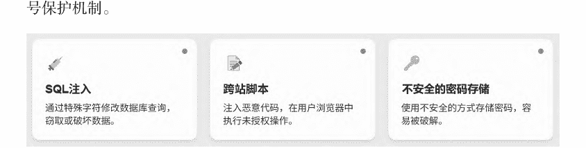
文件上传功能往往是薄弱点。若未严格限定类型与内容，攻击者可上传恶意代码并触发执行。某医疗机构站点允许医生上传 X 光影像，因未校验实际内容，攻击者上传伪装成图片的 PHP 脚本，取得服务器权限并接触大量病历。安全实现需校验文件类型、实际内容与大小，并将上传物存放于不可执行目录或独立存储。

过度依赖第三方组件也会引入风险。开源库与框架可能存在已知缺陷或被恶意篡改。某航空公司官网因采用带后门的第三方支付模块，导致支付数据被截获。开发者应审慎挑选依赖、及时升级至安全版本并校验完整性。

配置失误看似细微却影响巨大。开发环境的调试信息泄漏到正式环境、云存储权限设置不当、默认账号密码未清除等都可能引发事故。某科技初创企业因 MongoDB 未设置访问密码而暴露在公网，导致数千万条用户记录泄漏。完善的配置治理与上线前的安全自检可避免此类风险。

总的说来，编码始终在便捷与安全之间平衡。追求功能实现与交付速度时容易忽略细节。正如某资深安全专家所言：“安全不是附加功能，而是一种思维习惯。”每一行代码都可能成为攻击突破口。

### 3.2 用 AI 查漏洞: CodeWhisperer 如何审计代码

以往的代码安全审查多在开发收尾后才展开，类似房屋竣工后再检查渗漏，既滞后又低效。伴随智能技术发展，CodeWhisperer 这类助手将安全检测嵌入编码全流程。

这类审计可比喻为全天候在线的安全顾问，在程序员落笔时即刻剖析每一行代码的风险点，发现异常即时提示并给出改进建议，使问题在萌芽阶段被遏制。

它可识别多种常见风险：在处理外部输入时预警注入与脚本攻击；在构建认证时核查弱口令策略或会话管理缺陷；在加密调用时推荐使用新一代算法与正确用法。

不仅仅标注问题，还会解释成因与修复思路。例如当检测到 XML 外部实体注入风险时，会说明可能引发的文件泄露或拒绝服务，并给出关闭外部实体解析的具体示例。这种带解释的反馈对新手特别有帮助。

下面通过一个实操案例，说明 CodeWhisperer 如何在实际编码中助力提升安全性。

```python
#### 开发人员开始编写一个处理用户登录的函数
def login_user(username, password):
    # 连接数据库
    conn = get_db_connection()
    cursor = conn.cursor()

    # 查询用户——这里存在 SQL 注入风险
    query = f"SELECT * FROM users WHERE username = '{username}' AND password = '{password}'"
    cursor.execute(query)

    # 检查结果
    user = cursor.fetchone()
    if user:
        return True
    return False
```

此时 CodeWhisperer 能够立刻捕捉到隐患，并给出问题说明与优化建议（见图3-3）。

图 3-3 审计代码

同时它还会补充其它安全提示（见图3-4）。

- 2. 其他安全建议：

  - 密码应该进行加密存储，而不是明文

  - 添加登录失败次数限制

  - 使用安全的会话管理

  - 添加日志记录

  - 确保数据库连接在使用后正确关闭

这些改进可以大大提高应用程序的安全性。

图 3-4 其他安全建议

对每一项风险，它不仅定位位置，还提供详细的修复方案与业界最佳实践参考。这种全面审查让团队清晰掌握代码的安全状况并有针对性地改进。

总的说来，CodeWhisperer 正把被动审查转变为主动开发辅助。它不仅发现并修复漏洞，更通过即时反馈和教学式指导帮助开发者在编写过程中学习防护，逐步养成安全思维。这种“边写边查”方式大幅提升效率与安全性。

### 3.3 AI 自动实现数据保护与合规标准

当前数据隐私保护不仅是技术议题，更是法律合规要求。GDPR、CCPA、中国《个人信息保护法》等法规对数据收集、存储、处理提出严格限制。CodeWhisperer 这类智能工具简化了合规落地，帮助开发者自动实现数据保护。

编写涉及用户数据处理的代码时，可询问工具是否存在合规风险。例如收集邮箱时，系统会提示添加明确的同意机制等（见图3-5）。

图 3-5 合规问题检测

在处理个人身份信息时，CodeWhisperer 能识别敏感数据类型并给出保护建议。例如处理信用卡信息时，会建议遵循 PCI DSS 等合规措施（见图3-6）。

它还会检查数据访问模式，确保实施适当权限控制。例如设计 API 时会建议添加访问控制（见图3-7）。

除单点建议外，还可启用项目扫描功能，对整库进行合规检查并生成详细报告，列出问题严重程度、位置和修复建议。

例如扫描报告可能呈现如图3-8 的内容。

## 第3章 CodeWhisperer边写边查漏洞，AI让代码更安全

图 3-6 敏感数据检测

图 3-7 访问控制检测

图 3-8 项目扫描报告

CodeWhisperer 还能生成符合合规要求的代码模板。例如实现 GDPR 要求的数据主体权利功能时，通过注释提示工具。

```javascript
// 生成一个符合 GDPR 的数据导出功能
```

CodeWhisperer 会根据提示生成完整的实现代码（见图3-9）。

总的来说，CodeWhisperer 让安全审计从特殊任务变为日常编码的自然环节。它帮助开发者规避常见陷阱，通过持续指导提升安全意识。对企业而言意味着更低成本构建更安全软件；对开发者而言是持续学习的机会。面对日益增多的泄露与攻击，AI 助手正成为开发团队必备工具。

图 3-9 合规模板和代码生成

### 3.4 实战案例：搭建一个带登录功能的安全系统

安全的用户认证系统是现代应用的基础，却充满挑战。登录功能看似简单，却是攻击重点。接下来展示如何借助 CodeWhisperer 构建安全可靠的登录系统。

首先明确需求：搭建安全 Web 登录系统，要求密码安全存储、防暴力破解、符合 GDPR、CCPA 等法规的登录流程。

技术选型上，前端采用 HTML+CSS+JavaScript，后端选用 Python。确定规划后，开始使用 Trae 协助开发。

**步骤1：创建项目。**

打开 Trae 工具后，在编译界面找到“打开文件夹”按钮并点击（见图3-10）。在弹出的对话框中选择或新建文件夹 LoginSystem（见图3-11）。

图 3-10 单击“打开文件夹”按钮

图 3-11 选择项目文件夹

**步骤2：在构建模式下描述项目需求。**

进入界面后切换至 构建模式，该模式下代码文件修改会自动保存。在文本区用自然语言描述需求，包括功能和技术栈（见图3-12）。

在 Trae 的项目描述框中输入：

> 搭建一个简易安全的Web登录系统，前端技术栈使用HTML+CSS+JavaScript，后端技术栈使用Python。

提交后 Trae 会分析需求并生成项目代码，时长取决于复杂度。片刻后即可看到定制化代码生成并自动写入指定文件夹（见图3-13）。

**步骤3：使用CodeWhisperer生成扫描报告。**

基础项目构建完成后，借助 CodeWhisperer 启动全项目扫描生成报告，检查安全性。

初步构建完成后，使用 CodeWhisperer 对整个项目进行全面扫描，识别潜在漏洞和缺陷。扫描结束后生成详细报告，开发者据此修改代码以提升安全性（见图3-14和图3-15）。

> 搭建一个简易安全的Web登录系统，前端技术栈使用HTML+CSS+JavaScript，后端技术栈使用Python。

Trae AI

我会帮你搭建一个安全的Web登录系统。我建议将项目分为前端和后端两部分：前端使用HTML+CSS+JS实现登录界面和表单验证，后端使用Python的Flask框架处理用户认证和数据存储。系统将包含以下核心功能：用户注册和登录、密码加密存储、会话管理、防止SQL注入和XSS攻击。为了提高安全性，我们会实现密码哈希加盐、CSRF防护、请求限流等安全措施。我会先创建基本的项目结构，包括静态文件目录、模板目录和后端Python文件。

首先创建项目的基本目录结构，包括静态文件、模板和后端Python文件。

```
requirements.txt
```

创建项目的主要目录结构，包括静态资源目录、模板目录和应用配置文件。

```
app.py
```

从零搭建一套可用的登录体系，思路其实很清晰，先把最触达用户的页面做起来。

先从前端登录界面入手，用 HTML 搭结构、用 CSS 打磨视觉，再加上基础的表单校验保证必填项不为空。

```
templates\login.html
```

紧接着补上注册环节，让用户能够自行创建账号，同样带上表单校验以及必要的安全性自检。

```
templates\register.html
```

页面骨架有了以后，把主页和仪表盘也做出雏形，实现菜单层级的切换和基础的用户界面展示。

```
templates\index.html
```

仪表盘这块要细化一下，登录成功后呈现个人资料和系统状态，同时把安全的退出入口加进去。

```
templates\dashboard.html
```

到这里，前后端代码、模板文件以及依赖清单都已经准备齐全。下一步就是安装项目依赖并启动服务，让登录系统真正跑起来。

```
LoginSystem
```

图 3-13 项目生成

在代码成型后，我对这段登录系统的前端脚本做了安全性和工程实践的审视，并整理出如下发现：

安全扫描报告

1. 认证环节的问题
   严重项
   * 明文传输风险：密码在浏览器端未做任何加密就直接发出
   * 缺少强密码策略：没有对密码强度进行校验
   * 防暴力破解缺失：未限制登录失败次数等攻击手段
2. 会话管理
   中等问题
   * localStorage 保存用户名存在泄漏风险，建议改用 sessionStorage
   * 没有配置会话超时自动失效机制
3. 错误处理
   中等问题
   * 反馈信息过于具体，容易暴露内部实现细节
   * catch 里的处理粒度偏粗，可以进一步细分
4. 输入校验
   中等问题
   * 用户名和密码只做了非空判断，校验逻辑比较单薄

图 3-15 检查项目安全性（2）

借助 Trae 加 CodeWhisperer 的组合，能在很短时间内拼出一套自带安全意识的登录系统，同时获得正向的最佳实践建议。这样做既省时间，也让安全从设计阶段就内建进来，而不是事后补丁式地堆上去，整体防护会更扎实。

### 3.5 实战案例：一键扫描并修复依赖库中的风险组件

实际开发里最容易被忽略的雷区，就是第三方依赖里的已知漏洞。一个项目动辄依赖数十上百个组件，任何一个出事都会牵连全局。过去要靠安全专家人工追踪 CVE、手动升级，成本高效率低。现在交给 CodeWhisperer，就能把流程自动化。

步骤1：先摸清依赖全貌。
扫描的第一步是拉出完整的依赖清单。打开 CodeWhisperer 插件，告诉它“生成检查该项目依赖安全的命令”，它会根据项目上下文智能推荐对应的检测工具和指令。比如 Node.js 项目会指向 npm audit，Python 项目会推荐 safety 或 pip-audit，Java 项目则会建议 OWASP 的依赖检查工具。

想核查依赖漏洞，可以用 npm 自带的审计能力。相关指令如下：

基本安全审计命令：

```bash
npm audit
```

执行后会遍历依赖树，比对 npm 的漏洞数据库，并给出严重程度、影响范围和修复建议的完整报告。

图 3-17 检查项目依赖安全（2）

步骤2：进入修复环节。
Node.js 项目的常用入口是 npm audit。跑完命令后，它会解析 package.json 和 package-lock.json，重建依赖树，再与官方漏洞库对比，最后按低、中、高、严重分类列出问题，并附上 CVE 编号、受影响路径和推荐版本。

典型输出会是“发现 15 个漏洞（5 低危、7 中危、3 高危）”。不必过度紧张，很多是传递依赖引入的，实际危害取决于使用方式。报告还会说明漏洞类型，比如原型污染、XSS、命令注入等，帮助判断优先级。

需要修复时，CodeWhisperer 会建议使用 npm audit fix 命令（见图3-18）。该命令会自动把有漏洞的依赖升到安全版本，并在 semver 约束内尽量避免破坏性变更。例如锁定 ^4.17.15 且存在 4.17.21 的安全补丁时，会自动升级到 4.17.21。

若要修复漏洞，可运行：

```bash
npm audit fix
```

该指令会自动将存在安全问题的依赖更新到安全的版本。

图 3-18 检查项目依赖项安全（3）

部分升级会被跳过，因为主版本更新可能带来不兼容。若确认风险可接受，可执行 npm audit fix --force 命令（见图3-19）。它会更激进地包含主版本升级，但随后必须做全量回归测试。

```bash
#### 如果只想修复严重级别的漏洞：
npm audit fix --force
```

图 3-19 检查项目依赖项安全（4）

如果需要更细的分析，CodeWhisperer 会推荐 npm audit --json 命令（见图3-20）。它会以 JSON 格式输出完整报告，便于保存、脚本解析或接入其他安全平台。

```bash
#### 如果想获取更详细的报告：
npm audit --json
#### 这会输出 JSON 格式的完整漏洞报告。
```

图 3-20 检查项目依赖安全（5）

更进一步的做法是把依赖检查嵌入 CI/CD。每次提交或构建时自动执行审计，发现高危问题就阻断构建或告警，确保问题在上线前被捕获。定期审计也很重要，可以每周或每月自动扫描，因为新漏洞会持续披露。更新策略建议分层：低风险可在常规迭代中处理，中风险近期安排，高风险和严重级别需立刻评估；关键系统先在测试环境验证再推生产。

把自动化安全门禁放进 DevSecOps 流水线，是现代工程的基线。CodeWhisperer 不仅推荐 npm audit，还会提示接入更专业的漏洞库和更丰富的分析能力，让只有通过安全检查的代码才能进入生产。长期下来，团队对依赖风险的嗅觉会变强，选择库时更倾向维护活跃、安全记录良好的项目。

AI 助力开发：Trae+CodeWhisperer+DeepSeek+Tabnine+Mintlify+Kimi

## 第 4 章 DeepSeek 调试神器详解，AI 自动帮你查 Bug

### 4.1 DeepSeek 如何读懂你的报错信息

屏幕上刷出一堆红色报错时，很多人会直接慌。那些技术术语堆在一起像是天书，传统做法是逐行阅读、去搜索引擎拼凑答案，或翻手册对照。如今 DeepSeek 作为新一代编程助手，把调试变得直观省心。

它之所以能快速解读报错，是因为训练数据覆盖了海量代码和真实错误场景，几乎见过所有常见异常。把错误信息粘贴进去，它能给出针对性解释，而不是一堆模糊的搜索结果，直接节省排查时间。

举个例子，下面是一段用于分析学生成绩的 Python 脚本。

```
scores = [85, 92, 78, 90]
for i in range(5):
    print(f"学生 {i+1} 的分数是：{scores[i]}")
```

运行后弹出了如下报错。

```
IndexError: list index out of range
```

对新手来说，这条信息很短却不易懂。把报错丢给 DeepSeek（见图4-1），它立刻给出清晰解释并附上修复思路（见图4-2）。


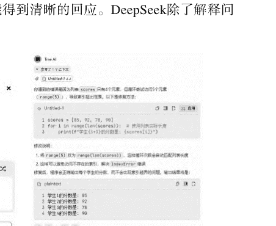

DeepSeek 对多种语言和框架的错误都很敏感。JavaScript 的 Uncaught TypeError、Java 的 NullPointerException、React 的渲染异常都能准确识别。对初学者而言，这意味着不用翻遍各框架文档就能明白问题所在。

再看前端的一个 React 组件。

```
function UserProfile() {
  const [user, setUser] = useState(null);

  return (
    <div className="profile">
      <h1>{user.name}'s Profile</h1>
      <p>Email: {user.email}</p>
    </div>
  );
}
```

浏览器控制台报出：

> Uncaught TypeError: Cannot read properties of null (reading 'name')

对 React 新手像一团乱麻。把报错复制给 DeepSeek，很快得到根因说明和可落地的修复方案（见图 4-3）。

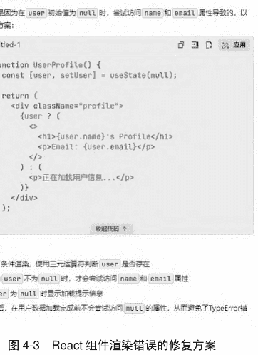

它还能解析堆栈跟踪。层层调用链对新手很头疼，DeepSeek 会提炼关键节点，指出错误源头并还原传播路径，帮你从源头修而不是在表象打补丁。例如一个数据库应用的报错。

```
SequelizeConnectionError: Connection timed out
    at ConnectionManager.connect (/app/node_modules/sequelize/lib/dialects/mysql/connection-manager.js:170:17)
    at processTicksAndRejections (node:internal/process/task_queues:96:5)
    at async ConnectionManager._connect (/app/node_modules/sequelize/lib/dialects/mysql/connection-manager.js:274:24)
    at async /app/node_modules/sequelize/lib/dialects/abstract/connection-manager.js:335:24
    at async ConnectionManager.getConnection (/app/node_modules/sequelize/lib/dialects/abstract/connection-manager.js:280:7)
    at async /app/src/database.js:45:16
```

这么长的堆栈让人无从下手。向 DeepSeek 提问后，能得到通俗的解释（见图4-4）。

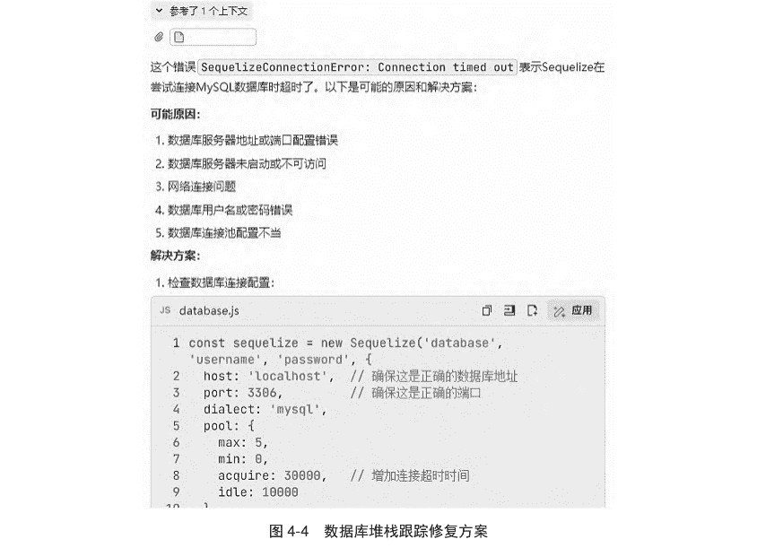

它还给出调试建议：

> 建议按以下步骤排查。
> 确认数据库服务是否正常运行；
> 检查网络连通性；
> 核对连接配置是否正确；
> 增加超时与重试机制；
> 补充完善的错误处理；
> 若仍失败，检查防火墙是否放行应用服务器的访问。

不只是显式报错，隐性症状也能被推理。当你描述“页面空白”或“登录后跳转失败”时，DeepSeek 会根据上下文推测原因，引导你检查控制台、网络请求或事件绑定，像一位经验导师给出系统排查思路（见图4-5）。

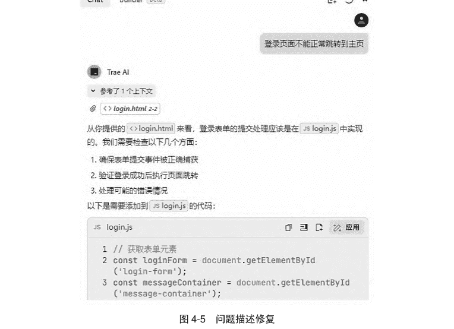

环境相关的错误也能区分。它能判断是 Node.js 版本不兼容、依赖冲突还是构建配置问题，并给出环境调整建议。比如安装 Node 项目时的依赖冲突。

```
npm ERR! code ERESOLVE
npm ERR! ERESOLVE unable to resolve dependency tree
npm ERR!
npm ERR! While resolving: my-project@1.0.0
npm ERR! Found: react@17.0.2
npm ERR! node_modules/react
npm ERR!   react@"^17.0.2" from the root project
npm ERR!
npm ERR! Could not resolve dependency:
npm ERR! peer react@"^18.0.0" from react-cool-component@2.4.0
npm ERR! node_modules/react-cool-component
npm ERR!   react-cool-component@"^2.4.0" from the root project
```

把错误贴给 DeepSeek，它会解释成因并提供几种解决方案（见图4-6）。

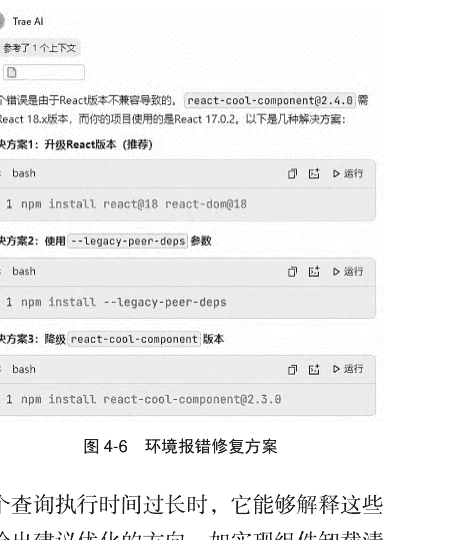

安全类警告也在覆盖范围。SQL 注入、XSS、不安全的 API 调用触发警告时，它会说明风险并给出符合最佳实践的替代写法，有助于培养安全编码意识。

性能警告同样能解读。内存泄漏提示或慢查询日志出现时，它会解释影响并建议优化方向，如组件卸载清理、循环优化或加索引等。

语法错误对新手最常见，DeepSeek 的解释很人性化。看到 SyntaxError: expected 时，它会直观指出缺失括号、引号或分号、关键词拼写错误等（见图4-7），并解释相关语法规则，帮助真正理解。

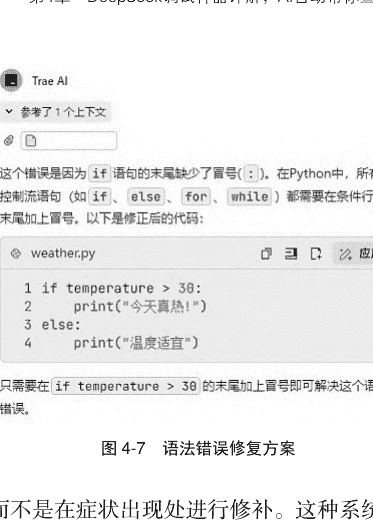

项目越复杂，错误链越跨文件跨模块。DeepSeek 能够追踪跨模块的错误传播，定位根因并建议在源头修复，这对维护大型代码库尤其重要。

对于很多非英语母语的程序员来说，英文报错一直是拦路虎。现在 DeepSeek 能直接读懂英文错误信息并用母语讲清楚，真正把语言壁垒抹掉了。巴西的开发者碰到 Java 堆栈，国内的工程师遇到 Python Traceback，都不用硬啃英文就能拿到通俗解释，让技术使用变得更公平、更普惠。

整体来看，DeepSeek 把编程错误从让人抓狂的障碍变成了可以学习的契机。它不仅能迅速把当前问题点出来，更会在解决过程中拆解调试思路、补充相关编程知识，帮人逐渐养成系统化排错的能力。新手因此能更快度过学习期的陡坡，资深工程师也能把处理复杂问题的效率拉满，AI 辅助编程的价值才算落地。

### 4.2 AI辅助日志分析与故障定位方法

调试向来是写代码里最烧脑的一环。程序一出问题，大家第一反应就是去翻日志，里面记录着运行状态和异常线索。可对新手而言，几百上千行带时间戳、状态码、警告和错误的文本，找根因就像大海捞针，需要很强经验积累。

DeepSeek 正把日志分析带入新阶段。它可以在海量日志里快速扫面，捕捉异常模式，并用大白话说明问题相当于请了一位 24 小时在线的高级工程师随时解读那些晦涩信息。

过去的常规做法是人工去搜 Error、Warning、Exception 等关键词，再靠经验揣摩上下文、定位代码、推测原因。费时费力，还高度依赖专业积累。碰上微服务这种多服务协作的场景，线索分散在不同节点，排查难度成倍上升。

有了 DeepSeek，这个流程被极度简化。把日志文件上传或直接粘贴进去，系统就能立刻给出洞察。它先识别出错误模式，再把专业的报错翻译成人类能懂的描述。关键是，它不会只说发生了什么，还会解释为什么会发生、该怎么处理。

比如某电商后台突然变慢，管理员把一段日志片段丢给 DeepSeek。

```
2023-06-15 14:32:45 [ERROR] [ConnectionPool:126] Unable to acquire connection: max pool size reached
2023-06-15 14:32:46 [WARN] [OrderService:78] DB query timeout after 5000ms: SELECT * FROM orders WHERE create_date > '2023-01-01'
2023-06-15 14:32:48 [ERROR] [AdminController:245] Request processing failed: java.sql.SQLTimeoutException: Statement timed out
2023-06-15 14:33:01 [ERROR] [ConnectionPool:126] Unable to acquire connection: max pool size reached
2023-06-15 14:33:03 [WARN] [ProductService:112] DB query timeout after 5000ms: SELECT * FROM products WHERE stock_status = 'LOW'
```

模型给出的解读是。

> 日志表明系统正被数据库连接池耗尽和查询超时拖累，主要表现为：

> ①连接池已打满，无法再分配新连接；
> ②多条查询耗时均超过 5000ms 触发超时；
> ③受影响最集中在订单和商品查询上。

与此同时，工具还给出了对应的处置建议，见图 4-8。

即便对数据库原理不熟的同学，也能迅速抓住症结并采取行动。

另一个强项是跨日志关联。微服务里一次请求会穿过多台服务，每台都有自己的日志。DeepSeek 能按请求 ID 或事务 ID 把分散的记录串起来，拼出完整的调用链，精确定位问题环节。

比如用户反馈支付失败，团队收集了三个相关服务的日志。

购物车服务日志如下。

```
2023-06-20 09:15:23.456 [INFO] [req-abc123] Cart checkout initiated for user_id=1001, cart_id=5432, amount=$156.78
2023-06-20 09:15:23.890 [INFO] [req-abc123] Forwarding to payment service with transaction_id=TR789012
```

支付服务日志如下。

```
2023-06-20 09:15:24.012 [INFO] [req-abc123] Received payment request for transaction_id=TR789012
2023-06-20 09:15:24.123 [INFO] [req-abc123] Calling external payment gateway with merchant_id=MERCH001
2023-06-20 09:15:26.234 [ERROR] [req-abc123] Payment gateway connection timed out after 2000ms
2023-06-20 09:15:26.240 [WARN] [req-abc123] Retrying payment gateway connection...
2023-06-20 09:15:28.345 [ERROR] [req-abc123] Payment gateway connection timed out after 2000ms
2023-06-20 09:15:28.350 [ERROR] [req-abc123] Payment processing failed: Unable to connect to payment gateway
```

订单服务日志如下。

```
2023-06-20 09:15:28.456 [INFO] [req-abc123] Received payment status update: FAILED
```

建议解决方案：

1. 调整连接池配置：

```
#### 增加最大连接数
spring.datasource.hikari.maximum-pool-size=20
#### 设置连接超时时间
spring.datasource.hikari.connection-timeout=30000
```

2. 优化慢查询：

```
-- 为orders表创建索引
CREATE INDEX idx_orders_create_date ON orders(create_date);

-- 为products表创建索引
CREATE INDEX idx_products_stock_status ON products(stock_status);
```

图 4-8 建议的解决方案

## AI 助力开发：Trae+CodeWhisperer+DeepSeek+Tabnine+Mintlify+Kimi

```
2023-06-20 09:15:28.460 [INFO] [req-abc123] Updating order status to PAYMENT_FAILED
2023-06-20 09:15:28.567 [INFO] [req-abc123] Sending notification to user_id=1001
```

DeepSeek会给出以下分析。

> 从日志关联来看，支付环节出现支付网关连接超时，导致购物车结算整体失败，具体如下。

①支付网关不稳定，连续两次连接在 2000ms 内超时；
②支付失败后，订单状态被正确回滚为 PAYMENT_FAILED；
③用户端收到了支付失败的提示。

对应的解决思路如图4-9所示。

这种端到端的跟踪让排查者一眼看到故障发生的精确位置和成因，不必在多份日志间反复跳转猜测。

时间维度的模式挖掘也是 DeepSeek 的亮点。它能识别出固定时间段反复出现的异常，比如每天同一时刻报错，可能与定时任务或用户行为有关。这类时间相关性人工很难抓到，尤其在日志量巨大时。

比如某教育平台应用服务器连续多天的日志呈现相似规律。

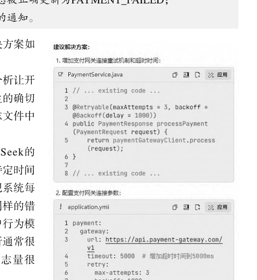

```
2023-05-10 08:55:03 [WARN] [MemoryMonitor:45] High memory usage: 85% of available heap
2023-05-10 09:00:00 [INFO] [SchedulerService:28] Starting daily course recommendation calculation
2023-05-10 09:15:12 [ERROR] [MemoryMonitor:60] Critical memory usage: 95% of available heap
2023-05-10 09:15:14 [ERROR] [RecommendationEngine:156] OutOfMemoryError during batch processing
...
2023-05-11 08:58:43 [WARN] [MemoryMonitor:45] High memory usage: 83% of available heap
2023-05-11 09:00:00 [INFO] [SchedulerService:28] Starting daily course recommendation calculation
2023-05-11 09:14:22 [ERROR] [MemoryMonitor:60] Critical memory usage: 94% of available heap
2023-05-11 09:14:25 [ERROR] [RecommendationEngine:156] OutOfMemoryError during batch processing
...
```

DeepSeek的判断是。

> 日志显示每天 09:00 启动的课程推荐计算任务导致内存激增，最终触发 OutOfMemoryError，细节为：

①推荐计算开始后内存使用率迅速攀升；
②15 分钟内从 85% 上升到 95%；
③连续两天出现完全相同的内存问题。

建议的解决方向见图4-10。

借助时间模式识别，运维人员能快速摸清周期性故障的根源，避免每次都重新调查。

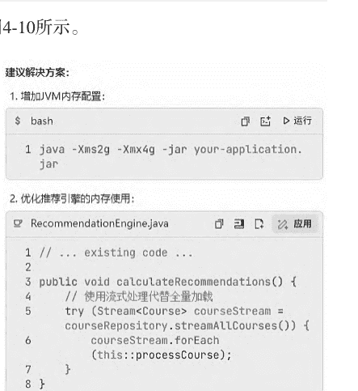

性能问题排查上，DeepSeek 也能给出深度洞察。通过响应时间、资源占用、错误率等指标，它能揪出瓶颈，比如某类请求下某个接口异常缓慢，可能源于缓存失效或查询没优化好。

下面是一家视频分享平台的 API 性能日志。

图 4-10 时间相关性分析建议的解决方案

```
2023-07-05 13:10:23.456 [INFO] [PerformanceMonitor] API: /api/videos/trending - Avg response: 120ms - Requests: 1,245
2023-07-05 13:10:23.457 [INFO] [PerformanceMonitor] API: /api/videos/search - Avg response: 3,450ms - Requests: 832
2023-07-05 13:10:23.458 [INFO] [PerformanceMonitor] API: /api/users/profile - Avg response: 95ms - Requests: 2,156
2023-07-05 13:10:23.459 [INFO] [PerformanceMonitor] API: /api/comments/latest - Avg response: 210ms - Requests: 958
2023-07-05 13:10:23.511 [DEBUG] [SearchService:189] Query execution time: 3,280ms for query: SELECT * FROM videos WHERE title LIKE '%cat%' OR description LIKE '%cat%' ORDER BY upload_date DESC
2023-07-05 13:10:23.512 [DEBUG] [DatabaseStats] Table 'videos' size: 1.2GB, rows: 5,431,267
```

DeepSeek 的性能解读如下。

> /api/videos/search 的响应明显偏高，平均约 3450ms，根因是搜索查询性能不足，具体表现为：

①视频搜索查询耗时约 3280ms；
②视频表规模较大，约 1.2GB、543 万行；
③使用 LIKE 做模糊匹配，效率偏低。

优化建议见图4-11。

这种直击核心的分析给出明确改进方向，而不是空泛地说加机器。

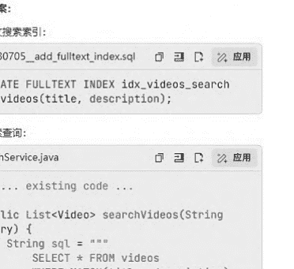

安全事件分析同样擅长。它能从日志里挑出暴力破解、异常 API 调用、数据访问异常等潜在威胁，为组织提供防护建议。

例如某银行网银系统日志出现如下情况。

```
2023-08-12 02:14:23 [WARN] [SecurityManager:87] Login failed for username: admin123, IP: 185.176.43.89, Attempt: 1
2023-08-12 02:14:35 [WARN] [SecurityManager:87] Login failed for username: admin123, IP: 185.176.43.89, Attempt: 2
...
2023-08-12 02:17:56 [WARN] [SecurityManager:87] Login failed for username: admin123, IP: 185.176.43.89, Attempt: 20
2023-08-12 02:18:12 [WARN] [SecurityManager:87] Login failed for username: admin, IP: 185.176.43.89, Attempt: 1
...
2023-08-12 02:19:45 [WARN] [SecurityManager:87] Login failed for username: admin, IP: 185.176.43.89, Attempt: 15
2023-08-12 02:20:03 [WARN] [SecurityManager:87] Login failed for username: administrator, IP: 185.176.43.89, Attempt: 1
2023-08-12 03:45:12 [INFO] [APIService:132] Unusual high volume of API calls to /api/accounts/balance from IP: 185.176.43.90, Rate: 120 requests/minute
```

DeepSeek 的安全评估指出。

> 系统正遭受暴力破解和 API 滥用，具体迹象为：

①同一 IP 185.176.43.89 在短时间内多次尝试登录；
②攻击者尝试多组常见管理员账号 admin123、admin、administrator；
③相关 IP 185.176.43.90 对账户余额 API 进行高频调用。

对应的防护建议见图4-12。

这种分析能帮助企业及早发现风险，防止泄露或破坏。

使用方式也很灵活。开发者可以整份上传日志，也可以只粘关键片段，甚至用自然语言描述 observed 症状，让模型指导该采集哪些信息。交互式的分析让新手也能做有效排错。

比如一个初学者提问：“我的 Node.js 应用启动就崩了，不知道该看哪些日志，错误只显示内部服务器错误。”

DeepSeek 会给出针对性的引导，见图4-13。

建议解决方案：

1. 添加登录失败限制：

```java
// ... existing code ...

private static final int MAX_LOGIN_ATTEMPTS = 5;
private static final long LOCK_DURATION_MINUTES = 15;

public void handleFailedLogin(String username, String ip) {
    int attempts = incrementLoginAttempts(username, ip);
    if (attempts >= MAX_LOGIN_ATTEMPTS) {
        lockAccount(username);
        log.warn("Account locked for username: {}, IP: {}", username, ip);
    }
}

// ... existing code ...
```

启动的瞬间进程就结束了，终端只剩下一行 Internal Server Error，完全搞不清该翻哪份记录、怎么读懂。Trae AI

参考了 1 个上下文

Untitled-2 2/2

Node 进程非预期退出时，可以按下面顺序排查：

1. 找到记录落脚点。Node 默认把输出吐到标准输出。若项目里接入了 winston、bunyan 这类组件，输出通常会被落盘。常见目录示例：
```bash
$ bash
1 cd C:\path\to\your\app
2 type logs\app.log
```

2. 捕捉崩溃瞬间的调用栈。异常退出往往会带一段堆栈快照，指向抛错的位置。查看方式如下：
```bash
$ bash
1 node your-app.js 2> error.log
2 type error.log
```

3. 以调试标记启动：
```bash
$ bash
1 set DEBUG=* & node your-app.js
```

2. 配置 IP 拦截：
```java
public class IPBlacklistService {
    private static final Set<String> blacklistedIPs = new HashSet<>();
    private static final int MAX_FAILED_ATTEMPTS = 10;
```

图 4-12 安全事件分析建议的解决方案

图 4-13 分析“症状”提供修复方案

以上操作既解决了当下故障，也让开发者掌握后续自行采集、解读记录的方法。

值得强调的是，该能力的价值远不止救火。它会倒过来优化记录本身，提示在关键流程里补充更细粒度的分级记录，或改用结构化格式，让下一次定位更快。这种前瞻性的改进对可维护性和可靠性提升很明显。

除了解决已发生的故障，它还能帮助搭建主动监控。基于历史记录的规律，可以提炼真正反映系统健康的关键指标，并给出合理的告警阈值，让风险在影响用户前就被发现。

它还能与现有记录分析平台联动。比如 ELK 或 Splunk 生成的报表，可以把技术化的图表翻译成通俗的解释和可执行的建议。这样企业不用推倒重来，就能把分析能力增强。

在规模化生产环境里，这种价值更突出。流量高峰、用户投诉集中时，快速收敛根因至关重要。借助它可以在短时间内梳理海量记录，迅速缩小排查范围，避免团队盲目试错。

对于技术栈不熟练的开发者，它同样有帮助。Java 背景的工程师面对 Python 记录结构和典型报错时容易卡壳，它能补齐知识盲区，提供针对性的解读，帮助快速上手。

记录的用途也不仅限于排错。通过会话记录的解读，可以揭示用户真实的使用路径、热门功能和流程摩擦点，为产品改进和体验优化提供依据。

从学习角度看，它也像一位导师。在解释错误时，实际上在示范诊断思维。观察它如何从混乱的记录中抽取出关键线索并建立因果链，开发者就能逐步掌握系统化的调试方法，提升水平。

随着系统复杂度攀升，记录解读的重要性与难度都在增加。像这类 AI 助手正成为工程工具箱里的标配，让复杂系统的运维与故障排除更高效可靠。团队效率提升，故障对业务的冲击降低，最终用户得到更稳定流畅的服务。

在学习和实战中，它就像经验丰富的领路人，既能解决眼前的技术卡点，也能传授方法论。人机协同下，即使是初学者也能应对复杂的调试任务，加快成长。无论个人开发者还是大团队，都能从这种智能辅助中获益，让开发更顺畅高效。

### 4.3 智能揪出性能卡点与优化路径

性能问题常像幽灵一样难定位。用户只会说慢、卡，却说不清瓶颈在哪。传统优化多靠工程师凭经验手动埋点、逐段计时，既耗时又容易漏掉真正的根因。

该助手在性能卡点识别上提供了一种新思路。它能自动解读运行数据，精准锁定慢点并给出具体优化方向。依托机器学习和代码理解能力，它可以发现人眼容易忽略的异常模式，相当于 24 小时在线的性能专家。

要识别瓶颈，需要多源数据。它能同时处理应用记录、性能剖析报告、服务器监控指标、浏览器开发者工具中的网络和渲染时序等。把这些数据交给它，就能自动拼出性能全景并标记异常路径。

举例来说，某电商在双十一期间商品页加载明显变慢。团队收集了浏览器瀑布图和后端性能记录后提供给它解读。记录片段如下。
```
2023-11-11 08:15:45.190 [INFO] RecommendationService - Generating product recommendations for product_id=54321
```

判断很快给出。
> 记录揭示产品推荐服务的性能存在问题，主要表现是推荐生成时间过长（2262ms），超过 200 毫秒阈值。


给出的优化方案见图 4-14。

精准的诊断和落地的建议让团队不再靠猜测，而是快速修复。

数据库查询优化也是该助手擅长的领域之一。对于某医疗记录系统报告的患者搜索缓慢问题，慢查询记录显示如下。

### 4.4 故障预判与持续监控

在软件开发过程中，缺陷不仅仅是需要被修复的问题，更是可以被预测和预防的问题。传统的调试思路往往是“等待问题发生，然后解决”。这种被动的方式不仅影响用户体验，还会增加开发团队的压力和项目成本。预测性错误防范则是一种前瞻性的策略，通过智能解读代码和运行时行为，在问题实际发生前就预测可能的故障点并采取措施。

作为智能编程助手，它在这一领域具有独特的优势。它能够通过解读代码模式、历史 Bug 记录，以及系统运行状态来预测可能出现的问题，并提前提供改进建议。这种“未卜先知”的能力使得开发团队能够从被动修复转向主动预防，大幅降低线上故障的发生率。

代码坏味道检测是预测性错误防范的基础功能。所谓代码坏味道，是指那些虽然不会导致功能错误，但可能埋下隐患的代码模式。例如下面这个简单的 Node.js 服务代码片段。
```javascript
function processUserData(userData) {
  // 处理用户数据
  const result = someComplexOperation(userData);
  return result;
}
app.post('/api/users', (req, res) => {
  const userData = req.body;
  const result = processUserData(userData);
  res.json({ success: true, data: result });
});
```

解读后指出：“这个 API 端点存在一些潜在的性能和安全问题。”优化建议如图 4-17 所示。

潜在并发问题预测是另一大强项。在多线程或分布式环境中，并发问题往往难以在开发测试阶段被发现，但可能在生产环境中造成严重后果。例如，下面这段 Java 代码。
```java
public class UserCounter {
    private static int activeUsers = 0;
    public static void userLoggedIn() { activeUsers++; }
    public static void userLoggedOut() { activeUsers--; }
    public static int getActiveUsers() { return activeUsers; }
}
```

会指出以下问题。
> 这个 UserCounter 类用于跟踪活跃用户数量，但存在一些潜在的问题，以下是具体解读。
> ① 缺乏线程安全，在多线程环境下可能导致计数不准确；
> ② 没有处理用户重复登录/登出的情况；
> ③ 缺少最小值的校验，可能导致负数。

会建议优先改进线程安全，然后持续跟踪系统表现。如果问题持续，可能需要进一步解读用户登录/退出流程。

内存慢慢耗尽的风险预警是另一种重要的预测性功能。下面解读一个 React 组件代码。
```javascript
function DataChart({ data }) {
  useEffect(() => {
    const chartLibrary = window.ChartLibrary;
    const chart = chartLibrary.create('#chart-container');
    chart.setData(data);
    chart.render();
    // 组件卸载时缺少清理代码
  }, [data]);
  return <div id="chart-container"></div>;
}
```

会提示：“这个 DataChart 组件存在内存泄漏的风险，因为它在组件卸载时没有清理图表实例。”优化建议如图 4-18 所示。

资源被吃光的风险预判是保障系统稳定性的关键。接下来解读以下数据库连接代码。
```python
def get_user_data(user_id):
    conn = create_database_connection()
    cursor = conn.cursor()
    cursor.execute("SELECT * FROM users WHERE id = %s", (user_id,))
    result = cursor.fetchall()
    return result
```

会警告并建议着手做好资源管理和异常处理，然后持续留意系统的表现。
> 这个 get_user_data 函数存在一些潜在的问题，以下是具体解读。
> ① 数据库连接和游标没有正确关闭，可能导致资源未释放；
> ② 没有处理数据库操作可能抛出的异常；
> ③ 查询结果没有进行空值处理。

边缘情况预测是特色功能。它能够识别开发人员容易忽视的特殊输入或条件，例如在处理用户输入的函数时出现异常。
```javascript
function calculateDiscount(price, discountPercentage) {
  const discount = price * (discountPercentage / 100);
  return price - discount;
}
```

会给出以下解读。
> 这个 calculateDiscount 函数用于计算折扣后的价格，但存在一些潜在的问题，以下是具体解读。
> ① 缺少输入参数验证，可能导致错误结果；
> ② 没有处理边界情况（如负值）；
> ③ 返回结果可能包含多位小数。

给出的建议优化方案如图 4-19 所示。

除了静态代码解读，它还能结合运行时的监控数据进行预测。通过解读系统记录和性能指标，可以识别出潜在的故障模式。例如，某个微服务系统的监控数据显示如下。
```
[2023-11-20 08:15:30] CPU Usage: 45%, Memory: 60%, API Response Time: 120ms
[2023-11-20 09:15:30] CPU Usage: 48%, Memory: 65%, API Response Time: 135ms
[2023-11-20 10:15:30] CPU Usage: 52%, Memory: 72%, API Response Time: 150ms
[2023-11-20 11:15:30] CPU Usage: 58%, Memory: 80%, API Response Time: 180ms
```

解读后指出存在以下问题。
监控曲线显示，系统资源占用比例和 API 响应时间呈现逐渐攀升的趋势，可能存在以下问题。
- ① CPU 占用比例从 45% 升至 58%，增长明显；
- ② 内存占用比例从 60% 升至 80%，接近警戒线；
- ③ API 响应时间从 120ms 增加到 180ms，性能下降 50%。

建议优先部署性能监控和缓存机制，然后持续观察系统的表现。如果问题持续，可能需要进一步解读 API 调用模式和数据库查询性能。

智能异常模式识别是高级功能之一。通过解读历史故障数据，可以识别出特定的错误模式及其前兆。例如，解读一组数据库超时错误记录如下。
```
[2023-11-15 14:30:45] Error: Database query timeout after 3000ms
[2023-11-15 14:35:12] Error: Database query timeout after 3500ms
[2023-11-15 14:40:33] Error: Database query timeout after 4200ms
```

会进行如下解读。
记录揭示数据库查询存在严重的超时问题，且超时时间逐渐增加，以下是问题解读。
- ① 查询执行时间超过 3s，且呈上升趋势；
- ② 可能是由于查询效率低或数据库负载过高；
- ③ 需要优化查询和数据库配置。

建议优先实施查询优化和数据库配置调整，然后观察查询执行时间的变化。如果问题持续，可能需要进一步解读数据库负载和查询执行计划。

性能退化预警是维持系统长期健康的关键。它能够通过比较代码变更前后的性能指标，预测某些改动可能导致的性能影响。例如，解读一个 PR 中的代码变更。
```javascript
- const userIds = users.map(user => user.id);
- const activeUsers = await User.findAll({ where: { id: userIds, status: 'active' } });
+ // 改为逐个查询以获取更详细信息
+ const activeUsers = [];
+ for (const user of users) {
+   const userData = await User.findOne({ where: { id: user.id } });
+   if (userData.status === 'active') {
+     activeUsers.push(userData);
```

AI 助力开发：Trae+CodeWhisperer+DeepSeek+Tabnine+Mintlify+Kimi

会警告：“这个修改将批量查询改为逐个查询，虽然可以获取更详细的信息，但会显著降低性能，以下是优化建议。”（见图 4-20）。


错误预防的另一个关键环节是建立有效的监控系统。它能够根据应用的特点，自动生成合适的监控指标和告警阈值。例如，对于典型 Web 应用，会建议监控以下关键指标。
- 响应时间（平均值、95 百分位、99 百分位）
- 错误率（5xx 错误、4xx 错误）
- 系统资源（CPU 使用率、内存使用率、磁盘 I/O）
- 业务指标（活跃用户数、交易成功率）
- 依赖服务健康状况（数据库响应时间、第三方 API 可用性）

同时，它还能根据历史数据自动建议合理的告警阈值，避免过多的误报或漏报。

预测性错误防范的最终目标是建立自愈系统。在这一阶段，系统不仅能预测问题，还能自动执行修复动作。例如，当预测到内存泄漏可能导致服务崩溃时，系统可以自动安排一次服务重启；当检测到数据库连接池接近饱和时，可以自动扩展资源或触发流量控制机制。

预测式防错从来不是一蹴而就的爆款功能，而是一条持续打磨的成长曲线。数据在累积、模型在进阶，DeepSeek的前瞻判断力便会随之变强；团队也能依据真实战场反馈，动态调整策略，沉淀出最适合自家业务的错误预防范式。

当DeepSeek的预测性防错能力被真正用起来，研发团队的故障哲学就被改写了：从过去的事后救火，转向事前的布控。软件质量与系统可靠性被系统性抬升，运营成本被有效压降，用户体验更稳更顺，团队的成就感和向心力也随之提升。在当下的工程实践里，具备预测式防错的团队已经是行业高效的标准答案。

### 4.5 实战案例：分布式系统故障排查，锁定崩溃的真正根因

分布式架构下服务高度耦合，问题往往藏在蛛网般的依赖里。几十甚至上百个微服务同时抖动时，靠人工逐条翻日志、比监控，效率极低且极易受经验偏差干扰，要么误判要么漏判。

DeepSeek的分布式故障诊断则提供了另一种可能。它能把各服务的日志、时序指标和全链路追踪揉成一张故障全景图，再用因果推理算法穿针引线，直指核心。相当于请来一位阅历丰富的架构师，穿透表象看本质。

某零售电商在促销高峰期出现系统性不稳：用户反馈支付已成功却收不到确认，客服后台也查不到订单。背后跑着五十多个微服务，涵盖用户、商品、订单、支付、库存等，人工排查进展迟缓。于是我们把问题交给DeepSeek来加速。

#### 步骤1：让DeepSeek做数据融合分析

把全量的应用日志、系统监控、分布式追踪以及用户报错一并喂入。DeepSeek先还原出故障时刻的系统状态快照，随后沿因果链追踪异常的扩散路径。

从追踪日志看，创建订单的请求正常抵达订单服务，数据库写入也成功，但向消息队列投递创建事件时卡住了，相关日志如下。

```
[2023-12-01 14:32:15.123] [OrderService] [INFO] Received order creation request for user_id=12345, items=[{id:789, qty:2}, {id:456, qty:1}]
[2023-12-01 14:32:15.156] [OrderService] [INFO] Order validation passed for order request #98765
[2023-12-01 14:32:15.234] [OrderService] [INFO] Successfully created order #98765 in database
[2023-12-01 14:32:15.235] [OrderService] [INFO] Sending order created event to message queue
[2023-12-01 14:32:18.356] [OrderService] [ERROR] Failed to publish message to queue: connection timeout after 3000ms
[2023-12-01 14:32:18.357] [OrderService] [WARN] Order #98765 created but notification failed, adding to retry queue
```

与此同时，多条服务的日志里都出现了相似的消息队列连接异常。

```
[2023-12-01 14:31:58.123] [InventoryService] [ERROR] Failed to consume message: connection reset
[2023-12-01 14:32:05.456] [NotificationService] [ERROR] Message broker connection lost, attempting to reconnect (attempt 3)
[2023-12-01 14:32:10.789] [PaymentService] [ERROR] Cannot publish payment confirmation: broker unreachable
```

监控层面，DeepSeek捕捉到消息队列服务的CPU和内存使用率骤然飙升后断崖式下跌，这正是服务崩溃的典型指纹。

```
[2023-12-01 14:30:45] [MessageQueueCluster] CPU: 45%, Memory: 60%, Active Connections: 120
[2023-12-01 14:31:00] [MessageQueueCluster] CPU: 68%, Memory: 72%, Active Connections: 145
[2023-12-01 14:31:15] [MessageQueueCluster] CPU: 82%, Memory: 85%, Active Connections: 178
[2023-12-01 14:31:30] [MessageQueueCluster] CPU: 95%, Memory: 92%, Active Connections: 210
[2023-12-01 14:31:45] [MessageQueueCluster] CPU: 15%, Memory: 30%, Active Connections: 5
```

再下钻到消息队列服务的详细日志，根因被明确揪出。

```
[2023-12-01 14:31:40.123] [MessageQueue] [WARN] Queue 'order_events' message count exceeds 1,000,000, broker throttling enabled
[2023-12-01 14:31:42.456] [MessageQueue] [ERROR] Java heap space error - not enough memory for queue operation
[2023-12-01 14:31:42.789] [MessageQueue] [ERROR] Exception in thread "main" java.lang.OutOfMemoryError: Java heap space
[2023-12-01 14:31:42.790] [MessageQueue] [ERROR] Broker shutting down due to critical error
```

#### 步骤2：DeepSeek给出故障解读

在上述线索基础上，DeepSeek归纳出结论：“①消息队列积压超百萬条；②JVM内存配额不足；③消费来不及，内存耗尽导致进程崩掉。”

据此提出的处置思路见图4-21。团队按建议提升了消息队列服务的内存配置，重启服务，并用脚本回补积压订单，很快系统恢复正常。

级联故障是分布式系统的另一大噩梦。某电商在黑色星期五早8点流量陡增后，官网无法访问，移动端频繁闪退。把所有服务的日志和监控交给DeepSeek后，它先梳理出时间线，再做跨服务的关联分析，绘制出故障传播图，清晰呈现问题如何从单点蔓延为全盘瘫痪。

用户认证服务的日志里已显现最早异常信号。

```
[2023-11-24 07:58:32.123] [AuthService] [INFO] Current active sessions: 12,500
[2023-11-24 07:59:01.456] [AuthService] [INFO] Current active sessions: 15,800
[2023-11-24 07:59:30.789] [AuthService] [INFO] Current active sessions: 20,300
[2023-11-24 08:00:00.012] [AuthService] [INFO] Current active sessions: 25,700
[2023-11-24 08:00:30.345] [AuthService] [WARN] Session creation rate exceeding normal threshold, current rate: 180/sec
[2023-11-24 08:01:00.678] [AuthService] [ERROR] Database connection pool exhausted, waiting for available connection
[2023-11-24 08:01:05.901] [AuthService] [ERROR] Request timeout while waiting for database connection
[2023-11-24 08:01:10.234] [AuthService] [ERROR] Circuit breaker OPEN for database connections, rejecting requests
```

数据库服务器的监控指标显示资源侧的压力。

```
[2023-11-24 08:00:45] [PrimaryDB] Connections: 980/1000, CPU: 75%, Memory: 82%, I/O Wait: 15%
[2023-11-24 08:01:00] [PrimaryDB] Connections: 1000/1000, CPU: 92%, Memory: 85%, I/O Wait: 28%
[2023-11-24 08:01:15] [PrimaryDB] Connections: 1000/1000, CPU: 96%, Memory: 86%, I/O Wait: 45%
[2023-11-24 08:01:30] [PrimaryDB] Connections: 1000/1000, CPU: 98%, Memory: 86%, I/O Wait: 60%
```

紧接着API网关开始大面积报错，呈现出典型的连锁崩塌。

```
[2023-11-24 08:01:15.123] [APIGateway] [ERROR] Timeout connecting to AuthService after 2000ms, path: /api/authenticate
[2023-11-24 08:01:15.456] [APIGateway] [INFO] Failed authentication requests increased by 200% in last minute
[2023-11-24 08:01:30.789] [APIGateway] [ERROR] Timeout connecting to ProductService after 2000ms, path: /api/products/featured
[2023-11-24 08:01:45.012] [APIGateway] [ERROR] Timeout connecting to CartService after 2000ms, path: /api/cart/add
[2023-11-24 08:02:00.345] [APIGateway] [ERROR] Timeout connecting to CheckoutService after 2000ms, path: /api/checkout/init
[2023-11-24 08:02:15.678] [APIGateway] [WARN] Success rate dropped to 35%, implementing exponential backoff for all services
```

商品服务和购物车服务的日志也证实，它们因依赖认证服务校验身份而被拖下水，无法正常提供服务。

```
[2023-11-24 08:01:35.123] [ProductService] [ERROR] Failed to validate user session, AuthService returned status 503
[2023-11-24 08:01:40.456] [ProductService] [ERROR] Retry #1 to AuthService failed with status 503
[2023-11-24 08:01:45.789] [ProductService] [ERROR] Retry #2 to AuthService failed with status 503
[2023-11-24 08:01:50.012] [ProductService] [ERROR] Circuit breaker OPEN for AuthService, returning cached user data when available

[2023-11-24 08:01:38.345] [CartService] [ERROR] Failed to validate user session, AuthService returned status 503
[2023-11-24 08:01:43.678] [CartService] [ERROR] Cannot add item to cart without valid user session
[2023-11-24 08:01:48.901] [CartService] [ERROR] Retry mechanism failed after 3 attempts, reject rate: 95%
```

#### 步骤3：确认故障链条

综合关联后，DeepSeek锁定级联链：①认证服务成为瓶颈，触发连锁反应；②数据库连接池耗尽是直接诱因；③缺少有效的限流与降级手段；④服务依赖关系放大了冲击。这是典型的认证层过载引发的系统级雪崩。

DeepSeek给出的处置方案见图4-22。

建议方案：
1. 即时止血：
   - 扩容认证服务实例
   - 放大数据库连接池
   - 上线紧急限流策略
2. 长期加固：
   - 认证服务水平伸缩
   - 优化数据库查询与索引
   - 引入服务降级与熔断
   - 增加缓存层分担数据库压力
3. 配置调整示例：数据库连接池相关参数。
4. 架构优化建议：
   - 认证服务无状态化设计
   - 用Redis承载会话管理
   - 减少服务间强依赖，优化调用链路
   - 支持自动扩容
5. 监控与告警：
   - 活跃会话数阈值告警
   - 数据库资源使用率监控
   - 服务健康检查机制
   - 成功率告警

```java
HikariConfig config = new HikariConfig();
config.setMaximumPoolSize(2000); // 增加最大连接数
config.setConnectionTimeout(10000); // 设置连接超时时间
// ... 其他配置 ...
```

该问题直指核心业务，必须马上处理。优先恢复认证服务，同时推动架构韧性改造。

图 4-22 级联故障链修复方案

按AI助力开发：Trae+CodeWhisperer+DeepSeek+Tabnine+Mintlify+Kimi 的建议，先把认证服务的数据库连接池上限调高并重启，随后临时扩增认证实例分摊负载，系统迅速趋稳，用户可再次正常访问。

这个案例凸显了级联故障的复杂与隐蔽，而DeepSeek通过多源数据关联与因果推理，能在数分钟内完成人工需要数小时甚至数天的排查。它既能识别明显的错误模式，也能捕捉那些细微、间歇却破坏性极强的异常。

用DeepSeek做分布式故障排查，不仅能更快止血恢复，还能真正理解病灶、止于未然。在技术愈发复杂的今天，这种能力已是高效运维团队不可或缺的武器。

### 4.6 实战案例：日志驱动的应用健康诊断

现代应用每日产出海量日志，它们本是系统的“健康档案”。但面对每天上百万行记录，人工很难筛出有效信号。很多团队要么等出问题才去翻日志，要么只配了基础告警，上下文不足，根本查不清来龙去脉。

DeepSeek的日志驱动健康诊断颠覆了这一模式。它能自动解析海量日志，挖掘异常模式与趋势，提前预警潜在隐患，甚至在用户察觉前就出手修复。由被动响应转向主动预防，应用的稳定性和用户满意度随之大幅提升。

一家金融科技公司的投资管理应用每天处理上百万笔交易。表面运行正常，但用户偶尔抱怨交易延迟、数据不一致。监控大盘却一切正常，没有任何告警触发。

把最近七天的全量日志喂给 DeepSeek，就能拿到一份相当精准的应用体检报告。覆盖范围包括 API 服务日志、数据库操作日志、任务队列日志以及前端错误上报，系统健康状况一目了然。

#### 第一步：日志清洗与洞察挖掘

DeepSeek 先把海量日志做归类和结构化，再用自然语言理解配合时间序列的模式识别去拆解日志里的行为轨迹。没多久就筛出了几组可疑信号，其中一组尤其值得盯。

```
[2023-10-15 09:32:14.567] [INFO] [TransactionService] Processing transaction #TRX-1234567 for user_id=8901
[2023-10-15 09:32:14.589] [INFO] [TransactionService] Validating transaction details
[2023-10-15 09:32:14.615] [INFO] [TransactionService] Transaction validated successfully
[2023-10-15 09:32:14.620] [INFO] [TransactionService] Submitting transaction to processing queue
[2023-10-15 09:32:14.625] [INFO] [QueueService] Received transaction #TRX-1234567 for processing
[2023-10-15 09:32:14.630] [INFO] [QueueService] Transaction #TRX-1234567 queued successfully
[2023-10-15 09:32:14.635] [INFO] [TransactionService] Transaction #TRX-1234567 queued for processing
[2023-10-15 09:32:14.640] [INFO] [WorkerService] Processing transaction #TRX-1234567
[2023-10-15 09:32:14.655] [INFO] [WorkerService] Verifying available funds
[2023-10-15 09:32:14.675] [INFO] [WorkerService] Funds verified successfully
[2023-10-15 09:32:14.680] [INFO] [WorkerService] Processing market order
[2023-10-15 09:32:14.685] [INFO] [MarketService] Submitting order to exchange
[2023-10-15 09:32:15.120] [INFO] [MarketService] Order submitted successfully
[2023-10-15 09:32:15.125] [INFO] [WorkerService] Market order processed successfully
[2023-10-15 09:32:15.130] [INFO] [WorkerService] Updating user account
[2023-10-15 09:32:15.145] [INFO] [DBService] Begin transaction
[2023-10-15 09:32:15.190] [WARN] [DBService] Slow query detected: UPDATE user_accounts SET balance = balance - 5000 WHERE user_id = 8901 (execution time: 40ms)
[2023-10-15 09:32:15.195] [INFO] [DBService] Commit transaction
[2023-10-15 09:32:15.200] [INFO] [WorkerService] User account updated successfully
[2023-10-15 09:32:15.205] [INFO] [WorkerService] Sending confirmation notification
[2023-10-15 09:32:15.215] [INFO] [NotificationService] Sending email notification to user_id=8901
[2023-10-15 09:32:15.725] [INFO] [NotificationService] Email notification sent successfully
[2023-10-15 09:32:15.730] [INFO] [WorkerService] Transaction #TRX-1234567 completed successfully
```

表面看交易链路很正常，但模型捕捉到一个很细微的规律：在每天 9:30-10:30 和 13:00-14:00 这两个高峰窗口，数据库更新类操作的耗时明显拉长，日志里 “Slow query detected” 的告警频率同步飙升。对一周的交易日志做全量比对，这一波动呈现高度重复性。

```
[2023-10-15 09:45:23.456] [ERROR] [WorkerService] Failed to update user account for transaction #TRX-9876543: Deadlock detected
[2023-10-15 09:45:23.460] [INFO] [WorkerService] Retrying transaction #TRX-9876543 (attempt 1)
[2023-10-15 09:45:23.560] [WARN] [DBService] Lock wait timeout: UPDATE user_accounts SET balance = balance - 2500 WHERE user_id = 5432
[2023-10-15 09:45:23.565] [ERROR] [WorkerService] Retry failed for transaction #TRX-9876543: Lock wait timeout
[2023-10-15 09:45:23.570] [INFO] [WorkerService] Scheduling transaction #TRX-9876543 for delayed retry
[2023-10-15 09:46:03.123] [INFO] [WorkerService] Retrying transaction #TRX-9876543 (attempt 2)
[2023-10-15 09:46:03.223] [INFO] [DBService] Begin transaction
[2023-10-15 09:46:03.278] [INFO] [DBService] Commit transaction
[2023-10-15 09:46:03.283] [INFO] [WorkerService] User account updated successfully
[2023-10-15 09:46:03.288] [INFO] [WorkerService] Sending confirmation notification
```

把错误日志按时间分布展开后发现，高峰时段大约有 3%~5% 的交易会触发数据库锁超时或死锁，直接导致处理延迟增加 40~60ms。更关键的是，DeepSeek 还顺藤摸瓜找到了背后成因。

```
[2023-10-15 09:32:15.145] [INFO] [DBService] Begin transaction
[2023-10-15 09:32:15.190] [WARN] [DBService] Slow query detected: UPDATE user_accounts SET balance = balance - 5000 WHERE user_id = 8901 (execution time: 40ms)
[2023-10-15 09:32:15.195] [INFO] [DBService] Commit transaction
[2023-10-15 09:32:15.346] [INFO] [ReportingService] Starting hourly account balance aggregation
[2023-10-15 09:32:15.350] [INFO] [ReportingService] Running query: SELECT SUM(balance) FROM user_accounts GROUP BY account_type
[2023-10-15 09:32:17.250] [INFO] [ReportingService] Hourly aggregation completed (execution time: 1900ms)
```

它注意到一个每小时触发一次的统计报表任务，执行时间正好撞上交易高峰。任务会跑一个针对用户账户表的大型聚合查询，而交易处理也在读写同一张表。读写直接打架，锁竞争加剧，最终引发死锁和超时。

#### 第二步：生成可落地的运行报告

在上述证据基础上，DeepSeek 产出一份交易处理系统的运行诊断，核心问题被归纳为：① 性能侧：用户账户更新查询偏慢约 40ms，账户余额聚合查询耗时高达 1900ms；② 并发侧：出现死锁记录 transaction #TRX-9876543，以及 UPDATE user_accounts 的锁等待超时；③ 重试侧：首次重试未成功，二次重试才恢复，并附上对应的优化方向，详见图 4-23。

落地建议清单：

1. 数据库索引优化示例：

```sql
CREATE INDEX idx_user_accounts_user_id ON user_accounts(user_id);
```

2. 重试机制实现示例：

```java
int retryCount = 0;
while (retryCount < MAX_RETRIES) {
    try {
        // 尝试执行操作
        break;
    } catch (DeadlockException e) {
        retryCount++;
        Thread.sleep(100 * (long) Math.pow(2, retryCount)); // 指数退避
    }
}
```

3. 慢查询优化思路：

- 复盘执行计划
- 评估批量更新可行性
- 精简 WHERE 条件

图 4-23 日志驱动诊断修复方案

建议优先啃下数据库性能的硬骨头，同时把重试策略补齐，这样整[content]
把最近七天积攒的各类日志交给 DeepSeek 做体检，就能快速得到一份相当精准的应用健康画像。涉及 API 服务日志、数据库操作日志、任务队列日志与前端错误上报，整体状况一目了然。

#### 第一步：日志清洗与模式挖掘

DeepSeek 先对日志进行归类和结构化，再借助自然语言理解和时间序列的模式识别去解析日志内容与行为节奏。很快就筛出几组可疑信号，其中一组尤其值得关注。

```
[2023-10-15 09:32:14.567] [INFO] [TransactionService] Processing transaction #TRX-1234567 for user_id=8901
[2023-10-15 09:32:14.589] [INFO] [TransactionService] Validating transaction details
[2023-10-15 09:32:14.615] [INFO] [TransactionService] Transaction validated successfully
[2023-10-15 09:32:14.620] [INFO] [TransactionService] Submitting transaction to processing queue
[2023-10-15 09:32:14.625] [INFO] [QueueService] Received transaction #TRX-1234567 for processing
[2023-10-15 09:32:14.630] [INFO] [QueueService] Transaction #TRX-1234567 queued successfully
[2023-10-15 09:32:14.635] [INFO] [TransactionService] Transaction #TRX-1234567 queued for processing
[2023-10-15 09:32:14.640] [INFO] [WorkerService] Processing transaction #TRX-1234567
[2023-10-15 09:32:14.655] [INFO] [WorkerService] Verifying available funds
[2023-10-15 09:32:14.675] [INFO] [WorkerService] Funds verified successfully
[2023-10-15 09:32:14.680] [INFO] [WorkerService] Processing market order
[2023-10-15 09:32:14.685] [INFO] [MarketService] Submitting order to exchange
[2023-10-15 09:32:15.120] [INFO] [MarketService] Order submitted successfully
[2023-10-15 09:32:15.125] [INFO] [WorkerService] Market order processed successfully
[2023-10-15 09:32:15.130] [INFO] [WorkerService] Updating user account
[2023-10-15 09:32:15.145] [INFO] [DBService] Begin transaction
[2023-10-15 09:32:15.190] [WARN] [DBService] Slow query detected: UPDATE user_accounts SET balance = balance - 5000 WHERE user_id = 8901 (execution time: 40ms)
[2023-10-15 09:32:15.195] [INFO] [DBService] Commit transaction
[2023-10-15 09:32:15.200] [INFO] [WorkerService] User account updated successfully
[2023-10-15 09:32:15.205] [INFO] [WorkerService] Sending confirmation notification
[2023-10-15 09:32:15.215] [INFO] [NotificationService] Sending email notification to user_id=8901
[2023-10-15 09:32:15.725] [INFO] [NotificationService] Email notification sent successfully
[2023-10-15 09:32:15.730] [INFO] [WorkerService] Transaction #TRX-1234567 completed successfully
```

交易链路表面看很正常，但模型捕捉到一个很细微的规律：每天上午 9:30-10:30、下午 13:00-14:00 的高峰窗口里，数据库更新操作的耗时明显被拉长，日志中 “Slow query detected” 的告警频次同步上升。对一周内的全部交易日志做比对，这个波动几乎每天都在重复出现。

```
[2023-10-15 09:45:23.456] [ERROR] [WorkerService] Failed to update user account for transaction #TRX-9876543: Deadlock detected
[2023-10-15 09:45:23.460] [INFO] [WorkerService] Retrying transaction #TRX-9876543 (attempt 1)
[2023-10-15 09:45:23.560] [WARN] [DBService] Lock wait timeout: UPDATE user_accounts SET balance = balance - 2500 WHERE user_id = 5432
[2023-10-15 09:45:23.565] [ERROR] [WorkerService] Retry failed for transaction #TRX-9876543: Lock wait timeout
[2023-10-15 09:45:23.570] [INFO] [WorkerService] Scheduling transaction #TRX-9876543 for delayed retry
[2023-10-15 09:46:03.123] [INFO] [WorkerService] Retrying transaction #TRX-9876543 (attempt 2)
[2023-10-15 09:46:03.223] [INFO] [DBService] Begin transaction
[2023-10-15 09:46:03.278] [INFO] [DBService] Commit transaction
[2023-10-15 09:46:03.283] [INFO] [WorkerService] User account updated successfully
[2023-10-15 09:46:03.288] [INFO] [WorkerService] Sending confirmation notification
```

把错误日志按时间分布展开来看，高峰时段大约有 3%~5% 的交易会碰上数据库锁超时或死锁，处理延迟因此增加 40~60ms。更关键的是，DeepSeek 还顺藤摸瓜找到了真正的原因。

```
[2023-10-15 09:32:15.145] [INFO] [DBService] Begin transaction
[2023-10-15 09:32:15.190] [WARN] [DBService] Slow query detected: UPDATE user_accounts SET balance = balance - 5000 WHERE user_id = 8901 (execution time: 40ms)
[2023-10-15 09:32:15.195] [INFO] [DBService] Commit transaction
[2023-10-15 09:32:15.346] [INFO] [ReportingService] Starting hourly account balance aggregation
[2023-10-15 09:32:15.350] [INFO] [ReportingService] Running query: SELECT SUM(balance) FROM user_accounts GROUP BY account_type
[2023-10-15 09:32:17.250] [INFO] [ReportingService] Hourly aggregation completed (execution time: 1900ms)
```

它发现一个每小时运行一次的统计报表任务，执行时机正好撞在交易高峰上。该任务会执行一个大型的用户账户表聚合查询，而交易处理也在频繁读写同一张表。读写直接冲突，锁竞争加剧，最终触发死锁与超时。

#### 第二步：出具可落地的运行诊断报告

基于以上发现，DeepSeek 产出一份交易处理系统的运行诊断，核心问题被归纳为：① 性能问题：用户账户更新查询较慢约 40ms，账户余额聚合查询耗时长达 1900ms；② 并发问题：检测到死锁 transaction #TRX-9876543，出现 UPDATE user_accounts 的锁等待超时；③ 重试机制：首次重试失败，第二次重试才成功，并给出具体优化建议，见图 4-23。

具体优化建议：

1. 数据库索引优化示例：

```sql
CREATE INDEX idx_user_accounts_user_id ON user_accounts(user_id);
```

2. 重试机制实现示例：

```java
int retryCount = 0;
while (retryCount < MAX_RETRIES) {
    try {
        // 尝试执行操作
        break;
    } catch (DeadlockException e) {
        retryCount++;
        Thread.sleep(100 * (long) Math.pow(2, retryCount)); // 指数退避
    }
}
```

3. 慢查询优化建议：

- 分析执行计划
- 考虑批量更新
- 优化 WHERE 条件

图 4-23 日志驱动诊断修复方案

建议优先解决数据库性能瓶颈，同时完善重试逻辑，从而提升系统整体稳定性。

除了定位具体故障，DeepSeek 还能从日志里提炼更宏观的健康趋势。某在线教育平台借助 DeepSeek 分析视频流媒体服务的日志，就捕捉到一个持续恶化的信号。

```
[2023-09-01] Average video buffering events per session: 2.3
[2023-09-08] Average video buffering events per session: 2.5
[2023-09-15] Average video buffering events per session: 2.8
[2023-09-22] Average video buffering events per session: 3.2
[2023-09-29] Average video buffering events per session: 3.7
```

深入挖掘日志数据后发现，视频缓冲事件高度集中在特定的内容分发网络节点上，且这些节点的响应时间在过去一个月里稳步变慢。

```
[2023-09-01] CDN node response time (99th percentile): 180ms
[2023-09-08] CDN node response time (99th percentile): 210ms
[2023-09-15] CDN node response time (99th percentile): 250ms
[2023-09-22] CDN node response time (99th percentile): 310ms
[2023-09-29] CDN node response time (99th percentile): 380ms
```

结合用户地域分布与网络路径追踪，DeepSeek 判定某 CDN 厂商的特定区域节点性能在持续走低。这一判断让团队在体验严重受损前就切换到备用 CDN 提供商。

日志驱动的健康诊断提供了一种强有力的自动化手段，能从海量日志中抽取出有价值的洞察，捕捉细微的模式变化与趋势拐点，并给出可执行的改进方案。借助 AI 分析与扎实的软件工程知识，DeepSeek 能揪出传统监控难以发现的问题，帮助团队由被动救火转向主动优化。

最终，日志驱动的健康诊断让应用更可靠、更高效，也让用户体验更顺畅。DeepSeek 把原本被忽视的日志数据转化为真实的业务价值，展现了 AI 辅助调试在现代软件开发中的强大潜力。

## 第 5 章 Tabnine 个性化智能补全 AI 编程助手

AI 助力开发：Trae+CodeWhisperer+DeepSeek+Tabnine+Mintlify+Kimi

### 5.1 Tabnine 代码补全与推荐机制

在写代码时，好的补全就像一位贴身助手，在你敲字的同时实时预判下一行可能的写法。传统补全工具多靠简单的规则和模式匹配，只能提供基础的语法或 API 调用提示，理解力有限，常出现不准甚至干扰的问题。

Tabnine 彻底改写了这条赛道。它不只是自动补全，更是一个基于前沿人工智能的编程伙伴，能够读懂代码的语义与结构，学习开发者的编码习惯与风格，并给出高度个性化的建议。

Tabnine 的核心是基于大语言模型的补全引擎，模型在数百万代码仓库上训练，掌握了多种语言、框架和库的使用惯例。不同于只盯着单个函数或变量的传统工具，Tabnine 能依据上下文给出完整的代码块、函数实现甚至逻辑骨架，理解深度更高，实用性更强。

当开发者开始写一个新函数时，Tabnine 会综合已有的上下文，包括已导入的库、已定义的变量与函数，以及项目中的其他文件，推测下一步要实现的功能并给出对应代码。例如在编写处理用户数据的 Web 应用时，若出现了名为 validateUserInput 的函数，Tabnine 很可能建议一套完整实现，涵盖邮箱格式校验、密码强度检查、特殊字符处理等常见任务。

Tabnine 的推荐并非只依赖通用模式，它还会学习特定项目的规范与约定。开发者在项目中工作越久，Tabnine 越能适应该项目的命名风格、错误处理方式与代码组织习惯，推荐结果越贴合项目需求。

举例来说，假设团队在 JavaScript 项目里对所有 API 调用都采用统一的 try-catch 错误处理封装。起初 Tabnine 可能只给出常规的 API 调用片段，但随着观察积累，它会开始推荐包含标准错误处理的完整代码段。这种自适应能力大幅提升了效率与一致性。

## 第5章 Tabnine个性化智能补全AI编程助手

Tabnine 的另一项强项是上下文感知补全。它不仅看当前函数或文件，还会审视整个项目的全局。例如在实现数据库交互函数时，Tabnine 会扫描项目中模型定义，提供与模型字段匹配的查询代码。这种全局视角让建议在大型复杂项目中也更相关、更有用。

在实际编码中，Tabnine 的体验很轻量。输入时编辑器里会以灰色文本实时呈现建议，按下 Tab 或设定的快捷键即可采纳，也可继续输入忽略。非侵入式的设计让它成为助力而非干扰，控制权始终在开发者手中。

补全范围也不局限于单行。Tabnine 能给出多行乃至多函数的建议，在处理复杂逻辑或重复样板时特别省力。例如开始写一个 RESTful API 端点时，它可能直接给出包含参数校验、业务处理和响应格式化的完整实现，让开发者专注于真正的业务逻辑。

在团队场景里，Tabnine 的价值更明显。它可以被配置为学习共享代码库，从而提供符合团队规范与最佳实践的建议。新成员借助它能更快熟悉项目的编码风格与模式，加速融入。团队负责人也能借此推动代码一致性与最佳实践落地，提升整体质量。

实际使用中，当开发者新建一个 React 组件时，Tabnine 往往会依据项目内其他组件的结构给出完整模板，包括导入语句、组件定义、状态管理与生命周期方法等。这样既节省时间，也确保了结构统一，符合项目最佳实践。

Tabnine在给出代码建议时，会先判断你正在用的编程语言特性与常见坑点。这种语言层面的敏感度，让它的补全不只是语法正确，更贴合惯用法。比如碰到JavaScript里的异步逻辑，它会倾向于给出Promise或async/await的写法，并且自动带上合理的错误捕获。再看Python，它产出的结构通常会遵循PEP 8的排版与命名习惯。

当项目依赖第三方库或框架时，Tabnine的优势会更明显。它对流行库的API调用方式、导入路径、配置模板都有记忆。在搭Node.js的Express应用时，它经常能直接补全中间件的注册顺序、路由的定义骨架以及统一的错误处理结构。这种即时提示大幅缩短了上手新技术栈的周期。

对于有专有代码的企业，Tabnine的私有化训练是核心价值所在。企业版可以在自有网络内完成训练，以内部代码为样本学习专属的编程模式与业务逻辑。建议因此高度相关，同时代码本身不会外流，知识产权得到保护（见图5-2）。

图 5-2 Tabnine 核心特性 (2)

从使用角度看，Tabnine基本覆盖了主流的开发环境，像Visual Studio Code、IntelliJ IDEA、PyCharm、Sublime Text等都能装。部署通常几分钟就能完成，无需繁琐的初始化。随着使用，模型会越用越熟，建议质量持续上升。

代码补全与推荐能力的演进，代表了编程工具的方向：把AI自然嵌入到开发流里，形成更智能、更高效、也更人性化的编码体验。它减少机械重复、防住常见失误、推动最佳实践，最终让效率和代码品质一起提升。对新手与资深开发者来说，都是一项能明显放大生产力的助手。

### 5.2 让 AI 学会你的风格：个性化训练方法

每个开发者的编码习惯都像笔迹一样独一无二。有人追求极简，有人喜欢写长注释；有人偏函数式，有人坚守面向对象。这些偏好叠加起来构成了个人的“编码指纹”。传统补全工具只会给出千篇一律的通用方案，相当于一个不懂你口味的厨师，永远按标准菜谱做菜。

Tabnine的个性化训练（见图5-3和图5-4）改变了这一点。它会静默观察你的写法，学习并复现你的风格，就像一位记住了主人口味的私人厨师。建议因而更准、更顺手，编程的流畅感也随之提升。

个性化是持续发生的。刚上手时它在后台记录模式，越用越像你。如果你习惯camelCase或snake_case，它会跟着用；你若偏爱详细注释或某种异常处理套路，它也会模仿。风格会在使用中被不断强化。

提速个性化有几条实用做法。第一，直接在日常项目里用Tabnine。现成代码库本身就是风格样本，指给它看你常做的仓库，学习速度会很快（见图5-3）。第二，用接受与拒绝来反馈。点觉得合适的建议等于点赞，不合适的自己改写等于纠正，模型会据此校准方向。

团队层面，Tabnine支持基于整个代码库的团队训练，特别适合需要统一规范的场景。借助团队训练，AI会提炼出共享的错误处理、日志、校验模式，新人进来就能无缝对齐风格。

企业版的个性化选项更进一步，包含私有云训练、模型微调、项目级知识库对接等。医疗软件厂商就能用私有云让模型学会医学术语和HIPAA合规写法，让领域代码的生成质量显著提升。

对于全栈人员，Tabnine能区分语言与框架的风格差异。比如前端React偏函数式，后端Python偏面向对象，它可以分别记忆并给出对应风格的补全。风格本身也会演变，AI会跟上你的成长轨迹，从设计模式到新框架特性都能逐步吸收。

学习还延伸到项目上下文。它会慢慢建立模块关系和数据流的认知，提出的建议会考虑全局一致性，而非孤立片段。开始新功能时，它可能主动补上与现有系统对接的代码。

最终，Tabnine不再只是片段供应商，而是能放大你个人风格的协作伙伴。AI不替代人，而是把重复活和风格适配交出去，让开发者专注更有挑战和创造性的部分。

### 5.3 AI 保持团队代码风格统一的方法

统一代码风格是团队代码可维护性的基石。过去主要靠规范文档、人工Code Review和自动化检查，执行成本高且容易有缝隙。Tabnine提供了一种自动化、更智能的维持方式。

团队训练让AI从整个代码库中提炼共同规范，不仅是格式，更包括错误处理策略、命名习惯、架构模式、文档写法等深层惯例。分析现有代码后，这些隐性规则会被转化为新的建议。

落地第一步是挑选代表最佳实践的仓库作为训练源。这些代码最好经过评审，能体现当前标准。通过团队管理界面指定源库并启动训练后，成员连上团队账户即可获得风格一致的提示。

对新人来说，这是快速上车的利器。传统方式需要数周适应，借助Tabnine第一天就能写出符合团队规范的代码，减少资深成员的样式纠正负担。

一致性会被持续强化。即使老手偶尔也会遗漏细节，AI始终给出符合规范的建议，形成温和的提醒，比事后评论更易接受。

例如在微服务体系里，统一的日志与错误处理至关重要。某公司因各服务日志格式不一导致审计困难。训练Tabnine学习标准日志模式后，所有人获得一致的结构化建议，日志质量明显提升。

在医疗、航空、金融等强监管行业，这种能力尤其关键。把合规要求写入训练数据，新代码默认就会符合规范，降低违规风险。

团队训练也兼容多语言多框架。全栈团队里，前端React推荐函数式写法，后端Java服务推荐面向对象模式，Tabnine能按上下文切换。

它还能识别更复杂的架构模式，如仓储模式、CQRS、微服务通信约定，并在相关场景给出符合架构的建议，防止架构漂移。

企业版提供团队风格分析报告，指出代码库中风格不一致之处，辅助团队决策和持续改进。比如发现三种错误处理模式，就能推动统一到最佳实践。

规范会随项目演进而变化，定期重训可以让建议保持最新。团队也可以通过显式示例片段主动注入新规则，适合规范刚发布尚未广泛沉淀的阶段。

在评审时，Tabnine的建议提供客观参照，减少因风格偏好产生的争论，便于讨论聚焦功能与架构。

它还会保留团队特有的领域术语与命名约定，比如电商里的Cart、Checkout、Fulfillment，确保命名统一，提升可读性。

个性化与团队规范可以共存。Tabnine允许在不违反底线规则的前提下保留个人习惯，在一致性与灵活性之间取得平衡，既维护凝聚力，也尊重个体。

借助AI驱动的风格统一，团队能把精力从琐碎的格式争论中解放出来，投入业务创新与长期可维护性建设。

### 5.4 实战案例：私有代码库知识整合技巧

把公司内部代码的知识灌进Tabnine，相当于给AI做内部培训，让它学会团队的“方言”。下面是整合技巧（见图5-7和图5-8）。

**步骤1：选择优质的训练代码。**

训练素材的质量决定上限。优先选用核心模块、常用工具类、经过稳定验证的框架组件。临时脚本或已知有缺陷的老代码最好排除，以免教坏模型。

集成方式上，Tabnine提供本地离线训练和企业内网部署两种安全路径。本地训练保证代码不出电脑，企业内网部署则让多人共享成果。

数据安全需要细粒度控制。通过配置文件可精确指定可训练仓库与需排除范围。比如排除含密钥、证书、PII或核心算法的文件，仅保留通用架构与工具代码。这种精细管控兼顾合规与IP保护。就像告诉新员工：可学这些，保密文件勿碰。

**步骤2：进行代码库整合。**

整合后，AI对内部API与自研框架的理解会大幅提升。未整合前它可能熟悉React或Spring，却对团队自研框架陌生。整合后能给出准确的调用补全，减少查文档时间。

代码量巨大时可采用渐进式。先从核心库、公共组件开始验证效果，再逐步扩围，分散工作量并及时调整策略。

整合不仅是语法学习，还能捕捉高层架构模式。若团队有特定服务通信或数据访问约定，Tabnine会在对应场景复用这些模式，保持新代码与现有设计一致。

在医疗、金融、物流等垂直领域价值更突出（见图5-9和图5-10）。学习行业术语与业务规则后，建议更贴合实际。例如医疗系统学会病历处理与隐私保护范式后，效率与合规性双提升。

对新员工也是加速器。过去需翻阅大量代码才能上手，有了训练过的Tabnine，编码过程中就能逐步吸收团队习惯，缩短适应期，降低老员工带教压力。

整合过程中要做质量管控。定期清理训练集，移除过时写法，补充新的最佳实践，确保模型输出始终代表当前技术方向。

把代码注释与文档一起纳入训练也很有效。许多团队文档不足，让Tabnine学习现有注释，可在补全时同步提示说明，弥补文档缺口。

最后要量化效果。可从开发速度、风格一致性、新人上手时间、错误率等维度收集反馈，持续优化整合策略，让内部知识真正转化为生产力。

通过以上做法，Tabnine能从通用工具进化为深度理解团队项目的智能伙伴，在保护知识产权的同时提升效率与质量。

### 5.5 实战案例：构建团队专属代码库

在Trae平台内借助Tabnine打造团队专属代码库，需要把两个工具系统整合

AI 助力开发：Trae+CodeWhisperer+DeepSeek+Tabnine+Mintlify+Kimi

起来，发挥协同效应。Trae作为综合开发环境，与Tabnine配合可获得更智能的辅助体验。

打开Trae后先确认基础设置。插件扩展功能需开启，若用企业版请联系管理员确认安装权限。团队项目权限要配置正确，确保参与成员有读写能力。

**步骤1：打开Trae的控制面板。**

点一下界面上的“Tabnine”图标即可进入插件控制面板（见图5-11）。已有账号直接登录，没有则按提示注册。登录后它会询问是否允许观察当前项目，确认后即可“看到”代码环境。

在设置里打开团队智能补全或企业级训练开关（见图5-12）。这相当于打开学习模式，让它记住团队习惯。根据安全要求设定数据共享边界，确保合规。


#### 步骤2：让Tabnine学习训练数据。

准备训练数据。于Trae项目管理器里新建一个名为tabnine-training-data的专用分支，像一个不影响主线的学习笔记本。用Trae的浏览功能筛选出高质量代码，结构清晰、改动少、测试完善的作为范文，给它们打上tabnine-train标签以便批量采集。

为保证安全，根目录创建.tabnineignore文件，列出禁止学习的敏感内容类型，如下所示。

```
##### 排除配置文件
**/config/*.json
**/application*.properties
**/.env*

##### 排除密钥和证书
**/keys/**
**/*.pem
**/*.key

#### 排除测试数据
**/test/fixtures/**
**/mock/**

##### 排除临时代码
**/*temp*.*
**/*tmp*.*
```

这相当于明确告知Tabnine哪些是私密材料，不要学习。提交到版本控制后，验证规则是否生效。

设置训练任务类似配置自动烹饪。打开Trae任务菜单，新建“Tabnine训练”任务，指定学习来源与排除项。

```
tabnine-cli train --source=${workspaceFolder} --exclude-file=${workspaceFolder}/.tabnineignore --target=team --depth=medium
```

触发方式可手动，也可定时。对首次训练建议低峰期手动执行，后续更新可设每周或每月自动跑。开启完成通知，确保相关人员及时知晓。保存配置后，具备权限的成员即可执行该任务。

先别全员铺开，先从经验分布不同的开发者里挑出一批组成先锋组，并开辟独立反馈通道记录真实体感。初版建模完成后，让这批成员在随后一周的日常开发中实操，重点观察数据清洗函数编写、模型评估脚本搭建等高频场景的表现。任务跟踪工具里新建一条反馈收集项，派发给全部先锋成员。

效果判断要量化。调用静态代码分析手段对前后效率做对比，看代码提交频次是否提升、质量评分是否改善。评审环节把Tabnine给出的优质推荐单独标出，汇总成评估报告供后续迭代参考。

第三步，保持模型活性

让AI助手保持新鲜感需要持续的更新闭环。可以搭建自动化流程，把评审中被标记的高质量片段自动归档进训练素材库。重训节奏建议固定，比如每月一次，或者在代码库出现较大改动时触发。训练素材本身要做版本化管理，并指定专人把关质量。

把Tabnine与Trae的其他能力结合能产生叠加效应。让代码模版写法与Tabnine所吸收的团队风格保持一致；在代码检查环节加入对AI推荐的兼容性校验；沉淀一份上手指南；在数据看板上呈现使用态势的统计，让价值可见。

最后一步是全员推广。准备一份通俗易懂的上手说明，录制演示视频，为新人设计入门培训；定期组织经验分享会，开通答疑通道，确保每位成员都能快速上手。

按这套节奏推进，团队就能充分调用Trae平台能力，有序搭建并维护专属Tabnine素材库，培养出真正理解团队需求和书写习惯的AI编程助手，显著拉升研发速度和程序质量。

### 5.6 实战案例：让历史代码焕发新生——基于历史仓库的智能重构

历史系统的重构往往让人望而却步，多年累积的代码量、文档缺失、原始作者已离职，让工作既耗时又高风险。借助Tabnine等AI编程工具，重构过程可以被大幅简化，通过挖掘历史仓库的模式和书写习惯实现智能化推进。

传统历史系统的重构痛点集中在几个方面。文档通常不完整，关键设计决策只存在于原作者记忆里。代码结构随时间演进变得混乱，糟糕的命名、重复实现、写法不统一处处可见。技术债务则体现为过时的依赖库、已废弃的接口和性能卡点，直接影响系统的可维护性和可扩展性。

引入AI编程工具后，历史系统重构有了新思路。Tabnine能够吸收仓库历史代码的规律，涵盖命名约定、设计模式和编码习惯，从而给出真正贴合项目气质的智能建议。整个重构可以拆成四个关键阶段。

首先是理解和分析。要先让Tabnine掌握仓库。通过版本控制系统导出完整的仓库历史，包含全部分支和提交记录。在.tabnineignore里把配置文件、测试数据等非核心内容排除掉。

```
#### 排除配置文件和凭证
**/config/*_local.py
**/*.env
**/credentials/*

#### 排除测试数据
**/test/data/**
**/fixtures/**

#### 排除自动生成的代码
**/generated/**
**/__pycache__/**
```

启动Tabnine建模，聚焦仓库的主要代码模式。初步建模完成后，用Tabnine做代码分析，归纳出共同的模式和风格特征。通过浏览代码，定位核心模块、常用函数和接口设计，并据此绘制系统架构图和关键数据流图。

随后进入代码清理与标准化阶段。在Tabnine的帮助下优先解决命名不统一的问题。AI可捕捉仓库中的命名规律并推荐统一风格。例如仓库里同时存在camelCase和snake_case时，Tabnine便能捕捉主流用法并给出标准化建议。

```
#### 老代码中的不一致命名
def processData(input_data):
    # 处理逻辑

def clean_dataset(dataset):
    # 清理逻辑

#### Tabnine 学习项目风格后，推荐统一为蛇形命名法
def process_data(input_data):
    # 处理逻辑

def clean_dataset(dataset):
    # 清理逻辑
```

接着处理重复代码。Tabnine能够识别功能相近的代码片段，协助抽取共性逻辑并封装成工具函数。比如在数据处理类仓库里，可能多处出现相似的数据校验逻辑。

```
#### 原始重复代码
def process_sales_data(data):
    # 数据验证
    if data is None or len(data) == 0:
        raise ValueError("Empty data provided")
    if 'date' not in data.columns or 'amount' not in data.columns:
        raise ValueError("Required columns missing")
    # 处理逻辑 ...

def analyze_customer_data(data):
    # 几乎相同的数据验证
    if data is None or len(data) == 0:
        raise ValueError("Empty data provided")
    if 'customer_id' not in data.columns or 'purchase_date' not in data.columns:
        raise ValueError("Required columns missing")
    # 分析逻辑 ...

#### Tabnine 辅助重构后
def validate_dataframe(df, required_columns):
    """ 验证数据框是否为空及是否包含所需列 """
    if df is None or len(df) == 0:
        raise ValueError("Empty data provided")
    missing_cols = set(required_columns) - set(df.columns)
    if missing_cols:
        raise ValueError(f"Required columns missing: {missing_cols}")
    return True

def process_sales_data(data):
    validate_dataframe(data, ['date', 'amount'])
    # 处理逻辑 ...

def analyze_customer_data(data):
    validate_dataframe(data, ['customer_id', 'purchase_date'])
    # 分析逻辑 ...
```

最后更新过时的语法和接口调用。Tabnine可捕捉仓库中使用的旧接口模式，并建议换成最新语法和库函数。例如把Python 2风格的代码升级为Python 3。

```
#### 旧版 Python 代码
print "Processing data..."
data = filter(lambda x: x > 0, values)
items = data.iteritems()

#### Tabnine 建议的更新代码
print("Processing data...")
data = [x for x in values if x > 0]
items = data.items()
```

在掌握整体结构后，就可以做更深层的架构重构。先识别关键组件并为其创建清晰的接口。基于现有的使用模式，Tabnine便能给出合适的接口设计。

```
#### 从多处分散调用中提取接口
class DataProcessor:
    """ 数据处理器基类，定义标准处理流程接口 """

    def load(self, source):
        """ 从数据源加载数据 """
        raise NotImplementedError

    def validate(self, data):
        """ 验证数据有效性 """
        raise NotImplementedError

    def transform(self, data):
        """ 转换数据结构 """
        raise NotImplementedError

    def export(self, data, destination):
        """ 导出处理后的数据 """
        raise NotImplementedError

    def process(self, source, destination=None):
        """ 完整的处理流程 """
        data = self.load(source)
        self.validate(data)
        processed_data = self.transform(data)
        if destination:
            self.export(processed_data, destination)
        return processed_data
```

再进行设计模式优化，让Tabnine捕捉仓库中适合引入设计模式的场景，如工厂模式、策略模式等。例如把分散的数据处理器整理为策略模式。

```
#### 应用策略模式重构数据处理逻辑
class ExcelProcessor(DataProcessor):
    """Excel 文件处理器实现"""

    def load(self, source):
        return pd.read_excel(source)

    def validate(self, data):
        # Excel 特定验证
        pass

    # 其他方法实现 ...

class CSVProcessor(DataProcessor):
    """CSV 文件处理器实现"""

    def load(self, source):
        return pd.read_csv(source)

    # 其他方法实现 ...

class ProcessorFactory:
    """处理器工厂"""

    @staticmethod
    def get_processor(file_type):
        if file_type.endswith('.xlsx') or file_type.endswith('.xls'):
            return ExcelProcessor()
        elif file_type.endswith('.csv'):
            return CSVProcessor()
        else:
            raise ValueError(f"Unsupported file type: {file_type}")
```

最后做性能优化，利用Tabnine支持定位性能卡点代码并给出优化建议。

```
#### 性能不佳的原始代码
def calculate_metrics(data):
    results = {}
    for index, row in data.iterrows():  # 低效的行遍历
        category = row['category']
        if category not in results:
            results[category] = 0
        results[category] += row['value']
    return results

#### Tabnine辅助优化后的代码
def calculate_metrics(data):
    # 使用高效的 Pandas 分组聚合操作
    return data.groupby('category')['value'].sum().to_dict()
```

重构过程中持续测试必不可少。首先搭建自动化测试套件，针对重构后的功能借助Tabnine生成测试用例，保证行为统一性。

```
#### Tabnine辅助生成的测试代码
def test_data_processor():
    # 准备测试数据
    test_file = "tests/data/sample.csv"
    expected_columns = ['id', 'value', 'category']

    # 创建处理器
    processor = ProcessorFactory.get_processor(test_file)

    # 测试加载功能
    data = processor.load(test_file)
    assert isinstance(data, pd.DataFrame)
    assert all(col in data.columns for col in expected_columns)

    # 测试完整处理流程
    result = processor.process(test_file)
    assert result is not None
    assert len(result) > 0
    # 其他断言 ...
```

其次在漏洞修复和安全提升时，Tabnine可识别常见的安全问题模式并提出修复建议。

```
#### 存在 SQL 注入风险的原始代码
def get_user(username):
    query = f"SELECT * FROM users WHERE username = '{username}'"
    return db.execute(query)

#### Tabnine建议的安全修复
def get_user(username):
    query = "SELECT * FROM users WHERE username = %s"
    return db.execute(query, (username,))
```

最后建立持续集成流程，确保重构后代码质量不回落。配置自动化测试、代码风格检查和性能基准测试，让每次提交都自动验证。

借助AI支持的智能重构，历史系统不再是沉重的技术债务堆，而是可以系统化改进的优质资产。Tabnine通过吸收历史代码模式，帮助团队更快理解项目、发现优化点并实施统一改进，既降低了重构风险，又大幅提升效率，让历史代码真正焕发新生。

## 第 6 章 Mintlify自动文档生成全流程，技术文档自己写

AI 赋能开发：Trae+CodeWhisperer+DeepSeek+Tabnine+Mintlify+Kimi

### 6.1 从源文件到文档的转换流程

把源文件结构、功能和注释转化为可读度高、条理清晰的技术文档，本质上是一个系统化转换过程。Mintlify是专业文档生成工具，能够高效完成这项转换，省去手工写文档的繁琐。在Trae环境里，这个流程更加顺滑直观。

打开编辑器，点击编辑器左侧栏的Mintlify标识打开插件（见图6-1）。首次使用会出现欢迎界面并需要做基础设置。若已有Mintlify账号，点击登录输入凭证；若没有，可点击注册创建新账号。面板上集成了多项核心功能，布局合理易用（见图6-2）。


（1）文档生成控制区（GENERATE DOCS）：位于面板顶部，提供醒目的生成按钮，一键启动整个项目的文档构建。

（2）注释格式选择器（DOCSTRING FORMAT）：可指定源文件注释的标准格式。系统默认自动检测，能智能分析项目已有的注释风格。用户也可手工挑选特定格式，如Google风格、NumPy风格或JSDoc等，确保文档生成保持一致。

（3）文档完成度监控（DOCUMENTATION PROGRESS）：以进度条和百分比直观展示项目文档覆盖情况。点击可查看详细报告，了解哪些模块或函数缺少文档，方便团队针对性补齐。

（4）语言偏好设置（LANGUAGES）：控制生成文档的语言。默认英文，可切换为中文，以适配不同团队和用户需求，也会影响AI润色内容和自动描述文本。

（5）多人协作入口（INVITE TEAM MEMBERS）：提供多人协作入口，支持邀请同事共同维护文档，实现权限管理、协同编辑和审核流程，适合多人维护的大型项目。

（6）热键配置（HOTKEY BINDING）：允许自定义文档生成的热键，默认是Ctrl+.，可按使用偏好调整，避免与其他插件冲突，提升操作效率。

在编码过程中，需要为某段程序生成注释文档时，操作很简单。先选中目标程序段，选中后点击界面上的Generate docs（Ctrl+.）按钮，或直接按热键Ctrl+.（见图6-3）。执行后Mintlify会依据所选程序自动生成对应的注释文档（见图6-4），大幅提高效率并保持程序可读度。


图6-3 选择需注释的代码

```
@app.route('/<path:path>')
"""
该函数根据文件扩展名从指定目录提供静态文件。

:param path: `serve_static` 函数中的 `path` 参数是一个变量，表示 URL 中指定的路径。它用于根据客户端提供的 URL 路径确定要提供的文件。
:return: 如果 `path` 变量以 `.html` 结尾，则该函数将从 `templates` 目录返回该文件。否则，它将从当前目录返回该文件。
"""
def serve_static(path):
    if path.endswith('.html'):
        return send_from_directory('templates', path)
    return send_from_directory('.', path)
```

图 6-4 生成的注释文档

该平台能够抽取函数标识、输入清单、默认值以及完整的描述，并对函数内部的逻辑轮廓做出把握。

借助源码向说明的流畅映射，人工撰写说明所耗费的时间被大幅压缩，技术资料由开发负担转变为项目资产。如此既提升了资料的可读性与实用度，也促进了知识流动与协作，为项目长期维护奠定坚实基础。无论是独立开发者还是协作团队，均可从中受益，实现源码与说明的和谐统一。

### 6.2 自动生成 API 文档的结构与规范

接口说明在开发者与服务之间起到媒介作用，架构清晰、信息完备的说明书能够显著加快接入速度并降低沟通成本。借助 Mintlify 产出接口说明时，遵循一套清晰的架构与约定，才能保证最终成果既专业又好用。

一份优质的接口说明应具备明晰的整体框架。通常开篇以概览切入，简要交代该套接口的功能边界、适用场景与设计思路，帮助使用者快速判断价值。随后是快速上手章节，为新手提供最小化入门路径，一般包含凭证获取、基础请求格式及一段可直接运行的示例，以降低学习门槛。鉴权章节需详述安全机制，例如访问凭证的获取方式、使用规范与刷新流程，对安全要求较高的接口尤为关键，需把不同鉴权方式的适用场景讲透。

说明书的核心是接口参考，按逻辑分组罗列全部端点，逐条说明请求方法、参数构成、响应结构与状态码。合理的分组能帮助使用者快速定位，常见做法是按功能模块、资源类型或业务流程划分。异常处理章节统一介绍错误返回机制，涵盖错误码体系、错误信息格式与典型问题的排查建议。进阶主题部分面向复杂场景提供深度指引，如批量操作、异步处理或速率限制策略等。若项目提供了官方 SDK 或配套工具，应单独开辟章节说明其用法。最后，版本控制与变更日志需记录接口的演进轨迹，明确各版本间的差异与兼容性。

单个端点的说明页应包含完整的基础要素。首先是端点标题，用简洁表述；其次是完整的 URL 路径，需带上路径参数的占位符；再是 HTTP 请求方法，如 GET、POST 等；最后是功能描述，交代该接口解决的问题与适用场景。请求详情部分需分类说明参数：路径参数是 URL 中的变量段，查询参数位于问号之后，请求头承载特定 HTTP 头信息，请求体则是 POST/PUT 时携带的数据结构。每类参数都应标注名称、类型、是否必填、默认值与校验规则。

响应说明同样关键，需列出成功状态码下的返回结构，以及各类错误状态的响应格式，并对常见 HTTP 状态码做解释。调用示例是使用者理解接口的抓手，应给出带完整参数与对应返回数据的实例，并覆盖多种典型场景，帮助使用者把握接口在不同情况下的行为。

要让系统精准抽取接口信息，源码说明必须遵循特定格式。对于 JavaScript/TypeScript 仓库，系统会识别 JSDoc 格式的说明，从中提取详细描述、参数说明、返回值类型与异常信息。例如开发者写下某段说明后，系统就能判断这是一个 GET 端点，路径为“/api/users/{userId}”，包含一个必传的路径参数 userId 和一个可选的查询参数 includeOrders，并识别出可能的响应状态。

```
/**
 * 根据用户 ID 获取用户详细信息
 *
 * @route GET /api/users/{userId}
 * @param {string} userId.path.required - 用户唯一标识符
 * @param {boolean} [includeOrders=false] - 是否包含订单历史
 * @returns {Object} 200 - 用户信息对象
 * @returns {Error} 404 - 用户不存在
 */
```

针对 Python 项目，系统可解析 Google 风格、NumPy 风格或 reStructuredText 风格的 docstring。遇到符合规范的说明时，工具可以提取出函数用途、参数要求、返回结构与可能抛出的异常。

```
def create_product(product_data):
    """ 创建新产品
    根据提供的产品数据创建新产品记录并返回创建结果。
    Args:
        product_data (dict): 包含产品信息的字典，必须包含 name 和 price 字段
    Returns:
        dict: 包含新创建产品 ID 和状态的字典
    Raises:
        ValidationError: 如果产品数据不完整或无效
    """
```

随着接口规模扩张，合理分组愈发重要。Mintlify 允许通过配置文件定义分组策略，将相关接口归并在一起。配置中可设定组名、描述与标签，再在源码说明里用标签把端点关联到对应分组。这样产出的说明条理分明，使用者能迅速找到某一功能下的全部接口。

```
{
    "api": {
        "groups": [
            {
                "name": "认证与授权",
                "description": "用户认证、令牌管理和权限相关接口",
                "tag": "auth"
            },
            {
                "name": "用户管理",
                "description": "用户账户创建、查询和更新操作",
                "tag": "users"
            },
            {
                "name": "产品目录",
                "description": "产品信息管理和查询接口",
                "tag": "products"
            },
            {
                "name": "订单管理",
                "description": "订单创建、支付和物流相关操作",
                "tag": "orders"
            }
        ]
    }
}
```

为避免重复书写，Mintlify 支持定义通用参数与响应格式。大多数接口都需要 Authorization 头进行鉴权，也常共享相似的错误响应格式。通过在配置中统一定义这些公共部分，可免去在每个接口说明里重复描述，同时保证说明统一性。配置中还能指定适用范围与例外情况，灵活处理特殊需求（见图 6-5）。

图 6-5 文档配置

软件开发犹如高速列车，功能不断上线、下线。在这种快速迭代的环境里，必须清晰告知使用者哪些接口是新增的、哪些即将废弃。Mintlify 提供了“API 年龄”标记能力，开发者可在说明里标注状态。例如即将淘汰的接口可加上“已弃用”标签，刚发布的新接口可标明起始版本。这样使用者能直观感知接口的演进方向，及时调整调用，避免后续风险。

说明写得再漂亮，若与实际功能不符，就像一张错误地图，只会让人迷路。Mintlify 内置“真实性校验”工具，用来确保说明与源码保持一致。它会核查说明是否准确描述源码行为，验证示例响应是否真实反映返回数据，检查说明中所有链接是否有效，并测试示例代码能否正常运行。这些质检动作能及时发现并修复潜在问题，保证使用者拿到的是可信赖的指南。

在实战中，撰写接口说明有几个朴素却重要的原则。说明要简洁聚焦，每个接口只说明一个功能，切忌冗长。应站在使用者角度提供“怎么用”的指导，而非“怎么实现”的技术细节。重点说明该接口解决什么实际问题、适合哪些场景，这比堆砌参数更有价值。术语与命名必须统一，全文用同一称呼指代同一概念，避免混淆。对复杂功能，用几个真实案例比抽象描述更易理解。最关键的是，接口更新时说明必须同步更新，过时的描述比没有更具误导性。

遵循这些规则，Mintlify 产出的接口说明就能像一本好用的说明书，条理清晰、描述全面、示例易懂，让使用者迅速上手。这类资料不仅帮助外部开发者快速接入服务，也为团队内部提供了统一的参考标准。随着时间推移，说明会成为产品不可分割的一部分，持续创造价值，如同产品的名片，彰显团队的专业度。

### 6.3 文档更新自动化与版本控制

在开发过程中，技术资料常被推迟，像一桩未兑现的承诺。团队忙于造新功能，却容易忽略说明更新，API 说明尤其如此，导致查阅到的内容与实际源码脱节，引发集成问题。Mintlify 的自动化更新与版本控制功能正是解决该痛点的利器，能让说明始终与源码同步，无需额外人工投入。

Mintlify 通过编辑器插件与自动化工作流，把说明产出无缝嵌入日常开发。开发者只需写规范的源码说明，后续产出、更新与发布全程自动完成。这套自动化流程节省大量手工维护成本，也杜绝了说明与源码不一致的风险。

实现自动化更新的第一步是安装编辑器插件。以 Visual Studio Code 为例，可在扩展市场搜索“Mintlify”，安装“Mintlify Doc Writer”插件。安装后插件自动激活，为接口代码提供即时预览与智能辅助。

插件的核心能力是即时说明预览。编写或修改接口代码及其说明时，侧边栏会即时展示产出的说明效果。这种即时反馈让开发者能直观评估质量，确保产出清晰易懂。以一个 Python FastAPI 用户管理接口为例，编码的同时即可预览产出的说明效果（见图 6-6）。

```
@router.post("/users")
async def create_user(user: UserCreate):
    """
    创建新用户

    接收用户信息并在系统中创建新用户账户

    Args:
        user: 包含用户资料的请求体
            - username: 用户唯一名称
            - email: 用户电子邮箱
            - password: 账户密码

    Returns:
        201: 包含新创建用户ID和基本信息的对象

    Raises:
        400: 当提供的用户名或邮箱已被占用时
        422: 当请求体验证失败时

    Example:
        json
        {
            "username": "johndoe",
            "email": "john@example.com",
            "password": "securepass123"
        }
        
    """
    # 实现代码
    return {"id": "user_123", "username": user.username, "email": user.email}
```

图 6-6 预览文档

在生成这段代码的同时，Mintlify 会实时展示 API 说明，包含请求方法、路径、参数说明与返回值信息，开发者可立即发现并修正问题。

除即时预览外，Mintlify 还提供说明智能补全。开始撰写说明时，插件会分析代码上下文给出补全建议。例如输入“Args:”后，会自动识别函数参数并提示类型；输入“Returns:”后，则根据返回语句推断返回值类型。这种智能辅助提升了撰写效率与准确性。

为保证团队风格统一，可在项目根目录创建 Mintlify 配置文件。新建名为“mintlify.json”的文件，定义产出规则与偏好（见图 6-7）。

```json
{
  "name": "Python API文档",
  "description": "完整的Python API参考指南",
  "logo": {
    "light": "/static/logo-light.png",
    "dark": "/static/logo-dark.png"
  },
  "basePath": "/",
  "outputDir": "docs",
  "analysis": {
    "include": ["app/**/*.py", "api/**/*.py"],
    "exclude": ["**/tests/**", "**/__pycache__/**"]
  },
  "parser": {
    "language": "python",
    "style": "google"
  }
}
```

图 6-7 定义文档生成规则

该配置文件定义了说明的基本信息、输出目录、需要分析的 Python 文件范围，以及解析器设置。通过统一配置，所有成员产出的说明保持一致的风格与结构。

下一步是把说明产出集成到持续集成流程。以 GitHub Actions 为例，可创建自动化工作流，在代码提交后自动更新说明。首先在项目中创建目录“.github/workflows”，并新增名为“docs.yml”的文件（见图 6-8）。

AI 助力开发：Trae+CodeWhisperer+DeepSeek+Tabnine+Mintlify+Kimi

```yaml
name: 更新Python API文档

on:
  push:
    branches: [ main ]
    paths:
      - 'app/**/*.py'
      - 'api/**/*.py'
      - 'mintlify.json'

jobs:
  build-docs:
    runs-on: ubuntu-latest
    steps:
      - uses: actions/checkout@v3
      - uses: actions/setup-python@v4
        with:
          python-version: '3.10'
      - uses: actions/setup-node@v3
        with:
          node-version: '16'
      - run: pip install -r requirements.txt
      - run: npm install -g mintlify
      - run: mintlify build
      - uses: JamesIves/github-pages-deploy-action@v4
        with:
          folder: docs
          branch: gh-pages
```

图 6-8 创建文件

该工作流监听主分支的 Python 代码变更与 Mintlify 配置变化。检测到变更后自动运行 Mintlify 说明生成器，并将结果发布到 GitHub Pages。这样每次提交后，说明站点都会自动刷新，使用者始终看到最新内容。

随着项目演进，API 版本控制愈发重要。新功能引入、接口变更或废弃，都需通过版本控制清晰传达。Mintlify 提供了强大的版本管理能力，支持多版本说明并行维护。

首先在 Mintlify 配置中开启版本支持。修改 mintlify.json 文件，添加版本相关配置。

```json
{
  "versioning": {
    "enabled": true,
    "current": "v2",
    "versions": ["v1", "v2", "latest"]
  }
}
```

随后在 Python 代码中使用版本标记说明，明确 API 的生命周期状态。在 Python 中，可用特定格式的文档字符串表达版本信息。对于新增接口，可添加“Since”标记（见图 6-9）。

```python
@router.get("/users/{user_id}/profile")
async def get_user_profile(user_id: str):
    """
    获取用户详细资料

    返回指定用户的完整个人信息和偏好设置

    Args:
        user_id: 用户唯一标识符

    Returns:
        200: 用户资料对象
        404: 当用户不存在时

    Since:
        v2.0.0
    """
    # 实现代码
    return {"user_id": user_id, "profile": {"name": "John Doe", "preferences": {}}}
```

图 6-9 版本标记注释（1）

对准备退役的接口，统一加上“Deprecated”标识并给出可替代的实现，参考示意见图6-10。

```python
@router.get("/user/{id}")
async def get_user(id: str):
    """
    获取用户信息（旧版）

    根据ID获取基本用户信息

    Args:
        id: 用户ID

    Returns:
        200: 用户信息对象
        404: 当用户不存在时

    Deprecated:
        从v2.0.0开始废弃，将在v3.0.0移除
        请使用新的 GET /users/{user_id}/profile 接口获取更完整的用户信息
    """
    # 实现代码
    return {"id": id, "username": "johndoe"}
```

图 6-10 版本标记注释（2）

这些版本标识在产出文档中会被高亮展示，使用者可以快速读懂接口的变更意图，提前规划迁移和兼容工作。自动化文档更新配合版本管控，彻底免除了人工维护的负担，保证资料既准确又及时。研发人员能够专注于代码实现与质量优化，无需再为补文档而反复切换上下文；而接口使用者则始终触达最新、最可靠的信息，开发体验与效率同步提升。项目规模越大、迭代越快，这套机制的价值就越突出，已然成为当前软件开发的标准配置。

### 6.4 多语言文档生成与国际化

在全球化竞争的今天，多语言 API 文档早已不是加分项，而是触达国际用户的刚需。无论是面向社区的开源项目，还是出海的商业产品，本地化文档都能大幅降低使用门槛，提升好感度。Mintlify 的多语言生成方案提供了一套优雅且高效的做法，让国际化变得简单可行。

整个方案建立在两大支点上：本地化资源文件与国际化标记语法。插件会自动识别项目里预置的语言包，在实时预览里动态替换标记内容，开发者能直观看到同一份注释在不同语言下的呈现效果。所见即所得的体验极大简化了多语言质量把控。

搭建多语言文档的第一步是准备基础的国际化资源包，在项目根目录新建 i18n 文件夹，并为每种目标语种准备对应的资源文件，例如英文、中文、日文。

```
project/
├── i18n/
│   ├── en.json
│   ├── zh.json
│   └── ja.json
```

每个语言包都遵循统一的 JSON 结构，采用键值对形式存放译文。下面以中文资源文件 zh.json 为例说明其写法，详见图6-11。

```json
{
    "docstrings": {
        "data_analysis": {
            "description": "数据分析模块",
            "analyze_data": {
                "summary": "分析数据集并生成报告",
                "description": "此函数接收数据集，执行统计分析，并返回结构化报告",
                "param_dataset": "输入数据集，必须是pandas DataFrame格式",
                "param_metrics": "要计算的统计指标列表",
                "param_groupby": "按指定字段分组统计",
                "returns": "包含分析结果的字典对象"
            }
        }
    }
}
```

图 6-11 中文资源文件

随后在项目根目录创建 .mintlify 配置文件，打开多语言功能，示意见图6-12。

```json
{
    "i18n": {
        "defaultLocale": "en",
        "locales": ["en", "zh", "ja"],
        "localeDir": "i18n"
    },
    "analysis": {
        "include": ["**/*.py"],
        "exclude": ["**/tests/**", "**/__pycache__/**"]
    }
}
```

图 6-12 配置文件

该配置文件向 Mintlify 声明默认语种为英文，同时列出中文、日文等附加语种，以及资源文件所在的路径。

完成基础配置后，就可以在 Python 代码里使用国际化标记语法，示意见图6-13。Mintlify 采用 $t{} 形式引用资源，例如一份面向多语言的数据分析函数说明。

```python
import pandas as pd
from typing import List, Dict, Optional

def analyze_data(
    dataset: pd.DataFrame,
    metrics: List[str],
    groupby: Optional[str] = None
) -> Dict:
    """
    $t{docstrings.data_analysis.analyze_data.summary}

    $t{docstrings.data_analysis.analyze_data.description}

    Args:
        dataset: $t{docstrings.data_analysis.analyze_data.param_dataset}
        metrics: $t{docstrings.data_analysis.analyze_data.param_metrics}
        groupby: $t{docstrings.data_analysis.analyze_data.param_groupby}

    Returns:
        $t{docstrings.data_analysis.analyze_data.returns}

    Examples:
        python
        import pandas as pd

        data = pd.read_csv("sales_data.csv")
        results = analyze_data(
            dataset=data,
            metrics=["sum", "mean", "count"],
            groupby="region"
        )
        print(results["summary"])
        
    """
    # 函数实现
    results = {}
    # 分析逻辑
    return results
```

图 6-13 标记语法

在编码过程中，Mintlify 会即时解析标记，并依据当前选择的语种在预览区展示对应译文。默认遵循 defaultLocale 的设定，但开发者可随时切换预览语言。通过 VS Code 命令面板输入 Ctrl+Shift+P 或 Cmd+Shift+P，执行“Mintlify: Switch Language”，挑选目标语种后预览会立刻刷新。

为提升效率，Mintlify 还提供国际化键的自动补全。当注释中输入 $t{ 时，插件会弹出可用的键名列表，直接选择即可，避免手写长路径键名带来的拼写错误。

借助这套机制，团队可以在日常编码中同步维护多语言文档，保证各语种版本保持一致。API 设计一旦变更，只需更新代码与对应的翻译资源，全部语言的文档会自动同步，显著降低国际化维护成本。随着产品演进，可在不改动代码结构的前提下逐步扩充资源，支持更多语言，灵活匹配全球化需求。

使用时建议注意三点：保持国际化键名结构清晰、语义明确，便于后期维护；复杂排版可借助 HTML 标签实现富文本效果；定期核查资源文件的完整性，确保所有用到的键都有对应译文，避免出现空白。

通过 Mintlify 的多语言生成与国际化支持，团队可以用极少的额外投入，为全球用户提供高质量本地化文档。这不仅提升海外市场的接受度，也体现了对国际用户的尊重。在软件全球化的浪潮下，多语言文档已是参与国际竞争的基础要求，Mintlify 提供了简洁而强大的实现路径。

### 6.5 实战案例：生成开发人员友好型 SDK 说明书

优质 SDK 文档是开发者体验的核心，直接决定集成效率与满意度。Mintlify 允许在写代码的同时产出专业、完整的说明，无需额外文档流程即可生成开发者真正需要的 API 参考。

**步骤1：创建配置文件。**

使用 Mintlify 前，先在项目根目录新建 .mintlify 配置文件，用来定义生成规则与偏好，比如主题色、扫描范围等。

```json
{
  "name": "支付 SDK 文档",
  "description": "专业的支付处理解决方案",
  "analysis": {
    "include": ["payment/**/*.py"],
    "exclude": ["**/tests/**", "**/__pycache__/**"]
  },
  "colors": {
    "primary": "#4F46E5"
  }
}
```

该文件声明了文档标题、简介、需要纳入分析的文件范围以及品牌配色。

SDK 的核心往往是一个客户端类，负责与 API 交互。要为其生成说明，首先编写带详细注释的代码。

```python
class PaymentClient:
    """
    支付 SDK 的主客户端类

    提供与支付 API 交互的所有核心功能，包括交易处理、退款管理和订阅服务等。
    使用此客户端可以安全地处理各类支付场景。

    Examples:
        初始化客户端：
        python
        from payment_sdk import PaymentClient

        client = PaymentClient(
            api_key="sk_test_...",
            environment="sandbox"
        )
        
    """

    def __init__(self, api_key, environment="sandbox"):
        """
        初始化支付客户端

        Args:
            api_key: API 密钥，用于身份验证
            environment: 运行环境，可选值为 "sandbox" 或 "production"，默认为 "sandbox"

        Raises:
            ValueError: 当 API 密钥格式无效或环境参数不合法时
        """
        # 初始化代码
        self.api_key = api_key
        self.environment = environment
        self.base_url = "https://api.sandbox.payment.com" if environment == "sandbox" else "https://api.payment.com"

        # 初始化各功能模块
        self.charges = ChargesAPI(self)
        self.refunds = RefundsAPI(self)
```

写作过程中，Mintlify 会实时解析文档字符串，并在编辑器侧边栏呈现渲染后的效果。开发者能立刻判断格式是否正确、表达是否清晰，这种即时反馈极大提高文档质量。

支付 SDK 的核心能力是处理交易，下面为创建支付的方法补充详尽说明。

```python
class ChargesAPI:
    """
    支付交易处理模块

    提供创建、查询、捕获和取消支付交易的功能。
    """

    def create(self, amount, currency, source, description=None):
        """
        创建新的支付交易

        处理从指定支付来源扣款的请求，并返回交易结果。

        Args:
            amount: 支付金额（分），如 10.5 元应传入 1050
            currency: 货币代码，如 "cny"、"usd"
            source: 支付来源标识符，可以是卡 token、钱包 ID 等
            description: 交易描述信息

        Returns:
            支付交易对象，包含 ID、状态、金额等信息

        Raises:
            PaymentError: 支付处理失败

        Examples:
            python
            try:
                charge = client.charges.create(
                    amount=1000,
                    currency="cny",
                    source="card_token_123",
```

AI 助力开发：Trae+CodeWhisperer+DeepSeek+Tabnine+Mintlify+Kimi

```
description=" 订单 #12345 的支付 "
)
print(f" 支付成功！交易 ID: {charge.id}")
except PaymentError as e:
    print(f" 支付失败：{e}")
...
"""
#### 实现代码
pass
```

Mintlify 会抽取参数、返回值与示例代码，生成结构清晰的 API 参考页。配合实时预览，可即时确认信息完整且易读。

随后创建异常类文档，即为 SDK 的错误类补充说明。优秀的 SDK 文档应清晰描述各类错误场景及处理建议。

```
class PaymentError(Exception):
    """
    支付处理错误的基类

    所有 SDK 特定错误类的父类，提供统一的错误处理接口。

    Attributes:
        message: 错误描述信息
        code: 错误代码
        http_status: HTTP 状态码
        request_id: 请求标识符，用于问题排查

    Examples:
        错误捕获与处理：
        python
        try:
            charge = client.charges.create(...)
        except ValidationError as e:
            print(f" 参数错误：{e.message}, 代码：{e.code}")
        except PaymentError as e:
            print(f" 支付错误：{e.message}")
        
    """

    def __init__(self, message, code=None, http_status=None, request_id=None):
        super().__init__(message)
        self.message = message
        self.code = code
        self.http_status = http_status
        self.request_id = request_id
```

Mintlify 会把类属性渲染为表格，提升错误信息的可读性。配合示例代码展示异常处理思路，帮助开发者快速应对问题。

#### 步骤2：预览效果。

实时预览是 Mintlify 最大的亮点。要查看当前文件的文档渲染结果，可通过指定步骤激活预览功能。

于 VSCode 环境打开包含函数说明注释的 Python 源文件后，可点击编辑器顶部工具区的 Mintlify 触发按钮，也可通过系统默认的调板快捷键呼出指令窗口，键入 Mintlify: Open Preview 启动预览。

侧边会展开一个实时渲染区，把当前文件里的类与方法说明呈现出来。修改注释的同时，渲染结果会即时变化。这种所见即所得的节奏，让编写说明像编写代码一样流畅。

下一步为支付集成包搭建方法级参考。以订阅管理这类关键业务为例，需要一份足够详尽的调用说明。

```
class SubscriptionAPI:
    """
    订阅管理模块

    提供创建、查询、更新和取消周期性订阅的功能，适用于会员服务、
    内容订阅等需要定期收费的业务场景。

    Examples:
        创建月度订阅：
        python
        subscription = client.subscriptions.create(
            customer="cus_123456",
            items=[{"plan": "plan_monthly_premium"}]
        )
        
    """

    def create(self, customer, items, trial_period_days=None):
        """
        创建新的订阅
        为指定客户创建周期性订阅计划。

        Args:
            customer: 客户 ID
            items: 订阅项目列表，每项包含 plan 和可选的 quantity
            trial_period_days: 试用期天数

        Returns:
            创建的订阅对象

        Examples:
            带试用期的订阅：
            python
            subscription = client.subscriptions.create(
                customer="cus_123456",
                items=[
                    {"plan": "plan_monthly_premium", "quantity": 2}
                ],
                trial_period_days=14
            )
            
        """
        # 实现代码
        pass
```

撰写时，该平台能够识别参数清单与示例代码并给出补全建议。开发者只要在文本里输入 Args: 标记，系统就会把该函数的全部入口变量罗列出来，剩下的工作只需逐项补充描述即可。

除接口速查表外，一套完整的集成资料还需要独立的指南文档。做法是在项目根部新建一个 docs 文件夹，用 md 后缀保存指南文件。

```
##### 快速开始指南
本指南将帮助你在几分钟内完成支付 SDK 的设置和首次交易处理。
###### 安装
使用 pip 安装最新版本的支付 SDK：
bash
pip install payment-sdk
```

随后进行客户端初始化。

```
from payment_sdk import PaymentClient
import os

###### 从环境变量获取 API 密钥
api_key = os.environ.get("PAYMENT_API_KEY")

###### 初始化客户端
client = PaymentClient(
    api_key=api_key,
    environment="sandbox"  # 开发测试使用 sandbox，生产环境使用 production
)
```

在处理第一笔交易时，下面这段代码展示了基础支付的发起方式。

```
try:
    # 创建 10 元的支付
    charge = client.charges.create(
        amount=1000,  # 金额（分）
        currency="cny",
        source="card_token_123",
        description="测试商品购买"
    )

    print(f"支付状态：{charge.status}")

except Exception as e:
    print(f"处理支付时出错：{e}")
```

平台还会主动提示文档结构。

```
def process_refund(self, charge_id, amount=None, reason=None):
    """
    [ 描述 ]
    Args:
        charge_id:
        amount:
        reason:
    Returns:
    Raises:
    """
```

这类智能辅助大幅提升了说明完整性，减少遗漏重要细节的风险。把每个版块的具体内容填满，便能得到专业且全面的接口说明。

#### 第三步 生成完整站点
当代码注释与独立指南全部完成，就可以通过命令行把素材编译为完整文档站。

```
##### 安装 Mintlify CLI
npm install -g mintlify

##### 在项目根目录执行
mintlify build
```

执行后系统会扫描项目中全部注释与 md 文件，生成结构清晰风格统一的静态站点。站点涵盖接口参考、使用指南与示例代码，查阅体验友好。

若需先在本地预览，可执行后续指令。

```
mintlify dev
```

这会启动本地服务，在浏览器中即可查看渲染效果，确认内容与版式是否符合预期。

集成包的能力会持续迭代，对应的说明也需同步更新。其核心优势在于把说明更新融入日常开发：修改或新增接口时同步维护注释，插件即时展示效果，确保资料始终新鲜准确。

在团队协作场景，还可把说明质量检查纳入代码评审流程。成员提交代码后，评审者除了验证功能可用性，还需确认说明是否清晰完整。这样能保持代码与说明同步，为使用者提供可靠参考。

借助该平台为集成包制作面向开发者的说明，既能提升产品质量，也能改善使用感受。优质说明降低集成门槛，减少支持成本，有助于更广泛采用。

### 6.6 实战案例 5分钟生成产品技术白皮书

技术白皮书是展示技术实力的载体，传统方式耗时耗力，往往需要数周甚至数月。借助此工具，技术团队能在很短时间内产出专业水准的材料，显著提升推广效率。下面介绍如何快速生成内容丰富、排版精美的技术白皮书。

**步骤1 创建配置文件**
首先在项目根目录新建配置文件，用来定义材料的基础信息与结构。

```json
{
  "name": "分布式存储技术白皮书",
  "logo": {
    "light": "./assets/logo-light.png",
    "dark": "./assets/logo-dark.png"
  },
  "colors": {
    "primary": "#0069ED",
    "light": "#4D9CFF"
  },
  "navigation": [
    {
      "group": "概述",
      "pages": ["introduction", "market", "vision"]
    },
    {
      "group": "技术架构",
      "pages": ["architecture", "consensus", "security"]
    },
    {
      "group": "应用场景",
      "pages": ["use-cases"]
    }
  ]
}
```

该文件确定了名称、品牌标识、配色主题及章节结构，为整份材料提供统一框架与风格指引。平台会据此生成专业导航，帮助读者轻松浏览各章节。

接下来创建核心内容。配置完成后，在项目中建立 docs 文件夹，按配置定义的结构创建对应的 md 文件。以介绍章节为例，introduction.md 中撰写如下内容。

```markdown
#### 分布式存储技术白皮书
##### 摘要
本白皮书介绍了我们的分布式存储解决方案，采用创新的分片技术和共识算法，解决了传统存储系统的性能瓶颈、安全隐患和成本挑战。我们的技术可为企业级数据存储、内容分发网络和去中心化应用提供高效、安全、经济的基础设施。
##### 背景
随着数据量呈指数级增长，传统的中心化存储架构面临严峻的挑战：存在单点故障风险、性能扩展困难、存储成本高昂。虽然现有的分布式系统在一定程度上解决了这些问题，但仍存在性能与一致性难以兼顾、数据安全与隐私保护不足、存储成本随数据增长而线性攀升等痛点。
我们的分布式存储方案针对这些问题进行了创新设计，提供了一个平衡性能、安全性、成本和易用性的综合解决方案。
```

平台提供即时预览，编写 md 时即可看到排版、色彩和样式的即时呈现，写作效率明显提升。内容和结构可随时调整，直至达到理想效果。

#### 步骤2 编写技术架构
材料的核心是呈现产品的技术创新与优势。在 architecture.md 中，可融合文字描述与代码示例，清晰展示技术架构。

```markdown
##### 技术架构
我们的分布式存储系统采用多层次架构设计，结合了最新的分布式系统研究成果和工程实践经验。系统由数据层、网络层、共识层和应用层四大核心组件构成。
###### 数据层
数据层负责原始数据的存储、检索和验证，采用分片技术将大文件切分为多个小片段，分别存储在不同的节点上，提高并行读写能力和系统的容错性。
```javascript

// 数据分片示例

function shardData(data, shardSize) {

  const shards = [];

  const totalShards = Math.ceil(data.length / shardSize);

  for (let i = 0; i < totalShards; i++) {

    const start = i * shardSize;

    const end = Math.min(start + shardSize, data.length);

    const shard = data.slice(start, end);

    // 添加冗余编码

    const encodedShard = reedSolomonEncode(shard);

    shards.push({

      data: encodedShard,

      hash: computeHash(encodedShard),

      index: i

    });

  }

  return shards;

}
```

采用改进的RAFT共识算法，确保分布式网络中的节点就数据状态达成一致，既保证了系统的强一致性，又提供了良好的性能表现。相比传统的共识算法，优化版本在网络分区的情况下具有更强的容错能力，同时减少了共识达成的时间开销。

共识机制的核心是选举和日志复制。在正常运行状态下，集群会选举出一个领导者节点，负责协调所有操作，确保数据在不同节点之间保持一致。当领导者节点失效时，系统能够快速完成新一轮选举，以最小化服务中断时间。

安全模型基于“纵深防御”理念，实现了多层次的安全保障。

在编写技术内容时，Mintlify 自动使代码块应用语法高亮显示，使技术要点更加直观。同时，它也支持各种 Markdown 扩展功能，如表格、引用和强调等，让技术内容的表达更加丰富多样。

##### 添加应用场景与发展路线图

一份完整的技术白皮书不仅要展示技术原理，还需说明产品的实际应用场景和未来发展计划。在 `docs/use-cases.md` 中描述应用场景。

```markdown

###### 应用场景

我们的分布式存储技术凭借高性能、强安全性和低成本的特点，适用于多种业务场景。

####### 企业级数据存储

企业数据量正以每年 40% 的速度增长，传统存储解决方案难以经济高效地满足这一需求。我们的解决方案提供无限扩展性，可轻松应对 PB 级数据存储；智能分层存储自动将热数据和冷数据分配到不同的性能层级；企业级安全合规满足 GDPR、HIPAA 等法规要求；总拥有成本比传统 SAN/NAS 解决方案降低 60%。

某跨国金融机构采用我们的解决方案后，将数据中心存储成本降低了 58%，同时提高了数据访问速度和可靠性。

####### 内容分发网络

媒体、游戏和电商平台需要高效分发大量内容，我们的技术构建了新一代 CDN。边缘智能缓存基于 AI 预测用户访问模式，提前分发内容；全球一致性确保无论用户位于何处都能访问最新内容；动态扩展在流量高峰期自动增加资源，低谷期释放资源；按使用付费模式避免了传统 CDN 的高固定成本。

```

然后，在 `docs/roadmap.md` 中添加发展路线图。

```markdown

###### 产品路线图

我们的技术和产品开发遵循明确的阶段性目标，致力于持续创新和完善。

####### 2023 年第四季度

我们已完成核心协议 V1.0 设计，实现了基础数据分片和存储功能，成功发布了开发人员预览版，并通过了首轮安全审计。这一阶段奠定了产品的技术基础，验证了核心概念的可行性。

####### 2024 年第一季度

本季度我们计划发布稳定版 V1.0，完成 Java 和 Python SDK 开发，实现智能缓存系统，并支持多区域数据复制功能。这些改进将显著提升系统性能和开发人员的体验，使产品达到商业化标准。

####### 2024 年第二季度

下一阶段我们将引入 AI 驱动的存储优化技术，实现细粒度访问控制，发布企业版管理控制台，并完成 SOC2 Type 1 合规认证。这些举措将增强产品的企业级特性，满足大型组织的严格要求。

```

接下来添加图表与视觉元素，视觉元素对技术白皮书来说至关重要，能够直观地展示复杂的概念。Mintlify 支持使用 Mermaid 语法创建流程图、架构图等。

```markdown

##### 系统架构图


整体采用分层设计，客户端请求先经过 API 网关分发，随后由认证服务完成身份校验。核心的数据服务负责业务逻辑、元数据维护与数据分片，分片结果最终落到多个存储节点，共识引擎在全程保证一致性与可靠性。

平台会自动把 Mermaid 代码渲染成美观的图表，无需额外图像处理即可生成专业的技术示意图。这些视觉元素显著提升材料的专业感和可读性，帮助读者更好理解复杂概念。

##### 生成完整白皮书
各部分内容完成后，使用命令行工具生成完整的站点。

```bash
npm install -g mintlify    # 安装命令行工具
mintlify build             # 构建白皮书网站
mintlify dev               # 本地预览
```

#### 步骤3 将 Markdown 文件转换为网站
平台会把所有 md 文件编译成一个完整的静态网站，包含导航、搜索、主题切换等功能。生成的站点具有专业排版和一致的品牌风格，可直接上线供用户查阅。如需 PDF，可用浏览器打印功能保存，平台已优化打印布局，PDF 版本同样美观专业。

该工具还支持团队协作与持续更新。技术材料不再是静态文档，而是随产品迭代不断完善的活文档。团队可将源码纳入版本控制，多人并行编辑不同章节后合并更新。

开发人员还能把命令行集成到 CI/CD 流程中，代码库更新时自动重新生成站点，确保内容始终与最新版本同步。这种自动化更新让技术材料真正成为产品的活文档，而非一次性营销材料。

通过此方案，技术团队能在极短时间内产出专业水准的产品技术白皮书，大幅提升推广效率。相较传统创作流程，该方案速度快、成本低、维护简单，特别适合快速迭代的技术产品。

## 第6章 Mintlify 自动文档生成全流程 技术文档自己写
Mintlify 不仅是文档生成工具，更是改变技术传播方式的创新方案。它让团队以极小的时间成本创造最大文档价值，加速产品从技术创新到市场成功的转化。在竞争激烈的技术市场中，这种高效的宣传方式可能是成败关键。

## 第7章 Kimi 处理复杂的文档与做技术决策

### 7.1 Kimi 长文档提炼、快速总结、重点提示
Kimi 是一款强大的 AI 文档处理助手，能处理大型技术文档并提取关键信息，为开发者和技术决策者节省宝贵时间。面对冗长复杂的材料时，Kimi 可快速分析、提炼核心内容并生成易懂摘要，帮助团队迅速掌握要点、做出明智决策。下面将介绍如何利用 Kimi 进行长文档提炼、快速总结及重点内容提示。

长篇技术材料的高效消化，是研发团队普遍遇到的效率瓶颈。随着技术体系不断扩容，工程师必须面对规格书、接口手册与实践指南等海量阅读量。人工逐页精读既耗时间又易遗漏，Kimi 把这项工作自动化，把上百页内容压缩成可直接落地的精华。

入门操作是把待处理的材料导入 Kimi。平台对 PDF、Word、Markdown、HTML 等主流格式都作了兼容，交互方式很直接，可以拖拽到指定区域，也能通过文件选择器导入，导入后即可启动处理流程（见图7-1）。


导入完成后，Kimi 先对文档做结构化扫描。底层模型会自行辨识各级标题、图表与代码块，构建整份材料的层级骨架，为后续提炼做准备。对于结构复杂的资料，用户可以指定关键词或主题范围来限定关注重点（见图7-2）。比如只关心安全维度，就可以设定“安全”“加密”“认证”等词，系统会在对应领域优先做压缩。


提炼结束时，Kimi 会给出结构化概览，覆盖原文的主要章节、核心论点与关键技术细节（见图7-3）。这份概览通常只占原文的5%至10%，却保留了最具价值的信息。与单纯摘句不同，Kimi 能读懂技术语境，用简洁语言重新表述复杂概念。压缩过程中，原文档中的关键代码示例、配置参数与技术规格会被保留，确保实用性不受损失。


在需要快速决策的场景，平台提供即时概括模式。与深度提炼相比，该模式更强调时效。点击界面上的“快速概括”按钮，设定期望字数或时长后，几秒到几分钟内就能得到高度浓缩的结果，具体耗时取决于原文规模。输出包含主题脉络、主要结论与关键建议，适合会前速览或帮助决策者把握大局。

即时概括并不局限于单份材料，还支持多份材料的横向对比。将若干技术方案或产品文档同时上传，系统会自动梳理共性、分歧与各自优劣，形成对比报告。在技术选型与方案评估时，这种客观呈现能明显加速决策。

除概览之外，重点提醒模块可帮助捕捉容易被忽略却至关重要的信息。分析过程中，Kimi 会自动识别对实施或决策至关重要但易被漏掉的细节，例如运行前提、兼容边界、安全隐患、性能瓶颈等，并标记为“重点注意事项”置于摘要显著位置。启用该功能需在设置中打开“关键警示”开关，还可自定义关注类型，如安全风险、性能影响、迁移难点等。

随着模型迭代，Kimi 的文档处理能力持续进化。新版本已能理解多种编程语言的代码片段，读懂技术图表的关键信息，并把分散来源的知识整合为连贯体系，成为开发与技术决策者从信息获取到落地执行的智能加速器。

### 7.2 需求文档快速解析与要点提取

面对技术需求文档时，Kimi 展现出更专业的解析能力，能够精准抽取技术规格、架构要求与接口定义。与通用提炼不同，需求解析需要结合领域知识，从业务描述中提炼出可落地的技术实现路径。

技术需求文档往往把业务逻辑与技术规格混写，还暗含大量未明示的约束与假设。这种复杂性常导致项目初期理解偏差，进而让开发方向偏离预期。借助 Kimi 解析需求，可以有效降低此类风险，确保研发准确理解产品意图。

分析起点是让 Kimi 识别文档的核心目标与约束条件。上传后把解析模式设为“技术实现导向”（见图7-4），模型会聚焦开发相关内容，优先抽取系统架构要求、技术栈限制、性能指标、安全规范与接口定义，为团队搭建清晰的技术框架。

结构化分析还能自动把功能性需求与非功能性需求分开。功能性需求回答系统“做什么”，例如“系统应支持用户上传图片并编辑”；非功能性需求回答系统“怎么做”，例如“图片处理响应时间不超过3s”。这种分离对规划很重要，前者对应具体功能任务，后者影响架构设计与技术选型。


面对大型复杂项目，Kimi 能建立需求追踪矩阵，把业务表述映射到具体的技术实现点。例如需求写“系统需要支持多语言”（见图7-5），模型会自动关联到国际化资源文件管理、Unicode 支持、RTL 界面适配等实现项。这种映射帮助团队把抽象需求拆解为可执行的路径，减少开发中的反复确认。


接口要求是需求的核心部分，Kimi 能精确识别 API 规格、数据格式与集成点。比如“系统需要与企业 CRM 对接”（见图7-6），它会自动提取接口参数、认证方式与数据流向，对规范描述的接口甚至能生成初步的 API 文档或接口定义草稿，加速准备工作。


用户体验需求常散落在各处，Kimi 用专门算法把这些分散的要求整合起来。当文档出现“界面应简洁直观”“操作步骤不超过三步”等描述时，会被识别为体验约束并归入专门的用户体验需求区，帮助前端与设计师全面把握产品体验目标，避免设计脱节。

数据处理需求是现代应用的核心，Kimi 能抽取数据流、存储要求与处理规则。例如“系统需要分析用户购买历史并提供个性化推荐”时（见图7-7），模型会识别出数据采集、存储、分析、展示的完整链路，并提取各环节的具体要求，这对数据与后端工程师尤为重要。


图 7-7 文档解析（4）

对于安全敏感系统，Kimi 会特别关注安全相关需求，提取身份认证、授权控制、数据保护与审计记录等要求。即使需求以非技术语言表达，如“确保用户数据安全”，也能转化为具体措施清单，如使用 HTTPS 传输、密码哈希存储、实施 CSRF 防护等，帮助团队在项目早期建立安全设计。

有合规要求的项目里，Kimi 能识别文档中提及的合规标准并提取对应的技术要求。例如需求提到“系统需符合 GDPR 要求”时（见图7-8），会自动关联数据处理同意机制、数据删除权、数据可携带性等实现点，这对金融、医疗、政府类项目很有价值。

在多阶段项目中，Kimi 能标记需求的优先级与实现阶段。文档里出现“第一阶段”“未来扩展”“必要功能”等表述时会被识别出来，支持增量开发，让团队合理分配资源，聚焦当前迭代的核心。

Kimi 还支持需求文档版本比对，更新后能准确识别变更并生成差异报告。报告不仅标明文字改动，更会分析改动对技术实现的影响。例如性能要求从“3s响应”变为“1s响应”，模型会提示可能需要重新审视缓存策略或服务器配置。


要确保系统符合GDPR（《通用数据保护条例》）要求，需在系统设计、开发及运营各阶段融入相关合规措施。以下为具体方案：

#### 1. 数据主体权利保障

- **信息透明化**

  在网站和应用的显著位置发布隐私政策，使用通俗易懂的语言向用户说明数据收集、使用、存储及共享的方式，以及用户权利和行使权利的途径。

- **用户同意管理**

  在用户首次使用系统时，通过弹窗或独立页面获取用户对数据处理的明确同意。记录用户的同意行为，包括同意时间、方式和具体内容。提供便捷的撤回同意机制。

- **数据访问与可携权**

  开发用户自助服务门户，使用户可以随时查看、下载自己的数据。支持常见的数据格式（如CSV、JSON）以便用户能够在不同服务之间转移其个人数据。

- **数据更正与删除权**

  允许用户在自助服务门户中直接修改或更新其个人数据。为用户提供个性化数据删除请求的提交入口，建立内部流程在确认请求合法合规后及时删除相关数据。

图 7-8 文档解析（5）

实际项目中，需求文档常与架构说明、系统设计方案等共同构成完整背景。Kimi 支持多文档联合分析，可同时上传多份相关材料生成综合技术要点报告，避免孤立理解单一文档带来的偏差。

项目推进过程中，Kimi 会学习团队的解析偏好与专属术语，提供越来越个性化的需求解析。例如团队频繁关注安全或性能类需求时，后续解析会自动强化这些维度，成为长期、持续提升效率的需求分析助手。

### 7.3 实战案例：用 AI 辅助做技术架构选型

技术架构选型决定项目成败，但选择空间大、变量多。传统依赖个人经验与有限调研的方式已难以应对。以下以电商平台架构选型为例，说明如何用 Kimi 完成从需求分析到最终选型的闭环。

#### 步骤1：业务需求与约束分析

某快速增长的电商初创公司原系统是 Ruby on Rails 单体应用，随着月活用户达50万、月订单量10万，性能与迭代速度成为瓶颈。团队计划重构架构，支撑未来三年十倍增长。

向 Kimi 整理的背景信息为：“Kimi，我需要为一个 B2C 电商平台选型技术架构。当前月活约50万，月订单10万单，预计三年内增长10倍。系统需覆盖商品管理、用户管理、订单处理、支付集成与库存管理。请分析架构选型应重点关注哪些因素？”

Kimi 的反馈指出电商平台架构需关注高并发处理、系统可扩展性、数据一致性保障、迭代速度与成本可控性，特别是在促销高峰期的弹性与交易数据的可靠性（见图7-9）。


图 7-9 项目背景信息整理

关于非功能需求优先级：“基于该电商平台情况，我们需在性能、可扩展性、开发效率、稳定性、安全性、成本控制间权衡。考虑到业务快速增长，请分析各维度的优先级排序及重要性。”

Kimi 给出排序及分析见图7-10。

以下是基于该电商平台情况对各非功能性需求优先级排序及各维度重要性分析：

##### 一、优先级排序

1. 性能

2. 可扩展性

3. 稳定性

4. 安全性

5. 开发效率

6. 成本控制

##### 二、各维度重要性分析

###### (一) 性能

- **重要性分析**：对于电商平台，性能直接关乎用户体验。消费者在浏览商品、下单等操作时，期望得到快速响应。如果页面加载缓慢、下单卡顿，会使用户失去耐心，进而导致用户流失。例如，若商品详情页加载时间过长，用户可能会放弃购买，转而选择其他竞品平台。在促销活动等流量高峰时期，性能问题更是会被放大，直接影响平台的销售额和品牌形象。

- **与优先级排序的关联**：性能问题如果不解决，在用户量增长后，会导致大量用户因体验差而流失，对业务发展是致命的打击，因此是最高优先级。良好的性能可以提高用户满意度和忠诚度，为平台的持续增长奠定基础。

图 7-10 非功能需求优先级确定

接着识别约束：“技术团队20人，主要擅长 Ruby 与 JavaScript，对 Java 与 Go 经验有限。公司处于创业阶段，资金有限，希望控制前期投入。已集成第三方支付与物流，需保持兼容。请分析这些约束如何影响架构选择，还有哪些潜在约束应考虑？”

Kimi 指出技术栈偏向动态语言会影响方案建议，建议优先考虑团队熟悉的技术或学习成本低的新方向。资金限制要求平衡前期投入与长期收益，可能倾向云服务或开源方案。第三方系统集成要求新架构保留兼容接口或设计适配层（见图7-11）。

##### 一、现有约束对技术架构选择的影响

###### （一）技术团队技能限制

- **Ruby 和 JavaScript 擅长的优势**：

  - Ruby on Rails 框架：由于团队对 Ruby 熟悉，Ruby on Rails 是一个很好的选择。Rails 框架遵循“约定优于配置”（CoC）原则，能够快速搭建起电商平台的核心功能模块，如商品管理、用户管理、订单处理等。它内置了许多有助于 Web 开发的组件，如 ActiveRecord（用于数据库操作）、Action Controller（用于处理请求）等，可以大大提高开发效率。例如，通过 ActiveRecord 的 ORM 功能，开发人员可以很方便地进行数据库表的操作，而无需编写大量的 SQL 语句。

  - JavaScript 前端开发：在前端部分，团队可以利用 JavaScript 框架（如 React、Vue.js 等）构建丰富的用户界面。对于电商平台来说，良好的用户体验至关重要，JavaScript 框架可以帮助实现动态的商品展示、购物车功能、下单流程等交互效果。例如，使用 React 可以将用户界面拆分成多个组件，如商品列表组件、购物车组件等，便于开发和维护。

- **Java 和 Go 语言经验有限的挑战**：

  - 学习成本和时间投入：如果选择基于 Java 或 Go 的架构，团队成员需要花费大量时间来学习这些新语言及其相关的框架和工具。这可能会导致项目开发进度延迟，对于创业阶段的公司来说，这可能是一个沉重的负担。

  - 招聘和人才储备：在后续的项目开发和维护过程中，如果采用 Java 或 Go 架构，可能需要招聘具有相关技能的人才。然而，对于创业公司来说，有限的资金可能使得招聘有经验的 Java 或 Go 开发人员比较困难，而且新招聘的人员也需要一定时间来融入团队和熟悉业务。

图 7-11 约束条件识别

#### 步骤2：架构方案生成与初步筛选

基于需求与约束，向 Kimi 请求：“请基于前述业务需求与约束，生成3～4个可行技术架构方案，每个方案包含前端技术栈、后端技术栈、数据库选择、缓存策略、消息处理方式与部署模式等关键组件的建议，最好包含传统与创新方案组合，便于全面评估。”

Kimi 生成了4个完整方案（见图7-12）。

以下为你提供4种技术架构方案，既包含传统方案，也有创新方案，以满足你对全面评估的需求：

| 架构方案 | 前端技术栈 | 后端技术栈 |

| :--- | :--- | :--- |

| 传统单体架构方案 | React.js | Ruby on Rails |

| 基于微服务的 Ruby 和 JavaScript 混合架构方案 | React.js | Ruby on Rails |

| Serverless 架构结合传统后端方案 | React.js | Ruby on Rails |

| 多框架混合架构方案 | React.js（主要界面）；Vue.js（部分独立模块） | Ruby on Rails；Node.js（推送服务） |

图 7-12 候选方案生成

随后请求初步对比：“请对这些方案进行优缺点分析，重点看高性能、可扩展性、开发效率的表现，结合团队背景与业务场景，哪些更值得深入评估？”

Kimi 给出详细对比（见图7-13）。

以下是针对前面提供的4种技术架构方案的初步优缺点分析，重点围绕高性能、可扩展性和开发效率等关键需求展开，并结合团队技术背景和业务场景来评估各方案的适用性：

##### 一、传统单体架构方案

###### (一) 优点

- **开发效率**：

  - 团队熟悉度高：前端采用React.js，后端使用Ruby on Rails，都是团队所擅长的技术栈。开发人员对这些框架的熟悉程度高，能够快速上手进行开发，减少学习成本和开发时间。例如，后端开发人员可以直接利用Rails的丰富组件和插件来实现商品管理、订单处理等功能，前端开发人员也能基于React.js快速构建动态的用户界面。

  - 开发流程简单：单体架构下，开发流程相对简单，团队成员之间的协作和沟通成本较低。代码集中在一个项目中，便于统一管理和维护，对于团队规模较小的情况比较合适。

- **高性能**：

图 7-13 方案初步对比

基于分析，Kimi 建议深入评估基于微服务的 Ruby 与 JavaScript 混合架构以及经典单体式方案。

下一步可以追问行业趋势与案例参考：“这些方案在电商领域的应用情况如何？有哪些类似规模或面临类似挑战的公司在使用？他们的成功经验与挑战是什么？当前技术发展趋势会否影响这些方案的长期可行性？”

Kimi把电商架构的最新走向和落地案例做了梳理，图中第7-14张图就是参考依据。中大型电商的主流路线已经转向微服务，拆服务让扩容和迭代都更灵活，但随之而来的服务治理、调用链路管理以及数据一致性问题也更突出。

Serverless在电商里也越来越常见，尤其适合流量波动大的场景。不少新平台用它实现快速上线和弹性伸缩，不过当前多是以点状功能或与已有体系混用为主。

从行业面看，混合云、多云策略被普遍重视，微服务正向更细粒度的功能单元演进，容器编排和服务网格已成标配。这让微服务具备长期生存力，也让 Serverless 在成熟度上持续提升。

AI 助力开发：Trae+CodeWhisperer+DeepSeek+Tabnine+Mintlify+Kimi

二、面向Ruby与JavaScript的混合微服务实践

适用场景
在业务增速快的中型电商，尤其是时尚品类、强促销的平台，微服务方案被频繁采用。因为要随季节和潮流快速上新、调推荐策略，架构必须支持按需扩展。

可复制的经验
服务可以各自扩容。做新品发布时单独放大商品服务扛访问，活动期再把订单和支付服务的实例拉满，保证交易顺畅。
团队边界更清晰。前端可依据商品特性和营销玩法灵活改展示页，后端专注打磨库存等核心域，协同效率提升。

主要痛点
跨服务通信成本高，需要配套服务发现、负载均衡、熔断等治理手段。
数据一致性变难，多库多存储下必须设计分布式事务，比如用 Saga 保证最终一致。

三、Serverless 与传统后端的组合打法

常见落地点
图片处理、日志分析、部分营销活动的后端逻辑等边缘场景很适合 Serverless。偏成本敏感、追求弹性的创新型电商会尝鲜这种组合。

经验总结
在图7-14的行业参考里，这类混合模式被归纳为“特定功能Serverless + 核心业务保留自管”的常用套路。

步骤3：深度技术评估
筛选后，团队让Kimi对微服务和Serverless做量化对比，并要求输出评估矩阵：“请给出覆盖电商特性的评估维度与权重、评分规则，让我们能客观打分。”

Kimi给出的矩阵见图7-15，维度与权重如下：
1. 性能 25%——促销期响应直接决定体验和成交；
2. 可扩展性 20%——三年内订单量十倍增长的承载能力；
3. 开发效率 20%——创业期快迭代抢占窗口；
4. 稳定性 15%——故障致交易中断会严重损誉损利；
5. 安全性 10%——用户信息与资金安全是生死线；
6. 成本控制 10%——有限资金下投入要可控。

评分采用1到5分，1分最差、5分最优，并配套评分参照。

随后Kimi做了性能与可扩展性拆解，重点是促销期并发达平时10倍，以及数据规模十倍后的表现。

方案A 微服务
性能上各域服务解耦，订单、商品、支付可单独压测优化，通过扩实例+负载均衡提升并发。数据库层面用连接池、读写分离分担主库压力。
扩展性上支持横向弹性，Kubernetes可依据流量自动或手动拉起新实例回收入池，扩容更精准。

方案B Serverless
图7-16给出对比结论，整体在突发并发下冷启动和配额是关键观察点。

团队还让Kimi评估研发运维复杂度。

学习曲线与开发复杂度
微服务
上手坡度较陡，需掌握服务拆分、API设计、REST/消息队列等通信、Docker容器化、Kubernetes编排，以及Eureka、Spring Cloud Config、Hystrix等治理组件。
开发上各服务独立演进要保证接口兼容，订单与库存交互需谨慎处理扣减时效，分布式事务多用Saga，复杂度上行。

Serverless
图7-17成本模型里提到其运维负担更低，但平台锁定和调试可视性是 tradeoff。

综合来看，微服务长期利于业务演进和团队能力沉淀，Serverless适合快速上线部分功能或作为补充。

步骤4：架构风险与缓释
团队倾向微服务，要求Kimi做风险盘点。

技术风险识别，见图7-18
服务依赖管理：链式调用下上游抖动会扩散。如库存服务异常会导致订单创建受阻。
数据一致性：各服务自有库，支付成功而订单未更新会造成账目与体验问题。

缓解策略，见图7-19
分布式事务
Saga模式把长事务拆成多个本地事务加补偿事务。示例流程：下单创建订单记录→通知库存扣减→触发支付，任一环节失败即回滚已执行步骤。
案例：某体量的X电商用Saga串联订单、库存、支付，促销高峰仍保持最终一致，财务数据准确。

服务依赖管理
熔断+降级。调用错误率超过阈值如50%时自动熔断，避免雪崩；前端显示库存暂不可用但允许下单，后续异步补偿。

技术栈学习路径，见图7-20
阶段1 微服务基础理论，第1-2周：学概念、CAP、分片等，内部分享+撰写适用场景分析报告。
阶段2 Docker，第3-4周：把Ruby、JavaScript应用容器化。
后续还覆盖消息队列与分布式设计模式。每个阶段绑定实操任务，边学边做，减少断层。

步骤5：原型设计与验证
Kimi给出核心组件拆分，图7-21
用户管理服务：注册登录、信息与权限。
商品管理服务：上下架、分类、库存查询。
订单管理服务：创建、改单、取消、状态流转，联动支付与库存。
库存管理服务：扣减、补货、实时查询。
支付管理服务：接入第三方支付、回调与状态查询。
数据管理服务：报表、分析、备份。

架构视图，图7-22
系统组件图展示各服务关系及REST/队列交互；
下单数据流图演示关键业务流转；
部署架构图展示云或Kubernetes集群部署形态。

验证实验，图7-23
实验一 高并发订单处理性能测试
目标：验证高峰下响应与吞吐。
方法：用JMeter/Locust模拟1.5倍峰值、约平时15倍并发，压测30分钟，监控响应、吞吐、错误率、连接池、CPU内存。
成功标准：订单平均响应≤2秒、错误率<1%、核心服务CPU内存≤80%。

实验二 库存一致性管理验证
目标：高并发下库存数据不漂移。


实验三 服务弹性扩展能力测试
目标：验证扩缩容速度与业务无损。

这些实验覆盖电商微服务的核心挑战，可用来量化可行性并指导优化。

步骤6：决策与路线图
Kimi给出的最终建议见图7-24
在性能、可扩展性、迭代效率等多维度权衡下，微服务是支撑长期增长的主线。建议在落地时对关键高频服务评估语言选型，例如性能敏感链路是否用Go重构，同时保留混合思路：核心交易用微服务保障可控，部分非核心或波动业务可Serverless化，降低运维成本。

电商平台微服务重构和银行数字化运营一体化的两个实战，打破了“AI只会写代码”的刻板印象。真正有价值的是让Kimi全程参与决策、规划、落地。下面把这两条线拆开讲，核心结论一个不落，但说法全部重写。

**一、电商业绩扛不住，关键服务先换Go，再谈微服务**

当并发订单把单体打满，团队的共识是：订单、库存这类命脉服务，别继续用Node.js扛了，换Go更靠谱。

为什么？一是并发和性能。Go的goroutine在高并发下几乎是原生的，实测原型在同等压测环境里，响应时长比Node版本压缩了三成到四成，吞吐直接提升接近五成。二是资源和成本。Go编译出来是静态二进制，运行时轻量，长期在线的业务能省不少机器钱，运营成本自然下来。

架构上不盲换。图7-24里给出的思路是混合架构，核心走微服务，边缘业务可以保留单体或用Serverless补位，扬长避短。

**用Kimi把实施计划摊开来看**
用Kimi问了一句“要一个能不停机的分阶段微服务落地计划”。它给出的路线图见图7-25。

阶段1基础设施准备与团队培训，第1到第2个月；阶段2非核心服务迁移，第2到第4个月；阶段3核心服务迁移，第4到第6个月；阶段4系统整合与优化，第6到第8个月；阶段5评估与调整，第8到第9个月；阶段6系统扩展，第9到第12个月。

全程12个月，渐进式迁移，先把非核心业务搬过去验证可行性，再积累经验啃核心。AI助力工具栈那期是Trae+CodeWhisperer+DeepSeek+Tabnine+Mintlify+Kimi。

迁移策略的底线是：先易后难，降低风险，保持系统在线。阶段1要搭好Docker、Kubernetes、RabbitMQ、Prometheus/Grafana等底座，同时做微服务技能补课。

资源到底要花多少？再让Kimi算一笔账，结果见图7-26。

资源规划表里的要点：基础设施成本里云服务器启动约2000元/月，随业务扩容；工具成本JMeter性能测试开源免费，学习配置要投入人力；人力资源需求是招有Go和微服务经验的工程师，单人招聘成本含平台费约15000元/人；培训需求微服务架构培训约10000元；DevOps和SRE能力建设用Jenkins做自动化构建部署，开源免费但要配置维护时间；数据库服务选云数据库初期约3000元/月；存储服务放静态资源初期约500元/月。

汇总下来，基础设施初期大约1.15万元/月。人力上预计招聘成本约2万元，培训覆盖微服务、安全监控、Go语言和CI/CD，总培训费约3.5万元。开源工具能降直接成本，但学习成本要算进去。

**决策要留痕，规范要落地，培训要转思维**

确定方向后，用Kimi生成架构决策记录ADR，要求写清背景、备选方案、决策理由、预期结果。图7-27生成的ADR里，背景是电商高速增长，高并发订单、数据一致性、弹性扩展成为瓶颈，原单体撑不住。备选方案有传统单体优化、纯微服务、Serverless、混合架构。最后选混合微服务路线。

随后让Kimi出技术规范文档，图7-28内容覆盖服务设计规范、数据管理规范、API设计指南、消息通信规范。

服务设计规范里，服务边界按业务能力划分，订单服务只管订单相关数据；接口统一RESTful，命名用名词，HTTP动词和状态码规范。

最后是培训材料，图7-29里强调从单体思维到微服务思维的转变，讲清核心概念、常见设计模式、典型问题和案例。重点覆盖分布式系统痛点：服务发现、配置管理、分布式追踪、弹性设计。

服务发现模式用Eureka、Consul实现注册发现；API网关模式用Zuul、Spring Cloud Gateway做入口路由、鉴权；Saga模式解决分布式事务，编排型和事件驱动型各有侧重。分布式跟踪的落地做法是用Eureka做注册，客户端拉取服务列表。

这一套下来能看到Kimi能从需求分析、方案生成、评估到决策和实施规划全链路陪跑，兼顾业务约束、资源限制和长期演进。

**二、银行数字化转型：从信息孤岛到运营一体化**

另一条线是区域性商业银行的数字化转型。

**现状与痛点**
这家银行有50年历史，30多个业务系统各自为政，核心银行、信贷管理、CRM等割裂。典型症状是数据孤岛、流程断层、客户体验破碎、风控受限。

向Kimi提问数字化转型关键挑战，它给出的画像是：数据整合共享难。核心银行管账户交易，信贷系统管审批监控，CRM管客户信息，格式和标准不一，同一客户在不同系统里长得不一样，整合成本高。

数据安全与隐私是另一块高压线。金融数据敏感，整合共享会放大泄露风险，还要满足巴塞尔协议等监管要求。客户对隐私越发敏感，信任一旦受损业务受损。

与此同时，Kimi点出运营一体化的价值：打通客户全生命周期服务、把业务流程自动化、提升数据驱动决策、降低合规成本与风险。

**先搭整体架构，再谈落地**
继续让Kimi设计运营一体化平台架构，图7-31给出的分层模型是自下而上：基础设施层、数据层、业务层、应用层、安全与合规层。

基础设施层做云计算资源池，用私有云或混合云把服务器存储池化，按需伸缩；网络基础设施要打通分支和外部清算、征信通道。

数据层先做数据集成平台，
通过这五层配合，数据能流动、业务能协同、客户服务统一、风控合规可赋能，平稳过渡老系统，同时守住安全合规底线。

**数据战略是地基**
让Kimi设计数据战略，图7-32围绕主数据管理、跨系统同步、数据质量、价值与合规平衡。

主数据范围界定：客户数据、产品数据、机构数据。组织架构上设主数据管理团队，数据管理员管创建维护流程，数据质量专员管质量，数据安全员管防护；业务部门提供源数据并参与审核，技术部门保障系统稳定。

**流程要重塑，不是搬家**
业务流程重塑的方法论，图7-33里先找痛点再再造。

痛点识别与排序的结果：信贷审批资料收集难、风险评估不准、审批繁琐放款慢；客户开户身份验证复杂、信息重复录入、审核拖后；投诉处理渠道分散、工单流转卡、反馈慢。

再造设计先定目标，再引入大数据、AI、机器学习、流程自动化等技术。
这样能把信贷、开户、投诉等关键链路打通，效率和体验同步提升。

**客户体验靠全渠道统一视图**
全渠道体验框架图7-34的核心是统一客户视图。

数据整合要把网点、手机银行、网上银行、客服热线、社交媒体等渠道的行为、交易、服务交互汇聚到一起。

金融运营融合的先行要素是数据基础。第一步是搭建全行级结构化信息归集中心，将客户基础档案、账户档案、交易流水等结构化要素完成规范化沉淀；与此同时建设非结构化数据池，把客服通话录音、社媒留言、用户自上传的图文视频等内容统一汇聚。

（二）用户画像搭建
1. 人口统计维度刻画：以年龄、性别、职业、地域等基础字段为入口，勾勒用户的人口属性轮廓。
2. 行为路径分析：追踪用户在各触点的操作序列，例如登录频次、两次交易的时间间隔、常浏览的商品页面、实际下单行为等，从中提炼行为特征。


把全渠道客户体验的思路落地后，线上渠道与实体网点实现互通，定制化服务及互动体验获得明显提升，进而拉升客户满意度和粘性，也帮助银行在市场竞争中取得优势。

#### 步骤6：风险智能化管控与合规

风控及合规是金融运营的生命线，数字化要强化这部分能力。可以这样向Kimi求助：“金融机构的风险管理及合规要求是运营的硬约束，请帮我设计一套风险智能化管控及合规体系，在不损耗体验的前提下强化风险管控。即时风控如何搭建？大数据和AI怎样提升风险识别精度？合规检查如何实现自动化？请围绕反洗钱、反欺诈、信用风险管控等典型场景给出可落地的方案。”

Kimi给出的完整风险智能化框架见图7-35。

按此框架执行，机构既能守住体验底线，又能系统性提升风控水平，保障业务稳健合规。

##### 风险智能化管控及合规框架设计

###### 一、搭建即时风控能力

####### （一）数据即时汇聚及整合
1. 多源即时接入：把银行核心系统如存贷系统、支付结算系统，手机银行、网上银行等线上渠道，以及征信机构、反欺诈数据商等第三方来源中的交易记录、行为数据、设备信息等即时拉入。
2. 流式处理架构：选用 Apache Kafka、Apache Flink 等流计算引擎，搭建高性能的数据管道，完成即时数据的清洗、转换和标准化。

####### （二）即时风险监测及预警
1. 风险规则引擎：依据业务策略及风控规则建立即时引擎。例如反欺诈场景可设“单笔金额超出客户日常均值 [X] 倍且发生时段异常则即时告警”。
2. 机器学习模型嵌入：将已训练好的风险预测模型接入即时系统。例如用随机森林对客户信用风险进行在线评分。

####### （三）即时决策及拦截


#### 步骤7：技术选型与落地节奏

选对技术架构、排好落地节奏，是转型成败的关键。可以向Kimi咨询：“针对传统金融机构的金融运营融合方案，画一张技术蓝图并给出分阶段落地路径。面对大量存量系统，该采用何种架构模式、核心组件是什么、老新系统如何融合？请给出分阶段目标、交付物和关键里程碑。”

Kimi随即给出了详细的技术架构与落地路径，见图7-36。

借助该蓝图和节奏规划，即使存量系统庞大，银行也能在不中断现有业务的前提下，逐步完成运营融合转型。

##### 技术架构蓝图与分阶段落地路径

一、总体架构设计
(一) 架构模式选择
鉴于传统银行IT底座复杂，宜采取渐进式演进架构。
(二) 技术架构蓝图
1. 应用层：
    - 渠道接入服务：统一整合网上银行、手机银行、线下网点等多入口，并实现统一身份认证及鉴权。
    - 业务共享中心：构建客户管理共享中心、信贷管理共享中心、风险管理共享中心等。
    - 数据共享中心：建设结构化信息归集中心与非结构化数据池，负责存储、管理及分析。
    - AI能力中心：输出机器学习、深度学习、自然语言处理等AI能力。
2. 平台层：
    - 容器化云基座：依托 Docker、Kubernetes 等技术，实现应用的容器化编排及管理。


#### 步骤8：组织变革与人才布局

数字化不仅是技术问题，更是组织及人员的重塑。可以这样提问Kimi：“金融运营融合需要组织及人才同步转型。请设计一套适配数字化的组织变革与人才战略。组织结构如何调整以支撑新模式，需要哪些新岗位，如何引育数字化人才，如何用激励机制塑造转型文化？请给出具体建议。”

Kimi给出的组织与人才战略见图7-37。
(三) 推行共享化组织模式
设立数据共享中心、业务共享中心、AI能力中心等部门，向前台业务提供共享的数据、技术及业务能力支撑。
二、新型人才画像及能力要求
(一) 数据分析专家
    1. 核心职责：数据挖掘、分析以及机器学习模型研发。
    2. 能力要求：熟练使用 Python、R 等分析工具，熟悉 Hadoop、Spark 等大数据生态。
(二) AI工程师与数据工程师
    1. 核心职责：AI应用的开发部署，以及数据管道与结构化信息归集中心的搭建。
    2. 能力要求：掌握 TensorFlow、PyTorch 等深度学习框架，具备数据建模及 ETL 设计经验。


AI 助力开发：Trae+CodeWhisperer+DeepSeek+Tabnine+Mintlify+Kimi

完成上述组织与人才的改造后，金融机构能够拥有匹配数字转型的组织形态与人才储备，为运营融合提供坚实的人才及组织保障，也能激活员工创造力，培育数字时代的企业文化，在浪潮中保持持续创新。

#### 步骤9：成效评估与持续优化

数字化需要可度量的评估体系与闭环优化机制，才能确保目标达成。可以向Kimi请教：“请为金融运营融合方案设计成效评估框架与持续优化机制。应设置哪些KPI、如何搭建数据驱动的绩效监测体系、怎样开展持续改进？请给出评估维度、指标体系及实施建议。”

Kimi据此设计了完整的成效评估与优化框架，见图7-38。
5. 数字化转型与创新能力维度
    - 数字化业务占比：衡量线上渠道办理量占总量的比重，目标逐年提升至 [X]% 以上，例如70%。
    - 新产品迭代速度：以数字化金融产品从立项到上线的平均周期衡量，目标压缩至 [X] 个月以内，例如6个月。

##### （二）数据驱动的绩效监测体系构建
    1. 结构化信息归集中心与主题数据集市：搭建全行级结构化信息归集中心汇聚各业务系统数据；同时按评估维度建设数据集市，如客户体验数据集市、运营数据集市，支持快速查询。
    2. 绩效指标体系开发：基于KPI定义，利用 ETL 工具从各系统抽取、转换、汇总数据，产出即时绩效指标。
    3. 可视化看板设计：借助 Tableau、PowerBI 等工具，打造直观易用的仪表盘，并为高管、部门负责人、业务主管等不同层级定制专属视图。

图 7-38 成效评估与优化框架

通过该评估框架与优化机制，机构能客观全面地衡量转型成效，快速定位问题并改进，保证数字化转型持续推进并落地见效。

金融运营融合并非一蹴而就，而是战略引领、文化支撑、技术赋能、人才驱动四位一体的系统工程。透过这9个步骤借助Kimi的推演，可以看到传统银行如何构建可落地的数字化路径，提升竞争力。如案例中多家先行者所示，转型关键在于高层坚定承诺、以客户为中心、渐进式实施、数据驱动决策及持续的人才培养与组织变革。在此基础上，机构既能保持稳健合规，又能释放数字创新的潜力，实现业务模式的根本跃迁。

## 好书推荐


《Cursor+Windsurf AI敏捷开发实战：极速打造全栈应用》


《扣子Coze AI零代码应用开发全能手》


《DeepSeek+Dify+Ollama全栈AI开发实战：前端本地部署到大模型集成训练》


《MCP全场景应用与跨平台调用：Cursor+Blender+DeepSeek+Dify+Qwen3》

封面设计：异一设计


### 学完就能用，用了即落地

6大工具 | 14大案例 | 全场景覆盖

场景化开发实战课+Cursor实战课+MCP实战课+Coze实战课+大模型本地部署视频课

尊享海量学习资源与答疑服务


关注“智荟界”公众号，

回复：49125，即可获得本书赠课及电子资源。

销售分类建议：计算机/人工智能


定价：79.00元