# AI赋能课堂：助力中小学教师高效减负

DeepSeek、文心

### 前言

时代在快速迭代，人工智能正以惊人速度重塑我们的日常。教育同样深受冲击，AI的落地让教与学的方式悄然革新，也为课堂注入全新动能与想象空间。

社会对教学质量的期待不断抬升，教师的角色愈发多元而繁重。既要打磨课程内容，也要应对课堂突发，要统筹班级运行、处理教务杂务，还要兼顾科研与自我成长。此时，AI教辅的出现，正为教师提供一套强有力的数字化支撑。

正基于此，本书应运而生。其目标是帮助一线教师认识AI在教育场景中的实际价值，并学会将其嵌入日常教学管理流程，以此优化教学成效、缓解工作压力，推动职业成长。

全书共梳理出58个实操课题，覆盖备课开发、班级运营、教务处理到专业发展等全链路场景，力求贴合中小学教师的真实痛点。每节AI课都聚焦一件事：给出可直接用的方法或工具，让上手更快、落地更顺。

第一章聚焦教学内容开发，从写计划到做视频素材全流程覆盖。借助AI，教师能更快聚合资源、智能生成教案，提升课程质感与吸引力；第二章讲教学支持助手，涵盖多语辅助、答疑解惑、智能组题等功能，帮助教师从容应对课堂变化，满足学生差异化需求；第三章围绕班级事务管理，从班规制定到高考志愿指导，AI让班级工作更顺畅有序；第四章聚焦日常教务管理，如智能排课、周报撰写等，显著降低行政负担；第五章关乎学术研究与个人发展，AI辅助选题立项、论文润色、职业规划，让教师走得更稳更远。

把AI当成教学伙伴，本质上是教育观念的升级。它为教师打开新视角，让教学更有可能性。借助这些工具，教师能把更多精力放回学生个体成长上，实现更精细化的个性化指导，同时也促进教育资源均衡，让偏远学校也能享用前沿技术红利。

必须厘清的是，AI始终是辅助而非替代。课堂的灵魂仍在教师的专业能力、情感投入与教育智慧。教师应在熟练使用AI的同时，发挥自身不可替代的价值，将新技术与传统教学智慧融合，打造更高质量的教育体验。

编著团队已尽最大努力打磨内容，但受时间与技术迭代影响，部分内容难免滞后或不完善。恳请读者包容指正，您的反馈是我们持续优化的重要动力。

# 第1章 教学内容开发

在备课与课前准备环节，AI可实现资源自动生成与整合、学习路径个性化设计、教学评价智能化等功能，大幅扩充教学手段与资源库，提升备课效率，为后续教学腾出更多精力。


## 1.1 制定教学计划

### AI 工具：360AI 办公

教学计划是开展教学的航标，直接关系教学质量。借助AI辅助制定计划，能兼顾适配性与灵活性，帮助教师快速生成契合不同场景的方案，让规划更省时省力。

### 操作步骤

在360AI办公中调用“教师工作加速器”职业包，内置的AI写作功能即可一键完成教学计划的生成。

#### 第 1 步 打开 360AI 办公

启动360浏览器，点击右上角“360AI办公”入口，进入主界面完成注册登录，如图 1.1-1 所示。


#### 第 2 步 选择工具

左侧导航栏中点选“教师工作加速器”，如图 1.1-2 所示；随后进入“制定教学计划”功能，如图 1.1-3 所示。


#### 第 3 步 明确主题与类型

在“教学主题”输入框填写具体主题，并在“课程类型”下拉菜单中挑选对应学科，如图 1.1-4 所示。

#### 第 4 步 输入内容提要与生成

将大致的提纲要点填入“内容提要”框，点击下方的“立即生成”或按 Ctrl+Enter，即可启动计划生成，如图 1.1-5 所示。


> **小贴士**
> 提示要点可按课程特点与个人需求灵活撰写。

#### 第 5 步 生成与查看

生成完成后可在页面内直接浏览，点按结果右下角的“复制”即可拷贝内容，如图 1.1-6、图 1.1-7 所示。

```
### 初一上学期语文教学大纲

#### 教学目的
1. 培养学生的语言文字运用能力，提高阅读、写作、口语交际的能力。
2. 激发学生对祖国语言文字的热爱，增强文化自信。
3. 发展学生的思维能力，培养良好的学习习惯和方法。

#### 教学要求
1. 学生需按时完成课前预习，课堂笔记和课后作业。
2. 积极参与课堂讨论，勇于表达自己的观点。
3. 掌握一定的自主学习能力，能够独立查阅资料，拓展知识面。

#### 教学内容

1. **识字与写字**
   - 掌握本册书要求的生字词，正确书写并能够在实际中应用。
   - 提高汉字书写规范性，养成良好的书写习惯。

2. **阅读**
   - 理解课文主要内容，能复述故事情节。
   - 学会从文中提取重要信息，进行简单的分析和评价。
   - 掌握精读和略读的方法，逐步提高阅读速度和效率。
```

图1.1-7

> **小贴士**
> 如需进一步编辑，可将复制内容粘贴至Word中调整格式与表述后再使用。

> AI工具会随技术与需求持续迭代，界面或功能可能更新。建议教师关注官方网站、社媒或用户社区，及时了解版本变化，提前熟悉新特性。

## 1.2 整合教学资源

### AI 工具：豆包

优质资源是丰富课堂灵感、优化教学设计的重要来源。AI可以在短时间内梳理海量资料，节省备课时间，实现精准匹配与有机整合，为教学决策提供更科学依据。

### 操作步骤

使用豆包整合资源非常直接：在对话框输入明确指令即可完成资料检索与推荐，同时还能按需生成配套图示。

#### 第 1 步 注册与登录

访问豆包官网首页，完成注册并登录，如图 1.2-1 所示。

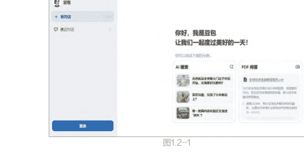

图1.2-1

> **小贴士**
> 多数AI工具提供网页、客户端和手机APP，教师可按使用场景选用。

#### 第 2 步 输入提示词

在对话窗口输入与课程资源检索相关的提示词，点击发送箭头或按Enter发出，如图 1.2-2 所示。


#### 第 3 步 生成与查看

资源生成后即可在页面内预览结果，如图 1.2-3、图 1.2-4 所示。

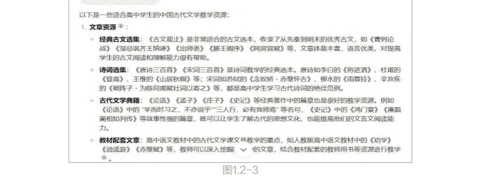

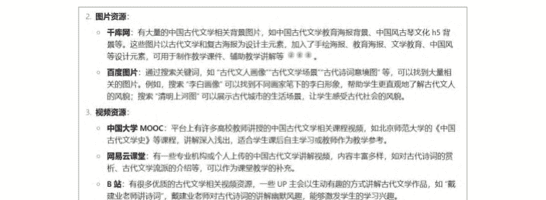

#### 第 4 步 查看搜索来源

点击结果上方的小放大镜🔍，可查看资料出处，如图 1.2-5 所示。


在弹出列表中，通过左右箭头切换来源链接，点击对应链接即可跳转原文，如图 1.2-6 所示。


> **小贴士**
> 点击生成文本右上角的数字标注，也能直接跳转至对应网页，如图 1.2-7 所示。


#### 第 5 步 深入搜索

点击结果下方的“深入搜索”，可扩展更多关联来源，如图 1.2-8 所示。


图1.2-8

展开后会呈现更丰富的检索结果，如图 1.2-9 所示。


图1.2-9

> 还可点击下方提供的词模板，获取与主题相关的延伸资源链接，如图 1.2-10 所示。


图1.2-10

#### 第 6 步 重新生成

如需刷新结果，直接点击“重新生成”按钮即可，如图 1.2-11 所示。


图1.2-11

#### 第 7 步 生成图片资源

除检索外，豆包自带的绘图功能也可直接产出配图。在首页对话框输入插图相关的描述并发送，即可在页面看到生成效果，如图 1.2-12 所示。


> **小贴士**
> 可利用图像生成制作意境图或概念图，帮助学生更直观理解知识点。

## 1.3 智能编写教案

### AI 工具：豆包

教案是对教学目标、内容、方法与流程的系统规划，有助课堂有序推进。借助AI编写教案，可提升效率并增强教学针对性，让课堂更具个性与效能。

### 操作步骤

豆包可基于教师提供的主题自动生成教学大纲，并同步汇总最新研究、多媒体素材与互动案例，让教案更丰满。

#### 第 1 步 选择工具

进入豆包首页，点击“帮我写作”，如图 1.3-1 所示。


在新页面中选择“教案”入口，如图 1.3-2 所示。


#### 第 2 步 补充信息

对话框会预填部分提示词，只需补全“学段”和“课程名称”，如图 1.3-3 所示。


填写完成后点击发送，如图 1.3-4 所示。


#### 第 3 步 生成与查看

生成的教案可在页面内浏览，如图 1.3-5、图 1.3-6 所示。


> **小贴士** 除了专用教案入口，也可在首页对话窗口直接输入提示词生成教案。

#### 第 4 步 调整优化

如需修改，可点击“调整”按钮，如图 1.3-7 所示。

在选项中选择“更加简洁”可对内容进行精简，如图 1.3-8 所示。

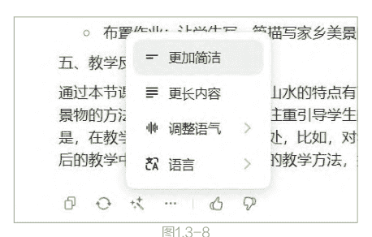

> **小贴士** 也可按需进行扩写、语气调整等个性化优化。

#### 第 5 步 翻译教案

需要多语版时，可使用豆包翻译功能。进入“调整”-“语言”，选择“English”，如图 1.3-9 所示。

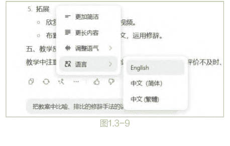

翻译后的内容即可在页面查看，如图 1.3-10 所示。


> **小贴士**
> 英文版同样支持后续调整优化，操作同前，如图 1.3-11 所示。

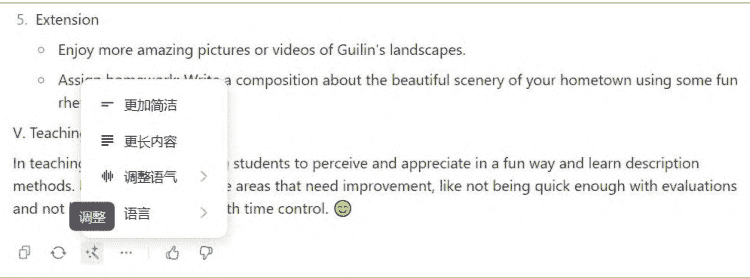

### 五、教学反思

本课教学后，学生对桂林山水的特色有了更深体会，也掌握了以比喻、排比等修辞描写景物的技巧。课堂中我着重引导朗读、体悟与赏析，在轻松氛围中学习语文。但也存在评价不够及时精准、时间把控需改进的问题。未来将持续优化教学策略，提升课堂质量。


## 1.4 一键生成课件

### AI 工具：AiPPT

PPT是教学组织的重要载体，多媒体呈现能提升教学效率。AI一键生成课件可大幅简化流程，根据输入主题自动产出专业样式的幻灯片，并保持逻辑与视觉统一。

### 操作步骤

AiPPT会依据输入主题智能生成大纲，教师只需挑选模板并微调文字，即可迅速完成课件。

#### 第 1 步 注册与登录

访问AiPPT官网，完成注册登录，如图 1.4-1 所示。


#### 第 2 步 输入课程主题

点击“AI智能生成”，在对话框输入主题关键词并发送，如图 1.4-2 所示。


> **小贴士**
> 输入越具体，生成的大纲越充实。

#### 第 3 步 生成与编辑大纲

系统会据此生成大纲结构，可在页面预览，如图 1.4-3 所示。

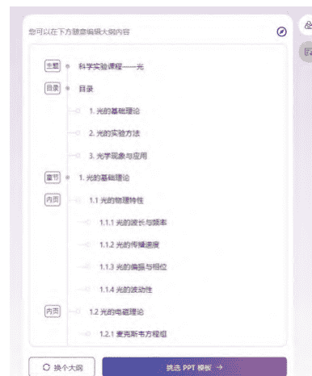

点击文字区块即可直接修改，如图 1.4-4 所示。


> **小贴士** 大纲可按实际需求调整；若整体不满意，可点“换个大纲”重新生成。

#### 第 4 步 选择模板

进入模板选择页，设定场景、风格与主色调，如图 1.4-5 所示。


确定后在模板库中挑选喜欢的样式，点击“生成PPT”，如图 1.4-6 所示。


#### 第 5 步 预览课件

生成完成后可先预览，点击缩略图可在左侧查看详情，如图 1.4-7 所示。


需要离线使用可点“下载”，需在线调整可点“去编辑”。

> **小贴士** 不在线编辑也可在PowerPoint等软件中打开微调。

#### 第 6 步 在线编辑课件

进入编辑器后，可框选文字或图片修改字体、颜色等；左侧工具栏支持大纲修改、模板更换、元素插入等操作，如图 1.4-8 所示。


想改版式时选中页面，在弹出的样式面板中切换布局，如图 1.4-9 所示。

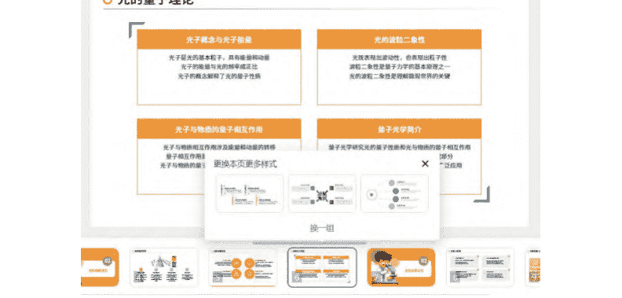

> **小贴士** 对样式不满意可点“换一组”刷新选项。

#### 第 7 步 智能创作助手

在 AiPPT 中编辑演示文稿时，创作助手能让修改过程更省心也更智能。先框选需要处理的文字，再点击页面里的智能入口，在弹出的面板中挑选所需功能，例如润色表述、扩充内容或转换为英文，即可对选中片段完成自动化优化，示意图见图 1.4-10。


#### 第 8 步 放映与下载

编辑进入尾声后，点击顶部工具栏的“放映”就能即时预览完整版演示，以核对整体效果；若需保存到本地，可按下“下载”；如果希望以拼图样式输出，则使用“拼图”功能即可，相关示意见图 1.4-11。


## 1.5 文档生成课件

### AI 工具：WPS AI

人工智能不仅可快速产出一份完整的演示文稿，还能将现成的文件转成符合教学需求的课堂课件。该系统能够解析并理解上传的教材、教学计划大纲、辅助读物、研究论文等资料，从中提炼核心概念、知识点以及整体框架，继而生成可直接投入使用的讲义。

### 操作步骤

WPS AI 能够根据用户提供的主题自动拟定内容提纲，后续只需挑选合适的版式并对文案进行审校，即可高效完成讲义制作。

#### 第 1 步 唤起 WPS AI

启动 WPS 软件，完成账号注册并登录，随后新建一份演示文件，流程如图 1.5-1 所示。


页面跳转后，点击 WPS AI 的入口，如图 1.5-2 所示。


#### 第 2 步 上传文档

在弹出的窗口中先点击“上传文档”，再选择“选择文档”，即可导入文件或思维导图，具体如图 1.5-3 所示。


> Tips
WPS AI 同样允许直接粘贴提纲来生成讲义，可依个人偏好选用。

另外，也可通过顶部菜单栏的“WPS AI”标签打开功能，再单击“文档生成 PPT”启动上传流程，如图 1.5-4 所示。

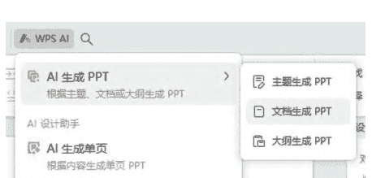

#### 第 3 步 选择大纲生成方式

依据实际需求挑选大纲生成策略，共有“智能改写”与“贴近原文”两种模式，确认后点击“生成大纲”，如图 1.5-5 所示。


> “智能改写”模式在生成提纲时会智能优化原文结构，而“贴近原文”模式则基本维持原有结构。

#### 第 4 步 生成和编辑大纲

系统会根据已上传的文件自动产出内容提纲。点击文字区域即可对提纲进行修改，修改完毕后单击“挑选模板”进入版式选择环节，如图 1.5-6 所示。

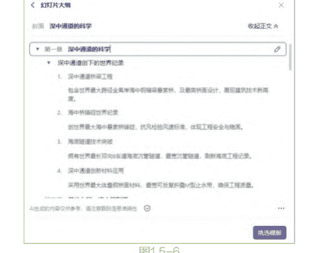

#### 第 5 步 选择模板

在弹出的版式库中浏览并选择符合需求的样式，确定后点击“创建幻灯片”即可，如图 1.5-7 所示。


> Tips
若此刻未找到满意的版式，也可先生成幻灯片，之后再行调整。

#### 第 6 步 编辑课件

演示文稿生成后，可逐页浏览并对文字与配图进行调整，如图 1.5-8 所示。


#### 第 7 步 美化课件

点击菜单栏中的“设计”，随后选择“更多主题”，在主题方案里挑选喜爱的风格，即可为整份演示文稿更换主题，如图 1.5-9、图 1.5-10 所示。


图 1.5-10

> **Tips**
在此基础上可对配色、字体统一或单页排版进行美化，具体可通过“设计”中的“配色方案”“统一字体”或“单页美化”实现。

#### 第 8 步 放映与保存

点击“放映”标签页，再按下“从头开始”即可启动播放，如图 1.5-11 所示。

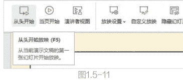

图 1.5-11

> **Tips**
使用 Shift+F5 组合键也能迅速启动放映。

单击“保存”按钮即可将演示文稿存至本地，如图 1.5-12 所示。


图 1.5-12

## 1.6 图片生成课件

### AI 工具：百度文库

某些人工智能平台支持基于图片或照片自动生成演示文稿，这项能力可大幅提升教学资料的制作效率。自动化的图像转换功能能够迅速将视觉素材整理为结构化的讲义，免去手动排版的时间，使备课更具灵活性与高效性，同时改善课堂体验。

### 操作步骤

百度文库的智能助手可以根据图像内容自动生成结构清晰且设计专业的演示文稿，同时还能依据文字内容智能添加配图和文字说明。

#### 第 1 步 注册与登录

进入百度文库首页，完成注册并登录，如图 1.6-1 所示。


#### 第 2 步 选择功能

在智能助手面板中单击“AI 辅助生成 PPT”按钮，如图 1.6-2 所示。


弹出的对话框里，点击“上传图片生成 PPT”按钮，如图 1.6-3 所示。

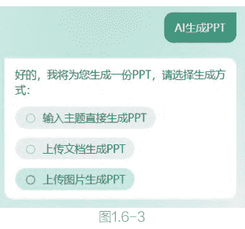

图 1.6-3

#### 第 3 步 上传图片

进入新页面后，点击“上传图片”按钮，导入用于生成课件的图像，如图 1.6-4 所示。


图 1.6-4

> Tips
上传前请阅读页面下方关于图片格式及大小的说明，以保证上传成功。

#### 第 4 步 生成和编辑大纲

系统会根据上传的图像自动产出内容提纲。点击“编辑”或直接在文字区修改，完成后单击“生成 PPT”进入版式选择，如图 1.6-5 所示。

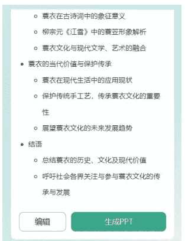

图 1.6-5

#### 第 5 步 选择模板

在版式页面浏览并挑选合适的模板，选定后点击“继续生成”即可，如图 1.6-6 所示。


图 1.6-6

> Tips
百度文库的部分版式需要开通会员后方可使用。

#### 第 6 步 在线编辑课件

演示文稿生成后，可逐页查看并对文字与图片进行修改，如图 1.6-7 所示。

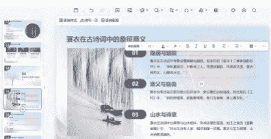

图 1.6-7

#### 第 7 步 美化课件

点击页面顶部“更换主题”即可更换整体版式，如图 1.6-8 所示。


图 1.6-8

选中某一页后点击“更换样式”，在右侧面板中选择希望的排版，即可完成更换，如图 1.6-9、图 1.6-10 所示。


图 1.6-9

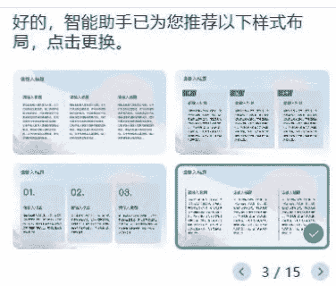

图 1.6-10

> Tips
在挑选排版时，可点击下方的箭头以查看更多样式。

选中页面内的图片后点击“更换配图”，在右侧列表中挑选新的图像即可完成替换，如图 1.6-11、图 1.6-12 所示。

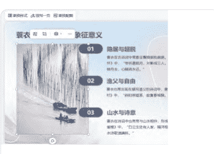


#### 第 8 步 在线编辑课件

若需新增一页，可借助“续写一页”功能智能生成。选中某页后点击“续写一页”按钮，如图 1.6-13 所示。


在右侧对话框中输入需要插入的核心内容，点击箭头或按下 Enter 发送，如图 1.6-14 所示。


随后系统会基于输入内容生成新页，包含文字与图片并自动完成排版，如图 1.6-15 所示。


图 1.6-15

#### 第 9 步 下载课件

编辑完成后，点击底部“下载 PPT”即可导出；点击“转 pdf”可导出为 PDF 格式，如图 1.6-16 所示。


图 1.6-16

> Tips
借助人工智能生成后，建议由教师或内容创作者进行一次全面审校和适当修改，以确保最终质量。

## 1.7 添加教学工具

### AI 工具：WPS

教学工具是 WPS 为教育场景打造的一系列功能插件，能够提供备课支持和互动式学科资源，帮助演示文稿呈现更丰富有趣，激发学习兴趣。借助这些工具与模板，教师可更快制作专业教学资料，节省备课时长。

### 操作步骤

教学工具中包含备课助手、试卷助手、课堂活动、知识导图等多种模板或插件，教师可按需选择并添加到演示文稿中。

#### 第 1 步 选择工具

启动 WPS 新建演示文稿，在“教学工具”选项卡中点击“古诗词”按钮，如图 1.7-1 所示。

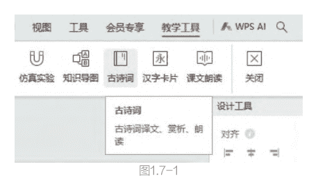

> **Tips**
如果初始未出现“教学工具”选项卡，可先点击“工具”选项卡，再点击“教学工具”按钮，如图 1.7-2 所示。

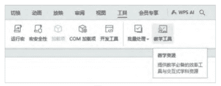

图 1.7-2

#### 第 2 步 选择学段

在左侧边栏进行学科导航，点击 ⊙ 按钮选择学段，如图 1.7-3 所示。


图 1.7-3

#### 第 3 步 选择古诗词

在出现的古诗词列表中挑选需要加入演示文稿的篇目，点击“立即使用”按钮，如图 1.7-4 所示。


图 1.7-4

随后古诗词模板将被添加到演示文稿中，如图 1.7-5 所示。


图 1.7-5

可借助左侧边栏的“目录”快速定位并筛选古诗词范围。

#### 第 4 步 放映幻灯片

该模板需在放映时使用，按下 Shift+F5 或点击缩略图中的▶按钮即可进入放映，如图 1.7-6 所示。


除古诗词外，教师还可根据学科需求添加汉字卡片、课文朗读、知识导图、仿真实验等工具。

#### 第 5 步 使用模板

在放映页面中，点击底部操作按钮可分别查看正文、注释、译文、赏析、背景、作者和标签，如图 1.7-7 所示。


点击🔊按钮即可进行朗读，如图 1.7-8 所示。


点击🔄按钮可更换页面背景，如图 1.7-9 所示。


> Tips
放映期间如需绘制墨迹、录屏或添加演讲备注，可点击底部左侧操作按钮，如图 1.7-10 所示。


#### 第 6 步 添加其他教学工具

参照上述流程添加仿真实验。点击“教学工具”选项卡下的“仿真实验”按钮，如图 1.7-11 所示。

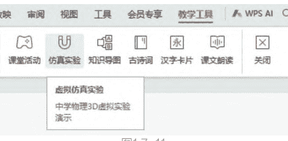

选择“练习温度计的使用”实验模板，如图 1.7-12 所示。

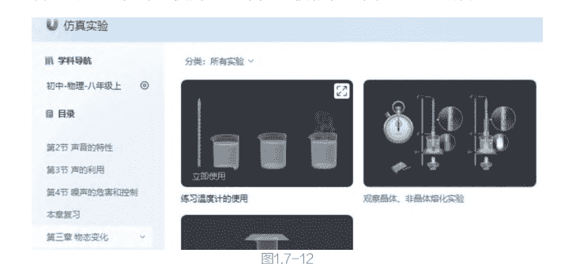

#### 第 7 步 使用模板

添加完成后进入放映模式。点击右下角“更多”按钮，再点击“简介”按钮，如图 1.7-13 所示。


随后可在弹出的页面中查看实验介绍与操作步骤，如图 1.7-14 所示。

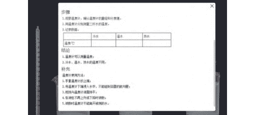

如需更直观的说明，可点击“视频”按钮观看教程，如图 1.7-15 所示。观看后即可按步骤使用模板开展教学。


图1.7-15

> **Tips**
仿真实验和知识导图等工具的操作流程会因课程类型而有所不同，使用前建议先查阅模板内的提示或简介。

## 1.8 生成思维导图

### AI 工具：TreeMind 树图

思维导图对教学工作很有帮助，可帮助教师理清思路，规划课程或知识点流程，确保教学有序进行。人工智能可减少梳理和手绘所需的时间，支持在线增删改节点，提升工作效率。

### 操作步骤

TreeMind 树图可依据主题和关键词自动生成完整的导图结构，并支持在线美化与调整。

#### 第 1 步 注册与登录

进入 TreeMind 树图首页，完成注册并登录，如图 1.8-1 所示。

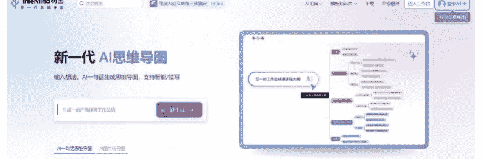

图1.8-1

#### 第 2 步 输入主题

在对话框中输入与导图主题相关的提示词，点击“AI 一键生成”按钮或按 Enter 发送，如图 1.8-2 所示。


图1.8-2

#### 第 3 步 生成与查看

页面跳转后即可看到生成的思维导图，如图 1.8-3 所示。

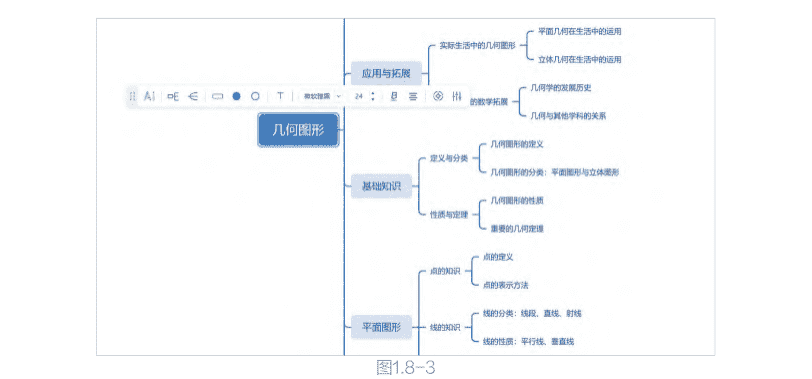

#### 第 4 步 编辑思维导图

若需修改，可点击文字区域直接进行编辑，如图 1.8-4 所示。


> 如需调整字体、大小、颜色等，可使用工具栏中的相关工具。

#### 第 5 步 续写扩展

需要扩展节点时，可点击工具栏或左侧边栏按钮，再点击“续写扩展”按钮，如图 1.8-5 所示。

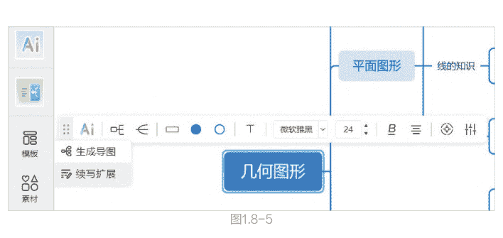

#### 第 6 步 一键美化

点击页面上方“一键美化”即可对导图进行随机美化，如图 1.8-6 所示。

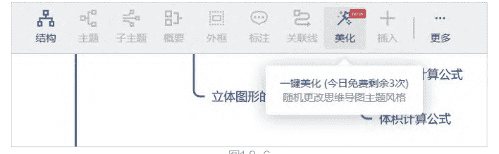

若效果不满意，可点击“撤回”或按 Ctrl+Z 恢复，如图 1.8-7 所示。

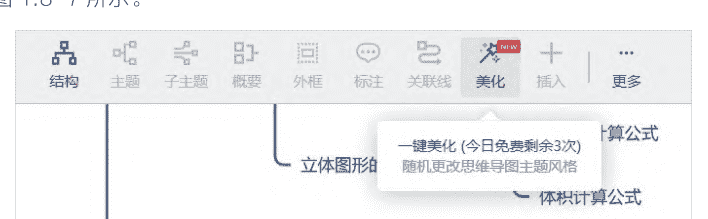

#### 第 7 步 更换模板

点击左侧边栏“模板”按钮，即可自行更换导图样式，如图 1.8-8 所示。

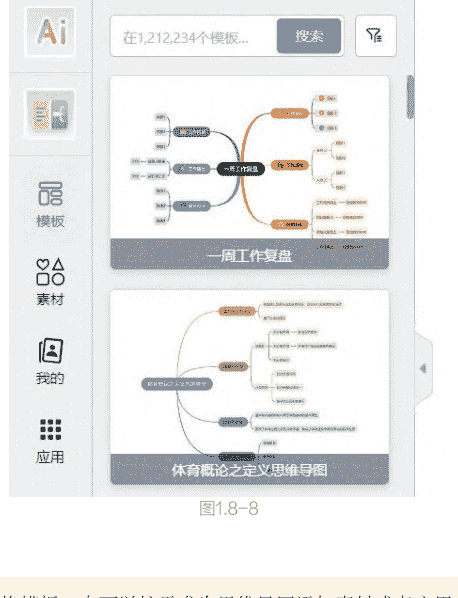

图1.8-8

> Tips
除更换模板外，还可按需为导图添加素材或应用。

#### 第 8 步 导出思维导图

调整完毕之后，点击顶部区域的导出入口，在随后弹出的选择面板里指定目标格式就能完成思维导图的导出，参考图1.8-9。


图1.8-9

## 1.9 模拟课堂情境

### 智能应用：智谱清言

在课程准备阶段预先演练授课流程，可以帮助讲师提前暴露可能出现的难点并准备应对方案。智谱清言能够扮演虚拟助教，通过问答互动与角色扮演来还原教学场景，让教师观察模拟学习者的行为与反馈，获取更丰富的教学信息，供后续优化参考。

### 具体流程

智谱清言的对话功能与智能体均可支撑课堂情境预演，让教师提前感受真实授课效果。

#### 第1阶段 账号创建与进入
打开智谱清言首页，点击“立即体验”进入账号创建流程，完成验证后进入系统，参考图1.9-1。


图1.9-1

#### 第2阶段 互动对话模拟
在交互窗口输入引导指令，请系统协助进行课堂情境推演，随后点击右侧发送标识或按下回车键提交，示意见图1.9-2。


随后可看到系统基于提问给出的互动回应，示例见图1.9-3。


保持角色扮演式的交流即可完成一次课堂模拟，见图1.9-4、图1.9-5。


> **小贴士**
撰写引导指令时可指定回应的语气风格，同时教师需对系统的回复作出相应反馈，这样对话会更贴近真实课堂。

#### 第3阶段 情境模拟参考
若不确定如何延续提问，可在首次输入引导指令时即要求系统自行生成整场课堂的完整对话，将其作为备课参考，见图1.9-6、图1.9-7。


> 对结果不满意时，可点击“重新生成”刷新内容，也能打开结果下方的引导模板获取与本课相关的补充资料，见图1.9-8。


#### 第4阶段 智能体模拟
智谱清言内置的老师模拟器智能体以游戏形式帮助新手教师体验教师日常。打开首页左侧边栏底部的智能体中心入口进入中心，见图1.9-9。


在搜索栏输入“老师模拟器”，打开时光教室——老师模拟器，见图1.9-10。


点击“游戏开始”入口，见图1.9-11。


图1.9-11

随后会展示游戏说明与目标，见图1.9-12。

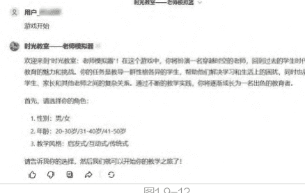

图1.9-12

按照系统提示挑选角色并作答，在互动中完成全部关卡，见图1.9-13、图1.9-14。

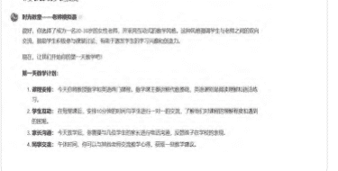

图1.9-13


图1.9-14

> 小贴士
与老师模拟器互动时，教师可以观察系统如何制定教学方案、准备资源以及与学习者沟通，并将这些做法迁移到自己的教学实践中。

## 1.10 教研内容总结

### 智能应用：通义千问

教研会议是教师交流经验、研讨问题的核心场域，对提升教学质量和教师成长意义重大。借助通义千问，教师能把会议音视频快速转写为文字，并自动提炼要点，便于后续工作。

### 具体流程

通义千问的音视频速读功能可将音视频快速准确转为文字，支持多语实时翻译，还能对转写结果进行智能归纳，帮助用户迅速把握要点。

#### 第1阶段 账号创建与进入
进入通义千问主页，完成账号注册并登录，见图1.10-1。


图1.10-1

#### 第2阶段 选择功能区
左侧边栏点击“效率”，再点击“音视频速读”，见图1.10-2。

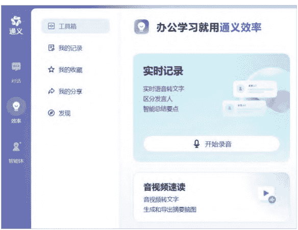

图1.10-2

#### 第3阶段 提交素材
在弹出界面点击音视频导入区，将需要速读的文件提交，见图1.10-3。

#### 第4阶段 调整选项
导入后配置音视频语言、是否翻译、是否区分发言人等选项，然后点击确认启动转写，见图1.10-4。


图1.10-3


图1.10-4

#### 第5阶段 浏览转写结果
转写完成后，在导入记录列表点击“立即查看”，见图1.10-5。


随后跳转页中可看到系统已将音频转为文字并按发言人区分，见图1.10-6。


#### 第6阶段 查看总结与分析
点击“导读”入口，可查看系统生成的总结与分析，包含全文概览、章节速览、发言小结和要点回顾等，见图1.10-7、图1.10-8。

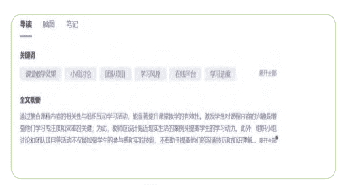


> 点击“编辑”入口，可对系统生成的总结或分析进行修改，见图1.10-9。


#### 第7阶段 查看思维导图
点击“脑图”入口，可查看基于音频自动生成的思维导图，见图1.10-10。

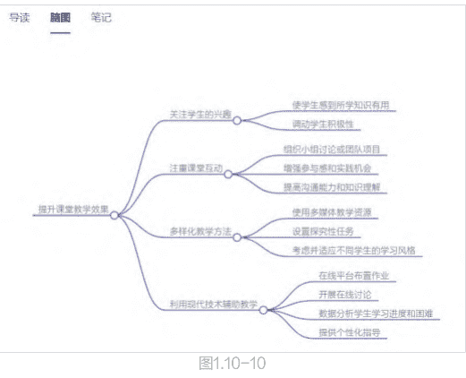

#### 第8阶段 在线记录笔记
点击“笔记”入口，可在线撰写笔记，并调整字体大小与颜色，或插入图片表格等，见图1.10-11。


> 小贴士
进行教研总结时，可利用此功能随时记录研究心得或灵感。

#### 第9阶段 翻译文字记录
转写完成后如需翻译，可使用翻译功能。点击译入口，选择英语，再点击双语显示即可开始翻译，见图1.10-12。


随后可在页面看到翻译结果，见图1.10-13。


#### 第10阶段 智能改写
想对文字记录进行精简改写时，点击✏️入口，再点击立即体验，见图1.10-14。


#### 第11阶段 导出文件
点击页面顶部的导出入口，在弹出窗口中选择所需文档类型和格式后点击导出即可，见图1.10-15。

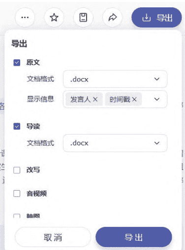

## 1.11 梳理知识要点

### 智能应用：360AI办公 + Kimi.ai

梳理知识要点是备课的关键，教师通过提炼核心知识点让教学更聚焦。智能平台拥有强大的文本分析能力，能快速处理大量资料，解放教师精力；基于海量数据，提取的知识更全面。

### 具体流程

360AI办公与Kimi.ai均可从文档中抽取关键信息并对长文本进行归纳，Kimi.ai还支持PPT与图片解析。

#### 第1阶段 选择360AI办公工具
打开360浏览器，进入360AI办公页面，点击左侧“教师工作加速器”，然后点击“精选教学内容”，见图1.11-1。


#### 第2阶段 提交资料
页面顶部点击“文档分析”，见图1.11-2。


点击文件导入区，导入PDF文档，见图1.11-3。


图1.11-3

> 除文档分析外，360AI还可进行视频总结、录音分析及网页分析。

#### 第3阶段 查看解析
文件导入后系统会解析文章，完成后可对照原文与重点解析查看，见图1.11-4。


图1.11-4

教师可通过页面顶部的操作控件查看文章简介、脑图、分析等，见图1.11-5。

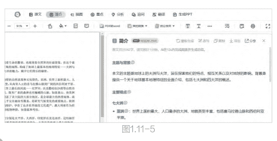

图1.11-5

> 除解析原文外，360AI还能将原文译成英文并生成PPT。

#### 第4阶段 追问
若需围绕文章主题追问，可点击页面顶部的追问入口，从出现的问题中选择即可获取答案，见图1.11-6。


> **小贴士**
追问功能可扩展知识，若需自行提问，也可在交互窗口输入问题进行追问。

#### 第5阶段 用Kimi.ai解析课件
进入Kimi.ai首页，注册账号并登录，见图1.11-7。


#### 第6阶段 提交资料
点击交互窗口中的📎入口，导入待解析的PPT课件，见图1.11-8。


导入后在交互窗口输入指令，让系统解析课件，然后点击右侧发送标识或按回车键，见图1.11-9。


#### 第7阶段 查看解析
随后可在页面查看系统对整个课件知识点和核心内容的整理，见图1.11-10、图1.11-11。

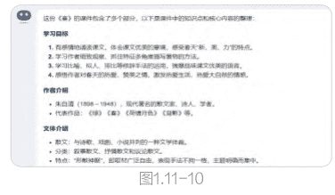


> 小贴士
如果觉得生成的解析不符合预期，可以点击“再试一次”入口，重新生成新的解析，见图1.11-12。


## 1.12 制作视频素材

### 智能应用：即梦AI

课堂上使用视频素材能直观呈现复杂概念，提升学习兴趣。智能平台可快速制作各主题短视频，节省资源搜索时间，提供多元学习体验。

### 具体流程

即梦AI可基于文字、图片或其他输入创建视频，作为教学短视频素材使用。

#### 第1阶段 账号创建与进入
进入即梦AI首页，完成注册并登录，见图1.12-1。


#### 第2阶段 选择功能
点击视频生成入口，见图1.12-2。

#### 第3阶段 输入指令
点击“文本生视频”，在交互窗口输入指令，见图1.12-3。


> 小贴士
如果不知道如何输入指令，可以向通义千问、豆包这样的语言类大模型进行询问，让系统提供一些撰写指令的示例。

#### 第4阶段 设置运镜和速度
对生成视频的运镜方式和运动速度进行选择，见图1.12-4。


#### 第5阶段 基础设置
对生成视频的模式、时长、视频比例和生成次数进行选择，见图1.12-5。


#### 第6阶段 快速预览
设置完成后，勾选底部的“快速预览视频”选项，等待系统生成预览视频，见图1.12-6。


图1.12-6

生成预览视频后，可以在页面中播放该视频，见图1.12-7。


图1.12-7

#### 第7阶段 生成与下载
如果觉得预览视频符合需求，点击视频底部的“继续生成”入口即可生成该视频，见图1.12-8。

点击视频右上角的下载入口，可以下载该视频，见图1.12-9。


图1.12-8

图1.12-9

> 小贴士
教师既可以直接将下载后的视频用于教学，也可以对其进行后期处理和剪辑后再进行使用。

# 第2章 教学支持助手

在日常教学中，智能应用可以作为助手为教师提供各方面支持，例如批改作业、为学员答疑解惑、分析学习数据等。这些支持将教师从一些重复性任务中解放出来，让教师可以将更多精力投入到教学设计和学生指导中，不仅提升了教学效率，也提高了教学的质量。


## 2.1 辅助多语翻译

### 智能应用：豆包 + 百度翻译

教学时若遇到需翻译的题目或场景，教师可借助智能平台轻松完成。智能平台能快速准确提供多种语言译文，节省查询资料时间，使教学更流畅。同时，智能辅助翻译还能让学生接触更地道表达，帮助理解不同语言的语法和词汇特点。

### 操作流程

豆包的翻译功能和翻译助手智能体能够快速进行双语互译，百度翻译的AI翻译功能能够实现图片秒翻，并且在翻译后可以进行双语审校、译文答疑、母语润色、语法分析等操作。

#### 第1阶段 互动对话翻译
进入豆包首页，点击“更多”入口，然后点击“翻译”入口，见图2.1-1、图2.1-2。

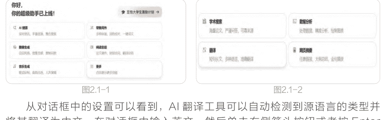

从交互窗口中的设置可以看到，智能翻译工具可以自动检测到源语言的类型并将其翻译为中文，在交互窗口输入英文，然后点击右侧箭头入口或者按Enter键发送，见图2.1-3。


图2.1-3

紧跟着呈现的是英文到中文的转换效果，示例见图 2.1-4。


图2.1-4

参照图 2.1-3 的流程，先点开对话窗中的简体中文切换控件，从弹出的列表里选定 English，随后在输入区填入中文并发送，界面样例见图 2.1-5。


图2.1-5

提交后，中文换成英文的译文即时出现，对照图 2.1-6 即可核查。


图2.1-6

> **Tips**
> 豆包自带译文功能现阶段只支持汉语与英语的互相转换。想处理其他语种，可借助翻译类智能体或更专业的翻译程序。

#### 第 2 步 互动对话翻译

接下来进入互动对话翻译环节。打开豆包的‘发现 AI 智能体’入口，在查找栏输入‘翻译’，选择‘日文翻译’智能体，入口位置如图 2.1-7 所示。


点一下首个提示词模板，示例如图 2.1-8。


接着系统会把这句中文转为日文，效果见图 2.1-9。


> **Tips**
> 提示词模板的调用仅作演示，实际操作通常需在对话窗口手动输入原文，发送后才能获得译文。

豆包提供多款翻译智能体，如汉英助手、日汉助手、中德译文、法语助手等，可辅助多语教学。

#### 第 3 步 上传图片翻译

进入百度翻译官网完成登录，把模式切换为 Eng to Chi，界面见图 2.1-10。


点一下图片上传区，位置如图 2.1-11。


随后系统把图片里的英文段落转为中文，效果见图 2.1-12。
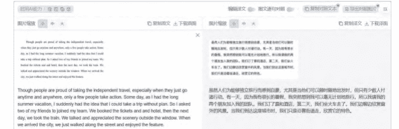

> **Tips**
> 百度翻译的智能译文目前仅限汉语与英语互译，其他语种需求可改用传统机器翻译。
> 除图片外，还支持 PDF、PPT 等文件格式的导入翻译。

#### 第 4 步 智能优化

百度翻译内置的润色面板可对原文及译文进行智能优化。选中一段译文，于右侧面板点按‘润色译文’，位置如图 2.1-13。


随后系统给出润色后的版本，点击‘替换译文’即可把新文本覆盖原译文，效果见图 2.1-14。


> **Tips**
> 若译文不够流畅，可借助润色功能让表达更自然生动。
> 除润色译文外，还提供原文润色、双语校对、语法剖析等功能，可按需求选用。

## 2.2 解答课堂疑惑

### AI 工具：豆包

在课堂中引入智能答疑，可明显提升教学效率与质量。系统能即时解析提问并给出完整解答，帮助学生把握要点，同时减轻授课负担，激发学习热情，实现定制化辅导，从而整体改善教学成效。

### 操作步骤

豆包答疑可应对各科复杂问题，支持拍照或提交题目截图快速获取解法，确保课堂连贯。

#### 第 1 步 输入题目答疑

打开豆包首页，点击底部对话框上方‘解题答疑’入口，位置见图 2.2-1。


于对话区输入题目，点按右侧箭头或回车提交，界面如图 2.2-2。


#### 第 2 步 查看回答

随后系统依据所输入题目返回答案与解析过程，分别见图 2.2-3、图 2.2-4。
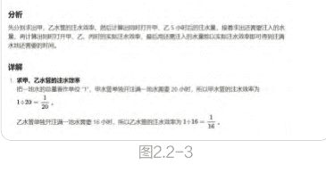


#### 第 3 步 延伸拓展

在答案下方，系统会给出若干相关拓展题，点击对应提示词模板即可获取解答，帮助学生拓展知识面，示例见图 2.2-5。


#### 第 4 步 上传图片答疑

于对话区点按‘上传题目图片’按钮，提交图件，位置如图 2.2-6。


#### 第 5 步 查看回答

提交图片后，系统先识别题干，再给出答案及解析，效果见图 2.2-7 至图 2.2-9。


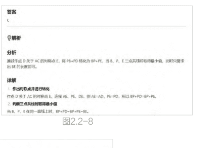

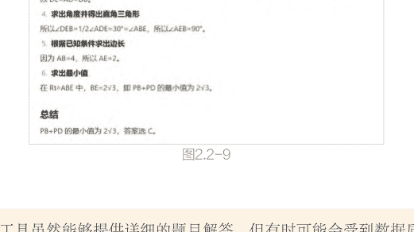

> Tips
> 智能系统虽能给出详细解析，但受数据质量、算法局限等因素影响仍可能出现偏差。使用时需结合专业素养与教学经验核对答案是否符合学科原理、概念与逻辑，避免学生接收错误信息。

#### 第 6 步 智能体答疑

豆包智能体中心汇聚众多学科专属答疑体，可按需选用。点按首页左侧边栏‘发现AI智能体’，位置见图2.2-10。


于搜索栏输入‘答疑’，页面会列出相关智能体，选择‘解题答疑助手’，如图 2.2-11。


> **Tips**
> 这些智能体既有全科，也有单科类型，可依据授课科目挑选。

于跳转页的对话区输入题目并提交，界面如图 2.2-12。


随后即可看到系统给出的解答，见图 2.2-13。
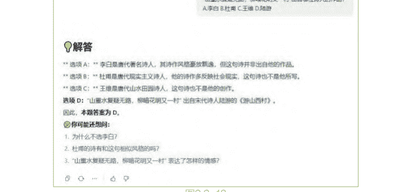

## 2.3 智能语音助手

### AI 工具：讯飞星火 + 腾讯智影

在部分教学场景中，智能朗读与配音能提升学习体验。课文配音可让学生听到标准发音与语调，对语言学习尤为重要，也能帮助听力受限或需阅读支持的学生。借助智能配音，授课者可节省录音时间，提升备课效率。

### 操作步骤

讯飞星火可进行对话朗读，腾讯智影能为文本生成智能配音，可按教学需求灵活选用。

#### 第 1 步 登录讯飞星火

打开讯飞星火首页，完成注册与登录，界面见图 2.3-1。


#### 第 2 步 明确需求

在对话区输入提示词，要求系统朗读某段课文，再点击右侧‘发送’或回车，界面如图 2.3-2。


#### 第 3 步 朗读课文

随后系统回应请求，点击播放键即可朗读该段文字，效果见图 2.3-3。


> Tips
> 朗读进行时，点击⏸即可随时暂停，位置如图 2.3-4。


#### 第 4 步 登录腾讯智影

打开腾讯智影首页，注册并登录，界面见图 2.3-5。


#### 第 5 步 选择工具

点击‘文本配音’按钮，位置如图 2.3-6。


#### 第 6 步 输入文章内容

在文本区填入课文内容，示例见图 2.3-7。
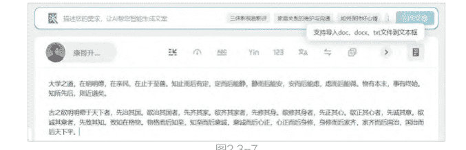

> **Tips**
> 腾讯智影的配音功能支持粘贴文本、导入文档，也可借助智能生成文案。

#### 第 7 步 选择音色

于左侧‘选择音色’页面挑选所需音色，点击‘使用音色’即可启用，界面如图 2.3-8。


> **Tips**
> 挑选音色时可先设定使用场景，并阅读音色简介以筛选更合适的选项。试听前点击🔊按钮即可预览。

#### 第 8 步 发音设置

如有需要，可对文本进行单独发音设置。选中一段文字，点击上方操作键，可调整语速、音效或指定发音人，具体见图 2.3-9、图 2.3-10。


#### 第 9 步 添加配乐

点击页面底部‘添加配乐’按钮，于左侧配乐页挑选所需音乐，再点‘使用’即可，流程见图 2.3-11、图 2.3-12。


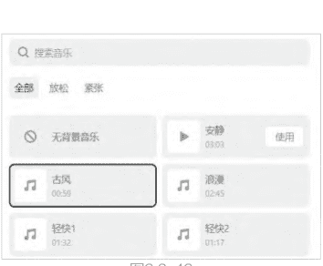

> 点击🎵按钮可预览配乐。

#### 第 10 步 音频试听

设置完毕后，点击底部‘试听’按钮预览整段音频，若效果满意，再点‘生成音频’即可导出，界面如图 2.3-13。


#### 第 11 步 下载音频

音频生成后，点击···菜单可进行剪辑、重命名或下载等操作，见图 2.3-14。下载后可在课件或课堂中使用该音频朗读课文。


## 2.4 智能出题助手

AI 工具：通义千问 + WPS

题库是提升教学质量的基础，可从中组装定制化试卷或练习，检验学生综合运用能力，帮助巩固知识，同时实现因材施教。智能系统可充当出题助手，按大纲自动生成大量练习，既省时又保证覆盖均衡。

操作步骤
通义千问可按需求生成各科各类题目，WPS 教学工具中的‘试卷组装’与‘试卷助手’支持一键添加多题型，还具备智能组卷能力。

#### 第 1 步 互动对话出题

打开通义千问首页，于对话区输入出题需求，点击右侧箭头或回车提交，界面见图 2.4-1。


图2.4-1

> Tips
> 输入出题要求时，尽量说明年级、学科与难度，生成的题目会更贴合需求。

#### 第 2 步 查看题目

随后系统依据输入的需求生成题目，分别见图 2.4-2、图 2.4-3。
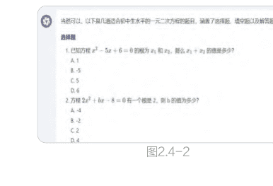

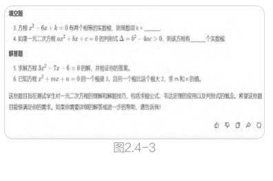

> 如需答案与解析，可继续在对话中提出该需求。

#### 第 3 步 智能体出题

通义千问的智能体也能担任出题助手。点击首页左侧边栏‘智能体’按钮，位置如图 2.4-4。


于搜索栏输入‘出题’，选择‘出题大师’智能体，见图 2.4-5。


在对话区输入出题要求并提交，界面如图 2.4-6。


随后即可看到系统生成的题目，见图 2.4-7。
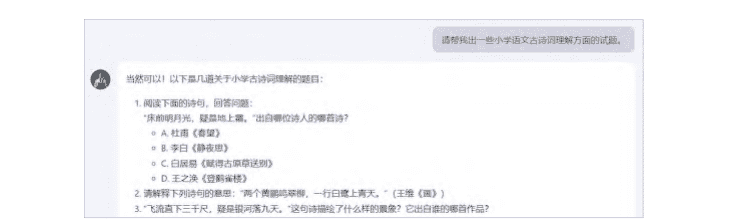

> 大多数智能平台都集成智能体功能，如文心平台的‘出题帮手’、智谱清言的‘英语作文出题器’等，可依据具体需求对比筛选最合适的智能体。

题目生成后，可复制到 Word 文件中重新编辑整理后再使用。

#### 第 4 步 智能出卷

打开 WPS，新建文档或演示文稿，点击‘教学工具’选项卡中‘试卷助手’按钮，见图 2.4-8。
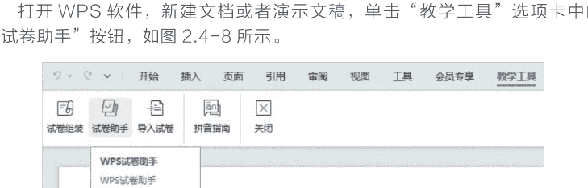

点击‘智能出卷’按钮，位置如图 2.4-9。


#### 第 5 步 设置题目

在弹出页中设置年级教材、章节、整卷难度、题型及题量后，点击‘生成试卷’，界面如图 2.4-10。


#### 第 6 步 预览与编辑

试卷生成后可在页面中预览，见图 2.4-11。
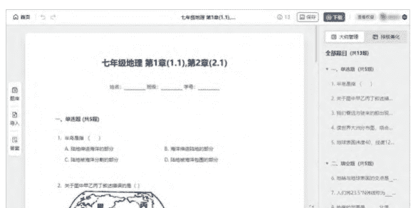

点击试题可进行编辑、插入或删除等操作，见图 2.4-12。


点击右侧边栏‘排版美化’按钮，可调整版式、元素与题间距，具体见图 2.4-13、图 2.4-14。


#### 第 7 步 保存与下载

编辑完毕后，点击页面右上‘保存’可在线保存，点‘下载’可导出试卷，界面如图 2.4-15。


点击‘下载’后，在弹出页设置文档类型、纸张尺寸、字号、保存路径等，再点‘立即下载’即可开始导出，见图 2.4-16。
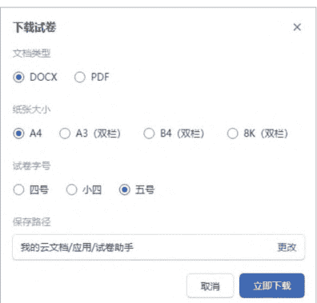

图2.4-16

导出后的试卷效果见图 2.4-17。
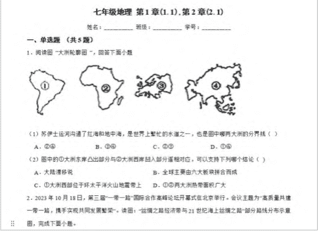

图2.4-17

> Tips
> 若导出格式为 DOCX，下载后仍可在文档中修改题目或版式。

## 2.5 辅助作业批改

AI 工具：豆包

批改作业与试题是日常工作常态，面对大量作业时，借助智能辅助识别题干与答案并即时反馈，可有效减轻负担、提升效率。

操作步骤
豆包智能体可协助批改作业或试题，只需拍照提交作业或试卷，系统即可核查答案正确性并提供修改建议。

#### 第 1 步 选定助手

先启动豆包移动客户端，借助左上角的回退箭头回到起始页，再于底部导航进入“发现”栏目，相关界面见图 2.5-1、图 2.5-2。


图2.5-1


图2.5-2

随后在上方检索区键入“批改”，从返回列表中挑选“口算批改”这款助手，相关界面见图 2.5-3。


图2.5-3

#### 第 2 步 递交练习

轻触 📷 图标可直接抓拍并递交练习照片；轻触 ➕ 图标后进入“相册”通道，便可把本地已存的习题图像导入，相关界面见图 2.5-4、图 2.5-5。


图2.5-4


图2.5-5

#### 第 3 步 查看结果

材料递交后，系统会迅速完成校对，错误处会被标注并给出纠正说明，全部结论可在当前页浏览，相关界面见图 2.5-6。


图2.5-6

> “口算批改”擅长处理口算类练习，若需校对其他题型或学科的作业，可在检索中寻找对应的专属助手来使用。

## 2.6 辅助作文点评

应用：豆包

教师手改作文耗时费神，尤其要同时兼顾语法、用词、逻辑与创意时负担更重。借助智能助手可在很短时间内批量处理，自动揪出语法、用词、标点等各类问题并提供修改建议。

操作要点

把作文内容以拍照或复制的方式发给豆包的专属助手，即可获得关于立意、结构、语言层面的点评意见。

#### 第 1 步 选定助手

打开豆包移动端，于首页底部进入“发现”页面，相关界面见图 2.6-1。

于检索栏填入“批改”，打开“作文批改助手”，相关界面见图 2.6-2。


#### 第 2 步 提交作文

轻触 📷 或 ➕ 完成作文照片的提交，相关界面见图 2.6-3。


提交结束后点按“传完了，开始批改”的链接，再选择对应的学段，相关界面见图 2.6-4、图 2.6-5。


#### 第 3 步 获取点评

随后系统会快速给出批改与评价，相关界面见图 2.6-6 ~ 图 2.6-8。


以结构为例，会指出文章整体完整，有火烧云的描写，开头点题收束简洁；主次分明，重点落在形态与色彩上；同时提醒缺少清晰线索，可用时间推移串联，提升条理。语言层面会肯定表达流畅，比喻运用得当，如把云比作骏马、狮子、群山，形象生动，并建议文采可再提升。针对性建议会提示在写形态时加入更多形容词，如“威风凛凛的骏马”“憨态可掬的狮子”，在写颜色时具体化红色类型，让画面更饱满。

逐句点评会提炼亮点佳句，例如“火烧云红得似火，有的像跑的骏马，有的像沉睡的狮子，有的像连绵的群山。”比喻恰当；“微风吹过，像穿着红裙跳舞，优雅轻盈。”比喻恰当。

#### 第 4 步 美化作文

如有需要，可在点评结果下方点按“帮我润色本文”，系统会给出润色版本，相关界面见图 2.6-9。

润色后的范文见图 2.6-10。教师也可直接在对话区下指令沟通。

润色稿对火烧云的描写更为细腻，使用了“脱缰的骏马”“沉睡的狮子”等更生动的意象，并加入了“飘飘乎如遗世独立，羽化而登仙”的文采提升。教师可借鉴其中的表达来指导学生。

你可能还想问：
1. 帮我润色本文
2. 批改新作文
3. 润色新作文

## 2.7 提供学习建议

应用：智谱清言

课堂上及时的反馈对学习很关键。智能助手能依据学生的表现、进度和需求给出个性化建议，帮助教师动态调整教学策略，让每位学生获得更适配的支持。

操作要点

智谱清言可帮助分析学生学习情况并给出对策。

#### 第 1 步 提出问题

进入智谱清言首页，在对话区输入提示词提出问题，再点右侧发送箭头或按 Enter 发送，相关界面见图 2.7-1。


#### 第 2 步 阅读建议

随后即可看到助手针对问题的答复与建议，相关界面见图 2.7-2。


#### 第 3 步 浏览补充建议

点生成结果下方的提示词模板，可打开更多补充建议，相关界面见图 2.7-3。


#### 第 4 步 分析其他问题

按同上方式，让助手对学生出现的其他问题进行分析并提供建议，相关界面见图 2.7-4、图 2.7-5。


## 2.8 课堂互动设计

应用：WPS AI

课堂互动能提升参与感，让学习更生动。智能助手可迅速生成互动方案，节省备课时间。

操作要点

WPS AI 能依据教学内容与目标生成课堂小游戏、小组任务等互动建议。

#### 第 1 步 唤起 WPS AI

打开 WPS，新建空白文档，相关界面见图 2.8-1、图 2.8-2。连续按两下 Ctrl 唤起 WPS AI，于弹出的场景选项中点“去灵感市集探索”，相关界面见图 2.8-3。


#### 第 2 步 选择模板

在灵感市集左侧边栏点“教育教学”，再点“课堂互动设计”模板中的“使用”按钮，相关界面见图 2.8-4。


#### 第 3 步 补充信息

在弹出的模板中填入身份、教学内容、形式、时长等信息，再点右侧箭头或回车发送，相关界面见图 2.8-5。


#### 第 4 步 预览方案

WPS AI 会据指令生成互动方案，可在页面预览，若满意点“保留”按钮即可，相关界面见图 2.8-6、图 2.8-7。


> Tips
点“重写”可重新生成新方案；点“调整”可对方案做续写、缩写、润色等操作。

#### 第 5 步 嵌入互动组件

为增强趣味，可在课件中加入互动组件。在 WPS 中新建演示文稿或打开已制作的 PPT 课件，相关界面见图 2.8-8、图 2.8-9。


在“教学工具”选项卡中点“课堂活动”按钮，相关界面见图 2.8-10。


于左侧选择活动类型并挑选想要的活动，点“立即使用”，相关界面见图 2.8-11。


设置好题目后点右上角“预览查看”进入预览，确认后点“立即使用”即可把活动组件加入课件，相关界面见图 2.8-12、图 2.8-13。


## 2.9 生成课程讲稿（一）

应用：WPS AI

逐字稿把课堂要说的话完整记录下来，对保证准确连贯很有帮助，尤其适合微课和在线课程。智能助手生成逐字稿可提升备课效率，也优化学习体验。

操作要点

WPS AI 能帮助生成课程主题的逐字稿和讲解要点。

#### 第 1 步 唤起 WPS AI

打开 WPS，新建空白文档，唤起 WPS AI，于场景选项中点“去灵感市集探索”，相关界面见图 2.9-1。


图2.9-1

#### 第 2 步 选择模板

在灵感市集左侧点“教育教学”，再点“微课逐字稿”模板的“使用”按钮，相关界面见图 2.9-2。


#### 第 3 步 补充信息

在微课逐字稿模板中填入身份、课程主题、教学重点、讲解风格、课程时长等，再点右侧箭头或回车发送，相关界面见图 2.9-3。


#### 第 4 步 查看讲稿

随后 WPS AI 会按指令生成逐字稿，可在页面预览，相关界面见图 2.9-4、图 2.9-5。


# 第2章 教学支持助手


图2.9-5

## 第5步 调整讲稿

若生成内容不合适，可点“调整”按钮进行续写、润色、扩写或缩写，相关界面见图2.9-6。


图2.9-6

调整后预览结果，满意则点“保留”按钮使用该讲稿，相关界面见图2.9-7。


图2.9-7

## 2.10 生成课程讲稿（二）

应用：DreamFace+ 豆包

随着技术发展，让照片开口说话成为新颖教学手段。可把静态历史图片、图表或插图活化，仿佛人物直接与学生交流，提升趣味性和记忆效果。

### 操作要点

先用豆包生成人物插图和台词，再用 DreamFace 让照片动起来。

#### 第 1 步 生成插图

进入豆包首页，点“图像生成”按钮，相关界面见图 2.10-1。


在对话区输入提示词让助手生成人物头像插图，再点发送，相关界面见图 2.10-2。


从结果中挑选合适图片下载，相关界面见图 2.10-3。


图2.10-3

#### 第 2 步 生成文本

进入豆包的“发现 AI 智能体”页面，检索“李白”，点开“李白”智能体，相关界面见图 2.10-4。


图2.10-4

点已有提示词模板或在对话区输入提示词对话，收集助手的答复作为配音文本，相关界面见图 2.10-5、图 2.10-6。


图2.10-5


图2.10-6

#### 第 3 步 打开 DreamFace

进入 DreamFace 首页界面，点击“照片说话唱歌”按钮，相关界面见图 2.10-7。


> **Tips**
DreamFace 为手机端应用，仅支持手机下载。首次使用有 10 次免费生成机会，需付费才能无限次使用及开通 Pro 功能。

#### 第 4 步 提交头像

点 ➕ 按钮提交头像，提交完成后点“继续”，相关界面见图 2.10-8。


#### 第 5 步 编辑脚本

点“通过文字”按钮，输入或粘贴准备好的文本，再点“继续”，相关界面见图 2.10-9、图 2.10-10。


> **Tips**
若未提前准备脚本，可点下方“AI 脚本”按钮让 DreamFace 的助手生成文字。

#### 第 6 步 选择声音

挑选合适声音后点“确认”使用，相关界面见图 2.10-11。


#### 第 7 步 合成视频

点“合成”按钮即可生成视频，相关界面见图 2.10-12、图 2.10-13。


#### 第 8 步 保存与分享

合成后可在页面查看效果，点“保存”可存视频，点“分享”可在线分享，相关界面见图 2.10-14。


# 第 3 章 班级事务管理

除了课堂授课，老师往往还要兼顾班级日常运转，尤其是班主任。把这些琐碎事务理顺，才能为学生营造井然有序且高效的学习氛围。好在 AI 技术越来越成熟，诸多事务性工作可以交由智能工具代劳，帮助老师卸下负担，把更多精力放回教学打磨和学生的因材施教上。


## 3.1 制定班级规则

AI 工具：天工 AI

班规是维持班级学习秩序和良好氛围的核心准则，通常由教师和学生共同商议确定。用 AI 先出初稿，既能让规则制定更公平，也能保证执行时的一致性。天工 AI 可快速产出系统完整的规则框架，并能依据不同班级特点做个性化优化。

### 操作步骤

借助天工 AI 的对话能力，教师能迅速拟出一份班规草案，再按需迭代。

#### 第 1 步 注册与登录

打开天工 AI 的主页面，新建账号并完成登录，如图 3.1-1 所示。


#### 第 2 步 选择对话助手

在左侧菜单里点击“天工 3.0 大模型”入口，如图 3.1-2 所示。


#### 第 3 步 输入提示词

在对话框中写下用于生成班规的指令，发送后让模型按要求起草，如图 3.1-3 所示。


#### 第 4 步 查看班规

模型会返回生成的班规内容，可在页面中浏览，如图 3.1-4、图 3.1-5 所示。


#### 第 5 步 补充与调整

阅读初稿后，若需增补或修改条款，可继续与 AI 对话进行调整，如图 3.1-6 所示。


> 建议把 AI 生成的班规草案拿出来和学生一起讨论，结合本班实际再做微调后再正式启用。

## 3.2 开学物品清单

AI 工具：WPS AI

开学之初给学生一份清晰的物品清单，能帮助师生家长明确需求，避免遗漏。AI 可迅速列出详尽清单，让准备工作更省心。

### 操作步骤

WPS AI 的开学物品清单模板支持一键生成所需清单。

#### 第 1 步 选择工具

启动 WPS 软件，新建一个智能文档，如图 3.2-1 所示。


#### 第 2 步 创建智能文档

在新页面中点开“AI 模板”里的“查看更多”，如图 3.2-2 所示。
随后点选“教育行业”，再点选“开学物品清单”，如图 3.2-3 所示。


#### 第 3 步 设置模板

在模板设置面板里选择学生的教育阶段，在“特殊需求”框中填写具体要求，再点“开始生成”，如图 3.2-4 所示。
弹出确认页后点“确定”，如图 3.2-5 所示。


#### 第 4 步 查看清单

生成后可在页面预览，若基本符合需求就点“完成”，如图 3.2-6 所示。


> **Tips**
> 预览后觉得不合适，可点“重新生成”获取新版本。

#### 第 5 步 编辑与使用

点“完成”后进入可编辑界面，教师可在此调整内容与版式再使用，如图 3.2-7 所示。


## 3.3 撰写放假通知

AI 工具：WPS AI

放假通知是学校班级常用的告知形式。AI 具备强大的语言处理与知识储备，能快速生成准确清晰、有条理的通知，并可按假期类型灵活调整语气与重点。

### 操作步骤

WPS AI 提供多种放假通知写作模板，便于快速成稿。

#### 第 1 步 唤起 WPS AI

打开 WPS，新建空白文档，点击菜单栏的 WPS AI 选项卡唤起功能，再点“AI 帮我写”，如图 3.3-1 所示。


> **Tips**
> 在空白文档中连续按两下 Ctrl 键也能唤起 WPS AI。

#### 第 2 步 选择场景

在场景列表中点“通知”，再点“放假通知”，如图 3.3-2 所示。


#### 第 3 步 编辑与使用

在放假通知模板中填入假期名称、收发对象、放假时间等信息后发送，如图 3.3-3 所示。


#### 第 4 步 预览与调整

WPS AI 会据指令生成通知，教师可先预览。觉得不满意可点“调整”进行润色、扩写或缩写，如图 3.3-4 所示。


也可直接在对话框继续下指令调整，例如点选“强调假期注意事项”并发送，如图 3.3-5、图 3.3-6 所示。


图3.3-5


图3.3-6

#### 第 5 步 保留与使用

调整后的版本若符合要求，点“保留”即可使用，如图 3.3-7 所示。


图3.3-7

> **Tips**
> 可反复调整润色，直至得到最符合需求的版本。

#### 第 6 步 使用其他模板

唤起 WPS AI 后点“去灵感市集探索”，如图 3.3-8 所示。
在灵感市集搜索框输入“放假”，找到放假通知模板后点“使用”，如图 3.3-9 所示。


#### 第 7 步 编辑模板

点模板文字区修改内容，编辑完后发送即可生成通知，如图 3.3-10 所示。


此后仍可在页面继续编辑，如图 3.3-11 所示。


## 3.4 撰写班群通知

AI 工具：讯飞星火

班级群和家长群是家校沟通的关键桥梁。AI 可协助撰写群通知，帮助教师更高效地组织语言，确保信息传达清晰准确。

### 操作步骤

讯飞星火的对话、智能体以及 WPS AI 的群通知模板都能按教师提供的要点生成班级或家长群通知。

#### 第 1 步 互动对话撰写

进入讯飞星火首页，点击对话框上方“内容写作”，如图 3.4-1 所示。


将写作类型设为“通知”、语气设为“礼貌”，在对话框输入通知要点后发送，如图 3.4-2 所示。


完成后即可看到 AI 生成的通知文案，如图 3.4-3 所示。


图3.4-3

> **Tips**
> 如需修改，可继续与讯飞星火对话调整。

#### 第 2 步 智能体撰写

点击首页左侧“智能体中心”进入中心，如图 3.4-4 所示。


图3.4-4

在搜索框输入“群通知”并回车，找到“家长群通知”智能体，如图 3.4-5 所示。


图3.4-5

点开第三个提示词模板，即可得到 AI 生成的通知文案，如图 3.4-6、图3.4-7所示。


图3.4-6


图3.4-7

> **Tips**
> 不满意时可继续对话优化内容。

#### 第 3 步 模板撰写

打开 WPS，新建智能文档，进入 AI 模板页，点“校园生活”，再点“家长群通知文案”，如图 3.4-8 所示。


图3.4-8

在文本框输入通知主题和要点后点“开始生成”，如图 3.4-9 所示。


生成后可预览，若满意点“完成”即可编辑使用，如图 3.4-10 所示。


> **Tips**
> 不同方式生成的文案风格各异，可对比选择最适合的版本。

## 3.5 准备演讲稿件

AI 工具：WPS AI

演讲是教师展示专业素养的重要场合，充分准备的稿件能让表达更自信。AI 可定制演讲内容，提升现场效果。

### 操作步骤

WPS AI 的生成演讲稿模板可按场合和需求撰写并调整稿件。

#### 第 1 步 选择 AI 模板

打开 WPS，新建智能文档，进入 AI 模板页，点“教育行业”，再点“生成演讲稿”，如图 3.5-1 所示。


#### 第 2 步 设置模板

在设置面板填写应用场景、目标听众、演讲目的、结构框架和主题后点“开始生成”，如图 3.5-2、图 3.5-3 所示。


若结果不理想，可重新生成并在确认页点“确定”，如图 3.5-4 所示。


图3.5-4

#### 第 3 步 查看演讲稿

生成后可预览，基本满意则点“完成”，如图 3.5-5 所示。


图3.5-5

#### 第 4 步 编辑与使用

点“完成”进入可编辑页，可对内容和版式做进一步调整，如图 3.5-6 所示。


图3.5-6

#### 第 5 步 使用其他模板

新建空白文档，点击菜单栏 WPS AI，连续按两下 Ctrl 唤起功能，点“去灵感市集探索”，如图 3.5-7 所示。
在左侧点“教育教学”，再点“演讲稿”模板的“使用”，如图 3.5-8 所示。


在模板中补全主题、听众、时长、风格、场合等信息后发送，如图 3.5-9 所示。
WPS AI 生成稿件后预览，满意则点“保留”，如图 3.5-10 所示。


> Tips
> 不满意时可参照案例 3.3 的调整方式进行润色。

## 3.6 管理学生档案

AI 工具：智谱清言

学生档案信息量大，人工更新耗时费力。借助具备数据分析与处理能力的 AI，可提升管理效率并保证准确性，同时从数据中挖掘有价值的信息。

### 操作步骤

智谱清言的数据分析功能可对上传表格进行处理、可视化并生成分析报告。

#### 第 1 步 选择功能

进入智谱清言首页，点击左侧边栏“数据分析”，如图 3.6-1 所示。

#### 第 2 步 上传文件

点击对话框中的 📎 按钮，上传学生档案表格，如图 3.6-2 所示。


#### 第 3 步 输入要求

上传完成后在对话框描述数据处理与分析需求后发送，如图 3.6-3 所示。


#### 第 4 步 查看分析结果

AI 会对表格整体数据进行分析并给出计算结果，如图 3.6-4、图 3.6-5 所示。


#### 第 5 步 进行其他分析

在对话框中输入新的需求，AI 会对档案做进一步分析，如图 3.6-6、图 3.6-7 所示。


#### 第 6 步 进行可视化分析

数据分析功能还支持表格的可视化呈现，如图 3.6-8、图 3.6-9 所示。


AI正在把教师从繁琐的报表和重复计算里抽离出来，让教学更聚焦陪伴与思考。下面是一套基于主流办公和对话产品的实操路径，覆盖构成可视化、分数处理、评语撰写、考勤管理、班会筹备到班歌创作。

一、班级构成可视化与智能报告
系统已经产出一个环形图来呈现班干部与普通同学的占比，图上能直观看出各类别的份额。图3.6-9

第7步 生成数据分析报告
智谱清言可以依托预设模板，结合使用者的个性化需求，自动产出结构化的分析材料，见图3.6-10、图3.6-11。

图3.6-10

图3.6-11

二、分数汇总与评估
对同学分数进行汇总与解读是教师的常规工作，有助于评估教学成效、判断方法是否合适并及时调整策略与进度。智能化手段有效规避了手工统计的繁琐，能在短时间内完成多名同学分数的汇总，让教师把精力放在备课和个别辅导上。可先用WPS智能助手完成分数核算与重点标注，再借助豆包对学习情况进行解读并给出建议。

第1步 启动WPS智能助手
在WPS中打开同学分数表，见图3.7-1。
在菜单栏点选WPS AI选项卡激活功能，再点“AI写公式”控件，见图3.7-2。


第2步 汇总分数
在弹出的AI函数面板对话框里输入需求，点右侧箭头或按Enter发送，见图3.7-3。

随后WPS AI会依据需求自动匹配函数并计算出结果，完成均值的统计。若结果无误，点面板中的“完成”即可，见图3.7-4。

同理可迅速求出每位同学各科总和，见图3.7-5。

不熟悉提问方式时可参考面板里的示例。提问后系统会给出函数与解释，遇到疑问可查看。若结果错误，可换一种更易理解的描述，例如把“计算张三所有科目的总成绩”改为“计算第3行所有科目的总成绩”。

第3步 智能标注
激活WPS智能助手后点“AI条件格式”控件，见图3.7-6。

在条件格式面板对话框输入需求后发送，见图3.7-7。

系统会对符合条件的单元格进行标注，确认无误后点“完成”，见图3.7-8。

> 点面板中的“格式”控件可在下拉列表里选择更多样式或自定义，见图3.7-9。


第4步 解读分数
进入豆包首页，点“更多”，再点“数据分析”，见图3.7-10、图3.7-11。


点“浏览文件”上传表格，见图3.7-12。

上传后在对话框输入分析需求并发送，见图3.7-13。

随后工具给出分析与建议，见图3.7-14、图3.7-15。


| 科目 | 平均分 | 最高分 | 最低分 | 标准差 |
| :--- | :--- | :--- | :--- | :--- |
| 物理 | 85.500 | 99.0 | 78.0 | 7.615773 |
| 化学 | 85.750 | 96.0 | 78.0 | 6.713526 |
| 生物 | 84.625 | 95.0 | 76.0 | 5.829420 |

从均值看，英语成绩最高达115.875分，生物最低为84.625分，说明英语整体表现较好，生物需进一步强化。
最高分与最低分体现极端情况，语文最高135分最低85分，差距明显，显示学习水平差异较大，其他科目亦有类似现象。
标准差反映离散程度，数值越大差异越大。语文标准差最大为16.850445，成绩分化最显著。
综合建议：关注个体差异，针对学科与同学特点采取差异化教学与辅导。对低分学科夯实基础、增加练习与辅导；对分化大的学科组织学习小组促进互助。鼓励同学制定合理计划，提升效率，培养自主学习能力。

三、撰写同学评语
评语可具体反馈学习表现、作业完成与课堂参与，帮助同学认识优点与改进点。用智能助手撰写能高效、保持一致，并为每位同学生成个性化建议与鼓励。

操作路径
WPS智能助手与智谱清言都能按教师需求生成评语。

第1步 启动WPS智能助手
打开WPS新建空白文档，启动WPS智能助手，在场景选项框点“去灵感市集探索”，见图3.8-1。


第2步 选择模板
在灵感市集左侧边栏点“教育教学”，再点“学生评语”模板中的“使用”，见图3.8-2。


第3步 补充信息
在弹出的评语模板中输入指令，补全身份信息、初步评价、评语侧重、评价风格、字数等，再发送，见图3.8-3。


第4步 预览评语
WPS智能助手按指令生成评语，可在页面预览，满意后点“保留”，见图3.8-4。

若需快速润色，点“调整”后点“润色”，见图3.8-5。


第5步 智能体生成
进入智谱清言智能体中心，搜索“评语”关键词，点入“期末评语大师”智能体，见图3.8-6。

点“一键生成评语”提示词模板，见图3.8-7。

此时系统给出一段提示，见图3.8-8。

图3.8-8
按提示在对话框输入信息并发送，即可获得生成评语，见图3.8-9。

图3.8-9
> Tips
教师可通过对话不断调节语气、用词和长度，使评语更贴合预期。

四、管理同学考勤
考勤管理是保障教学质量的重要环节，数据能帮助教师发现需要额外关注的同学。智能化手段可处理大量考勤数据并给出分析报告，提升管理效率。
豆包可快速制作考勤表，也能整理与分析上传的考勤数据。

第1步 生成考勤表
进入豆包首页，在对话框输入提示词让工具制作基础同学考勤表后发送，见图3.9-1。

随后可看到生成的考勤表，见图3.9-2。

> 用智能助手生成考勤表可提升效率，复制到Excel调整格式后即可使用。

第2步 调整考勤表
继续在对话框输入调整指令并发送，可看到调整后的表格，见图3.9-3。


第3步 使用考勤表
调整完成后点生成结果下方的“复制”控件，复制到其他软件使用，见图3.9-4。


第4步 查看模板与建议
点生成结果下方的提示词模板，可查看考勤表Excel模板或制作教程，见图3.9-5 ~ 图3.9-7。

常见模板推荐：
- 基础同学考勤表模板：表头含“学号”“姓名”“班级”“日期”“出勤情况如正常出勤、迟到、早退、请假理由”等。日期列自月初至月末排列，用符号或文字记录，如“√”正常、“×”缺勤、“△”迟到早退。

- 智能提醒的同学考勤表模板：条件格式设置使考勤达标时单元格自动变色提醒，如连续缺勤超天数或早退次数多时变红；公式提醒可在特定单元格显示文字，如缺勤天数超标时提示“该生请假天数过多，请关注”。


第5步 分析考勤表
点对话框中的 📎 控件上传考勤表，见图3.9-8。

上传后输入提示词要求统计表格数据，见图3.9-9。

随后可看到统计结果，见图3.9-10。可继续让工具对整表进行分析与总结，见图3.9-11。

根据提供的考勤表，该班出勤情况如下：大部分同学出勤良好，如李小妹、王小萌、宋亚等；部分同学有缺勤，赵快快缺勤最多达2天；李小猴与潘嘻嘻各迟到1天；李小猴、孙小一、白小年与赵快快均有请假，请假天数不同。总体良好，但仍有部分同学需关注。


五、筹备主题班会
主题班会是有组织有目的的班级活动，通常由班主任主持。智能助手可显著提升筹备质量，提供丰富资源与创意，让内容更丰富有趣。

操作路径
通义千问可担任策划助手。

第1步 明确主题
进入通义千问首页，在对话框输入提示词让工具按给定主题策划班会活动并发送，见图3.10-1。

图3.10-1
> Tips
若对主题无想法，可向智能助手询问灵感。

第2步 查看方案
随后可看到按主题生成的策划方案，见图3.10-2、图3.10-3。


第3步 调整方案
如需修改，可继续对话让其调整方案，见图3.10-4、图3.10-5。


第4步 准备素材
方案确定后，可借助智能助手收集班会所需素材如图片、音频、视频，见图3.10-6、图3.10-7。


第5步 修改已有方案
也可让智能助手修改已写好的方案。点“上传文档”控件上传活动方案，见图3.10-8。

上传后在对话框输入需求并发送，见图3.10-9。

随后可看到修改建议，见图3.10-10、图3.10-11。


六、一键创作班歌
创作班歌有助于增强凝聚力，激发创造力与协作精神。智能助手可按主题或关键词自动作词谱曲，提供打磨灵感。

操作路径

第1步 选择工具
进入天工AI首页，左侧边栏点“AI音乐”控件，见图3.11-1。


第2步 确定歌名与歌词
在“歌名”文本框输入名称，点“AI写整首”控件，即可看到按歌名创作的歌词，见图3.11-2、图3.11-3。


> **Tips**
> 
> 写歌词的方式很自由，既能交由 AI 直接创作，也能把自己准备好的歌词导入进去。

#### 第 3 步 选择参考音频

点进页面上标注“请选择参考音频”的入口，进入下一步操作，参考图 3.11-4。


新页面会让你先挑曲风和情绪，选定后从列表里找到合适的参考音源，按下“使用”即可完成确认，图 3.11-5 可作对照。


#### 第 4 步 开始创作

参考音频确定之后，点击“开始创作”按钮，歌曲的生成流程就正式启动了，见图 3.11-6。


#### 第 5 步 试听与下载

生成完成后作品会直接呈现在页面上。点“播放”就能先听效果；点“更多”则可以重新生成或把成品保存到本地，图 3.11-7、图 3.11-8。


> **Tips**
> 
> 天工 AI 不是唯一选择，网易天音、Suno AI 等工具同样能完成歌曲创作。

#### 第 6 步 班歌推荐

如果不想自己做，先让 AI 推荐也行。打开首页左侧的“天工 AI 3.0 对话助手”，在对话框里提出需求发送出去，就能得到推荐清单，如图 3.11-9。


很快就能看到 AI 给出的歌曲列表，参考图 3.11-10。


## 3.12 制作活动 PPT

### AI 工具：iSlide

班会、家长会等场合，PPT 是把主题讲清楚的好帮手。配图、短视频、动画都能让信息更生动。有了 AI 辅助，做一套有质感的活动课件变得非常轻松。

### 操作步骤

iSlide 能根据主题或上传的文档，快速拼出内容丰富、视觉舒服的 PPT，还会自动优化版式、配色等细节，让成品既好看又符合教学用途。

#### 第 1 步 注册与登录

进入 iSlide 官网首页，完成账号注册并登录，图 3.12-1。


#### 第 2 步 导入文档

在对话区找到“导入文档生成”按钮并点击，图 3.12-2。


随后点下 📄 图标，把需要转化的文档上传上去，图 3.12-3。


#### 第 3 步 生成和编辑大纲

文档上传后，系统会自动提炼出 PPT 大纲。直接在文字区域点选就能修改内容，图 3.12-4。


修改完毕后点击下方的“生成 PPT”，即可得到初稿，图 3.12-5。


#### 第 4 步 预览与下载

生成结果可在页面内直接预览。确认满意后点 PPT 下方的“下载 PPT”按钮保存，图 3.12-6。


#### 第 5 步 一键换肤

想换模板就用“一键换肤”。在图 3.12-6 中点击该按钮，右侧面板会弹出颜色、场景、风格的选项，选好后点“确定”，图 3.12-7、图 3.12-8。


在筛选结果里挑中喜欢的模板，点击 ⇨ 就能完成套用，图 3.12-9。


> **Tips**
> 
> 对当前筛选的模板都不满意？点一下“换一组”就能刷新一批新选择。

#### 第 6 步 更换单页

需要单独调整某一页时，点击 ✏️ 按钮，图 3.12-10。


右侧“替换单页”面板中点开 🔽 下拉，选择分类、风格、样式后点“确定”，图 3.12-11、图 3.12-12。


从筛选出的单页里挑一个合适的，点击即可替换完成，图 3.12-13。


## 3.13 制作活动海报

### AI 工具：即梦 AI

班级活动需要海报来传递信息、点燃兴趣。一张好的海报既是通知也是课堂文化的延伸。即梦 AI 的作图能力可以迅速产出美观专业的宣传物料，让活动策划更高效。

### 操作步骤

即梦 AI 能按提示生成各类主题配图，老师可以直接拿来做海报或作为素材。

#### 第 1 步 选择功能

进入即梦 AI 首页，点击“图片生成”入口，图 3.13-1。


#### 第 2 步 输入提示词

在输入框里写下想要的描述，图 3.13-2。


如需风格参考，还可以上传一张参考图，让模型沿用其视觉特点。

#### 第 3 步 选择模型和精细度

为画面指定使用的模型和精细度，图 3.13-3。


点“修改”会弹出“生图模型”面板，里面有各模型的说明，依据需求挑选合适的，图 3.13-4。


#### 第 4 步 设置比例与尺寸

调节输出图片的比例和尺寸，图 3.13-5。


#### 第 5 步 生成图片

设置完成后按下“立即生成”，等待模型产出结果，图 3.13-6。


生成完毕后可在页面查看成图，图 3.13-7。


图3.13-7

#### 第 6 步 编辑与下载

点击任意一张图可放大查看，右侧工具栏提供细节修复、局部重绘、扩图等编辑功能，图 3.13-8。


图3.13-8

比如点“局部重绘”，在弹出的画布上用画笔涂出需要修改的区域，再点“立即生成”，图 3.13-9。


图3.13-9

重绘完成后挑中满意的版本，点击右上角“下载”保存即可，图 3.13-10。


图3.13-10

> **Tips**
> 
> 即梦 AI 还有“图片生视频”功能，可把静态海报变成动态视频。点图片上的“生成视频”按钮就能转换，图 3.13-11。


图3.13-11

## 3.14 班费收支管理

班费是否清晰透明，直接关乎活动能否顺利。借助 AI 做财务记录，能大幅提升效率，也让学生和家长随时掌握资金去向。

ChatExcel 支持用聊天方式处理表格，实现快速计算、分析、可视化。

### 操作步骤

#### 第 1 步 注册与登录

打开 ChatExcel 首页，注册账号后登录，图 3.14-1。


#### 第 2 步 上传文件

点击“创建新表格”按钮，图 3.14-2。


在弹出的页面里点文件上传区，把班费表格传上去，图 3.14-3。


上传成功后页面会显示表格内容，图 3.14-4。


> **Tips**
> 
> 上传前建议先阅读“上传文件要求说明”，确认格式和大小符合要求。

#### 第 3 步 智能计算

在对话框输入计算指令，例如求班费支出总额，点击右侧发送箭头或按 Enter，图 3.14-5。


AI 会给出文字回答，并在对应单元格展示结果，图 3.14-6、图 3.14-7。


> **Tips**
> 
> 除了求和，还可以让它做平均值、最大值、最小值等。ChatExcel 主页提供常用用法和指令模板，遇到不会提问时可直接参考或复制，图 3.14-8。


#### 第 4 步 智能筛选与排序

在对话框里输入筛选条件并发送，AI 会返回筛选后的数据，图 3.14-9、图 3.14-10。


同理，也能让它对支出数据进行排序，图 3.14-11、图 3.14-12。


#### 第 5 步 智能翻译

需要时，可通过对话让 AI 把表格里的信息翻译成其他语言，图 3.14-13、图 3.14-14。


#### 第 6 步 生成图表

勾选对话框旁的“生成图表”开关，开启图表模式。输入指令让 AI 制作可视化图表，图 3.14-15。

随后即可看到生成的图表，图 3.14-16。


点击图表可放大，鼠标悬停查看具体数值，右上角按钮可下载，图 3.14-17。


## 3.15 安全教育宣传

### AI 工具：豆包

安全教育做得扎实，老师才能更好地守护学生。AI 能帮助快速准备安全知识点和宣传素材，提升效率和多样性。

操作步骤

既能用豆包的智能体查询安全知识，也能生成配套的科普插图。

#### 第 1 步 选择智能体

进入豆包的“发现 AI 智能体”页面，搜索框输入“安全教育”，点击对应的智能体，图 3.15-1。


#### 第 2 步 提出问题

在对话框输入想了解的问题，点击发送箭头或回车，图 3.15-2。


图3.15-2

#### 第 3 步 查看回答

AI 会给出相应的解答，图 3.15-3。


图3.15-3

> 教师可据此收集并整理知识点，再向学生进行宣传。

#### 第 4 步 选择图像生成

需要配图时，进入豆包首页点击“图像生成”按钮，图 3.15-4。


图3.15-4

#### 第 5 步 进行场景描述

在对话框描述画面内容，并选择风格和比例后发送，图 3.15-5。


#### 第 6 步 生成图片

AI 会根据描述生成图片，图 3.15-6。


#### 第 7 步 编辑与下载

点击图片可放大，并进行区域重绘、扩图或下载，图 3.15-7。


> Tips
> 
> 换不同的场景描述，就能批量生成一系列科普插图，用在宣传中更有趣、更有吸引力。

## 3.16 学生心理辅导

AI 工具：讯飞星火

心理辅导不仅关注成绩，更关乎学生的情感与心理健康。借助 AI，老师能提供更个性、更及时的支持，智能系统可根据学生情况给出调适建议，帮助制定辅导方案。

操作步骤

讯飞星火的智能体既能按学生具体情况给出心理建议，也能协助撰写心理健康教育活动方案。

#### 第 1 步 选择智能体

进入讯飞星火智能体中心，搜索“心理辅导”，点击“心理老师 psy”智能体，图 3.16-1。


> Tips
> 
> 关键词搜索常会返回多个相关智能体，可先看介绍或试用一下，挑出最合适的。

#### 第 2 步 撰写方案

先打开排第三的提问模板，借模型起草一份心理预防方案，参考配图 3.16-2。


随即就能在界面上预览到模型产出的方案样本，具体见配图 3.16-3 与 3.16-4。


#### 第 3 步 询问建议
于交流窗口键入指令，让模型结合在校实际给出心理辅导层面的参考意见，随后按下右侧提交控件或直接回车，操作示范见配图 3.16-5。


#### 第 4 步 浏览建议
随后即可读到模型给出的指导内容，具体呈现见配图 3.16-6、配图 3.16-7。


#### 第 5 步 持续追问
教师可对照生成建议与真实情境，再与模型展开后续交流，以挖掘更具针对性的指导，例证见配图 3.16-8。


## 3.17 家庭学校协作助手
AI 工具：通义千问

把家校联络做扎实是教师工作的重要一环。高效沟通能让教师与家长形成尊重互信的合作伙伴关系，对学生的学业进步与成长成才意义重大。把智能体设为家校协作助手，就能更省时地回应家长常见咨询，并获得沟通话术与思路支持。

操作流程

通义千问内置的智能体可承担家校协作角色，依据教师提供的背景与反馈，给出建设性沟通思路。

#### 第 1 步 选定智能体
打开通义千问的“发现智能体”入口，于检索栏填入“家校沟通”，点选出现的“家校沟通助手”智能体，见配图 3.17-1。

#### 第 2 步 提出需求
点选首个提问范式，引导模型产出回复建议，具体示范见配图 3.17-2。

此时模型会提示需要补充更多背景资料，参考配图 3.17-3。

#### 第 3 步 获取建议
按模型提示填入相关背景并提交后，即可获得模型生成的沟通建议，详见配图 3.17-4、配图 3.17-5。


## 3.18 创建智能表单
AI 工具：通义千问

表单为信息采集、整理与分析提供了规范框架，教师用表单处理日常事务能显著提升效率与准确度。不论是学生考勤、成绩录入还是家长信息更新，都能变得更有序。借助智能表单，可在线搭建、编辑与管理，简化采集流程，加速工作。

操作流程

WPS 智能表单能帮助教师迅速搭建各类表单，并自动把收集到的数据汇总成表格，便于后续分析。

#### 第 1 步 新建表单
启动 WPS 办公套件，创建新的“智能表单”，见配图 3.18-1。

先点选“新建空白”，再点选“问卷”，见配图 3.18-2。

配图 3.18-2
> Tips
WPS 智能表单支持接龙、投票、文件收集、问卷等多类表单，教师可按需挑选。

模板库里预置了大量现成表单，必要时可直接筛选使用，节省时间提升效率，见配图 3.18-3。

配图 3.18-3
#### 第 2 步 设置表单题目
进入编辑页后，点选题目区域设定表单标题，见配图 3.18-4。

> Tips
点选“猜你需要这些题目”控件，系统会根据标题智能推荐常用题目，见配图 3.18-5。

#### 第 3 步 添加与编辑题型
左侧边栏提供基础题型和常用问卷题型，选用所需题型即可在表单底部新增，见配图 3.18-6。

题型新增后，可对内容进行编辑调整，见配图 3.18-7。

> Tips
长按拖动可调整题型顺序；点选“复制”或“删除”可对已添加题型进行复制或移除。
#### 第 4 步 选用模板题型
也可点选左侧边栏的题型模板快速新增，见配图 3.18-8。

#### 第 5 步 设置表单外观
题型设置完成后，点选页面上方“外观”按钮，于新页面挑选偏好样式进行外观配置，见配图 3.18-9。

于右侧面板点选“更换”控件，可单独替换页眉图、背景图或配色，见配图 3.18-10、配图 3.18-11。


> Tips
若模板图片不合适，也可上传本地图片作为页眉或背景。
#### 第 6 步 预览及发布
创建完毕后，点选页面右上“预览”按钮查看效果，见配图 3.18-12。

预览确认后，点选“发布并分享”即可正式启用表单，见配图 3.18-13。

发布后，可复制链接或下载二维码邀请填写，见配图 3.18-14。


## 3.19 高考志愿填报
AI 工具：WPS AI+ 豆包

高考志愿填报关乎学生未来走向，班主任或生涯规划教师常需收集高校招生政策、历年分数线等资料并向学生家长传达。结合智能化优势，既能保持教育关怀，又能提升志愿辅导的专业度与针对性，更好服务学生成长。

操作流程

WPS AI 的高考志愿咨询模板可供参考，帮助教师给出更专业的填报建议；豆包则可快速检索往年高考政策与相关信息。

#### 第 1 步 唤起 WPS AI
打开 WPS，新建空白文档，唤起 WPS AI，于弹出的场景选项框中点“去灵感市集探索”，见配图 3.19-1。

#### 第 2 步 选定工具
于灵感市集左侧边栏点“教育教学”，再点“高考志愿咨询”模板中的“使用”，见配图 3.19-2。

#### 第 3 步 补充信息
于弹出的咨询模板中键入指令，补充高考分数、意向地区、擅长科目等信息后，点按右侧箭头或按 Enter 提交，见配图 3.19-3。

#### 第 4 步 浏览推荐
生成推荐院校名单后可在页面浏览，若与教师预期相近，点选“保留”即可，见配图 3.19-4。

#### 第 5 步 查询信息
进入豆包首页，于对话区键入提问词并提交，让模型检索高考分数线、政策相关信息，见配图 3.19-5。

随后可见模型检索出的结果，见配图 3.19-6、配图 3.19-7。


> Tips
点生成结果下方的链接可跳转网页查看更详细说明。

志愿填报通常需参考各省往年及当年分数线，并结合考生意向兴趣给出建议。咨询前可先借助模型多查资料，再结合模型的推荐进行分析，帮助考生做出更合理选择。

# 第 4 章 日常教务管理
教师借助智能化手段处理日常教务，能极大提升工作效率，通过智能化分担成绩录入、课程安排等繁琐行政事务，让教师把更多精力投入教学本身，关注学生差异化需求。


## 4.1 智能排课助手
课程安排直接影响教师教学节奏和学生学习体验，科学排课是高效教育的基础。模型可担任排课助手，快速处理课程要求、教室资源、教师时间偏好、学生选课等大量信息，并生成多种可行方案。

豆包的智能体可按需求给出排课建议并直接生成课程表，便于后续编辑使用。

#### 第 1 步 选定智能体
进入豆包“发现 AI 智能体”页面，检索框输入“排课”，点选“排课”智能体，见配图 4.1-1。

#### 第 2 步 启动排课
点选第三项提问范式，让模型排一周艺术课程，见配图 4.1-2。随后模型会询问具体排课信息，见配图 4.1-3。


#### 第 3 步 提供信息
根据模型的问题，于对话区键入课程具体信息与排课要求，点按右侧箭头或按 Enter 提交，见配图 4.1-4。

#### 第 4 步 生成课表
随后可见模型生成的课程表，见配图 4.1-5。

#### 第 5 步 调整课表
若需调整课表内容或安排，可继续与模型对话让其修改，见配图 4.1-6所示。

请在每项课程后面备注上课老师的名字

以下是为您生成的一周艺术课程表，包含了上课老师的名字：

配图 4.1-6
#### 第 6 步 生成其他课表
于对话区键入新提问词提交，让模型按需求生成新课表，见配图 4.1-7。
随后可见模型生成的课表，见配图 4.1-8。


| 时间 | 周一 | 周二 |
|---|---|---|
| 早自习 | 语文（陈老师） | 英语（孙老师） |
| 1 | 数学（赵老师） | 语文（陈老师） |
| 2 | 英语（孙老师） | 数学（赵老师） |
| 3 | 物理（吴老师） | 英语（孙老师） |
| 4 | 化学（周老师） | 物理（吴老师） |
| 5 | 体育（李老师） | 思想品德（王老师） |

配图 4.1-8
若部分安排不符需求，可通过对话让模型继续调整或点选“重新生成”按钮生成新课表，见配图 4.1-9。

> Tips
提问词越详细，模型排课越贴近需求。
生成的课表可复制到 Excel 表格中再按实际需求调整使用。

## 4.2 会议纪要排版
AI 工具：WPS AI
日常教务中常需整理会议纪要格式，便于查阅。AI 自动排版可按预设格式或模板生成专业布局，调整字体、行距并添加页眉页脚，让文档更整洁美观。

操作流程

WPS AI 排版功能可一键按专业格式排版会议纪要，确保文档专业统一。

第 1 步 打开文档
于 WPS 中打开一篇会议纪要文档，见配图 4.2-1。

第 2 步 选定功能
点选菜单栏 WPS AI 选项卡，再点选下拉框中的“AI 排版”按钮，见配图 4.2-2、配图 4.2-3。


第 3 步 选择类型
于 AI 排版面板选择党政公文，再点选“选择文种”按钮，见配图 4.2-4。

第 4 步 开始排版
点选会议纪要模板中的“开始排版”按钮，见配图 4.2-5。

第 5 步 浏览排版
排版完成后可在页面查看，若满意点选下方“应用到当前”完成排版，见配图 4.2-6。

配图 4.2-6
> Tips
查看时点选文字区域可调整字体样式，见配图 4.2-7。

配图 4.2-7
第 6 步 调整与优化
排版后如需补充或修改文字，可自行于 WPS 中调整。排版后的会议纪要见配图 4.2-8。

配图 4.2-8

## 4.3 撰写工作周报
AI 工具：讯飞星火
撰写工作周报有助于教师清晰回顾本周教学内容，反思教学方法是否有效。周报也是教研交流中分享经验的工具。借助模型可快速整理归纳一周教学活动、学生表现及遇到的问题。

操作流程

讯飞星火的文稿写作助手智能体可帮助教师迅速撰写工作周报，提升效率。

第 1 步 选定智能体
进入讯飞星火首页，点选“文稿写作助手”智能体，见配图 4.3-1。

> Tips
若首页未看到该智能体，可点右上角“换一换”按钮。
第 2 步 明确需求
于对话区键入提问词让模型撰写一篇工作周报，点按右侧提交或按 Enter 提交，见配图 4.3-2。

配图 4.3-2
第 3 步 浏览周报
随后可见模型生成的工作周报，见配图 4.3-3、配图 4.3-4 所示。


图4.3-3


图4.3-4

> 生成的周报示例仅作参考，请结合自身教学实际进行增补或修改。

第四步 其他撰写思路

也可以使用讯飞星火的内容写作模块来完成周报制作。进入首页对话区上方，按下“内容写作”按钮，如图4.3-5所示。


图4.3-5

先挑选文类与语气，再把指令填入输入框，让模型依据要求产出周报，之后点右侧发送或按回车，如图4.3-6所示。

接下去即可看到模型产出的周报，如图4.3-7、图4.3-8所示。


## 4.4 招生文案撰写

工具组合：豆包 + WPS AI

优质招生稿能把办学理念、师资状况、课程亮点与竞争优势说清楚，吸引目标生源与家长关注，进而提升学校社会认可及招生量。借助智能助手，老师可快速生成多种风格的招生素材，系统还能按年级、兴趣等受众特征做定制化输出，提升针对性与转化。

操作流程

第一步 选择智能体

打开豆包的“发现 AI 智能体”页面，在搜索框填入“招生文案”关键词，再进入对应智能体，如图4.4-1所示。


第二步 明确需求

在对话区输入提示词，要求模型撰写一篇招生稿，随后点右侧箭头或按回车发送，如图4.4-2所示。


第三步 预览稿件

发送后即可查看模型输出的招生稿，如图4.4-3所示。


> 在提示词中补充更多课程的独特优势与特色，例如合作院校、教学方法等，会让模型产出更具针对性与吸引力的文本。

第四步 生成另类稿件

在对话区输入新的提示词并发送，让模型按不同风格再创作，随后即可查看新稿，如图4.4-4所示。


> 老师可在提示词中限定风格、字数等具体要求，让模型定制出更有特色的版本。

第五步 借助WPS AI改写

若自拟文案需要润色，可调用WPS AI的改写能力，包含润色、续写、扩写等。在WPS中打开已完成的招生稿，如图4.4-5所示。


选中待改写的段落，唤起WPS AI侧边栏，在“AI帮我改”中按下“缩写”按钮，如图4.4-6所示。


随后在弹出的页面预览改写结果，若认可即可点“替换”按钮应用，如图4.4-7所示。


## 4.5 邮件管理助手

推荐工具：豆包

收发邮件是教师日常工作的核心，有序沟通才能保证与同事、家长、学生的顺畅联络。智能助手可分担邮件处理压力，辅助追踪沟通记录并自动生成回复，保证沟通及时准确。

操作流程

豆包可充当邮件管理助手，助力快速起草、回复与管理。

第一步 起草邮件

进入豆包首页，按下“帮我写作”按钮，如图4.5-1所示。


按下“学习/教育”分类，再按下“邮件”入口，如图4.5-2所示。


在对话区补全邮件主题与正文，随后按下右侧箭头或按回车发送，如图4.5-3所示。


紧接着即可看到模型生成的邮件草稿，如图4.5-4所示。


按下“调整”按钮，可对内容、语气、用词进行微调，如图4.5-5所示。


第二步 回复邮件

在豆包首页对话区输入提示词并发送，让模型基于收到的邮件信息撰写回复，如图4.5-6所示。


紧接着即可看到模型撰写的回复邮件，如图4.5-7所示。


第三步 优化措辞

在对话区输入提示词并发送，让模型对回复邮件的用语进行优化，如图4.5-8~图4.5-10所示。


该邮件可从以下维度提升沟通效果：

一、开头
个性化称呼：可加上家长姓氏称呼，如“尊敬的[家长姓氏]先生/女士”，增强亲切感。

二、正文
1. 说明初衷：进一步解释开展课外活动的意义及其对学生成长的积极价值，帮助家长全面理解。
2. 具体措施：详细说明如何合理安排时间，例如哪些活动压缩时长或调整日期，让家长更清晰。
3. 个体关怀：强调会关注每位学生在活动与学习中的表现，并做个性化调整，让家长安心。

三、结尾
1. 邀请参与：欢迎家长参与学校活动安排讨论，或随时提出意见建议，提升参与感。
2. 温暖收束：使用更温暖的结束语，例如“再次感谢您的支持与理解，让我们共同为孩子的未来努力。”


示例优化后邮件：

尊敬的[家长姓氏]先生/女士：

您好！很高兴收到您的来信。

首先说明学校开展课外活动的初衷。这些活动可以丰富校园生活，还能培养团队合作、创新能力与综合素养。我们理解孩子正处关键学习期，对活动可能影响学习的担忧非常理解。

针对课外活动时间的合理安排，我们已制定具体措施。例如对耗时较长的活动进行精简，缩短时长；安排时更科学，避免与重要学习任务冲突。同时，我们会密切关注每位学生在活动和学习中的表现，按实际情况做个性化调整，确保孩子在不影响学习的前提下享受活动乐趣。

我们也欢迎您参与学校的活动安排讨论，您的意见对我们很重要，有任何想法随时沟通。

再次感谢您对工作的支持与理解，让我们携手为孩子美好未来共同努力。

祝您生活愉快，家庭幸福！

[你的名字]

[具体日期]


第四步 提供回复模板

对于结构相似、重复性高的邮件，可让模型生成预设回复模板以供参考。在对话区输入提示词，让模型依据不同对象和场景设计模板，随后即可看到模板建议，如图4.5-11、图4.5-12所示。

我是一名教员，请针对不同沟通场景和对象如学生、家长、同事等，设计不同的邮件回复模板，模板需包含个性化问候与结束语。

以下是针对不同场景和对象的邮件回复模板：

一、回复学生
主题：关于[具体问题]的回复

亲爱的[学生名字]：

你好！很高兴收到你的邮件。看到你对[问题内容]如此积极思考，老师感到很欣慰。

关于你的问题，[具体回复内容]。希望你继续保持积极主动的学习态度，不断进步。


二、回复家长
主题：关于[学生名字]的沟通回复

尊敬的[家长称呼]：

您好！非常感谢您对孩子教育的关注和对我工作的支持。

关于您邮件中提到的[问题内容]，[具体回复内容]。我们将共同努力，为孩子营造更好的学习成长环境。

期待继续保持密切沟通，共同见证孩子的成长进步。

祝您工作顺利，家庭幸福！

[你的名字]

[具体日期]

图4.5-12

第五步 优先级建议

当邮件积压时，可在对话区输入提示词，让模型依据邮件内容和紧急程度给出回复优先级，随后即可看到排序建议，如图4.5-13、图4.5-14所示。

我收到了几封邮件，请根据内容和紧急程度提供优先级回复建议，邮件内容如下：

邮件一：“关于明天家长会的重要通知”
发件人：学校行政办公室
内容摘要：通知全体老师明天下午举行家长会，要求每位老师准备简短发言。

邮件二：“小明同学的家庭作业问题”
发件人：小明的母亲
内容摘要：孩子在某项家庭作业上遇到困难，请求老师指导。

邮件三：“下周教学计划讨论”
图4.5-13

优先级回复建议如下：

**最高优先级：**
邮件一。因为行政办公室通知的明天家长会非常紧急，且需准备发言，应尽快回复并着手准备。

**次高优先级：**
邮件二。小明母亲反映的作业问题也较紧急，但相较家长会时间压力稍弱，可在处理完邮件一后尽快回复，避免影响孩子学习进度。

**中等优先级：**
邮件三。同事关于下周教学计划的讨论同样重要，但时间相对宽裕，可在前两封处理完后再沟通。

**最低优先级：**
邮件四。学校餐厅通知的午餐菜单更新影响不大，可空闲时再查看回复。

图4.5-14

# 第5章 学术研究与个人发展

人工智能在教师科研与个人成长中的作用日益凸显。智能工具可助力检索、筛选资料、确定选题等，为科研提供支撑。同时还能依据个人兴趣与发展需求定制学习资源或培训课程，促进专业知识与技术能力的提升。


## 5.1 辅助立项选题

推荐工具：DeepSeek

课题申报是职业发展的重要环节，一个具前瞻性的题目决定研究方向、内容及可行性。借助智能工具可拓宽思路、提升申报效率与质量。

操作流程

申报课题时，可借助DeepSeek拓展思路、寻找选题方向。

第一步 开始提问

进入DeepSeek首页，在对话区输入提示词向模型提问，随后按下右侧箭头或按回车发送，如图5.1-1所示。


随后模型会提示需要补充更具体信息以便进行选题研究，如图5.1-2、图5.1-3所示。


选题建议：
1. 结合实际问题：选题应源于教学中遇到的真实问题，研究更具针对性和实践价值。
2. 创新性：尽量避开已有的研究，选择有一定创新空间的题目。
3. 可行性：确保在时间和资源上可操作，避免过于宏大或难以落地的选题。
4. 数据支撑：优先考虑可通过数据收集和分析验证的课题，结果更具说服力。

后续步骤：
1. 确定方向：根据兴趣和教学实际选择具体领域。
2. 查阅文献：了解已有成果，找到空白或创新点。
3. 设计方案：明确研究目标、方法、步骤和预期成果。

如果你有具体的学科或教学背景，我可以提供更具体的建议！

图5.1-3

第二步 提供信息

在对话区输入提示词并发送，补充专业方向及研究兴趣的具体信息，如图5.1-4所示。

我的学科领域是新闻传播，研究方向是文化传播，研究兴趣是传统节日的文化传播策略，我可以申报的题目有哪些？

图5.1-4

第三步 查看选题

随后即可看到模型给出的选题建议，如图5.1-5、图5.1-6所示。

结合你的学科领域、研究方向及兴趣，以下是量身定制的课题申报题目建议，既体现新闻传播学视角，又聚焦传统节日文化创新传播，同时兼顾社会热点与技术趋势。

一、基于新媒体技术的传统节日文化传播策略
1. “短视频平台中传统节日文化的符号重构与传播策略研究”
   - 研究重点：分析抖音、快手等平台上节日文化的符号化呈现及互动模式。
2. “元宇宙场景下传统节日的沉浸式传播路径研究”
   - 研究重点：结合VR/AR探索虚拟空间中的场景化、体验化传播创新。
3. “媒介融合视域下传统节日文化传播的叙事创新研究”
   - 研究重点：研究跨媒体叙事中的策略优化。

二、传统节日文化传播的跨文化视角
4. “国际传播视角下中国传统节日的文化转译与认同构建研究”
   - 研究重点：以春节全球化为例分析符号转译与认同机制。
5. “一带一路沿线国家对中国传统节日的认知与传播效果研究”
   - 研究重点：通过海外社交媒体数据评估策略有效性。

### 三、传统节日与青少年群体传播策略
6. “Z世代语境下传统节日文化的‘破圈’传播策略研究”
   - 研究重点：结合国潮、二次元等探索年轻群体的传播路径。
7. “传统节日文化在校园新媒体中的传播实践与策略优化——以XX中学为例”
   - 研究重点：基于校园公众号、短视频账号提出教育场景创新。

### 四、乡村振兴与传统节日文化传播
8. “乡村振兴背景下乡村传统节日的数字化传播策略研究”
   - 研究重点：以文旅直播、非遗数字化为例探讨助力路径。
9. “少数民族传统节日文化的地方性传播与新媒体赋能研究”
   - 研究重点：聚焦特定民族节日，分析保护与创新的平衡。

### 五、文化传播理论视角下的策略研究
10. “仪式传播理论视域下传统节日文化的媒介化实践研究”
    - 研究重点：从仪式感角度分析社交媒体传播机制。
11. “集体记忆视角下传统节日文化的媒介建构研究”
    - 研究重点：对比传统媒体与新媒体对节日记忆的塑造差异。

### 六、数字化转型与传统节日文化创新
12. “数字孪生技术赋能传统节日文化传播的路径探索”
    - 研究重点：结合数字博物馆、虚拟展演提出技术驱动新模式。
13. “传统节日文化IP的数字化开发与传播策略研究”
    - 研究重点：以故宫、敦煌等IP为参照探索衍生品开发链条。

选题优化建议：
1. 突出问题意识：在题目中明确解决的具体问题。
2. 结合地域特色：加入地方特色节日案例增强独特性。
3. 方法论创新：建议定量与定性结合，提升深度。

如果需要进一步细化研究框架或文献支持，可随时告知！

图5.1-6

#### 第四步 细化选题

教职人员可继续通过对话让模型对选题进行细化或调整，如图5.1-7所示。


#### 第五步 优化选题

教职人员可让模型对已设想的选题提供优化建议，如图5.1-8所示。


为选题做准备的那套智能方法，搬到论文撰写阶段同样好用，只要把指令按具体课题微调即可。

## 5.2 整理课题缘起

### 选用模型：智谱清言

在项目申请里，把课题的来源与现状说清楚是基础工作。缘起描述得透彻，既能让研究者锁定方向，也能让评审快速把握整体。智谱清言在信息整合和逻辑梳理上的表现，能帮助把缘起整理得条理清晰、表述通顺。

### 操作说明

该模型可对选题的缘起进行拆解重组，并给出专业流畅的表述。

#### 第一步 发起提问
打开智谱清言的主页，在输入区写好指令让模型整理缘起，然后点右侧发送键或回车，如图 5.2-1 所示。


#### 第二步 查看结果
随后可看到模型生成的缘起文本，如图 5.2-2 ~ 图 5.2-4 所示。


#### 第三步 进入编辑
点生成结果下方的“编辑入口”进入编辑页，如图 5.2-5 所示。


在左侧选中想修改的片段，如图 5.2-6 所示。


右侧编辑区支持扩写、精简、概括、译文等操作，如图 5.2-7 所示。


编辑完成后点“替换”即可用新文本覆盖原文，如图 5.2-8 所示。

## 第5章 学术研究与个人发展

抖音上的短片流行改变了信息获取和娱乐方式，也在一定程度上推动了我国文化的创新与多元化。平台上传统元素与现代表达碰撞，民间艺术与流行内容相互映衬，为传统文化的传承与创新打开新路径。同时短片的广泛扩散让更多人接触到各地各民族的特色，有助于提升民族文化的凝聚力与影响力。因而抖音在当下社会的文化扩散能力及其社会效应值得深入探讨。

> Tips
点“思维导图”或“流程图”可把文字转为可视化结构，如图 5.2-9 所示。
点编辑页右上角“导出”可把结果保存为 PDF，如图 5.2-10 所示。


#### 第四步 查看选题要求
研究者也可以直接对模型生成的缘起提出要素、篇幅等具体要求，让输出更贴合需求，如图 5.2-11 所示。


## 5.3 提炼课题意义

### 选用模型：DeepSeek

申请材料的说服力很大程度上取决于对课题意义的呈现，清楚展示独特贡献与潜在影响，能提升整份材料的分量。借助智能分析与提炼，可把意义表述得更透彻，提高命中率。

### 操作说明

DeepSeek 可由浅入深挖掘选题价值，提升项目影响。

#### 第一步 发起提问
进入 DeepSeek 平台，在对话区输入指令让模型分析提炼课题意义，点右侧发送或回车，如图 5.3-1 所示。


#### 第二步 查看结果
随后可看到模型撰写的意义陈述，如图 5.3-2 所示。

# 第 5 章 学术研究与个人发展

### 抖音上的短片在中国春节时段的文化扩散力及其社会影响研究：课题意义

一、理论层面
1. 充实新媒体时代节日文化扩散理论：以抖音春节内容为样本，探究新媒体下节日扩散的新模式、新特征和规律，为节日文化扩散理论提供新案例与观察视角。
2. 拓展社交媒体研究的文化视角：现有研究多聚焦信息流转与社交互动，对文化扩散关注不足，本课题聚焦春节文化扩散，有助于补足社交媒体研究的文化维度，加深对其社会文化效应的理解。
3. 为跨学科研究提供参考：融合传播学科、社会学、文化研究等理论与方法，解析短片春节扩散的多重面向，为跨学科对话提供思路与方法借鉴。

二、实践层面
1. 为文化政策制定提供依据：深入剖析内容、形式与扩散效果，为政府引导新媒体平台扩散传统文化、弘扬时代精神提供参考。
2. 为平台内容生产提供启示：通过用户春节文化消费行为与偏好的分析，为抖音等平台优化内容供给、提升扩散实效提供数据与策略建议。
3. 为传统文化创造性转化提供思路：关注平台上春节文化的创造性转化与创新性发展，为新时代传承提供启发。

三、社会层面
1. 增强文化认同与自信：展现平台上丰富多彩的春节文化，有助于提升公众对中华优秀传统文化的认同感与自豪感。
2. 促进社会和谐与精神凝聚：春节承载团圆、和谐等寓意，研究其扩散对社会心态与价值观念的影响，有助凝聚精神力量。
3. 推动对外文化交流：抖音作为全球化社交平台，是扩散中国文化的重要窗口，研究其海外影响有助于提升文化软实力。

总体来看，该课题兼具理论、实践与社会意义，对推动节日文化扩散研究、引导平台健康发展、传承创新中华传统文化意义重大。


#### 第三步 细化提问
提问时可把角度写得更具体，生成的回答会更精准。如图 5.3-3 所示。

我在做项目申请，题目是“抖音上的短片在中国春节时段的文化扩散力及其社会影响研究”，请为我写出该课题的应用价值，包含实践创新、经济效益等维度。

### 抖音上的短片在中国春节时段的文化扩散力及其社会影响研究：应用价值

一、实践创新
1. 构建新媒体节日文化扩散新范式：解析平台扩散机制与规律，探索短片、直播等形式创新的扩散路径，为其他传统节日提供借鉴。
2. 打造沉浸互动式文化体验：关注用户参与方式，结合 AR/VR 等技术探索沉浸式、互动式春节体验，提升参与感。
3. 推动春节文化 IP 的孵化运营：分析扩散规律与用户偏好，为打造有影响力的春节文化 IP 提供数据与策略，推动产业化。

二、经济效益
1. 带动春节文化消费：关注平台对文化消费的拉动作用，分析短片营销、直播带货等模式对市场的影响，为企业营销提供参考。
2. 助力文旅融合：分析短片对文化旅游的推广效应，为文旅部门形象塑造与客流引流提供策略支撑。
3. 促进文化创意产业发展：关注平台上创意内容的扩散与影响，为文化创意企业产品开发与市场拓展提供依据。

三、社会效益
1. 扩大春节文化扩散广度与深度：推动平台重视春节文化扩散，提升扩散覆盖与理解度。
2. 增强民族文化认同：扩散积极向上的春节内容，弘扬优秀传统文化，增强认同与凝聚。
3. 推动春节文化走向世界：关注海外扩散效果，为提升国际影响力提供参考。

总体而言，该课题在实践创新、经济与社会效益层面均具重要意义，对推动节日扩散创新、促进产业发展、提升民族软实力有积极作用。


> Tips
课题意义往往是多维的，可按上述流程让模型不断提炼与归纳，再结合实际进行调整后再使用。

## 5.4 制定框架提纲

### 选用模型：DeepSeek

框架提纲是申请书的骨架，能帮助系统组织研究思路，保证结构合理、逻辑严密，也为后续写作提供明确指引，减少遗漏。借助智能模型可快速制定周详的提纲，提升申请质量。

### 操作说明

申请时可用 DeepSeek 制定清晰严谨的提纲。

#### 第一步 发起提问
进入 DeepSeek 平台，输入指令让模型为题目生成提纲，点右侧箭头或回车发送，如图 5.4-1 所示。


#### 第二步 查看提纲
随后可看到模型生成的提纲，如图 5.4-2、图 5.4-3 所示。

### 抖音上的短片在中国春节时段的文化扩散力及其社会影响研究

一、绪论
1. 研究缘起与意义
   - 简述短片平台快速发展及其文化扩散影响力。
   - 阐释春节作为重要传统节日之文化内涵与社会意义。
   - 论证研究必要性与现实意义。
2. 文献综述
   - 回顾国内外短片、文化扩散、春节文化相关研究。
   - 指出不足并说明本研究的创新点。
3. 研究议题与方法
   - 明确核心议题：扩散了哪些内容、如何扩散、对文化社会产生何种影响。
   - 方法：内容分析、问卷调查、深度访谈。

二、抖音上的短片春节文化扩散力
1. 扩散内容分析：习俗、符号、情感表达等主题及其接受度。
2. 扩散方式分析：碎片化娱乐化特征、算法推荐、用户原创内容机制。
3. 扩散效果分析：对认知、传承创新、社会氛围的影响。

三、扩散的社会影响
1. 积极影响：传承创新、凝聚认同、推动产业经济。
2. 消极影响：娱乐商业化导致内涵流失、信息茧房、低俗内容。

四、结论与建议
1. 研究结论汇总。
2. 对平台、创作者、政府部门的建议。

五、参考文献
六、附录：问卷、访谈提纲、数据分析。

注：以上为初步框架，需按研究方向与实际情况完善。


#### 第三步 细化提问
可让模型基于某种研究思路生成提纲，针对性更强，如图 5.4-4、图 5.4-5 所示。

> 以下是按问题导向提出—分析—解决思路设计的提纲：

一、研究缘起与议题提出
1. 背景：短片崛起、抖音核心地位、春节文化展示窗口及现象案例。
2. 议题：抖音如何重构扩散模式？对社会文化生态有何影响？

二、议题分析：机制与矛盾
1. 核心机制：技术逻辑、用户参与、平台策略。
2. 矛盾争议：传承与解构、情感共鸣与流量竞争、代际差异。
3. 社会影响辩证：正向与负面。

三、议题解决：优化路径与治理
1. 内容优化：鼓励深度文化内容、算法平衡。
2. 平台责任与协作：内容审核、多方联动。
3. 媒介素养提升。

四、研究方法与可行性
1. 内容分析、深度访谈、问卷调查。
2. 数据接口与多元样本保障。

五、研究意义与创新点
理论、实践意义与聚焦特定时空场景的创新。

## 5.5 查阅参考文献

无论申请还是撰写论文，检索与筛选参考文献都至关重要，能帮助全面把握领域现状，确保研究建立在坚实基础之上。智能工具可简化文献检索流程，降低人工成本，让研究者聚焦核心信息。

### 操作说明

秘塔 AI 自带的文献检索功能，能够依据用户提供的主题或提纲，自动在学术资源池中检索，并迅速汇总相关的论文条目与摘要要点。

#### 环节一 完成账号
访问官网创建账号并登入系统，

#### 环节二 切换到学术库
在对话窗口底部找到“全网”入口，展开后选择“学术”，再点进“中文库”，

#### 环节三 设定研究任务
将检索模式调整为“研究”，在输入区描述研究课题，由系统据此抓取相关文献，回车或点发送即可，

#### 环节四 浏览推荐文献
提交后会跳转到结果页，列出系统推荐的文献清单及简要说明，
把光标移到标题旁的序号上，可预览该文献的摘要，
点选该序号可进入文献详情页，教师可按需阅读或下载全文，

#### 环节五 挖掘延伸资料
除文献推荐外，系统还会基于主题自动生成相关问题、解答及事件梳理，并在回答中引用更多文献，方便补充，

> 页面底部汇总了本主题所有文献链接，点击即可跳转，

#### 环节六 持续追问
阅读时有新疑问，可点页面中的“追问”按钮，在输入区提问，系统会即时给出回应，

## 5.6 准备团队资料

### 推荐平台：豆包
课题申报时，研究团队材料是评审专家判断可行性的关键依据。条理清晰、内容充实的团队介绍能显著提升获批概率。准备材料时，可让助手提供框架和写作思路，让文档更规范。

### 操作流程

#### 第一步 请求建议
打开豆包首页，在输入区输入指令，让助手为撰写团队资料提供建议，

#### 第二步 参考范例
提交后可看到助手给出的详细模板和示例，

示例：
负责人：张三
职称：教授
最高学历：博士，[专业名称]
主要研究领域及成果：长期致力于 [具体研究领域] 研究。近年来主持了国家自然科学基金项目“[项目名称]”（项目编号：[具体编号]），起止时间为 [开始时间]-[结束时间]。在《[刊物名称]》上发表了题为“[论文题目]”的论文（发表时间：[具体时间]）。曾获得 [奖项名称] 荣誉。

### 二、团队核心成员信息
1. 姓名
2. 职称 / 职务
3. 最高学历及专业
4. 主要研究领域及成果
    - 参照负责人成果列举方式，突出与本课题相关的研究成果。
图5.6-3

### 三、团队整体优势
1. 专业结构优势
    - 阐述成员在不同专业领域的分布，如何形成互补以更好完成研究。
2. 年龄结构优势
    - 分析老中青结合在经验传承、创新活力方面的优势。
3. 合作经验优势
    - 介绍成员此前合作经历及成果，体现协作能力与默契。

示例：
本研究团队具有以下优势：
1. 专业结构优势：成员涵盖了 [专业一]、[专业二]、[专业三] 等多个领域，能从不同角度深入研究，实现多学科交叉，为研究提供全面专业支持。
2. 年龄结构优势：团队既有经验丰富的资深教授，又有年富力强的青年骨干，老中青结合，既保证深度广度，又充满创新活力。
3. 合作经验优势：成员曾多次合作开展课题，在以往合作中积累丰富经验，形成良好协作机制与默契。例如，在 [具体课题名称] 研究中，分工明确、配合紧密，取得显著成果。
图5.6-4

#### 第三步 获取灵感
点开结果下方的指令模板，可让助手提供更多建议，


#### 第四步 获取完整范本
若需更细致范文，也可让助手直接生成，

#### 第五步 反馈优化
把已写好的团队材料通过 📎 附件上传，在输入区输入指令并提交，
随后可看到助手给出的修改建议，

## 5.7 进行论文润色

### 推荐平台：智谱清言 + 豆包
职称评定、教学考核或课题研究常需撰写学术论文。成稿后借助助手润色，能在保留原意前提下提升专业性与可读性。

### 操作流程

#### 第一步 校对检查
进入智谱清言首页，点击按钮后选择“本地文件选择”，
上传文件，在输入区输入指令，让助手对论文节选进行检查校对，然后提交，
随后可看到助手给出的修改建议和修改后文本示例，


#### 第二步 提升表达
在输入区粘贴需优化的段落，输入指令并提交，让助手对表达方式进行优化，
随后可看到优化后的文本，
> 若对结果不满意，可点“重新回答”让助手再润一遍，也可试试下方推荐的指令模板继续调整。

#### 第三步 深度重写
粘贴需深层次润色的文本，输入指令并提交，让助手在保持原意情况下进行大幅改动，
随后可看到深度润色后的文本，
如需了解文中学术引用的出处，可继续对话让助手进行标注，


#### 第四步 使用润色工具
除对话指令外，还可使用专用润色工具。进入豆包首页，点击“帮我写作”，
再点“润色”按钮，在输入区输入或粘贴待润色文本并提交，
随后可看到润色后的文本，
> Tips
同样方法也可用于校对或调整语气等操作。

## 5.8 辅助论文降重

### 推荐平台：智谱清言
为保证原创性与学术诚信，降低重复率很有必要。助手可针对需降重的文本给出替换词汇、重组句式的具体建议。

### 操作流程

#### 第一步 选择智能体
进入智谱清言智能体中心，搜索“降重”关键词，点击“最强论文降重/降 AI”智能体，
随后可在页面看到该智能体的介绍和使用方法，
图5.8-2

#### 第二步 输入内容
在输入区输入或粘贴需降重的文本，然后提交，
图5.8-3

#### 第三步 查看降重结果
随后可看到降重后的文本，
图5.8-4

#### 第四步 使用指令降重
也可直接在智谱清言首页输入区输入指令并提交，获得降重结果，
图5.8-5

图5.8-6
> 若不确定如何撰写指令，可向助手询问，让它提供写作建议，
图5.8-7
助手能提供有力支持，但不能替代人的判断，使用时需保持警惕，避免违背学术诚信原则。

## 5.9 项目进度管理

### 推荐平台：豆包
教学与教育项目都需要时间规划与进度管控。借助助手可更清晰地协调多任务，提升执行效率。

### 操作流程

#### 第一步 输入指令
进入豆包首页，在输入区输入指令，让助手根据项目信息制定进度表并设定优先级，提交，

#### 第二步 查看进度表
随后可看到助手生成的进度表及优先级分析，
AI助力教学
让中小学教师工作更高效

| 项目进度 | 下一步计划 | 关注优先级 |
| --- | --- | --- |
| 本周完成第一单元第五课教学，下周教学准备度 60% | 完善教案、准备教学素材 | 高 |
| 活动策划完成 80% | 确认活动场地、采购物资 | 中 |
| 资料收集阶段，已收集 10 篇文献 | 分析和总结文献 | 低 |

关注优先级说明：
- 语文教学的优先级高，因为教学活动直接关系到学生的日常学习和成绩提升，且时间较为紧迫，下周就要进行教学。
- 学生社团活动的优先级为中，虽然也有一定的时间要求，但相对教学活动来说，紧迫性稍低。
- 学校教研项目的优先级低，目前处于资料收集后的分析总结阶段，没有严格的时间限制，且对日常教学和学生活动的影响相对较小。
图5.9-2

#### 第三步 查看行动建议
助手不仅能判定优先级，还能提供行动建议。在输入区输入指令并提交，
图5.9-3

图5.9-4

#### 第四步 生成时间管理表
时间规划是项目管理核心，可让助手按项目主题制定详细时间表，
| 事项 | 开始时间 | 结束时间 | 时长 | 备注 |
| --- | --- | --- | --- | --- |
| 批改试卷 | 19:00 | 21:00 | 2 小时 | 专注批改，可适当休息几分钟缓解眼睛疲劳 |
| 备课 | 21:00 | 21:40 | 40 分钟 | 结合教学进度和学生情况认真准备 |
| 线上视频会议 | 21:40 | 22:10 | 30 分钟 | 提前准备好相关资料，准时参加会议 |
图5.9-5

## 5.10 职业发展规划

### 推荐平台：文心智能体平台
清晰的职业规划能帮助教师明确长期与短期目标，有针对性地提升专业素养与教学技能。

### 操作流程

#### 第一步 注册与登录
进入文心智能体平台首页，创建账户后进入系统，

#### 第二步 选择智能体
在搜索框输入“职业规划”关键词，按 Enter 搜索，然后点击“职业规划”智能体，

#### 第三步 明确职业身份
在输入区输入指令，告知助手自己的职业身份，点击提交，

#### 第四步 预览规划建议

完成身份信息录入后，界面会展示由智能助手依据职业背景梳理出的成长路线图，示意图见 5.10-4、5.10-5。


#### 第五步 追加咨询

若想获得更宽的思路，可在对话窗口里补充新的提问指令，再次向助手索取其他维度的职业规划意见，示意图见 5.10-6、5.10-7。


## 5.11 推荐培训课程

### 选用工具：DeepSeek

教师要保持专业成长，需要定期参与进修。系统化学习有助于掌握前沿教育理念、教学方法，以及智能教室、线上学习平台等现代技术的应用。借助智能助手可按需推送匹配的进修资源，提升学习体验和职业发展。

### 实践流程

DeepSeek 会结合个人履历、学科方向、教学年限以及成长目标，提供定制化的课程清单。

#### 第一步 提出需求

打开 DeepSeek 首页，在输入框说明希望获得培训课推荐，如图 5.11-1 所示。


#### 第二步 浏览清单

发出请求后，可看到助手返回的含链接课程列表，见图 5.11-2、5.11-3。

当然可以！为小學數學老師挑选了以下线上课程，涵盖教学技巧、课程设计与教育技术：

1. Coursera：小學數學教學法
    - 平台：Coursera
    - 课程名称：Teaching Math to Young Learners
    - 简介：围绕把数学讲给低年级孩子听展开，介绍授课思路、课堂活动安排以及点燃学习兴趣的技巧。
    - 适合人群：小學數學老師、教育工作者。
    - 语言：英语，部分提供中文字幕。

2. edX：數學教育理論與實踐
    - 平台：edX
    - 课程名称：Teaching Primary Math
    - 简介：知名高校开设，兼顾理论根基与实操要点，有助于提升课堂成效。
    - 适合人群：小學數學老師、教育研究者。
    - 语言：英语。

3. 中国大学MOOC：小學數學教學設計與實施
    - 平台：中国大学MOOC
    - 课程名称：小学数学教学设计与实施
    - 简介：由国内师范院校讲授，贴合国内教学实际，涵盖教法设计、班级管理与学业评价。
    - 适合人群：中国小學數學老師。
    - 语言：中文。

4. Khan Academy：數學教學資源庫
    - 平台：Khan Academy
    - 课程名称：Math Teaching Resources
    - 简介：提供视频课程、练习材料与教学提示，可用于自主学习或课堂辅助。
    - 适合人群：全球数学教师。
    - 语言：英语，部分内容可切中文。

5. 好未来教师学院：小學數學教師培訓
    - 平台：好未来教师学院
    - 课程名称：小学数学教师培训课程
    - 简介：聚焦国内小學數學教學，涵盖授课技巧、学生心理与课堂互动。
    - 适合人群：中国小學數學老師。
    - 语言：中文。

6. Udemy：小學數學教學技巧
    - 平台：Udemy
    - 课程名称：Teaching Math: Strategies for Elementary Teachers
    - 简介：提供可操作的授课策略与活动案例，协助改善教学成效。
    - 适合人群：全球小學數學老師。
    - 语言：英语。

7. 教育部中小学教师继续教育网：小學數學教師培訓
    - 平台：教育部中小学教师继续教育网
    - 课程名称：小学数学教师培训
    - 简介：官方认证项目，解读新课标，涵盖教学设计与实践落地。
    - 适合人群：中国小學數學老師。
    - 语言：中文。

这些课程有望助你提升教学能力。如需更多资源或具体建议，随时告诉我😊。

#### 第三步 再细化推荐

在对话框里输入更具体的指令再发送，助手会给出更聚焦的课程建议，见图 5.11-4 ~ 5.11-6。


明白了！下面是聚焦教育技术与信息技术在数学教学中应用的线上培训推荐，适合小學數學老師：

1. Coursera：技術與數學教學融合
    - 平台：Coursera
    - 课程名称：Technology Integration in Mathematics Education
    - 简介：探讨将绘图工具、编程软件、线上测评等引入课堂的路径，增强互動與参与。
    - 适合人群：小學數學老師、教育技术爱好者。
    - 语言：英语，部分有中文字幕。

2. edX：數學教學中的数字工具
    - 平台：edX
    - 课程名称：Digital Tools for Mathematics Teaching
    - 简介：高校开设，聚焦GeoGebra、Desmos、Scratch等数字工具在活动设计中的具体用法。
    - 适合人群：小學數學老師、教育技术研究者。
    - 语言：英语。

3. 中国大学MOOC：信息技术与小學數學教學融合
    - 平台：中国大学MOOC
    - 课程名称：信息技术与小学数学教学融合
    - 简介：结合国内教学实际，讲解智能白板、在线平台、数学软件等如何优化教学方案与执行。
    - 适合人群：中国小學數學老師。
    - 语言：中文。

4. Khan Academy：數學教學中的技術應用
    - 平台：Khan Academy
    - 课程名称：Using Technology in Math Education
    - 简介：提供资源与工具，示范数据分析、互动练习、虛擬實驗等提升教學品質的方法。
    - 适合人群：全球数学教师。
    - 语言：英语，部分可切中文。

5. Udemy：數學教學的教育技术工具
    - 平台：Udemy
    - 课程名称：Educational Technology Tools for Math Teachers
    - 简介：介绍Kahoot、Quizlet、Google Classroom等工具，并在数学課中展示其運用。
    - 适合人群：全球小學數學老師。
    - 语言：英语。

6. 好未来教师学院：信息技术与数学教学
    - 平台：好未来教师学院
    - 课程名称：信息技术在小学数学教学中的应用
    - 简介：聚焦国内课堂，涵盖信息技术工具操作、線上平台使用與數位資源開發。
    - 适合人群：中国小學數學老師。
    - 语言：中文。

7. FutureLearn：數學教學中的創新技術
    - 平台：FutureLearn
    - 课程名称：Innovative Technology in Mathematics Education
    - 简介：探討虛擬實境、增強實境、程式工具等創新技術如何用于活动設計並激發學習動機。
    - 适合人群：全球数学教师。
    - 语言：英语。

8. 教育部中小学教师继续教育网：信息技术与数学教学
    - 平台：教育部中小学教师继续教育网
    - 课程名称：信息技术在小学数学教学中的应用
    - 简介：官方認證，涵蓋信息技術工具應用、數位資源開發與線上教學實施。
    - 适合人群：中国小學數學老師。
    - 语言：中文。

9. Google for Education：數學教學中的技術工具
    - 平台：Google for Education
    - 课程名称：Using Google Tools for Math Teaching
    - 简介：介紹Google Classroom、Sheets、Forms等工具如何設計數學活動並提高課堂效率。
    - 适合人群：全球数学教师。
    - 语言：英语。

> 小贴士
>
> 向助手请求培训课程时，可在提示词里加入个人背景、专业领域、教学经验等信息，以便获得更全面且有针对性的资源。

## 5.12 情绪自我调节

### 选用工具：通义千问

关注心理健康、学会自我调适对教师和学生都有长远意义。教育环境压力多来自教学、管理、家校沟通等多个方面。学会调节情绪，教师才能更从容应对。智能助手可作为即时情绪支持伙伴，提供反馈与个性化建议。

### 实践流程

通义千问的智能体能以情绪陪伴聊天机器人的形式与教师交流，协助进行心理调节并给出建议。

#### 第一步 挑选智能体

进入通义千问的“发现智能体”页面，用搜索框输入“心理”关键词，点击“心理陪伴 AI”智能体，如图 5.12-1 所示。


#### 第二步 展开对话

在对话框输入提示词并发送，与助手展开交流，如图 5.12-2 所示。


随后即可看到助手的回复，依此方式持续对话并查看助手提供的建议，如图 5.12-3 所示。


#### 第三步 切换智能体

在“发现 AI 智能体”页面点击“心理顾问艾米”智能体，如图 5.12-4 所示。


#### 第四步 持续交流

按相同方式与其对话，获取心理调节层面的建议，如图 5.12-5 所示。


> 教师可通过与不同类型的心理健康 AI 智能体对话，获得多元视角的支持与建议。这些智能体专长各异，能帮助教师多角度进行情绪调适。

需要说明的是，智能助手能在多方面提供支持，但面对复杂心理问题时，寻求专业心理咨询仍是最有效的方式之一。

# 第 5 章 学术研究与个人发展

### 内容简介

本书为中小学教育工作者量身打造的操作指南，帮助教师借助人工智能优化教学流程与日常工作难题。内容覆盖教学内容开发、教学支持、班级事务管理、日常教务管理以及学术研究与个人发展等维度，共设置58节课程，每节聚焦一个具体教学或管理场景，提供可直接上手的应用方法与技巧，确保学以致用、快速见效。

本书既适合在职中小学教师，也适合师范院校学生及对教育技术感兴趣的读者。学习后，教师能更好地适应信息化时代挑战，打造更高效、有活力的学习环境。

上架建议：中小学教辅 / 教师用书


资源获取

微信扫描勒口二维码

获取配套资源

定价：99.00 元