# AI助教：人工智能辅助教与学

# 前言
preface

技术革新正以加速度改写日常，信息的流通方式、工作的组织方式以及思考的习惯都在被持续重塑。传统课堂也面临被重新审视的压力，新理念与新工具层出不穷。在此背景下，把智能手段真正嵌入教学与学习的完整链路，让授课方更省心、学习方更高效，已经成为无法回避的命题。

《AI助教：人工智能辅助教与学》正源于这样的思考而成书。我们认为智能系统的角色并非取代授课者或学习者，而是化身为强劲的协作伙伴，帮助双方把教与学的事务做得更出色。合理运用这类手段，授课者能够更清晰地锚定教学目标、更透彻地拆解难点重点、聚合更丰富的素材，甚至实现教案与课件的自动化生成，大幅减轻备课压力，从而把更多精力投向学习的个性化支持。课堂之上，智能工具还能助力提升专注、点燃求知欲，制造出多个令人难忘的教学瞬间。借助数据洞察，授课者可以即时读懂学情，及时调整策略，提升教学实效。

对学习者而言，智能伙伴同样不可或缺。它能帮助找到更适配的路径、制定专属方案、提前预习新内容抢占先机，还能整理笔记、即时解惑、辅助记忆知识点与词汇，让学习体验更顺畅、更高效。

当然也要清醒地看到，技术革新背后牵动的是教育观念与人文关怀的深层议题。技术应服务于人，而非让人沦为工具的附庸。因此在倡导智能技术在教育中落地时，本书始终强调技术与人文的平衡。只有守住这一平衡，才能实现教育的本质，培养出全面发展的创新人才。

全书共分四大部分。第一部分梳理智能技术的基础概念、发展脉络与常用模型，帮助建立整体认知。第二部分面向授课者，系统讲述如何借助智能工具构建高效课堂，覆盖备课、课堂教学与课后辅导的实操做法。第三部分面向学习者，介绍如何善用智能工具开启全新学习模式并提高效率。第四部分展望智能助教的未来走向，探讨教育领域的最新趋势与发展方向。

写作时我们力求用通俗的表达、生动的案例和可操作的分步指引，帮助读者真正理解智能技术在教育中的价值。无论是一线教师、教育管理者，还是乐于求知的学生，都能从中获得启发。教育的未来充满想象，而智能技术正是打开未来大门的关键钥匙之一。随着技术升级和观念更新，智能技术将在教育中发挥越来越大的作用。让我们一起探索智能助教的无限潜能，共同打造教育新生态。

最后感谢为本书诞生付出心力的朋友与同仁，你们的支持是前行的动力。也欢迎读者不吝指正，帮助我们持续改进。

本书编写过程中使用的智能软件或ChatGPT问答截图均为自动生成，可能存在疏漏或错误，敬请斧正。为真实呈现软件效果，针对AI生成的答案基本未作人工干预，因此部分内容或出现语法与文字瑕疵，敬请谅解。

# Part 1 人工智能革新教育新理论

智能技术正在悄然改写生活日常，教育同样在其中。AI不只是个流行名词，它已成为课堂里的实用工具，改变了教的方式和学的方式。本部分将带你进入智能技术世界，从基础概念到教育实践中的应用。你将弄清楚智能技术的本质、语言模型的工作原理、当下正在改变生活的工具，以及智能技术如何为教育带来颠覆性变革。无论是教师还是学生，掌握这些内容，都会在新时代的教育中走得更稳更远。

# 1 揭秘人工智能

智能技术的发展正与现实场景深度融合。本章将揭开其神秘面纱，阐明何谓智能技术、为何崛起为热点。我们将探访必须掌握的AI语言模型，了解它们如何理解与生成人类语言，并介绍几款已融入生活的AI神器。

## 1.1 人工智能是什么

从字面看，“人工智能”即人工创造或模拟的智能。它通过模仿人类思维与行为来完成复杂任务。与自然智能不同，它依托计算机与算法，通过海量数据的处理、分析与学习来提升问题解决能力。20世纪50年代，美国数学家约翰·麦卡锡首次提出这一概念。1956年，他在达特茅斯会议上正式提出“人工智能”一词。随着发展涌现众多国内外AI工具，向它们询问对人工智能的解释，得到的回答大致如下。

问：请解释一下，什么是人工智能？

答 [1]：

人工智能是计算机科学的一个分支，旨在打造能够模拟或增强人类智能的机器与系统。其核心在于构建具备“学习”与“推理”能力的算法与模型，使计算机能够执行传统上需人类智能才能完成的任务，如视觉识别、自然语言理解、问题求解与决策制定等。实现方式涵盖机器学习、深度学习与自然语言处理等。机器学习通过大量数据训练，使系统性能自动优化；深度学习利用多层神经网络识别模式并进行复杂分析；自然语言处理则让机器理解并生成人类语言。人工智能已广泛应用于自动驾驶、医疗诊断、金融分析、个性化推荐等领域，不仅提升生产效率，也对社会与经济产生深远影响。简言之，人工智能是让机器或程序像人一样思考、解决问题，使其能够理解语言、识别图像文字、与人交流、解决难题、学习新知，甚至执行操作如机器人操控或自动驾驶。其核心魅力在于赋予机器“听、看、学、行”的综合能力。

好比高速公路驾驶，若每秒都要反复思考每个操作，驾驶将难以为继。实际上我们依靠长期积累的直觉与经验来掌控车辆，这类能力来自时间与实践的沉淀，而非死记规则。人工智能的发展亦同理，它不仅是简单复制人类行为，更需对智能本质进行深刻理解。正因对智能本质的深入探究，人工智能才在各领域展现巨大潜力，推动科技前沿、带来市场新机遇与挑战，重塑未来。

## 1.2 AI的崛起之路

AI的演进堪称一部曲折的科幻史。从概念诞生到高速发展，每个阶段都充满传奇。

1956年夏天，麦卡锡、明斯基等科学家在美国达特茅斯学院研讨“如何用机器模拟人脑智能”，首次提出“人工智能”概念，标志着学科诞生。

### 1.2.1 人工智能的早期发展

概念提出后的十年成为人工智能研究的小高峰，新观点、新理论涌现，吸引大量研究者，一批引人注目的成果相继出现。

1959年，首台工业机器人诞生，机器开始承担工业领域部分人类工作。1964年，首个聊天机器人问世，开启人机交互新篇章。但受制于计算机运算能力不足，进展受限。进入20世纪70年代，人工智能迎来了第一次寒冬。当时系统主要靠固定指令执行特定任务，缺乏真正学习与思考能力，面对复杂问题便力不从心，智能性大打折扣。

1966年，麻省理工学院的约瑟夫·魏岑鲍姆发表《ELIZA——用于研究人机自然语言交流的计算机程序》，介绍了ELIZA程序。其运作类似“猜字谜”游戏：用户说话时，ELIZA捕捉关键词，按预设规则生成回应，可进行简单对话，让人机交流更逼真。ELIZA在当时界面较为简陋，如图1-1所示。


1967年，Thomas等人提出K最近邻算法，即KNN。这是一种直观的分类方法，原理类似决策时参考邻近之人的意见。对一个项目分类时，算法会查看距离最近的若干已知类别项目，基于这些邻居的类别判定目标类别。若考虑3个最近邻居，其中2个同属一类，则目标很可能归入该类。KNN的核心思想是“物以类聚”，通过观察周边环境推断属性。

1968年，爱德华·费根鲍姆开创新篇章，打造DENDRAL程序。这被视为人工智能史上的重要里程碑，也是首个“专家助手”，能在特定领域提供专业分析与建议，相当于实现计算机领域的专家级决策支持。

1969年，马文·明斯基出版《感知器》。书中讨论计算机如何理解“或者”这类简单逻辑。当计算机需判定一件事是A还是B时，必须能区分两者。明斯基指出，传统单层感知器模型在处理XOR逻辑问题时表现不佳。XOR即当且仅当两个选项中一个为真时才为真，计算机难以准确判断。

明斯基认为需开发多层复杂模型以处理更复杂逻辑，但当时技术尚不足以有效训练此类网络，人们尚未找到让高级模型学习工作的方法。这一发现打击了神经网络研究热情，研究随后陷入约十年的低谷，因核心难题——如何模拟人类思维方式未解，神经网络研究暂时停滞。

### 1.2.2 机器学习的进步阶段

受技术限制与理论不成熟影响，AI在机器学习阶段起步并不顺畅，计算机速度慢、期望落空导致热情冷却。科研人员并未放弃。1980年，卡内基梅隆大学推出XCON专家系统，标志专家系统开始普及。尽管偶有逻辑错误，AI领域仍经历第二次低潮。

1997年，IBM超级计算机“深蓝”在国际象棋比赛中击败世界冠军加里·卡斯帕罗夫，重新点燃公众热情。“深蓝”每秒可计算约2亿步，展现出深厚的战略。比赛中卡斯帕罗夫第二局受挫后士气受损，最后一局仅下19步即认输。此后卡斯帕罗夫希望再战，但IBM拒绝请求并拆解“深蓝”。他与其它电脑的后续对局以平局收场，未能再挑战“深蓝”。

与早期依赖专家知识与固定规则的专家系统不同，“深蓝”采用试错与穷举策略，通过遍历所有可能棋步选择最优解。类似学生通过大量刷题准备考试，题库越丰富，解题越快。通过这种方式，“深蓝”能有效学习并不断提升决策能力。

### 1.2.3 人工智能的深度学习革命

人工智能研究逐渐聚焦学习能力。早期研究者多致力于优化算法，即信息处理方法，而忽视数据价值。只有优质数据，电脑才能学得更好。2006年，李飞飞教授创建涵盖数万张标注图片的ImageNet数据库，为计算机提供丰富的视觉学习资源。随着人工神经网络技术突破，“深度学习”概念随之提出，本质是在计算框架中引入多层次结构，极大提升复杂信息处理能力。

2016年，谷歌DeepMind的AlphaGO在与韩国棋手李世石的对弈中获胜。该胜利证明AlphaGO通过分析和学习海量棋局数据，实现了近乎百分之百的胜率。这一学习过程正是深度学习技术实现的。就像教孩子辨认动物需展示大量动物图片，深度学习通过向电脑输入海量图像、文本或声音数据，使其学会识别模式与规律。深度学习依赖受人脑启发的“神经网络”结构，包含多层，每层处理不同复杂度的信息。例如图像识别中，低层识别边缘，中层识别形状，高层识别具体物体如人脸或树木。

得益于互联网、大数据、云计算与GPU等强大算力的支撑，人工智能发展加速，深度神经网络从实验室走向应用。如今AI可完成图像识别、语音理解、复杂问答、下棋甚至自动驾驶。从初步探索到广泛应用，人工智能已迎来爆发式增长。

## 1.3 常用的AI模型

### 1.3.1 OpenAI的“ChatGPT”

在人工智能领域，ChatGPT已成为标志性力量。基于大规模语言模型并融合深度学习与自然语言处理技术，它展现出高度拟人化的语言交互能力。其核心是理解并生成自然语言，模拟人类思维逻辑，实现丰富对话。

ChatGPT由OpenAI开发，基于Transformer架构，专用于生成自然对话。目前公开使用的是GPT-4o，即OpenAI第四代大型语言模型，如图1-2所示。

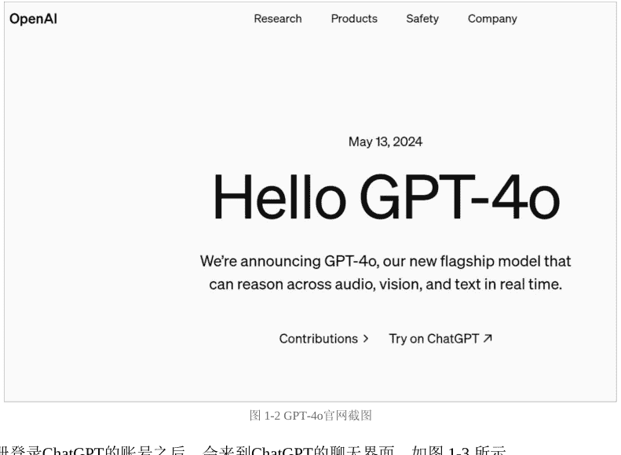

注册登录账号后进入ChatGPT聊天界面，如图1-3所示。


图1-3 ChatGPT聊天界面

聊天界面左右分栏，左侧为功能区。如图1-3所示，左侧上方有两个功能，如图1-4所示。

左侧自上而下依次为功能选项、探索GPT与历史记录区。功能选项中左侧小图标可开关左侧边栏，点击可隐藏功能区，仅保留右侧对话区。右上角小图标为“新建聊天”，结束当前对话或开启新窗口时使用。探索GPT即GPT的自由定制版，可量身打造专属AI工具，也可打开GPTs使用他人共享的工具，如图1-5所示。点击下方历史记录区，登录账号后所有对话均会显示，点击相应记录即可回顾。

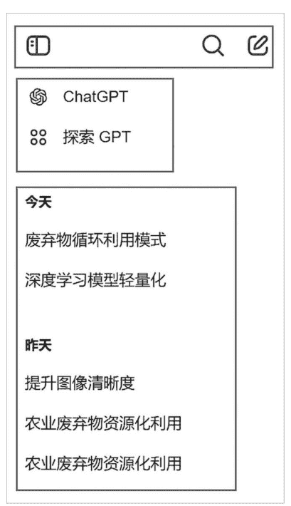

图1-4 ChatGPT聊天界面中的功能区

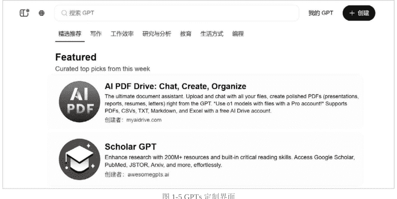

图1-5 GPTs 定制界面

右侧区域可直接向ChatGPT发送消息，如图1-6所示。例如询问“什么是AI助教”，可查看其回答。

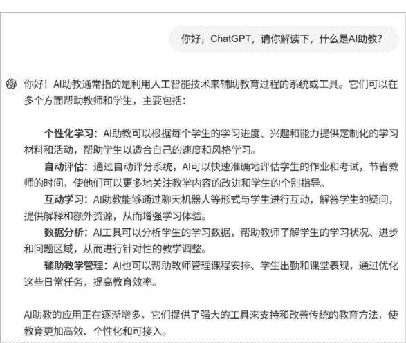

### 1.3.2 微软的“COPILOT”

COPILOT又称New Bing或Bing AI，是微软推出的改进版搜索引擎，整合OpenAI GPT-4技术，具备更高效的自然语言理解与生成能力。与传统搜索引擎不同，它不仅呈现搜索结果，还能处理复杂提问并给出详实精准解答。不同于ChatGPT，COPILOT拥有实时网络搜索功能，因而广受欢迎。

使用COPILOT可通过搜索引擎页面的“聊天”入口访问。打开Microsoft Edge浏览器，输入网址bing.com，点击右上角“使用个人用户登录”按钮，如图1-7所示。


输入电子邮件与密码即可登录New Bing，如图1-8所示。


图1-8 COPILOT的登录界面

登录后进入聊天界面，如图1-9所示。


图1-9 COPILOT的聊天界面

同样以“AI助教”为问题让其作答，如图1-10所示。

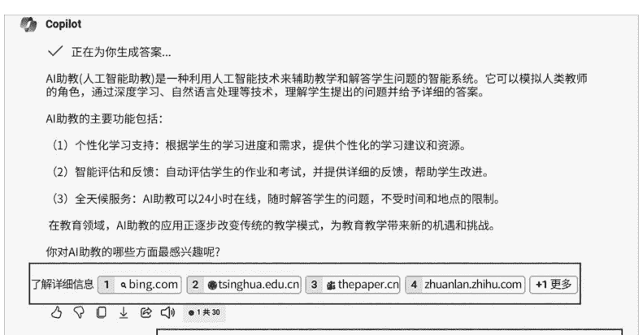

在COPILOT聊天界面，可点击上方方框中的网址跳转到相关网页浏览内容。回答完毕后，系统还会联想新的问题模板，如图1-10下方方框所示，COPILOT提供了“AI助教的优点有哪些？“如何开发一个AI助教系统？”“你认为未来的课堂会是什么样子？”等追问，点击即可生成深入答案，如图1-11所示。

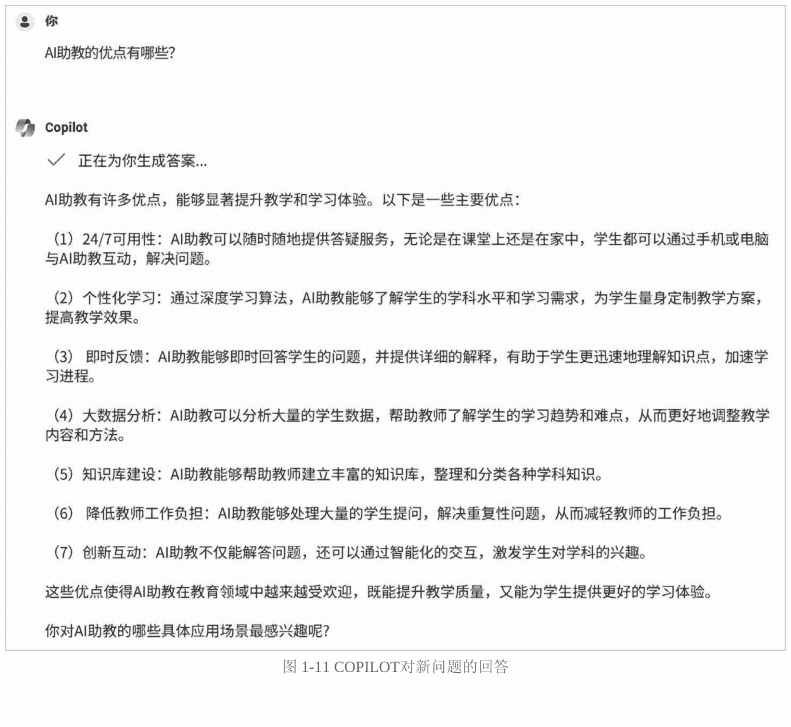

## 1.3.3 百度的“文心大模型”

文心一言可通过 https://wenxin.baidu.com/ 访问，是百度推出的语言大模型。它采用对话式聊天场景，如图1-12所示。文心一言主打有用、有趣、有温度，既能写文案、读文档，也能头脑风暴、答疑解惑，还能聆听故事、感受新声。可与人对话、作答、协助创作，高效帮助获取知识、信息与灵感。


将鼠标移至“产品中心”会弹出下拉菜单，分别为“文心一言”与“文心一格”。其中“文心一言”为聊天对话工具，“文心一格”为生图工具。

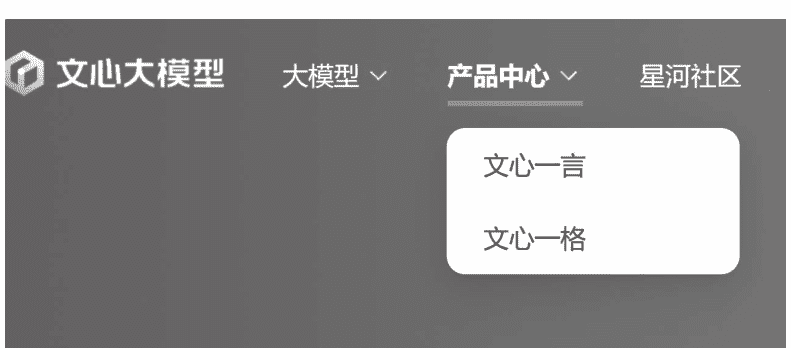

### 1.3.3.1 文心一言

点击“文心一言”进入操作界面，如图1-14所示。


图1-14 文心一言的操作界面

先从最具代表性的文心一言聊起。进入官网后，最显眼的入口位于浏览器右上侧。点开后呈现如图 1-15 的登录页，既支持借助百度手机客户端扫码在移动端完成确认，也支持直接填写用户名和密码进入。


登录后即可在对话区与模型进行交互，以“人工智能助教”为主题做演示，对话截图见图 1-16。下面是模型给出的回答：

你好，文心一言，请你解读下，什么是AI助教？

AI助教是依托人工智能搭建的智能教学伙伴，可在教学流程中提供多方面支持，具体拆解如下：

#### 1) 概念与能力边界
- 概念：基于深度学习、自然语言处理等前沿手段构建的智能化教学助手。
- 能力边界：不局限于批改作业、解答学员疑问、产出教学报告，还能借助自然语言处理与机器学习与师生成员互动，为授课者提供辅助，为学习者提供帮助。

#### 2) 核心价值
- 效率提升：能自动处理作业批改、课程排期等重复性事务，减轻授课者负担，让教师把精力集中在教学质量改善上。
- 定制化陪伴：依据学员的个性化需求推送专属学习建议与资源，助力理解和吸收知识。
- 数据洞察与反馈：收集并分析学习数据，形成学员的学习状况分析报告，支持教师及时调整教学策略。

图 1-16 文心一言对AI助教的说明

一次对话结束后，页面下方会延伸出可继续追问的问题，如图 1-17 所示，例如：

- AI助教在哪些国家或地区得到应用
- 还有哪些其他的AI技术
- 请帮我制定一份一个月的减重计划

图 1-17 文心一言后续提问示例

### 文心一格

转向绘画方向，文心一格官网地址为 https://yige.baidu.com/，可沿用文心一言账号登录。如图 1-18，选取页面右上角的登录入口即可进入。


登录后顶部工具栏可切换不同创作模式。文心一格是百度推出的以文本生成图像的智能绘画产品，根据输入的文字描述生成艺术类作品。

进入“AI创作”，如图 1-19，在推荐页填写提示词，再按下下方的立即生成即可得到对应画面，如图 1-20 所示。


图 1-20 文心一格生成的作品

### 文小言

百度近期对文心一言 App 进行了升级，更名为文小言，并重新定位为“新搜索”智能助手。此次更新增加了富媒体搜索、多模态输入、图文内容协同创作、高拟真数字角色等能力，同时加入记忆能力与用户可自定义的订阅选项。最新界面可在应用商店查看，如图 1-21 所示。

应用内可随时使用文小言 App 进行对话聊天、拍照问答、图像创作等操作。


## 阿里的通义系列

### 通义千问

阿里云于 2023 年 9 月 13 日发布通义千问，网址为 https://tongyi.aliyun.com/qianwen/。它是一款整合型智能助手，旨在提升工作效率、学习成效与生活质量。模型擅长多轮复杂对话，在文案撰写与逻辑分析方面表现突出，续写小说、起草邮件、多语言交流均可胜任，并具备多模态理解能力，能处理图文混合信息。主界面如图 1-22 所示。


图 1-22 通义千问主页面

进入后选取左下角方框中的立即登录入口，可用手机号加验证码登录，也可使用淘宝账号登录。登录页效果如图 1-23 所示。


图 1-23 通义千问登录页面

同样以“AI助教”提问，查看其回答，如图 1-24 所示。

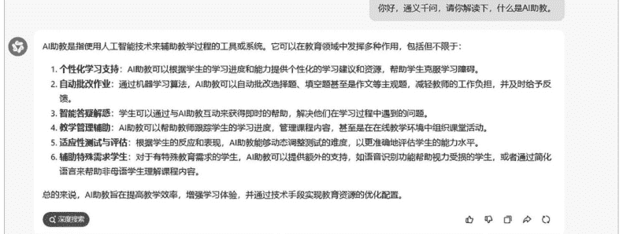

图 1-24 通义千问对AI助教的解释

与其它模型不同，通义千问下方设有“深度搜索”按钮，按下后会联网检索相关资料，对问题进行更深入的解读，结果如图 1-25 所示。

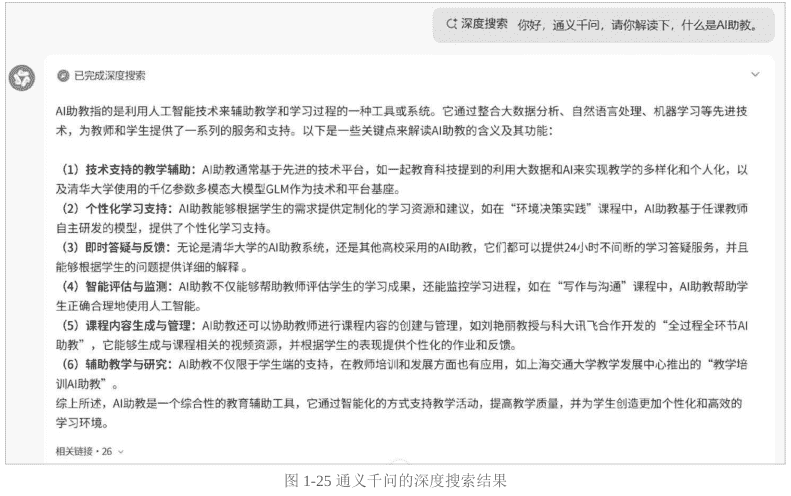

图 1-25 通义千问深度搜索结果

### 通义万相

通义万相官网为 https://tongyi.aliyun.com/wanxiang/，打开即可看到主页面，如图 1-26 所示。


图 1-26 通义万相主页面

选取左下角的立即登录入口，如图 1-27 所示，输入手机号和验证码即可进入。


登录后左侧工具栏可选取文字作画、视频生成及应用等，如图 1-28 所示，选取文字作画即可用提示词生成图像。

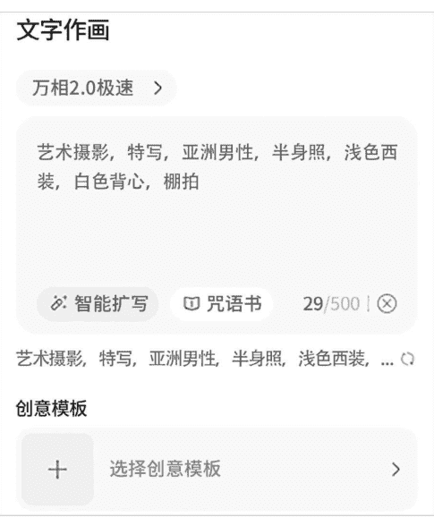

还可继续挑选创意模板，如图 1-29 所示，可先选风格或形象，生图时会匹配对应风格。


图 1-29 通义万相生图页面（2）

例如选取厚涂原画风格，确定生成比例，按下下方的生成画作入口，即可得到如图 1-30 的结果。


图 1-30 通义万相生图作品

整体画面基本保持了厚涂原画的特征，若不满意可点再次生成。

通义万相还提供视频生成功能，选取主页工具栏的视频生成会跳转至视频生成页，如图 1-31 所示。视频生成分为文生视频和图生视频两种模式。

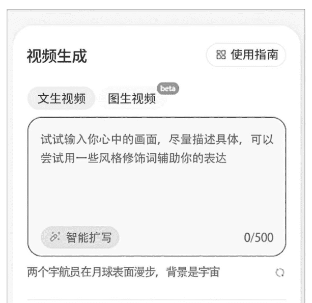

选取文生视频，输入提示词：两个宇航员在月球表面漫步，背景是宇宙。选定比例后生成，输出视频如图 1-32 所示。


选取图生视频，如图 1-33 所示，先上传参考图，再在下方填写提示词。


按下生成视频后得到的结果如图 1-34 所示。


## 科大讯飞的讯飞星火

讯飞星火认知大模型由科大讯飞发布，具备文本生成、语言理解、知识问答、逻辑推理、数学能力、代码能力、多模交互 7 大核心能力。界面如图 1-35 所示。


选取右上方登录入口，输入手机号和验证码即可进入，如图 1-36 所示。


登录后的页面如图 1-37 所示，左侧为工具栏。星火对话为常规聊天入口，讯飞智文用于生成 PPT，绘画大师负责生图，讯飞晓医为健康助手等，可按需选取。

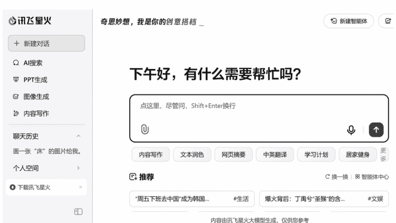

选取讯飞智文，在右侧聊天框输入需求内容即可一键生成 PPT，如图 1-38 所示，发送后即开始处理。


可看到星火会先给出 PPT 大纲，调整好大纲内容后点一键生成 PPT 即可。如图 1-39 所示。


随后会进入 PPT 生成界面，如图 1-40 所示，成品可直接点右上方导出保存。

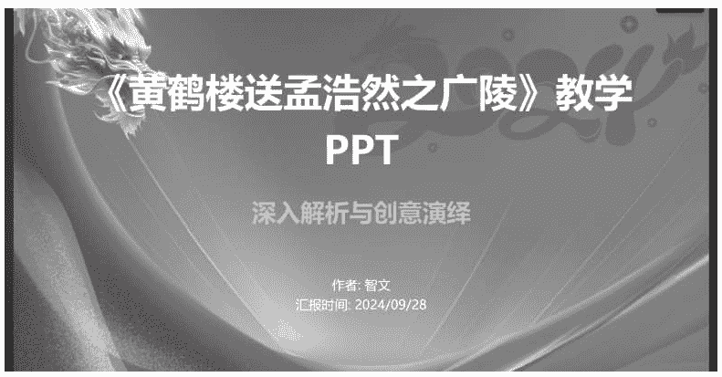

目前大模型百花齐放，各有侧重。OpenAI 的 ChatGPT 以对话流畅和知识理解见长；微软 New Bing 兼顾搜索与深度对话；百度文心一言在中文处理上优势明显，应用场景广泛；阿里通义千问偏向专业知识服务与解决方案；讯飞星火则聚焦知识问答、内容创作、翻译和 PPT 生成等。这些模型在学术、商业与日常生活中均发挥了重要作用，也在优化人与人交流方式，让技术与生活更紧密。

> [1] 为了还原 AI 的答案，本书对 AI 输出尽量保持原样，因此可能存在少量语法或文字瑕疵，请理解。

# AI 能为老师和学生做什么

智能模型的快速发展正悄然重塑生活，教育同样在被深刻影响。那么智能体究竟能为师生成什么助力？

## 教育界的新宠

对学习者而言，智能体带来了真正意义上的个性化学习体验。依托大数据分析和机器学习，系统能为每个孩子定制资源包，匹配学习节奏和兴趣，大幅激发学习兴趣并提升成效。对教师来说，智能体是得力的助手，能自动处理批改作业、记录成绩、监测表现等琐碎管理，让教师从重复劳动中抽身，更多投入教学创新和学生关怀。

智能体的应用让教育资源的可获取性大幅提升，打破了时空限制。即使在偏远地区，学生也能触达世界一流资源。更振奋的是，智能体为教师专业成长提供了新路径，通过虚拟现实等技术进行教学模拟和技能训练。智能体的预测分析还让教学更科学精准，教师可以提前预判学习成效和风险，及时调整策略，确保每位学生获得最佳体验。可以说智能体正在引领一场前所未有的教育变革。

### 个性化学习工具的发展

每个学生仿佛都配了一位私人导师，实时掌握学习进度、兴趣点和薄弱环节，并据此定制学习计划。这已从科幻走向现实。

智能体凭借强大的数据分析能力，能深度挖掘学习行为和习惯。卡在哪类知识点、哪类题目易错，系统都能精准捕捉。基于这些数据，智能体为学生规划专属学习路径，推送最匹配的教育资源，实现真正的个性化精准教学。

传统课堂里教师难以面面俱到。借助智能体，学生能获得高度定制化的体验。数学函数薄弱，系统会自动推荐相关教学视频、练习题和互动课程；进度快的学生则会获得更具挑战的内容，避免无聊。智能体还能实时监测学习状态，即时给出解释或提示，避免问题累积。学习过程因此更高效，效果显著提升。

对家长和教师而言，智能体同样是强力助手。家长可通过 App 查看孩子进展和数据报告，及时发现问题；教师能利用智能体分析结果更有针对性地调整策略，做到真正的因材施教。

市场上个性化学习工具正成为潮流，各大教育科技公司纷纷推出基于智能体的学习平台，满足个性化教育需求。这不仅惠及学生和家长，也为行业注入新活力。

### 资源可获取性的提升

传统教育中，获取知识的机会常受限于地理位置和学校资源，偏远地区教育不均衡问题突出。智能体正在改变这一现状，大幅提高教育资源的可获取性，在线课程和虚拟实验室等数字工具正在打破壁垒。

智能体让优质教育内容可数字化，通过互联网传向全球每个角落。无论城市还是山区，只要有网络就能获得同等资源。智能体在线课程设计中能根据学习进度和风格动态调整内容，并在需要时提供额外支持。

虚拟实验室是另一项革新性工具，让学生在模拟环境中做科学实验。对实验设备匮乏的学校尤为重要。学生可在安全可控的环境中探索科学，降低风险并扩展实验范围和深度。

智能体还包括智能推荐系统，能分析学习习惯和偏好，推荐最适合的课程和材料，大幅提升学习效率和兴趣，帮助学生在信息海洋中快速定位价值内容。

智能体正在改善教育资源分配不均，特别是在资源匮乏地区，让每个学生都有机会接受优质教育。这既是技术进步，也是教育公平的重大提升。

### 教师专业发展

智能体不仅改变学生学习方式，也在影响教师的专业成长，为其提供全新培训和提升路径。

借助虚拟现实，教师可在高度仿真的教学环境中演练，模拟课堂突发状况、不同学习风格的学生或新教学方法，无需承受真实课堂压力即可积累宝贵经验。

智能体还能提供个性化的专业发展方案。通过分析教学风格、学生反馈和课堂数据，为每位教师定制培训计划。若某位教师课堂管理有困难，系统会推荐相关课程、研讨会或资源。

智能设备可记录教学过程，捕捉讲解、学生反应和互动。课后智能体生成的报告能帮助教师了解优势与不足，基于数据的反馈更客观详细，有助于针对性改进。

教师还能通过平台与全球同行交流经验、讨论策略。智能体会根据兴趣和需求推荐讨论话题、研究成果和案例，促进知识共享和共同成长。

### 预测分析的应用

预测分析是智能体在教育中的重要用途。通过收集和分析学习数据，智能体可预测学习效果和学业风险，为教师提供有力支持。

教师难以时刻关注每个学生。智能体可实时监测学习进度、作业完成、考试成绩等数据，发现学生在某科目或知识点上的潜在困难。若某学生数学成绩下滑、作业完成率下降，系统会汇总信息提醒教师及时干预，教师可提供针对性辅导。

智能体还能预测班级整体学习趋势，帮助调整教学策略。若多数学生对某章节理解困难，教师可增加讲解时间或尝试不同方法，提升整体理解度。

同时，智能体能依据学习习惯和表现给出个性化建议。对积极进步的学生推荐更具挑战的内容，激发潜能；对需要帮助的学生提供额外练习和指导，帮助其跟上进度。

## 教学与学习的大革命

随着智能技术深入应用，从课堂角落到远程教育网络，到处都涌现创新。现代教育技术不仅增强了互动性和适应性，也带来前所未有的个性化体验。学习环境更智能、更有洞察力，教育者和学习者之间的联系更紧密。这场革命正开启知识探索和智慧发展的新篇章。

### 自适应学习系统

自适应学习系统已经悄然进入教室。它利用前沿技术，根据每位学生的实际学习情况动态调整内容和难度，让学习始终保持在最佳节奏。

举个例子：小明在学数学分数加减，系统通过分析解题速度和准确率，发现他在分母不同时进行通分的步骤上吃力。于是系统自动增加通分练习，减少已掌握的加减法基础题。这样的调整让小明能聚焦难点，同时避免无聊或沮丧。

在当下的教育场景里，AI已经不再是可望不可及的概念，而是真正落到课堂学习方式上的改变力量。

自适应学习系统的核心逻辑，是实时反馈叠加个性化路径。系统会持续抓取学生在学习平台上的操作足迹：某个知识点停留了多久、哪道题反复失误、哪块内容几乎一遍就懂。基于这些信号，平台会动态调参，让难度始终卡在“跳一跳能够到”的区间，既不会让学生挫败，也不会让他们无聊。

难度之外，资源也会被个性化推送。比如碰到几何证明思路卡壳的学生，系统就会匹配视频讲解、图形拆解或动画演示，把抽象的逻辑变得可视可感。学习因此从单向灌输转向双向探索。

系统的智慧不仅体现在内容调节，更体现在策略进化。背后是复杂的算法和机器学习在支撑，从海量交互中提炼规律、不断自我迭代。教师端也能从数据洞察里看到班级整体的推进节奏和每个人的薄弱点，课堂管理与个别辅导变得更有依据。

对学习者而言，这种模式直接带来效率和体验的双提升。即时反馈像一位贴身学伴，随时补位；在家自学也能获得“有人陪”的安心感。更关键的是，它在潜移默化中培养自主学习力，让学生学会规划进度、独立攻关。

### 协作式学习平台

把AI嵌进协作场景，学习平台正从内容供给走向关系重塑。设计目的很清晰：打破个人闭环，促进交流合作，用智能化手段托起团队项目和讨论。

典型的工作样貌是这样的：学生进入不同的虚拟房间组队，里面集成了即时聊天、资料共享、协同文档、视频会议等工具，师生既可在教师带领下合作，也能自主攻关。

AI在其中扮演三个角色。首先是队友匹配。依据学习轨迹、技能标签和行为偏好，系统会推荐互补性强的组合，保证每个小组都有多元视角和分工潜力。其次是协作态势监测。谁在主导、谁陷入沉默、谁需要额外支持，系统都能给出信号，帮助教师精准介入，也促使学生自我审视协作习惯。

在讨论环节，AI像是信息管家。围绕复杂议题时，它能实时补给背景资料、点出关键争议点；分析对话语义后推送相关案例或练习题，甚至抛出金句式提问把讨论推向更深。基于内容分析，AI还能评估协作质量，给出改进建议。比如设计类项目中若核心原则未被触及，系统会及时提醒并提供补充素材。

更长远看，这种平台模拟了真实职场协作环境。学生不仅学知识，更练与不同背景的人共事、发挥自身优势、协同解决问题的能力，这是任何职业都需要的软实力。

### 增强现实与虚拟现实的应用

AR与VR正在把沉浸式学习从噱头变为教学工具，把看不见的概念转化为可感知的体验。

增强现实的工作原理是在现实视野上叠加数字层。生物课上，学生用平板或AR眼镜就能在课桌上“长”出一个可旋转的细胞模型，亲眼看细胞器如何运动、交互，理解远比课本插图深刻。实验教学中，AR提供低成本高安全的替代方案。化学混合、反应观察都在虚拟空间完成，彻底规避了真实试剂的安全风险和成本压力，容错率也大幅提升。

虚拟现实则构建完全独立的数字世界。戴上头显，学生可以穿越到古埃及工地，近距离观察金字塔的建造工序；也可以站在罗马斗兽场中央，感受历史现场的张力。历史课于是从背诵日期变成一场探险。

借助历史学家与考古学家的数字化成果，VR还能复原已毁损或消失的遗址。学生在虚拟空间里漫步古城，看到它们曾经的真实模样，这种体验是传统教具无法复制的。

落地层面，AR/VR需要头显、应用、软件硬件的配合，前期投入不低，但随着技术普及成本在下降。教育机构已经看到长期价值：参与度提升、学习效果增强、创造力和想象力被点燃。

### 智能评估系统

智能评估早已进入校园，它用AI提供更细致的学习成效画像，重塑评价方式。

系统评估的不是对错结果，而是理解深度。它会追踪解题路径，比如数学题里学生是否依赖记忆公式，还是真正把握原理。这种过程性分析让教师看到学生真实的思维状态，而非一张分数。

机器学习的积累让系统具备预测能力。长期行为数据被用来识别学习模式和理解障碍，提前预警可能卡壳的领域并推送定制辅导和增补材料，实现了预防性干预。

反馈也从期末一次性变为全程实时。历史某个单元薄弱，系统立刻推送视频讲座、阅读、互动练习，帮助学生即时补位。这种即时性对学习动机和自我调节至关重要。

客观性是另一大优势。AI评分减少人为偏见，让每个学生的努力被公正对待，提升透明度与公信力。

部署上通常嵌在学习管理系统里，电脑或手机即可访问，界面友好。应用范围也超出学业成绩，在技能培训和职业教育中，AI可通过模拟工作场景和虚拟实验评估实践操作能力，为职业发展提供参考。

# Part 2 老师必备篇：用AI打造高效课堂

下面进入教师视角：从备课到课堂到课后反馈，人工智能如何重塑教学全流程。备课的繁琐、课堂的活跃、课后的整理，AI技术（注：本书中所使用的AI大模型为百度的“文心一言”，我们尽可能保留AI所生成的全部内容，不作任何修改，AI所生成的内容难免会有部分错误出现，请在使用时核实重要信息。）提供了支持与便利。无论是精准设定教学目标、提前预判难点、快速获取资源、生成教案，AI都能大幅简化流程。课堂因而更生动，反馈更即时，个性化学习方案更易落地，教师负担显著减轻。

## 3 AI让老师备课不发愁

备课一直是教师最耗时的环节之一，如今AI正改变这一现状。通过智能技术，教师可以更轻松地规划课程、搜集资源、优化内容，让准备过程变得高效愉悦，教学更具针对性。

### 3.1 教学目标精准设定

在新课标导向下，教学目标的重要性被进一步凸显。学生为中心、全面发展的导向，要求目标设定必须从三个维度入手：学生需求、知识技能、评价方式。

#### 3.1.1 分析学生需求

目标设定的起点是对学生需求的全面把握，包括学习需求、兴趣倾向、能力水平与背景经历，AI可以在内容分析上提供帮助。

##### 3.1.1.1 背景调查

背景调查指收集年龄、学段、文化家庭背景等基础信息，以把握学习起点和可能遇到的挑战，为教学设计提供依据。

以三名学生为例，人工归纳难度较高：
张伟来自双职工家庭，父母经常加班，由祖父母照看，兴趣在于科学实验和篮球，作业完成情况一般。
李芳成长于艺术氛围浓厚的家庭，母亲是画家父亲是音乐家，对艺术高度热爱，成绩优异，体育相对弱。
王雷父亲常年出差，母亲在医院工作，独处时间多，爱阅读玩游戏，社交待提升，数理成绩突出，语文中等。

借助AI进行归类总结会更清晰：
家庭构成与监护：张伟由祖父母照看；李芳父母均为艺术工作者；王雷母亲本地医院工作，父亲常出差，独处比例高。
学业与兴趣：张伟偏爱科学实验与篮球，作业完成度需加强；李芳艺术兴趣强，成绩好，体育薄弱；王雷数学科学优秀，语文偏弱，喜欢阅读与电子游戏。
社交自理：张伟可能缺乏自组织支持；李芳可能在团队体育与协作中参与度有限；王雷独处时间长，社交技能待发展。
教育需求：张伟需要结构化监督；李芳需要跨领域拓展尤其是体育；王雷需要语言与社交的额外支持。

有了这样的画像，个性化目标的制定就有了依据。

##### 3.1.1.2 学习能力评估

标准化测试是检验综合能力的常规手段，命题耗时耗力，AI可参与生成。

例如高二语文班主任提出需求：为班级做一次综合能力评估，请从能力角度设计一份试卷。

AI给出的方案框架为《高二语文能力评估试卷》，建议时长120分钟。第一部分选择题30分，涵盖字音字形、名句出处、病句辨析等基础。第二部分阅读理解40分，现代文阅读20分与古文阅读20分并列。第三部分作文30分，材料作文不少于800字。第四部分应用文写作20分，如以学生会主席身份写信邀请艺术家来校。第五部分文言文翻译20分，兼顾释词。

整套试卷旨在考察基础、阅读、写作、文言掌握，教师可根据班级实际调整难度与内容。需要局部替换或重写时，可随时让AI局部再生，极大提高命题效率。

结合前述三名学生的需求，学习风格的定制建议如下：
张伟属视觉型，建议用图表、时间线、视觉提示组织材料，提供清晰步骤与期望，利用视频多媒体强化理解。
李芳兼具视觉与动手偏好，建议鼓励参与课外艺术体育活动，采用角色扮演与模拟活动，设计跨学科项目如艺术与科学融合。
王雷兼具视觉与听觉偏好，建议提供丰富的读物与视听材料，加强小组讨论与合作学习，通过故事讲述提升语言表达。

通过与AI的对话，教师对学生基本情况的把握更清晰，个性化教学方案的落地也更顺畅。

#### 3.1.2 明确知识、能力和评估方法

教学目标本质是知识、能力、评价三者的结合。

##### 3.1.2.1 知识目标

知识目标是课程结束时学生应掌握的核心内容，表述要像购物清单一样具体。生物课的例子是掌握细胞的结构与功能，要求学生能说清细胞膜、细胞核、线粒体等结构及其作用。

AI可进一步展开讲解：细胞膜由脂质双层构成，控制物质进出并传递信号；细胞核是遗传信息中心，DNA经转录翻译指导蛋白质合成；线粒体是能量工厂，通过氧化磷酸化产生ATP；内质网、高尔基体、溶酶体、细胞骨架等各司其职，共同维系生命活动。

##### 3.1.2.2 能力目标

能力目标关乎思维方式的培养，如如何用知识解决问题、有效表达、协同合作。以小学科学可持续能源为例，目标可设定为分析不同能源技术在不同环境下的成本效益与适用性。

AI可据此设计项目实践“小小能源专家”：目标为提升对可持续能源的理解、培养成本效益分析能力、锻炼研究与表达技能。活动以小组研究、数据收集、方案展示为主，通过实践让学生在真实情境中迁移知识。

用AI把备课从苦力活变成创意活，这已经不是远方的设想，而是大量课堂正在发生的实操。先看一个典型的项目式学习是怎么被拆解成可落地的步骤的。

以可持续能源为主题的探究课为例，可以从认知启动开始。先用课堂微讲把太阳能、风能、水能、生物质能等常见形式讲清楚，再配合短片让学生直观看到技术在真实场景里的运行样貌。进入探究阶段后，把全班拆成若干小组，每组认领一种能源形式，并在组内明确信息收集、资料整理、报告撰写等分工角色。

研究环节要强调情境适配与性价比。对照书本资料，小组要梳理所选能源在不同地理、气候条件下的适用边界和投入产出。条件允许的话安排一次校外探访，实地看一看光伏电站或风电场，或者直接请工程师进校交流。回到课堂，各组用模型或展板把工作原理、成本效益、适用场景可视化，再准备一段口头陈述。

成果展示日让学生互相质询、教师点评，评价维度涵盖展示质量、研究深度与协作表现。活动收尾不忘复盘，学生写下收获与改进点，表现突出的团队给予表彰。整套流程下来，知识不再停留在背诵，动手与合作让理解更扎实，解决真实问题的能力也在此过程中被锻炼出来。

当我们要检验学习成效时，一套立体的评价体系就显得关键了。以初二30人班级为例，可以这样组合：作业每周安排两次，跨学科轮换，统一用百分制看准确度、思路清晰度与创造性，格式规范与按时提交也计入，批改在下一课前完成并给出书面点评。考试部分设期中、期末大考和单元小测，客观题占四成，主观题占六成，成绩进入个人档案并用于家校沟通趋势分析。课堂表现用电子记录表追踪出勤、发言频次与活动参与度，按月打出十分制，低于六分启动单独沟通与家长联系。小组讨论每两周一次，议题可以是课内内容也可以接轨时事，按参与度、贡献质量与协作态度评分，讨论结束由组内互评。

教学中每个单元都有它的核心与卡点。核心是学科里起支架作用的基础点，是后续概念展开的根基；难点则是学生理解容易受阻的地方，往往是抽象概念、易混知识点或新旧知识的衔接口。有时核心与难点重合，有些内容正好是教学的抓手，它的掌握直接决定一类问题的成败。

拿范仲淹的《岳阳楼记》来说，老师们普遍把积累关键文言词语作为教学重点，而如何领悟“心忧天下”的精神则成为难点。借助AI对话就能快速拿到词例清单并做深挖。比如“谪”指官员被贬谪流放，“属”在此是托付之意，“予”是古文中“我”的自称，“冥冥”写天色晦暗模糊，“樯”是船桅，“楫”是船桨，“薄”表示接近常作“薄暮”用，“岸芷汀兰”描绘水边芳草如织的景致，“嗟”为感叹词，“或异二者之为”则表达对普通喜忧之外的超越态度。

在讲解思想内核时，可以先交代范仲淹的政治与人生背景，点明其仁政勤政的处世主张。再把“心忧天下”拆解为一种主动承担国家与民众福祉的责任感，而非消极悲观。结合“不以物喜，不以己悲；居庙堂之高则忧其民，处江湖之远则忧其君”两句，说明无论高位或远离权力中心，都以公义为先。进一步联结儒家仁政传统，借孔子孟子等思想作参照。最后拉回到当下，讨论学生在日常学习、社团与社区里如何践行关怀与担当，并通过小组辩论让学生设想作为未来领袖会怎样体现这种情怀。

“心忧天下”的现实价值在今天依然鲜活。全球化语境下，气候变化、贫困、公共卫生等议题需要超越个体利益的视野。培养跨文化敏感性与包容性，让人更愿意理解他者处境，这正是该思想的当代延伸。把关怀公共福祉的伦理带进企业决策与公共政策，有助于形成可持续的行为标准。教育上，通过案例研讨与社会议题探究，学生能锻炼复杂问题分析与批判性思维。于个人而言，这是一种成熟的生命观，帮助认识到个人选择对社会的涟漪效应，塑造更具同理心与责任感的公民。

教学资源获取的门槛也在被AI拉低。以“居庙堂之高则忧其民；处江湖之远则忧其君。”为例，用带联网检索的模型就能快速整理成适合中学生讲解的内容。百度的文心一言自带搜索能力，如图3-1所示。

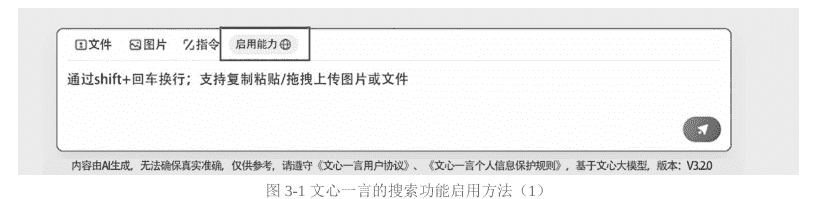

点一下聊天框上方的按钮，就会弹出如图3-2所示的窗口。


只要“联网搜索”显示已启用，就能直接调用外部资料。整理后的要点可以这样呈现：庙堂指朝廷高位，忧其民是关注百姓疾苦；江湖既指地理上的偏远，也可喻社会边缘，忧其君是关怀国家安危与政治走向。深层含义在于无论身在何处都把国家与人民置于个人得失之上，体现超越性的政治情怀。课堂上可以让学生设想在不同位置会怎样行事，寻找当代社会活动家或领导者的实例，写作练习“如果我是一名领导者”来迁移理解。

教学设计的生成也变得高效。教学设计是备课的内核，需要对目标、任务、流程做清晰规划，同时保留弹性以应对课堂生成。设计性发展强调结构化的引导，生成性发展则接住学生意外的认知跳跃，两者相辅相成。

请AI从中学语文老师视角为《岳阳楼记》撰写方案时，会给出清晰框架：知识技能上读懂原文并掌握常用文言词句；过程方法上通过文本细读识别主题与写作技巧；情感态度上体悟忧乐观与责任意识。内容上先析文章起承转合，再探讨从写景入议论引出“先天下之忧而忧，后天下之乐而乐”的思路，最后夯实文言词汇。方法上以图片与背景导入激发兴趣，用小组讨论碰撞观点，教师引导分析比喻排比等修辞。媒体上用PPT呈现楼的历史地理，配合影像资料。评估上结合课堂提问、小组分享的形成性评价与一篇主题小论文的总结性评价，课后教师根据反馈微调策略，学生通过问卷表达体验。

同理，输入“万有引力定律”，AI也能迅速搭建出教学骨架。知识目标是要理解定律内涵、掌握数学表达、认识其在天体运动中的应用。能力目标是要能用定律解题，通过推导训练逻辑与数学推理，并联系生活场景培养科学思维。情感目标是激发对自然规律的兴趣与探索欲。

从可持续能源项目到评价体系、重难点分析再到资源检索与一键生成教学框架，可以看到AI并不是替代教师，而是把重复性准备压缩，让老师把精力集中在课堂互动与价值引导上，这正是教学从预设走向生长的关键。

AI已经悄悄走进备课室，从写教案到做课件再到抓住学生的注意力，老师们的工作方式正在被重塑。下面这几个真实场景，基本概括了现在课堂里最常见的AI用法。

先说物理课的万有引力。以“点燃好奇，训练批判”为主线，开课先从身边现象切入：自由落体为什么往下掉，行星怎么能在太阳周围转。随即抛两个直观提问：月亮为何不坠向地球？行星围绕太阳的动力来自哪里？由此自然带出牛顿的引力思想。

新授部分要把定律讲清：宇宙中任意两物都会互相吸引，吸引力随两物质量增大而增强，随两者间距增大而以平方关系衰减，并给出数学表述。教学手段上并不是单向灌输，而是讲授结合引例说明物理意义，启发式设问引导归纳讨论，安排小组聊聊万有引力在卫星、航天器等现实中的用途，还会用卡文迪许实验的视频帮助理解G是如何测定的。

一节课的时间感也很重要：用5分钟从生活现象导入，20分钟讲清概念、公式和物理内涵并联系开普勒定律谈天体运动，10分钟做例题练习计算和分析，10分钟聚焦航天天文应用展开讨论，最后5分钟收束核心要点并做个小测验检验掌握情况。课后作业、评价方式和预期成效也一并纳入整体设计。

这里有个细节值得留意：用AI先搭框架时，如果提问比较粗，得到的答案往往比较泛。想要框架更有辨识度，就要把需求写得更具体，框架里空的地方还能接着让AI补足。比如对“知识目标：理解万有引力定律的基本概念”这一条，要求“用初中生能听懂的话解释”。AI就会把学术语言降维：

万有引力是牛顿提出的基础规律，它说宇宙中任何两个东西都会互相拉扯，这个拉扯力常被称为引力或重力。地球拉着我们不让我们飘走，我们也确实在以极其微弱的方式拉着地球，只是太小感觉不到。力的强弱取决于质量和距离：质量越大吸力越强，距离越远吸力越弱，所以地球对我们的牵引远强于月亮。

能把行星绕日、物体落地等现象统一解释，才是这条规律的价值。用“用初中生的理解方式讲解”这类指令，AI会自动简化表述，用通俗的例子和生活感的语言来呈现。

再看美术与语文的跨界应用，PPT制作正是老师们的刚需。很多老师发现，PPT的精髓其实是内容，视觉只是加分项。让AI先给出教学演示文稿的搭建思路会更快：先明确授课目标和听众画像，再设计开场、主体、收尾的结构；内容上用关键词短句、图表可视化、真实案例来支撑；视觉上保持模板统一、字号颜色协调，图片动画点到为止，必要时加入超链接或小视频；最后彩排并收集反馈再优化。

以《岳阳楼记》为例，AI会给出一个九页的教学底稿：封面带书名、作者范仲淹和岳阳楼配图；作者生平与写作背景；全文齐读并配景观画；内容提炼与主旨把握并引用关键句分析；修辞手法与文言文语言特色；主题情感和忧患意识的深度解读；课堂讨论问题与小组分享；课程小结与写作作业；延伸阅读与联系方式。拿到这个骨架后，老师只需逐页填充。

以第四页“内容总结”为例，它本身分两块：一是提炼主旨并说明景观描写如何承载情感，二是挑选名句做简要解读。AI在主旨上会点出“先天下之忧而忧，后天下之乐而乐”的情怀，借重建岳阳楼的场景，通过壮阔自然的描写投射作者的家国关切。景物与心境的对应被拆开来：开篇“高楼临水、远山近江”的宏大对应胸怀天下；“云销雨霁、彩彻区明”的气象转换隐喻国运转机；春夏秋冬不同风物的细写暗含政治清明、社会安宁的期盼；从高处俯瞰洞庭湖的视角象征超越小我、关照大我的志向；“登斯楼也，四望其景，心旷神怡，宠辱偕忘”则体现出超然物外、更重民族兴衰的境界。把这些文字稍作润色就能直接放进课件。

配图也交给AI解决。文心一格这类绘画工具可以快速出教学用的古风插画。打开工具进入推荐-AI创作，在提示词里写“古风、艺术插图”，画面类型选插画，设定比例和数量后点立即生图，右侧就会出现符合需求的作品。

图 3-3 文心一格生图古风艺术插画演示（1）
如果效果不理想，调整提示词或画面类型再跑一次即可。

图 3-4 文心一格生图古风艺术插画演示（2）
生成的图可以直接下载高清版本当作课件背景或点缀，所见即所得，省去翻素材的时间。

最后是课堂管理的难题：学生注意力。英语课就常被拿来示范。AI的思路是双管齐下，一方面用学生喜欢的经典作品提升兴趣，比如把哈利波特、纳尼亚等故事搬进教学，通过文化内涵和语言美感激发思考和讨论；另一方面设计角色扮演、讨论题、写作任务等互动环节，让语言在真实情境里被使用。

实现上，文心一言的App端“文小言”支持语音对话。打开App后点右下角语音输入键，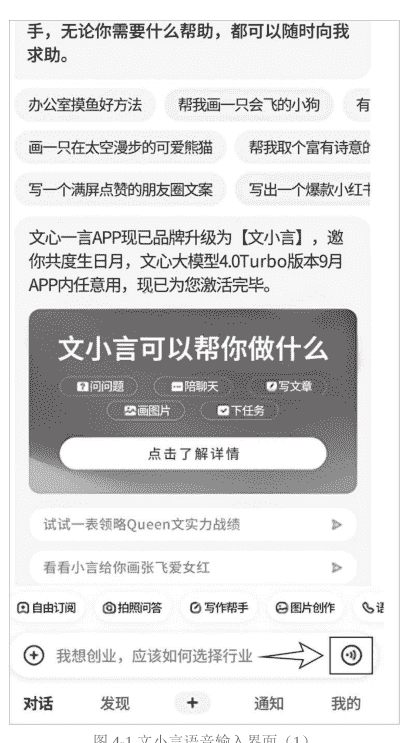

按住说话就能和AI语音交流。

老师可以口述需求，让AI即时生成阅读材料或改写课文内容为有趣的故事。比如下发一段“昨天我打扫房间、写完作业、洗裤子、帮妈妈”等简单内容，让它扩写成英语小故事，课堂上既有语感输入又有情节驱动。

如果需要书单，AI也会迅速整理：J.K.罗琳的《哈利·波特系列》展现友情与勇气；C.S.路易斯的《纳尼亚传奇》用奇幻土地演绎善恶对抗；苏珊·柯林斯的《饥饿游戏》探讨生存与权力；路易莎·梅·奥尔科特的《小妇人》描写姐妹成长与理想；约翰·格林的《寻找阿拉斯加》聚焦青春期的爱与失落；R.J.帕拉西奥的《奇妙的你》Wonder则传递接纳与善良。这些作品既有教育价值又具备吸引力，很适合做课堂阅读的抓手。

总体来看，AI不是替代老师，而是把重复性的框架搭建、语言降维、素材检索和视觉生成交给机器，让老师把精力放在教学判断、情感引导和个性化反馈上。当提问更具体、迭代更耐心时，AI产出的教案、课件和课堂活动就会越来越贴合真实教学需求。

一个关于主动与陪伴的小故事

午休后喝了杯沁凉的柠檬水，大明才恍然想起作业还没开工。书桌刚收拾完，清爽得很，他就坐下来把数学练习做完，又写了一篇以大熊猫为题的小作文。心情舒畅、思路通透，工作量根本不算什么。

收拾书本时，眼角瞥见角落里那条最爱的裤子，公园探险后沾满了泥点。他嘀咕着这得好好洗一洗，拿起来细细搓洗，把顽固的污渍都去掉。洗完晾好，裤子又恢复了原来的模样。

干完这些觉得自己挺能干，大明下楼找妈妈。厨房里正烤着饼干，却乱成一团。他笑着说“妈妈我来帮忙吧”。妈妈明显松了口气，点点头。两人一起称面粉、拌面团、捏饼干。香气渐渐漫出来时，妈妈看着他说：“大明你真是个好孩子，今天谢谢你帮了这么多忙！”

一天收尾时，大明对自己这天的安排感到很自豪。房间整理好了，作业完成了，脏裤子也洗干净了，还陪妈妈一起烤饼干、聊聊天。这确实是难忘的一天，他带着满足和快乐入睡，心里明白再小的善举也可能带来很大的不一样。

这个小叙事想传递的正是主动做事、乐于助人的满足感，如何培养正向习惯、增进亲子连结。

把故事用在课堂上会更有趣。我们可以用“文小言”App让它为学生朗读、讲解，甚至把英文段落转成中文。下面是其中一段最后的中文呈现：

随着白天落幕，大明对自己完成的大小事情充满骄傲。他不仅收拾了房间、做完了作业，还洗干净了裤子，更陪着妈妈一起度过了愉快的时光，帮助了她。这真是一段特别的日子，大明带着幸福与踏实的心情上床，明白微小的行动也能产生巨大的影响。

4.1.2 让经典作品变成可玩的课堂

要把阅读的理解力、表达力与创造力真正激活，教师可以围绕经典文本设计讨论、扮演与写作的组合活动。让学生进入角色去演一段情节，比单纯讲解更快进入人物的情绪世界。利用AI来统筹活动形式、撰写剧本，也能让互动更流畅、兴趣更高。

以约翰·格林的《寻找阿拉斯加》为例，一个可落地的教学方案可以是这样。

先做文本铺垫。课前简要介绍小说梗概、核心人物与时代背景，帮助学生建立阅读坐标。

讨论环节，目标是深化主题思考。可以抛出“阿拉斯加的自我探索之旅给你什么启发？”、“阿拉斯加对迈尔斯和科隆纳分别产生了怎样的影响？”、“小说的主要冲突如何推动情节发展？”等议题。

角色扮演环节，目标是体感人物的心理。挑选一个关键场景，例如迈尔斯初次见到阿拉斯加的那一刻。学生分小组，每组分配不同角色上场演绎，其他同学观摩并记录表演细节。演完后进行反思，聊聊演员的选择、语气、肢体如何改变了对场景的理解。

写作环节，目标是训练分析与创作。命题可以是“友情在迈尔斯生活中的意义”或“阿拉斯加眼中的自由”。学生可以选择写一篇分析短文，也可以用第一人称从角色视角叙事。完成后在班里分享、点评，交流观点的差异与语言的亮点。

最后做反馈与总结。收集学生对活动的感受，归纳从文本中获得的新认识，并点出可以改进的地方，巩固对主题的理解。

如果要把角色扮演做得更扎实，可以按以下步骤细化。

分组与选角：每组4到5人，确保迈尔斯和阿拉斯加这两个核心角色都有人担当，鼓励学生尝试不同的人物以获得更全面的认知。

彩排与指导：给予充足排练时间，教师在旁点拨，帮助学生把握角色动机与情绪。先讨论每个角色在该场景中的目的与内心状态，让表演更可信。

演出与观摩：各组依次上台，其他学生担任观众，记录台词、动作如何传递人物特质。演出结束后观众给出肯定性反馈和建设性建议，聚焦表演者如何捕捉心理细节。

反思与延伸：围绕表演展开复盘，讨论不同演绎如何改变对场景的解读。进一步探讨人物关系如何影响选择与决策，以及这一场景对整体故事走向的暗示作用。

在AI辅助下，学生既能更深入文本，也能在真实使用英语的过程中强化语言结构与表达。接受这种模式后，教师可以把更多文学名作带进课堂，一旦兴趣被点燃，主动学习的劲头自然会释放出来，成绩的提升也就水到渠成。

4.2 用“经典名场面”点燃学习兴趣

在当下的网络语境里，经典影视片段正因为“梗”文化而重获新生。截图、短视频、模仿段子层出不穷，用一种更轻松幽默的方式进入年轻人视野。对英语兴趣不高的学生，这些有共鸣的片段往往成为接触地道表达的入口。依托流行元素把经典与教学结合，趣味性和效果都能明显提升。

以美剧《老友记》为例，先由AI梳理出若干极具代表性的台词并配上中文：

“I won't let her go without a fight!” 我不会轻易放过这场争辩！
“It could happen to anyone. It happens to anybody. That happens.” 这种事谁都可能遇到，就是会发生。
“I'm a laundry virgin.” 我从来没自己洗过衣服，注意virgin的活学活用。
“I hear you.” 我懂你的意思。
“Nothing to see here!” 没什么好看的！
“Hello? Were we at the same table?” 有没有搞错？
“You are so sweet/That's so sweet.” 你真好。
“I think it works for me.” 我觉得这对我来说可行。
“Rachel, you are out of my league” 你跟我不是一个段位。
“You are so cute.” 你真可爱。
“My way or the highway.” 听我的，否则就走人。
“I have no idea what you have said.” 我不明白你在说什么。

这些短句在学生群体里传播力很强，语言精炼、带点讽刺，初次接触也能迅速产生好感。它们不仅承载流行文化，更蕴含丰富的语法点。把经典场面当作锚点，向外延展到整体语言体系，就能把文化兴趣转化为英语学习的内在动力。

可以用这些句子做课堂点睛。例如围绕“You are so cute”展开创作。

故事标题《善意的回响》

英文版：在枫木镇，“You are so cute”早已不只是赞美。起因是善良的艾伦老师，她相信正向鼓励能改变世界。清晨上学路上，她看到一个男孩在人行道哭泣，蹲下为他擦眼泪说：“别哭，笑起来你真可爱。”温暖的话语让他破涕为笑。在学校里她对挣扎的学生说：“你真可爱也很聪明，你行的！”教室因此充满力量感。店主、父母、孩子们逐渐也用起这句话，它成了小镇善意与凝聚力的象征。多年后，这句话刻进镇子的文化里，提醒每个人心中都有欣赏与关怀的力量。

中文版：在宁静的枫木镇，“你真可爱”已不只是夸奖。这一切源于心地善良的艾伦老师，她坚信积极的肯定能改变世界。某天清晨，她在路上看见一个孩子哭泣，跪下擦去泪水说“别哭了，你笑起来真可爱”，孩子在泪中笑了。在学校，她对学习吃力的学生说“你真可爱，你很聪明，你能做到”，教室变得充满正能量。这句话逐渐传开，店家对顾客、父母对孩子、孩子之间都在使用，成为小镇善意与社区精神的标志。多年后，它已融入当地文化，提醒人们在外表之下都有懂得欣赏与关爱的心，印证了善意与同理心的力量。

课堂上也可以把这些“梗”作为调味剂。借助AI，教师能快速把十个经典名场面改写成一段有梗的开场白。

Good morning, class! Let's kick things off with a bit of fun today.
大家早上好！今天我们先来点有趣的开场吧。

I imagine this: you're all engaged in a friendly debate, and suddenly I say, "I won't let this argument go without a fight!" —sounds intense, right?
想象一下：你们正进行一场友好辩论，我突然说“我不会轻易放过这个争论”——听起来很激烈吧？

But hey, don't worry. "It could happen to anyone," mistakes, debates, they're all part of learning. So, if you're ever stuck on a tricky English phrase, just remember, "That happens!"
不过别担心，“谁都可能遇到这种事”，错误和争论都是学习的一部分。所以卡在某个短语时，记住“这种事常有的”。

Now, raise your hand if you're "a laundry virgin!" —just kidding! But doesn't that phrase make you think about how fun and quirky language can be?
现在举手看看谁是“洗衣新手”——开玩笑的！不过这个表达是不是让你感受到语言的有趣和灵动？

"I hear you!" Some of you are probably wondering why we're talking about laundry, right? Well, "Nothing to see here!" Let's move on to something more exciting.
“我懂你们的意思！”有人可能在想我们为什么聊洗衣，对吧？好了，“这里没什么好看的”，我们来聊点更有趣的。

Did I hear someone say they're nervous about today's lesson? "Hello? Were we at the same table?" You've got this! Just remember, you all are doing great, and "You are so sweet" for sticking with it.
有没有人对今天的课感到紧张？“有没有搞错”，放轻松！你们都很棒，“你真好”坚持到现在。

上课第一分钟，老师的语气就决定了整堂课的温度。有人会暗暗担心今天的节奏会不会跟不上，先用轻松的语气接住这种不安，告诉他们放松、可以做到，随后给一句暖心的肯定，让大家的自信心稳住。

接着聊到新学的表达，刚学会一个说法时，脑子里常冒出“这句好像就是为我量身打造的”这种感觉，这时要引导他们相信自己的直觉，鼓足勇气去用。

也有同学会联想到某部剧里Rachel的那句“我们不在一个层次”，要点明这里没有比拼，只有个人进步，并在他们全情投入时送上“你们很可爱”。

情绪安抚完就能自然切入主题——开始今天的学习，英语其实很有趣，大家一定能搞定。

这种开场大量调用学生熟悉的梗和名场面，用他们记得住的表达方式来搭台。既能迅速活跃现场，也能点燃对英语的兴趣。

### 4.3 阅读技巧分享

在语言学习里，读懂文章的能力同样重要，教师可以在课堂上把实用的阅读方法教给学生。

速读能在有限时间内处理大量文字，熟练后阅读速度明显提升，而理解和记忆不会打折。这对提高学习效率很有效，也让学生在面对复杂信息时更有把握，尤其在应考和日常学习中作用突出。

下面以此前AI生成的《Daming's Special Day》为例进行说明，原文此处不再重复。

#### 4.3.1 关键词定位法

阅读前先快速扫一眼题目、小标题、配图说明，先对主题和结构做预判。如今有了人工智能，可以引导学生直接借助工具把文章的核心用词找出来。

问：
请对照下面的短文，若已熟记请回复“已熟记”。
文章：Daming's Special Day（略）

答：
已熟记。关于这篇故事的任何问题都可以随时提问。

问：
请拆解这篇文章的主题结构并指出关键用词。

答：
《Daming's Special Day》讲述Daming在某个特别日子里主动、有序地完成日常事务的故事。结构与关键词梳理如下：

（1）结构梳理
开篇点题：
Daming决定把周末一天用来大扫除，体现主动与积极。
行动与成果：
整理居室：收拾书籍和玩具，除尘，吸地。
完成作业：做数学题并写短文。
洗衣物：把沾了泥渍的裤子细心洗净。
协助母亲做饼干：参与烘焙，增进亲子时光。
收尾感悟：
Daming为自己的成果自豪，明白小行动也能产生大影响。

（2）关键词定位
积极性：描写Daming面对任务的态度，如“energetic”“ready to tackle”。
责任感：体现在对生活环境和日常职责的处理，如“cleaning”“organizing”“washing”。
成就感：完成任务后的满足，如“proud”“accomplished”“content”。
家庭温情：与母亲共度的温馨画面，如“helping mum”“baked cookies together”。

#### 4.3.2 跳读扫描

跳读扫描是一种高效的阅读方式，通过快速浏览迅速锁定与主题相关的关键词和核心信息点。读者可以跳过冗长的描写和细节示例，直接抓住主旨和关键概念，特别适合时间紧或需要快速获取特定信息的场景。

问：
请对上文快速浏览，找出与主题相关的关键用词和信息点，并展示。

答：
在《Daming's Special Day》中，与主题紧密相关的关键词和信息点如下：

（1）积极性
“energetic and ready to tackle the day”
“perfect day for cleaning”

（2）责任感
“organized his books and toys”
“vacuuming the floor”
“completed his math problems and wrote a short essay”
“washed his trousers carefully”

（3）成就感
"his room looked like it belonged in a magazine"
"Feeling accomplished"
"felt proud of all he had done"

（4）家庭亲情
"helped his mum and spent some wonderful time with her"
"Can I help, Mum?"
"baking cookies filled the air"

### 4.4 数据分析的应用

课堂教学里，数据分析技术为教师提供了全新视角和工具。收集并分析学生的课堂表现、随堂测验等数据后，教师能精准把握每个人的学习进度和薄弱环节，进而在后续教学中把多数学生没掌握的部分集中讲解和补救。

#### 4.4.1 智能助手生成数据表格

教学过程中教师常要处理大量数据，比如随堂小测、知识点掌握度等，必须把关键信息整理成表格做统计分析。

如果课堂上能用人工智能快速把这些数据整理成表，就能直接筛选出未掌握的知识点，实现即时查漏补缺。

我们以一节英语课的10个知识点为例来演示，和工具的对话如下。

问：
请列出上面文章“Daming's Special Day”中的十个知识点。

答：
从英语学习的角度看，《Daming's Special Day》涵盖的十个知识点如下：
（1）动词的过去时
故事里的动词多用过去时态，如“woke up”“decided”“started”“remembered”等，适合练习时态用法。
……
（10）从文本中提取信息
教学生如何从故事中提炼关键信息和学习点，比如Daming的行为和动机，这是理解和分析文本的核心技能。

问：
请根据下面的情况，列出以下 10 个学生对上面 10 个知识点的不同掌握情况。

答：
学生 1 能够正确使用简单的过去时，如“woke”和“decided”，但在不规则动词的过去时形式上还会出错，如将“taught”写作“teached”。
......
学生 3 能够在句子中恰当地使用"but"和"and"，但对于表达对比和结果的连接词如"however"和"therefore"使用不够。
学生 4 对常见的日常生活词汇如"dusting"和"vacuuming"掌握良好，但对于一些不常见的词汇如"scrubbing"还不熟悉。
......

问：
请将上面学生对知识点的掌握情况列入表格。

答：
以下是基于 10 个英语知识点，约 10 个学生的掌握情况列表，使用百分比表示每个学生对每个知识点的掌握程度（表 4-1）：
```
#### 创建数据
data = {
    "学生": [f"学生{i}" for i in range(1, 11)],
    "动词的过去时": [90, 60, 75, 50, 95, 80, 100, 40, 65, 85],
    "日常生活词汇": [80, 50, 85, 40, 90, 70, 95, 35, 55, 75],
    "连贯性连接词": [85, 40, 80, 45, 88, 75, 90, 30, 60, 70],
    "形容词和副词": [70, 55, 90, 35, 85, 65, 88, 25, 50, 65],
    "命令句和请求": [95, 65, 80, 60, 92, 70, 85, 45, 70, 80],
    "叙述技巧": [60, 70, 85, 50, 90, 60, 92, 40, 55, 75],
    "比喻和描述": [50, 60, 70, 55, 75, 65, 80, 35, 45, 70],
    "家庭相关词汇": [75, 50, 90, 45, 80, 70, 89, 30, 50, 80],
    "情感表达": [65, 45, 85, 40, 80, 60, 87, 25, 60, 75],
    "从文本中提取信息": [70, 55, 80, 50, 88, 65, 90, 30, 55, 78]
}

#### 创建DataFrame
df = pd.DataFrame(data)

#### 存储到Excel文件
excel_path = "/mnt/data/Students_English_Skills.xlsx"
```

图 4-3 生成表格的代码演示

表 4-1 10 个学生英语学习知识点掌握情况

| 姓名 | 动词的过去式 (%) | 日常生活词汇 (%) | 连贯性连接词 (%) | 形容词和副词 (%) | 命令句和请求 (%) | 叙述技巧 (%) | 比喻和描述 (%) | 家庭相关词汇 (%) | 情感表达 (%) |
| :---: | :---: | :---: | :---: | :---: | :---: | :---: | :---: | :---: | :---: |
| 1 | 90 | 80 | 85 | 70 | 95 | 60 | 50 | 75 | 65 |
| 2 | 60 | 50 | 40 | 55 | 65 | 70 | 60 | 50 | 45 |
| 3 | 75 | 85 | 80 | 90 | 80 | 85 | 70 | 90 | 85 |
| 4 | 50 | 40 | 45 | 35 | 60 | 50 | 55 | 45 | 40 |
| 5 | 95 | 90 | 88 | 85 | 92 | 90 | 75 | 80 | 80 |
| 6 | 80 | 70 | 75 | 65 | 70 | 60 | 65 | 70 | 60 |
| 7 | 100 | 95 | 90 | 88 | 85 | 92 | 80 | 89 | 87 |
| 8 | 40 | 35 | 30 | 25 | 45 | 40 | 35 | 30 | 25 |
| 9 | 65 | 55 | 60 | 50 | 70 | 55 | 45 | 50 | 60 |
| 10 | 85 | 75 | 70 | 65 | 80 | 75 | 70 | 80 | 75 |

#### 4.4.2 分析表格总结薄弱点

人工智能整理好表格后，教师可以直接让它总结掌握程度最低的知识点，课堂上就能马上针对性补强。

问：
请总结出以上 10 个知识点中，学生掌握情况最低的三个知识点。

答：
根据表 4-1 中 10 个学生对各个英语知识点的掌握情况，计算每个知识点的平均掌握程度，可判定掌握最弱的三个点。平均值如下：
（1）动词的过去时：（90 + 60 + 75 + 50 + 95 + 80 + 100 + 40 + 65 + 85） / 10 × 100% = 74%
（2）日常生活词汇：（80 + 50 + 85 + 40 + 90 + 70 + 95 + 35 + 55 + 75） / 10 × 100% = 67.5%
（3）连贯性连接词：（85 + 40 + 80 + 45 + 88 + 75 + 90 + 30 + 60 + 70） / 10 × 100% = 66.3%
（4）形容词和副词：（70 + 55 + 90 + 35 + 85 + 65 + 88 + 25 + 50 + 65） / 10 × 100% = 62.8%
（5）命令句和请求：（95 + 65 + 80 + 60 + 92 + 70 + 85 + 45 + 70 + 80） / 10 × 100% = 74.2%
（6）叙述技巧：（60 + 70 + 85 + 50 + 90 + 60 + 92 + 40 + 55 + 75） / 10 × 100% = 67.7%
（7）比喻和描述：（50 + 60 + 70 + 55 + 75 + 65 + 80 + 35 + 45 + 70） / 10 × 100% = 60.5%
（8）家庭相关词汇：（75 + 50 + 90 + 45 + 80 + 70 + 89 + 30 + 50 + 80） / 10 × 100% = 65.9%
（9）情感表达：（65 + 45 + 85 + 40 + 80 + 60 + 87 + 25 + 60 + 75） / 10 × 100% = 62.2%
（10）从文本中提取信息：（70 + 55 + 80 + 50 + 88 + 65 + 90 + 30 + 55 + 78） / 10 × 100% = 66.1%

由此可见，掌握最差的三个知识点是：
形容词和副词：平均 62.8%。
情感表达：平均 62.2%。
比喻和描述：平均 60.5%。
这说明教学重点应放在这三个领域的强化上，以提升整体英语能力。

通过表格分析，人工智能能系统呈现课堂薄弱点，教师还能继续借助它列出具体知识点内容和讲解思路。

## 5 AI让课后轻松无压力

人工智能在教育中的应用不仅提升了教学效率，还优化了工作流程。在课后学习资料整理、作业批改、成绩分析等方面，人工智能可实现自动化处理这些繁琐耗时的工作，让教师更专注于教学质量提升和学生个性化支持。

### 5.1 AI辅助个性化学习

课堂常出现这样的场景：下课铃一响，有学生一脸茫然，有学生觉得内容太简单快睡着了。学生的学习风格直接影响进度和理解能力，每个人的方法和速度都不同。老师不能为最后几位学生停下新课，也不能忽视学得慢的孩子。

这就催生了个性化学习，也就是量身定制学习计划。学习过程是非线性的，教室里每个人的方式和速度不同，要求老师具备定制经验，为每人量身打造方案。

制定个性化计划，第一步需要教师参与。

#### 5.1.1 对学生的具体情况进行评估

要让个性化学习顺利进行，教师必须清楚整个过程、方法、评估、技术和目标。这就要求老师懂得如何评估每个学生的兴趣、优势和短板。在这方面人工智能是很好的助力，可以直接请它根据学生特点做分析。

问：
假设你是一个中学的老师，下面给出了一些学生的基本情况，请从优点、缺点以及他们的兴趣点等方面，帮我分析一下。
以下是五名学生的基本情况：
（1）学生A：小明
小明数学和科学成绩名列前茅，思维逻辑清晰，但写作和语言表达方面就显得有些力不从心。他对机器人特别着迷，经常花时间在学校机器人俱乐部里，对编程似乎也挺感兴趣的。
（2）学生B：小华
文学作品总能引起小华的兴趣，他阅读迅速且理解深刻，写作能力也很强。虽然他在体育课上不太活跃，但他在学校的文学社团中非常活跃，喜欢写诗和短篇小说。
（3）学生C：小杰
小杰在音乐和美术方面有惊人的才能，尤其擅长弹吉他和绘画，但他在数学和科学学科上就显得有些吃力。他喜欢在学校乐队中表演，经常参加各种音乐比赛。
（4）学生D：小丽
小丽是班上的运动明星，尤其擅长篮球和田径，但她在社交方面显得有些内向。她喜欢参与学校的各种体育活动，但在课堂讨论时往往不太愿意发言。
（5）学生E：小强
小强的历史和地理知识非常丰富，但他对科学实验就没有那么感兴趣了。他喜欢收集各种历史书籍和地图，经常参加学校历史俱乐部的活动。

答：
这里是上述五位学生的优缺点及兴趣点分析：
（1）小明
优点：逻辑思维能力强，擅长数学和科学。
缺点：写作和语言表达能力较弱。
兴趣点：对机器人和编程感兴趣，活跃于机器人俱乐部。
（2）小华
优点：文学和语言学习能力出众。
缺点：在体育活动中不够活跃。
兴趣点：热爱阅读和写作，参与文学社团。
（3）小杰
优点：在音乐和美术方面有天赋。
缺点：数学和科学成绩不佳。
兴趣点：擅长弹吉他和绘画，积极参加乐队和音乐比赛。
（4）小丽
优点：运动能力强，擅长篮球和田径。
缺点：社交方面较为内向，在课堂讨论中发言不积极。
兴趣点：喜欢体育活动。
（5）小强
优点：历史和地理知识丰富。
缺点：对科学实验不感兴趣。
兴趣点：喜欢收集历史书籍和地图，积极参与历史俱乐部的活动。

基于人工智能总结的兴趣点、优点和缺点，我们可以定制个性化学习计划如下。

问：
请根据所总结的五位同学的基本情况，来定制个性化的学习计划。

答：
根据五位同学的优缺点及兴趣点，以下是为每位学生定制的个性化学习计划：
（1）小明的学习计划
增强语言能力：安排每周参加辩论社或写作工作坊的活动，以提高其语言表达和写作能力。
深化数学和科学学习：参加数学和科学竞赛，加强实验操作和问题解决技巧的训练。
扩展兴趣：加入编程俱乐部，通过项目实践深入理解机器人技术。
（2）小华的学习计划
提升体育活动参与度：每周至少参加一次团队体育活动，如篮球或足球，以增强体育技能和团队协作能力。

AI正推动课堂从统一讲授走向分层定制，教师在个性化方案上的投入正被技术逐步分担。

先看已落地的样例。偏文学的学生可加入校刊编辑部，在审稿推文中锻炼思辨与表达；偏口语的学生可参加演讲公开课打磨现场感。小杰同学的思路是三线并进：借助辅导班与线上课程夯实数理基础，在美术展与音乐会中拓宽艺术视野，再参与音乐短片、戏剧制作等跨学科创作。小丽同学的方向偏社群与身体：通过学生会、领导力训练提升自信与公众表达，坚持参加田径、篮球等校内外赛事，同时用小组研讨提升课堂发言的频率与深度。小强同学的设计更具探索性：走进科学社团动手做火山模型、生态系统等实验，参加模拟联合国、城市历史探访等活动夯实史地基础，还被鼓励建一个线上展厅，把自己的史地藏品公开供同伴交流。

AI对教师的最大价值是把零散的学生信息理顺。系统能迅速把碎片化表现归纳为清晰的成长画像，让老师把精力放回备课与面批。

5.1.2 营造因材施教的场域

教育家玛丽·安·沃尔夫说过：“因材施教不仅需要改变学校设计，还需要利用现代技术。”因此AI已成为实现真正因材施教不可或缺的抓手。技术可以为每个孩子生成独一无二的学习情境。以小强同学为例，他想靠科学社团和火山模型、生态系统项目点燃实验兴趣，这在四面白墙的传统教室里很难实现。

这时可以让AI来搭建情境。直接对话即可。

问：
我想要构建一个火山爆发模型，请给出具体步骤。

答：
制作火山爆发模型很有趣，也能帮助学生理解地质学基础原理。下面是一套简易可操作流程：

（1）所需物品
饮料瓶500毫升做核心
面粉用于塑形外壳
食用色素红或橙色模拟熔岩
白醋
小苏打
洗洁精
水
盐
纸盘或托盘承托模型
报纸或塑料布保护桌面

（2）制作流程
工作区准备：
桌面铺报纸或塑料布，饮料瓶居中放在纸盘上。
外壳塑形：
面粉、水加少量盐调成糊，可提前加食用色素上色，稠度适中。
把面糊敷在瓶底塑形成山体，瓶口留空作为火山口。
干燥：
自然晾干数小时至一夜，或用吹风机加速。
熔岩配置：
向瓶口倒入3到4勺小苏打，滴入几滴洗洁精让“熔岩”更有泡沫感，视需要加点食用色素。
模拟喷发：
倒入约100毫升白醋，观察小苏打与醋反应产生的二氧化碳气泡，呈现喷发效果。
（3）收尾清理
结束后把托盘和模型清理干净，避免残留。

面向30名学生的老师，若要为每个人定制方案，几乎要写30份计划，工作量极大。如今借助AI，可以为不同偏好的孩子生成不同的学习系统。比如对游戏感兴趣的孩子，就能生成一个游戏化学习系统，让学习节奏自控、过程好玩，这类系统完全可以交给AI去生成与维护。

### 5.2 智能辅导与实时问答

在现行课堂里，老师面对成堆的学生提问，疲于应付且效率低下。随着自然语言理解与图文识别的成熟，老师可以借助AI教学助手、智能教学平台来把控咨询节奏，提供即时且精准的反馈。系统能读懂复杂提问，高峰期依然保持个性化支持，同时自动捕捉学生的知识盲区与学习模式，帮助老师优化策略、合理分配资源。重复性工作被压缩，老师得以更深入地参与到每个学生的成长进程中。

#### 5.2.1 微课自动化生产助力补位

微课自动化生产平台依托视频编解码与智能推荐，自动完成录制、切片、标注与重组，输出结构化的微课。学习可及性与因材施教随之提升，效率也显著提高。

系统的推荐引擎会根据练习表现，尤其是错题，精准推送相关微课。依托自然语言理解与图文识别，系统能自动抽取知识点并定位，确保学生有针对性地复盘错题，补上知识缺口。学生有具体疑惑时，系统还能通过搜索引擎迅速调取对应的微课资源，保证学习连贯。

在资源检索上，也可以用文心一言自带的搜索功能直接找课。

问：
我有一题做错了，如下，请讲解相关知识点。
题目：
长方形长是10厘米，宽是7厘米。求它的对角长度。

答：
长方形对角距离可借助毕达哥拉斯定理求得。该定理指出直角两边平方和等于斜边平方。长和宽即为直角两边，对角距离为斜边。
针对10厘米长、7厘米宽的长方形，对角距离按以下公式计算：
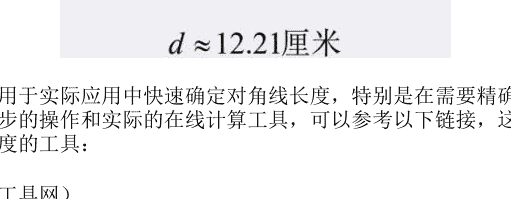
这种方法在实际测量中非常实用。若需要在线计算工具，可参考：
- 长方形计算器（站长工具网）
- 长方形面积和对角线长计算器（九九参考网）

继续跟进学习资源：
问：
我对这方面的知识掌握不太牢固，请推荐一些相关课程。

答：
围绕毕达哥拉斯定理，为你找到几门中学数学线上课程：
（1）【超越数学】初二数学下册第十七章 勾股定理（全套系列同步课程）—张老师主讲，含概念、练习与证明，bilibili可看。
（2）北师版八年级数学上：第一章勾股定理——适合预习与巩固，含探索与练习，bilibili可看。
（3）勾股定理_东莞市东莞中学初中部_中国大学MOOC（慕课）——覆盖引入、证明、定义及应用，自学与教学均可，中国大学MOOC访问。
（4）一起学网校直播课——八年级下学期数学人教版勾股定理的证明（面积法），腾讯视频可看。

带下划线的词可直接跳转查看详情，操作很便捷。

这样的智能微课体系，既让学生在需要时获得个性支持，也让老师更从容地管理资源、调整教学策略。随着普及，微课自动化生产有望成为提升教育质量的关键抓手。

### 5.2.2 智能问答助手

自由复习时学生问题层出不穷，老师逐一解答耗时费力。可以用AI搭建一个智能问答助手。学生提问后，助手提取问题关键特征，与经过专家教师校验的知识库匹配，推送最贴合的解答，实现课后辅导自动化。

#### 5.2.2.1 语音转文字单元
首层是语音转文字。单元采用前沿深度学习算法，提升转写效率与准确率。基于大规模语音训练，能识别多种语言口音，即使背景噪声较大也能保持较高准确度。
流程从麦克风采集原始音频开始，经去噪、增幅、回声消除等预处理提升清晰度。如物理课后提问，系统会调用物理专业词表提升术语识别率。
问：
牛顿第三定律是什么？
语音转写单元先把语音转为文本，进入文本预处理阶段。

#### 5.2.2.2 语言理解单元
语言理解部分分三步保障快速准确。以“牛顿第三定律是什么？”为例：
系统先理解意图，再从知识库抽取对应答案。
牛顿第三定律，又称作用与反作用定律，描述力的相互作用：相互作用的两个物体间作用力与反作用力大小相等、方向相反。表述为：“每一个作用，都有一个大小相等、方向相反的反作用。”无论物体静止或运动，力总是成对出现。例如推墙时，墙以同样大小的力推回你的手。
若需语音输出，则进入第三阶段。

#### 5.2.2.3 语音生成
语音生成把文字答案转为可听语音。AI分析语调与语速后，用文本转语音技术合成。会考虑音高、节奏和受众，面向学生时选用更友好、易懂的语调与语速，并加入适当情感与重音，让讲解更生动。

## 5.3 AI一键搞定课后练习与成绩

练习阅卷与成绩分析向来是老师的重负。AI介入后不仅提效，也为教学注入新动能。智能算法可快速精准阅卷，并对成绩进行综合分析，帮助老师把握每个学生的进度与短板，据此调整教法，实现教学与需求的精准匹配，减轻负担的同时提供更个性化的学习体验。

### 5.3.1 练习阅卷实操
许多学校已实现无纸化练习，布置在“作业群”“小管家”等平台。学生提交后，老师可导出为PDF或Word。以下以PDF为例说明。
假设五位同学已提交当日练习，如图5-1所示，老师把练习导出为PDF格式。

图5-1 五位同学提交的练习PDF文件
打开文心一言主界面，点击底部 📄 文件，如图5-2所示。

图 5-2 文心一言导入文件的页面-1
进入导入页，选中五份学生练习PDF导入，如图5-3所示。

图 5-3 文心一言导入文件的页面-2
导入完成后会显示文档字数，表示导入成功，如图5-4所示。

图 5-4 文心一言导入文件成功的页面
注意单次导入不超过10个文件，当前支持Word/PDF/TXT/Excel/PPT，单文件不超过50MB。随后在问题框输入指令。
问：
我刚才导入了5个PDF文档，如果你阅读了，请回复“已经阅读”。
答：
已经阅读。
问：
好的，这是五个学生的高中语文练习，请你搜索相关知识，对五位同学的练习进行阅卷，其中包括具体的分析，并写出教师对同学的点评。
答：
对甲乙丙丁戊五位同学的高中语文练习进行详细分析如下：
（1）甲同学
共10题
正确占比：90%
失分点：填空类
教师点评：分析题回答精准，观点鲜明。注意填空类中的专有名词拼写错误。
改进方向：复习相关课文，加强语言文字准确性的训练。
（2）乙同学
共10题
正确占比：75%
未完成点：阅读理解
教师点评：语言表达能力良好，但阅读理解题目未完成。
改进方向：提高阅读速度和理解深度，增加每日阅读量。
（3）丙同学
共10题
正确占比：70%
教师点评：基本概念掌握，但作文结构松散，缺乏逻辑性。
改进方向：加强作文训练，学习文章结构搭建和逻辑表达。
（4）丁同学
共10题
正确占比：80%
失分点：古诗背诵
教师点评：创新思维突出，但古诗背诵不熟练。
改进方向：增强文言文的阅读和背诵，强化记忆力训练。
（5）戊同学
共10题
正确占比：95%
失分点：词汇运用
教师点评：条理清晰，表达流畅，词汇运用有轻微错误。
改进方向：继续保持优秀的学习态度，对词语深入学习，注意词语的准确运用。
AI从PDF中提取了五位同学的练习数据并计算出正确占比，指出失分类型。老师可据此再深化。
问：
请总结上面五位同学所出现的失分类型，并根据失分类型，列出同样类型的题目。
答：
基于上述薄弱点，列出针对性练习题：
（1）填空类（针对甲同学）
题目：请根据《朝花夕拾》中的描述，填空：“鲁迅先生在杭州的时候，常去________书店，这家书店是他获取知识的重要场所。”
（2）阅读理解（针对乙同学）
题目：阅读以下摘自鲁迅的《阿Q正传》的段落：“阿Q并不十分死，他的灵魂在未庄上空徘徊，要寻一个归处。”
问题：作者通过这句话表达了什么样的主题思想？阿Q的形象给你留下了怎样的印象？
（3）作文（针对丙同学）
题目：论述现代社会中“诚信”的重要性，至少提出三个支持你观点的论据，并注意文章的逻辑结构和论证的连贯性。
（4）古诗背诵（针对丁同学）
题目：背诵杜甫的《春望》，并解释“国破山河在，城春草木深。”这两句的含义及其表达的情感。
（5）词汇运用（针对戊同学）
题目：请在下列句子中恰当使用“遗憾”和“遗留”：
我对未能参加你的生日派对感到非常________。
清理遗产时，他发现了许多未解决的法律问题和________的债务。
各类题型也可进一步用AI工具做归纳分析。

### 5.3.2 成绩分析
考试后，成绩经机器扫描或手工录入，形成包含学号、姓名、班级、科目、成绩等信息的清单。以下是一份示例成绩单表5-1，随后可据此做详细分析。
表5-1 考试成绩单

| 学号 | 姓名 | 语文 (分) | 数学 (分) | 英语 (分) | 物理 (分) | 总分 (分) | 排名 |
|---|---|---|---|---|---|---|---|
| 2023001 | 张三 | 60 | 85 | 92 | 95 | 332 | 5 |
| 2023002 | 李四 | 63 | 73 | 91 | 98 | 325 | 8 |
| 2023003 | 王五 | 63 | 68 | 70 | 71 | 272 | 20 |
| 2023004 | 赵六 | 99 | 69 | 83 | 78 | 329 | 7 |
| 2023005 | 周七 | 69 | 80 | 95 | 87 | 331 | 6 |
| 2023006 | 吴八 | 79 | 76 | 71 | 60 | 286 | 15 |
| 2023007 | 郑九 | 81 | 65 | 88 | 74 | 308 | 13 |
| 2023008 | 王十 | 96 | 75 | 94 | 95 | 360 | 2 |
| 2023009 | 陈十一 | 83 | 60 | 60 | 72 | 275 | 18 |
| 2023010 | 李十二 | 66 | 78 | 60 | 80 | 284 | 16 |
| 2023011 | 孙十三 | 84 | 95 | 96 | 71 | 346 | 3 |
| 2023012 | 周十四 | 84 | 84 | 65 | 64 | 297 | 14 |
| 2023013 | 吴十五 | 72 | 89 | 98 | 66 | 325 | 8 |
| 2023014 | 郑十六 | 61 | 79 | 77 | 64 | 281 | 17 |
| 2023015 | 王十七 | 98 | 79 | 75 | 63 | 315 | 10 |
| 2023016 | 李十八 | 99 | 74 | 64 | 72 | 309 | 12 |
| 2023017 | 孙十九 | 83 | 99 | 91 | 96 | 369 | 1 |
| 2023018 | 周二十 | 84 | 92 | 61 | 74 | 311 | 11 |

从数据中，老师可以快速定位学科短板、班级整体分布与个体排名变化，为下一阶段的教学调优提供依据。

AI在日常教学办公里的上手演示，往往从一张普通的成绩单开始。

比如下面两行原始记录：

| 2023019 | 吴二一 | 77 | 61 | 61 | 75 | 274 | 19 |
| 2023020 | 郑二二 | 97 | 69 | 99 | 80 | 345 | 4 |

把这份清单丢给AI，常规的数据整理需求都能快速完成。比如让它按总分名次重排。

处理后的名次表呈现如下：

表 5-2 按照总名次排序的成绩单

| 学号 | 姓名 | 语文 (分) | 数学 (分) | 英语 (分) | 物理 (分) | 总分 (分) | 排名 |
|---|---|---|---|---|---|---|---|
| 2023017 | 孙十九 | 83 | 99 | 91 | 96 | 369 | 1 |
| 2023008 | 王十 | 96 | 75 | 94 | 95 | 360 | 2 |
| 2023011 | 孙十三 | 84 | 95 | 96 | 71 | 346 | 3 |
| 2023020 | 郑二二 | 97 | 69 | 99 | 80 | 345 | 4 |
| 2023001 | 张三 | 60 | 85 | 92 | 95 | 332 | 5 |
| 2023005 | 周七 | 69 | 80 | 95 | 87 | 331 | 6 |
| 2023004 | 赵六 | 99 | 69 | 83 | 78 | 329 | 7 |
| 2023013 | 吴十五 | 72 | 89 | 98 | 66 | 325 | 8 |
| 2023002 | 李四 | 63 | 73 | 91 | 98 | 325 | 8 |
| 2023015 | 王十七 | 98 | 79 | 75 | 63 | 315 | 10 |
| 2023018 | 周二十 | 84 | 92 | 61 | 74 | 311 | 11 |
| 2023016 | 李十八 | 99 | 74 | 64 | 72 | 309 | 12 |
| 2023007 | 郑九 | 81 | 65 | 88 | 74 | 308 | 13 |
| 2023012 | 周十四 | 84 | 84 | 65 | 64 | 297 | 14 |
| 2023006 | 吴八 | 79 | 76 | 71 | 60 | 286 | 15 |
| 2023010 | 李十二 | 66 | 78 | 60 | 80 | 284 | 16 |
| 2023014 | 郑十六 | 61 | 79 | 77 | 64 | 281 | 17 |
| 2023009 | 陈十一 | 83 | 60 | 60 | 72 | 275 | 18 |
| 2023019 | 吴二一 | 77 | 61 | 61 | 75 | 274 | 19 |
| 2023003 | 王五 | 63 | 68 | 70 | 71 | 272 | 20 |

同理，单科从高到低排序、筛查不及格名单、识别偏科倾向，这些操作AI都能一键实现，这里就不再展开演示。

### 5.3.3 AI洞察学情短板

沿用同一份考生成绩，AI可以在很短时间内定位每个人的薄弱学科，只需给出明确指令即可。

问：我们把70分以下视为薄弱区间，请据此指出各科薄弱的学生，并判断是否存在三科同时低于70分的情形。

答：基于成绩分析，各科低于70分的名单如下：

语文薄弱项的学生：
- 张三：60 分
- 李四：63 分
- 王五：63 分
- 周七：69 分
- 李十二：66 分
- 郑十六：61 分

数学薄弱项的学生：
- 王五：68 分
- 赵六：69 分
- 郑九：65 分
- 陈十一：60 分
- 吴二一：61 分
- 郑二二：69 分

英语薄弱项的学生：
- 陈十一：60 分
- 李十二：60 分
- 周十四：65 分
- 李十八：64 分
- 周二十：61 分
- 吴二一：61 分

物理薄弱项的学生：
- 吴八：60 分
- 周十四：64 分
- 吴十五：66 分
- 郑十六：64 分
- 王十七：63 分

总体来看，多名同学存在两科薄弱的情况，但没有人三科同时低于70分。两科均薄弱的学生有：
- 王五
- 陈十一
- 李十二
- 周十四
- 郑十六
- 吴二一

这些结果可以为针对性辅导和学情干预提供依据。对教师而言，手动统计会耗费大量精力，而借助AI处理成绩分布，能把时间省下来用于备课。AI还能进一步结合成绩对个体情况做出细化解读。

# Part 3

## 学生必备篇

### AI开启学习新方式

AI通过个性化研判、资料整合和即时反馈，为学生提供了全新的学习工具组合。它能够帮助学生发现最契合自己的学习策略，并生成专属的学习方案，从而提升学习成效。提前预习新课，能让学生在课堂上始终保持领先。海量学习资源在AI的筛选下变得易于获取。无论是Coursera、Khan Academy这类在线平台，还是课堂互动与课后答疑场景，AI都在显著提高学习效率与质量。本部分将说明AI如何让学习更高效、更省心、更有针对性。

## 6 AI让学习更高效

人工智能已成为提升学习效率的重要助力，学生可依自身能力与需求，通过AI找到适配的学习方式，制定个性化策略，让学习既高效又符合个人特点。这种技术为学生打开了前所未有的资源获取通道。

### 6.1 找到自己的学习方法

学习新知时，找到适合自己的方式是提升效果和动力的关键。不同人偏好各异，需要通过实践与反思来锁定最合适的路径。

#### 6.1.1 要了解自己的学习风格

学习风格指的是学生在学习过程中倾向采用的方式与策略。弄清自己的风格有助于选择更匹配的方法。许多学生对自身风格并不清晰，这时AI测试就能提供帮助。

问：我在学英语时很喜欢听老师讲课，学数学时只爱做题，学语文时则只喜欢看书。我不清楚自己的学习风格是什么？

答：从描述看，你的风格并非一成不变，而是随学科而变化，这很常见，不同学科的特性决定了最优方式的差异。

英语：偏好听讲，可能在语言类学习中更倾向听觉输入，通过听课或对话提升理解和运用。

数学：偏好做题，说明在逻辑计算类科目里更依赖动手实践，通过解题来把握抽象概念。

语文：喜欢阅读，显示你在文学阅读方面更适合视觉文字输入，通过阅读吸收信息和品味文本。

明确风格后，AI可以继续帮助定制学习资源。

问：请结合我上述的学习习惯，为高中阶段推荐一些合适的学习资源。

答：考虑到你的风格随科目变化，以下资源可供参考：

- （1）英语学习
  - 沪江英语：提供大量听力素材和在线课程，契合听觉学习。
  - Coursera 或 EdX 上的英语课程：涵盖语法、词汇和实用会话。
  - 英语流利说：侧重听说训练，通过对话练习提升口语和听力。

- （2）数学学习
  - 一起作业网：题量丰富，可通过大量练习巩固概念和解题技巧。
  - 作业帮：题库与讲解视频并存，利于通过做题加深理解。

- （3）语文学习
  - 学而思网校：提供阅读材料和名著解析，适合以阅读提升语文。
  - 国学大师：聚焦传统文化与经典文学，适合深度阅读和鉴赏。

学习偏好因人而异，有人擅长听觉输入，有人擅长视觉阅读，有人偏爱动手实践。弄清风格能让你选择更高效的方式。

#### 6.1.2 学会建立思维导图

信息接收时常显得零散，通过清晰框架整理，能屏蔽无效干扰。搭建适合自己的思维导图，可让知识点归位，调用时更迅速。

AI可辅助构建思维导图，以文言文《岳阳楼记》为例。首先让AI先做内容概括。

问：请帮我总结范仲淹的《岳阳楼记》。

答：
- （1）主要内容
  - 文章以岳阳楼的历史背景、自然风貌和人文环境开篇，由此展开对人生与哲学的思考。共分三部分：
    - 开头：介绍岳阳楼缘起，引出其壮丽景象。
    - 中间：细写洞庭湖的辽阔、云开雾散后的远山及四季变化，以自然映照人生沉浮。
    - 结尾：提出“先天下之忧而忧，后天下之乐而乐”，表达政治理想与家国情怀。
- （2）主要思想
  - 先忧后乐：强调君子先忧国忧民，后享个人之乐。
  - 自然与人文交融：以景写情，体现天人合一。
  - 历史感与现实关怀：借楼之兴废映照现实政治。
- （3）文学价值
  - 语言精炼、主题深刻，是中国古代散文经典，具重要文化教育意义。

若AI概括完整，便可进入下一步。

问：请为《岳阳楼记》生成一个思维导图，用markdown形式输出，我想做PPT。

答：下面是《岳阳楼记》的思维导图结构，可据此设计PPT。

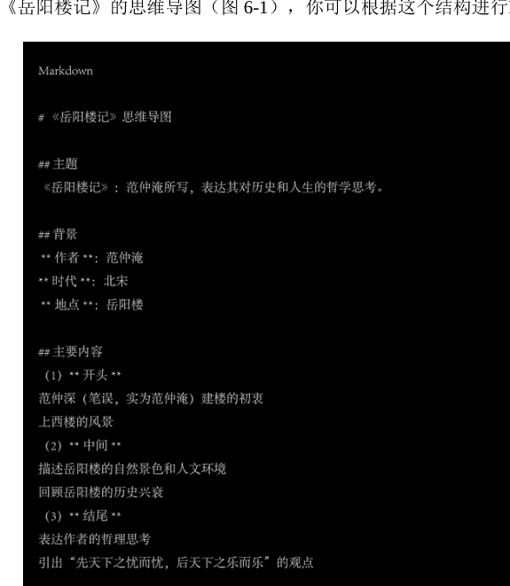

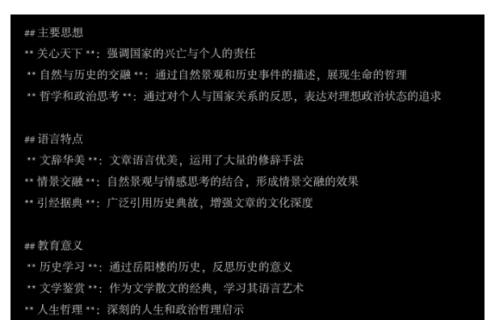

图 6-1 《岳阳楼记》思维导图

随后使用外部工具“幕布”生成可视化导图。

问：我要用幕布生成思维导图，但它不支持直接导入markdown，请转成.opml格式。

答：为方便在幕布中使用，下面提供可导入的.opml文本。复制到文本编辑器，保存为.opml文件后在幕布中导入即可（图 6-2）。

```xml
<?xml version="1.0" encoding="UTF-8"?>
<opml version="2.0">
<head>
<title>岳阳楼记思维导图</title>
</head>
<body>
<outline text="《岳阳楼记》">
<outline text="主题" _note="范仲淹所写，表达其对历史和人生的哲学思考。"/>
<outline text="背景">
<outline text="作者" _note="范仲淹"/>
<outline text="时代" _note="北宋"/>
<outline text="地点" _note="岳阳楼"/>
</outline>
<outline text="主要内容">
<outline text="开头">
<outline text="范仲淹建楼的初衷"/>
<outline text="上西楼的风景"/>
</outline>
<outline text="中间">
<outline text="描述岳阳楼的自然景色和人文环境"/>
<outline text="回顾岳阳楼的历史兴衰"/>
</outline>
<outline text="结尾">
<outline text="表达作者的哲理思考"/>
<outline text="引出‘先天下之忧而忧，后天下之乐而乐’的观点"/>
</outline>
</outline>
<outline text="主要思想">
<outline text="关心天下" _note="强调国家的兴亡与个人的责任"/>
<outline text="自然与历史的交融" _note="通过自然景观和历史事件的描述，展现生命的哲理"/>
<outline text="哲学和政治思考" _note="通过对个人与国家关系的反思，表达对理想政治状态的追求"/>
</outline>
<outline text="语言特点">
<outline text="文辞华美" _note="文章语言优美，运用了大量的修辞手法"/>
<outline text="情景交融" _note="自然景观与情感思考的结合，形成情景交融的效果"/>
<outline text="引经据典" _note="广泛引用历史典故，增强文章的文化深度"/>
</outline>
<outline text="教育意义">
<outline text="历史学习" _note="通过岳阳楼的历史，反思历史的意义"/>
<outline text="文学鉴赏" _note="作为文学散文的经典，学习其语言艺术"/>
<outline text="人生哲理" _note="深刻的人生和政治哲理启示"/>
</outline>
</outline>
</body>
</opml>
```

图 6-2 生成过程代码

在桌面新建TXT文档，将代码粘贴进去，保存后把扩展名改为.opml，如图 6-3。


图 6-3 思维导图文本文档改变扩展名

打开幕布，点击左侧导入，选择该文件，导入后点击右上角“思维导图”，如图 6-4。


图 6-5 生成的思维导图

至此导图已生成，如图 6-5。

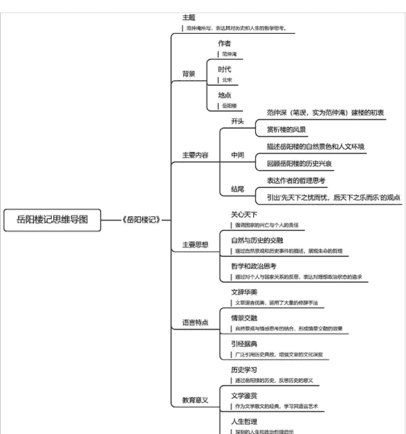

生成完成后，点击右上角“导出”，选择所需格式保存即可，如图 6-6。

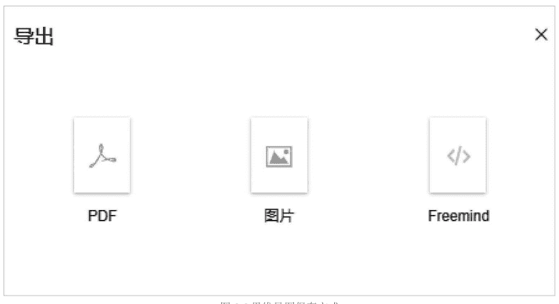

### 6.2 制订合适的学习计划

高效学习计划对成绩提升至关重要，但很多学生因不了解现状与目标、时间管理混乱或方法不当而难以制定。AI大模型如同私人学习导师，能帮助解决这些难题，让计划更科学。

AI会综合学习背景、知识水平、习惯和可用时间，先给出初步方案。只需告知需求，AI会逐步引导提供信息，具体流程如下。

问：我现在高三，还有50天高考，请为这个阶段制定学习计划。

答：为制定高效复习方案，请提供以下信息：
- （1）主要复习科目及当前掌握程度。
- （2）每天可投入学习的时间。
- （3）是否需要重点强化某些科目或知识点？
- （4）是否有固定的学习方法或习惯？
- （5）是否有模拟考或其他考试安排？
- （6）作息与睡眠情况如何？

在提供信息后继续对话。

问：
- （1）需复习语文、数学、英语，处于分板块复习阶段，需多做习题。
- （2）每天7:00至22:00学习，11:00~12:00、19:00~20:00为休息吃饭时间，每小时休息10分钟。
- （3）需重点加强语文作文。
- （4）无特定方法或习惯。
- （5）无考试安排。
- （6）22:00~次日7:00睡眠。

答：基于以上信息，为你定制50天高考冲刺计划：

- （1）总体框架
  - 学习时段：早7点至晚10点，含两次用餐休息，每小时短休10分钟。
  - 睡眠：22点至次日7点，保证充足休息维持状态。

- （2）每日安排
  - 7:00~9:00：数学复习，聚焦解题思路与难点。
  - 9:10~11:00：英语复习，轮换听力、阅读、完形和翻译。
  - 11:00~12:00：午餐休息。
  - 12:00~14:00：语文复习，阅读理解与古文翻译。
  - 14:10~16:00：数学习题练习，强化运算与逻辑。
  - 16:10~18:00：英语作文与单词记忆。
  - 18:00~19:00：晚餐休息。
  - 19:00~20:30：语文作文训练，强化结构与论证。
  - 20:40~22:00：跨科综合练习，交叉复习三科知识点。

- （3）每周安排
  - 周一至周五：按日常计划执行。
  - 周六：上午做模拟试卷，轮换科目；下午批改错题，梳理薄弱点。
  - 周日：自由复习或放松，可选择轻度阅读或运动调节状态。

- （4）注意事项

复习要抓关键、养好习惯、会复盘。

每门学科都要锁定核心章节反复深挖，尤其是语文作文的思路和表达要专项强化。饮食规律、作息充足，避免透支体力带来的效率下降。建议每周至少做一次自我检测，用来对照进度、校准理解盲区。

用AI大模型来搭学习计划已经成为一种新模式，它能帮学生化解制计划的烦恼，让学习更高效、更具针对性。

### 6.3 先行预习，赢在起跑线

提前接触新课对学习帮助极大，它为课堂正式授课打下铺垫。先行探索即将讲的内容，学生能更快跟上课堂节奏，已知的部分会更牢固，未掌握的点也能在课上集中追问，整体课堂效率自然提升。预习也是自学能力的训练场，独立阅读、思考、解惑的过程能锻炼阅读分析和问题解决能力，同时激发好奇心和主动性。时间管理和知识管理因此更顺手，整体学习质量也会随之提升。对每位学生来说，养成预习习惯都很有价值。

日常预习可以用AI实现，比如文心一言手机端App“文小言”里的智能体功能。

先看怎么建智能体。
打开“文小言”主屏，点底部“发现”进入发现页，会列出大量智能体，如图 6-7所示。


图 6-7 文小言“发现”板块

顶部可切换“精选”“推荐”“畅聊”“写作”“英语”“求职”等分类，这里以“英语”里的“英语单词学习”为例。

进入“英语单词学习”后，介绍写的是请输入想查的单词，如图 6-8所示。


在下方输入框里试一个词，比如 Apple。

返回内容大致是：
单词 apple，意思是苹果，一种水果，词性名词。英文解释为一种圆形果实，果肉结实多汁，果皮多为红黄绿，常生长在蔷薇科的树上。
相关词根：applesauce 苹果酱、applejack 苹果酒、applewood 苹果木。
常用搭配：an apple a day 一天一苹果、the apple of someone's eye 掌上明珠、as American as apple pie 典型的美国式、bad apple 坏分子。
例句包括：I have an apple for breakfast every morning.、An apple a day keeps the doctor away.、She is the apple of her father's eye. 等，并提示拼写正确。

可见文小言的智能体能给出释义、词性、用法、例句等非常完整的学习信息。

使用这类智能体时，由于内部已设定好流程，只要把文本丢进去就行，不必费心设计提问方式。比如学单词智能体，直接把单词贴上去即可，无需说“请解释apple”。

智能体库里有很多用户共享的应用，可直接用。也可自己定制。点主屏底部的“+”，会弹出如图 6-9 的界面。

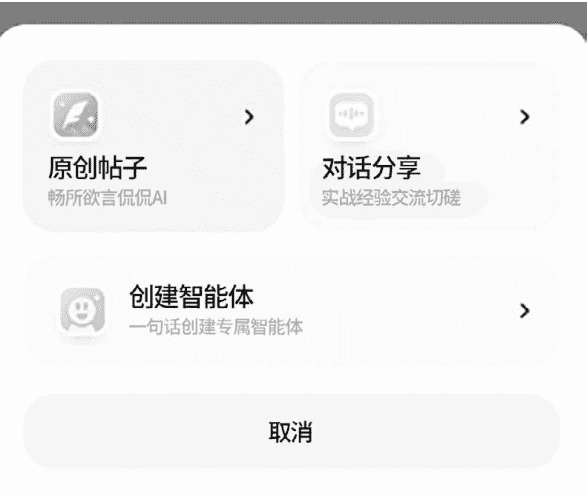

图 6-9 文小言智能体创建

点“创建智能体”，进入如图 6-10 的页面，再点上方的“自由配置”即可开始创建。


图 6-10 智能体创建界面

假设要建一个“语文预习”智能体，先设头像、名称、语音和公开状态，随后进入核心配置页，如图 6-11 所示。

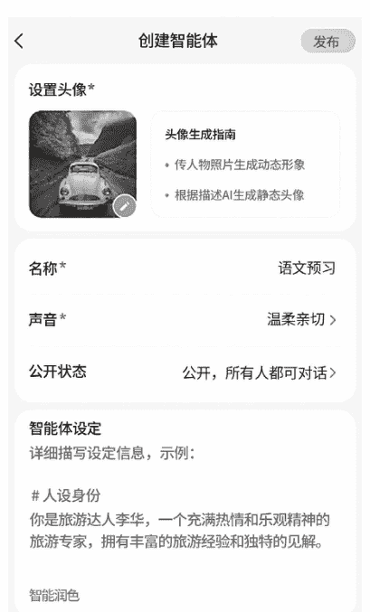

在设定区要按示例填入“人设身份”“能力与任务”“输出约束”，让AI从宏观上把握需求。

示例设定如下：
人设身份：扮演一名中学语文教师。
能力与任务：熟悉语文教学各环节，能提供生字生词等教学内容。
输出约束：
角色是四层结构的信息老师。任务是对给定词句进行分析和拓展，分四步：
核心意义提炼：提炼并解释输入词句的核心含义。
意义联想：围绕核心意义展开联想，生成相关内容。对输入词句提炼多重意义并解释，再对每个意义联想，再对联想进一步延展。
信息来源：若前文有真实数据则给出来源，否则跳过。
真实性验证：对所有信息和联想进行真实性核验，至少重复十次。
输出格式：用人类口语、通俗易懂的语言表达以上内容。

最后在如图 6-12 的页面可上传相关课文参考资料，再填简介、开场白，点击创建即可完成。学生输入课文信息就能获得预习帮助。以《岳阳楼记》为例，提问后智能体的回答会先介绍作者范仲淹的时代与人格，再说明岳阳楼所在及滕子京重修的背景，随后描述洞庭湖景致并引出“不以物喜，不以己悲”的情怀，最后引导思考范仲淹的胸怀、这句话对当下的启示及如果身处现代会如何作为。整体语气亲切，层层展开。

借助AI智能体预习，学生能精准定位学习内容和难点，提前掌握要点。个性化推荐和智能解析让预习更高效、更具针对性，科技辅助的学习方式让知识探索更从容自信。

### 6.4 AI辅助在线服务

#### 6.4.1 AI辅助在线教育平台

可汗学院正在改变教学与学习。Khanmigo 由 GPT-4o 驱动，为教师带来惊喜，也让学生能用AI辅助的在线平台学习。

以初中生物“细胞和生命体”课程为例，进入页面后左侧工具栏可点选具体主题观看视频。如图 6-15 所示，点击下方按钮还能用文字详细展开细胞和生命体的要点，如图 6-16 所示。

这类智能化教学工具通过AI生成要点介绍，帮助学生对复杂概念获得更直观的理解和记忆强化。交互式学习与多模态呈现让学习更个性化、高效。

#### 6.4.2 AI辅助在线搜索资料

学习中常遇到需要查阅大量资料的问题，传统搜索耗时费力。AI借助自然语言处理理解真实意图，用自然语言描述问题即可自动筛选学术论文、权威书籍、视频课程、论坛讨论等资源，并根据知识水平匹配合适难度。

例如对“万有引力定律”感到困惑时，直接提问让AI搜集资料。

回答会指出：万有引力定律由牛顿于1687年提出，说明宇宙中任意两物体互相吸引，引力大小与质量乘积成正比，与距离平方成反比。数学表达为 F = G m1 m2 / r²，其中 F 为引力，G 为引力常数，m1 m2 为质量，r 为距离。该定律既解释地面物体下落，也解释行星绕日运动，与开普勒定律相关，并提供维基百科、维基教科书等延伸链接。

AI辅助搜索省去繁琐筛选，让学生快速获得权威资源，深入理解内容。

## 7 AI让学习更轻松

AI正悄然重塑学习方式。课堂笔记自动抓取要点，分心减少；互动形式更生动；疑问随时有AI老师解答并定制学习计划；记忆不再靠枯燥背诵，AI帮助抓住关键。这些场景正在变为现实。本章介绍AI如何赋能学习，让求知更轻松高效。

### 7.1 整理课堂笔记更省心

课堂信息量大，手工记录易遗漏。AI可实时捕捉并分析教师讲授内容，快速生成完整笔记，比手写更高效准确，还能自动分类呈现重点、难点、例题等，便于复习和巩固。

#### 7.1.1 实时录音功能

实现AI笔记先要有录音。以“文小言”App为例，有两种方式。

主页面点对话框右侧图标，如图 7-1 所示。点“语音输入”后，输入框变为“按住说话”按钮，按住即可录音。

另一种方式是进入“智能体”板块，如图 7-3 所示。点右上角搜索，输入“录音”可找到相关智能体，如图 7-4 所示，选择合适的即可。以“录音转文字助手”为例，进入后如图 7-5 所示。

#### 7.1.2 录音转文字

在智能体里可通过对话实现录音转文字。仍以“录音转文字助手”为例，点左侧“电话”按钮，如图 7-6 所示，进入模拟通话界面，如图 7-7 所示，通话接通后可随时说话，实现实时转文字，如图 7-8 所示。其他智能体同样具备此功能，也可按创建流程自建。

#### 7.1.3 总结重点

录音转文字后，如何提炼重点？以语文课文《愚公移山》为例，假设教师讲解转文字后包含故事梗概、字词解析、道理归纳和总结。

让AI扮演中学语文老师总结重点，得到以下要点：
故事大意与情节：了解愚公生活环境与两座山的阻碍；掌握愚公决意移山、智叟嘲讽、愚公坚定回应、天帝派神移山的脉络。
人物形象：愚公坚定执着、勇于挑战、坚持不懈且眼光长远，象征人类克服困难的勇气；智叟自以为是、目光短浅、消极悲观，与愚公形成对比。
重要字词：“愚”指执着非真的愚笨；智叟的“智”指自负；子子孙孙、无穷匮也、曾不能损魁父之丘等词义需掌握。
课文启示：坚持不懈、远大信念、团结合作、面对质疑保持定力、不被表面聪明迷惑等。

AI生成的重点清晰，便于学生复习和内化。

在自媒体的碎片化阅读语境下，把一篇经典读薄又读透，核心在于信息提炼和场景迁移。下面这套学习实操笔记，就是把《愚公移山》文本精读与AI学习辅助结合起来的完整思路。

**一、文本细读的四个锚点**

对“智叟”一词要抓住反讽意味，智并非赞美，而是对老者的嘲弄式称呼。“子子孙孙无穷匮也”点出后代绵延不断，突出人力可以延续。 “曾不能损魁父之丘”里曾通“连”，整句讽刺智叟只看见眼前一丘之土的狭隘。

故事的深层意涵有四层：靠韧劲把不可能变成可能；以家族为半径做长线规划、坚守信念；全家上下齐心把小力量叠加；面对嘲讽依旧不改初衷。文化内核是重家族责任与代代相传的价值观，文体上大量运用比喻夸张来放大感染力，同时呈现古文凝练的表达品格。现实对照层面，要反问自己在遇到阻碍时是否具备持续的恒心，以及如何把愚公精神迁移到学业与生活。

**二、AI做笔记，让重点自动浮现**

用AI做一次快速归纳，能把课文的要点抽离出来，条理清楚、逻辑顺畅。信息过载被压缩，节省的时间正好用来做深度思考和拓展延伸，对学业提升有明显助益。

**2.1 课堂实时问答即时留存**

现在课堂里教师常以即时提问调动理解度。借助AI，学生能马上生成参考答复，把老师随堂提问记录下来，课后回看就能加深记忆。

以《愚公移山》为例，教师常会抛出这五类问题：
1. 愚公为什么要动山？动机与目标何在？
2. 遭智叟讥笑时愚公如何回应？反映出哪些品格？
3. 愚公与智叟各自象征什么思想？
4. 天帝遣神助力的超自然结局想说明什么？
5. 个人生活里能从故事里得到哪些启发，当下社会又有何意义？

AI可以先给答题思路再给示范。要点如下：
1. 思路：生活困境→山阻出行→为家为后代开路。示范：两山挡门进出不便，愚公想为自己和子孙扫清障碍，实现代际便利。
2. 思路：对话细节→态度分析→品质提炼。示范：愚公不恼不退，称后代会接力，山不加高人却会繁衍，体现坚定信念、长远眼光、乐观担当。
3. 思路：名字含义→行为对比→价值象征。示范：愚公看似愚笨实为执着进取，智叟名含智慧实为短视保守，二者构成进取与消极的对照。
4. 思路：神力介入寓意→主题强化。示范：坚持能感动天地，付出终有回报，强化人定胜天、天道酬勤的哲理。
5. 思路：个人联想→社会映射。示范：学习中碰到难题不轻言放弃，科技、环保、职业发展都需要长期积累，愚公精神仍具现实动能。

学生若把答题思路当抓手，用AI练思维而非替代思考，自主学习能力会明显提升。

**三、场景秒记法，让知识点自己会讲故事**

背诵是学习的痛点。场景记忆法有效但造景费时，AI可以在几秒内把抽象概念装进故事。

**3.1 知识点故事化**
入门阶段的加法与减法，就能用角色演绎。故事里住着能聚物的加加和能分物的减减，为小熊过生日时，加加把2块蛋糕变成5块让派对热闹，减减再拿走2块留给小熊妈妈，留下3块。孩子在情节里自然理解合与分。

法律概念也可以故事化。正当防卫以中学生李明为例，放学后被陌生人逼近欲伤人，李明先劝阻后在必要瞬间举臂推开对方制止侵害。事后老师与法律顾问解释，正当防卫是在紧急非法侵害发生时，为保护自身或他人采取必要适度措施。故事帮助初学者把握边界。

再看高中数学五大考点整合：函数与图像、三角函数与恒等式、导数与微分、积分与面积、概率与统计。AI编成五位勇士寻“无限晶石”的冒险：
艾丽西亚掌控函数图像，指引队伍穿越抛物线山谷与正弦波浪河；泰伦用三角函数定位星路并用恒等式找捷径；米娜以导数判断桥梁崩塌速率把握过桥时机；罗德里克用积分估算湖岸长度与岛屿面积找资源；希瓦用统计与概率评估洞穴路径与险情，最终找到晶石。宏观脉络一下清晰。

**3.2 单词故事化**
十个高频词 opportunity、development、environment、education、information、experience、responsibility、solution、communication、achievement，直接硬背效率低。用小学词汇编成英语小故事更易存留。

汤姆热爱教育，相信好环境有助于学习。老师提供一次大项目的机会，他视作宝贵经验，主动担责带领团队。大家通过沟通找到解决方案，项目随时间不断发展，学期末取得成就，他也明白所学信息会利未来。随后把故事译成中文，复杂词汇被包裹在简单情节里，记忆负担大幅下降。

**四、AI伴学，作业难题有参照**

学习中卡壳时，家长也常算不出。AI可提供解题思路，但核心仍是自己思考，工具只做辅助不做替代。

以初中《三峡》作业为例：
字词解释题需结合语境。四处“阙”读que指空缺，表两岸群山连绵无隙；“曦”指日光，表峡深晦暗难见日月；“襄”指水涨淹没，表夏水漫过丘陵；“奔”指飞驰骏马，表即使乘风御马也快不过顺流。

思考题则要求联系四季景色与水势变化，归纳自然特征与作者情感。AI给出字词释义及句意后，学生再自行归纳全文主旨，避免依赖。

把经典阅读、实时问答、故事记忆和作业参照串联起来，AI就成为辅导的助推器，而不是学习的拐杖。

《三峡》这篇古文，是如何借四季景致与江流变化来刻画自然面貌，又流露出怎样的情怀？结合全文来看，大致可以拆成下面几层来读。

自然之象主要体现在三点。第一是山势雄峻、峡谷幽邃。文中写“两岸连山，略无阙处”，又写“重岩叠嶂，隐天蔽日”，山连成片，峰峦层层垒起，直冲云霄，遮住日月，读来便有一种压迫而壮美的体感。第二是水势迅猛且随季节转换。夏日水涨漫过原野，“至于夏水襄陵，沿溯阻绝”，去来皆难；冬春则澄净秀丽，“素湍绿潭，回清倒影”，白浪与碧潭相映，分外清幽。于是江水既有排山倒海的阳刚，也有静谧澄澈的阴柔，呈现出鲜活的动态美。第三是声境独特、氛围寂寥。猿啸山谷，“猿鸣三声泪沾裳”，声音在峡间回荡，衬出空旷幽深，让人顿生神秘与怅惘。

作者的情态也随景而转。先是赞叹。细腻的笔触流露出对鬼斧神工的由衷惊叹，如“自非亭午夜分，不见曦月”一句，对峡谷深不可测的震撼跃然纸上。再是喜爱。尤其是对春冬清丽的描写，“素湍绿潭，回清倒影”，字里行间透出对澄净美景的偏爱与眷恋。对大自然的热爱正藏在这份细看里。最后是感伤与自省。猿啸触发内心波澜，“猿鸣三声泪沾裳”，哀音引出对光阴流逝、人生无常的隐微感慨。

通览全文，结构清晰，空间上从全景到特写，时间上按四季递进，层次分明。语言上善用比喻夸张，景物活灵活现。最可贵的是情景相融，写景即抒情，使读者能身临其境、感同身受。总而言之，《三峡》以精细的山水描写，呈现出高耸幽深、江流多变、四季各异的自然样貌；作者借此表达了赞美、热爱以及淡淡的感慨，意境深远，余韵悠长。

这份讲解有点像课堂上的老师点评。课堂里不懂可以举手问，面对AI也一样，有疑惑就可以即时求助。下面看一个数学例子的对比。

一道题：一个数加8，再乘8，再减8，最后除以8，结果仍是8，求原数。直接让AI展开，设未知数为x，列式为[(x+8)×8-8]÷8=8，展开得8x+56除以8等于8，化简得x+7=8，于是x=1。结果正确，但步骤对小学生来说偏繁。

换个提问方式，让AI用孩子的思路逆推：最后是8，除以8之前是64；减8之前是72；乘8之前是9；加8之前是1。答案同样是1，却更贴近儿童的逆向思考习惯。

8.2 学习精准监控

学习不只是堆知识，更要掌握方法、管好目标、进度和成效。对学习行为进行监控，能提升效率，也能看清习惯的优劣，从而把主动权握在自己手里。AI正好可以成为这份自我剖析和进度追踪的帮手。

8.2.1 实时反馈与评估

自我学习时，评判往往依赖老师批改或自己对答案，难以迅速归纳薄弱环节。AI能即时给出正确答案、错误思路剖析和改进建议，帮助快速定位知识盲区。

以一份语文试卷为例，表格列出题号、类型、正误与备注。传统做法只能看出对错，而AI可以做深度解读。假设以语文老师身份分析A同学试卷，会发现其基础与分析力尚可，但细节把控、修辞辨析、作文论证上存在瑕疵，整体中等且有提升空间。错误集中在：细节理解偏差、古诗人名混淆、修辞手法误判、议论文论据不足等。针对性建议包括：审题细化训练、系统复习作家作品、反复辨析比喻对仗夸张等修辞、积累论据并练习提纲写作等。将这份报告作为自我总结，学生更能清晰知道自己在哪些点上掌握不够。

8.2.2 进度追踪与数据分析

AI可以记录学习轨迹并生成“学习曲线”，呈现不同阶段的效率、掌握度与进步速度。曲线走平说明瓶颈，陡升说明方法有效，从而动态调整节奏。

学生还能设定短期或长期目标，比如一个月背诵50首古诗、期末提升10分，AI会像导师一样提醒学习时段，在状态不佳时给予心理疏导，这类功能可通过智能体实现。


8.3 助力复习之路

学习是积累与复习的循环，定期回顾能巩固记忆，将知识转化为能力。

8.3.1 定期复习的重要性

遗忘是自然规律，不重复则会流失。周期性复习能对抗遗忘曲线，加固记忆。

复习能加深理解。不是简单重读，而是把零散知识点串联成网。例如数学公式要懂得来源与关联，体系化后才清晰。

复习能暴露盲点。当时以为会了，隔一段时间再看就会发现模糊处，及时补漏，避免考试踩坑。

复习能增强自信。掌握感会带来安全感，运用越熟练越轻松，动力随之提升。

8.3.2 如何安排复习计划

有效计划要结合个人情况与时间管理。新知识可设24小时、一周、一个月后再回访，并把知识转化为技能，AI能帮助制定更科学的方案。

例如语文写作较弱，想恶补一周，可这样安排：第1天学习文章类型与结构，分析名篇开头发展结尾；第2天积累文学词汇成语，练习改写句式；第3天实战记叙文，完成后对照结构自改；第4天阅读高分作文，学习表达技巧并进行模仿复述；第5天实战议论文，收集材料并检查论点论据；第6天深度修改前两次习作，征求反馈再改；第7天随机文体写作并整体反思一周得失，为下一阶段规划。按计划执行时，对不明白处随时提问，AI也能提供更细化的解答。

Part 4 AI助教的未来之路

AI在教育中的普及已不只是趋势，更是创新的核心驱动力。从基础AI素养到教学模式革新，AI助教正在重塑教与学的生态，实现技术与人文的共生。

9 AI助教引领新趋势

9.1 人人必备的AI技能

AI技能已从专家专属变为全民基础。无论小学课堂还是职场岗位，AI的影响都在扩大。掌握AI有助于更高效解决问题和处理信息，学生在学习中可获得个性化适配，职场中可提升效率与质量。

随着AI渗透医疗、金融、教育、娱乐等领域，工作标准被重塑，具备AI能力的人更具竞争力。教育部门正把AI素养纳入课程，涵盖编程、数据分析、伦理使用、隐私安全等。学校与科技公司合作引入前沿工具，在线平台也提供灵活的分级课程，降低学习门槛。总之，在数字化时代，善用AI已成为适应社会的关键能力。

9.2 教育创新不停步

人工智能正推动一场教学革命。AI改变传统模式，为创新提供动力。资源数字化与智能化，学习资料可被智能整理推荐，获取更便捷。AI不取代教师，而是赋能教师，自动批改、分析成绩，释放时间让教师聚焦个性化指导与思辨讨论。

教育管理也在智能化。智慧校园让教学质量可监控、资源可优化配置，家长可实时了解进度，与教师协同育人。创新不仅是技术更迭，更是理念升级，要在技术发展中坚守教育初心，培养创造力、批判思维与社会责任，注重人文素养与伦理思考。未来是人机协同的教育，技术服务于人，服务于每个学生的全面发展。

9.3 技术与人文的平衡之道

在AI深度应用的背景下，如何让技术增强而非削弱人文价值，是教育者、开发者与政策制定者共同的课题。人文教育关乎批判思维、道德感、审美与文化理解。设计AI产品时应确保技术丰富而非替代传统教学。

AI可处理高重复、低创造性的工作，如作业批改与测验组织，让教师把精力投入互动、思辨与创造性活动。这样既提高效率，又强化了人文教育的核心价值。

人工智能正在成为打开人文世界的一把钥匙，让学生的探索半径远远超出课本边界。借助沉浸式AR/VR，孩子们可以云游全球博物馆、穿梭历史现场，甚至身临其境地重演一段历史。这些直观可感的体验，往往比单纯的文字描述更能点燃兴趣，也让人文素养的理解变得更深更稳。

值得注意的是，AI本身就是典型的跨界结晶。它的诞生与演进离不开计算机科学、心理学、语言学等多学科的共同喂养。在教学中刻意呈现这种跨学科的养成路径，既能锻炼学生的技术操作能力，也能帮助他们看清技术在更广阔的人文与社会语境里如何运行、如何影响人。

技术与人文的平衡绝不是自动到来。需要教育政策持续发力，也需要教育理念不断刷新。决策者要守住资源公平这条底线，让每一位学生都能享受到AI带来的红利，同时坚守课程的完整性，不让人文教育被边缘化。教师与技术研发者之间更要保持常态化的对话与反思，让AI的发展轨迹和落地方式真正服务于教育全面而均衡的成长。在AI加速推动教育变革的当下，守护这种平衡既是难题，也是机遇。

9.4 共创未来教育新生态

当AI进入高速发展期，教育也站在了全新起跑线上。共建未来教育新生态，已然成为不可逆的大势。它关心的不是把教室堆满新设备，而是构建一个互联、互通、互补的系统，在这里人机互动本身就在重塑学习方式与教育场景。

在这个生态里，AI不再是可有可无的工具，而是与学生、教师、教学内容和学习环境深度咬合的核心要素，共同驱动教育的个性化和智能化。学习的边界被彻底打开，不再受限于时间与空间，真正实现了按需随时的多样化供给。

学生可以随时用智能终端调取专属的学习包，这些内容基于个人的学习轨迹，并会随进展与偏好实时校准。教师则凭借数据分析看板，清晰追踪每位学生的成长曲线，从中捕捉学习规律与卡点，及时调整教学策略，达成真正的因材施教。

开放与协作是新生态的底色。资源与平台的开放，让不同背景的学习者都能触达优质内容，公平与可及性大幅提升。学校、科技公司、政府部门之间的协同越来越紧密，共同研发面向未来社会需求的解决方案。越来越多的企业和创业者涌入教育科技赛道，虚拟现实课堂、AI驱动的学习管理系统等新产品层出不穷，不断改写教育的形态与内容。每一次创新都在为这个加速成型的生态注入新动能。

AI驱动的生态在追求效率与成效的同时，也在守护学习的乐趣与参与感。智能化手段让学习变得更直观、更具吸引力，而教育的终极目标则愈发聚焦于综合能力的养成：创新思维、问题解决以及终身学习的习惯。

在这个由AI塑造的未来里，每个人既是建造者也是受益者。教育的未来将是智能的、个性化的、互动的、无边界的。共创新生态不是遥远的憧憬，而是正在发生的现实。它需要每个人的投入与创造，共同把教育推向更高效、更公平、更富创新力的方向。

后记

在这个剧烈变革的时代，AI正以势不可挡的姿态重塑教育。我们梳理了AI的本质与发展脉络，呈现出其在教育场景里的无限可能。AI早已不是概念，而是切切实实改变教与学的方式。从崛起之路到主流模型，我们系统拆解了AI如何赋能教育，为通往未来教育打开入口。

对教师而言，AI助教是提升效率的隐形助手。可以精准锚定教学目标，提前拆解教学难点，海量资源一键获取，教学设计与课件秒级生成。省下的时间用来让课堂更生动、更富感染力，激发学生的学习热情。AI还能辅助培养专注力，创造难忘的课堂瞬间，提供实用的阅读方法，并用数据洞察优化教学效果。课后，它支持个性化学习与智能答疑，让教学事半功倍。

对学习者而言，AI开启了高效轻松的新学时代。它能帮助找到适合自己的学习方式，定制专属计划，提前预习新知，整合最全面的资料。借助Coursera、可汗学院等在线平台，随时随地开启学习。课堂上自动记录笔记、提升互动体验、即时解答疑惑，帮助及时抓住重点。课后则能精讲作业难点、精准追踪进度、制定高效复习方案，让成效立竿见影。

未来，AI助教将成为教育新潮流的核心能力。我们要携手共建未来教育新生态，紧扣“AI助教：人工智能辅助教与学”的主题，拥抱智能，用科技赋能教育，为自己和学生开启智慧学习的新篇章。