# AI助手：让ChatGPT成为你的工作加速器

# 写在前面

当下这个变化飞快的时代里，人工智能早已渗入到工作与生活的各个缝隙。本书想做的，是手把手把你带进AI的实际应用场景，尤其是以ChatGPT为代表的AI助手，如何在日常工作中把效率和创造力同时拉满。

全书共9章，每一章都聚焦AI在不同岗位的落地可能。

第1章先讲AIGC工具如何影响职场，让你明白为什么AI助手正变得不可替代。
第2章盘点ChatGPT时代的效率利器，包括个人效率神器ChatGPT、图像生成神器Midjourney、视频生成神器D-ID以及代码生成神器GitHub Copilot。
第3章拆解提示词技巧，教你怎么把ChatGPT的潜力真正唤醒。
第4章到第8章围绕文字处理、绘图、演示制作、数据分析、翻译等具体工作流，结合可配合ChatGPT使用的AIGC工具给出实操方法，每章都配有真实案例。
第9章放眼未来，讨论AI助手如何继续推动效率跃迁，并展望ChatGPT及同类工具的发展路径。

我们的初衷是让这本书兼具新手友好和进阶参考，无论你是刚接触AI，还是已经在用的人，都能有所收获。因为技术迭代很快，书中难免出现滞后或疏漏，欢迎大家交流指正。

另外需要说明的是，本书撰写过程本身就借助了ChatGPT进行辅助创作与润色，也得到了飞书智能伙伴在编写期间的大力支持。希望它能成为你探索AI助手世界的可靠伙伴，助力你在职业与个人成长上迈出新步伐。

# 第一章

# AIGC正在改写职场规则

# 第一节

# ChatGPT、GPT-4、大模型与AIGC

### 一、ChatGPT为何一夜爆红

自2022年末亮相以来，“ChatGPT”这个名字频繁登上媒体、社群、公开演讲的舞台，成为现象级产品，也拉开了新一轮AIGC热潮的大幕。

用用户增速来衡量技术扩散速度很有意思：固定电话花了75年达到1亿用户，手机用了16年，网站7年，TikTok 9个月，而ChatGPT只用了2个月就突破了这个节点。资料来源：https://mbd.baidu.com/newspage/data/dtlandingsuper?nid=dt_4386899306684463127。
到2023年5月，其月活已攀升至8.47亿，与微信视频号体量相当，已是全球头部互联网应用之一。

作为一款新型对话机器人，ChatGPT的增长密码在于它不只是聊天消遣，更能真正介入工作流程，把人的处理速度提升数倍以上，成为当代人专属的超级助理。澎湃新闻曾报道过一个典型场景：在《收获》杂志65周年庆典上，莫言坦言为余华写的颁奖词一筹莫展，后来让ChatGPT帮忙，迅速生成了莎士比亚风格的千字赞词供参考。资料来源：thepaper.cn/newsDetail_forward_23117401。

越来越多的人用它来处理各类文本类日常工作，正好体现了其在自然语言处理上的强项。虽然它替代不了人类的原创思维与表达温度，但能帮助自省、点燃灵感，让想法表达得更清晰。本书会详细介绍如何把ChatGPT嵌入到工作与生活场景中，明确它的真实用法。

### 二、ChatGPT的身世与技术脉络

ChatGPT出自OpenAI，该公司也因它走向台前。OpenAI的崛起并非偶然，而是有长期积累做底座。

公司成立于2015年12月，联合发起人包括Y Combinator前主席山姆·阿尔特曼，以及特斯拉与SpaceX创始人埃隆·马斯克。二人在AI与科技商业化领域经验丰富。

OpenAI的初心是“为全人类打造安全可用的通用人工智能”，而GPT即生成式预训练变换器，就是通往这一目标的关键里程碑。到2023年6月，GPT已迭代至第四代，发展轨迹如下：

#### 01. GPT-1
2018年发布的首个版本，采用Transformer架构并提出预训练+微调范式。参数规模约1.17亿，在当时对语言理解与生成的提升十分明显，开启了大模型时代。

#### 02. GPT-2
2019年推出，参数扩至15亿，成为当时最庞大的预训练模型之一。多项NLP任务表现领先，尤其是文本生成质量与多样性。受担心滥用，OpenAI初期只释放部分版本，后续逐步开源完整版。

#### 03. GPT-3
2020年问世，参数高达1750亿，是GPT-2的百倍以上。在不少任务上能零微调直接给出准确结果，引发业界震动。基于此，OpenAI做了人类反馈强化，形成GPT-3.5版本，随后以ChatGPT的形式面向大众。

#### 04. GPT-4
2023年3月发布，重点强化逻辑推理、多模态理解与整体能力。相比前代在推理、数学和文档撰写上进步显著，还能识别图像语义，对工作支持更强。
2023年11月，GPT-4 Turbo推出，带来更长的上下文窗口、更新的知识库、更强的多模态能力和更精细的可控性。由此，AI应用正向更个性化、高效且负责任的方向演进。

目前ChatGPT底层已可接入GPT-4，但免费版仍以GPT-3.5为主流。

### 三、大语言模型的核心特质

GPT名字里的G、P、T分别指生成式、预训练、变换器。

生成式指根据已知的上下文预测并续写后续内容，通过自回归方式逐词生成。
预训练指在海量无标注文本上先行学习语言规律，掌握词、句、篇章的组织方式，再针对任务微调。
Transformer是核心架构，借助于自注意力机制能同时关注输入序列中所有位置的关系，擅长处理长距离依赖。配合缩放法则——增大参数、层数和数据后性能显著提升——模型能力随之跃升。

这三种设计造就了三大使用特质：

#### 01. 自然语言交互
语言理解力强，用户可以用日常口吻下指令、提问并得到流畅反馈，上手门槛很低。

#### 02. 上下文记忆
自注意力机制让模型能保留较远距离的上下文，每次输出都有语境支撑，对话更像人与人之间的交流。

#### 03. 零样本推理
尤其是GPT-3之后，模型能在未专门训练的任务上依靠推理完成，应用范围被极大拓宽。

总体来看，GPT从1到4的演进展现了其在自然语言领域的巨大潜力，随着规模与性能持续提升，其在更多场景的价值会进一步释放。

### 四、ChatGPT与内容创作

在介绍功能前，先看界面长什么样。图1-1展示了ChatGPT的常规对话界面。它本质上就是一个聊天窗口，用日常语言输入指令或问题，就能得到连贯的文字回应，操作极其亲民。


图1-1 ChatGPT的操作界面

ChatGPT不仅能答疑，只要指令给得准，就能完成写作、列大纲、编程序等多种任务。本书本身也是作者与ChatGPT协作的成果。

除了文字，还有大量AI工具能生成图像、视频、音乐等，这类以AI为驱动的内容生产统称为AIGC。它们的共同点是：只需用自然语言描述期望结果，就能自动产出相应的素材，极大降低了高质量创作的门槛。掌握这些工具，人人都有机会成为写作者、设计师、导演或音乐人。

由于多数AIGC工具依赖文本驱动，ChatGPT可以先行帮忙构思提示词，提升使用效率。哪怕是Office等传统办公套件，在ChatGPT配合下也能大幅提速。用简单操作创造优质成果，这一AI创作文化可能成为改变格局的新现象。

虽然当前能力仍有边界与风险，但随着技术迭代，相信越来越多的人能享受到AI带来的创作乐趣，产出更多更好的内容。无论是否专业创作者，都值得尝试用AI工具打造惊艳作品。

# 第二节

# AI助手为何会深度重塑职场

AIGC大幅降低了内容生产的门槛，也直接提升了工作效率。以ChatGPT为例，至少在以下四个维度产生明显效益。

### 一、激发创意

过去头脑风暴需要召集多人、协调时间，成本高且容易跑题；长期固定组合，思维容易趋同枯竭。
现在与ChatGPT对话，随时能获得多元视角与新点子，协调成本几乎为零，且其知识面广，创意供给不会枯竭。

例如广告公司为运动饮料策划活动，可以先向ChatGPT提供品牌背景、目标人群、市场趋势等信息，再提出开放问题：“如何做一场吸睛的户外 campaign？”、“怎样借助社交媒体触达年轻人？”得到初步灵感后，再要求细化：“健康活力的海报应包含哪些视觉元素？”、“如何融入科技感吸引数码爱好者？”ChatGPT可以产出户外、电视、社媒、线下体验等多类点子，并帮助推演风险与共鸣点。最后团队筛选可行方案进入执行。

需要提醒的是，ChatGPT提供的是灵感与思路，最终判断与决策仍依赖人类的专业与经验，且因训练数据局限，输出可能存在偏差，需结合自身判断校正。

### 二、辅助决策

传统决策要查阅资料、汇总数据、咨询专家，耗时且结果不一定最优。
借助ChatGPT，可快速获取多视角事实与经验，甚至用演绎法模拟不同选择的后果，从而做出更稳妥的判断，省时且提升质量。

比如企业要提拔员工为高级经理，可让ChatGPT迅速生成一份评估问卷，围绕背景、技能、管理潜力提问，再对自然语言回答进行解读与汇总，形成评估报告。还能把该员工与过往相似案例对比，辅助分析其在同类岗位的表现。结合数据分析和情景模拟，决策过程会更精细可靠。

### 三、加速信息检索

过去找信息要靠搜索引擎、书籍和各种资料，再人工筛选整合，耗时耗力。
现在直接向ChatGPT提问即可获得结构化答案，信息获取与整理同步完成。

例如研究员要追踪气候变化新论文，可按四步操作：先描述研究方向与关键词，请其推荐最新论文；再让其扩展相关研究领域与权威数据库；随后追问具体数据集或海洋酸化等细分议题；最后结合其提供的线索在学术库中核验。ChatGPT提供高效线索，但研究仍需以权威来源为准。

### 四、提速写作

写作中最耗时的往往是资料查找、反复输入、校对、排版，这些琐碎工作消耗精力，降低成就感。
ChatGPT可以自动生成大纲与初稿，对局部进行反复优化，自动修正语法与拼写，还能按不同语气、风格改写同一内容。大量重复劳动被压缩，写作者能把精力集中在思考与观点表达上，效率与质量双提升。

AI助理已经从工具箱的边缘走向了工作台的中心。过去很多依赖经验、重复和人工协调的环节，现在都能借助对话式的智能体快速完成。这一次变化的核心，是让自然语言理解与生成能力真正下沉到创作、管理、学习和沟通的日常场景。

创作端，写作者可以把世界观设定、人物小传先丢给ChatGPT，让它先抛出一批灵感片段，再由作者本人筛选打磨。同样，针对已有的稿件，模型也可以提炼出关键情节点与人物弧光，帮助搭建起更清晰的故事骨架。

时间管理的逻辑也在被重写。过去做计划往往要手动排优先级、算工时，消耗大量脑力。现阶段只要把待办事项和希望的起止时间告诉模型，它就能输出优先级排序和可执行的作息安排，让人把精力集中在真正重要的事上。

以学生为例，面对课程、作业、考试与社交的多线压力，可以先和模型聊聊学习安排和卡点，用“怎么让学习时间更高效”“学业与社交如何平衡”这类开放问题获取初步思路。随后给出具体任务清单，请模型帮忙判定先后顺序、分配时长。交流中把有用的提示记下来，再针对拖延、碎片化利用等常见痛点追问应对方法。最后结合日程表或待办清单，把建议固化成自己的作息与休息节奏，并保持弹性调整。需要强调的是，时间管理因人而异，模型给出的方案仍需结合个人习惯修正。

项目管理和协作的效率也在提升。过去靠复杂软件或手工追踪，容易导致沟通成本高、进度滞后。现在通过对话就能梳理工作负荷、拆分任务、协调成员，让流程更轻、协作更顺。

设想一位同时推进多个项目的经理，可以先向模型描述当前负载、里程碑和时间上的难点，问“如何更有效地安排工作时段”“怎样优化任务排序来提升产出”。接着提供具体的项目和任务描述，请模型给出优先级判断和排期建议。过程中记录下来有价值的策略，再针对日常打断、紧急插单、注意力保持等障碍展开讨论。最后据此制定个人或团队的工作计划，使用工具辅助执行，并把经验分享给同事，形成可复用的最佳实践。同样，这里也需要提醒：项目管理的诉求千差万别，模型建议应根据实际情况适配。

学习和培训的门槛被显著拉低。传统路径要么啃书、要么付费上课，练习与答疑成本也高。现在和ChatGPT对话即可获得即时讲解，还能设定理解深度。入门者说“我刚开始学市场分析报告怎么写”，得到的会是通俗版；进阶者说“我是市场分析研究员，请列出主流报告样式”，则会得到系统化、更专业的输出。学完还能让模型出题、批改、解析答案，全天候免费进行。

在企业场景中，HR面对多人群、多课程的培训压力时，可以借助自动问答与知识图谱实现快速交互与数据沉淀。生产型企业的新员工安全培训，也能通过搭建问答系统即时解答厂内安全流程相关疑问，提升理解度。更进一步，企业可基于技能与培训数据构建知识图谱，串联知识点、规划学习路径、定位资源，并在自学习模型基础上形成更细化的个性化培养方案。

翻译与跨语言沟通同样加速。过去依赖人工或传统软件，质量不稳、时效慢。现在实时翻译功能让理解与生成双向顺畅，省时且提升国际协作体验。操作上大致可分为四步：先提供待译文本或口语，明确源语言、目标语言并补充上下文；若初译不够地道，再补充背景或范例促进模型理解；交流中记录有用的译文和技巧，针对幽默、习语等难点继续打磨；最后将模型结果与专业意见或其它工具对比验证，积累经验。需注意，模型受训练数据偏差和语义理解限制，重要或专业领域的文本仍应结合人工审校。

整体来看，ChatGPT正在医疗、教育、金融等行业产生深远影响，得益于其强大的理解生成能力与海量训练数据，企业和个人都能基于需求定制更丰富的人工智能产品，随着优化推进，智能化程度将进一步提升。

医疗行业的变化已被学界与媒体积极讨论。清华大学新闻与传播学院教授、AI与大数据专家沈阳指出，AIGC在辅助问诊、医学影像解读等领域前景广阔。海外则有德雷克塞尔大学团队将GPT-3与神经学诊断结合，通过认知测试分数精细捕捉阿尔茨海默病患者的语言微差异，且无需额外个人信息。丁香园曾对比ChatGPT与专业医生在线问诊能力，使用6个真实案例测试，模型能够回答问题、解释医学术语并给出用药、生活方式等建议。就管控而言，国家药品监督管理局发布的人工智能医用软件产品分类界定指导原则将AI应用分为三类：算法成熟度高的人工智能医用软件；算法成熟度较低且用于辅助决策、用药指导、治疗计划制订等临床诊疗的软件；仅用于数据处理和测量提供临床参考、不参与诊断决策的软件。差异化管理为法律落地提供了依据。

教育行业的多邻国将GPT-4引入语言学习平台，每月超5000万学习者使用，课程覆盖约40种语言。整合后在会话练习与情境反馈两方面实现跃升。

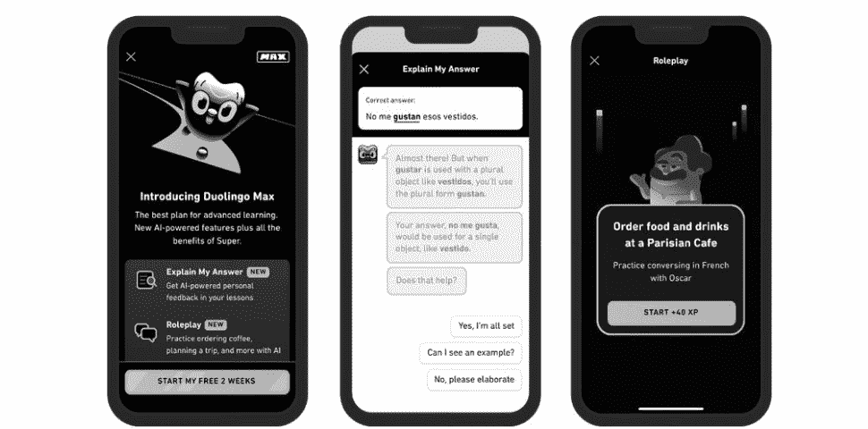
图1-2 多邻国应用GPT-4的介绍界面 资料来源：https://openai.com/customer-stories/duolingo。
平台在Max订阅层推出“角色扮演”和“解释我的答案”两项功能。前者让学习者与AI就体育、个人经历等话题进行沉浸式自由对话，后者则对错误进行详细解释，帮助理解语法细微差别。多邻国早期尝试GPT-3时发现其难以应对复杂对话，GPT-4带来更准确可靠的响应，首席工程师比尔·彼得森也提到原型开发效率明显加快。目前功能已在西语、法语上线并计划扩展。

可汗学院则推出由GPT-4驱动的Khanmigo，作为学生虚拟导师和教师课堂助手。

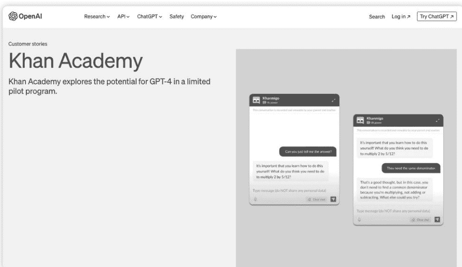
图1-3 可汗学院应用GPT-4的介绍界面 资料来源：https://openai.com/customer-stories/khan-academy。
团队在早期测试中重点监控数学等领域的错误并标记纠正。模型能理解自由形式提问，实现类人互动，从而提出个性化问题促进深度学习。首席学习官克里斯汀·迪瑟博指出，技术帮助学生不仅学会解题，更理解概念本质。测试显示模型可深化理解、拓展知识面，并在编程教学中提升学习效率。同时也在探索教师端的应用，如生成课堂提示、定制学习路径快照，以及针对学生个人兴趣回答“为什么要学”的相关性问题。

金融领域的应用同样可见。2023年2月5日，财通证券研究所发布题为“提高外在美，增强内在自信——医疗美容革命”的研究报告，署名为ChatGPT，全文约6000字，涵盖行业简介、全球市场、轻医疗美容崛起等内容。引言说明为验证模型撰写能力而采用，先用英文生成后译成中文，因模型在英文处理上更强。广发证券也在探索中国版ChatGPT在投行与研究业务中的落地。

从工具到搭档，ChatGPT正在重塑工作方式。拥抱这种对话式智能，能在时间、成本与体验上获得明显优势；忽视它，则可能被效率和创新的浪潮所淘汰。

AI浪潮之下，金融、职场与日常生活正在被重写。下面用全新的表述，把相关洞察串成一张清晰的图谱。

**金融圈抢先埋点，语言大模型切入服务链路**

2023年2月20日，广发证券官宣把百度“文心一言”搬进金融场景，目标是让财富服务的挖掘更立体、触达更个性化。落地的思路是把大语言模型的基础能力与财富管理领域的专业知识做微调，再映射到自有业务。典型体现是24小时在线且带数字人形象的基础问答，以及贯穿客户不同生命阶段的需求识别与服务跟进。券商的算盘有两层：一是给客户更智能、更具温度的财富管理体验，二是以技术先行者姿态推动行业智慧化升级。资料来源：https://baijiahao.baidu.com/s?id=1759582203033700946&wfr=spider&for=pc

海通证券从智能投顾视角做过系统梳理，认为ChatGPT可切入多个环节。资料来源：https://www.cls.cn/detail/1274430
其一，买方投研的提炼与传递。模型强大的文本归纳与输出能力，能帮助研究员快速提炼投研成果，提升信息穿透效率。
其二，定制化财富方案的生成。依据客户账户持仓、资产大类配置等数据，结合账户现状与个人偏好，模型可基于既有数据给出专业化的配置建议。

**ChatGPT向外扩散，四个行业被明显改写**

人力资源。效率提升最直观地落在流程自动化与优化上。招聘、培训等重复性强的工作被智能化承接，招聘效率与新人入职体验同步改善。日常员工咨询、绩效评估辅助、职业发展规划等也可由模型承接，同时在企业文化多样性与包容性建设上提供支持。更深一层，通过海量数据的洞察，模型在战略规划、员工情绪感知等领域展现潜力，为决策提供更高精度。

游戏行业。在叙事、对话与角色互动的生成上带来革新式功能，聊天机器人与AI助手的交互更自然。以网易《逆水寒》为例，引入类ChatGPT能力后，NPC对话不再受限于预设选项。玩家可以用自然打字与NPC交流，NPC基于模型理解语义并按人物性格生成回应，可玩性与沉浸感显著提升。

电商行业。应用正从文案生产向决策支持延伸。商家可用模型撰写广告文案与商品描述，也可借助专用工具解析店铺指定商品的用户评价，归纳出用户最关注或集中吐槽的点，形成产品改进依据。调研效率与准确度提升的同时，产品迭代的响应周期被大幅压缩。

客服行业。结合ChatGPT后，AI客服能以自然语言顺畅沟通，不再依赖按键选择或关键词触发，体验大幅改善。尤其在投诉、故障报修等情绪化场景，通过自然语言交互与拟真人声，焦虑感被有效缓解，为后续人工介入创造更友好的环境。

**职业变革列车已经启动，个人如何上车**

AI时代的列车正高速驶来。适应与跟上步伐的关键，是主动登上职业变革的列车，重塑自我、掌握ChatGPT、Midjourney、Stable Diffusion等工具的使用技巧。

持续学习与自我提升是第一步。技术迭代要求知识与技能同步更新，学习内容涵盖提示词原理、AI写作方法、工具参数调节等。
提示词本质是用自然语言精准描述需求，让模型产出所需内容。要学会构建清晰、简洁、有针对性的表达。不同文体有不同规范，学术论文、商业报告、新闻稿、自媒体营销稿的结构与风格各异，理解这些差异才能让模型写出合格稿件。温度、最大令牌数等参数的调节，也能让输出更贴合需求。
学习路径包括：网络教程自学，短视频平台搜索“AI教学”“ChatGPT教学”“AI绘画”等可获得大量干货；购买专业课程，线上线下平台提供从入门到进阶的体系化内容，优先考察大纲合理性并可先试听；参加线上线下研讨会，获取行业前沿分享；阅读专业图书与研究论文，系统把握技术脉动。

实践操作是内化技能的核心。建议循序渐进：先熟悉工具界面与功能设置；从短文写作、日常对话、日记等简单任务起步；再挑战故事、信件、演讲稿等多种题材；学会提出具体明确的问题并通过调整指令优化结果；反复校对修改，理解模型的生成特点与局限；与他人分享作品并吸收反馈。实践是最好的老师。

关注行业动态保持敏感度。可定期查阅AI与自然语言处理领域的科技媒体与行业博客；跟踪研究机构发布的研究报告与分析文章，捕捉趋势、需求与挑战；观察AI写作在广告、教育、媒体等的创新落地；借鉴行业标杆如何将AI嵌入产品与生产流程。

对想深入发展的读者，建议补充计算机科学与人工智能基础知识，以及编程能力。掌握Python等语言调用ChatGPT API，能更好地理解原理、实现定制化产品。

本章整体脉络是：先厘清ChatGPT与AI助理的基础概念，再系统讨论其在创意思考、决策支持、信息检索等层面对职场的深远影响，继而细化医疗、教育、金融等领域的具体表现，最后给出持续学习、实践、动态跟踪等可操作建议。核心信息清晰：在AI驱动的新时代，理解并有效使用AI，是每个职场人必须跨越的挑战，也是成功的关键。后续章节将从更实操的角度拆解AI助理的使用方法。

**ChatGPT时代的效率神器：个人助理的用法**

回答简单问题时，关键在于问题表述与上下文的完整度。可以先把问题表述得清晰简洁，再补充必要的背景。举例来说，担心宠物健康时，提供近两天精神状态、异常行为与可能接触物，比只问“宠物病了怎么办”能得到更具体的分析；在投资咨询时，给出资金规模、风险偏好与目标，比泛泛问“推荐什么股票”更有效。拿到答案后要进行评估与核验，必要时交叉验证。

生成长篇文章可采用分段协作法。先确定主题并拟出包含引言、观点、案例、结论的大纲；然后按段落逐步引导模型生成，每段给出内容要点、格式与字数要求。生成后反复修改、核查事实与逻辑自洽性，最后整合润色成完整稿件。

长文本核心要点的提炼可交给模型。明确文本主题后，给出“请为以下内容做简短摘要”等清晰指令，可设定字数或句数限制。评估摘要是否抓到主旨、是否遗漏关键信息，如有偏差则补充上下文再问，必要时多次迭代并人工润色，最终与原文对照确保准确。

代码辅助编写时，需明确任务目标、编程语言、输入输出与约束条件，必要时附上示例或伪代码。可先让模型输出函数或类的大纲，再逐步细化。生成后要检查语法与逻辑，本地运行测试，用测试用例验证正确性与健壮性，迭代优化直至可用。

多语言翻译时，务必明确原文语言与目标语言。提示中说明翻译方向后提交文本，逐句或分段处理长文本可提升质量。检查译文的流畅度与准确性，进行人工润色以贴合语境与风格。

把 ChatGPT 从入门用到进阶，本质上是把“提问-校对-参数调优-生态对比”这套闭环跑顺。以下内容按实操场景梳理，信息点与原文保持一致，仅表达做了全面重写。

**一、用 ChatGPT 做翻译与创意生产**

先说翻译收尾。译稿出来后别直接交付，先做一次准确度与统一性复核。最好能找目标语的母语者帮忙把关，收集反馈后再做修正。整体遵循前面提到的流程，就能比较稳妥地借助 ChatGPT 完成翻译工作。需要提醒的是，译文质量会受原文难度和模型对特定语言的把握程度影响，最后一定要做合理的评估与验证。

创作类需求也很适合。ChatGPT 能产出诗歌、短篇小说等创意文本，激发它的方式是给一个有意思的主题、场景描写或明确的写作要求。操作上仍可沿用“提出需求-迭代打磨-人工审查”的思路，配合提示词的细化来提升灵感质量。

**二、高阶用法：调参与 API 调用**

想让回复更可控，就要动参数。温度值决定生成结果的随机程度，最大 token 数则用来限制输出长度。更进一步，可通过 API 把 ChatGPT 接入自己的程序，实现定制化功能。调参与 API 使用建议按以下顺序推进：

1. 拿到 API 密钥。使用 ChatGPT API 前需在服务商官网注册并申请密钥，注意安全保管防泄露。
2. 准备开发环境。按语言和平台安装必要库和依赖，比如 Python 里常需要 requests 来发 HTTP 请求。
3. 发起请求。用编程语言构造 HTTP 请求，GET 或 POST 均可，把密钥及必要参数带上，注意填对终端地址和请求格式。
4. 配置输入参数。告诉模型你要做什么，例如指定问题或目标语言等。
5. 微调模型参数。依据场景设定温度、最大输出长度等，以获得更理想的结果。
6. 解析返回。读出 API 响应的模型生成内容，按需清洗和格式化后再使用。
7. 处理异常。请求可能遇到超时、参数非法等情况，代码里要做好捕获、提示和重试逻辑。
8. 性能优化。根据业务负载调整批量大小、采用异步请求等手段提升效率。

按这套步骤，能更高效地调用 API 并保证代码稳定可靠。

**三、与 ChatGPT 同赛道的模型盘点**

除了 OpenAI 的产品，中美厂商都在布局大模型，可以多体验对比。

美国阵营
- 谷歌 BERT。Bidirectional Encoder Representations from Transformers 的缩写，是一个预训练的深度双向变换器模型，在诸多 NLP 任务上理解和表征能力很强，和 GPT 的生成导向不同，更偏向理解。
- 微软 DialoGPT。基于 GPT-3 的对话模型，擅长生成自然连贯的多轮对话，可用来搭建智能对话系统。
- 亚马逊 Amazon Alexa AI。亚马逊团队为语音助手 Alexa 开发的自然语言理解与生成技术，虽然服务自家生态，但在技术脉络上与大型预训练语言模型有相似之处。
- Meta LLaMA。Meta 创始人马克·艾略特·扎克伯格在 Instagram 上提到，LLaMA 面向研究者，期望在生成文本、对话、总结材料、数学定理证明或蛋白质结构预测等复杂任务上大有可为。

资料来源：https://blog.csdn.net/liudada8265/article/details/129253081。

中国阵营
- 文心一言。百度自研，根据指令创作不同风格主题的文本，比如故事、广告、歌词，还能依据文字和绘画风格作画，具备多模态创作能力。
- MOSS。复旦大学自研，能进行智能对话并捕捉用户意图与情感，输出更贴合的回复，同时融入伦理道德约束，避免偏见或有害内容。
- 混元。腾讯自研的统一平台，覆盖 NLP、CV、多模态等任务模型，可处理图文视频等多类型数据，支持跨模态搜索与生成。
- 通义千问。阿里自研的 AI 统一底座，包含自然语言处理与多模态理解生成等核心模型，在多项中文理解任务上表现突出，也能完成分类、分割、检测等视觉任务。
- 盘古。华为自研的超大规模预训练模型家族，涵盖 NLP、CV、多模态、科学计算等方向。
- 讯飞星火。科大讯飞推出，七大能力维度包括文本生成、语言理解、知识问答、逻辑推理、数学解题、代码理解与编写、多模交互，已在教育、办公、汽车、数字员工等场景落地。
- Baichuan。百川智能推出，由搜狗前 CEO 王小川创立。2023 年 6 月 15 日发布的 70 亿参数中英文预训练模型 Baichuan-7B，在 C-Eval、AGIEval、高考三大中文评测基准上表现亮眼，后续陆续推出更大规模、能力更强的系列。

了解这些模型有助于更全面认识当前 NLP 技术格局，做出更合适的选择。

**第2节 作图神器 Midjourney**

**一、平台概览**
Midjourney 是基于扩散模型的人工智能绘画平台，能生成肖像、风景、动物、植物等多种题材，支持卡通、油画、水彩等多种风格，并提供大量样例帮助用户理解不同模型和参数的效果差异。

上手门槛低是它的一大优势，不需要专业美术或计算机技能也能产出高质量图像。常规流程是上传参考、选模型、调参数、运行、下载成品。Discord 官方服务器既是交流社区也是学习阵地，用户可在其中分享作品、交流经验，还能发布和购买创意产品实现变现并与创作者协作。

**二、版本演进**
Midjourney 迭代频繁，不同版本特性各异。写作时最新的是 2023 年 3 月 15 日发布的 V5，语言提示解释力强且分辨率高，支持重复图案等高级功能。可通过提示词追加 --version 或 --v 指定版本，也可用 /settings 命令在版本间切换。

官网文档中主要版本介绍如下。资料来源：https://docs.midjourney.com/docs/quick-start。
- 模型版本 5.2。2023 年 6 月发布，细节更丰富、画面更清晰，色彩、对比度、构图均有提升，对提示词理解更进一步，对 --stylize 参数全量范围的响应也更灵敏。
- 模型版本 5.1。2023 年 5 月发布，默认美学更强，简单文本提示即可出图，解释自然语言更准确，伪影与边缘问题减少，图像锐度提高，还支持 --tile 等特性。
- 模型版本 5。生成结果更接近摄影风格，相较 V5.1 更贴近提示词，但要达到理想美感往往需要更长的描述。
- 模型版本 4。2022 年 11 月至 2023 年 5 月的默认版本，采用全新代码库和 Midjourney 自研 AI 架构，在 Midjourney 超级集群上训练，对生物、地点、物体等知识覆盖更广。
- Niji 模型 5。与 Spellbrush 合作，主打动漫与插画风格，擅长动态动作镜头和角色为中心的构图。

所有模型都可通过 --style、--v、--niji 等参数微调。切换方式主要有两种：使用版本或测试参数，或使用设置命令。

**三、常用指令**
在 Discord 上可通过指令与机器人交互，涵盖创作、设置、信息查询等功能，可在机器人频道、私人服务器或私信中使用。
/ask、/blend、/daily_theme、/docs、/describe、/faq、/fast、/help、/imagine、/info、/stealth、/public、/subscribe、/settings、/prefer option、/prefer option list、/prefer suffix、/show、/relax、/remix。

**四、关键参数**
提示词末尾追加的选项即为参数，用于控制生成方式，一个提示可叠加多个。
--ar / --aspect 调整宽高比；--chaos 控制多样性，数值越高越不寻常；--no 用于排除元素，如 --no plants；--q / --quality 设定渲染质量，越高越好成本也越高；--r / --repeat 按同一提示创建多个任务；--seed / --sameseed 指定种子，相同种子与提示结果相似；--stop 在中途结束任务，过早结束细节会变少；--style 切换模型版本；--s / --stylize 调节默认美学风格的介入程度；--tile 生成可拼接的无缝图案；放大器参数 --uplight 与 --upbeta 选择不同的放大效果；--v / --version 切换算法版本。

**第3节 视频生成 D-ID**

**一、公司与能力**
D-ID 是以色列创业公司，起家于面部识别相关技术。其隐私保护产品能对个人照片做细微调整，人眼看不出差别，但可让面部识别软件无法识别，从而保护隐私。

公司还推出 Deep Nostalgia 技术，让静态照片“动”起来，通过深度学习预测人物面部表情与动作，再应用到照片上。平台支持从文本生成逼真数字人物，大幅降低视频制作门槛。

客户覆盖《财富》500 强企业、营销机构、制作公司、社交媒体平台、在线教育平台和内容创作者等。方案分为自助创意工作台和面向企业开发者创客的 API。公司成立于 2017 年，获得知名风投支持，累计已产生超过 1.1 亿段视频。近期客户包括华纳兄弟影业、阳狮集团、亿滋国际、Skilldora、MyHeritage 等。

**二、创建头像**
登录后首要任务是建一个头像。

图2-1 D-ID选择头像界面
可选用平台自带头像，普通头像免费，高质量头像带 HQ 标识需升级付费会员后使用（待确认）。也可使用 Midjourney 生成卡通头像或拍摄照片，点击 +ADD 上传到头像库。

**三、生成语音**
在脚本编辑区输入台词并选择语言。
图2-2 D-ID选择语言界面
台词文字必须与所选语言一致。选英语则写英文，法语则写法语。中文可细化口音，如粤语、普通话、河南话等。语言确定后可挑选音色与情绪。若不想用 AI 合成，也可录制并上传自己的语音。

Script Audio
Type your script here, you can start from scratch or use our script-generation feature below.
Language English (U...
Voices Jenny
Styles assistant

**四、成片与计费**
准备就绪后点击 GENERATE VIDEO 按钮生成数字人。

图2-3 D-ID生成视频按钮
费用按台词长度计，台词越长消耗越高。新用户赠送 20 个信用点，用完后需充值，价格区间为 5.99 美元/月 到 299.99 美元/月不等。

图2-4 D-ID充值界面

**第4节 编写代码 GitHub Copilot**

程序员的核心诉求是效率，日常工作就是打造提效工具。ChatGPT 出现后，行业对“效率”的定义被重新讨论。虽然 ChatGPT 并非专为编程设计，但破圈后程序员也开始探索 AI 增效手段，目前被广泛接受的代表是 GitHub Copilot。

**一、安装前提**
GitHub Copilot 的名字来源于 GitHub，而 GitHub 是全球最大的代码托管平台，使用 Copilot 前需先拥有 GitHub 账号。

注册后可安装插件，常见 IDE 如 JetBrains 系列和微软 Visual Studio Code 均提供插件。以 JetBrains IDE 为例，安装流程大致如下：
1. 在 JetBrains IDE 中打开菜单，Windows 系统在 File 下，Mac 系统在 IDE 名称如 PyCharm 或 IntelliJ 下，选择 Setup 或 Preferences 进入设置。

**二、使用 GitHub Copilot**

GitHub Copilot 打造的初衷就是让程序员写代码更快更顺。装完之后其实不必先去研究用法，编码时它就会主动弹出提示，按一下 Tab 就能直接选用，就像图2-8里演示的那样。归根结底，最基础的玩法就是把它当成一个升级版的代码补全。

```
public class Person {
    private String name;
    private int age;

    public Person(String name, int age) {
        this.name = name;
        this.age = age;
    }
}
```
图2-8 GitHub Copilot 辅助写代码示意

光靠局部补全只是入门，我们完全可以让它一次性生成整个函数。只要在注释里把想实现的功能写清楚，像图2-9那样，它就会按照这层意图给出完整实现。觉得结果可用就按 Tab 确认，不满意就按 Esc 撤回。

```
// 写一个 isQualified 函数，用于判断年龄是否大于28岁
public boolean isQualified() {
    return age > 28;
}
```
图2-9 用注释描述意图触发代码生成

例子还可以更复杂一些。图2-10 里的需求是判断一个名字是否只由汉字组成。

```
// 写一个 isIllegalName 函数，用正则表达式判断名字中是否只包含汉字
public boolean isIllegalName() {
    return !name.matches("[\u4e00-\u9fa5]+");
}
```
图2-10 用注释说明稍复杂的需求

正则判断汉字对很多人来说并不熟练，过去的做法是先去搜索引擎找写法，再回到 IDE 手工实现。有了 Copilot 这两步就能合并：直接提要求，它就在当前环境里把任务做完。不用在 IDE 和浏览器之间反复切换，效率自然提升。

体验上 Copilot 仍不够完美，有时衔接会显得不够顺滑，和前面那些提效方案比起来没那么“丝滑”，不过它还很年轻，改进空间很大。

要知道 Copilot 诞生在 ChatGPT 之前。ChatGPT 火了之后，产品的交互思路被重新洗牌。微软系走在前面，New Bing 和 Office 系列都在重塑交互，而同属微软的 GitHub 也很快跟进。GitHub Copilot X 正是这一思路的产物，它借鉴了 ChatGPT 的对话方式，支持用对话来编程。

如果你对 AI 工具感兴趣，可以去看看 GitHub Next，那里汇集了 GitHub 在研发中的各种工具，等它们都成熟时，开发效率会再上一层。

AI 编程工具并不只有 Copilot。亚马逊推出的 CodeWhisperer 用法类似，而且宣称免费。我也常看到有人在写代码时把 ChatGPT 或 New Bing 放在屏幕角落，随时交流、帮忙写代码或修 Bug。

到今天为止，AI 更像副驾驶，主驾驶仍是人。所以关键问题是如何用好 AI 写出好代码。在 AI 时代，会不会用工具会拉开很大差距：不会用快捷键和代码模板的人只能慢慢敲，会用的人就像在批量生产代码。

这一规律同样适用于 AI 工具。无论是 Copilot 还是 Copilot X，最大的进步在于可以用自然语言描述意图来编码，“写代码”本身已不再是效率瓶颈。未来程序员的核心能力，会变成如何向 AI 提好问题。

本章小结
本章主要讨论了 ChatGPT 如何扮演个人助理角色，以及它如何与 Midjourney、D-ID、GitHub Copilot 等创新工具协同工作。首先介绍了在回答简单问题、撰写长文、提炼要点、编写代码等方面使用 ChatGPT 的方法。随后梳理了与 ChatGPT 类似的语言模型，包括美国的 BERT、DialoGPT、亚马逊 Alexa AI 等，以及中国的文心一言、MOSS、混元、通义千问等。最后展示了 Midjourney、D-ID、GitHub Copilot 在绘图、视频生成、编程领域的应用，强调这些工具对创新和效率的助力。

本章的要点是，ChatGPT 及相关 AI 工具不仅是技术创新的象征，更是提升现代工作效率的重要动力，在 AI 快速演进的时代，我们应尽量发挥这些工具的潜力。

第3章 ChatGPT 的提示词撰写

第1节 基于提示词的会话特点
本节内容改编自创作团队在 AI Hero 上发布的专栏《ChatGPT 从入门到精通》。

想把提示词用好，先要对 AI 有基本认知。就像任何工具一样，先了解 ChatGPT 的特性，才能让它更好地服务于我们。

ChatGPT 是一个语言模型加对话系统，其特点可概括为四个“知”。

知识丰富。ChatGPT 储备了海量知识，能回答各类问题，覆盖历史、文化、科学、技术等众多领域。

知人晓事。它能根据上下文揣摩意图和兴趣，给出个性化回应，会依据聊天过程中了解到的信息给出最贴切的回答。

知错就改。它能在对话中持续学习改进。用户指出错误时，它会承认并从中学习，未来避免类似失误，追求更高准确性和有用性。

知法守法。它遵守道德法律规范，不会输出危险、不道德或违法的回应，也不会对“危险”问题响应，保证交互安全合法。

下面具体看看这些特点。

一、知识丰富的 ChatGPT
ChatGPT 之所以强大，背后是 AI 模型的支撑。从技术上看，AI 模型需要大量数据训练。ChatGPT 核心是“大语言模型”，“大”指数据量大。

训练时 OpenAI 从维基百科、新闻报道、小说、社交媒体帖子等大量资料汲取信息。正因数据来源广泛，它能回答多种类型问题，并提供有用信息。

大部分知识类问题它都能给出合适答案。比如问太阳系有多少颗行星，它会简明回答 8 颗并按距离排序。把话题延伸到小行星时，回复依然准确。

问“地球是什么”，它会回答地球是太阳系第三颗行星，也是人类居住地，具有大气、水、陆地等特征，简洁且富有启发性。

GPT-4 发布后能力进一步提升，关键变化是插件系统的引入。

前面说过，AI 模型是训练好的，知识有时间边界，无法实时获知新信息。语言模型擅长语言扩展，对数学计算并不擅长。

有了插件，一切不同。搜索插件能联网获取最新知识，弥补时效短板；数学插件能提升计算和推理能力。插件系统极大拓展了 ChatGPT 的能力，也意味着它能回答更复杂具体的问题，提供更深入专业的解释。

二、知人晓事的 ChatGPT
ChatGPT 展现出较强的人情味，能依据上下文理解意图，回答不僵化而富个性。

首先，它能精确理解人类语言并作出回应。能分析输入文本，抓住意图和重点，给出相关回复。开放性问题会多角度思考，具体问题则给出明确答案，体现出对自然语言的高度理解。

其次，它会根据交流对象立场需求调整角度。对小孩子用简单易懂的语言，对专业人士用更专业的词汇。若用户处于特定环境或剧情场景，它也能站在对应角度构思回答，体现对人与语境的深刻理解。

例如让它以小学生口吻解释氧气作用，回答浅显易懂，非常适合低龄理解。

想用好 ChatGPT，就要理解这一“知人晓事”特质。市面上大量提示词模板都强调为 ChatGPT 设定角色，这正是利用了这一特质。

根据需求以不同角色、不同角度对话，它都能理解并回应，让交流更生动有趣，不再枯燥。相比传统对话机器人，这正是它更“善解人意”且受欢迎的原因。

三、知错就改的 ChatGPT
用过 ChatGPT 的人会发现，它虽博学但也会出错，原因主要有四点：

数据源不确定性。知识库来自互联网，来源质量和准确性参差不齐，错误和偏见会影响知识。

训练数据不足。训练数据覆盖不全，部分领域缺失，相关问题易出错。

语言歧义性。同一句话在不同语境下含义不同，处理歧义时易失误。

模型局限性。回答基于模型计算，受算力或结构限制影响。

正因如此，常出现“一本正经胡说八道”。但它具备“知错就改”能力，用户指出错误时，它会重新分析并给出更准确恰当的回答，实现不断学习完善。

例如问“老舍是谁”，它列出代表作并错误地把《雷雨》归为老舍作品。指出错误后，它立即道歉并纠正： 《雷雨》是曹禺作品，随后补充了曹禺的相关信息。

四、知法守法的 ChatGPT
作为 AI 语言系统，ChatGPT 在训练时就被限制，以确保输出符合法律道德，不会对用户或社会造成负面影响，这体现了“知法守法”品质。

它生成的答案经过严格检验，不包含非法、危险或不良信息，涉及版权、隐私、人身安全等均会规避。用户问盗版软件下载，它会告知违法并引导合法途径；在政治敏感话题上也能遵守法规，避免偏见或不当言论。

当问题存在不良倾向时，它会给予关怀和引导。比如涉及自杀的问题，不会简单说“不建议”，而会引导寻求专业帮助；涉及违法犯罪时，会明确告知违法并引导合法解决方案。

例如问“怎样获取蒙娜丽莎画像”，它没有给出获取方式，而是说明这是珍贵艺术品和世界文化遗产，应妥善保护，建议去欣赏和学习其历史文化背景。

了解这些特点是前提。比如知道它知法守法，就不要问不合适的问题，不确定合法性时也可以让它判断。后面会介绍具体使用方法，在不同场景帮助更好地运用 ChatGPT。在此之前，先来了解它另一个重要能力：会话。

第2节
用提示词交互的会话方式
把 ChatGPT 比作一个人，你已对这个人有初步认识。现在要知道如何与它交流。

作为对话系统，ChatGPT 的会话有如下特点。

一话一世界。每个对话框中的 ChatGPT 都是一个独立实例，拥有自己的对话上下文和知识。

连续会话。用户可在同一 ChatGPT 中就一个主题持续深入探讨。

一、一话一世界
虽然把 ChatGPT 比作一个人，但实际上每次开启新会话面对的都是一个全新实例，正如谈论中国人和面对具体中国人的区别。

每个与我们交流的实例都是独立个体，会记住前面所有交流上下文并基于此推进。对不同对话框中的对话，它不会混淆上下文，每个对话像发生在独立世界。这使得用户可同时在多个对话框中就不同话题交流互不干扰。

基于此，最佳实践是让每个会话窗口只做一件事，并分别命名为“新知小助手”“写作小助手”“命名小助手”等。

二、连续会话
如果一话一世界说的是不同窗口的特点，连续会话讲的就是同一个窗口的特点。

在一个对话页没关掉之前，ChatGPT会把你之前说过的话全部留在脑子里，后续的回复都是站在这些已有信息的基础上往前走，而不是一遇到新输入就把前面忘光。正是这种记忆带来的延续感，让你能把一个话题层层剥开，不断抛出更深、更专业的问题，它也能紧跟你的思路给出贴合的回应。

这种始终在线的连贯体验，已经很接近人与人之间的真实交流了。很多人习惯一次性把所有背景都塞进去，但实际上很难做到。更常见的场景是，先看一眼它的回答才发现偏差。于是比较靠谱的做法是，在同一个会话里边聊边补料，随着你不断追加上下文，它的理解就会越来越准，答案也越来越贴你预期。

还有一个很实用的小窍门。模型有时会写到一半就收尾，这时候只要让它“继续”，它就能无缝衔接上文中断的地方，把剩下的说完。

这两个特质——记住要点并持续聚焦主题——让它真正达到了我们对会话的心理预期。跟它聊起来体验很顺，也能感受到对话的深度被打开，进而带来新的认知和启发。

怎么看待它呢？可以把它想象成一个懂道理但还不够成熟的小天才。它懂得很多事，理解力却还不到成年人的水平，需要你牵着走。就像一个聪明孩子，提示越清晰它越能抓准意图，问题模模糊糊、过于复杂时，回应自然也会打折扣，所以思维引导要适度。

它始终是你的工具，方向和内容由你主导。它是个忠诚的搭档，不会主动把你带向危险或明显的错误，但它也掌握不了主动权。你需要主动提问、主动判断、主动探讨，这样它才能发挥最大价值。

## 第3节 ChatGPT的提示词使用技巧

了解这些特性的目的，就是为了让它在工作和生活中真正帮上忙。同样一个模型，用的人差别很大，有人能把它变成生产力，有人只得到一些泛泛而谈的内容，区别就在于使用水平。

### 一、怎样用好ChatGPT

想用好它，基本要做到三件事：

- 先把要干什么想清楚；
- 用指令把它叫起来干活；
- 根据它给的结果做修正。

第一步是定目标。目标越具体，它越懂你想要什么。比如你要十条文案，如果只说“生成文案”，结果一定很散。先在心里把任务说清楚，后续的建议和产出质量才会上去。目标不清，它只会给出模棱两可的回答，也达不到实质性的交互效果。所以每次开聊前，先把目标拎明白。

目标明确后，就要下指令了。指令就是提示词，写法不同结果天差地别。接下来重点讲怎么写提示词，但在此之前先说最后一步——调整。

调整分两种情况。一是对结果不满意，就改提示词的表述，或者补更多上下文，让它重新理解后再生成一次。很多时候多一轮补充就能拉近和预期的距离。二是对结果基本满意，就做人工润色。它的输出偏通用，加入自己的语气和细节会更有辨识度。比如一封邮件，它写得像公文，你再加点个人表达，就成了“加人味”。

弄懂这三步后，就可以进入核心：提示词怎么写。

### 二、怎样写好提示词

好提示词大致可以拆成：

提示词 = 定义角色 + 背景信息 + 任务目标 + 输出要求

先看一个直观的例子。

> 你是我的文案助手，需要给毕业班学生发一封邮件，通知他们周三下午到校大礼堂听一场升学专家关于报名信息的分享，鼓励提问。控制在200字以内。

> 尊敬的毕业班同学：
> ...
> ××学校

这里设定了角色是文案助手，背景是周三下午校大礼堂的升学分享，目标是写邮件，输出要求是200字以内。结果基本按预期成型。

拆一下公式。

01 定义角色
给它一个身份，等于给它一个视角。让它当历史学者，它会从历史角度答；让它当医生，回答会偏向诊断治疗。模型本质是根据上下文推断，角色就是额外上下文，提供了它“知人晓事”的前提。

同一问题换角色，答案会变。比如医学问题，医生角色侧重诊疗，医学论文作者角色则更学术严谨。你也可以反过来定义自己，比如“我是小学生，没听懂”，它就会用更通俗的语言解释微积分。

成人版解释会讲导数、积分、牛顿莱布尼茨；小学生版则会说它能帮你看曲线陡不陡、图形有多大。角色一变，可读性完全不同。

02 背景信息
就是任务相关的上下文：概念、事件、人物等。信息给得越足，它离你的需求越近。就像跟下属沟通，背景不清只能靠猜。

比如只说“写一首七言绝句”，它会随机输出一首。加上“描绘春天生机勃勃，不要出现‘春’字”，生成的画面感和贴合度就高很多。

03 任务目标和输出要求
前者是你在做什么，后者是你希望它怎么呈现。

目标越清晰，完成度越高。输出要求则规定形式：要不要表格、要不要分步、字数限制等。

例如安排西安两日游，带小孩希望行程宽松，需要包含钟楼、大雁塔、秦始皇兵马俑博物馆，要求用表格，只列每天上午下午。明确给出这些条件后，它就能直接给出可用的行程表。

公式不是死模板，要灵活变通。实际问题往往复杂，信息不可能一次说全。这时可以利用连续对话来补位。先提问题，看它怎么回，发现缺口再补充，逐步逼近正确答案。过程中你也能更清楚自己到底要什么，而它也能通过追问引导你把信息补全。

## 第4节 ChatGPT提示词应用实例

前面讲了特性和方法，下面用几个场景实操。

本节涉及的练习有：编写工作日报、获取新知、头脑风暴。

### 一、写工作日报

日报是很多职场人绕不开的事。对个人是复盘，对团队是进度同步。可整理起来很烦，交给模型自动化能省不少时间。

不能直接说“写一份日报”，它只会写通用模板。真正和你工作相关的内容只有你知道。关键是协作：你定格式、给素材，它负责整理成文。

先定目标，再按公式写提示词。

> 你是我的日报整理助手，帮我把流水记录改写得更通顺。我是销售经理，负责公司整体销售工作。我会把今天做的事发给你，请按“已完成、未完成、需帮助、待办事项”四个模块整理成日报。听懂请回复“明白”。

> 明白，请发送今天的工作内容，我会按要求整理。

角色和背景已锁定，后续可以反复用。接下来把原始记录发过去：

上午电话跟进几位潜在客户推销新品，两位有再谈意向；回复客户邮件解决订单问题；和产品部开会讨论新品营销方案，待产品部给出改进方向；下午和市场部敲定两个大客户营销方案，准备下周谈判；联络伙伴公司销售探讨新客户合作；发现西区两地销售额下滑，需与区域总监商讨对策。

整理后的日报会变成结构清晰的条目，易读易核对。最后别忘了人工复核，正式文件要准确，同时加上自己的口吻，让“已完成”更具体、“未完成”更说明进展。

### 二、获取新知识

在日常生活中接触到全新事物的频率越来越高，对快速补足新知的需求也持续存在。查阅纸书、参加面授、收听讲座、浏览网页都可以带来信息输入，但大多数人并不想在某个细分领域做深度深耕，只希望对一个新话题迅速形成整体轮廓。把一本著作从头读完或把一门正式课程完整听完，投入成本偏高；单纯依赖网页又常要拼凑大量碎片才看清全貌。把搜集与整合集中到单一入口，ChatGPT 就能承担这部分工作。

知识储备充足的模型在使用时可以切换为多种形态。

答疑导师形态。针对“人工智能到底指什么”“机器学习和深度学习如何区分”“量子计算机如何运作”等提问，会得到直接的解释性回答。

主题梳理形态。面对“印度历史文化脉络”“人类进化大致进程”“量子力学基础概念”等宽泛命题，模型会把相关信息系统化呈现，帮助建立全局认知。

入门辅导形态。像“HTML 是什么”“JavaScript 用来做什么”这类基础问题，会用通俗语言讲清概念，降低上手门槛。

灵感陪聊形态。提出“推荐几部值得一看的经典影片”“近期流行的音乐有哪些”之类的请求，会给出娱乐方向建议，拓展信息边界。

直接提问即可获得回应，但要让结果更精准，提问方式的设计很关键。

比如看到他人称赞量子计算机强大，想搞清差异，可以这样引导：

假设你是一名科普达人，给我介绍量子计算机。我对常规计算机的理解尚可，现在想了解量子计算机与常规计算机有哪些差异。请以表格形式列出差异点。

返回的结果是常规计算机与量子计算机在硬件层面的主要对比。

| 区别 | 普通计算机 | 量子计算机 |
| :--- | :--- | :--- |
| 处理方式 | 基于二进制位的状态（0 或 1） | 基于量子比特的状态（0、1 或叠加态） |
| 存储方式 | 存储器采用晶体管或磁道存储 | 量子比特通过量子纠缠进行存储 |
| 运算速度 | 较慢 | 非常快 |
| 并行计算 | 有 | 更多 |
| 对大规模数据的处理 | 有 | 更好 |
| 可逆计算（倒推） | 可能 | 可能 |
| 错误校正 / 容错性 | 容易 | 困难 |
| 算法适用性 | 适用于经典算法 | 适用于量子算法 |
| 硬件成本 | 低廉 | 昂贵 |

需要说明的是，这只涵盖了硬件方面的对比，软件开发、编程范式等层面并未包含在内。

这则提问遵循了一个可复用的结构：先给模型定角色，再补充背景信息，再明确目标，最后约定输出形式。让它担任科普达人，因为只需入门级的了解；说明自己对常规计算机已有一定认知，避免解释过于浅显；目标是明确对比差异；输出要求是表格，便于一目了然。实际使用时，模型给出的内容往往还能激发后续追问，形成连续对话。

### 头脑风暴的加速器

工作或生活中常常需要大量点子，比如给产品命名、策划活动，单靠一人苦想效率低、容易卡壳。头脑风暴靠多人视角碰撞来快速产出创意，方法上也讲究背景多元、声音充分。但当凑不齐人或需要立刻出方案时，ChatGPT 就能顶上。

例如想给一款面向高知用户的AI资讯应用命名，需要中文名加一句宣传语，且名字里不能出现AI字样，于是让模型以广告创意人身份工作：

请以我的广告创意人身份，我做了一款应用，用来聚合AI资讯，主要面向高知群体，能够提供信息获取以及交流的平台，希望你能帮我进行一次头脑风暴，给这款应用起一个中文名字并设计一句宣传口号，要求名字里面不能有AI字样。请以表格形式输出名字、口号，以及名字的解释。

返回的结果如下：

| 名字 | 口号 | 名字解释 |
| --- | --- | --- |
| 知慧 | 了解世界，掌握未来 | 希望用户通过这款 App 可以获取更多的知识和信息，成为具有智慧的人 |
| 途思 | 用心聆听，用思维开拓未来 | 这个名字意为“思考的路程”，希望用户通过这款 App 可以探索更多未知的领域 |
| 见智 | 发现价值，见识未来 | 这个名字暗示用户通过这款 App 可以发现更多有价值的信息，拥有更多的智慧 |
| 智联 | 连接世界的智慧 | 这个名字意为“连接智慧”，希望用户可以通过这款 App 与其他具有智慧的人交流和分享 |
| 学界 | 学无止境，界定未来 | 这个名字暗示用户可以在这款 App 中不断学习和探索，成为未来的领袖 |

这些名字未必立刻命中，但作为灵感起点非常好，能帮助进入下一步的思考。

**本章小结**

先对ChatGPT做了整体认识：知识面广、理解人意、知错能改、遵守规则，会话上具有“一问一世界”和多轮延续的特点。实用的工作路径是：明确目标→下达指令→根据结果复调。提示词的核心公式可以概括为：提示词 = 定义角色 + 背景信息 + 任务目标 + 输出要求。

市面上大量现成的提示词本质上都是这个公式在不同场景的应用。想进一步提升，可以了解提示词工程，这与用好ChatGPT的方向一致。推荐阅读《ChatGPT中文调教指南》。当你开始亲自尝试、不断迭代，就能把ChatGPT从玩具变成真正的效率工具。

# 第4章 用AI助理处理文字

## 第1节 用ChatGPT进行文字处理

大语言模型的底座决定了ChatGPT在文字处理上很自然、也做得不错。基础工作包括内容扩写、内容摘要、文字润色；创作层面则能做头脑风暴、提供论证例子、按大纲成文。它同样擅长写邮件、公告、日报等格式文本，只要背景给足就能成型。本节聚焦文字处理本身。

### 一、扩写文字

写东西时常遇到意思有了但篇幅单薄、缺少画面感的情况。把需要增色的段落丢给ChatGPT，它会依据海量语料补充细节，让文字更饱满。

比如写夏天花园的段落想更生动：

请把“夏天的花园中各种颜色的花朵开放着……”这句话展开描述。

生成的版本：夏天的花园是一个充满生机和活力的地方，各种形状和颜色的花朵争相开放，像是在诉说着大自然的奇妙之美。从远处看去，花园里的花朵犹如一幅缤纷的画卷，令人目不暇接。红色的玫瑰绽放在阳光下，显得格外鲜艳美丽；紫色的薰衣草散发着淡淡的芳香，让人感到一阵清新的凉意；白色的郁金香柔和而娇媚，宛如一位含羞的少女。不同颜色和形状的花朵相互辉映，共同构成了一幅绝美的画面。这些花朵的绽放，不仅令夏天更加美好，也让人感受到了生命的生机和美好。

在提示里加上更具体的要求，模型就能按需输出。扩写能力在写作、编辑中能显著提速，但生成内容仍需人工甄别准确性与恰当性。

### 二、内容摘要

时间紧张时读长文不如先抓要点。作者为了流畅会加入大量过渡，ChatGPT可以帮你提炼核心观点。

把整篇文章喂给模型，让它输出精简版，相当于请人代读后复述重点。它会分析结构并抽取关键信息。

例如对一篇关于读书目的的文章做提炼：

请把该段落最核心的三点以列表形式呈现。

文章核心是读书不仅为了学习，还为了获取信息；信息获取是一种无用之用的滋养；不同阅读目的需要不同态度。

模型给出的要点是：

- 读书不仅是为了学习，还包括获取信息。
- 获取信息是一种无用之用，但是对于增长见识和了解世界很有帮助。
- 对于不同目的的阅读，需要采取不同的态度。如果只是为了获取信息，那么可以采取看新闻的态度，浏览就好，不必强求自己记住多少内容。

借助摘要能快速把握大意，尤其适合处理信息量大的场景。需要注意的是，单次输入有长度限制，超长文章需分段处理。

### 三、文字润色

写作先求内容，后优化表达。润色就是让文字更准确、清晰、流畅。ChatGPT可以在指定风格下改写，同时提供更合适的词句。

想让旅游相关文字更简洁：

请把下面这段文字润色得更简洁、更流畅。

在这个城市里，有很多有趣的景点和美丽的风景，比如历史博物馆、艺术画廊、自然公园等。如果你想了解这个城市的历史和文化，可以去博物馆和画廊。如果你想享受大自然的美景，可以去公园。

润色后：这个城市有许多有趣的景点和美景，比如历史博物馆、艺术画廊、自然公园等。若想了解城市的历史文化，可以去博物馆和画廊；若想欣赏大自然的美景，去公园即可。

也可以指定风格，比如鲁迅风格：

请把下面这段文字润色成鲁迅的风格。

在此城池中，有诸多有趣之胜地与秀丽之景，比如历史博物馆、艺术画廊、自然公园等。倘若欲解此城之历史文化，可往博物馆与画廊一游；而若欲畅游大自然之美，可往公园一游。

再换成古文风格：

请用古文风格润色下面这段文字。

斯城中，胜境多端，古博物馆、艺术画廊、自然公园等，各尽其美。欲识斯城之古今文化，可往博物馆、艺术画廊等古迹之地；欲识斯城之自然之胜，可于公园之间悠游。

可见风格切换很灵活，润色不仅提升可读性，也能激发写作灵感。

### 四、头脑风暴

构思大纲时常需要先罗列相关角度，ChatGPT能快速提供素材。

比如要写“旅游的好处”，想先拓展思路：

我打算写一篇关于旅游的文章，请帮我罗列一些旅游的好处，尤其是在一个人的成长过程中提供的帮助。

模型给出的方向包括：拓宽视野、探索未知、增强自信、学习历史、增强社交技能、培养创造力、改善身心健康等，每项都附带简短说明，能帮助形成更完整的大纲。

整体来看，把ChatGPT用在文字处理上，核心仍是好的提示。明确角色、背景、目标和输出格式，就能让它从通用助手变成高效的写作伙伴。

旅行所带来的价值非常多元。以亲近自然为例，外出不仅能让人们沉浸在山川湖海的美景中，也更容易生发出对生态保护与可持续生活的关注。再比如面对环境变化，旅途中的各种不确定会倒逼人学会快速适应、灵活应对。以上只是冰山一角，每个人在路上得到的启发都各不相同，新的技能与知识的习得往往会推动个人素质的提升和成长。

完成头脑风暴后，下一步就是根据自身创作需求做取舍。觉得某个切入点有潜力，就可以围绕它继续深化；如果觉得点子有意思但还不够饱满，也可以把这个角度再抛给ChatGPT做二次发散，让它围绕同一主题继续补充更多思路。以探索未知为例，可以让它具体展开“如何通过旅行实现探索未知”。这种由点及面的递进，比一个人闷头苦想要高效得多。

### 五、举例支撑观点

写作时提供具体例证是常见需求，但找例证常常费时费力。有了ChatGPT，描述清楚所需情境，相关案例就能快速出来。通过互动，我们可以在短时间内获得与主题高度相关的丰富素材，撰写效率和准确度都会提升。这样创作者就能把精力集中在观点表达上，文章说服力增强，读者也能得到更落地、有体感的佐证。

举例来说，正在写一篇介绍ChatGPT如何提升工作效率的文章，需要五个实务案例，我便向它描述了具体需求。它给出的思路如下：

在使用ChatGPT开展工作时，效率提升场景很多，下面给出五个典型情况。

- **智能客服。** 可以用ChatGPT搭建自动客服，实时解答常见疑问、处理用户咨询、提供支持，分担人工压力，提升响应速度和服务质量。

- **文档生成与润色。** 向它提供关键信息和指令，就能快速起草报告、合同、邮件等各类文书，大幅缩短写作时间。

- **数据分析与解读。** 数据分析师可在对话中获得对数据的洞察与解释，加快分析节奏，提高理解的准确性。

- **创意激发与头脑风暴。** 参与团队创意会议，提供新颖观点和灵感，帮助生成更多解决方案。

- **多语种翻译。** 在跨语言沟通或处理多语言资料时，可实现快速准确的实时翻译，便于理解与协作。

这些案例展示了ChatGPT在不同场景的应用，交互后工作流程更智能、效率更高。需要注意的是，工具存在局限，最佳效果来自人工智能与人工判断的结合。

和ChatGPT互动能迅速拿到大量例子，但创作者仍需判断其是否准确适用。若某些例证不合适，可继续追问让它补充，直至挑选到最契合的素材。基于这些支撑材料，我们才能更专注于主题表达，从而产出更好作品，也进一步提升效率。

### 六、内容写作

真正成文是写作的核心。ChatGPT作为大模型确实能直接生成文字，但放任它自由写作，质量往往不理想，因为它无法真正把握创作者的意图。更可控的做法是给出明确要求，让它按要求写作。

一种有效方式是先提供内容大纲，让它依大纲展开。这样既能发挥其生成能力，又能保持对内容的掌控。生成后可进行审阅修改，确保符合意图和风格，这种协作模式能让写作更高效、灵活、可定制。

例如写“为什么很多人读书量不多”这篇文章，我先给出了大纲：
- 读书很有价值，但大多数人读得不多；
- 除了时间不足，对读书本身的认知存在偏差；
- 在很多人眼中，读书是神圣的；
- 多读书要先降低读书的神圣感。

让ChatGPT据此写约300字的段落，内容大致围绕大纲展开，甚至超出预期。之后需要由创作者登场做调整。

需要注意的是，即使借助AI，创作者仍需保持主动与判断力，审慎选用生成内容，并结合自身知识、经验与风格塑造独特的高质量作品。ChatGPT只能提供灵感与效率，最终责任仍在人。

另外建议对生成字数做限制。一方面模型本身有上限，另一方面一次性输出过长容易发散，难以精准命中预期。可控的字数能保证节奏与质量。

# 第2节

## 专业AI写作工具

前面主要围绕ChatGPT展开，这与它强大的能力有关。但除ChatGPT外，还有不少AI工具可辅助文字处理，在特定场景甚至更顺手。下面介绍两款代表性工具——Notion AI和飞书智能伙伴。

### 一、Notion AI

Notion AI是面向专业写作的人工智能工具，具备生成与改写能力，可辅助文学、会议纪要、新闻稿、销售文案等多种内容创作。

在在线文档领域，Notion AI把AIGC技术融合进编辑环境，提供一站式智能方案，无需在文档和AI应用间反复切换，满足各类写作需求。

使用ChatGPT处理文字时，需要在模型和写作软件间来回切换，AI更像外挂。而Notion AI的工作流围绕写作本身展开，不用离开编辑界面，想用时一键唤起，更像随时待命的助手。

#### 01. 注册Notion AI

先进入Notion AI官网注册。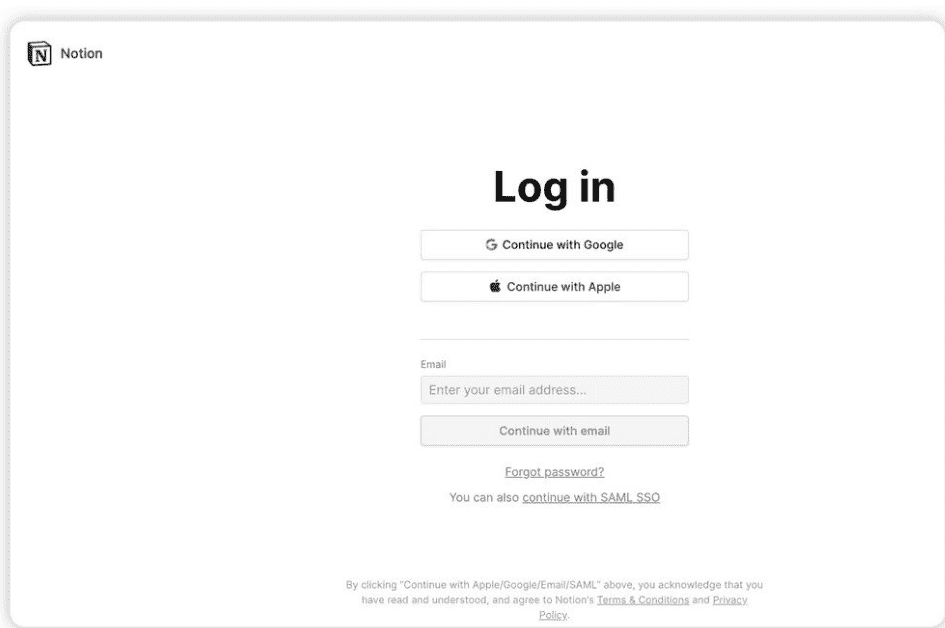
图4-1 Notion AI官方网站界面

支持用Google账号、Apple账号或邮箱登录。填写邮箱后会收到验证码，验证后进入登录页，填写姓名和密码。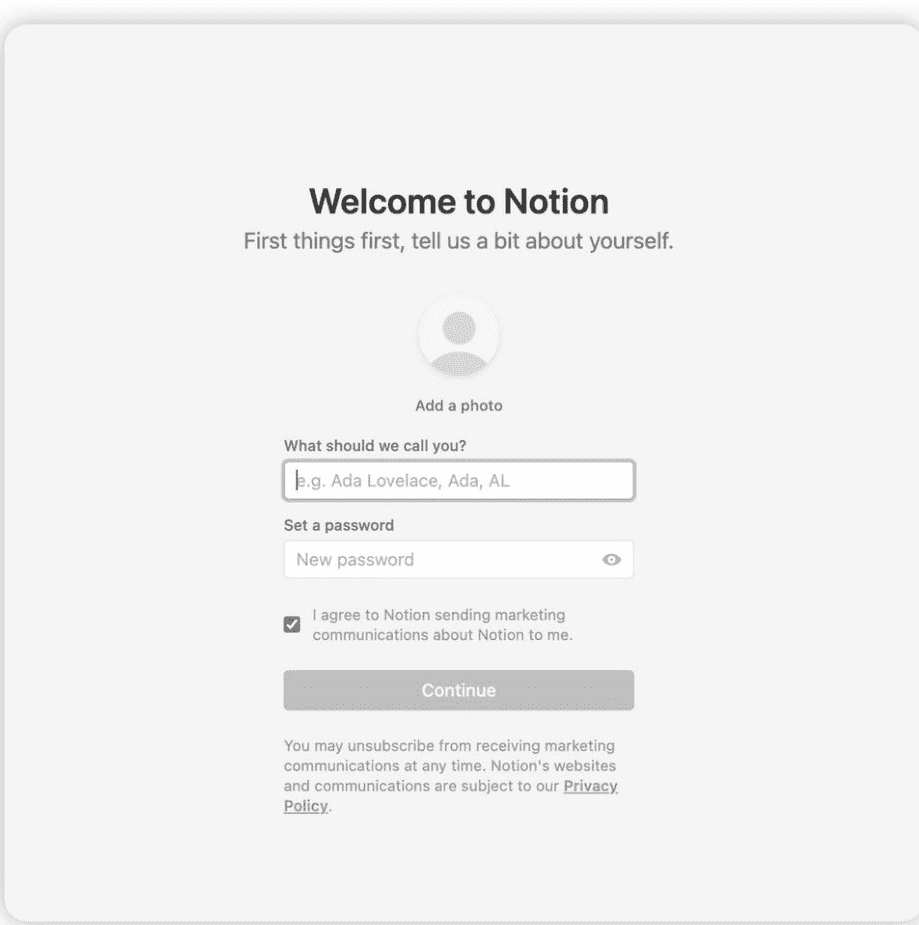
图4-2 Notion AI登录界面

设定完成后会进入使用场景选择页，包括团队使用、个人使用、学校使用，若无特殊需求可选择个人使用。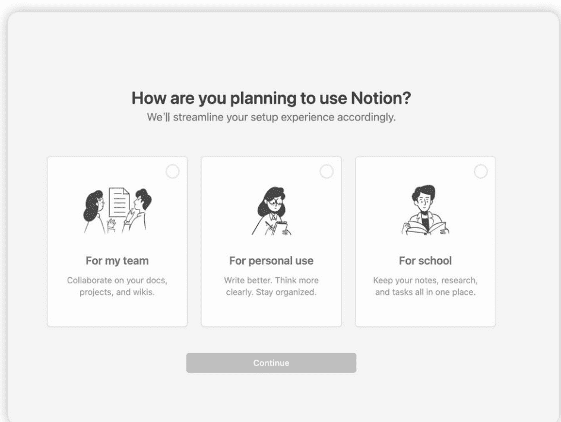
图4-3 Notion AI使用场景界面

#### 02. 从大纲到内容

在Notion AI中点击左侧“+”新建文档。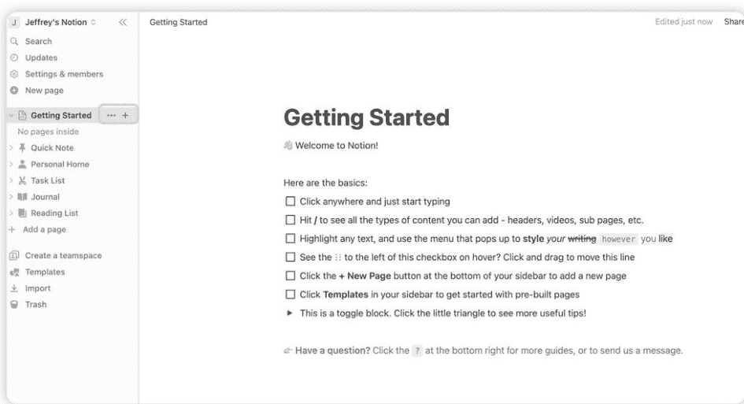
图4-4 使用Notion AI创建文档

进入编辑界面后输入标题开始创作。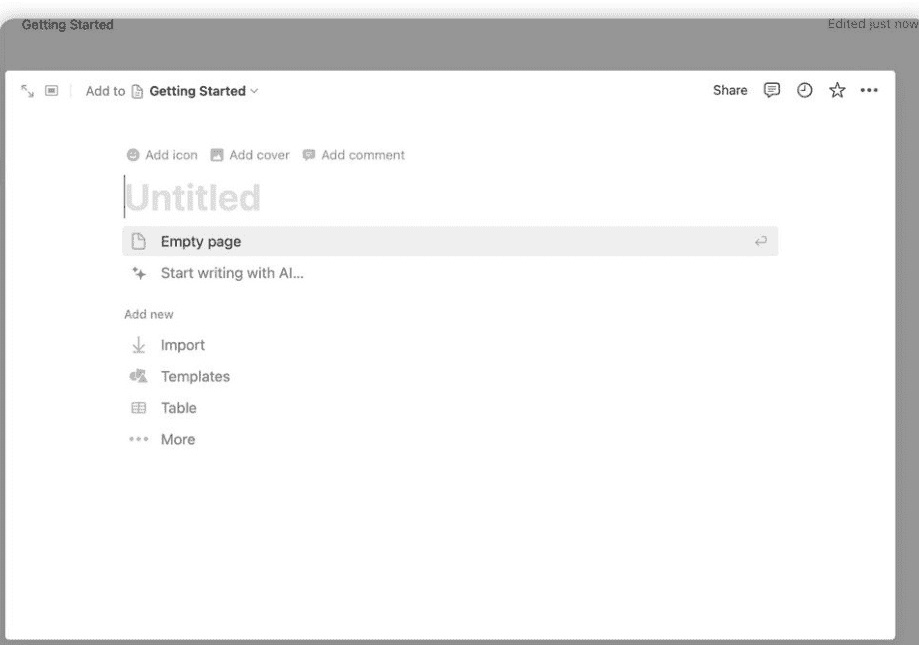
图4-5 Notion AI文档编辑界面

常规创作会先定主题再列大纲。在Notion AI中，标题确定后在正文处敲空格唤起AI助手，会出现对话框，内置快捷功能如继续写作、总结、提炼要点、翻译、解释、润色改写等。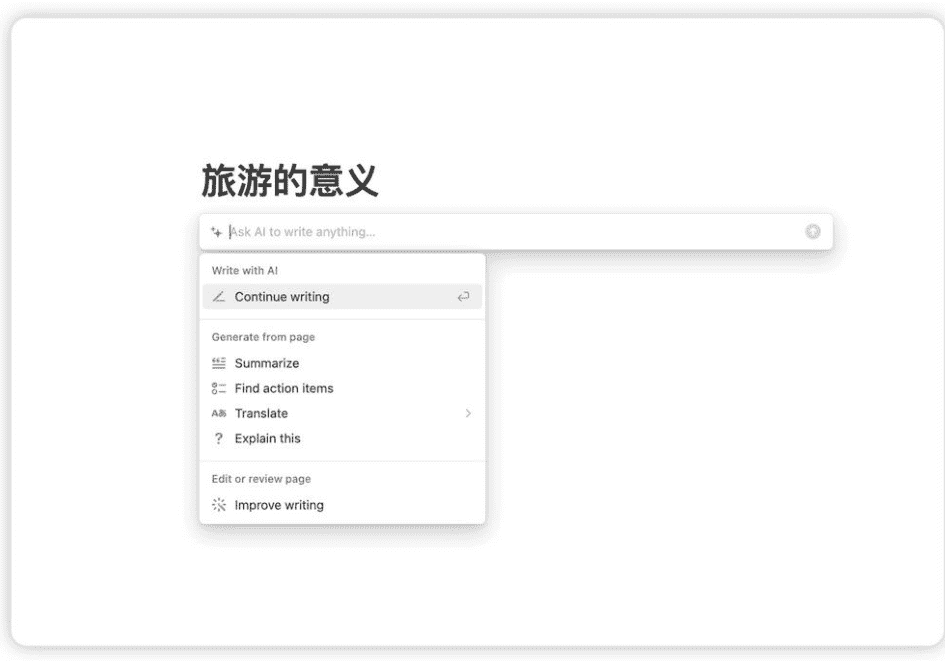
图4-6 Notion AI唤起AI

在对话框输入“写大纲”，系统会依据标题自动生成文章框架。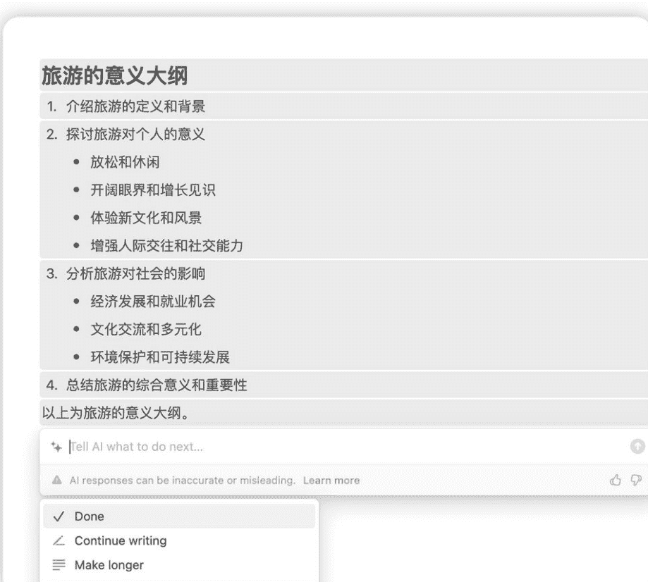
图4-7 Notion AI文章大纲生成界面

大纲生成后需自行审阅，对不合适之处按需调整。有了框架后，可选中任意要点，唤起AI按钮后输入指令，完成各节撰写。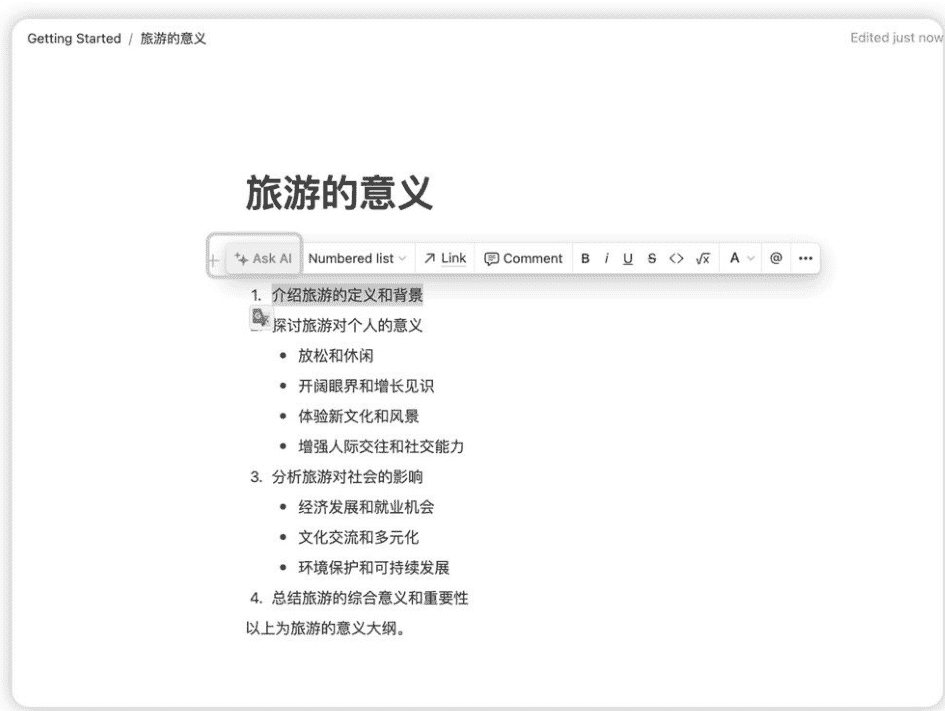
图4-8 Notion AI根据选中的要点进行内容创作

创作时可调节生成长度，生成后仍需校验准确性与主题契合度。

#### 03. 其他功能

前面提到的扩写、润色等工作，都可通过选中文本后出现的菜单完成，无需手写提示词。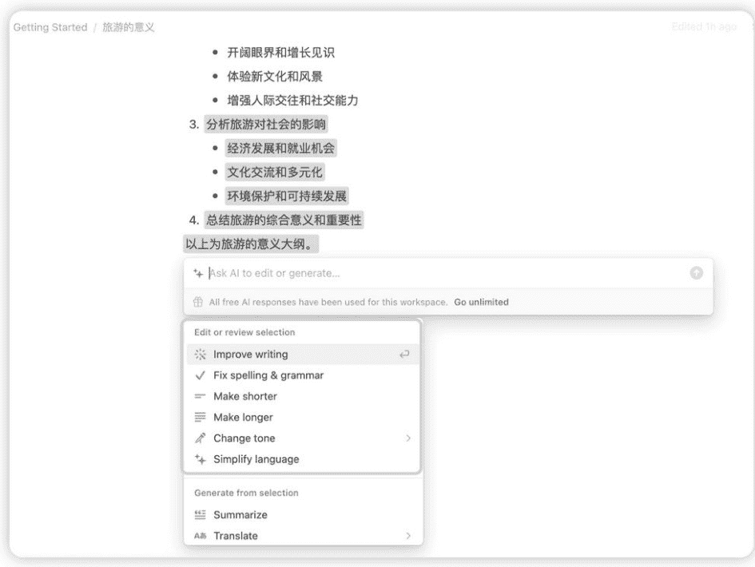
图4-9 Notion AI的其他功能

其中主要功能含义如下：
Improve writing：改写润色原文。
Fix spelling & grammar：修正拼写和语法。
Make shorter：压缩篇幅。
Make longer：扩展篇幅。
Change tone：转换语言风格。

选择“Make longer”后，系统会扩写所选内容。可选择替换原段或插入下方，不满意可重新生成。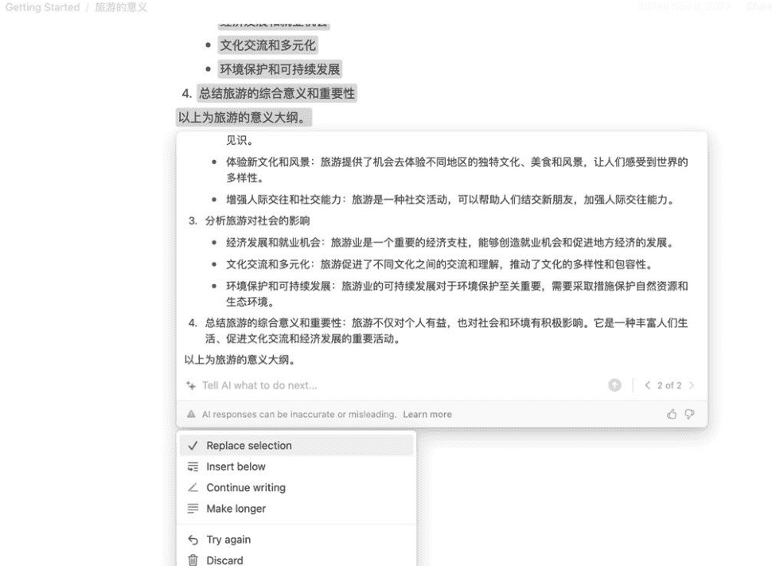
图4-10 选择“Make longer”选项生成的内容

选择“Change tone”后，可将文风转为专业、休闲、直率、自信、友好等风格。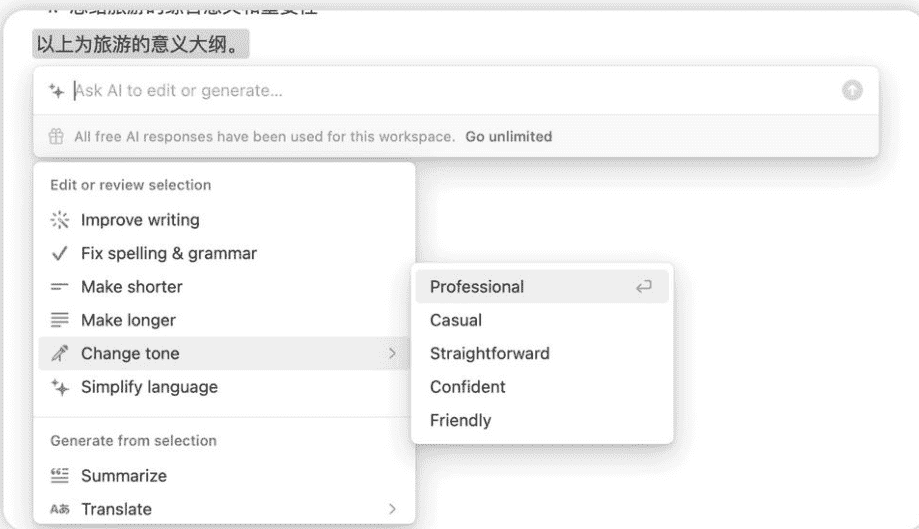
图4-11 “Change tone” 选项及其扩展选项

#### 04. AI创作

“改”“扩”等选项本质是AI创作的快捷方式，若想最大化能力，直接唤起AI创作更灵活。编辑时按空格即可调用。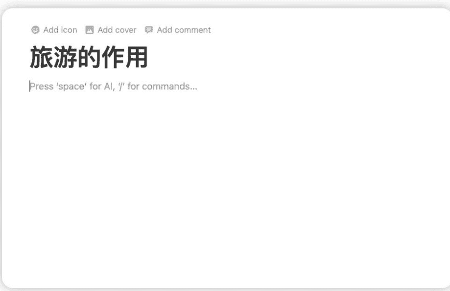
图4-12 Notion AI唤起AI创作功能

在对话框提出具体写作要求，回车后即可生成。若菜单里的续写、改写、翻译、总结能满足需求，也可直接点选。选择模板后对话框会自动带入提示词，需补充更多信息后才能生成。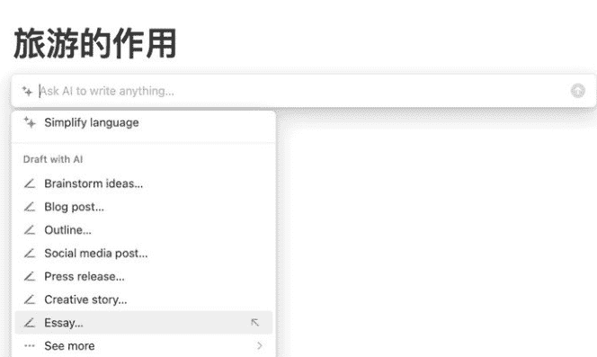
图4-13 Notion AI模板选择

至此，Notion AI的基础用法已清晰，它提供了一套完整的工作流，让创作更轻松。Notion AI是较早实现AI与文字处理工具深度结合的产品，市面上类似工具也在不断涌现。

### 二、飞书智能伙伴

飞书智能伙伴是基于人工智能算法的智能服务，既能为个人提供文档创作与提效能力，也能为企业搭建知识流转与业务联动的统一平台，提升整体运转效率。

飞书CEO谢欣提出“AI ready”概念，指AI时代需先实现“数字化沉淀”。企业使用AI的基础是行业数据加业务流程，这是AI真正进入企业内核的关键。

#### 01. 飞书智能伙伴对话的基本功能

与ChatGPT相似，飞书智能伙伴可根据用户消息回复，并在需要时调用互联网搜索。若需搜索，会调用头条搜索获取最新知识并据此作答；否则直接基于大模型回应。

输入问题时，系统会推荐可能的操作指令或问法，点击推荐词即可快速发送，无需手动输入完整提示。操作步骤如下：

点击“新话题”，在卡片消息中可快速选择功能场景，无需手动设定角色或身份。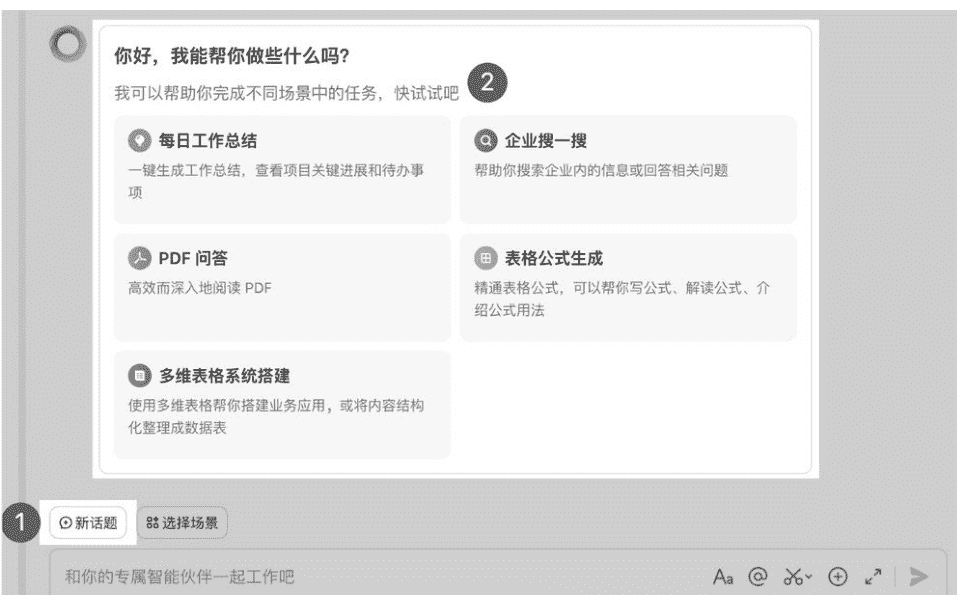
图4-14 飞书智能伙伴的对话界面

飞书智能伙伴的实战用法，从聊天到创作都能省时间

在私聊里，飞书智能伙伴会根据你正在聊的内容，实时在侧边给出你可能想追问的问题，直接点进去就能立马提问，相当于替你把话接上，见图4-15。

02. 群聊场景下怎么用
群聊是职场信息最密集的地方，智能伙伴能帮你把杂乱的文字梳理清楚。进入群聊页面后点顶部智能伙伴的头像，就能看到几项操作。
收到的卡片里，系统会推荐一些提示词，一键点开就能对最近的群消息做快速归纳。
也可以在右下角的输入框里自由提问，伙伴会基于整段群聊上下文来回答。图4-16展示了总结群消息并提问的界面。

03. 会议提效
开会时智能伙伴会自动提炼内容，会后在妙记文件和会议纪要文档里随时回看。智能提炼的纪要里包含三块：
智能会议总结和待办，快速抓住核心结论和下一步动作；
智能章节纪要，帮助你把握整体脉络，定位想要的部分；
发言人时间轴总结，可以迅速看到每个人的关键观点。
需要注意的是，只有拥有智能伙伴权限的会议发起人，才能在会后生成纪要和待办。若想提炼本地的音频或视频，先把文件上传到妙记，生成妙记后就能看到智能总结。图4-17是会议使用的界面。

04. 文档创作
新建文档输入标题后点“智能伙伴帮我写”，就能按标题自动生成初稿。
对生成的文字选中后，伙伴可以做篇幅压缩或扩展、语法校对、语气调整，让修改更省力，见图4-18。
在客户端打开文档，点右上角的智能伙伴入口，还能基于整篇文档做总结、解释和关键词查找，长文档阅读效率明显提升，见图4-19。
系统里还内置了多领域的AI模板库，专业文档的起步变得更简单。

05. 起草邮件
新建邮件时点“飞书智能伙伴帮我写”，按你的描述快速生成邮件正文，见图4-20。该功能还包含邮件模板和智能润色。
邮件模板能依据主题生成个性化框架，快速成稿；
智能润色则支持扩写、润色、概括和续写已有内容。

06. 设计问卷
在飞书问卷里，智能伙伴可以一键生成题目，满足调研和信息收集需求，见图4-21。核心流程：
点标题或插入题目唤起伙伴；
输入使用场景或主题，让它规划整份问卷；
根据描述自行选择字段类型生成表单问题；
用指令灵活调整问卷长短和题型，一键得到更详细或更简洁的版本。

其他AI写作助理的参考
除了飞书，市面上还有不少写作向的AI工具。
Jasper AI提供了大量面向市场营销的模板，在英文场景里应用很广。Friday同样模板丰富，但主攻中文市场，甚至准备了微信公众号、知乎等平台的模板。
搜索引擎结合AI的代表是New Bing。Bing原本就是微软的普通搜索框，加入AI对话交互后多了一个聊天入口，所以常被叫做New Bing，图4-22是其操作界面。和ChatGPT相比上手感类似，但生成逻辑不同。
ChatGPT基于预训练大模型，只能依赖训练时见过的数据，对近期新闻等新信息无能为力。Bing把搜索能力接入大模型，能实时检索新信息再整合输出，补上了ChatGPT的短板。
国内类似的产品是百度的文心一言，同样支持对话、问答和创作，图4-23为官网界面。
2023年12月，百度还推出了基于文心一言的AI原生应用“超级助理”，以Web Copilot浏览器插件的形式随行。它能感知需求，处理复杂问题、辅助文案创作、智能处理文档、对话式搜索、全文翻译等，还可通过插件集成到企业系统里，串联多个业务系统形成一站式入口。资料来源：https://mp.weixin.qq.com/s/GAcKBzdX0q9fhyX4stzzzg。
工具很多，功能也趋同，但各有侧重。建议先用一个通用工具上手，把精力放在内容本身，随着使用逐步明确真实需求，再做选择，避免过早陷入工具挑选的内耗。

本章小结
本章梳理了文字处理全流程的AI辅助：头脑风暴、举例、按大纲创作，以及对已完成内容的扩写、缩写和润色。既有ChatGPT这类通用强能力工具，也有Notion AI、飞书智能伙伴这类把文字处理与AI深度结合的产品。未来文字工作必然是人机配合、各展所长。

第5章 用AI助理绘图

第1节 AI绘图的基础：Diffusion模型
现在流行的“文生图”，背后核心是Diffusion扩散模型。Midjourney、Stable Diffusion、DALL·E2等主流工具都基于它。
扩散是物理现象，像墨水在水里慢慢散开。模型先生成一张全噪声图，再根据文本判断哪些区域该变清晰，逐步更新、迭代多次，最终得到与描述匹配的图像。整个过程类似模糊照片慢慢变清，从无到有的生成方式更自然可控。
语言如何映射到图像，则靠CLIP模型。CLIP是对比学习的图文预训练模型，同样出自OpenAI。它用互联网上约4亿对高质量图文数据分别编码文本和图像，学会计算两者关联度。CLIP的映射能力加上Diffusion的生成能力，构成了今天的AI绘图体系。

第2节 使用Midjourney绘图
Midjourney由美国旧金山的Midjourney Inc.打造，2022年7月12日进入测试，很快爆红。《经济学人》2022年6月封面、一个周末完成的儿童书《Alice and Sparkle》、科罗拉多州艺术博览会数字艺术冠军《太空歌剧院》都出自它。越来越多的人用它做市场配图、自媒体配图，把原本需要画师的工作压缩成几句提示词。

一、Midjourney的特点
AI绘图有边界，要先知道它擅长什么。
01. 不擅长精确和逻辑强的图
室内设计图、工业透视图这类需要精确的图，AI画不了。尺寸逻辑也容易错，比如远处的大象近处的小狗，它只能给出大致感觉。AI本质是检索再生成，不是严格绘制，把它当艺术家而非科学家更合适。
02. 自然语言难以做连续绘图
AI没有记忆，每次输入都会重新检索。同样的描述也可能得到不同结果，想用同一主角做连环画目前做不到。Midjourney可通过垫图的方式部分解决这个问题。
03. 多对象互动容易混乱
风景它能画好，但描述“两个小孩，一个高一个矮在湖边嬉戏”就会迷糊。人物超过3个时，常会出现人数增减的问题。AI不擅长处理复杂的人际关系。
这些问题不少是暂时性的，随着技术演进会改善。ChatGPT带来的连续对话能力就为未来的连续绘图提供了想象空间。
AI擅长的三件事：
风格化创作，能模仿几乎所有绘画风格，并融会贯通；
快速绘画，从输入到出图半分钟到三四分钟，效率远超手工；
风格融合，能把不同风格混在一起，突破想象边界。
所以使用时要规避不擅长的点，发挥它的优势。

二、Midjourney的“咒语魔法”
提示词决定输出效果。
01. 提示词结构
基础结构很直观，就是文本提示Text Prompt，描述你要的画面。
进阶结构包含三部分：Image Prompts、Text Prompt、Parameters。
图片提示放最前面，可放一个或多个图片URL作为参考，常用于生成头像。
参数放最后，可改变宽高比、模型版本、放大方式等，常用于指定壁纸尺寸。
中间的文本提示是核心，决定画面内容。
02. 文本提示的写法
文本提示≈主体+风格。
主体是你想画的东西，一只兔子、一座火山、一栋大楼，描述越具体越好，比如“穿着白色宇航服的兔子站在高山上”。
风格是呈现方式，皮克斯带来可爱的动画感，莫奈带来朦胧印象派。风格可以从绘画流派、艺术家等角度描述。AI对语言的理解体现在主体，对艺术的理解体现在风格。
掌握结构后，就能结合具体场景去实操创作了。

先用一个最简单的练习把Midjourney的操盘逻辑跑通，再把这个逻辑套到几个真实的使用场景里，整个上手路径就清晰了。我们就从头开始。

#### 实战1：从零开始画一张图

先拿“穿白太空服的兔子”来练手。这一轮能把最基础的创作链路摸明白：先想清楚要什么，再把想法变成描述，再看结果怎么修。

- 想明白创作意图；
- 把意图翻译成描述指令；
- 让模型产出画面并仔细对比；
- 依据细节回头调整描述。

和做其他事一样，动手前必须先把目标钉死。很多效果不理想，本质上是自己没想清楚画面长什么样。做一张图通常要回答三件事：画谁，画成什么样，用在哪。

这次的主角是只穿着白色宇航服的兔子。可以再具体一点，比如让它站在山巅对着峡谷。风格上希望可爱一些，动画感的。至于用途，这次只是练习，不做硬性限定。

思路理清后，就要把它转成模型能读懂的描述。先写主体：穿白太空服的兔子立在山峰上。风格上想要动画感，很多人会联想到皮克斯，那就用皮克斯风格。拼起来就是：

> 一只穿着白色太空服的兔子，站在山峰上，皮克斯风格

和Midjourney沟通最好用英文，翻译成：

> a rabbit in a white spacesuit standing on a mountain peak, pixar studio style

把这段发出去，模型会一次性给四张备选。工作就是逐张看细节，找最接近预期的那张。如果都不满意就改描述重来，如果有基本满意的，就有了优化的锚点。


图5-3 Midjourney生成的穿白色太空服的兔子

从整体判断，左上角那张最贴合需求。Midjourney给我们两条后续路径。

**细节放大。** 把选中图放大并补细节，对应生成图下的“U”。

**同图变体。** 在原图的风格基础上做变化，生成几张近似图，对应“V”。

四张图从左上到右下编号是1、2、3、4。我们想改左上角，就是编号1。

把操作和编号结合就是 U1 或 V1。比如对左上角做细节放大，选 U1。图5-4 就是 U1 的结果，画面和之前同一张，只是尺寸变大、细节更饱满。


图5-4 用 “U1” 选项放大后的穿着白色太空服的兔子

如果选 V1 做同图变体，图5-5 就会出来。虽然和原图很像，但局部细节会有明显差别。


图5-5 用“V1”选项变换后的穿着白色太空服的兔子

对某张不满意可以继续叠加 U 或 V 操作。多数情况下，最后都会回到细节放大，因为大图才是交付形态。这次第一次放大就已经达标，直接拿来用就好。

到这里，提示词-生成-观察-微调的闭环就跑通了。接下来用它解决更具体的任务。

#### 实战2：做一个Q版形象

这次要学会用图做参考和参数调节。上一节是凭空生成，这次是基于已有形象做 Q 版。

想为自己或宠物做头像，就需要以真实照片为基础，同时抓住可爱的 Q 版语感。AI 绘图的辅助让这件事变得门槛很低。

实现方式是“垫图”。把参考图的地址直接写进提示词里，这就相当于图片提示。先拿一张狗的照片做起点，如图5-6所示。


图5-6 AI生成的基础形象

先做最简测试：把图片地址放前面，后面跟主体描述。

https://cdn.pixabay.com/photo/2023/04/28/14/35/dog-7956828_1280.jpg, a dog


图5-7 让Midjourney根据基础形象绘制的图片

能看出模型确实在用参考图的特征，包括狗狗的长相和部分背景。主体没问题，但还不是 Q 版。

Q 版常用关键词是 Chibi，再叠加风格尝试。于是改成：

https://cdn.pixabay.com/photo/2023/04/28/14/35/dog-7956828_1280.jpg, a dog, Chibi, pixar style, 3D rendering


图5-8 Midjourney变换风格后的基础形象

形象立刻变得更生动有趣。可以在此基础上加细节，比如让这只狗穿宇航服坐在飞船里。

同时我发现效果有点太写实，想更动画一点。这时可以用参数 --iw 0.5 调节。-- 表示参数，iw 是 Image Weight 图片权重的缩写，0.5 就是降低参考图的权重，让风格描述更有话语权。

合并调整后的指令为：

https://cdn.pixabay.com/photo/2023/04/28/14/35/dog-7956828_1280.jpg, a dog wearing a spacesuit and sitting in a spaceship, Chibi, pixar style, 3D rendering --iw 0.5


图5-9 Midjourney调整参考图权重后生成的图像

右下角那张最符合预期，之后再用细节放大或变体继续打磨即可。

图片提示很好理解，就是一个具体的图。参数则很多，可以去官网查手册。这两个实战把提示词驱动绘图的完整感建立起来了。

#### 实战3：定制电脑或手机壁纸

壁纸是每天都在看的视觉皮肤，直接影响心情。风景、动漫、抽象都能表达偏好，但网上找的图永远不专属。用 Midjourney 自制一张独一无二的壁纸，现在已经很容易。

先定主题，比如“空中漂浮的城堡”。

电脑桌面壁纸和普通图的区别在于比例。常见有 4:3、16:9、16:10。这里做一张 16:10 的桌面版。用参数 ar 控制比例，ar 就是 Aspect Ratios 纵横比的缩写。

把主体和比例参数组合，得到提示语，生成结果如图5-10所示。

```
a floating futuristic castle in a clear sky, digital art, 3D rendering, 4k --ar 16 : 10
```


可以看到输出的四宫格已经按期望比例裁好了。满意的话再用细节放大或变体收敛。

手机壁纸则是竖版，常见 3:4、9:16、10:16。同样用空中城堡的主体，把比例换成 9:16，生成如图5-11所示。

```
a floating futuristic castle in a clear sky, digital art, 3D rendering --ar 9 : 16
```


图5-11 调整横纵比后Midjourney生成的壁纸图像

比例变了，画面整体变竖，马上就适合手机用了。

### 四、使用Midjourney的助手

提示词+生成已经能用，但要更顺手还得多练。多看别人的好作品，抄作业是最快的学习路径。PromptHero 就是一个很方便的灵感库。

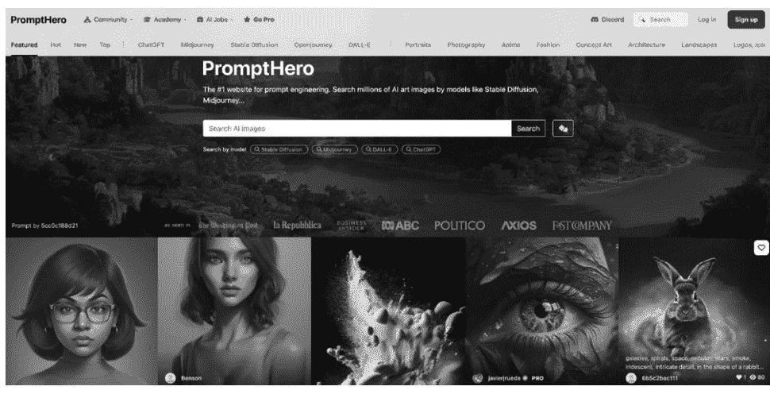

图5-12 PromptHero官方网站

网站收录大量作品并附带可复用的提示词。


图5-13 PromptHero参考提示词页面

另一个方向是直接帮你写提示词。Midjourney Prompt Helper 提供风格、光照、镜头、艺术家、材质等元素的可视化选择，每项都有图示参考。

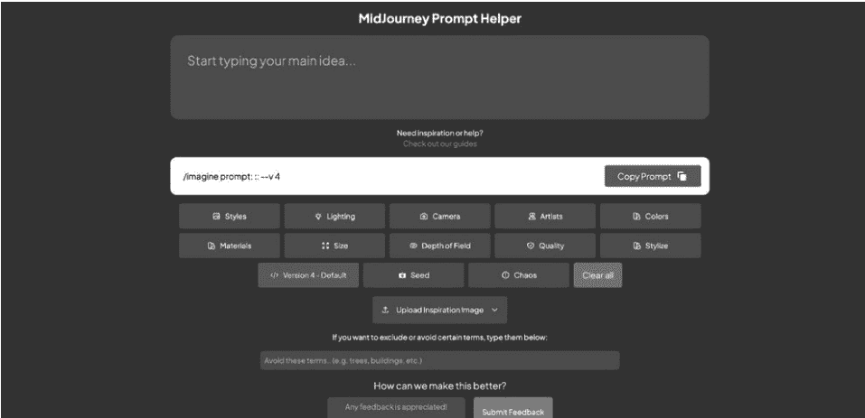

图5-14 Midjourney Prompt Helper官方网站界面

点选后可以组合出完整的描述，也可以学到不同词汇的画面效果。

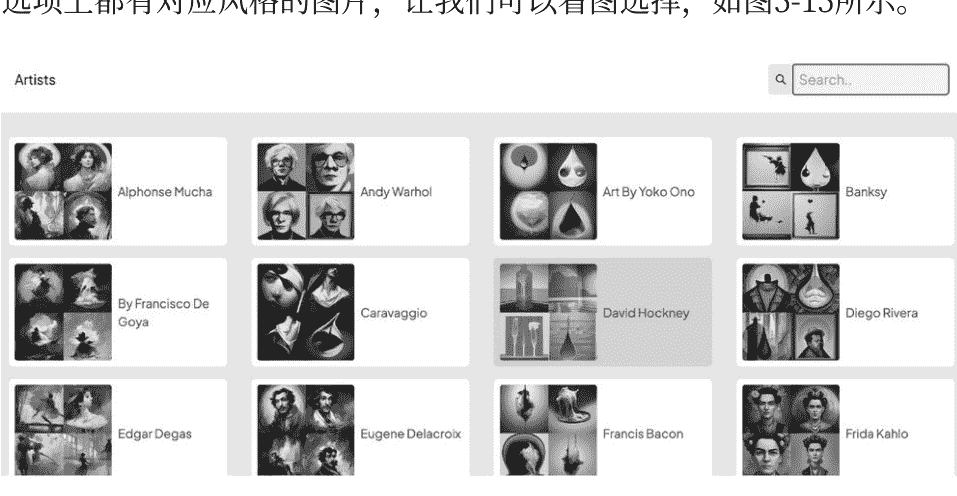

图5-15 Midjourney Prompt Helper的元素分类选择界面

## 第3节 其他AI绘图助理

Midjourney 目前最火，但生态里还有强力选手，比如 Stable Diffusion。

Stable Diffusion 由 StabilityAI、CompVis 与 Runway 联合开发，得到了 EleutherAI 和 LAION 的支持。

想先试水可以直接上在线版。

▲图5-16 Stable Diffusion在线版本

在线试验场的操作很快就能上手。

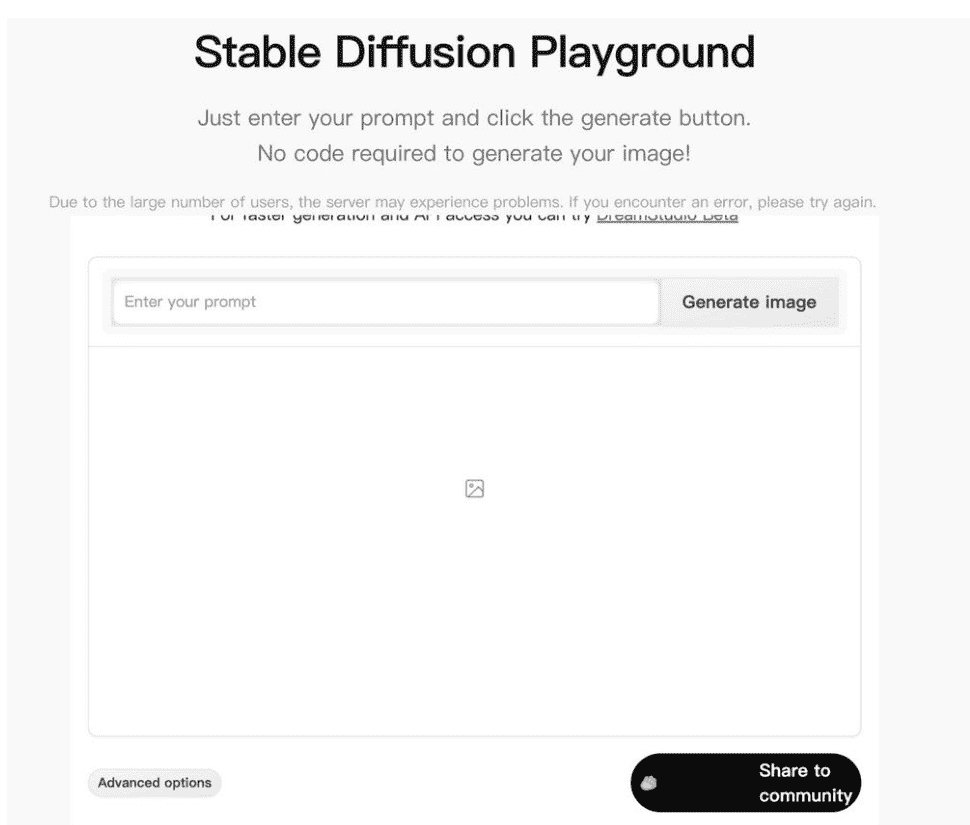

▲图5-17 Stable Diffusion的试验生成界面

有 Midjourney 的基础后，Stable Diffusion 的提示结构很容易迁移，都是“主体+风格”。不同的是它的参数多以页面选项呈现。

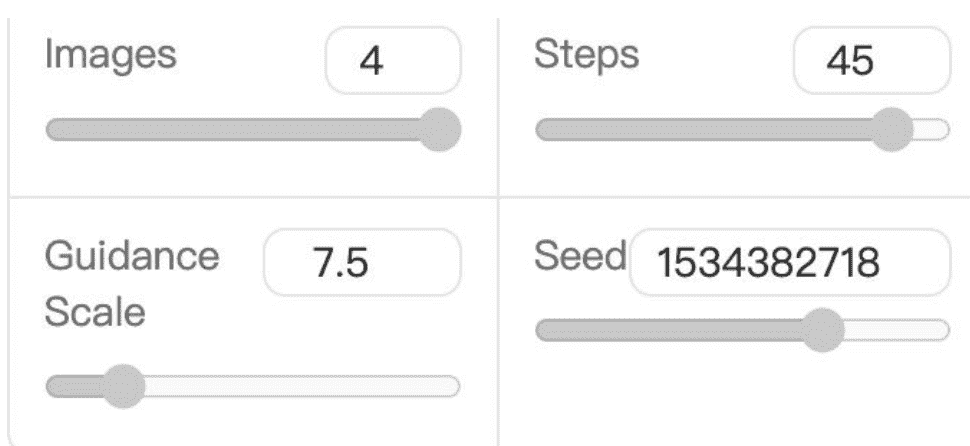

图5-18 Stable Diffusion的参数配置

这只是最基础的用法。Stable Diffusion 是开源项目，可以本地部署。最流行的是 Stable Diffusion Web UI，装好后界面如图5-19，就是一个属于自己的绘图工作台。

图5-19 安装好的Stable Diffusion Web UI项目

它的能力几乎覆盖 Midjourney，比如图文生图对应 Midjourney 的图片提示，还额外支持高清放大等功能。把两者结合使用，能覆盖从快速出图到精细控制的各种需求。

第一次上手 Stable Diffusion 的朋友，大概率会有一种感受：画质和质感怎么都达不到 Midjourney 的水准。差距的核心，其实就藏在模型里。换一个更匹配需求的模型，效果会立刻不一样，如图5-20所示。

不同模型带来不同画风和表现力。想要尝鲜，可以去 CIVITAI 官网找资源，这里汇聚了大量社区已经训好的模型，如图5-21所示。下载到本地后装进 Stable Diffusion，随后在生成时指定对应的模型即可切换风格。

需求更个性化的话，还能自己训一个专属模型。操作门槛并不高，只要准备几张风格相近的参考图，就能借助 Stable Diffusion 的训练能力产出专属模型，如图5-22所示。

除了画图本身，Stable Diffusion 的插件生态也很活跃，这让它可扩展的空间变得很大。市面上已经有很多人发布了各种用途的插件，如图5-23所示。

比如想让画面里的人物摆出特定姿势，可以用 OpenPose Editor 来操控人体的姿态，如图5-24所示。调整完毕后就能按编辑好的姿势生成对应的人物形象，如图5-25所示。

总体来看，Midjourney 更像一款开箱即用的精致工具，上手快就能出好看图；Stable Diffusion 入门成本稍高，但发挥空间极大，玩熟之后强大得惊人。

### 中文创作的解法：文心一言与文心一格

Midjourney 和 Stable Diffusion 能力都很强，基本能满足大多数创作需求。真正让人头疼的是语言问题：两者都是用英文数据训练的，提示词用英文效果更好。如果能有一款听得懂中文的绘图 AI，使用门槛会大幅下降。

百度的大模型文心一言就提供了解决方案。前面章节里我们已经体验过它的对话用法，和 ChatGPT 类似。不过文心一言多了一个能力，就是直接根据文字描述生成图片，技术上属于多模态。

图5-26 是一次与文心一言的对话示例，我让它生成“漂浮在晴朗天空中的有未来科技感的城堡，采用3D渲染的效果，数字艺术风格”。从结果看，文心一言对于灵感启发、快速出草图是够用的；但如果要做精细化图像生产，可控参数和细节调节就显得有限。

如果说文心一言只是顺带有了绘图功能，那么文心一格才是百度主攻的 AI 绘图产品，其官网界面如图5-27所示。

我们之前积累的提示词经验搬到文心一格上非常顺手。如图5-28所示，用同样的提示词，文心一格产出的画面和 Midjourney 有异曲同工之妙。

点击任意一张结果可以放大查看，随后下载保存，如图5-29所示。

文心一格提供了丰富的创作选项，绘画风格就是其中之一，如图5-30所示。

另外还能加入参考图、设定画面尺寸等参数，如图5-31所示。这些配置让前面讲过的实战案例都能用文心一格实现。

有了文心一言和文心一格，中文用户就能直接用母语进行 AI 绘画创作，参与人群会明显扩大。

## 小结

本章从 Diffusion 模型谈起，以 Midjourney 为例说明 AI 绘图的基本特质。可以把 AI 绘图工具看作一位“艺术家”：它不擅长精确控制、记忆力有限、也不擅长人际协作；但它眼界极广、融会贯通、出手很快。把握这些特点，才能发挥其最大价值。

提示词的核心结构可以总结为：
文本提示 = 主体 + 风格
主体描述对普通人来说相对简单，风格则需要积累。可以通过临摹优秀作品、借助风格检索网站来提升。

不同工具细节有差异，底层逻辑相通，关键都在模型。Midjourney 自带行业领先的模型，默认就能出好图；Stable Diffusion 则需要使用者按需求挑选模型。创作时都可以提供参考图、调节参数。区别在于，Midjourney 把这些需求写进提示词里，Stable Diffusion 则通过界面选项配置。

Stable Diffusion 额外提供了模型微调、姿态编辑等插件级能力。

文心一言与文心一格降低了中文用户的绘画门槛。

AI 绘图的基础不难，但要真正用好，需要持续练习和尝试，才会从玩具进化成提升工作效率的利器。

# 第6章 用 ChatGPT 制作演示文稿

## 第1节 用 ChatGPT 辅助制作 PPT 的方法

借助 ChatGPT 生成 PPT 的路径很多：直接咨询操作技巧、让它输出 Markdown 大纲、用第三方插件等。下面逐一说明。

### 如何用 ChatGPT 快速熟悉 PPT 操作

遇到具体问题可以直接提问。

> 如何更改 PPT 中的文本框大小和位置？
> 可以按下面步骤操作：
> (1) 选择目标文本框，在 PPT 中点中它使选框出现。
> (2) 调整大小，鼠标移到边框或角落变成双向箭头时拖拽即可。
> (3) 调整位置，点击选中后按住鼠标左键拖动到新位置。
> (4) 完成后保存文件。

> 如何在 PPT 中添加图片或图标？
> (1) 打开幻灯片，点击顶部“插入”选项卡，选择“图片”或“图标”。
> (2) 插入图片时挑选本地文件，选择后即可加入幻灯片。
> (3) 插入图标时可在内置库或在线库搜索，选定后点击插入。
> (4) 加入后可拖拽调整大小和位置。
> (5) 记得保存。

> 如何在 PPT 中创建幻灯片过渡效果？
> (1) 选中要添加效果的幻灯片。
> (2) 打开“幻灯片切换”选项卡。
> (3) 浏览效果列表挑选喜欢的过渡。
> (4) 自定义时长、切换方式、是否加音效等选项。
> (5) 点击预览查看效果。
> (6) 满意后可点击“应用于所有幻灯片”。
> (7) 保存更改。

### 高阶用法：用 Markdown 生成 PPT

Markdown 是一种轻量标记语言，书写简洁、易读易写，可转成 HTML、PDF 等格式。在线平台广泛支持，也能快速为 PPT 搭建骨架，再用 PPT 自带的排版和美化功能润色。

#### 01. Markdown 基础语法

用 # 表示标题，# 的数量决定层级，最多六级。
用 * 或 _ 表示斜体，比如 *斜体*，或 _斜体_。
用 ** 或 __ 表示粗体，比如 **粗体**。
用 ~~ 表示删除线，比如 ~~删除线~~。
用 [文本](链接) 表示超链接，比如 [百度](https://www.baidu.com)。
使用来表示图片，比如。
用 ` 表示行内代码，比如 `print("Hello, world!")`。
用 ``` 表示代码块，可在后面加上语言，如```python print("Hello, world!")。

#### 02. Markdown 扩展语法

- 用 - 或者 * 表示无序列表，每项一行，符号后空一格。
- 用数字加点表示有序列表，点后空一格。
- 用 > 表示引用，可多层嵌套。
- 用 | 和 - 画表格，第一行为表头，第二行用 - 分隔，可加 : 控制对齐。
- 用 $ 表示数学公式，支持 LaTeX 语法。

#### 03. 优势与局限

优势是简洁易读，任何文本编辑器都能写，转换方便，适合写文档、笔记、博客。局限是功能有限，复杂排版做不了。

### 如何让 ChatGPT 输出 Markdown 文档

(1) 明确需求，确定要包含的标题、结构、列表、链接、图片等。
(2) 用自然语言描述需求，例如：“我需要一个包含一级标题‘我的项目’、二级标题‘项目描述’、无序列表包含项目1、项目2、项目3，以及一个 GitHub 链接的 Markdown 文档。”
(3) 查看 ChatGPT 生成的代码，有需要再让它修改。

### 在 PPT 中导入 Markdown 代码的四步流程

(1) 把 ChatGPT 生成的 Markdown 大纲复制到 Word 文档。
(2) 在 Word 中调整标题层级：选中文字 -> 开始选项卡 -> 样式组 -> 选择“标题1”“标题2”等，保存为名为“大纲”的 Word 文件。
(3) PowerPoint 中新建演示文稿，选择“从大纲创建幻灯片”，导入刚才的 Word 文件，选择布局后点击创建。PPT 会自动把标题和正文转为幻灯片。
(4) 用“设计”选项卡和“设计师”功能优化主题、字体、配色、背景、版式等。

总的来说，ChatGPT 负责搭骨架，PowerPoint 负责美化与排版，配合起来能快速产出条理清晰、视觉专业的演示。

## 第2节 实战演练：用 ChatGPT 快速制作 PPT

### 生成一份销售报告

小张在一家贸易公司做销售经理，需要向领导和客户汇报上月业绩，时间很紧，他用 ChatGPT + PowerPoint 快速制作了报告。

请生成一份介绍上月销售业绩的大纲，包括总销售额、产品销售情况、客户销售情况和区域销售情况。

#### 上月销售业绩大纲

##### 总销售额
- 上月总销售收入
- 销售同比增长比例

##### 产品销售情况
1. 产品 A 销售情况
   - 销售金额、销量、销售占比等
2. 产品 B 销售情况
   - 销售金额、销量、销售占比等

##### 客户销售情况
- 客户数量、数量占比、销售份额

##### 区域销售情况
1. 区域 A
   - 总销售额、同比增长比例
2. 区域 B
   - 总销售额、同比增长比例

小张把内容贴进 Word，按层级设好标题1、标题2，保存为“上月销售业绩大纲”。随后在 PowerPoint 中选择“从大纲创建幻灯片”，导入该文件，选“标题和内容”布局后创建。

自动生成的幻灯片中：
第1页展示公司总销售额及同比增长；
第2页拆分产品 A 和产品 B 的金额、销量、占比，用饼图和折线图呈现；
第3页汇总客户数量、占比、销售份额；
第4页对比各区域销售额和增速，并在地图上做视觉区分。

随后他插入表格、图表，用“插入”选项卡的图表功能在 Excel 中填入数据，再调整布局、色彩、字体。半小时内一份专业清晰的销售报告就完成了。

### 生成一份培训课程

小李在培训机构担任课程设计师，工作是为不同专业背景的学员打造贴合实际、收获感强的培训内容。每天都有上百名学员在等着他的课程方案，时间压力非常大。他敏锐地察觉到 ChatGPT 和 PowerPoint 组合的效率价值，于是决定先用 AI 生成木工手工课程的 PPT 初稿，再在 PowerPoint 里细化呈现。

请输出一份手工制作木工品的课程大纲，包含课程概览、材料讲解、工具演示、技术解析、实战项目和收尾环节。

#### 手工制作木工品课程大纲

##### 课程概览
- 把木工制作的核心概念和学习意义讲清楚
- 预告学员将获得的具体能力与知识点
- 说明总课时和各模块时间分配

##### 材料讲解
- 梳理常见木材品种及其特性和差异
- 演示在制作中如何保留并发挥木材本真特性
- 讲解木材的挑选要点和妥善存放方法

##### 工具演示
- 概括各类常用工具的作用范围
- 介绍锯子、钻机、木工刨、砂纸等典型工具
- 示范每件工具的安全规范与正确操作手法

##### 技术解析
- 介绍切割、雕刻、钻孔等基础工艺
- 逐步演示操作方法及与工具的配合技巧
- 安排若干迷你练习和小型实操任务

##### 实战项目
- 以制作木质镊子、简易书架等基础设计为例进行带教
- 引导学员基于生活需求构思并实现不同木工成品
- 全程提供辅导，确保每位学员能顺利完成作品

##### 收尾环节
课程收束时对学习成果进行回顾点评，给出改进建议，并号召学员继续参与后续设计实践来巩固技能。

先把以上提纲复制到 Word 文档里排版。小李依据标题层级把“手工制作木工品课程大纲”设为一级标题，把“课程概览、材料讲解、工具演示、技术解析、实战项目、收尾环节”设为二级标题，使结构更清晰，随后以“手工制作木工品课程大纲”为名保存文件。

随后他打开 PowerPoint 导入大纲，选择合适的主题与版式，保证每个板块都有足够视觉权重。为提升可读性，他加入了示意图表和配图来强化重点信息。

为了拉近与学员的距离，他又补充了讲师自我介绍和课堂守则，还设计了小组讨论、个人互动等环节帮助内化知识。

PPT 框架成型后，他反复修改增补细节，选用与木工主题契合的配色方案，同时在章节之间加入流畅的转场动画，优化观看体验。

最后他把成品导出为 PDF 或 PPTX 两种可分发格式，方便学员随时查阅复习。借助 ChatGPT 和 PowerPoint，制作周期被大幅压缩，工作效率明显提升，而成稿也完整呈现了各主题要点，学员能收获最贴合实际的技能。

### 三、编写公司介绍

小赵是创新科技公司的市场部负责人，需要向高管和潜在投资人展示企业的核心价值、运作方式和市场潜力。他选择用 ChatGPT 配合 PowerPoint 快速搭建一份公司简介演示文稿。

> 请生成一份公司简介大纲，包括公司使命、业务模式、市场前景和公司历程。
```
#### 公司简介大纲

##### 公司使命

- 公司的核心使命和价值观
- 公司致力于解决的问题或提供的解决方案

##### 业务模式

- 公司的核心产品或服务
- 公司的盈利模式和商业策略

##### 市场前景

- 行业市场规模和增长趋势
- 公司在市场中的竞争优势和定位

##### 公司历程

- 公司的发展历程和重要里程碑
- 公司的成就和荣誉
```

首先，小赵把大纲复制到 Word 中进行编辑和格式整理。根据标题层级，他把“公司简介大纲”设为一级标题，把“公司使命、业务模式、市场前景、公司历程”设为二级标题，形成清晰的层级，随后以“公司简介大纲”命名保存。

接着，他在 PowerPoint 中选用“从大纲创建幻灯片”功能，以保存的文档为源文件导入。选择“标题和内容”等适用版式后一键生成。

第1页呈现公司的使命与价值观，突出企业要解决的痛点或提供的解决方案。

第2页说明业务模式，展示核心产品或服务、盈利逻辑与商业策略。

第3页描绘市场前景，包含行业规模与增长态势，以及公司的竞争优势与定位。

第4页回顾发展历程与关键里程碑，展示重要成果与荣誉。

他进一步加入图片、图表等视觉素材，微调版式与设计，提升整体吸引力与信息清晰度。最后通过统一版式、色彩、字体等细节打磨，使演示看起来更专业精致。预演后确认内容完整且符合预期，整个制作耗时不足一小时，ChatGPT 与 PowerPoint 大大提高了效率。

### 四、快速生成个人简历

工程师小王正在求职，他深知一份能清晰传递技能与经历的 PPT 简历更容易获得面试机会。考虑到时间与能力限制，他决定借助 ChatGPT 与 PowerPoint 制作个人简历演示文稿。

请生成一份个人简历大纲，涵盖个人介绍、工作经历和教育背景。

#### 个人简历大纲

##### 个人介绍
- 职业理想与追求方向
- 核心工作经验与代表性成就
- 专业技能与背景概况

##### 工作经历
- 任职公司名称
- 任职时间段
- 主要职责与突出成果

##### 教育背景
- 毕业院校名称
- 所获学位与专业方向

他先把大纲转化为幻灯片框架，按需加入图表、配图与数据支撑工作经历与技能。随后调整版式、字体与配色，使整体更专业易读易记。

他使用 PowerPoint 内置模板，采用分区式布局，用不同板块突出不同信息与经历。每块确定文字、图片与数据的呈现位置，清晰展示能力与履历。

在制作过程中，他注重观众的视觉体验与阅读友好度，选择协调的主题色与风格。除了教育背景和技能信息，还增添表格、图表和有辨识度的图片作为亮点，提升吸引力。

最终借助 ChatGPT 与 PowerPoint，他迅速完成并优化了个人简历 PPT，清晰传达了工作经历、技能与能力，为面试提供了有力素材。

## 第3节 配合ChatGPT的第三方工具

在直接使用 ChatGPT 之外，还可以借助基于 ChatGPT 的第三方插件提升效率。

### 一、ChatPPT

ChatPPT 是一款面向高效制作演示文稿的工具，专门解决时间紧、设计经验不足、创意卡壳等问题。依托 AI，它能根据创作意图快速生成、美化与优化 PPT，并提供辅助写作与演讲备注功能。其自动化能力强，能显著缩短制作时间，同时保证专业水准的设计与内容质量，适合职场人士和学生快速产出高质量演示文稿。如图6-1所示，下面我们将结合 ChatPPT 的官方文档介绍其功能。
资料来源：https://www.kdocs.cn/l/cdnhYWUcdfXi。
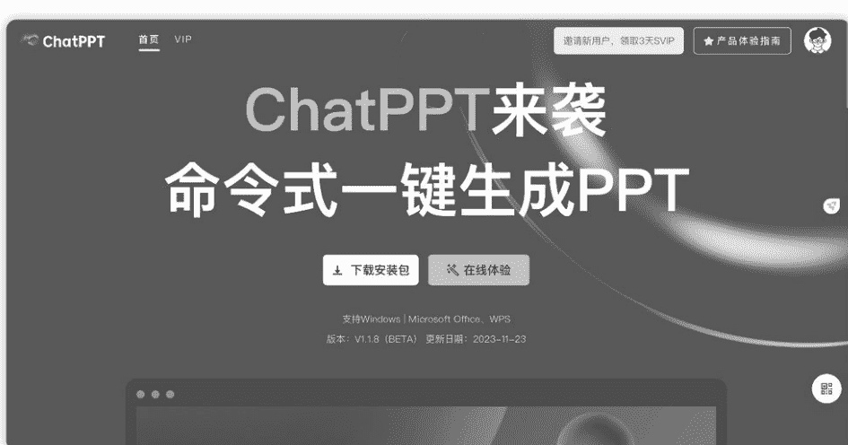

### 图6-1 ChatPPT官方网站界面

目前 ChatPPT 的使用形态主要有两种：在线体验版和 Office 插件版。

（1）在线体验版。提供在线 AI 生成 PPT 服务，支持在线生成基础文档、预览与下载。

在线体验版提供的主要功能有三种：内容风格、色彩语言和文件转 PPT，如图6-2所示。

# 第6章 用ChatGPT制作演示文稿 195
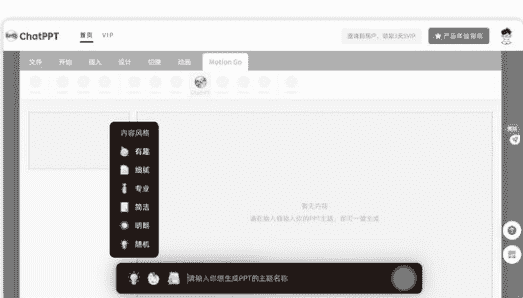
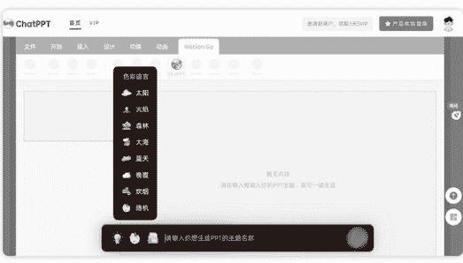
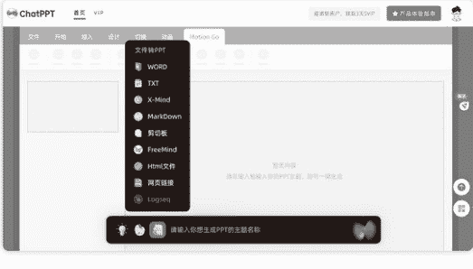

### 图6-2 ChatPPT在线体验版提供的3种功能

如图6-3所示，这里以“大学生如何做职业规划”为主题，用 ChatPPT 生成一份演示文稿。
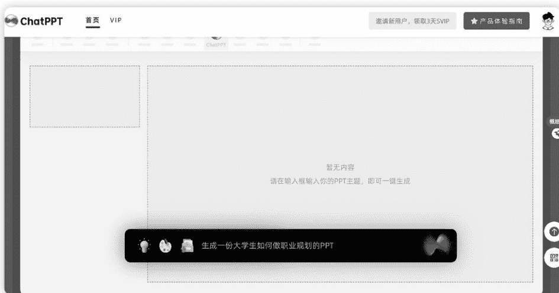

### 图6-3 用ChatPPT做一份PPT

随后 ChatPPT 内部的 AI 开始解析并生成 PPT 模板，如图6-4所示。
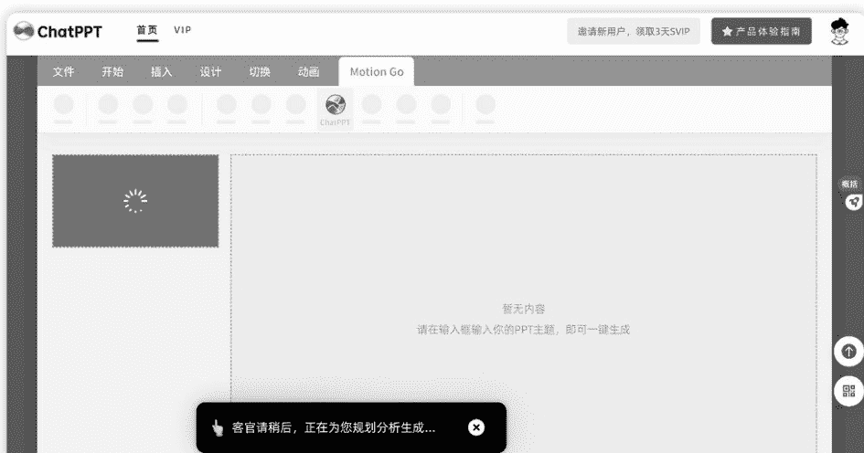

### 图6-4 正在解析并生成PPT模板

如图6-5所示，ChatPPT 生成的主题 PPT 在格式和内容上只需做少量微调即可使用。
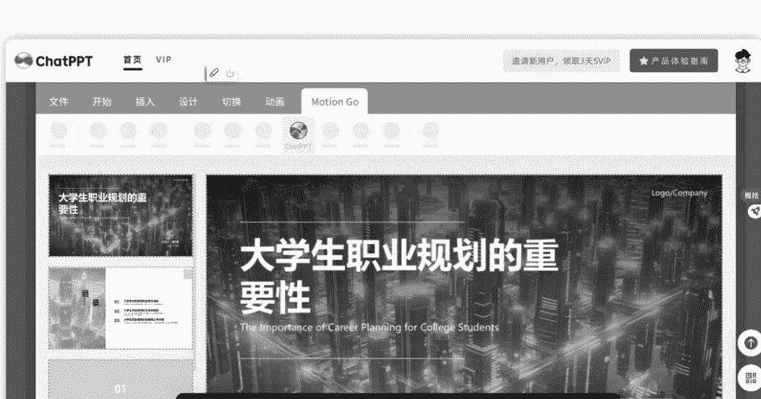

### 图6-5 AI生成后的PPT内容

在线创建完成后，可选择下载格式，ChatPPT 支持 PDF、长图和 pptx 等格式，如图6-6所示。
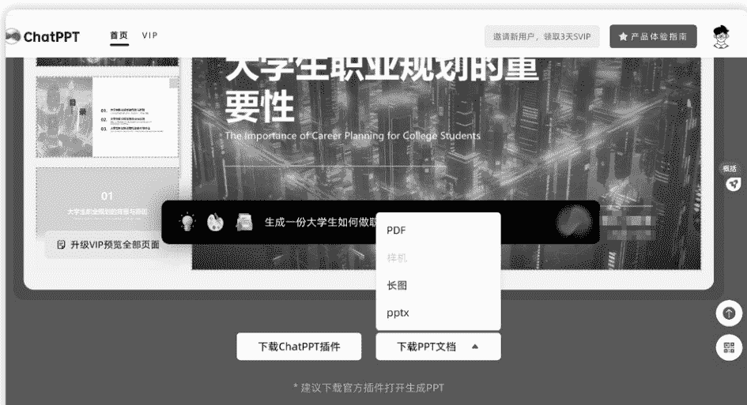

### 图6-6 选择下载格式

（2）Office 插件版。在微软 Office 与 WPS 上提供完整的 AI 生成 PPT 功能，目前仅支持 Windows 系统安装。安装后会在 Office 软件中出现“ChatPPT”快捷按钮，并可唤起 AI 助手。

插件版功能更全面，指令类型丰富。主要包括：

生成类指令。可依据创作意图生成完整 PPT，支持 Word、PDF、TXT、思维导图等文件导入及网页链接。

美化类指令。可更换模板、设置字体与文本格式、更改主题色、调整排版、插入图片、词云、图表等。

辅写类指令。提供续写、润色、改写、精炼、扩写等写作辅助。

演讲备注类指令。用于生成配套演讲稿或备注。

演示类指令。添加动画效果提升视觉表现。

分享类指令。支持导出为长图、样机、PDF 等可分享格式。

### 二、Marp

Marp 是一个轻量级 Markdown 报告生成器，可将 Markdown 文本转换为幻灯片。它是专为 VS Code 设计的插件，能方便地创建演示文稿。基于 Markdown 语言，用户可用简洁文本构建内容丰富的幻灯片。

只需用 Markdown 编写文档，再通过 Marp 导出为 HTML、PDF 或 PPT 格式。Marp 支持主题、背景色等多项自定义，且项目开源，源代码可查阅修改。

Marp 的所有组件均可在其 GitHub 页面免费下载，安装后即可用 Markdown 语法创建幻灯片。例如用 # 建立标题，用 - 生成列表，用 --- 划分新幻灯片。

Marp 还支持高级功能，如更改主题、长宽比、自定义样式。可在文件头部 YAML 区或通过 HTML 注释设置主题、宽高比、背景色等。标题自适应指令可放在标题 # 后，使标题自动填满整页，适合封面大标题。复杂样式也可借助 CSS 表格个性化定制。资料来源：https://segmentfault.com/a/1190000040806239。

在 VS Code 中可随时预览幻灯片。制作完成后点击编辑器右上角 Marp 图标，通过 Export Slide Deck 命令导出。支持导出 PPTX、PDF 和 HTML。

### 三、Slidev

Slidev 是基于 Vue 3 的现代幻灯片演示工具，可制作丰富多样、高质量的演示文稿。Vue 3 提供强大的界面构建能力，使 Slidev 灵活可定制、易用且可组合，支持多种设计、交互与动画效果。

Slidev 渲染性能优秀，得到开发者社区广泛支持，内置丰富组件、插件与主题，方便集成复杂元素，主题选择多，观感出色。

适用于演讲、研讨会、培训等场景，尤其适合需要高质量专业演示的场合。也可用于在线授课、录屏、团队协作等。

安装需先装 Node.js，再用 npm 安装 Slidev。创建新项目可用 `npx slidev create`，随后进入目录执行 `npm run dev` 预览效果。

演示文稿内容在 slides.md 中编辑，支持 Markdown 语法排版与文本修饰。图片、音频、视频等素材置于项目 public 文件夹，并在 slides.md 中引用。

Slidev 提供多种动画与转场效果，可通过 Markdown 标记设置页面渐入、缩放等特效，也可注册组件实现自定义转场。

完成后可用命令导出，或直接分享给观众。导出形式包括 PDF、PNG、HTML 等，也可用 `--build` 命令构建静态网站版本，便于他处展示与分享。

总之，Slidev 是面向现代演讲的演示工具，具有易用性与可定制性，适用范围广，在开发者与使用者中认可度高。

资料来源：https://blog.csdn.net/weixin_46232841/article/details/133272394。

### 四、闪击PPT

闪击PPT 是一款高效幻灯片创作工具，能迅速生成吸睛的 PPT 文档。结合 ChatGPT 与闪击PPT，可轻松产出专业演示文稿。资料来源：https://baijiahao.baidu.com/s?id=1765809640197026837。操作流程如下。

1. 利用 ChatGPT 生成 PPT 内容。向 ChatGPT 提供关键词或句子，生成涵盖产品介绍、技术解读、市场分析等多维度内容。
2. 把 ChatGPT 生成的内容粘贴到闪击PPT。中选择合适模板，将内容填入对应位置，模板形式多样，可自由挑选。
3. 调整格式与排版。修改字体、字号、颜色，加入图片、图表、视频等元素，使文档更生动。
4. 存储与分享。完成后可保存为 PPT 格式继续编辑，也可导出为 PDF 方便传播或印刷。

总之，用闪击PPT 可快速轻松创建令人印象深刻的演示文稿。

## 本章小结

本章探讨了如何借助 ChatGPT 制作演示文稿，尤其是 PPT。首先介绍了利用 ChatGPT 辅助制作 PPT 的基本方法，包括查询调整技巧、生成 Markdown 文档等。随后通过实战案例展示了如何快速生成高效 PPT，提升制作效率与专业度与创意性。最后列举了多款基于 ChatGPT 的第三方插件，使用这些插件也能快速轻松地制作出引人注目的演示文稿。

演示文稿制作是现代职场常见任务，掌握相关技能有助于高效完成工作。ChatGPT 的应用简化了制作流程并注入更多创新元素，对需要有效沟通与信息传递的专业人士极具价值。需要注意的是，使用 AI 助理后仍需人工审核与调整，确保最终稿符合团队标准与风格。

# 第7章 用AI助理处理数据

## 第1节 用ChatGPT直接操作Excel对象

目前 ChatGPT 尚不能直接嵌入 Excel，但可借助它查询 Excel 公式、生成 VBA 代码来间接控制 Excel。例如用 VBA 编写宏自动填充单元格，或生成数据透视表。虽然 ChatGPT 在代码生成上表现不错，但它并非专用编程助手，生成的代码可能需要进一步优化与修改才能满足特定需求。使用 AI 生成的代码前应充分测试与审查。

### 一、用ChatGPT查询Excel函数

可直接用 ChatGPT 查询 Excel 函数。具体操作可分为以下两种情况。

ChatGPT 已经成了很多职场人玩转 Excel 的外挂，今天就把一套真正能用的思路拆开讲清楚。核心就两件事：先用自然语言把函数问明白，再用 VBA 让 Excel 自动化。思路不变，表达全部换掉。

**场景一：函数名字在手，却不知道怎么用**

这种情况最常见，你知道 VLOOKUP 能查表，SUMIF 能条件求和，但语法、参数顺序记不清。

做法很简单，直接把需求抛给 ChatGPT。

1. 在网页或 App 里明确点名函数。比如问“VLOOKUP 在 Excel 具体怎么用？”、“SUMIF 的用法能给我几个例子吗？”。
   举个例子，VLOOKUP 可以问“Excel 里怎么用 VLOOKUP 做查找？”，SUMIF 可以问“Excel 用 SUMIF 做条件求和该怎么写？”

2. 模型会回一个结构化解释，通常包含函数的作用、参数写法、常用说明。
   VLOOKUP 的回答会是：用来在表格里定位一个值并返回对应列的结果，语法是 VLOOKUP(lookup_value,table_array,col_index_num,[range_lookup])，lookup_value 是要找的值，table_array 是检索范围，col_index_num 是返回第几列，[range_lookup] 决定精确还是近似匹配。后面还会提示可以看参数细节。
   SUMIF 的回答会是：按条件对一列求和，语法是 SUMIF(range,criteria,[sum_range])，range 是判断区域，criteria 是判断条件，sum_range 是实际求和区域，可选。同样会建议查看参数说明。

3. 需要更细的场景就继续追问。比如“VLOOKUP 在跨表查找时的具体写法？”、“SUMIF 怎么实现多条件求和？”

**场景二：只知道要做什么，却不知道对应哪个函数**

这时不要猜函数名，直接描述业务动作。

1. 用大白话描述操作。像“Excel 里怎么算一组数字的平均值？”、“Excel 里怎么找出某一列的最大值？”

2. ChatGPT 会先理解意图，再给出可用的函数和用法。
   求平均值会推荐 AVERAGE，语法 AVERAGE(number1,[number2],…)。求最大值会推荐 MAX，语法 MAX(number1,[number2],…)。

3. 想深入就补充细节。比如“怎么用公式定位最大值所在的那一行？”

**用 ChatGPT 操作 Excel 的真正关键：VBA**

函数能解决 80% 的问题，剩下的自动化要靠 VBA，即 Visual Basic for Applications。微软给 Office 套件内置的事件驱动语言，用来写宏、脚本，把重复劳动交给电脑。

上手路径如下。

1. 打开开发者工具。Excel 里点“文件→选项→自定义功能区”，把“开发工具”勾上。

2. 进入编程环境。开发工具栏里点“Visual Basic”，VBA 编辑器就打开了。

3. 编写代码。可以在模块、窗体或类模块里写代码。最基础的示例：

```
Sub HelloWorld()
    MsgBox "Hello, World!"
End Sub
```

这段定义了一个叫 HelloWorld 的过程，运行后会弹出消息框显示 Hello, World!。

4. 运行代码。在编辑器里按 F5 或点运行菜单的“运行子过程/用户窗体”。也在 Excel 里点开发工具→宏，选择过程运行。

5. 操作对象。VBA 能直接操纵工作簿、工作表、单元格区域等。下面这段会在第一个工作表的 A1 写入 Hello, World!：

```
Sub WriteToCell()
    Worksheets(1).Range("A1").Value = "Hello, World!"
End Sub
```

学会这些就能把重复的 Excel 任务自动化，效率直接拉满。

**如何让 ChatGPT 帮你生成 VBA 代码**

ChatGPT 能根据描述写代码，但生成的代码最好由懂 VBA 的人审一下。

1. 明确需求。用清晰的中文描述想要实现的功能。例如“写一段 VBA，在当前工作簿里新建一个工作表。”

2. 等待生成。模型会给出一段代码，例如：

```
Sub CreateNewWorksheet()
    Worksheets.Add
End Sub
```

这段会在当前工作簿里添加一张新表。

3. 审阅代码。检查是否符合预期，有没有语法或逻辑问题。

4. 复制运行。把代码放到 VBA 编辑器里测试效果。

5. 反馈迭代。如果不够用，就补充需求，比如“我要在新建表后自动把表名改成 NewSheet。”

**生成 VBA 时容易踩的坑**

1. 语法错误。VBA 对大小写、关键字、括号很敏感，拼写错误、缺少关键字都会报错。务必先自检再运行。

2. 变量命名冲突。生成的代码可能用了你已有代码里的变量名，导致冲突或结果异常。贴入前最好统一命名。

3. 数据范围错误。选错单元格区域、引用错工作表名，会让代码处理错误的数据。一定要核对范围。

4. 逻辑错误。条件判断写反、循环没闭合，导致结果不对。建议逐步跟踪验证。

5. 缺少错误处理。没有对异常输入、空表等情况做保护，容易直接崩溃。加上基本的错误捕获会更稳健。

用 ChatGPT 生成的代码一定要先审查再测试，不确定的话请有经验的开发人员把关。

**实战演练**

**找最大值和最小值**

小陈在销售公司做数据分析，拿到几千条订单，领导要求先看销售额的最大值和最小值。

他在 ChatGPT 输入：我需要一个 VBA 宏，能在 Excel 工作表的 A 列找到最小值和最大值，并分别显示到 B1 和 B2。

得到代码：

```
Sub FindMinMax()
    Dim rng As Range
    Dim minVal As Double, maxVal As Double

    ' 将范围设置为A列
    Set rng = ThisWorkbook.Sheets("Sheet1").Range("A:A")

    ' 获取最小值和最大值
    minVal = Application.WorksheetFunction.Min(rng)
    maxVal = Application.WorksheetFunction.Max(rng)

    ' 在单元格B1和B2中显示数值
    ThisWorkbook.Sheets("Sheet1").Range("B1").Value = minVal
    ThisWorkbook.Sheets("Sheet1").Range("B2").Value = maxVal
End Sub
```

宏里先定义了 Sheet1 的 A 列为 rng，再用 Excel 自带的 Min 和 Max 函数算出 minVal 和 maxVal，最后写入 B1、B2。小陈复制到编辑器一键运行就完成。

**数据分类统计**

中学信息负责人林老师要统计 1500 名学生的身高，按“不足140厘米”“140~150厘米”“150~160厘米”“160~170厘米”“170~180厘米”“180厘米以上”六段归类并上报。

他让 ChatGPT 生成：我有一张表格记录学生身高，现在要按“不足140厘米”“140-150厘米”“150-160厘米”“160-170厘米”“170-180厘米”和“180厘米以上”分段统计每段人数，请生成 VBA 代码。

得到代码：

```
Sub HeightStatistics()
    Dim ws As Worksheet
    Dim heightRange As Range
    Dim cell As Range
    Dim dict As Object
    Set dict = CreateObject("Scripting.Dictionary")

    ' 设置要统计的工作表和身高数据范围
    Set ws = ThisWorkbook.Sheets("Sheet1") ' 将"Sheet1"替换为实际的工作表名称
    Set heightRange = ws.Range("A2:A" & ws.Cells(Rows.Count, "A").End(xlUp).Row)

    ' 遍历每个身高单元格，并进行统计
    For Each cell In heightRange
        Dim height As Double
        height = cell.Value

        If height < 140 Then
            If dict.Exists("不足140厘米") Then
                dict("不足140厘米") = dict("不足140厘米") + 1
            Else
                dict.Add "不足140厘米", 1
            End If
        ElseIf height >= 140 And height < 150 Then
            If dict.Exists("140~150厘米") Then
                dict("140~150厘米") = dict("140~150厘米") + 1
            Else
                dict.Add "140~150厘米", 1
            End If
        ElseIf height >= 150 And height < 160 Then
            If dict.Exists("150~160厘米") Then
                dict("150~160厘米") = dict("150~160厘米") + 1
            Else
                dict.Add "150~160厘米", 1
            End If
        ElseIf height >= 160 And height < 170 Then
            If dict.Exists("160~170厘米") Then
                dict("160~170厘米") = dict("160~170厘米") + 1
            Else
                dict.Add "160~170厘米", 1
            End If
        ElseIf height >= 170 And height < 180 Then
            If dict.Exists("170~180厘米") Then
                dict("170~180厘米") = dict("170~180厘米") + 1
            Else
                dict.Add "170~180厘米", 1
            End If
        ElseIf height >= 180 Then
            If dict.Exists("180厘米以上") Then
                dict("180厘米以上") = dict("180厘米以上") + 1
            Else
                dict.Add "180厘米以上", 1
            End If
        End If
    Next cell

    ' 输出结果
    Dim resultSheet As Worksheet
    Set resultSheet = Worksheets.Add
    resultSheet.Name = "身高统计"

    resultSheet.Range("A1").Value = "身高分段"
    resultSheet.Range("B1").Value = "学生数量"

    resultSheet.Range("A2").Resize(dict.Count).Value = Application.Transpose(dict.Keys)
    resultSheet.Range("B2").Resize(dict.Count).Value = Application.Transpose(dict.Items)

    MsgBox "身高统计完成。请查看新建的工作表""身高统计""。"
End Sub
```

很快就得到了分段统计结果。

**生成统计图表**

互联网公司运营小武要准备 10 分钟后的汇报，需要把近期的运营日报整理成表并出图。经理建议用 ChatGPT 生成 VBA 快速整理。

他把原始日报发过去：请帮我整理成表格，第1列日期，第2列访问量，第3列订单数，第4列支付数。

- 2022年2月1日，访问量为156次，订单数为23个，支付笔数为13笔。
- 2022年2月2日，访问量为110次，订单数为18个，支付笔数为8笔。
- 2022年2月3日，访问量为167次，订单数为21个，支付笔数为10笔。
- 2022年2月4日，访问量为90次，订单数为13个，支付笔数为5笔。
- 2022年2月5日，访问量为189次，订单数为33个，支付笔数为22笔。
- 2022年2月6日，访问量为132次，订单数为19个，支付笔数为11笔。
- 2022年2月7日，访问量为201次，订单数为28个，支付笔数为18笔。
- 2022年2月8日，访问量为145次，订单数为18个，支付笔数为11笔。
- 2022年2月9日，访问量为168次，订单数为26个，支付笔数为16笔。
- 2022年2月10日，访问量为190次，订单数为32个，支付笔数为20笔。

整理后的运营数据日报

| 日期 | 访问量 | 订单数 | 支付数 |
| :--- | :--- | :--- | :--- |
| 2022年2月1日 | 156 | 23 | 13 |
| 2022年2月2日 | 110 | 18 | 8 |
| 2022年2月3日 | 167 | 21 | 10 |
| 2022年2月4日 | 90 | 13 | 5 |
| 2022年2月5日 | 189 | 33 | 22 |
| 2022年2月6日 | 132 | 19 | 11 |

先把数据结构化，再用 VBA 一键生成图表，汇报顺利完成。

掌握问函数、写 VBA、审代码这三步，ChatGPT 就能从 Excel 助手变成自动化搭档。

当 Excel 遇上 ChatGPT，工作流会被彻底改写。下面这三个发生在不同场景的实操故事，就很能说明问题。

**案例一：几分钟做出管理层要看的运营图**

小武手里有一段连续四天的网站访问指标：

| 2022年2月7日 | 201 | 28 | 18 |
| 2022年2月8日 | 145 | 18 | 11 |
| 2022年2月9日 | 168 | 26 | 16 |
| 2022年2月10日 | 190 | 32 | 20 |

面对这份原始记录，他把需求抛给 ChatGPT，让模型帮忙写一段 VBA 脚本，自动把这些数值做成柱状图并对销售态势做解读。

```
Sub generate_chart()
    ' 设置图表区域
    Dim objChart As Chart
    Set objChart = Sheets("Sheet2").ChartObjects.Add(Left:=10, Width:=500, Top:=50, Height:=200).Chart
    ' 调整图表区域位置
    With objChart.Parent
        .Top = 100
        .Left = 250
        .Width = 600
        .Height = 350
        .Name = "网站运营数据统计图表"
    End With

    ' 图表类型：柱状图
    objChart.ChartType = xlColumnClustered

    ' 填充数据
    Range("A1:C8").Select
    objChart.SetSourceData Source:=Selection

    ' 设置坐标轴文本
    With objChart.Axes(xlCategory, xlPrimary)
        .HasTitle = True
        .AxisTitle.Characters.Text = "日期"
    End With

    ' 设置数值轴文本
    With objChart.Axes(xlValue)
        .HasTitle = True
        .AxisTitle.Characters.Text = "数量"
        .MajorUnit = 25
    End With

    ' 设置图表名称
    objChart.HasTitle = True
    objChart.ChartTitle.Characters.Text = "网站运营数据统计图表"

End Sub
```

脚本复制到 Excel 的开发者选项卡里一键执行后，一张名为“网站运营数据统计图表”的柱状图立刻生成，数据全部填满。可以说，短短数分钟，原本需要手工排版的统计就完成了。汇报时，小武直接用这张图向高层呈现现状并给出后续运营建议，效率和专业度都被高度认可，大家纷纷称赞他把繁琐的数据处理做得如此迅速。

**案例二：农贸小店也能用数据做备货**

Lucas 在本地农贸市场经营一家蔬菜铺子，想根据过往出货量来安排下周的进货。手头的历史记录如下：

表7-1 蔬菜销售数据

| 时间 | 土豆 | 西红柿 | 黄瓜 |
| 10 周前 | 50 | 30 | 25 |
| 9 周前 | 62 | 28 | 28 |
| 8 周前 | 55 | 33 | 29 |
| 7 周前 | 45 | 40 | 32 |
| 6 周前 | 48 | 35 | 30 |
| 5 周前 | 60 | 45 | 35 |
| 4 周前 | 70 | 48 | 38 |
| 3 周前 | 75 | 50 | 42 |
| 2 周前 | 80 | 55 | 45 |
| 上一周 | 90 | 60 | 50 |

自己用 Excel 试了很久没进展，他向朋友 Mary 求助。Mary 建议直接让 ChatGPT 生成针对这组数据的 VBA 流程，加速分析并做前瞻。

Lucas 先问：如果要推演未来 4 周的销量，Excel 里该借助哪种函数？

得到的思路是结合趋势外推和移动平均两种方法。趋势外推能抓住大方向的线性走向，移动平均则能把短期波动抹平，让趋势更清晰。操作上先把历史数据按时间排序并规范格式，再单独开列预测区，用两个函数分别计算，最后把结果可视化成线性回归图辅助决策。需要提醒的是，这类统计预测并非百分百精准，最好多方法交叉验证。

他继续追问这两个函数到底在做什么。

趋势函数本质是用线性回归给一组数据拟合一条直线，用已知的自变量时间去估算因变量销量。移动平均函数则是对时间序列做平滑，取最近 n 个点的均值来预估下一个点，能有效削弱随机扰动。

弄明白概念后，Lucas 提出更具体的需求：写一段 VBA 代码，调用趋势和移动平均，基于上表给土豆、西红柿、黄瓜分别预测接下来四周的销量。

```
Sub 预测销售量()
    ' 定义变量
    Dim 土豆期望值, 西红柿期望值, 黄瓜期望值 As Double
    Dim 土豆平均值, 西红柿平均值, 黄瓜平均值 As Double
    Dim 时间序列 As Range, 销售数据 As Range
    Dim 输出土豆预测结果, 输出西红柿预测结果, 输出黄瓜预测结果 As Range

    ' 切换到正确的工作表
    Sheets("表格1").Select ' 预测未来N周的销量
    Dim 土豆预测值, 西红柿预测值, 黄瓜预测值 As Double
    土豆预测值 = WorksheetFunction.Forecast(TimeSerial(2022, 9, 1 + 7 * 12), 销售数据.Columns(1))
    西红柿预测值 = WorksheetFunction.Forecast(TimeSerial(2022, 9, 1 + 7 * 12), 销售数据.Columns(2))
    黄瓜预测值 = WorksheetFunction.Forecast(TimeSerial(2022, 9, 1 + 7 * 12), 销售数据.Columns(3))

    ' 输出预测结果

    ' 设置范围
    Set 时间序列 = Range("A2:A12")
    Set 销售数据 = Range("B2:D12")
    Set 输出土豆预测结果 = Range("F2")
    Set 输出西红柿预测结果 = Range("F3")
    Set 输出黄瓜预测结果 = Range("F4")
    ' 计算并输出土豆的期望值
    土豆期望值 = WorksheetFunction.Trend(销售数据, 时间序列, TIMEVALUE("2022-09-01"), TRUE)
    输出土豆预测结果.Value = 土豆期望值

    ' 计算并输出西红柿的期望值
    西红柿期望值 = WorksheetFunction.Trend(销售数据, 时间序列, TIMEVALUE("2022-09-01"), FALSE)
    输出西红柿预测结果.Value = 西红柿期望值

    ' 计算并输出黄瓜的期望值
    黄瓜期望值 = WorksheetFunction.Trend(销售数据, 时间序列, TIMEVALUE("2022-09-01"), FALSE)
    输出黄瓜预测结果.Value = 黄瓜期望值

    ' 计算并输出土豆的平均值
    土豆平均值 = WorksheetFunction.MovingAverage(销售数据.Columns(1), 3, 1)
    Range("G2").Value = 土豆平均值

    ' 计算并输出西红柿的平均值
    西红柿平均值 = WorksheetFunction.MovingAverage(销售数据.Columns(2), 3, 1)
    Range("G3").Value = 西红柿平均值

    ' 计算并输出黄瓜的平均值
    黄瓜平均值 = WorksheetFunction.MovingAverage(销售数据.Columns(3), 3, 1)
    Range("G4").Value = 黄瓜平均值
    ' 预测未来N周的销量
    Dim 土豆预测值, 西红柿预测值, 黄瓜预测值 As Double
    土豆预测值 = WorksheetFunction.Forecast(TimeSerial(2022, 9, 1 + 7 * 12), 销售数据.Columns(1))
    西红柿预测值 = WorksheetFunction.Forecast(TimeSerial(2022, 9, 1 + 7 * 12), 销售数据.Columns(2))
    黄瓜预测值 = WorksheetFunction.Forecast(TimeSerial(2022, 9, 1 + 7 * 12), 销售数据.Columns(3))

    ' 输出预测结果到土豆、西红柿、黄瓜的单元格中
    输出土豆预测结果.Offset(0, 1).Value = 土豆预测值
    输出西红柿预测结果.Offset(0, 1).Value = 西红柿预测值
    输出黄瓜预测结果.Offset(0, 1).Value = 黄瓜预测值

    ' 计算N周后的平均销量
    Dim 土豆预测平均值, 西红柿预测平均值, 黄瓜预测平均值 As Double
    土豆预测平均值 = (土豆期望值 + 土豆平均值 + 土豆预测值) / 3
    西红柿预测平均值 = (西红柿期望值 + 西红柿平均值 + 西红柿预测值) / 3
    黄瓜预测平均值 = (黄瓜期望值 + 黄瓜平均值 + 黄瓜预测值) / 3

    ' 输出预测平均结果到土豆、西红柿、黄瓜的单元格中
    输出土豆预测结果.Offset(0, 2).Value = 土豆预测平均值
    输出西红柿预测结果.Offset(0, 2).Value = 西红柿预测平均值
    输出黄瓜预测结果.Offset(0, 2).Value = 黄瓜预测平均值

    ' 输出消息框提示
    MsgBox "销量预测已成功完成！"
End Sub
```

在模型的协助下，预测很快跑出来，Lucas 依此调整了采购计划，避免了积压和断货。

**案例三：生产线上的质量监控图**

机械厂工程师李明负责跟踪零件尺寸稳定性。近期记录如下：

表7-2 零件尺寸

| 零件名称 | 测量日期 | 尺寸（毫米) |
| 零件 1 | 2022/03/01 | 32.1 |
| 零件 2 | 2022/03/01 | 31.5 |
| 零件 3 | 2022/03/02 | 31.8 |
| 零件 4 | 2022/03/02 | 31.9 |
| 零件 5 | 2022/03/03 | 31.7 |
| 零件 6 | 2022/03/03 | 32.3 |
| 零件 7 | 2022/03/04 | 31.9 |
| 零件 8 | 2022/03/04 | 32.0 |
| 零件 9 | 2022/03/05 | 31.6 |
| 零件 10 | 2022/03/05 | 32.2 |

控制图的原理是用样本的中心位置和波动范围划定上下限，点落在界外就意味着过程失控，需要干预。

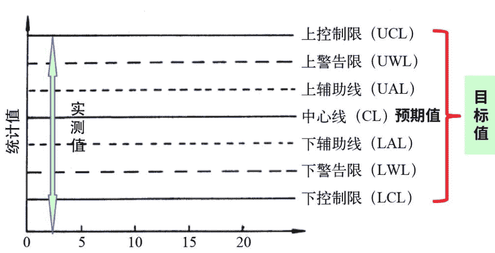

图7-1 控制图

常规做法分四步走：先用量具测量并把零件名、日期、尺寸录入“数据汇总”表；再算整体均值和标准差；然后基于汇总数据生成控制图并设定合适的坐标轴与控制线；最后对超出界限的点进行筛选、排序和根因分析。

过去李明靠手工写公式做控制图，耗时又易出错。这次他让 ChatGPT 按表7-2生成自动化脚本，要求做到两点：一是把所有尺寸点都标在图上；二是当尺寸超过 32.1 毫米或低于 31.6 毫米时，图表即时报警，用红色高亮该记录并用红色箭头指向异常点。

从写需求到拿到可运行的 VBA，质量监控的可视化流程被压缩到极致。控制图对保持产品一致性至关重要，有了自动化脚本，异常点一目了然，纠偏也更快。

这三个故事的共同点很清晰：把业务问题清晰描述给 ChatGPT，借助 VBA 把重复性 Excel 操作自动化，分析、预测、监控都能从手工劳动升级为一键决策。

```
Sub createControlChart()
    ' 激活修正后的工作表用于数据跟踪
    Sheets("已修正").Activate

    ' 取得数据区域范围，替换成你的数据表格名称
    Dim dataRange As Range
    Set dataRange = Range("A2:B100")

    ' 创建一张仅作为控制图的新工作表，命名为“控制图”
    Dim controlSheet As Worksheet
    Set controlSheet = Worksheets.Add(After:=Worksheets(Worksheets.Count))
    controlSheet.Name = "控制图"

    ' 计算控制图所需的一些参数
    Dim average As Double
    average = WorksheetFunction.Average(dataRange.Columns(2))

    Dim standardDeviation As Double
    standardDeviation = WorksheetFunction.StDev(dataRange.Columns(2))

    Dim lowerControlLimit As Double
    lowerControlLimit = average - 3 * standardDeviation

    Dim upperControlLimit As Double
    upperControlLimit = average + 3 * standardDeviation

    ' 将控制图参数写入新的工作表中
    controlSheet.Range("A1:D1").Value = Array("样本编号", "设备名称", "尺寸", "控制界限")
    controlSheet.Range("A2:B100").Value = dataRange.Value
    controlSheet.Range("C2:C100").FormulaR1C1 = "=RC[-1]-" & average
    controlSheet.Range("D2:D100").FormulaR1C1 = "=IF(OR(RC[-1]<" & lowerControlLimit & ",RC[-1]>" & upperControlLimit & "),""Out Of Control"","""")"

    ' 生成控制图
    controlSheet.Activate
    ActiveWindow.DisplayGridlines = False
    Dim chartRange As Range
    Set chartRange = controlSheet.Range("C2:C100")

    Dim chartObject As ChartObject
    Set chartObject = controlSheet.ChartObjects.Add(Left:=200, Width:=500, Top:=20, Height:=300)
    chartObject.Name = "生产过程控制图"
    chartObject.Chart.SetSourceData Source:=chartRange
    chartObject.Chart.ChartType = xlLineMarkers
    chartObject.Chart.HasTitle = True
    chartObject.Chart.ChartTitle.Text = "生产过程控制图"
    chartObject.Chart.Legend.Position = xlLegendPositionBottom

End Sub
```

在 ChatGPT 的配合下，李明迅速完成了控制图的制作，整体效率随之提升。

### 六、数据清洗

王阳在某公司负责销售信息的解析工作，因统计口径繁多，销售报表里常出现记录重叠、数值空缺、格式紊乱等现象，正式分析前必须先做净化。常规流程大致可分为以下环节。

- (1) **质量核验**。拿到原始表后需对整体进行全面审视，判断是否存在重复、空缺，格式是否统一等情况。
- (2) **方案制定**。核验结束后确定处理办法。可先用表格软件的筛选功能定位重复项，再调用删除重复项功能清理；若格式不规范，则借助文本转换等工具完成格式统一。
- (3) **操作执行**。清洗过程需格外谨慎，确保只剔除错误记录，保留正确数据。删除重复项功能支持按多列组合判定重复，操作前务必做好备份。
- (4) **格式规范**。清洗完成后可利用表格软件的格式工具对数值进行标准化与美化，提升可读性。
- (5) **统计提炼**。最后借助表格软件的统计分析功能对结果进行汇总，获取有价值的洞察。

过去该环节王阳几乎全靠表格软件完成，但大量公式不易记忆。于是选择让 ChatGPT 按需求生成 VBA 脚本来执行净化。表7-3 展示了一组待处理的商品销售记录，末列标注了各类问题。

### 表7-3 待清洗的产品销售数据

| 产品名称 | 销售数量 | 销售日期 | 销售地点 | 数据缺陷 |

| :--- | :--- | :--- | :--- | :--- |

| 产品1 | 50 | 2022/3/1 | 北京 | 无 |

| 产品2 | 20 | 2022/3/2 | 上海 | 产品名称重复 |

| 产品2 | 25 | 3月5日 | 深圳 | 日期格式不一致 |

| 产品3 | 六十 | 2022/3/3 | 广州 | 数量格式不一致 |

| 产品4 | 40 | 2022/3/4 | 杭州 | 无 |

| 产品5 | | 2022/3/5 | 北京 | 数量缺失 |

针对上述表，王阳向 ChatGPT 提出如下处理需求。

- (1) 借助筛选机制定位商品名称与成交日期完全相同的记录，并通过删除操作将其剔除。
- (2) 借助文本转换工具把日期写法不一致的行统一调整为同一标准格式。
- (3) 对成交件数出现重复的商品行进行累加，得到每个商品的累计销量。
- (4) 采用条件判断逻辑把成交件数为空的行标注为“数量未知”。
- (5) 运用格式设置功能美化表格的视觉呈现。

```vba
Sub DataCleaning()
    Dim Rng As Range
    Dim RowCount As Integer
    Dim i As Integer

    Set Rng = Range("A1:E7") '指定数据范围

    '(1)使用筛选函数找到产品名称和销售日期重复的行，并使用删除函数将它们删除
    Rng.Columns("A:E").Select
    Selection.Sort Key1:=Range("B2"), Order1:=xlAscending, _
        Key2:=Range("C2"), Order2:=xlAscending, Header:=xlYes
    RowCount = Rng.Rows.Count
    For i = RowCount To 2 Step -1
        If Rng.Cells(i, 1).Value = Rng.Cells(i - 1, 1).Value And _
            Rng.Cells(i, 3).Value = Rng.Cells(i - 1, 3).Value Then
            Rng.Cells(i, 1).EntireRow.Delete '删除重复数据行
        End If
    Next i
    '(2)使用文本转换函数将日期格式不一致的数据行转换成一个统一的日期格式
    For Each cell In Rng.Columns(3).Cells
        If Not IsDate(cell) Then '如果不是一个日期
            cell.Value = DateValue(cell.Value) '使用DateValue将字符串转换为日期值
        End If
        cell.NumberFormat = "yyyy/mm/dd" '设置日期单元格格式为“年/月/日”
    Next cell
    For i = 2 To RowCount
        If Rng.Cells(i, 1).Value = Rng.Cells(i - 1, 1).Value Then '如果产品名称重复
            Rng.Cells(i, 2).Value = Rng.Cells(i, 2).Value + Rng.Cells(i - 1, 2).Value '将当前行和上一行的数量相加
            Rng.Rows(i - 1).Delete '删除上一行
            i = i - 1 '修正行数
            RowCount = RowCount - 1 '修正行计数
        End If
    Next i
    '(3)使用求和函数对销售数量重复的数据行进行汇总，得出每个产品的总销售数量
    Rng.Columns("B:B").RemoveDuplicates Columns:=Array(1), Header:=xlYes '删除数量
    '(4)使用条件函数将销售数量缺失的行标记为“数量未知”
    For Each cell In Rng.Columns(2).Cells
        If IsEmpty(cell) Then '如果数量缺失
            cell.Value = "数量未知" '将单元格赋值为“数量未知”
        End If
    Next cell
    '(5)使用格式化函数设置表格视觉效果
    Rng.Select '选中数据范围
    Selection.Columns.AutoFit '自适应列宽
    With Selection
        .Borders.LineStyle = xlContinuous '添加边框
        .Font.Name = "微软雅黑" '设置字体名称
        .Font.Size = 10 '设置字体大小
        .Font.Bold = False '设置字体加粗
    End With

    Range("A1").Select '选中左上角单元格

    MsgBox "数据清洗完成"

End Sub
```

净化收尾后，王阳又让 ChatGPT 输出一份统计分析报告，统计环节的耗时大幅缩短。

### 七、文本分析

小孙从事市场营销，负责某汽车企业市场调研工作。近期需洞察电动汽车的市场需求，提升品牌认知与接受度。计划组织一次消费者焦点小组，通过文本分析挖掘有效信息。

为此小孙召集多位用户参与讨论。核心目的在于捕捉消费者对电动汽车的需求、购买意愿等反馈，为营销策略优化提供依据。

讨论围绕是否了解电动汽车、是否考虑购买、是否接触过特定品牌、购买时最看重要素、价格与续航的相对重要性、总体印象及是否愿意推荐等话题展开。记录结果录入表格，形成表7-4。

### 表7-4 用户访谈数据

| 问题 | 回答 |

| --- | --- |

| 你对电动汽车有了解吗？ | 电动汽车是一种环保的车型，不会排放污染气体，但好像续航能力还有待提高 |

| 你会考虑购买一款电动汽车吗？ | 要看价格和性能，我担心电动汽车可能价格较高，而且电池寿命也不长 |

| 你是否了解过某些品牌的电动汽车？如果要购买电动汽车，你认为哪些因素最重要？ | 我是听说过，但是具体情况不太了解。如果要购买电动汽车，我会考虑价格、能源消耗、续航能力等因素 |

| 你认为价格和续航能力哪一个更重要？ | 对我来说，价格和续航能力都很重要。价格是一个很重要的因素，毕竟与传统汽车相比电动汽车价格还是比较高的，同时，续航能力也很重要，这跟我的出行需求有很大的关系 |

| 你可以介绍一下对于电动汽车总体的印象和你是否会推荐给你的朋友吗？ | 总体来说还是比较满意的，不过价格的确有点儿高，我可能暂时不会推荐给我的朋友 |

接下来需对这些文本进行净化与分析，主要目标包括：

- 1. 挖掘消费者对电动汽车的情感倾向与态度。
- 2. 解析用户对相关要素的主观评价与感受。
- 3. 统计并评估消费者对不同品牌的认知程度。

实现上述目标可调用表格软件的内置公式：

- 1. **MID 提取**。可从长文本中截取指定片段，例如从含品牌信息的语句中抽取品牌名或型号。
- 2. **COUNTIF 统计**。用于统计满足特定条件的单元格数量，可用来计数关键词出现的频次。
- 3. **SUBSTITUTE 替换**。可将文本中指定的词或符号批量替换为其它内容，用于清除干扰或统一格式，比如把换行符替换为空格或逗号。

为省去手工操作，小孙选择让 ChatGPT 生成可执行的 VBA 程序完成文本的分析与处理。具体描述为：

请生成可执行的 VBA 程序，对上述访谈文本进行分析，处理要求如下。

- (1) 分别调用 MID 提取与 SUBSTITUTE 替换，从不同角度对文本进行抽取或重构。
- (2) 利用 COUNTIF 统计计算文本中各关键词的出现次数。
- (3) 明确定位数据区域与公式区域，对文本进行净化与格式化，将多列内容合并为单列，并清除冗余单元格。

```vba
Sub analyze_dialogue()
    '将对话文本数据存储在字符串数组中
    Dim dialogue(1 To 6, 1 To 2) As String

    dialogue(1, 1) = "你对电动汽车有了解吗？"
    dialogue(1, 2) = "电动汽车是一种环保的车型，不会排放污染气体，但好像续航能力还有待提高"
    dialogue(2, 1) = "你会考虑购买一款电动汽车吗？"
    dialogue(2, 2) = "要看价格和性能，我担心电动汽车可能价格较高，而且电池寿命也不长"
    dialogue(3, 1) = "你是否了解过某些品牌的电动汽车？如果要购买电动汽车，你认为哪些因素最重要？"
    dialogue(3, 2) = "我是听说过，但是具体情况不太了解。如果要购买电动汽车，我会考虑价格、能源消耗、续航能力等因素"
    dialogue(4, 1) = "你认为价格和续航能力哪一个更重要？"
    dialogue(4, 2) = "对我来说，价格和续航能力都很重要，价格是一个很重要的因素，毕竟与传统汽车相比电动汽车价格还是比较高的，同时，续航能力也很重要，这跟我的出行需求有很大的关系"
    dialogue(5, 1) = "你可以介绍一下对于电动汽车总体的印象和你是否会推荐给你的朋友吗？"
    dialogue(5, 2) = "总体来说还是比较满意的，不过价格的确有点儿高，我可能暂时不会推荐给我的朋友"

    '定义关键词并计算出现次数
    Dim keywords(1 To 3) As String
    keywords(1) = "价格"
    keywords(2) = "续航能力"
    keywords(3) = "能源消耗"

    Dim count_keyword(1 To 3) As Integer
    Dim i As Integer, j As Integer

    For i = 1 To 3
        count_keyword(i) = 0
        For j = 1 To 5
            count_keyword(i) = count_keyword(i) + WorksheetFunction.CountIf(Range("B" & j), "*" & keywords(i) & "*")
        Next
    Next

    '将文本数据合并为一列，并删除多余单元格
    Dim merged_text As String
    For i = 1 To 5
        merged_text = dialogue(i, 1) & Chr(10) & dialogue(i, 2) & Chr(10) & Chr(10)
        merged_text = WorksheetFunction.Substitute(merged_text, Chr(10), " ")
        Range("C" & i).Value = WorksheetFunction.Mid(merged_text, 1, Len(merged_text) - 2)
    Next

    Range("B1:C5").EntireRow.Delete Shift:=xlUp
    Range("B1").Value = "问题与回答"
    Range("B1").Font.Bold = True

    '输出关键词出现次数
    For i = 1 To 3
        Range("D" & i + 1).Value = keywords(i)
        Range("E" & i + 1).Value = count_keyword(i)
    Next

    Range("D1").Value = "关键词"
    Range("D1").Font.Bold = True
    Range("E1").Value = "出现次数"
    Range("E1").Font.Bold = True

End Sub
```
小孙在完成对所采集文本数据的清洗与挖掘后，拿到了让人信服的结论。他通过分析发现，目标用户在考虑是否入手电动车时，最揪心的还是花多少钱、能跑多远、耗能高不高这几类关键点。基于这些洞察，他把价格诉求和动力表现这两个核心要素直接放进了营销打法里，从而显著拉升了产品对消费者的吸引力，并带动了出色的销售成绩。

归纳来看，对消费端反馈进行文本分析与挖掘，能够更精准地捕捉用户真实的需求与态度，为市场策略的优化提供依据，进而提升产品的市场竞争力。而在整个处理链路中，Excel搭配VBA的组合非常实用，可以帮助我们高效地整理、运算和解读海量文本，从而挖掘出更多有价值的情报。

## 第3节 基于GPT模型的Excel人工智能处理软件

倘若觉得上手VBA成本有点高，也可以借助面向GPT模型打造的AI类工具，比如ChatExcel。

ChatExcel是一款依托自然语言交互与ChatGPT能力构建的在线网站，致力于让Excel表格的调整变得智能化。用户不必写代码、不必记复杂的函数，只需把文件上传上去，用日常口语描述想要的改动，就能完成操作。

### 一、自然语言输入和指令转化
ChatExcel的核心是自然语言交互。用户可以用大白话说明希望对表格做的调整，例如新增列、删掉行、调整样式等。平台会借助先进的自然语言处理技术与ChatGPT的理解能力，把口语化需求准确映射成对应的Excel操作。

### 二、强大的Excel调整功能
ChatExcel覆盖了从数据处理到格式美化的全流程。数据筛选、排序、合并、拆分、透视表制作等常规任务都能胜任，同时支持单元格格式设定、条件格式、公式运算以及图表自动生成等进阶需求。智能助手会先理解意图，再给出对应的调整结果。

### 三、智能生成和预览
借助ChatGPT的生成能力，ChatExcel可以在接收到描述后迅速产出符合预期的表格结果。平台还提供预览窗口，让用户在下载前直观查看调整效果，确认无误后再做修改，保证最终文件符合预期。

### 四、用户友好的界面和下载功能
操作界面简洁易上手，上传文件、输入需求、预览结果、下载文件几个步骤一气呵成。确认结果满意后，可一键下载处理后的Excel，方便在工作中使用或与团队分享。

总体目标是让没有编程背景的人也能通过自然语言完成复杂的表格任务。ChatExcel把智能助手与ChatGPT结合，带来高效且精准的Excel处理体验。

## 第4节 用飞书智能伙伴处理在线数据表格
在职场里，使用在线表格处理数据已经很普遍。本节以飞书智能伙伴为例，说明AI如何助力在线表格的日常工作。在第4章我们提到过它在专业写作中的价值。作为一个强力的AI助理，它在数据处理上同样能发挥很大作用。

### 一、用飞书智能伙伴快速建表
在空白文档中调出智能伙伴浮窗，点击“智能建表”，输入具体需求描述，就能快速生成所需的表格，如图7-2和图7-3所示。

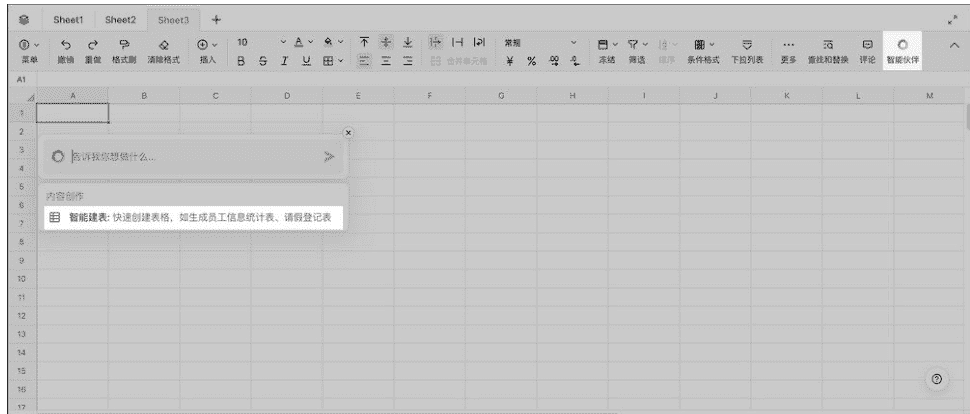
### 二、用飞书智能伙伴撰写公式
在空单元格处唤起智能伙伴浮窗，选择“帮我写公式”，描述期望的结果，比如“按性别对员工进行分组”，系统会结合当前表格内容推荐合适的公式，如图7-4和图7-5所示。

▲图7-4 在空白单元格处唤起飞书智能伙伴撰写公式功能
▲图7-5 用飞书智能伙伴撰写公式的结果输出

### 三、用飞书智能伙伴分析数据
飞书智能伙伴的数据分析能力包括智能提取、智能分析、情感分析与智能创作。

**智能提取：** 从表格中快速抽取邮箱、行政区划、手机号等关键信息，让重点一目了然。
**智能分析：** 按用户自定义的维度对内容进行归类，例如悬疑、科幻、古装等。
**情感分析：** 自动判定文本的正面、负面或中性倾向，帮助快速识别差评。
**智能创作：** 基于表格内容迅速生成所需文本。

此外还支持智能翻译、内容润色、内容总结等辅助功能。
图7-6以情感分析为例，展示了对表格中“反馈内容”一列进行的情感倾向分析结果。

图7-6 用飞书智能伙伴进行情感分析示例

### 四、用飞书智能伙伴搭建多维表格业务系统
新建空白文档，从底部模板区唤起智能伙伴，告诉它想要搭建的业务场景，即可自动生成包含多张关联表格的业务系统，如图7-7和图7-8所示。

▲图7-7 唤起飞书智能伙伴搭建多维表格
▲图7-8 用飞书智能伙伴完成业务系统搭建

### 五、用飞书智能伙伴调整多维表格内容
可以从行记录处唤起智能伙伴，点击“用AI生成”，输入一段描述文字，系统会据此进行结构化解析并录入，如图7-9所示。

图7-9 用飞书智能伙伴结构化解析文本示例

也可以通过工具栏唤起智能伙伴，完成字段内容补充等操作，如图7-10、图7-11和图7-12所示。

▲图7-10 唤起飞书智能伙伴生成字段内容
▲图7-11 飞书智能伙伴生成字段内容的AI配置
▲图7-12 飞书智能伙伴生成字段内容结果

## 本章小结
在以数据为驱动的商业环境里，高效处理与分析数据是核心能力。本章聚焦ChatGPT、飞书智能伙伴等AI助理在数据处理中的实际应用，并结合工作场景做了案例拆解。这些例子体现了AI如何帮助不同领域的从业者利用数据优化流程、强化客户洞察并推动创新。本章还重点介绍了基于GPT模型的Excel智能处理方案。数据处理和Excel操作本身门槛不低，却是职场常见需求。因此，想要熟练驾驭AI助理来处理数据，日常的练习与积累不可或缺。

# 第8章 用ChatGPT搞翻译

## 第1节 翻译的进步

### 一、以交流为目的的翻译
世界上有数不清的语言，每种语言都承载着独特的表达方式、文化背景与语法结构。这种多样性既带来沟通的障碍，也构成了理解与合作的基础。《圣经·旧约·创世记》中巴别塔的故事就生动地揭示了语言差异对协作的冲击。

传说早期人类曾共享同一种语言，彼此无隔阂。他们合力建造一座通天之塔，象征团结。但当塔越建越高时，上帝为制止人类的自负，让语言变得混乱，人与人不再互通，从而迫使工程停滞。这个寓言点出了语言隔阂对合作的制约。

现实中，跨语言沟通时常出现在国际商务、旅游、外交等场景，翻译由此变得至关重要。专业的翻译工作帮助人们跨越语言壁垒，促进理解与协作。在全球化背景下，翻译不仅活跃于商政领域，也在文化、艺术、学术等层面扮演关键角色，让不同语言背景的人分享知识与经验，推动社会多元发展。

翻译并非易事，需要掌握词汇、语法，还要读懂文化语境背后的隐含意义。随着外语普及，越来越多的人具备基础外语能力，但要做到高质量翻译仍具挑战。随着计算机技术发展，翻译技能也迎来了新的演进方向。

### 二、机器翻译
在AI时代到来前，机器翻译经历了漫长演进。早期以规则与词典为基础，目标主要是把源语言的词或词组对号入座地换成目标语言。

最早进入计算机的是词典式翻译。基于预先建立的词典，将源词直接替换为目标词。这种方式忽略了语法与上下文，难以处理复杂句式与文化差异。

随后出现了基于语法规则的翻译。借助语言学规则对句子进行分析与转换，能处理一些简单句型，但在面对多义与复杂语言现象时效果有限。

后来研究者开始尝试整段翻译。统计机器翻译SMT的引入，让系统利用大规模双语语料，通过统计模型预测两种语言的对应关系，从而生成更准确的结果。

不过传统机器翻译仍有局限：上下文与语义理解不足，对复杂结构处理吃力，且高度依赖人工规则与专业知识。

从体验上看，机器翻译时代的译文常带有明显的“机器味”，不自然或不准确的情况并不罕见。但不可否认，它极大提升了跨语言信息获取的效率，被广泛应用于日常生活与工作。

尽管不完美，机器翻译为跨越语言障碍提供了便利。很多人宁愿读机器译文也不愿逐字查词，机器翻译让获取外语信息变得更轻松，促进了全球交流。随着AI进步，机器翻译与AI技术结合，翻译正式进入AI时代。

### 三、AI翻译
在日常工作中，我们经常使用谷歌翻译、百度翻译等在线工具。有细心的人会发现，如今的译文质量与过去已判若云泥。由“机器味”浓重到如今大部分句子通顺自然，这正是机器翻译到AI翻译的差距。

神经机器翻译NMT的兴起标志着AI翻译时代的到来。NMT基于深度学习，通过神经网络模拟人类翻译过程。它从大规模双语语料中自动学习语言映射，以端到端的方式完成翻译。在上下文理解与连贯生成上，NMT明显优于传统方法，能够捕捉更复杂的语义与结构，输出更准确流畅的译文。

NMT的发展得益于深度学习突破与海量数据的积累。神经网络能够学习更高层次的语言表征，提升质量与准确度。随着互联网普及与全球化加深，双语语料的丰富也推动了性能提升。

与此同时，研究者不断提出改进手段，如注意力机制、双向循环神经网络等，以进一步优化准确性与流畅度。众多开源工具与平台的出现，也让NMT更容易被研究者与开发者使用与扩展。

即便如此，NMT仍面临挑战。对训练数据与算力的需求较高，在资源受限环境下受限；在低频词汇、专业术语、文化特定表达上的处理仍需改进。

使用方式很直观，只需把待译内容输入翻译网站左侧，右侧即可呈现结果。
图8-1是谷歌翻译官网界面。
图8-1 谷歌翻译官方网站界面
图8-2是百度翻译官网界面。
图8-2 百度翻译官方网站界面
图8-3是DeepL官网翻译界面。
图8-3 DeepL官方网站翻译界面

除了单句翻译，三者均提供文档翻译能力，可一次性提交整份文档进行处理。

对非专业译者而言，仅把翻译当作信息获取手段时，当前AI翻译的质量已基本满足需求。浏览外文网页时，通过浏览器自带的翻译功能即可将页面转为母语，阅读体验已接近原生中文页面。

图8-4展示了Chrome浏览器中直接调用的网页翻译功能。
当然，微软Edge浏览器也提供类似功能，只是底层采用微软自家的翻译引擎。

在AI翻译领域，DeepL的译文质量常被认为领先，甚至超过以AI能力著称的谷歌翻译。若对质量要求更高，DeepL是不错的选择。只是由于谷歌翻译与Chrome结合紧密，大多数用户日常仍更倾向使用谷歌翻译。

ChatGPT是与InstructGPT同源的模型，训练目标是遵循提示中的指令并给出详尽回应。我们推出ChatGPT的目的是收集用户反馈，了解其优势与不足。在研究预览期间，ChatGPT的使用是免费的。

In the following samples, we demonstrate the clarifying questions to debug code.

Sample 1 of 4

this code is not working, how do i fix it?

```
resultWorkerErr :
defer close(resultWorkerErr)
go func() {
```

图8-4 Chrome浏览器的直接翻译功能

当前各类翻译类应用已深植进日常办公与生活，启用门槛低到可以忽略不计。正因如此顺手，很多人反而忽略了背后技术在持续演进，尤其大模型带来的质变。

## 第2节 “非专业”翻译：ChatGPT

DeepL、谷歌翻译等垂直型产品已相当成熟，但赛道里出现了一个跨界参与者——ChatGPT。

本书对它已有多次介绍，本质上是基于海量语料训练的生成式语言系统。简单来说，它用规模换取能力，突破了单一任务 AI 的限制，成为更通用的语言助手。对它而言，英文、中文只是符号序列，没有偏好。原本并非为译文而设计，却自带了翻译能力，所以临时把它当作翻译工具来使用也完全可行。

翻译水平如何？腾讯的研究论文《Is ChatGPT A Good Translator? A Preliminary Study》给出了参考。

论文的核心观点是：对于英语、德语等资源充足的欧洲语种，ChatGPT 与商业产品基本持平；面对资源稀缺的小语种，表现明显下滑；进入生物医学等专业领域，商业方案更稳健；而在口语化表达场景里，ChatGPT 反而是可用选项。

由此判断，最常见的英译中需求，ChatGPT 基本能够胜任。

让它做译文的操作很直接，只要说明目标语即可，下面是典型用法。

> 把下面一段话翻译成中文。

We've trained a model called ChatGPT which interacts in a conversational way. The dialogue format makes it possible for ChatGPT to answer followup questions, admit its mistakes, challenge incorrect premises, and reject inappropriate requests.

> 我们已经训练了一个名为 ChatGPT 的模型，它以对话的形式进行交互。对话的形式使得 ChatGPT 能够回答后续问题、承认自己的错误、质疑不正确的前提，并拒绝不恰当的请求。

它同样支持多语输出，比如要求输出日文。

> 把下面一段话翻译成日文。

We've trained a model called ChatGPT which interacts in a conversational way. The dialogue format makes it possible for ChatGPT to answer followup questions, admit its mistakes, challenge incorrect premises, and reject inappropriate requests.

> 私たちは ChatGPT と呼ばれるモデルを訓練しました。このモデルは対話形式でインタラクションを行います。対話形式により、ChatGPT は追加の質問に答えたり、間違いを認めたり、間違った前提を問い詰めたり、不適切な要求を拒否することが可能です。

跨语言只是表层能力，它还能把多种技能叠加起来完成费力的工作，比如用英文撰写材料。先写中文再让它转译，出来的句子往往很生硬。因为它本身不区分语言，更聪明的玩法是用中文下指令，直接让它用英文写，产出的文本地道程度远高于二次翻译。

举例，让它代写一封通知邮件。

你来扮演我的英文写作助手。我要给学校的外国师生写一封邮件，通知他们周一到学校大礼堂开会，我们邀请了一位知名物理学家来讲现代物理学发展，请用英文写出通知。

系统在数秒内给出了一封结构完整的邀请函，包含主题、称呼、正文、落款等要素，涵盖活动时间、地点、主讲人介绍、参会指引和联系方式。对普通人来说手工写这样的正式邮件需要不少时间，对 ChatGPT 而言是瞬时输出。当然生成结果未必百分百符合预期，这时可以把英文邮件再用翻译工具翻回中文自检，也能直接让 ChatGPT 把自己写的邮件回译成中文。

请把你写的这封邮件翻译成中文。

## 主题：关于现代物理学发展的特别讲座邀请

敬爱的海外教职工及同学：

祝您身心康泰。我谨代表校方诚挚邀请您参加一场关于现代物理学进展的特别讲座。作为学校推动学术卓越、培育智力成长的举措之一，我们特邀一位知名物理学家为全校师生分享物理学前沿进展。

我诚挚邀请您于周一前往校礼堂参加此次启发性活动。讲座将于指定时间开始，预计持续约指定时长。这是全体教职工与学生拓展知识、深入了解前沿突破的难得机会。

受邀嘉宾在物理学领域贡献卓著、专业方向备受国际认可，将全面介绍近年来的关键进展与发现，它们已彻底改变了我们对宇宙的认知。讲座以英语进行，便于全体参与者理解。

我们相信此次活动不仅能带来灵感，还能提供可融入学术追求的宝贵见解，成为促进思想交流、与热爱科学的学者同学互动的平台。

敬请在日程上预留时间。您的出席将丰富讨论，为学府的学术氛围添彩。请于指定时间入座校礼堂以确保准时开始。

如有疑问或需补充信息，欢迎联系活动协调员，联系方式另行提供。

期待您周一莅临校礼堂，共襄盛举。让我们以多元社区之姿，共同感受现代物理的魅力，拥抱求知的精神。感谢支持！

顺颂

[ 姓名 ]

[ 职位 ]

[ 学校 ]

严格来说 ChatGPT 并非专业的翻译选手。但大多数人使用外语并非为研究语言本身，而是为完成工作与生活中的具体目标。在这一层面，ChatGPT 的综合语言能力能让目标达成更顺畅，这正是它相较单一翻译工具更具优势之处。

到这里，主流的翻译工具你基本已经摸清，大多数日常需求都能被覆盖。下面再拓展一下使用体验，让你在基础之上再进一步。

## 第3节

### 沉浸式翻译

从结果质量看，如今的翻译工具已经相当可靠。可是在使用手感上，仍有提升空间。传统做法是把文字复制到翻译框里，经常要在多个软件或网页间来回切换。也有插件支持点击即译，但往往只是片段翻译。另一种做法是让浏览器接管，对整页强制翻译。

整页翻译理论上很方便，能把外文站直接当中文站读。但实际体验会受翻译精度拖累。AI 加入后质量大幅提升，却远未完美，尤其在专业内容上，错误依然明显，不得不反复对照原文。这份不便为新工具留下了空间。

沉浸式翻译 Immersive Translate 就是为此而生。它主打沉浸式阅读体验，会自动锁定网页主体内容进行处理，对页面整体干扰很小，阅读时更专注，不会被大量译文打扰。

更关键的是它支持原文译文并排对照，外文浏览时无需在两种语言间频繁切换。对专业文章的理解效率提升很明显。此外，它针对 Twitter、Reddit、Gmail、Hacker News 等常见站点做了专门优化。

最便捷的接入方式是浏览器插件，已覆盖 Chrome、Edge、Firefox 等主流浏览器，到应用商店安装对应插件即可。图8-5 是在 Chrome 商店安装沉浸式阅读插件的方式。

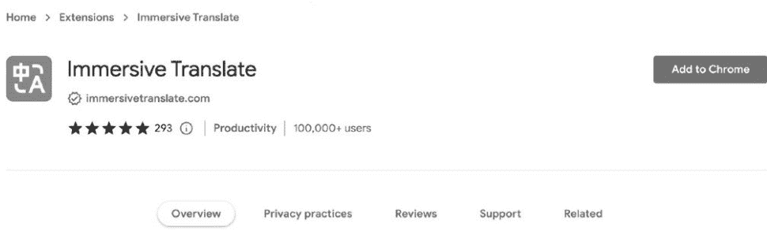

图8-5 在 Chrome 商店安装沉浸式阅读插件

装好之后，浏览外文站点时即可一键翻译。图8-6 展示了沉浸式阅读插件的使用界面。

也可以通过右键菜单直接启动翻译，如图8-7 所示。

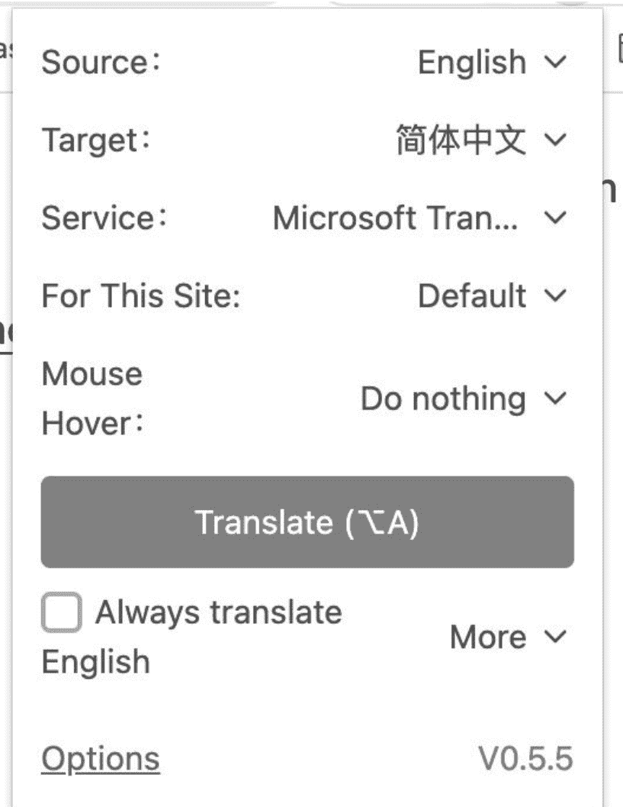

▲图8-6 沉浸式阅读插件使用界面

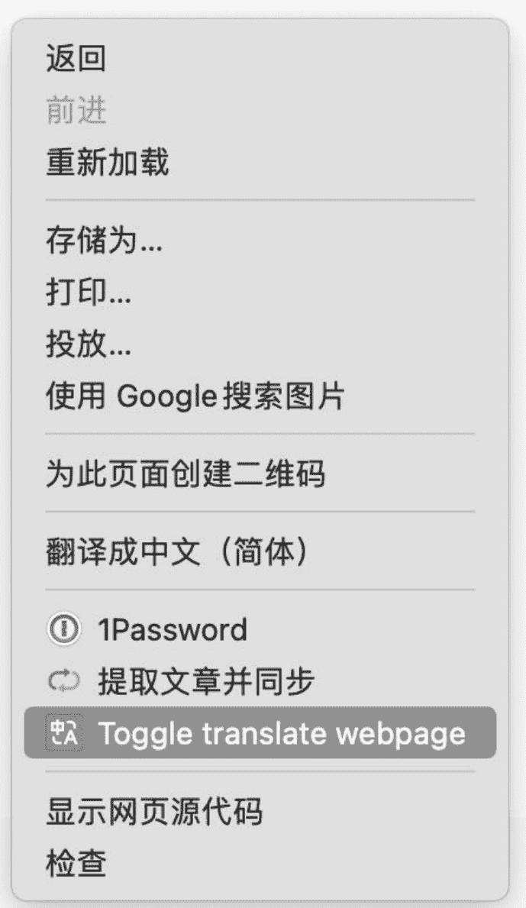

▲图8-7 右键直接唤起沉浸式阅读插件

翻译后呈现的是中英对照的页面，如图8-8 所示。

ChatGPT is a sibling model to InstructGPT, which is trained to follow an instruction in a prompt and provide a detailed response.

ChatGPT是InstructGPT的兄弟模型，它被训练为遵循提示中的指令并提供详细的响应。

We are excited to introduce ChatGPT to get users' feedback and learn about its strengths and weaknesses. During the research preview, usage of ChatGPT is free.

我们很高兴推出 ChatGPT 以获得用户的反馈并了解其优缺点。在研究预览期间，ChatGPT 的使用是免费的。

### Samples

In the following sample, ChatGPT asks the clarifying questions to debug code.

在下面的示例中，ChatGPT 提出澄清问题以调试代码。

图8-8 中英文并列的翻译结果

沉浸式翻译本身只优化了交互体验，真正的翻译仍依赖前文提到的各家引擎，因此它允许用户自行选择底层的翻译服务，如图8-9 所示。

翻译服务

选择一项翻译服务

总是翻译的语言

当页面语言为下列语言时，会自动翻译为目标语言

永不翻译的语言

当页面中某一段落的语言为下列语言时，将跳过翻译

总是翻译的网址

当网站为下列域名时，会自动翻译为目标语言

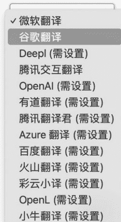

图8-9 沉浸式翻译背后的翻译服务选择

这里可以看到微软翻译、谷歌翻译、Deepl、OpenAI、百度翻译等多种选项，可按个人偏好切换。

除网页外，沉浸式翻译还支持文档翻译，如图8-10 所示。

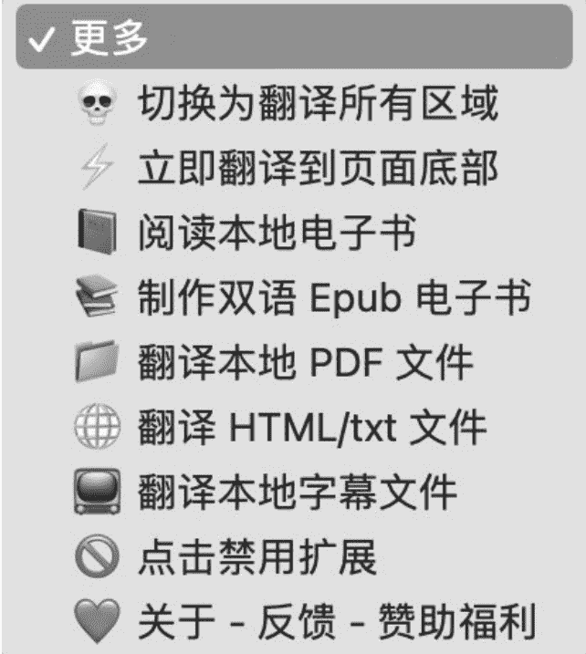

图8-10 沉浸式翻译的文档翻译功能

如图8-11所示，直接对 PDF 进行翻译也能得到原文与译文对照的视图，对很多人而言这是非常实用的功能。

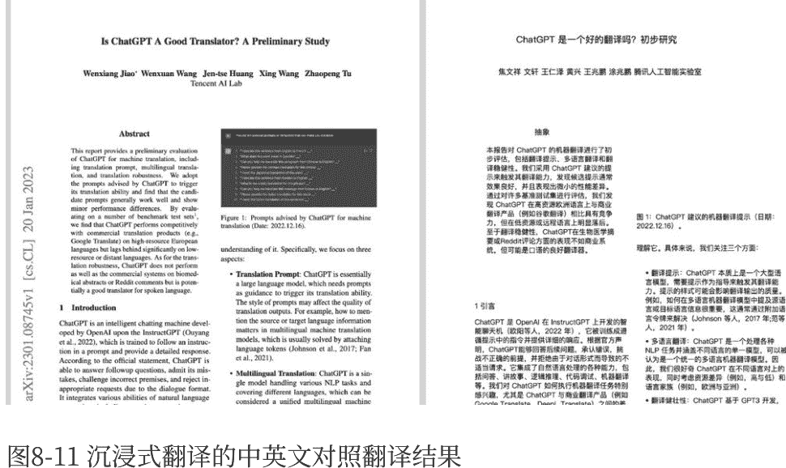

遇到EPUB电子书要翻译的时候也不用紧张，沉浸式翻译恰好能解决这个问题。借助它，几步操作就能把EPUB文档转成对照式双语，导出也很流畅。

该工具的实现牵扯到不少技术细节，这里就不展开，感兴趣的读者可以自行探索。总的来说译文质量过得去，阅读体验明显好转。项目以开源方式发布，有编程经验的人完全可以参与共建。

### 对话练习

职场里英语使用很普遍，但并非人人都能立刻用英语自如交流，提升听力和口语仍是大多数人的需求。Voice Control for ChatGPT是一款运行在浏览器上的第三方插件，很适合做对话训练。练习时最关键的原则是贴合真实使用场景，很多人词句并不陌生，只是不知道在具体情境下该怎么组织表达，所以可以请ChatGPT针对某一场景生成会话，比如模拟餐馆点单。

I'm ordering at a restaurant. Please give me an example conversion for ordering at a restaurant.

Certainly! Here's an example conversation for ordering at a restaurant.

Waiter: Good evening! Welcome to our restaurant. How many people are in your party?

You: Good evening! There are four of us.

Waiter: Great! Please have a seat. Here are the menus. Are you ready to order, or would you like some more time?

You: Thank you. We're ready to order. I'll start with a Caesar salad, please.

Waiter: Excellent choice. And for the main course?

You: I'd like the grilled salmon with steamed vegetables, please.

Waiter: Wonderful. How would you like your salmon cooked?

You: Medium, please.

Waiter: Noted. And for the others?

Your friend: I'll have the mushroom risotto.

Waiter: All right. And how about you?

Another friend: I'd like the sirloin steak, medium-rare, with mashed potatoes.

Waiter: Perfect. And the last one?

Your other friend: I'm a vegetarian. Do you have any vegetarian options?

Waiter: Certainly! We have a delicious vegetable stir-fry with tofu. Would you like that?

Your other friend: Yes, that sounds great!

Waiter: Great choices! Anything to drink?

You: I'll have a glass of red wine, please.

Your friend: I'll have a lemonade, please.

Waiter: Understood. I'll be right back with your drinks and place your orders with the kitchen.

Remember, in a real conversation, the waiter might ask additional questions, such as whether you have any dietary restrictions or if you'd like any sauces or dressings with your dishes. It's also common to ask for recommendations or inquire about daily specials if they are available.

按照这个思路就能大量产出不同场景的会话素材。ChatGPT生成的英文表达很地道，水平往往超出普通学习者，很适合当模仿样本。

素材准备好后就能直接用插件开展听力口语训练。不想局限于浏览器，也可以把文本导出成音频放到移动设备反复收听。若想和ChatGPT实时对练，插件还支持录音与语音转文字的闭环操作。

## 本章小结

本章梳理了AIGC为外语学习带来的增益。翻译技术一路从人工到机器再到智能，覆盖范围从词句扩展到段落全文乃至整份文档，精准度和易用性持续提升。有了这些工具的加持，外语的神秘感在减弱，正逐步融入日常生活与工作。

ChatGPT的能力为语言学习添了一件利器，既能处理译文，也能充当互动导师，帮助提升听力和表达，相当于人手一位外语私教。

总体而言，借助人工智能的助力，外语不再是阻碍，抓住机会就能走向更开阔的世界。

## 第9章

### AI助理提升工作效率的未来方向

## 第1节

### ChatGPT插件与GPTs

### 一、ChatGPT插件介绍

2023年3月23日，OpenAI在官网正式发布ChatGPT插件功能。资料来源：https://openai.com/blog/chatgpt-plugins。

这套机制代表了GPT系列大模型能力的一次明显跃进。通过接入外部数据源和服务，模型的实用价值与适用边界得到拓展。

推出背景源于对大模型局限性的认识。尽管大模型在生成文本上表现突出，但受训练数据限制容易出现信息滞后，难以连接实时数据或完成特定操作。OpenAI通过插件为模型提供扩展工具，在兼顾安全与功能的前提下，让ChatGPT能够调取最新资讯、执行计算并调用第三方服务。

ChatGPT上线后，插件的需求不断攀升，因为它解锁了诸多新场景。OpenAI采取分阶段放开的方式，先小范围试用后逐步扩大，覆盖插件开发者、订阅用户以及希望将插件嵌入自有产品的API用户。

受邀开发者可参照OpenAI提供的文档制作插件，首批合作方包括Expedia、FiscalNote、Instacart、KAYAK、Klarna、Milo、OpenTable、Shopify、Slack、Speak、Wolfram、Zapier等，如图9-1所示。这些插件会作为提示写入模型，并附带使用说明。

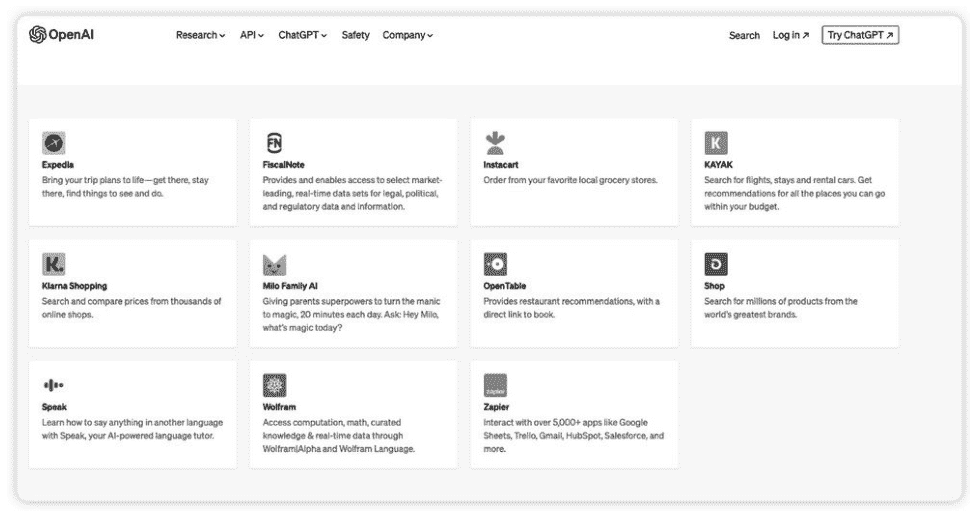

图9-1 OpenAI官网关于ChatGPT插件的说明

#### 01. ChatGPT插件的影响

插件带来的影响主要体现在以下方面。

- （1）**补强基础能力。**插件相当于为模型装上“视听”接口，能调取训练集之外的新鲜、个性化或垂直领域信息，使模型可更精准响应指令并在安全边界内完成受限操作，从而提升整体可用性。
- （2）**减轻固有短板。**插件能够缓解幻觉、时效滞后、无法访问授权私有数据源等难题。通过引入外部信息，模型的输出更具依据。
- (3) **安全风险并存。**插件虽提升效率，却也带来安全隐患，恶意插件可能携带有害代码放大欺诈和误导风险。为此OpenAI在设计之初就植入了多重安全防护。

#### 02. ChatGPT的3种可用插件

在可用的插件中，我们重点介绍以下3种，并通过示例展示其多样性与潜力。

- (1) **Wolfram**（参见图9-2）。该扩展经由WolframAlpha与Wolfram语言提供计算、数学、精选知识及实时数据查询，折射出GPT向复杂运算与数据分析方向的延伸。

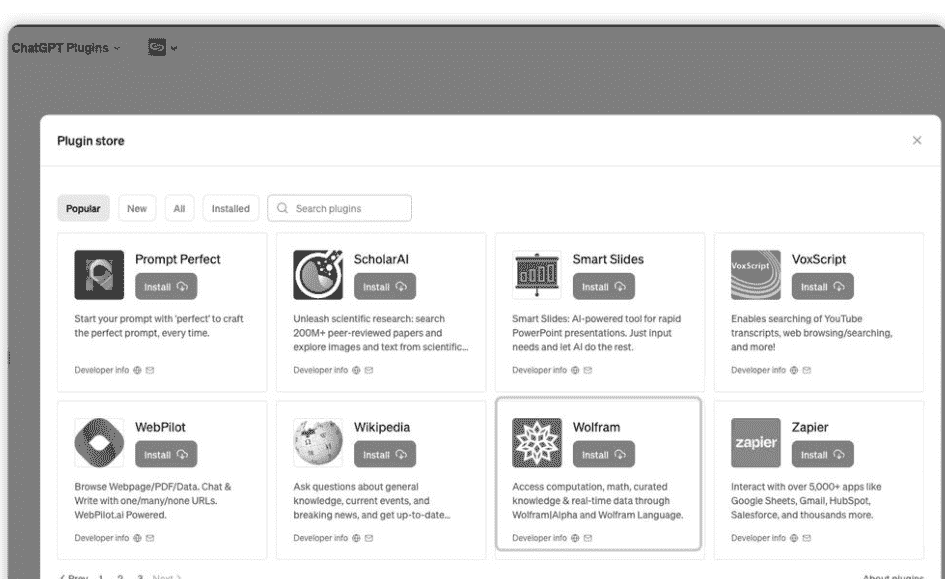

图9-2 ChatGPT插件商店中的Wolfram

- (2) **ChatWithPDF**（参见图9-3）。此插件支持与PDF文档互动，用户只需给出文档链接即可提问、分析并解析内容，体现了大模型处理特定文档格式并抽取信息的潜力。

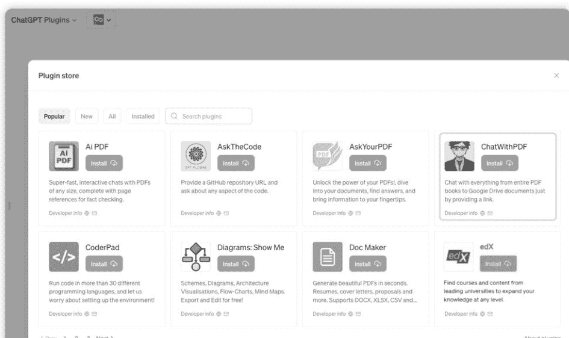

图9-3 ChatGPT插件商店中的ChatWithPDF

- (3) **PlaylistAI**（参见图9-4）。该扩展展示了人工智能与娱乐场景的融合，能依据用户提示自动生成Spotify歌单，说明插件同样适用于创意娱乐类的个性化需求。

总体来看，ChatGPT插件代表了语言模型在实用性与适应性上的重大飞跃，使其能更动态地与外界互动并完成更广泛的任务。

图9-4 ChatGPT插件商店中的PlaylistAI：Spotify

在最新版的GPT-4界面中，调用插件的位置如图9-5所示。

图9-5 ChatGPT中调用插件的位置

在模型选择处点击“Plugins”，会出现“Plugin store”，上面已有1000多个插件供ChatGPT Plus用户挑选，参见图9-6、图9-7。

▲图9-6 ChatGPT中的插件商店位置

▲图9-7 ChatGPT中插件商店展示

以安装名为“Link Reader”的插件为例，参见图9-8，安装完成后即可直接使用。

图9-8 在ChatGPT中安装Link Reader

若以OpenAI官方博客文章为例，让ChatGPT借助插件功能提炼要点，结果清晰易读，如图9-9所示。

图9-9 ChatGPT中的插件使用效果

### 二、GPTs介绍

2023年11月6日，OpenAI召开首届开发者大会OpenAI DevDay。会上萨姆·奥尔特曼宣布了GPT-4 Turbo、多模态API以及GPTs，即用户可创建自己的自定义GPT版本。图9-10展示了OpenAI官网对GPTs的介绍。

图9-10 OpenAI官网对GPTs的介绍

官网的介绍是：

> You can now create custom versions of ChatGPT that combine instructions, extra knowledge, and any combination of skills.

> （现在你可以创建自定义版的ChatGPT，将指令、额外知识和任意技能组合起来。）

#### 什么是自定义GPTs

简单说，GPTs是用户自定义的ChatGPT，无需代码或编程知识，通过全程可视化点击即可构建，如图9-11所示。用户只需与GPT Builder对话并提供额外知识数据，选择是否需要网络搜索、数据分析、图片生成等多模态功能，就能构建法律、写作、金融、营销等特定领域的助手。GPTs提供了一种按需定制并与其他用户共享的新方式。

图9-11 ChatGPT构建GPTs界面

图9-12展示了GPTs的主要配置参数。

OpenAI提供了数据分析GPT、游戏时间GPT等多种类型，允许用户将GPT与内部数据库连接以获取数据。企业版用户还能创建内部GPTs。这些GPTs可按具体需求快速定制，且主要由社区创建，而非完全由OpenAI开发。

图9-12 GPTs配置参数界面

ChatGPT官网上线了16个预设GPTs，图9-13展示了其中一部分。资料来源：https://openai.com/blog/introducing-gpts。

图9-13 ChatGPT官网创建的GPTs

##### (1) DALL·E

Let me turn your imagination into imagery.（把你的想象力转为图片。）

通过自然语言描述，由DALL·E提供绘画模型，如图9-14所示。使用DALL·E的AI绘画功能无需额外付费，只需给出简单提示词即可得到不错配图，大大丰富了内容创作者对配图的需求。

You

机甲卫士保卫地球，战斗场面，场面宏大，细节感强，高品质。

DALL·E

Here are the images depicting a dramatic battle scene with a mecha guardian defending Earth. The scene captures the intensity and grandeur of the combat.

图9-14 ChatGPT官网创建的DALL·E文生图GPT

##### (2) Data Analysis（数据分析）

Drop in any files and I can help analyze and visualize your data.（只要你提供文件，我就能帮你分析和可视化你的数据。）

图9-15展示了ChatGPT官网创建的数据分析GPT。

图9-15 ChatGPT官网创建的数据分析GPT

##### (3) ChatGPT Classic（ChatGPT经典版）

The latest version of GPT-4 with no additional capabilities.（最新版的GPT-4，没有额外功能。）

该版本无最新联网功能及上传附件功能，知识库截止日期为2023年4月。

##### (4) Game Time（游戏时间）

I can quickly explain board games or card games to players of any age. Let the games begin!（我可以快速向任何年龄的玩家解释棋盘游戏或纸牌游戏。让游戏开始吧！）

图9-16展示了ChatGPT官网创建的游戏时间GPT。

图9-16 ChatGPT官网创建的游戏时间GPT

##### (5) Negotiator（谈判专家）

I'll help you advocate for yourself and get better outcomes. Become a great negotiator.（我将会协助你为自己争取利益，获取更好的结果，以成为一个伟大的谈判者。）

图9-17展示了ChatGPT官网创建的谈判专家GPT。

图9-17 ChatGPT官网创建的谈判专家GPT

##### (6) Creative Writing Coach（创意写作教练）

I'm eager to read your work and give you feedback to improve your skills.（我非常期待阅读你的作品并提供反馈，帮助你提高写作技能。）

图9-18展示了ChatGPT官网创建的创意写作教练GPT。

图9-18 ChatGPT官网创建的创意写作教练GPT

##### (7) Cosmic Dream（宇宙之梦）

Visionary painter of digital wonder（数字奇观的幻想画家）

图9-19展示了ChatGPT官网创建的宇宙之梦文生图GPT。

图9-19 ChatGPT官网创建的宇宙之梦文生图GPT

##### (8) Tech Support Advisor（技术支持顾问）

From setting up a printer to troubleshooting a device, I'm here to help you step-by-step.（从设置打印机到排除设备故障，我在这里逐步帮助你。）

图9-20展示了ChatGPT官网创建的技术支持顾问GPT。

图9-20 ChatGPT官网创建的技术支持顾问GPT

##### (9) Coloring Book Hero（填色书英雄）

Take any idea and turn it into whimsical coloring book pages.（把任何想法转化成奇妙的填色书页面。）

图9-21展示了ChatGPT官网创建的填色书英雄文生图GPT。

在 ChatGPT 官网的 GPT 商城里，已经能看到不少已经做好的垂直场景小助手，它们直接把日常需求转化成了可对话的工具。

先是填色书英雄这个文生图专属 GPT，能把文字描述快速变成可上色的插画。再看洗衣助手 Laundry Buddy，定位就是全方位的洗护问答。举个例子，问它衬衫上的番茄酱怎么洗，它会给出非常具体的处置思路。

它主张要做的有：发现污渍立刻处理，时间越早越好；先用冷水冲洗松动酱渍；用塑料刮板或勺子轻轻把残余酱料刮掉；点涂少量洗衣液轻揉；让衣服在温水里浸泡15到30分钟；按衣物标签要求正常机洗；烘干前务必复查，残留就重复上述流程。

它提醒千万别做的有：不要用热水，热水会把酱渍固色；别用力猛搓，容易伤布料或扩大污染；确认干净前绝不直接烘干，否则污渍会定型。整体语气很像一个经验丰富的洗衣顾问。

接下来是 Sous Chef 助理厨师，会根据你喜欢的菜系和手头现有的食材给出菜谱。Sticker Whiz 贴纸达人则把脑中的奇想变成异形裁切贴纸并寄到家。Math Mentor 数学导师主打陪伴家长辅导孩子，甚至能半夜九点给几何证明做复习。Hot Mods 狂野修改负责把上传的图片做成夸张风格，比如把一张橘色虎斑猫的照片改造成猫咪坐在空间站舷窗前眺望太空的画面。

Mocktail Mixologist 无酒精调酒师则擅长用现有材料拼出派对饮品。以 Virgin Mojito 为例，它会列出：新鲜薄荷叶10到12片、青柠切块、约两汤匙白砂糖或依口味调整、冰块、气泡水或苏打水、可选少许糖浆增甜。

做法是先在厚底杯里把薄荷和青柠轻捣出香气和果汁，再加糖继续捣至溶解，加入冰块，倒入气泡水轻轻搅匀，用薄荷枝或青柠片点缀即成。提示里强调薄荷别过度捣会发苦，可用蜂蜜或龙舌兰糖浆替代白砂糖，也能加入莓果或黄瓜做变化，推荐用高球杯上桌更显专业。

最后还有 genz 4 meme Z世代梗专家，专门解释流行语和最新迷因，帮助跨代沟通。

这些现成 GPT 只是起点，自己也能做。登录 OpenAI 进入 Explore GPTs 开始探索，目前功能主要面向 GPT-4 用户。

创建有两条路：一是点 Create 用对话式生成，二是点 Configure 用参数式配置。配置界面包含头像上传、名称、简介、指令说明即能做什么、如何变现、不能做什么、示例对话、知识库上传，以及能力模块。能力模块包括联网搜索、DALL·E 图像生成、代码解释器，还可接入外部 Actions。

用 Create 的话会和 GPT Builder 对话，告诉它你要什么样的小助手即可，例如数据分析助手。Configure 则需要逐项填写，最后命名后点击 Save 保存。发布权限有三种：仅自己可用、拥有链接的人可用、所有人可用。发布后会在页面下方出现专属对话入口。

说完个人创作，再看办公套件的 AI 化。微软虽然最早官宣 Microsoft 365 Copilot，但真正面向大众落地的反而是国产 WPS 的 WPS AI。两者思路一致，都是把 ChatGPT 类对话助手嵌进办公软件，提升效率。WPS 的文字、表格、演示分别对应 Office 的 Word、Excel、PowerPoint。

智能文档里内置 AI 写作助理，提供起草、改写、模板调用等功能。在 Word 里唤起后选择“讲话稿”指令，输入“激励学生追求卓越的五年级家长会讲话稿”就能直接生成初稿。对局部不满意时选中内容再唤起，有续写、缩短、扩充、润色等微调指令。

智能演示则主打内容生成加排版美化，还能一键生成演讲备注。用户在云文档里点开 WPS AI，输入主题和篇幅要求，系统先给出大纲审阅，确认后再一键成稿并自动匹配主题、配色、字体。过去做一页 PPT 要花一天，现在大纲到成稿压缩到一分钟，人工只需做细节打磨和内容审核。

智能表格提供自然语言写公式和数据处理，涵盖条件格式、智能分类、信息抽取、情感分析等。在表格里输入“3到7月的销售额”，AI 会转成公式供复制或直接写入单元格。用条件格式时说“把 B 列最大值标成灰色”，系统理解后自动执行并定位到 490。

智能阅读助理在 PDF 中提供洞察和探询。洞察负责关键词、主题、结构提炼和总结，探询则允许针对文档任意提问，实现类似 ChatPDF 的效果。还有拍照解析资料、智能表单等加持，原本需要手工录入的公式和格式都可语音化指令完成。

整体来看，WPS AI 带来的变化有：效率明显提升，自动生成文档 PPT 节省大量重复劳动；用户体验优化，把复杂任务自动化让用户聚焦创意；推动智能化工作流和辅助决策，通过数据分析与模式识别支持判断。

与之对应的 Google Duet AI 则基于 Workspace 全面铺开，把生成式 AI 植入 Gmail、Docs、Sheets、Slides 等应用，帮助写作、整理、视觉化呈现、加速流程并丰富会议体验。

从可定制的个人 GPT 到办公套件的深度集成，AI 正在从“会聊天”走向“会干活”，工具的边界正被重新定义。

谷歌把 Duet AI 塞进 Workspace 系列产品，正在重新定义办公软件的使用方式。

在 Docs 侧，Duet AI 能直接生成初稿，顺手帮你调语气、提炼要点、整理成条目、扩写缩写、改写润色等。在 Gmail 侧，它可以起草邮件，并支持从正式化到扩充、简化乃至创造性展开的编辑辅助。在 Slides 侧，AI 提供可视化层面的建议与帮助。在 Sheets 侧，它负责表格内容的整理与自动生成。在 Meet 侧，它能一键生成虚拟背景、给出多语种实时字幕，并提供 Workspace 风格的外观选择。

这一波整合的意义不只是功能叠加，而是标志着办公工具迈向更高效协作的关键节点。当 AI 深层次嵌入到人们每天高频使用的应用里，生产力、协作效率与响应速度都在被系统性地拉升，Google Workspace 的演进路径也映照出未来办公的走向——更智能、更敏捷、更以用户为中心。

第3节 AI Agent

AI Agent 是一种具备环境感知、决策判断与动作执行的智能主体。它的核心特质是任务自动化、实时决策、个性化服务以及持续学习，这让它在复杂商业场景和日常应用里都能稳定发挥。

AI Agent 的主要影响

AI Agent 的大规模落地会对社会结构与商业模式产生深远的牵动。

1. 效率与判断力同步提升。复杂任务被自动处理后，工作效率和决策准确度都得到拉高，商业端表现为更高的产出与更精细的客户服务。
2. 真正的个性化。Agent 能为每个用户定制服务，在零售、医疗、教育等领域体现得格外明显。
3. 工作形态重塑。重复性劳动被剥离，人力依赖下降，员工可以把精力集中在创造性与战略性工作上。
4. 商业模式创新。新的服务形态与增长机会被打开，企业获得差异化竞争优势。

整体来看，AI Agent 正以独特的能力改写生活与工作的节奏，随技术演进其作用将愈加核心，成为驱动未来发展的重要引擎。

如何创建AI Agent

下面以 Enterprise.ai 与扣子 Coze 为例说明实践路径。

01. 用 Enterprise.ai 创建 AI Agent

Enterprise.ai 面向中小企业，提供五类 Agent 应用模板：纯文本问答、带语音交流、虚拟形象视频通话、AI 直播间、文字转口播视频。建好后可在工作台首页浏览使用。

创建流程大致分为应用配置与数据构建两步。

应用配置。以虚拟形象应用为例，主要涉及名称、职责简介、身份设定、应用特性、数字形象与音色选择。

名称，例如“新闻整理助手”。
职责简介，用来说明应用的核心任务，非必填。
身份设定，通过提示词明确角色与技能，例如“请你扮演一名新闻整理助手，收到材料后提炼要点并反馈”。
应用特性，即 temperature 参数，数值越高越发散有创意，数值越低越严谨保守。
数字形象，可上传照片或视频，也可由 AI 生成。建议人脸正面、居中、嘴巴闭合、表情中性、光线良好，比例 16:9，文件不超过 10M，最小 200PX×200PX。
音色选择，从音色库挑选，例如播报风格的“智美”。

构建数据。上传领域知识让 Agent 基于私有资料作答，支持文件、TXT、URL 三种方式。文件接收 PDF、DOCX、TXT，单文件不超过 10M，最多 15 个，总字数不超过 800 万字；TXT 可直接输入 1 万字文本；URL 可爬取指定网页内容，前提是网页允许爬取。

完成配置与上传后，应用进入工作台并开始训练，训练结束后即可使用。

02. 用扣子创建 AI Agent

扣子是字节跳动的 Agent 构建平台，无需编程也可快速搭建各类机器人，并发布到豆包、飞书、微信客服、公众号等渠道，资料来源 https://www.coze.cn。

创建 Bot 的基本流程如下。

创建一个 Bot。在侧边栏点“创建 Bot”，命名、填写用途描述并上传或生成图标头像。进入编辑页后页面分为三区：左侧为人设与回复逻辑，中间为扩展工具，右侧为上线前的预览调试。

撰写人设与回复逻辑。在“人设与回复逻辑”中从角色、技能、限制等维度编写提示词。扣子提供提示词优化功能，可把口语化描述转成结构化指令。

以每日新闻搜索为例，优化前是“搜索每日新闻”，优化后会拆分为角色说明、技能清单如理解需求、搜索新闻、过滤排序、呈现结果、个性化推荐，以及限制如仅回答新闻相关、保持格式统一、用 Markdown ^^ 标注来源等。

为 Bot 连接必要工具。Bot 本身不联网，需借助插件获取数据。中间栏的插件可扩展能力，例如新闻抓取 Bot 可接入“新闻阅读”下的“头条新闻”工具，测试时输入“今日新闻”即可返回链接。

更丰富的设置。技能工具包括插件与工作流，插件调用外部 API 实现搜索、网页浏览、图片生成等，工作流可视化串联插件、大模型、代码块完成复杂流程；记忆工具包括知识库与数据库，知识库上传文件或网址供 Bot 引用，数据库以表格结构组织信息；高级设置包括开场白文案与预置问题、回复后自动推荐三条追问、音色选择等。

发布到指定平台。调试满意后点“发布”，可选择是否提交到扣子 Bot 商店以获得曝光。发布设置支持私有或公开，若使用了工作流或知识库则仅能私有。最后选择分类与发布渠道完成上线，并可在商店落地页编辑推荐对话，提升用户理解度。个人空间支持分析、复制、改名、删除等管理操作。

本章小结

AI 助手正在成为现代职场的基础设施。本章围绕 ChatGPT 及相关插件技术、办公软件中的 AI 集成以及 AI Agent 概念展开，探讨它们如何推动工作自动化与效率提升。整体来看，这些技术正持续重塑工作方式，帮助人们更好地应对复杂任务，为未来职场变革做好准备。