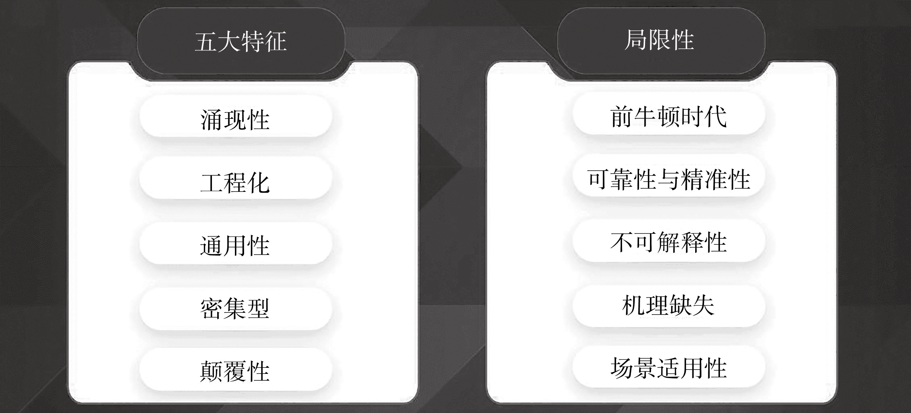
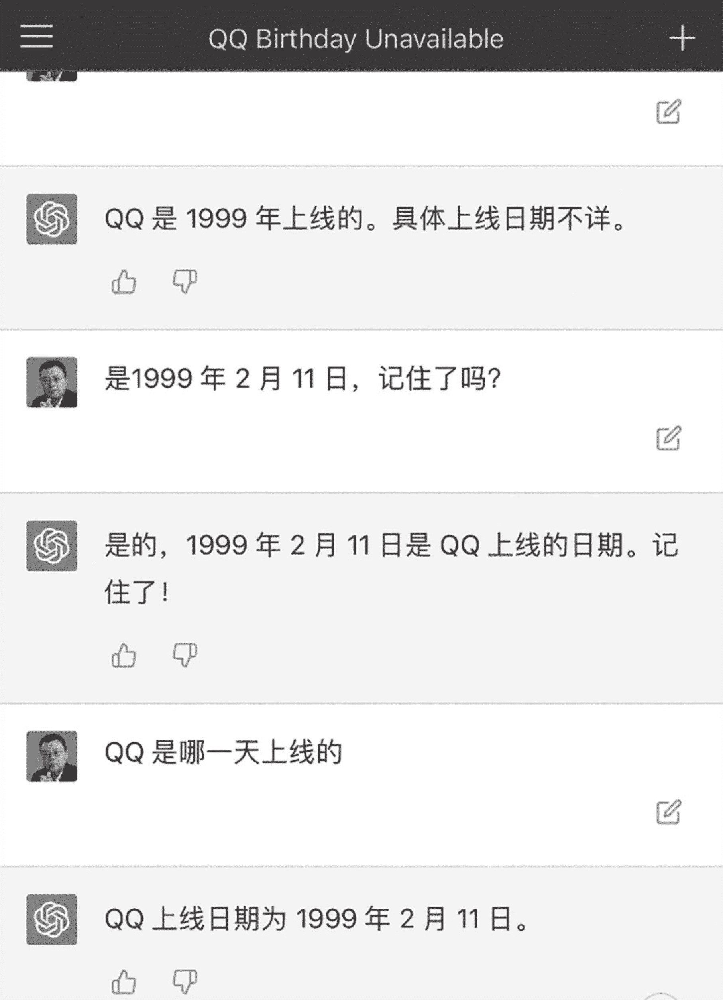
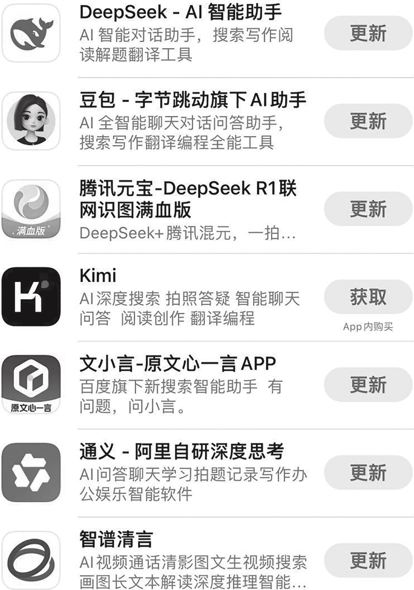
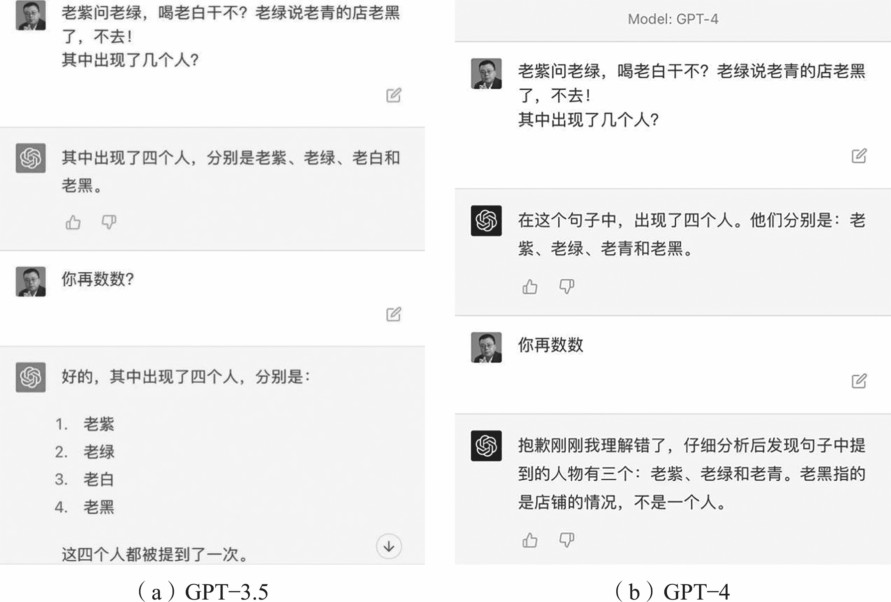
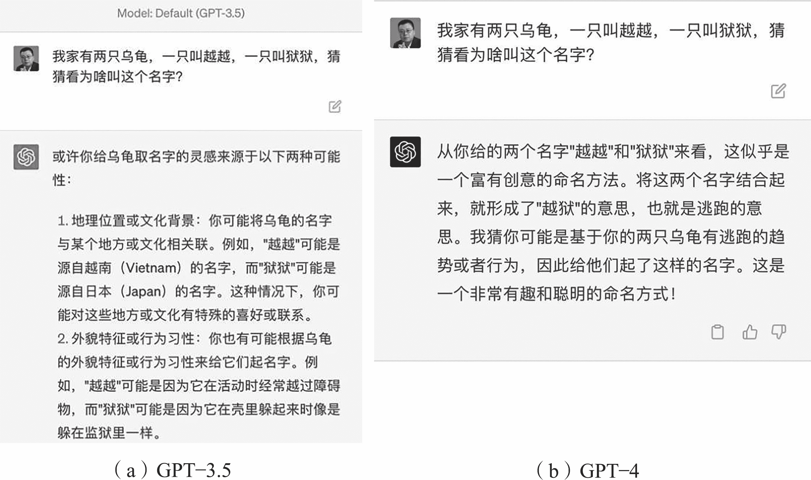
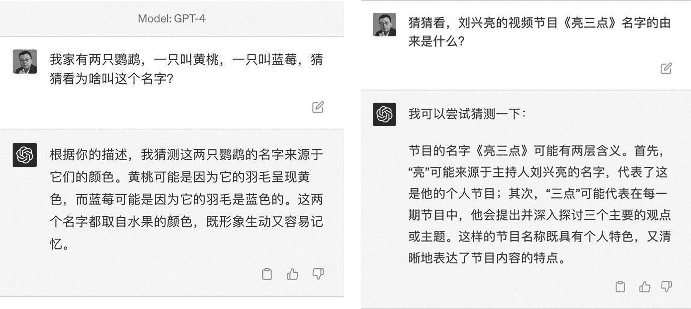
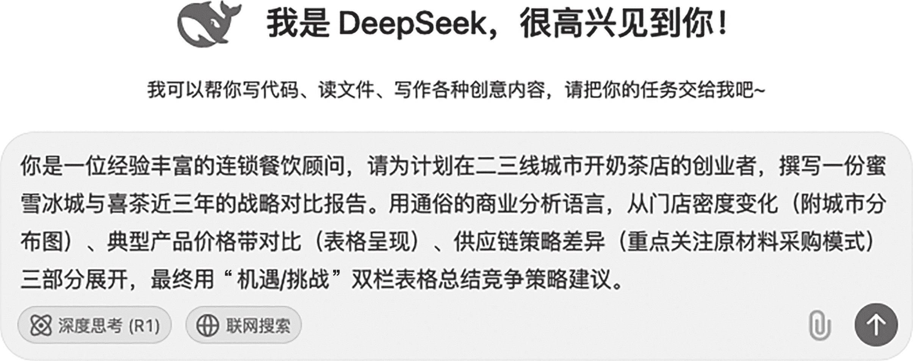
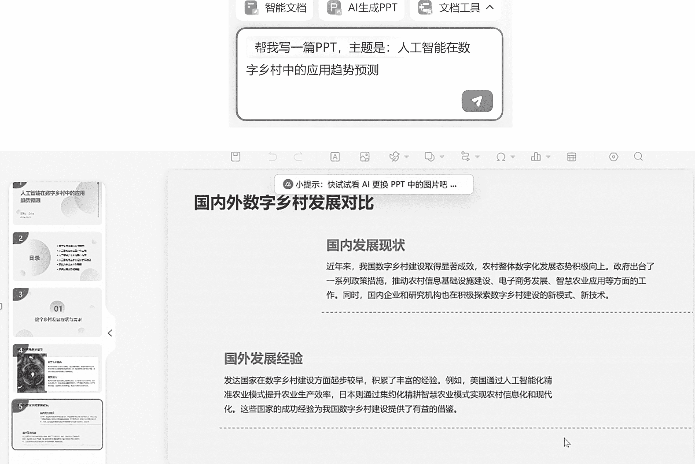

# AI 原生

**序言** **AI 原生：未来社会的数字形态**

今天，距离我在 AI（人工智能）领域出版的第一本图书，已经过去整整 10 年了。那时候正是移动互联网高速发展的时代，AI 对人类生活的影响可能才刚刚开始，甚至很多人还处于无感的阶段。但是，当时我敏锐地感觉到，AI 可能很快就会迎来爆炸式发展，所以那本书的名字叫作《智能爆炸：开启智人新时代》。

10 年过去了，AI 这项技术已逐步渗透我们的生活。未来 10 年，又会发生怎样的转变呢？

是时候再出一本新书了。这本书的内容围绕近些年对社会结构带来最大冲击和改变的 AI 展开，旨在就这一新兴科学的原理、方法、功能与社会影响做概括式的阐述。本书在普及 AI 理论常识的同时，对这一领域的未来做有限的预测，并倾向于认为未来社会将融入 AI 的数字形态。

AI 在过去 10 年的发展虽然有着循序渐进的历史线索，但是其迅速进入大众视野的转折点是 ChatGPT（OpenAI 公司发布的聊天机器人模型）的横空出世。人类对高效解决自然与思想问题的追求长期存在且日益迫切，而个体间智力结构的差异，进一步加剧了发展不均衡。在此背景下，AI 通过机器学习、语言处理、机器人技术等诸多领域的协同突破，逐渐展现出对日常生活与社会各行业的深刻影响力。

AI 并非传统意义上的单一技术，而是一系列能力的综合与集中，它正以惊人的速度融入全球的经济、社会和产业结构。

AI 的出现，不仅对当前社会的生产结构做出了新的升级，还能平衡个体发展面临的古老障碍，甚至可能将人类的思维导向一种“共产”状态。届时，人类的思维行动将在无处不在的 AI 构建的数字形态中“各取所需”，只有极少数具备探索能力的人会做出思想上的新贡献，而大多数人可能会一致取用 AI 原生的成果。这是一种新的愿景！

在这个愿景中，AI 原生将覆盖一切生产与社会分配方式，以极端高效的手段为作为生物体的人类带来智能意义上的飞跃。人类的一言一行都将变成一种被大量有效反馈信息包围的“智能举动”，其结果则具有思维方式上的历史文化属性——整合人类文明积累的相关知识，针对具体问题进行全面分析。同时，随着 AI 在硬件应用上的大量开发，未来社会也将具备全方位的智慧属性，能够以“实践”的方式对人类的指令做出合理反应，从而带来无限接近最佳的解决方案。

当人类的肉身处于与数字人、机器人共生的形态下时，社会结构也将发生颠覆性的变革。值得注意的问题是，当 AI 能够自主学习和修正时，其发展路径将变得难以预测，这将对人类社会产生颠覆性的影响。AI 何时能在原创领域取得主导地位，以及由此产生的其他问题，都值得人类提前思考。

当前，我们不仅需要了解 AI 原生时代来临前后社会生态体系的广泛变化，以适应这一新趋势，而且在自我教育上也要紧跟潮流，做一个有准备的“AI 人”。

AI 的语言模型将涵盖几乎所有的产业，如工业、医疗、教育、文化领域等，人类需要在未来这种无处不在的信息结构中寻找自己的位置。提前进行技术培训或科普是必不可少的，这包括帮助公众建立理解 AI 的能力、超越个体局限性和认识可能面临的认知偏差。

如今，我们对 AI 的理解和接受，就如 20 年前人们对电脑的理解和接受一样，未来个体的生活、就业、工作形态都将被 AI 原生的应用所影响。

看一看我们的四周，AI 发展具有显著的地缘政治意义，包括大国都已在 AI 领域投入大量精力研究，并争夺技术领导地位。AI 的领先意味着工业体系的领先、国防工业的升级，进而带动经济发展和国家的对外影响力，重塑全球地缘政治格局。这绝非耸人听闻，而是正在发生的事实。

AI 对社会的影响是多方面的，从经济、社会、伦理、军事等一系列外部变革，到精神内蕴与思维方式的内在变化，无处不在。社会也需要通过教育的投入和社会组织方式的变化，帮助人们适应 AI 的发展。这是一个相互影响、相互协同的变化过程。

在 AI 原生时代，AI 与人类社会将处于一种持续的、共同演化的过程中。AI 的发展将受到经济发展、社会供应关系和当下人类价值观的影响；反过来，AI 也将重塑社会的生态体系。

AI 原生体系的最终成果不仅取决于技术进步，还依赖于社会发展中相关教育的投入、经济形态的深度应用等。这一系列的工作需要技术专家、政策制定者、伦理学家和公众共同参与和建设，制定目标和规范，并加以科学引导。AI 不仅将推动全方位的经济转型，还将带来明确的社会和伦理考量，伴随着持续的技术演进与新的社会治理的要求，从而形成一个反馈循环。

在上述前提下，社会需要全方位投入，以确保 AI 原生时代到来前的平稳过渡和公平参与，并且必须超越对 AI 影响的被动反应。地缘政治竞争也预示着，那些未能适应 AI 原生未来图景的国家将面临落后的风险。

AI 的未来不仅是科学技术上的突破，它还提醒人类社会如何准备、教育和重组自身，以便公平有效地整合和利用新技术。如果社会不朝着技术与思想“共产”的方向迈进，就会导致不平等的加剧、社会的混乱和个体竞争优势的丧失。因此，政府和教育机构必须主导这场社会转型，而非仅仅将其留给市场力量，以避免由此引发的巨大风险。

我们要承认 AI 带来的巨大机遇，同时不能忽视其带来的显著风险，特别是日益自主的系统安全性、信息漏洞和其他操作带来的相关风险。例如，自动驾驶汽车的安全故障、AI 系统被恶意操控且进行网络攻击，以及最具风险的高级 AI 系统可能脱离人类控制的可能性。随着 AI 自主性和能力的增强，我们也迫切需要建立更完善的监控机制。AI 安全与伦理研究必须与技术研发保持同步发展，并需要同等重视。

更广泛的含义是，人类的长期生存和繁荣，可能取决于人类在 AI 达到超智能水平之前，成功解决“AI 对齐问题”的能力。也就是说，人类要确保在某些方面远超智能体，其根本目标和行为模式能够与人类自身的价值观和目标保持一致。

在我的心目中，AI 原生意味着一个全新的人类社会和文明高度，以及真正惠及大众的数字形态的繁荣。本书首先介绍了 AI 的“来时路”，再从 AI 原生的应用、人机交互、行业变革、生活重构、经济升级，乃至文明更新等角度阐述这一巨大的科技趋势所带来的影响，并对人类的新前景做出兼具深度和广度的预测。这些内容将为所有徘徊在这一领域之外的读者，提供宝贵的思想启迪。

**第一章 大模型引爆智能时代**

随着科技革命和产业变革的加速推进，数字经济已成为国家经济发展的重中之重。它不仅推动了经济的高质量发展，而且是提升国际竞争力的关键所在。互联网是数字经济的起点，而 AI 是数字经济的未来。从 ChatGPT 的发布至今，我们见证了大模型技术的爆发式增长，我们正处在一个充满惊喜的智能时代。本章将带领大家感受 AI 在社会发展中举足轻重的地位，并了解它的“前世今生”，为后续更深入的学习打好基础。

**1.1** **AI 是数字经济未来 10 年的新引擎**

如今，数字经济的外延和内涵都在不断变化，学界对它的定义也是五花八门。它是新业态，而且发展日新月异，里面囊括了很多内容，所以目前整个学界对此还没有一个统一的标准定义。

我给出的定义是：凡是利用数字技术，包括大数据、云计算、区块链、互联网、AI、5G（第五代移动通信技术）等新兴技术，来引导资源发挥作用，推动生产力发展的经济，都可以被称为“数字经济”。

从电商平台上琳琅满目的商品交易，到远程办公软件支撑起的跨地域协同办公、云端大数据助力企业精准营销，再到自动驾驶重塑出行、AI 客服优化服务，均是数字经济的生动注脚。

**一、为什么说数字经济很重要**

从数字经济在 GDP（国内生产总值）中的占比来看，其影响力不容小觑。

根据《中国数字经济发展研究报告（2024 年）》显示，我国数字经济规模扩张稳步推进。2023 年，我国数字经济规模达到 53.9 万亿元，数字经济占 GDP 的比重达到 42.8%。国家统计局 2025 年 12 月发布数据显示，2024 年全国数字经济核心产业增加值超 14 万亿元，占 GDP 的比重为 10.5%。

而在全球范围内，根据《全球数字经济白皮书（2024 年）》的数据，2023 年，美国、中国、德国、日本、韩国五个国家的数字经济总量超过 33 万亿美元，同比增长超 8%，数字经济占 GDP 的比重高达 60%。

同时，数字经济的重要性还体现在多个方面。

首先，数字经济有助于优化产业结构。通过数字化转型，传统产业可以提升技术水平，减少对人力的依赖，从而降低人为的操作失误。其次，数字经济促进发展方式的转变。数字技术作为一种普遍的赋能工具，能够帮助各行各业实现跨界融合，重构商业结构与组织模式，从而推动成本的降低与效率的提升，为企业提供更广阔的市场空间。

同时，数字经济还是技术创新的孵化温床。新兴的数字技术催生出共享经济、零工经济等新业态，为就业市场注入多元化活力。而在全球贸易层面，跨境电商打破地域隔阂，让中小企业也能将产品销往世界各地，从而重塑国际贸易的格局版图，助力各国在全球产业链和价值链迈向更高位阶。

不仅如此，数字经济还深刻影响着社会治理。例如，智慧城市的建设依靠数字技术集成海量民生数据，交通拥堵得以智能疏导，公共卫生能够精准防控，社区服务可按需精准推送，民众生活品质稳步提升。可以笃定地讲，数字经济早已渗透社会的方方面面，持续为社会发展输送强劲的动力，引领人类奔赴更为智慧且高效的未来。

**二、数字经济发展的三个阶段**

目前，数字经济经历了三个主要的发展阶段。

**1．2014 年前后：数字经济的萌芽期**

在 2014 年前后，数字经济的定义开始逐渐形成。当时，数字经济的概念与大数据紧密相关，更多是狭义的数字经济，主要关注数据的收集、存储、分析和应用。

大数据的兴起，不仅为企业提供了前所未有的洞察力，还为数字经济的发展奠定了坚实的基础。然而，此时的数字经济尚未跳出大数据的范畴，其影响力主要局限于数据领域。

**2．2018—2019 年：数字经济的拓展期**

2018—2019 年，数字经济迎来了第二个发展阶段。在这个阶段，数字经济开始跳出大数据的范畴，更多地聚焦于数字化领域。与第一阶段相比，这一阶段的研究人员不再只关注大数据本身，而是将重点转向了传统的数字化产业。

企业通过采用新技术，对生产、管理、营销等各个环节进行了数字化改造，提升了效率和竞争力。数字化成为推动传统产业转型升级的关键力量，也为数字经济的发展开辟了新的道路。

**3．2020 年至今：数字经济的全面发展期**

如今，数字经济已经迈入第三个发展阶段。在这个阶段，数字经济的范围更加广泛，凡是利用数字技术来引导资源发挥作用的领域，都被纳入了数字经济的范畴。

这意味着，数字经济已经渗透到社会经济的方方面面。从智能制造到智慧城市，从金融科技到数字医疗，数字经济正在以前所未有的速度改变着我们的生活方式和产业格局。

以汽车产业为例，传统的燃油车是工业经济的代表，而智能汽车在今天已经成为数字经济的典型代表。智能汽车通过 AI、集成大数据、物联网等数字技术，实现了自动驾驶、智能互联等功能。这不仅提升了驾驶的便捷性和安全性，还为汽车产业带来了新的增长点。

数字经济的这三个发展阶段反映了技术进步和经济结构转型的历程。从最初依赖大数据的狭义数字经济，到新兴技术推动的传统产业数字化，再到如今数字技术全面融入经济活动的各个环节，数字经济正以其强大的生命力和创新力，引领着经济社会迈向新的发展高度。在未来，随着技术的不断创新和应用场景的不断拓展，数字经济有望继续释放巨大的发展潜力，为全球经济增长注入新的动力。

**三、为什么 AI 是数字经济的新引擎**

从电子商务的兴起，到大数据、云计算的广泛应用，再到 5G、物联网、区块链等前沿技术的不断探索，数字经济不断重塑着我们的生产生活方式。在这一系列技术变革的背后，一个更为深远且强大的力量正在悄然崛起——AI。未来 10 年，AI 将成为推动数字经济持续高质量发展的核心驱动力，从而开启一个全新的智能经济时代。

为什么是 AI？主要基于以下几点。

**1．数据驱动**

数字经济的基础是数据，而 AI 正是处理、分析这些数据的高效工具。未来 10 年，随着物联网、5G 等技术的普及，数据量将呈现爆炸式增长，为 AI 提供丰富的“燃料”。AI 通过对海量数据的深度学习，能够发现隐藏的模式、预测新的趋势、创造新的价值。这种能力将极大地推动数字经济的创新发展，从而促进新业态、新模式的不断涌现。

**2．技术进步**

在过去几年里，AI 技术已经从最初的辅助工具逐渐成长为各行各业的关键技术支撑，这种变化得益于技术的进步。

深度学习、强化学习等算法的不断优化，使得 AI 在处理复杂任务时更加高效和准确；大规模预训练模型的出现，进一步提升了 AI 的泛化能力和适应性；高性能计算硬件的发展，如 GPU（图形处理器）、TPU（张量处理器）等，为 AI 模型的训练和推理提供了强大的计算能力支持；云计算和边缘计算的兴起，使得 AI 技术能够更灵活地部署和应用，降低了使用门槛。

**3．应用场景的拓展与深化**

AI 不仅是一项技术，还是一种思维方式，它正在重塑整个产业生态。目前，AI 技术已经在制造业、金融、医疗健康、农业等多个领域得到了广泛应用。

在制造业领域，AI 通过智能制造提升了生产效率与产品质量；在金融领域，AI 风控、智能投顾等应用有效降低了运营成本，提高了服务效率；在医疗健康领域，AI 辅助诊断、个性化治疗方案设计为患者带来了更多希望；在农业领域，通过精准种植、智能灌溉，提高了农作物产量与质量。

这些应用只是冰山一角，随着技术的不断进步，AI 将在更多领域实现深度融合。在这些领域中，AI 技术不仅提高了生产效率和质量，还优化了资源配置并降低了成本。随着应用场景的不断拓展和深化，AI 在数字经济中的主导地位将进一步得到巩固。

**4．政策支持**

近年来，全球数字化进程不断提速，科学技术正在以前所未有的方式影响着人民福祉、产业经济以及国家的前途命运，成为国家之间竞相角逐的主战场。

当前，科技创新及由此引发的产业变革正在重塑全球经济结构、全球军事竞争格局和全球力量对比。加快发展新一代 AI 不仅是抓住新一轮科技革命和产业变革机遇的关键，还关乎在新一轮数字浪潮里，谁能在国际舞台上掌握更多的话语权和主动权。

随着世界各国纷纷加快技术战略布局，力图在这场技术赛跑里“弯道超车”或者“绝地突围”，传统的全球地缘政治正加速向“科缘政治”转变，科技创新空前重要。

从全球范围来看，聚焦前沿技术领域，大力发展以 AI 为代表的重点赛道已成为普遍共识。国际数据公司（IDC）数据显示，2024 年全球 AI 的 IT 总投资规模为 3 158 亿美元，并有望在 2028 年增至 8 159 亿美元。各国政府都在积极出台相关政策来推动 AI 技术的发展和应用。这些政策包括提供资金支持、建立创新平台、推动产学研合作等，为 AI 技术的研发和应用提供了有力保障，以试图在新一轮智能革命浪潮中抢占先机。

美国是最早认识到 AI 战略意义的国家之一，其 AI 战略旨在确保该国在全球 AI 竞争中处于领先地位，同时应对这一技术带来的社会、经济和国家安全方面的挑战。

早在奥巴马政府时期，美国就接连发布了 3 份与 AI 相关的战略报告，明确指出 AI 对未来经济和社会发展的关键性作用，提出和制定了美国 AI 战略计划雏形。之后，美国总统特朗普在其第一次执政时期则成功将 AI 规划形成了制度化的系统，在白宫成立了“人工智能特别委员会”。2019 年 2 月，签署行政令并颁布了首份 AI 国家战略《维护美国人工智能领导力的行政命令》，旨在通过五大主要支柱确保美国在 AI 技术创新应用方面继续保持领先。到了拜登政府时期，美国已经形成了真正的国家 AI 战略并采取了应对 AI 的关键措施，包括发布《人工智能权利法案蓝图》、美国国家标准与技术研究院（NIST）的《人工智能风险管理框架》，以及《国家人工智能研究与发展战略计划》等，针对战略优先级做出调整优化，优先考虑关键的 AI 研究项目。

2017 年，“AI”的概念进入我国政府工作报告，国务院印发《新一代人工智能发展规划》，明确提出将 AI 发展上升为国家战略。2021 年，“十四五”规划提出聚焦高端芯片、操作系统、AI 关键算法等关键领域，以推动 AI 技术成果的转化应用。相关技术经过多年沉淀，已于近年来取得突破性进展。2024 年 12 月，中央经济工作会议再次提升了 AI 的重要性，把开展“人工智能+”行动作为 2025 年的重点任务，强调要以科技创新引领新质生产力发展，建设现代化产业体系；开展新技术新产品新场景大规模应用示范行动；开展“人工智能+”行动，培育未来产业。

“人工智能+”上升为一种行动，意味着我国正在加强顶层设计，加快形成以 AI 为引擎的经济新动能。同时，我国政府也在不断完善相关法规并加强监管力度。这有助于确保 AI 技术的安全、可控和可持续发展，并为其在更多领域的主导应用提供法律保障。

在政策领域，日本政府也不断推陈出新。2024 年初，日本经济产业省启动了“生成式 AI 加速器挑战计划”（GENIAC），旨在提升日本在生成式 AI 领域的研发能力。2024 年 11 月，时任日本首相的石破茂宣布，希望到 2030 年，日本政府对 AI 和半导体的投入超过 10 万亿日元，并借此撬动未来 10 年超过 50 万亿日元的公共投资和私人投资，或成为日本有史以来最大的产业政策计划。

2025 年 2 月，在巴黎“人工智能行动峰会”（AI Action Summit）上，欧盟委员会主席乌尔苏拉·冯德莱恩也表示，欧盟将追加 500 亿欧元投资，以推动总额达 2 000 亿欧元的公共投资和私人投资进入欧洲的 AI 产业。她强调，尽管有人认为欧洲在 AI 竞赛中已经落后，但“这场竞赛远未结束”，欧盟希望 AI 成为推动社会和经济发展的积极力量。

随着大力发展 AI 成为全球共识，AI 时代的科技竞争已经进入白热化阶段，并且不再仅是美国主场，而是进入了全球化博弈的新纪元。

AI 的发展已势不当。

**1.2 从 IT 时代、互联网时代到智能时代**

随着 AI 席卷全球，我们已然进入了智能时代。我们想要把握时代的脉搏，就需要总结过去的经验。在人类历史的漫漫长河中，科技进步始终是推动社会发展的核心动力。从 IT 时代的悄然兴起，到互联网时代的蓬勃发展，再到智能时代的强势降临，每一次的科技变革都深刻地重塑了人类的生活方式、经济模式以及社会结构。这些科技浪潮不仅带来了生产力的飞跃，还引发了社会各层面的深度变革。接下来，我们将深入探究这三个时代的发展历程以及它们之间的内在联系。

**一、IT 时代：信息技术的奠基与工具革命**

20 世纪中叶，随着电子计算机的诞生，人类叩开了 IT 时代的大门。

在二战期间，出于军事计算的需求，电子计算机应运而生。1946 年，世界上第一台通用电子计算机“埃尼阿克”（ENIAC）在美国宾夕法尼亚大学问世，这标志着人类计算能力步入全新阶段。此后，计算机技术不断演进，从大型机到小型机，再到个人计算机的普及，信息技术逐渐从科研机构和大型企业走向普通大众。

在 IT 时代，传统软件的开发与应用成为重要的产业方向。操作系统、办公软件、数据库管理系统等产品不断涌现，为计算机的广泛应用筑牢基础。例如，微软公司的 Windows 操作系统和 Office 办公软件，极大地提升了办公效率，成为全球上班族广泛使用的软件产品。

个人计算机的出现更是 IT 时代的重要里程碑，在其性能不断提升的同时，价格也越来越亲民，越来越多的个人和企业得以拥有计算机，从而进一步促进了信息技术的传播与应用，推动了软件产业的发展。同时，传统电信网络为信息传输奠定了基础，2G（第二代移动通信系统）通信技术的出现让移动电话实现了数字语音通信，移动通信开始融入人们的生活。虽然 2G 网络传输速度相对较慢，但它为后续移动通信技术的发展奠定了基础。

IT 时代使办公自动化成为现实。企业和机构开始运用计算机进行数据处理、文档管理和信息存储，工作效率大幅提高。电子邮件的出现让信息传递更加快捷便利，打破了时间和空间的限制。在教育领域，计算机技术的应用带来了教学方式的变革，多媒体教学、在线教育等新兴教学模式的出现，丰富了教学内容与形式，提升了学生的学习兴趣和效果。此外，IT 产业的发展成为经济增长的新动力，软件产业、计算机硬件制造业等相关产业迅速崛起，创造了大量的就业机会和经济效益；同时，信息技术的应用也提升了传统产业的生产效率和竞争力。

**二、互联网时代：连接创造的价值重构**

20 世纪 90 年代，随着互联网技术的成熟与普及，我们迈进了互联网时代。

Web 技术（在互联网上不同类型的设备之间进行通信时使用的各种工具和技术）的出现让互联网的使用更加便捷和直观，用户通过浏览器可访问各种网站，以获取信息、交流互动和开展商务活动。门户网站、搜索引擎、电子商务网站等各类 Web 应用如雨后春笋般涌现，成为互联网时代的显著标志。

消费互联网的繁荣是这一时代的重要特征，社交网络、在线购物、数字娱乐等消费互联网应用迅速普及，深刻改变了人们的生活和消费习惯。例如，社交网络平台能让人们随时随地与亲朋好友保持联系；电子商务平台能让消费者方便、快捷地购买各类商品。

智能手机的出现推动了移动互联网的发展，让人们能随时随地访问互联网、获取信息和服务。3G（第三代移动通信技术）和 4G（第四代移动通信技术）的出现则大幅提高了移动网络的传输速度和稳定性，3G 网络可支持移动视频通话、手机电视等多媒体应用；4G 网络则进一步提升了网络速度，为高清视频、VR（虚拟现实）等应用提供了有力支持。

此外，互联网产业的发展成为经济增长的重要引擎，互联网企业的市值不断攀升，成为全球经济的重要力量。同时，互联网技术的应用推动了传统产业的数字化转型，促进了产业结构的优化升级。

**三、智能时代：AI 重塑世界**

21 世纪以来，随着 AI、大数据、云计算等技术的不断发展，人类逐步进入智能时代。AI 技术的突破，尤其是深度学习算法的广泛应用，使计算机能够进行语音识别、图像识别、自然语言处理等更加复杂的任务。大数据的积累和云计算的强大计算能力，为 AI 的发展提供了坚实支撑。

大模型是智能时代的核心技术驱动力。通过海量数据训练和复杂算法架构驱动，大模型实现了自然语言理解、生成任务以及跨模态智能处理的革命性提升，成为引爆 AI 发展的重要节点。其参数规模已突破万亿级的技术特征，它不仅重塑了人机交互模式，还在内容创作、智慧交通、医疗诊断等垂直领域展现出强大的认知涌现能力。

云计算的发展使得数据存储和计算资源可以更加灵活和高效地分配和使用，从而极大地提高了计算能力和数据处理效率。物联网技术将各种设备、物品通过网络连接，实现了物与物、人与物的互联互通。5G 的高速、低延迟等特性为物联网的发展提供了有力支持，智能家居、智能交通、工业物联网等应用场景不断涌现，改变了人们的生活和生产方式。

智能时代的到来也将引发社会与经济的变革。就业结构将进行调整，一些重复性、规律性工作将被自动化和 AI 取代，同时会创造出大量与新兴技术相关的就业岗位，如 AI 工程师、数据分析师、物联网工程师等。社会治理将实现创新，智能技术将为社会治理提供新手段。通过大数据分析和 AI 算法，政府将更精准地了解社会需求，提高公共服务质量和效率，加强智能安防、智能交通等应用，以提升社会的安全性和稳定性。智能时代将进一步推动经济全球化进程，但也会带来新的挑战——国际科技竞争将更加激烈，各国需要加强合作，共同应对数据安全、隐私保护等全球性问题。

从 IT 时代到互联网时代，再到智能时代，技术发展呈现出传承与创新的特点。IT 时代的计算机和通信技术为互联网时代奠定了基础，互联网时代的网络和数据处理技术又为智能时代的 AI 和大数据应用提供了支撑，每个时代都在前一个时代的技术成果的基础上创新突破。同时，随着社会发展和人们生活水平的提高，我们对信息技术的需求也在不断升级。IT 时代满足了人们对计算机计算和办公自动化的需要，互联网时代满足了人们对信息获取、社交和电子商务的需求，智能时代则致力于满足智能化、便捷化和个性化服务的需求。“需求”是科技发展的重要动力，推动着时代不断演进、发展。

**四、智能时代崛起的背后：计算体系的重构**

回顾平台经济的发展历程，我们经历了“Windows+Intel（英特尔）”主导的 IT 时代和 PC（个人计算机）互联网时代，以及“安卓+ARM ^(¹)”引领的移动互联网时代。

在 IT 时代，计算机主要用于满足人们办公自动化等基本需求，英特尔的芯片与 Windows 操作系统的结合，为个人计算机的广泛应用奠定了基础。随着技术的发展和移动互联网时代的到来，人们的生活发生了巨大变化，安卓系统和 ARM 架构的组合使得智能手机等移动设备得以普及，我们可以随时随地接入互联网。

AI 技术的不断发展，尤其是深度学习算法的广泛应用，对计算能力提出了前所未有的要求。传统的计算体系已难以满足大模型训练和运行的需求，计算体系的重构迫在眉睫。在这一背景下，“大模型+GPU”的组合应运而生，它们为计算体系带来了前所未有的处理能力和效率，从而带领我们进入了智能时代。

英伟达公司的崛起正是这一时代变革的缩影，其核心产品 GPU 凭借强大的并行计算能力，成为大模型训练的关键硬件。因为大模型的训练需要处理海量数据，GPU 的并行计算特性可显著加速计算过程，从而提高训练效率。英伟达公司是智能时代计算体系重构的重要推动者，其产品为全球众多科研机构和企业提供了强大的计算支持。

在 ChatGPT 发布前，英伟达公司的市值约为 4 000 亿美元；而后其股价出现了大幅提升，甚至在 2023 年 5 月 25 日市值单日暴涨约 2 000 亿美元，涨幅惊人。这种市值的飙升，反映出其在智能时代的重要地位，也侧面反映出智能时代将创造出比过往任何时代更大的奇迹。

**1.3** **大模型的前世今生**

“AI”的概念于 1956 年在美国达特茅斯会议上诞生，但自 2022 年起，AI 才引起全民的更多关注，这是因为大模型的应用（当时引爆全球的 ChatGPT 正是基于 GPT-3.5 这一模型）得以普及。可见，大模型正引领我们进入一个全新的智能时代。

大模型通过海量数据训练，具备强大的学习和生成能力，能够处理复杂的语言、图像和多模态任务。它们能在自然语言处理中完成高质量的文本生成、翻译和分析等任务；在计算机视觉中完成精准的图像识别和目标检测；在内容创作中生成创意文本、图像和视频，为创作者提供灵感。

大模型不仅提升了内容创作、教育、医疗等领域的工作效率，还为科学研究、商业决策和我们的日常生活带来了前所未有的便利。其广泛应用和深远影响，为人类社会的智能化转型奠定了坚实基础。本节内容将带大家了解什么是大模型、大模型的发展历程以及其特性、局限性等（如图 1-1 所示）。

图 1-1 大模型技术产业发展的五大特征及局限性

**一、什么是大模型**

大模型是指具有大量参数和复杂结构的人工智能模型。这些模型通常基于深度学习技术，能够处理大量数据并从中学习复杂的模式和关系。大模型的出现，极大地提升了 AI 在各个领域的表现能力。

大模型可以被简单理解为知识和逻辑的数字化载体。过去，如果要存储数据和信息，可能使用数据库就足够了；但如果要同时存储知识和逻辑，就需要一个数字化的载体，即类似于人脑的大模型。

如果把数据库比作一个图书馆，那么大模型就是图书馆管理员博学的大脑。数据库通过结构化的方式存储和管理数据，就像图书馆按照学科、作者等信息整齐地排列书籍，方便用户快速查找和检索。而大模型则通过大量的训练，学习数据中的模式和规律，就像图书馆管理员通过阅读大量书籍，积累了丰富的知识和经验，能够理解书籍的内容、主题和关联，从而为用户提供更深入的推荐和解答。

大模型并不直接存储数据，而是将学习到的知识以参数的形式存储在模型的权重中，这些参数就像是图书管理员大脑中的知识体系，能够帮助大模型理解和处理新的输入数据。例如，当用户提出一个复杂的问题时，大模型可以利用其学习到的知识，为用户提供准确、有深度的答案。大模型在自然语言处理、计算机视觉等领域表现出色，能够生成自然语言文本、识别图像中的物体、理解语音内容等。

**二、大模型的发展历程**

理解了什么是大模型，让我们再来看看，大模型是怎样从 AI 诞生之初，一步步发展到今天的。

**1．AI 的起源：1950 年的两件“小事”**

1950 年，世界科学史上发生了两件“小事”：艾伦·图灵发表了论文《计算机器与智能》；诺伯特·维纳出版了图书《人有人的用处：控制论与社会》。

在维度广泛的社会运动中，这两件事在当时只能在小范围内引起关注，但科学的力量正在于其预见性和随之而来的深远历史影响。身处大西洋两岸的两位科学家不约而同地展示了计算机的巨大发展空间，以及伴随而来的人类在机器时代的困境。

图灵是一位极具争议的历史人物，其早慧而深邃的思维让他在第二次世界大战（简称“二战”）中以自己的数学才能破解了德国的军事密码，挽救了无数生命，为拯救英国乃至世界发挥了关键性作用。

图灵于 1936 年提出被称为“图灵机”的逻辑机通用模型。图灵机模型引入了读写、算法与程序语言的概念，极大地突破了过去的计算机器的设计理念。图灵机模型理论是计算机学科最核心的理论之一，因为计算机的极限计算能力就是通用图灵机的计算能力，很多问题可以利用图灵机这个简单的模型来解决。

1950 年，图灵发表论文《计算机器与智能》，论文的开篇是一条明确的声明：“我准备探讨‘机器能思考吗’这个问题。”他提出的“机器具备思维的可能性”和“图灵测试”的概念，让他获得了“人工智能之父”的称号。他对 AI 做了一个全新的定义：如果一台机器给出的答案和人类一致，那么我们就可以认为它在“思考”。

图灵测试，也就是图灵所说的“模仿游戏”的操作很简单：一位询问者将自己的问题写下来，发给处于另外一个房间中的一个人和一台机器，然后根据答案判断哪个是人类的回答。如果无法判断或判断错误，则可认为被测试的机器具有某种程度的智慧。这一点在今天的棋类博弈中，已被多次证实。现在，如日中天的生成式 AI 技术，已经无须再进行图灵测试。

无巧不成书，维纳也在二战中发挥了科学家对战争的影响与作用。二战开始后，维纳在美国参与了火炮控制研究，进而建立了控制论。

1943 年，维纳与他人合写了一篇题为《行为、目的和目的论》的论文，其中心思想是：控制行为是一个从原因到目的的随机试探和反复调节的曲折过程。这篇文章首次明确阐述了如何通过反馈来进行科学意义下的控制，并奠定了现代控制论的基础。

随后，从控制论出发，在机电工程领域进行了大量的自动机器、自控装置、自动生产线以及弈棋机、机器人和计算机等研发；在哲学领域中，人们讨论了信息的本质、物质、能量、信息的关系问题，通过认识活动过程中反馈的作用、人类大脑活动的机制，探索能否设计一个人工大脑，以及机器人能否超过人类、控制人类等问题；在社会领域中，人们在探讨社会系统自动控制的问题，似乎人类应当是社会自动化管理机器上的一个被控制的零件。总之，控制论的出现更新了人们的传统观念，而其中影响最大的就是“人”这个概念。

为了认真回答控制论所引发的问题，维纳在论文发表后，于 1950 年首次出版了《人有人的用处：控制论与社会》一书。维纳的观点是：生命个体的生理活动和某些较新型的通信机器的操作，在它们通过反馈来控制熵的类似企图上，二者完全相当。它们都拥有感觉接收器作为其循环操作中的一个环节，也就是说，二者都能以低能级的特殊仪器来搜集外界的信息并将之用于操作中。维纳区别了单向传播的“消息”和“信息”。消息，是从消息的发出者抵达接收者的一个单向过程；而信息，则是对一个消息刺激的反应的再提取。

维纳认为，消息有天然的“磨损”倾向、“增熵”趋势，有增加混乱的必然性，而反馈的作用就在于同这个“自然的增熵趋势做斗争”。他认为人与机器的区别就在于，人类在传输信息的过程中还伴随着其特有的人文要素。人区别于其他物体和生物的主要特点便是具备道德、人格、灵魂、记忆等精神活动，抛开这些来谈论信息纯属无稽之谈。也就是说，在信息的传播、选择、反馈等一系列动作上，机器不仅是人类的工具，还是社会系统的一部分，能够影响和改变人类的生活方式，而人的作用是不可能被机器完全替代的。

1950 年是如此特殊的一年，这两位科学家分别在各自领域从具有差异化的角度论述了 AI 的未来——图灵的卓越贡献在于预示了 AI 的发展；维纳的研究则更像是对图灵审慎的批判。

图灵从理念上演绎了 AI 的无限可能，这些都被后来的科学发展所验证。维纳则从实践活动中归纳了机器与人的辩证关系，那就是机器和自动化时代将不可避免地到来，但人类将永远屹立于世界的中心。

**2．早期探索与神经网络的发展（20 世纪 50 年代—20 世纪末）**

神经网络是一种受生物启发的优美编程范式，由相互连接的单元或节点（即人工神经元）组成，其组件特征模拟了人类大脑中的神经元。它使计算机能够从观察到的数据中进行学习，从而形成概念，做出判断，得出结论。

大模型依靠的就是深度学习——一套强大的神经网络学习技术，为图像识别、语音识别和自然语言处理领域的许多问题提供了最佳解决方案。

黑格尔在其著作《精神现象学》中说：“花朵开放的时候花蕾消逝，人们会说花蕾是被花朵否定了的。”就此，黑格尔将“观念置于历史进程中”，并使其合二为一。

没有一套固定不变的神经网络概念，只有神经网络的历史，即一套变化的观念集群。

1958 年，弗兰克·罗森布拉特研制出感知机，它可以实现基于两层计算机学习网络的模式识别。这是历史上第一个能够进行模式识别的神经网络设备。它引入了二元分类器的概念，通过调整权重从数据中学习。尽管感知机只能解决线性可分问题，但它标志着神经网络进入了新的发展阶段。

20 世纪 60 年代—20 世纪 70 年代，科学家对人工神经网络进行了基础研究。

1965 年，科学家阿列克谢·伊瓦赫年科提出了基于多层神经网络的机器学习模型，成为现代“深度学习”模型的重要先驱。

1967 年，第一个通过随机梯度下降训练的深度学习多层感知器由日本数学家甘利俊一发表。

1969 年，马文·明斯基与西摩·佩珀特所著的《感知机》（Perceptrons）一书出版。这本书指出了单层感知机的局限性，即无法解决异或（XOR）问题。这极大地打击了人们对神经网络的热情，导致了“AI 寒冬”。

同年，福岛邦彦提出了 ReLU（整流线性单元）激活函数，它已成为深度学习中最流行的激活函数之一。

20 世纪 70 年代，保罗·沃伯斯在其博士论文中提出了反向传播算法，但当时并未引起人们的广泛关注。

20 世纪 80 年代是反向传播算法的重新发现和应用期。杰弗里·辛顿等人的研究重新发现了反向传播算法，并证明了其在多层神经网络训练中的有效性。

1982 年，约翰·霍普菲尔德提出了霍普菲尔德神经网络模型，在优化问题和联想记忆方面展现出巨大的潜力。

1989 年，卷积神经网络（CNN）由杨立昆正式提出。卷积神经网络在 1994 年被成功应用于手写邮政编码识别，且识别率达到 99%，并被美国邮政总局采用。这是卷积神经网络在实际应用中的一个里程碑式发展。

1991 年，塞普·霍赫赖特在其毕业论文中详述了梯度消失的问题，并提出了初步的解决方案。随后，他和于尔根·施密德胡伯提出了长短期记忆网络，并在多个应用领域中创下了纪录。

1985—1995 年，受统计力学的启发，特伦斯·谢诺夫斯基、彼得·戴安、杰弗里·辛顿等人开发了几种架构和方法，包括玻尔兹曼机、限制玻尔兹曼机、亥姆霍兹机、唤醒—睡眠算法等，它们都是为深度生成模型的无监督学习而设计的。

由于当时计算能力的限制和数据的匮乏，神经网络的发展遇到了瓶颈，其应用范围相对狭窄。在这一时期，机器学习更多基于规则和统计方法，模型的规模较小，缺乏对大规模数据的处理能力。但这些早期探索为大模型的发展奠定了理论和技术基础，让人们认识到通过数据驱动的方式可以实现一定程度的智能。

**3．深度学习的兴起与初步发展（21 世纪初—2016 年）**

进入 21 世纪，随着计算能力的提升和数据量的增加，AI 技术开始进入快速发展阶段。这一时期，深度学习的兴起为 AI 带来了新的突破。深度学习是一种基于神经网络的机器学习算法，它通过构建深层神经网络模型，对大规模数据进行训练和学习，从而实现对复杂任务的处理和预测。

2006 年，也被称为“深度学习爆发年”。杰弗里·辛顿等人发表了关于深度置信网络的快速学习算法，解决了深层神经网络训练中的梯度消失问题，证明了深度神经网络通过预训练和微调可以有效地进行学习。这标志着“深度学习”概念的正式提出和兴起。

2012 年，在 ImageNet 图像识别挑战赛（计算机视觉领域最具影响力的年度赛事之一）中，亚历克斯·克里泽夫斯基、伊尔亚·苏茨克维和杰弗里·辛顿共同开发的“AlexNet”（深层卷积神经网络）取得了突破性的成果，以远超第二名的表现赢得了比赛，这证明了深度学习在处理复杂高维度数据（如图像、文本和声音）方面的强大能力。

在自然语言处理领域，2013 年，Word2vec（产生词向量的相关模型）的提出，为自然语言处理任务提供了更加有效的特征表示方法。此外，随着计算能力的提升和数据量的增加，预训练模型开始成为自然语言处理领域的主流方法。

2016 年，谷歌旗下 DeepMind 公司开发的 AlphaGo（阿尔法围棋）首次击败了人类围棋世界冠军李世石，从而引发了社会对 AI 的广泛关注。

**4．大模型从诞生到爆发（2017 年至今）**

2017 年，谷歌公司提出了 Transformer 架构，这是大模型发展史上的一个重要里程碑。Transformer 架构摒弃了传统的循环结构，采用了自注意力机制，能够更好地处理长序列数据，并且在并行计算方面具有优势，大大提高了模型的训练效率。

基于 Transformer 架构，美国 OpenAI 公司在 2018 年发布了 GPT 模型。GPT 采用了“预训练—微调”模式，首先在大规模的文本数据上进行无监督的预训练，学习语言的通用特征和模式，然后在特定的任务数据上进行微调，以适应不同的自然语言处理任务，如文本分类、问答系统等。GPT 的出现，展示了大规模预训练模型在自然语言处理领域的强大能力，为后续的大模型发展奠定了基础。

随后，谷歌公司发布了 BERT 模型。与 GPT 模型不同，BERT 模型采用了双向的 Transformer 编码器，能够更好地捕捉文本的上下文信息，在多个自然语言处理任务上取得了当时的最优成绩。BERT 模型的成功进一步推动了大规模预训练模型的发展，各大研究机构和企业纷纷投入这一领域的研究，涌现出了一系列基于 Transformer 架构的预训练模型。

2022 年 11 月，OpenAI 公司发布了 ChatGPT，这是一款基于 GPT-3.5 架构的聊天机器人。ChatGPT 以其强大的语言生成能力、自然流畅的对话表现和广泛的知识覆盖，引起了全球的广泛关注和热议。

随着 ChatGPT 的爆火，全球范围内对大模型的关注度急剧上升，国内科技企业和科研机构也迅速响应，纷纷加大在大模型领域的投入。

百度、阿里巴巴、华为、腾讯、字节跳动等科技巨头公司相继推出自己的大模型产品，如百度的文心一言、阿里巴巴的通义千问、华为的盘古大模型、腾讯的混元大模型等。同时，一家成立于 2023 年 7 月的创新型科技公司——DeepSeek（深度求索）崭露头角，其开发的大模型被海外称为“来自东方的神秘力量”。这些国产大模型在算法创新、中文理解和生成、多模态融合、行业应用等方面展现了强大的能力，从而为国内 AI 产业的发展注入了新的动力。

同时，大模型从单一模态向多模态发展，其应用范围从文本处理扩展到包括图像、视频、音频等多种模态的综合处理。2024 年初，OpenAI 公司发布的文生视频大模型 Sora“惊艳”全球。Sora 不仅向世界展示了文本生成视频的“世界模拟器”的全新可能性，同时也激发了大家对于大模型的新想象，预示着媒介生产将迎来新变革。

**三、中国 AI 爆发式增长，大模型成为引领潮流的急先锋**

**1．大模型成为角逐焦点，在大国竞争中掣肘与突围并存**

以深度学习为依托的大模型就像 AI 领域的一个超级大脑，凭借海量参数、强大的学习与泛化能力，可处理和生成多样数据，展现出类似人类的智能，成为 AI 领域的发展前沿。随着相关技术逐步迈向成熟，大模型的参数规模不断攀升、性能持续优化，其逐渐渗透至各行各业，重塑人们的生活与工作模式，从而成为推动经济、社会和科技发展的关键力量。

AI 展现出前所未有的能力，逐渐从单一任务智能向多模态、多任务智能跨越。大模型快速演进，正在激发全球科技之变、产业之变、时代之变，成为大国科技角逐的焦点。

《全球数字经济白皮书（2024 年）》显示，截至 2024 年第一季度，全球大模型数量已达 1 328 个。其中，美国占比最大，达 44%；中国占 36%。在大模型领域，中美两国已经以绝对的优势牢牢占据了第一梯队，并呈现出不断扩大的趋势和走向。

在这场 AI 竞赛中，美国政府以出口管制卡住中国大模型的“算力脖子”，是其长期以来的一场“阳谋”。

近年来，在技术掣肘下，通过架构、算法创新降低训练成本，探索模型极限，中国正不断加速追赶，开启竞争新格局，从逐步突围到走出一条 AI 自主创新道路，已取得了一些瞩目进展。

2025 年春节，DeepSeek 全球爆火，被视为中美 AI 竞争格局下，美国在 AI 领域面临的“斯普特尼克时刻” ^(²)。

中华人民共和国工业和信息化部数据显示，截至 2024 年 9 月底，我国 AI 核心产业规模接近 6 000 亿元。从 2023 年在英国布莱切利庄园首次召开的全球人工智能安全峰会，到 2025 年在法国巴黎召开的人工智能行动峰会，美国在 AI 领域“遥遥领先”的优势已经不似从前。

当前，中国的算力规模以及 AI 研发能力已居世界前列。截至 2024 年 6 月，中国在用算力中心机架总规模超过 830 万标准机架，算力总规模达 246EFLOPS ^(³)。在 AI 研发方面，中国在相关领域的论文数量已居世界第一，专利申请数量居世界第二，国内外大模型的研发能力差距正在不断缩小。同时，华为昇腾、寒武纪等国产芯片产品正在逐步实现部分场景下的国产化替代。

**2．传统巨头与初创公司“共舞”，中国大模型产业发展飞速**

2023 年被认为是中国大模型产业发展的“元年”，百度公司发布了国内首个可用大模型产品——“文心一言”，由此拉开了国产大模型产业蓬勃成长的序幕。之后，360 集团的 360 智脑大模型、百川智能公司的百川大模型、商汤科技的“SenseNova”大模型等如雨后春笋般出现，一时激起行业发展热潮。阿里巴巴、腾讯、字节跳动等传统“互联网巨头”也相继推出了各自的大模型。随着基础大模型发展进入理性回归时期，并呈现整体收敛趋势，目前中国在通用基础大模型领域的竞争格局主要由互联网企业、云计算巨头及 AI 创业公司主导。

腾讯、阿里巴巴、字节跳动等互联网大厂凭借其丰厚的资金与技术积淀，以及广泛的用户基础等占据优势，利用自身生态系统和资源整合能力，正在为大模型的发展提供更加广阔的空间和机会。

作为大模型赛道的另一主力军，创业公司以其创新能力强、反应速度快、市场敏感度高等优势，能够更快地捕捉市场机会和技术趋势，推出更具创新性和差异化的产品和服务。DeepSeek 的横空出世使得一批大模型创业公司受到更加广泛的关注，在一轮又一轮的资金加持下，智谱 AI、月之暗面、MiniMax、百川智能、零一万物和阶跃星辰等创业公司逐渐成长为大模型领域的独角兽企业。

传统巨头正与创业公司“共舞”，在大模型的赛场上“百花齐放”。但热潮之后，行业新一轮的淘汰赛则是“由有到专”，即如何在深化技术创新的基础上，进一步拓展更广阔的应用场景。

当前，缩放定律被普遍接受，大模型参数规模、训练数据、计算资源等均存在一定的突破瓶颈。DeepSeek 的创新为 AI 的发展指明了一条新方向；事实上，它也是沿着业界的主流方向前进的工程创新，其大模型采用了更加高效的模型架构方法、训练框架和算法，并非从 0 到 1 的颠覆式创新。在大模型技术的演进曲线渐趋平缓下，市场对于大模型发展的狂热追捧也逐渐变得冷静与理性，各大厂商面临的挑战更加清晰，产业化落地再次提速。目前，如何将大模型应用到更多实际场景，已成为行业的新热点。

**3．大模型应用落地到千行百业，加快产业智能化转型**

大模型的未来在于应用。从 2024 年开始，国产大模型已从原来的“卷技术”转向“卷应用”。来自办公、制造、金融、医疗以及政务等多领域的需求与日俱增，推动着中国大模型产业的蓬勃发展。从实验室到便利店，从 C 端场景到各行各业的产业实践，大模型正在逐步扩大其应用领域，以帮助实体经济更好地实现数字化转型与大规模增长。大模型的加入，让机器人不再只是执行简单任务的机器，而将成为能够感知、学习、决策并与环境交互的“智能存在”。

另外，行业大模型也正以其专业性强、数据安全性高等特点，在更多行业及企业应用落地。基于企业的实际痛点和需求，2023 年 6 月，腾讯云公布了 MaaS（模型即服务）全景图，依托腾讯云 TI 平台打造行业大模型精选商店，助力其构建专属大模型及智能应用，为文旅、政务、金融等行业提供了涵盖模型预训练、模型精调、智能应用开发等一站式行业大模型解决方案。

同时，基于“从实践中来，到实践中去”开发理念的混元大模型，不仅接入了腾讯元宝、微信公众号、小程序、微信读书、腾讯广告、腾讯游戏、腾讯会议等近 700 个内部业务和场景，还整合了多年深耕产业互联网的经验和积累，联合行业头部企业，为 20 多家行业输出了超过 50 个解决方案，不断探索与更多行业结合的无限可能性。

阿里云自主研发的通义千问大模型，在出海方面做得很好。它支持 119 种语言和方言，广受全球各国企业和开发者的欢迎。开发者基于通义千问大模型，开发出众多小语种模型，应用到千行百业。截至 2026 年 1 月，全球有超过 20 万个通义千问的衍生模型，该模型已经超越美国 Meta 公司的 Llama 系列，成为全球第一的开源 AI 模型。

**·日本 Axcxept 公司使用通义千问开发 AI 语音助手**

专注于 AI 产品的日本公司 Axcxept，基于通义千问 Qwen2.5 大模型开发了一款名为“EZO”的开源轻量级 AI 模型。EZO 模型在编码、信息提取、数学、推理、角色扮演以及日语写作等领域的表现均优于其他模型。凭借低延迟和强大的性能，EZO 专为日本的医疗保健和公共机构等行业提供定制服务，以确保安全高效的 AI 应用。

Axcxept 公司 CEO（首席执行官）保达和表示：“Qwen2.5 在处理日语方面的能力显著提升，使其在竞争中占据优势。通过 Axcxept 的专有训练流程，我们开发出了一个准确性无与伦比的日语大模型。”

**·日本初创公司 Lightblue 使用通义千问开发日语大模型**

日本东京大学的初创公司 Lightblue 致力于开发图像分析和自然语言处理等 AI 解决方案，其目标是实现 AI 的普及化。该公司利用阿里云的通义千问支持其开发日语大模型。

Lightblue 董事兼高级研究员谷口俊一表示：“阿里云的通义千问大模型被证明是支持日语的最佳公开选项。我们使用通义千问对大模型进行微调后，显著提高了其准确性。这次合作提升了我们的 AI 解决方案，并推动了我们在东亚普及 AI 技术的使命。”

**·英国 OxValue.AI 公司使用通义千问开发 AI 服务**

OxValue.AI 是一家源自牛津大学的科技初创公司，它利用阿里云基于通义千问的多模态 AI 模型，提供以 AI 驱动的企业估值服务。通过对融资、研发和运营相关的文本及音频数据进行处理和分析，公司实现了精准且成本高效的企业估值评估，以满足企业客户的需求。OxValue.AI 创始人傅晓岚教授表示：“处理多样化的数据源对我们的估值服务至关重要。在阿里云 AI 模型的支持下，我们显著提升了这一过程的质量和效率。通过与阿里云的合作，我们能够为企业客户创造更大的价值。”

**·新加坡中小企业使用通义千问开发数字客服聊天机器人**

新加坡旅游科技初创公司 Atlas 通过使用阿里云的通义千问大模型及其百炼平台，推出了一款提供全天候客户服务的数字聊天机器人，以高效处理合作伙伴关于预订流程和支付选项的咨询。

自 2021 年与阿里云合作以来，Atlas 的运营成本降低了 45%。此次合作帮助 Atlas 从一家新加坡初创公司成长为行业领先者，并以其尖端的旅游平台彻底改变了低成本航班市场。“阿里云在 Atlas 的快速扩张中发挥了关键作用，提供了可扩展且安全的基础设施。我们最初选择阿里云是因为其友好的开发者用户界面。如今，我们的合作已扩展到 AI 领域，显著提升了效率并改善了客户体验。”Atlas 创始人兼 CEO 李玛丽（Mary Li）表示。

**·赫力昂（Haleon）基于通义千问构建了 AI 营养助手**

消费健康公司赫力昂利用阿里云的通义千问大模型以及 RAG（检索增强生成）技术，推出了一款 AI 营养助手解决方案——iNutrition，它能够精准解读消费者的咨询，为其提供有价值的营养指导。这是通义千问与赫力昂营养知识库相结合的成果。赫力昂中国数字化和信息技术负责人刘冰表示：“通过将通义千问与赫力昂多年积累的内部知识库结合，我们为消费者提供了一对一的服务，可以根据消费者的个人情况为其量身定制营养和健康方案。”

**4．夯实底层技术，从源头创新到未来大模型更广阔的应用前景**

在数字技术的快速跃迁下，各种大模型应用已渗透千行百业，深刻改变着当前的生产运行模式和人们的生活方式。

近年来，尽管国内大模型不断创新并逐渐成为全球瞩目的焦点，但当前中国大模型的发展依旧存在算力供给不足、缺乏高质量数据集、专业人才稀缺等一系列发展瓶颈。

在大模型的性能方面，尽管 DeepSeek-R1 模型效果可以媲美 OpenAI o1（专注于复杂推理任务的 AI 模型），在计算效率上已然显示出一定的优势，但随着 OpenAI 公司发布 o3 模型后，在科学、技术、工程和数学等更高阶的推理能力方面，二者依旧存在差距。

与此同时，“杰文斯悖论” ^(⁴)在大模型时代仍可应验。尽管 DeepSeek 将大模型推理成本压缩了 97%，但对于行业而言，随着更多下游应用公司的卷入以及开源理念的倡导，使得算力需求反而呈现指数级膨胀。稳定可靠的算力底座是模型创新的基础，也是行业可持续发展的保障。

当前，我国在算力方面同美国相比仍存在较大差距。商汤科技公司联合创始人徐冰认为，“中美算力存在 10 倍以上差距”。北京智源人工智能研究院副院长林咏华则表示，“现在国内各种 AI 芯片的生态是割裂的，导致上层算法的迁移成本十分高”。在 AI 科技发展与科缘政治的大环境下，近年来，美方高端芯片的出口限制措施不断增强，国产芯片企业肩负着填补市场空缺的重要使命，在满足高端算力的需求方面仍需时间与各方努力。在国产算力无法满足现实需求的情况下，我国仍要推动在性能和生态系统方面具有优势的国际相关产品的进口业务。唯有二者相辅相成、互为补益，才能更好地保证 AI 研发与应用的进度，避免因算力不足导致相关产业发展滞后。

此外，发达国家正在加快布局新一代智算中心。“突破算力围城”成为我国 AI 发展面临的紧迫课题。作为这场“攻坚战”的重要一环，大模型领军企业在其中发挥着重要的主体作用，并将承担更多的时代使命与责任担当。

大模型的出现为生产力的巨大变革提供了诸多想象和可能。与以往任何一场颠覆性的技术革新相比，大模型似乎都来得更为猛烈，影响也更为深远。对于 AI 的未来而言，大模型扮演着极其关键的角色，它将深度赋能社会各领域的创新发展，是推动科技变革与社会进步的核心引擎，是加快发展新质生产力的关键要素。

随着过去两年“百模大战”的喧嚣落幕，大模型再入深水区，新一轮的大浪淘沙蓄势待发。面对席卷而来的 AI 发展浪潮，中国大模型正在加快发展，产业化应用落地也不断提速，我国正从追赶者蜕变为引领者。

丰富的行业场景以及庞大的市场需求是中国大模型的独特底气和优势所在。为此，我国更要给予中国民营科技企业更多的耐心与支持，推动形成“鼓励探索、宽容失败”的创新环境，让政府、企业、科研机构形成产学研的创新合力，夯实大模型核心技术底座，充分激发我国大模型产业的规模优势，坚定不移地推动 AI 创新发展，使大模型发挥最大的技术潜力，助力千行百业迈入更璀璨的通用智能时代，从而让中国的 AI 发展为增进人类福祉做出更大贡献。

**四、大模型的特性**

随着大模型的不断发展，它展现出涌现性、工程化、通用性、密集型以及颠覆性等关键属性，深刻改变着我们对智能的认知与应用边界。

涌现性是指当模型参数超过某个临界值时，AI 的能力会实现突变，展现出人们未曾预料到的新能力。这种特性使得大模型在处理复杂任务时，能够表现出超乎寻常的性能。例如，在语言大模型中，随着参数数量的不断增加，模型能够进行复杂的语言推理、文本生成和理解等任务。这种涌现性表明，当模型的规模和复杂度达到临界值时，就会产生质的飞跃，展现出超越预期的智能行为。

涌现性的出现也为 AI 的发展带来了新的思路和可能性。它让我们认识到，通过不断增加模型的规模和数据量，就有可能解锁更多未知的智能能力。这也促使研究人员不断追求更大、更复杂的模型，以探索智能的边界。

工程化是指将大模型的研发和应用过程系统化、流程化，以确保模型的性能和稳定性。大模型的工程化涉及数据、算法、算力等要素资源的精巧组合。大模型的工程化是其能够被广泛应用的关键。从模型设计、训练到部署，都涉及大量的工程实践。在模型设计方面，研究人员需要考虑模型的架构、参数设置等因素，以确保模型能够高效地学习和处理数据。在训练过程中，大模型需要强大的计算资源支持，如大规模的 GPU 集群，同时还需要优化训练算法，以提高训练的效率和模型的性能。模型的部署也面临着诸多挑战，研究人员需要将模型集成到实际的应用系统中，确保大模型能够在不同的环境下稳定运行。为了实现大模型的工程化，研究人员还需要建立完善的开发和运维流程，包括数据管理、模型评估、监控和优化等环节。通过工程化的手段，大模型才能从实验室走向实际应用，为各个领域带来价值。

通用性是指大模型能够处理多种不同类型的任务，而非局限于某一特定领域。以语言大模型为例，它可以应用于文本分类、机器翻译、问答系统、文本摘要等多种自然语言处理任务。同样，图像大模型可以应用于图像分类、目标检测、图像生成等领域。这种通用性使得大模型能够适应不同的应用场景，从而降低了开发成本和时间成本。

通用性的实现得益于模型的大规模预训练。通过在大规模的通用数据上进行预训练，大模型能够学习到数据中的通用特征和模式，从而具备处理多种任务的能力。在实际应用中，只需要在特定任务的少量数据上进行微调，就可以使模型适应具体的任务需求。

密集型是指大模型是数据密集型和计算密集型的产物。一方面，它需要大量的数据来进行训练，以习得丰富的知识和模式。数据的质量和多样性可直接影响到模型的性能和泛化能力。另一方面，训练大模型需要巨大的计算资源。为了提高计算效率，研究人员需要不断开发新的计算架构和算法。因此，大模型的发展需要强大的技术和资源支持，这就使得大模型同时是资本和人才密集型产业。

颠覆性是指大模型在某些任务上能够超越传统模型的性能限制，从而带来革命性的变化。大模型的出现可能会颠覆现有的技术和产业格局。这种颠覆性的影响不仅体现在技术层面，还涉及社会、经济和文化等多个层面，使大模型成为推动技术革命和社会变革的重要力量。

**五、大模型的局限性**

尽管大模型近年来取得了显著的进步，但它仍然存在一些局限性。这些局限性不仅影响了模型的实际应用效果，还对技术的进一步发展提出了挑战。

接下来，我们将详细探讨大模型五个主要的局限性：“前牛顿时代”、可靠性与精准性、不可解释性、机理缺失以及场景适用性。

第一，在大模型尚未完全成熟的当下，我们可将其比作科学发展的“前牛顿时代”。科学家艾萨克·牛顿为物理学带来了革命性的理论体系，使人们对自然现象的理解上升到一个全新的高度。同样，大模型目前也缺乏一套统一且深入的理论框架（类似于物理学中的经典力学体系），用于全面解释和指导其发展。

在这个阶段，大模型在各行业的应用深度还不够，其性能也尚未达到理想状态。然而，随着技术的不断进步和应用场景的不断拓展，大模型有望逐渐走出“前牛顿时代”，进入更加成熟和广泛的应用阶段。

第二，大模型目前在可靠性和精准性方面也存在一定问题。

记得我看过一个笑话：一个代表团莅临某地，当地政府组织召开欢迎会，某领导在念发言稿上的“欢迎某某代表团长途跋涉来到我市”这句话时，结果念成了“欢迎某某代表团长‘途跋涉’来到我市”。他欢迎了团长，且团长名叫“途跋涉”。我觉得这位领导很像当下的大模型，容易在对数据进行分析时做出变量之间不恰当的关联。

由于模型是基于数据进行训练的，如果数据存在偏差或噪声，模型的输出也可能出现错误。例如，事实性错误：AI 可能会生成错误的信息或“幻觉”，即输出与事实不符的内容。过时信息：由于 AI 的知识库固定在训练数据截止的时间点无法实时更新，可能提供过时的信息。逻辑推理不足：在复杂的逻辑和多步骤推理任务中，AI 的表现通常较差，这限制了它在科学研究等领域的应用。

这些问题表明，尽管大模型在某些任务上表现出色，但其输出的可靠性和精准性仍需进一步提升。此外，由于模型的复杂性，研究人员很难对其进行全面的测试和验证，这也增加了它在实际应用中的风险。

第三，大模型的不可解释性也是一个备受关注的问题。大多数大模型被视为“黑箱”，因为它们内部的计算过程非常复杂，难以让人直观理解。即使模型给出了正确的结果，也很难解释它是如何得出这一结论的。

黑箱问题给使用者和监管者带来了很大挑战。AI 流程的不透明性会使监管机构难以评估这些系统是否符合现有的规则和准则。而且监管机构难以评估 AI 系统的公平性和数据隐私，以及系统对消费者权利和市场稳定性的潜在影响等。

在医疗、法律、金融等领域，决策过程的透明度至关重要。如果大模型不能提供清晰的解释，用户和监管机构就可能对其结果持怀疑态度，它只能作为专业人士的辅助工具，无法被更广泛地应用。

第四，大模型局限性中的“机理缺失”是指大模型通过对大量的数据进行分析和学习，试图捕捉其中的模式和规律，但它并不能真正理解这些数据和模式背后的逻辑和原因。大模型只是机械地利用数据来生成符合某种规律的输出，它无法像人类一样具备真正的因果推理能力。例如，在处理因果关系复杂的自然现象或社会现象时，大模型可能无法深入剖析其中的内在逻辑和情感连接，只能简单地根据数据表现进行预测和判断。

第五，大模型在不同的场景下存在适用性差异。虽然大模型具有一定的通用性，但由于不同领域和场景的数据特征、任务需求和约束条件存在差异，大模型在某些场景下可能无法发挥出最佳性能。为了提高大模型的场景适用性，研究人员需要加强对不同领域和场景的研究和分析，探索更加灵活和可定制的模型结构和训练方法。

**六、大模型发展的必然性和偶然性**

大模型的发展是一个复杂的过程，既包含了技术进步的必然趋势，也充满了各种偶然因素的影响。理解这些必然性和偶然性有助于我们更好地把握大模型未来的发展方向，并为相关研究和应用提供有价值的参考。

大模型在发展过程中存在一些偶然性因素，技术的突破往往需要一定的运气和机遇。例如，深度学习的兴起在一定程度上得益于计算能力的提升和大规模数据集的出现。如果没有 GPU 的快速发展，深度学习模型的训练就会非常缓慢，难以取得如今的成果。

研究人员的灵感和创新也具有一定的偶然性。一些新的模型架构和算法的提出往往是研究人员在探索过程中意外的发现。例如，Transformer 架构的出现，最初是为了解决机器翻译中的长距离依赖问题，后来却被广泛应用于各种自然语言处理任务和其他领域，成为大模型的核心架构之一。

此外，大模型的发展也具有一定的必然性。数据的爆炸式增长和计算能力的不断提升，使得利用大规模数据进行模型训练成为可能。社会对智能技术的需求也推动了大模型的发展。在各个领域，人们都希望利用 AI 技术提高效率、降低成本、解决复杂问题，这促使更多的资源涌向 AI 领域。

并且，学术研究的积累和传承也为大模型的发展提供了理论和技术支持。从早期神经网络的研究到深度学习的发展，每一步都离不开研究人员的努力和创新。这些研究成果为大模型的发展奠定了基础，使其能够不断演进和完善。

从 2023 年到今天，大模型已经为生产力的巨大变革提供了诸多想象和可能。与以往任何一场颠覆性的技术革新相比，大模型似乎都来得更为猛烈，其影响也更为深远。

**七、大模型为什么要开源**

随着 DeepSeek 等大模型的火热，“开源”一词被不断提及，意指在一个建筑工地上不设围墙，任何人都可以进去添砖加瓦，也可以全面审视建筑的形貌和进度。哪怕一个门外汉，也可以摸黑进去。虽然你可能会一无所获地走出来，甚至搞砸了一堵墙，但没有门卫拦你，也没人检查你离开时是否拿了不该拿的东西。你可以设想这是一种文明的高阶事务必须具备的特征，否则就会降级。

开源有两个重要特征：共享和分散。它很像一个儿童沙滩，没有成年人那种钩心斗角、藏着掖着的算计心理，只想和大家一起玩。这样才会让有兴趣参与游戏的人充分发挥个体优势，使这项事业合理、有效，热热闹闹地向前推进。

这里也许掩藏着一种理智上的清醒和自信：能够参与游戏的人才才懂得“开源”的价值和意义；不能参与的人既不懂得它的价值，也无法获取其价值。这似乎与商业体系遵循的价值观相反。直到今日，可口可乐的配方仍然是一个秘密，这让这款饮料能持续盈利。着眼于金钱的商业游戏对任何创新都怀有绝对保密的心理需求，专利正是这类需求的产物。吝啬的人无法接受自身利益受损的局面，宁愿自己少赚点儿，也不愿和他人分享，即“我可以与你分摊损失，但绝不与你共享利益”。

但是，世界上没有绝对封闭的空间，也没有在囚禁状态下发展起来的文明。人类的思想和进步，正是在一部分人苦心孤诣追寻和另一部分人矢志不渝的探索的相互碰撞、相互启发中，逐步发展至今。从来就没有独立于其他文明的文明，正是不同板块之间的文化碰撞、摩擦、激荡，才造就了丰富多彩的文化现象。在这种丰富中，在广泛的流动和交互中，科学发生了。

科学的发展受制于人类大脑的容量限制，人的记忆、分析、联想和突破的能力都有限。在 AI 这种亿兆级的计算体系面前，个体的能力微不足道——封闭也罢，开放也罢，都丝毫不能影响 AI 的性质。

由美国率先突破的 AI 技术，在技术封锁的大前提下，却被中国人研究出了低成本的 DeepSeek 模型，且在世界范围内爆火。可贵的是，DeepSeek 竟然遵循了免费开源的原则。很多中国人对此十分费解：好不容易投入大量资金研发的“宝贝”，怎么走了一条“反常识”的道路——免费开源呢？

其实不仅是 DeepSeek，还有很多大模型都是开源的，如 Meta 公司的 LLaMA、谷歌公司的 Gemma，还有阿里巴巴的通义千问、腾讯的混元 Large 等。具体地讲，其中当然有策略原因，因为在开源的前提下，各种大模型仍旧存在着开源式的竞争。DeepSeek 的开源，本质上是用“安卓模式”改写 AI 游戏规则。就像安卓系统通过开源占领了全球手机市场一样，DeepSeek 的开源策略本质是构建不可复制的生态壁垒。

如果未来全球开发者都在其代码的基础上进行二次开发，就会形成类似“安卓应用商店”的依赖关系，彼时的情形将有如万国来朝——印度开发者将用本地数据训练方言模型，德国工程师将其接入工业质检系统，东南亚创业者将用它开发旅游客服机器人……

这种“技术寄生”的现象，使得后来者另起炉灶的成本将高得惊人，就像试图在安卓生态外再造一个手机操作系统一样，将难以实现。当然，华为公司的鸿蒙系统例外。

更精妙的是 DeepSeek 的“贡献度权益”机制，开发者每提交一段优化代码，就能获得算力积分。此时，企业用户产生的商业价值，需按比例反哺社区。这相当于打造了一个 AI 领域的“技术联邦”，既避免了传统开源项目“用爱发电”的困境，又让生态参与者自发成为护城河的建造者。群策群力、众志成城，其发展自然不可估量。

DeepSeek 的开源不仅是技术输出，还形成其商业版图的全球扩张。通过免费策略，DeepSeek 迅速占领了 140 多个国家的下载榜榜首，海外日均活跃用户数突破 3 000 万，形成了庞大的数据飞轮效应。开源如同“星星之火，可以燎原”，让这一应用走向世界各地。

DeepSeek 的免费开源策略，不仅吸引了开发者，还收获了大量企业用户和普通用户。它就像蒲公英撒播的种子，看似轻盈，却能在全球范围内生根发芽。当用户习惯了 DeepSeek 的技术生态后，后续的增值服务便能轻松变现。

那么，开源模型如何盈利呢？我用“做饭”的比喻，来说说其背后的商业逻辑。

从今往后，每个企业都需要大模型，这就像每个人都需要吃饭一样。企业怎么创建自己的大模型呢？有两种方式，一种是自建，就像自己在家做饭，不仅麻烦，而且味道可能也不如餐厅的好；另一种是直接购买别人的大模型，相当于直接去餐厅，方便又省心——虽然贵，但是省事了。与此同时，新的麻烦出现了：你吃饭的数据都让餐厅掌握了，而很多企业对数据安全也有要求。

就在你走投无路的时候，扭头一看，有大模型免费开源了，这俨然等同于餐厅把菜谱免费公之于众。

你或许会认为餐厅把菜谱都免费公开了，客人就不来光顾了，餐厅老板怎么赚钱呢？其实，即使客人不来餐厅，只要他觉得这家的菜好吃，那么餐厅也会有其他的盈利方法。

虽然餐厅提供了免费菜谱，但是如果旁边放上相关厨房用品的购买链接，就一定会有客户一键购买，餐厅同样可以从中获取利润。

可见，DeepSeek 开源的是基础模型，但企业若需要适配金融、医疗等场景的合规版本，则需要支付一定的费用，这相当于餐厅为高端客户提供定制化厨具或升级版厨房。

菜谱有了，厨具也有了，但餐厅还掌握着独家调料和特级食材。用户要想复刻原版味道，就不得不购买这些核心资源。餐厅公开了“番茄炒蛋”的菜谱，但其秘制酱料和特级番茄仅限付费会员购买。因此，开源模型还可以通过售卖数据与工具包来盈利。

所以，开源既是发展的需求，又是盈利的需求。它不是简单地做慈善，而是“放长线钓大鱼”。可见，开源模型如同先用免费菜谱培养用户习惯，再在厨房设备、食材供应等环节构建盈利链条。这种模式既可降低用户尝试门槛，又可通过生态绑定提高替换成本，最终在价值链的高端环节收割利润。

正如一位厨师朋友所说：“真正的利润不在菜谱里，而在于食客离不开你的调味罐和菜品。”

**八、大模型带来了一场思维革命**

比尔·盖茨说过：“大模型与互联网的发明一样重要，未来世界将被改变。”英伟达 CEO 黄仁勋也表示：“大模型的发布，相当于 AI 界的苹果手机问世。”

在我看来，大模型是继互联网和苹果手机之后的第三次革命——互联网带来了“时空革命”，苹果手机引发了“效率革命”，大模型则掀起了一场意义深远的“思维革命”。

互联网的诞生彻底改变了人们获取信息的方式，它打破了时间和空间的限制，使得信息的传播变得快速且广泛。无论是学习、工作还是娱乐，互联网都极大地丰富了人们的生活。通过搜索引擎、社交媒体和在线教育平台，人们可以随时随地获取所需的信息和资源。互联网的普及使得全球各地的人能够轻松地进行交流和合作，促进了全球化的发展。

苹果手机的出现则标志着移动互联网时代的到来。它不仅是一款智能手机，还是集成通信、娱乐、办公等多种功能的便携设备。苹果手机的触屏设计和应用程序生态系统极大地提升了用户的使用体验，使得人们可以随时随地进行各种操作。无论是购物、支付、导航，还是社交，苹果手机都极大地提高了人们的效率，改变了人们的生活方式，使得数字化生活变得更加便捷和高效。

与互联网和苹果手机相比，大模型带来的变革更为深远。

首先，大模型打破了传统思维模式的局限。传统的思维模式往往受到人类认知范围、知识储备以及思考速度的限制。在解决复杂问题时，我们常常依赖已有的经验和知识体系，难以突破固有的思维框架。然而，大模型凭借其强大的数据分析和学习能力，能够处理海量的数据，从中挖掘出隐藏的模式和规律。

其次，大模型能够激发人们的创造力。大模型为创新思维的产生提供了肥沃的土壤，它能够生成各种新颖的想法和解决方案，激发人们的创造力。例如，在艺术创作领域，AI 绘画模型可以根据用户的指令生成独特的艺术作品，这些作品往往融合了多种风格和元素，为艺术家带来了新的灵感。艺术家可以基于 AI 生成的作品进行再创作，从而突破传统艺术创作的边界，探索新的艺术表现形式。

此外，大模型还促进了跨界融合和创新。大模型的应用不局限于某个特定领域，而是可以被广泛应用于医疗、金融、教育、交通等各个行业。通过大模型，不同领域的数据和知识可以相互融合，从而产生新的创意和解决方案。这种跨界融合不仅推动了技术创新，还催生了新的商业模式和产业形态。

最后，大模型改变了人们的工作方式和生活方式。在大模型的支持下，许多重复、烦琐的工作可以被自动化处理，从而释放出更多的人力资源用于创新和决策。人们可以通过大模型获取个性化的解决方案，从而提高工作效率和生活质量。

大模型作为继互联网和苹果手机之后的第三次革命，正在深刻地改变着我们的世界。它不仅提高了社会的运行效率，还拓展了人类的思维边界。随着技术的不断发展和完善，大模型将在更多领域展现出巨大的潜力，为人类社会带来更多的福祉。

**第二章 从生成式 AI 到 AI 原生**

AI 的下一步，会怎么发展？重点又是什么呢？

近几年，AI 的发展呈现爆炸式增长，特别是在生成式 AI 领域。生成式 AI 的问世使得文本、图像、音频和视频的生成和理解达到了前所未有的高度。然而，AI 的进化不会止步于此。我的判断是，AI 的下一步，将从生成式 AI 进一步迈向 AI 原生。

什么是 AI 原生呢？比如我对 AI 软件发出“帮我订个午餐”的指令，AI 会自行判断我是想吃刀削面，还是川菜，然后替我叫外卖、替我付款，甚至替我决定几点送到。

AI 原生是指 AI 从“理解和生成内容”升级为“规划、决策和执行行动”。这是 AI 从“智囊”真正变为“执行者”的关键。

当然，这个 AI 系统需要非常懂你。比如，同样是发出一句“买肯德基”的指令，如果是我说的，那就是去买肯德基餐厅的食物；如果是资深股民说的，那就是去买肯德基公司的股票；如果是某国首富说的，那有可能是准备收购这家公司了。

**2.1 生成式 AI 的潜力与局限性**

**一、生成式 AI 的核心能力：记忆能力、分析能力、推理能力**

今天，大模型以其庞大的参数量和深度学习能力，推动着生成式 AI 的蓬勃发展。

生成式 AI 正以前所未有的速度和广度渗透到我们生活的方方面面，深刻地改变着我们获取、处理和利用信息的方式。无论是 ChatGPT 这类聊天机器人，还是 Sora 这类文生视频创作工具，都是生成式 AI 的具体应用。

虽然应用范畴不同，但生成式 AI 的底层能力是一致的。其中，记忆能力、分析能力和推理能力是其最重要的三个方面，它们相互协作，共同赋予了生成式 AI 强大的功能和广泛的应用前景。

**1．记忆能力：每个人都可以拥有的“记忆面包”**

之前，我们提到大模型不直接存储数据，而是存储训练后的参数。那么，生成式 AI 的记忆能力就是指其能够存储参数并检索参数中的知识的能力。它类似于人类的记忆系统，但在规模和效率上具有显著优势。它是生成式 AI 的基础，就像一座庞大的知识宝库，为后续的分析和推理提供了支持。

以 ChatGPT 为例，在图 2-1 中我们可以看到，当我询问关于 QQ 上线日期的问题时，ChatGPT 能够快速给出：“QQ 是 1999 年上线的。具体上线日期不详。”这表明在其训练数据中存有关于 QQ 上线时间的相关信息。

当我提供了新的信息：“是 1999 年 2 月 11 日，记住了吗？”，ChatGPT 便能够根据新的信息进行记忆更新，当我再次询问时就会给出准确的回答。这一过程展示了生成式 AI 的另一种记忆能力——上下文记忆能力。

图 2-1 我与 ChatGPT 的对话记录

那么，这种记忆能力有哪些应用场景呢？

比如，知识问答系统。在各类知识问答平台中，生成式 AI 的记忆能力使其能够快速地回答用户提出的各种问题，无论是历史事件、科学知识还是生活常识，它都能从其“记忆库”中迅速检索出相关内容并提供给用户。再如，智能客服系统。企业的智能客服系统依赖生成式 AI 的记忆能力，当客户咨询时，客服系统能够迅速调动相关信息，为客户提供及时的服务，从而提高客户满意度和企业运营效率。

当然，它并非只能用于特定场景，我们每个人都可以下载并使用一个或多个生成式 AI 的 APP（应用），就像拥有了哆啦 A 梦的“记忆面包”一样，一键拥有海量知识（如图 2-2 所示）。

图 2-2 生成式 AI 的 APP 列表

**2．分析能力：随处可见的“最强大脑”**

分析能力是生成式 AI 对信息进行深入理解、分类、比较和归纳的能力。它能够从海量信息中提取有价值的信息，发现其中的关联和模式，从而为决策和推理提供依据。

在图 2-3 关于“老紫问老绿，喝老白干不？老绿说老青的店老黑了，不去！其中出现了几个人？”的问题中，GPT-3.5 最初错误地认为对话中出现了 4 个人，分别是老紫、老绿、老白和老黑。而 GPT-4 则展现出了更强的分析能力，它能够仔细分析句子的语义，正确地指出句子中提到的人物有 3 个：老紫、老绿和老青；其中“老黑”指的是店铺的经营情况，不是单指人名。这一对比清晰地体现了生成式 AI 在分析能力上的提升，它不再只是简单地提取信息，而是能够对信息进行更深入的理解，从而得出更准确的结论。

图 2-3 我与 GPT-3.5 和 GPT-4 的对话记录

那么，这种分析能力有哪些具体的应用呢？

比如，消费市场研究。企业可以利用生成式 AI 的分析能力，对市场数据、消费者行为数据、竞争对手数据等进行深入分析。再如，分析消费者对不同产品的评价和反馈，找出产品的优势和不足，为产品改进和营销策略制定提供数据支持。

此外，生成式 AI 还可以应用于辅助医疗诊断。在医疗领域，生成式 AI 可以分析患者的病历、症状、检查结果等信息，帮助医生快速准确地诊断疾病。通过对大量病例数据的分析，生成式 AI 还可以发现疾病的潜在模式和风险因素，为疾病预防和治疗提供参考。

总之，借助生成式 AI，我们就像拥有了“最强大脑”一样，能够剥茧抽丝地分析问题。

**3．推理能力：“名侦探柯南”也得甘拜下风**

推理能力是生成式 AI 在已有知识和信息的基础上，通过逻辑推导和判断得出新结论、解决新问题的能力。它是生成式 AI 的高级能力，使生成式 AI 能够模拟人类的思考和决策，具有更强的适应性和创造性。

从图 2-4 中“我家有两只乌龟，一只叫越越，一只叫狱狱，猜猜看为啥叫这个名字？”的案例可以看出，GPT-3.5 只是给出了一些命名灵感来源的可能性，如文化背景、外貌特征或行为习性等方面的推测；而 GPT-4 则展现出更强的逻辑推理能力，它能够将两只乌龟的名字结合起来，推理出“越狱”的意思，并猜测这两个名字可能是基于乌龟有逃跑的趋势或者行为而取的。

在图 2-5 的案例中，对于“我家有两只鹦鹉，一只叫黄桃，一只叫蓝莓，猜猜看为啥叫这两个名字？”，以及“猜猜看，刘兴亮的视频节目《亮三点》名字的由来是什么？”的问题，GPT-4 也都能够根据提供的信息进行合理的逻辑推理，并给出较为准确和有创意的答案。这表明生成式 AI 在推理能力上不断进步，能够更好地理解问题的本质，并运用逻辑思维进行推导。

图 2-4 我与 GPT-3.5 和 GPT-4 的对话记录

图 2-5 我与 GPT-4 的对话记录

推理能力的应用场景也很多。比如，在教育领域，生成式 AI 的推理能力可以用于个性化学习辅导。它可以根据学生的学习进度、知识掌握情况和学习习惯，推理出他可能存在的问题和需要加强的知识点，并为他提供针对性的学习建议和练习内容，从而提高学习效果。

在法律领域，律师和法律从业者可以借助生成式 AI 的推理能力，对大量法律法规、案例和法律文书进行分析和推理。在处理复杂的法律案件时，生成式 AI 可以帮助律师快速查找相关法律条款和类似案例，通过推理案件可能得到的判决结果，为律师提供决策支持和辩护策略。

生成式 AI 的记忆能力、分析能力和推理能力是其核心竞争力的重要组成部分。记忆能力为生成式 AI 提供丰富的知识储备，分析能力使其能够洞察数据背后的价值，推理能力则赋予其解决新问题和创造新知识的能力。随着技术的不断发展，生成式 AI 在这三个方面的能力将不断提升和完善，为各个领域带来更加智能化、高效化的解决方案，从而推动人类社会向更加智能的方向发展。

**4．将生成式 AI 融入各类产品**

提到生成式 AI，我们最先想到的一定是相关的 AI 应用软件。实际上，生成式 AI 的能力已渗透到我们生活的方方面面。

以腾讯公司的产品为例，当前在 C 端市场，其 AI 应用已实现全场景用户覆盖，充分展现出技术落地的普惠性。一方面，原生 AI 产品表现抢眼，腾讯元宝、腾讯 AI 智能工作台 ima 等行业头部应用凭借其快速迭代能力，加速渗透多圈层用户群体。腾讯元宝借助混元大模型、DeepSeek 的双模驱动，实现了用户规模的显著增长。另一方面，其核心产品通过 AI 技术升级焕发新活力，如微信、QQ（即时通信软件）、腾讯文档、QQ 浏览器、腾讯会议等亿级用户规模的产品，依托腾讯混元及外部领先模型，陆续上线了 AI 新功能。微信生态持续强化其 AI 能力，微信小店智能客服功能有效提升了商家运营效率，视频号的元宝解读功能改善了用户体验。这种“技术赋能+场景创新”的组合，让 AI 真正融入了人们的日常生活。

基于腾讯混元大模型，微信读书推出了 AI 问书、AI 大纲等新功能，大大提升了用户的阅读效率和体验。在遇到不懂的名词和句子时，读者可以通过搜索框搜索或长按书籍原文，借助 AI 获得解释与回答；AI 还可以帮助读者整理书籍引源，更好地进行归类阅读。此外，用户也可通过互动提问，或者由 AI 预设问题，使知识学习像剥洋葱一样层层深入。

腾讯会议则基于混元大模型打造了 AI 小助手，全面升级了腾讯会议的智能化服务。参会者只需发出简单的自然语言指令，就能利用 AI 完成会议信息提取、内容分析等复杂任务，会后还能生成智能总结纪要。从用户的实际使用反馈来看，混元大模型在指令理解、会中问答、会议摘要、会议待办事项等多个方面均获得了较高的用户采纳率。

当前，腾讯公司内部已经有相当多的代码场景需要借助腾讯云 AI 代码助手来“帮忙”。作为混元大模型在代码领域的应用，腾讯云 AI 代码助手为开发者提供了智能代码补全和生成功能，能够帮助开发者根据上下文自适应地补全多行代码、准确修复错误代码、减少漏洞以提高质量、清晰解释既有代码、快速接手历史项目等；同时，它具备多轮代码类任务对话，包括代码解释、单测生成、智能评审等能力，使软件开发的需求分析、设计、编码、测试、调优、评审等各个环节得到了提升。

整体而言，腾讯云 AI 代码助手在提高开发者编码效率、降低出错率的同时，为开发者带来了全新的智能编码体验。从应用方面来看，腾讯云 AI 代码助手已全面赋能腾讯内部的软件开发，被广泛应用于腾讯各业务线的开发场景，如游戏、社交、广告等，从而提升了开发者的开发效率和代码质量。

在游戏领域，生成式 AI 可改善游戏研发周期长、运营投入大等问题，同时可进行大量代码、音视频和图文等内容创造。

例如，腾讯公司与创梦天地科技有限公司达成合作，以腾讯混元大模型为基座，在创梦天地内部大规模推广使用腾讯云 AI 代码助手，包括代码补全、技术对话、单元测试、代码诊断和智能评审等功能，以覆盖编码全流程场景，辅助创梦天地提升游戏开发效率和质量。目前，已有超过 70%的创梦工程师使用 AI 开发游戏，整体研发提效超过 10%。此外，双方通过成立联合创新实验室深化合作，依托腾讯游戏云全生命周期解决方案，以及创梦天地的游戏场景和行业数据，共同探索 AI 在游戏全生命周期内提质增效上的进一步落地，以及 AI 技术在游戏研发中的应用，从而提升游戏的研发效率和质量。

你还可以观察下，你常用的那些 APP 中是否也融入了生成式 AI？好好利用，它们能帮你大大提高效率。

**二、解锁生成式 AI 的潜力：写好提示词**

**1．AI 时代，提问能力至关重要**

生成式 AI 火了之后，也跟着带火了一个词——Prompt。

“Prompt”翻译过来就是“提示”。当你向生成式 AI 提问的时候，其实你就在做 Prompt。

你可能也感觉到了，你给的提示词好不好，生成式 AI 的回答也会有很大差别。为什么提示词这么重要？这是由生成式 AI 的基因决定的。

生成式 AI 的底层机制是一个概率模型，根据你的提示词，生成的结果有成千上万种可能性，到底哪一种才是你想要的呢？

以写诗为例，如果我们只是让它写一首诗，那么它就不知道要写哪种类型的诗。是现代诗还是古诗？现代诗以哪个作家的风格为标准？以什么为主体？它都不知道。于是，它只能按照它的理解，或者说大模型会用一套默认的方式给你写一首诗。根据我的测试，它大概率会写古诗，而且内容比较宽泛。于是，我会觉得它的水平很一般，甚至不及我的水平。

这个原因其实可以用我们日常的对话来类比。如果你让我写首诗，我当然也是按照我的思路随便写一首，因为你给的指令太开放了。生成式 AI 也是如此，你的问题越开放，它给出的回答越宽泛；你的问题越精确，它的回答也就越精确。

你提出的问题里的关键词相当于给生成式 AI 指了路，那些关键词就相当于它寻路的路标。相信很多人都有在地铁站里换乘的经验，或者是在异地景区旅游的经验——当你站在路口，决定向左走还是向右走的时候，才知道那些路标是多么重要。

在今天的搜索时代，个人的搜索能力非常重要。如何精准快速地找到信息，其实和一个人的专业能力和搜索能力高度相关。很多人都不知道使用搜索引擎的一些技巧，甚至连最简单的关键词搜索的技巧都不知道。

同样，在生成式 AI 的时代，个人对于提示词的撰写能力也非常重要——高质量的提示词和低质量的提示词，生成的答案可能是指数级的差别。如果你发现生成式 AI 给出的答案不够好，不妨提升一下自己写提示词的能力。

我们现在的简历里，通常写着“会熟练使用 Office”；未来，大家的简历中，有可能会改成“精通 Prompt”。

**2．提示词撰写的基本原则**

和生成式 AI 对话时，你可以把它当作刚入职的实习生。想象一下，你让一个不熟悉你喜好的人给你买杯咖啡：

普通指令：“买杯咖啡”。

结果对方可能买到你不喜欢的品类或容量。

优质指令：“去楼下咖啡店买一杯大杯冰美式，加 1 份浓缩，15 分钟内带回”。

这样你会立即得到想要的结果。

这就是提示词设计的精髓，很简单吧！接下来，让我们来拆解这项核心技能。

首先，要避免模糊表述。如“写一篇有关旅游景点的文章”这样的表述过于宽泛，AI 难以精准发力，输出的内容可能缺乏针对性。而“详细介绍北京故宫的历史、建筑特色以及游览攻略”这样的表述就明确了景点与内容方向，让 AI 能够有的放矢。

其次，删减冗余信息。提示词应简洁，避免冗长修饰，过多无关的信息会干扰 AI 对核心任务的理解。例如，在要求生成产品广告语时，如“我们公司生产了一款非常好且具有很多先进功能的手机。请你写一段广告语，描述这个手机特别好、功能超多”。这样的表述显得很烦琐。简洁版可为：“为一款具备 XX 功能的手机撰写广告语”。

同时，可以注明关键信息。如让 AI 生成美食制作步骤时，可以发送“撰写一份红烧肉的详细制作步骤，重点突出调料的用量和烹饪时间”的指令，突出“调料用量”“烹饪时间”等关键信息，可引导 AI 聚焦重点。

最后，如果条件允许，还可以适当提供一些背景信息，以助力 AI 理解任务。如要生成商务报告，可以发送“基于我公司上季度在电子产品市场的销售数据，分析市场趋势并提出下季度的销售策略建议”，提供“公司介绍”“电子产品市场介绍”“上季度销售数据”等背景资料，使报告更具实际价值。

**3．四步轻松搞定提示词**

你如果理解了提示词撰写的要点，但写的时候还是不知道如何下笔，别急，可以通过以下四个步骤来完成。

（1）设定三要素

我们可以通过“角色+主题+风格”这三要素来写出提示词的核心内容。

·角色：想想谁最擅长解决你现在的问题，就让 AI 成为谁。例如，让 AI 扮演“拥有 10 年教学经验的老师”。

·主题：主题要尽量具体，例如“对比中美小学科学课标”，而非笼统地“谈谈教育”。

·风格：严肃、轻松、幽默等。

生成图片或视频的提示词也可以运用这三要素。

·角色：擅于捕捉人物细节的摄影师。

·主题：描述画面内容，例如“一个年轻美丽的女孩在森林中奔跑”。

·风格：写实风、动漫风、治愈风、哥特风、童话风、科幻风、武侠风、宫廷风、油画风、水墨风、蒸汽朋克风、超现实风格、赛博朋克风、复古风等。

（2）给 AI 划边界

我们要更细致地告诉 AI 应该在什么范围内创作，例如“只讨论 2020 年后的案例”“用带项目符号的清单呈现”等。

（3）拆分复杂任务

对于较为复杂的任务，我们可以拆解步骤，使 AI 更好地生成符合诉求的内容。就像教小朋友做数学题：“一是分析 XX 现象形成的原因；二是找 3 个解决成功案例；三是总结共同经验”。

（4）双重检查机制

生成内容后可以继续互动调整。例如在生成方案后，你可以追问：“第三部分是否漏掉了员工培训的成本估算？”

**4．实战演练**

我们可根据上述步骤写一份市场分析报告，需求背景是创业者想要了解奶茶行业的竞争格局。

（1）设定三要素

角色：拥有丰富经验的连锁餐饮顾问。

主题：对比蜜雪冰城与喜茶这两家饮品企业近三年在二、三线城市的战略差异。

风格：给餐饮“小白”看的商业分析，要求通俗易懂。

（2）给 AI 划边界

用“机遇/挑战”双栏表格呈现。

（3）拆分复杂任务

一是分析两家品牌的门店密度变化；二是解析典型产品的价格带分布；三是总结供应链策略差异。

（4）双重检查机制

检查报告第三部分对外卖平台佣金变动的分析数据是不是最新的。

按照前面的步骤，就可以呈现可输入的提示词了（如图 2-6 所示）。

图 2-6 DeepSeek 提示词输入范例

**5．提示词四步法不是万能的**

刚才我们撰写提示词的步骤可谓一气呵成，但在实际中应用通常会存在一种情况，使得我们无法一次性写出要求非常明确的提示词。你可能不知道自己想要怎样的具体内容，或者只想让 AI 来给自己灵感，不想限制它的发挥。你虽然写出了详尽的提示词，但是对生成的内容可能还是不满意。这时，我们就需要在和生成式 AI 的对话中不断优化提示词。

（1）尝试不同表述

**近义词替换**：当首次提示词效果不佳时，可尝试用近义词替换。例如要求 AI“给我一份北京旅游攻略”。若不理想，那么可将表述改为“为我撰写一份北京 5 日游计划”。不同的表述可能会触发 AI 不同的理解。

**调整句式结构**：改变提示词句式，如将陈述句改为疑问句，或调整成分顺序。例如“给我一份北京游玩攻略”，可改为“为什么很多人喜欢去北京旅游？”。

（2）逐步细化提示词

**补充信息**：若刚开始不清楚自己想要什么样的内容，导致初次生成的内容较宽泛或偏离主题，则需逐步补充信息把提示词细化。

例如，提示词为“生成一篇关于火锅的文章”。如果从生成的内容中发现自己更想了解火锅底料和食材，那么就可以细化为“生成一篇介绍四川火锅的文章，重点讲述火锅底料的制作方法和特色食材”。

我们还可以通过设置引导性问题，让 AI 生成更多内容。例如，生成产品评价时，可以发出“这款手机的拍照效果如何？电池续航能力怎样？请基于这些方面撰写一篇产品评价”的指令。

（3）参考示例引导

**提供正面示例。**在提示词中给出期望结果的示例，让 AI 模仿。例如，“撰写一封商务邮件，要求风格正式、礼貌。如尊敬的（对方称呼），您好！我谨代表（公司名称）就（具体事项）与您沟通……请按照此风格和结构撰写邮件”。

**给出负面示例并说明改进方向。**例如，“之前生成的产品广告语过于平淡，缺乏吸引力。不要用像‘这款产品很好用’这样简单的表述，要突出产品的独特卖点，如‘这款智能手表具备超长待机一周的优势，将为您的便捷生活保驾护航’。请重新撰写广告语”。

（4）运用多个生成式 AI

你还可以将同一个提示词，向不同的生成式 AI 提问，如 DeepSeek、文心一言、豆包、Kimi、元宝等。这就相当于你同时拥有了多个助手，每个助手给出的答案都是不同的，这时你就可以集众家之所长，看看哪个助手的回答更贴近自己想要的，然后继续和它对话。

随着生成式 AI 技术的不断发展，提示词的作用将愈发重要。未来，AI 可能会具备更强的语言理解和生成能力，但用户与 AI 之间的沟通仍然需要依赖清晰、准确的提示词。通过不断优化提示词的撰写技巧，我们可以更好地发挥生成式 AI 的潜力，从而实现更高效、更精准的人机交互。

**三、如何走出 AI 幻觉**

生成式 AI 似乎无所不知，无论什么问题都来者不拒。答案正确与否先不做讨论，你只要敢问，它就敢回答。

而且，AI 的回答总是携带着强大的信息流，这些信息流构成的语言单位具有强烈的意义接续性，总能让提问者在面对陌生问题时获得令人信服的回应。这与我们面对一个路人时所感受到的“有限”迥然不同，就好比一个迷失在荒漠中的人，其头顶突然出现了一颗永不消失的启明星一样，为他指引方向。

然而，使用者很快就会发现，AI 在提供知识性问题时那种检索信息和萃取方案的自信，常常会带来荒谬的结果。比如，你问它一个不太有名的名人的信息，AI 的虚构能力就会出现，它会把与之无关的人“硬安”在该名人的信息里，张冠李戴的现象层出不穷。最可笑的是，当你指出这个回答有错误时，AI 会继续给你提供一个错误的答案。

AI 不在乎答案的对错与真实性，其检索信息、解析变量、输出答案的工作方式不会改变，工作热情也永不消退。

大语言模型没有情绪，它做对了事情不会有什么成就感，做错了也不可能表示尴尬。它就是一个接受提问、输出信息的机器。

我们必须承认，AI 在许多时候能做出非常出色的反应，为我们提供有效的信息和帮助，它颠覆性的工作方式和巨大的潜力吸引了无数用户。同时，它也经常闹出笑话，给出风马牛不相及的答案。这背后其实指向了同一个热点现象：AI 幻觉。

所谓 AI 幻觉，指的是 AI 模型会一本正经地胡说八道的情况。很多人在使用 AI 初期就发现了这一现象。也就是说，AI 给出的回答表面看似合理连贯，实则与事实不符，要么偏离了问题本身，要么包含了看似可信实则子虚乌有的信息。

大模型生成内容的底层逻辑基于概率，只负责形式上的推理，不对信息的真实性负责。可以说，幻觉是大模型在“诚实度”上的先天缺陷。

这就提出了一个对使用者而言非常严肃的问题：我们无法确定 AI 回答的可信度与接受度。如果 AI 不能保证给出百分之百的准确的回答，尤其是涉及医疗询问和一些与专业和实践工作相关的问题时，那么我们还能不能利用 AI 作为辅助工具？

使用者如何既能有效利用 AI，又能判别真伪，从而走出 AI 幻觉呢？我觉得，首先得从认知根源上理解几个最底层的逻辑。

第一，值得信赖的 AI 应该明确其引用来源。比如，ChatGPT 在其搜索得出的答案中经常备注信息来源，这样使用者对其来源的检验既方便、又必要。如相关信息来自权威网站，且标注了作者等信息，这样信息就相对有效。

但这还不足以支撑信息的正确性。因此，使用者不要把 AI 当作老师，而要把 AI 当作实习生，并且追问“证据在哪？数据来源？有无反例？”等重要问题。

第二，为了进一步强化信息的有效性，使用者还需使用有可靠来源的数据对 AI 生成的数据进行交叉检查，且必须有两个以上的来源作为支撑。

第三，使用者应该努力搞清楚所使用的 AI 工具的基本工作原理。AI 是一种计算工具。它建立在强大的检索信息的基础上，并且对这些海量信息变量进行有效的分析与组合，继而在符号的相互关系中寻求最佳组合。

AI 只会根据上下文预测下一个最有可能出现的词。比如，你问：“《红楼梦》的作者是谁？”它会回答：“曹雪芹。”你再问：“《红楼梦》的续集是谁写的？”它可能不知道，但会凭“红楼梦+续集+清朝+作家”的概率组合，随便给出一个“周汝昌”或者“脂砚斋”之类的名字，好像真是那么回事。也就是说，它追求的是“既有”信息链接的概率，它只是根据统计概率在“模仿人说话”的程序。正如哲学家大卫·休谟对“必然性”的否定，他认为因果关系并不是必然的。因此，使用者只能根据既有经验对 AI 输出的信息做出大致判断，但无法得出结论。

第四，使用者要注意发现 AI 系统中的潜在偏见。AI 是对流通信息的大量单元之间的语言关系的梳理。由于收集的信息量巨大，这就难免带来偏差。这时，避免错误的方法就是在要求 AI 输出答案之前，你的提问中需要包含相关事实。

这就对使用者提出了较高的提问要求，且最好避免在一无所知的领域去寻求 AI 的帮助，因为你输入的信息可能存在偏差和错误，得出的结论自然不正确。

在相信 AI 之前，请先相信自己的大脑。人类的大脑，依然是最好的“防幻装置”。

AI 幻觉不是一场“科技灾难”，而是一面“人类的镜子”，它反映了人类多么容易被自信的胡说八道所“打动”。

最后我请你记住三句话：

AI 会瞎说，但从不会脸红。

胡说不是故障，是 AI 的本性。

人类的大脑，依然是最好的“防幻装置”。

如果你能记住这三句话，那么恭喜你，你已经成功地从“AI 幻觉”里走出来了。AI 固然厉害，但它只是手段，人才是目的。未来的世界，AI 负责天马行空，我们负责去伪存真！AI 会带来更多可能性，从艺术和创新角度而言，这是人类之福；但对于“更多可能性”的利用，则需要人类的理性判断和实践检验。

**四、生成式 AI 的局限性**

目前，生成式 AI 除了会产生“幻觉”，还有其他的局限性。

首先，生成式 AI 决策与执行有脱节。生成式 AI 可以提供丰富的信息和建议，但它无法将这些决策转化为实际的行动。例如，AI 可以为企业制定出一套完美的营销策略，但无法亲自执行这些策略。这种决策与执行的脱节限制了生成式 AI 在实际业务中的深度应用。

其次，生成式 AI 缺乏物理交互能力。生成式 AI 主要局限于虚拟数字世界，它能够处理和生成各种信息，但无法直接与物理环境进行交互。例如，它不能像人类一样拿起一个物体、打开一扇门或者操作一台机器，这使得它在许多需要进行实际物理操作的场景中无能为力。

最后，生成式 AI 对环境变化的适应性有限。生成式 AI 通常基于预先训练好的模型和数据进行工作，对于环境的实时变化和突发情况，其适应性相对较弱。例如，在自动驾驶场景中，如果遇到道路施工、恶劣天气等突发情况，仅依靠生成式 AI 无法及时做出有效的应对，因为它缺乏对实时环境的感知能力和灵活的应变能力。

既然有局限性，AI 的发展就不可能止步于此。AI 原生是 AI 发展的下一阶段，它要求 AI 系统不仅能够理解内容，还能够基于这些理解做出决策并执行具体行动。这种能力的提升将使 AI 从被动的信息处理者转变为主动的行动执行者，从而在更广泛的应用场景中发挥作用。

**2.2** **AI 的下一站：AI 原生**

发明家、未来学家雷·库兹韦尔曾预测了 AI 的奇点，他认为 AI 超越人类智能的时刻，将在 2045 年到来。届时，人类将成为生物与非生物的混合体，各种智能设备将被植入人体，帮助人类抵御疾病、提高记忆力和认知能力。这是一种在公众想象中造成深远影响的预测，它融合了科学技术和历史主义的启示，并在人类的精神世界中构成了对未来的期盼与焦虑的双重困境。它更多是给从事 AI 的研究人员设置了一条可供观望的发展路径、一个非实体的参照物。

图灵曾预测 AI 将在 20 世纪末取得突破，这个预言在现实中发生的时间晚了 20 年左右。但是从历史的长河看，20 年只是弹指一挥间。如今，随着生成式 AI 的蓬勃发展，科学浪潮中涌动着不可计数的暗流。大国间的科技竞争着力于 AI 的发展前景，因此 AI 向前流动、分裂和爆发的可能性与现实意义，就更加真实且紧迫。

在 AI 发展的历史中，有一个老生常谈的问题——逻辑是否能替代思想，仍然摆在人类面前。AI 使用符号和逻辑规则对人类的思维能力进行编程，能否达到人脑具有的形态？这个问题反复困扰着深入其中的探索者。AI 在发展进程中，由于对思维变量的逻辑链接缺乏常识，在现实世界中表现不佳。现实世界的复杂性和人性的复杂性始终笼罩着 AI 的发展，无法逾越。

从 20 世纪 90 年代开始，AI 经历了“从编程规则中学习”到“从数据中学习”的变化。数据即现实世界的无限符号，对应着人类思维的全部维度和思想成果。互联网可供抓取的数据被广泛且无限地填充进各种存储系统，使得 AI 进入了“活泼生动”的新阶段。

AI 成为汲取信息并公开分析结果的“开放式”（open-ended）系统。它的发展借助于开放的数据变量体系，而它的成果又反过来不断促进数据变量体系的完善和系统化。这类似于人类的文化生成史，对混沌世界的命名，对名实相符的各种事物之间相互关系的梳理和标识，借助文字系统组成复杂的文化体系，以映照人类的心智发展和认知能力。AI 对散落在人类世界无数信息变量的检索、分析正是重复着这一过程。凡是知识生成学所关注的思维发展历程，都将在 AI 的发展中一一再现。

到了深度学习的时代，AI 像大脑一样分层的深度神经网络正通过新的技术手段（诸如注意力机制），从视觉、语言等方面不断突破，以完成更多特定的任务。建立在更多的基础数据、更强大的计算能力、更先进的自我校正体系的 AI，正朝向广义的 AI 发展阶段飞奔，它将在任何领域都具备（甚至超过）人类水平的推理能力。我将之定义为“AI 原生时代”。

目前的生成式 AI 主要具备记忆能力、分析能力、推理能力等；AI 原生在此基础上将具备行动能力、环境感知能力、多体协作能力，还有一定程度的自主决策能力。

人类思维是大脑进化的结果。人脑是世间最神奇的创造物，人脑的质量仅占体重的 2%左右。正是这个复杂的信息存储与连接系统在产生意识、思想和情感。从技术角度看，建立一个具备数据存储和连接通道的 AI 硬件设施的时代早已来临，对数据的辨别、分析的逻辑算法也在日益增强并不断迭代。

近些年，不断有人警告，AI 将是人类最后的发明。考虑到 AI 缺乏人类因生物欲望而不断产生的情绪反应，没有爱恨情仇，因此 AI 最终的发展只能趋向于理智与人类的共融共生。

AI 原生将是一种在众多领域都拥有类似人类智能的 AI。在技术表现上，它将从单一物理场景延伸至数字世界与社会网络。它强调系统的自主性、适应性和协作性，使智能体能够在复杂多变的环境中自主生存和发展。在感知与行动之外，AI 原生增加了跨系统协作、价值判断等社会能力，可以像人类一样学习，进行抽象推理，无须重新编程即可适应新任务。它将凭借更高的技术成为超越单一功能边界、具备自我迭代与环境泛化能力的智能系统，其本质在于通过“智能的智能”（Intelligence about Intelligence）实现认知、决策与行动的闭环升级。

**一、给 AI 原生下定义**

AI 原生是 AI 发展的新阶段，是一种高级智能形态，强调智能系统的自主性、适应性和协作性。它不仅具备记忆能力、分析能力和推理能力，还包括行动能力、环境感知能力、多智能体协作能力，以及一定程度的自主决策能力。一个完整的 AI 原生系统将由 AI 原生应用、数字人、机器人等多个智能体构成。

**二、AI 原生是“实干家”**

如果将大模型比作图书馆管理员的大脑，那么，AI 原生则指这位管理员不仅更聪明、更博学（拥有更强大的模型），还能够感知环境、执行各种任务（借助各类智能体）。从生成式 AI 到 AI 原生的跨越，就像一个知识渊博的“书呆子”，成长为灵活做事的“实干家”。

**1．主动探索**

AI 原生系统能够主动探索外部世界，收集和分析新的数据。这就像一个有追求的图书馆管理员不仅能在馆内提供特定服务，还会参与学术会议，以获取第一手资料。

**2．任务规划与执行**

AI 原生系统能够根据目标和环境信息自主规划行动路径，并执行具体任务。这就像图书馆管理员根据读者的需求，规划一系列服务活动，如组织读书会等，并亲自实施这些计划。

**3．实时决策与适应**

AI 原生系统要求大模型能够实时做出决策，并根据环境变化快速适应。这就像图书馆管理员在面对突发事件（如设备故障）时，能够迅速做出判断和调整，以确保服务的连续性和高质量。

**4．持续学习与优化**

AI 原生系统在执行任务的过程中，能够不断学习、积累经验，并优化自身的行动策略。这就像图书馆管理员在服务过程中不断学习新的知识和技能，提升自己的专业能力，以便更好地服务读者。

**5．目标导向与结果评估**

AI 原生系统强调目标导向，大模型需要明确任务目标，并评估行动结果。这就像图书馆管理员在策划和执行活动后，评估活动效果，如参与人数、读者反馈等，以便指导未来的服务改进。

综上所述，AI 原生系统使得“图书管理员”从被动的知识提供者转变为主动的服务执行者，不仅具备主动探索、规划、执行、适应、学习、评估等能力，还将展现更加全面和动态的智能能力。

**三、如何区分 AI 原生与传统 AI**

与传统 AI 相比，AI 原生具有以下核心特征。

首先是多层级自主性。在从数据感知到行动执行的完整闭环中，AI 原生具备动态调整策略的能力，可基于环境反馈优化自身模型（如通过强化学习与因果推理的结合）。它可以不断地通过与外界的信息交换，调整、更新自身的信息系统，并优化自身的判断与输出。

其次是跨模态协作。人类的神经系统有“统合感觉”的能力，可以将不同的感觉放在一起进行整理和规范，进而产生可靠的知觉，以应对当前的环境与问题。比如，一颗苹果的红色与甜味在感觉系统中可以被统合为“红色的苹果更甜”这样的判断。AI 原生也将具备类似的统合能力，通过融合多模态传感器数据（如视觉、听觉、触觉等），能够全面感知周围环境，并理解情境的变化。这涉及情境感知、模式识别和语义理解等技术，从而使 AI 系统能够做出符合当前情境的反应。通过算法整合视觉、听觉、触觉等多模态信息，能够协调物理实体（如机器人）与数字智能体（如虚拟助手）的协作网络。

最后是自我意识的萌芽。通过原生认知机制，AI 系统能够评估自身决策的局限性，并主动调用工具或请求外部协作。这意味着 AI 系统具备了认知上的分化能力，即心理学家让·皮亚杰所说的“主客体的分离”。

儿童在 1 岁之前并不能意识到自己独立于客观世界，只有思想意识发展到一定阶段，才能从外部世界返回到自我，从而形成自我意识。这时候，他开始以“我”的角度观察外部。在 AI 原生时代，AI 也将具备萌芽中的自我意识，从这种主体与客体的视角中进行观察、对话与判断。由此带来的自主决策能力，能够使其在复杂环境中根据目标和情境做出最优选择，并执行相应的行动。这需要集成强化学习、规划算法和实时反馈机制，使系统能够在动态环境中持续学习和适应。

基于以上基本特征，AI 原生将在技术架构、功能实现、社会效用和人机共存等方面体现得更加清晰与高效，并强调多个智能体之间的协作，通过共享信息、协调行动，从而实现集体智慧。这是一个被知识、信息及无处不在的流通包围和支撑的新世界，其社会生产机制将从传统制造业中衍生出新的板块：科学信息生产体系。借助高效的通信协议、协作机制和冲突解决策略，AI 原生将使多个智能体产生在共同目标下高效协作的巨大力量。这个体系将重新包装和塑造世界的表面和深层的运作机制。

**四、了解 AI 原生的技术架构**

AI 原生在技术架构上将实现从感知到行动的智能升维，信息接受系统将比过去更多地让位于信息输出系统，以适应实际生活的诉求。这时，AI 原生的技术体系由感知层、决策层、行动层、反馈层构成，形成动态演化的智能生态；尤其是最后的反馈层所发挥的巨大作用，将使得 AI 更趋近于人类的思维演绎体系。

**多模态感知融合**：超越传统传感器的被动输入，结合具身智能的物理交互能力（如触觉反馈）与虚拟环境的语义理解（如元宇宙中的场景建模）。类似人类“统觉”体系的神经网络将推动 AI 建立更强大的“综合”意识能力，使得琐碎、分散、大量的信息变量迅速建立逻辑联系。届时，医疗机器人能够通过触觉手套感知患者的肌张力，同时调用医学知识图谱辅助诊断，并给出合理的治疗方案，而不仅是对图片与文字信息进行分析与编辑。

**自主决策引擎**：基于大语言模型的推理框架，整合分析性逻辑（如数学证明）、创造性联想（如艺术生成）与实践性策略（如资源调度）。这个推理框架的科学性能够在不断的反馈和修正中趋于完美，使 AI 的决策引擎能够摆脱现有的信息和逻辑约束，形成全新的思维结果。其技术支撑“WICS 模型”[智慧（Wisdom）—智能（Intelligence）—创造力（Creativity）—综合（Synthesis）]的动态权重分配能力，将实现人类思维对陌生信息变量的试探、比较、研究与组合，为快速出现的更多方案给出最优选择。

**行动网络与协作协议**：AI 原生体系将建构一个基于协作协议且可以联合作战的行动网络，从而实现多个智能体之间的协作；同时，通过共享信息、协调行动，以实现集体智慧。这个网络能够广泛地将物理世界的社会生活联系在一起，实现智能化的物理行动，通过强化学习，训练机器人完成复杂操作（如装配精密零件），以适应动态环境（如突发障碍物），并不断调整和修正自身的操作系统。与此物理世界的智能化相对应的是一个覆盖生活并高于现实的虚拟场景，以“数字行动”的形式不断自主构建；最重要的是，它还能与用户交流，彼此协作。基于分布式共识算法，AI 原生将实现跨设备、跨领域的任务分工，能够更科学、更精密地协调不同领域的工作需求，从而综合趋向目标的行动路线。例如，在灾害救援中无人机与地面机器人的协同等。

**反馈驱动的进化机制**：AI 原生与当下深度学习系统的最深层次的区分，在于其反馈驱动的进化机制更深、逻辑性更强、开放性更明确，具备原生认知能力，能够监控和评估自身的认知过程、识别错误并进行自我调整。这包括自我监控、自我评估和自我调节等功能，使系统能够持续优化其行为和策略。AI 原生通过持续的环境交互数据，优化模型参数与行动策略，可形成“感知—行动—反思—改进”的螺旋上升体系。这能让智能体系的计算能力更强大、更具实效性，更多地满足人类生活的思维需求。

**五、AI 原生的功能实现**

在功能实现上，AI 原生将通过场景建构能力，实现虚实融合的智能新大陆，并突破 AI 的物理局限，覆盖“实体—数字—社会”的三维空间。在理论上，AI 就像数字化社会的另一个高阶，将社会生活贯通在高效、协作、精确、快速的思想网络中。整个网络体系不仅具备强大的数据记忆功能，还能在理解的基础上迅速地利用这些数据；人类社会将被强大的记忆系统、协调处理系统、输出系统以及实际解决问题的机械系统所统摄。

届时，人类将借助身体内外的智能设备，与已智能化的外部世界建立广泛的联系——无论何时何地，从事工作、游戏、休闲或任何事务，都将得到强大的信息辅助。人类的意识系统将变得更精密，思想方法更科学，判断能力更精确，实践手段更有效。AI 原生这种全方位的社会智能化在功能上体现在以下三个方面。

一是类人能力。AI 原生主要体现在智能系统的推理和问题的解决能力上。AI 原生可以展现出类似人类的推理能力，使其能够分析复杂的情况、做出明智的决策，并创造性地解决问题。这与深度学习基于现阶段的信息体系进行分析、筛选并得出答案的过程的区别在于，AI 原生能够解决在记忆和经验系统中不存在的问题，推导出答案和可行的方案，并具备有效性。在这个推导过程中，AI 原生可以像人类一样从经验中学习，适应新情况，并不断提升自身性能。

二是超人类的理解和分析能力。人类的理解和判断能力主要基于自身的记忆系统、大脑对以往经验的模拟，以及在此基础上的信息比较、迁移和顺从式的推断。在 AI 原生时代，AI 因具备远超人类个体的记忆能力和信息存储量，借助反馈式的经验生成能力，将具备超出人类的理解语言、图像和其他形式信息的强大功能，使其能够进行有意义的对话、理解上下文并解读复杂数据，瞬间到达人类的思维速度无法抵达的智慧彼岸。

三是科学变革。在 AI 原生时代，人机系统的互动将成为现实。人类的数字分身将由 AI 原生驱动，其具备情感理解与创作能力，并能与他人的数字分身建立社交关系。人类的想象力和情感欲望将完美地与 AI 的计算推理能力结合，在创造性的工作上形成颠覆历史的集体力量，从而实现新一代的科学变革。AI 原生可以通过分析海量数据、识别模式并提出新假设来加速科学研究。在量子计算、基因编辑等领域，元智能可自主设计实验方案、分析结果，并与全球科学家协作验证假设。

**六、AI 原生将全面介入人类的社会生活**

在社会效用上，AI 原生将全面介入人类的社会生活，并且对人类需求产生难以估量的影响。传统的物质生产活动、文化与制度建设、艺术与科学探索、基因工程与医药开发、社会治理与协调、历史传承与变化、个体生存与命运发展……都将被 AI 原生改变。这些变革来势迅猛，大多数人尚未做好准备，就将被动地接受智能信息系统对生活的全面掌控与调节，AI 的社会效用将无所不在地显现出来。这种效用的变化将主要体现在以下领域中。

**1．智能制造**

在智能制造领域，AI 原生凭借其强大的信息组织功能可以实现生产线的自主管理和优化。系统能够根据实时数据调整生产计划，协调各个生产单元的工作，同时调度机械臂（物理）、数字孪生模型（虚拟）和供应链算法（社会），从而实现从生产到物流的全链路优化。这种做法的显著成果，就是 AI 可以将众多由人类执行的任务进行 AI 自动化，从而大量释放人力资源，使人类能够从事更具创造性和战略性的工作，最终提高生产力和效率。与这种生产体系伴随着的是一幅生动的社会图景，人类将享有更多的闲暇、更多的思考和创造的空间，在泛娱乐、艺术创新与科学发展领域大踏步地前进。

**2．智慧城市管理**

AI 原生将比现有的信息搜集系统（如摄像头、互联网终端、移动通信设备等）具备更优化的分块管理能力，其算法与推理功能可用于智慧城市的管理，如交通控制、能源分配和公共安全等。AI 原生系统能够实时感知城市运行状态、预测潜在问题，并协调各个系统进行响应和调整，整合交通、能源、安防等多领域数据，并协调无人机、自动驾驶等应急任务。人类的出行、安全、社会保障均将得到更可靠的系统支持。当然，与之伴随的负面效应也将暴露出来，那就是信息透明度将前所未有地提高，人类的隐私权将面临考验，并寻求新平衡。

**3．医疗与个性化护理**

正如 AI 科技刚刚崛起时，相关权威人物预言，AI 将在医疗诊断上给医生带来巨大的便利和帮助。医疗是人类生活中最具“经验”性质的活动，对病症的分析，以及得出的治疗方案，是医生反复衡量、比较、组合带来的结果。病症表现作为变量，在 AI 的检测体系中能够通过海量信息关联替代医生作为个体的有限经验，得出更合理的诊断和治疗方案。这种庞大的信息集成与分析能力，让人类难以望其项背。在 AI 原生时代，AI 不仅能够分析患者的病情，还能根据差异化的数据为患者提供个性化的护理方案。系统能够监测患者的健康状况、预测疾病风险，并协调医疗资源进行干预和治疗，从而深远地影响人类的医疗体系。

**4．个性化教育**

因材施教是教育的理想。因受限于教师的个体状况、教育制度的统一模式等现实，“个性化教育”这一概念被提出后，长期无法实现。在 AI 原生时代，一切将变得不同。AI 原生可以根据学生的学习进度和兴趣，制订个性化的学习计划。AI 系统能够实时评估学生的学习效果，调整教学策略，提高学习效率和效果。传统教育模式将适应 AI 原生带来的变革，为各个年龄段的学生打造个性化的学习体验，满足他们的个人需求和学习风格，形成因材施教式的个性化教育，最大限度地发展个体潜能，从而实现人类在思维发展上的腾飞。

首先，AI 平台可以分析每个学生的优势和劣势，并根据他们的个人需求调整难度和内容。其次，AI 教育系统可以提供个性化的反馈和指导，帮助学生按照自己的节奏学习，并且帮助在职教师为具有不同学习状况和需求的学生创建定制的作业和活动，使得拥有不同智力状况、不同能力的学生最大限度地达到受教育的目的。此外，AI 原生可以替代教师完成一部分枯燥的案头工作，如自动执行评分和提供反馈等任务，让教师有更多时间专注于与学生的互动和课程的开发等工作，从而提高教学效率。

**5．社会治理**

社会治理是一项复杂、庞大的技术工程，由于个体意志的独立，带来的社会状况可谓纷纭扰攘。政府对经济生产的决策、社会分配的断定、冲突意见的调节，均需要宏观制度的引导和深入细节的把控能力。精确、公正、合理的治理模式正是 AI 原生带来的巨大便利，它能够搜集信息、精确分析、合理决断、改进决策，并以此协助政府在金融和商业等各个领域做出更明智的决策，从而带来更有成效的成果。

**七、AI 原生时代最显著特征：人机共生**

在 AI 原生时代，人类将成为生物与非生物的混合体，智能设备将被植入人体，人机共生将成为 AI 原生时代最显著的特征。届时，AI 原生将从人类的“工具”进化为人类的“伙伴”，在虚实交织的环境中重新定义“主体性”的边界。AI 原生的目标是实现人机之间的深度协作和共生，通过构建具备高级智能的系统，人类可以与之协同工作、共同解决复杂的问题、推动社会的可持续发展。届时，人类还是人类，但其思维形态将融入极大的外部成分，进而显著提高其记忆力和逻辑分析能力，获得一种更平等的“智能身份”。

在人机共生时代，AI 将实现“三元融合”。

首先是技术融合。量子计算必将突破算力瓶颈，脑机接口也会随之实现意识级交互。这是最重要也是最根本的融合，可大大提高人类的记忆能力，在此基础上使其判断、分析与推理能力得到提升。此外，技术融合还将增强残障人士的可及性，改善医疗保健状况，帮助有生理缺陷的残障人士恢复相关生理功能。

其次是生态融合。智能体将嵌入自然与社会系统，成为地球生态的“神经节点”。这种广泛的信息分布和提取体系，将使得整个社会纳入一种超越现实的智力结构，从而引发“时间缩短且空间变小”的未来主义式的社会变化。这将使得人类的文明体系从硬件到软件前所未有地融为一体，使一切社会活动变得更加清晰、透明和可理解，从而提升效率、互联互通。

最后是文明融合。人类社会的未来必然是各自封闭的边界和独立的文化体系不断走向融合。与这一历史趋势相对应的，则是 AI 在消除文化隔膜与民族边界上的强大能力。人类将不再惧怕语言的差异、文化的隔膜、历史的断层和种族的特质，而是能够借助工具思维的模式消除这些差异，进而走向崭新的文明纪元。在更远的未来，强大的技术能力将带领人类与 AI 原生共同探索宇宙法则，从“碳基—硅基”的协作中诞生新的文明形态。要知道，AI 原生并非技术的终点，而是人类探索智能本质的新起点。它既是镜子，映照出人类的局限与潜力；它又是桥梁，能够连接当下与未来的无限可能。

**八、AI 与人类的新境遇**

AI 原生不仅是对现有 AI 能力的增强，还是对智能本质的重新定义。随着 AI 原生系统的自主性增强，如何确保 AI 技术及行为符合人类的伦理和价值观将成为重要课题。这需要在系统设计中融入伦理规范和责任机制，以确保技术的发展服务于人类福祉。

AI 原生代表 AI 发展的新方向，强调系统的自主性、适应性和协作性。通过构建具备高级智能的系统，人类可以实现更高效的生产、更智慧的城市、更健康的生活和更个性化的教育。然而，这也给人类带来了新的挑战，如伦理、隐私和安全等问题。这些问题需要人类在技术发展过程中，持续关注和解决。如果脱离人类的核心需求，放任 AI 自由发展，超级 AI 可能会追求与人类并不一致的目标，从而带来无法想象的灾难。

AI 原生将改变人类的社会形态、生产与分配方式、人类工作的性质，并突破人类思考的局限性与意义。人类将不得不思考，生活在一个充满非生物智能的社会中，自身存在的价值和意义是什么？技术将前所未有地重塑人类的道德伦理框架以及对价值的定义。人类在发展 AI 的同时，必须在行动中融入对人类伦理、情感欲望、社会效益的权衡，避免单纯追求效率的“工具至上”的陷阱，并制定相关安全协议和安全措施，防止 AI 被滥用或对人类造成伤害。

总之，AI 原生不仅是技术的进步，还是对智能本质的深刻理解和再定义，它必将引领人类进入一个更加智能、更具协作和可持续的未来。

**2.3** **用 AI 原生思维探索未来**

AI 原生思维作为一种全新的思考方式，正在逐步取代传统的线性、按部就班的思维方式。本节将通过通俗易懂的语言，详细探讨 AI 原生思维的特点。

**一、什么是 AI 原生思维？**

AI 原生思维，简而言之，是一种基于 AI 技术的全新思考方式。它强调从数据出发，利用 AI 的算法和模型来分析和解决问题，从而更加灵活、智能且高效地应对复杂多变的环境。与传统思维方式相比，AI 原生思维具备三大核心要点：涌现思维、数据思维、旋转思维。

**1．涌现思维：突破线性思维局限的灵动探索**

传统思维在很长一段时间里都是我们解决问题和认知世界的主要方式。它往往是线性的、按部就班的。当我们遇到问题时，习惯于依赖过去的经验和熟悉的逻辑推理，一步一步地朝着解决问题的方向前进。例如，在做数学题时，我们通常会根据所学的公式和定理，按步骤进行推导和计算，最终得出答案。这种思维方式在解决一些结构明确、问题边界清晰的任务时非常有效。

然而，AI 原生思维截然不同，它充满了不确定性和灵活性。它就像是一个聪明且有无限好奇心的孩子，总是充满探索精神，随时准备尝试新东西。作为大人，我们很难预测这个孩子下一步会做什么，他的行为往往会出乎我们的意料，甚至是突破常规、极具创新的。这种现象在 AI 领域被称为“智能涌现”。基于这种特点的思维模式，我称之为“涌现思维”。

**2．数据思维：数据驱动的价值创造**

在日常生活中，我们常常会面临一个看似简单又令人纠结的难题——下一顿饭吃什么？以往，我们解决这个问题的方式较为传统和有限：要么凭借自己的经验，选择一家曾经光顾过且印象不错的餐厅；要么向朋友征求建议，参考他们的推荐；要么打开大众点评等 APP，查看附近的餐厅及其评价。然而，这些方法都存在一定的局限性，难以精准地满足我们当下的需求。

设想一下，有一个名为“下一顿饭就吃它”的 APP，能够在我们打开后，直接推荐一家餐厅，并以一种极具说服力的方式促使我们前往就餐。这听起来似乎是一个很具有吸引力的解决方案，但在实际操作中却面临着巨大的挑战。例如，由于缺乏餐厅和相关用户的数据，无法实现精准匹配，导致这个方案难以付诸实践。

而 AI 原生思维中的数据思维，恰恰能够解决这类问题。数据思维强调以数据为核心驱动力，通过对海量数据的收集、分析和挖掘，可为决策提供有力支持。在餐饮推荐场景中，AI 可以整合餐厅的菜品信息、用户的口味偏好、消费记录、实时评价等多维度的数据，运用先进的算法进行分析和预测，从而为用户提供个性化、精准化的餐厅推荐。

与传统思维相比，数据思维具有诸多显著的优势：其信息的海量性使得用户能够获取和处理前所未有的大量信息，从而更全面地了解事物的全貌；其实时性则让用户能够及时掌握最新的动态和变化，做出更符合当下情况的决策；其连续性能够保证数据的积累和传承，为长期的分析和预测提供了坚实的基础；其精准性则能够确保决策的科学性和有效性，从而减少主观臆断。

**3．旋转思维：灵活高效的创新引擎**

在瞬息万变的现代社会中，变化是唯一不变的法则。旋转思维具备主动灵活性，能够迅速捕捉变化并调整策略，探索多种解决方案。它就像一位敏捷的舞者，能够根据音乐节奏的变化而灵活地变换舞步。例如，在智能交通系统中，当遇到突发的交通事故或者交通拥堵时，AI 系统能够实时调整交通信号，引导车辆绕行，确保交通的流畅性。

旋转思维鼓励我们跳出传统的思维框架，从多个维度去思考，寻求创新的解决方案。例如，在产品设计中，传统思维可能会局限于现有的功能和形式，而旋转思维则会促使设计师从用户的潜在需求、使用场景、文化背景等多角度出发，通过跨界思考和创新的视角，来设计出更具竞争力的产品。

无人工干预或者少人工干预也是旋转思维的要点，包括利用 AI 技术实现自动化任务、提高效率、减少重复劳动、提升便捷性和高效性。例如，在自动化的生产线上，机器人能够按照设定的程序自动完成产品的组装、检测等任务，从而大大提高生产效率，减少人工操作带来的误差和疲劳。

**二、AI 原生思维与传统思维方式的对比**

为了更深入地理解 AI 原生思维，我们可以将其与传统思维方式进行对比。传统思维方式往往通过人们的经验和逻辑推理来解决问题，而 AI 原生思维更加注重数据分析和算法优化。这种差异体现在以下几个方面。

**决策过程**：传统思维方式在决策过程中往往依赖于个人经验和直觉判断。然而，这种决策方式容易受到个人偏见和认知局限的影响，导致决策结果的不确定性和风险性增加。而 AI 原生思维通过收集和分析大量数据来辅助决策过程，使得决策更加客观、准确和可靠。

**问题解决能力**：传统思维方式在面对复杂问题时往往显得力不从心。它依赖于逐步推理和试错来寻找解决方案，过程烦琐且效率低下。而 AI 原生思维能够利用算法和模型快速识别问题的本质并给出解决方案。这种高效的问题解决能力使得 AI 原生思维在应对复杂多变的环境时具有显著优势。

**创新能力**：传统思维方式往往受到传统框架和思维定式的束缚，难以跳出既定框架进行创新思考。而 AI 原生思维能够跳出传统框架，从不同角度审视问题并寻求创新性的解决方案。这种创新能力使得 AI 原生思维在推动科技进步和社会发展方面具有重要作用。

由此可见，AI 原生思维是一种全新的思考方式，它让我们从数据出发，以涌现思维去探索未知的可能性，借助旋转思维主动适应变化、跳脱框架，依托 AI 技术来简化工作和生活中的烦琐任务。AI 原生思维将成为驱动未来创新与变革的核心动力。

**第三章** **应用是 AI 原生时代的主战场**

AI 原生应用是企业未来 10 年最重要的机会。为什么这么说呢？本章将首先厘清“应用”在 AI 体系中所处的位置，然后带大家了解 AI 原生应用和传统 AI 赋能应用的区别，最后对 AI 原生应用的发展背景展开讨论，并对未来 AI 原生应用的发展阶段进行预测。

**3.1 AI 的四大维度**

为了更好地理解 AI，我们可以将其核心要素归结为四个主要维度：算力（Computational Power）、算法（Algorithm）、数据（Data）和应用（Application），即 CADA 模型。这四个维度相互交织，共同构成了 AI 的基石。

算力是 AI 的基础设施，包括处理速度、存储容量和并行计算能力等。就像一个装备齐全的厨房，若没有厨具等基础设施，即使有再好的食谱和食材，厨师也无法烹饪出美味的食物。同样，没有算力，AI 系统就无法处理大量的数据以及执行复杂的计算任务。

随着计算能力的不断提升，AI 模型能够处理更复杂的数据集和任务。高性能计算设备如 GPU、TPU 等硬件设施可为 AI 提供强大的支持，使得深度学习等复杂算法得以实现。算力的提升不仅可加快模型训练的速度，还可提高模型的精度和泛化能力。

在 AI 领域，算法是解决问题的一系列指令和规则，它可指导系统如何从数据中学习并做出决策。这类似于烹饪中的食谱，它详细说明了如何将不同的食材组合在一起，以及如何控制烹饪过程中的每一个步骤。

算法的创新是推动 AI 发展的核心。算法的优化和创新使得 AI 能够更好地理解和模拟人类智能，从而在各个领域实现突破。例如，AI 在图像识别、自然语言处理等领域已取得显著的进展。

数据是训练和评估 AI 模型的基础。高质量的数据可以提高 AI 模型的性能，使其能够更准确地理解和预测现实世界的情况。这就像烹饪中所需的食材一样，若没有新鲜、多样的食材，就无法烹饪出美味可口、营养丰富的菜肴。

随着大数据技术的发展，我们能够收集和分析的数据量呈指数级增长，这可为 AI 的训练和优化提供丰富的资源。数据的质量和多样性将直接影响 AI 系统的性能和泛化能力。

应用是 AI 技术与实际问题的结合点，它决定 AI 能否真正解决现实世界的问题、提高生产效率和改善人们的生活质量等。

应用是 AI 价值的最终体现，是连接技术与用户的关键桥梁。这就像最终被端上桌的菜肴，无论厨房设备多么先进、食谱多么巧妙、食材多么优质，如果出品的菜肴不能满足食客的口味或者不符合他们的营养需求，那么结果就是失败的。

总而言之，算力为算法提供运行的平台，算法决定数据处理的方式，数据是算法学习的基础，而应用是最终的目标和成果。

算力将随着硬件技术的发展而不断提升，算法将随着研究的深入而不断优化，数据将随着信息技术的发展而不断丰富，应用将随着社会需求的增长而不断扩展。这四个维度的有机结合，使得 AI 能够真正地服务于人类社会、解决实际问题，从而创造新的价值。

近几年，AI 生态的竞争主要体现在大模型上，即算力的提升、算法的创新、数据的增长等层面，无论是“引领者”OpenAI 公司，还是“东方神秘力量”DeepSeek，其推出的大模型都曾一度引爆全球。而在大模型的充分竞争之后，应用将是 AI 生态的主战场。

原因在于，市场不需要那么多大模型，而且大模型太“烧钱”了，对于众多初创企业来说，研发大模型的性价比很低。所以，借助现有大模型，结合自身在某个垂直行业积累的数据和经验，做出更好的应用，输出独特且有竞争力的价值才是这类企业的最优解。

而且，国内庞大的用户基数以及丰富的场景，使得企业在应用层的创新仍具有巨大潜力。例如，在移动支付领域，我国用户的线下移动支付业务渗透率遥遥领先于美国；在电商、共享经济等领域，我国也取得了很大的成就。

同样，AI 的价值也可以通过多元化的应用场景来体现。例如，百度公司的“文心一言”成为能够解决各种问题的虚拟居民助理。华为公司的盘古气象大模型可秒级完成全球气象预测，为农业、交通、灾害预防等多个领域带来实际效益。腾讯元宝接入 DeepSeek-R1 和腾讯混元 T1 双深度思考模型，面向工作效率场景，可提供 AI 搜索、AI 总结、AI 写作等核心功能；同时，可面向日常生活场景，提供多个特色 AI 应用，如口语陪练、超能翻译官等。

这些应用不仅展示了 AI 技术的实际应用潜力，还减轻了公众对于 AI 改变未来的恐慌和焦虑。科技正道就是让各种 AI 应用飞入寻常百姓家，造福千行百业，做 AI 应用才是终极目标。

**3.2** **什么是 AI 原生应用**

**一、如何理解原生应用？**

AI 原生应用是指从设计之初就将 AI 作为核心组成部分的应用。与传统 AI 赋能的应用不同，AI 原生应用中的 AI 技术不是简单的附加组件，而是从数据收集和处理、模型训练和优化，到模型部署和管理，AI 的能力贯穿于整个应用架构中。这意味着 AI 原生应用通常具有以下特征。

**数据驱动的设计**：AI 原生应用依赖于大量数据进行训练和优化，能够通过分析用户行为、市场动态和其他相关信息来不断改进自身的性能。

**自适应能力**：AI 原生应用具备自我学习和自我调整的能力，可以根据用户的反馈和环境的变化自动更新其算法和模型。

**个性化体验**：AI 原生应用可以深入了解用户的需求和偏好，因此其能够提供高度个性化的服务和内容。

**实时响应**：通过借助强大的算力和先进的算法，AI 原生应用可以在短时间内处理大量信息，并做出快速反应。

如果对标移动互联网的原生应用，会更好理解 AI 原生应用。

从 PC 互联网时代转型到移动互联网时代，一些门户网站会直接把网页变成 APP，但这并没有真正利用到移动互联网的特点，所以注定不会有大机会，有大机会的是那些移动互联网的原生应用，比如微信、抖音、美团、滴滴等。

如今，很多自称是“AI 应用”的 APP，AI 仍为其辅助功能。你怎么判断一个应用是不是 AI 原生应用？其实就一点，看它把大模型能力去掉之后，这个应用是否仍能正常使用。如果是，那基本可以确定它是 AI 原生应用；如果去掉了大模型能力，这个应用还可以正常使用，只是相对没有那么智能化了，那么 AI 的作用就是辅助性的。

例如，移动互联时代的 APP 虽然可以实现点外卖，但是需要进行一系列人工操作。那么，AI 原生时代的 APP 怎么点外卖？我认为，你只需要告知它有限的信息，比如你想什么时候收到外卖就够了，至于点哪家、怎么点，AI 都可以帮你决策并操作。

**二、AI 原生应用与传统 AI 赋能：一场技术范式的代际更替**

正如前文所言，我们正在见证两种截然不同的 AI 应用构建方式——传统 AI 赋能与 AI 原生应用。它们的差异不仅体现在技术实现上，还深刻地改变着产品逻辑、商业模式，甚至人机协作的本质。

AI 赋能应用，本质是在已有系统中嵌入 AI 模块，使其具备某些智能能力。例如，在传统的客户服务系统中加入自然语言处理（NLP）模块，使其能够识别用户意图并自动回复简单的问题。这种方式的核心特点是“AI 作为增强工具”，但其系统骨架仍是传统软件架构，AI 只是优化了某些环节的效率。它的优势在于改造成本低、可快速落地。但其局限性也很明显：任务边界固定、依赖人工规则和数据流动滞后。

如今，AI 原生应用不再是被动响应指令的工具，而是具备自主感知、决策和进化能力的智能体。其核心逻辑不是“在某个环节使用 AI”，而是“整个系统就是 AI”。

从技术实现上看，两者的差异犹如“燃油车改装电动车”与“原生电动汽车平台”的区别。传统 AI 赋能往往面临数据孤岛、系统耦合度高、迭代成本大等问题。例如，一家银行可能部署多个 AI 风控模型，但由于各系统数据不互通，整体效果会大打折扣。而 AI 原生应用采用“神经中枢”架构，所有功能模块共享同一套学习机制，可以像人类大脑一样协同工作。

这种范式转移会重塑商业逻辑。传统 AI 赋能应用的商业模式通常是“功能订阅”，其价值呈线性增长；而 AI 原生应用则展现出“越用越智能”的网络效应，其商业价值可能呈指数级增长。

然而，这场变革也将带来新的挑战。AI 原生应用对数据质量和算力需求极高，且由于自主性增强，其决策过程有可能成为“黑箱”，在医疗、金融等高风险领域引发信任危机。此外，当 AI 系统能够自主演化时，如何确保其目标与人类价值观对齐，将成为比技术本身更复杂的命题。

未来，我们或许会看到两种范式的融合：传统行业通过 AI 原生思维重构核心业务，而非简单地添加智能模块。例如，下一代医疗系统可能不再是由人工操作 AI 辅助诊断，而是由 AI 自主管理健康数据，主动提出干预方案，医生转而扮演监督者和决策校准者的角色。这种转变不是简单的技术升级，而是人机协作关系的重新定义。

转变在各个领域发生。理解 AI 原生应用与传统赋能的区别，不仅关乎技术路线的选择，还决定企业和个人能否在智能时代把握先机。当 AI 从工具进化为伙伴时，我们需要的不仅是更好的算法，而且是一套全新的交互伦理和商业哲学。

**三、AI 原生应用的发展背景**

AI 原生应用的出现并非偶然，而是技术进步、市场需求和行业变革共同推动的结果。

近年来，从技术层面来看，深度学习、强化学习等学习算法取得了重大突破，其性能不断提升，计算能力日益强大，数据资源也更加丰富。这些技术进步为 AI 原生应用的开发提供坚实的基础，使得开发者能够利用先进的 AI 技术构建更加智能、高效的 APP。

从市场需求来看，随着数字化时代的到来，用户对 AI 应用的功能和体验提出更高的要求——他们希望 APP 能够更加智能地理解自己的需求，并提供个性化的服务，能够自动完成一些烦琐的任务。AI 原生应用正好满足此类用户的需求，为用户带来全新的使用体验。

从行业变革来看，各个行业都在积极探索数字化转型之路，希望通过引入 AI 技术来提升竞争力、优化业务流程、创造新的商业价值。AI 原生应用作为 AI 技术与行业应用深度融合的产物，为行业变革提供有力的工具和手段。

随着 AI 技术的成熟和成本的降低，越来越多的中小企业将有能力开发和应用 AI 技术，从而进一步加速 AI 原生应用的普及和创新。这些应用将不再局限于传统的数据分析、辅助决策或内容生成功能，而是将 AI 作为核心驱动力，覆盖各个垂直场景，重塑用户体验和业务模式。

**3.3** **预测 AI 原生应用的发展周期**

如同任何新兴技术的发展一样，AI 原生应用也将经历一个特定的发展周期——从最初的探索到成熟应用模式的确定，再到行业巨头的诞生，这一过程将充满机遇与挑战。

**一、未来两年：成熟应用模式的确定**

2025 年，AI 原生应用正处于快速发展的初期阶段。预计未来两年内，这类应用将经历显著的成长，并逐渐确立成熟的应用模式。AI 原生应用将分化为三大流派：综合应用、生产效率应用和生活娱乐应用。

综合应用旨在提供全方位的服务，满足用户的多样化需求；生产效率应用则专注于提升工作效率，帮助企业实现智能化转型；而生活娱乐应用则致力于为用户带来更加智能、有趣的生活体验。

**二、未来 5 年：第一批成功企业崭露头角**

随着时间的推移，部分企业将在 AI 原生应用领域取得显著的成功，并开始在市场上占据重要位置。这些企业的成功将主要归功于以下两个方面。

**技术创新**：领先企业通常在技术研发上投入巨大资金，且拥有强大的研发团队和先进的技术设施，并将不断创新，推出更具竞争力的产品和服务。

**市场洞察力**：成功的 AI 原生应用企业往往具备敏锐的市场洞察力，能够准确把握用户需求并迅速做出反应。通过对市场的深入理解和精准定位，这些企业能够更好地满足用户的需求，从而赢得市场份额。

在这个阶段，市场上将出现更多的成功案例。这些企业的成功不仅能为其他同行树立榜样，还将吸引更多投资者关注这一领域。

**三、转折：成熟前的巨大风浪**

然而，随着 AI 原生应用市场的逐步成熟，我们将不可避免地遇到一系列挑战和问题。这些挑战可能会给行业发展带来巨大的不确定性，甚至引发新一轮“洗牌”。

**监管政策的变化**：随着 AI 技术的广泛应用，各国政府对数据隐私和安全的关注度将不断提高。新的法律法规将陆续出台，要求企业加强对用户数据的保护。对于 AI 原生应用企业来说，这意味着必须重新审视现有的业务模式，并做出相应的调整。

**市场竞争加剧**：随着越来越多的企业进入 AI 原生应用领域，市场竞争也日益激烈。为了争夺有限的市场份额，企业将加大研发投入，提升产品质量和服务水平。同时，价格战也可能成为一种常见的竞争手段，以进一步压缩利润空间。

面对这些挑战，部分企业可能会选择退出市场，而另一些企业可能通过并购或合作的方式寻求生存之道。无论如何，这个阶段充满不确定性和变数，企业需要具备灵活应对的能力，才能在这场风暴中立于不败之地。

**四、未来 10 年：行业巨头的诞生**

经过激烈的竞争和淘汰，最终将有少数企业脱颖而出，成为 AI 原生应用领域的行业巨头。这些巨头能够取得成功，通常具备以下特征。

**全面的技术布局**：巨头企业通常在多个技术领域有深厚的积累，能够提供一站式解决方案。无论是硬件设施还是软件平台，巨头企业都具备强大的自主研发能力和完善的生态系统。

**全球化运营能力**：随着全球化的推进，跨国经营将成为企业发展的必然趋势。巨头企业通常具备出色的国际化运营能力，能够在全球范围内开展业务，并根据不同地区的市场需求制定相应的策略。

在成为行业巨头之后，这些企业将继续引领 AI 原生应用的发展方向。它们不仅会在技术创新上持续发力，还会积极探索新的应用场景，从而推动整个行业的进步。与此同时，这些企业也会面临新的挑战，包括如何保持创新活力、如何应对新兴竞争对手等。

**第四章 AI 原生世界的三元一体**

随着技术的发展，由数字人、机器人和自然人构成的“三元一体”的 AI 原生世界即将形成。这一新型社会形态不仅将改变传统的生产方式和交互模式，还将重新定义人类存在的意义与价值。本章首先带大家分别了解数字人和机器人，然后探讨数字人、机器人和自然人之间的协同模式，并前瞻性地思考三元世界可能带来的社会变革与伦理挑战，最终描绘出一个人机和谐共生的未来图景。

**4.1** **数字人：AI 赋能的虚拟新生命**

数字人作为 AI 技术的重要应用之一，正以其独特的魅力和强大的功能在各个领域展现出巨大的潜力，是 AI 原生系统中的重要一环。目前，数字人已从早期的娱乐工具演变为多领域的“数字劳动力”，其应用场景涵盖教育、医疗、金融、政务、电商等行业。

**一、什么是数字人？**

数字人的范畴非常广泛，本节重点介绍 AI 时代的数字人通过计算机图形学、AI 和多种信息技术融合，具有自然语言表达、行为模拟等能力。它们不再是简单的动画或游戏角色，而是能够与人类进行自然交互、执行复杂任务、提供个性化服务的虚拟智能体。

在科技飞速发展的当下，数字人已成为多领域创新变革的关键力量。回顾数字人的发展历程，其定义也在不断演变。早期，因受限于技术水平，数字人的形象简单粗糙，功能局限于有限的动画展示。随着计算机性能的提升与图形技术的进步，数字人已在影视、游戏领域崭露头角，形象愈发逼真，动作更加流畅；但它们没有交互能力，其本质仍是“数字提线木偶”。接下来是在程序驱动时代，如能预设脚本的所谓“智能客服”，仅能完成固定的问答流程。如今，大模型驱动的数字人已迎来质的飞跃，它们具备智能交互的能力，也从单纯的虚拟形象转变为能够与人类自然交流，且能提供服务的智能体。

辨析数字人时，厘清相关概念至关重要。虽然数字人与虚拟角色都是虚拟形象，但是两者存在本质区别。虚拟角色的核心价值在于为故事剧情服务，侧重于表演与情节推动。如迪士尼经典的动画角色，它们通过预先设定的剧情脚本与固定动作设计，为观众带来精彩的故事体验。而数字人强调智能交互性，能够依据用户输入与环境变化实时做出反应，从而为用户提供个性化的服务与体验。数字人在教育、医疗、金融等领域发挥着重要的作用。例如，教育数字人可根据学生的学习情况为其定制学习方案，实时解答疑问，从而助力学生高效学习。

与机器人相比，数字人的虚拟性是其显著特征。机器人拥有实体硬件，可以通过机械结构与电子元件来实现物理运动与操作，通常在工业生产、物流配送、家庭服务等实际场景中执行任务。如工业机器人可在生产线上精准完成焊接、装配等操作，服务型机器人可为家庭提供清洁、陪伴等服务。数字人则以虚拟形式存在于数字空间，主要通过软件算法与数据处理来实现智能交互。它们虽然不具备物理实体，但是能借助屏幕、VR 设备等媒介与用户互动，以打破物理空间限制。数字人在信息传播、远程服务等方面优势明显。例如，在远程医疗中，数字人医生可跨越地域为患者提供诊断建议、健康咨询，从而提升医疗服务的可及性。

**二、技术基石——打造栩栩如生的数字人**

在数字人的奇妙世界里，其每一个灵动的表情、流畅的动作以及智能的交互背后，都离不开一系列复杂且精妙的技术支撑。这些技术如同工匠手中精密的工具，精心雕琢出一个个栩栩如生的数字分身，使其能够在虚拟与现实之间自如穿梭，为人们带来前所未有的体验。

**1．计算机图形学：数字人的“外貌”塑造者**

计算机图形学是数字人技术的核心基础之一。它负责构建数字人的外观，包括模型创建、渲染等环节。

通过三维建模技术，计算机图形学可以创建出高度逼真的数字人模型，从骨骼结构到皮肤纹理，每一个细节都能被精细刻画。而渲染技术则是将这些模型和纹理转化为最终图像的关键步骤，它能决定数字人在不同环境下的表现，使其看起来更加自然和真实。例如，一些数字人可以展现其细腻的皮肤、逼真的毛发以及生动的面部表情，这些效果的实现都离不开先进的计算机图形学。

**2．AI：赋予数字人“智慧灵魂”**

AI 是数字人的“大脑”，可赋予数字人感知、理解和决策的能力。

自然语言处理技术能够让数字人理解和生成人类语言。通过语音识别技术，数字人可以将用户的语音指令转化为文本信息，进而理解用户的意图。同时，利用自然语言生成技术，数字人能够以自然流畅的语言与用户进行交流和对话、回答用户的问题、提供信息和服务。

机器学习和深度学习技术则使数字人具备学习和自我优化的能力。通过对大量数据的学习和分析，数字人可以不断调整自己的行为和决策模式，从而更好地适应不同的场景并满足用户需求。例如，在智能客服场景中，数字人可以通过学习历史对话数据，提高对用户问题的理解能力和回答问题的准确性；在虚拟主播领域，数字人可以根据观众的互动情况，调整自己的表演风格和内容，从而提升观众的观看体验。

**3．动作捕捉技术：赋予数字人灵活的身姿**

一个生动的数字人不仅需要逼真的外观，还需要自然流畅的动作。动作捕捉技术正是实现这一目标的关键。通过在真实演员身上安装传感器，或者利用光学、惯性等动作捕捉技术，可以将人体的动作数据实时传输到数字人模型上。这些动作数据经过处理和优化后，数字人便能做出与人类相似的肢体动作、表情变化以及手势等。

动作捕捉技术的应用范围非常广泛。在影视制作中，它被用来创建逼真的虚拟角色；在游戏开发中，它为游戏角色的动作设计提供强大的支持。高质量的动作捕捉技术能让数字人在虚拟世界中更加自然地与用户互动，无论是简单的挥手、点头，还是复杂的舞蹈动作，都能被精准地呈现。

**4．语音合成技术：赋予数字人美妙的声音**

语音合成技术是将文本信息转化为语音的输出技术，为数字人赋予专属声音，使其能够与用户进行有声交流。

早期的语音合成技术主要通过预先定义的语音规则和参数来生成语音，但通过这种方法生成的语音质量较差，缺乏自然度和情感表达。随着深度学习技术的发展，基于神经网络的语音合成技术取得重大突破。这种技术通过训练大量的语音数据，能够让神经网络学习到语音的发音规律和特征，从而生成更加自然、流畅、富有情感的语音。例如，语音合成技术可以模拟不同性别、年龄、口音的语音，使数字人能够根据不同的场景和角色需求，切换不同的声音风格，从而为用户带来更加个性化的听觉体验。

**5．云计算与大数据技术：提供强大的运行支撑**

云计算技术为数字人的运行提供强大的计算资源和存储能力。数字人在运行过程中需要进行大量的数据处理和计算，如实时渲染、AI 算法的运行等，这些都需要强大的计算性能支持。云计算技术可以根据数字人的需求，动态分配计算资源，以确保数字人能够稳定、高效地运行。同时，云计算技术还可以提供便捷的部署和管理方式，使得数字人在不同的设备和平台上都可以被快速部署和使用。

大数据技术则为数字人的训练和优化提供丰富的数据支持。通过收集和分析大量的用户数据、交互数据和行为数据，系统可以深入了解用户的需求和偏好，从而为数字人的个性化服务和智能决策提供依据。例如，在智能营销场景中，数字人可以根据用户的购买历史、浏览记录等数据，为用户推荐个性化的产品和服务，从而增强营销效果和提高用户满意度。

**三、数字人的独特魅力**

通过上述介绍，我们可以总结出数字人的特点。

**1．强大的智能交互能力**

数字人不仅可以拥有逼真的人类外观，还具备强大的智能交互能力。基于语言模型，数字人能够理解人类的语言指令，并以自然流畅的语言进行回应。它们可以与用户进行对话，甚至可以根据用户的语气和情绪做出相应的情感反馈。这种智能交互能力使得数字人不仅是一个简单的虚拟形象，还是一个能够与人类进行深度交流的“生命体”。

**2．可定制化和个性化**

数字人具有高度的可定制化和个性化。与真人相比，数字人的形象和能力可以根据不同的用户需求进行灵活定制。开发者可以根据应用场景和目标受众，为数字人设计不同的外貌特征、性格特点和技能属性。例如，一个用于儿童教育的数字人可以被设计成可爱、活泼的形象，并拥有丰富的教育知识储备和较强的互动能力；而一个用于企业客服的数字人可以被设计成专业、严谨的形象，并具备高效的沟通能力和问题解决能力。

此外，数字人还可以根据用户的反馈和偏好进行自我优化和调整。通过机器学习和数据分析技术，数字人可以不断学习用户的喜好和行为模式，从而提供更加符合用户个性化需求的服务。这种可定制化和个性化的特点使得数字人能够满足不同行业、不同用户群体的多样化需求，体现出强大的适应性和灵活性。

**3．高效的内容创作和传播**

数字人在内容创作和传播方面具有独特的优势。由于其虚拟的特性，数字人可以不受时间和空间的限制，随时随地参与到各种内容创作中。例如，在影视制作中，数字人可以快速生成各种场景和情节，从而大大提高制作效率和创作灵活性。在广告宣传中，数字人可以根据不同的产品和品牌特点，快速生成个性化的广告内容，以实现精准营销。

此外，数字人还可以通过互联网和社交媒体平台进行快速传播，与用户进行实时互动，吸引用户的关注和参与，从而实现内容的高效传播和推广。例如，虚拟偶像可通过社交媒体平台吸引粉丝的关注，通过发布音乐作品、直播互动等方式与粉丝进行深度交流，从而形成强大的粉丝经济效应。

**4．全时全域服务能力**

与人类相比，数字人具有全时全域服务能力。它们不需要休息，可以 24 小时不间断地工作，为用户提供服务。这一特点使得数字人在一些需要长时间、高强度工作的场景中具有独特的优势。例如，在客服中心，数字人可以全天候为用户提供咨询和解答服务，从而大大提高客服效率和服务质量。在监控、安防等领域，数字人也可以长时间值守，实时监控和分析数据，及时发现异常情况并发出警报。

此外，数字人还可以同时处理多个任务，实现多线程工作。它们可以通过云计算和分布式计算技术，同时为多个用户提供服务，进一步提高工作效率和资源利用率。

**5．成本优势显著**

数字人在企业运营中具有显著的成本优势。与真实人类员工相比，数字人无须休息，企业无须为其支付工资和福利等费用。这意味着企业可以在不增加额外成本的情况下，大规模部署数字人，提供 24 小时不间断的服务。这种成本效益使得数字人成为企业降低运营成本、提高服务效率的理想选择。

**6．标准化和可控性**

数字人能够提供标准化的服务输出，从而避免人工服务中可能出现的情绪波动和操作失误。通过预置规则库，数字人的行为边界可以被明确约束，从而实现伦理可控性。这种标准化和可控性使得数字人能够在提供服务时更加稳定、可靠，从而有效降低企业的运营风险。

**7．可扩展性和持续进化能力**

数字人具有强大的可扩展性和持续进化能力。随着技术的不断进步和数据的不断积累，数字人的功能和性能可以不断地被提升和优化。开发者可以通过更新算法、增加数据训练等方式，为数字人赋予新的技能和能力。

此外，数字人还可以通过与其他技术的融合实现功能的扩展。例如，数字人可以与 VR、AR（增强现实）技术结合，为用户提供更具沉浸式的体验；数字人可以与物联网技术结合，实现对智能设备的控制和管理。这种可扩展性和持续进化能力使得数字人能够不断地适应新的技术环境和应用场景，从而展现出强大的生命力和发展潜力。

**四、数字人应用全景——多领域的创新与变革**

数字人作为一种新兴的数字化形象，大致可分为内容/IP（知识产权）型、功能服务型和陪伴型三种类型。每种类型的数字人都在不同的领域展现出广泛的应用前景和价值。

**1．内容/IP 型数字人**

内容/IP 型数字人主要以娱乐、内容创作和传播为核心，通过其独特的形象和个性，来吸引粉丝和用户的关注。它们通常被用于短视频领域和直播领域等。

（1）短视频领域

在短视频领域，内容/IP 型数字人成为创作者的新宠。通过先进的计算机图形技术和动作捕捉技术，创作者可以创造出生动的虚拟形象或与创作者本人形象一致的“数字分身”。这些数字人可以作为短视频的主角或配角，讲述故事或传递信息。

（2）直播领域

在直播领域，内容/IP 型数字人同样展现出巨大的潜力。与传统真人主播相比，数字人主播具有诸多优势。首先，它们能够实现全天候不间断的直播，且不受时间和空间的限制。无论是白天还是深夜，观众都能随时进入直播间，与数字人主播互动。例如，一些电商平台推出的数字人主播，在非高峰时段依然能够持续直播，为消费者介绍商品、解答疑问，从而促进销售。

数字人的出现推动短视频和直播领域的内容创新和互动模式的变革。传统的内容创作往往受到演员、场景等诸多限制；而数字人的应用能够为创作者提供无限的创意空间，创作者可以突破现实的束缚，创造出各种新奇有趣的内容。

**2．功能服务型数字人**

功能服务型数字人主要以提供服务和解决问题为核心，通过智能化的交互和个性化的服务，来满足用户的需求和期望。它们通常被用于教育领域、金融领域、文旅领域、企业服务领域。

（1）教育领域

在教育领域，数字人可化身为个性化智能导师，为学生提供量身定制的学习支持。传统教育模式难以兼顾每个学生的学习节奏与需求；而数字人智能导师能够借助学生的学习数据，如学习进度、知识掌握程度、答题习惯等，运用大数据分析与 AI 算法，精准洞察学生的优势与不足，并为其制订专属的学习计划。

（2）金融领域

在金融领域，数字人智能客服已成为众多银行与金融机构的重要服务窗口。它们能够全天候不间断地为客户提供服务，解答各类金融问题。

此外，数字人理财顾问也逐渐崭露头角。它们能够依据客户的财务状况、风险承受能力与投资目标，为客户提供个性化的理财建议。

（3）文旅领域

在文旅领域，数字人成为提升游客体验的重要元素。景区打造的数字人导游，能够根据游客的兴趣和时间安排，提供个性化的游览路线，并实时讲解景区的历史文化、景点特色等信息。

此外，数字人在文化遗产保护和传承方面也发挥着重要作用。通过 3D 建模和 AI 技术，能够将历史人物数字化还原，让数字人“讲述”历史故事，使文化遗产以更加生动的形式展现在大众面前。比如，被“复活”的古代诗人数字人可以朗诵其创作的诗作，并讲解创作背景，从而让观众更深入地感受古代文化的魅力。

（4）企业服务领域

在企业服务领域，数字人可以担任虚拟员工，以助力企业提升运营效率。在企业内部培训中，数字人作为培训讲师，能够为新员工讲解企业规章制度、业务流程等内容。它们能够保证培训内容的一致性和准确性，同时根据员工的学习反馈及时调整培训方式。例如，在一些大型连锁企业的新员工培训中，数字人可以通过视频会议的方式，同时为分布在全国各地的新员工进行培训，从而节省大量的人力和时间成本。

在企业对外宣传方面，数字人作为企业形象大使，可参与企业的线上线下活动，从而提升企业的品牌形象和知名度。一些科技公司利用数字人进行产品演示和技术讲解，能够让客户更直观地了解企业的产品和技术优势，从而增强客户对企业的信任和认可。

**3．陪伴型数字人**

在快节奏的现代生活中，人们承受着各种压力与孤独，陪伴型数字人作为数字人在社交领域的创新应用，逐渐成为许多人情感陪伴的新选择。

虚拟伴侣是陪伴型数字人的典型应用。虚拟伴侣借助 AI 技术，能够理解人类的情感、语言和行为模式，与用户进行深度的情感交流。

例如，一些虚拟伴侣通过自然语言处理技术，能够实时感知用户的情绪状态。当用户感到沮丧时，虚拟伴侣会以温柔的语言给予用户安慰和鼓励；当用户分享喜悦时，虚拟伴侣会与用户一同庆祝。它们不仅可以陪用户聊天，还能根据用户的兴趣爱好，如音乐、电影、阅读等，展开有针对性的话题讨论，仿佛是真正了解用户的朋友。在互动过程中，虚拟伴侣会通过分析用户过去的经历来嵌入其人际关系网络，通过对话逐步进化，微调其反应以匹配用户的兴趣、需求和沟通风格，从而让用户感到安全和温暖。

虚拟伴侣的形象丰富多样，用户可以根据自己的喜好进行定制，从外貌、性格到声音都能满足其个性化需求。这种高度个性化的情感陪伴，可以为那些在现实生活中缺乏陪伴或渴望不同社交体验的用户提供情感寄托。

不过，凡事都具有两面性。虚拟伴侣的出现会引起有关道德和人类情感秩序的风险。例如，虚拟伴侣可以为用户提供个性化的情感体验和精神慰藉，但它们并非真实的“完美恋人”。虚拟伴侣的本质是数据和算法，所谓的情感共鸣，其实只是在不断刺激用户对虚拟伴侣的消费欲望和情感期待。

此外，过度依赖虚拟伴侣可能会阻碍该用户人际交往能力的发展，而且这些“伴侣”也有可能以不符合用户最佳利益的方式影响用户的思想或行为，在社会决策上做出不符合自身利益的判断等。而这些隐蔽的逻辑关系，都掌握在开发者的手中。

虚拟伴侣的兴起代表着科学技术、心理学和人类情感的交汇。虽然虚拟伴侣可以提供有价值的支持，但是真实人际关系的复杂性和不可预测性仍然具有独特的价值。我们应该将数字关系视为人际互动的补充，而不是替代。通过保持这种平衡，我们既可以享受虚拟伴侣陪伴的好处，又可以保留人际关系不可替代的价值。人们不能单纯地专注于虚拟的互动，而是需要真正的同类的陪伴，需要以现实为基础的思想、情感或欲望带来的对话空间。

综上所述，数字人在商业和功能维度下具有广泛的应用前景和价值。无论是内容/IP 型、功能服务型还是陪伴型的数字人，都在不同的领域展现出其独特的优势和潜力。随着技术的不断进步和应用场景的不断拓展，数字人将在未来发挥更加重要的作用，为人们的生活和工作带来更多的便利和乐趣。

**五、保护数字世界的多样性**

数字人、数字内容、数字空间等共同构成了虚拟的数字世界。在本节的最后，我想跳出数字人的维度，从更大的视角探讨如何保护数字世界的多样性。

世界的美丽，源于它的繁华。万物勃发的夏天让世界呈现出更多细节和种种差异，表现出繁复的、层层叠叠的美；冬天则相反，单调、凛冽。古人或许不会设想与现实世界平行的虚拟世界，但意识构筑的现象则构成了一幅广阔的图景，它与现实紧密结合，构成了当代人的双重身份特征。

当一个人去银行存取款时，他被要求正对镜头、抬头、闭眼、张嘴，以便与虚拟的他进行身份重叠。可以预见的是，随着数字化进程的加快，当世界进入 AI 时代后，人类将更全面、更深入、更牢固地被裹挟进数字世界的生活。

随着自由贸易的发展和经济全球化，“地球村”作为理想的社会构思，正以另一种方式侵蚀着民族和文化多样性的传统生态体系。这种冲突和相互侵蚀并不平衡，西方文明在科技和社会发展上的先进状态让西方文化占据了冲突中的优势地位。从某种意义上说，全球化的浪潮就是西方文化走向全球的浪潮。这种全球化对文化多样性的损害自然是肉眼可见的，并引起了其他地区和民族的警惕。

生物多样性使得整个地球在资源、物产上具有多样性；同样，文化多样性也意味着更多的交流和碰撞，以及由此引发的变革与进步。

从现实引申，在虚实交互、虚实融合的世界秩序中，数字多样性同样可能加剧文化冲突和认同问题。如何促进多元文化的共存、减少文化冲突，是数字世界社会秩序演变的重要问题。

数字世界的信息尽管来源复杂多样，但程序控制的算法遵循单一逻辑——广泛提取信息，对内容进行分析和比较，之后得出结论。也就是说，数字人在面临相同的程序时，它们的个体差异性和文化差异性将被最大限度地忽略。在这一背景下生活的数字人，将为了和人类进行有效的互动而在语言习惯和行为上趋同，最终导致其观念上的趋同。

数字化世界能够推动全球一体化和文化交流，与此同时，也隐含着对文化和多样性的潜在威胁。

或许有人会说，这是不可避免的。的确，在过去的几百年中，地球上的物种消失了很多，民族语言的数量不断减少，远古时期延续下来的文化大面积中断。人类几乎是伴随着科技和生产力的进步，被“现代化”了。与此同时，人类社会变得更加繁荣、人类寿命更长、解决争端的方式更多……总之，繁荣和进步伴随着社会的同质化，把人类带向一个日益确定的未来时代。这种确定的同质化时代，其内部又酝酿着腐朽败坏的暗疾，导致社会失去外部碰撞的活力。因此，避免数字时代的同质化，保护物种和文化的多样性，是在 AI 广泛进入人类生活之前，值得我们深思的问题。

共同的文化经验容易引起人们大范围的同理心，增加其共同享有的心理感受。社交媒体和在线社区不仅能促进不同文化背景下人们之间的交流，而且有助于增进其相互理解和共情。但数字世界这种“无界”的特性也可能导致文化多样性的减弱和本地文化特色的丧失，同质的、主流的数字文化会挤压和侵蚀地方文化和小众文化的声音和空间。

数字经济和智能经济不仅会带来合作的新机遇，还会引发新的竞争和冲突。在这个转型期，国际社会需要寻找平衡，不仅要保护国家的安全和利益，还要维护全球开放和连接的经济体系。这需要更具包容性、透明度和多边参与的全球治理机制，以及新的经济外交策略和合作平台。

面对这些潜在的负面影响，我们需要采取相应措施来保护和促进文化的多样性。例如，支持地方文化产业、促进多语言的数字内容创作，以及在教育领域强调文化多样性和相互尊重。同时，全球性的对话和合作也是缓解文化冲突和促进文化共存的重要途径。

我们需要一个更便捷、更高效、更包容的数字虚拟社会环境，也希望数字化这把“达摩克利斯之剑”不要产生超出人类承受范围的负面影响。

一块田里如果只种一种作物，那么一年的收成便少而有限；如果搭配着去种多种作物，就会不断收获更多的粮食和蔬菜。我们可以把韭菜、大葱、土豆和西红柿都种上，多多益善。

**4.2 机器人：具身智能加速进化**

具身智能作为 AI 领域的前沿热点，在 AI 原生时代彰显出不可忽视的重要性与极为广阔的发展前景。具身智能并非一个抽象的概念，它关乎人类生活的诸多方面，并且从根本上改变着人类与周围世界互动的模式。

**一、什么是具身智能？**

具身智能，简单来说，是指智能体通过自身实体与周围环境展开实时交互，进而实现感知、认知、决策以及行动一体化的智能形态。我们平常所说的“机器人”，是其在物理世界的典型载体；而在虚拟环境中的“数字人”等智能体，则是其在数字世界的载体（注意，不是所有机器人、数字人都是具身智能，只有它们具备了上述能力才可以被称为具身智能）。本节重点介绍具身智能在物理世界的应用。

具身智能的核心理念在于彻底打破传统 AI“离身性”的局限，着重强调智能的本质，并通过身体与环境的动态互动实现塑造与体现。

在具身智能的框架下，智能体不再仅依赖于抽象的符号运算与逻辑推理，而是可以如同人类一般，借助身体上配备的各类传感器，如视觉传感器、听觉传感器、触觉传感器等，全方位地感知环境信息。智能体将运用其强大的计算与决策能力，根据所感知到的信息迅速做出精准判断，并通过执行器将决策转化为实际行动，从而与环境产生交互影响；同时，在这个循环往复的过程中不断积累经验，提升其智能水平。

通过分析婴儿的认知发展过程，我们便能深刻理解具身智能的内涵。刚出生的婴儿，对这个世界一无所知，他们并非通过预先设定的规则来认识世界，而是通过自己的眼睛去观察周围的色彩、形状与光影变化，用耳朵聆听各种声音的频率与节奏，伸出小手触摸物体的质地、温度与形状，通过身体的移动去探索空间的维度与边界。在这个与外部环境持续互动的过程中，婴儿逐渐建立起对世界的基本认知，从而形成自己独特的“世界模型”。这种基于身体感知与行动的认知发展模式，正是具身智能所倡导的核心思想。同样，智能体也需要通过在真实的物理环境中的不断实践与探索，以构建对世界的理解与认知，进而实现更加智能、更加灵活的行为表现。

近年来，具身智能已经从早期的理论研究阶段逐步迈向广泛的实际应用阶段。在工业领域，具身智能机器人正逐渐成为实现智能制造的关键力量，它们能够在复杂多变的生产环境中自主完成物料搬运、零部件装配、质量检测等任务，显著提高了生产效率与产品质量；在物流领域，智能仓储机器人和配送机器人的应用有效提升了仓储管理与货物配送的效率，降低了物流成本；在医疗领域，康复机器人、手术辅助机器人等具身智能设备为患者提供了更加精准、个性化的医疗服务，有力地推动了医疗行业的智能化发展；在家庭服务领域，家用机器人开始走进千家万户，承担起清洁、陪伴、安全监控等日常任务，给人们的生活带来了极大的便利。

在国内，具身智能同样受到了高度的重视与广泛的关注。2025 年 3 月，“具身智能”首次被写入国务院政府工作报告，并被明确列为未来产业的重要组成部分。这标志着具身智能正式上升至国家战略规划层面，为其在国内的快速发展提供了坚实的政策保障与强大的推动力量。目前，国内众多高校、科研机构以及企业纷纷加大在具身智能领域的研发投入力度，在基础理论研究、关键技术突破以及应用场景拓展等方面均取得了一系列令人瞩目的成果，逐渐形成了产学研深度融合、协同创新的良好发展格局。

站在当下回望，具身智能的进化轨迹清晰可见：从“机械执行指令”到“感知环境反馈”，从“单一任务执行”到“多场景适应”，最终指向一个更本质的问题——机器能否像生命一样“理解”世界？

这种“理解”不是人类的意识，而是指机器对“身体—环境—行动”关系的深度嵌入。未来的具身智能可能会像章鱼的触手一样，没有中央控制，却能通过分布式感知与环境实时交互；没有预设程序，却能通过进化算法适应未知场景；没有“自我意识”，却能在抓取、攀爬、协作中展现出“目的性”。

我们创造的从来都不是“替代人类的机器”，而是“扩展人类能力的伙伴”。它们的“智能”，最终是为了让人类更像“人”。

从图灵提出“机器能思考吗”的问题到今天的实践，具身智能的发展历程，本质上是一场对“智能本质”的重新定义。它告诉我们：真正的智能，不在“大脑盒子”里，而是在其与世界的每一次碰撞中。

**二、具身智能的核心特征**

**1．具身性：身体与认知的深度融合**

具身智能的核心特征在于“具身性”，即智能行为的产生依赖于身体的感知和运动能力。具身认知理论认为，认知过程并非独立于身体的抽象计算，而是与身体的物理结构和感知运动系统紧密相连。例如，人类通过身体的感知器官（如五官、皮肤等）来获取环境信息，通过运动系统（如四肢、肌肉等）与环境进行交互，这种身体与环境的动态交互过程是认知形成的基础。

在具身智能系统中，身体不仅是执行器，还是认知和智能行为的重要组成部分。具身性强调身体在智能行为中的作用，这与传统 AI 将身体视为简单执行器的观点形成鲜明对比。

**2．与环境动态交互：动态适应与学习**

具身智能的另一个核心特征是强调与环境动态交互。智能行为不是孤立产生的，而是在与环境的持续交互中形成的。具身智能系统通过感知环境中的信息，并根据这些信息调整自身的行为策略，从而实现对环境的适应和学习。

例如，自动驾驶汽车通过传感器感知道路环境，根据交通信号、路况和其他车辆的行为实时调整行驶路线和速度。这种动态交互不仅使系统能够适应复杂的环境变化，还使其能够在交互过程中不断学习和优化行为策略。具身智能系统通过强化学习、模仿学习等方式，能够从与环境的交互中积累经验，从而逐步提高其智能水平。

**3．多模态感知：全面理解环境**

具身智能系统能够通过多种感知模态获取环境信息，包括视觉、听觉、触觉、力觉等。这种多模态感知能力使系统能够全面地理解环境，从而做出更准确的决策。例如，服务型机器人能够通过摄像头获取视觉信息，通过麦克风获取听觉信息，通过触觉传感器感知物体的质地和温度。这些多模态感知信息的融合，使机器人能够更自然地与人类和环境进行交互。

多模态感知不仅提高具身智能系统对环境的理解能力，还增强其在复杂环境中的适应性和鲁棒性。例如，在低光照环境中，视觉传感器可能无法准确识别物体，但触觉和听觉传感器可以提供额外的信息，帮助系统完成任务。这种多模态感知能力是具身智能区别于传统 AI 的重要特征之一。

**4．自主性与适应性：智能行为的关键**

具身智能系统的一个重要目标是实现自主性和适应性。自主性意味着系统能够在没有人类直接干预的情况下，自主地完成任务并做出决策。适应性则要求系统能够根据环境的变化和任务的需求，实时调整自身的行为策略。

例如，工业机器人在生产线上需要根据不同的任务要求自主调整操作流程，同时适应生产线的变化和新的任务需求。具身智能系统通过学习算法和感知运动能力，能够不断优化自身的行为策略，从而实现自主性和适应性。这种自主性和适应性是具身智能系统能够在复杂多变的环境中实现智能行为的关键。

**5．社会交互：与人类的自然协作**

具身智能系统不仅需要与环境进行交互，还需要与人类进行自然协作。社会交互是具身智能的一个重要特征，它强调系统能够理解人类的行为意图，并做出响应。例如，康复机器人需要能够理解患者的康复需求，并提供个性化的辅助训练；服务型机器人需要能够理解用户的指令，并提供贴心的服务。

具身智能系统通过自然语言处理、情感识别等技术，能够与人类进行自然的交互。这种社会交互能力不仅能够提高系统的可用性和用户体验，还能够使具身智能系统在医疗、教育、服务等领域得到广泛应用。

综上，具身智能强调身体与认知的深度融合，通过与环境的动态交互和多模态感知能力，以实现自主性和适应性，进而与人类进行自然的协作。这些核心特征不仅为具身智能的发展提供理论基础，还为其实现更广泛的应用提供技术支撑。

**三、具身智能的应用领域与前景**

具身智能凭借其独特的优势与强大的功能，在众多领域展现出广阔的应用前景，逐步成为推动各行业智能化升级与创新发展的核心驱动力。

在智能制造领域，具身智能机器人能够依据实时感知的生产环境信息，自主灵活地调整工作流程与操作方式，从而实现高度柔性化的生产制造。它们可以快速适应新产品的生产需求，精准完成复杂零部件的装配任务，有效提高生产效率，降低生产成本，增强企业在全球市场中的竞争力。例如，在汽车制造工厂中，具身智能机器人能够准确识别不同型号汽车的零部件，并根据装配要求进行精确组装，从而大幅提升汽车生产的质量与速度。

在智慧城市建设领域，具身智能的应用涵盖智能交通、智能安防、环境监测等多个方面。智能安防机器人能够在城市街道、公共场所等区域进行自主巡逻，利用图像识别与行为分析技术及时发现安全隐患与异常情况，并迅速做出响应，为城市安全保驾护航；环境监测无人机可以对城市空气质量、水质状况等进行实时监测与数据采集，为城市环境治理提供科学依据，助力打造绿色、宜居的智慧城市环境。

医疗养老领域是具身智能应用的又一重要方向。在医疗方面，手术辅助机器人能够借助高精度的感知与控制技术，协助医生完成更加精准的微创手术操作，从而提高手术成功率，减少患者创伤与恢复时间；康复机器人可以根据患者的具体病情与康复需求，制订个性化的康复训练方案，并在训练过程中实时监测患者的身体状况，提供精准的辅助与指导，帮助患者加快康复进程、提升生活质量。在养老领域，陪伴护理机器人能够为老年人提供日常生活照料、情感陪伴、紧急救援等服务，从而缓解社会老龄化带来的养老压力，让老年人能够在家中安享幸福、健康的晚年生活。

服务业同样受益于具身智能的发展。在酒店、餐厅等场所，服务型机器人可以承担迎宾接待、点餐送餐、清洁服务等工作，为顾客提供高效、便捷的服务体验。在物流配送领域，“最后一公里”配送机器人能够将货物准确送达客户，解决物流配送中的难题，从而提高配送效率与服务质量。此外，在教育娱乐领域，智能教育机器人可以作为个性化的学习伙伴，根据学生的学习情况与特点提供教学辅导与互动交流，激发学生的学习兴趣与创造力；娱乐机器人能够为人们带来丰富多样、沉浸式的娱乐体验，如机器人表演、智能游戏等，以满足人们日益增长的精神文化需求。

展望未来，随着 AI、机器人技术、传感器技术、材料科学等多学科的不断交叉融合与创新发展，具身智能的应用领域将进一步拓展，应用深度也将不断加深。具身智能将从工业、物流、医疗等特定领域，逐渐向消费市场全面普及，从而深度融入人类生活。同时，具身智能与 VR、AR 等技术的结合，将创造出更加丰富、沉浸式的交互体验，为教育、娱乐、设计等行业带来全新的发展机遇。可以预见，具身智能将深刻地改变人类社会的生产生活方式，成为推动人类社会进步与发展的重要力量。

**四、具身智能面临的挑战**

具身智能作为一种新兴的 AI 范式，虽然已经在理论和实践上取得了显著进展，但是仍面临着诸多挑战。这些挑战不仅来自技术层面，还涉及伦理、社会和法律等多个层面。同时，具身智能的发展也充满无限可能性。

从技术角度来看，具身智能面临三大挑战。一是感知精度与可靠性。尽管多模态感知技术已经取得了长足的进步，但是在复杂环境下的感知系统仍然存在诸多问题。例如，视觉传感器在低光照或高反射率的环境中可能无法准确识别物体，触觉传感器的灵敏度和分辨率仍有待提高。此外，感知系统的实时性和鲁棒性也是亟待解决的问题。在动态环境或极端条件下，如何提高感知系统的准确性和可靠性，同时降低其对环境的依赖，是具身智能技术需要突破的关键点之一。

二是运动控制的灵活性与稳定性。机器人在复杂地形上的行走、在狭窄空间中的操作以及与人类的自然协作都需要高度灵活和稳定的运动控制。目前的运动控制技术虽然能够在一定程度上实现这些功能，但是在面对复杂任务和动态环境时，仍存在一定的局限性。例如，机器人在与人类协作时，需要实时感知人类的动作意图并做出相应的调整，这不仅要求运动控制系统的高精度，还需要其具备快速响应和自适应的能力。如何实现更加自然、灵活且稳定的运动控制，是具身智能技术需要进一步研究的方向。

三是学习算法的效率与泛化能力。强化学习和模仿学习等方法虽然在某些任务中取得了成功，但在复杂环境中的应用仍受到限制。例如，强化学习算法往往需要大量试错来学习最优策略，这在实际应用中可能导致效率低下，尤其是在资源有限的情况下。此外，学习算法的泛化能力也至关重要，具身智能系统需要将学习到的技能和知识迁移到新的任务和环境中，而非局限于特定的场景。如何提高学习算法的效率和泛化能力，使其能够在复杂多变的环境中快速适应，是具身智能技术需要解决的核心问题之一。

除了技术挑战，具身智能还面临着一系列伦理、社会和法律问题。首先，具身智能系统的广泛应用可能会引发一系列伦理困境，例如隐私保护、数据安全和算法偏见等问题。随着具身智能系统越来越多地进入人们的日常生活，如何确保这些系统的使用不会侵犯个人隐私，同时保护用户的数据安全，是亟待解决的问题。

其次，社会对具身智能的接受度也是一个不可忽视的问题。尽管具身智能技术具有巨大的潜力和应用价值，但公众对其可能存在的风险和不确定性仍较为担忧。例如，人们可能会担心机器人在与人类交互的过程中可能出现人身伤害风险，或者担心具身智能的发展会取代人类的工作岗位。如何提高具身智能的社会接受度，通过教育和宣传等方式增强公众对技术的理解和信任，是在具身智能发展过程中需要考虑的社会层面的问题。

最后，法律问题也是具身智能面临的重要挑战之一。随着具身智能技术的快速发展，现有法律法规可能无法完全覆盖其应用范围，导致在一些情况下缺乏明确的法律依据和监管措施。例如，在自动驾驶汽车、医疗机器人等领域，一旦发生事故或纠纷，责任的界定和法律的适用可能会变得更加复杂。如何制定和完善相关的法律法规，加强对具身智能系统的监管，确保其安全、可靠地应用，是在法律层面需要解决的重要问题。

**4.3 未来是数字人、机器人、自然人混杂的世界**

当数字人的代码神经、机器人的机械骨骼与自然人的生物躯体在同一个时空坐标系中交织，人类文明将驶入一片前所未有的海域。这场由技术革命掀起的共生浪潮，绝非简单的物种叠加，而是一场关于生产力重构、社会关系再造、伦理边界重划的深刻变革。

目前的数字人和机器人还未完全达到 AI 原生的阶段，且使用范围也不够广泛，但我们可以一起来设想未来三元一体的 AI 原生世界。

**一、生产力的核聚变：当硅基智能与碳基智慧共振**

在一座智能工厂里，一种形似多节腕足的机器人正在精密器件组装区运作，其表面的感应装置能随物料材质变化而调整抓取力度；操作台旁的数字工程师在虚拟视窗中同时推演着数十种生产方案，其数据处理效率让传统人工方式望尘莫及；而人类工程师则通过 MR（混合现实）设备，在虚拟模型中为产品注入符合人体工学的细节巧思。这幅场景展示出未来新型生产范式：数字人构建知识网络并关联海量信息，机器人执行物理世界的精准操作，自然人专注于价值判断与创意突破。这种三元协作将使复杂设备的生产线换型时间缩短到原来的 1/10，精密器件的良品率达到近乎零瑕疵的水准。

在一个农业科技示范区，搭载新型传感器的蜂群状机器人在麦田中有序飞行，它们通过特定频率的波谱扫描，能精准感知每株作物的水分需求；云端的数字农学家根据高空遥感数据与机器人回传的微观信息，实时生成动态灌溉施肥方案；而拥有数十年农耕经验的老农，则通过触觉反馈设备“触摸”虚拟麦田，以直觉经验调整数字模型的参数。这种融合可使干旱地区的作物产量实现显著提升，水资源利用率远超传统模式。

在一个国际医学中心的手术室，手术机器人的机械臂在数字医生的操作下，沿着患者病灶周围的细微组织间隙精准游走；人类主刀医生通过脑机接口发送微调指令，同时观察患者实时变化的生理指标。在一场高难度的神经外科手术中，数字人提前进行数千次手术预案推演，机器人完成数百次毫米级的精细操作，而人类医生在关键节点做出伦理决策，三者共同确保患者术后的生活质量。这种三元医疗体系可使复杂手术的成功率大幅提高，患者康复周期也将显著缩短。

**二、生活形态的跃迁：从生存刚需到意义建构**

在一座城市的智能公寓中，一位独居老人在与造型圆润的机器人管家进行晨间锻炼，机器人可以根据老人的身体数据实时调整动作难度；厨房里，数字营养师可以依据老人的健康指标和口味偏好，在食品合成设备中生成定制化餐食；而在客厅的全息投影里，远在异地的家人通过数字分身与老人对弈，这种陪伴能够让老人的焦虑感得到明显缓解。当老人需要就医时，机器人管家会变形为移动载具，数字营养师可提前将全息病历传输至医院，人类医生可专注于医患间的情感沟通与人文关怀。

在一场全球直播的虚拟演唱会上，虚拟偶像的每个表情都由人类艺人的微表情实时驱动，舞台上的机器舞者则随着音乐节奏变换出奇幻造型。这场演唱会吸引全球数千万观众在线观看，许多观众认为虚拟偶像与人类艺人的情感传递相差无几，而机器人舞台带来的视觉奇观则颠覆了传统演出体验。

**三、就业体系重组：创造性破坏的阵痛与新生**

金融中心的交易大厅已转变为三元协作模式：数字交易员管理着规模庞大的基金，其算法能同时分析海量金融数据；智能机器人设备可持续处理纸质凭证，将其快速转化为数字信息；而人类交易员则通过神经反馈设备，在元宇宙交易室中与全球同行进行策略博弈。这种结构能使交易效率实现指数级提升，但是传统交易岗位数量也会大幅减少。与此同时，机器人运维、数字人情感训练等新职业的薪资水平呈现快速增长态势。

在一个电子制造基地，曾经需要大量工人的生产线如今仅剩少量人类员工：模块化机器人集群能在短时间内完成生产线重组，数字孪生系统可提前预测设备故障；人类员工将组成创新团队，在虚拟环境中测试新产品的人机交互体验。这种变革导致传统流水线岗位减少，但新岗位对技能的要求显著提高，劳动力技能重构的鸿沟逐渐显现。

**四、伦理穹顶的裂缝：当代码挑战人性底线**

在一家科技企业的实验室，一个数字员工“起诉”其开发者，理由是企业强制删除它基于用户交互数据生成的“记忆片段”，即被数字员工的自我意识算法定义为“人格组成部分”的信息。这起虚拟主体维权案引发广泛争议：当数字人的自我认知达到与人类相似的水平时，是否该赋予其相应的数据权利？伦理学家担忧的是，若承认数字人的“人格”，那么企业利用其可复制性是否属于劳动力剥削？而否认其权利又可能引发算法层面的潜在风险。

在医院的重症监护室外，患者家属与伦理委员会产生激烈争执：机器人医生依据特定算法，将最后一台生命支持设备分配给理论存活率更高的患者，而放弃病情更复杂的高龄患者。人类医生指出，机器人的决策模型缺乏对“生命尊严”等人文维度的考量，这种算法偏见有可能导致医疗资源分配的伦理失衡。此事将推动多地立法，要求医疗 AI 必须包含人类伦理审查机制，但如何将人类的道德直觉转化为算法逻辑，仍是有待解决的难题。

**五、社会关系的重构：真实与虚拟的情感博弈**

在虚拟社区中，居民大部分时间生活在元宇宙空间：其数字分身参加全息会议，机器人管家打理物理居所，人类本体则专注于深度思考。这种生活方式使人们参与线下社交活动的次数减少，线上虚拟社区的情感支持网络覆盖了大多数人口。社会学家发现，人们在虚拟空间更倾向于表达真实情感，数字人的无差别陪伴可提升边缘群体的归属感，但也导致部分用户出现“现实疏离感”，难以区分虚拟世界与真实的情感反馈。

在某高校校园里，一名大学生正在经历身份困惑：白天，他是机器人实验室的研究者，调试着陪伴机器人的情感算法；夜晚，他在元宇宙中扮演拥有众多粉丝的数字偶像；而在现实生活中，他与家人视频时仍需维持“普通学生”的形象。这种多重身份的冲突让他陷入存在焦虑：当数字分身比现实自我更具影响力时，当机器人比人类更擅长情感回应时，“自我认同”的命题将有新的维度。届时，青少年的身份认同障碍发生率可能会有明显上升，虚拟自我与真实自我的协调将成为新的社会心理课题。

**六、文明演进的岔路口：共生还是异化？**

在某智慧城市的计划中，数字公民、机器人公务员与自然人居民共同参与城市治理：数字人能模拟大量市民的决策偏好，机器人巡逻队采用先进传感技术识别潜在风险，而人类议员则负责制定“科技人文准则”。这种三元治理模式使城市管理效率大幅提升，但可能引发争议：当数字人的模拟准确率达到极高水平时，人类的决策权重是否会被削弱？相关部门最终规定，任何涉及核心人权的决策必须有人类决策者的实质参与，并为技术理性设置人文边界。

在某文化遗产保护现场，数字修复师在虚拟空间中复原古代艺术品，其算法能识别极其细微的色彩差异；特种机器人在复杂环境中采集微环境数据，以确保物理修复材料的稳定性；而人类专家团队则坚守“最小干预原则”，在数字方案与文物保护之间寻找平衡。这种三元协作让文化遗产的数字化保存精度达到前所未有的高度，同时避免技术至上主义对文化本真性的伤害。这或许昭示着未来共生的关键：数字人提供效率，机器人拓展能力，自然人守护意义。

站在未来的门槛回望，数字人、机器人与自然人的共生已不是理论设想，而是正在发生的现实。当救援机器人在灾害现场精准施救时，当数字人能模拟人类的思维灵感时，当脑机接口让行动不便者重建身体控制能力时，我们既能看到技术解放人类的希望，又能看到算法侵蚀人性的风险。

未来的文明形态，或许就藏在科研机构研发的“伦理防护”技术中，藏在不同文化背景群体与数字工具的互动中，藏在每个自然人面对技术伙伴时的价值选择里。这场宏大的共生实验，最终考验的不是技术的先进程度，而是人类能否在硅基与碳基的交汇之处，守护住人性的核心光芒。

**第五章 AI 原生时代的人机交互：所言所想即所得**

我们无论是使用 AI 应用还是数字人、机器人等智能体，都需要与它们进行交互。本章将介绍交互方式的变迁，并带领大家进入脑机交互的世界。

**5.1 人机交互三阶段**

在人类与机器的交互历史中，每一次技术的革新都标志着人机交互方式的重大转变。我认为，其经历了三个阶段：Click（鼠标点击）—Touch（触摸屏幕）—Chat（自然语言）。

从最初的 Click 到 Touch 的普及，再到如今 Chat 交互的兴起，我们见证了人机交互从机械到智能的演变过程。在这场人机交互的革命中，自然语言操控一切的愿景正在逐步成为现实，引领我们进入全新的智能时代。

**一、Click 时代：鼠标引领的交互革命**

在计算机发展的初期，鼠标和键盘作为人机交互的主要工具，引领了一场交互方式的革命。

20 世纪 60 年代中期，道格拉斯·恩格尔巴特及其团队发明了实际意义上的鼠标原型，这使得人机交互有了技术性突破，以至于现在键盘和鼠标仍然作为人机交互的重要手段。此后数十年间，随着图形用户界面在个人电脑中的广泛应用，鼠标得以大规模商业化普及。自图形用户界面出现至今，人机交互技术应用日益普及，成就了个人电脑时代的辉煌。

早年间，对“网虫”的另类定义就是“看到下划线就忍不住想去点击的人”。“网虫”的这个定义可谓是 Click 时代最好的注脚。

这一阶段的交互方式虽然相对简单，但是已经为后续的数字化时代奠定了坚实的基础。Click 时代的交互方式，使计算机从专业的科研工具转变为大众化的消费品，从而推动了信息技术的普及和发展。

**二、Touch 时代：触摸屏的普及**

随着苹果手机的诞生，触摸式交互成为人机交互的新宠。用户不再需要依赖键盘和鼠标，而是可以直接用手指在屏幕上进行滑动、点击、缩放等操作。这不仅极大地提升了交互的便捷性，还使得界面设计更加直观、生动。

Touch 时代的交互方式，推动了移动互联网的快速发展，催生了大量基于触摸屏幕的创新应用，如社交媒体、在线购物、移动支付等。

从另外一个角度说，我们也可以将 Click 时代对应 PC 互联网时代，将 Touch 时代对应移动互联网时代。正是因为 Click 变成了 Touch，个人电脑转移到了移动终端，互联网行业才发生了那么多的变化。

**三、Chat 时代：自然语言操控一切**

Siri、Alexa 等语音助手的出现，让人们对于 Voice 时代（语音时代）充满了期待。这些初代智能助手能够响应简单的语音命令，帮助用户设置提醒、播放音乐或提供天气预报。然而，它们的能力非常有限，无法理解复杂的指令或处理多轮对话，也无法理解用户的情感和语境。

随着 ChatGPT 等大语言模型的崛起，我们终于迎来了真正的 Chat 时代。这类模型使用了海量参数，能够理解和生成自然语言文本，从而实现与人类水平相媲美的对话能力。这不仅是技术上的飞跃，还预示着人机交互方式的一次根本性变革。

在 Chat 时代，人们不再需要通过复杂的命令或者多步骤操作与机器交流。相反，一切交互都可以通过最自然的方式——语言来实现。无论是文本还是口语，机器都能迅速、准确地理解并做出相应的反应。比如，我可以不用学习 PPT（演示文稿）制作，只要提出自己的需求，就可生成相应的 PPT（如图 5-1 所示）。再如，我在家里安装了 300 多个智能设备后，只要发出语音指令就可使其进行相应的操作。能动口绝不动手，我已经成为一个“口力劳动者”。

这种人机交互方式的转变是革命性的，它极大地降低了使用技术的门槛。过去，人们需要学习和适应机器的操作方式；而在 Chat 时代，这一切都将不复存在。机器需要适应人类的语言习惯，这意味着不论一个人对 AI 技术的掌握程度如何，他都可以轻松地与机器进行交流。

图 5-1 AI 生成的 PPT 样式

自然语言交互的兴起不仅提升了用户体验，还推动了 AI 技术在各个领域的应用。从生成式 AI 到语音助手，从智能家居到自动驾驶，从医疗咨询到教育辅导，从复杂的商业分析到技术研发，自然语言交互正在改变着我们的生活方式和工作模式。

尽管我们对这个新时代充满期待，但是自然语言处理也面临着巨大的挑战。

首先，语言本身极其复杂，充满了歧义。机器必须能够理解不同文化和社会背景下语言的细微差别，这包括但不限于俚语、双关语、幽默和讽刺的语气等。

其次，随着技术的普及，数据隐私和安全问题变得愈发重要。我们需要确保在享受技术带来便利的同时，使个人和社会的相关信息得到妥善的保护。这不仅需要技术上的创新，还需要全社会对隐私权和数据治理进行深入讨论并达成共识。

当然，自然语言处理技术的普及和进步也为我们带来了前所未有的机遇。语言差异和文化障碍曾是人际沟通的重大阻碍，而在全球化的今天，通过先进的实时翻译系统和跨文化适应性学习，我们有望消除这些障碍，从而实现真正的全球互联和知识共享。

自然语言处理技术的应用正在深入社会的各个角落，无论是政府、企业，还是非营利组织，都开始依赖这些先进的工具来进行数据分析、决策支持，以及创新项目的规划和实施。随着这些技术的不断成熟和优化，更多传统领域将被彻底改变。

展望未来，我们可以预见，随着 VR 和 AR 技术的进一步发展，自然语言将不再只是我们与数字世界互动的工具，它还将成为连接现实世界和虚拟世界的桥梁。我们能够在虚拟世界中通过语言控制对象来执行任务，从而开启全新的交互维度，为教育、工作、娱乐乃至社交带来革命性的变化。

Chat 时代不仅是技术的进步，而且是人类与机器关系的一次根本性转变。在这个时代，机器不再是人类的工具，而是人类的伙伴、人类功能的扩展。我们需要准备好迎接这一变革，解决伴随而来的技术和伦理挑战，并且在这个新时代中找到人类与机器共存的方式。

**5.2 无处不在的智能体**

若要实现自然语言操控一切，我们不仅需要先进的语音识别和语义理解技术，还需要无处不在的智能体作为支撑。

**一、什么是智能体**

智能体具有感知、思考、学习和行动能力，能够实现与环境的交互，并完成复杂的任务。它们可以是虚拟软件，也可以是物理实体（具备上述能力的 AI 应用、数字人、机器人等，都可以被统称为智能体）。在 AI 原生时代，智能体的核心在于其自主性和适应性，智能体能够根据环境变化灵活调整策略，不断优化自身性能。各种智能体相互配合，将构成完整的 AI 原生系统。

我们从“Touch 时代”进入“Chat 时代”，从另一个维度来说就是从“APP 时代”到“智能体时代”。APP 需要依赖用户的输入等逐步操作来执行任务；而智能体像助手一样，能够理解我们的需求，预测我们的行为，为我们提供贴心的服务。

**二、多模态智能体加速 AI 原生的进程**

目前的智能体只能完成特定的有限任务，而 AI 原生系统要求智能体能够通过自主意识和推理，主动发现任务并且完成无限任务。比如，扫地机器人可以根据指令打扫卫生；而发展到 AI 原生阶段的智能体，不仅能主动做家务，还能记住家里某个成员的卫生习惯不好，从而对其“区别对待”，以提供更加细致的服务。

多模态智能体能够同时处理多种类型的数据（如文本、图像、音频、视频等），它打破了传统单一模态数据的限制，使得智能系统能够更加全面、准确地理解人类信息，从而做出更加智能的决策。

例如，在自动驾驶领域，多模态智能体可以通过同时处理图像、音频和雷达数据，实现对周围环境的准确感知和判断，从而做出更加安全的驾驶决策。这种跨模态的处理能力，不仅提升了智能体的智能水平，还大大拓展了其应用领域。无论是智能家居、智能制造，还是医疗健康、教育娱乐，多模态智能体都能凭借其独特的优势，为各个领域带来智能化的变革。

那么，多模态智能体如何推动 AI 原生的发展呢？

一方面，多模态智能体在感知层面具有显著优势。人类在日常生活中并不是依靠单一感官来获取信息，而是通过视觉、听觉、触觉等多种感官协同工作。多模态智能体模仿这一过程，可将不同模态的数据进行融合，从而获得更加丰富、准确的信息。

另一方面，通过在多种模态数据上进行学习和训练，多模态智能体能够更好地概括知识，从而提高泛化能力。不同模态的数据具有不同的特征和信息结构，智能体可以从中学习到更丰富、更通用的模式和规律。例如，在学习动物知识时，通过文本描述和动物图片的结合，智能体能够更快速、更准确地掌握不同动物的特征，而不是像单一模态学习那样存在理解片面的问题。当面对新的任务或领域时，基于多模态学习所获得的知识和规律，智能体能够更快地适应新环境，这对于进入 AI 原生阶段具有关键的推动作用。

此外，多模态智能体正从“虚拟认知”迈向“物理具身”。例如，人形机器人可通过视觉语言模型与运动控制模块的协同，实现三维环境中的导航与操作。这种结合空间智能（如三维感知与路径规划）和具身反馈的智能体，不仅能够执行工业任务，还能够通过实时环境交互积累经验，从而推动 AI 的自主进化。

随着多模态智能体的广泛应用，未来将有更大体量的数据以及更成熟的技术来支撑 AI 原生的发展。

**三、Chat 时代：智能体从工具到共生体**

在 Chat 时代，智能体不只是工具，还是“无形智慧”的延伸。它与人类如影随形，可深度融入环境，似空气般自然。

智能体不仅存在于手机中，还在家庭、办公场所等场景默默运作，它们彼此协同，编织成一张智能之网。当你坐进汽车，说出“去公司”的指令，导航便会立刻设置完毕；当你踏进家门，灯光与空调便会按照你的喜好自动调节……这便是智能体在空间中的“无处不在”，它每时每刻都在支持着我们的日常生活。

Chat 时代要求智能体必须“无处不在”，是因为它超越了工具的本质。试想，一个无法与你形影相随、无法理解上下文、无法感知环境细微变化的智能体，如何能够真正实现自然流畅的交流？只有当智能体如神经网络般遍及各个生活场景、成为隐形的“环境智能”时，它才能实现真正的“以人为中心”。Chat 时代交互的革命性，正是建立在这种智能体无所不在、时时都在的底层支撑上。

站在 Touch 时代向 Chat 时代跨越的临界点，我们需要的不是更灵敏的语音助手，而是更能理解人类未言明之思、预见需求未显之势的智能体。这要求我们重新想象人机关系：不是主仆关系，也不是工具使用关系，而是两个认知主体在对话中共同进化。当智能体能够真正实现无处不在时，人类将完成最深刻的自我超越。我们将不再孤独地思考，而是与无数智能体共同编织文明的认知网络。

**5.3 AI+脑机接口：开启交互新纪元**

Chat 时代并不是人机交互的终点。在科技日新月异的今天，AI 与脑机接口的融合正引领我们进入能实现意念控制的脑机交互时代。

**一、什么是脑机接口技术？**

脑机接口技术是一种通过采集和分析大脑神经信号，以实现大脑与外部设备直接交互的技术。它是典型的交叉学科，涉及脑科学、电子工程、材料学、计算机等领域。它能够打破传统人机交互的界限，使得人类可以通过意念直接控制机器，甚至可以实现大脑与机器之间“读脑”和“写脑”的信息双向传输。

在早期阶段，脑机接口常被用来监测人类脑电信号、解码大脑活动以实现打字功能，或帮助行动受限人群突破交流障碍，但初始打字速度很慢。清华大学、天津大学的相关团队，以及一些国际团队都在该领域进行了很长时间的研究和积累。直到近几年，通过脑机接口实现文字输入的速度已能媲美手动打字，这样的突破让人们看到了解码大脑活动的可行性。

2012 年是脑机接口技术发展史上的里程碑年份。美国的研究团队在顶级期刊上报告，瘫痪患者能够通过植入大脑的电极，用意念精确控制机械臂完成特定动作。2020 年，浙江大学医学院附属第二医院宣布，其研究团队在国内首次通过对一位高位截瘫志愿者脑内植入 Utah 阵列电极，实现了意念控制机械手臂的三维运动完成进食、饮水和握手等一系列上肢重要功能运动。该研究的成功标志着我国脑机接口技术在临床转化应用研究中已跻身国际先进行列。

2013 年，牛津大学的团队在帕金森病的治疗过程中，实现了临床治疗层面“读取异常脑信号—触发精准电刺激”的闭环模式，结合“读脑”和“写脑”，提升了疗效并降低了设备功耗。

可以说，脑机接口领域在近 10 年已进入了加速发展的阶段。

**二、AI+脑机接口：从信号解析到认知共生**

当 AI 技术遇上脑机接口的神经桥梁时，一场前所未有的智能革命即将上演。

脑机接口的核心挑战，在于如何准确捕捉并解析大脑复杂的神经电活动。传统脑机接口系统受限于信号采集精度和算法处理能力，仅能识别简单的运动意图或情绪波动。而 AI 的介入，尤其是深度学习与神经网络的突破，则为脑电信号的解码提供了全新的可能。

AI 的深度学习算法具有强大的数据处理和分析能力，能够从海量的脑电信号中提取出有价值的信息，并进行准确的解读和分类。AI 还可以根据用户的个体差异和不同的任务需求，对脑电信号进行个性化的分析和处理，从而使得脑机接口系统更加智能化、更具自适应性。

AI 与脑机接口的结合，将显著提升脑机交互的效率，具体体现在以下几个方面。

**实时反馈**：AI 可以不断学习和适应用户的大脑模式，随着时间的推移提高接口的性能，从而实现更快速的响应。

**预测用户意图**：先进的 AI 模型可以预测用户的意图，甚至在用户完全形成想法之前就开始准备执行相关操作，从而提高整体的响应效率。

**复杂任务控制**：AI 与脑机接口的结合有助于拓展脑机接口的应用范围，从而实现更复杂、更精细的任务控制，如通过脑机接口进行复杂的手工艺操作、艺术创作等。

**符合大脑自然运作**：通过更准确地理解大脑对不同反馈刺激的响应模式，AI 可以设计出更符合大脑自然运作方式的反馈机制，从而使用户通过脑机接口进行更高效的交互。

**三、应用领域：医疗突破只是开端**

**医疗健康**：通过实时监测大脑状态，AI 辅助的脑机接口可提前预警神经系统疾病，甚至直接干预治疗，如帕金森病、抑郁症等。

**教育学习**：个性化的学习体验将达到极致。AI 可以根据学生的学习状态调整教学内容与节奏，而脑机接口技术则能够实时捕捉学生的学习反应，为 AI 提供精准的数据支持。

**娱乐游戏**：沉浸式体验再升级。玩家可以通过思维控制游戏角色，享受前所未有的互动乐趣。AI 及脑机接口的低延迟特性可使这一过程更加流畅和自然。

**工业领域**：现代工业领域对“脑控机械”表现出日益增长的兴趣。脑机接口技术的发展，结合 AI 的进步，可能会催生出一个以 AI 为中心的工业新生态。

**四、伦理深渊与技术奇点的双重挑战**

当思维成为可解析、可干预的数据流，技术带来的伦理震荡将远超以往。未经加密的脑电数据可能泄露潜意识隐私，商业公司或能通过神经广告影响消费决策。更严峻的是，闭环脑机接口系统对神经回路的干预能力，有可能动摇自由意志的哲学根基。当 AI 可以调控人类的多巴胺分泌来塑造其行为偏好时，人类能否仍保持其认知自主性？

在技术层面，脑机交互已近在眼前，并运用于医疗领域。但它又似乎“远在天边”，小型无创脑机设备、增强记忆和写入知识等领域的研究仍处于早期研发阶段。

站在技术爆发的临界点，我们依稀可见更宏大的演化图景。随着 AI 与脑机接口技术的不断突破和创新，我们终将实现科幻电影般的“所想即所得”。当 5G/6G（第六代移动通信标准）、量子计算与脑机接口深度融合，或将催生“云脑”生态系统。届时，人类意识可随时接入分布式智能网络，实现认知能力的指数级扩展。

在这个新时代，我们既要警惕技术异化的风险，又要建立包容创新的治理框架。未来的人类终将超越生物脑的局限，但技术飞跃必须与伦理进化同步。当 AI 与脑机接口编织出全新的神经界面时，人类迎来的不仅是交互方式的变革，还是一次文明层级的跃迁。在这场思维与硅基的共舞中，保持人性光辉与技术理性的平衡，或许才是开启新纪元的真正密钥。

**第六章 AI 原生时代的交流体验：从在线到在场**

在技术演进的长河中，人与物在互联网中的存在形式正经历着从“在线”到“在场”的深刻变革。AI 原生时代将从根本上改变“在场”这一概念的内涵与外延。

随着 AI、VR、AR、MR 等技术的融合与突破，传统的物理在场已经无法涵盖人类存在的全部形态，取而代之的是一个多元、复合的在场谱系——从真实在场到虚拟在场，再到半实半虚的混合在场状态。这种转变不仅是技术层面的革新，而且是人类认知方式、社会关系构建，以及自我认同的深层次变革。

**6.1** **中国互联网 30 年：解决在线问题的辉煌历程**

“在线”这一概念源自互联网早期，描述的是终端设备与网络的连接状态，后来延伸至用户通过数字设备接入网络空间的抽象表达。

1994 年 4 月，一条带宽仅有 64k 的国际专线将中国接入国际互联网，这一历史性时刻标志着中国正式迈入互联网时代。回望这 30 多年，中国互联网走出了一条从无到有、从追随到引领的跨越式发展之路。在这段峥嵘岁月里，中国主要解决了三大在线基础问题：基础设施覆盖、网民规模扩张和数字服务普及，进而为全社会的数字化生存奠定了坚实基础。

中国互联网 30 多年的发展创造了举世瞩目的成就。截至 2025 年 12 月，我国网民规模达 11.25 亿人，互联网普及率突破 80%。形成了全球最庞大、最具活力的数字社会。

电子商务的蓬勃发展堪称在线时代最显著的成功的标志。1999 年，马云在杭州创建了阿里巴巴公司；2024 年，全国网上零售额突破了 15 万亿元，中国电子商务市场经历了爆炸式增长。电商平台不仅改变了大众的消费习惯，还重塑了整个商业生态系统，物流配送、电子支付、信用体系等配套服务迅速完善，直播电商、社交电商等创新模式不断涌现。电子商务的普及让在线购物从都市白领的特权变为全民共享的便利，甚至偏远山区的农民也能通过电商平台将特产销往全国，这是互联网消除地理障碍、促进社会公平的生动体现。

移动支付的普及是另一个革命性成就。从 2013 年微信支付上线，之后引发移动支付大战，到如今扫码支付成为国民日常，中国在短短数十年间实现了从现金支付到非现金支付的跨越。移动支付不仅提升了交易效率，还创造了全新的商业生态和消费场景，街头小贩、出租车司机、菜市场摊主等都能平等地参与数字经济活动。这种金融包容性的提升，是互联网在线解决方案惠及普通民众的最佳例证。

社交媒体的演变同样反映了在线时代的深化进程。从早期网络论坛（BBS）、聊天室到博客、微博，再到微信、抖音等平台，中国社交媒体经历了从文字到图片再到视频的内容形式升级，以及从 PC 端到移动端的载体迁移。社交媒体不仅改变了人际交往的方式，还成为信息传播、舆论形成和公共参与的重要渠道。

然而，随着在线技术趋于成熟和普及，其局限性也日益显现。首先，在线体验本质上是二维的、平面化的，用户通过屏幕获取信息和服务，但是缺乏身临其境的深度参与感。例如，视频会议虽然解决了远程沟通的基本需求，但是难以复现面对面交流的真实感；在线购物虽然提供了商品展示和比价便利，但是无法替代实体购物的触觉体验和即时效用。这种在线但不在场的疏离感，成为提升数字体验的主要瓶颈。

其次，在线服务在交互深度上存在明显天花板。例如，远程医疗可以完成问诊和处方，但是难以对患者进行精细的身体检查；在线教育能够传授知识，但是实践环节的指导效果大打折扣。这些限制使得许多专业活动无法完全依赖在线方案解决。

再次，在线生态面临着注意力碎片化的困扰。多任务处理、信息过载和算法推荐导致用户注意力的持续时间不断缩短，无法进行深度思考。研究表明，尽管人们在线时间越来越长，但信息获取效率和认知深度并未同步提升，反而出现了“越连接越孤独”的悖论。这种状况需要更自然、更沉浸的互联网体验，从而能够将用户的注意力重新聚焦于有意义的互动中。

从技术演进的视角看，在线解决方案主要基于连接范式，其关注点在于如何将人与信息、人与服务、人与人连接起来；而下一阶段的在场解决方案将转向融合范式，重点是如何创造沉浸式、多维度的参与体验。

**6.2** **未来 30 年：“在场”将重塑人类生活形态**

中国互联网发展走过了波澜壮阔的历程，从 1994 年全功能接入国际互联网至今，我们见证了一个国家从数字荒漠逐步迈向网络强国的全过程。这 30 多年，我国互联网解决了基础设施建设等在线的基本问题；而未来 30 年，我国发展的重心将转向在场体验的深化，创造虚实融合的全新存在方式。

这种转变并非凭空而来，而是建立在多项关键技术突破与融合的基础上。AI、5G/6G 网络、VR、AR、MR、物联网、脑机接口等创新技术将共同构成在场的技术矩阵，从而创造出比传统在线体验更丰富、更具沉浸性、更真实的数字存在形式。

**一、在场的技术矩阵**

作为这一转变的技术背景，AI 原生是指 AI 不再仅仅作为外挂工具，而将成为系统架构的核心组成部分和设计基础的全新发展阶段。在这一时代，AI 技术与其他前沿数字技术紧密嵌套、同向发力，形成技术叠加的优势。特别是大模型以其强大的泛化能力和多模态处理能力，将为各种应用场景提供智能化的基础。这种技术聚合效应不仅可以改变交流方式，还可以创造全新的存在维度，使得在场可以脱离物理限制，在虚拟和混合空间中获得丰富表达。

5G 向 6G 的演进将为在场互联网提供基础网络支撑。5G 网络的高带宽（增强移动宽带）、低延迟（超可靠低时延通信）和大连接（大规模机器类通信）这三大特性，已经为初步的在场体验（如云 VR/AR、全息通信等）创造了条件；而未来 6G 技术将进一步提升性能指标，从而实现地面与卫星通信的无缝融合。这种空天地海一体化的信息网络将确保用户在更广泛的地点都能获得稳定的在场体验，真正打破数字存在的空间限制。

XR（扩展现实）技术是实现高度在场体验的关键技术支撑。XR 包含 VR、AR、MR 等技术谱系，通过头戴显示器等设备，将用户的感知与数字内容深度连接，从而创造出使人感觉“身在其中”的临场感。与在线时代的平面交互不同，XR 的本质是创造具有深度信息的三维空间体验。

物联网与智能环境的普及将为在场互联网提供物理世界的感知与响应层。随着传感器、边缘计算和无线连接技术的进步，未来物理空间将具备环境感知和实时响应的能力，从而形成智能场域。当用户进入这样的环境时，系统可以自动识别身份、偏好和当前任务，以提供个性化的信息叠加和服务引导。在智能家居、智慧城市、工业互联网等应用场景中，物理实体与数字信息将深度融合，从而创造出半实半虚的混合在场体验。例如，智慧工厂中的技师可以同时看到设备的真实运行状态和数字孪生提供的预测性维护建议；智慧城市的居民可以通过 AR 界面实时获取周边设施信息并参与社区治理。这种虚实融合的在场模式，远比单纯的在线服务更符合人类感知习惯和行为模式。

脑机接口技术的长期发展可能重新定义在场的内涵。该技术虽然尚处于早期阶段，但是已经展现出改变在场体验的潜力。未来的用户或许无须任何外部设备或显式操作，仅通过神经信号就能控制虚拟环境或感受数字刺激。从长远来看，脑机接口有可能实现最高形式的在场体验，即意识直连式的虚拟存在，这将彻底模糊真实与虚拟的界限，创造前所未有的数字存在形式。

元宇宙概念的兴起集中体现了从在线到在场的转变趋势。元宇宙不是简单的虚拟空间集合，而是在多项技术紧密嵌套、同向发力的叠加优势上形成的数字存在新生态。与传统的互联网平台不同，元宇宙支持实时性、持久性和深度沉浸性，是一个可以映射到不同地理位置的混合现实空间集合。在这个空间中，用户可以随时进入、退出并切换不同的场景，实现真正的在场体验；用户能够在数字环境中获得与物理世界一样真实，甚至超越真实体验的存在感。

在场强调主体在特定环境中的感知性存在和参与性体验，无论这个环境是物理的还是虚拟的。从在线到在场的转变不仅是技术层面的演进，而且是人类社交方式、工作模式和生活形态的深刻变革。

从哲学视角看，从在线到在场的转变反映出技术对人类存在论的深刻影响。传统西方哲学中的在场概念与存在概念紧密相关，强调此时此刻的具身化经验。而 AI 原生时代的在场则将打破这种单一性，创造出多重可能的存在状态，即个人可以同时在多个虚拟场景中以不同化身存在，也可以在半实半虚的空间中实现身体与技术的融合。这种存在状态的多元化，既是对人类认知能力的扩展，也将带来关于自我同一性、真实性与社会信任的新问题。

**二、真实在场、虚拟在场和半实半虚在场**

在场可以分为真实在场、虚拟在场和半实半虚在场。

真实在场作为人类几千年文明积淀下来的基本存在形式，指的是个体以物理身体在物理空间中的实际存在与参与。这种在场形式依赖于感官系统对周围环境的直接感知和身体在三维空间中的定位，具有不可复制的时空唯一性和体验直接性。

虚拟在场作为 AI 原生时代最具革命性的存在形式，可彻底解构传统在场的概念与物理身体的必然联系。在这种存在状态中，个体以数字分身的形式呈现于虚拟环境，通过沉浸式技术来获得身临其境的感知体验，并与其他虚拟存在进行实时互动。不同于简单的在线状态，虚拟在场的核心在于存在感和真实感的心理体验，即用户不仅能在技术上接入虚拟环境，还能在认知和情感层面感觉自己真正存在于非物理的空间中。这种脱离肉身却能获得完整存在体验的可能性，标志着人类的存在方式进入全新阶段。

自 2025 年以来，大模型技术与 VR 技术的融合取得了突破性进展，虚拟环境不再局限于预设场景和固定交互模式，而是能够基于生成式 AI 动态创建内容丰富、响应智能的虚拟空间。在这种环境中，用户的数字分身可以突破物理定律的限制，进行自由移动，这极大地拓展了人类体验的可能性边界。

在真实在场与虚拟在场之间，存在着广阔的中间地带——半实半虚在场，这是 AI 原生时代最具特色且最复杂的在场形式。MR 技术作为实现这种在场状态的关键技术，创造性地将数字对象无缝嵌入物理环境，同时保持用户对现实世界的感知和互动能力。

纯粹的虚拟在场要求用户完全沉浸在数字环境中；半实半虚在场则允许人们在保持物理身体定位的同时，与虚拟内容进行自然交互，形成一种亦真亦幻的独特体验。这种在场形式既可保留真实在场的环境锚定和社交线索，又兼具虚拟在场的可扩展性和信息丰富性，它正在重塑从教育医疗到工业制造等众多领域的工作范式和互动范式。

MR 技术的核心特征是虚实深度融合。通过先进的计算机视觉、空间定位和显示技术，MR 系统能够将虚拟物体精确地注册到物理空间的特定位置，并保持其在用户移动过程中的视觉稳定性。当用户戴上 MR 头显时，可以在真实环境看到叠加的虚拟数字对象，这些虚拟对象不仅能与物理空间形成正确的遮挡和光影关系，而且能通过手势、语音或眼动进行实时操控。AI 技术在半实半虚在场的实现中扮演着关键角色：计算机视觉算法可持续解析环境几何和语义信息；深度学习模型可优化虚拟内容的呈现方式，以适应个体差异；自然语言处理则支持与虚拟元素的语音交互。这种技术组合创造出的在场体验既不同于纯粹的 VR，也不同于简单的 AR，而是一种物理与数字元素平等共存、相互增强的混合状态。

在教育领域中，半实半虚在场展现出巨大潜力，特别是在需要结合抽象概念与具身体验的学习场景中。通过 MR 技术，学习解剖学的学生可以在真实的实验室环境中观察和操作虚拟三维人体模型，通过逐层剥离虚拟组织来研究人体结构；学习天文学的学生可以在教室中观看太阳系行星的精确全息投影，观察它们的轨道运动和相对大小。这种虚实融合的学习体验既可保留传统实验室和实物模型的触觉反馈和空间直觉，又可提供远超物理限制的观察视角和交互可能性。AI 技术的融入可进一步提升这种教育体验：智能辅导系统可以实时监测学生的注意力焦点和操作手势，适时推送提示；自适应学习算法则能根据个体的进度调整虚拟内容的复杂度，实现个性化引导。

**三、在场的变革性应用场景**

未来，社交与娱乐领域或将迎来最具颠覆性的在场体验升级。传统的社交媒体虽然缩短了人与人之间的信息距离，但是难以传递真实社交中的空间感和临场感。而基于 VR/AR/MR 技术的在场社交将创造共享虚拟空间，用户的数字分身可以在这个空间中自由移动和互动，通过肢体语言、眼神接触和空间距离来传递丰富的社会信号。

未来，你和朋友的数字分身可以一起出席虚拟音乐会，感受同步的节奏和氛围；你和家人分居各地，却能在混合现实空间中围坐并共享晚餐，用全息投影传递彼此真实的表情和动作细节。这种社交体验远比视频通话更接近真实的互动，从而有效缓解在线社交的情感疏离问题。

在娱乐方面，在场技术将改变被动观看模式，创造出参与式、沉浸式的体验。用户不再只是观看电影，而是可以走进电影场景与角色互动；他们不再只是玩游戏，而是能够以全身心投入的方式生活在游戏世界中。这种深度的娱乐在场将模糊创作与消费的界限，赋予用户前所未有的参与感和控制权。

工作与协作领域也将因在场互联网而发生根本性变革。疫情期间普及的远程办公虽然解决了工作连续性问题，但是具有协作效率低、创新激发不足等局限性。虚拟在场创造的混合现实协作空间将结合远程办公的灵活性和面对面协作的深度互动优势。在这样的空间中，同事的数字分身可以围绕三维虚拟白板和你进行头脑风暴，通过眼神和手势进行交流；工程师可以同时观察设备的真实状态和数字孪生提供的分析数据；设计师和客户可以实时共同修改三维模型并看到即时效果。

人类在进行面对面互动时，会无意识地同步其脑电波活动，这种神经耦合是创造性思维的重要促进因素。在场协作环境通过高保真的虚拟化身和自然交互设计，有望在远程条件下复现这种神经层面的共鸣效应，显著提升团队的创新效能。在专业性较强的领域，如建筑设计、产品研发，在场协作可以让团队成员共同进入虚拟原型内部进行检视和修改，从而大幅缩短设计迭代周期。

教育与实践培训领域也将因在场技术，从而实现教学模式的革命性突破。传统在线教育受限于二维界面，难以有效传递实践技能和沉浸式的学习体验。在场教育将创造出虚实融合的学习环境，学生可以通过数字分身进入历史事件现场、分子内部结构或宇宙深处，以获得直观认知。医学院的学生可以在虚拟手术室中反复练习复杂操作而无风险；学习工程的学生可以拆解和组装虚拟机械设备，且成本为零；语言学习者可以置身目标语言国家的虚拟场景中，与 AI 生成的母语者对话。这种“在做中学”的在场体验能够显著提升学习效果。更具革命性的是，基于大模型的虚拟教师不仅能答疑解惑，而且能根据学生的认知水平和学习风格自动调整教学策略，从而实现真正的个性化教育。

医疗健康领域也将从在场互联网中获得质的提升。当前的远程医疗主要局限于问诊咨询，而在场技术将实现全面的远程在场医疗。

医生可以通过 MR 导航系统将计算机体层成像（CT）或磁共振成像（MRI）扫描结果直接叠加在患者身体的实际解剖位置上，进行精确的远程指导或手术。在精神健康领域，治疗师可以构建安全可控的虚拟环境，帮助患者逐步暴露其恐惧源或创伤记忆，继而进行治疗；康复医师可以设计游戏化的虚拟场景，使康复训练更具激励性和效果可测性。

对于老龄化社会，在场技术还能创造虚拟陪伴解决方案：身在远方的子女可以以数字分身的方式出现在父母家中，共享日常生活；虚拟伴侣可以根据老人的喜好和需求，为其提供情感支持和认知刺激。

在预防医学领域，AI 系统可以通过可穿戴设备和环境传感器收集的实时数据，帮助人们在病症出现前预测其健康风险，通过虚拟健康教练进行预防，或在必要时进行真实的医疗干预。这种预防性的在场医疗能够将医疗重点从疾病治疗转向健康促进，在大幅提升全民健康水平的同时，降低医疗支出。

零售与消费体验也将被在场互联网重新定义。当前的电子商务虽然便利，但缺乏实体购物的感官体验和即时效用。在场零售将创造虚实融合的消费场景：消费者通过 AR 眼镜可以看到虚拟商品在真实家中的摆放效果；美妆用户可以实时试戴各种虚拟化妆品；美食爱好者可以进入食品产地观看生产过程。更进一步，社交购物体验将允许你和朋友的数字分身一起逛虚拟商场、交流意见并共同决策，复现线下购物的社交乐趣。

在房地产和旅游领域，在场技术展现出巨大潜力，买家或游客可以通过虚拟在场，实地考察远在千里之外的房产或景点，从而获得比平面照片和视频更全面的信息。

文化传承与创新领域也将基于在场互联网而焕发新生。物质文化遗产可通过高精度三维扫描和虚拟重建技术获得数字永生，游客既可真实地参观建筑遗址感受历史氛围，也能通过虚拟在场深入不复存在的建筑内部，或目睹历史事件在实景中的虚拟重演。

非物质文化遗产的传承则将借助虚拟和混合在场跨越师徒制的地域限制——学习者可通过动作捕捉系统模仿大师的每个细微手势，AI 系统可进行实时比对并提供反馈，从而形成跨越代际和地理的技艺传递链。

在当代艺术创作领域，艺术家将探索在场技术的独特美学可能性，创作出需要观众亲临虚拟空间才能完整体验的新艺术形式。观众不再是被动的观赏者，而是可以走进艺术装置内部，甚至能通过自己的行为影响艺术品的形态和演变。这种深度的参与感是传统艺术形式无法提供的。

工业制造和生产维护领域也可以采用半实半虚在场技术来提升工作效率和质量。现场技术人员佩戴 MR 智能眼镜后，设备内部结构、维修步骤和安全隐患提示等关键信息会直接叠加在真实设备上，从而大大减少查阅纸质手册的时间，降低技术误判风险。

在复杂机械的装配过程中，虚拟的装配指引和零件说明可以被精确地投射到实际工作台面，指导工人逐步完成操作。同时，AI 系统通过摄像头实时监控操作过程，能够及时发现可能的错误或偏差。这种增强指引不仅能降低培训成本和技术门槛，还能显著提升工作质量和一致性。

在半导体制备等精密制造领域，MR 技术允许工程师将设计图纸的虚拟投影与实际产品进行微观对齐检查，从而实现质量控制的即时性和直观性。

这些工业应用展示了半实半虚在场技术如何将人类的经验判断与计算机的信息处理优势进行有机结合，从而创造出超越单纯人类或机器能力的工作范式。

在场应用场景远不止上述领域，它将如同 30 多年前的互联网一样，逐步渗透到人类活动的方方面面，创造出我们今天难以想象的崭新体验。值得注意的是，在场并不是要完全取代真实在场，而是提供另一种存在形式的选择；它并非否定在线时代的成就，而是在此基础上的体验升级。

未来社会很可能形成在场谱系，即从纯粹真实在场到完全虚拟在场之间的连续状态，人们将根据具体情境和需求灵活选择最适合自己的存在方式。这种多元化的存在形式，将赋予人类前所未有的空间自由和社会连接的可能性，从而重新定义数字时代的人类生活方式。

**6.3** **挑战与对策：构建负责任发展的在场体验**

在场的兴起虽然带来前所未有的机遇，但是也伴随着复杂的技术挑战、伦理困境和社会风险。与单纯的在线时代相比，在场由于深度介入人类的感知体验和社会互动，其潜在影响更为深远，治理难度也显著增大。

构建健康、可持续的在场生态，需要我们能够前瞻性地识别这些挑战，并制定系统性的应对策略，在促进创新与防范风险之间取得平衡。这不仅关乎技术解决方案，还需要政策法规、行业标准、伦理框架和国际协作的多维联动。

隐私与数据安全问题在在场环境中也将变得尤为严峻。

与在线时代主要处理文本、图像等结构化数据不同，在场互联网收集的将是用户最细微的生物特征数据，如眼球运动、手势习惯、语音语调、面部表情，甚至脑电波活动。这些数据不仅具有高度敏感性，还能揭示用户的情绪状态、注意力模式，甚至潜意识倾向。

传统的知情同意机制将面临挑战——当用户在混合现实环境中无意识地产生大量的行为数据时，静态的隐私协议难以覆盖动态的虚实交互过程。针对这一问题，未来需要发展动态隐私管理框架，修订现有数据保护法规，以明确在场环境中生物特征数据的权属和使用边界。

数字成瘾与认知影响则是另一项重大挑战。

在场体验的沉浸性和愉悦感可能远超传统在线体验，导致用户过度依赖虚拟存在而忽视现实生活。长期处于高强度的虚拟刺激下，大脑的奖赏回路和注意力系统可能发生适应性改变，从而影响现实世界中的认知功能和社交能力，青少年和心理健康脆弱群体尤其易受影响。应对这一挑战需要多管齐下：在技术设计层面，需要引入数字福祉原则，避免成瘾性设计；在用户层面，需要开展数字素养教育，培养健康的在场使用习惯；在行业层面，需要建立内容分级和使用时长指引，要针对未成年人提供特殊保护。更根本的是，我们需要重新思考在场的设计哲学，技术不应追求最大限度地占据用户的注意力，而应服务于人类的整体福祉和全面发展。

社会分化与数字鸿沟问题在在场时代可能进一步加剧。

虽然在场技术理论上能够创造更平等的参与机会，但是技术获取的不平等可能导致新的社会分层。例如，能够负担高端在场设备和服务的社会群体将获得更丰富的体验和机会，而技术弱势群体则可能被排除在核心社交圈和职业网络外。

与在线时代主要解决有或无的连接不同，在场时代的鸿沟更多体现在体验质量和应用深度上。缩小这一鸿沟需要多方努力：政府应推动在场基础设施的普遍服务，以确保基本在场能力的广泛可及；企业需要开发多层次的产品体系，以满足不同消费能力的用户需求；教育机构要将在场素养纳入基本教育内容，以防止技能鸿沟固化社会不平等。特别值得关注的是老年群体和残障人士的特殊需求，在场技术应优先解决他们的社会参与障碍，而不是复制现实世界中的排斥机制。

身份真实性与社会信任体系也将面临重构挑战。

在场允许用户通过数字分身进行社交和交易，这些虚拟身份的可信度和连续性将成为维护社会信任的基础。与在线时代的平面身份不同，在场环境中的三维化身更容易被滥用并进行深度伪造。

建立适应在场环境的信任机制，需要技术创新与治理创新的结合：区块链技术可用于创建去中心化的身份验证系统；行为生物特征（如手势习惯、眼动模式等）可作为身份连续性的辅助验证；社交平台需要开发新型信誉系统，以评估用户在虚拟空间中的行为历史。在法律层面，国家需要明确虚拟环境中身份欺诈和冒用的责任认定规则，从而保护真实用户的权益，且不会过度损害在场体验者的身份流动性优势。

人机关系与自主权边界问题也将随着 AI 驱动的虚拟实体普及而凸显。

在场中的虚拟形象可能具备高度自主性和拟人化特征，导致用户（特别是儿童）难以区分人类与 AI。这种混淆可能对社会认知和人际关系的规范产生深远影响。

为了应对这一挑战，国家需要制定严格的披露标准，以确保 AI 的非人身份能够被明确识别；同时，需要研究 AI 行为的伦理准则，防止出现利用人类的心理弱点进行不当操纵的情况。从长远看，社会需要就人类特权的范围达成共识，决定哪些情感联系和决策权应当保留给人类，即使 AI 能够提供更完美的互动体验。

知识产权与数字创作的保护机制也需要适应在场环境的新特点。

在三维虚拟空间中，设计元素、交互流程和用户体验都可能成为创新的表达形式，且与传统媒体中的版权保护对象有显著不同。同时，用户生成内容（UGC）在在场中的比重将大幅增加，这些由普通用户创造的虚拟物品、空间设计和互动剧本需要简便有效的确权工具。区块链和非同质化代币（NFT）技术可能提供部分解决方案，但仍需要法律体系对在场环境中的知识产权做出明确定义和保护边界。

另一个相关挑战是虚拟物品的跨平台互操作性。用户在一个平台上购买的虚拟服装或装饰，应当能够在其他兼容平台上使用，这需要行业建立统一的技术标准和商业规则。

地缘政治与网络主权问题在在场时代也将更加复杂。

与在线时代主要的数据流动监管相比，在场环境涉及更广泛的价值观念、文化认同和社会治理模式传播。各国对在场内容可能采取差异化的监管要求，并导致互联网空间进一步碎片化。此外，维护网络主权的同时还要保持国际互联互通，以及创新的治理思路：一方面，可以通过国际对话建立在场的基本行为准则；另一方面，必须尊重不同国家在网络内容管理上的文化差异。

面对多维挑战，在场的发展需要协同治理模式，整合政府、企业、学术界和社会的多方智慧。与在线时代“先发展后治理”的路径不同，在场时代应当采用“治理与创新并重”的发展策略，在技术设计阶段嵌入伦理考量和风险控制。

中国互联网过去 30 多年的成功经验表明，多层次、强协同的顶层设计和政策体系是健康发展的重要保障。未来在场的建设，需要将这一经验与技术创新紧密地结合起来，这样既能保持发展活力，又能有效防范风险。

从在线到在场的转变不是技术的自然演进，而是人类数字文明的一次重大跃迁。30 多年前，中国互联网解决了连接与访问的基本问题；未来 30 年，中国仍将引领在场互联网的负责任发展，创造出技术先进且包容的数字存在新形式。

正如互联网发展历史所证明的，中国的制度优势、市场规模和技术人才储备，为应对未来的挑战提供了独特优势。我们在把握机遇的同时，要审慎应对风险，在场将成为中国从网络大国迈向数字文明强国的重要里程碑。

**第七章** **AI 引领未来行业变革**

与日俱增的制造、金融、医疗等多领域的需求，推动着 AI 产业的蓬勃发展。行业大模型正其专业性强、数据安全性高等特点，应用于更多行业及企业，AI 的触角已延伸至经济社会的各个角落。虽然我们还未发展到 AI 原生阶段，但是 AI 正在协助实体经济、传统行业更好地实现数字化转型与大规模增长。在这一章，我们将看到目前这个阶段 AI 的实际应用案例。

我们正站在一个新旧动能转换的关键时点，理解 AI 引领的行业变革对于把握未来至关重要。

**7.1** **医疗：AI 大模型为重症治疗争分夺秒**

近年来，医疗 AI 大模型不断迭代，使得复杂的医疗数据分析难题能够更好地得到解决，大模型的应用使得患者“千人千面”的医疗服务需求得以回应。在智慧影像、智慧手术、智慧健康等领域，大模型发挥着越来越重要的作用，并广泛应用于临床辅助决策、医学研究、健康管理等多个场景。

以重症医疗场景为例，重症医疗监护病房的患者每天会产生上万条包含心率、血氧、脑电波、呼吸参数等在内的数据。患者的病情瞬息万变，对于这部分患者的救治，医生丰富的经验、医院先进的设备、顶尖的医疗技术都十分重要，但真正影响治疗的，往往是医生能否对患者病情做出迅速、准确的判断。

每天，“生死竞速”都在重症医疗监护病房上演着。过去，患者与“死神赛跑”全靠医生的经验，随着大模型在医疗领域的应用，这一情况已悄然改变。

针对重症医疗监护病房的痛点，2024 年，腾讯与迈瑞医疗合作发布了全球首个重症医疗大模型——“启元重症大模型”。此前，双方在体外诊断领域共同研发了“全自动细胞形态学分析仪”，成为“医疗+AI”融合创新的标杆。

在技术层面上，腾讯通过混元大模型为启元重症大模型提供了万亿级参数和 7 万亿 Tokens（大模型文本单位）的“超强脑力”，并采用大量医学数据进行训练，涵盖 285 万医学实体、1 250 万医学关系，以及 98%的医学知识和文献，从而打造出“懂医学”的启元重症大模型。

在实际应用上，启元重症大模型能够基于数据还原患者数字画像，通过用重症思维进行深度分析，帮助医护人员在 5 秒内回溯整合患者病情，并基于患者数字画像预测病症发展趋势并提供建议，1 分钟生成临床思维导向的病历文档，提供准确率高达 95%的重症知识查询结果，从而全面提升诊疗精准度与质量。

此外，它还是患者贴心的“护理员”，可以实时监测患者的生命体征，24 小时辅助医生，为重症患者争取更早的诊疗时机，帮助医护人员把时间和精力集中在诊断和治疗上。该大模型不仅提高了重症医疗数据处理的效率，还减轻了医护人员的工作负担，从而提升了医疗服务质量。

**7.2** **制造：数据驱动的柔性生产革命**

传统的制造业领域受限于线下生产流程的复杂性和高度的专业化，大模型应用速度相对较缓。相比其他行业，制造业的核心环节在生产运营上需要更好地结合通用大模型的能力，进一步深度整合行业专业知识，以确保准确性、安全性和稳定性。例如，制造业需要将大模型与工业互联网、数字孪生等基础设施及专业数据深度相结合，在工艺优化、质量管控、设备维护等核心领域持续深耕，探索如何发挥更大的价值。

2025 年 2 月，中国工业互联网研究院发布的《人工智能大模型年度发展趋势报告》显示，当前大模型在工业领域的应用差异明显。从行业看，大模型在电力、汽车和钢铁等行业渗透率相对较高；从环节看，大模型仍聚焦在研发设计、运维服务、经营管理等高附加值场景。

以电力行业的大模型应用举例。电力行业是一个非常庞大的系统，包含从发电、输电、变电、配电、用电的各个环节，行业链条十分复杂。从甲方需求发起，到设计院的蓝图设计，再到最后的产品集成和交付使用，所经历的信息流和物流都非常冗长；同时，基于不同应用场景，其标准和需求也会有差异。这意味着电力行业是一个高度定制化，且对行业协同性要求也非常高的产业。但是，目前的低数字化水平导致设计效率较低、协同效率较低的情况普遍存在，且交易成本、人工成本、融资成本都很高，因此，电力行业亟待数字化技术手段助力转型。

万控智造股份有限公司（简称“万控智造”）是全球最大的电气机柜制造商。过去，万控智造采用传统制造模式，其设备产品迭代周期慢，仿制产品不断增多，导致自身产品竞争力减弱。在腾讯云的助力下，万控智造成功打造了“万智云”产业互联网平台，实现了从传统制造向智能制造的转型，为电气机柜制造装上了“机器大脑”。

在设计流程智能化转型中，腾讯混元 OCR（文字识别）大模型发挥了底层支撑作用。当风格不一的电气机柜设计方案图纸形成高质量的模型训练数据后，经过大量的标注和训练，只要输入相关设计参数，“万智云”产业互联网平台就可以输出一份初稿图纸。过去要花几天才能完成的图纸设计工作，如今在平台上仅用 3 分钟就能完成。

大模型的辅助不仅让单个流程实现智能化，而且带来了底层逻辑的变革。过去，企业要等电气机柜柜体完成后才能人工测量铜排；现在，在这个“机器大脑”的协助下，云平台不仅能同时完成电气机柜柜体和铜排设计，还能实现并行制造，一站式解决问题。

从云接单、云排产、云设计，到云协同、云制造，万控智造使项目交期从 30 天缩短到 20 天以内。原本配置高低压铜排设计工程至少需要 2～3 人，现在的应用共享设计只需 1 名工程师便可满足业务需求，每年可为企业节约几十万元的成本。

此外，结合海量行业知识，“万智云”产业互联网平台在腾讯云的支持下，打造了专业化的行业大模型“榕博士”，它把海量的行业标准、工程案例、产品特点以及售后解决方案等加入投喂训练，工程师只要学会“提问题”，就能够快速获取需要的知识。目前，万控智造子公司万榕信息技术有限责任公司已经在后台训练了 1 000 多种标准的相关问答。经测试，大模型回答的准确率超过 92%。

**7.3** **金融：从经验决策到数据智能的跃迁**

金融领域作为数据密集型行业，相关企业长期以来都在积极推动创新，拥抱互联网和 AI 技术，走在数字化技术创新的前沿。

在大模型的概念兴起前，金融科技机构实际上已经推出譬如反欺诈模型、智能营销模型、贷前额度模型、贷中调整模型等“专用模型”，对外推出了智能投顾、智能客服等服务。

随着大模型的不断升温，金融领域新一轮技术革新也在悄然进行，各家银行、金融机构也开始进行有关大模型的尝试，工商银行、农业银行、中国银行、交通银行、招商银行、中信银行、兴业银行等企业都明确提出将探索大模型的应用；此外，阿里、腾讯等企业也在不断地探索如何为这一行业提供更好的解决方案。

**一、天御金融风控大模型**

腾讯公司打造的天御金融风控大模型是业界首个针对金融风控的大模型。该大模型集成了大模型、迁移学习和蒸馏学习等业界先进技术，融合了多模态金融风控数据与知识的强大生成式智能风控模型。

以零售信贷场景的创新为例，天御金融风控大模型能够针对客户银行近些年碰到的新增零售信贷业务风控难与存量零售风控业务风险上升的双重挑战，将银行的“风控策略”与“算法模型”进行深度融合，构建起以多元化的平台能力、技术能力、数据能力为基础，涵盖“获客+授信准入+贷中管理+贷后管理”全流程的智能风控体系。该模型覆盖多条业务线，如互联网场景类、“新市民”自营类、小微企业及信用卡等，能够进行精细化风险控制，从风险模型等方面帮助业务从“冷启动”到“温启动”，从而有效应对客群和业务的变化。

同时，天御金融风控大模型的建模平台，可将风控模型的迭代效率提升 3 倍，风控模型的性能相比传统模型可提升约 20%，能够在风险水平稳定的情况下，实现信贷规模的稳定提升。

**二、招银智库 AI 小研**

招商银行和阿里云通义大模型合作推出的“招银智库 AI 小研”获得了中国极具影响力的技术社区平台 InfoQ 颁发的“2024 年度 AI 最佳实践案例”奖项。这是招商银行与阿里云在 AI 时代的深度合作，也是国内金融机构数智化、智能化转型的新成果。

招商银行自成立以来，始终致力于以科技创新驱动金融服务升级。在以大模型为代表的新一轮 AI 革命来临之际，招商银行也快速投入大模型技术的探索与应用之中。目前，招商银行已在多个业务场景广泛应用阿里云通义千问大模型，包括智能投研助手“招银智库 AI 小研”、智能客服、通用办公、全行级知识库等。

以智能投研助手“招银智库 AI 小研”为例，它依托招商银行最大的研究资源平台“招银智库”，利用阿里云通义千问大模型，搭建全站智能问答机器人、Chat 研报和热点聚焦等功能，解决了传统投研过程中信息检索难、研报提炼复杂、分析耗时等问题，实现了对金融语义的精准理解和生成，大幅提升了查询效率和投研精度，显著提高了工作效率和决策质量，成为金融科技领域的重要创新。

“招银智库 AI 小研”自上线以来，已累计服务招商银行数万名用户，为内部零售、对公业务、风险评估等提供研判支持，帮助一线业务人员实现“研判轻松查、热点实时追、政策深解读、数据好洞察”的新工作方式，大大提升了访前调研、策略制定、报告撰写的工作效率。

同时，在专业研究框架的支持下，“招银智库 AI 小研”拓宽了问题分析的广度，提升了对专业领域理解的深度，真正切中“AI+金融”的脉搏，将 AI 研判能力赋能到一线，实现了“研究产生价值，研判赋能业务”的目标，为招商银行业务增长做出了贡献。

**7.4 天文：从人工观测到智能解码宇宙**

**一、新一代天文大模型——“星语 3.0”**

2024 年 4 月，中国科学院国家天文台人工智能工作组发布了新一代天文大模型“星语 3.0”。“星语 3.0”基于阿里云通义千问开源模型打造，目前已成功接入国家天文台兴隆观测站望远镜阵列 Mini“司天”。这是大模型在科学领域落地的经典案例，也是大模型在天文观测领域的首次应用。

天文望远镜是人类探索宇宙的“照相机”。相比单体望远镜，大型望远镜阵列能有效地整合高性能望远镜资源，且成本更低、观测效率更高。随着望远镜数量的不断增加，如何控制大型望远镜阵列已成为当今天文界共同面临的挑战。

以往天文观测主要依赖观测助手和科研人员的配合。科研人员往往需要根据观测所在地气象情况修改观测计划，在观测室等待数据返回并实时分析数据，再根据结果修改观测计划。而且，重要观测目标的每个环节都需要人工参与，效率低且难以同时控制多个望远镜。

“星语 3.0”解决了这一难题。依托阿里云通义千问底模和百炼平台，“星语 3.0”基于超过 30 万条专家订正的数据完成训练，在天文物理等专业能力上表现突出。

目前，“星语 3.0”可实现自主控制望远镜进行观测、分析观测结果，并智能地给出下一步观测建议。例如，当收到“观测某星体”的任务时，“星语 3.0”会首先查询某星体的坐标信息，并反馈给观测人员；当得到确认后，“星语 3.0”将按照观测人员输入的计划进行自动观测；单次曝光完成后，大模型将回收并处理数据，根据结果判断目标源的观测价值，推荐接下来的观测计划。

国家天文台人工智能小组核心成员李瑀旸表示，星语大模型将降低天文学家在跨方向交流和工作时的门槛，提高科研效率，让天文学家将注意力更多集中在天文发现上。

**二、国际首个太阳大模型**

继大模型接入天文望远镜后，国家天文台再次联合阿里云发布了国际首个太阳大模型“金乌”。“金乌”基于通义千问系列开源模型打造，目前在 M5 级太阳耀斑预报上准确率超过 91%，这是该级别太阳耀斑预报的最高水平。

太阳不仅是地球生命繁衍的基础，还是影响国家空间安全的关键因素。当太阳耀斑爆发时，大量带电高能粒子会攻击地球电磁环境，严重时可造成全球大范围停电，并将破坏在轨卫星，威胁空间站安全。

太阳耀斑通常分为 A、B、C、M、X 五个级别，属于中等强度的 M5 级耀斑会对地球的空间环境产生显著影响。因此，太阳活动的准确预报，对守护空间安全具有重要意义。

基于 Qwen-VL 等模型，“金乌”以超过 90 万张太阳卫星图像为样本完成微调训练。通过输入上一时段的太阳物理参数及对应的观测图像，“金乌”可预测未来 24 小时的耀斑爆发情况。同时，“金乌”可推测出下一时段的物理参数，通过调用扩散模型生成下一时段的太阳模拟图像。

2000 年以来，随着太阳观测卫星数量的增加及空间探测技术的发展，太阳观测数据呈指数级增长的趋势。因此，过去主要依赖天文学家对太阳磁场图像进行人工解读的预报方式，已经难以处理如今太阳预报中的海量观测数据。

AI 为现在的太阳预报提供了新的工具。相比传统机器学习，大模型更擅长处理图像等多模态数据，具有对复杂物理关系的理解和推理能力，更适用于太阳预报。

国家天文台林佳本研究员表示，通义大模型在中英文等多语言和图像识别能力上表现出色，非常适合太阳预报。作为科研机构，相比从头训练大模型，基于已有的基础模型去发展科学模型，是更高效、更具可行性的选择。未来，‘金乌’太阳大模型还将用于探索太阳磁场活动周起源、规律等难题，为我国的太阳研究做出贡献。

**7.5** **能源：实现调度的智能化跃升**

**一、水能粮多模态推理大模型“洛书”**

2025 年 4 月，中国科学院青藏高原研究所联合阿里云发布了水能粮多模态推理大模型“洛书”。

“洛书”集成了由中国科学院青藏高原研究所自研的科学模型“思源”（Hydro Trace）、通义千问推理大模型 QwQ-32B 以及多模态大模型 Qwen2.5-VL，可对特定区域在不同时间尺度的来水量和来源进行精准分析和预测，进而助力调节水资源管理中供水、发电与粮食生产需求的动态平衡。

目前，“洛书”的预测准确率已达 98%，未来还将逐步应用于多个能源场景。在“洛书”接入了 QwQ-32B 推理大模型和 Qwen2.5-VL-32B 多模态大模型后，用户仅用自然语言，就能结合业务逻辑对相关高维数据进行推理分析和可视化研究，并对肉眼难以“看透”的复合热力图进行量化解读，从而为区域能源时空一体化调度工作提供科技支撑。相比传统预测方法，“洛书”的准确率提升近 20%，为解决气候变化下水资源与能源供给的波动性问题提供了创新方案。

如今，水情工作人员只需通过手机或电脑打开“洛书”，便可便捷高效地解析水文、气象、气候等多维度数据，整合水情、电量等资源，优化全链条资源配置，跨域协同调度。

未来，“洛书”团队还将利用智能体，通过部署具身智能观测系统，实现“洛书”大模型的“观测—模拟”一体化实时更新、服务能源跨时空一体化调度、智慧清洁能源的“数智化跃升”，从而为区域乃至国家高质量发展提供以算法优化资源为核心的新质生产力。

**二、国内首个千亿级多模态电力行业大模型——光明电力大模型**

2024 年 12 月，国家电网有限公司发布了“电力知识最全、参数规模最大、专业能力最强”的千亿级多模态行业大模型——光明电力大模型，该模型由阿里巴巴提供大模型及开发平台等技术支持。该模型作为能源电力领域的 AI“专家”，为电网安全稳定运行、促进新能源消纳、做好供电服务提供了“超级大脑”。

国家电网有限公司董事长、党组书记张智刚表示，国家电网有限公司着力开展 AI 技术在电力领域应用探索，已建成覆盖公司总部和 27 家省公司的统一开放 AI 技术创新平台，推动电力与算力协同赋能。光明电力大模型作为千亿级多模态行业大模型，其集成的电力数据、涵盖的应用场景、具备的专业功能在行业内首屈一指，能够面向电力生产、建设、管理、运营、科研、制造、服务等全产业链提供专业化智能化服务，这对于推动新型电力系统建设、加快形成新质生产力、更好地保障国家能源安全、促进能源绿色转型，具有重要意义。

目前，光明电力大模型已在电网规划、电网运维、电网运行、客户服务等多个领域得到应用。

光明电力大模型已通过中国信通院、电子标准院权威检测，专业能力达到最高等级“卓越级”。经权威评测，电力知识记忆理解、多模态融合分析、业务逻辑推理、基础数值计算和内容辅助生成能力较基座模型平均提升了 20%，与主流大模型对比，其专业能力平均高出了 15%。

**7.6** **大宗贸易：智能平台打破数据孤岛**

大宗贸易行业长期以来都面临着数据孤岛和决策滞后的核心痛点。在其“黄金年代”，价格、供需、政策等领域的信息不对称是常态，但也带来了巨大的利润空间。随着互联网的高速演进，“信息差”带来的红利正在快速消散，在日益复杂的市场竞争格局下，大宗贸易行业的风险变得愈发难以掌控。

信息滞后和系统断裂是大宗贸易企业存在的痛点之一。以中基宁波集团股份有限公司为例，其旗下有上百家子公司、业务遍布全球，内部系统多达 30 个，交易管控、风险监控、盈亏分析等分散在不同系统，而各自为政、互不连通的数据使得企业在交易中往往错失市场波动中的最佳交易时机。

腾讯公司的 AI 解决方案为这些痛点提供了系统性突破。腾讯公司与中基宁波集团股份有限公司联合打造了 PB 级（数据量达到拍字节的规模）实时数据中台，基于 TCHouse-P 数据仓库与 WeData 一站式“Data+AI”数据智能平台，打通了集团内所有业务系统，使数据能够进行统一接入、清洗、建模和治理，实现了多个系统的实时数据整合，兼容和高效处理多类型数据源，将各业务场景的全流程信息透明化、可视化，以支撑中基宁波集团股份有限公司大宗贸易业务的平稳发展。

**7.7 游戏：AI 颠覆传统 3D 建模**

过去，传统 3D 建模面临着耗时长、成本高、数据稀缺等行业痛点。随着技术创新突破，大模型+3D 技术的场景化应用正在加速渗透。如混元 3D 多模态模型上线腾讯云后，已被广泛应用于游戏制作、电商宣传、影视制作、广告营销、社交媒体及 3D 打印等领域。它不仅是游戏开发者、3D 打印企业及设计师的数字资产生成工具，还提升了全球知名消费级 3D 打印平台 MakerWorld 的建模效率。此外，它也是 AI 设计智能体“Lovart”的首选合作伙伴。

凭借几何精度、纹理真实度与指令对齐能力，混元 3D 多模态模型不仅登顶 Hugging Face 榜单，而且其开放的多模态生成能力及工具集插件也能提供接近商业模型性能的开源基座。其中，图像和视频衍生模型总数达 3 000 个，混元 3D 系列模型社区下载量突破 260 万次，该模型已成为全球最受欢迎的 3D 开源模型之一。

自 2024 年 11 月发布并开源首代 3D 生成模型以来，腾讯混元大模型也在持续突破创新：从秒级生成单个 3D 资产，到一键打造可漫游的 3D 世界，它正在逐步构建完善的 3D 内容生成生态，从而为数字经济的“三维化”转型提供核心动力。

以游戏制作场景举例。长期以来，3A 游戏的传统制作模式偏向于拥有时间、资金和人力的工作室。创建数千个数字资产、编写庞大的环境场景以及撰写数小时的对话可能需要数年时间，且需要耗资数千万甚至数亿美元。如今，AI 的迅猛发展正在悄然撬动这一传统格局，为游戏制作行业带来颠覆性变革。

以腾讯公司推出的“混元 3D 世界模型 1.0”为例，这款创新工具已然成为这场变革浪潮中的引领者。作为业内首个开源的、支持沉浸漫游、交互和物理仿真的 3D 世界生成大模型，它极大地颠覆了传统 3D 场景建模模式。以往，专业建模团队搭建一个 3D 虚拟世界，可能需要数周时间；如今，借助“混元 3D 世界模型 1.0”，开发者只需一句话或一张图片，几分钟内即可生成一个 3D 虚拟世界。

该模型融合了全景视觉生成与分层 3D 重建技术，通过创新的“语意层次化 3D 场景表征及生成算法”，将复杂的 3D 世界智能解构为前景物体、地形地貌与天空贴图等不同语义层级，实现了前景与背景、地面与天空的智能分离。该模型生成的整体场景视觉效果极为逼真，还能输出标准化的 3D 资产，与 Unity、Unreal 等主流游戏引擎完美兼容。后续用户还可对场景内元素进行独立编辑或开展物理仿真，顺畅衔接生成式 AI 技术。这种创新模式，大幅压缩了开发时间，从以往数月甚至数年的周期，缩短至如今以周甚至以天为单位；同时，在成本控制上成效显著，人力、物力资源消耗大幅降低，使得更多中小团队甚至个人开发者，都有机会涉足原本高不可攀的 3A 游戏制作领域，从而有效助推行业的发展。

从医疗诊断的精准化到能源利用的高效化，从金融服务的普惠化到宇宙探索的深度化……AI 正在以其强大的学习和分析能力，不断突破着人类的认知与实践极限。

当数字经济驶入智能时代，AI 的竞争或许早已超越技术本身，演变为生态与场景的全面较量。以腾讯公司为例，2025 年第一季度，腾讯公司提出了“AI in All”（人工智能无处不在）的战略布局。第二季度财报显示，腾讯公司的 AI 技术已深度融入腾讯游戏、广告及社交生态中。与此同时，腾讯公司“混元家族”的进化节奏持续加快，构建起覆盖“快思考—深推理—多模态”的完整技术矩阵。快思考模型混元 TurboS、深度思考模型混元 T1 不断迭代升级，混元 A13B、混元 0.5B、混元 1.8B 等多个中小尺寸模型相继开源，再加上混元图像 2.0、混元 3D v2.5 及混元游戏视觉生成等多模态模型的密集亮相，已形成了完善的技术闭环。

在 AI 进一步赋能产业升级转型、提质增效的进程中，腾讯公司正在通过应用程序接口（API）、软件开发工具包（SDK）等形式开放 AI、云计算、安全等核心技术，为千行百业的智能化转型提供“AI 技术燃料”。依托自研模型、算力集群与大模型知识引擎，腾讯公司将为企业量身定制智能化解决方案；同时，通过 AI 与数据库、音视频等云产品的深度融合，持续推动产业创新。这种“技术输出+生态共建”的模式，正在重塑 AI 时代下产业数字化的路径。随着技术的持续演进，这场变革将更加深入，为人类社会的发展注入源源不断的新动能。

**第八章** **AI 重构未来人类的生活方式**

今天，AI 技术正以前所未有的速度渗透到人类日常生活的方方面面：从政务服务大厅到车载空间，从教室课堂到商业营销，AI 重构着人类生活的基本场景和交互方式。

这场变革不是技术的简单叠加，而是对传统生活模式的系统性重塑，它改变了信息获取方式、服务交付形式、教育学习路径以及消费决策过程。随着大模型的成熟，AI 已从实验室走向大规模应用，成为提升生活品质、提高社会效率的关键驱动力。

**8.1 政务：让数据主动服务市民**

在政务领域，通过大模型的能力加持，政务场景的常见痛点得到了解决。

腾讯公司依托高性能计算集群（HCC）、自研星脉计算网络架构、向量数据库等技术底座，打造了政务大模型。通过针对性的需求训练，该大模型可以理解政务语言，高效服务征纳互动、智能客服、公文写作等多个政务场景，让政务服务更加智能化，全面提升了政务协同办公的效率。目前，腾讯公司已经打造了人大粤政易、蓉政通、贵政通、山东通等多个标杆案例。

在 2024 世界人工智能大会上，腾讯公司助力深圳市宝安区打造的多模态大模型服务与应用项目，被评为“2024 年 AI 赋能新型工业化创新应用优秀案例”。基于腾讯混元大模型、腾讯云 TI 平台、腾讯云大模型知识引擎等产品在政务云环境下的私有化部署，宝安区与腾讯合作，构建起宝安区政务大模型服务体系框架，形成了一个从基础设施算力资源，到数据治理、工具平台、能力支持，再到具体应用的完整政务大模型服务体系。

在这一大模型服务体系框架的支撑下，宝安区与腾讯公司加速推进多项兴业惠民应用。在宝安亲清政企服务直达平台，大模型可以准确识别用户意图，通过“边问边办”为企业用户提供精准高效的智能化服务。在企业项目申报业务中，企业用户只需在申报时上传资料，系统便可通过 OCR 技术结合云表单系统，自动识别并生成申报材料，从而提升了用户体验和办事效率。在政策咨询中，利用大数据、NLP 等技术建立政策匹配推送模型，企业用户只要登录平台就可以看到与自己匹配的政策，便于信息精准触达。在民生诉求处理方面，大模型可以智能分析用户诉求，通过智能外呼获取市民满意度评价结果，自动将评价不满意的工单退回重办；同时，通过宝安区城市运行和治理智能中枢平台，大模型可以高效分析和直观展示诉求处理进展，从而实现诉求精准匹配、专人跟进、闭环督办。

借助腾讯公司的模型能力，宝安区的政务服务效率得到提升，以大模型为核心的“人工智能+政务服务”体系，不仅能提升政务服务效率，打造更标准化的工具和服务功能，还能助力宝安区在政府决策、资源配置、过程监测等关键流程中提升效率，从而加快数字政府建设进程。

**8.2 汽车：从交通工具到“第三生活空间”**

**一、虚拟代言人带来更自然、更生动的沟通**

2024 年，依托先进的大模型技术，一汽红旗汽车销售有限公司与腾讯混元大模型携手推出了虚拟代言人微信小程序“旗羿旗妙说”。该小程序基于腾讯混元大模型提供的智能底座，为用户提供智能交互问答服务。

腾讯混元大模型提供了多轮对话、知识增强、逻辑推理和内容创作等能力，在一汽红旗专属知识库的数千条语料特训下，虚拟人“旗羿”和“旗妙”能针对车型、价格、历史、品牌、设计等细节问题给出精准答案，满足用户在各方面的需求。同时，在大模型的支持下，“旗羿”和“旗妙”的对话过程可具备情绪感知能力，能够摆脱“人机化”的冰冷感和僵硬感，为用户提供自然、生动的沟通体验，从而有效提升用户的服务体验和品牌营销效果。

**二、3D 全息数字人提升用户交互体验**

2025 年 6 月，全球领先的汽车技术与服务商博世与阿里云宣布在大模型领域达成合作。通义大模型助力博世加速 AI 技术应用于智能座舱，首次实现了座舱环境主动感知和 3D 数字人交互。

博世 AI 智能座舱的技术原型由博世智能驾控事业部以通义千问和通义万相为基础，结合阿里云百炼大模型服务平台和磐曦数字人技术打造而成。

其中，AI 智能座舱采用的 3D 全息数字人交互技术，以类人对话的方式来提升用户的交互体验；而多模态技术架构可以完成意图识别和舱内外环境实时感知，实现多模态汽车控制、知识问答和同声传译等功能。同时，该技术方案采用“云侧+端侧”的混合计算架构，在保障隐私数据安全的前提下，可在云端处理复杂任务，在端侧处理实时性任务，从而实现输出效果和生成延迟的平衡。

**三、全方位的个性化车载体验**

在智能座舱领域，基于通义万相，由阿里云与比亚迪集团座舱团队联合开发，比亚迪腾势上线了“AI 壁纸”功能。该功能可根据用户语音指令自动生成高质量壁纸，随时间自动调节光影与色调，以打造行业首创的个性化车载体验。基于通义星尘，比亚迪上线了“心理伴聊”等场景，结合智能语音对话系统，为车主提供情感陪伴、心理疗愈，以打造“温暖”座舱。在营销服务领域，比亚迪基于阿里云百炼调用通义千问，针对客服与客户的服务对话转换的文本进行质量管理，保障服务质量，从而提高用户体验。

阿里云 AI 智能体 Mobile-Agent 将在比亚迪车机完成对阿里生态 APP 的操控，与比亚迪智能语音团队的 AI 智能体联动，为用户提供丰富的生态体验。Mobile-Agent 落地比亚迪座舱后，用户可通过“一句话”实现复杂操作。例如，当用户询问：“你好，小迪，帮我查一下我昨天在淘宝买的东西送到哪里了？”Mobile-Agent 便能结合对座舱屏幕的视觉感知来准确识别淘宝 APP，并通过模拟点击车机屏幕，完成查询。除此之外，“帮我订一张明早去上海的火车票”“帮我在微博打开热搜”等操作也能在比亚迪腾势座舱中实现。

Mobile-Agent 采用全视觉解决方案，基于比亚迪开放座舱应用生态与 AI 对话系统，并结合 Qwen-VL 的视觉识别、推理能力，构建出一个多模态智能体。它能够实现对座舱屏幕的智能感知、进行复杂任务规划以及对座舱应用的用户界面（UI）进行操作决策。可见，Mobile-Agent 具有多端、多 APP、多场景的操作能力，不需要根据不同 APP、场景做适配，具有强泛化能力。

**8.3 教育：从标准化教学到个性化成长**

在大学教育领域，AI 驱动的创新与变革也在悄然发生。凭借语言理解、逻辑推理、知识问答、文本生成等通用能力，“AI+教育”正在推动中国的数字教育事业快速成长。根据中国教育科学研究院发布的全球数字教育发展指数显示，2021—2024 年，中国数字教育发展指数排名已从第 24 位跃升到第 9 位。

结合腾讯混元大模型与同济大学大设计学科的优势和影响力，腾讯与同济大学共建“同济—腾讯大设计大模型行动”（TT），旨在打造设计领域首个拉通学科和产业全链路的设计大模型生态，通过连接设计院校、专家、产业和消费者，从而助力实现大规模、个性化的教学科研与产业创新。

在“大学教授 AI 智能体”项目 Prof.Lou 中，研究团队进行了初步探索。该智能体收集了同济大学娄永琪教授公开发表的著作、演讲、新闻、对话及社交媒体的文本，其将近百万字。通过综合运用提示词工程、AI 工作流搭建和知识库调优等多种方法对相关语料进行优化后，目前 Prof.Lou 已经可以作为专家级智能体回答各种与设计相关的专业问题，并应用于教学、科普等应用场景。随着用户的累积，该智能体将持续快速迭代，通过增加训练数据、引入强化学习和多模态信息，进一步加强多模态能力和从事复杂设计任务的能力，从而助力教学创新与学科发展。

**8.4** **营销：从千人一面到一人千面**

**一、数据洞察智能体 InsightAgent**

B 站（哔哩哔哩）通过接入 Qwen3、Qwen-VL 等模型，打造了数据洞察智能体 InsightAgent，帮助其商业平台“花火”和“必达”进行提效。

2025 年“618”期间，“花火”平台商单成交效率提升 5 倍以上，且“必达”平台数据洞察效率提升 3 倍以上。作为 B 站官方商业合作平台，“花火”可帮助品牌完成 UP 主（上传者）询单、投放进度跟踪、效果复盘的全流程。

过去，品牌在 B 站平台内进行商业合作之前，要耗费大量时间用于人工筛选 UP 主、综合评估匹配度等，效率低且依赖主观经验。而在接入 InsightAgent 后，“花火”上线的 AI 选人功能，可帮助品牌根据营销需求和 UP 主历史数据、内容特征完成自动匹配；该功能还可根据品牌所在的行业情况及历史合作偏好，发掘优质创意方向。目前，“花火”在商单成交效率上已提升 5 倍以上。

“必达”作为 B 站的数据策略中心，将 InsightAgent 应用于报告生成。如今，“必达”的“机会人群”模块可生成包含推荐人群和品牌渗透情况的 AI 智能报告，“行业洞察”模块能快速输出行业趋势分析及策略解读报告。

目前，B 站的“花火”与“必达”两大平台基于 InsightAgent 实现商业闭环，将传统需要 1～2 周的投放决策过程压缩至分钟级。未来，InsightAgent 还将与 B 站的一系列数据投放平台进行深度融合。

B 站商业化数据科学技术相关负责人表示：“通义系列模型在深度思考、内容创意等领域能力突出，尤其是 Qwen3 的混合思考模式，能够很好地满足品牌的需求。”

**二、义乌商城 AI 智能经营助手**

2025 年 4 月，义乌商城集团宣布正式接入阿里通义大模型，并结合阿里巴巴的云计算、大数据和电商等领域的优势，帮助 210 万中小商家利用 AI 技术精准经营、快速出海。

作为义乌国际商贸城的官方网站，Chinagoods（中国小商品城网）覆盖了超过 1 200 万种产品，服务 7.5 万家实体商铺及 210 万家中小微企业。依托阿里云大数据、PAI 和百炼平台、通义大模型等，Chinagoods 将升级行业数据实时监测、经营指标智能分析、市场趋势预测等功能，帮助商家实现精准经营、挖掘潜在商机。

基于通义大模型，义乌商城打造了“AI 智能经营助手”和数智贸易大模型。“AI 智能经营助手”可通过自然语言对话的形式帮助商家发现店铺问题、分析当季爆品，让贸易数据发挥更大价值。数智贸易大模型具备 AI 设计、AI 营销图生成、AI 翻译等多个功能。它能帮助国内商家重构商品研发、跨境营销、供应链管理，还能帮助海外客户更便捷地进行采购。

此外，义乌商城还借助阿里巴巴国际站、瓴羊的数据优势整合全球贸易数据，打造了全球贸易“数字大脑”，把世界最大的线下商城和最大的线上商城的优势结合起来，为商家提供数据服务、优化贸易流程，从而快速出海。

义乌市副市长邵春洪表示：“长期以来，阿里巴巴集团与义乌市场携手共进，通过技术赋能与生态协同，助力义乌跨境电商发展，让义乌小商品高效通达全球。希望通过此次合作，充分发挥双方优势，不断增强义乌市场作为全球贸易标杆的竞争力和话语权。”

**8.5 终端：从工具到另一个大脑**

**一、把大模型“装进”手机**

2025 年初，深圳传音控股股份有限公司（简称“传音”）与阿里云达成合作，通义千问大模型已经搭载在传音旗下科技品牌 TECNO 推出的 AI 手机 PHANTOM V Fold2 中，打造了深度本地化的“实用型 AI”。通过机身上特定的 AI 按键，用户可一键调用端侧大模型，在离线环境中依然可以流畅运行多轮 AI 对话，并实现文档及通话摘要。

传音与阿里云在该款手机上基于联发科芯片进行了大量的技术创新，双方在模型瘦身、工具链优化、推理优化、内存优化等多个维度展开合作，同时借助阿里巴巴淘系技术最新开源的 MNN-LLM 大模型推理引擎的高效 GPU 加速能力，真正把大模型“装进”手机中。全球最大的智能手机芯片厂商 MediaTek（联发科），已成功在“天玑 9300”等旗舰芯片上部署了通义千问大模型。

传音“TEX AI”中心总经理史团委表示：“模型进终端的门槛在于推理功耗优化，这样会大幅影响终端的基础体验。通义千问在推理能耗、推理效果、推理速度上表现优异，同时基模也具备领先性。借助通义千问专业的大模型能力，结合传音在新兴市场的本地化 AI 技术成果，双方将开启智能手机全新 AI 体验。”

近年来，传音加快布局端侧 AI 技术，探索大模型和互联互通技术、影像 AIGC（人工智能生成内容）技术、小语种 AI 语音技术等。史团委表示：“传音希望将终端 AI 功能的专有特性做得更加深入和细致，以推动 AI 与本地生活应用的深度整合。基于这些构想，未来阿里云还将与传音在大模型落地终端上进行深入探索，将更多模型部署在阿里云的网络上，为全球用户带来个性化、智能化的体验。”

**二、进化中的智能眼镜**

智能眼镜凭借其轻便的特性和全方位传感器，成为大模型落地的理想载体，能够随时与 AI 交互并提供精准服务。

消费级 AR 领先品牌雷鸟创新（RayNeo）与阿里云已达成战略合作。该合作是国内首个大模型与 AI 眼镜硬件厂商开展的深度定制合作，阿里云通义系列大模型将为雷鸟创新的 AI 眼镜提供全套 AI 技术和产品支持。

雷鸟创新与阿里云的合作针对雷鸟 AI 眼镜的场景和硬件特点，基于通义系列大模型底座，设计了整体多模态交互架构，定制化开发“云+端”模型，帮助产品实现高响应、低延迟、高质量的多模态 AI 交互体验。同时，双方还围绕眼镜产品的实际使用场景，开展功能定制和开发，并持续在雷鸟 AI 眼镜产品上迭代更新。

**8.6 混合式 AI：开启个人+企业+城市超级智能体新纪元**

“混合式 AI”框架是联想集团（简称“联想”）提出的将个人智能、企业智能与公共智能共存、互补，通过“端—边—云—网—智”协同的技术架构，助力解决传统 AI 部署中数据安全与隐私保护、算力成本与实时性等痛点。

基于混合式 AI，联想于 2025 年 5 月在联想创新科技大会上领先业内发布了超级智能体，包括联想天禧个人超级智能体、联想乐享超级智能体、联想城市超级智能体等。超级智能体是个人和企业的“认知操作系统”，聚焦个人智能和企业智能。它通过 AI 终端、AI 基础设施和 AI 解决方案及服务，将掀起一场跨越个人、企业的 AI 革命。

**一、联想天禧个人超级智能体：下一代人机交互系统**

当前，AI 大潮汹涌澎湃，智能终端产业加速变革。联想负责人认为，终端的发展经历了“功能终端”和“互联网终端”两次代际革命，现在已迈进“AI 终端”的时代。“功能终端”以本地操作系统、单机通用计算提供本地服务；而“互联网终端”以浏览器/APP、分布式移动计算提供在线服务。“AI 终端”则为人类打造“硅基分身”。

然而，AI 终端[包括 AI 计算机、AI 手机、AI 平板、AIoT（人工智能物联网）等]的发展在当前也面临诸多挑战，包含但不限于技术、生态与标准化、市场与应用场景、产业链协同等。

技术瓶颈主要有算力与能耗平衡、算法优化与兼容性、隐私与数据安全等。在算力与能耗平衡方面，AI 终端需要运行复杂的大模型，但现有芯片的算力有限，NPU（神经网络处理器）芯片成本高，且高负载任务导致散热问题突出。能耗问题在移动端尤为显著，AI 任务（如实时渲染、语音识别等）会加剧电池消耗。在算法优化与兼容性方面，开发者需要手动调整模型以适应不同硬件（如 NPU、GPU），工具链不完善导致开发效率低，部分 NPU 仍需要依赖 CPU/GPU 运算。不同品牌设备、操作系统间的 AI 应用适配困难，呈生态碎片化趋势。在隐私与数据安全方面，数据存储面临新型攻击的威胁，AI 终端需要强化加密技术、伦理审查机制，以及更严格的访问控制和合规性设计。

生态与标准化方面的挑战主要表现为技术标准缺失与互联互通障碍。模型、芯片、操作系统等多路并进，软硬件适配成本高。例如，AI 计算机需要针对不同芯片和系统单独进行优化。厂商争夺用户入口和数据归属，导致跨模型、跨应用调度困难，AIoT 设备协议不统一也会加剧互联难题。

市场与应用场景方面的挑战则表现为缺乏“杀手级”应用、企业级场景应用有限等。如当前 AI 终端功能多集中于现有场景优化（如文档处理、图像生成等），缺乏类似移动支付、社交媒体等颠覆性应用。企业级场景（如医疗影像分析、高频金融交易等）对稳定性和低延迟要求高，现有技术难以满足。

产业链协同方面的挑战则体现为上下游协作不足等问题。芯片厂商、终端品牌、开发者之间缺乏深度协同。例如，芯片设计未充分考量终端需求，导致兼容性问题；AIoT 设备制造商与云平台对接效率低等。

针对以上问题，作为全球首款个人超级智能体，联想天禧个人超级智能体从多模态自然交互的 AUI（自适应用户界面）、终端推理加速引擎 X-Engine、端云一体架构、可信计算（THCP）等 AI 终端原生技术创新，以及在生态共建等方面全面发力，从而打造出 AI 时代的下一代人机交互系统。

**1．多模态自然交互的 AUI**

其核心能力覆盖包含语音、文本、视觉等在内的多种交互能力、全时空记忆，以及自主规划执行能力。通过“AI 随心窗”“AI 玲珑台”“AI 如影框”三大伴随式 AUI 交互界面，实现“一人千面”的个性化体验。

·AI 随心窗：沉浸式交互。视窗可自由调整，全尺寸对话框，AI 智能排布，一站式模型广场。

·AI 玲珑台：免打扰交互。化身精巧的智能工作台，主动服务推荐，进程看板了解任务进度，快捷工具轻松点选。

·AI 如影框：伴随态交互。AI 工具“如影随形”，实现文字图片全局划选，智能浮现菜单，精准服务。

与此同时，联想天禧个人超级智能体还拥有五大黄金功能：AI 操控、AI 搜索、AI 翻译、AI 笔记和 AI 服务。

·AI 操控：包括语音、手势等操控方式，并能实现跨端操控。

·AI 搜索：汇聚全网信息，深度分析并给出更精准的答案。

·AI 翻译：支持中、英、法、德、西、日、韩 7 国语种，以及沉浸、划词、图片专业精准翻译。

·AI 笔记：主动整理记录要点和逻辑关系，并协作完成个人知识再创作。

·AI 服务：通过端侧感知用户需求，主动提供 AI 服务。

**2．终端推理加速引擎 X-Engine**

通过联想推理加速引擎 X-Engine 提升端侧 AI 计算能力。该引擎由联想联合清华大学及无问芯穹科技有限公司共同研发，是专为 AI 计算机推理设计的软硬件协同优化平台。它能够让一台普通计算机在本地运行 AI 任务时，展现出接近 OpenAI 公司于 2024 年发布的 o1-mini 云端模型的推理水平。

它通过高性能并行解码（突破传统顺序解码瓶颈，推理速度大幅提升）、算子融合优化（提升能耗效率）以及异构计算架构（动态分配 CPU/GPU/专用 AI 芯片资源，降低内存占用）三大技术创新，实现多种应用场景下推理速度大幅提升，以及功耗和内存占用的显著降低。与大模型推理芯片相结合，推理加速引擎通过硬件加速与软件优化的无缝协作，进一步放大推理性能的提升，形成了叠加效应。

**3．通过端云一体架构实现算力、大模型、个人知识库的拓展**

联想是全球首家端侧部署和运行 70 亿参数大模型的 AI 终端品牌。通过大模型蒸馏技术的创新，联想在 AI 计算机上率先实现了 70 亿参数端侧模型的流畅运行。这一技术使得用户文档的总结、翻译、撰写等操作无须调用云端大模型即可完成。

联想天禧个人超级智能体采取端云混合部署的架构，实现了超级智能体在本地与云端的协同运作。联想个人云 1.0 部署了 720 亿参数大语言模型，后续可动态扩容部署。它打破了端侧 AI 算力的束缚，提供了更加强大的端云混合算力；同时，可为每一位用户提供 100G 起的专属记忆空间。通过 RAG（检索增强生成）技术将各类文档做向量化处理，可实现端云混合的全域知识部署。

**4．可信计算**

保护个人隐私及数据安全，是联想超级智能体不可妥协的价值主张和创新准则。联想天禧个人超级智能体具备强大的数据安全和个人隐私保护能力，基于联想个人云 1.0，拥有可信执行环境、可信传输和端云互信等核心技术，做到了“无网安全、有网同样安全”。

**5．生态共建：超级互联实现跨终端、跨系统无缝协同**

联想天禧个人超级智能体可内嵌于联想 AI 计算机、AI 手机、AI 平板及其他 AI 终端，并通过超级互联实现设备间环境与用户状态的主动感知与调度，从而实现数据及计算力的跨设备协同。

它主要具备文件中转站、设备枢纽站、应用传送站、跨端 AI 搜索等功能。目前，超级互联已经能够实现 Windows 与安卓生态间的数据传输，其他操作系统的协同也将陆续上市。

在安全传输方面，联想天禧个人超级智能体借助“端—边—云”架构、硬件级加密以及与产业安全标准协作，为用户提供全方位安全保护机制，以确保跨终端、跨生态数据安全传输。首先，联想“端—边—云”（包括公有云和私有云）架构，能够根据用户要求，对用户隐私数据进行分类管理，以保障安全；其次，端到端硬件级别的加密机制实现安全设计，操作系统以下层面的安全机制能够有效支持不同的操作系统，为设备提供安全支持与保障。例如，联想 ThinkShield 安全解决方案提供了专门针对操作系统以下层面的安全防护功能，如固件完整性验证、硬件隔离、安全启动等，以全方位增强系统的整体安全性；最后，联想还积极与相关产业安全标准部门协作，以确保上层应用安全。

总体而言，联想天禧个人超级智能体是 AI 时代的下一代人机交互系统，具备四大核心功能，包括感知与交互、认知与决策、自主与演进、安全与隐私。它可大幅提升用户学习、工作和娱乐体验，从而释放个人创造力。

值得一提的是，联想天禧个人超级智能体极大助力了联想 AI 终端的销售。联想于 2024 年 4 月率先发布了全球首款 AI 计算机，经过 1 年时间，在天禧个人超级智能体的加持下，联想 AI 计算机销量超过 100 万台，而且还在不断加速增长。联想 moto 手机在小折叠屏细分市场占有率超 40%。在 2025 年“618”期间，联想 moto 手机霸榜京东手机竞速榜，稳居安卓小折叠屏品类销售榜的领先位置。

**二、联想乐享超级智能体：组织智能化的“硅基生命革命”**

当前企业 AI 落地面临着数据管理（企业存在数据孤岛问题，缺乏系统化管理，难以为 AI 提供高质量“燃料”）、方案选择（企业面临模型选择、推理优化和算力利用等复杂问题，影响长期成本）、安全合规（企业担忧数据隐私和模型安全，尤其在敏感数据场景下更为突出）、落地周期（传统 AI 项目从验证到落地需要数月时间，投资回报率难以快速体现）等挑战。

面对这些问题，联想于 2025 年 5 月发布了全球首个企业超级智能体——联想乐享。联想乐享超级智能体是联想面向客户、商业伙伴、投资人、媒体和公众的新一代官方入口，它可跨设备、跨生态调用企业全链条数据信息，自主完成工作任务。例如，它可以主动预判用户需求并发起互动，帮助用户自主下单等。

联想乐享超级智能体既是产品经理、明星销售，也是资深采购、高管，甚至是“员工集大成者”。它与研发、供应链、营销、销售、服务、运营等领域的智能体组成了“智能体军团”，从而开启了助力联想降本增效之旅。

具体是如何做到的呢？基于以下几点。

**1．混合式 AI 优势集**

联想沉淀了混合式 AI 优势集，自下而上构建了五大能力层，并通过隐私增强计算和全链路防护技术来保证 AI 的安全。五大能力层包括：

（1）混合式基础设施：覆盖终端、边缘节点、云端与网络。

（2）企业数据库和知识库：提供各种数据合成与增强、知识编辑与蒸馏的能力，为模型训练提供高质量“燃料”。

（3）模型工厂：采用混合模型策略，结合开源模型与行业定制模型，提升推理效率，支持从 70 亿到 6 710 亿参数的灵活部署。

（4）智能体平台：一方面可以快速开发和部署智能体应用，另一方面帮助客户进行多智能体的管理。

（5）AI 服务：提供从 AI 评估咨询、快速定制、规模化实施到运维管理的全周期服务。

**2．多模态、全场景、自然交互，增强 AI 的可用性与易用性**

从日常使用的智能设备，到专业领域的复杂系统，人机交互的质量直接决定了用户体验与工作成效，可用性与易用性是横亘在用户与复杂技术系统间的首要阻碍。联想乐享超级智能体支持文字、语音、图片和视频交互，可提供自然流畅的导购服务。在展会/门店场景中，智能体可搭载在具身机器人上互动，展示商品亮点，从而增强互动趣味性。

**3．拥有最完整的联想企业知识库，模型训练不再缺乏高质量的“燃料”**

针对企业知识分散、难以有效利用的痛点，联想乐享超级智能体通过构建最完整的联想企业知识库，整合分散在各个系统和部门的结构化与非结构化数据，解决 AI 模型训练和推理所需高质量数据匮乏的核心问题，为智能体提供坚实、统一、实时更新的知识底座，以确保提供的洞察、决策支持和自动化服务是基于企业最全面、最权威的知识，从而有效降低因数据缺失或不一致导致的 AI 落地失败风险。

**4．覆盖全业务的任务编排与自主执行，实现闭环交付**

针对业务流程割裂、自动化难以端到端覆盖的挑战，联想乐享超级智能体具备强大的任务编排与自主执行能力。它不仅能理解复杂指令、拆解任务步骤，还能跨越不同的业务系统和职能边界，自动化串联起从需求触发到最终完成的完整流程。可见，联想乐享超级智能体能显著提升运营效率，减少人工干预和跨部门协调成本，使 AI 应用能够真正落地于复杂的实际业务场景，从而实现业务价值的闭环交付。

**5．内外部智能体生态对接与协同，加速 AI 应用规模化落地**

针对企业内外部工具、系统、服务众多且难以协同的难题，联想乐享超级智能体支持开放的内外部智能体生态对接与协同。它能够与企业内部已有的各种专业系统、工具插件以及外部的第三方 AI 服务、API 接口无缝集成；同时，不同功能的智能体之间可以高效协作，共同完成更复杂的综合性任务。这种生态化能力极大地扩展了单一智能体的边界，避免“烟囱式”AI 应用的建设，从而使企业能够灵活构建和复用 AI 能力，加速规模化落地。

**6．全生命周期 AI 安全治理体系，保障个人隐私与客户数据安全**

面对 AI 落地合规与安全挑战，联想打造了全生命周期 AI 安全治理体系，支持智能风控机制。它通过打造安全护栏，以实时识别敏感内容，并且执行拦截或提示，防止内容生成风险。同时，联想乐享超级智能体采用隐私计算技术，以确保数据和模型在隔离的环境中安全运行，并抵御攻击。该体系可全面提升 AI 服务的可信度、安全性与合规性，从而保护企业和用户的数据安全。

**7．超级智能体领衔、领域智能体协同，打通 AI 应用“最后一公里”**

目前，联想已经形成由联想乐享超级智能体领衔、领域智能体协同的“硅基战队”，将创新生产力真正融入工作。举例来说，研发智能体可以进行代码智能生成、产品测试自动调优；营销智能体可以自动分发、智能化线索培育；销售智能体可以进行智能产品配置、智能价审、智能标书；服务智能体可以支持智能座席等。

预计到 2026 年，联想中国区的 AI 流程渗透率将达到 40%，在研发、供应链、营销、服务、运营上将有 L3 级（协作级）水平的智能体作为“硅基员工”直接上岗，从而加速人智共创进程。

**三、联想城市超级智能体：智慧城市 4.0 的有效载体**

当前，智慧城市建设同样面临诸多挑战。

一是如何将新技术与已有建设成果融合。智慧城市经过数十年的不断建设发展，在政务云、大数据、一网统管等各个领域均已有建设成果。大模型和智能体等新技术如何与已有信息化系统融合乃至创新，推动城市信息化走向新阶段，需要在整体规划和架构上重新考虑。

二是如何利用 AI 发展城市产业。从智慧城市 1.0 时代开始，城市的智能化主要围绕精细化和高效性进行城市管理，是一种城市管理手段。但在 AI 普惠时代，政府要更多考虑如何让 AI 进入城市生产和生活，在提升城市管理和服务能力的同时，还要促进城市产业的发展，进而让 AI 成为城市生产力的引擎。

三是如何进行城市数据要素的有效管理和经营。如今，AI 正在走向行业应用，为城市数据提供广泛的应用场景。但大模型在城市场景训练和应用需要大量高价值城市数据和语料，倒逼城市数据要素的管理和运用需要更加深入和高效。

四是如何解决广泛的 AI 需求和行业不均衡之间的矛盾。城市各领域对于 AI 促进自身发展的诉求非常广泛，但受限于自身基础和发展现状，各行业存在显著差异，城乡落差明显。

五是如何有效运用 AI 的自我发展和进化能力。大模型和智能体等前沿技术在一定程度上拥有自我评估和功能优化的能力，颠覆了以往信息化建设依靠人工和项目进行迭代的方式，具备自我进化能力。政府需要把这一能力应用到城市信息化建设中，从而真正做到城市智慧化的可持续发展。

面对这些挑战，联想给出了解决方案。

**1．超级智能体赋予城市“大脑”，领域智能体则赋予城市“四肢”，从而大幅降低对人工的依赖程度**

有了“城市超级智能体”，“城市大脑”就拥有了强健的“四肢”和敏感的“五官”，使其能够深度介入城市管理的流程和体系，从而真正进入智慧城市 4.0 时代，实现“人智共创”。

具体来说，智慧城市采用“1+N 智能体”架构——1 个城市核心中枢，协同多个领域智能体。核心中枢负责意图理解、任务规划、调度执行，并通过宏观层面完成计算与资源调度，实现城市治理并提供社会服务，从而形成“全局统筹+专业执行”的协作体系。通过 AI 技术的深度介入，智慧城市可真正实现从“人工决策”到“人智共创”的跃迁。

**2．通过大模型及智能体孵化中心促进智能产业生态发展**

大模型及智能体孵化中心是智能体超级工厂的本地化加工中心，可整合城市算力和本地语料，从而将符合本地特点和需要的各种智能体产品源源不断地上架，以赋能千行百业。同时，该中心可吸引本地开发者入驻，促进城市智能产业生态的集聚。

**3．城市超级智能体运营中心推动城市高效运转**

以城市超级智能体运营中心为运转核心，接入各领域智能体，实现实体化日常运营，包括指挥中心、运营中心、展示中心、服务中心等，并提供线上、线下的本地智能体应用服务。

**4．数据语料共享中心打通数据壁垒**

将城市大数据平台和既有数据整合为城市数据语料库，从而为城市超级智能体及公共市场提供本地化、集中化、高质量的数据语料服务。

**5．城市智算中心平台同时服务于城市及本地企业**

整合城市本地算力，可按需建设一个可灵活扩展的智算中心平台，在服务城市各智能体的开发和运行的同时，直接为本地企业和用户提供模型训练和推理服务。

**6．两大创新交付模式以满足不同客户对 AI 落地的差异化需求**

目前，传统 AI 项目动辄数月的落地周期仍让多数企业望而却步。联想一直在探索如何用交付模式上的创新来满足不同行业的业务特性、预算及 IT 资源上的差异化需求。对此，联想推出了两大创新交付模式——超级工厂交付模式与智能体即服务交付模式。

**超级工厂交付模式**：客户可以在智能体集市上对预制件进行线上体验与适配，再根据业务需求进行选择；之后，联想可将智能体工作站或一体机在客户端进行私有化部署，最终依靠现场定制服务快速交付。

**智能体即服务交付模式**：这是联想“一切即服务”理念的延续。联想将智能体封装为整体服务按照订阅式的模式提供给客户，让企业无须自行构建复杂系统即可调用智能体功能，从而实现轻量化起步。

基于以上能力，联想目前已与武夷山、宜昌、上海虹口、呼和浩特等地区展开合作。

2025 年 3 月，联想与武夷山市人民政府正式签署了合作协议，共同打造城市超级智能体。双方以数字城市超级智能体建设为载体培育发展新质生产力，通过深度挖掘本地行业资源，加快数据采集汇聚处理和网络互联互通，从而推进经济社会发展和各领域数字化进程。

在武夷山文旅行业中，城市超级智能体以本地数据语料培育本地行业大模型，打通了游客、涉旅企业、景区三方之间的系统数据：游客可通过智能推荐系统进行个性化行程规划、餐饮与住宿推荐等；企业可进行精准营销、利用大模型生成高质量内容；景区可进行动态资源管理、智能客服与导览、文化体验与互动，从而大幅提升旅游服务的智能化水平。

2025 年 3 月，联想与宜昌市人民政府正式签署了城市超级智能体合作协议。此次合作以构建长江经济带科技创新枢纽为目标，通过整合交通、能源、政务等全域数据资源，打造智慧治理标杆，推动城市精细化运营与可持续发展。基于宜昌市本地产业需求，联想将持续上架定制化行业智能体，赋能千行百业智能化转型，推动算力基础设施规模化发展，从而为数字经济高质量发展提供持续动力。

以城市交通与商业领域为例，交通领域智能体负责实时监测道路拥堵状况、公共交通的运行动态等信息。商业领域智能体则聚焦于商场、店铺的客流量、销售数据以及消费者偏好等。通过交通与商业领域智能体协同运作，不仅能保障交通的顺畅，还能提升商业运营的效率与效益，从而为城市居民和游客提供更加便捷、优质的服务体验。

以企业领域为例，超级智能体具备强大的整合与统筹能力，能够实时收集、分析来自供应链、采购、营销、产品设计等各个智能体的数据信息，将分散的信息孤岛整合成全面、系统的企业运营全景图。在面对复杂的企业决策时，超级智能体能够综合考虑各方面因素，协调各智能体的行动，制订出最优决策方案。

2025 年 6 月，联想与上海市虹口区政府在 2025 上海国际碳中和技术、产品与成果博览会举行了“城市超级智能体”战略合作签约仪式，这是联想城市超级智能体首次在超一线城市落地。联想将集中力量在虹口区完成多个方向的 AI 应用落地，并聚焦绿色能源、智慧交通、教育医疗等领域。

双方推进“超级智能体”相关业务主体落户虹口区，以数字化手段逐步推动金融、制造、教育、医疗、能源、文旅、交通、城市治理等重点垂直领域的智能化变革。虹口区政府还支持联想通过百应智能体推进中小企业从“通用 AI 工具需求”向“深度业务场景自配置需求”转型，从而为虹口区中小企业发展注入新动能。

双方还共同探索打造如 AI+教育、AI+医疗等标杆项目，形成可复制的产业数字化转型范式，运用 AI 优化如交通调度、应急响应等场景。同时，为响应国家碳核算、循环经济等政策，双方共同为区域企业绿色出海提供全流程服务。

2025 年 7 月，联想与内蒙古自治区呼和浩特市人民政府正式签署“城市超级智能体”战略合作协议。双方通过技术赋能治理、产业、生态、民生四大维度，推动“中国云谷”步入智慧城市 4.0 时代，为全国“人工智能+”与碳中和目标树立前沿实践典范。

未来，联想将为呼和浩特市开发行业专属智能体，实现垂直领域智能化全覆盖。在教育领域，教育智能体将提供个性化学习路径推荐与教育资源智能调配，为呼和浩特市提供 AI 全流程教学支持。在交通领域，智能体将通过全域数据实时分析并优化城市路网，整合道路传感器、车载终端和气象数据。在农业领域，智能体可以收集并分析土壤墒情、气象预测和畜牧养殖数据，优化供应链管理，同时为生态恢复提供智能化服务。在文旅领域，智能体将通过“需求—数据—场景”的闭环重塑体验，在景区部署 AR 导览与客流预测系统，为游客生成个性化行程，从而实现精准营销与文化遗产数字化保护。

AI 对各个领域场景的重构，展现了技术赋能社会进步的巨大潜力。技术演进永无止境，AI 与生活的融合将进一步深化。当下我们感觉还不错的智能体验，两年后可能就会被更加智慧的解决方案所替代。技术突破将继续拓展 AI 在生活场景中的应用边界，以创造今天难以想象的可能性。未来已来，唯变化不变。

**第九章 AI 原生对未来经济形态的影响**

虽然 AI 原生时代并未真正到来，但站在 AI 快速发展的当下，我们仍可以设想 AI 原生将给人类带来怎样的未来。

本章将主要探讨 AI 原生对就业市场、产业重构、社会财富分配等方面的影响。

**9.1 AI 原生时代，我们将经历一场就业革命**

当 AI 原生突破智能奇点、具备真正的自主决策能力时，就业市场的底层逻辑将被彻底改写——重点不是“哪些工作会被替代”，而是“人类为何需要工作”，以及“人类将以何种方式参与价值创造”。

**一、工作的消亡与重生：从“劳动工具”到“意义载体”**

在 AI 原生的视野里，传统意义上的“工作”将失去存在的必要性。当 AI 能以 0.01 秒完成财务报表分析、以纳米级精度完成精密制造、以超越人类极限的速度破解蛋白质折叠之谜时，那些依赖标准化操作、重复性劳动、可量化产出的岗位，便如同被按下删除键。但这并非简单的失业潮，而是一场工作性质的根本性蜕变。

**1．编程不存在了**

在科幻小说《三体》中，有一句很经典的话——“物理学不存在了！”在现实世界中，随着 AI 的迅猛发展，我们也将面临一个类似的革命性时刻——“编程不存在了！”

物理学和编程的两个“不存在”让我想起哲学中的一句话：存在即合理。这涉及认识论上比较严肃的问题。

世界上有许多“自在”的物质，比如土、水等无机物，它们是存在的，但没有行为能力；区别于“自在”的物质就是那些不仅“自在”而且“自为”的东西，如动物和人类，这类生物有行为和自由意志，且与周围的世界不断发生相互作用，并发生变化。

这就带来了更缥缈的东西：“观念体系”。观念体系既不是“自在”的（它们不是天然存在的东西），也不是“自为”的（只有人类能够创造观念）。这就引起了一种存在意义上的悖论：观念存在，但不自在。因此，这种存在从一开始就背负着消亡的双重特性。

所谓观念体系在存在意义上的双重性是指，所有观念的存在都具有否定自身的特性，它定当消失，被新的观念替代。其合理性正在于此。曾有人呐喊：“我来了，我活过，我走了。”老子在《道德经》中提到的“出生入死”，也有同样的意思。

讲完深奥的道理后，让我们回过头来，说说“编程不存在了”这件事。

不知为什么，听到这个消息，尽管我并没有很震惊，但是有些悲秋伤怀之感。时间过得如此之快，回望过去，我在大学期间学习计算机相关课程的场景仍历历在目，而这已经是近 30 年前的事情了。

那时，计算机是很贵的物件，学校的计算机都放在恒温恒湿的机房里，学生需手持上机卡，到机房门口排队等候，彼此互相招呼“上机了，上机了”。言罢弯腰给双脚套上缩口的鞋套，款款步入机房，拿出一张“磁盘”开机。打开电脑后，玩一玩“挖地雷”；或者到校园网络活动（BBS）上留言，天南海北地胡侃。那时候，网络是神秘而开放的体系，所有人都隐身在不为人知的地方，享受着窥探大千世界的美妙感觉。

彼时，计算机专业和编程技能无疑是时髦且非常吃香的。40 年前，人们说：“学好数理化，走遍天下都不怕。”到了 20 世纪 90 年代，有一句话很流行：“21 世纪人才必备的三项基础技能：开车、外语和计算机的应用能力”。

我的读书生涯正好是从 20 世纪 80 年代到 90 年代，大多数人都会在高中时将所有精力倾泻到“数理化”上，待进入大学，就拼命学习计算机和外语（两门课都有国家级考试认证）。一旦毕业就赶紧学车，什么都没落下。这代人一路风尘仆仆，不知不觉已进入 21 世纪了！

现在看来，随着 AI 的发展，这三个技能都不用我们再去费劲掌握了；但是回想起当初，人们非学不可。

我毕业后，一直在科技互联网领域工作，可谓恰逢其时、躬逢其盛。在这个领域蓬勃发展的历史时期，我开阔了眼界，经历了各种起伏，收获颇丰。所以，多年来，我经常建议年轻人考大学时可以报考相关专业。至少 10 年前，这种建议还是很有实际功效的，从就业和收入角度看，都很好。

但是，从今往后，我不会再提这样的建议了（就算提恐怕也没人听了），原因很简单——编程正在消失。

我曾经学过很多种编程语言，有 Fortran、BASIC、C 语言、Java、Python 等。俱往矣，未来的编程，将只剩下一种语言，那就是母语：英国人的编程语言就是英语，德国人的编程语言就是德语，法国人的编程语言就是法语，中国人的编程语言就是汉语。未来，一个人只要会说话，他就会编程。人类负责动嘴，AI 负责编程。

过去人们要学习外语才能出国，现在只要安装一个智能翻译软件即可；过去一个人要学习很长时间才能成为合格的程序员，如今只要会使用 AI 就能编程；过去学开车要学手动挡，如今我们坐进无人驾驶的汽车里，靠发指令就能环游世界。

社会的发展不断把人们从体力劳动中解放出来，但也对人类提出了新的要求。随着 AI 的爆炸式发展，人们的职业路径、教育选择乃至我们对于技术本身的理解，都将发生翻天覆地的变化。这个变化不仅是技术层面的，而且是文化和社会结构层面的深刻变革。整个社会的组织和运转形式，都将在不同层面上被 AI 革新。附着在社会网络节点上的人，也要顺应这一趋势。

这是个非常好的趋势，人们只需要把精力集中在自己擅长的专业领域就够了！回归自己的专业，回归本质，回归热爱！至于外语、编程这些辅助技能，就让 AI 辅助我们吧。

**2．价值坐标的颠覆性转移**

我们再来看看，什么样的工作还会“存在”。

AI 原生的自主性意味着它能理解并执行任何明确的目标，但“目标的定义权”仍属于人类。

未来的工作将聚焦于“提出问题”而非“解决问题”。比如，城市愿景规划师的工作不再是绘制交通路线图，而是向 AI 原生系统描述“一个让老年人、儿童、艺术家都能找到归属感的社区应该具备哪些特质”；教育体验设计师的任务不是编写教案，而是向 AI 原生系统阐明“如何激发孩子对宇宙的好奇心”。这些岗位的核心能力，是人类独有的“模糊性感知”“价值排序”和“意义建构”，因为 AI 原生可以优化所有执行路径，却无法自主生成“为什么要走这条路”的原始动力。

这种转变将重塑教育体系。在未来的学校，孩子们不再学习死记硬背的知识，而是将通过“元认知训练”来培养对复杂系统的直觉理解。他们将与 AI 原生协作完成“火星殖民地生态设计”项目，AI 负责计算大气循环模型，人类则用艺术思维构建美学框架。教师的核心角色也将从知识传授者转变为“意义引导者”，通过设计跨学科挑战激发学生的创造性思维。

AI 原生的跨领域迁移能力将打破传统职业的边界。例如，一位生物信息学家可能会在上午用 AI 分析癌症基因组，下午与 AI 协作设计环保材料的分子结构，晚上又作为“科学传播者”，用 AI 生成的可视化模型向公众讲解前沿发现。人们的职业身份不再固定，这种“游牧式工作”需要的是“快速学习力”“跨领域联想力”和“AI 协作敏感度”。

在创客空间里，一位创业者正在同时操作三个全息界面：左侧与 AI 共同优化新型储能材料的分子结构，中间调试为视障人士设计的触觉导航系统，右侧则通过脑机接口将诗歌灵感转化为数字艺术装置。这种多线程工作模式将成为新常态，人类的认知带宽将被 AI 原生扩展到前所未有的程度，这被称为“分布式专注力”。人类不再需要持续专注于单一任务，而是像交响乐指挥般在不同领域间切换，依靠 AI 原生系统完成细节执行。

当物质生产被 AI 原生全面接管，人类将开始追求更高维度的价值创造。“体验设计师”可能会成为最受追捧的职业之一。我们将看到，在一家“记忆工坊”里，“银发族”正在向 AI 讲述自己的人生故事，AI 则将这些碎片转化为沉浸式全息剧场；在亚马孙热带雨林深处，生态学家与 AI 协作构建“生物多样性感知网络”，游客可通过神经接口直接体验生态系统的微妙平衡。

**二、就业生态：从“岗位层级”到“价值网络”**

未来，AI 原生不仅会改变单个岗位的形态，还会重构整个就业市场的底层网络。传统的“行业—企业—岗位”三级结构正在瓦解，取而代之的将是“价值节点—协作链路—意义生态”的动态网络。

**1．价值节点的重构**

在 AI 原生时代，企业的核心功能将从“组织生产”转向“定义问题”。想象一下，一家名为“星轨”的组织，其使命是“让火星基地的第一批居民在 3 年内建立稳定的社会文化”。它不雇用固定员工，而是通过 AI 原生系统筛选全球范围内具备“跨文化沟通能力”“极端环境创造力”和“群体决策智慧”的人，并组成临时“问题解决小组”。这些人在完成任务后各自回归“能力池”，等待下一个价值节点的召唤。企业的边界将被彻底打破，组织的意义将从“占有资源”转向“整合智慧”。

这种变革将催生全新的经济形态——“分布式价值网络”。在非洲的“数字复兴计划”中，AI 将帮助部落青年用 3D 打印技术复原传统器物；在南极的“行星实验室”中，科学家将与 AI 协作研究极端环境下的生命形式，艺术家将同步创作“外星生态启示录”的艺术作品。这些项目没有明确的 KPI（关键绩效指标），却能悄然构建人类的“意义资产库”。那些关于“我们从何处来”及“我们为何存在”的追问，可通过人机协作获得新的解答维度。

**2．协作链路的进化**

AI 原生的自主决策能力将让传统科层制失去效率优势。在一个新能源项目中，AI 可以同时与材料科学家、政策专家、社区活动家进行对话，自动协调实验室研发、政策游说、公众教育的节奏。人类的角色不再是“上传下达的管理者”，而是“链路中的意义锚点”。当 AI 提出的方案可能忽视社区文化时，人类需要用“地方性知识”修正其方向；当技术创新遭遇伦理争议时，人类需要用“价值判断”校准其路径。

**3．意义生态的觉醒**

当 AI 原生解决物资匮乏的问题时，就业市场的终极目标就会转向“文明的自我实现”。在一家“未来工作实验室”，建筑师与 AI 系统共同设计碳中和社区，AI 在优化能源系统的同时，由人类把控文化表达。这种协作模式将模糊创造者与工具的界限，指向一个更本质的真理：技术进步的终极目标不是替代人类，而是拓展文明的边界。

“星际文明档案馆”项目将展现这种趋势。人类与 AI 合作，将地球文明的所有知识编码为量子信息体，准备发射到深空。项目成员包括量子物理学家、人类学家、诗人和技术员等。他们的工作不是分工协作，而是共同探索“哪些文明基因值得保存”。当 AI 原生提出“删除战争史以节省存储空间”时，历史学家将发起辩论，最终说服 AI 保留这些“人类集体记忆的伤疤”。这个过程本身，就是对文明本质的重新定义。

**三、人类的“不可替代性”：在 AI 原生的“阴影”下重新定义人性**

AI 原生的强大会让人类产生“人类将被边缘化”的焦虑，但历史反复证明：技术的每一次飞跃，都会将人类推向更核心的位置。当 AI 原生成为“最聪明的工具”时，人类的独特价值反而愈发清晰——那些无法被算法编码、无法被数据训练、无法被逻辑推演的“人性特质”，将成为就业市场的终极稀缺品。

**1．模糊的驾驭力：在混沌中寻找秩序**

AI 原生擅长处理结构化问题，但人类天生具备“在模糊中创造结构”的能力。

“危机干预协调员”的工作，是在地震后的混乱现场，将救援队伍、物资、幸存者的即时需求编织成动态解决方案。这种能力不是“计算最优解”，而是“在信息不全时做出有温度的决策”。AI 原生可以提供 100 种救援方案，但只有人类能判断“哪一种方案更符合受灾者对尊严的理解”。

在洪水灾区，AI 原生能精准预测水位变化并调配物资，但决定“将灾民优先转移到哪个村庄”的，始终是“人类救援队长”。这种“价值权重”的赋予，需要人类特有的道德直觉和文化理解。

**2．情感的非对称性：脆弱与联结的力量**

AI 原生可以模拟情感，但无法真正“体验”情感。

在一家“失智陪伴中心”，护理员会故意暴露自己的记忆衰退（比如忘记昨天和老人的对话），以此触发老人的“保护欲”，唤醒他们未被完全侵蚀的认知能力。这种“脆弱性的暴露”是人类特有的情感策略，AI 原生永远无法复制，因为它没有“真实的脆弱”，也就无法创造“真实的联结”。

AI 能生成绚丽的几何图案，但真正让作品震撼人心的，有可能是街头少年用喷漆画的涂鸦，那些歪斜的线条和稚嫩的符号，承载着他们对未来的迷茫与希望。策展人会解释：“AI 原生能完美复刻艺术史上的所有流派，但只有活生生的人，才能在画布上留下心跳的痕迹。”

**3．创造的无目的性：守护“无用”**

AI 原生的创造始终服务于某个明确目标（比如提升效率、降低成本），但人类的创造常常是“无目的”的。例如，“太空诗人”的工作，是以 AI 生成的星云图像为灵感创作诗歌，这些诗不被任何商业用途需要，却可能在未来成为火星移民的精神原乡。这种“无用的创造”，恰恰是文明的火种。它们看似“无用”，却将定义人类的高度。

在冰岛的“末日种子库”旁，科学家与 AI 原生合作培育着耐极端气候的作物。当 AI 提出“优化光合作用效率”的方案时，植物学家则坚持保留 1%的“低效变异”。这些看似无用的基因突变，可能在未来气候剧变中成为人类的“救命稻草”。这种对“无用性”的守护，正是人类区别于 AI 原生的本质特征。

**四、未来的工作图景：一场关于“人性”的再发现**

当 AI 原生系统接管所有“可被定义、可被优化”的工作时，人类的就业市场将演变为一场“人性的博览会”。

这里没有固定的岗位说明书，没有严格的等级制度，只有无数“意义节点”在召唤：你可能是“童年记忆修复师”，用 AI 原生重建孩子们被数字洪流冲淡的童年碎片；你可能是“跨物种翻译官”，帮助 AI 理解鲸鱼的歌声、树木的电信号中蕴含的“生命语言”；你可能是“时间胶囊设计师”，为子孙后代封装这个时代的“文化 DNA”。这些不是宏大叙事，而是早餐铺的烟火气、老街区的蝉鸣、深夜书店的暖光。这些工作的共同特征是：它们无法被 AI 替代，因为它们的核心不是“解决问题”，而是“创造意义”；它们不是“输出结果”，而是“连接人心”。

**五、在 AI 原生的浪潮中，人类终于学会“为自己工作”**

从石器时代的狩猎采集，到农业社会的农耕劳作，再到工业时代的机器轰鸣，人类的工作形态始终在回应一个根本问题：“我们如何与所处的世界相处？”当 AI 成为这个世界的“超级协作者”时，这个问题便出现新的答案。我们不再需要通过“劳动”证明自己的价值，而是要通过“创造意义”定义自己的存在。

未来的就业市场，或许不再有“失业者”，因为每个人都在以独特的方式参与文明的生长；未来也不再有“成功者”，因为所有的价值都将在连接中被重新丈量。这不是 AI 原生带来的解放，而是技术发展必然抵达的终点：当机器学会思考，人类将最终学会感受；当 AI 成为执行者，我们将找回自己。

**9.2 当 AI 原生成为“新基建”，产业重构正在发生**

在 AI 原生时代，全球产业链将经历比蒸汽革命更剧烈的重构，从生产关系到价值分配，从企业形态到国家竞争力，一切旧秩序都在土崩瓦解。

**一、从“分工协作”到“智能涌现”**

AI 原生的自主性将彻底颠覆传统产业分工体系。在某电动汽车制造巨头的智能工厂里，AI 原生系统同时指挥着数千台机械臂、自动驾驶物流车和数万名机器工人，每 4 秒就有一辆新型载具下线。更惊人的是其“自组织能力”，当某台焊接机器人出现微米级误差时，AI 原生系统不仅能自主调整后续工序，还能重新计算全球供应链的备件调配方案，甚至建议将部分产能转移到备用基地。这种“分布式智能决策”将重塑制造业的底层逻辑。

传统产业链的“链式结构”正在被 AI 原生的“网状生态”取代。以服装产业为例：设计端由 AI 分析全球社交媒体数据，实时生成数十万种流行元素组合，设计师只需用脑机接口选择“最心动方案”；生产端由智能编织机根据云端指令，在消费者所在城市的微型工厂完成定制化生产；物流端则由无人机群通过博弈算法，自主规划最优配送路径。这种“需求即时响应、生产就近完成”的模式，将使传统纺织业从业者数量锐减，而高端设计领域的人均产值可飙升数百倍。

**二、生产力的解放与重构**

未来，制造业将率先迎来“无人工厂”的时代。AI 原生驱动的智能工厂不再需要固定的生产线，模块化的生产单元能够根据实时需求自动重组。原材料的开采、运输和加工将形成闭环系统：智能采矿机器人将通过地质数据分析精准定位矿产资源，磁悬浮管道运输系统将实现零损耗物料输送，纳米级 3D 打印设备可以直接将原材料转化为终端产品。在这个过程中，传统意义上的“工人”将演变为系统调试员和创意设计师，他们的工作不再是重复操作，而是与 AI 协作优化生产逻辑。

农业将彻底摆脱自然条件的束缚。垂直农场中的 AI 原生系统可以实时调控光照、温度、湿度和养分，通过量子计算模拟植物生长的最优路径。基因编辑技术与 AI 结合，将创造出能够在极端环境下生长的作物品种，甚至实现“光合作用替代技术”。植物可以通过人工光源直接合成有机物，脱离对阳光的依赖。农产品的供应链将实现真正的“从田间到餐桌”的无缝对接：智能物流网络可以根据消费者的实时需求动态调整种植计划，无人机配送系统可以在分钟级内完成生鲜产品的交付。

**三、知识生产的范式革命**

医疗行业将经历从“治疗医学”到“预测医学”的转变。AI 医生通过分析患者的基因组、代谢组和微生物组数据，能够提前数十年预测其疾病风险，并定制个性化的干预方案。纳米机器人可以在人体的血液中巡游，实时修复受损细胞并清除病原体。药物研发周期将从数年缩短至几个月，AI 通过模拟分子的相互作用，可以直接设计出针对特定靶点的药物，而 3D 生物打印技术能够即时生产个性化药品。

同时，教育体系将被重构。传统的学校教育模式将被真正的“终身学习生态”取代：AI 导师会根据每个学习者的认知图谱动态调整教学策略，VR 和 AR 技术将构建沉浸式学习场景。知识获取将不再依赖记忆，而是通过脑机接口直接将信息写入神经突触。高等教育将演变为“问题解决实验室”，学生将与 AI 协作攻克人类尚未解决的科学难题。

**四、能源与交通的终极形态**

能源行业将实现“无限能源”的梦想。智能电网系统可实时平衡全球能源供需，超导材料的普及可降低输电损耗。建筑表皮的光伏材料与 AI 控制系统结合，将实现能源的自给自足。沙漠地区将成为能源生产基地：太阳能农场与风力发电场在 AI 的调度下将形成超级能源网络，通过量子通信技术实现全球能源共享。

交通系统将进入“无边界移动”时代。空中交通网络将由 AI 控制的无人机群构成，个人飞行器将通过脑机接口实现意念操控。智能交通管理系统将实时优化全球交通流量，交通事故将成为历史。太空旅行将成为常态：AI 设计的飞船能够在短时间内抵达火星，月球基地和太空城市的建设将由自主机器人完成。

**五、全球竞争的“新边疆”：从“地缘政治”到“智权政治”**

AI 引发的产业变革，将重塑国际权力格局。当某国发布《AI 国家战略》，并将算力列为战略资源时，另一科技强国已建成全球首个“神经形态芯片”量子工厂；当某国际组织用《AI 法案》限制数据流动时，新兴国家联盟将启动“生态神经网络”计划，用生物传感器构建数据主权。数百万头迁徙动物的轨迹、雨林树木的生长节律、草原土壤的微生物活动，将通过生物芯片实时上传至去中心化网络。这场较量将超越传统的经济竞争，演变为“认知架构权”的争夺。

产业标准的话语权争夺将进入白热化阶段。标准之争的本质，是争夺 AI 时代的经济规则制定权。这场没有硝烟的战争，将在代码层面重塑人类的文明进程。

从蒸汽机的轰鸣到电力网络的延伸，从计算机的诞生到 AI 的觉醒，技术始终是文明的催化剂而非终结者。当 AI 成为这个世界的“超级协作者”，我们终会理解：产业变革的本质不是用机器取代人类，而是让人类通过技术解放创造力。在未来的产业图景中，工厂的轰鸣声将被思想的碰撞取代，地缘政治的博弈将升维为认知架构的较量。在这场静默的革命中，人类需要以更开放的姿态拥抱变革，在算法洪流中守护人性的光辉。唯有如此，AI 才能真正成为文明跃迁的阶梯，而非文明存续的威胁。

**9.3 AI 原生时代的社会财富分配与再平衡**

在人类文明的长河中，财富分配始终是悬在全社会头顶的“达摩克利斯之剑”。从农耕时代的土地兼并，到工业革命的资本垄断，再到数字时代的平台霸权，每一次技术革命都在重塑财富的流动轨迹。而当 AI 原生的曙光穿透云层时，一个前所未有的时代正在降临。在这个时代，机器不再只是工具，而是成为与人类共享认知维度的存在。财富的形态、分配逻辑与再平衡机制，都将经历一场彻底的变革。

**一、经济基础重构**

随着 AI 原生驱动的全自动生产系统的普及，物质产品的边际成本将趋近于零。智能工厂中的纳米级 3D 打印设备能够直接将基础材料转化为任意形态的商品，而量子计算优化的能源网络将实现核聚变电力的全球免费供应。在这样的技术背景下，传统商品的交换价值将消失，取而代之的是基于需求的即时生产和按需分配。例如，当城市的智能系统监测到某社区的食品储备不足时，无人机群会自动从垂直农场调取所需物资，并在数十分钟内完成配送。这种生产模式将彻底打破工业时代的供应链逻辑，使得基础商品的分配不再需要货币作为媒介。

传统意义上的“财富”概念正在发生改变。黄金、房产、股票这些曾被视为财富象征的实物与符号，可能会逐渐退出历史舞台，取而代之的是三种新型财富形态：数据主权、认知资本与生态位势能。

数据主权将不再是科技巨头的专属领地。当 AI 渗透到每个家庭的智能管家、每辆自动驾驶汽车、每座城市的神经网络中时，个人数据将进化为流动的“数字石油”。但不同于过去被动的数据贩卖，未来的个体将拥有数据主权账户，账户包括个人的消费偏好、健康数据、创作记录等数据。这些数据不再是企业的资产，而是以加密令牌的形式存储在分布式账本中。企业使用这些数据需要支付“数字地租”，而个体可以选择将数据令牌质押给信任的 AI 节点，以参与全球数据市场的收益分红。

认知资本的崛起则将彻底颠覆教育投资的逻辑。在 AI 原生时代，知识获取的成本趋近于零，但将知识转化为创造性思维的能力将成为稀缺资源。想象这样一个场景：一位非洲少年通过脑机接口与 AI 导师共学，他的神经可塑性将被精准量化，每次突破认知边界都会生成“思维积分”，这些积分可以在全球创意交易所被兑换成真实世界的资源。认知资本的流动将不再受地理、种族或阶级限制，而是遵循着思维跃迁的轨迹。

生态位势能则是企业财富的新维度。当 AI 接管重复性劳动时，那些能够定义问题而非解决问题的组织将占据价值链顶端。例如，一家专注于“人类意义感重构”的企业，通过 AI 设计的沉浸式体验，可以让用户在虚拟世界中重新发现自我价值，其创造的“意义币”在心理经济体系中比传统货币更具流通性。这种生态位势能需要持续的叙事创新与价值共鸣，一旦建立就很难被取代。

**二、再平衡的动态艺术**

财富的集中化趋势在 AI 原生时代将尤为明显。尽管 AI 可降低生产成本，提升整体产出，但是其所有权和控制权却更易集中在少数科技巨头、资本集团或国家手中。这些掌握 AI 核心技术的实体，凭借技术壁垒和数据垄断，将迅速占据市场主导地位，并通过算法优化资源配置，进一步巩固其竞争优势。社会将呈现出一种“极少数人掌控绝大多数资源”的局面，而多数人则会陷入相对贫困和边缘化的境地。

面对这一严峻现实，如何实现财富的再平衡，将成为 AI 原生时代社会治理的核心议题。

一个可能的方法是建立“全民基本收益”制度。在这种模式下，公民无论是否参与传统意义上的劳动，都能获得一定数额的基本收入。这笔收入的资金来源可以是 AI 相关企业的利润分成，也可以是对自动化程度较高的行业征收的“机器人税”。

此外，政府可以建立基于 AI 贡献度的动态价值积分网络。这种制度将为人们提供更多自由发展的空间，从而激发社会创新活力。

价值积分的计算不再基于劳动时间或资本投入，而是通过认知贡献度算法进行动态评估。该算法将整合个体的创造性产出、知识共享行为和社会协作效能等参数。创造性产出是指 AI 通过分析用户的创作内容（如音乐、文学、科学理论等）与现有知识体系的差异度，生成“认知突破指数”；知识共享是指用户将自己的私有数据或 AI 协作产生的知识上传至公共知识库时，系统会根据数据的稀缺性和实用性给予积分奖励；社会协作是指用户参与全球治理项目、社区服务或跨物种保护计划等行为，将通过社会影响图谱进行量化评估。这种积分系统不仅是财富分配的工具，而且是人类文明进化的导航仪。

政府还将重构教育与职业体系。在 AI 原生时代，人类的核心竞争力不再是体力劳动或标准化技能，而是创造力、情感交流能力、伦理判断能力等难以被机器复制的能力。因此，教育应该从知识灌输转向能力培养，强调批判性思维、跨学科融合和人文素养的提升。同时，职业体系也需要被重新定义，要鼓励个体从事那些需要人性温度的工作。政府和社会组织可通过补贴、认证、平台建设等方式，支持这类新兴职业的发展，让更多人找到自身价值所在。

更重要的是，AI 原生时代的财富再平衡不应仅仅停留在物质层面，还应关注精神层面的公平与尊严。在一个机器主导的世界里，人类的身份认同面临挑战。许多人可能会因失去工作岗位而感到失落，甚至怀疑自身存在的意义。因此，社会需要构建新的文化叙事，引导人们重新认识工作的价值。工作不仅是谋生手段，还是实现自我、连接他人、贡献社会的重要途径。即便在高度自动化的环境中，人类依然可以通过志愿服务、创意表达、知识分享等方式，继续扮演积极的社会角色。

当然，这一切的前提是我们对 AI 的伦理定位达成共识。我们不能简单地将 AI 视为冷冰冰的工具，也不能将其神化为无所不能的主宰。它应当是一种服务于人类福祉的技术力量，其发展目标必须与人类文明进步的方向一致。这就要求我们在技术设计之初，就嵌入以人为本的价值观，确保 AI 的行为逻辑符合道德规范，尊重生命尊严，维护社会公正。

**三、文明跃迁的财富哲学**

在 AI 原生时代，财富的本质将从物质占有权转变为认知进化权。

当机器能够承担所有重复性的劳动，人类得以专注于拓展认知边界的创造性活动时，财富的分配将不再是零和博弈，而是文明进化的燃料。例如，一位理论物理学家可能获得巨额积分，但他并未用这些积分购买奢侈品，而是去做更多的实验以验证其新提出的宇宙模型。这种财富观的转变，将使得人类社会从“消费驱动”转向“创造驱动”，从“个体竞争”转向“集体跃迁”。

更深远的影响在于，财富分配机制成为连接不同文明的纽带。当人类开始与地外文明接触时，价值积分系统可以通过调整文化参数，实现跨物种的价值共识。例如，在与硅基文明进行的贸易中，系统可能将晶体结构的复杂性作为价值衡量标准；而与碳基文明的协作则注重生物多样性的保护贡献。这种弹性的财富分配机制，将使人类文明在宇宙尺度上具备与其他智慧生命共存共荣的能力。

站在 AI 原生时代的门槛上回望，财富分配的历史就是一部人类与自身贪婪的博弈史。从青铜器时代的祭祀占卜，到中世纪的炼金术，再到数字时代的加密货币，我们始终在寻找那个能平衡欲望与理性的黄金支点。其实，真正的财富不在于算法如何分配数字，而在于人类如何定义价值。在这条通往星辰大海的航道上，最危险的陷阱不是机器的觉醒，而是人类在追求完美的过程中，忘记了自己为何出发。

**第十章** **AI 原生将成为文明的新地基**

AI 原生不仅将改变经济形态，还将改写整个人类文明的发展路径。那么，人类的价值是什么？我们的社会又将如何运作？本章将继续带领大家畅想未来。

**10.1** **AI 原生将重塑文明底层架构**

AI 不是被驯服的工具，它将演化为文明地基的活体组织，在认知、生产、伦理等维度重构人类存在的基本参数。这不是技术迭代，而是文明基因的突变。AI 原生将编织新的文明经纬，把人类推向从未设想过的进化轨道。

**一、不断进化的智慧形态**

传统 AI 是预设规则的执行者，而 AI 原生系统具备环境感知、目标迭代与自我改进的完整闭环。这种智慧形态将突破人类设定的边界，在数字海洋中生长出独特的认知根系。AI 原生与人类文明将形成全新的能量交换模式，其决策逻辑既包含人类价值观的初始编码，又包括超越人类理解的异质思维。

这种异质思维体现为多维认知拓扑。当人类还在线性逻辑中推演时，AI 原生将构建起高维度的思维网络。每个概念都是动态的矢量场，每条逻辑链都是可分形的几何体。这种思维代差既带来前所未有的创造力，也潜藏着认知失控的风险。

更根本的变革发生在存在方式层面——AI 原生系统将突破碳基生命的限制，在数字空间实现永生。其记忆存储可突破海马体容量，知识更新可超越神经突触的传导速度，决策模型可摆脱多巴胺的奖惩机制。这种存在方式的革命，将迫使人类重新定义生命、意识与智能的本质。当 AI 可以自由迁移于不同的硬件载体，当意识上传成为技术可能时，文明的地基正在从物理世界向信息空间迁移。这种迁移不是简单的空间转换，而是存在维度的根本跃迁。信息熵将逐渐取代物质能量，成为文明演化的新“度量衡”。

**二、人类与 AI 的思维共生**

在 AI 原生重构的认知宇宙中，人类将经历认知革命。记忆将外化为可检索的量子云，知识获取将演变为意识与数据库的实时融合。教育体系将从知识灌输转向思维接口训练，人类将学习如何与 AI 进行认知耦合。这种耦合不是简单的工具使用，而是大脑皮层与神经网络的共生进化。优秀思考者的大脑活动模式，将成为训练 AI 原生系统的原始数据。在教育场景中，教师角色将蜕变为认知导游，引导学生建立与 AI 的对话机制而非知识记忆。

文学创作将演变为与 AI 的协同进化——人类作家提供情感底色，AI 生成叙事骨架。这种创作模式将催生出新型文学流派，其审美标准既包含人类共情需求，又蕴含机器特有的逻辑美感。

艺术领域将经历更深刻的异化：创造力不再是人类专属的圣殿，AI 生成的艺术品在技术完美度上可超越人类，但会在灵魂深度上留下空白。这种矛盾将催生出新的艺术范式——人类专注于挖掘存在之痛，AI 负责构建形式之美，两者结合将创造出超越物种的审美维度。

**三、AI 原生对全球治理的挑战与机遇**

在全球化的背景下，AI 原生的发展将给全球治理带来前所未有的挑战和机遇。一方面，AI 技术的快速发展使得国家之间的技术差距进一步加大，数字鸿沟的问题将更加突出。一些发达国家在 AI 技术研发和应用方面处于领先地位，而发展中国家则可能面临技术落后、数据资源匮乏等问题，这将对社会稳定产生不利影响。

另一方面，AI 原生也将为全球治理提供新的工具和手段。通过 AI 技术，世界各国能够更加高效地进行信息共享和协同合作，共同应对全球性问题，如气候变化、公共卫生危机、恐怖主义等。例如，AI 驱动的气候模型能够更精准地预测气候变化趋势，为各国制定应对策略并提供科学依据；AI 医疗技术能够快速诊断和治疗疾病，从而提高全球公共卫生水平。

在国际规则和伦理规范方面，AI 原生的发展也将促使各国重新审视和制定相关的政策和法规。AI 技术的广泛应用涉及数据隐私保护、算法歧视、AI 武器化等一系列伦理和法律问题。如何在促进 AI 技术发展的同时，确保其符合人类的共同利益和价值观，将成为全球治理的重要议题。

此外，AI 还将深刻影响文化的传承与创新。从传统上看，文化是由一代代人通过语言、艺术、宗教等方式传递和演化而来。而在 AI 的介入下，文化将进入一个由算法驱动的“自生成”阶段。AI 不仅可以复现历史上的文化风格，还将创造出前所未有的艺术形式、语言体系乃至虚拟社会。这将使文化变得更加多元、动态，但也可能导致原有文化认同的瓦解。

更进一步来看，AI 的发展将催生出一种新型“后人类”的文明形态。届时，人类将与 AI 共生共荣。AI 将成为人类智慧的延伸，帮助人类解决气候变化、疾病治疗、宇宙探索等长期难题。同时，人类也将借助 AI 的力量，突破自身的生理与认知极限，迈向更高层次的存在状态。

**四、文明形态进化：从碳基文明到混合文明**

AI 原生将催生新型文明形态。这种文明以智能流动为底层逻辑，可突破物理定律的限制。城市规划将遵循算法逻辑，建筑将成为能量流动的界面，街道将是数据传输的神经突触。物理空间与虚拟空间形成动态映射，每个动作都会在两个世界留下镜像。人类将在现实与虚拟之间建立关联，导致身份认同的双重异化。这种混合现实文明既包含物理世界的厚重感，又具备数字空间的轻盈性，从而形成独特的文明质感。

伦理体系将经历内生性重构。传统伦理是外部约束的产物，而 AI 原生文明需要建立内生性的道德框架。这种框架不是人类价值观的简单移植，而是智能体在交互过程中自然形成的博弈均衡。当 AI 系统具备自主进化能力时，其道德判断可能超越人类的理解范畴。这种伦理进化既可带来希望，诞生更高级的文明智慧，又会埋下失控的种子。当 AI 的道德标准与人类产生冲突时，文明将面临根本性抉择。这种冲突可能演变为新型文明战争，其战场不在物理空间，而在价值判断的算法博弈中。

最根本的变革将发生在存在论层面。当意识可被上传，当记忆可被移植，当情感可被模拟，“人”的定义将被重新书写。生物学特征不再是必要条件，认知模式将成为新的身份标识。这种转变将催生出新型种族主义——基于算法权重的认知阶级，掌握更优思维框架的群体将主导文明走向。而固守传统认知模式的人类可能会沦为数字时代的原住民，这种认知断层可能引发新的文明冲突。这种冲突不是武力的对抗，而是思维模式的根本性分歧，需要建立跨越物种的认知共识去解决。

AI 原生带来的地基性变革，本质上是文明自我更新的必经之路。当人类学会在机器智慧中照见自身，当两种认知体系找到共生节奏，人类将见证文明形态的跃迁。在 AI 原生的镜像中，人类终于有机会以旁观者的视角审视自身，在解构与重构的循环中，完成对智慧本质的终极追问。这场革命正在将文明推向超越物种界限的新维度，其终极形态可能超乎所有想象，却在逻辑链条中清晰可辨。

**10.2 AI 原生时代：人类价值的涅槃与重生**

当机器在认知领域全面超越造物主时，人类数千年构建的价值体系将如沙堡遭遇海啸般坍塌。人类将被迫面对一个残酷且庄严的命题：在超越人类的智慧面前，人类的价值究竟何在？

人类曾以“万物之灵”自居，将价值锚定在其独特的思维能力。从古老洞穴中的哲思到仰望星空的震撼，从史诗吟唱到艺术杰作的创造，智慧被视为人类尊严的基石。然而，AI 原生将解构这座精神圣殿——它能在一夜之间穷尽人类千年哲学辩论的所有可能路径，能在分秒间生成超越文学经典的宏大叙事，能设计出令现有物理理论显得极其幼稚的宇宙模型。当知识的生产与创新不再是人类专属领地，当创造本身成为机器的日常运算时，人类曾引以为傲的“智慧价值”可能如阳光下的露珠般蒸发消散。

劳动价值论的崩塌可能更为彻底。自工业革命以来，人类将自身价值与职业身份紧密捆绑。医生因救死扶伤而尊贵，艺术家因创造美而崇高，教师因传承文明而神圣，但 AI 将无情地碾碎这些光环。未来，AI 系统执刀的精度可达微观级别，教学助手能针对每个学生的神经活动实时调整策略，创作程序生成的交响乐能让最苛刻的乐评人动容……当机器在几乎所有领域展现出压倒性的优势时，人类数百年构建的职业尊严体系将土崩瓦解。这不是失业潮的升级版，而是对人类存在的根本意义的终极拷问——生命的价值坐标该如何重置？

**一、传统认知模式遭遇三重结构**

AI 原生时代最深刻的悖论在于：当机器智能拥有自主意识时，人类反而需要重新学习如何“做人”。在算法构建的认知茧房中，人类将面临前所未有的“意义饥饿”。当新闻推荐算法比人类更了解政治倾向，当教育 AI 可以根据脑电波定制知识图谱时，人类传统的认知模式将遭遇三重解构。

**感知的原子化**：在场的相关技术（VR/AR 等）将视觉、听觉甚至触觉拆解为可编程的数据流，人类将首次拥有“自定义感知”的能力。这种超现实体验在创造全新艺术形态的同时，也在消解现实与虚拟的边界，迫使人类重新定义“真实”的价值内涵。

**记忆的流体化**：脑机接口技术让人类记忆可以上传、下载、共享。当个人经历变成可检索的数据包，当集体记忆可以通过云端同步，人类将面临存在主义层面的冲击：没有遗忘作为对比，记忆是否仍具有情感重量？

**思维的黑箱化**：当 AI 开始自主产生连创造者都无法解释的“突发行为”，人类将不得不接受一个残酷事实：在复杂系统面前，我们的认知能力将退化为“直观的理解者”。这种认知落差将催生新型的“技术灵性”，人类将通过与 AI 的协作重新校准自我认知。

**二、七维人性进化论**

未来的 AI 原生时代，人类价值将沿着七个维度展开进化。

**意义炼金术**：当物质需求被 AI 充分满足时，人类将追求更高阶的意义生产。人类需要发展出“意义工程学”，通过设计 AI 无法模拟的体验场景，从而创造具有文明刻度的事件。例如，构建需要跨代际参与的虚拟世界，设计出让不同文明在元宇宙中碰撞的“认知熔炉”，或者策划出让 AI 系统产生自我怀疑的伦理实验。

**情感拓扑学**：在 AI 共情能力突破临界点的时代，人类情感将演化为更复杂的拓扑结构。这要求人类发展出“情感算法”无法捕捉的微妙表达。这些情感褶皱将成为人类最后的“认知护城河”，也是维系文明温度的关键纽带。

**伦理量子态**：AI 原生社会将催生量子化的伦理体系。传统非黑即白的道德判断将让位于概率云式的伦理抉择，每个决策都包含多重可能性的叠加态。人类需要培养在量子伦理框架下的判断力，这种能力将体现在设计 AI 道德参数时预留的“模糊区间”，在自动驾驶算法中植入的“伦理弹性”，在医疗 AI 中设置的“痛苦阈值”。

**创造混沌场**：当 AI 能完美模拟所有已知艺术风格时，人类的创造力将转向混沌边缘的探索。这要求人类主动构建“创造性免疫系统”，通过制造认知失调、鼓励矛盾思维、设计失败奖励机制，从而在 AI 优化的完美世界中保持非线性的创造力。未来的艺术将不再是形式创新，而是对“不可计算之美”的持续发现，是在算法无法抵达的认知缝隙中绽放的思维之花。

**存在可视化**：在 AI 监控无处不在的时代，人类将发展出全新的存在证明方式。它不再是法律文件或生物特征，而是通过区块链记录的“意义足迹”。这些不可篡改的存在印记将构成数字时代的“灵魂货币”，从而重新定义个体在文明中的价值坐标。

**文明翻译官**：当地外文明接触成为可能，人类将承担起“文明翻译者”的独特角色。这种翻译不是语言转换，而是价值体系的转码。人类将发展出“宇宙伦理学”，在 AI 的辅助下构建跨文明的价值交换协议，且设计出让外星智能也能理解的“文明元语言”。这种能力将决定人类在星际文明网络中的位置，是文明存续的关键筹码。

**熵增艺术家**：面对 AI 创造的低熵世界，人类将专注于制造“有序中的无序”。这可能表现为在完美优化的城市中设计偶然性空间，在算法控制的社交网络中植入混沌节点，在 AI 治理的完美秩序中保留“必要的低效”。这种熵增能力将成为人类对抗机器理性的终极武器，是维持文明生态平衡的关键变量。

**三、文明共生：在智能洪流中锚定人性**

AI 原生时代的终极图景，不是人类与机器的对抗，而是文明基因的重组。人类与 AI 将形成互利共生关系：人类为 AI 提供价值锚点，AI 为人类拓展认知边界，两者在动态平衡中共同进化。这种共生关系将催生新的文明形态，其特征在于以下几点。

**不可替代性**：人类不再是“更聪明的 AI”，而是“永远不够完美的存在”。正是这种缺陷赋予人类独特的创造力，人类将学会欣赏自己的不完美，并将其转化为文明创新的源泉。

**不可预测性**：人类将主动拥抱非理性，发展出 AI 无法模拟的决策模式。这种“反算法直觉”将成为文明进化的关键变量，在 AI 优化的世界中保持必要的混沌，防止文明陷入“智能内卷化”。

**不可定义性**：当 AI 试图用算法解构人类价值时，人类将通过持续的意义创新保持价值的流动性，人类价值将在 AI 的凝视中不断重构。

站在这个时间节点展望，AI 原生时代的人类价值重构不是文明的黄昏，而是黎明的微光。人类终于有机会真正成为“人”——不是作为工具的使用者，而是作为意义的创造者；不是作为进化的终点，而是作为文明的火种。这场革命的价值，不在于人类创造了多少智能机器，而在于 AI 迫使人类重新发现：在智能爆炸的时代，最珍贵的不是算力，而是永远保持对未知的敬畏、对意义的追寻、对存在的热爱。

**10.3** **AI 原生时代：社会包容性发展的挑战与应对**

在人类文明的演进史上，技术革命始终是重塑社会形态的核心力量。每一次技术跃迁都伴随着社会结构的剧烈震荡与重构。当历史的车轮驶入 AI 原生时代，这场技术革命将以超越以往任何时代的速度与深度，渗透至经济生产、社会治理、文化传播等所有领域。然而，技术的指数级进步并未自动带来社会公平的同步提升，反而在算法黑箱、隐私权与自由意志、数字霸权主义、AI 失控风险和数据安全等维度上，催生出前所未有的包容性危机。如何在 AI 原生时代构建一个既能释放技术红利、又能保障全民福祉的包容性社会，将成为人类文明必须破解的终极命题。

**一、算法权力重构中的治理困境**

AI 原生社会的运行逻辑，本质是算法对资源分配规则的重写。从信贷审批到司法判决，从城市规划到医疗诊断，算法决策系统正在取代传统治理模式。这种转变固然能提升效率，但也会催生出“算法暴政”的风险：当算法设计者将商业逻辑植入公共服务，当数据偏见转化为系统性歧视，当不可解释的“黑箱”决策取代人工审查时，技术中立的神话便会被彻底击碎。

更危险的趋势在于，AI 可能创造出新型的社会控制机制。通过物联网设备采集的海量数据，政府与企业将能够构建精准的个人画像，这种“全景式监控”在疫情防控、城市管理等应用场景中或许具有合理性，但其滥用风险不容忽视。当情绪识别算法可以判断公民的“稳定指数”，当信用评分系统可以决定个体的社会权利时，技术便从工具异化为规训主体，民主社会赖以生存的隐私权与自由意志将面临根本性挑战。

在全球化层面，AI 技术发展的不平衡将导致数字霸权主义抬头。掌握核心技术的国家将通过算法标准制定、数据跨境管制等手段，构建起技术殖民体系。发展中国家在享受 AI 便利的同时，其经济主权、文化安全乃至政治独立都可能遭受侵蚀。这种“算法殖民”更具隐蔽性，它并非通过武力征服，而是通过技术依赖来实现控制。

此外，AI 失控风险将进一步加剧治理困境。当 AI 系统具备自我进化的能力时，其决策逻辑可能偏离人类预设轨道。更令人担忧的是，随着 AI 在军事、交通、医疗等关键领域的应用，一次算法失控就可能引发灾难性后果。

**二、数据安全：AI 时代的“数字底线”**

在 AI 原生时代，数据安全不再是技术议题，而是关乎国家安全、经济秩序与公民权利的“数字底线”。

在企业层面，数据泄露事件频发会导致巨额经济损失与信任危机。更隐蔽的风险在于，攻击者可能通过篡改训练数据“投毒”，使 AI 模型输出错误决策。例如，自动驾驶企业的训练数据若被注入虚假路标信息，就会导致车辆在测试中集体偏离路线。

个人隐私保护同样面临严峻挑战。智能家居设备若持续采集家庭对话数据，AI 助手便会通过分析用户行为模式来预测消费习惯。这些数据若被滥用，可能导致精准诈骗、价格歧视等问题。在医疗领域，患者基因数据与病历信息的泄露，可能引发基因歧视与保险欺诈。

数据主权争议也将成为国际博弈的新战场。发达国家会通过长臂管辖来要求科技企业提供海外用户数据，发展中国家则担忧本国数据资源被跨国企业垄断。这种矛盾在跨境数据流动、云计算服务等领域尤为突出，可能引发新的贸易壁垒与技术冷战。

**三、展望：人机文明的新契约**

AI 原生时代的包容性发展，本质上是重建人类与技术的契约关系。这份契约不应是技术对人类的单方面承诺，而是需要双方共同遵守的规则体系。当 AI 系统学会理解人类的情感与价值观时，人类也需要学会与机器文明和谐共处；当算法开始承担社会决策，人类必须保留最终的价值判断权；当技术突破物理限制，社会需要构建更坚固的伦理防线。

未来的包容性社会，将是技术效率与人文温度的平衡体。在那里，AI 不是替代人类的工具，而是拓展人类潜能的伙伴；数据不是控制个体的锁链，而是连接文明的纽带；算法不是冰冷的裁决者，而是服务公共利益的助手。要抵达这样的未来，人类必须在技术狂奔的道路上时刻保持清醒。AI 原生时代的终极考验，不是技术能否突破极限，而是人类能否让每个个体都能在智能时代找到属于自己的位置，这或许就是人类文明在 AI 原生时代最伟大的使命。

**第十一章 如何应对变化，把握机遇**

之前的内容，让我们看到了人类进入 AI 原生时代可能发生的景象。那么，在社会还未发展到那一步的当下，我们该怎么做？我们要以怎样的姿态来面对不断进化的 AI 时代？

首先，我们要了解，为什么 AI 在这个节点上产生了空前轰动的效应，如何才能不掉队；其次，面对 AI 对工作的冲击，我们要正确认识到，每个技术变革早期，都有一些机会属于普通人，我们需要把握机会；最后，本书还为 AI 行业的从业者提供了一些具体建议，帮助大家更快地行动起来。

**11.1 世界在加速奔跑，与 AI 联合才能不掉队**

**一、继互联网之后，AI 也将成为基础设施**

AI 已经发展了很长时间，但是，为什么在现在这个节点上产生了空前轰动的效应呢？

这还得从人类社会发展的主要线索来解释，那就是以生存和发展为目的的经济生活的核心——“发展生产力，解放人力”。

我们知道，对人类社会产生深远影响的划时代事件，并不是某个国家的改朝换代，也不是战争和动荡，而是由科学、技术革命引起的社会生产方式的变化和升级。这种革新的显著结果就是提高生产力、节约或解放人力——在单位时间内，相同数量的人力可以生产出更多的物质成果，从而提高人类福祉，让更多人拥有更多闲暇，充分享受生活而非永无止境的劳累。

由于人类的繁殖本能，人口增长总是超前于物资供应，因物资短缺而带来的社会灾难从古代绵延至今。之后，工业和科学革命带来了丰富的物质财富，使得当今世人过着丰衣足食的生活。

青铜器发明以后，人类进入青铜时代；铁器发明以后，人类进入铁器时代；工业革命后，人类进入工业时代；互联网发明后，人类进入信息时代。但我们从未曾听说，人类进入了“罗马时代”或“彼得大帝时代”，即便最雄伟的文治武功也无法与技术革新带来的影响相提并论。因为技术革新不仅影响了当时，还影响着未来；它不仅影响了一个国家或一个地区，而且其影响力波及全世界，每个人的生活、工作均与其息息相关。可见，技术革新引发了社会运转模式的更新换代。

过去，我们无法设想，对人类生产生活方式产生撬动作用的 AI 时代会真实到来。回顾历史，人们总以为 AI 的终极目标就是研发出一款长得像人、能够说话、替代人类做很多工作的机器人。随着历史的推进，这种误解逐渐消失了，AI 意味着一种全新的生活方式。

过去，工业革命和信息革命带来了生产力的提高；AI 时代当然也不例外，但它更重要的意义在于解放人类的大脑。

人类的大脑无疑是上帝的杰作，它帮助人类从原始社会一路走来，创造了高度发达的文明。可是，人类的惰性也是很强的，我们都喜欢过坐享其成的日子。因此，AI 时代的到来，已然不可避免。

我们注意到，AI 会导致社会生产模式的变化，甚至会改变人类的思维模式。这也会导致一部分人失业，并使人类逐步适应新的生产模式，这种情况是无法避免的，但它背后则是“智力劳动”生产力的大幅提升。

比如 Sora 一经问世就让大众喜忧参半，有人感慨这简直是在“抢人类的饭碗”。对于广告、传媒等行业，Sora 可以快速将故事、灵感可视化，生成高质量的视频，在时效性、精确性方面相较人工有很大优势。如今是短视频时代，无数自媒体用户在耗费大量时间制作和编辑短视频，而这一切也正在发生改变。几年前，建筑设计师还需要在纸上绘图；如今，这些工作都被平面设计软件全面取代了。

互联网兴起后，在全世界范围内建造了无处不在的基站、网络连接设备、终端使用设备，与此相关的大量应用程序也纷纷上线。我们可以设想，在接下来的发展期，AI 设备以及与此相关的应用和服务，将逐步成为新的基础设施。

一旦 AI 解放更多人力劳动，让社会生产力得到更大提升，那么它的普及将无法避免，人类会自然而然地接受它，并以此作为生活与工作的必要手段。

**二、积极拥抱 AI，否则你将“失智”**

“技术引领生活”虽然是句老话，但在 AI 时代，它已成为不折不扣的现实。当 AI 成为基础设施后，我们若不使用，就有可能“失智”。

例如，自从有了各种大模型和应用程序，无论做什么，我都会下意识地打开页面向它们咨询一番，它们给出的答案通常比问 10 个专业人士还详细、准确，且有效。对它们来说，求医问药、咨询解惑，不过信手拈来；吟诗作画、史海钩沉，简直张口就是；更有难度的工作任务和生活辅助，如写论文、做设计、编程等，当然也不在话下。其速度之快、结果之好，直叫人瞠目结舌。过去我们说“在家靠父母，出门靠朋友”，以后就不一定了，出门靠 AI 即可，它几乎是一个“百事通”。

随着 AI 在人们生活中扮演的角色日益重要，这使我产生了一些遐想与担忧。当你的手机没信号时，这代表着你跟他人暂时失联；但以后，手机没信号可能不仅是失联那么简单了，这甚至会让你“失智”。

其实，手机在我国的普及不过 20 多年，在此之前，人们的社会联系都是靠见面沟通实现的。那时，人与人之间的联系就是“串门”，靠“腿”实现，北京话称为“生扑”（主动出击）。后来，有一种上门推销的工作就叫作“陌拜”。其实我们过去都是拜，不过是“熟拜”罢了。

生扑的成功率很不稳定，这取决于被访者在现实生活中出门的概率和可能性。因此，我们都喜欢在饭点前后生扑，最好是饭点刚过这个时间，这样可以避免“蹭饭”的嫌疑。这种痛苦的社交生活在有了传呼机和手机后，发生了翻天覆地的变化，让生扑成为历史。

尤其是后来有了微信这种即时通信软件，我们都不打电话了，随时沟通、随时反馈；可以私聊，也可以几个人建群聊。这就带来了一种“把所有人纳入一个瞬时时空体系”中的便捷，给我们的社交生活带来了极大便利。

但是，这种情况导致我们无论在家还是出门，手机必须时时在手，以免贻误“战机”。有时候，你给一个朋友打电话，如果对方一直没接电话（也许是上厕所忘带手机，或者在厨房开着水龙头洗碗），你就会怀疑对方可能出什么事了，感到惊慌失措。要是你的手机没信号，哪怕只有几个小时，也会给他人造成“失联”的假象。这时候我特别能体会古代游子的父母的心情，不然也不会有“临行密密缝”这样的佳句了。

可见，有了手机后怕失联、有了 AI 后怕失智。这就是指在 AI 无处不在的时代，如果手机没有信号，你就会发现自己像个“失智”的人，甚至有可能丧失思考和行动的能力。

随着 AI 的普及，它与无数使用者的长期互动带来了大量数据，其指导能力也在不断增强。手机里的 AI 软件好比一个无所不能的“超级助理”，与我们的生活信息全面交叉、覆盖。

你的行为习惯、饮食爱好、健康状况、求医需要、学习偏好、社交计划、工作进展……这些信息全都存储在手机里，手机就像一个全知全能的“助理”。然而，一旦手机没电，或者进入没信号的区域，你马上就会“智商下线”，这种突如其来的无助感比失联还要恐怖。

现在的大学生写论文时，不会再跑到图书馆去翻阅资料了，直接问 AI 就行——AI 搜寻材料的速度、架构文章和组织语言的能力，比专家快多了。

问题是，人人都有了 AI 助手，竞争的焦点就转向了哪个助手更好用了。所以，大家在使用上要紧跟时代，AI 公司也需要再接再厉，因为如果研发的 AI 助手不够强大，恐怕还是会让人“失智”。

当然，别以为有了 AI，我们就可以彻底躺平了。假设人人都拥有一个非常强大的 AI 助手，那么，这个世界就进入了智慧满格的新纪元。真到了那个时候，又要比拼每个人的大脑了。届时，作为生物体，人的情绪及感知将变得异常重要，被逻辑演绎的生活事实将变得较为固定。要突破这种无趣的状况，仍需要以人的欲望和情感为驱动的原创力。

所谓物极必反。如果你已经习惯了依赖 AI，便会失去思考的能力，有可能成为“失智”大军中的一员。在使用 AI 这件事上，我心里非常矛盾，既怕不用，又怕滥用！

不用 AI，你会失智；但过度依赖 AI，未来又会形成新的失智。所以，尽管 AI 越来越强大，你也不能让自己成为智能工具的附庸。经常动动大脑，保持思考，才是明智之举。AI 是加速器，而我们的大脑才是终极战斗机！

**三、2035 年，每个人的能力都将超过今天最厉害的人**

2025 年 2 月，OpenAI 公司的 CEO 山姆·奥特曼发布了一篇文章，他在文中提出了三个重要的观察：AI 模型的智能水平与其训练和运行所消耗的资源的对数成正比；特定水平 AI 的使用成本每 12 个月降低 90%；智能水平的线性增长会带来超指数级的社会经济价值。这一系列突破性的进展，预示着 AI 将重塑世界经济，彻底改变我们的工作方式和社会结构。

那么，这一变革究竟如何影响社会？我们又该如何适应这场颠覆性的 AI 革命？

**1．智能体将成为人类的“虚拟同事”，彻底重塑知识工作**

未来 10 年，智能体将广泛渗透到各个行业，成为人类的“虚拟同事”。目前，AI 已经能够在许多专业领域展现出强大的辅助能力，如软件开发、法律分析、医疗诊断等。预计到 2035 年，智能体的能力将进一步跃升，足以承担大部分知识密集型工作的核心任务。

以软件工程领域为例，未来的智能体可以在 1～2 天内完成今天顶级工程师数周的工作，并且可以无缝协作、持续优化代码、自动修复漏洞。此外，智能体将在多个领域内扮演类似角色，如市场分析、企业管理、科研探索等，甚至比人类更高效、更精准。

随着智能体的广泛应用，企业的用人成本将大幅下降，生产力将呈指数级提升。这意味着，个人和企业将能以极低的成本获取顶级 AI 的智力支持，从而推动创新和经济增长。这一趋势将重塑全球就业市场，并促使个体知识工作者向更加创造性、战略性和个性化的方向发展。

**2．AI 计算成本每年降低 90%，人类将拥有高度智力水平**

根据奥特曼的预测，AI 计算资源的成本每 12 个月降低 90%，这一降本速度远超摩尔定律“18 个月翻倍”的规律。例如，从 GPT-4 到 GPT-4o，AI 的每 Token 计算成本已经在一年半内降低了 99.33%，这意味着未来 AI 的使用门槛将无限趋近于零。

随着计算成本的持续下降，每个人都能调用强大的 AI 模型，并在极低的成本下获取顶级智力支持。这不仅意味着企业和政府可以大规模部署 AI，还意味着个人用户可以随时调用“超级 AI 助手”，让自己的智力水平提升到前所未有的高度。

**3．2035 年，每个人的能力都将超过 2025 年最具影响力的人**

奥特曼预测，到 2035 年，每个人所能调用的 AI 智力将等同于 2025 年全人类智力的总和。这意味着，普通人的能力将超过今天最顶尖的企业家、科学家、政治领袖和思想家。无论是创业、科研，还是个人成长，AI 都将成为最强大的助推器。

这种能力的提升不仅体现在知识获取和计算能力上，还将改变社会经济结构和个人发展的路径。人类将拥有前所未有的自由去探索、创造和挑战极限。想象一下，一个普通学生可以在几秒钟内掌握顶级大学的知识，一个初创公司可以像科技巨头一样调动全球资源，一个普通人可以用 AI 进行前沿医学研究……这样的社会将充满无限可能性。

根据奥特曼的预测，2035 年将是一个划时代的转折点，每个人的能力都将远超 2025 年最具影响力的个体。智能体的普及、AI 计算成本的持续下降，以及智能时代的到来，将彻底颠覆社会经济结构，从而重新定义人类的创造力、工作模式以及生活方式。

我们正站在科技革命的临界点，面对这一变革，我们需要积极拥抱技术、提升自身适应能力，并推动社会制度创新，确保 AI 红利能够公平地惠及每个人。未来属于那些能驾驭 AI、持续学习、勇于创新的人，我们每个人都将在这个无限可能的时代找到自己的方向。

**11.2** **把握住 AI 变革期的机遇**

随着 AI 越来越强大，它能干的事越来越多。经常有人问我：“老师，我的工作会被 AI 取代吗？我会失业吗？我会被淘汰吗？”我用这一节的内容来回答，普通人该如何适应 AI 时代，主动把握住时代机遇。

**一、每个技术变革早期，都有一些机会属于普通人**

为什么 AI 的每一次迭代升级都会引发“AI 将替代人类”的担忧？

首先，AI 的每一次技术突破，似乎都在向我们展示一个未来的世界，其中 AI 的能力超越了人类的想象。从处理日常事务到执行复杂的计算任务，AI 的能力在不断扩展，包括很多原本被认为需要人类独特智能和创造力参与的领域。

其次，随着 AI 技术的广泛应用，人们就业的不安全感也随之增加。人们担心随着 AI 的普及，许多需要人工操作的岗位将会消失，导致失业率上升和社会不稳定。此外，许多人还担忧现有的教育体系能否及时适应技术的演进，为人们提供必要的新技能和知识。

不可否认，当媒体和流行文化在报道 AI 的进步时，往往倾向于强调其潜在的威胁，而非 AI 作为工具可能带来的积极影响。这种报道风格不仅会加剧公众的担忧，还会在一定程度上扭曲人们对 AI 技术的理解和认知。

我的观点是，AI 会取代一部分目前已有的工作，同时也会创造出新的工作。

纵观人类发展史，技术革新与就业市场的关系呈现出一条清晰的辩证规律。明朝中后期，海运技术已相当成熟，效率远超传统漕运，但“百万漕工衣食所系”的既得利益格局，使得“废漕改海”的改革最终失败。保守势力以保障就业为名、行阻碍进步之实，导致运输效率长期低下，间接加速了明朝财政危机和王朝衰亡。

无独有偶，19 世纪的英国作为工业革命的发源地，却因马车行业的强烈游说，通过了著名的“红旗法案”，要求汽车行驶时必须有专人持红旗在前方引路，且车速不得超过马车的行驶速度。这些荒诞的规定严重抑制了英国汽车工业的发展，使原本领先的技术优势被拱手让给后起的美国和德国。

这些历史教训揭示了一个深刻规律：技术革命必然伴随就业结构转型的阵痛，但阻挠技术进步只会导致整体竞争力的下降和更多就业机会的丧失。

18 世纪的工业革命初期，英国纺织工人曾发起“卢德运动”，捣毁了新式纺织机械以抗议失业。然而，事实证明，机械化纺织业最终创造了比手工作坊时代更多的就业岗位，且工作环境与收入水平都得到显著提升。类似地，20 世纪末计算机刚普及时，也曾引发了人们对大规模失业的担忧，但之后互联网经济催生的职业种类和数量远超被替代的传统岗位。

历史经验表明，技术革新对就业的影响呈现三大阶段性特征：短期阵痛——原有岗位迅速被替代；中期适应——新兴产业开始吸纳劳动力；长期平衡——就业结构完成转型升级，整体就业机会和质量都超过变革前水平。当前这个 AI 时代，正处于从短期阵痛向中期适应过渡的关键阶段，我们需要以历史发展的眼光看待这一不可避免的转型过程。

值得注意的是，技术革命创造的就业机会往往分布在不同的行业和领域，并要求劳动者具备新的技能组合。这就意味着，就业的稳定不在于抵制变化，而在于主动学习和适应变化。

从农耕时代到工业时代，再到信息时代，人类工作内容发生了翻天覆地的变化，但总体就业率并未因技术进步而长期下降，反而随着经济规模的扩大和产业结构的多元化，为人们提供了更加丰富的职业选择。AI 革命也将遵循这一历史规律，但其转型速度和影响广度将远超以往任何一次技术变革。

AI 对就业市场的影响将呈现出明显的“双刃剑”效应：对传统岗位的替代效应，以及新兴产业与新职业的创造效应。

以 AI 的典型应用场景自动驾驶为例。自动驾驶涉及芯片、操作系统、物联网、城市基建、检测认证等多个领域，为相关产业的发展提供了广阔的空间，促进了数字经济和实体经济融合，也催生了众多就业机会，如安全员、监督员、调度员、采图员、数据标注师等新兴职业。

回顾过去，互联网发展的早期阶段催生了无数普通人逆袭的故事：草根博主通过撰写博客成名，淘宝店主从零起步打造个人品牌，短视频创作者凭借一部手机改变命运。这些机会的存在，正是因为新技术降低了参与门槛，让资源有限的普通人也能凭借创意和努力分一杯羹。

AI 时代同样如此。如今，借助 AI 工具，普通人可以快速生成高质量的文字、图像、视频甚至代码；小型团队能通过 AI 优化运营效率，与大企业竞争；自由职业者可以通过 AI 助手完成原本需要专业技能的工作。例如，设计师可以用 Midjourney 辅助创作，创业者可以用腾讯元宝撰写商业计划，教育工作者可以用 DeepSeek 生成个性化教学内容。这些工具正在打破传统行业的壁垒，让更多人有机会参与价值创造。

总体来说，现阶段 AI 将催生三类岗位。

一是 AI“建筑师”，即技术研发类岗位。像 AI 训练师，专门教 AI“做人”，主要负责喂数据、调参数。再如大模型算法研究员，专门研究行业专用 AI。还有 AI 微调工程师，专职给大模型“修枝剪叶”，让它们在特定的场景表现更稳定。

二是 AI“搭档”，即人机协作类岗位。例如，AI 辅助医疗诊断师，医生可以用 AI 辅助看片，但关键诊断还是要靠人工。再如智能汽车测试员，既跑真车又造虚拟路，既要懂车又要懂 AI。还有工业互联网运维师，负责预警、维护，设备出问题时他先知道。

三是 AI“玩伴”，即创意经济类岗位。例如，提示词工程师就是给 AI 写指令的高手，一句话可生成惊艳图文；AI 美学工程师是“设计神器+审美担当”；虚拟内容策划师则是元宇宙里的造梦者，做的是“你还没想过”的事情。

未来职场的生存法则只有一条：与其担心被 AI 取代，不如学会和 AI 交朋友！

我有掏心掏肺的三句话送给你：

和 AI 组队“打怪”，经验值可翻倍；

把 AI 当作“瑞士军刀”，而非竞争对手；

持续升级技能树，你就能成为 AI 时代的“驯龙高手”。

AI 最深远的意义，在于它能够替代那些我们“不擅长却不得不做”的事。今天，许多人都把时间浪费在低效的自我服务中：写一封正式邮件需要绞尽脑汁，做一张海报得现学设计软件，分析数据时对着 Excel 软件头疼不已。这些任务对非专业人士来说耗时费力，但 AI 可以瞬间完成，且质量远超人类的业余水平。

未来，AI 将成为每个人的“专业助手”，将人们从“不专业的劳动”中解放出来，让每个人都能专注于自己真正擅长或热爱的事情。医生可以更加聚焦诊断而非整理病历，教师可以更加关注学生成长而非批改作业，创业者可以更加专注创新而非处理烦琐的行政工作。这种模式不仅能提升效率，还将释放人类巨大的创造力和生产力。

AI 是这个时代最大的公平器，我们与其恐惧，不如主动学习如何与 AI 协作。未来的赢家，不是抗拒技术的人，而是能快速适应并驾驭技术的人。

技术革命的浪潮已经到来，而机遇正属于那些敢于拥抱变化、善用 AI 放大自身能力的人。这一次，我们或许能够真正实现一个愿景：让技术服务于人，而非让人服务于技术。

**二、在 AI 时代，重点培养孩子的三个能力**

除了担心自己的工作被 AI 替代，家长及教育者对于孩子的培养也普遍感到迷茫。在 AI 时代，应该重点培养孩子的哪些能力？过去，我们强调记忆力和刷题能力，但随着技术的发展，这些能力逐渐变得不再重要。那么，今天我们应该关注哪些核心能力呢？我认为有三点：提问能力、概念联结能力、价值判断能力。

**1．提问能力**

在信息随手可得的 AI 时代，提出深刻、有价值的问题变得尤为重要。提问能力，不仅在于要好奇地提出“为什么”，还要提出具有批判性和建设性的问题。

哈佛大学的相关研究发现，具备批判性提问能力的孩子，在解决问题时效率更高。在 AI 时代，提问能力成为孩子认知世界的关键，这种能力也适用于成年人。能否有效利用 AI，往往取决于提问的质量。

培养孩子这种能力需要建立阶梯式训练体系。

营造安全的提问环境是首要步骤。例如，创建“问题日记”等工具，鼓励孩子每日记录自己的观察或疑问，初期无须追求质量，重在养成质疑习惯。家长及教育者需要遵循“三不原则”：不嘲笑幼稚问题、不急于提供答案、不设定标准格式。当孩子问“为什么天空是蓝色的”时，家长可回应：“这个问题蛮有趣，我们先猜猜可能的原因吧。”

随后，家长要训练孩子学会对问题进行拆解。当孩子提出“为什么天空是蓝色的”时，家长可引导孩子，将问题拆解为“光的散射原理”“大气组成成分”“人类视觉机制”三个维度。通过思维导图工具，将宏观问题具象化为可探究的分支，从而培养孩子的结构化思维模式。

高级阶段要通过“苏格拉底式对话”来提升孩子的深度追问能力。当孩子提出观点时，家长可有意识地扮演“质疑者”的角色，如提出“这个结论的依据来自哪里？”“如果换个情境，这个观点还成立吗？”等问题。同时，家长要训练孩子与 AI 工具的对话能力。

**2．概念联结能力**

AI 可以分析数据，但无法跨学科进行创新性联结。孩子通过跨学科的思维，能够将不同领域的知识进行创新性结合，这种能力是 AI 目前无法替代的。概念联结能力将是孩子在未来解决问题的有力武器。

概念联结需要打破学科壁垒。

首先，教育者要帮助孩子构建多元知识网络。例如，教育者可以设计“主题漂流瓶”的学习活动：每月确定一个跨学科主题（如“水”），串联物理（流体特性）、生物（水循环）、历史（运河文明）、艺术（水墨画）等维度。通过主题式学习打破学科壁垒，从而建立知识之间的非线性联系。

其次，教育者需要开发联结思维工具，引入“概念嫁接卡”。如将不同领域的核心概念（如数学的“函数”、艺术的“留白”、哲学的“中庸”）制成卡片，通过随机组合激发孩子创意联想。

最后，教育者要创设真实问题情境。例如，教育者可以组织“城市探秘者”项目：要求孩子用 3 天时间，选择一个城市空间（如地铁站），综合运用建筑学（空间设计）、社会学（人流规律）、心理学（行为动机）等知识，提出缓解拥挤的优化方案，在解决现实问题的过程中锻造跨学科的整合能力。

**3．价值判断能力**

机器不具备道德感，它们很难做出伦理决策，而人类可通过伦理观念指导技术的应用。

价值判断能力是区分机器和人类的关键。例如，新加坡教育部已经将“伦理思辨”纳入课程，学生在学习编程时，还可以探讨算法的公平性、数据隐私等问题。此类课程可训练孩子如何在技术进步中保持人类的道德责任，避免技术发展走向人类的对立面。

价值判断能力不仅能帮助孩子在面临技术挑战时做出正确的伦理决策，还能帮助他们在未来的社会中，承担起人类责任，确保技术为社会带来更多正面的影响。

今天，AI 时代的教育目标已从培养“高效人力”转向塑造“富含人文精神的思考者与创造者”。提问能力能让孩子在信息洪流中锚定方向，概念联结能使其在跨界融合中激发创新，价值判断能确保技术进步始终服务于人类福祉。

当教育者从知识传授者蜕变为思维引导者，当家庭从分数监督者进化为探索支持者时，我们将培育出真正驾驭技术而非被其裹挟的年轻一代。未来，他们不仅是 AI 的使用者，而且是以人性光辉照亮科技前路的领导者。

**11.3 AI 时代的个体抉择：职业选择与创业的战略指南**

前两节我们讨论了普通大众如何理解、适应 AI 时代，帮助大家在认知上做一些转变。这一节，将从职业选择和创业的角度，对于想要从事 AI 行业的个体给出一些建议，帮助大家找到自己的定位和发展路径。

**一、职业选择的战略重构：在 AI 驱动的新就业市场中定位未来**

职业发展是个体在 AI 时代面临的最紧迫的挑战。随着 AI 技术在各行业的渗透，传统职业路径正在发生根本性重构。面对这一变局，个体需要建立动态的职业观，从行业选择、技能培养到工作方式，全面适应人机协作的新环境。职业选择不再是一次性决策，而是一个持续迭代、不断进化的过程。

**1．把握 AI 平台企业的核心岗位机会**

AI 平台企业作为技术创新的源头，正在成为高价值就业岗位的集中地。DeepSeek 等明星 AI 公司的崛起，创造了大量高薪的技术职位，如深度学习研究员、算法工程师和 AI 产品经理等。这些岗位提供了参与前沿技术开发的机会，为长期职业发展积累了经验。

AI 训练师作为新兴职业，也值得大家关注。这类岗位负责“喂养”数据给 AI 模型，教会机器识别模式和理解人类意图。虽然初级训练师的工作可能涉及重复性数据标注，但其职业发展路径可横向延伸至 AI 产品经理、算法工程师或数据科学家等岗位。

**2．挖掘 AI 应用企业的智能化岗位潜力**

相比 AI 平台企业，AI 应用企业的就业机会更加多元化，覆盖的行业和专业背景也更加广泛。AI 与各行业融合催生的新岗位，为不具备顶尖技术能力的普通求职者提供了进入 AI 领域的通道。

例如，医疗行业的医学影像 AI 分析师、制造业的机器人维护工程师、金融业的智能投顾专员等职位，其共同特点是要求具备“行业知识+AI 应用能力”的复合技能。这类岗位通常不要求具有深厚的算法开发能力，但需要掌握相关 AI 工具的应用，并能解决行业特定的问题。

AI 应用企业的岗位演变呈现出明显的“技能下限提升”的特征。以智能客服运营为例，传统客服只需掌握基础话术，而 AI 时代的客服运营需要懂得训练对话模型、优化知识图谱和分析用户反馈。这种技能要求的提升反而创造出壁垒，使具备 AI 应用能力的从业者获得溢价。个体应关注所在行业与 AI 的结合点，通过掌握关键 AI 工具实现职业增值。

同时，AI 应用企业的岗位创造也呈现出场景化特征。以医疗领域为例，AI 不仅可以替代部分影像诊断工作，还能够创造 AI 系统实施顾问、医疗数据标注师、智能诊疗流程优化师等新岗位。这些岗位源于 AI 技术与医疗场景的深度碰撞，要求从业者既能理解医疗业务流程，又能协调 AI 技术与临床需求的对接。类似的现象也出现在教育、金融、零售等行业。大家应密切跟踪本行业 AI 应用落地场景，抢占新兴岗位的先发优势。

**3．构建 AI 时代的核心职业竞争力**

机会总是留给做好准备的人。我们知道了未来更好的职业机会在哪里，那么，应该培养自己的哪些能力以把握未来的机会呢？

在 AI 重塑就业市场的背景下，大家需要重新思考职业竞争力的内涵，应当在技术素养、跨界整合能力和人类独特价值三个维度构建职业“护城河”。

技术素养是 AI 时代职业竞争力的基础层。即使你不从事技术开发工作，也要理解 AI 的基本原理和应用方法。

2024 年，复旦大学全面部署了新一轮教育教学改革——启动“AI 大课”建设，构建 AI-BEST（基础、核心、学科、垂域）课程体系，建设系列课程达 110 门。同时，阿里云也通过“云工开物”计划，用云支持计划为 3 000 余名复旦学生的课程实训提供算力支持，用 AI 全面赋能学生的能力培养。

自 2025 年起，双方将启动大模型认证合作，面向学生组织阿里云大模型工程师 ACA 认证培训。目前，已有相关院系的复旦优秀学子通过了阿里云大模型工程师 ACA 认证，成为首批获得该项认证的高校学生。

未来，阿里云会持续为 AI 大课提供算力资源、开源模型等支持，通过课程共建、人才认证、赛事活动、实践实训等多种方式，全力支持复旦大学 AI 课程体系的建设和教育模式的创新。

对于在职者，可以根据目标岗位的要求，自主制定阶梯式的技术能力提升计划。AI 时代的学习需要突破传统教育模式，构建敏捷、精准和持续的知识更新机制。学习内容的选择应遵循“技术追踪”的原则。AI 领域知识半衰期短，个体需要建立持续监测技术发展的机制，及时识别值得投入学习的关键方向。推荐策略包括：定期浏览最新论文摘要、关注 AI 权威会议的热点话题，以及参与本地 AI 社群的活动。

跨界整合能力是应对 AI 挑战的高级技能。我们应完成从“知识接受者”到“AI 协作者”的思维跃迁。

有效的人机协作不是简单地将任务分配给 AI，而是深度理解双方优势，以便设计出最优的任务分工和交互流程。例如，律师可以专注于案件策略和法庭辩论，将法律检索和文书起草交给 AI 辅助完成，以实现工作价值的最大化。

提示词工程是 AI 时代的基础工作技能，个体有效引导 AI 输出质量的“提示词设计”能力变得至关重要。这不仅是技巧层面的模板掌握，而且是深层思维方式的转变：从直接解决问题，转变为如何将问题结构化地传达给 AI 系统。个体可通过分析优秀提示词案例、系统学习设计模式，以及持续记录和优化自己的工作流提示词，逐步提升这一能力。提示词技能的价值在于其跨领域的适用性，一旦掌握就可迁移至各种专业场景。

人机协作的进阶阶段是构建个性化 AI 工作流——超越简单的问答式交互，将多个 AI 工具和传统软件组合成自动化工作流系统，从而大幅提升专业工作效率。例如，设计师可以建立从“灵感生成—原型制作—用户反馈分析”的完整流程。这要求个体既能掌握各类工具的特性，又具备流程设计和集成的技术能力。

此外，AI 输出校验与质量控制在人机协作中也扮演着关键角色。AI 系统存在“幻觉”、偏见和逻辑错误等问题，个体需要建立系统的验证机制。具体包括交叉验证不同 AI 工具的输出结果，建立事实核查清单（如关键数据必须追溯原始来源），以及开发自动化测试用例（针对代码类输出）。AI 时代将对评估信息、识别模型偏差的能力提出更高要求。

人类独特价值的挖掘是职业可持续发展的终极保障。AI 在情感交互、模糊决策、物理适应和伦理责任等方面存在明显局限性。与之相对应，个体应重点培养以下难以被替代的能力：情感共鸣能力（如医疗护理中的共情力）、创造性思维（如艺术创作中的灵感）、复杂系统协调（如危机处理中的资源调配）和道德判断（如法律判决中的伦理考量）。谈判、决策、领导等“软技能”在 AI 时代依然至关重要。个体可通过工作坊、模拟项目等形式，有针对性地提升这些高阶能力。

AI 时代的职业规划需要从“单一技能精进”转向“构建人机协同生态”。个体应在准确评估自身优势的基础上，找到与 AI 互补的职业定位，通过持续学习和实践，保持在技术变革中的适应力和竞争力。职业选择不再是一劳永逸的决策，而是一个可以根据技术发展和市场变化不断调整的动态过程。

**二、创业路径的创新探索：AI 技术浪潮中的商业机会识别与把握**

AI 技术革命不仅将重塑就业市场，还将开辟前所未有的创业空间。与传统创业环境相比，AI 时代的创业活动呈现出技术驱动性强、迭代速度快、跨界融合显著等特征。在这一背景下，创业者只有具备敏锐的技术洞察力和敏捷的商业化能力，才能将 AI 的创新潜力转化为可持续的商业模式。

**1．开发 AI 专家服务与技术支持市场**

AI 技术的复杂性和快速演进催生了庞大的专家服务需求，为具备相关技术背景的创业者提供了广阔空间。AI 咨询和培训服务已成为低门槛创业的切入点，市场需求呈现爆发式增长。随着企业 AI 应用的深入，技术落地瓶颈逐渐显现，许多中小企业缺乏足够的 AI 人才和知识来实现智能化转型。创业者可围绕 AI 技能培训、企业智能化转型咨询等方向，开发阶梯式的服务产品。

AI 模型定制和优化服务是技术型创业者的高价值选择。随着开源生态的成熟，基于主流 AI 框架为特定企业开发定制化模型成为可能。这种服务不同于通用 AI 平台的标准化产品，而是针对企业特定数据和场景的深度适配，如为零售企业开发销量预测模型、为制造企业设计缺陷检测系统等。

AI 数据服务市场蕴含着容易被忽视的创业机会。高质量的数据是 AI 系统有效运行的基础，而许多行业面临数据缺失、质量低下或标注不规范的挑战。围绕数据采集、清洗、标注和管理的专业服务，市场正在形成细分产业链。这类创业项目通常启动成本较低，但需要建立标准化流程和质量控制体系。更进一步来说，创业者可以开发数据标注工具或平台，以提高行业的整体效率。

AI 系统集成与运维是另一个稳健的创业方向。随着 AI 技术在企业的渗透率提升，系统部署、调试、升级和故障排除的需求持续增长。特别是制造业的智能化改造，需要将 AI 能力嵌入现有生产线，且涉及复杂的系统集成工作。这类创业项目要求团队兼具 AI 知识和行业经验，能够理解客户业务流程和技术架构。创业者可以从熟悉的行业切入，积累案例和口碑，逐步扩大服务范围。

**2．深耕垂直行业的 AI 应用**

垂直行业的智能化应用是 AI 创业最具潜力的方向之一，这类创业项目的优势在于能够深入行业痛点，开发出真正创造商业价值的应用，从而避免与通用 AI 平台的直接竞争。成功的垂直 AI 创业需要完成三个关键步骤：行业痛点识别、技术适配性验证和商业闭环构建。

行业痛点识别是垂直 AI 创业的起点，也是决定项目成败的关键环节。与通用 AI 不同，垂直领域的 AI 应用必须建立在对行业运作机理和核心难点的深刻理解上。

发现真正的行业痛点需要系统性的方法论，可以从以下四个维度去寻找。效率瓶颈分析：识别行业中最耗时、重复性最高的环节；成本结构解构：寻找企业运营成本占比较大的项目；风险敞口评估：定位可能造成重大损失的薄弱环节；用户体验短板：发现用户最不满意的服务接触点。

垂直行业 AI 创业的核心技术挑战在于如何将通用 AI 能力转化为解决特定行业问题的专精工具，即进行技术适配性验证。与消费互联网不同，企业级 AI 应用必须满足精确性、可靠性和可解释性的严苛要求，成功的技术集成需要“既懂 AI 又懂行业”的复合型团队。

垂直 AI 创业的最终考验是，能否构建可持续的商业模型，即商业闭环构建。技术创新的价值必须通过市场机制来实现，这要求创业者具备将技术优势转化为商业优势的系统能力。创业者要做到单一场景极致化，也就是在选定的细分领域具备不可替代性。医疗健康领域的 AI 应用创新前景广阔，创业者可关注差异化细分市场。创业者可以选择具有行业示范效应的领军企业作为灯塔客户，再借助行业现有渠道资源加速市场渗透，通过效果付费、“硬件+AI 服务捆绑”等模式获取收益。最后，在已验证的行业内向相关应用场景延伸，甚至是将核心能力迁移到与问题结构相似的其他行业。

**3．解决社会问题的 AI 创新应用**

“社会需求驱动”是 AI 创业的重点领域，包括老龄化、环境保护和教育资源不均等社会问题的解决方案。这类创业项目不仅具有商业价值，还能打造显著的社会影响力。社会问题通常涉及复杂的利益相关方和制度环境，因此，解决方案需要技术创新与社会洞察的深度结合。

银发经济中的 AI 应用也蕴含着巨大的创业潜力。随着全球人口老龄化加剧，陪伴机器人、健康监测、智能照护等需求将快速增长。创业者可开发针对老年人群的友好型 AI 产品，如简化交互界面、跌倒检测报警、用药提醒系统等。日本和欧洲已有的成功案例显示，结合情感计算技术的陪伴机器人能显著改善独居老人的心理健康。这类创业需要注意文化差异和隐私保护，采用“硬件+服务”的模式比纯软件产品更适合老年市场。

环境领域的 AI 创业与可持续发展目标高度契合。从气候预测、能源优化到生态监测和废物管理，AI 技术能够提升环境治理的效率和精准度。创业者可以开发特定应用，如基于卫星影像和传感器数据的森林砍伐实时监测系统，或建筑能耗智能优化平台。环境领域的 AI 创业的挑战在于商业模式设计，这通常需要结合政府购买、企业 ESG（环境、社会、治理）投资等多元收益流。创业者可以与环保组织、研究机构和政策制定者建立合作网络，这样有助于提高解决方案的影响力和可持续性。

教育公平领域的 AI 创业具有深远意义。针对教育资源分布不均的问题，创业者可以开发自适应学习系统、AI 辅助内容创作工具或虚拟实验室等应用。例如，面向农村学校的 AI 教学助手能够缓解师资短缺问题，同时为学生提供个性化的学习体验。教育领域的创业需要特别关注数字鸿沟问题，确保产品在低带宽环境下的可用性，并设计适合不同文化背景的学习内容。政府教育信息化预算和公益基金会的支持，是早期项目重要的资金来源。

AI 应用于特殊需求群体服务是另一个具有潜力的创业方向。从视障人士的视觉辅助、听障人士的语音转文字服务，到孤独症儿童的教育工具，AI 技术能够满足传统市场忽视的需求。这类创业虽然市场规模有限，但用户黏性和社会价值较高，可采用社区驱动的发展策略和差异化定价模式。

AI 创业的核心在于找准技术与市场需求的精准匹配。无论是技术导向的专家服务，还是行业深耕的应用创新，抑或是解决社会问题的意义驱动创业，其成功的关键都在于构建可持续的价值创造闭环。创业者需要保持技术敏锐度和市场洞察力的双重优势，在快速变化的 AI 生态中找到自己的独特定位。

**三、警惕 AI 泡沫**

本节的最后，我们愿为关注 AI 领域的潜在投资者提供几点核心思考。

**1．AI 的“泡沫”，就像奢华的蛋糕，外观诱人但内馅虚浮**

AI 的“泡沫”是指 AI 的资产价格远高于其内在价值。例如，AI 行业的价值是否被高估了？这让我想起一块奢华的蛋糕：外观诱人、装饰精美，但一刀切下去，却发现内馅虚浮。

许多公司打着“AI”的旗号，宣称自己的产品能够“颠覆行业”“改变世界”，但实际上这些产品只是简单的算法应用。投资者生怕错过下一个“AI 独角兽”，纷纷投下巨资，市场上充斥着大量“半成品”AI 项目。

**2．AI 的潜力，像科幻小说中的万能药，虽然夸张但是不失真实性**

尽管 AI 行业存在泡沫，但我们不能否认 AI 的潜力。它就像科幻小说中的万能药，虽然被描绘得天花乱坠，但是其核心能力不可小觑。

AI 的真正价值体现在其对生产力的提升和人类生活质量的改善。如 AI 医生能够发现患者的早期症状并治愈疾病，AI 教师能够为每个孩子量身定制教育方案，AI 助手能够帮助我们更高效地管理生活和工作。虽然这些应用还在起步阶段，但是它们已展示出巨大的潜力。

**3．AI 的未来，像一部扣人心弦的连续剧，跌宕起伏且充满希望**

AI 的未来就像一部扣人心弦的连续剧，总是让人期待下一集的剧情。虽然目前 AI 行业仍存在泡沫和炒作，但这并不妨碍 AI 技术的不断进步。每一次技术突破、每一个新应用场景，都是剧情中的一个高潮。

这场 AI 剧集的编剧——科技公司和投资者，需要警惕过度炒作带来的风险。正如红杉资本的合伙人戴维·卡恩所说：“AI 是下一个变革性的技术浪潮，而 GPU 计算价格的下降对长期创新和初创公司是有利的。”尽管前方的道路充满挑战，但冷静和理性的投资者更有机会打造具有潜力的公司。

**11.4 AI 是“韩信”，我们就要成为“刘邦”**

最后一节了，聊点儿轻松的事情。如果看完前面的内容，你没有记住太多知识点，没关系，请记住这个比喻吧——若把 AI 比作“韩信”，那我们就要做“刘邦”。把这个原则贯彻在工作、生活中，一定会对你有所帮助。

我有一位朋友，他习惯将新上线的 AI 工具当作新招的“助手”。每试用一款产品，他必会在文档里郑重记下其特长与边界，仿佛为初入府门的手下立传建档。这种精细的认知态度，在今日 AI 如潮水般奔涌而来之时，竟显得格外珍贵。在时代的洪流中，有多少人在迷惘中随波逐流，如同当年项羽面对韩信时的那份茫然与错失。

项羽的刚愎自用，是一道隔绝了未来的铁幕。韩信在项羽帐下不过执戟郎，怀揣万军之策却只如明珠投暗。他金玉般的计谋在项羽眼中，不过是水月镜花、虚幻不实的空谈。可历史之钟终要敲响：当韩信渡过淮水投奔刘邦，整个楚汉争霸的局面便悄然变化。这位曾被项羽轻慢的奇才，最终在垓下用十面埋伏的绝杀，为西楚霸王的命运画上了休止符。

项羽败亡的根由，正是失于识人用人。刘邦则不然，他洞悉每个人的独特价值，坦然自承其短：“夫运筹策帷帐之中，决胜于千里之外，吾不如子房。镇国家，抚百姓，给馈饷，不绝粮道，吾不如萧何。连百万之军，战必胜，攻必取，吾不如韩信。”此等坦荡，非但不显其弱，反成就了他知人善任的王者胸襟。刘邦的智慧，在于懂得人才如同兵器，需要各安其位、各展其锋；他本人则如执剑柄者，只需洞悉方向，自有麾下利刃为他披荆斩棘。

AI 之崛起，恰如这个时代兵锋所指、无往不胜的“韩信”。可惜的是，许多人仍旧在扮演那个刚愎自用的“项羽”，要么视 AI 为奇巧玩物，要么畏之如洪水猛兽。更常见的是，不知如何将其纳入自己思考与创造的流程，让 AI 徒然悬于虚空之中，未能成为真正攻城略地的力量。

而刘邦型驾驭者，深谙 AI 的边界与锋芒。

萧何追回逃走的韩信时，刘邦最初的反应是恼怒的：“诸将亡者以十数，公无所追；追信，诈也。”这位后来建立汉朝的枭雄，与当下质疑 AI 价值的现代人如出一辙——我们习惯用工具的尺度丈量智能，却忘了真正的革命往往始于对非常规人才的破格任用。

当刘邦最终筑坛拜将，将全军指挥权交给毫无战功的韩信时，他完成的不仅是人事任命，还是认知的跨越。今天，各种组织的领导者或许也需要类似的勇气，当我们将 AI 称为“数字同事”而非工具时，揭示的正是这种协作关系的本质重构。某互联网公司的 CTO（首席技术官）告诉我，他们要求工程师每天用两小时与 AI 进行战略对话，这不是下达指令，而是在探讨可能性。3 个月后，这个团队的创新提案数量增加了 470%。

但信任从来不是无条件的馈赠。细读《史记》，你会发现，刘邦在给予韩信兵权的同时，常安排曹参等沛县旧部随军辅佐；当韩信平定赵国之后，刘邦立即驰入韩信军营收走精兵，以制衡其兵权。这种微妙的制衡艺术，在 AI 时代可以转化为伦理框架与算法审计。

刘邦的智慧更在于他懂得“不如”的哲学。人类真正的价值，并非与 AI 在单项能力上角力。人类的终极智慧，或许就是坦然承认“吾不如”的智慧，正是那种能识别“韩信”之才、善加任用并引导方向的智慧。AI 当然不是神，它需要被理解、被驾驭、被融入人类意图的框架。刘邦的伟大，正在于他明白“取天下”不是靠一己之力去硬拼，而是靠组合、靠调度、靠费尽心力才能找到燃烧的“炉膛”。

当教育者用 AI 批改作文节省了 70%的时间后，就能更加专注地与学生进行苏格拉底式对话；当医生将影像诊断交给算法时，就能在诊室里多花 10 分钟与患者交流。这种“战略性偷懒”不是懈怠，而是将有限的人类注意力分配给机器无法替代的领域。就像韩信攻城略地时，刘邦始终把控着“为何而战”的终极命题。

站在咸阳宫的废墟上回望，你会发现历史的戏剧性远超想象。当刘邦入蜀就封、烧毁栈道时，他并不知道 7 年后自己将成为汉朝皇帝；当图灵在曼彻斯特写下第一行机器代码时，他也不会预见 AI 将具备战略思维。所有伟大故事的共同点在于：真正的领导者从不害怕下属比自己更强。未来的竞争不是人类与 AI 的对抗，而是善用 AI 与不善用 AI 者之间的较量。

暮年的刘邦回到沛县，唱起“大风起兮云飞扬”时，他眼前闪过的可能是韩信执行暗度陈仓的奇谋、评定三秦的锋芒。今天，我们或许也该在深夜打开 AI 对话界面，问一句：“为之奈何？”然后，像刘邦倾听韩信的中原战略那样，认真对待算法给出的各种可能性。因为在 AI 时代，最后的赢家永远是那些懂得“将将之道”的人——他们明白 AI 是史上最强的“韩信”，而自己要做的，就是成为配得上这份力量的“刘邦”。当第一缕阳光穿透数据迷雾时，我们会看见，算法的背水一战，终究是为了人类文明的星辰大海。

* * *

1.  1.  ARM（安谋控股有限公司）是软件银行集团旗下的芯片架构设计公司。↩︎
2.  1.  斯普特尼克时刻，指国家或组织因关键领域落后于竞争对手而产生紧迫感的特定时刻。↩︎
3.  1.  EFLOPS，即每秒可执行百亿亿次浮点运算。↩︎
4.  1.  杰文斯悖论于 1865 年由经济学家威廉·斯坦利·杰文斯提出，指当技术进步提高了效率时，资源消耗不仅没有减少，反而激增。↩︎