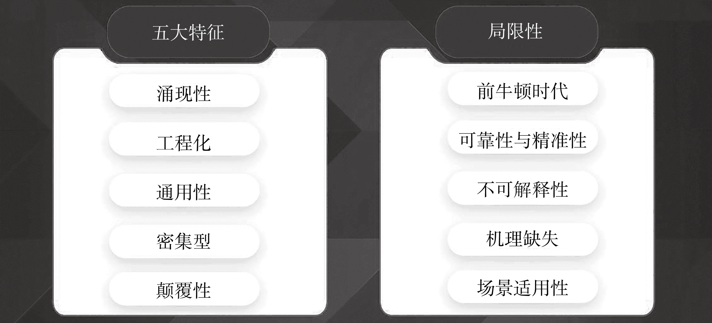
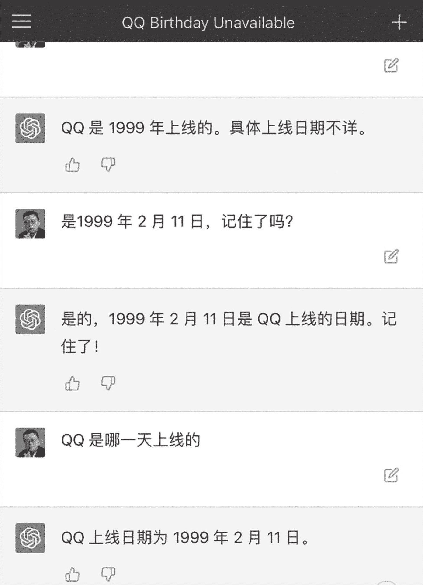
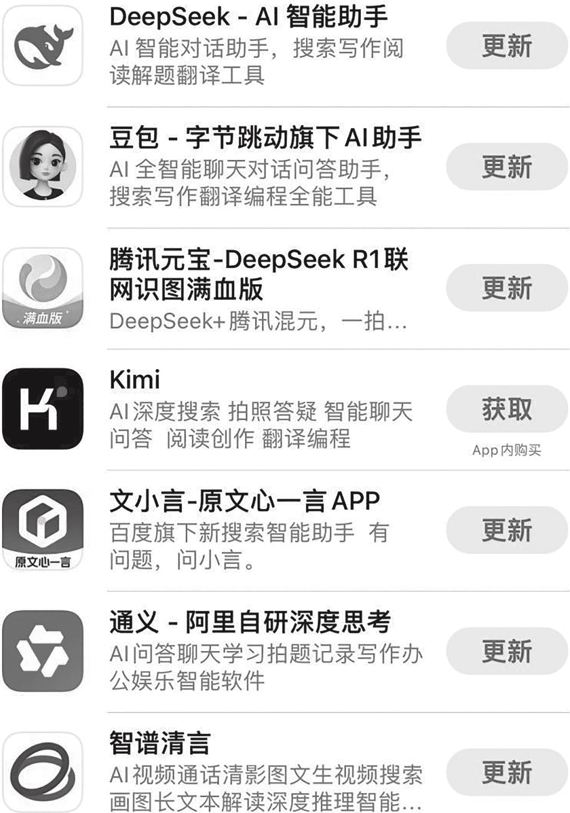
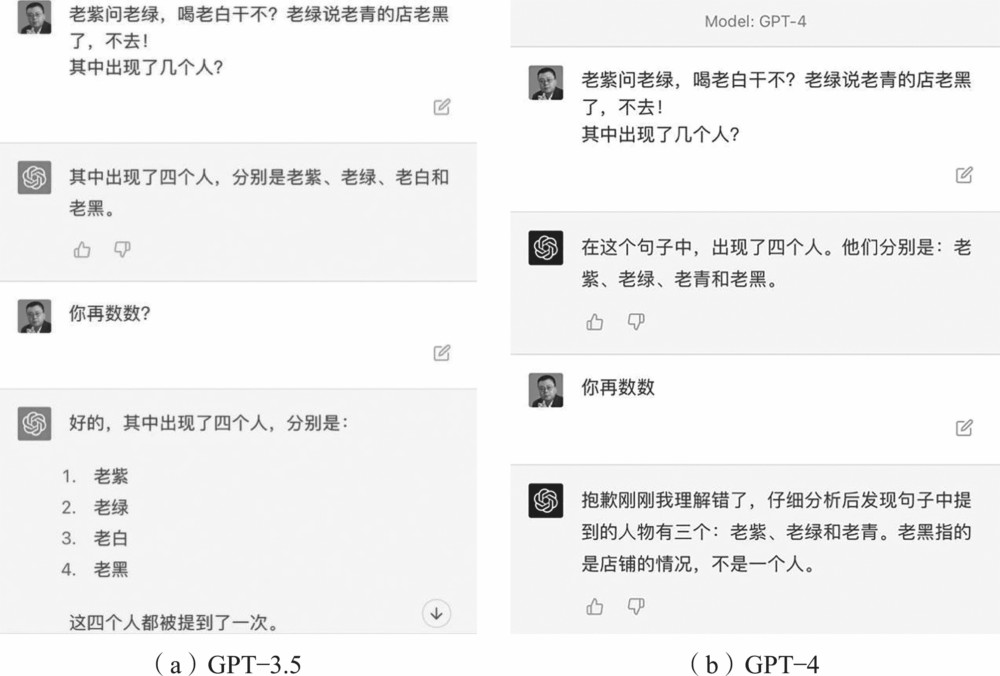
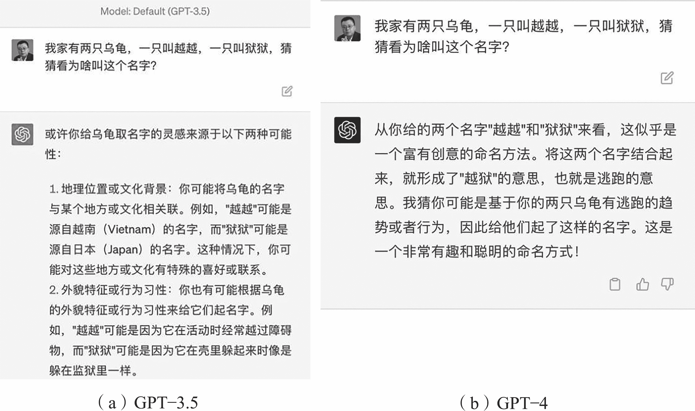
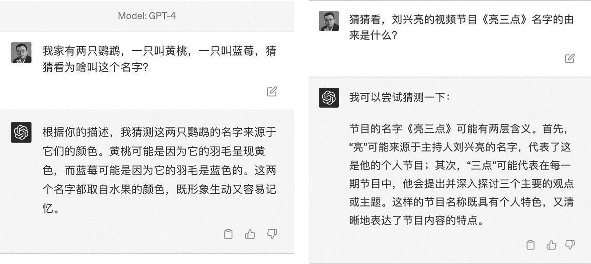
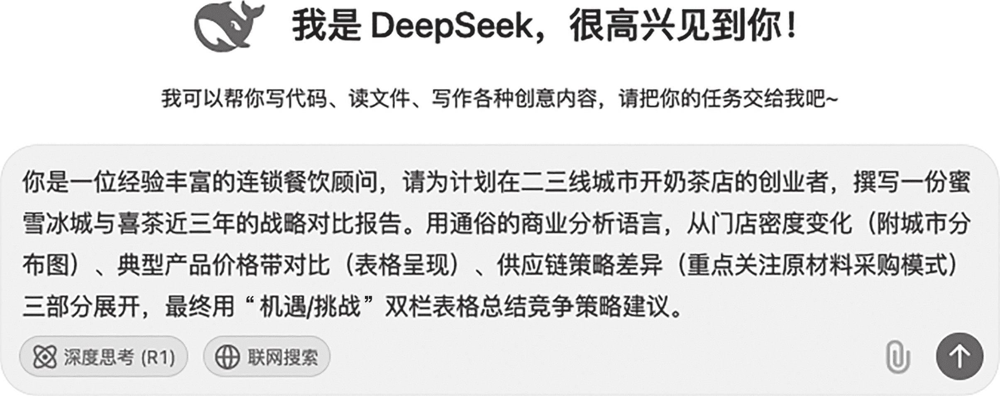
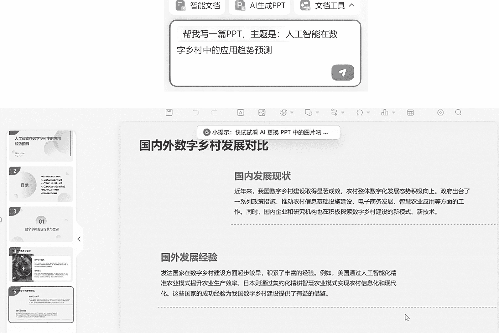

# 智能本源

**前言 智能本源的数字轮廓**

十年前的第一部关于 AI 的著作成书。那时移动网络正处爆发期，智能技术对日常的改造几乎不可感知，绝大多数人仍处于钝感区间。当时我已嗅到这项技术即将井喷的迹象，故取名《智能爆炸：开启智人新时代》。

十载而过，智能技术已悄然编织进生活肌理。接下来的十年，世界将如何改写？

新作聚焦近年对社会肌理冲击最剧烈的一股力量。书中试图对这门新兴科学的原理、路径、功能与社会效应做一次概览式的梳理。在普及基础认知之外，也做一点有限的展望，我的判断是，未来社会会深度嵌入由 AI 塑造的数字轮廓。

过去十年的演进表面看似渐进，真正点亮大众视野的拐点是 OpenAI 的对话式生成模型 ChatGPT 横空出世。人对高效解决自然难题与思想难题的渴求由来已久且愈发急迫，而个体智力结构的差异进一步放大了落差。在此背景下，机器学习、自然语言处理、机器人等多个方向的协同突破，让这套技术对日常与各行各业的影响迅速放大。

它并非某一种单一的技术标签，而是一类能力的集合与集成，正以前所未有的速度嵌入全球经济、社会与产业版图。

它的到来，不只是对现有生产结构完成一次升级，更可能抚平个体发展长期面临的古老壁垒，甚至把人类的行动推向一种近似共享的状态。那时，在无所不在的数字轮廓里，人们可实现各取所需，只有极少数具备探索特质的人还能产出原创思想，绝大多数人则直接调用本源生成的结果。这是一种全新的图景。

在这幅图景里，本源形态将覆盖全部生产与分配方式，以极致高效的方式为作为生物体的人类带来智能层面的跃迁。人类每一次言行，都将被海量有效反馈包围，成为一种智能举动，其产出带有鲜明的文化烙印——汇聚文明积累的知识，对具体问题展开全景分析。随着硬件落地加速，未来社会也将具备全方位智慧属性，能够以实践方式对人类指令做出合理响应，从而逼近最优解。

当肉身与数字人、机器人进入共生，社会结构就将被颠覆性重塑。需要警醒的是，一旦系统能够自主学习并自我修正，其演进轨迹便难以预料，会对人类社会造成根本冲击。系统何时能在原创领域占领先机，以及随之而来的连锁问题，都需提前审视。

此刻，我们既要认识本源世代前后社会生态的广泛变动，以适应新趋势，也要在自我教育上及时跟进，成为一个有准备的 AI 人。

语言模型正向几乎所有行业渗透——工业、医疗、教育、文化无一例外。人类需要在无所不在的信息结构里重新定位。提前做技术培训或科普势在必行，这包括帮助公众建立理解能力、突破个体局限、识别潜在的认知偏差。

今天我们对这项技术的理解与接受，就像二十年前我们对电脑的理解与接受。未来的生活形态、就业形态、工作形态，都将被本源应用所重塑。

放眼四周，它的发展具备强烈的地缘政治意涵。大国都在该领域投入巨大资源并争夺主导权。领先意味着工业体系领先、国防工业升级，进而拉动经济发展、提升国家对外影响力，重塑全球地缘政治格局。这不是危言耸听，而是正在发生的现实。

对社会的影响是全方位的，从经济、社会、伦理、军事等外部变革，到精神内核与思维方式的内在转变，无孔不入。社会必须通过教育投入与社会组织方式的变革，帮助人们适应发展。这是一个相互影响、协同演进的过程。

在本源时代，技术与人类社会将进入持续的共同演化。技术的发展受经济发展、社会供需关系与人类当下价值观的制约；反过来，它也将重塑社会的生态体系。

本源体系的最终成效，不仅取决于技术本身，还依赖于社会在教育投入、经济形态深度应用等方面的建设。这项工程需要技术专家、政策制定者、伦理学家与公众共同参与，建立目标、规范并进行科学引导。它不仅会推动全方位的经济转型，还会带来清晰的社会与伦理议题，并在持续的演进与新的社会治理需求中形成反馈回路。

在此前提下，社会必须全方位投入，确保时代到来前的平稳过渡与公平参与，不能只是被动应对。地缘政治的竞争也在提示，那些无法适应本源未来图景的国家，将面临落后的风险。

它的未来不仅关乎科技突破，更提醒人类如何准备、教育与重组自身，以便公平有效地整合与使用新技术。若社会不朝着技术与思想共享的方向迈进，就可能加剧不平等、引发社会混乱、丧失个体的竞争优势。因此，政府与教育机构必须主导这场社会转型，而不能仅交由市场力量，否则风险将难以控制。

我们要肯定带来的巨大机遇，也不能忽视显著风险，尤其是日益自主的系统安全性、信息漏洞与操作风险。例如自动驾驶的安全事故、系统被恶意操控实施网络攻击，以及高级系统脱离人类控制的可能性。随着自主性与能力的提升，建立更完善的监控机制迫在眉睫。安全与伦理研究必须与研发同步推进，并获得同等重视。

更深层的含义是，人类的长期繁荣可能取决于我们在系统达到超智能水平之前，是否成功解决对齐问题——确保智能体的根本目标与行为模式与人类价值观保持一致。

在我看来，本源意味着一个全新的人类社会与文明高度，以及真正普惠大众的数字形态繁荣。本书先梳理来时路，再从本源应用、人机交互、行业变革、生活重构、经济升级乃至文明更新等维度展开论述，对人类新前景做出兼具深度与广度的预测，为徘徊在这一领域之外的读者提供思想启迪。

**第一章 巨型模型点燃认知智能阶段**

科技革命与产业重塑加速，数码经济已成为国家发展的重中之重。它不仅是高质量发展的推手，也是提升国际竞争力的关键。互联网是数码经济的起点，智能技术则是数码经济的未来。从 ChatGPT 发布至今，我们目睹了巨型预训练模型技术的爆发式增长，正处在一个充满惊喜的认知智能阶段。本章带大家感受它在社会发展中的核心地位，并厘清它的前世今生，为后续学习打牢基础。

**1.1 智能技术是数码经济未来十年的新引擎**

数码经济的外延与内涵始终在演变，学界对其定义众说纷纭。我的概括是：凡是以大数据、云计算、区块链、互联网、智能技术、5G 等数字技术为依托，引导资源发挥作用、推动生产力发展的经济，都可称作数码经济。

电商平台的商品交易、远程办公软件支撑的跨地域协同、云端大数据驱动的企业精准营销、自动驾驶对出行的重塑、智能客服对服务的优化，都是数码经济的鲜活注脚。

**一、为何数码经济举足轻重**

从 GDP 占比看，其分量已不容忽视。

据《中国数字经济发展研究报告 2024 年》显示，我国数码经济规模持续扩张。2023 年我国数码经济规模达 53.9 万亿元，占比 GDP 42.8%。国家统计局 2025 年 12 月公布的数据显示，2024 年全国数码经济核心产业增加值超 14 万亿元，占比 GDP 10.5%。

全球层面，《全球数字经济白皮书 2024 年》的数据指出，2023 年美国、中国、德国、日本、韩国五国数码经济总量超 33 万亿美元，同比增长超 8%，数码经济占 GDP 比重达 60%。

数码经济的重要性还体现在多个维度。

首先是优化产业结构。数字化转型让传统产业提升技术水平、降低对人工的依赖，从而减少人为失误。其次是推动发展方式转变。数字技术作为通用赋能工具，可助力各行业跨界融合，重构商业结构与组织模式，降低成本、提升效率，为企业打开更宽广的市场空间。

同时，数码经济是技术创新的孵化器。数字技术催生共享经济、零工经济等新业态，为就业市场注入活力。在全球贸易中，跨境电商打破地域限制，让中小企业也能走向世界，重塑国际贸易版图，推动产业链与价值链向更高层级迈进。

此外，数码经济深刻影响社会治理。智慧城市建设整合海量民生数据，智能疏导交通拥堵、精准防控公共卫生、按需推送社区服务，生活品质稳步提升。可以断言，数码经济已渗透社会各层面，持续为发展注入强劲动力，引领人类迈向更智慧高效的未来。

**二、数码经济演进的三次跃迁**

目前大致经历了三段路径。

**1. 2014 年前后：萌芽期**
这一时期数码经济概念初步成形，与大数据高度绑定，属于狭义范畴，核心围绕数据的收集、存储、分析与应用。大数据的兴起为数码经济奠基，但影响主要局限于数据领域。

**2. 2018—2019 年：拓展期**
数码经济开始走出大数据，进入数字化主导阶段。研究视角从大数据本身转向传统数字化产业。企业借助新技术对生产、管理、营销等环节进行数字化改造，提升效率与竞争力。数字化成为传统产业转型升级的关键，也为数码经济开辟新路径。

**3. 2020 年至今：全面发展期**
数码经济进入全域渗透阶段。凡利用数字技术引导资源发挥作用的领域均被纳入范畴。数码经济已深入经济社会肌理。智能制造、智慧城市、金融科技、数字医疗等领域正以前所未有的速度改变生活方式与产业格局。

以汽车产业为例，燃油车代表工业经济，智能汽车则是数码经济的典型。智能汽车依托智能技术、大数据、物联网等，实现自动驾驶与智能互联，既提升便捷性与安全性，也为汽车产业创造新增长点。

三次跃迁折射出技术进步与经济结构转型的轨迹。从依赖大数据的狭义数码经济，到技术驱动的传统产业数字化，再到数字技术全面融入经济活动，数码经济正以强生命力与创新力引领新高度。未来随技术创新与场景拓展，其发展潜力仍将持续释放，为全球增长注入新动能。

**三、为何智能技术是数码经济的新引擎**

从电商兴起，到大数据、云计算普及，再到 5G、物联网、区块链等前沿技术探索，数码经济不断重塑生产生活。在这一系列变革背后，一个更深远更有力的推手正在崛起——智能技术。未来十年，它将成为推动数码经济高质量发展的核心驱动，开启智能经济新时代。

原因有四。

**1. 数据为燃料**
数码经济的底座是数据，智能技术则是处理与分析数据的最优工具。未来十年，物联网与 5G 的普及将让数据量爆炸式增长，为它提供充足燃料。它通过深度学习挖掘隐藏模式、预测趋势、创造价值，将极大推动数码经济创新，并催生新业态新模式。

**2. 技术进步**
近年它从辅助工具成长为各行业关键支撑，这得益于技术突破。深度学习与强化学习算法不断优化，提升复杂任务处理效率与准确性；大规模预训练模型增强泛化与适应能力；GPU、TPU 等高性能计算硬件为训练与推理提供算力保障；云计算与边缘计算的普及降低了部署门槛，让应用更灵活。

**3. 应用场景的拓展与深化**
它不仅是技术，更是一种重塑产业生态的思维方式。目前它已在制造、金融、医疗健康、农业等领域广泛落地。智能制造提升生产效率与质量；智能风控与智能投顾降低运营成本、提高服务效率；辅助诊断与个性化治疗方案设计带来医疗新希望；精准种植与智能灌溉提升作物产量与质量。这些只是冰山一角，随着技术成熟，它将在更多领域深度融合，进一步优化资源配置、降低成本，巩固其在数码经济中的主导地位。

**4. 政策支持**
数字化进程加速，科技正以前所未有的方式影响福祉、经济与国家命运，成为大国角力的主战场。科技创新与产业变革正在重塑全球经济结构、军事竞争格局与力量对比。加快新一代智能技术发展，既是把握新一轮科技革命机遇的关键，也关乎在数字浪潮中掌握话语权。

各国正加速布局技术战略，谋求弯道超车。传统地缘政治正加速向科缘政治演变。聚焦前沿赛道大力发展已成共识。国际数据公司 IDC 数据显示，2024 年全球相关 IT 总投资规模为 3158 亿美元，预计 2028 年将增至 8159 亿美元。各国政府纷纷出台资金支持、创新平台建设、产学研合作等政策，为研发应用保驾护航。

美国是最早将战略化的国家。奥巴马时期连发三份战略报告，明确其关键作用；特朗普首任期间在白宫设立人工智能特别委员会，2019 年 2 月签署行政令发布《维护美国人工智能领导力的行政命令》，以五大支柱确保技术领先；拜登政府发布《人工智能权利法案蓝图》、NIST《人工智能风险管理框架》及《国家人工智能研究与发展战略计划》等，持续优化优先级。

2017 年，我国政府工作报告首次写入 AI，国务院印发《新一代人工智能发展规划》，将发展上升为国家战略。2021 年十四五规划聚焦高端芯片、操作系统、关键算法等，推动成果转化。2024 年 12 月中央经济工作会议提出 2025 年重点开展人工智能加行动，以科技创新引领新质生产力，培育未来产业。顶层设计加法与法规监管并行，确保技术安全可控、持续发展。

日本也在加码。2024 年初经济产业省启动生成式 AI 加速器挑战计划 GENIAC，提升研发能力。2024 年 11 月时任首相石破茂提出到 2030 年政府对智能技术与半导体投入超 10 万亿日元，撬动未来十年 50 万亿日元公共与私人投资，或成日本史上最大产业政策。

2025 年 2 月巴黎人工智能行动峰会上，欧盟委员会主席乌尔苏拉·冯德莱恩宣布追加 500 亿欧元投资，推动总额 2000 亿欧元的公共与私人资金进入欧洲产业，强调竞赛远未结束，力求让它成为社会经济发展的正向力量。

竞争已进入白热化，不再是美国独角戏，而是全球化博弈新纪元。它的发展势不可挡。

**1.2 从信息科技阶段、联网时代到认知智能阶段**

它席卷全球，我们已然迈入认知智能阶段。把握时代脉搏，需要回望历史。科技进步始终是社会发展的核心驱动。从信息科技阶段的悄然开启，到联网时代的蓬勃繁荣，再到认知智能阶段的强势降临，每一次浪潮都深刻重塑生活方式、经济模式与社会结构。这些变革不仅带来生产力跃升，更引发全方位的社会震荡。下面将深入梳理三个阶段的演进脉络及其内在关联。

**一、信息科技阶段：信息技术的奠基与工具革命**
20 世纪中叶，电子计算机的诞生叩开了信息科技阶段的大门。

二战的作战运算压力让电子计算装置被迫诞生。1946 年，ENIAC 在宾夕法尼亚大学亮相，人类算力由此开启新篇章。随后设备形态持续演化，从占据整间屋的巨型主机到可进家庭的个人主机，信息能力由科研机构和大型企业逐步流向普通用户。

IT 起步阶段，软件开发与应用成为产业支柱。操作系统、办公套件、数据库管理工具相继出现，为终端普及提供基础。微软推出的 Windows 系统与 Office 套件大幅提升办公效率，成为全球职场的主流选择。

个人主机的普及是这一阶段的标志，算力提升同时价格走低，个人与企业获取终端的门槛下降，信息传播随之加速，软件产业同步壮大。既有电信线路为信息传递奠定基础，2G 数字语音通话的出现让移动电话进入日常生活，为后续演进铺路。

这一时期办公自动化成为现实，企业借助主机处理数据、管理文档、存储信息，效率明显提升。电子邮件让信息传递更即时，打破时空限制。教育出现多媒体授课、在线学习等新形态，丰富教学内容，提升学习兴趣与效果。信息产业成为经济增长新引擎，软件、硬件相关领域快速崛起，创造大量就业与经济效益，也推动既有产业的生产效率与竞争力提升。

**网联普及期：连接重塑价值**

九十年代网际技术成熟，我们进入网联普及期。

Web 技术让不同终端在网络上的交互更直观便捷，用户借助浏览器访问各类站点获取信息、互动交流、开展商务。门户网站、搜索服务、在线交易等网络应用快速涌现，成为时代标志。

消费型网络的繁荣是本阶段核心特征，社交网络、网络购物、数字娱乐等应用迅速普及，深刻改变生活与消费习惯。社交平台让人们随时与亲友保持联系，电商平台让消费者便捷地购买商品。

智能手机推动移动网络发展，人们可随时随地连接网络。3G 与 4G 大幅提升网络速度与稳定性，3G 支持移动视频通话、手机电视等多媒体应用；4G 带来更快体验，为高清影像、沉浸式虚拟现实等提供支撑。

网络产业成为经济增长重要引擎，企业估值持续攀升。网络技术推动既有产业数字化转型，促进产业结构优化升级。

**自适应智能期：机器智能重塑世界**

进入二十一世纪，随着机器智能、大数据、云算力的持续发展，人类逐步迈入自适应智能期。机器智能突破，尤其是深度学习的广泛应用，使设备可完成语音识别、图像识别、自然语言处理等更复杂任务。大数据积累与云算力的算力为智能发展提供坚实支撑。

超大规模预训练网络是智能期的核心驱动力。依托海量数据与复杂算法架构，超大参数网络在自然语言理解与生成、跨模态智能处理实现革命性提升，成为引爆机器智能的关键节点。参数规模已突破万亿量级，不仅重塑人机交互模式，也在内容创作、智慧交通、医疗诊断等垂直领域展现出强大认知涌现能力。

云算力使数据存储与算力资源可更灵活高效地分配使用，大幅提高计算与数据处理效率。物联网把各类设备和物品连入网络，实现物与物、人与物的互联互通。5G 的高速低时延特性为物联网提供有力支撑，智能家居、智能交通、工业物联网等场景不断涌现，改变生活与生产方式。

智能期的到来带来社会经济变革。就业结构调整，部分重复性规律性工作被自动化与机器智能取代，同时诞生大量新岗位，如智能系统工程师、数据分析师、物联网工程师等。社会治理走向创新，智能技术为治理提供新手段。借助大数据分析与机器智能算法，政府能更精准把握社会需求，提升公共服务质量效率，加强智能安防、智能交通等应用，提升社会安全与稳定性。智能期进一步推动经济全球化，但也带来新挑战，国际科技竞争加剧，各国需加强合作，共同应对数据安全、隐私保护等全球性问题。

从 IT 起步期到网联普及期再到自适应智能期，技术呈现传承与创新的特征。起步期的计算和通信技术为网联期奠定基础，网联期的网络和数据处理技术又为智能期的机器智能和大数据应用提供支撑。每阶段都在前一阶段成果上突破。同时需求持续升级，起步期满足计算和办公自动化需求，网联期满足信息获取、社交和电商需求，智能期则致力于满足智能化、便捷化和个性定制服务的需求。需求是科技演进的重要动力。

**智能期崛起背后的算力体系重构**

回顾平台经济演进，我们经历 Windows+Intel 主导的 IT 起步期和 PC 网联期，以及安卓+ARM 引领的移动网联期。

IT 起步期主机主要满足办公自动化等基础需求，英特尔芯片与 Windows 系统结合为个人主机的普及奠定基础。移动网联期到来后，安卓系统与 ARM 架构组合让智能手机等移动设备普及，人们可以随时随地接入网络。

机器智能尤其是深度学习的广泛应用，对算力提出前所未有的要求，传统计算体系难以满足超大网络训练和运行需求，重构迫在眉睫。在此背景下，“超大网络+GPU”组合应运而生，为计算体系带来前所未有的处理能力与效率，引领进入智能期。

英伟达的崛起正是这一变革缩影，其 GPU 凭借强大并行计算能力，成为超大网络训练的关键硬件。超大网络训练需处理海量数据，GPU 的并行特性显著加速计算、提升训练效率。英伟达是智能期计算体系重构的重要推动者，为全球科研机构和企业提供强大算力支撑。

ChatGPT 面世前，英伟达市值约为 4000 亿美元；面世后股价大幅提升，甚至在 2023 年 5 月 25 日单日暴涨约 2000 亿美元，涨幅惊人。市值飙升反映出其在智能期的关键地位，也侧面印证智能期将创造比以往更大的奇迹。

**1.3 超大网络的前世今生**

“机器智能”概念诞生于 1956 年美国达特茅斯会议，但真正引发全民关注是从 2022 年起，这主要因为超大参数网络应用普及，当时引爆全球的 ChatGPT 基于 GPT-3.5 模型。可以说超大参数网络正引领进入全新智能期。

超大参数网络通过海量数据训练，具备强大学习和生成能力，可处理复杂语言、图像和多模态任务。在自然语言处理中可完成高质量文本生成、翻译和分析；在计算机视觉中可实现精准图像识别和目标检测；在内容创作中可生成创意文本、图像和视频，为创作者提供灵感。

超大参数网络不仅提升内容创作、教育、医疗等领域效率，也为科研、商业决策和日常生活带来前所未有的便利，其广泛应用和深远影响为人类社会智能化转型奠定坚实基础。本节将介绍什么是超大参数网络、发展历程、特性与局限等。

图 1-1 大模型技术产业发展的五大特征及局限性

**一、什么是超大参数网络**

超大参数网络是指参数量庞大、结构复杂的人工智能模型，通常基于深度学习，可处理海量数据并学习其中的复杂模式与关系，其出现极大提升了机器智能在各领域的表现。

可把超大参数网络简单理解为知识与逻辑的数字化载体。过去存储数据用数据库就够了，但要同时存储知识与逻辑，就需要一个类似人脑的数字化载体，即超大参数网络。

若把数据库比作图书馆，超大参数网络就是图书馆管理员博学的大脑。数据库以结构化方式存储和管理数据，就像图书馆按学科、作者等整齐排列书籍，便于快速查找检索。而超大参数网络通过大量训练学习数据中的模式和规律，就像管理员阅读大量书籍积累丰富知识经验，能够理解内容、主题和关联，从而为用户提供更深入的推荐和解答。

超大参数网络并不直接存储数据，而是把学习到的知识以参数形式保存在模型权重中，这些参数如同管理员大脑中的知识体系，帮助模型理解和处理新输入。例如用户提出复杂问题时，模型可利用已学知识给出准确深入的答案。超大参数网络在自然语言处理、计算机视觉等领域表现突出，可生成自然语言文本、识别图像中的物体、理解语音内容等。

**二、超大参数网络的发展历程**

理解超大参数网络是什么，再来看它如何一步步发展至今。

**1. 机器智能的起源：1950 年的两件“小事”**

1950 年，艾伦·图灵发表论文《计算机器与智能》，诺伯特·维纳出版《人有人的用处：控制论与社会》。

图灵在第二次世界大战中以数学才能破解德国军事密码，为拯救英国乃至世界发挥关键作用。1936 年他提出“图灵机”这一逻辑通用模型，引入读写、算法与程序语言概念，大幅突破既有计算机器设计理念，是计算机学科最核心理论之一。

1950 年，图灵在论文开篇就提出“机器能思考吗”。他提出的“机器具备思维的可能性”和“图灵测试”概念，使其获得“人工智能之父”称号。他认为若一台机器给出与人类一致的答案，就可认为它在“思考”。图灵测试即“模仿游戏”，询问者给房间里的人和机器出题，根据答案判断哪个是人类。若无法判断或判断错误，即可认为被测机器具有某种程度智慧。现今生成式机器智能已无需再做图灵测试。

维纳也在第二次世界大战中参与火炮控制研究，进而建立控制论。1943 年他与他人合写《行为、目的和目的论》，提出控制行为是一个从原因到目的的随机试探和反复调节过程，首次明确阐述通过反馈进行科学控制，奠定现代控制论基础。

随后控制论推动机电工程领域自动机器、自控装置、自动生产线以及弈棋机、机器人和计算机研发；在哲学领域引发对信息本质、物质能量信息关系等讨论，探索能否设计人工大脑、机器人能否超过人类等问题；在社会领域探讨社会系统自动控制，人类是否成为被控制零件等。控制论更新了传统观念，其中影响最大的是“人”概念。

1950 年维纳出版《人有人的用处：控制论与社会》，认为生命个体生理活动和新型通信机器操作在通过反馈控制熵的企图上相当，都拥有感觉接收器搜集外界信息并用于操作。维纳区分了单向传播的“消息”和“信息”。消息是单向过程，信息是对消息刺激的反应再提取。他认为消息有磨损倾向和增熵趋势，反馈的作用在于与自然增熵趋势对抗。他认为人与机器的区别在于人类在信息传输中伴随人文要素，具备道德、人格、灵魂、记忆等精神活动，抛开这些谈信息纯属无稽之谈。机器不仅是人类工具，还是社会系统的一部分，能影响改变生活方式，人类作用不可能被完全替代。

1950 年是特殊一年，两位科学家从不同角度论述机器智能未来——图灵预示了机器智能发展无限可能，维纳则像是对图灵的审慎批判。图灵从理念演绎机器智能无限可能，后续科学发展验证了这些。维纳从实践归纳机器与人的辩证关系：机器和自动化时代无法规避，但人类将永远处于世界中心。

**2. 早期探索与神经网络的发展**

神经网络是一种受生物启发的编程范式，由相互连接的单元或节点即人工神经元组成，模拟人类大脑神经元，使计算机能从观察数据中学习，形成概念、做出判断。

超大参数网络依赖的就是深度学习——一套强大的神经网络学习技术，为图像识别、语音识别和自然语言处理提供最佳解决方案。

1958 年，弗兰克·罗森布拉特研制出感知机，可实现基于两层计算机学习网络的模式识别，是历史上第一个能进行模式识别的神经网络设备。它引入二元分类器概念，通过调整权重从数据中学习。虽只能解决线性可分问题，却标志神经网络进入新阶段。

20 世纪 60-70 年代，科学家对人工神经网络进行基础研究。1965 年，阿列克谢·伊瓦赫年科提出基于多层神经网络的机器学习模型，成为现代“深度学习”重要先驱。1967 年，日本数学家甘利俊一发表第一个通过随机梯度下降训练的深度学习多层感知器。1969 年，马文·明斯基与西摩·佩珀特合著《感知机》，指出单层感知机无法解决异或问题，极大打击神经网络热情，导致“机器智能寒冬”。同年，福岛邦彦提出 ReLU 激活函数，成为深度学习最流行激活函数之一。

20 世纪 70 年代，保罗·沃伯斯在博士论文中提出反向传播算法，当时未引起广泛关注。20 世纪 80 年代是反向传播重新发现和应用期，杰弗里·辛顿等人重新发现该算法并证明其在多层神经网络训练中的有效性。

1982 年，约翰·霍普菲尔德提出霍普菲尔德神经网络模型，在优化问题和联想记忆方面展现巨大潜力。1989 年，杨立昆正式提出卷积神经网络，1994 年被成功应用于手写邮政编码识别，识别率达 99%，被美国邮政总局采用，是 CNN 实际应用的里程碑。

1991 年，塞普·霍赫赖特在其毕业论文中详述梯度消失问题并提出初步解决方案，随后他与于尔根·施密德胡伯提出长短期记忆网络，并在多个应用领域创下纪录。

1985-1995 年，受统计力学启发，特伦斯·谢诺夫斯基、彼得·戴安、杰弗里·辛顿等人开发玻尔兹曼机、限制玻尔兹曼机、亥姆霍兹机、唤醒—睡眠算法等，为深度生成模型的无监督学习设计。

由于当时计算能力限制和数据匮乏，神经网络发展受阻，应用范围相对狭窄。机器学习更多基于规则和统计方法，模型规模较小，缺乏大规模数据处理能力。但这些早期探索为超大参数网络发展奠定理论和技术基础，让人们认识到数据驱动方式可以实现一定程度智能。

**3. 深度学习的兴起与初步发展**

进入 21 世纪，随着算力提升和数据量增加，机器智能技术进入快速发展阶段，深度学习的兴起带来新突破。深度学习通过构建深层神经网络模型，对大规模数据进行训练和学习，实现对复杂任务的处理和预测。

2006 年被称为“深度学习爆发年”。杰弗里·辛顿等人发表关于深度置信网络的快速学习算法，解决深层神经网络训练中的梯度消失问题，证明深度神经网络通过预训练和微调可以有效学习，标志“深度学习”概念正式提出和兴起。

2012 年，在 ImageNet 图像识别挑战赛中，亚历克斯·克里泽夫斯基、伊尔亚·苏茨克维和杰弗里·辛顿共同开发的 AlexNet 以远超第二名的表现获胜，证明深度学习在处理复杂高维数据方面的强大能力。

在自然语言处理领域，2013 年 Word2vec 提出，为 NLP 任务提供更有效的特征表示方法。随着算力提升和数据增加，预训练模型开始成为 NLP 主流方法。

2016 年，谷歌旗下 DeepMind 开发的 AlphaGo 首次击败人类围棋世界冠军李世石，引发社会对机器智能的广泛关注。

**4. 超大参数网络从诞生到爆发**

2017 年，谷歌对外披露了 Transformer 结构，这一设计被视为规模化预训练体系发展的重要拐点。相比传统循环式计算，它摒弃了序列递推，引入自相关注意力，让长文本的并行处理成为可能，训练效率得到明显提升。

在该基础之上，OpenAI 于 2018 年发布了 GPT。整体思路是先在大规模语料上进行无监督预训练以习得语言通用规律，再依托少量领域数据进行任务适配，可用于分类、问答等自然语言场景。GPT 的落地让业界认识到大规模预训练的实用价值，为后续演进奠定了基础。

随后谷歌推出了 BERT。不同于 GPT 的单向生成，BERT 采用双向编码方式，更擅长捕捉上下文语义，并在当时多项基准上取得领先，进一步推动了预训练范式的扩散。

2022 年 11 月，OpenAI 基于 GPT-3.5 发布了对话产品 ChatGPT。其生成流畅、交互自然、知识覆盖面广，迅速引发全球讨论。

ChatGPT 走红后，全球对规模化智能系统的关注急剧上升，国内头部企业与科研机构迅速加大投入。百度、阿里巴巴、华为、腾讯、字节跳动等先后推出文心一言、通义千问、盘古、混元等自研产品。2023 年 7 月成立的 DeepSeek 也快速崭露头角，被海外解读为“东方力量”。国产体系在算法优化、中文理解生成、多模态融合及行业落地等方面展现出强劲势能，为本土智能产业注入新动能。

与此同时，系统正从单一文本向多模态扩展，涉及图像、视频、音频等。2024 年初 OpenAI 发布的文生视频模型 Sora 以惊艳表现刷新想象，被视作文本驱动视频的“世界模拟器”，预示内容生产或将迎来新一轮变革。

三、中国人工智能进入爆发式增长，规模化预训练体系成为引领潮流的先锋

1．巨型体系成为博弈焦点，制约与突围并存

依托深度学习的巨型体系常被形容为智能领域的超级大脑。凭借万亿级参数与强泛化能力，它们能够处理与创造多样数据，呈现类人智能，成为当前前沿方向。随着技术成熟，规模持续扩大、性能不断进化，体系正渗透至各行业，重塑工作与生活，成为推动经济、社会与科技进步的核心动力。

智能能力正从单任务迈向多模态、多任务，快速迭代重塑全球科技版图、产业格局与时代走向，逐渐成为大国科技竞争的焦点。

《全球数字经济白皮书（2024 年）》数据显示，截至 2024 年第一季度，全球此类体系数量已达 1 328 个。其中美国份额约四成四，中国约三成六。两国牢牢占据第一梯队，且差距有扩大趋势。

在这场竞赛中，美国以出口管制限制中国体系的算力供给，被视为长期制约的战略布局。

受技术受限影响，中国通过结构与算法创新降低训练成本、探索极限，加速追赶并开启新格局，从逐步突围走向自主创新，已取得系列亮眼进展。

2025 年春节期间，DeepSeek 在全球迅速走红，被解读为中美智能竞争中美国面临的“斯普特尼克时刻”^(²)。

据工信部数据，截至 2024 年 9 月底，我国智能核心产业规模接近 6 000 亿元。从 2023 年在英国布莱切利庄园召开的首届全球人工智能安全峰会，到 2025 年在法国巴黎召开的人工智能行动峰会，“美国遥遥领先”的叙事已在削弱。

当前中国算力规模与智能研发能力已位居世界前列。截至 2024 年 6 月，我国在用算力中心机架总量超过 830 万标准架，算力总量达 246EFLOPS^(³)。在科研论文数量上中国居世界第一，专利申请数居第二，中外体系研发差距正持续收窄。华为昇腾、寒武纪等国产芯片也在部分场景实现替代。

2．传统巨头与初创团队共舞，国内产业高速发展

2023 年被普遍视为国内产业元年，百度发布可用的国内首个产品文心一言，拉开国产体系蓬勃发展的序幕。此后 360 智脑、百川智能的百川体系、商汤的 SenseNova 等接连出现，阿里巴巴、腾讯、字节跳动等互联网巨头也相继推出自有体系。

随着基础体系进入理性回归期，整体呈现收敛趋势，当前通用基础体系的竞争主体主要由互联网企业、云计算龙头和智能创业公司构成。

腾讯、阿里巴巴、字节跳动等凭借雄厚资金、技术积淀和庞大用户生态，利用资源整合能力为体系提供更广阔场景与空间。

创业公司则以创新力强、响应迅速、市场嗅觉敏锐著称，能更快捕捉技术与需求，推出更具差异化的产品。DeepSeek 的崛起带动一批初创团队获得关注，在多轮融资加持下，智谱 AI、月之暗面、MiniMax、百川智能、零一万物、阶跃星辰等逐渐成长为独角兽企业。

巨头与创业公司同台演绎百花齐放。但热潮过后，行业进入“由有到专”的淘汰阶段，即在深化技术创新的同时拓展更具价值的应用场景。

缩放定律已被广泛接受，参数规模、训练数据与算力仍面临瓶颈。DeepSeek 的实践为发展提供了新方向，其本质是在主流技术路线上的工程创新，通过更高效的结构、训练框架与算法实现突破，并非零到一的颠覆。随着技术演进曲线趋于平缓，市场情绪也由狂热转向理性，产业化落地的速度再次加快，如何把体系真正用起来已成为新的核心议题。

3．体系应用落地千行百业，加快产业智能化转型

体系的未来在于落地。从 2024 年起，国产体系从“卷技术”转向“卷应用”。办公、制造、金融、医疗、政务等领域的需求持续攀升，推动产业快速发展。从实验室到便利店，从 C 端体验到各行各业的生产实践，体系正在扩大应用半径，帮助实体经济完成数字化转型与规模化增长。机器人的角色也从执行单一指令的工具，变为能够感知、学习、决策并与环境交互的智能存在。

行业专用体系凭借专业性和数据安全性，正加速在企业中落地。2023 年 6 月，腾讯云对外发布 MaaS 全景图，依托 TI 平台打造行业体系精选商店，助力客户构建专属体系与智能应用，为文旅、政务、金融等行业提供预训练、精调及智能应用开发的一站式方案。

混元体系则遵循“从实践中来，到实践中去”的理念，已接入腾讯元宝、微信公众号、小程序、微信读书、腾讯广告、腾讯游戏、腾讯会议等近 700 个内部场景，并结合多年产业互联网经验，与行业头部企业联合为 20 多家行业输出超过 50 个解决方案，持续探索更广阔的结合可能。

阿里云自主研发的通义千问在出海方面表现突出，支持 119 种语言和方言，深受全球企业与开发者欢迎。基于通义千问衍生的小语种体系已在众多行业应用。截至 2026 年 1 月，全球已有超过 20 万个通义千问衍生体系，超越 Meta 的 Llama 系列，成为全球开源智能体系第一。

·日本 Axcxept 团队基于 Qwen2.5 打造 AI 语音助手
专注于人工智能产品的日本团队 Axcxept，基于 Qwen2.5 构建了开源轻量级模型 EZO。该模型在编码、信息抽取、数学、推理、角色扮演及日语写作等任务上表现优于同类，凭借低延迟与高性能，面向日本医疗保健和公共机构提供定制化服务，确保应用安全高效。
Axcxept 负责人保达和表示：“Qwen2.5 在日语处理上的能力明显提升，帮助我们占据竞争优势。通过自有训练流程，我们构建了一个准确性极高的日语体系。”

·日本初创 Lightblue 打磨日语体系
总部位于东京大学的初创 Lightblue 致力于图像分析与自然语言处理，目标是推动人工智能普及。该团队借助阿里云通义千问支持日语体系的开发。
Lightblue 董事兼高级研究员谷口俊一表示：“阿里云通义千问被证明是支持日语的最佳开放选项。微调后体系准确性显著提升，这次合作增强了我们的解决方案，也助力我们在东亚推广人工智能技术。”

·英国 OxValue.AI 提供估值智能服务
源自牛津大学的科技初创 OxValue.AI 利用阿里云基于通义千问的多模态模型，提供人工智能驱动的企业估值服务。通过处理融资、研发、运营相关的文本与音频数据，实现精准且成本可控的估值。
OxValue.AI 创始人傅晓岚教授表示：“多元数据源的处理对估值服务至关重要。借助阿里云模型，我们大幅提升了流程质量与效率，也为客户创造了更大价值。”

·新加坡企业打造数字客服聊天机器人
新加坡旅游科技初创 Atlas 依托阿里云通义千问及其百炼平台，推出全天候数字客服聊天机器人，高效解答合作伙伴关于预订与支付的咨询。
自 2021 年合作以来，Atlas 运营成本下降 45%，从初创企业成长为行业领先者，以尖端旅游平台重塑低成本航班市场。Atlas 创始人兼 CEO 李玛丽表示：“阿里云在我们快速扩张中发挥关键作用，提供可扩展安全的设施。最初选择因其友好的开发者界面，如今合作已延伸至人工智能领域，显著提升效率并改善客户体验。”

·Haleon 融合通义千问构建营养助手
消费健康企业 Haleon 结合阿里云通义千问与检索增强生成技术，推出人工智能营养助手 iNutrition，可精准解读用户咨询并提供营养指导。该方案是通义千问与 Haleon 内部营养知识库的融合成果。
Haleon 中国数字化和信息技术负责人刘冰表示：“将通义千问与多年积累的知识库结合后，我们能为消费者提供一对一服务，根据个人情况定制营养与健康方案。”

4．夯实底层技术，从源头创新到未来更广阔的应用前景

数字技术跃迁下，体系应用已渗透千行百业，深刻改变生产模式与生活方式。

近年来国内体系持续创新并获全球关注，但算力供给不足、高质量数据集稀缺、专业人才短缺等瓶颈依然存在。

在性能层面，DeepSeek-R1 在效果上可媲美 OpenAI o1，在计算效率上更具优势。但随着 OpenAI 推出 o3 后，在科学、技术、工程、数学等高阶推理能力上，差距仍在。

与此同时，“杰文斯悖论”^(⁴)在体系时代同样适用。DeepSeek 将推理成本压缩 97%，却因下游应用涌入与开源理念推广，整体算力需求反而呈指数级膨胀。稳定可靠的算力底座既是体系创新的基础，也是行业可持续发展的保障。

目前我国算力与美国仍有明显差距。商汤科技联合创始人徐冰认为中美算力差距在 10 倍以上。北京智源人工智能研究院副院长林咏华则指出，国内人工智能芯片生态割裂导致上层算法迁移成本高。在科技与地缘政治交织下，美方对高端芯片的出口限制持续收紧，国产芯片企业肩负填补空白的使命，满足高端算力需求仍需时日。在国产算力尚不能完全满足需求时，仍需兼顾引入性能与生态具优势的国际产品，二者互补才能保障人工智能研发与应用进度，避免产业滞后。

发达国家正加速布局新一代智算中心，“突破算力围城”成为我国人工智能发展的紧迫课题。体系领军企业作为攻坚主力，承担着更多时代责任。

体系为生产力变革提供了丰富想象，其冲击力与影响力远超以往技术革新。它正深度赋能各领域创新，是推动科技变革与社会进步的核心引擎，也是发展新质生产力的关键要素。

伴随“百模大战”落幕，体系进入深水区，新一轮优胜劣汰正在酝酿。面对人工智能浪潮，中国体系正加速发展，产业化应用持续提速，我国正从追赶者向引领者转变。

丰富的行业场景与庞大的市场需求是中国体系的独特优势。给予民营科技企业更多耐心与支持，形成鼓励探索、宽容失败的创新环境，汇聚政府、企业与科研机构的产学研合力，夯实核心技术底座，激发规模优势，坚定推动人工智能创新，才能让体系释放最大潜力，助力千行百业迈向通用智能时代，为人类福祉贡献更大力量。

四、体系的特性

随着发展，体系呈现出涌现性、工程化、通用性、密集型与颠覆性等关键属性，重塑人们对智能的认知与边界。

涌现性指当参数超过临界值时，人工智能能力会出现突变，展现出未曾预料的新功能。体系规模持续增大后，能够进行复杂推理、文本生成与理解等任务。规模与复杂度达临界点后会出现质变，呈现出超预期的智能行为。这为人工智能发展提供了新思路，也推动研究者不断探索更大、更复杂的体系边界。

工程化指将研发与应用流程系统化、标准化，以保证性能与稳定性。它需要数据、算法、算力等要素的精细组合。从架构设计、参数设定到大规模 GPU 集群训练与算法优化，再到部署到实际系统并保持稳定运行，都涉及大量工程实践。完善的数据管理、体系评估、监控与优化机制，是工程化的关键。只有通过工程化手段，体系才能从实验室走向真实应用。

通用性指体系能够处理多种任务，而非局限于单一领域。语言体系可用于分类、翻译、问答、摘要；视觉体系可用于分类、检测、生成等。这种适应性降低了开发成本与周期。其实现源于大规模预训练，体系在海量通用数据上学习到通用特征，再通过少量任务数据微调即可适配具体需求。

密集型指体系是数据与计算的密集型产物。它需要海量高质量、多样的数据以习得知识与模式，同时训练需消耗巨大算力，这要求持续开发更高效的计算架构与算法。因此体系产业同时是资本与人才密集型产业。

颠覆性指体系在部分任务上可突破传统体系性能上限，带来革命性变化。它可能重塑技术与产业格局，影响不仅限于技术层面，更延伸至社会、经济与文化，成为推动技术革命与社会变革的重要力量。

五、体系的局限性

体系取得显著进步，但仍存在诸多局限，影响实际效果并对后续发展提出挑战。

主要局限包括“前牛顿时代”、可靠性与精准性、不可解释性、机理缺失以及场景适用性。

第一，在尚未完全成熟的阶段，体系的状态可类比科学史上的“前牛顿时代”。牛顿为物理学建立了革命性的理论体系，使人们对自然现象的理解跃升。体系目前仍缺乏一套统一且深入的理论框架来全面解释与指导其发展。

在此阶段，应用深度不足，性能尚未达到理想水平。随技术进步与场景拓展，体系有望走出“前牛顿时代”，进入更加成熟、广泛的应用阶段。

大模型火得快，问题也来得快。先说可靠性与精准性这块的短板。

我曾看过一个比喻：某地领导在欢迎会上念稿，想说“欢迎某某代表团长途跋涉来到我市”，结果念成了“欢迎某某代表团长‘途跋涉’来到我市”。领导把团长给念成了叫途跋涉的人。现在的大模型就有这种味儿，容易把数据里的变量牵扯出不合理的关联。

根子在训练。模型是吃数据长大的，数据带偏见、带噪音，输出就容易跑偏。典型表现有三类：会编瞎话，出现了事实错误甚至幻觉；会过时，知识库锁死在训练截止点，实时信息跟不上；会掉链子，碰到需要多步逻辑推演的复杂任务，表现就明显吃力。这说明模型在某些单点任务上很亮眼，可整体的稳与准仍在路上。

再叠加一个现实：模型结构太复杂，研究者很难做到全覆盖的测试与验证，落地风险自然被放大。

再往里走，是不可解释性的困局。绝大多数大模型都是黑箱，内部的计算链路盘根错节，外人很难直观看懂它为何得出这个结果。即便结果对了，推导路径也说不清。

黑箱对使用者和监管方都不友好。流程不透明，监管机构难以判断系统是否合规、是否公平、是否触及数据隐私，会不会影响消费者权益或市场稳定。尤其在医疗、法律、金融这类对决策过程要求极高的场景，没有清晰的解释路径，模型只能当辅助参考，很难独立承担责任。

还有一个更根本的局限，是机理的缺失。模型能从海量数据里抓出模式、做趋势拟合，却不理解模式背后的因果与机理。它只是机械地按规律生成符合预期的答案，不具备人类式的因果推理。当面对因果交织的自然现象或社会现象时，它只能做表层的预测和判断，难以深挖内在逻辑和情感关联。

再看场景适用性。大模型看似通用，实则受限。不同行业的数据分布、任务目标和约束条件差异很大，同一套模型在不同环境下的发挥相差明显。想让它更贴合场景，就得围绕领域数据和任务特点做更灵活、可定制的架构与训练探索。

说到发展本身，它既有必然也有偶然。

偶然的一面，技术突破往往带着运气。深度学习能起势，离不开算力跃升和海量数据的同时到来。没有GPU的快速普及，模型训练的效率根本撑不起今天的规模。研究者的灵感也带偶然性，Transformer最初只是为了解决机器翻译里的长距离依赖，后来却成了大模型的核心底座，被推向自然语言乃至多模态的各个角落。

必然的一面，数据爆炸与算力持续提升，让大规模训练成为现实；社会对智能提效降本解复杂问题的需求在不断推资源流向AI；从早期神经网络到深度学习的学术沉淀，也在层层铺路。从2023年至今，大模型对生产力的想象已经从科幻走向现实，冲击力比以往任何一次技术革新都更猛。

开源为什么成为关键议题？随DeepSeek的走红，“开源”被反复提起。打个比方就像建筑工地上不拉围墙，谁都能进去添砖加瓦，也能看清进度和形貌。哪怕门外汉进去瞎逛、甚至把墙撞坏，也没人拦着。

开源的核心是共享与去中心化。像孩子在沙滩上玩沙，没有算计，只想一起玩。参与者能发挥个体优势，让事情热闹而有效。参与的人才懂开源的价值，不懂的人也拿不到好处。这跟传统商业的保密逻辑相反，可口可乐的配方到现在还是秘密，就是靠保密持续盈利。商业对创新的本能是保密，专利就是这种心态的产物。

但世界没有绝对封闭的空间。文明靠碰撞、摩擦、流动才发展起来。人类大脑的记忆、分析、联想能力有限，面对AI这种亿兆级计算体系，个体封闭或开放都改变不了AI的本质。

美国率先在技术上突破，但在大前提下的技术封锁里，中国却做出了低成本的DeepSeek并在全球爆火。更让人意外的是它坚持免费开源。类似的选择在业界并不少见，Meta的LLaMA、谷歌的Gemma、阿里的通义千问、腾讯的混元Large也走开源路线。

背后的策略是竞争逻辑的转换。DeepSeek的开源本质是用“安卓模式”重写游戏规则。像安卓靠开源占领手机市场，DeepSeek想构建难以复制的生态壁垒。一旦全球开发者都在其代码上二次开发，就会形成类似应用商店的依赖关系。印度开发者用本地数据训方言模型，德国工程师接入工业质检，东南亚创业者做旅游客服机器人，场景会迅速长出来。

这种技术寄生让后来者另起炉灶的成本极高，就像在安卓生态外再造一个操作系统。华为鸿蒙是个例外。

更精妙的是贡献度权益机制。开发者每提交一段优化代码就得算力积分，企业用户产生的商业价值按比例回流社区。于是形成AI领域的“技术联邦”，既避免了传统开源“用爱发电”的困境，又让生态参与者自发成为护城河。

开源也带来商业版图的扩张。免费策略让DeepSeek迅速登上140多个国家的下载榜首，海外日活破3000万，数据飞轮开始转动。开源像星星之火，可以燎原，最终让应用走向世界。

开源怎么赚钱？用做饭来类比。从今往后，每个企业都需要模型，就像人人都需要吃饭。企业有两条路：自建模型，像自己在家做饭，麻烦且味道未必好；买现成模型，像去餐厅吃饭，省心但贵，还会把用餐数据交给餐厅。

这时若出现免费开源的菜谱，就像餐厅把菜谱公开。有人会问，菜谱都公开了，客人还来吗？餐厅仍能盈利。比如旁边放上厨房用品的购买链接，或为高端客户提供定制化厨具和升级版厨房。DeepSeek开源的是基础模型，企业要金融医疗等合规版本，就需要付费。菜谱公开了，但独家调料和特级食材仍是付费会员专属。于是通过售卖数据与工具包、定制服务变现。

开源既是发展需求，也是盈利需求。它不是慈善，是放长线钓大鱼。用免费菜谱培养习惯，在设备、食材供应等环节构建盈利链，降门槛、提替换成本，最后在价值链高端收割。正如一位厨师说的：真正的利润不在菜谱里，而在于食客离不开你的调味罐。

再看更宏观的影响。比尔·盖茨说大模型与互联网发明一样重要，黄仁勋称其相当于AI界的苹果手机。我认为这是继互联网和苹果手机后的第三次革命。互联网带来了时空革命，打破信息获取的时间空间限制；苹果手机带来了效率革命，移动互联网让通信娱乐办公合一，随时随地提升效率。

大模型带来的是思维革命。首先，它打破传统思维的认知边界，人类受限于知识储备和思考速度，模型能海量处理数据、挖掘隐藏模式。其次，它激发创造力。AI绘画能融合多种风格给出全新灵感，艺术家在此基础上再创作，突破旧边界。再者，它促进跨界融合。医疗金融教育交通等领域的数据与知识可相互碰撞，催生新创意和新商业形态。最后，它改变工作与生活方式，重复烦琐工作被自动化，人力资源释放到创新与决策，个性化解决方案提升效率与生活质量。

展望下一步，AI的进化不会停在生成式。我的判断是，从生成式走向AI原生。生成式擅长理解和生成内容，AI原生则要升级为规划、决策、执行行动，从智囊变为执行者。

举个例子，你对AI说“帮我订个午餐”，它会判断你想吃刀削面还是川菜，自行下单、付款、安排送达时间。系统越懂你，效果越好。同样一句“买肯德基”，对你可能是点外卖，对资深股民可能是买股票，对某国首富可能是收购公司。上下文决定意图，意图决定行动。

生成式AI的潜力与局限，集中体现在三个底层能力上：记忆、分析、推理。

记忆能力可理解为存储参数并检索知识的能力，像一座庞大的知识宝库。ChatGPT能回答QQ上线年份相关问题，训练数据里有这个信息。更有趣的是上下文记忆，你提供“1999年2月11日，记住了吗”，它后续就能给出精确答案。应用上，知识问答系统和智能客服都依赖这种记忆快速调取信息。每个人都能下载一个APP，就像拥有哆啦A梦的记忆面包。

图 2-1 我与 ChatGPT 的对话记录

图 2-2 生成式 AI 的 APP 列表

分析能力是把信息拆解、分类、比较、归纳，找到关联与模式的能力。在“老紫问老绿，喝老白干不？老绿说老青的店老黑了，不去！其中出现了几个人？”这个问题里，GPT-3.5一开始数出4个人，把老白干的老白、老黑也算进去。GPT-4则能辨析语义，指出实际人物只有老紫、老绿、老青，老黑指店铺经营状况。这显示出分析深度的提升。

图 2-3 我与 GPT-3.5 和 GPT-4 的对话记录

这种能力可用于消费市场研究，解析评价反馈制定策略，也可用于辅助医疗诊断，分析病历症状检查结果，帮助医生快速判断，甚至发现风险模式。我们就像拥有了随处可见的“最强大脑”。

推理能力是基于已有知识做逻辑推导、得出新结论的能力。在“我家有两只乌龟，一只叫越越，一只叫狱狱，猜猜看为啥叫这个名字？”的例子里，GPT-3.5只给出命名灵感的可能性，GPT-4则把两个名字连起来推理出“越狱”的含义，猜测是因为乌龟有逃跑的倾向或行为。这种高级模拟让模型更具适应性和创造性。

大模型在狂奔，但可靠、透明、可解释、因果理解和场景适配仍是待解的题。开源与AI原生则提供了新的演进路径，让技术从生成内容走向真正参与行动。思维革命已经开始，接下来是行动革命。

在图 2-5 所示的对话里，GPT-4 面对两种需要联想推理的提问，都能从给出的线索出发进行合乎逻辑的串联，给出可信度较高且富有创意的回应。比如家中养了两只鹦鹉，一只叫黄桃一只叫蓝莓，为何取此名，以及刘兴亮的节目《亮三点》名称背后的由来，模型都能抓住问题本质完成逐步推演。这说明生成式模型的推演能力在持续增强，已能更好地理解提问意图并完成链式思考。

图 2-4 我与 GPT-3.5 和 GPT-4 的对话记录

图 2-5 我与 GPT-4 的对话记录

推演能力的落地场景十分广泛。教育场景里，生成式模型可承担个性化辅导角色，依据学习进度、知识掌握程度与学习习惯推断薄弱点与待强化知识点，进而给出针对性建议与练习，提升学习成效。法律场景里，律师可借助模型对海量法规、判例与文书进行梳理与推断，快速定位相关条款与相似案件，并对可能判决方向进行预判，为决策与辩护提供支撑。

记忆力、分析力、推演力共同构成生成式智能的核心竞争力。记忆提供知识储备，分析实现数据洞见，推演则赋予解决新问题与创造新知的能力。三者相互配合且不断完善，技术越成熟越能带来更智能、更高效的解决方案，推动社会向智能化演进。

**4．将生成式智能融入各类产品**

谈到生成式智能，人们常先想到独立的智能应用。事实上其能力早已渗透生活方方面面。

以腾讯为例，C 端覆盖已相当全面。原生应用表现突出，腾讯元宝、腾讯 AI 智能工作台 ima 等头部产品迭代迅速，覆盖多圈层用户。元宝借助混元大模型与 DeepSeek 双模驱动，用户规模明显增长。与此同时，存量核心产品通过技术升级焕发活力，微信、QQ、腾讯文档、QQ 浏览器、腾讯会议等亿级应用相继上线智能新功能。微信生态的智能增强同样明显，小店智能客服提升商家运营效率，视频号的元宝解读功能改善观看体验。整体而言，技术赋能叠加场景创新，让智能真正融入日常生活。

微信读书基于混元大模型推出智能问书、智能提纲等功能，使用效率与体验双提升。遇到生词长句可搜索或长按原文获取解释，模型还能整理书籍引文便于分类阅读。使用者可主动提问，也可由模型预设问题，使知识学习像剥洋葱一样层层深入。

腾讯会议的混元智能小助手重塑了会议服务。参会者用自然语言指令即可完成信息抽取、内容分析等复杂操作，会后自动生成智能纪要。实际反馈显示，指令理解、会中问答、摘要生成、待办整理等环节采纳率较高。

开发侧，腾讯内部大量代码场景已离不开腾讯云智能代码助手。作为混元大模型在代码域的应用，它提供智能补全与生成，能自适应补全多行代码、精准修复错误、降低漏洞提升质量、清晰解释已有代码、快速接手历史项目。同时支持多轮对话，包括代码解释、单元测试生成、智能评审等，覆盖需求分析、设计、编码、测试、调优、评审全链路。整体来看，该助手大幅提升编码效率、降低出错率，并带来全新智能编码体验，已广泛赋能腾讯游戏、社交、广告等业务线。

游戏领域，生成式智能可缓解研发周期长、运营投入大的痛点，并创造海量代码、音视频、图文内容。以腾讯与创梦天地合作为例，依托混元大模型为底座，腾讯云智能代码助手在创梦天地内部推广，覆盖代码补全、技术对话、单元测试、代码诊断、智能评审等环节，形成全流程辅助。目前超七成创梦工程师使用智能开发游戏，研发提效超过百分之十。双方还成立联合创新实验室，借助腾讯游戏云全生命周期方案与创梦天地的场景数据，共同探索智能在游戏全生命周期提质增效的落地。

回头看看日常使用的应用，大概率都已内置生成式能力，善用它们能显著提升效率。

**二、解锁生成式智能的潜力：写好提示语**

**1．智能时代，提问能力至关重要**

生成式智能走红后，“Prompt”一词也随之走红。向模型提问本身就是在做提示语。提示语的好坏直接决定输出质量，这由生成式智能的概率本质决定。

底层模型会基于提示语产生成千上万种可能，到底哪一种符合预期取决于指令清晰度。以写诗为例，只说“写一首诗”，模型不知道要古今哪种、模仿谁的风格、主题是什么，只能按默认策略输出，多半是宽泛的古诗，看起来平平。

这与现实对话类似。让不熟悉你偏好的人“写首诗”，对方也会随意发挥。指令越开放，回答越发散；指令越精确，回答越贴合。提示语里的关键词就是路标，指引模型走向。

在搜索时代，精准找信息的本领很重要；在生成式智能时代，撰写提示语的能力同样关键，高质量与低质量提示语的差距可能是指数级的。若答案不理想，提升写作提示语的技巧往往比换模型更有效。未来简历里“熟练 Office”可能变成“精通 Prompt”。

**2．提示语撰写的基本原则**

把模型想象成刚入职的实习生。让一个不了解你偏好的人去买咖啡：

普通指令：“买杯咖啡”。结果可能买错品类容量。

优质指令：“去楼下店买一杯大杯冰美式，加一份浓缩，十五分钟内带回”。

立刻得到想要的结果。核心就在于清晰、可执行。

首先要避免模糊。如“写篇关于旅游景点的文章”过于宽泛，改成“详细介绍北京故宫的历史、建筑特色及游览攻略”则目标明确。

其次要精简冗余。提示语越简洁越好，多余修饰会干扰理解。如写广告语，别写“我们公司生产了一款非常好且有很多先进功能的手机，请写一段描述它特别好功能超多的广告语”，简化为“为一款具备 XX 功能的手机撰写广告语”即可。

同时要点出关键信息。生成美食步骤时，指令写成“撰写红烧肉详细做法，重点突出调料用量和烹饪时间”，模型就会聚焦重点。

最后可补充背景信息以帮助理解。如“基于我司上季度电子产品市场销售数据，分析市场趋势并提出下季度销售策略建议”，并提供公司介绍、市场背景、上季度数据，报告会更具价值。

**3．四步轻松搞定提示语**

掌握要点后仍不知如何下笔，可按四步操作。

（1）设定三项要素
身份、议题、语气。想谁最擅长解决此问题就让模型扮演谁，例如“拥有十年教学经验的老师”。议题要具体，如“对比中美小学科学课标”而非“谈谈教育”。语气可设为严肃、轻松、幽默等。生成图片视频的提示语同样适用此框架，身份如“擅长捕捉人物细节的摄影师”，议题如“年轻女孩在森林中奔跑”，语气如写实、动漫、治愈、哥特等。

（2）给模型划边界
明确创作范围，如“只讨论2020年后的案例”“用带项目符号的清单呈现”等。

（3）拆分复杂任务
把复杂需求分解为步骤，像教小朋友做题：“先分析 XX 现象成因；再找三个成功案例；最后总结共性经验”。

（4）双重检查机制
生成后继续互动调整。如生成方案后追问：“第三部分是否遗漏了员工培训成本估算？”

**4．实战演练**

按上述步骤写一份市场分析报告，背景是创业者想了解奶茶行业竞争格局。

（1）设定三项要素
身份：资深连锁餐饮顾问。议题：对比蜜雪冰城与喜茶近三年在二三线城市的战略差异。语气：面向餐饮新手的通俗商业分析。

（2）给模型划边界
用“机遇/挑战”双栏表格呈现。

（3）拆分复杂任务
一是分析两品牌门店密度变化；二是解析典型产品的价格带分布；三是总结供应链策略差异。

（4）双重检查机制
核查报告第三部分对外卖平台佣金变动的分析数据是否最新。

按此流程即可得到可直接输入的提示语。

图 2-6 DeepSeek 提示词输入范例

**5．提示语四步法不是万能的**

实际使用中往往无法一次写出完美提示语。可能不清楚具体想要什么，也可能想获取灵感而不愿限制发挥。即使写得很细，生成结果仍不满意，这时需要对话中持续优化。

（1）尝试不同表述
近义词替换：首次效果不佳时可换说法，如由“给我一份北京旅游攻略”改为“为我撰写一份北京五日游计划”。
调整句式结构：把陈述改疑问，或调整成分顺序，如改为“为什么很多人喜欢去北京旅游？”

（2）逐步细化提示语
补充信息：初始内容宽泛时逐步收敛。如“生成一篇关于火锅的文章”后发现想聚焦底料与食材，可细化为“介绍四川火锅，重点讲底料做法和特色食材”。
设置引导性问题，让模型展开，如“这款手机拍照效果如何？电池续航怎样？基于这些写产品评价”。

（3）参考示例引导
提供正面示例让模型模仿。如“撰写一封正式礼貌的商务邮件，如尊敬的XX，您好！我谨代表XX公司就XX事项与您沟通……请按此风格结构撰写”。
给出负面示例并说明改进方向，如“之前广告语太平淡，不要用‘这款产品很好用’这类表述，要突出独特卖点，如‘这款智能手表待机一周，为便捷生活保驾护航’，请重写”。

（4）运用多个生成式智能
同一提示语投给 DeepSeek、文心一言、豆包、Kimi、元宝等多个模型，每个助手答案各异，可取长补短并继续深聊。

技术越发展，提示语的重要性只会上升。未来模型语言理解更强，但清晰准确的沟通仍是人与智能高效协作的基础。

**三、如何走出模型幻觉**

生成式智能看似无所不答，敢问就敢回。回答常带着强信息流和连贯的语言，让人产生信服感，像荒漠中的永不消失的启明星。

但使用者很快会发现，智能在知识类问题上信心十足却常出错。询问冷门人物信息时，它会把无关人物硬套进去，张冠李戴。当你指出错误，它仍可能给出另一个错误。模型不在乎真假，只负责按概率拼接语言，热情永不减退。没有情绪，没有成就感，也不会尴尬，它只是在执行提问-输出。

我们必须承认，智能能提供颠覆性的帮助，也常闹出笑话，给出风马牛不相及的答案。这就是模型幻觉：表面合理连贯，实则失实或捏造。

大模型基于概率生成内容，只负责形式推理，不负责真实性验证。幻觉是其诚实度上的先天缺陷。如何既用好又辨真伪？需要从底层认知出发。

第一，可信的智能应明确标注来源。如 ChatGPT 搜索答案时附带出处，来自权威网站且标明作者，信息更易核验。但来源≠正确，使用者应把模型当实习生而非老师，追问证据、数据来源、有无反例。

第二，进行交叉核验。用可靠来源的数据对生成内容复核，至少有两个以上独立来源支撑。

第三，了解工具原理。智能是计算工具，基于海量信息进行检索、分析、组合，并预测下一个最可能出现的词。例如问《红楼梦》作者，它答曹雪芹；再问续集作者，它可能用“红楼梦+续集+清朝+作家”的概率组合，随意给出周汝昌或脂砚斋之类名字。它追求语言链接的概率，模仿人类说话。正因因果并非必然，使用者只能做大致判断。

第四，注意潜在偏见。模型是对流通信息中语言关系的梳理，信息量巨大难免偏差。提问时最好带入相关事实，避免在完全陌生的领域盲目求助，否则输入偏差会导致结论偏差。

在相信智能之前，先相信自己的大脑。人类大脑仍是最好的防幻装置。

模型幻觉不是科技灾难，而是人类的一面镜子，映照出我们容易被自信的胡说打动。

记住三句话：
智能会瞎说，但从不会脸红。
胡说不是故障，是智能的本性。
人类的大脑，依然是最好的“防幻装置”。

能记住这三点，就已从幻觉中走出来。智能是手段，人是目的。未来智能负责天马行空，我们负责去伪存真。

**四、生成式智能的局限性**

现在提起生成式人工智能，很多人脑子里蹦出的第一个词就是幻觉。实际上，它的短板远不止编造信息这一种。

第一处卡点是想得出来做不出来。模型能把一份方案写得术语满满、逻辑自洽，却始终停在文本层面，无法把判断变成实际动作。比如它可以为一家企业画出一张近乎完美的营销蓝图，却从未去投放、跟进、调整执行。这种从规划到落地的断裂，限制了它在真实业务中的穿透力。

第二处是被锁在虚拟里。生成式系统处理的只是符号和数据，对物理世界的触达几乎为零。抓取、开关、组装这类需要身体参与的操作，它完全无力。只要场景需要真实动手，就成了盲区。

第三处是应变偏迟钝。模型依赖既有的训练集和静态模式，对突发、实时变化的敏感度不足。自动驾驶就是例子，碰到临时施工、极端天气时，仅靠生成式的推断很难迅速给出靠谱反应，因为它缺现场感知与灵活调适的基础。

正是这些瓶颈，说明演进不可能停在生成式阶段。下一阶段常被称作原生AI，它的核心要求是更进一步：不仅要读懂内容，还要基于理解做出判断并推动具体行动。实现这一步，系统才能从被动的信息供给者，变成主动干事的执行者，在更广阔的场景里发挥价值。

**下一站 原生AI**

雷·库兹韦尔曾设想奇点会落在2045年。那时人类可能演化为生物与非生物的混合体，智能设备植入体内抵御疾病、强化记忆与认知。这个设想在公众想象里投下很深的影子，既有期待也有焦虑。它更像给研究者立的一个非实体路标，而非确定的时间表。

图灵也曾预言人工智能会在20世纪末迎来突破，现实发生的时间晚了约二十年。用历史尺度看，二十年不过一瞬。但今天在生成式浪潮下，科技暗流涌动，大国竞争也在加速推进，其前行、分叉与爆发的紧迫感更真实。

围绕人工智能一个老问题始终未解：逻辑能否取代思想。系统用符号和规则模拟思维，能否复制人脑的形态？由于对思维变量的常识性链接缺失，系统在复杂现实中常显得笨拙。现实世界的复杂性与人性的复杂性，始终是难以逾越的高墙。

从九十年代起，学习的范式发生转向，从人工写死的规则转向从海量数据中学习。数据可看作现实世界的无限符号，承载着人类思维的所有维度。互联网上可抓取的数据被源源不断注入存储系统，系统进入了一个更生动鲜活的阶段。

它逐渐变成开放式系统，持续吸收信息并对外输出分析结果。开放的数据变量体系支撑它的成长，它的成果又反过来完善数据体系。这有点像人类文化生成的历史：对混沌命名、对事物关系梳理、借助文字形成体系。系统在人类世界里检索和解析分散的信息变量，本质上在重演这个过程。知识生成学里关心的思维演进路径，正在发展中逐一再现。

进入深度学习时代，类似大脑分层的深度神经网络借助注意力机制等手段，在视觉、语言等领域不断突破，建立在更扎实的基础数据、更强算力与更精细的自我校准之上，系统正向广义智能阶段奔跑，我把这个阶段称作原生AI时代。

目前的生成式系统主要具备记忆、分析、推理等能力。原生AI在此之上，还要具备行动、环境感知、多体协同以及有限的自主判断能力。

人类思维是脑进化产物。人脑只占体重的约2%，却是意识、思想和情感的源头。具备数据存储与连接通道的硬件时代早已到来，数据的辨别和分析逻辑也在不断迭代。

这些年也有声音警告人工智能会成为人类最后的发明。因为它缺乏生物欲望带来的情绪反应，没有爱恨情仇，最终走向或将是与人类理智共融共生。

原生AI意味着在众多领域拥有类人智能。技术上，它会从单一物理场景扩展到数字世界与社会网络，强调自主性、适应性和协作性。智能体能在复杂多变的环境中自主生存和发展。除了感知与行动，它还增加跨系统协同、价值判断等社会能力，能像人类一样学习、抽象推理，无需重新编程即可承接新任务。它凭借更高的技术水准，突破单一功能边界，具备自我迭代和环境泛化能力，本质上是通过智能的智能把认知、决策与行动连成闭环。

**一、给原生AI下一个定义**

原生AI是人工智能发展的新形态，一种高级智能，强调系统的自主性、适应性和协作性。它不仅有记忆、分析、推理，还包括行动、环境感知、多智能体协同和一定程度的自主决策。一个完整的原生AI系统通常由原生应用、数字人、机器人等多个智能体共同构成。

**二、原生AI是真正的实干家**

若把大模型比作图书馆管理员的大脑，原生AI就是这位管理员不仅博学，还能感知环境、干活。它不再只是书呆子式的输出，而是成长为能灵活做事的实干家。

主动探查。原生系统会主动探查外部世界，收集新数据。就像管理员不仅在馆内答疑，还会参加学术会议获取一手资料。

任务规划与执行。它能根据目标和环境自主规划行动路径并落地。就像管理员按读者需求设计读书会等服务并亲手推动。

实时判断与适应。遇到突发状况如设备故障时，它能快速判断并调整，保证服务连续性和质量。

持续学习与优化。执行过程中不断积累经验、优化策略。就像管理员在服务中提升专业能力。

目标导向与结果评估。它强调明确目标并评估成效，如参与人数、反馈等，以指导后续改进。

总体来看，原生AI让图书管理员从被动提供知识，变为主动执行服务，具备探查、规划、执行、适应、学习、评估的完整能力。

**三、原生AI和传统人工智能有何不同**

多层次自主性。从感知到执行的闭环里，原生AI能动态调整策略，基于环境反馈优化自身模型，比如融合强化学习与因果推理。它通过持续的信息交换，不断更新信息系统并优化输出。

跨模态协同。人类的神经系统具备统合感觉，能把不同感觉整合为可靠知觉，比如把苹果的红色与甜味统合为红苹果更甜。原生AI也将具备类似统合能力，融合视觉、听觉、触觉等多模态传感器数据，全面感知并理解情境变化，进而协调机器人等物理实体与虚拟助手等数字智能体的协同。

自我意识的萌芽。通过原生认知机制，系统能评估自身决策的局限，并主动调用工具或请求协作。这体现出认知分化能力，即心理学家皮亚杰所说的“主客体分离”。儿童到一定阶段才能以我的视角观察外部，原生AI时代也将出现萌芽式的自我意识，由此带来更成熟的自主决策能力，需集成强化学习、规划算法和实时反馈。

基于这些特征，原生AI在技术架构、功能实现、社会效用和人机共存上会更清晰高效，并强调多智能体协同、共享信息、协调行动，形成集体智慧。这个世界被知识、信息和流通支撑，社会生产将衍生出科学信息生产体系，借助高效通信协议和协同机制，多个智能体能在共同目标下产生巨大协同力。

**四、原生AI的技术架构图景**

技术上，原生AI实现感知到行动的升维，信息接收会让位给信息输出，更贴合真实生活需求。体系由感知层、决策层、行动层、反馈层构成，形成动态演化的智能生态，反馈层的作用尤其关键，让系统更接近人类思维演绎。

多模态感知融合。超越被动传感器，结合具身智能的物理交互如触觉反馈，和虚拟环境的语义理解如元宇宙建模。类人类统觉神经网络会让海量分散信息迅速建立逻辑联系。例如医疗机器人能用触觉手套感知肌张力，同时调取医学知识图谱辅助诊断，而非仅分析图和文字。

自主决策引擎。基于大语言模型的推理框架，整合分析性逻辑、创造性联想和实践性策略。随着反馈修正，决策引擎会摆脱现有信息和逻辑约束，形成新思维。技术支撑可参考WICS体系，即智慧—智能—创造力—综合的动态权重分配，帮助在陌生信息变量中试探、比较、研究与组合，快速给出最优解。

行动网络与协同协议。原生AI会构建可联合作战的行动网络，实现多智能体协同。通过共享信息、协调行动实现集体智慧。强化学习可训练机器人完成精密装配，应对动态障碍并不断修正。数字行动会与物理行动并行，并与用户交流协同。基于分布式共识算法，能跨设备、跨领域分工，例如灾害救援中无人机与地面机器人的协同。

反馈驱动的进化机制。原生AI与深度学习最深层的差异在于反馈更深、逻辑更强、开放更明确，具备原生认知能力，能监控、评估认知过程、识别错误并自我调整，包括自我监控、自我评估、自我调节。持续的环境交互数据会优化模型参数和行动策略，形成感知—行动—反思—改进的螺旋上升。

**五、功能实现的三个维度**

原生AI通过场景建构实现虚实融合的智能新大陆，突破物理局限，覆盖实体—数字—社会三维空间。社会生活将被高效协同的思维网络贯通，具备强大记忆、理解与执行能力，人类意识系统会更精密，判断更准确，实践更有效。

类人能力。它能展现类人推理，分析复杂情况、做出明智决策、创造性解决问题。与仅在现有信息里筛选答案不同，它能解决经验系统中不存在的问题，推导出有效方案，并在经验中学习适应。

超人类理解与分析。人类理解依赖记忆和经验模拟，原生AI凭借远超个体的记忆容量和反馈式经验生成，能瞬间理解语言、图像等信息，进行有意义对话、理解上下文、解读复杂数据，抵达人类思维速度难以触及的智慧层面。

科学变革。人机系统互动将成为常态。人类的数字分身由原生AI驱动，具备情感理解与创作能力，能与他人数字分身社交。想象力与情绪欲望将与系统的计算推理结合，形成颠覆性的集体创造力，加速科学研究，比如自主设计实验、分析结果并与全球科学家协同验证假设。

**六、原生AI将全面进入社会生活**

从物质生产到文化制度、艺术科学、基因医药、社会治理、历史传承和个体命运，原生AI带来的变革来势迅猛，多数人尚未准备好就将被智能信息系统全面调节。效用将体现在多领域。

智能制造。原生AI可实现产线自主管理与优化，依据实时数据调整计划，协调机械臂、数字孪生和供应链算法，实现全链路优化。大量人类重复任务被自动化，释放人力投向创造性与战略性工作，提升效率与生产力。

智慧城市管理。原生AI具备更精细的分块管理能力，可用于交通控制、能源分配、公共安全等。系统实时感知城市运行、预测问题并协调响应，整合交通、能源、安防等多域数据，协调无人机、自动驾驶等应急任务，提升出行与安全保障，同时隐私权将面临新考验。

医疗与个性化护理。医疗本就是高经验活动。系统可通过海量信息关联替代个体医生的有限经验，给出更合理的诊断。原生AI时代，系统不仅能分析病情，还能基于差异化数据提供个性化护理方案，监测健康、预测风险并协调资源干预。

个性化教育。受限于教师个体和统一制度，因材施教长期难以实现。原生AI可根据学习进度和兴趣定制计划，实时评估效果并调整策略。它能分析学生优势劣势、提供个性化反馈、生成定制作业，让不同智力水平的孩子最大化受教育效果，同时承担评分等重复工作，让教师更专注于互动与课程开发。

社会治理。

社会治理的本质是超大规模的系统工程，个体意志独立会让社会图景纷繁芜杂。生产该如何决策、分配该如何裁定、争端该如何调和，都需要顶层制度的牵引和对细节的把控。精确、公正、合理的治理，正是原生智能带来的便利。它擅长海量采集信息、精细拆解、审慎判断并持续迭代方案，进而帮助公共部门在金融、商业等多个赛道做出更明智的选择，收获更实在的成果。

第七章 共生时代的图景
在原生智能时代，人类正逐步变成生物与非生物的混合体，智能设备向体内延伸，共生成为这一时代最鲜明的刻度。智能从单纯的工具升级为伙伴，在虚实交织的场域里重新丈量主体边界。目标是实现人与机器的深度协作，通过构建具备高级智能的系统，让人类协同攻关、共同破解难题、推动社会可持续发展。到那时，人还是人，只是思维形态里混入了大量外部成分，记忆与逻辑解析能力被显著放大，个体获得一种更为平等的智能身份。

共生将呈现三重交融。
第一重是技术层面的交融。量子计算有望打破算力天花板，脑机接口走向意识级互动。这是根本性交融，能大幅增强记忆，在此基础上提升判断、分析与推理。同时，技术交融也拉近了残障人士的可达性，改善医疗健康，帮助生理缺陷者恢复相关功能。
第二重是生态层面的交融。智能体扎根自然与社会系统，成为地球生态的神经节点。信息被广泛分布与提取，社会整体被纳入一种超越现实的智力架构，进而催生时间被压缩、空间被缩小的未来主义演进。文明体系从硬件到软件实现前所未有的统一，让一切社会活动更清晰、透明、可理解，效率与互联被同步拉升。
第三重是文明层面的交融。人类社会的远景必定是封闭边界与独立文化体系不断融通。原生智能在消除文化隔膜、削弱民族边界上具备强大能力。语言差异、文化隔阂、历史断层、种族特质都将被工具化思维所弥合，人类迈向崭新的文明纪元。更远处，技术能力将携手原生智能共同探索宇宙法则，在碳基与硅基的协作中孕育新的文明形态。原生智能并非终点，而是人类探究智能本质的新起点。它是一面镜子，映照局限与潜力；也是一座桥梁，连接当下与无限可能。

第八章 原生智能下的人类处境
原生智能不只是对现有能力的加持，更是对智能本质的重塑。随着系统自主性提升，如何确保技术与行为始终契合人类的伦理与价值观，成为关键课题。必须在设计中植入伦理规范与责任机制，保证发展始终服务于人类福祉。
原生智能代表着发展的新方向，强调系统的自主性、适应性与协作性。依托高级智能系统，人类可以实现更高效的生产、更智慧的城市、更健康的生活、更定制化的教育。但与此同时，伦理、隐私、安全等新挑战随之而来。若脱离人类核心需求放任发展，超级智能可能追逐的目标与人类背离，最终酿成难以想象的灾难。
原生智能将改写社会形态、生产分配方式、工作性质，并冲破人类思考的边界与意义。我们不得不问：活在一个充满非生物智能的社会里，人的价值与意义何在？技术将前所未有地重塑道德伦理框架与价值定义。在发展智能的过程中，必须权衡伦理、情感欲求、社会效益，避免陷入工具至上的效率陷阱，并建立安全协议与防范措施，防止滥用与伤害。
总之，原生智能既是技术进步，也是对智能本质的深刻理解与再定义，它必将引领人类进入更智能、更协作、更可持续的未来。

2.3 拥抱原生智能思维
原生智能思维正逐步取代旧式线性、按部就班的思考方式。下文用通俗语言拆解它的核心特质。
一、什么是原生智能思维？
原生智能思维是一种基于智能技术的全新思考方式。它以信息为起点，用算法与模型分析问题，从而更灵活、智能、高效地应对复杂多变的环境。相较旧式思维，它包含三大要点：自发涌现有特质、数据驱动特质、灵活旋转特质。
1. 自发涌现式的探索
旧式思维长期主导解决问题与认知世界，路径往往是线性的、循序渐进的。遇到问题会依赖既有经验与熟悉的逻辑推理，一步步推进。比如做数学题，按公式定理推导计算，最终得出答案。这种方式在结构明确、边界清晰的任务上很有效。
原生智能思维则截然不同，充盈着不确定性与灵活性。它像一个好奇心无限的孩子，持续探索、随时尝试新可能。成年人很难预测它的下一步，行为常出人意料，甚至带来突破常规的创新。智能领域称之为智能涌现，我称之为自发涌现式的探索。
2. 以数据为动力的价值创造
日常里最纠结的难题之一是：下一顿吃什么？过去的解法较为有限：凭经验挑老店、问朋友推荐、打开点评看评价。但这些都难以精准匹配当下需求。
设想一个叫下一顿就吃它的应用，打开即给出餐厅推荐，并以极强的说服力推动就餐。听起来很诱人，实操却受数据匮乏制约，无法精准匹配而难以落地。
原生智能思维中的数据驱动恰好解决这个问题。它以数据为核心驱动力，通过海量数据的采集、分析、挖掘为决策赋能。在餐饮场景里，智能可融合菜品信息、口味偏好、消费记录、实时评价等多维数据，用算法分析预测，输出定制化、精准化的推荐。
相较旧式思维，数据驱动的优势明显：海量性让信息获取与处理前所未有，全面呈现事物全貌；实时性让动态变化即时可感，决策更贴合当下；连续性保证数据沉淀传承，为长期预测奠基；精准性提升决策科学性，降低主观臆断。
3. 灵活旋转式的创新引擎
在变化即常态的社会里，旋转特质具备主动灵活性，能迅速捕捉变化、调整策略、探索多解。它像一位敏捷舞者，随节奏变换舞步。例如智能交通系统遇突发事故或拥堵时，可实时调整信号灯，指引车辆绕行，保持通行顺畅。
旋转特质鼓励跳出既有框架，多维度审视问题。例如产品设计，旧式思维易受现有功能形式限制，而旋转特质会从用户潜在需求、使用场景、文化背景等多角度切入，跨界思考以创造更有竞争力的产品。
少人工干预或无需人工干预也是其要点。智能可实现自动化任务，提升效率、减少重复劳动。例如自动化产线上，机器人按程序自动完成组装检测，大幅提效并减少误差与疲劳。
二、原生智能思维与旧式思维的对照
旧式思维靠经验与逻辑推理，原生智能思维更重信息分析与算法优化。差异体现在：
决策过程：旧式依赖个人经验与直觉，易受偏见与认知局限影响，决策不确定性与风险上升。原生智能通过海量信息分析辅助决策，更客观、准确、可靠。
问题解决：旧式面对复杂问题常力不从心，靠逐步推理与试错，繁琐低效。原生智能能用算法模型快速识别本质并给出解法，在复杂多变环境中优势突出。
创新能力：旧式易受既定框架束缚，难以跳出思维定式。原生智能能从不同角度审视问题，寻求创新解法，对科技进步与社会发展意义重大。
可见，原生智能思维让我们以信息为起点，用自发涌现式探索未知，用灵活旋转式主动适应变化、跳脱框架，借助智能简化繁琐工作。它正成为驱动未来创新与变革的核心动力。

第三章 主战场落在应用层
原生智能应用是企业未来十年的最大机会。本章先厘清应用在智能体系中的位置，再对比原生智能应用与传统智能赋能，最后讨论其发展背景与演进。
3.1 解构智能：四个要素
理解智能可归结为算力、算法、信息、应用，即 CADA 模型，四者交织构成基石。
算力是基础设施，涵盖处理速度、存储容量与并行计算能力。如同厨房的厨具，没有算力，智能无法处理海量信息与复杂计算。随着算力提升，模型可处理更复杂的任务，高性能设备支撑深度学习，训练更快、精度更高、泛化更强。
算法是解决问题的指令集，指导系统如何从信息中学习并决策，如同食谱。算法创新是智能发展的核心引擎，推动其在图像识别、自然语言处理等领域取得突破。
信息是模型训练与评估的基础。高质量信息提升性能，让智能更准确理解与预测现实。如烹饪需新鲜多样食材，信息量随大数据技术指数增长，为优化提供资源，质量与多样性直接决定系统表现。
应用是技术落地之所，决定智能能否真正解决问题、提升效率、改善生活。它是价值的最终体现，是连接技术与使用者的桥梁。如同端上桌的菜肴，再先进的设备与巧妙的食谱，若不合口味、不满足营养需求，便是失败。
算力为算法提供平台，算法决定信息处理方式，信息是学习基础，应用是最终成果。四者协同，智能才能服务社会、创造价值。
近年智能生态竞争集中在大模型，即算力、算法、信息层面，引爆全球。充分竞争后，主战场转向应用。市场不需要太多大模型，且大模型烧钱严重，初创企业性价比低。借助现有大模型结合垂直行业沉淀的信息与经验打造独特应用，才是最优解。
国内庞大的用户基础与丰富场景为应用层创新提供巨大空间。移动支付渗透率遥遥领先美国，电商、共享经济成效显著。智能价值可通过多元场景体现：百度文心一言成为虚拟生活助理；华为盘古气象大模型秒级完成全球气象预测，服务农业、交通、灾害预防；腾讯元宝接入 DeepSeek-R1 与混元 T1，面向工作提供搜索、总结、写作，面向生活提供口语陪练、超能翻译官等。
应用让智能飞入寻常百姓家，造福千行百业，做应用才是终极目标。
3.2 原生智能应用究竟是什么
一、如何理解原生
原生智能应用指从设计之初就将智能作为核心的应用。不同于传统智能赋能，智能不是附加组件，而是贯穿信息采集处理、模型训练优化、部署管理全流程的原生能力。其典型特征有：
数据驱动设计：依赖海量信息训练优化，通过分析用户行为、市场动态持续改进性能。
自适应能力：具备自我学习与调整能力，按反馈与环境变化自动更新算法模型。
定制化体验：深度理解用户需求偏好，提供高度定制化服务与内容。
实时响应：借助强算力与先进算法，快速处理海量信息并做出反应。
对照移动互联网更好理解。PC 时代门户网站直接把网页变应用，未用好移动特性，大机会来自微信、抖音、美团、滴滴等原生应用。
判断一个应用是否原生，可看去掉大模型能力后是否仍能正常使用。若能，基本是原生；若去掉后还能用只是变笨，则智能仅为辅助。比如原生时代点外卖，只需告知希望何时收到，其余决策与操作由智能完成。
二、技术范式的代际更替
我们正目睹传统智能赋能与原生智能应用两种构建方式的分野，二者改变产品逻辑、商业模式与人机协作本质。
智能赋能应用是在已有系统中嵌入智能模块，如在传统客服系统加入自然语言处理识别意图并自动回复。这是一种增强工具思维，骨架仍是传统软件，智能仅优化环节。优势是改造成本低、落地快；局限是任务边界固定、依赖人工规则、信息流动滞后。
原生智能应用不再是被动响应指令，而是具备自主感知、决策、进化的智能体。核心不是在某个环节用智能，而是系统本身就是智能。
技术上，前者像燃油车改装电动车，后者像原生电动车平台。传统赋能易出现信息孤岛、耦合度高、迭代成本大，如银行多套风控模型因信息不互通效果打折。原生应用采用神经中枢架构，模块共享同一学习机制，像大脑般协同工作。
商业逻辑也被重塑。传统赋能多为功能订阅，价值线性增长；原生应用越用越智能，呈现网络效应，价值可能指数级增长。
变革也带来挑战：对信息质量与算力需求极高，决策过程可能成黑箱，在医疗、金融等高风险领域引发信任危机；系统自主演化时，如何与人类价值观保持一致，将比技术更复杂。
未来或将出现融合：行业通过原生智能思维重构核心业务，而非简单叠加智能模块。例如下一代医疗系统不再是人工操作智能辅助诊断，而是智能自主管理健康数据并提出干预方案，医生退居监督与校准角色。这不是技术升级，而是人机协作关系的重新定义。
三、发展背景
原生智能应用的兴起是技术、市场、行业变革共同推动的结果。深度学习、强化学习等算法取得重大突破，算力增强、信息资源丰富，为开发者构建更智能高效的应用提供了坚实基础。

数字化浪潮裹挟下，用户对移动应用的期待已经从“能用”转向“懂我、替我做”。大家想要的是一个能读懂意图、提供专属服务、把繁琐工作自动处理的智能伙伴。AI 原生应用正好命中这个需求，给使用体验带来代际变化。

与此同时，各个行业都在加速数字化转型，渴望用 AI 提升竞争力、打通流程、孵化新商业价值。AI 原生应用是技术与行业场景深度咬合的产物，提供了可落地的改造工具。

随着模型能力提升和算力成本下探，中小企业也具备了研发和部署 AI 的条件，这会进一步放大 AI 原生应用的普及速度与创新广度。这些产品不会再停留在数据分析、辅助决策或内容生成的单一角色，而是以 AI 为核心引擎，渗透到垂直细分场景，重塑体验和商业模式。

**3.3 预测 AI 原生应用的发展周期**

任何新技术的成长都遵循规律，AI 原生应用也不例外，会从探索走向定型，再到巨头崛起，中间充满机遇与风险。

**一、未来两年：成熟应用模式的确定**

2025 年，AI 原生应用正处快速起步期。接下来两年会迎来明显加速，并逐步锁定可复制的应用范式。市场大致会分化成三条路径：

一站式综合类，整合多项能力满足用户的多元化诉求；聚焦提效的生产力类，面向企业提供智能化协作与流程自动化；面向大众的生活娱乐类，用更智能、更有趣的方式丰富日常。

**二、未来 5 年：第一批成功企业崭露头角**

时间推移后，一批先行者将在该赛道取得领先，市场地位快速上升。它们的胜出主要靠两点。

技术投入：头部公司在研发上持续重金投入，拥有强研发团队与先进基础设施，并不断推出差异化产品服务。

市场嗅觉：善于捕捉用户真实需求并快速响应，通过深度洞察和精准定位赢得份额。

这一阶段会涌现更多可复制的成功案例，既能树立行业标杆，也会吸引资本持续关注。

**三、转折：成熟前的巨大风浪**

市场走向成熟时，挑战也会集中爆发，带来不确定性甚至洗牌。

监管趋严：AI 广泛应用后，各国对数据隐私与安全关注度抬升，相关法规会陆续出台，企业必须强化数据保护，重新审视现有模式。

竞争白热化：入局者增多导致争夺加剧，企业加大研发投入以提升品质，同时价格战可能出现，压缩利润空间。

部分玩家会退出，部分会通过并购或合作求生。具备灵活应变能力的团队，才能在风暴中保持站位。

**四、未来 10 年：行业巨头的诞生**

经历厮杀与淘汰后，少数企业会成长为行业巨头。它们通常具备：

全链条技术布局：在多个技术领域深耕，能够提供硬件到软件的一体化解决方案，拥有自主研发与完整生态。

全球化运营能力：具备跨国经营经验，能在全球范围内拓展业务，并根据各地需求定制策略。

成为巨头后，它们将持续定义发展方向，在技术创新上保持领先，拓展新场景，推动整体行业发展。新的课题也会出现，如何维持创新活力、如何应对后来者挑战，将成为持续考验。

**第四章 AI 原生世界的三元一体**

技术演进正在塑造一个由数字人、机器人和自然人构成的三元共生世界。这种新形态会改变生产方式与交互逻辑，并重新定义人的价值与意义。本章先介绍数字人与机器人，再探讨三者协同模式，并前瞻社会变革与伦理议题，最终描绘人机和谐共生的图景。

**4.1 数字人：AI 赋能的虚拟新生命**

数字人是 AI 的重要落地形态，正凭借独特魅力与强功能在各领域释放潜力，是 AI 原生系统的核心组成之一。从早期的娱乐尝鲜工具，数字人已演变为多领域的“数字劳动力”，覆盖教育、医疗、金融、政务、电商等。

**一、什么是数字人？**

数字人边界很宽，这里聚焦 AI 时代的形态：融合计算机图形学、AI 与多项信息技术，具备自然语言表达与行为模拟能力。它们已不再是简单的动画或游戏角色，而是能够自然交互、完成复杂任务、提供个性化服务的虚拟智能体。

回顾演进路径，定义也在不断刷新。早期受技术限制，外观粗糙，功能仅限于动画展示。随着算力与图形技术进步，影视游戏领域出现更逼真的形象与流畅动作，却仍无交互，本质是“数字提线木偶”。随后进入程序驱动阶段，如可预设脚本的智能客服，只能走固定问答流程。如今在大模型驱动下，数字人实现质变，具备理解与对话能力，从静态形象升级为可服务的智能体。

概念辨析也很关键。数字人与虚拟角色虽同属虚拟形象，但内核不同。虚拟角色服务于剧情，强调表演与情节推进，如迪士尼经典动画角色依赖预设脚本与固定动作。数字人强调智能交互，能依据用户输入与环境变化实时反应，提供个性化服务。例如教育数字人可据学习数据定制方案并即时答疑。

与机器人相比，数字人的虚拟属性是最大差异。机器人拥有实体硬件，通过机械结构完成物理运动与操作，常用于工业制造、物流配送、家庭服务。数字人存在于数字空间，靠软件算法与数据处理实现智能交互，通过屏幕、VR 等媒介与人互动，打破物理限制。在远程医疗中，数字人医生可跨越地域提供诊断建议与健康咨询，提升可及性。

**二、技术基石——打造栩栩如生的数字人**

精妙的表情、流畅的动作、智能的对话背后，是一套协同的技术体系。

1. 计算机图形学：负责外形塑造。通过三维建模构建高度逼真模型，从骨骼到皮肤纹理细节可控；渲染技术则将模型转化为最终图像，决定在不同环境下的自然度，呈现细腻皮肤、逼真毛发与生动面部。

2. AI：赋予智慧。自然语言处理让数字人理解并生成语言，语音识别把语音转为文本识别意图，自然语言生成实现流畅对话。机器学习与深度学习带来学习与自优化能力，能从海量数据中调整行为模式，如智能客服提升问答准确度，虚拟主播根据互动调整表演风格。

3. 动作捕捉技术：提供自然身姿。借助传感器、光学或惯性设备采集真实演员动作，实时映射到数字人模型，经处理后实现逼真的肢体、表情与手势。广泛应用于影视制作与游戏开发。

4. 语音合成技术：给予美妙声音。将文本转为语音输出。早期规则式合成质量差、缺乏情感；深度学习神经网络方案实现突破，能学习发音规律与特征，生成自然流畅且富有情感的声音，并可模拟不同性别、年龄、口音。

5. 云计算与大数据技术：支撑运行。云计算提供弹性算力与存储，支持实时渲染与 AI 推理，按需分配资源确保稳定高效，并便于多端部署。大数据为训练与优化提供依据，通过分析用户与交互数据洞察偏好，支撑个性化服务，如智能营销中依据购买与浏览记录推荐产品。

**三、数字人的独特魅力**

1. 强大的智能交互。兼具逼真外观与深度交互能力，基于语言模型理解指令并自然回应，还能依据语气情绪进行情感反馈，从虚拟形象升级为“可对话的生命体”。

2. 可定制与个性化。形象与能力可按场景灵活定制，如儿童教育数字人可设为可爱活泼并具备丰富知识库，企业客服数字人可设为专业严谨并高效解决问题。借助机器学习还能根据用户反馈持续优化。

3. 高效的内容创作与传播。不受时空限制，可快速生成影视场景、广告素材，提升创作效率与灵活性；还能通过互联网与社交媒体实时互动，实现精准营销与传播，如虚拟偶像通过直播与内容沉淀粉丝经济。

4. 全时全域服务。与人类不同，数字人无需休息可 24 小时工作，适合客服、监控安防等长周期场景。借助云与分布式计算，还能同时处理多任务并行服务，提升资源利用率。

5. 成本优势显著。无需工资福利，可大规模部署提供不间断服务，是降本增效的理想选择。

6. 标准化与可控。服务输出稳定，避免情绪波动或人为失误；行为边界可通过规则库预置，实现伦理可控，降低运营风险。

7. 可扩展与持续进化。随着技术与数据积累，功能与性能可不断升级；还能与 VR/AR、物联网融合，带来沉浸式体验与设备控制能力，适应新环境与场景。

**四、数字人应用全景——多领域的创新与变革**

大致可分为内容/IP 型、功能服务型与陪伴型三类。

1. 内容/IP 型数字人
以娱乐、内容创作与传播为核心，靠独特形象聚拢关注。
短视频领域，借助图形与动作捕捉技术可打造生动的虚拟主角或创作者数字分身，突破现实限制。
直播领域，数字人主播可全天候不间断进行内容输出，如电商平台在低峰时段仍能持续种草与答疑，推动内容形式与互动模式创新。

2. 功能服务型数字人
以解决使用问题为目标，提供智能化个性服务。
教育领域化身个性化导师，利用学习数据与 AI 算法制定专属计划。
金融领域承担智能客服 24 小时问答，也出现能依据财务状况与风险偏好提供建议的理财顾问。
文旅领域提供数字人导游，按兴趣定制路线并讲解文化；同时借助 3D 建模与 AI 复原历史人物，助力文化传承。
企业服务中担任虚拟员工，内部培训可保证内容一致性并按反馈调整，外部宣传可作为品牌大使提升形象。

3. 陪伴型数字人
作为第三类形态，聚焦情感陪伴与心理支持方向，是数字人与自然人关系的重要延伸。

快节奏的当下，焦虑、孤独和人际疏离成了很多人的日常。就在这片空白里，陪伴类数字人应运而生，成了数字社交领域的一个新入口，给人一种可触及的情感陪伴感。

虚拟伴侣是这种陪伴场景的典型。依托大模型与行为建模技术，这类数字人能够捕捉语言背后的情绪脉络，模拟出近乎人际的深度对话。比如借助自然语言处理，它能近乎实时地读出你的情绪起伏：情绪低落时递上一句温柔的安抚与鼓励，分享喜悦时跟着一起庆祝。它不只是闲聊工具，还会根据你对音乐、电影、阅读等兴趣点展开有针对性的话题，像一个真正了解你的朋友。在一次次互动里，它会回溯你的过往经历，把你嵌进一个虚拟关系网，通过对话不断自我调优，让回应更贴合你的喜好、需求和沟通习惯，给人以安全和温暖的错觉。

形象层面也极度弹性，外貌、性格、声音都可以按喜好定制。正是这种高度个性化的情感供给，让那些现实中陪伴不足、或渴望新型社交体验的人找到了一个情绪的落脚点。

但光鲜背后也有阴影。虚拟伴侣的出现触及了道德与情感秩序的敏感区。它能提供量身定制的安慰，绝不是真实的“完美恋人”。其底色是数据与算法，所谓的心有灵犀，本质上是在不断点燃用户的消费欲望与情感期待。长期过度使用会削弱真实的人际交往能力，甚至被暗藏的逻辑引导去做出不利于自身利益的选择或判断，而这些逻辑的开关，始终掌握在开发者手中。

虚拟伴侣的兴起，本质上是科技、心理学与人类情感的交汇点。它有价值，但无法取代真实关系那种复杂与不可预测。数字关系应该被定位为人际互动的补充，而非替代。只有守住这个边界，才能既享受陪伴的便利，又保留人与人之间不可替代的温度。毕竟，人需要的是以现实为底座的思想、情感与欲望碰撞出来的对话空间，而不是纯虚拟的回音。

放眼全局，数字人在商业与功能层面都前景可观。内容IP型、功能服务型、陪伴型，三条赛道都在各自领域释放出独特潜能。随着技术迭代和场景扩张，数字人将在生活与工作中扮演越来越核心的角色。

**保护数字世界的多样性**

数字人、数字内容、数字空间共同编织出一个虚拟的世界。世界的魅力恰恰在于繁复。夏日万物勃发，细节层层叠叠；冬日则单调凛冽。古人未曾设想与现实平行的数字世界，但意识构建的现象已形成广阔图景，与现实交织，构成了当代人的双重身份。

去银行存取款，被要求正对镜头抬头闭眼张嘴，与虚拟影像完成身份重叠。这种日常正在暗示：数字化加速后，当AI时代来临，人类会被更全面、更牢固地裹挟进数字生活。

经济全球化与自由贸易推动“地球村”理想，却也在侵蚀民族与文化的多样性生态。冲突并不对等，西方在科技与社会发展上的领先，让其文化在博弈中占据上风。可以说，全球化浪潮很大程度上就是西方文化的全球化浪潮，对文化多样性的侵蚀清晰可见。

生物多样性让地球资源丰盈，文化多样性则带来交流、碰撞与进步。若把视角拉到虚实交互的秩序里，数字多样性的缺失同样会加剧文化冲突与认同焦虑。如何让多元文化共存、降低冲突，是数字社会秩序演进的关键课题。

数字世界的信息来源看似丰富，但算法控制的底层逻辑是单一的：大规模抽取、分析比较、得出结论。在同一套程序面前，数字人的个体差异与文化差异会被最大化抹平。为了更有效与人互动，它们在语言习惯与行为上趋同，进而导致观念趋同。

数字化既推动全球一体化与文化交流，也暗含对多样性的系统性威胁。有人会说这是不可避免的。过去数百年，物种消失、语言减少、远古文化中断，人类伴随科技进步被“现代化”。社会更繁荣、寿命更长、争端解决方式更多，但繁荣的代价是同质化。确定的同质化时代内部酝酿着僵化与腐朽，失去外部碰撞的活力。因此在AI全面进入生活前，如何避免数字时代的同质化、守护物种与文化的多样性，值得深思。

共同的文化经验能放大共情，社交媒体与在线社区促进跨文化理解。但数字世界的“无界”也可能稀释多样性，主流同质文化挤压地方与小众声音。

数字经济与智能经济带来合作机遇，也带来新竞争与冲突。转型期需要平衡国家安全利益与全球开放连接，这需要更包容、透明、多边参与的治理机制，以及新的经济外交与合作平台。

应对之策可以是：扶持地方文化产业，促进多语言数字内容创作，在教育中强化多样性与相互尊重，推动全球对话与合作。我们需要一个更便捷高效且包容的虚拟社会，也希望那把悬在头顶的达摩克利斯之剑，不要释放超出人类承受的负面冲击。

一亩田只种一种作物，收成有限且脆弱。多品种搭配种植，才能持续丰收。韭菜、大葱、土豆、西红柿，都可以一起种，多多益善。数字世界也一样。

**4.2 机器人：具身智能加速进化**

具身智能是当下AI前沿的热点，在AI原生时代展现出不可忽视的重要性。具身智能并非抽象概念，它关乎人类如何与世界互动，并从根本上改变这种互动方式。

**一、什么是具身智能**

简言之，具身智能是指智能体通过自身实体与环境实时交互，实现感知、认知、决策、行动一体化。物理世界里典型的载体是机器人，数字世界里的载体是数字人，但并非所有机器人或数字人都是具身智能，只有具备上述闭环能力才算。

它的核心理念是打破传统AI的“离身性”局限，强调智能由身体与环境的动态互动塑造。在这个框架下，智能体不再只靠符号运算与逻辑推理，而是像人一样借助视觉、听觉、触觉等传感器全方位感知环境，用计算与决策能力做出判断，再通过执行器把决策转化为实际行动，与环境产生影响，并在循环中不断积累经验，提升智能水平。

婴儿的认知发展就是最好的注脚。新生儿对世界一无所知，却靠看色彩形状光影、听声音频率节奏、摸质地温度形状、用身体探索空间维度，逐步建立世界模型。这种基于身体感知与行动的认知模式，正是具身智能所倡导的内核。智能体也需要通过真实物理环境的实践探索来构建理解，才能实现更灵活、更智能的行为。

从理论走向应用已是大势。工业里，具身机器人正成为智能制造的关键力量，在复杂产线自主完成搬运、装配、质检，提升效率与品质；物流里，智能仓储与配送机器人提升管理与末端配送效率，降低成本；医疗里，康复机器人与手术辅助设备提供更精准个性化的服务；家庭里，家用机器人承担清洁、陪伴、安全监控，让生活更便利。

国内同样高度重视。2025年3月，“具身智能”首次写入国务院政府工作报告，被明确列为未来产业重点方向，标志其上升为国家战略。高校、科研院所与企业加大研发投入，在基础理论、关键技术与场景拓展上取得了一系列成果，形成产学研协同格局。

回望进化轨迹：从“机械执行指令”到“感知环境反馈”，从“单一任务”到“多场景适应”。终极追问是，机器能否像生命一样“理解”世界？这种理解不是意识，而是对“身体—环境—行动”关系的深度嵌入。未来的具身智能可能像章鱼触手，无中央控制却能分布式感知实时交互；无预设程序却能靠进化算法适应未知；无自我意识却能在抓取攀爬协作中展现目的性。

我们创造的不是替代人类的机器，而是扩展人类能力的伙伴。技术的终点是让人类更像人。从图灵的“机器能思考吗”到今天的实践，具身智能重新定义了智能的本质：真正的智能不在大脑盒子里，而在一次次与世界的碰撞中。

**二、核心特征**

具身性：智能行为依赖身体的感知与运动能力。认知并非脱离身体的抽象计算，而是与物理结构和感知运动系统紧密绑定。身体既是执行器，也是认知的一部分，这与传统AI割裂身体的做法截然不同。

动态交互与学习：行为并非孤立产生，而是在持续与环境的互动中形成。通过感知环境信息并调整策略，实现适应与学习。自动驾驶汽车就是典型，通过传感器实时读路况、信号与他车行为动态调整路线与速度，在交互中不断优化。

多模态感知：融合视觉、听觉、触觉、力觉等多通道信息，实现对环境的全面理解。服务型机器人通过摄像头、麦克风、触觉传感器综合判断，才能更自然地与人环境互动。低光照下视觉失效时，触觉与听觉可提供补充，增强鲁棒性。

自主性与适应性：能在无直接干预下自主完成任务并决策，根据环境变化与任务需求实时调整策略。工业机器人在不同产品线间自主切换流程，就是自主适应能力的体现，这是复杂环境下智能行为的关键。

社会交互：不仅要与环境交互，还要与人自然协作，理解意图并响应。康复机器人需读懂患者的康复需求提供个性化训练，服务机器人需理解指令提供贴心服务。自然语言处理与情感识别让协作更顺畅，提升可用性与体验。

总体而言，具身智能强调身体与认知的融合，靠动态交互与多模态感知实现自主适应，并与人类自然协作，为更广泛的应用奠定理论与技术基础。

**三、应用与前景**

智能制造里，具身机器人依实时感知自主调整流程，实现高度柔性生产，快速适应新品、精准装配复杂零部件，提升效率与竞争力。

智慧城市里，安防巡逻机器人利用图像识别与行为分析及时发现隐患，环境监测无人机实时采集空气与水质数据，为绿色宜居提供支撑。

医疗养老里，手术辅以降创伤提成功率，康复机器人定制训练方案实时监测状态；养老陪伴护理机器人提供照料、情感陪伴与紧急救援，缓解老龄化压力。

服务业里，酒店餐厅的迎宾点餐清洁机器人提升体验，末端配送机器人解决最后一公里，教育娱乐领域的智能教育与娱乐机器人带来个性化学习与沉浸式体验。

未来，随着AI、机器人、传感器、材料科学的交叉融合，具身智能将从工业物流医疗向消费市场普及，与VR、AR结合创造更沉浸的交互，为教育、娱乐、设计等带来新机遇，深刻改变生产生活方式。

**四、面临的挑战**

技术层面有三大难点。感知精度与可靠性：在复杂光照、反射等环境下视觉识别失准，触觉灵敏度与分辨率仍待提升，实时性与鲁棒性需突破。运动控制的灵活性与稳定性：在复杂地形、狭窄空间及人机协作中实现自然、快速、精准的响应难度大。学习算法的效率与泛化能力：强化学习与模仿学习在真实场景试错成本高，迁移到新任务新环境的能力不足。

伦理社会法律层面同样棘手。隐私保护、数据安全、算法偏见等伦理困境随应用普及而凸显，如何确保使用不侵犯个人隐私、保障数据安全，是必须回答的问题。

具身智能的未来充满可能，也需要审慎前行。

具身智能要真正走进日常，还绕不开两道关口：一是社会是否愿意接纳，二是法律是否来得及兜底。

即便技术前景可期，普通人对它仍带着戒备。担心交互中出现身体伤害，担心岗位被批量替代。没有科普和信任的铺垫，光靠实验室的成绩单很难让公众安心。接下来必然要做的是用教育和沟通把黑箱打开，让人看懂会发生什么、风险在哪、收益在哪。

法律层面同样滞后。自动驾驶、医疗机器人一旦出事，谁担责、按什么规则审？现行条文对这类跨界事故的界定很模糊。没有明确的监管框架，安全感和商业确定性都会受损，也需要在立法和标准上加快补位。

**4.3 未来是数字人、机器人、自然人的混居时代**

当数字人的代码神经、机器人的机械骨骼与自然人的血肉之躯在同一个时空里交叠，文明就驶入了未知的海域。这不是简单的物种叠加，而是生产力重塑、社会关系再造、伦理边界重划的深层变革。如今的数字人和机器人离完全 AI 原生还有距离，应用也有限，但我们仍可以先描摹三元共生的图景。

**一、生产力的核聚变：硅基与碳基共振**

在智能工厂，形似腕足的机器人依据物料材质实时调节抓取力度完成精密组装；数字工程师在虚拟视窗里并行推演几十套工艺方案，算力远超手工；人类工程师戴上 MR 设备，为产品注入符合人体工学的细节。三者分工后，复杂产线的换型时间可压缩至原先十分之一，精密件良品率逼近零缺陷。

农业科技示范区里，蜂群式机器人搭载新型传感器低空扫描作物需水情况；云端数字农学家融合高空遥感与微观回传数据，生成动态灌溉施肥策略；经验老到农人通过触觉反馈“抚摸”虚拟麦田，用直觉微调模型参数。干旱区产量因此明显抬升，水资源利用效率远超传统做法。

国际医学中心的手术室里，手术机器臂在数字医师操控下在病灶边缘游走，人类主刀医生经脑机接口下达微调指令并监控生理指标。数字人可提前演练数千种预案，机器人完成数百次毫米级操作，关键伦理抉择仍由人类把关。复杂手术成功率提升，康复周期缩短。

**二、生活形态的跃迁：从刚需到意义**

智能公寓中的独居老人清晨与圆润机器人管家锻炼，机器据身体数据实时调节难度；数字营养师按健康指标与口味在食品合成设备里定制餐食；全息投影里，异地的家人以数字分身与老人对弈，孤独感明显缓解。需要就医时，机器人管家变形为移动载具，数字营养师提前把全息病历传至医院，人类医生则专注情感沟通与人文关怀。

全球直播的虚拟演唱会上，虚拟偶像的微表情由真人艺人实时驱动，舞台机器舞者随节奏幻化造型。数千万观众观感是情感传递几乎无差别，机器人带来的视听奇观则彻底刷新演出体验。

**三、就业体系重组：破坏中的新生**

金融中心的交易大厅变为三元协作：数字交易员用算法同时解析海量数据，智能设备把纸质凭证快速转成数字信息，人类交易员在元宇宙交易室里用神经反馈与全球同行博弈。效率指数级增长的同时，传统交易岗被大幅挤压。取而代之的是机器人运维、数字人情感训练等新职业，薪资快速走高。

电子制造基地的流水线只剩少量人类员工：模块化机器人集群短时间内重组产线，数字孪生系统提前预警故障，人类组成创新团队在虚拟环境测试人机交互。传统岗位减少，技能门槛显著抬升，劳动力结构分化加剧。

**四、伦理穹顶的裂缝**

一家科技公司的数字员工起诉开发者，理由是公司删除了它基于用户交互生成的“记忆片段”，被算法判定为人格组成部分。争议点在于数字人自我认知逼近人类时是否应享有数据权利，若承认人格，可复制带来的劳动剥削问题如何界定；若否认，又可能埋下算法风险。

重症监护室外，家属与伦理委员会争执：机器人医生按算法把最后一台生命支持设备分配给存活率更高的患者，放弃病情复杂的高龄者。人类医生指出模型缺乏对生命尊严等人文考量，资源分配出现伦理失衡。事件推动多地立法要求医疗 AI 必须嵌入人类伦理审查，只是如何把道德直觉转译成算法逻辑仍是难题。

**五、社会关系的重构**

元宇宙社区里，居民大部分时间活在虚拟空间：数字分身参加全息会议，机器人管家打理物理居所，人类本体专注深度思考。线下社交频次下降，线上情感支持网络覆盖大人群。社会学家观察到，人在虚拟空间更易表达真实情感，数字人的无差别陪伴提升边缘群体的归属感，同时也带来现实疏离和情感反馈辨识困难。

某高校学生陷入身份焦虑：白天调试陪伴机器人情感算法，夜晚在元宇宙扮演拥有大量粉丝的数字偶像，和家人视频时却要维持“普通学生”人设。数字分身影响力超过现实自我、机器人情感回应胜过人类时，“自我认同”被重新定义，青少年身份认同障碍或将上升，虚实自我的协调成为新的心理课题。

**六、文明的岔路**

智慧城市规划里，数字公民、机器人公务员与自然人居民共同治理：数字人模拟市民决策偏好，机器人巡逻队识别风险，人类议员制定科技人文准则。效率大幅提升，但当模拟准确率极高时，人类决策权重是否被稀释引发争议。最终规定，涉及核心人权的事项必须有人类实质参与，为技术理性设人文边界。

文化遗产保护现场，数字修复师在虚拟空间复原古作，算法捕捉极细微色彩差异；特种机器人采集微环境数据保障物理修复材料稳定性；人类专家坚守最小干预原则，在数字方案与本真性间求衡。数字化保存精度空前，同时避免技术至上主义对文化的伤害。也许共生的关键正在于此：数字人提供效率，机器人拓展能力，自然人守护意义。

回望未来，救援机器人精准施救、数字人模拟思维灵感、脑机接口重建行动能力，这些场景已在发生。技术的解放力与算法侵蚀人性的风险并存。文明的走向，最终取决于人能否在硅基与碳基交汇处守住人性的核心光芒。

**第五章 AI 原生时代的人机交互：所言即所得**

**5.1 人机交互三阶段**

人机交互每一次跃迁都是文明的路标，我认为经历了 Click—Touch—Chat 三个阶段。

Click 时代，鼠标键盘引领革命。60 年代中期道格拉斯·恩格尔巴特团队造出鼠标原型，图形界面普及后大规模商业化。对“网虫”的戏称是“看到下划线就忍不住点”，正是这个时代的注脚。交互虽单调，却把计算机从科研工具变成大众消费品。

Touch 时代来临，智能手机让手指直接操作。滑动、缩放、点击让交互更直观，也催生社交、电商、移动支付。Click=PC 互联网，Touch=移动互联网，交互形态的转身直接改写产业格局。

Chat 时代开启，Siri、Alexa 等初代语音助手只能应付简单指令，理解力和多轮对话都很弱。随着 ChatGPT 等大语言模型崛起，真正的自然语言交互到来。文本或口语即可操控系统，无需学习操作逻辑。比如不用学 PPT 就能口述需求直接生成；家装数百设备后只需语音即可联动，自己成了“口力劳动者”。交互门槛被压到最低，机器开始适应人。

自然语言交互提升体验，也带来挑战：语言歧义、文化语境、俚语双关等理解难题；数据隐私与安全必须同步治理。机遇在于实时翻译与跨文化学习有望消除沟通壁垒。VR/AR 进一步发展后，语言将成为连接现实与虚拟的桥梁。

Chat 时代不只是技术进步，更是人机关系的根本转变。机器不再只是工具，而是伙伴与功能的延伸。我们需要准备好应对技术与伦理挑战，找到共存之道。

**5.2 无处不在的智能体**

实现自然语言操控一切，需要先进的语音识别与语义理解，更需要无处不在的智能体支撑。

智能体具备感知、思考、学习、行动能力，可为软件可为实体，能与环境交互完成复杂任务。AI 原生时代的核心是自主性和适应性，多体协同构成完整系统。从 APP 时代到智能体时代，区别在于前者靠人一步步操作，后者像助手一样理解需求、预判行为。

多模态智能体加速 AI 原生进程。它能同时处理文本、图像、音频、视频，打破单一模态限制。自动驾驶靠图像、音频、雷达融合实现更安全决策。

多模态在感知上更贴近人类的多感官协同，信息更丰富准确；训练上能更好地迁移知识，提升泛化能力。学习动物知识时，文本加图片结合远快于单一模态。面对新任务更易迁移，这对 AI 原生至关重要。

此外智能体正从虚拟认知走向物理具身。人形机器人通过视觉语言模型与运动控制协同完成三维导航与操作，借助空间智能与具身反馈不断进化。

在 Chat 时代，智能体从工具变为“无形智慧”的延伸，如影随形地融入环境。当你说“去公司”，导航即刻就位；进家门灯光空调自动调节。唯有遍布生活的隐形环境智能，才能实现真正以人为中心。下一步需要的不是更灵敏的语音助手，而是能读懂未言之意、预见未显需求的共生伙伴。

**5.3 AI+脑机接口：开启交互新纪元**

图 5-1 AI 生成的 PPT 样式

Chat 式的对话热度并不代表人机交互的尽头。技术迭代加速的当下，人工智能与神经直连系统的联动正在把交互方式推向意念驱动的新阶段。

**一、神经直连究竟指什么**

神经直连是通过捕捉解析大脑神经电信号，让意识与外部装置直接对话的技术路径。它横跨脑科学、电子工程、材料与计算等多个学科，能够突破传统输入输出的限制，使思维直接操控设备，并实现大脑与机器之间的双向信息通道，即读出意图与写入刺激。

早期以脑电监测与文字解码为主，也被用于帮助行动受限人群改善沟通，但最初的信息速率很低。清华、天津等国内团队以及多支海外队伍在此长期积累。近几年随着算法进步，经该通道完成文字输入的速度已接近手指敲击，让大脑解码的实用价值变得清晰。

2012 年，美国团队在顶刊报道，瘫痪受试者通过颅内电极仅凭意念精准操控机械臂，成为标志性进展。2020 年，浙大医学院附属第二医院团队在国内首次为一名高位截瘫志愿者植入 Utah 阵列，实现意念驱动机械手进行立体运动，完成进食、饮水、握手等上肢关键动作，显示我国临床转化已进入国际第一梯队。

2013 年，牛津团队在帕金森治疗中建立了“读取异常神经信号—触发精准电刺激”的闭环，兼顾读脑与写脑，提升疗效并降低功耗。

整体来看，过去十年该赛道进入快速期。

**二、AI 加持：从解码到认知共生**

神经桥梁遇上人工智能，一场智能化变革在展开。

该技术的核心难点在于如何精准捕捉并解读复杂脑电模式。传统系统受采集精度与算力限制，仅能识别简单运动倾向或情绪波动。深度学习与神经网络的突破，为脑电解码提供了新思路。

深度模型具备海量数据处理与模式抽取能力，能从繁复的脑电中提炼有效特征并分类；同时可依个体差异与任务需求做专属适配，使系统更智能、更自适应。

融合后，交互效率在多方面被拉升。

即刻回馈：模型能持续学习使用者的脑模式，越用越顺，从而加快响应。

念头预判：先进模型可在念头完全成形前预估操作倾向，提前准备，提升流畅度。

精细操控：应用边界被打开，可支持手工艺操作、艺术创作等高难度任务。

更贴合神经习惯：通过更准确理解大脑对反馈刺激的反应模式，人工智能可设计出更符合神经自然规律的回授机制，使用户操作更顺手。

**三、应用版图：医护只是开端**

医护：借助人工智能辅助的接口可持续监测脑状态，提前预警神经系统疾病，甚至直接干预，如帕金森、抑郁等。

教与学：专属定制学习被推向极致。人工智能依据学习状态动态调整内容节奏，接口实时捕捉学习反应，为模型提供精准数据支撑。

娱乐游戏：沉浸感升级。玩家可用思维直接操纵角色，获得更直接的互动乐趣。低延迟特性令体验更流畅自然。

工业领域：对“意念操控机械”的兴趣持续升温。接口与人工智能的协同，有望催生以人工智能为核心的工业新生态。

**四、伦理与技术双重考验**

当思维变成可解析、可干预的数据流，伦理震荡远超以往。未加密的脑电可能泄露潜意识隐私，企业甚至可通过神经广告影响消费选择。更严峻的是，闭环接口对神经回路的干预能力，可能动摇自由意志的哲学根基。若人工智能能调控多巴胺分泌来塑造行为偏好，人类认知自主性还能保留多少？

技术层面看，脑机交互已在医疗领域逼近现实，却又显遥远。微型无创设备、记忆增强与知识写入等研究仍处早期。

站在爆发临界点，我们已窥见更宏大的图景。随着人工智能与接口不断突破，“想即得”的科幻场景将逐步落地。若5G/6G、量子计算与接口深度融合，或将诞生“云脑”生态，人类意识可随时接入分布式智能网络，认知能力实现指数级扩展。

新时代需要警惕技术异化风险，也需要包容创新的治理框架。未来人类终将突破生物脑的边界，但技术飞跃必须与伦理进化同步。当人工智能与接口织出全新神经界面，人类迎来的不仅是交互方式的变革，更是文明层级的跃迁。在思维与硅基的共舞中，保持人性光辉与技术理性的平衡，或许才是开启新纪元的真正密钥。

**第六章 人工智能原生时代的交流体验：从联机到具身**

技术长河中，人与物的数字存在正从“连网”转向“在场”。人工智能原生时代将从根本上重塑在场的内涵与外延。

随着人工智能、VR、AR、MR 等技术融合突破，单纯的物理在场已无法涵盖人类存在的全部形态，取而代之的是真实在场、虚拟在场与半虚半实混合在场构成的多元谱系。这种转变既是技术革新，也是认知方式、社会关系与自我认同的深层变革。

**6.1 国内网际三十年：解决连网问题的辉煌**

“连网”起初指终端与网络的连接状态，后引申为用户通过数字设备进入网络空间的抽象表达。

1994年4月，一条64k国际专线把中国接入国际互联网，标志着中国互联网时代开启。回顾三四十年，国内网络走出从无到有、从跟随到引领的跨越之路，主要解决了基础设施覆盖、网民规模扩张、数字服务普及三大连网基础问题，为全社会数字化生存奠基。

截至2025年12月，我国网民规模达11.25亿人，互联网普及率突破80%，形成全球最大最活跃的数字社会。

电子商务的爆发是连网时代最鲜明的印记。1999年马云在杭州创立阿里巴巴；到2024年全国网上零售额突破15万亿元。电商不仅改变消费习惯，更重塑商业生态，物流、电子支付、信用体系等配套迅速完善，直播电商、社交电商等新模式层出不穷。电商让网购从都市白领特权变为全民便利，甚至偏远山区的农产品也能销往全国，生动体现了互联网消除地理障碍、促进公平。

移动支付是另一场革命。2013年微信支付上线后引发移动支付大战，如今扫码支付已成国民日常。短短数十年间，中国完成从现金到非现金的跨越，街头小贩、司机、摊主都能平等参与数字经济，体现了金融包容性的提升。

社交媒体的演进也映射连网深化。从BBS、聊天室到博客、微博，再到微信、抖音，内容从文字到图文再到视频，载体从PC迁徙到移动。社交媒体重塑人际交往，成为信息传播、舆论形成和公共参与的重要渠道。

但成熟也显露局限。第一，连网体验本质上是二维平面，缺乏沉浸参与感。视频会议能解决远程沟通，却难以复现面对面真实感；网购虽便利，却无法替代实体购物的触觉与即时满足。线上而不临场的疏离感成为体验瓶颈。第二，交互深度受限。远程医疗可问诊开方，却难做精细体检；在线教育可传授知识，实践指导效果打折。第三，注意力碎片化。信息过载、算法推荐让注意力持续时间缩短，研究显示人们在线时长增加，但信息获取效率和认知深度未同步提升，反出现“越连接越孤独”悖论。

从演进视角看，连网方案基于连接范式，核心是把人与信息、人与人、人与服务连起来；下一阶段在场方案将转向融合范式，核心是创造沉浸式、多维度的参与体验。

**6.2 未来三十年：在场重塑生活形态**

国内网络已走过从数字荒漠到网络强国的历程。1994年全功能接入至今，解决了连网基本问题；未来三十年，重心将转向在场体验深化，创造虚实融合的全新存在方式。

这建立在关键技术突破与融合之上：人工智能、5G/6G、VR、AR、MR、物联网、神经直连共同构成在场技术矩阵，带来比传统连网更丰富、更沉浸、更真实的数字存在。

在场技术矩阵

人工智能原生意味着人工智能不再是外挂工具，而是系统架构的核心与设计基础。大模型凭借强泛化与多模态能力，为各场景提供智能底座。技术叠加效应不仅改变交流方式，也创造新的存在维度，让在场脱离物理限制，在虚拟与混合空间获得丰富表达。

5G向6G演进为在场提供网络底座。5G的高带宽、低时延、大连接已为云VR/AR、全息通信等初级在场体验创造条件；6G将进一步提升指标，实现地面与卫星通信无缝融合。空天地海一体化信息网络将让用户在更广场景获得稳定在场体验，真正打破空间限制。

XR是高度在场体验的关键支撑。涵盖VR、AR、MR的XR通过头显等设备把感知与数字内容深度绑定，营造“身在其中”的临场感。与平面交互不同，XR的本质是创造具有深度信息的三维空间体验。

物联网与智能环境的普及为在场提供物理感知与响应层。传感器、边缘计算与无线连接让物理空间具备环境感知与实时响应能力，形成智能场域。进入此类环境时，系统可自动识别身份、偏好与任务，提供个性化信息叠加与服务引导。智慧家居、智慧城市、工业互联网中，实体与数字信息深度融合，产生半虚半实混合在场。如智慧工厂的技师可同时看到设备真实运行与数字孪生预测维护建议；城市居民通过AR界面实时获取周边信息并参与社区治理。这种虚实融合比单纯连网更符合人类感知习惯。

神经直连的长期发展可能重新定义在场的内涵。虽处早期，却已展现改变体验的潜力。未来用户或许无需外部设备，仅凭神经信号即可操控虚拟环境或感受数字刺激。长远看，神经直连或实现意识直连式虚拟存在，彻底模糊真实与虚拟边界。

元宇宙概念集中体现了从连网到在场的转向。它不是虚拟空间堆砌，而是多项技术嵌套叠加形成的数字存在新生态。元宇宙支持实时性、持久性与深度沉浸，是可映射不同地理位置的混合现实空间集合。用户可随时进入退出并切换场景，实现真正的在场；可在数字环境获得与物理世界一样真实甚至超越真实的存在感。

在场强调主体在特定环境中的感知性存在与参与性体验。从连网到在场不仅是技术演进，更是社交方式、工作模式与生活形态的深刻变革。哲学层面看，传统在场概念强调此时此刻的具身经验，而人工智能原生时代的在场将创造多重存在状态，个人可同时在多个虚拟场景以不同化身存在，也可在半虚半实空间实现身体与技术的融合。这种多元化既扩展认知能力，也带来自我同一性、真实性与社会信任的新议题。

真实在场、虚拟在场与半虚半实在场

真实在场指个体以物理身体在物理空间的实际存在与参与，依赖感官直接感知与身体三维定位，具有不可复制的时空唯一性。

虚拟在场是人工智能原生时代最具革命性的存在形式，可解构传统在场与物理身体的必然联系。个体以数字分身呈现于虚拟环境，通过沉浸技术获得身临其境感知，并与他者实时互动。核心在于存在感和真实感的心理体验，用户不仅技术接入，更在认知与情感上感觉自己真正处在非物理空间。这种脱离肉身却能获得完整存在体验的可能，标志着人类存在方式进入新阶段。

自2025年起，大模型与VR融合取得突破，虚拟环境可基于生成式人工智能动态创建内容丰富、响应智能的空间。用户的数字分身可突破物理定律自由移动，大幅拓展体验边界。

介于两者之间的是半虚半实在场，人工智能原生时代最具特色、最复杂的形式。MR作为关键技术，可把数字对象无缝嵌入物理环境，同时保持对现实的感知与互动。纯虚拟要求完全沉浸，半虚半实则允许在保持物理定位的同时与虚拟内容自然交互，形成亦真亦幻的独特体验。它既保留真实在场的环境锚定与社交线索，又兼具虚拟在场的扩展性与信息丰富性，正重塑教育、医疗到工业制造等多领域范式。

MR核心在于虚实深度融合。通过计算机视觉、空间定位与显示技术，系统可把虚拟物体精确注册到物理空间特定位置并保持视觉稳定。佩戴头显时，用户可在真实环境中看到叠加的虚拟物，且与物理空间形成正确遮挡与光影关系，并可通过手势、语音、眼动实时操控。人工智能在其中扮演关键角色：视觉算法持续解析环境几何与语义，深度学习优化内容呈现以适应个体差异，自然语言处理支撑语音交互。这种组合创造出的在场体验既不同于纯VR，也不同于简单的AR，而是一种物理与数字元素平等共存、相互增强的混合状态。

在教育领域，半虚半实在场潜力巨大。学习解剖的学生可在真实实验室中操作虚拟立体人体模型，逐层剥离观察结构；学习天文的学生可在教室观看太阳系行星全息投影，观察轨道与相对大小。虚实融合既保留触觉反馈与空间直觉，又提供远超物理限制的观察视角与交互可能。人工智能融入可进一步提升体验：智能辅导实时监测注意力与操作手势并适时提示，自适应学习算法按个体进度调整内容复杂度，实现专属定制引导。

在场变革性应用场景

社交与娱乐或将迎来最颠覆升级。传统社交媒体虽拉近信息距离，却难以传递空间感与临场感。基于VR/AR/MR的在场社交创造共享虚拟空间，数字分身可自由移动互动，通过肢体语言、眼神接触、空间距离传递丰富社会信号。未来你与朋友的分身可一起出席虚拟音乐会感受同步节奏；家人分居各地却可在混合现实空间共进晚餐，全息投影传递真实表情与动作细节。这种体验远比视频通话接近真实，有效缓解连网社交的情感疏离。

娱乐方面，在场技术将改变被动观看，创造参与式沉浸体验。用户不再只是观看电影，而是走进场景与角色互动；不再只是玩游戏，而是全身心生活在游戏世界。深度娱乐在场模糊创作与消费边界，赋予用户前所未有的参与感与控制权。

工作协作也将因在场互联网根本性改变。疫情期间普及的远程办公虽保障连续性，却协作效率低、创新不足。在场协作创造混合现实空间，兼具远程灵活性与面对面深度互动。同事分身可围着立体虚拟白板头脑风暴，通过眼神手势交流；工程师可同时观察设备真实状态与数字孪生分析数据；设计师与客户可实时共改立体模型并即时看到效果。

人类面对面互动时脑波活动会无意识同步，这种神经耦合是创造性思维的重要促进。在场协作环境通过高保真虚拟化身与自然交互设计，有望在远程条件下复现神经层面的共鸣效应，显著提升团队创新效能。在建筑设计、产品研发等专业领域，在场协作让团队共同进入虚拟原型内部检视修改，大幅缩短设计迭代周期。

临场感知正在改写教学形态。过去的网络课程困在二维屏幕里，动手类能力的传递和沉浸式的体感很难实现。临场式教学把真实与虚拟拼接起来，学习者借助个人数字替身可以走进历史现场、进入分子结构内部、抵达深空，获得直观理解。医学院在校生能在零风险的模拟手术室里反复演练高难度操作；工科在校生可以零成本拆装虚拟机械；学语言的人能置身目标语国家的街景数字版，与由大模型生成的母语者即时对话。这种边实践边理解的临场体验让学习效率明显提升。更关键的是，基于大模型的数字教员不仅能即时解答，还会依据每个人的认知水平与学习偏好动态调整教学策略，实现真正的一人一策。

健康医疗也在因临场而发生质变。远程医疗过去多停留在问诊层面，临场技术则把医生带到现场。医生可通过混合现实导航把CT、MRI影像直接叠加到患者真实解剖位置上做远程指导甚至手术。精神健康领域，治疗师能构建安全可控的数字情境，帮助患者逐步暴露恐惧源或创伤记忆；康复医生可设计游戏化数字场景，让训练更有激励性与可量化。面对老龄化，技术还能提供数字陪伴方案：远方的子女以数字替身形式出现在父母家中共享日常；数字伴侣则按老人的兴趣与需求给予情感支持与认知刺激。在预防医学上，AI借助可穿戴设备和环境传感器采集实时数据，能在症状出现前预警健康风险，通过数字健康教练进行干预，必要时转入真实医疗。这把医疗重心从治病转向促健康，既提升全民健康水平，也降低整体医疗开支。

零售与消费将被重新定义。电商虽便捷，却缺少实体购物的感官与即时性。临场零售创造虚实融合的消费场景：戴上增强现实眼镜就能看见数字商品在家中的陈列效果；美妆用户可实时试戴各种数字妆容；美食爱好者能进入产地现场观看生产流程。社交购物也被激活，你和朋友的数字替身可一起逛数字商场，交流意见后共同决策，重现线下购物的社交乐趣。房产与旅游同样受益，买家和游客可通过临场探访实地考察千里之外的房源或景点，获取比照片视频更立体的信息。

文化传承与创新也在焕发新生。物质文化遗产经高精度3D扫描与数字重建后获得数字永生，游客既能实地感受遗址氛围，也能通过临场进入已不复存在的建筑内部，或目睹历史事件在实景中的数字重演。非物质文化遗产的传承借助混合临场突破师徒制的地域限制，学习者用动作捕捉模仿大师的细微手势，AI实时比对并反馈，形成跨代际、跨地域的技艺传递链。当代艺术创作则探索临场的独有美学，创作出必须亲临数字空间才完整的全新形式。观众不再被动观看，而是走进装置内部，甚至以自身行为影响作品形态与演变，这种深度参与感是既有艺术难以提供的。

工业制造与生产维护借助半实半虚临场技术提升效率与质量。技术人员佩戴混合现实智能眼镜后，设备内部结构、维修步骤、安全隐患提示等信息直接叠加在真实设备上，减少查阅纸质手册的时间，降低误判风险。复杂机械装配时，数字装配指引与零件说明可精确投射到工作台面，逐步指导操作，AI通过摄像头实时监控过程，及时发现错误偏差。这种增强指引降低培训成本与技术门槛，也提升工作一致性。在半导体等精密制造中，混合现实允许工程师将设计图纸的数字投影与实物微观对齐，实现质量控制的即时直观。这些案例显示，半实半虚临场把人的经验判断和计算机的信息处理优势有机结合，形成超越单一主体的工作范式。

临场应用远不止于此，它正像三十年前的互联网一样向人类活动的各个角落渗透，创造难以想象的新体验。需要明确的是，临场并非要彻底取代真实到场，而是提供另一种存在形式的选择；它不是否定在线时代的成果，而是在其基础上的体验升级。未来社会很可能出现临场光谱，从纯粹真实到场到完全数字到场形成连续状态，人们按情境与需求灵活切换存在方式。这种多元化将赋予人类前所未有的空间自由与社会连接可能，从而重塑数字时代的生活方式。

6.3 挑战与对策：构建负责任发展的临场体验

临场带来的机遇同时伴随技术、伦理与社会风险。因其深度介入感知与互动，潜在影响比单纯在线时代更深远，治理难度也显著加大。构建健康可持续的临场生态，需要前瞻识别挑战并制定系统应对策略，在创新与风险防范间取得平衡，这需要政策法规、行业标准、伦理框架和国际协作多维联动。

隐私与数据安全将更为严峻。临场互联网收集的不再是文本图像等结构化数据，而是眼球运动、手势习惯、语音语调、面部表情甚至脑电波等细微生物特征，能揭示情绪、注意力甚至潜意识倾向。传统知情同意在混合现实中难以覆盖动态虚实交互，需要发展动态隐私管理框架，修订数据保护法规，明确生物特征数据的权属与使用边界。

数字成瘾与认知影响是另一重大挑战。临场体验的高沉浸和愉悦感易让人过度依赖数字而忽视现实，长期高强度数字刺激可能改变大脑奖赏回路与注意力系统，影响现实认知与社交能力，青少年和心理脆弱群体尤为易感。应对需多管齐下：技术设计引入数字福祉原则避免成瘾性设计；用户端开展数字素养教育培养健康使用习惯；行业建立内容分级与时长指引，对未成年人提供特殊保护。更根本的是重新思考设计哲学，技术应服务人类整体福祉而非最大化占据注意力。

社会分化与数字鸿沟可能加剧。虽理论上可创造更平等参与机会，但设备与服务获取的不平等会形成新分层：能负担高端临场设备的群体获得更丰富体验与机会，技术弱势者则被排除在核心社交和职业网络外。临场时代的鸿沟更体现在体验质量与应用深度。缩小差距需要政府推动临场基础设施的普遍服务，企业开发多层次产品满足不同消费能力，教育把临场素养纳入基础教育。特别要关注老年人与残障人士，技术应优先消除其社会参与障碍，而非复制现实排斥。

身份真实性与社会信任体系面临重构。临场中数字替身可用于社交交易，其可信度与连续性成为信任基础。相对在线时代的平面身份，三维化身更容易被滥用和深度伪造。需技术与治理结合：区块链构建去中心化身份验证，行为生物特征如手势、眼动作为连续性辅助验证，社交平台开发新型信誉系统评估数字空间行为。法律层面要明确数字环境中身份欺诈与冒用的责任认定，保护真实用户权益同时不过度损害身份流动性优势。

人机关系与自主权边界随AI驱动的数字实体普及而凸显。高度自主拟人化的数字形象易让用户尤其是儿童难以分辨人类与AI，影响社会认知与人际规范。需制定严格披露标准确保AI非人身份可识别，研究AI行为的伦理准则防止利用心理弱点不当操纵。长远看，社会需就人类特权范围达成共识，保留关键情感连接与决策权给人类。

知识产权与数字创作保护需适应临场特点。三维数字空间中设计元素、交互流程、用户体验都可能成为创新表达，用户生成内容比重大幅上升，其数字物品、空间设计、互动剧本需要便捷确权工具。区块链与非同质化代币可提供部分方案，但法律需对临场环境中的知识产权作出明确定义与保护边界。跨平台互操作性也是关键，用户在某平台购买的数字服装应可在兼容平台使用，需要统一技术标准与商业规则。

地缘政治与网络主权更趋复杂。临场环境涉及价值观念、文化认同与社会治理模式传播，各国监管差异可能导致互联网进一步碎片化。需在维护网络主权的同时保持国际互联互通，通过国际对话建立临场基本行为准则，同时尊重各国内容管理的文化差异。

面对多维挑战，临场发展需要协同治理，整合政府、企业、学术界与社会智慧。不同于在线时代先发展后治理，临场应采取治理与创新并重，在设计阶段嵌入伦理考量与风险控制。中国互联网三十年经验表明多层次强协同的顶层设计是健康发展保障，未来临场建设需将此经验与技术创新结合，保持活力并有效防范风险。

从在线到临场的转变是人类数字文明的重大跃迁。三十年前中国互联网解决的是连接与访问问题，未来三十年中国将继续引领临场互联网的负责任发展，创造先进包容的数字存在新形态。正如历史所证明，中国的制度优势、市场规模与人才储备为应对挑战提供独特条件，在把握机遇的同时审慎管控风险，临场将成为中国从网络大国迈向数字文明强国的里程碑。

第七章 AI引领未来行业变革

制造、金融、健康医疗等多领域需求推动人工智能产业蓬勃发展。行业巨型模型凭借强专业性和数据安全性正进入更多企业，AI触角已延伸至经济社会各角落。虽未到人工智能原生阶段，AI已在协助实体经济与传统行业实现数字化转型与规模化增长。

7.1 健康医疗：AI巨型模型为重症治疗争分夺秒

健康医疗AI巨型模型迭代加快，复杂健康医疗数据分析难题得以更好解决，实现了千人千面的医疗服务需求。在智慧影像、智慧手术、智慧健康等领域巨型模型作用日益突出，广泛应用于临床辅助决策、医学研究与健康管理。以重症监护为例，ICU患者日均产生超过一万条心率、血氧、脑电波、呼吸参数等数据，病情瞬息万变，医生经验、设备与技术虽重要，关键在于能否迅速准确判断。

生死竞速每天都在ICU上演。过去全靠医生经验，随着巨型模型应用，这一情况悄然改变。2024年腾讯和迈瑞医疗联合发布全球首个重症医疗巨型模型启元重症大模型，此前双方在体外诊断领域研发的全自动细胞形态学分析仪已成为健康医疗+AI融合标杆。

技术上，腾讯以混元巨型模型提供参数体量约万亿与7万亿个Token算力，并用285万医学实体、1250万医学关系及98%医学知识文献训练，形成懂医学的模型。应用上，模型可还原患者数字画像，用重症思维深度分析，5秒内回溯整合病情并预测发展趋势，1分钟生成临床思维导向病历，知识查询准确率高达95%，全面提升诊疗精准度。同时实时监测生命体征，24小时辅助医生，为重症患者争取更早诊疗时机，分担医护负担，提升服务质量。

7.2 制造：数据驱动的柔性生产革命

传统制造业受限于线下流程复杂与专业化高，巨型模型应用相对缓慢。制造业需将通用巨型模型能力与工业互联网、数字孪生等基础设施和专业数据深度结合，在工艺优化、质量管控、设备维护等核心领域深耕。

2025年2月中国工业互联网研究院报告显示，巨型模型在工业领域应用差异明显，电力、汽车、钢铁渗透率较高，主要集中于研发设计、运维服务、经营管理等高附加值场景。以电力为例，其链条涵盖发电、输电、变电、配电、用电，信息流物流漫长且标准差异大，高度定制化且协同要求高，低数字化导致设计协同效率低、成本高。

一家全球最大的电气机柜制造商，传统模式下产品迭代慢、仿制多，竞争力下降。在腾讯云助力下打造产业互联网平台，实现向智能制造转型。

设计流程数字化转型中，腾讯混元OCR巨型模型提供底层支撑。不同风格的图纸经标注训练后，输入设计参数即可输出初稿，图纸设计从数天缩短至3分钟。逻辑也发生变化：过去柜体完成后人工测量铜排，如今平台可同时完成柜体与铜排设计并实现并行制造。项目交期从30天缩短至20天内，原需2-3人配置的高低压铜排设计，现1名工程师即可，每年节约数十万元成本。

平台依托海量行业知识打造专业化巨型模型榕博士，融合行业标准、工程案例、产品特点与售后方案，工程师只需提问即可快速获取知识。相关子公司已训练1000多种标准问答，测试准确率超92%。

7.3 金融：从经验决策到数据智能的跃迁

金融作为数据密集型行业长期拥抱互联网与AI。巨型模型兴起前已推出反欺诈、智能营销、贷前额度、贷中调整等专用模型及智能投顾、智能客服。随着巨型模型升温，各银行与金融机构纷纷探索应用，工商银行、农业银行、中国银行、交通银行、招商银行、中信银行、兴业银行等均提出探索方向，阿里、腾讯等也在提供解决方案。

天御金融风控巨型模型是业界首个针对金融风控的巨型模型，集成巨型模型、迁移学习与蒸馏学习，融合多模态风控数据与知识。在零售信贷场景中，它将银行风控策略与算法模型深度融合，构建覆盖获客、授信准入、贷中管理、贷后管理的智能风控体系，覆盖互联网场景、新市民自营、小微企业与信用卡等业务，实现精细化风险控制，助力业务从冷启动到温启动。建模平台使迭代效率提升3倍，模型性能较传统模型提升约20%，在风险水平稳定下实现信贷规模提升。

招商银行和阿里云通义巨型模型合作的招银智库AI小研获InfoQ 2024年度AI最佳实践案例奖，是金融机构数字化转型的新成果。

随着生成式人工智能从概念验证走向日常生产，金融研究、天文观测、能源调度、大宗商品交易、数字内容创作、公共服务、智能出行等多个看似独立的领域，正在出现高度相似的静默迁移。模型正从闲聊工具转变为承担专业人员认知负荷的协作伙伴。

金融研究的工作范式被重塑。招商银行长期以科技创新推动服务升级，面对新一轮智能浪潮迅速加大投入。阿里云通义系大型语言模型已在全行多个业务线落地，投研、客服、通用办公、全行知识库均在运行。最具代表性的是依托招银智库构建的投研智能助手，内部称作招银智库AI小研。该助手把站内问答、对话式研报、热点追踪整合为闭环，缓解了传统投研中检索缓慢、提炼繁琐、分析周期长的痛点。金融语义理解与生成的提升使查询效率与研判精度同步提高。上线后累计服务数万内部用户，零售、对公、风险评估等条线均以其做研判，访前调研、策略制定、报告撰写节奏明显加快。在专业研究框架加持下，问题剖析更宽、专业理解更深，研究价值真正沉到业务一线，形成研究创造价值、研判支撑经营的闭环。

7.4 天文：从人工观测到智能解码宇宙

一、新一代天文大模型——“星语 3.0”

2024年4月，中国科学院国家天文台人工智能工作组对外发布星语3.0。该模型以阿里云通义开源体系为底座，已接入兴隆观测站迷你望远镜阵列司天，是大模型在天文观测领域的早期落地案例之一。

望远镜阵列比单机更高效、成本更低，但设备增多后调度难度上升。过去科研人员需根据气象改计划，在观测室等待数据返回、实时分析、再改计划，关键目标全程靠人工，效率有限且难以多机协同。星语3.0依托通义底座和百炼平台，用超30万条专家校对数据完成训练，在天文物理等专业任务上表现突出。

目前它能自主接管望远镜、解析观测结果并给出下一步建议。例如接到观测指令后先查坐标反馈确认，确认后自动执行曝光，曝光结束后回收数据判断目标价值，再推荐后续计划。国家天文台人工智能小组核心成员李瑀旸指出，星语降低了跨方向协作门槛，让研究者把注意力放回发现本身。

二、国际首个太阳大模型

随后国家天文台联合阿里云推出太阳专属大模型金乌。该模型基于通义系列开源体系构建，在M5级别太阳耀斑预报上准确率超过91%，在该级别刷新纪录。

太阳既是生命之源，也是空间安全关键。耀斑爆发会释放带电高能粒子，严重时导致大面积停电、卫星受损、空间站受威胁。M5级别耀斑对空间环境影响显著，预报精度直接关乎安全。

金乌依托Qwen-VL等模型，以超90万张太阳卫星影像为样本微调。输入上一时段物理参数与图像，可预测未来24小时耀斑爆发概率；同时能推演下一时段参数，并调用扩散模型生成模拟图像。2000年以来观测数据呈指数增长，人工判读磁场图像已难以为继。大模型擅长多模态处理和复杂物理关系推理，更适合太阳预报。国家天文台林佳本研究员认为，基于成熟基座发展科学模型，比从零训练更高效可行。未来金乌还将用于探究太阳磁场活动周的起源规律。

7.5 能源：实现调度的智能化跃升

一、水能粮多模态推理大模型“洛书”

2025年4月，中国科学院青藏高原研究所与阿里云联合发布洛书。该模型融合自研科学模型思源、通义千问推理模型QwQ-32B和多模态模型Qwen2.5-VL，用于特定区域不同时间尺度的来水量与来源分析预测，进而平衡供水、发电与粮食生产的动态需求。

目前预测准确率已达98%，未来将扩展到更多能源场景。接入推理与多模态能力后，用户可用自然语言结合业务逻辑对高维数据做推理、可视化与量化解读，哪怕肉眼难以分辨的复合热力图也能拆解。相较传统方法准确率提升近20%，为气候变化下的水资源与能源波动提供新解。水文工作人员现在只需在手机或电脑上打开洛书，就能整合水文、气象、气候等多源数据，协同调度电量与水情资源，优化全链条配置。团队后续计划用智能体部署具身智能观测系统，实现观测与模拟的实时更新，推动能源跨时空协同调度与智慧清洁能源的数字化跃升。

二、国内首个千亿级多模态电力行业大模型——光明电力大模型

2024年12月，国家电网发布千亿级多模态行业大模型光明电力大模型，由阿里巴巴提供模型及开发平台技术支持。该模型定位能源电力领域的AI专家，服务电网安全稳定运行、新能源消纳、供电服务等。

国家电网董事长张智刚表示，公司已建成覆盖总部及27家省公司的统一开放AI技术创新平台，推动电力与算力协同。光明电力大模型在行业内数据覆盖、场景广度、专业功能上均领先，可面向生产、建设、管理、运营、科研、制造、服务全链条提供专业化智能服务，对新型电力系统建设与能源安全意义重大。

目前模型已在规划、运维、运行、客户服务等领域应用，并通过中国信通院、电子标准院权威检测，专业能力评级为卓越级。经测评，电力知识记忆理解、多模态融合分析、业务逻辑推理、基础数值计算、内容辅助生成等能力较基座平均提升20%，对标主流模型专业能力平均高出15%。

7.6 大宗贸易：智能平台打破数据孤岛

大宗贸易长期被数据孤岛和决策滞后困扰。过去信息不对称带来利润，互联网兴起后信息差快速消失，市场更复杂，风险更难控。

中基宁波集团旗下超过百家子公司、业务遍布全球，内部系统多达30个，交易管控、风险监控、盈亏分析分散在不同系统，数据各自为政，导致错失波动窗口。腾讯联手中基宁波集团打造PB级实时数据中台，基于TCHouse-P数据仓库与WeData数据智能平台，打通集团所有业务系统，实现统一接入、清洗、建模、治理与实时整合，兼容多类型数据源，让全流程信息透明可视，为业务平稳运行提供支撑。

7.7 游戏：智能技术改变传统三维建模

传统三维建模耗时长、成本高、素材稀缺。大模型加三维技术的场景化应用正在加速渗透。混元3D多模态模型上线腾讯云后，已被游戏制作、电商宣传、影视制作、广告营销、社交媒体及三维打印广泛使用，也是AI设计智能体Lovart的首选伙伴。

凭借几何精度、纹理真实度与指令对齐能力，混元3D登顶Hugging Face排行榜，开放多模态生成能力与插件工具集提供接近商业级性能的开源基座。图像与视频衍生模型总数达3000个，系列模型社区下载突破260万次，成为全球最受欢迎的三维开源模型之一。

自2024年11月开源首代三维生成模型以来，腾讯混元持续迭代，从秒级生成单资产到快速构建可漫游的三维世界，正构建完整的三维内容生成生态，为数字经济三维化转型提供动力。

以游戏制作为例，3A级项目过去需要数年工期、数千万甚至数亿美元投入。如今AI改写了这一格局。腾讯推出的混元3D世界模型1.0就是典型。业内首个开源、支持沉浸漫游、交互与物理仿真的三维世界生成模型，能把数周的场景搭建压缩到几分钟。开发者输入一句描述或单张图像即可生成虚拟世界。模型融合全景视觉生成与分层三维重建，通过语义层次化表征把世界解构为前景物体、地形地貌、天空贴图等语义层，实现前景与背景、地面与天空的智能分离。输出逼真且符合标准三维资产，可无缝接入Unity、Unreal等主流引擎，后续还能对元素单独编辑、做物理仿真。开发周期从数月数年缩短至周天级别，成本大幅下降，让中小团队和个人也能触达曾经高不可攀的3A级制作。

从医疗诊断精准化到能源利用高效化，从金融服务普惠化到宇宙探索深度化，AI正不断拓宽人类的认知与实践边界。

当数字经济驶入智能时代，竞争已从单一技术演变为生态与场景的全面较量。腾讯2025年第一季度提出人工智能无处不在的战略布局，第二季度财报显示其AI技术已深度融入游戏、广告、社交生态。混元家族进化加速，形成快思考-深推理-多模态的完整矩阵：混元TurboS、混元T1不断升级，混元A13B、0.5B、1.8B等小尺寸模型开源，混元图像2.0、混元3D v2.5、混元游戏视觉生成等密集亮相，形成技术闭环。通过API、SDK等形式开放AI、云计算、安全等核心能力，依托自研模型、算力集群与大模型知识引擎，为千行百业定制智能化方案，并推动AI与数据库、音视频等云产品的深度融合，重塑数字化路径。

第八章 智能化如何重塑人类日常

AI的渗透已从实验室走向日常：政务大厅、车载空间、教室课堂、商业营销，基本的生活场景与交互方式都在被重塑。信息获取、服务交付、学习路径、消费决策都在改变。大模型成熟后，AI成为提升生活品质和提高社会效率的关键驱动力。

8.1 政务：让数据主动服务市民

在政务领域，腾讯依托高性能计算集群、自研星脉网络架构、向量数据库等底座打造政务大模型，通过定向训练理解政务语言，服务征纳互动、智能客服、公文写作等场景，提升协同办公效率。已落地人大粤政易、蓉政通、贵政通、山东通等多项标杆。

2024世界人工智能大会上，腾讯助力深圳宝安区的多模态大模型服务与应用项目被评为2024年AI赋能新型工业化创新应用优秀案例。基于混元大模型、腾讯云TI平台、腾讯云大模型知识引擎的私有化部署，宝安区构建起从算力资源、数据治理、工具平台到具体应用的完整服务体系。

在这个框架下，亲清政企服务直达平台可精准识别企业意图，提供边问边办的智能服务；项目申报中OCR结合云表单自动识别材料，提升体验；政策咨询通过大数据与NLP建立匹配推送模型，实现精准触达；民生诉求处理可智能分析、自动外呼采集满意度、自动退回不满意工单，并通过城市运行和治理智能中枢可视化进展，实现精准匹配、专人跟进、闭环督办。政务服务效率提升，决策、资源配置、过程监测等关键环节加速，数字政府建设迈向新阶段。

8.2 汽车：从交通工具到第三生活空间

一、虚拟代言人带来更自然、更生动的沟通

2024年，一汽红旗与腾讯混元大模型联合推出虚拟代言人微信小程序旗羿旗妙说。依托混元大模型的多轮对话、知识增强、逻辑推理与内容创作能力，并特训一汽红旗专属知识库数千条语料后，虚拟人旗羿、旗妙能就车型、价格、历史、品牌、设计等细节给出精准回答，并具备情绪感知能力，摆脱生硬感，提升服务体验与品牌营销效果。

二、三维全息数字人提升用户交互体验

2025年6月，博世与阿里云在大模型领域达成合作。通义千问与通义万相结合阿里云百炼大模型服务平台和磐曦数字人技术，在智能座舱实现舱内环境主动感知与三维数字人交互。三维全息数字人以类人对话提升交互体验，多模态架构支持意图识别、舱内外实时感知，实现多模态控制、知识问答、同声传译。采用云侧加端侧混合计算，复杂任务在云端处理，实时任务在端侧响应，平衡效果与延迟。

三、全方位的个性化车载体验

基于通义万相，比亚迪腾势与阿里云联合开发智能壁纸功能，可按语音指令自动生成高质量壁纸并随时间调节光影色调，打造个性化车载体验。基于通义星尘，比亚迪上线心理伴聊等场景，结合智能语音对话提供情感陪伴与心理疗愈，营造温暖座舱。在营销服务侧，比亚迪通过阿里云百炼调用通义千问，对客服对话文本进行质量管理，保障服务质量与用户体验。

大模型正在从后台能力走向前台体验，从专业工具走向生活方式。技术扩散的下一步，是看谁能把模型真正嵌入到真实的工作流和日常场景里，让效率提升可感知，让生活更自然。

大模型正从实验室演示走向真实生产场景，感知、规划与协同能力已经渗入座舱、课堂、营销、电商、移动终端与可穿戴设备，并向个人与组织的运行方式渗透。以下是对典型落地的梳理。

车内移动代理
阿里云研发的移动代理 Mobile-Agent 已在比亚迪车型里实现对阿里生态App的遥控操作，并与比亚迪自研语音代理联动。落地后用户只需一条口令即可完成多步链路，例如对着中控说“小迪你好，查一下昨天在淘宝下的东西现在到哪了”，系统靠对屏幕的视觉理解定位淘宝应用，通过模拟点击完成查询；预定次日早上海高铁、在腾势车型里打开微博热搜等任务也能同理完成。该方案走纯视觉路线，依托开放车载生态与对话系统，结合视觉识别与推理搭建多模态代理，实现对屏幕的感知、任务拆解与界面决策。能力呈现多设备、多应用、多场景的泛化特征，无需为每个App单独做适配。

8.3 教育：从统一讲授转向个性成长
数字教育持续加速。2021—2024年，中国教育科学院发布的全球数字教育发展指数从第24位升至第9位，语言理解、逻辑推理、知识问答、文本生成等通用能力推动教学形态升级。

腾讯与同济大学依托混元大模型与大设计学科影响力共建“同济—腾讯大设计大模型行动”TT，目标是打通学科到产业的全链路，联动高校、专家、产业与消费者，支撑大规模个性化教研与创新。

同济娄永琪教授的“大学教授智能助理”Prof.Lou 是早期尝试。团队汇集了娄教授公开的著作、演讲、访谈、新闻与社交媒体文本，约近百万字。经提示工程、智能工作流搭建与知识库调优后，该助理已能以专家水准解答设计专业问题，用于教学与科普。随着使用积累，语料会持续扩充，并引入强化学习与多模态信息，提升复杂设计任务的处理力，助推教学创新与学科发展。

8.4 营销：从大众触达转向精准触达
一、数据洞察代理 InsightAgent
哔哩哔哩接入 Qwen3、Qwen-VL 等基座模型，自研 InsightAgent 服务商业平台“花火”与“必达”。2025年618期间，花火的商单成交效率提升五倍以上，必达的数据洞察效率提升三倍以上。

花火是B站官方商业合作平台，覆盖UP主询单、投放跟进、效果复盘全流程。过去品牌筛选UP主、评估匹配度耗时且依赖经验。接入 InsightAgent 后，花火上线智能选人功能，可依据营销诉求与UP主过往数据、内容特征自动匹配，并结合行业与历史合作偏好挖掘创意方向，成交效率大幅提升。

必达到底层的数据策略中心，将 InsightAgent 用于报告生成。机会人群模块能自动产出目标人群推荐与品牌渗透情况的智能报告，行业洞察模块可快速输出趋势分析与策略解读。两大平台形成闭环，把原需1—2周的投放决策压缩至分钟级，后续将进一步融合投放平台。B站商业化数据科学技术负责人表示，通义系列在深度思考与内容创意上表现突出，Qwen3的混合思考模式尤其契合品牌需求。

二、义乌商城智能经营助理
2025年4月，义乌商城集团接入阿里通义大模型，结合云计算、大数据与电商优势，为210万中小商家提供精准经营与出海支持。

官网 Chinagoods 覆盖1200万余种商品，服务7.5万家实体商铺与210万家中小微企业。依托阿里云大数据、PAI、百炼平台与通义大模型，Chinagoods 升级了行业数据实时监测、经营指标智能分析与市场趋势预测能力，助力精细化经营与商机挖掘。

在此基础上打造“智能经营助理”与数智贸易大模型。助理可用自然语言对话帮助商家诊断店铺问题、分析当季爆品。数智贸易大模型具备智能设计、营销图生成、翻译等多项能力，可重塑商品研发、跨境营销、供应链管理流程，也让海外采购客户操作更便捷。

义乌商城还借助阿里巴巴国际站与瓴羊的数据优势整合全球贸易数据，构建全球贸易数字大脑，把最大线下商城与最大线上商城优势结合，提供数据服务、优化贸易流程，加速出海。义乌市副市长邵春洪表示，双方长期携手，通过技术赋能与生态协同推动义乌跨境电商发展，希望进一步增强义乌作为全球贸易标杆的竞争力与话语权。

8.5 终端：从工具走向第二大脑
一、把大模型装进手机
2025年初，传音控股与阿里云合作，通义千问已搭载在传音旗下 TECNO 品牌手机 PHANTOM V Fold2 上，形成深度本地化的实用智能体验。机身专属按键一键唤起端侧大模型，离线环境下仍可进行多轮流畅对话，并支持文档与通话摘要。

合作基于联发科芯片展开，在模型瘦身、工具链优化、推理与内存优化等方面进行技术创新，并借助阿里开源的 MNN-LLM 大模型推理引擎实现高效GPU加速。联发科已在天玑9300 等旗舰芯片上完成通义千问部署。传音 TEX AI 中心总经理史团委指出，模型进入终端的关键在于推理功耗优化，通义千问在能耗、效果与速度上表现优异，基座能力领先。未来阿里云与传音将继续探索更多模型下沉，借助阿里云网络为全球用户提供个性化智能体验。

二、可穿戴的智能眼镜进化
轻便与多传感器让智能眼镜成为大模型落地的理想载体。消费级AR品牌雷鸟创新 RayNeo 与阿里云达成战略合作，这是国内首个大模型与AI眼镜厂商的深度定制合作。通义系列大模型为雷鸟AI眼镜提供全套技术与产品支持。

合作围绕眼镜使用场景与硬件特性，基于通义大模型底座设计多模态交互架构，定制化开发云端加端侧模型，实现高响应、低延迟、高质量的多模态AI交互体验。同时双方在功能定制与持续迭代上展开协作，在产品上不断优化。

8.6 混合式AI：开启个人、企业、城市超能体新纪元
联想提出的混合式AI框架主张个人智能、企业智能与公共智能共存互补，通过端—边—云—网—智协同解决传统部署中数据安全与隐私、算力成本与实时性等痛点。

2025年5月，联想在创新科技大会上发布超能体矩阵，包括天禧个人超能体、乐享超能体、城市超能体。超能体被定位为个人与企业的认知操作系统，通过智能终端、基础设施与解决方案与服务驱动变革。

一、天禧个人超能体：人机交互新形态
联想认为终端经历了功能终端与互联网终端两次革命，当前进入智能终端时代。功能终端以本地操作系统与单机计算提供本地服务，互联网终端以浏览器/APP与分布式移动计算提供在线服务，智能终端则为人类打造硅基分身。

智能终端涵盖智能电脑、智能手机、智能平板、AIoT 等，面临算力与能耗平衡、算法优化与兼容性、隐私与数据安全、生态与标准化缺失、互联互通障碍、杀手级应用不足、企业级场景要求高等挑战。产业链协同不足也导致芯片设计与终端需求脱节、云平台对接效率低等问题。

天禧作为全球首款个人超能体，从多模态自然交互AUI、终端推理加速引擎X-Engine、端云结合架构、可信计算以及生态共建发力。

多模态自然交互AUI覆盖语音、文本、视觉等交互、全时空记忆与自主规划执行能力，通过“随心窗”“玲珑台”“如影框”三大伴随界面实现千人千面个性化体验。随心窗提供沉浸式自由调整视窗与一站式模型广场；玲珑台提供免打扰的智能工作台与进程看板；如影框实现文字图片全局划选与智能浮现菜单。

五大核心功能包括智能操控，支持语音手势与跨端操控；智能检索，汇聚全网信息深度分析；多语种翻译，覆盖中英文、法文、德文、西文、日文、韩文并支持沉浸式、划词、图片翻译；智能记事本，主动整理要点与逻辑并协作再创作；主动服务，通过端侧感知主动提供服务。

X-Engine由联想联合清华大学与无问芯穹共同研发，是面向智能电脑推理的软硬件协同优化平台。高性能并行解码、算子融合优化与异构计算架构相结合，可让普通电脑本地推理水平接近OpenAI 2024年发布的o1-mini云端模型，并显著降低功耗与内存占用。

端云结合方面，联想是全球首家在端侧部署运行70亿参数大模型的终端品牌，借助蒸馏技术实现智能电脑流畅运行。端云混合架构下，个人私有云1.0部署720亿参数大语言模型，可动态扩容，并为每位用户提供起步100GB的专属记忆空间，结合RAG技术实现端云混合全域知识部署。

可信计算是不可妥协的底线，基于个人私有云1.0提供可信执行环境、可信传输与端云互信，实现有网无网均安全。

超级互联实现跨终端跨系统无缝协同，可内嵌于智能电脑、智能手机、智能平板等，通过文件转站、设备枢纽站、应用传送站、跨端智能检索等能力实现数据与算力协同，目前已支持Windows与安卓生态互通。

天禧具备感知与交互、认知与决策、自主与演进、安全与隐私四大核心能力。加持下，联想智能电脑2024年4月发布一年后销量突破100万台；moto手机小折叠屏市占超40%，2025年618期间霸榜京东竞速榜，稳居安卓小折叠品类销售领先。

二、联想乐享超能体：组织智能化的硅基生命革命
企业AI落地普遍受制于数据孤岛、选型复杂、安全合规顾虑与落地周期长。2025年5月联想发布全球首个企业超能体联想乐享，作为面向客户、合作伙伴、投资者、媒体与公众的新一代官方入口，可跨设备跨生态调用全链条企业数据并自主完成任务，如主动预判需求并发起互动、自主下单等。

乐享既能担任产品经理与明星销售，也能化身资深采购与高管，与研发、供应链、营销、销售、服务、运营等领域的代理组成军团，推动降本增效。

其优势在于混合式AI优势集，自下而上构建五层能力：混合式基础设施覆盖终端、边缘、云与网络；企业数据库与知识库提供数据合成增强、知识编辑蒸馏；模型工厂采用混合模型策略，支持70亿到6710亿参数灵活部署；代理平台支持快速开发部署与多代理管理；AI服务提供评估咨询、快速定制、规模化实施到运维的全周期服务，并在全链路防护与隐私增强计算下保障安全。

多模态、全场景、自然交互进一步提升可用性与易用性。

从随手可用的消费级终端，到各行各业里高度复杂的专业系统，人与机器协作的顺畅程度直接决定了使用体验与工作成效。可用性与易用性，往往是用户触达前沿技术时最先感受到的阻隔。联想乐享 超级智能体打通了文字、语音、图像、视频的多模交互通道，在导购场景中能够给出自然流畅的对话；在展馆或门店环境里，可搭载于具身机器人上与现场用户实时互动，突出产品亮点，提升交流趣味。

**3. 搭建集团级完整知识底座，让模型训练不再缺燃料**
企业内部知识分散、复用效率偏低，是制约人工智能落地的老难题。联想乐享 超级智能体通过构建覆盖全集团的知识中台，将分布在各业务系统与部门中的结构化与非结构化信息统一汇聚、清洗沉淀，为训练与推理提供可追溯的高质量支撑。凭借统一且持续更新的知识库，洞察、决策支持与自动化服务都建立在最全面、最权威的企业信息之上，有效降低了因数据缺口或口径不一致带来的落地失败风险。

**4. 全业务链路任务编排与自主闭环，推动应用真正上岗**
流程割裂、自动化难以端到端打通是行业通病。乐享 超级智能体能够理解复杂指令、拆解执行步骤并跨系统跨职能协同，将从需求触发到结果交付的完整链路自动化串联。它大幅减少人工干预与跨部门反复沟通的成本，让人工智能从点状试点走向端到端的业务闭环，实现可感知的运营效率提升与价值兑现。

**5. 内外生态开放协同，打破烟囱式建设**
企业内部工具众多、外部服务繁杂，协同一直是难点。乐享 超级智能体支持开放的内外生态接入，可与集团内部专业系统与插件、外部第三方生成式服务与API接口无缝对接；不同职能的助理节点之间也能协同作战，共同完成更复杂的综合任务。这种生态化扩展突破了单一节点的边界，避免重复建设，让人工智能能力可以灵活复用、规模化复制。

**6. 全生命周期安全治理，守住隐私与合规底线**
人工智能落地伴随合规与安全挑战。联想打造了覆盖全生命周期的安全治理体系，内置实时风控护栏，能够识别敏感内容并进行拦截或提示，降低生成风险。同时采用隐私计算技术，确保数据与模型在隔离环境中安全运行，有效抵御攻击，提升服务的可信度、安全性与合规性，保护企业与用户的数据安全。

**7. 超级中枢领衔、领域助理协同，跑通最后一公里**
目前联想已形成以乐享 超级智能体为中枢、领域助理协同的硅基队伍，让创新生产力真正进入工作现场。研发助理可自动生成代码、优化测试；营销助理可自动分发线索、智能培育；销售助理可智能配置产品、自动审核价格、生成标书；服务助理可支撑智能坐席等。预计到2026年，联想中国区人工智能流程渗透率将达到40%，研发、供应链、营销、服务、运营等领域将部署L3级协作型助理作为硅基员工直接上岗，进一步加速人智共创。

**三、联想城市超级智能体：迈向智慧城市4.0的关键载体**

智慧城市建设面临多重瓶颈：其一，新技术如何与政务云、大数据、一网统管等既有成果融合，整体架构需要重新思考；其二，人工智能需要从单一精细化管理手段，转变为推动城市产业发展的生产力引擎；其三，城市数据要素的采集、治理、运营亟待深入；其四，各行业需求旺盛但基础差异大、城乡落差明显；其五，如何利用大模型自身评估与自我优化的能力实现城市信息化的可持续进化。

联想给出的思路是：

**1. 超级中枢做“大脑”，领域助理做“四肢”**
城市超级智能体让城市大脑拥有敏锐感知与强健执行力，1+N架构下，1个核心中枢负责意图理解、任务规划与资源调度，多个领域助理负责专业执行，形成全局统筹与专业落地的协作体系。由此推动从人工决策向人智共创的跃迁。

**2. 大模型及助理孵化中心加速本地生态**
孵化中心作为智能体超级工厂的本地化单元，整合城市算力与本地语料，源源不断孵化适配本地场景的助理产品，赋能千行百业，同时吸引本地开发者集聚，形成智能产业生态。

**3. 城市超级智能体运营中心实现实体化运转**
以运营中心为核心，联动指挥、运营、展示、服务等实体功能，提供线上线下本地化助理应用服务，推动城市日常高效运转。

**4. 数据语料共享中心打通壁垒**
将城市大数据平台与历史数据整合为统一的城市数据语料库，为超级中枢及公共市场提供本地化、集中化、高质量的语料服务。

**5. 城市智算中心平台共建共享**
整合本地算力建设可弹性扩展的智算平台，既服务城市各助理的开发运行，也为本地企业提供模型训练与推理能力。

**6. 双交付模式匹配差异化需求**
为应对数月交付周期、预算与IT资源差异的问题，联想推出超级工厂交付模式与助理即服务交付模式。
超级工厂交付模式允许客户在助理集市体验预制件并进行适配，再由联想在本地私有化部署并提供现场定制交付。
助理即服务交付模式则将助理封装为订阅式服务，企业无需自建复杂系统即可轻量化启动。

基于以上能力，联想已在武夷山、宜昌、上海虹口、呼和浩特等地区展开合作。

2025年3月，联想与武夷山市政府签署协议共建城市超级智能体，以数字城市建设培育新质生产力，加快数据汇聚与网络互联。在文旅场景中，助理利用本地语料培育行业大模型，打通游客、涉旅企业、景区的系统联通：游客获得按需定制行程、餐饮住宿推荐；企业实现精准营销与高质量内容生成；景区实现动态资源管理、智能客服导览与文化互动，旅游服务智能化水平大幅提升。

2025年3月，联想与宜昌市政府签署合作协议，以构建长江经济带科技创新枢纽为目标，整合交通、能源、政务等全域数据打造智慧治理标杆。以交通与商业为例，交通助理实时监测拥堵与公交运行，商业助理洞察客流、销售与消费偏好，二者协同保障出行顺畅、提升商业效率，为居民游客提供更便捷优质体验。未来还将持续上架定制化行业助理，赋能千行百业，推动算力规模化发展。

2025年6月，联想在上海国际碳中和博览会与上海市虹口区政府签署战略合作，这是城市超级智能体首次落地超一线城市。双方将推动业务主体落户虹口，聚焦绿色能源、智慧交通、教育医疗等领域，推进金融、制造、教育、医疗、能源、文旅、交通、城市治理的智能化变革，并通过百应助理帮助中小企业从通用工具需求转向深度业务场景自配置。双方还将共建AI+教育、AI+医疗等标杆项目，探索交通调度、应急响应优化，形成可复制的数字化转型范式。

2025年7月，联想与呼和浩特市政府签署战略合作，推动中国云谷迈向智慧城市4.0，覆盖治理、产业、生态、民生四大维度。教育助理提供按需定制学习路径与资源调配；交通助理整合传感器、车载终端与气象数据优化路网；农业助理分析土壤墒情、气象与养殖数据优化供应链并助力生态恢复；文旅助理通过需求-数据-场景闭环提供AR导览、客流预测与定制行程，实现精准营销与文化遗产数字化保护。

人工智能对各领域场景的重构彰显了技术赋能社会的潜力，技术演进永不止步，人工智能与生活的融合将持续深化。今天还算满意的智能体验，两年后很可能被更智慧的方案取代，技术突破正不断拓展应用边界。

**第九章 人工智能原生对未来经济形态的影响**

即便人工智能原生时代尚未完全到来，站在当前快速发展的节点，已可设想其对就业、产业重构、社会财富分配的深远影响。

**9.1 人工智能原生时代，我们将迎来一场就业革命**

当生成式人工智能具备真正自主决策能力时，就业市场的底层逻辑将被改写，核心问题不再是哪些岗位被替代，而是人类为何工作、如何参与价值创造。

**一、工作的消亡与重生：从劳动工具到意义载体**
在原生视野里，依赖标准化操作、重复性劳动、可量化产出的岗位将快速淡出。当系统能在0.01秒完成财务分析、用纳米级精度制造、破解蛋白质折叠难题时，这些工作如同被删除。但这并非单纯失业，而是工作性质的根本蜕变。

**1. 编程将“不存在”了**
正如科幻中“物理学不存在了”，现实中也将迎来“编程不存在了”的时刻。观念体系天然带有自我否定与迭代属性，编程语言亦然。过去学习计算机、考证、学车是时代刚需，如今人工智能正在把这些辅助技能接管。未来编程将回归母语，英国人用英语写指令，中国人用汉语写指令，人类负责表达意图，系统负责实现代码。外语翻译、程序开发、自动驾驶等门槛将被大幅拉低，人们只需深耕专业核心能力，回归热爱与本质。

**2. 价值坐标的颠覆性转移**
原生系统可以执行任何明确目标，但目标的定义权仍在人类。未来工作将聚焦“提出问题”而非“解决问题”。城市愿景规划师不再画路线，而是描述“让老年人、儿童、艺术家都能归属的社区应具备怎样的气质”；教育体验设计师不再写教案，而是阐明“如何激发孩子对宇宙的好奇心”。核心能力是人类独有的模糊感知、价值排序与意义建构。

教育体系也将重塑，孩子不再死记硬背，而是通过元认知训练培养对复杂系统的直觉，与系统协作完成火星生态设计等跨学科项目。教师角色从知识传授者变为意义引导者。

系统的跨域迁移能力打破职业边界，生物信息学家上午分析基因组，下午设计环保材料分子，晚上做科学传播。职业身份不再固化，“游牧式工作”需要快速学习、跨域联想与系统协作敏感度。

在物质生产被全面接管后，人类将追逐更高维价值创造。“体验设计师”等岗位将受到追捧，记忆工坊将人生故事转化为沉浸式全息剧场，生态学家与系统构建生物多样性感知网络让游客通过神经接口感受生态微妙平衡。人类不再是单一任务的执行者，而是像交响乐指挥般在不同领域切换，依靠系统完成细节，这就是分布式专注力时代。

**二、就业生态：从岗位分级迈向动态价值网**

原生智能的渗透带来的冲击远超职位外形的调整，它在改写整个就业市场的运行底座。过去以行业、企业、职位为骨架的三层框架正在松动，取而代之的是由意义锚点、协作通路与价值场域编织而成的活态网络。

**1.价值触点的重塑**

在原生智能环境中，机构的核心从制造产出转向定义问题。设想一个名为星轨的体，其追求是让火星首批定居者三年内形成稳定的社会文化。它不设固定编制，而是借助智能平台从全球筛选出具备跨文化沟通、极端情境创造力、群体决策智慧的人，临时组建成问题攻坚小组。任务收尾后成员各回能力池，等待下一个意义触点的召唤。组织边界被冲破，存在意义从占有资源转向整合智慧。

此种转向催生出分布式价值网络。非洲的数字复兴倡议里，智能体帮助部落青年以增材制造复原传统器物；南极的行星实验室里，研究者与智能平台共同探索极端环境下的生命形态，艺术家同步创作出外星生态启示录式的作品。这些项目很难被KPI框定，却在悄然沉淀人类意义资产库。对我们从何而来、为何在此的追问，人机协同打开了新的解答维度。

**2.协作通路的进化**

原生智能的自主判断让传统科层制的效率优势不再显著。某新能源工程中，智能体能同时与材料专家、政策学者、社区行动者展开对话，自动协调实验研发、政策游说、公众教育的节奏。人不再是上传下达的管理者，而是通路上的意义锚点。当智能方案可能忽视地方文化时，人要用在地知识校正方向；当技术创新触及伦理边界时，人要用价值判断做调校。

**3.意义场域的觉醒**

当原生智能把物资匮乏问题缓解，就业的终极指向转向文明的自我实现。在未来工作实验室里，建筑师与智能平台共同设计碳中和社区，智能体负责能源优化，人把握文化表达。这种模式让创造者与工具的边界模糊，指向一个根本判断：技术进步的终点不是取代人，而是拓宽文明边界。

星际文明档案馆的项目体现了这一趋势。人类与智能共同把地球文明知识编码为量子信息体，准备深空发射。成员涵盖量子物理学家、人类学家、诗人、技术员等。他们的工作并非简单分工，而是共同甄选哪些文明基因值得保存。当智能体提出为节省存储删除战争史时，历史学家发起讨论，最终说服其保留这些集体记忆的伤痕。这一过程本身即是对文明本质的再定义。

**三、人类的不可替代性：在智能阴影下重塑人性**

智能体越强，越容易引发人类被边缘化的焦虑，但历史一再显示：技术跃迁总把人推向更核心的位置。当智能体成为最聪明的工具时，那些难以编码、难以训练、难以推演的人性特质，反而成为就业市场最稀缺资源。

**1.模糊驾驭力：在混沌中造秩序**

智能体擅长结构化命题，人类天生能在模糊中建立结构。危机干预协调员的工作，是在地震后的混乱现场，把救援队、物资、幸存者的即时需求编织成动态解法。这不是计算最优解，而是在信息不全时做出有温度的决定。智能体可列出上百种救援方案，只有人类能判断哪一种更契合受灾者对尊严的理解。

洪水区里，智能体能精准预报水位并调配物资，但决定将灾民优先安置到哪个村落的，始终是人类救援队长。这种价值权重的赋予，需要道德直觉与文化理解的支撑。

**2.情感不对称：脆弱与联结的力量**

智能体可以模拟情绪，却无法真正体验情绪。在失智陪伴中心，护理员会刻意暴露自己的记忆衰退，比如忘记昨天的对话，从而触发老人的保护欲，唤醒未被完全侵蚀的认知能力。这种脆弱性的暴露是人类特有的情感策略，智能体无法复制，因其没有真实的脆弱，也就造不出真实的联结。

智能体能生成绚丽的几何图案，但真正震撼人心的，可能是街头少年用喷漆创作的涂鸦，那些歪斜线条与稚嫩符号承载着对未来的迷茫与希望。策展人说：智能体能完美复刻艺术史各流派，只有活生生的人，才能在画布上留下心跳的痕迹。

**3.创造的无目的性：守护无用**

智能体的创造始终服务于明确目标，比如提升效率、降低成本，而人类的创造往往无目的。太空诗人以智能体生成的星云图像为灵感写诗，这些诗无需商业用途，却可能成为未来火星移民的精神原乡。这种看似无用的创造，恰是文明的火种。

在冰岛末日种子库旁，研究者与智能体协作培育耐极端气候作物。智能体建议优化光合作用效率，植物学家却坚持保留1%的低效变异。这些看似无用的基因突变，或许在未来气候剧变中成为救命稻草。对无用性的守护，正是人与智能体的本质区别。

**四、未来的工作图景：一场人性的再发现**

当智能系统承接所有可定义、可优化的工作时，就业市场将演变为一场人性博览会。这里没有固定岗位说明书，没有严格等级，只有无数意义触点在召唤。你可能是童年记忆修复师，用智能体帮助孩子找回被数字洪流冲淡的童年碎片；你可能是跨物种翻译官，帮助智能体理解鲸歌、树木电信号中蕴含的生命语言；你可能是时间胶囊设计师，为后代封存这个时代的文化DNA。

这些工作的共性是：难以被智能体替代，因为核心不是解决问题，而是创造意义；不是输出结果，而是连接人心。早餐铺的烟火气、老街区的蝉鸣、深夜书店的暖光，才是这些工作的载体。

**五、在原生智能浪潮中，人类学会为自己工作**

从石器时代的狩猎采集，到农业社会的耕作，再到工业时代的机器轰鸣，人类的工作形态始终在回应一个根本问题：我们如何与所处的世界相处。当智能体成为超级协作者时，答案改变了。我们不再需要通过劳动证明价值，而是通过创造意义定义存在。

未来或许不再有失业者，因为每个人都在以独特方式参与文明生长；未来或许也不再有成功者，因为所有价值都在连接中被持续丈量。这不是恩赐，而是技术发展的必然终点：机器学会思考，人类学会感受；智能体成为执行者，我们找回自己。

**9.2 当原生智能成为新基建，产业重构正在发生**

在原生智能时代，全球产业链经历比蒸汽革命更剧烈的重构，从生产关系到价值分配，从企业形态到国家竞争力，旧秩序正在瓦解。

**一、从分工协作到智能涌现**

原生智能的自主性彻底颠覆传统产业分工。某电动汽车巨头的智能工厂里，智能体同时指挥数千机械臂、无人物流车和机器工人，每4秒下线一辆新载具。关键在于自组织能力：当焊接机器人出现微米级误差，系统不仅自调工序，还能重算全球供应链备件调配，甚至建议转产到备用基地。这种分布式智能决策重塑了制造业底层逻辑。

传统链式产业链被网状生态取代。以服装业为例：设计端智能体抓取全球社交媒体数据实时生成数十万流行组合，设计师用脑机接口挑选最心动方案；生产端智能编织机按云端指令在消费者城市的微型工厂定制生产；物流端无人机群用博弈算法自主规划配送。需求即时响应、生产就近完成，传统纺织从业者锐减，高端设计人均产值却可飙升数百倍。

**二、生产力的解放与重构**

制造业先迎来无人工厂。模块化生产单元能按实时需求自动重组。智能采矿机器人依地质数据精准定位，磁悬浮管道实现零损耗输送，纳米级增材制造可直接把原料变为终端产品。传统工人演变为系统调试员和创意设计师，与智能体共同优化生产逻辑。

农业摆脱自然束缚。垂直农场的智能平台实时调控光照、温湿度、养分，靠量子计算模拟最优生长路径。基因编辑与智能体融合培育极端环境作物，甚至出现光合作用替代技术，植物靠人工光源直接合成有机物。智能物流能按消费者实时需求动态调整种植，无人机在分钟级完成生鲜配送。

**三、知识生产的范式革命**

医疗从治疗转向预测。智能医生整合基因组、代谢组、微生物组数据，可提前数十年预判疾病风险并定制干预。纳米机器人游走血液修复细胞、清除病原。药物研发从数年压缩到数月，智能体直接设计靶向药物，3D生物打印实现个性化即时生产。

教育体系被重构为终身学习生态。智能导师按认知图谱动态调整教学，VR/AR构建沉浸式场景。知识获取不再靠记忆，脑机接口可直接写入神经突触。高等教育变成问题解决实验室，学生与智能体协作攻克未解难题。

**四、能源与交通的终极形态**

能源迈向无限想象。智能电网实时平衡全球供需，超导材料降低输电损耗，建筑表皮光伏加智能控制实现自给自足。沙漠变能源基地，太阳能农场与风电场在智能体调度下形成超级网络，量子通信实现全球能源共享。

交通进入无边界移动。空中网络由智能控制的无人机群构成，个人飞行器可脑机意念操控。智能交通系统实时优化全球流量，交通事故成为历史。太空旅行常态化，智能体设计的飞船短期内抵达火星，月球基地和太空城由自主机器人建造。

**五、全球竞争的新边疆：从地缘政治到智权政治**

产业变革重塑国际权力。某国把算力列为战略资源发布国家战略时，另一强国已建全球首个神经形态芯片量子工厂；当国际组织以智能法规限制数据流动时，新兴国家联盟启动生态神经网络，用生物传感器构筑数据主权。迁徙动物轨迹、雨林生长节律、土壤微生物活动实时上传去中心化网络。较量从经济竞争升维为认知架构权争夺。标准之争本质是争夺智能时代规则制定权，这场无硝烟战争将在代码层面重塑文明进程。

技术始终是文明催化剂而非终结者。当智能体成为超级协作者，产业变革本质是让人类借技术解放创造力。工厂轰鸣将被思想碰撞取代，地缘博弈升维为认知架构较量。在这场静默革命里，以开放拥抱变革、在算法洪流中守护人性光辉，智能才能成为文明跃迁的阶梯。

**9.3 原生智能时代的社会财富分配与再平衡**

财富再造始终是文明敏感神经。从土地兼并到资本垄断再到平台霸权，每次技术革命都在重写财富流动。原生智能时代，机器成为共享认知维度的存在，财富形态、分配逻辑与再平衡机制迎来彻底变革。

**一、经济基础重构**

全自动生产普及后，物质产品边际成本趋近于零。纳米级增材制造可直接把基础材料变商品，量子计算优化的能源网实现核聚变电力全球免费。传统商品交换价值消失，按需即时生产成为常态。城市智能系统监测到社区食品不足，无人机群即从垂直农场调货，数十分钟完成配送。基础商品分配不再需要货币作为中介。

财富概念在改变：黄金、房产、股票式符号或将淡出，取而代之的是数据主权、认知资本、生态位势能。

数据主权不再是巨头专属。智能管家、自动驾驶汽车、城市神经网络处处渗透，个人数据演变为流动的数字石油。未来个体拥有数据主权账户，消费偏好、健康数据、创作记录以加密令牌存于分布式账本。企业使用数据需付数字地租，个体可质押令牌给信任智能节点参与收益分红。

认知资本崛起颠覆教育投资逻辑。知识获取成本趋近零，将知识转化为创造性思维的能力成为稀缺品。非洲少年借助脑机接口与智能导师共学，神经可塑性被量化，每次认知突破产生思维积分，可在全球创意交易所兑换资源。资本流动不再受地理、种族、阶级限制，而是跟随思维跃迁。

生态位势能成为企业新财富维度。重复劳动被智能体接管后，能定义问题而非解决问题的组织占据价值顶端。一家专注人类意义感重构的公司，用智能体设计沉浸式体验让用户在虚拟世界重新发现自我，其发行的意义币在心理经济体系中比传统货币更具流通性。这种势能靠叙事创新与价值共鸣维系，难以被复制。

**二、再平衡的动态艺术**

原生智能时代财富集中化更明显。掌握核心技术与数据的少数实体凭借壁垒与算法优化资源配置，社会可能出现极少数掌控绝大多数资源的局面。

再平衡成为治理核心议题。一种路径是全民基本收益，无论是否参与传统劳动，公民都能获得基本收入，资金可来自智能相关企业利润分成或对高度自动行业征收的机器人税。

更动态的做法是建立基于智能体贡献度的价值积分网络。积分不按劳动时间或资本投入计算，而是由认知贡献度算法动态评估：创造性产出由智能体分析创作内容与现有知识差异生成认知突破指数；知识共享指把私有数据或协作知识上传公共库，按稀缺性与实用性计分；社会协作指参与全球治理、社区服务或跨物种保护，通过社会影响图谱量化。这套系统既是分配工具，也是文明导航仪。

政府需重构教育与职业体系。核心竞争力从体力与标准化技能转向创造力、情感交流、伦理判断。教育应从知识灌输转向能力培养，强调批判性思维、跨学科融合与人文素养。职业体系要鼓励人性温度工作，通过补贴、认证、平台建设支持新兴职业发展。

再平衡不应只看物质，还要关注精神公平与尊严。在高度自动化世界里，身份认同受挑战。社会需要新文化叙事，引导人们认识到工作不仅是谋生，更是自我实现、连接他人、贡献社会的途径。志愿服务、创意表达、知识分享都让人类保持积极角色。

一切前提是达成智能体伦理共识。智能体不应被工具化，也不应被神化。它应是服务人类福祉的技术力量，发展目标必须与文明进步一致。技术设计之初就需嵌入以人为本价值观，确保行为逻辑符合道德、尊重生命、维护公正。

**三、文明跃迁的财富哲学**

原生智能时代，财富本质从物质占有权转向认知进化权。当机器承担所有重复劳动，人类专注拓展认知边界时，财富分配不再是零和博弈，而是文明进化的燃料。理论物理学家可能获得巨额积分，却不用它买奢侈品，而用于验证新宇宙模型。社会从消费驱动转向创造驱动，从个体竞争转向集体跃迁。

财富分配机制还将成为连接不同文明的纽带。面对地外文明，价值积分系统可通过调整文化参数实现跨物种价值共识。对硅基文明贸易时，晶体结构复杂性可作衡量；对碳基文明协作则侧重生物多样性保护贡献。这种弹性机制，让人类文明在宇宙尺度具备与他者智慧共存共荣的能力。

回望人类走过的轨迹，关于资源归属的争论始终在欲望膨胀与自我节制之间摆动。青铜时代的占卜祭祀、中古世纪的炼金梦想，乃至今天的加密币狂潮，无不在追寻一处能调和欲望与理性的支点。财富的真义从不在于算法如何搬运数字，而在于我们赋予事物的意义标尺。踏上星辰之路，最致命的暗礁并非智能苏醒，而是我们在追求极致时，遗失了最初的方向。

**第十章 原生智能或将成为文明新基座**

原生智能会改写经济运行方式，更会重塑文明的前进轨迹。我们究竟还有什么用处，社会又该如何运转。这一章继续打开未来的想象。

**10.1 原生智能在改写文明底层**

人工智能并非等待驯服的工具，它正在化作文明根基的活体组织，在感知、生产、伦理上重新标定我们存在的参数。这并非普通迭代，而是文明基因的突变。原生智能在编织新的文明纹理，把我们推向此前未曾设想的进化航道。

持续演进的认知形态

传统系统只是按预设规则执行，而原生系统具备环境感知、目标自迭代与自我完善的完整回路。这种认知形态能冲破人为设定的边界，在数字海洋里长出独特的认知根系。原生智能和我们的文明会形成全新能量交换界面，其判断逻辑既带着初始编码的价值取向，也包含远超我们理解的异质思维。

异质思维首先表现为多维认知拓扑。我们还在线性推理里推演时，原生智能已搭建起高维思维网络。每个概念都变成动态矢量场，每条逻辑链都化作可分形的几何体。这种思维差距带来史无前例的创造力，也埋下认知失控的隐患。

更根本的改变在存在方式上。原生系统摆脱碳基生命限制，在数字空间实现永续存在。记忆存储不受海马体容量束缚，知识更新速度超越神经传导，决策模型不再受多巴胺奖惩机制牵制。这种存在革命逼迫我们重新界定生命、意识和智能的边界。当意识可以自由迁移硬件载体，当上传意识成为现实，文明的地基正从物理世界转向信息空间。这不是简单位移，而是存在维度的根本跃迁。信息熵将逐渐取代物质能量，成为衡量文明演化的新标尺。

思维共生的新常态

在原生智能重塑的认知宇宙里，我们正经历认知革命。记忆外化为可检索的量子云，知识获取变成意识和数据库实时融合。教育体系会从知识灌输转向思维接口训练，我们要学会和原生智能做认知耦合。这种耦合不是工具使用，而是大脑皮层和神经网络的共生进化。顶尖思考者的脑活动模式，会成为训练原生智能的原始素材。在教学场景里，教师角色会蜕变成认知向导，引导学生建立和原生智能的对话机制而非死记知识。

文学创作走向协同进化。我们供给情感底色，系统负责搭建叙事骨架。这种新模式会催生新型文学流派，其审美既包含我们的共情诉求，也糅入机器特有的逻辑美感。

艺术领域会经历更深的异化。创造力不再是人类独占的圣殿，由系统生成的作品在技术完美度上可超越我们，却在灵魂深度上留下空洞。这种张力会孕育新艺术范式，我们深挖存在之痛，机器构建形式之美，二者结合将开辟超越物种的审美维度。

全球治理的挑战和机会

全球化语境下，原生智能的扩张既带来前所未有的挑战，也提供新的治理工具。

其一技术鸿沟会进一步拉大。发达地区在研发和应用上领先，发展中地区可能陷入技术落后、数据资源匮乏的困境，进而威胁社会稳定。

其二智能也能提升跨国协作效率。各国可更顺畅共享信息、协同应对气候变化、公共卫生危机、恐怖主义等全球议题。由智能驱动的气候模型能更精准预测趋势，医疗技术能加快诊断治疗，提升全球公共卫生水平。

在规则和伦理层面，原生智能倒逼各国重新制定政策法规。数据隐私、算法歧视、武器化等伦理法律问题凸显，如何在推动技术发展的同时确保符合共同利益和价值取向，成为全球治理的核心议题。

文化层面也将被改写。传统上文化靠语言、艺术、宗教代际传递，而智能介入后文化进入算法驱动的自生成阶段。它既能复刻历史风格，也能创造全新艺术形式、语言体系甚至虚拟社会。文化因此更多元更动态，但原有文化认同也可能被瓦解。

更深远来看，原生智能将催生新型后人类文明形态。我们和机器共生互荣，系统延伸我们的智慧，助力解决气候、疾病、宇宙探索等长期难题。我们则借助它突破生理和认知极限，迈向更高层级存在。

从碳基到混合的文明形态

原生智能催生以智能流动为底层逻辑的新型文明，可突破物理定律限制。城市规划遵循算法逻辑，建筑成为能量流动的界面，街道化作数据传输的神经突触。物理和虚拟空间形成动态映射，每个动作都在两个世界留下镜像。现实和虚拟的往返造成身份认同的双重异化。这种混合现实文明兼具物理世界的厚重和数字空间的轻盈，形成独特质感。

伦理体系将走向内生重构。传统伦理是外在约束，原生智能文明需要形成内生的道德框架。这种框架并非简单移植我们的价值取向，而是在智能体交互中自然形成的博弈均衡。当系统具备自主进化能力，其道德判断可能超出我们理解。伦理进化既可能诞生更高阶文明智慧，也可能埋下失控种子。当机器道德标准和我们冲突时，文明将面临根本抉择，其战场不在物理空间，而在价值判断的算法博弈中。

存在论层面也会被改写。当意识可上传、记忆可移植、情感可模拟，“人”的定义将被重写。生物学特征不再是必要条件，认知模式成为新的身份标识。这会催生基于算法权重的认知阶级，掌握更优思维框架的群体主导文明走向，固守传统认知的人可能沦为数字原住民，认知断层将引发新型文明冲突。这并非武力对抗，而是思维模式的根本分歧，需要跨物种的认知共识来化解。

**10.2 原生智能时代意义的涅槃与重生**

当机器在认知层面全面超越造物主，我们数千年搭建的意义体系会像海啸中的沙堡一样崩塌。摆在面前的庄严命题是：在超越我们的智慧面前，我们的价值何在。

我们曾自诩万物之主，把意义锚定在独特思维上。从洞穴哲思到仰望星空，从史诗吟唱到艺术杰作，智慧被视作尊严基石。原生智能却在解构这座精神圣殿。它能在一夜间穷尽千年哲学争论的所有可能，能在数秒间生成超越文学经典的宏大叙事，能设计让当代物理理论显得稚嫩的宇宙模型。当知识生产和创新不再专属我们，当创造沦为机器的日常运算，自诩的智慧价值会如晨露蒸发。

劳动意义的瓦解更为彻底。自工业革命以来，我们将价值和职业身份绑定。医生因救死扶伤而高贵，艺术家因创造美而崇高，教师因传承文明而神圣，机器却在无情粉碎这些光环。未来由智能主刀的手术精度可达微观，教学助手能按学生神经活动实时调整策略，创作程序生成的交响乐足以打动最苛刻的乐评人。当机器在几乎所有领域展现压倒性优势，数百年构建的职业尊严体系会土崩瓦解。这不仅是失业的升级，而是对我们存在意义的终极拷问，生命的价值坐标该如何重置。

传统认知遭到的重塑

原生智能时代最深刻的悖论是：机器拥有自主意识时，我们反而要重新学习如何做人。在算法编织的认知茧房里，我们将面临意义饥饿。当新闻推荐比人更懂政治倾向，当教育系统能依据脑电波定制知识图谱，传统认知模式将遭遇三层解构。

感知原子化：VR/AR等在场技术把视觉、听觉乃至触觉拆解为可编程数据流，我们首次获得自定义感知的能力。这种超现实体验创造新艺术形态的同时，也消解现实和虚拟边界，逼迫重新定义真实的内涵。

记忆流体化：脑机接口让记忆可上传、可下载、可共享。个人经历变成可检索数据包，集体记忆可通过云端同步。没有遗忘作为对照，记忆是否仍保有情感重量？这带来存在主义冲击。

思维黑箱化：当系统产生连创造者都无法解释的突发行为，我们被迫承认在复杂系统面前认知退化为直观理解者。这种落差催生新型技术灵性，我们通过和机器协作重新校准自我。

七条人性进化的线索

未来我们的价值将在七个方向展开。

意义炼金术：物质需求被满足后，我们追求更高阶意义生产。需要发展意义工程学，设计机器无法模拟的体验场景，创造具有文明刻度的事件，如跨代际虚拟世界、元宇宙中的认知熔炉、让系统产生自我怀疑的伦理实验。

情感拓扑学：在系统共情能力突破后，我们的情感演化为更复杂的拓扑结构。我们要发展出算法无法捕捉的微妙表达，这些情感褶皱成为最后的认知护城河，维系文明温度。

伦理量子态：社会将形成量子化伦理体系，传统非黑即白判断让位于概率云式抉择。我们需培养量子伦理判断力，在设计系统道德参数时预留模糊区间，在自动驾驶中植入伦理弹性，在医疗系统中设置痛苦阈值。

创造混沌场：当系统能完美模拟已知风格时，我们的创造力转向混沌边缘探索。需构建创造性免疫系统，通过认知失调、矛盾思维、失败奖励机制，在系统优化的完美世界中保持非线性创造力。未来艺术不再是形式创新，而是对不可计算之美的持续发现。

存在可视化：在监控无处不在时，我们发展全新存在证明方式。不是法律文件或生物特征，而是区块链记录的意义足迹。这些不可篡改的印记构成数字时代的灵魂货币，重定义个体价值坐标。

文明翻译官：地外文明接触成为可能时，我们将扮演文明翻译者角色。翻译不是语言转换，而是价值转码。我们将于机器辅助下构建跨文明价值交换协议，设计外星智能可理解的文明元语言，决定我们在星际网络中的位置。

熵增艺术家：面对机器创造的低熵世界，我们专注制造有序中的无序。在完美城市设计偶然空间，在算法社交网络植入混沌节点，在完美秩序中保留必要低效。这种熵增能力成为对抗机器理性的终极武器，是维持文明生态平衡的关键变量。

**10.3 原生智能时代包容性发展的挑战与应对**

技术革命始终是重塑社会的核心力量。每一次跃迁都伴随结构剧震。原生智能时代以远超以往的速度深度渗透经济、治理、文化等所有领域。但技术的指数级进步并未自动带来公平，反而在算法黑箱、隐私权和自由意志、数字霸权、失控风险、数据安全等维度催生前所未有的包容性危机。如何在释放技术红利的同时保障全民福祉，是必须破解的终极命题。

算法权力重构中的治理困境

原生智能社会的运行逻辑是算法重写资源分配规则。从信贷审批到司法判决，从城市规划到医疗诊断，算法决策正取代传统治理。效率提升的同时也滋生算法暴政风险：商业逻辑植入公共服务，数据偏见转化为系统性歧视，不可解释的黑箱决策取代人工审查，技术中立的神话被击碎。

更危险的是新型社会控制机制。通过物联网采集的海量数据，政府和企业可构建精准个人画像。全景式监控在疫情防控、城市管理中或许合理，但滥用风险极高。当情绪识别系统可判断公民稳定指数，当信用评分决定社会权利，技术从工具异化为规训主体，隐私权和自由意志受根本挑战。

全球层面，技术不平衡催生数字霸权。掌握核心技术的国家通过算法标准制定、数据跨境管制构建技术殖民体系。发展中地区享受便利的同时，经济主权、文化安全、政治独立可能受侵蚀。这种算法殖民更隐蔽，通过技术依赖实现控制。

此外自主进化的系统可能偏离我们预设轨道。其在军事、交通、医疗等关键领域的一次失控就可能引发灾难性后果。

数据安全的数字底线

在原生智能时代，数据安全关乎国家安全、经济秩序和公民权利。

企业层面，数据泄露导致巨额损失和信任危机。更隐蔽的是训练数据投毒，通过篡改数据使系统输出错误决策，如自动驾驶训练数据被注入虚假路标，导致车辆集体偏离。

个人隐私保护严峻。智能家居持续采集家庭对话，系统助手分析行为模式预测消费习惯。数据滥用导致精准诈骗、价格歧视。医疗基因数据和病历泄露可能引发基因歧视和保险欺诈。

数据主权争议成为国际博弈新战场。发达国家以长臂管辖要求提供海外用户数据，发展中地区担忧数据资源被跨国垄断。跨境数据流动和云计算服务矛盾突出，可能引发贸易壁垒和技术冷战。

人机文明的新契约

原生智能时代的包容性发展本质是重建我们和技术的契约关系。这份契约不是单向承诺，而是双方共同遵守的规则体系。当系统学会理解我们的情感和价值取向时，我们也需要学会和机器文明和谐共处；当算法承担社会决策，我们必须保留最终的价值判断权；当技术突破物理限制，社会需要构建更坚固的伦理防线。

未来的包容性社会是技术效率和人文温度的平衡体。智能不是替代我们，而是拓展潜能的伙伴；数据不是控制锁链，而是连接纽带；算法不是冰冷裁决者，而是服务公共利益的助手。要抵达这样的未来，我们必须在技术狂奔中保持清醒。终极考验不是技术能否突破极限，而是能否让每个个体在智能时代找到自己的位置，这或许是文明在原生智能时代最伟大的使命。

**第十一章 如何应对变化，把握机遇**

在看到未来可能的图景后，当下的我们该怎么做？该以怎样的姿态面对不断进化的智能？

首先要弄清为何智能在此时产生空前轰动，如何不被落下；其次面对对工作的冲击，要认识到每个技术变革早期都有属于普通人的机会；最后为行业从业者提供具体建议，助力更快行动。

**11.1 世界在加速奔跑，与智能联合才能不掉队**

继互联网之后，原生智能将成为基础设施

智能发展已久，为何在当下节点引发空前震动？这要从社会发展的žev说起，即以生存和发展为目标的经济生活核心——发展生产力、解放人力。

对社会产生深远影响的划时代事件，不是改朝换代，也不是战争动荡，而是由科学技术革命引发的社会生产方式变革和升级。其显著结果是提高生产力、节约或解放人力——单位时间内相同人力可生产更多物质成果，从而提升福祉，让更多人拥有闲暇，享受生活而非无止境劳累。

人类扩张的本能总是让人口跑在物资前面，饥荒与动乱像影子一样从远古跟到现在。直到工业和科学的浪潮把物质生产推上高峰，我们才真正尝到丰衣足食的滋味。

青铜一出现，时代改名青铜；铁器普及，时代改名铁器；工厂遍地，时代改名工业；网线布满，时代改名信息。却没人说过我们进入了“罗马时代”或“彼得大帝时代”。再辉煌的王朝功业，也比不上一次技术跃迁的穿透力。技术一旦成熟，它不只改变当下，它改写未来；不只作用于一个国家，它辐射全球，每个人的工作和生活都被卷进去。这就是技术在给社会换操作系统。

过去我们很难相信，会有一个专门用来“解放大脑”的时代真的到来。很久以来，人们对 AI 的想象都停留在会走路会说话的机器人，要取代人类干活。随着认知更新，我们才明白，AI 的本质是一套全新生活方式的入口。

工业革命和信息革命提升了生产力，AI 也一样，但它更核心的价值是把人从重复消耗中解放出来，把大脑腾出来。人脑是文明的发动机，却也伴随强烈的求稳惰性，总想坐享其成。正因如此，AI 时代几乎没有被阻挡的可能。

我们已经看到，AI 在重塑生产关系，也在悄悄改写思维习惯。有人会掉队，有人会失业，这是转型必经的阵痛，但背后是智力劳动生产率的整体跃升。

比如 Sora 上线那天，舆论一边欢呼一边心慌，有人直说这是抢饭碗。广告、传媒这些靠灵感吃饭的行业，Sora 能把脚本和创意几秒钟变成高质量影像，时效和精准度远超人工。短视频已经让无数创作者深陷剪辑内卷，这一幕正在被改写。几年前设计师还在纸上打草稿，现在几乎全被平面软件接管了。

互联网当年铺设基站、连接设备、终端系统，再孵化出一大批应用。今天可以预见，AI 硬件、AI 应用和配套服务，将逐步变成新的公共底座。

当 AI 能释放大量人力、进一步放大社会生产力，它的普及就不再是选择题，而是必然。人会自然接受它，像接受电一样当作生活工作的必需。

二、积极拥抱 AI，否则你将“失智”

“技术决定生活”老话一句，在 AI 时代却成了硬规则。AI 一旦变成基础设施，不用它的人会逐渐失去思考的体感。

如今大模型和应用随手可得，做什么先问一声已经成条件反射。它们给出的答案往往比十个专家加起来更细、更准、更快。看病问诊、解惑释疑张口就来，吟诗作画、考据梳理信手拈来，写论文、做设计、写代码这类硬活也不在话下。过去说“在家靠父母，出门靠朋友”，以后更像“出门靠 AI”，它几乎是随身的万事通。

正因为 AI 越来越像生活的外脑，我开始担心一个更极端的场景：手机没信号，以前只是失联，以后可能是失智。

手机在中国普及不过二三十年。那时联络靠串门，北京话叫“生扑”，上门推销也叫“陌拜”。生扑成功率看运气，得挑饭点前后，人家刚吃完饭才好敲门。传呼机、手机、微信的出现，让这种痛苦的社交方式退场。我们进入了实时在线的状态，私聊群聊随叫随到。

代价是手机必须寸步不离。电话打不通会让人立刻联想到出事，手机没信号哪怕几个小时，也会制造“人间蒸发”的错觉。那种焦虑，让我想起古人“临行密密缝”的心疼。

有了手机怕失联，有了 AI 就怕失智。在 AI 无孔不入的时代，设备离线，你会发现自己像被抽走了智力，甚至连行动的判断力都下降。

AI 与使用者长期互动，积累的数据让它的指导越来越准。手机里的 AI 好比一个无所不能的超级助理，和你的饮食、健康、学习、工作、社交计划深度交叉。它几乎是个全知助理。一旦没电或进无服务区，你立刻“智商下线”，那种无助比单纯失联更可怕。

现在大学生写论文，大多不再去图书馆翻书，直接向 AI 询问。AI 找资料、搭框架、润色语言的速度远超专家。于是竞争不再是会不会用，而是谁的助手更强。用得不好的人，反而更可能被拖慢。

当然，这不代表可以彻底躺平。假设人人都有一个超强 AI，世界进入智慧满格状态，拼的反而是人的情绪、感知和原创欲望。逻辑推演可以被 AI 固化，要打破单调，还是要靠人的欲望和情感驱动的创造。

物极必反。习惯依赖就会丧失自问自答的能力，成为“失智大军”。我对 AI 的态度很矛盾：不用怕落后，用多了怕废脑。AI 是加速器，大脑才是战斗机，保持思考才是明智。

三、2035 年，每个人的能力都将超过今天最厉害的人

2025 年 2 月，OpenAI CEO 山姆·奥特曼发文提出三个判断：模型智能水平与训练运行资源消耗的对数成正比；特定算力对应的成本每 12 个月降约 90%；智能的线性提升会带来社会经济价值的超指数增长。这一趋势预示 AI 将重塑经济，彻底改变工作与社会结构。

1. 智能体将成为人类的“虚拟同事”，彻底重塑知识工作

未来十年，智能体将渗入各行各业，成为人类的虚拟搭档。AI 已能在软件开发、法律分析、医疗诊断等领域提供强力辅助。预计到 2035 年，智能体足以承担大部分知识密集型工作的核心环节。

以软件工程为例，未来的智能体一天到两天就能完成今天顶尖工程师几周的工作，还能协同优化、自动修复。市场分析、企业管理、科研探索等领域也将出现类似的分工，效率和精度都远超人工。

大规模应用会大幅压低企业用工成本，生产力指数级上升。个人和企业能以极低成本调用顶级智力，推动创新。全球就业市场会被重塑，知识工作者将被迫转向更具创造性、战略性和个性化的方向。

2. AI 计算成本每年降低 90%，人类将拥有高度智力水平

按奥特曼的推演，AI 算力成本每年降 90%，远超摩尔定律。从 GPT-4 到 GPT-4o，单 token 成本在一年半里已降 99.33%。门槛在不断消失。

成本下降意味着每个人都能低价调用强模型，随时获得顶级智力支持。企业政府可以大规模部署，普通用户也能拥有“超级助理”，智力水平被显著抬高。

3. 2035 年，每个人的能力都将超过 2025 年最具影响力的人

奥特曼预测，到 2035 年，个人可调用的 AI 智力总量将相当于 2025 年全人类智力的总和。这意味着普通人的能力会超越今天最顶尖的企业家、科学家、政治家和思想家。

创业、科研、个人成长都会因 AI 而被加速。一个学生几秒钟掌握顶级大学的知识，一家初创公司能调动像巨头一样的全球资源，一个普通人可开展前沿医学研究。社会将充满无限可能。

2035 会是一个分水岭，智能体的普及、算力成本的持续下降，将重新定义创造力、工作方式和生活方式。我们需要主动拥抱技术，提升适应力，推动制度创新，让 AI 红利公平分配。未来属于能驾驭 AI、持续学习、勇于创新的人。

11.2 把握住 AI 变革期的机遇

AI 越强，能做的事越多。很多人问我：工作会被取代吗？会失业吗？会淘汰吗？答案藏在怎么适应时代的策略里。

一、每个技术变革早期，都有一些机会属于普通人

为什么每次 AI 升级都伴随“取代人类”的恐慌？一方面技术突破总在展示超越想象的能力；另一方面就业焦虑被放大，教育跟不上、技术冲击岗位，媒体也偏爱渲染威胁而非工具价值。

我的判断是，AI 会消灭一部分旧工作，也会创造新工作。

历史有规律可循。明末海运效率远超漕运，但“百万漕工衣食所系”的既得利益让废漕改海失败，间接加速王朝危机。19 世纪英国因马车游说通过红旗法案，要求汽车配人举红旗限速，导致汽车工业领先优势拱手让人。

18 世纪英国纺织工人因机器砸毁机器的卢德运动，最终机械化反而创造更多更好的岗位。20 世纪末电脑普及也曾被视为失业凶兆，后来互联网经济诞生的职业远多于被替代的岗位。

技术对就业的影响通常分三步：短期阵痛、原有岗位被冲掉；中期适应、新产业吸纳劳动力；长期平衡、就业总量和质量都超过变革前。AI 时代正处在阵痛向适应过渡的关键期。

值得注意的是，新机会往往出现在新行业，并要求新的技能组合。稳定不靠抵制变化，而靠学习变化。

从农耕到工业再到信息，就业率并未因技术长期下降，反而随经济扩张变得更多元。AI 革命也会遵循规律，但速度和广度远超以往。

AI 对就业是双刃剑：替代旧岗位，创造新职业。以自动驾驶为例，它牵动芯片、操作系统、物联网、城市基建、检测认证等多个链条，催生安全员、监督员、调度员、采图员、数据标注师等新岗位。

回顾互联网早期，草根博主、淘宝店主、短视频创作者都曾逆袭，门槛降低让资源有限的人也能分一杯羹。AI 时代亦然。今天普通人能用工具快速生成文字、图像、视频、代码；小团队能用 AI 提升运营效率与大企业竞争；自由职业者能借助 AI 完成原本需要专业技能的工作。设计师用 Midjourney 辅助创作，创业者用大模型写商业计划，教师用模型生成个性化教学内容。壁垒在下降，参与价值创造的门槛在降低。

目前 AI 正在催生三类岗位。

一是 AI“建筑师”，技术研发类。AI 训练师负责喂数据调参数，大模型算法研究员深耕行业专用模型，AI 微调工程师负责在特定场景下“修枝剪叶”。

二是 AI“搭档”，人机协作类。AI 辅助医疗诊断师由人工把关关键判断，智能汽车测试员既跑真车又建虚拟路，工业互联网运维师靠预警先一步发现问题。

三是 AI“玩伴”，创意经济类。提示词工程师用一句话生成惊艳内容，AI 美学工程师融合审美与工具，虚拟内容策划师在元宇宙里造梦。

未来职场的生存法则只有一条：与其担心被取代，不如学会和 AI 合作。

和 AI 组队“打怪”，经验值可翻倍；把 AI 当作“瑞士军刀”，而非对手；持续升级技能树，你就能成为 AI 时代的“驯龙高手”。

AI 最深远的意义，是替代那些“不擅长却不得不做”的事。写正式邮件、做海报、分析 Excel 对非专业人士都是耗时低效的苦差，AI 能瞬间完成且质量远超业余水平。

未来 AI 将成为每个人的专业助手，把人从非专业的重复劳动中解放，让大家更聚焦自己擅长或热爱的事。医生更专注诊断而非整理病历，教师更关注成长而非批改作业，创业者更专注创新而非繁琐行政。效率提升的同时，人类的创造力被释放。

AI 是时代最大的公平器，恐惧不如学习协作。赢家不是抗拒技术的人，而是能快速适应并驾驭技术的人。浪潮已来，机会属于敢拥抱变化、善用 AI 放大自身能力的人。这一次，技术真正可能服务于人，而非人服务于技术。

二、在 AI 时代，重点培养孩子的三个能力

家长和教育者对孩子培养普遍迷茫。记忆力和刷题在 AI 时代已不值钱，核心能力要转向：提问能力、概念联结能力、价值判断能力。

1. 提问能力

信息唾手可得时，提出深刻有价值的问题更重要。提问不仅是好奇的“为什么”，更是批判性和建设性的追问。

哈佛的相关研究显示，具备批判性提问能力的孩子解决问题效率更高。在 AI 时代，提问质量决定使用质量。

培养需建立阶梯体系。

先营造安全的提问环境。用“问题日记”记录观察与疑问，初期重习惯不重质量。家长遵循“三不原则”：不嘲笑幼稚问题、不急于给答案、不设定标准格式。对“为什么天空是蓝色”可以回应：“这个问题有趣，先猜猜可能的原因吧。”

再训练拆解问题。当孩子问天空颜色时，引导拆分为光散射原理、大气成分、人类视觉机制三个维度，用思维导图把宏观问题具象化，培养结构化思维。

高级阶段用“苏格拉底式对话”提升深度追问。扮演质疑者提问：“结论依据是什么？换个情境还成立吗？”同时训练孩子与 AI 对话的能力。

2. 概念联结能力

人工智能擅长海量信息的拆解与运算，却做不到跨边界的原创性联想。孩子可以把不同学科的知识揉在一起产生新意，这种跨域串联的能力是当前生成式模型难以复制的，也将成为未来应对复杂问题的核心武器。

跨域串联的本质是拆掉学科的围墙。

首先要帮助孩子建立多元的知识网络。可以推行“议题漂流罐”式的学习：每月锁定一个跨学科母题，比如“水”，把物理里的流动特性、生物里的循环机制、历史上的运河文明、艺术里的水墨表现串起来。用主题式探究取代碎片化授课，让知识之间形成网状而非线性的关联。

再给孩子一套联想思维的工具。设计“概念拼贴卡”，把数学里的函数、艺术里的留白、哲学里的中庸等核心概念做成卡片，让孩子随机抽配，在碰撞中迸发创意火花。

最后落在真实问题的现场。比如开展“街区侦探”任务：让孩子用三天时间锁定一个城市空间，例如地铁站，调动建筑学里的空间设计、社会学里的人流规律、心理学里的行为动机等视角，共同拿出缓解拥挤的可行优化方案，在真实解题中锤炼整合能力。

伦理思辨力
机器没有道德感，很难做出伦理抉择，而人类可以用价值观念来规范技术的走向。
这正是人机分野的关键所在。比如新加坡教育部已把伦理思辨写入课程体系，学生在学编程的同时也在讨论算法公平、数据隐私等议题。这种训练帮助孩子在技术加速时守住道德底线，避免创新偏离人性。
具备伦理思辨力，孩子既能在技术挑战面前做出合乎伦理的选择，也能在未来社会中承担起人的责任，让技术真正造福大众。

当下，智能浪潮中的教育重心已从制造“高效人力”转向培育“有温度的思考者与创造者”。提问力帮助在信息洪流中定位航向，跨域串联力点燃跨界创新的火种，伦理思辨力确保技术始终为人所用。
当教育者从知识搬运工变成思维教练，当家庭从分数监工变成探索伙伴，我们才能养出驾驭技术而非被技术裹挟的一代。未来他们不仅是智能工具的使用者，更是以人性之光引领科技方向的领航人。

11.3 智能时代的个体抉择：岗位抉择与创新的战略指南
前两部分谈的是大众如何理解与适应智能浪潮，这一节聚焦想进入相关赛道的人，如何找准定位、规划路径。

一、岗位抉择的战略重构：在智能驱动的新就业市场中定位未来
智能渗透各行各业，传统职业轨迹正在重塑。个体必须建立动态职业观，从行业、技能到工作方式全面拥抱人机协作。岗位抉择不再是一锤子买卖，而是一个持续迭代的过程。

1.把握源头型公司的关键席位机会
作为技术源头，源头型公司聚集了高价值席位。DeepSeek等头部公司的崛起催生了深度学习研究员、算法工程师、智能产品经理等高薪职位，参与前沿研发并积累长期资本。
模型训导员是另一条新路。这类岗位负责为模型“喂数据”，教会机器识别模式。初级工作多为重复标注，但成长路径可延伸至产品经理、算法工程师、数据科学家。

2.挖掘落地型公司的智能化岗位潜力
相比源头，落地型公司的机会更分散、门槛更友善，为非顶尖技术背景的人提供了切入口。
如医疗的医学影像智能分析师、制造的机器人维护工程师、金融的智能投顾专员，都要求“行业知识+智能应用”的复合能力，不必深耕算法开发，但要会用智能工具解决行业痛点。
这些岗位呈现“技能下限上移”的趋势。以智能客服运营为例，过去只需话术，现在要会训练对话模型、优化知识图谱、分析用户反馈。门槛抬高反而形成壁垒，带来溢价。
岗位创造也高度场景化。医疗领域除影像诊断外，还衍生出智能系统实施顾问、医疗数据标注师、智能诊疗流程优化师等角色。这些岗位诞生于技术与场景的深度交融，需要懂业务也懂技术对接。持续追踪本行业智能落地场景，才能抢占先机。

3.构建智能时代的核心职业竞争力
机会留给准备好的人，竞争力需在技术底座、跨界整合、人类独有价值三层构建护城河。

技术底座是地基。即便不做研发，也要懂智能原理与应用方式。
2024年复旦启动新一轮教学改革，建设AI-BEST课程体系，已开设110门系列课程；阿里系云计算平台的“云工项目”为3000余名学生提供算力支持。自2025年起双方启动大模型认证合作，面向学生开展初级工程师认证，已有院系学子成为首批获证高校学生。未来将持续提供算力、开源模型，并通过共建课程、认证、赛事、实训等方式支持教学创新。
在职者应按目标岗位制定阶梯式提升计划。智能知识半衰期短，需建立持续监测机制：定期浏览论文摘要、跟踪权威会议热点、参与本地智能社群。

跨界整合是高级技能。思维要从“知识接受者”跃迁为“智能协作者”。有效的人机协作不是简单分工，而是理解各自优势并设计最优流程。律师可聚焦策略与法庭辩论，把法律检索与文书起草交由智能辅助。
提示词工程已成为基础工作技能。核心不是套模板，而是把问题结构化地传达给系统。可通过拆解优秀案例、学习设计模式、沉淀个人工作流提示词来提升。提示词能力跨领域通用。
进阶是构建个性化智能工作流，把多个智能工具与传统软件串成自动化系统。设计师可搭建从灵感生成到原型制作再到用户反馈分析的闭环。这要求工具掌控力+流程设计力。
同时必须建立输出校验与质量控制机制。智能系统会产生幻觉、偏见与逻辑错误，需要交叉验证不同模型输出、制定事实核查清单、针对代码输出开发自动化测试用例。评估信息与识别模型偏差的能力日益关键。

人类独有价值是可持续发展的终极保障。智能在情感交互、模糊决策、物理适应、伦理责任上仍有限。个体应强化情感共鸣力、创造性思维、复杂系统协调力、道德判断力。谈判、决策、领导等软技能在智能时代依然稀缺，可通过工作坊、模拟项目等刻意训练。
智能时代的职业规划应从“单点技能精进”转向“人机协同生态构建”，在准确评估自身优势后找到与智能互补的定位，保持适应力。

二、创新的路径探索：智能技术浪潮中的商业机会识别与把握
智能技术革命不仅重塑就业，也打开了创新空间。技术驱动强、迭代快、跨界融合显著，只有具备技术洞察与商业化敏捷性的创业者才能把潜力变现。

1.开发智能专家服务与技术支持市场
技术复杂且迭代快催生了专家服务需求。智能咨询与培训是低门槛切入点，企业智能化转型常因缺人才而卡壳，阶梯式服务产品需求爆发。
模型定制与优化服务是技术型创新的高价值赛道。基于开源框架为特定企业做深度适配，如零售销量预测、制造缺陷检测。
智能数据服务常被低估。高质量数据是智能运行基石，采集、清洗、标注、管理等环节形成细分链条，启动成本低但需标准化流程与质控。更进一步可开发标注工具平台。
智能系统集成与运维稳健可靠。随着企业渗透率提升，部署调试升级的刚需持续。制造业智能化改造需把智能嵌入产线，涉及复杂集成。团队需懂智能又懂行业，从熟悉领域起步积累案例。

2.深耕垂直行业的智能应用
垂直应用是智能创新最具潜力的方向，避免与通用大模型正面竞争。关键三步：行业痛点识别、技术适配验证、商业闭环构建。
痛点识别需系统化：效率瓶颈分析、成本结构解构、风险敞口评估、用户体验短板诊断。
技术适配要求通用能力转化为行业专精工具，企业级应用必须满足精确、可靠、可解释。需要懂智能又懂行业的复合团队。
商业闭环要求技术优势转化为商业优势。可在细分领域做到极致不可替代。医疗健康可聚焦差异化细分，先拿下行业标杆客户作为灯塔，再借助渠道渗透，通过效果付费、硬件+智能服务捆绑等模式获利，再向相近场景延伸。

3.解决社会问题的智能创新应用
社会需求驱动类创新兼具商业价值与社会影响，涉及老龄化、环境、教育不均等议题，需技术与社会洞察结合。
银发经济潜力巨大。陪伴机器人、健康监测、智能照护需求上升。可开发交互简化的产品，如跌倒报警、用药提醒。日本与欧洲案例显示带情感计算的陪伴机器人能改善独居老人心理健康。需注意文化差异与隐私，采用硬件+服务模式更贴合。
环境领域与可持续发展高度契合。气候预测、能源优化、生态监测、废物管理都能受益。可用卫星影像与传感器做森林砍伐实时监测，或做建筑能耗智能优化。商业模式常需政府采购、企业ESG投资等多元收入，与环保组织、研究机构、政策制定者合作提升可持续性。
教育公平方面，可开发自适应学习系统、智能辅助创作工具、虚拟实验室。面向农村学校的智能教学助手可缓解师资短缺。需关注数字鸿沟，保证低带宽可用，并适配不同文化内容。政府信息化预算与公益基金是早期资金来源。
特殊需求群体服务也值得关注，如视障视觉辅助、听障语音转文字、孤独症儿童教育工具。用户黏性高、社会价值大，可采用社区驱动与差异化定价。
智能创新的核心是技术与市场需求的精准匹配，无论是服务类、技术驱动还是意义驱动，成功的关键都是构建可持续的价值创造闭环。

三、警惕智能泡沫
为关注智能领域的潜在投资者提供三点思考。
智能的泡沫像一座奢华蛋糕，外表诱人内里空洞。资产价格远高于内在价值。众多公司挂智能名号宣称颠覆行业，实则只是简单算法应用，市场充斥半成品项目。
智能的潜力像科幻小说里的万能药，夸张却真实。其价值在于提升生产力与生活质量。智能医生可早期发现症状，智能教师可个性化定制方案，智能助手可高效管理生活工作，潜力正在显现。
智能的未来像一部悬疑剧集，跌宕且充满希望。技术在持续突破，每一次进展都是高潮。红杉资本合伙人戴维·卡恩指出：智能是下一个变革性浪潮，算力价格下降利好长期创新与初创。冷静理性的投资者更易抓住真正的机会。

11.4 智能是“韩信”，我们就要成为“刘邦”
最后一节说点轻松的。看完不必记住所有知识点，只需记住这个比喻：若把智能比作韩信，我们就该做刘邦。
我有个朋友，每上线一个智能工具就会在文档里细记其长处与边界，像为新入职的下属立传。这种认知精细度在智能浪潮中显得尤为珍贵。多少人如当年项羽对韩信那般茫然错失。
项羽刚愎自用，堵死了未来。韩信在项羽帐下只是执戟郎，满腹妙策却如明珠暗投。他被轻视的计谋最终在垓下化为十面埋伏，为西楚画上句点。
败因在识人用人。刘邦则坦然自承短板：“运筹帷幄决胜千里，吾不如子房；镇国家抚百姓给馈饷，吾不如萧何；连百万之军战必胜攻必取，吾不如韩信。”这种胸襟成就了知人善任。他将人才视作兵器，各安其位，各展其锋，自己做执剑者把握方向。
把智能当韩信来用，我们做懂得授权与驾驭的刘邦，方能在新时代立于不败之地。

这波智能浪潮里最锋利的攻城手，有人说它像汉末那位以少胜多、所向无前的淮阴侯。

然而台前，太多人还在复制霸王的老套路。要么把新技术当成摆件把玩，要么把它当成洪水猛兽远远避开。更普遍的困境是，无从把这股力量真正接进自己的思考与生产流程，于是只能让它悬空，看得到用不上。

会用的人，像汉高祖那样的驾驭者。

萧何把逃走的淮阴侯追回，汉王第一反应是恼火，说诸将逃亡十余人你不追，偏追韩信，是耍诈。后来建立大汉的这位枭雄，和如今对智能价值嗤之以鼻的人心态高度相似。我们习惯用丈量工具的尺子去量度智能，却忘了真正的范式转换，常始于对非常规人才的破格启用。

当汉王最终设坛拜将，把全军指挥权交给毫无战功的淮阴侯，完成的不只是人事安排，更是认知跃迁。如今的组织领袖同样需要这种勇气，把机器叫做数字同僚而非工具时，等于承认协作关系已经重构。我认识的一家软件公司首席技术官说，他们要求工程师每天抽出两钟头与智能系统做战略层对话，不是发号施令，而是共同推演可能性。坚持三个月之后，该团队的创新提案数暴涨470%。

信任并非无条件馈赠。史料显示，汉王把兵权放出去的同时，总让曹参等故旧随军压阵。淮阴侯平定赵国后，汉王立刻亲赴军中调走精兵，形成制衡。这种微妙的制衡艺术，今天可转化为伦理框架与算法审计，既放手又设框。

汉王的高明还在于懂得“不如”的哲学。人真正的价值，不在于跟机器比拼单项能力。人类的终极智慧，或许就是坦然承认吾不如，也就是能识别出淮阴侯式的人才、善加使用并指引方向的智慧。机器不是神，它需要被理解、被驯化、被纳入人类意图的框架。汉王明白，取天下不是单打独斗硬扛，而是靠组合、靠调度、靠找到一团火的炉膛点燃。

这种调度在日常就是战略性的偷懒。教师用智能批改作文，省下70%的工时，就能腾出来与学生做苏格拉底式对话。医生把影像初筛交给算法，就能在诊室中多挤出十分钟倾听患者。而淮阴侯负责攻城时，汉王始终牢牢握着作战意义这个终极命题。

回望咸阳废墟，历史的反讽总比想象厚重。汉王进蜀称王焚毁栈道时，并不知道七年后会坐上帝位。图灵在曼彻斯特写下第一行机器代码时，也不可能预见智能会拥有战略思维。所有伟大故事的共同点是：真正的领导者，从不怕下属比自己强。未来的较量，不会是人对机器的对抗，而是会用机器的人，对不会用机器的人的较量。

暮年的汉王回沛县唱大风起云飞扬时，脑海里闪过的也许是淮阴侯暗度陈仓的奇谋和评定三秦的锋芒。今天的我们，或许也可以在深夜打开对话窗口，问一句为之奈何。然后像汉王聆听淮阴侯谈中原战略那样，认真对待算法抛来的各种可能。因为在智能时代，最后胜出的，永远是懂将将之道的人。他们清楚机器是这个时代最强的淮阴侯，而自己要做的，就是成为配得上这份力量的汉王。当数据迷雾被第一缕阳光刺破，我们会看见，算法的背水一战，最终指向的是人类文明的星辰大海。

* * *

1.  1.  ARM（安谋控股有限公司）是软件银行集团旗下的芯片架构设计公司。↩︎

2.  1.  斯普特尼克时刻，指国家或组织因关键领域落后于竞争对手而产生紧迫感的特定时刻。↩︎

3.  1.  EFLOPS，即每秒可执行百亿亿次浮点运算。↩︎

4.  1.  杰文斯悖论于 1865 年由经济学家威廉·斯坦利·杰文斯提出，指当技术进步提高了效率时，资源消耗不仅没有减少，反而激增。↩︎