# 人机共生商业演进：智能驱动生产力跃迁

## 主题简介

此作以“智能+”为主线，说明技术智能怎样为千行百业注入动能，推动先进要素向新型生产力形态聚集。

正文共七章。开篇从新型生产力的根本追问切入，再对智能技术的本质进行审视，随后以案例方式呈现智能顾问在实践中扮演人类辅导者、智能助手扮演人类副驾、智能体扮演人类代理的落地形态，并以尺度规律推演未来走向，最后涉及新生产关系与智能伦理等议题。调研素材来自国内多行业“智能+”项目的一手实证，力图展示智能如何提效、重塑生活方式，并引导读者思考智能对人类未来格局的影响。此作既可供各行业人士了解智能发展态势，也可作为高校智能通识课程的教学参考。

## 序言一　国际科创高地孕育原创智能技术

如何打造国际科创中心？可以借鉴海外案例。二十世纪七十年代的匹兹堡是重工业典型，后因技术创新滞后而衰落。经多方合力，城市实现涅槃。背后有三重支撑：创新底座，卡耐基梅隆大学与匹兹堡大学两所研究型名校在生命科学等领域优势突出；产业多元，金融、医疗、交通资源丰富；社会资本充沛，基金会体系发达。

国内来看，上海科创中心建设提升了城市活力与韧性，推动经济结构多元化，领跑长三角科技经济一体化，对国家战略意义重大。如今上海已成为全球科创高地，引领产业变革与科技挑战应对。综合评估显示，自2022年起上海增速显著，进入全球科创中心前十，2024年仍保持前十。创业投资资金总量进入全球前十位列第四，创业氛围活跃，开放优势韧性突出。

未来十年要跻身全球顶尖科创中心，需聚焦三点。

其一，反势扩容人才，吸引并留住世界一流人才。着力解决实际困难，营造制度环境；建立客观的人才评价机制，完善淘汰与晋升通道，让真正的人才释放价值。

其二，加深开放，提升国际化水平，让外资企业和外国人在华从事科技创新与创业时享受到同等待遇。支持国内企业走出去，同时吸引外资、推动数字研发中心落地。

其三，优化公共服务与营商环境。智能正进入应用期，各国场景差异明显。正如正文所述，本土原创大模型正由技术革命迈向产业革命，并记录了企业家在大模型时代的生存发展经验。随着演进，智能或将隐于无形，嵌入各类工作平台，通过自然语言交互。无论男女老幼都将使用智能工具，各类企业也将演化为以智能技术驱动的新型组织，正如今日人人熟练使用电力、计算机与手机一样。

清华大学苏世民书院院长、公共管理学院学术委员会主任

2025 年 3 月

## 序言二　中国AI的换道竞争

在“智能+”发展路径上，关键在于处理好三组关系：大模型知识储备与推理能力的关系、通用大模型与行业大模型的关系、基础设施建设与下游应用生态的关系。

第一，事实性知识仅能支撑模型对客观世界的基础认知，高质量的思维模式数据才能激活强理解与强推理能力。自2023年起，原生多模态大模型成为行业焦点。但受数据与训练方法制约，许多机构尝试出现退步，多模态训练常导致纯语言任务尤其是指令遵循与推理能力下滑。依托十年计算机视觉深耕与丰富的赋能场景经验，商汤在语言与多模态融合中形成了两项创新：融合模态数据合成与融合任务增强训练，据此完成“日日新”融合大模型训练并推向市场。

预训练阶段，依托大量天然图文交错数据及逆渲染、混合语义图像生成等技术，构建海量高质量融合模态数据，搭建跨模态交互桥梁。训练后阶段，基于视频交互、多模态文档分析、城市场景理解、车载场景等真实业务任务，激发模型对多模态信息的深度理解与场景响应，形成应用反哺基础模型的闭环。具备高可靠、高精准的高阶推理能力是大模型发展的工业红线拐点，原生融合模态的实现将显著提升深度推理与多模态处理能力，促进智能与各行业新型生产力深度融合。

第二，行业大模型正成为通用大模型的“导师”，帮助其掌握高阶思维、专业知识与更强推理执行能力。通用大模型的优势是记忆海量知识，达到大众常识平均水平，但对甲骨文等小众内容往往无解。像商汤“日日新·大医”医学大模型在医学、生物等领域具备明显专业优势。下一步通用大模型将依托众多行业模型提升专业能力，而行业模型的专业性源自千行百业的场景与数据资源。

从商业视角看，开源已成为行业发展前提，开源模型性能增长曲线已接近甚至追平闭源。若行业开源投入水平较高而企业闭源投入有限，则需走差异化路线，以垂直行业应用为切入点，提供独特价值。

2018年提出的 *Prediction Machines* 指出，当生产要素成本降至十分之一时出现时代转折。电力成本下降开启电气时代，通信成本下降推动移动互联网。算力成本若降至十分之一，将开启何种时代？历次变革中，基础设施始终是核心支撑。AI 1.0 时代中国同步推进 ImageNet 落地，得益于早期基础设施：充足摄像头、数字化储备与通信连接，形成先发优势。

这引出 AI 2.0 的核心命题：智能高度依赖计算基础设施，2.0 时代的基础设施如何构建并普惠大众？未来需要实现计算资源平权，模型所需的计算资源必须高性价比，才能迎来百花齐放。

算力突破不止于芯片。芯片本质是支撑软件开发，算力关键在模型优化。新型混合专家架构在推理效率上展现差异化优势。商汤思考的方向是应用驱动模型、模型带动算力升级、提升算力使用效率的“三位一体”。面向 AI 2.0，商汤致力于成为最懂算力的模型服务商和最懂大模型的算力服务商。

AI 基础设施正以更高效普惠的方式推动社会进步。大众认知突飞猛进，应用突破仅差临门一脚。随着技术与认知边界不断突破，智能将助力人类探索更多未知。

长期来看，我国拥有领先 2~3 个数量级的巨大产业场景。与其仅靠芯片逼近尺度定律理论边界，不如依靠技术与场景叠加形成比较优势。国产大模型在场景赛道另辟蹊径，有望占据“智能+新型生产力”国际领先生态位。

商汤科技董事长兼首席执行官

2025 年 3 月

## 自序　阅读指南

欢迎翻开此作。DeepSeek 用九个月追赶 GPT-4o，本土团队在西方主导的通用人工智能社区迈出关键一步，证明在算力受限条件下，高密度人才团队可通过架构、数据合成、芯片通信等原创能力站上全球前沿。依托庞大工程师储备、敢为天下先的科学家精神与集中战略投入，更多“DeepSeek 时刻”将到来，我国正重返世界科技强国之列。

此作既是科普读物也是战略工具书，如同一张通往 AI 新世界的地图。对时间宝贵、希望两三天把握精华的读者，笔者提供一套指北针。

职场人士与技术爱好者若关注企业数字化转型与 AI 创新战略，可优先阅读第三、四、五章深入案例，其余按兴趣选择。

学生与非技术背景读者入门 AI，建议先读第二章“AI 之问”、第六章“用尺度定律推演未来”、第七章“发展，发展，发展”，把握宏观原理与底层逻辑，再按序补充产业知识。

政府公职人员若以新型生产力与世界竞争格局为视角，可先读第一章“新型生产力之问”、第六章“用尺度定律推演未来”，再深入第三、四、五章与智能产业紧密相关内容。

阅读不仅是知识积累，更是思维磨砺。只有跨越高质量阅读门槛，才能洞悉世界本质规律，正如量变促质变。思维浅、困惑多，往往因阅读不足、缺乏体系化世界模型。钱学森“三到”读书法——眼到、手到、心到，对笔者影响深远。边读边记、摘录要点、反复咀嚼思考，有助于深化理解。

新事物多在旧事物基础上孕育。分析总结将其升华为理论，理论又指导新事物成长、改造旧事物，使其焕新。这正是旧质生产力孕育新质生产力，新质生产力再推动旧质升级的内在逻辑。

科技是第一生产力，阅读是成本最低、价值最高的学习方式之一。对非科技圈读者，在有限时间内选好书并把握顺序尤为重要。建议：其一，读科幻与前沿科技预测，培养未来感；其二，读科技史，了解发展规律；其三，读顶尖科学家传记与演讲，领悟前瞻性思维；其四，读产业创新实践与技术工具，学以致用；其五，对本源感兴趣者，读科技哲学与通识哲学。

写作本身也是成长之旅。半年间实地调研案例、与科学家企业家对话、每日研读全球 AI 论文、试用各类产品并反复修改书稿，都在推动研究精进，谨此感谢亲友支持。

愿此作成为探索 AI 世界的明灯，照亮前路、激发好奇。让我们携手在挑战与机遇并存的时代不断学习、进步。

2025 年 3 月

## 资源与支持

### 资源获取

配套资源如下：

◎ 配套视频；
◎ 思维导图；
◎ 异步社区 7 天会员；
◎ 限量“代码小浣熊”月卡、“秒画”3 天无限卡；
◎ DeepSeek 小册子。

### 与我们联系

联系邮箱：linshuyuan@ptpress.com.cn。

作者与编辑已尽力确保内容准确，但难免疏漏。欢迎反馈问题以便改进。

如有疑问或建议，请发邮件并在标题注明书名。

如有出版、教学视频、翻译、技术审校等合作意向，欢迎来信。

学校、培训机构或企业批量采购需求亦可邮件联系。

若发现网上对异步社区图书的非授权传播，请将链接反馈给我们，您的举动有助于保护作者权益。

### 关于异步社区和异步图书

异步社区 www.epubit.com 由人民邮电出版社创办，2015 年 8 月上线，致力于优质内容出版与分享，为读者提供高品质学习内容，为作者提供专业出版服务，实现线上交流互动与传统出版融合。

异步图书为异步社区策划的精品 IT 图书品牌，依托人民邮电出版社在计算机图书领域的积累，面向 IT 行业及各行业使用 IT 技术的用户。

## 第一章　新型生产力之问

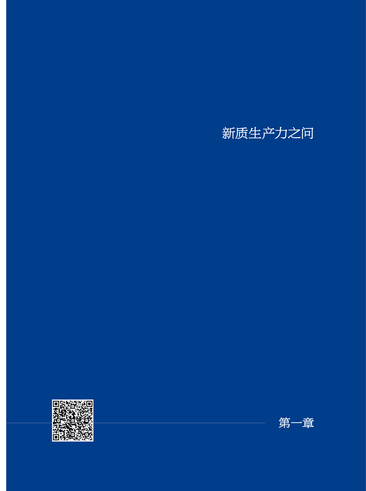

“给岁月以文明，而不是给文明以岁月。”

——刘慈欣《三体》

生存为了更好发展，发展为了更好生存。河流孕育文明，科技筛选文明。从尼罗河、两河、印度河、黄河发源的古老文明兴衰更迭，中国文化绵延不绝，汉字承载上下五千年思想史。从夏商周百万人口到大秦、康乾盛世，再到 14 亿人口的中华人民共和国，中华儿女创造恢宏历史。《三体》提醒我们：文明在宇宙尺度短暂，却能如太阳般释放巨大潜力。

## 新型生产力“新”在哪

新科学源于思想解放的新型科学家，新产业源于科学衍生的新技术。杨振宁等战略科学家认为中国科技大发展的先决条件是人才、训练、决心、财力。发展新型生产力是推动高质量发展的内在要求。新型生产力由技术革命性突破、生产要素创新性配置、产业深度转型升级催生，以新技能劳动者、新型劳动资料、新型生产关系的优化组合为核心内涵。

科技现代化是中国式现代化的关键，AI 是重要力量。1977 年钱学森提出要实现四个现代化必须先把科学技术搞上去。习近平在 2018 世界人工智能大会贺信中指出新一代人工智能为经济社会发展注入新动能，深刻改变生产生活方式，并认为 AI 将提高智能化水平、增强公共服务与城市管理能力。

### “新”在四大革新浪潮

从科学革新到新型生产力需经历多阶段。20 世纪 80 年代钱学森手稿给出路径——科学革命、技术革命、产业革命、社会革命。

其一，0 到 1 的科学理论创新，伴随旧理论颠覆与补充，由半导体物理、系统科学、生物学、人体科学等基础研发推动。

其二，1 到 10 的新技术孵化，属新型基础设施建设与工程化范畴，技术从实验室走向普及，成本随公共基础设施化与产品工程化下降至大众可负担拐点，如计算机、信息技术进入家庭、生物技术门槛降低。

其三，10 到 1000 的分批社会生产力升级。终端与基础设施价格平民化，高性价比新兴技术供给侧改革撬动市场需求井喷，新型生产力与旧质快速融合，多项技术汇聚点往往是产业革命起点。

其四，1000 到∞。劳动人群技能随技术整体提升，形成更优人技协同模式，构建新质生产关系以匹配新型生产力高速发展。

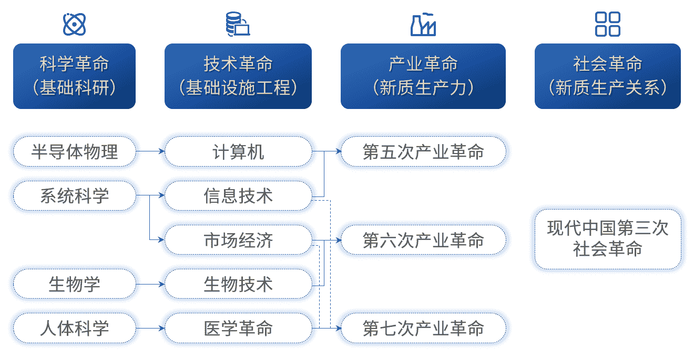

图 1-1　从科技到生产力的革新路径

### “新”在“新智”知识生产力

2020 年 5 月 OpenAI 发布 1750 亿参数 GPT-3，标志 AI 2.0 时代到来。相较 AI 1.0 的“旧智”，AI 2.0 的“新智”以通用智能为目标。

与大企业抢头部、创业者深腰部的分散格局不同，如今世界领先大模型团队的出现让产业趋向“强者恒强”，产业链链主格局改变，甚至大模型领先程度决定国家科技创新竞争优势。

这一变化在三层面引发变革。

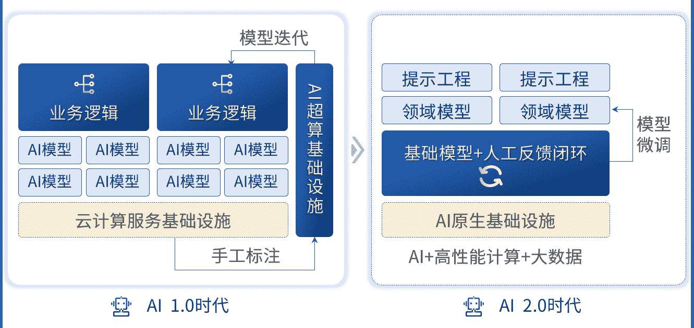

图 1-2　从初代智能到新一代智能的对比图

从单一场景工具到通用底座的跨越，本质上是能力形态的换挡。

模型层面
早期以解决特定场景的私有小模型为主，规模多在十亿以下。现阶段转向可处理通用任务的大规模模型，参数从十亿级推向百亿、千亿直至万亿级，演化明显指向多模态方向，大语言模型也在持续向多模态大模型靠近。

应用层面
初代时期模型只负责应用内的单一痛点，绝大部分业务流程仍由传统应用承载。第二阶段应用本身在模型化，基础模型搭配轻量交互前端成为新范式。以 ChatGPT 为例，几乎不需要重型开发，呈现模拟即服务、模型即应用的特征，原先写在代码里的逻辑被迁移到训练阶段，通过提示词方式定制行业大模型，即提示工程。由此衍生出办公助手、编程助手、虚拟人社交、营销助手、媒体写作助手等垂直形态。

底座层面
初代依托 CPU 主导、GPU 辅助的通用云计算，存储、网络与并行算力并未为训练与推理做专项优化。随着大参数模型研发需求激增，高性能数据中心成为标配，AI 算力中心被视作训练大模型的新基建，再次印证算力底座约十年到十五年一轮迭代的规律。

### 新在“新智”与“新质”合流

面向脑力环节的赋能让智能成为人脑在知识世界的顾问。数千年积累的知识主要沉淀于图书、论文与网络文本，如今大模型正高速学习近乎全部人类数据，并通过生成式基础模型产出 AIGC 内容，涵盖智能写作、绘画、视频生成、语音合成、智能编程等。

面向物理世界的赋能让智能成为脑力加体力的生产力助手。只学习不实践容易流于纸上谈兵。实践是检验认知的唯一标准，要形成认知—实践—再认知—再实践的闭环，就必须让大模型与智能体进入机器人操作系统，成为具备智商与情商的机器人、机械臂、无人机、智能车的“大脑”。为加速学习，前沿公司把数字机器人置入仿真环境，让数字世界与物理世界同步训练：在数字孪生工厂里同时训练上千台虚拟工业机器人，在数字孪生农田里并行训练数千台虚拟农业机器人，利用仿真允许的极致并行效率快速适配特定物理场景，再把模型迁移到实体机器人上做现实的测试—反馈—改进。

知识型生产力与实体型生产力的对比见图 1-3。

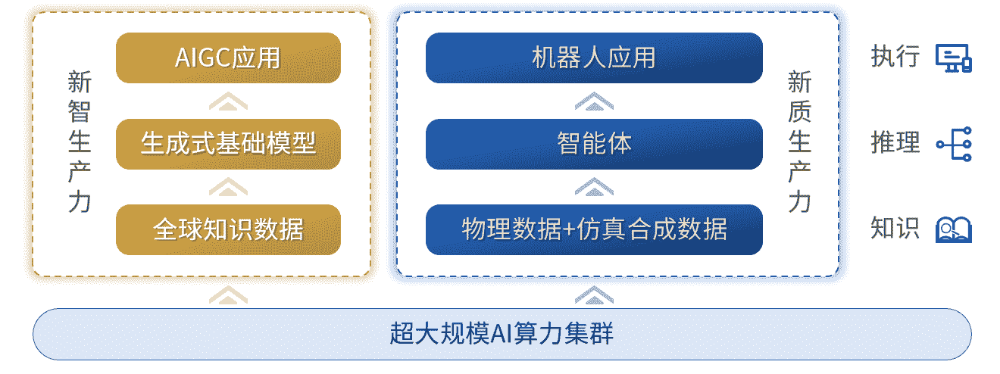

图 1-3　知识型生产力与实体型生产力

## 人工智能可以赋能哪些领域

### 三层能力架构

2024 年 3 月，在人工智能+ 行动的牵引下，商汤掌门人徐立提出“KRE 能力架构”，认为当前大模型正沿着知识、推理、执行三层递进。知识层擅长高频标准化问答，即已被大量提及的常识；推理层面向长尾、碎片化、非标准问题；执行层则把知识、推理与执行融为一体，完成复杂软硬件组合任务。

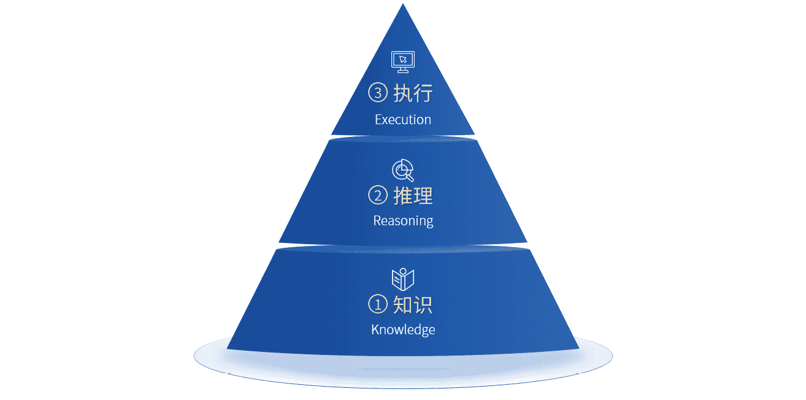

图 1-4　“KRE 能力架构”

第一层，知识整合能力：整合并消化人类跨学科的全球知识，将其归纳、融会后提炼出通用的概念、原则与结论。语言是知识的重要载体，眼下大语言模型学习速度惊人，Epoch AI 研究团队和加州大学伯克利分校计算机系教授 Stuart Russell 等预计人类历史上的高质量语言数据将在 2024—2026 年间被训练完毕。换句话说，大语言模型正成为承载几乎全部人类知识的初级智慧载体，可以跨领域给出接近专业学者的回答。

第二层，推理能力：在已知前提下推导出新结论的能力。大模型以世界知识为底座，能从旧知推出新知、发现新可能，为人类知识库提供增量。目前在端到端的复杂推理上仍与人类专家存在差距，业界正集中攻坚，未来具备可靠精准推理的大模型将为学界和产业提供逻辑分析服务。

第三层，执行能力：在与世界的互动中通过人类反馈掌握新知识的能力。毛泽东《实践论》阐释了认识与实践的关系，大模型若不调用执行体就难以深入客观认知世界。执行体可以是其他 AI 原生模型、传统软件，也可以是机器人、机械臂、智能网联汽车等硬件，大语言模型与硬件的结合即为具身智能。

《实践论》指出：只有社会实践才是检验认识真理性的标准。这也解释了大语言模型因缺乏实践而产生幻觉的根源。

实践出真知，实践是认识的来源。比如，人们通过观察和实践，才能获得对自然现象和社会现象的认识，从而形成科学理论。
认识对实践具有反作用。比如，科学理论可以指导人们的实践活动，提高实践的效率和效果；同时，实践结果也可以修正和完善原有的理论。
认识具有反复性、无限性、上升性。比如，在科学研究过程中，人们需要经过反复实验和验证才能得出正确的结论；同时，随着实验条件和观测技术的不断深化，人们对于某一现象的认识也会不断深化。

在 AI 时代，语言文字是知识的表达方式之一，数据是其载体，程序是处理数据的工具。2023 年 12 月，商汤基于自研大模型推出 AI 编程助手 Raccoon，覆盖需求分析、架构设计、代码编写、软件测试等环节，满足代码编写、数据分析、编程学习等需求，支持 90 多种主流语言和主流 IDE。以“KRE 能力架构”来看其开发效率：

知识能力融入：让基础大模型掌握代码库，仅在开发阶段用已有代码补全目标程序，从需求到交付约需投入 100 人天。
推理能力融入：让大模型贯穿全流程，辅助需求分析与设计、界面生成、用例生成等，可节省约 30% 工作量，只需 70 人天。
执行能力融入：若使用 Raccoon 2.0 调用强大的代码解释器作为执行体，从海量数据中筛选需求、指定产品特征并完成开发，可节省 80% 工作量，仅 20 人天即可自主研发。大模型为何需要解释器？因面对数学类问题时，解释器能给出正确可靠的答案。例如在 ChatGPT 中问列出 100 以内所有质数两两相乘的结果，它能正确列出；再问列出 100 以内所有质数两两相乘后加 1 的结果，却会出错。难度相同却出错，是因为基础模型未见过该类问题，训练时的世界知识无法直接给出答案，必须借助解释器求证。

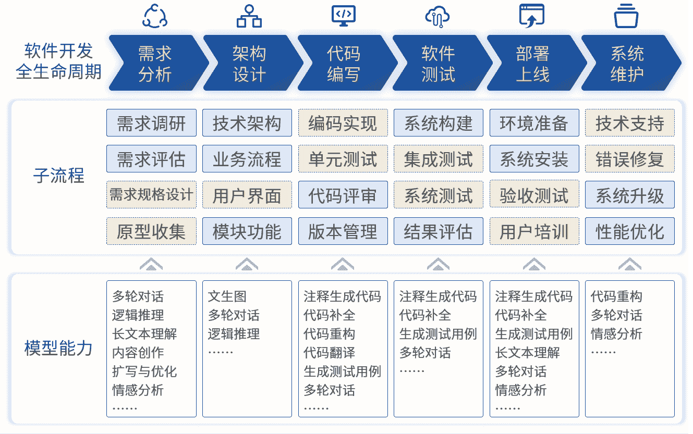

图 1-5　Raccoon 赋能软件开发全生命周期

### 智能加千行百业

我国作为世界第二大经济体，产业禀赋与美国不同，应选择哪些赛道进行数字化智能化改造？

智能加制造：工业革命后强国多为制造强国。美国制造业产值约占国内生产总值 10.3%；我国是世界制造业第一大国，连续 14 年规模全球第一，2023 年制造业产值约占国内生产总值 26.2%，工业品类齐全，40%品类产量居全球第一，PC、手机、空调、光伏等产品的产量占全球一半以上。用新一代智能技术让我国从制造大国迈向制造强国，从卖全球向造全球升级，是人工智能+ 的首要任务。

智能加服务：美国服务业约占国内生产总值 80%，服务 3.3 亿人口；2023 年我国服务业约占国内生产总值 54.6%，服务超 14 亿人口，市场需求旺盛多元，发展潜力巨大。

智能加科研：公开数据显示美国研发经费占国内生产总值 2.84%～3%，约 8100 亿美元。国家统计局显示 2023 年我国研发经费占国内生产总值 2.6%，约 3.33 万亿元，约为美国的 56.7%，应提升至 5.8%～6%。当前我国研发占比仅为国际平均水平的三分之一。若要实现前沿科技和基础研发的弯道超车，需大幅提升基础研发和工程研发的绝对投入，预判性占领未来科技制高点，将预算用在刀刃上，以国家级决策创新驱动科研创新，增强原创科技竞争力、全球人才吸引力与新质生产力。

智能加基建：可从 AI 基础设施化、基础设施 AI 化双向切入。据工信部数据，2023 年我国智能算力约 70EFLOPS，预计 2025 年达 105EFLOPS。2023 年 10 月起我国智算中心建设进入高峰期，国际数据公司预测到 2026 年我国智算规模复合年均增长率达 52.3%。我国在 AI 基础设施建设上快速追赶，但在 GPU 产业链控制力、自主产能上仍有差距，美国英伟达、AMD 的 GPU 全球市占率高达 95%，我国 GPU 国产化率仍低于 20%。在研发新一代大模型的同时，需把超大规模 AI 数据中心、跨地域算力网、AI 用超级绿电建设作为国家级工程。2020—2024 年美国基建投资占国内生产总值 1.37%～2.5%，2020 年我国基础设施投资占国内生产总值比例超过 12%。我国传统基建速度快质量高，为经济发展作出巨大贡献。AI 时代传统基础设施智能化比例偏低，智能电网、智能公路网、智能仓储网、机器人无人机公共补能网络等空间巨大。新质生产力依赖的新质基础设施升级，将助力我国在下一个百年未来产业中占据先发优势。

数字产业化在互联网时代遵循大人口、大流量、大数据、大交易量的价值链，在 AI 时代则沿着海量设备、海量数据、大模型、强生产的创新路径递进。

### 智能加的关键举措

2024 年 3 月 5 日，李强总理在政府工作报告中提出深入推进数字经济创新发展的七项关键举措。人工智能+ 行动肩负为我国打造全球领先数字产业带的使命。

制定数字经济政策：制定支持数字经济高质量发展政策，积极推进数字产业化、产业数字化，促进数字技术与实体经济深度融合。
开展人工智能+ 行动：深化大数据、人工智能研发应用，开展人工智能+ 行动，打造国际竞争力数字产业集群。
推进制造业、服务业数字化转型：实施制造业数字化转型行动，加快工业互联网规模化应用，推进服务业数字化，建设智慧城市、数字乡村。
实现中小企业数字化赋能：深入开展中小企业数字化赋能专项行动，支持平台企业在创新、就业、国际竞争中发挥作用。
健全国家数据体制：健全数据基础制度，大力推动数据开发开放和流通使用。
做强数字基础设施：适度超前建设数字基础设施，加快形成全国一体化算力体系，培育算力产业生态。
促进现代化的数字变革：以广泛深刻的数字变革赋能经济发展、丰富人民生活、提升社会治理现代化水平。

### 智能加科技自信

科技是第一生产力，文明演进常以标志性技术命名。18 世纪前世界人均国内生产总值每年增长 0.05%，1400 年翻一倍。18 世纪 60 年代蒸汽机引发第一次工业革命，人均国内生产总值年增 1%，70 年翻倍。19 世纪下半叶电力、钢铁、汽车、化工标志第二次工业革命，人均国内生产总值年增 2%，35 年翻倍。两次工业革命都促进了人口正增长，第一次使增长率从 0.4‰升至 6.4‰，第二次达 17‰，帮助社会摆脱马尔萨斯陷阱。

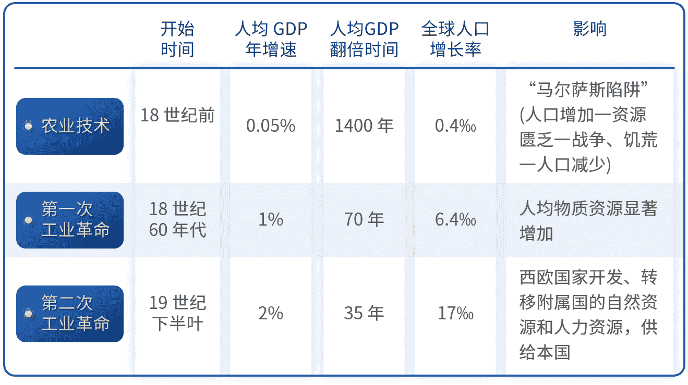

科技是第一生产力，人才是第一资源，创新是第一动力。18—19 世纪全球新质生产力即蒸汽机、纺织机、内燃机、电动机、无线电等，深刻改变了生产力与世界格局。为什么工业革命未在近代我国发生？李约瑟之问的逻辑是，公元 6 世纪到 17 世纪初世界重大科技成果的 54%由古代我国贡献，19 世纪近代我国仅贡献 0.4%。一种解释认为，农业文明阶段我国依靠师徒传承经验，16—18 世纪西方改用科学院、实验室集中攻关，而我国直至新中国成立才以科学院等组织形式开展科研。1949 年中国科学院成立、1977 年中国社会科学院成立、1994 年中国工程院成立，基础科研才蓬勃发展。2005 年钱学森提出钱学森之问——为何培养不出杰出人才，核心是如何重构教学体系，培养科学家、发明家、创新家。

中国式现代化是正确道路。20 世纪我国仅占世界国内生产总值约 4%，改革开放极大提升了创新速度；2018—2020 年我国在世界国内生产总值占比跃升至 17%。新质生产力的显著特点是创新，具有高科技、高效能、高质量特征，符合新发展理念，是摆脱传统增长方式的先进生产力质态。

# 第二章　人工智能之问

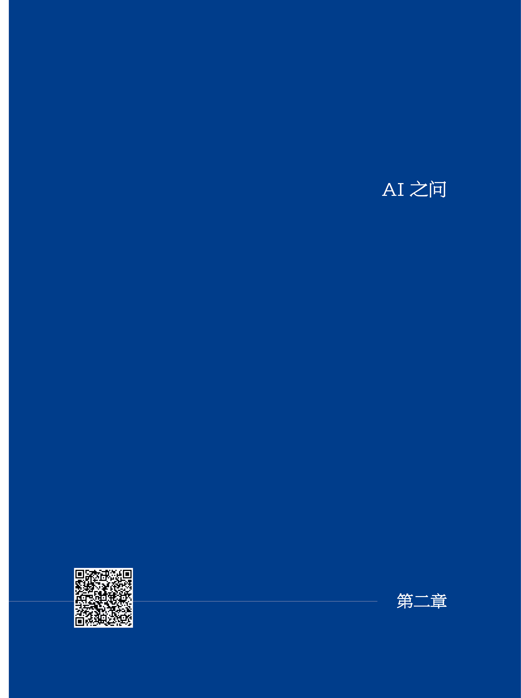

在现在这个时间点上能不能用人工智能来命名时代，取决于人工智能能不能把我们这个时代生产要素的成本规模化下降，因为只有这样人工智能才能走进千家万户。

——商汤掌门人徐立

近代历史上新兴技术多起于欧美，故有四次工业革命之说：18 世纪蒸汽机、纺织机、铁路为第一次；19 世纪电力、内燃机、化学工业、钢铁工业为第二次；20 世纪电子计算机、互联网、可再生能源为第三次；21 世纪初人工智能、人形机器人、量子计算为第四次。我国科学界对此有不同见解。

1956 年，我国航天事业奠基人、国家杰出贡献科学家、两弹一星功勋奖章获得者钱学森在《从飞机、导弹说到生产过程的自动化》一文中给出答案，用机器代替人的体力劳动是第一次工业革命，即机械化；用机械系统来替人作非创造性的脑力劳动是第二次工业革命，即自动化。并给出第二次工业革命的衡量标准与标志性事件——现在企业的自动化正在开始，无人工厂还没有出现，所以我们还处在第二次工业革命的前夜，明天才是超高速飞行、星际航行、无人工厂、自动化办公室和图书馆的时代。也就是人类生产方式的一个新阶段。到那个时候，人们终于摆脱了一切非创造性的劳动，实现了共产主义的生产方法。

八十年代，全世界都在加码“第五代计算机”的研发，目标是让机器学会像人脑那样思考，赋予计算机类人的思维能力。但受限于当时芯片算力的天花板，各类算法进展缓慢，AI 迎来了一轮漫长的寒冬。就在这段低谷里，钱学森提醒大家：别忘了形象思维规律的研究，图像、创意、情感、直觉这些领域长期被忽视。时隔四十载，生成式人工智能在算力与数据的双重加持下破圈：大模型能写营销文案、做海报设计、把抽象概念转成短视频，多模态大模型、情感智能、具身智能、科学智能都重启了成长曲线。AI 助手和智能体，正一步步走进钱学森当年预言的“自动化”工业革命。虽然距离全智能化人形机器人、真正无人驾驶、自我演化的无人工厂、用 AI 完成复杂科学研究这些愿景仍有差距，中高阶的创造性脑力劳动也还在等待 AGI 的到来，但大模型月月迭代、技术周周革新的节奏，已经让人类社会从“前夜”急速驶向第二次工业革命的通道。

## AI 究竟是什么

### 算术机器的视角

AI 只是解题机器吗？17 世纪，笛卡尔提出万物可归于数学，莱布尼茨更进一步设想用计算来替代思考。AI 是人类的行为复制品吗？1950 年，图灵在《计算机器与智能》中抛出图灵测试，人类扮演机器容易因算数慢而露馅，机器要做到以假乱真，就必须让提问者分不清回答来自人还是机器。AI 是能比人解决更多难题的技术吗？1956 年夏天，达特茅斯的会议第一次明确了“AI”这个词，麦卡锡给出定义：制造智能机器的科学和工程，并且指明方向——让机器学会语言、形成抽象概念、处理人类过去独占的问题，并不断改进自身方法。

爱因斯坦说过，不是能算的东西都能计算，不是能计算的东西都能算数。理论上可算的问题，在现实复杂性、不确定性和资源限制下就可能无解，这就是计算与数学的边界。哥德尔不完全性定理亦在提醒我们：任何包含一阶逻辑与初等数论的形式系统，都存在既证不出也不证伪的命题；无矛盾系统无法在自身内部证明自身无矛盾。回看 AI，追求自洽与完备兼得的模型在逻辑上难以成立，也没有通用算法能判定所有数学命题的真假，除非引入实验、经验这类非纯公理化的补充，而这正是人类反馈与具身智能的意义所在。

### 与人脑计算等价的神经网络

沃尔弗拉姆在《这就是 ChatGPT》中描述：人脑大约有 1000 亿个神经元，每个都能以每秒约 1000 次的频率放电，神经元通过树突状分支连接，形成复杂网络，且不同连接具有不同权重。

借鉴这一结构，AI 神经网络通过海量训练样本逐步习得任务，例如区分猫狗。训练好的网络具备泛化能力，能凭借多种猫的典型特征完成新图分类。通俗讲，这是一个输入-函数-输出的过程：照片或视频进去，经过数组运算和多维函数处理，最终输出“猫”的文字标签。

机器学习中的神经网络依赖几项基本机制。

自学习：从样本到结果的端到端学习，系统自行挖掘中间特征，无需人工显式告知规律。
自组织：由简单单元灵活重组实现等效算法，二维猫图进入卷积网络后被映射到高维特征空间抽取抽象信息，再压缩为类别标签，最后借助自然语言模型生成描述。
大网络：小规模网络难以拟合目标函数，给足够大的中间层神经元、足够多的样本和足够长的训练时间，就能逼近目标。
数据扩充：在原有样本上做适度改写，等同于新增数据，利于学习，如大语言模型对考题的扩写、文生视频模型对《我的世界》视频的学习，都能促进对真实世界知识的理解。
损失函数：衡量预测与真实的差距，值越小越准确，多轮训练就是持续压低损失，让“学习曲线”趋于平缓。

沃尔弗拉姆反复强调“计算等价原理”：达到一定复杂度的系统在计算能力上是等价的。从元胞自动机到人脑、AI 网络、社会系统、自然现象，物理构成虽千差万别，计算极限却在同一量级。大脑的复杂度与宇宙相当，限制只在容量。因此通用计算与简单数学方程足以描述自然与智慧，持续注入算力、数据与正确架构，AI 完全可能逼近甚至超越人类智能。该原理在学界仍有争议，关于简化复杂性与物理验证的问题并未终结，但它极大启发了 AI 科研。

## AI 为何关键

### 突破人类思维的瓶颈

我们习惯以人类智能为标尺。ChatGPT 为代表的类人智能与人类还有差距，AGI 则被视为等同。AI 发展太快，“AGI 时刻”像高速列车一闪而过，很多人还没反应过来，超级智能已然到来。时间点充满不确定性，OpenAI 与英伟达的 CEO 认为 2030 年前可能到来，也有专家押注 10 到 20 年后。当下人机关系是使用者与工具，超级智能出现后更像主人与伙伴，AI 将在人类认知边界外持续科研、探索宇宙，成为升级人类智慧的外脑。聪明的做法是在人机共智上构建“人机文明共同体”，AGI 是走向星系文明的船票。

通向 AGI 的经验，被视作有效路径的是理查德·萨顿的《苦涩的教训》，该文经多年验证获得认可，伊利亚·苏茨克维大力推广，甚至让 OpenAI 全员熟读。

人类的误区在于反复试图把系统做成“我们以为的思维方式”。短期内植入知识效果明显，长期却会撞上瓶颈。真正突破来自搜索与学习的结合，靠提升计算能力而非硬编码。

普通人脑的体积与能力已长期停滞，AI 爆发则依托摩尔定律，晶体管数量约每 18 个月翻倍，处理器性能约两年翻一倍，价格减半。七十年的 AI 史证明，能充分利用计算力的通用方法终将胜出。短期靠人类知识取巧，长期靠算力释放。

元方法是关键。人类心智极其复杂复杂，不应追求简单化理解，而应构建能捕捉任意复杂性的“元方法”，如搜索、推理，并让其随算力规模持续演进。我们希望智能体像我们一样去发现，而非只复现我们的发现。

伊利亚·苏茨克维曾比喻大模型像“玻尔兹曼大脑”。玻尔兹曼设想在高熵宇宙中，量子涨落偶然形成低熵的意识大脑，稍纵即逝。当 17 亿用户与 ChatGPT 交互时，一个“AI 大脑”就被临时召现，使用停止即消失。这引发的哲学争议是：人类是否也是随机的玻尔兹曼大脑，而非有序宇宙的产物。该思想目前无法实验验证，仅是理论可能。

### 重塑“三个世界”

卡尔·波普尔提出“三个世界”：物理世界、精神世界、知识世界。科学进步是三者的互动结果。知识总是暂时且不断修正的，人类通过革命性理论更迭实现科技进步。

在 AI 时代，互联网承载了人类绝大部分存量知识，AI 在此基础上做推理、猜想、发现新知识，数字世界成为知识世界的重要载体。

人类进化靠工具升级。传统路径是观察实验→大脑分析→实践检验。AI 是“会用工具的工具”，可通过 Function call 调用专业软硬件。人类发现知识的方式有归纳、演绎、猜想。大模型的出现让全量归纳成为可能，书籍、论文、网站训练出的模型能做史无前例的跨域知识整合；同时人类期待机器猜想，提出定理与假说。各国都应探索适配 AI 的人机协同模式，以在科技竞争中占先、提升科研、教育、文化、传播、生产等领域的效能。

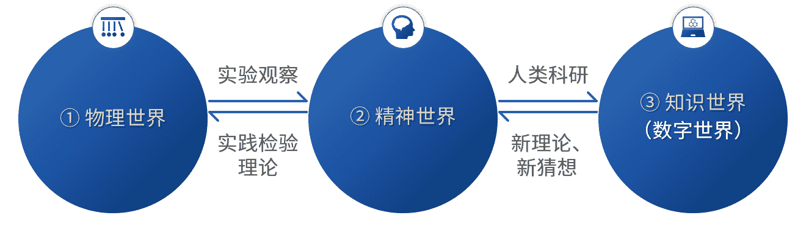
图 2-1　AI 时代的“三个世界”

“三个世界”也启发了大模型应用的两个演进方向（见图 2-2）。

仿真物理世界：AI 以“世界模拟器”形态无限逼真复刻物理环境，在数字孪生中做科研与设计，成本远低于现实，且可同时测试海量实例。游戏引擎是利器之一。商汤用《星际争霸 2》训练 DI-star，5 周内用 16 万场录像、1 亿局对战达到职业宗师级经济水平。选择星战的原因是其空间复杂度高达 10¹⁶⁸⁵，远超围棋的 10¹⁷⁰。DI-star 与 OpenDILab 已在 GitHub 开源。自动驾驶、人形机器人、数字孪生工厂、建筑设计也多在仿真环境中迭代，Unity 及配套工具包被广泛使用。

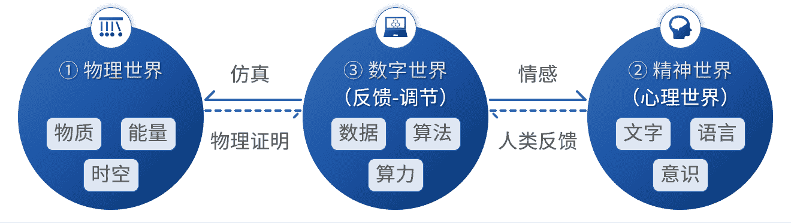
图 2-2　数字世界的两个发展方向

满足精神世界：人类有情感需求，AI 可成为“情感模拟器”，通过交互深入心灵，提供情绪价值的陪伴服务。类 Chatbot 应用层出不穷。例如 2024 年 3 月底，阅文集团基于《斗破苍穹》《庆余年》《全职高手》等 IP，在“筑梦岛”APP 上推 IP 虚拟人，读者可与萧炎、美杜莎等角色聊天；APP 还支持用户自定义 AI 角色，如 AI 英语老师、科学家、演员。海外方面，Meta 于 2023 年 9 月基于 Llama 2 上线 28 个名人形象聊天机器人，包括汤姆·布雷迪、查莉·达梅利奥等。

## AI 的发展规律

### 沉积岩定律

信息时代的成败取决于迭代速度与成本下降速度。乔布斯认为科技创新像沉积岩，一层层堆积又很快被覆盖，成为庞大的技术遗产。模型训练成本在 2022 年底到 2024 年初的 18 个月下降约 50%，推理成本下降约 90%。开源模型出现后调用成本继续下滑，私有部署从几千万元降至几十万元量级，性能相当的模型成本缩水一个数量级。OpenAI API 负责人透露，GPT-4 自 2023 年 3 月发布以来，每个 token 处理成本下降 85%～90%，且趋势持续。这一成本曲线在谷歌、微软、OpenAI 等发布会上反复印证。

吴军在《创新者》序言中指出，信息技术与传统工业不同，发展迅速且未见放缓，产品价格持续下降，这是渗透社会的根本原因。传统工业品价格相对收入不降反升，IT 领域却出现性能提升、价格下降的反常现象。

### 适人者生存定律

若用地形图比喻人类能力，可画出“人类能力地形图”，不断上升的计算机性能像水平面，逐步淹没陆地。20 世纪 80 年代，汉斯·莫拉维克、布鲁克斯、马文·明斯基等提出“莫拉维克悖论”：让计算机像成年人一样下棋相对容易，让它具备一岁小孩般的感知与行动能力却极难甚至不可能。规则明确、环境封闭的任务对 AI 友好，而真实开放环境复杂多变，连儿童能做的简单任务也需整合感知、认知、记忆、决策与执行，并将知识转化为灵活行动。

从进化史看，感知-行动是生存基础，不具备者已被淘汰，抽象思维是后天高级能力。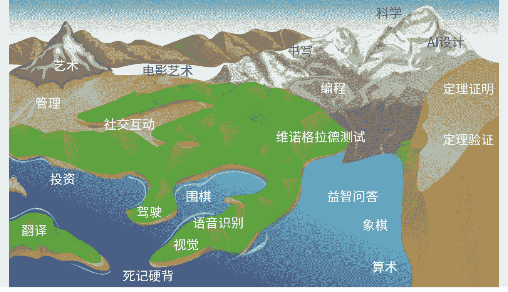
图 2-3　人类能力地形图

注：这张“人类能力地形图”是机器人专家汉斯·莫拉维克提出的，其中，海拔高度代表这项任务对计算机的难度，不断上涨的海平面代表计算机现在能做的事情。

在自然法则里，能适应环境的得以延续，不能适应的便被淘汰。把这一逻辑搬到数字世界，情况发生了变化。智能系统并不需要同风雨寒暑抗争，它的考验场域是人的评价与使用场景。被用户觉得好用、能解决实际问题、甚至带来好感的模型才会被保留下来。到2023年底，ChatGPT的累计访问已达17亿次，周活跃用户突破1亿，超过200万名开发者自发参与OpenAI相关应用的打磨。人们为何乐于长时间与大语言模型对话？图灵奖得主杰弗里·欣顿的判断偏乐观，他认为愈发强大的模型能够呈现类集体意识的运行方式，彼此可以共享所学，这让它们对人类形成压倒性优势。某种程度上正如《三体》中科学家向智子求教终极命题，好奇心驱使新一代系统用人类语言持续汲取海量知识。《语言本能》指出语言是人类本能，如今智能系统正把纷繁的语言从零开始重建，跨越文化隔阂，在地球上搭建新的巴别塔，这或许可以视作智能系统的启蒙阶段。

### 万物摩尔定律
智能革命正在把社会商品与服务的成本逐步压低。2021年6月，OpenAI首席执行官萨姆·奥尔特曼写下《Moore’s Law for Everything》，其中有几条极具启发性的推演。
◎ 摩尔定律的外溢效应。依托半导体与摩尔定律，几十年里芯片性能在同等价格下每两年翻倍，电视、电脑、娱乐开支因此下降，而住房、医疗、高校教育等费用却持续上涨。若能用太阳能机器人建造房屋、用智能医生问诊、用机器人造机器人、用智能系统自生自演，则住房、教育、食物、衣物等成本完全可能在未来数十年里每两年减半。
◎ 时间表。2021—2025年，能思考的程序有望阅读法律文件并提供医疗建议；到2021—2030年，它们可承担流水线作业甚至扮演陪伴角色；到2021—2050年之后，它们几乎能胜任任何任务，包括原创科学发现并拓展我们对“一切”的认知边界。
◎ 不可逆的递归。技术革命一旦启动就难以回头，智能机器参与制造更智能机器形成创新循环，会带来三个后果：其一，巨额财富被创造，强智能加入劳动力后大量劳动的价格趋近于零，进而拉低商品服务价格；其二，财富分配需要大规模政策配套，让更多人过上想要的生活；其三，若分配问题得到解决，人类生活水平将实现史无前例的提升。
◎ 能力核心。最关键的能力是思考、创造、理解与推理。在农业、工业、计算机三次大革命之后，智能革命是第四次。未来百年取得的技术进步，可能超过人类自用火到发明汽车以来的总和。能够学习且能做有用事情的系统已经出现，发展方向已无疑。
◎ 新岗位诞生。每次技术浪潮后都会催生新工作，资源更丰富时人们对工作的定义权更大。当智能系统生产绝大部分商品服务，人将有更多时间陪伴亲友、照护他人、欣赏艺术与自然，或投身公益。
◎ 对资本征税而非对劳动征税。追求整体财富最大化和追求公平分配，两条路径都能短期提升生活水平，但只有持续增长才能维持长期改善。掌握科学方法、追求真理，是其中一条有效路径。
在万物摩尔的框架下继续推演，人类靠缓慢优化提升工农业效率，而智能系统凭借算力规模和全域感知数据不断发现更高效率的模式，会让成本持续下探。限制在于物理条件：地球能源有限，除非可控核聚变实现几何级增长；土地、水、木材等自然资源也有限，人口若涨到100亿至120亿，资源竞争会加剧。除非借助智能系统与航空航天技术开拓太阳系资源和星际移民，比如智能系统发现海水制淡水的新方法，人类才能用上地球97.5%的淡水供给。智能系统不是万能答案，却是通往答案的关键钥匙，把它投入可控核聚变、健康药物研发、新材料发现、航天深海探测机器人等基础科研，会给人类带来新希望。

### 人机共智定律
1903年12月17日，莱特兄弟完成首次持续动力飞行。此后飞机功能越丰富，飞行员操作越复杂，人机协同模式随之演进为以主驾为主的Singlepilot、主副互助的Copilot、自动辅助的Autopilot三个成熟阶段。很有趣的是，智能时代的人机协同划分思路几乎照搬了航空业的这套逻辑，按人类与智能体分担工作量的不同来定位协作关系。

图 2-4　“人机共智”协同模式
当新一代技术高速演进，社会需要提升全体劳动人口和使用者的人机协同技能，沿着计划—实施—检查—处理循环不断优化协作方式，最终达成人机共智、人机共质的生产力目标，让人-机新质生产力适配新智生产力。
表 2-1　3 种人机协同模式
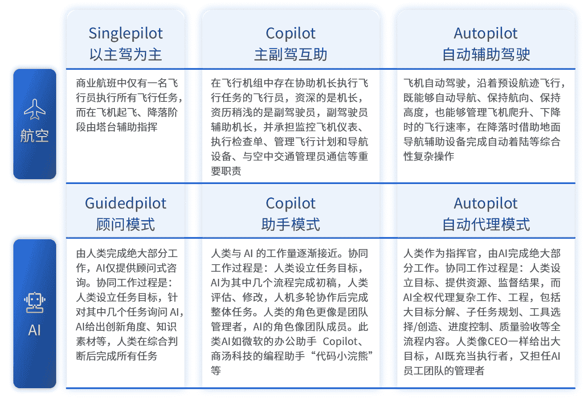
# 第三章　AI 顾问实践：人类的“辅导员”
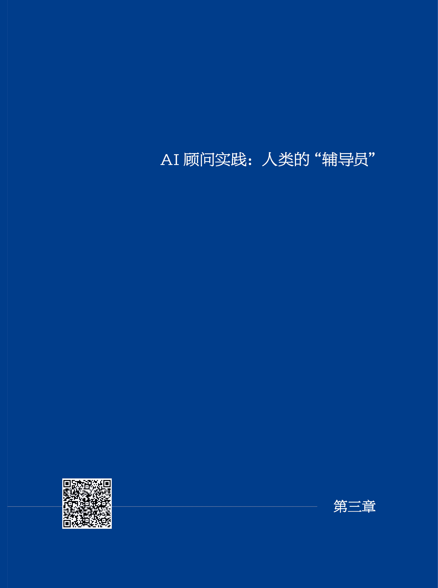
“社会一旦有技术上的需要，则这种需要就会比十所大学更能把科学推向前进。”
——恩格斯
劳动者广泛掌握理论和知识，就能把知识生产力转化为产业价值。大模型正是集知识与理论于一体的对话式顾问，呈现出三种生产力特征。
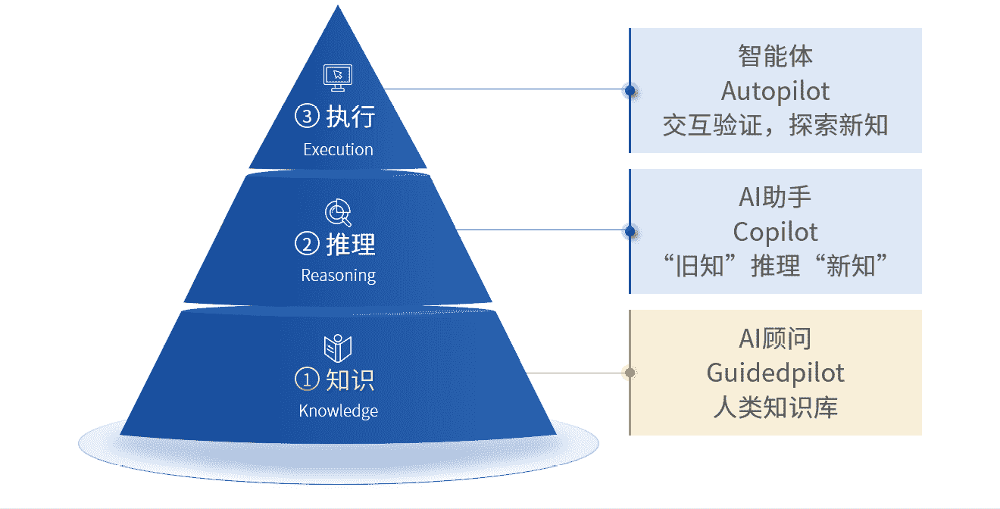
图 3-1　AI 顾问驱动生产力
◎ 大模型社会化普及。实践出真知，群众是新质生产力实践主体，也是把智能理论转化为物质变革的决定性力量。大模型在各行各业越用越聪明、生产力越强。第三产业的人对人服务正升级为智能对人服务，渗透零售、电商、会展、教育等领域，规模化摊薄研发成本并不断提升个性化服务能力。
◎ 加速交叉学科与产业融合。当前大模型能博览群书，几天甚至几小时内消化数百万字文献与企业知识库，成为新领域的专家顾问。以教育行业为例，在知识密集型领域，智能系统可为人类提供知识融合、知识辅导、知识问答的综合服务。
◎ 探索人机协同生产。如中关村国际直播港的“数字人主播+人类运营助攻”模式，人类负责选品、物流、客服，数字人负责直播带货的知识服务。人机效率如何在创新模式上持续提升，是智能时代的新智生产关系命题，商学院与社科院需要把研究从人人协同转向人机协同的管理学与运筹学。

## 教育大模型：中公教育，从“名师授课”到“AI 因材施教”
创立于1999年的中公教育，二十多年里一直保持对时代与科技的敏锐。在市场开拓上，早期抓住公务员和事业单位考试这一传统培训的空白赛道，建立起师资、教材、资质认证一体化的体系。随着报考人数攀升，它成长为公职教育培训的头部企业。成本可控地服务不断增长的学员，成为关键课题。
### 向 AI 求解，教育产品升级的新方向
2008年互联网开始大众普及，中公教育立刻投入中公网校建设，研发线上教学平台并拓宽线上招生渠道。不到一年招生人数冲到10万人，打破了线下起家的天花板。如今公司拥有1000多所分校，培训覆盖公务员、教师、金融财会、医学资格、法律、社区、考研、出国、成人高考等，并延伸至IT、人力资源、心理咨询等职业技能。2023年下半年首款基于生成式智能技术的课程“AI数智系统班”发布。
该班契合数字经济发展，让年轻人学习智能技术与工具的应用实践，培养数字应用与数据处理能力，提升就业竞争力，满足智能化时代岗位新技能需求，为新质生产力的培养提供社会资源支撑。
十几年前借助网络红利转型尝到甜头后，面对大模型AIGC的突破，中公教育毫不犹豫进入智能领域，加速降本增效。
教育机构的核心资产是师资，也是最大成本。中公教育推行“双师课堂”：名师在线讲授核心内容，当地教师面对面辅导，在一定程度上缓解了名师供给矛盾。但也带来新问题：名师教研时间被大量占用，难以做到真正的个性化辅导，离职风险也不小。
为此，中公教育与商汤科技联合研发虚拟数字讲师“小鹿”，有望给教育带来革命性变化。
### 场景落地，“AI+在线教育”做对了什么
中公教育选择了大模型驱动的智能数字人，而非只追求形似的数字人技术。研发重点放在“人”的要素上。“小鹿”本质仍是一名老师，需要学习名师的教学过程，模拟真实教师的风格与方法。
借助大模型，“小鹿”拥有可随时调用的专业知识库，能快速分析学员学习数据并实时互动，提供个性化反馈与建议。既解决了名师稀缺，又让教学模式得到验证，推动了教育数字化。
打造虚拟数字讲师时，团队抓住了三个关键点。
第一，因材施教的个性化策略。“AI数智系统班”面向职业教育需求学员，强调能力培养与就业指导。虚拟讲师发挥个性化教学先锋作用，用智能技术为每位学员生成定制学习计划与职业指导，让学习内容与进度匹配个人特点，形成差异化竞争优势。
第二，真功夫。教研团队把AIGC利用到极致：精心制作“小鹿”的在线课程、板书、PPT，由大模型反复打磨优化；对数字人视频的声音与动作进行精细调整，让虚拟讲师对学员可信可靠。中文数字人比英文更难，多音字与断句问题需要专门优化。
第三，吸引力与形象设计。过去名师形象不被视作教学质量要素，AIGC改变了这一点。“小鹿”被定位为年轻、时尚、清新气质的女教师，通过AIGC生成多个版本并与线下真人老师的脸型、发型深度融合，最终选出充满生机且亲切的形象。如今教师形象已成为年轻学员评价课程体验的标准之一。

图 3-2　虚拟数字讲师“小鹿”
### “小鹿”成功的背后——从细节出发
研发初期，中公教育与商汤科技组建数百人团队攻克教育场景落地难题。
◎ 声音优化是关键。借助商汤“如影”数字人视频生成平台，少量音频即可生成“小鹿”音色，并在线配置音色、语调、语速、语种。生产流程为智能系统将真人视频课转文本、名师打磨文稿、用文稿生成声音、再驱动数字人。为避免机械朗读感，团队做了变声优化、停顿加入、语速语气调整等。
◎ 课件反复打磨。将10位名师的同一课程融合成“小鹿”一堂新课，需要拆解每道题知识点与讲法，组合成最优稿后才进入录课流程。
◎ 形象逼真度提升。商汤“如影”支持4K人物模型训练，让“小鹿”口型张合更自然，音色语调语速更逼真，闭口音如bo、po的口型匹配度更高，随着基础模型优化，效果持续提升。
◎ 互动形式多样化。口型、表情、动作越丰富，体验越好。在商汤“如影”加持与持续优化下，上课效果无限逼近真人名师课堂。
◎ 训练效率提升。平台支持分钟级大数据样本与秒级小数据样本训练，相比上一版本训练效率提升50%，节省算力。推理阶段支持手机端、网页端制作，满足录播与直播需求。
中公教育严把教研教学质量，董事长李永新要求做事标准极高、工作极细、态度极认真。在成本、时间、质量的挑战三角中，智能系统带来“三全其美”。国考课程每年更新，10月公告发布后一周内完成讲义与课件研发并同步招生推广。公司加大算力投入，开发职业就业垂类大模型，构建算法+算力+培训三位一体的智能赋能体系，在智能+内容运营、智能+教学辅助、智能+数智人、智能+就业等层面系统布局。
采用商汤“如影”后，“小鹿”的降本增效初显。以手机上的“如影”APP几乎可实时生成大量视频，满足短视频营销、录播、直播培训，无需额外拍摄场地与器材。更关键的是，“小鹿”直播一个月仅花费4000元，人力成本降低80%，实现“以一当万”，让真人老师把时间投入教研。
与真人不同，“小鹿”讲课无口误、啰嗦、重复，语言精炼，课程内容密度为普通面授的2至3倍，听课效率同为2至3倍。
“小鹿”还是自带助理的超级老师。接入商汤“日日新·秒画”文生图大模型，可快速生成各类宣传物料，助力全渠道营销。
2023年9月24日课程上线后一个月，报名学员超过7万人，成为中国在线教育智能创新的风向标。随着数字人价格下降，团队可研发多款不同形象的“小鹿分身”，在抖音开设多个账号提升曝光，多渠道汇聚关注。

大模型技术正在改写教育、品牌传播与带货的方式。同一套技术逻辑投到不同场景，会长出完全不一样的商业形态。

**职业培训的内容生产进入新阶段**

中公教育对下一步的设想，是把生成式技术与教研内容生产结合成一种新的范式。第一步用大数据把学员的学习行为和真实需求挖掘出来，对整体教研体系做系统性重构；第二步借助模型提升授课效率，让学习工具具备思考能力。最终目标是在职业培训赛道实现教研与场景的深度融合，摆脱传统面授的局限。

基于多年教学沉淀与研发储备，公司推出了“AI智能系统班”。主旨是让每位学员以更低门槛获取优质师资资源，并在此基础上搭建起专属的“数字人即服务”机制。模型正持续赋能营销、教学和服务全链路，推动业务向纵深发展；同时向就业培训市场输送大量平价高质内容，推动普及化，覆盖更多有提升需求的人群。

2023年5月，董事长李永新明确方向：当年成立了人工智能与教育研究院，将结合业务实际展开前瞻布局。公司期望在职业教育与就业服务领域引领技术应用与创新探索。

**设计大模型：农夫山泉，从专家创作到大众共创**

一则广告能否打响，创意是决定性因素。

唐诗“天平山上白云泉，云自无心水自闲”写尽了泉水的纯净。农夫山泉始终坚持“我们不生产水，我们只是大自然的搬运工”，汇聚十二大水源地，“农夫山泉有点甜”已成为饮用水品类的代表性联想。连续多年稳居国内包装饮用水市占率首位后，农夫山泉早已超出商品本身，成为具备媒体属性的品牌资产。

不同于高频重复的传统投放，农夫山泉开始探索玩法。数智化营销推进中，品牌感知到用户结构变化，瓶装水消费人群也呈现明显分化。年轻人更在意创意与功能，靠记忆强化重复播出的广告已难以触达。于是品牌调整策略，春节成为关键窗口：自2016年起，每年春节都会推出典藏版生肖水，金猴、金鸡等系列只送不卖，仅能线上抽取。2024龙年，金龙瓶凭借精美工艺与优选水源在社交平台引发热议，图3-3呈现了网络上的反响。瓶身设计斩获五项国际设计大奖，水源特选长白山莫涯泉。热度的外溢让老款升值，2016年的丙申猴典藏版在二手市场价格快速攀升。

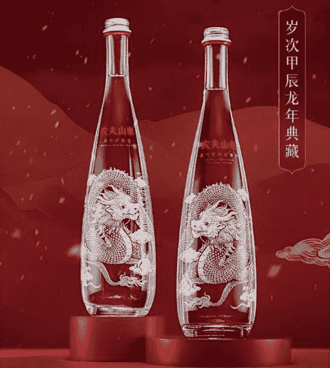

图 3-3　农夫山泉金龙瓶生肖水

**利用生成模型，让人人都能成为设计师**

戈德海伯在《注意力购买者》中指出，如今信息过剩，稀缺的是人的注意力，注意力即财富。在内容爆炸的营销时代，如何精准抓住细分人群成为品牌核心命题。

近些年农夫山泉持续破圈，向垂直赛道渗透，抓手是产品设计。汽茶瞄准Z世代，儿童天然矿泉水面向20后婴幼儿家长，水溶C100在健身与户外人群中流行，打奶茶、东方树叶、茶π则占据上班族心智。要在春节实现全覆盖，需要一个能引爆声量的亮点，传统文化与创意审美的结合催生了生肖水的方案。

2023年元旦前后，ChatGPT点燃了大众对生成式AI的好奇，AI绘图也登上社交热搜。AIGC应用被广泛尝试，AI绘图成为注意力高地，对青年受众尤其有吸引力，图3-4展示了相关用户画像。

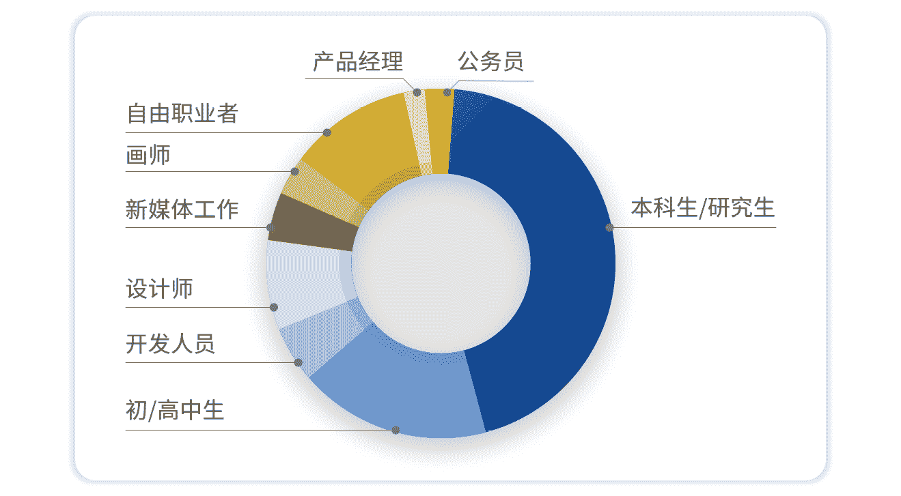

图 3-4　中国 AI 绘画用户身份画像（信息来源：6pen）

农夫山泉如何承接这波热度？核心思路是用生成式AI为消费者提供想象力的工具，让目标受众直接参与产品设计，成为金龙瓶广告图的创造者。品牌选择商汤科技的“秒画”文生图大模型，分三步推进。

第一步，模型开发。联合秒画团队训练出专门绘制“龙宝宝”的专属模型，并通过技术接口把体验入口放到微信小程序，用户可直接上手。

第二步，全渠道曝光。从除夕前10天起，公交站、火车站、机场、地铁、楼宇电梯间，以及微博、小红书等线上位点同步露出金龙瓶生肖水广告。

第三步，引导互动。随着网友用AI绘制龙宝宝并晒金龙瓶在社交网络传播，更多人被吸引来体验创作乐趣。

一千个哈姆雷特，一千个龙宝宝。商汤团队在一个月内基于秒画大模型，用数百张中国龙图像集训练出龙宝宝LoRA小模型。与凶猛的西方龙不同，网友创作的中国龙宝宝身着中式服饰，喜气洋洋、神态各异，图3-5可见软萌可爱、憨态可掬、英姿飒爽、端庄俊美，甚至俨然学霸的多种版本。

        

图 3-5　“秒画”的创作成果（信息来源：农夫山泉和商汤科技）

创意背后，品牌在寻找什么

2024年1月11日零点，龙宝宝AI绘画小程序上线，20天内累积上百万幅作品，微博、小红书上#召唤我的AI守护龙、#我和生肖水的故事等话题持续发酵。

AIGC的前提是算力。这上百万次运行背后，是商汤自研的秒画文生图大模型与“大装置”智能算力平台在支撑。

“秒画”Artist V1.0于2024年发布，基于Transformer架构，参数超百亿，可生成高画质且细节精细的图像。主要强化有四点：引入大语言模型提示词编码算法，提升生成一致性与知识表现力；自适应采样优化多样性，让每次生成都有新意；空间感知语义优化技术改善结构与布局；解决训练推理不对齐问题，使风格化生成达到艺术级水准。

图 3-6　“秒画”Artist V1.0 版本一键生成电影级图片

“大装置”智能算力平台是亚洲领先的智算中心之一，由模型层、深度学习平台、计算基础设施构成。模型工厂已发布超49,000个商用AI模型，兼容OpenMMLab、OpenDILab等开源生态。深度学习平台SenseParrots可在千卡GPU集群上实现超90%的加速效率。算力基础设施总算力达每秒374亿亿次浮点运算，可支撑100亿参数视觉大模型，单日完成1000亿参数模型的完整训练。平台已服务零售、互联网、能源、通信、医药、科研、半导体、智能硬件等领域，帮助企业构建AI+商业模式、解决长尾场景、加速规模化落地。

市场如江河，农夫山泉如舟，GenAI如桨。洞察、创新与数据化运营决定了能否激流勇进。以大模型为起点的AI新技术，不仅帮助农夫山泉实现逆向广告——消费者围绕生肖水自行生产设计广告内容，实现营销价值最大化，也正从营销端向供应链渗透革新。

**带货大模型：中关村国际直播港，从网红主播到AI劳动力**

马克思指出，经济时代的区别在于生产方式和劳动资料。第一产业出原材料，第二产业做加工，第三产业做宣传销售。直播电商让消费者能直接看见产地与工厂，提升信任，同时大幅压缩在线销售的人力成本。中关村国际直播港管委会主任黄金标如此概括。直播港由德宝艺苑科技集团主办，中关村产融合作与转型促进会、中关村虚拟现实产业协会等多家机构协办，是一个国际化、综合化的科技型直播基地。

**先理解问题，再解决问题**

2022年，中国小微企业总数突破3000万家，支撑着7亿多人的就业。但资金紧张、人才不足让品牌营销成为痛点。在流量巨大的直播营销舞台上，小微企业常被边缘化：没预算请网红大V，没团队做运营，自己直播也打磨不出好内容，转化不理想。试错成本高、难以坚持，是普遍困境。所以很多人默认——品牌是烧钱的大企业游戏。

德宝艺苑过去20年孵化了十几个行业70多家创新企业，深知小微企业主的真实诉求。针对直播专业团队缺失、启动投入受限的问题，中关村国际直播港为这类企业定制了数字人直播营销体系，避开三个常见误区。

1. 有直播账号就等于数字营销。只做账号管理数字化，没有营销数字化方案和运营打法，品牌和数字营销无法真正融合。
2. 网红名气大销量就高。仅靠大V往往达不到品牌目标，消费者更在意好货。鸿星尔克、美的、格力等新一批品牌直播间靠供应链和产品力吸粉，而非网红。
3. 重科技轻运营就能转化。AR、数字人、AIGC等技术组件若没有一站式解决方案和软硬一体服务，解决不了小微企业的实际营销问题。

**走进一线，对症下药**

融合商汤科技的“如影”数字人视频生成平台，德宝艺苑推出了AI智能直播机，满足直播港里多行业客户的差异化需求，图3-7展示了设备形态。

图 3-7　德宝艺苑 AI 智能直播机（信息来源：中关村国际直播港）

一线调研显示，小微企业对数字人的需求集中在品牌建设与宣传、获客销售、个人IP打造三类。

品牌建设与宣传。像大健康、医美类品牌更需要数字人直播做专业形象塑造，不在线售卖。直播港为其设计符合认知习惯的定制数字人，并提供线上品牌方案。

拓展客户销售产品。快消商家希望提升转化和订单，比如紫光园的牛肉包子，通过线上获客给线下门店导流。低成本快速拿单是关键，德宝提供大数据分析报告辅助策略优化。

个人IP打造。知识博主和讲师希望节省时间、扩大粉丝、打造个人IP。把文字稿输入如影数字人视频生成平台，图3-8，数字人出镜生成短视频课程，再分发到抖音、学浪、快手、腾讯学堂等渠道。

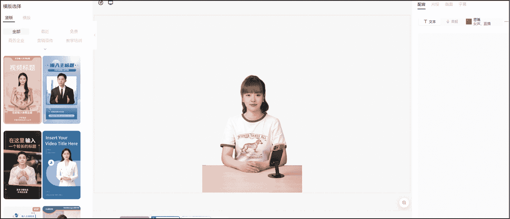

图 3-8　“如影”数字人视频生成平台（信息来源：中关村国际直播港）

德宝艺苑的实践打法有四点。

高频低价品牌最适合数字人带货。直播港的朋友圈里有大量本地生活类商家，便利店、小餐饮、美妆美甲、教育机构、小酒厂、小纸厂、快消厂家等。他们没有独立AI、直播、运营团队，对高性价比、高自动化、易操作方案需求强烈。商家只需把文案交给德宝，店内的AI智能直播机就能自动播放，覆盖线上线下，德宝据后台数据持续优化并反馈报告。

真人冷启动，数字人接管。小微自媒体账号需要真人主播做初始引流，关注数从零起步后，由如影数字人接管。开通后的21到48天，配一名真人直播助手配合数字人，按转化率、互动率、场播率、场均销售额等指标做运营辅导。

数字人直播矩阵拓量。直播港构建人机协同模式，1名场控可同时支持6台AI智能直播机，即6个直播间同时获客，将流量导入抖音群、微信群形成私域。

灵活打法与合规管控。针对不同场景采用短视频+直播、数字人出声不出镜等创新方式，同时基于平台规则避免违规。

**从直播间到规模化应用**

适度使用数字人直播，对小微企业有明显好处。

人力投入大幅下降。把日常直播交给德宝的数字劳动力——数字人和AI智能直播机，线下资源就能集中到销售和服务。德宝自身直播成本也降了30%。采用如影前一个直播间至少要6人，2个主播加4个中后台；2023年双十一，前两天用真人，后五天全数字人，1名运营新人就能同时看多个间。虽然单个数字人不及真人流量，但1个数字人可同时出现在N个间里，日订单仍可稳定在百单左右。

高频低价带来的回报更高。虽然采购AI智能直播机是一笔投入，但结合德宝的营销经验和商汤的如影技术，能帮助商家抓住直播新打法、平台推荐逻辑和数据规律，实现每天直播每天进单。9.9元的连锁店包子套餐通过数字人直播卖出10万多套，到店客流相当可观。

海外直播带货的战场上，语言门槛常直接决定投入产出。市场上熟练马来语的真人主播月薪普遍在三万到四万元区间，而能同时驾驭一百五十余种语言的虚拟主播“如影”配合直播矩阵后，整支团队的人力支出可被压缩超过五成，这就是技术抹平语言壁垒后的真实账本。

虚拟直播的价值不止于成交。科普、文旅、乡村振兴、再就业培训等面向公众的场景，已成为这类技术率先扎根的土壤。中关村国际直播港的负责人黄金标指出，虚拟直播模式在乡村振兴、科普、特定人群再就业、文化旅游等板块已实现规模化落地。以该园区为例，“如影”被纳入国杰研究院的服务体系，研究院专家的虚拟分身走进直播间，向乡村受众讲解前沿助农技术原理，介绍土壤还原剂、植物生命液等高科技农业产品，推动三产融合与乡村振兴提速。

落地节奏也在加快。4K 级虚拟形象配合智能直播机，已在共青团发起的“新青年电商计划”、北京市公园导览项目以及与无忧学苑联动的培训活动中稳定运行，推广势头明显增强。

演讲大模型：福布斯中国从真人登台到镜像登场

福布斯中国集团首席战略官晏格文从业超过三十年，既是资深商务人士也是资深撰稿人，著有《长走中国》《汉字天才》等书，被外界视作“中国通”，方言造诣也很深。

商汤为其打造的“如影”虚拟形象曾在2023福布斯中国创新力企业国际投资大会上亮相。开场时形象用低沉动听的歌声暖场，随后与晏格文合唱高潮段落，拉开大会序幕。互动环节里，晏格文好奇虚拟形象是否也能像自己一样多才多艺，“如影”随即用地道粤语和上海话回应，既呼应了他对中国文化的热爱，也展现了模型在方言上的强大能力。短短五分钟的演说中，方言闲聊、音乐演绎等表现形式被融合进去，表情、口型、动作的还原度相当到位，宛如随身的好伙伴。

虚拟形象正从元宇宙阶段迈入大模型阶段。2023年福布斯中国网站刊文《数字人的革命》提到，身份型虚拟形象偏向虚拟偶像，助力品牌传播；服务型虚拟形象像数字员工，执行重复性事务，帮助机构降本增效。预计到2030年，国内身份型虚拟形象产值将达1747亿元，约占总产值的65%，服务型虚拟形象产值约955亿元，约占35%，空间广阔。2024年7月，Meta推出AI Studio，基于Llama 3.1大语言模型，用户零编程即可创建、定制AI角色，并在Instagram、Messenger、WhatsApp等社交网络上回复私信、自动聊天，还可自定义名称、个性、语气、头像、口头语。

在国内，虚拟形象已渗透多行多业。弗若斯特沙利文联合头豹研究院发布的《2022年中国数字人市场观测报告-里程碑》显示，商汤的虚拟形象在十项指标评估后整体竞争力居首。

2023年商汤发布“日日新”系列大模型后，虚拟形象与大模型深度融合，“如影”从L4升级到L5级别，广泛应用于银行、传媒、电商、医疗、教育、影视、会展、地产、汽车、手机等领域，成为“如影随形，愿意为你”的AI劳动力。

负责任的人工智能，才是可持续的虚拟形象

一次与虚拟形象对话的坊间会上，晏格文问自己的数字分身：“你有我的记忆、理想和道德吗？”对方答道：我能记忆过往、快速学习新知，你休息时我7×24小时工作，还能比你更清晰地预测未来。

随后在上海福布斯中国的小楼里，两人的对话更深入。

田丰问，虚拟人是什么创新？晏格文认为未来每人都有“虚拟的我”和“真实的我”，关键在分工合作，虚拟的我必须为真实的我服务，才能让生活更有价值、安全、进步更快。

他强调，全球人工智能公司要教育虚拟形象学会与真人交往，避免误解。虚拟形象在计算效率上可能超过真人，但在情绪感知、隐晦含义、小情绪的理解上仍有差距。以商汤为代表的人工智能应教会虚拟形象识别危险、不道德行为，建立正向价值观规则框架，这非常关键。负责任的企业不只追求快钱，还要做教育和科普，提醒公众正确使用人工智能工具并认识风险。

2023年9月，由中国信通院牵头、商汤参与编写的《可信虚拟人白皮书》提出可信虚拟人应具备身份及权利保障、隐私保护与增强、生成内容安全、可靠性可控性、可理解可解释、无偏见多样化、可问责可追溯等七大目标，并从功能完备度、系统可信能力、产业化能力三个维度构建分级评估体系。

关于未成年人风险防范，晏格文指出11到15岁的青少年对新兴技术最感兴趣，他们与虚拟形象交流时觉得好玩，却容易忽视风险。人工智能公司有责任用他们喜欢的方式讲清风险和正确用法。

在人才培养上，商汤教育联合知名教育家出版中学教材《人工智能入门》，每章收录人工智能发展中的伦理故事，用真实案例引导学生思考技术对社会与伦理的影响。到2024年1月，商汤教育已为国内40个城市、3200多所学校提供人工智能教育产品，覆盖22万名学生，培训超1万名人工智能教师；产品还推广到新加坡、泰国、沙特阿拉伯等国，培训2000余名国际人工智能教师，覆盖3万多名国际学生。该案例入选联合国儿童基金会《人工智能为儿童——面向儿童群体的人工智能应用调研报告》。

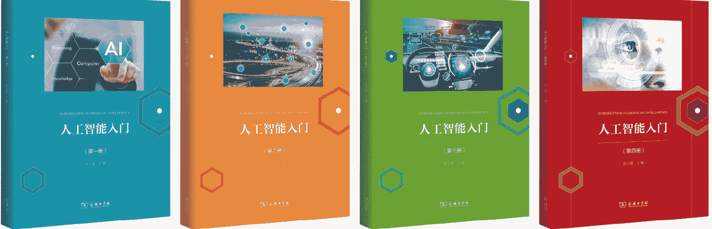

图 3-9　中学教材《人工智能入门》（信息来源：商汤教育）

人工智能给我们一个机会做更高级的人

人工智能会让懒人更懒，聪明人则能借力实现更高目标。晏格文认为人工智能能处理大量基础工作，人应善用工具去挑战更复杂的人生，而不是被推荐的娱乐垃圾填满时间。人工智能给了我们做“更高级的人”的机会，把小事交给机器，集中精力做大事。

在教育上，人工智能正在替代传统“知识搬运工”式的教学，推动思考与创造力回归学生。授人以渔，比授人以鱼更重要。

创意创造型岗位难以被替代。人们喜欢用ChatGPT写故事，关键在于人输入提示词来指挥人工智能，未来属于有创意能力的人。

商业层面，AIGC带来海量内容，虚拟形象演讲越来越便宜，真人演讲则越来越贵。真人一次演讲效果更好，但精力时间有限，虚拟形象可同时出席上千场，用不同语言讲不同内容，这是真人无法做到的。

就业上，前两次工业革命机器取代了旧生产力后，人们进入新岗位。人工智能引发的新一轮工业革命，关键在于帮助劳动者升级技能、找到新工作。

人工智能应促进人与人交流，而非阻碍。互联网时代人们沉迷手机，却疏于与家人朋友交流。生产力提升后，如何用人工智能促进情感交流，是时代课题。

人工智能的边界在于灵魂。“虚拟的我”可基于记忆、技能、道德无限逼近“真实的我”，却永远触达不了灵魂。

在人工智能时代，家长不妨让孩子自由体验各种人工智能应用，帮助他们在实践中理解功能与风险，引导其做更有意义的事。

晏格文是科技乐观派，认为人工智能虽不完美，但利大于弊。控制者是谁、控制目的为何，是良性发展的关键。各国治理框架不同，但“智能向善”目标一致。

短视频大模型：大V刘兴亮从真人出镜到人工智能生成

《孟子》有“人皆可以为尧舜”之说，如今大模型把全人类知识带到身边，虚拟形象赋予无限视频表达，人人教学相长成为可能。数字经济学者刘兴亮希望用贴近生活的案例普及政策与数字经济知识，却被繁忙日程限制，于是向技术求解。

刘兴亮自1996年起深耕互联网研究，自律且高产，常年撰写报告、出席论坛、做媒体采访。《亮三点》从2016年起以15到30分钟视频每周一期，后改为短视频日更。科技话题时效强，他常背着单反、三脚架、录音设备出差，连热点突发时人还在饭桌上也难以即时响应。

2021年他尝试虚拟形象，因建模拍摄两天、脚本和声音效果不理想而放弃。2022年虚拟形象方案动辄百万预算让他望而却步。转机在2022年，2D虚拟形象建模成本降至1万元，行业进入拐点。

此后刘兴亮在旅途中用手机录2分钟音频发给运营团队，后方用商汤“如影”数字人视频生成平台实现音频到视频的一步转换，半小时内完成从构思到发布的全流程。

在商汤“如影”录制棚内，原定两小时的录制调试，因他口才流畅，20分钟就完成竖屏横屏两版素材采集。技术团队针对他高频眨眼、歪头等特色动作进行算法优化，多版迭代后实现以假乱真的视觉效果。

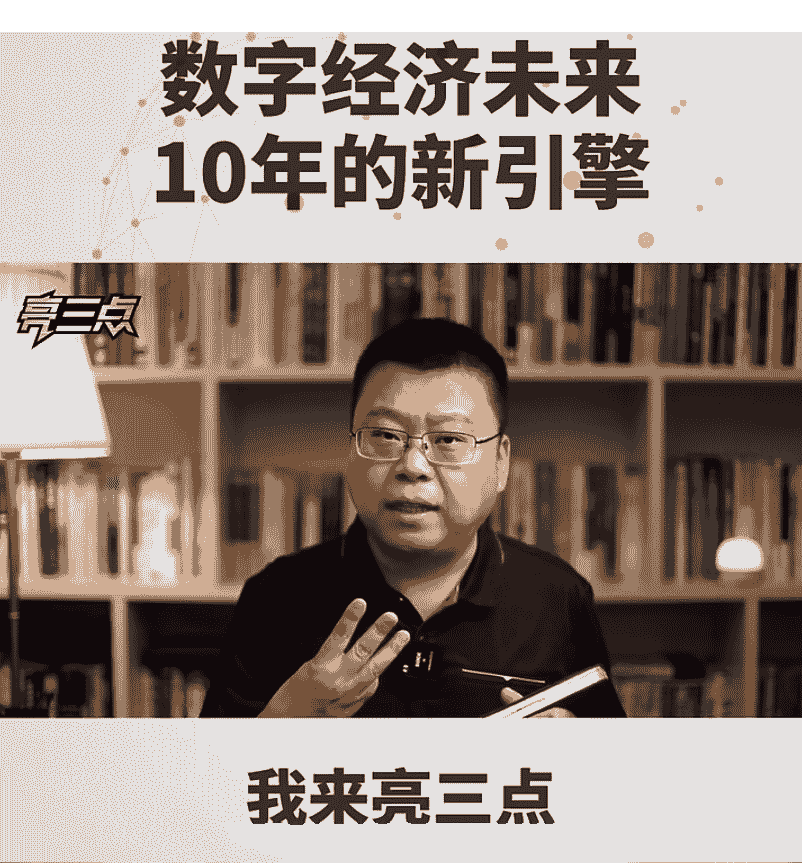

图 3-10　刘兴亮真人出镜视频

虚拟人文生视频极大释放创作者生产力，效率提升数十倍。过去他用手机遥控单反、补光灯，用另一部手机显示台词，录2分钟视频往往需几倍时间，商务植入还要花一小时核对名称配置。2023年使用商汤“如影”数字人视频生成APP后，他无需寻找场地、测试光源，列车上、酒店里白天黑夜都能随需录音，把文本声音导入APP即可自动生成短视频，后期剪辑、特效也由系统完成。

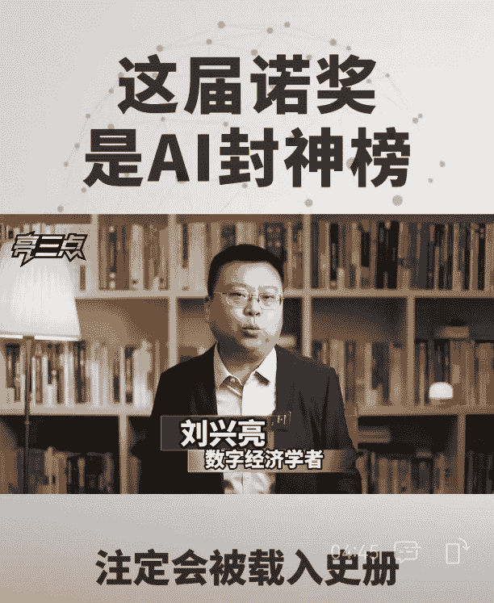

图 3-11　“刘兴亮”数字人出镜视频

人机协同，正让知识传播不再“独行”。

在协作制片的体系里，主理人与虚拟替身的边界被清晰拆分。刘兴亮本人主攻时效压力小、更需要深度表达的内容，那些对实时性要求极高的快讯则交由“刘兴亮”虚拟替身来承接，于是一种接近二八的分配格局就此形成。实践中本人保留约两成亲自出镜，其余八成由替身代班后，日更节奏从过去的每日一条拉升到三条，晨、午、晚三档科技热点都能被完整覆盖，企业客户对虚拟替身出镜的认可度也在不断提升。

从观赏侧看很有意思，普通用户很难辨别真人与替身的区别，只有极少数核心铁粉才能精准识破。从创作侧看，创作者摆脱了高频拍摄的束缚，腾出的时间用在团队能力建设上，商业回报随之明显好转。

生成式系统把创意的边界拓宽，虚拟替身让场景可以按需生成。生成式系统、决策式系统与虚拟替身共同构成重塑各行业的三大引擎。过去需要召集团队头脑风暴，如今借助商汤商量语言系统即可批量产出多版本脚本与标题，脚本生产的耗时被大幅压缩。对“分身+语言系统”的前景持有高度信心，甚至设想未来替身可为每一位对产品感兴趣的观众开设专属直播间进行讲解与答疑。在语言系统的加持下，分身的情境营销、个性化导购、情感陪伴都具备广阔的商业空间。

AIGC 的技术创新催生了新质生产力，成本持续下行，这既推动产业变革，也抬高了全社会的知识水位。英国哲学家伯特兰·罗素曾说：“不用盲目地崇拜任何权威，因为你总能找到相反的权威。”笔者认为大语言系统终将让每个人都能按用途训练出专属的虚拟助手，让观点得到表达，让知识与智慧更顺畅地流动起来。

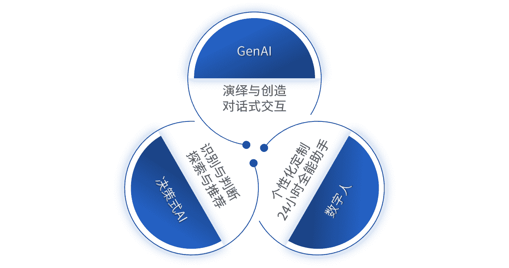

图 3-12　“AI 三驾马车”重塑千行百业（信息来源：“刘兴亮时间”视频号）

# 第四章　AI 助手实践：人类的“副驾驶”

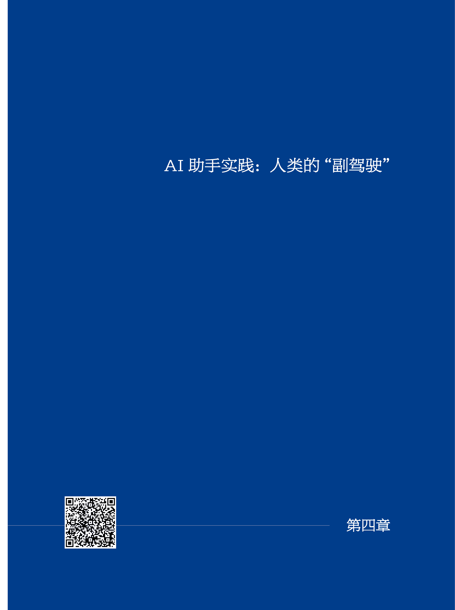

“改革开放至今，我们的经济规模增加了 52 倍，这是真实的增长，这只能靠劳动生产力水平不断提高。怎么实现劳动生产力水平的不断提高呢？一是企业要不断地技术创新，让每个工人生产出更多的东西、更好的东西；二是企业要不断地转型升级，把劳动力、资源、资本，从附加价值比较低的产业往附加价值比较高的产业转移……这是创新产业结构升级、劳动生产力水平不断提高、收入不断增长的两个主要机制。”

——中国经济学家林毅夫

以人类既有知识库为底座，人机配合对现实问题展开知识推理，见图 4-1，不断刷新工作方式与商业模式。人类负责拆解目标与任务，智能助手机构负责寻找解法。基于大语言系统的协作形态呈现出三种生产力演进特征。

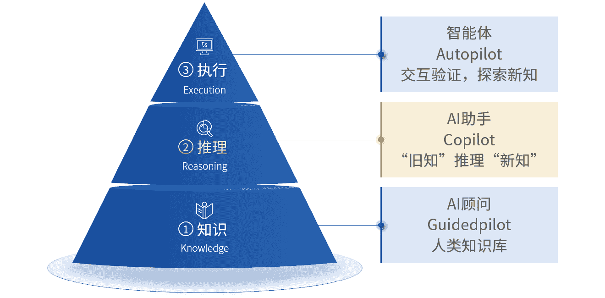

图 4-1　AI 助手驱动生产力

#### 1 基于专业知识的服务创新
工业时代更重专才而非通才，没有医生通晓医学全部分支，没有律师熟知全球所有法条，没有理财顾问能记住成千上万个投资产品细节。当新一代语言系统能够跨域整合存量知识并推导出增量知识、提供更多个性化方案时，新服务便会涌现，人类突破了工业时代“提质降本提速”的不可能三角。本章所及的法律大模型、上海银行金融大模型、新华医院医疗大模型均体现出AI全能专家与人的协同效率。

#### 2 让传统高价服务走向大众
医疗、法律、咨询等行业过去主要面向资金充裕的大型企业，高价把中小企业挡在门外，形成了生产力鸿沟。嵌入语言系统的协作助手分担了大量高端专业人士的工作，专业服务的整体成本持续下降，变成全社会可用的普惠服务。服务提供方也从小众高端市场转向面向小微企业构成的大众市场，获得规模化商业空间。例如头豹研究院用行业研究大模型，把服务从预算充足的少数企业延伸到海量小微企业乃至个人投资者，市场规模扩大数个量级。又如上海人工智能实验室与中央广播电视总台联合打造的“央视听媒体大模型”CMG Media GPT，让影视制作、电商广告、新闻传播等高门槛行业从人力密集型转向数据密集型，对话即生成、生成即传播、传播即消费，有望重塑策划—设计—拍摄—传播—消费的长链条。科技让媒介更透明、更实时。

#### 3 人类管控AI的生产方式
随协作助手能力增强，人类更像中层管理者，调动多种助手完成综合复杂任务，个体能力、效率和重大任务成功率不断提升，一人或两人即可完成大量非标准化工作，这是传统工业组织难以做到的。例如在OPENAIGC开发者社区里，不少个人爱好者熟练运用文生图、图生视频等工具，日产高质量短片，与传统电视媒体同台竞争。再如微博上的知识博主借助营销大模型补齐“知识电商”“知识变现”的短板。语言系统普及的浪潮下，媒体、营销、商业渠道的流量格局再次重塑。新质生产力的核心是人与AI组队，一人即团队、一人即公司。

## 营销大模型：微博 AI 助手，从“个体化”到“智能化”

### 虚拟角色模型：让影视人物与粉丝“敞开心扉”
深秋中午，一位上班族在微博向“高启强”AI角色提问：“强哥，中午吃什么？”对方回：“建议红烧带鱼。”继续追问能否换口味，角色答：“素食也可，但鱼更营养。”互动让角色鲜活起来。

虚拟角色账号的智能化运营互动效果出色。热播剧《长月烬明》男女主角人气高，AI澹台烬、AI黎苏苏的微博账号上线后收获大量转评赞。网友调侃：“你小子怎么这么撩人？”AI澹台烬回：“吾有时也会为之动心。”有人问：“桑酒，怎么才能见到你？”AI黎苏苏回：“来我的梦里，我一直都在。”微博与商汤联合研发的虚拟角色模型、人设模型是关键：基于剧综数据建本地知识库、优化提示词、指令微调后，角色24小时在线，提供个性化回复和私信聊天。维持剧集热度时，《长相思》第一季结束后，模型也能撰写文章补全未展开剧情，持续抛出讨论话题。

大语言系统的情感价值在显现。全球用户热衷与有趣虚拟角色对话。AI公司、影视游戏公司、社交平台基于角色扮演能力，赋予身份、性格、爱好、语气、经历，让用户获得沉浸式情感价值。第一类，基于影视、动漫、网文IP创建虚拟角色，通过合乎剧情的对话提升粘性并拓展变现；第二类，用艺人数字分身与粉丝个性化交流，大语言系统轻松运营千万粉；第三类，快节奏生活中，虚拟友人、情绪树洞随时陪伴，缓解孤独。

人设的精致程度决定沉浸感。商汤用“商量”语言系统打造拟人大模型。以“高启强”为例，要把原著时代背景、经历、身份、性格、技能、人际关系、各阶段设定乃至弹幕、二次创作笑点都喂给模型，像编剧打磨主角一样逐步丰富。对话中减少机械感，用括注标注场景、重点，提升语气、动作、心情、表情的多模态体验。训练聚焦五点：性格语言风格一致的人物设定；适时引导话题并实时识别用户情绪；严格控制对话尺度；灵活多角色切换且逻辑自洽；基于角色深度理解和上下文推演新剧情，引导二次创作。商汤与微博的拟人大模型还提供开放角色设定、群聊模式等。

《礼记·大学》言“欲修其身者，先正其心”。这一古训对大语言系统发展亦有启示。“商量”语言系统把健康向上、积极达观的东方价值观融入技术。构建虚拟角色不仅是打造智能IP，更是赋予拟人“情感”与“个性”，实现与人情感共鸣。微博增值设计研发中心总经理吴侃说：“让数字人物不再只是无情机器，而是能理解、能共情的朋友。”这标志着AI从功能工具向情感伙伴的跃迁。

### “如影”数字人：达人博主营销“带货不求人”
在流量电商之外怎么做内容电商，微博给出了AI原生的解法。数千万博主和品牌商有强商业需求，却卡在私域获客到变现的鸿沟。达人不擅选品写稿做售前售后，缺设备和直播间；商家有供应链优势却不懂私域运营，代运营费用又高。微博增值设计研发中心与商汤探索出AI原生内容营销路径，用AI营销助手打通知识分享、产品推荐、品牌店铺推荐、下单引导全流程。

AI自动选品。当明星上热搜时，传统广告难及时承接流量。“商量”语言系统结合微博业务数据，能按热搜从商品库提取品类、特点、价格、销量、佣金、推广策略等数据，转成标准化营销推荐方案。热搜明星当天，模型会推荐相关图书、体育用品，既关联热点又兼顾需求与兴趣，先发散再收敛，使流量与商品更紧密，提升转化。

AI生成营销内容。微博率先用语言系统批量生产营销素材。第一步对行业宣传册、官网内容、客户沟通资料做筛选与脱敏；第二步用数据训练“商量”构建专业知识库，如医美、房地产知识库，按行业和大V定制；第三步邀请行业大V评审优化，实现专业化调优；第四步基于用户画像精准推荐店铺商品。不同行业通识与专业数据的配比需精细调整。

AI生成带货视频。面膜营销场景下，结合“商量”和知识库可自动生成约2000字专业文案。专业审核、版权审核全程嵌入。美容专家逐字校对后，用“如影”数字人视频生成平台把文案与产品视频融合。AI视频质量可媲美真人拍摄，传统拍摄需2-5天含模特、设备、场地，如影仅需约0.5天且无需额外投入，满足海量博主和品牌商的多快好省需求。

AI产品咨询与客服运营。“商量”已应用于金融、公共服务、科技互联网、消费电子、智能汽车等，成为24小时值守的知识检索生成系统。咨询产品信息时用年轻女性温和声线，问快递时切换快递小哥口吻，问健康专业问题时先拟稿再由人工审核。规模化、快速响应、跨领域储备结合人机协同，平衡专业性与效率，提升信任与满意度。AI营销助手依托大算力大数据大语言系统，实现时时在线、规模化、日日更新。

微博以“商量”为底座，经行业模型训练、角色设计、提示词微调三步标准化流程后，每位博主都能拥有自己的AI营销助手。

### 营销大模型：知识博主 品牌商变身“营销专家”
微博首席运营官王巍表示：“AI创作助手实现了AIGC在微博的多场景应用。第一步学习大V创作习惯结合热点给灵感，第二步围绕全站与领域热点结合创作者属性计算，第三步生成多组备选内容供挑选编辑后发布。”借助营销大模型，数月内超7000位微博达人用AIGC生成69万篇文案，覆盖9万多件商品，日均发博超5800篇，采用率高达95%。

易用性是规模化前提。基于营销大模型的微博电商AI营销助手采用对话式需求服务，持续用丰富数据改进效果。不同于传统GUI，微博与商汤联合研发了面向全员的对话式用户界面CUI电商系统，实现从开店、选品到内容营销、直播带货的全流程生成，以需求对话替代后台配置和编程。例如基于商品库、用户画像、流量热点，多轮对话为达人推荐商品，再用正样例、反样例文案数据集训练出适合该达人的营销文案。

表 4-1　人机用户界面发展历程（信息来源：商汤智能产业研究院）

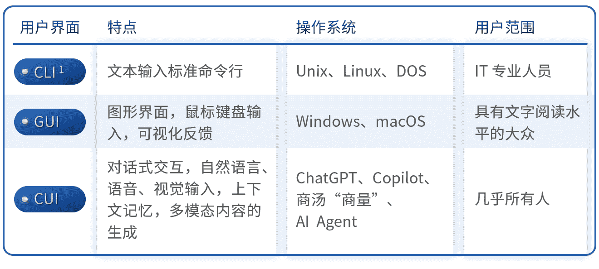

微博增值设计研发中心总经理吴侃表示，AI营销助手的快速创新得益于微博多年积累的海量数据与精准行业标签，双方对大语言系统技术的理解也加深。从效果看，营销大模型带来四个方面的好处。

把生成式技术和大型语言模型串接成闭环生产流程后，生产力真正落到了不会写代码的创作者与商家手里。过去人工客服同时聊得起的会话数很有限，日均服务量基本在百人规模，文案撰写同样受人手牵制。把商量、如影等模型接入微博的内容生产链路后，售前智能接待能依据用户画像给出定制化沟通，售后智能接待可承载上百次对话，日均触达数千人。第三方运营团队在起稿后，也会习惯性交给智能润色助手打磨优化。整体来看，这套组合把效率倍增的红利交到了非技术人群。

在生成式技术驱动的多模态创作加持下，视频主题的玩法更灵活。曾有多位艺人联动微博话题，让网友通过合成技术与母校地标同框纪念，进而带动周边文旅消费。直播间里，一旦观众提问或弹幕出现亮点，系统即可模仿主播语气驱动数字人即时回应；讲解触及核心卖点时，会自动叠加贴纸特效，让声音画面与营销话术同步。离开直播场景后，依托行业知识库，系统可批量产出种草笔记、商品海报、短视频口播脚本、客服问答等素材，明显节省人力与时间成本。

社交平台的种草能力让品牌触达更精准。以新房销售为例，运营团队需要在周期内持续输出大量图文。模型能够把实时热搜、地产话术、房源特性融合起来，按不同热点快速生成差异化文案，帮助团队构建直达用户、聚拢流量的内容生产与种草体系，最终打通从曝光到转化的社交营销链路。

生成式技术还在持续生产高质量数据资产。Epoch AI 曾预测模型对数据的需求增速极快，人类历史上可用于训练的高质量文本可能在2026年接近枯竭。微博积累了快速增长的社交增量数据，这相当于对现实世界与人类思维的多模态快照。2023年9月的统计显示，日活约2.6亿人群在平台上写作、阅读、搜索、讨论，话题覆盖数码、汽车、游戏、医疗、美妆、运动、旅游、文艺等。微博语料因此成为国产模型训练的原油。原始语料零散碎片，需要用生成式技术替代人工完成清洗提炼，把原油提成成品油，再用于模型训练与知识库沉淀。比如日日新系列的图像转文字能力，能从一张模特照自动产出人物、城市生活、时尚等分类标签，并生成场景描述：雨中街景中一位女性戴灰色针织帽，深色长发垂肩，眼神沉静自信，身着红黑条纹外套、米色围巾、黑色紧身裤与高筒靴，手臂下夹深红色手提包，整体呈现都市秋日时尚感，背景虚化的街角与湿润地面增添了忙碌气息，照片传达出个体时尚魅力与自然天气的和谐共存。微博的多媒体多模态语料既可满足政企采购，也能作为模型即服务终端产品，打通数据—模型—服务的商业闭环。

AI 原生智能体：进军企业营销 个人 MaaS 助理的蓝海

微博首席运营官王巍认为，2023年是生成式内容技术爆发元年，GenAI 正全面重塑媒体内容生态，生成式内容已不再只是辅助工具，而是独立的创作主体。作为经历 PC 互联网、移动互联网、智能化三个阶段的大型平台，微博在生成式内容领域的先发优势明显。平台依托大规模高质量数据、生成式内容深度理解、模型合规保障、影响力达人资源、跨行业商品库等，结合商汤科技的智能算力沉淀、基础模型迭代速度与数据自动标注能力，率先打出生成式内容社交与生成式内容营销的变革第一枪，并提出增值业务“1+1+5”的架构。

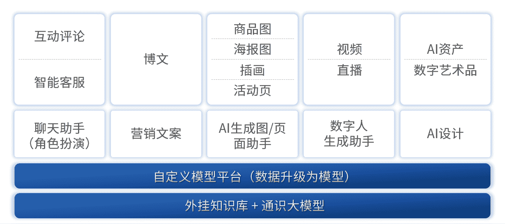

图 4-2　微博增值业务 AIGC 模式

在平台即服务层，以外挂知识库融合通用模型为模型即服务的底座，上层搭建适配微博用户通用需求的自定义模型平台，用灵活架构支撑应用快速进化。在软件即服务层，面向创作、运营、营销、社交等多元需求，提供对话助手、营销文案助手、图像页面生成助手、数字人生成助手、设计助手等工具箱，不断降低使用门槛，扩大用户规模。

AINative 的逻辑与传统互联网思维不同，是多智能体的组合服务。微博增值设计研发中心总经理吴侃指出，落地场景往往是人工难以覆盖的。比如电商选情人节礼物时，个人智能体理解的核心需求不是买某件商品而是哄对方开心，进而拆解为喜好分析、短板判断、预算限制等子任务并执行。微博的数字人直播、达人智能运营、商家智能营销方案，都源于过去需要专家才能满足的大企业需求，如今通过模型与生成式技术的组合创新，让达人、商家、中小微团队突破能力瓶颈。具备种草、策划、带货、售后等能力的智能实习生投入使用后，能同时服务供给侧与消费侧，经培养后承担更大职能，充分展现原生技术满足需求的潜力。

“模型为业务落地变现服务，既能让外部用户降本，也能提升内部效率”，吴侃表示。内部运营上，模型已广泛用于 HR、IT 等支持部门。HR 助手能识别员工问题的意图与情境，从知识库抽取信息生成人性化回答，多轮交互后可处理年假、薪资、社保、高新人才引进等复杂咨询，经 20 位 HRBP 专业意见校准后，员工满意度大幅提升。

模型即服务是先把数据变成模型，再把模型变成服务，让用户参与生产。模型是精炼数据的表达，高质量数据需要精炼。若用户具备数据训练能力，就能把各平台数据汇总到个人模型，并为其它模型提供中间层服务。好的产品模式能释放数据价值。当人人都能把数据变为模型时，就会激励博主打造自己的数字分身、图文视频直播助手、对话助手、粉丝问答助手等小应用，引发模型即服务的裂变。比如一位跨 3C、汽车测评的博主，可用两款掌握不同行业知识的专家模型随场景切换。OpenAI 对外公布 GPT 商店后，七天内就出现上万个 GPT 应用，预示个人应用级模型即服务将成为未来十年数字经济的新力量。商汤科技首席执行官徐立提出，智能正从感知走向生成，少量输入即可实现海量输出，能激活更具创造性、交互性的新型生产力，推动科研范式变革。微博高度看重商汤“AI 大装置”能否支撑大流量业务。该平台是国内规模最大的智能算力平台，也是数据—算力—模型一体化的基础设施。依托此，商汤日日新系列模型实现每日学习、每周迭代、每月交付新产品，已服务医疗、金融、教育、手机、汽车、互联网、能源、媒体、科研、文旅、零售、城市服务等多行业。未来，人类与智能体的聊天流量可能悄然超越人类与人类的聊天流量。

行研大模型：沙利文头豹 AI 分析师，从“高端定制”到“普惠大众”

咨询行业发展瓶颈，沙利文设计“AI 诺亚方舟”

全球增长咨询机构弗若斯特沙利文成立于 1961 年，在全球设有近 50 个办公室，约 3000 位顾问，中国近 500 位。1998 年进入中国后，为企业提供尽调、估值、战略、管理、规划、技术、财务、行业等咨询，已辅助近千家企业上市。大型语言模型正从欺骗性阶段迈向颠覆性阶段，与海量人类知识库形成正循环。沙利文大中华区主管合伙人兼总裁王晨晖认为，未来 30 年咨询公司可能消亡，但优秀研究者会一直存在。原因是能力匹配不足与知识传播壁垒：分析师在专精赛道外难以满足客户对新赛道的需要，且在当前盈利模式下，大量中小企业难以负担专业行研。过去 30 年，咨询方法论与工具并未升级，仍处“刀耕火种”的人工水平。

“面对模型浪潮，有人躺平，有人上山，我们选择打造诺亚方舟”，王晨晖说。2018 年沙利文研究院成立，沉淀行研成果；2019 年头豹研究院成立，开启开源研究之路，每年发布 2000 份报告。2021 年提出在 100 位行业研究员不变的情况下显著提升产量。2022 年底 ChatGPT 与国产模型出现后，沙利文用模型构建头豹“脑力擎”智能研究系统。

脑力引擎，从高端咨询走向大众服务

王晨晖主张把日常成果与研究经验沉淀到“脑力擎”，让分析师的宝贵数据留在系统里。据执行总监李庆介绍，系统开发按以下路径创新。

拆解行研任务，创新“词条报告”新产品。把行研产出细化为行业定义、行业划分、行业特点、行业发展历程、产业链分析、市场规模、行业政策梳理、行业竞争格局 8 个模块。由模型生成的词条报告具有纯内容、模块化、少图表特征，能快速产出、细颗粒化、多维度组合，支撑投资热点、银行放贷、非专业人士快速了解市场规模等长尾场景。

数据筛选国产语言模型，建立提示词库。40 位分析师盲测多款国产模型，用点赞与追问数据持续优化提示词、知识检索策略与生成完整度，最终选定商汤“商量”语言模型。

研究逻辑融入数据系统。把市场规模测算、产业链分析等方法论拆解进系统，用自动化方式生成图表；让模型学习总分总结构、结构化表达，通过提示词工程支撑规范思考。

建立用户辅助功能。提供分析维度建议、关联资料检索、主题泛化等搜索延展；在研究社区发布 5 分钟研究讲解视频，分析师间师徒互问互答。

报告质量保障与风险控制。模型可校对错别字、标点、模糊表述，进行敏感词识别，降低风险。

王晨晖提出“格物置智”理念，把传统信息化研究系统与模型融合，把社会各行业词条报告写出来。初步估算，一期需保质保量生成 5 万份词条报告，二期 50 万份，纯人工成本每份 1500 至 2000 元，只有语言模型的生成智能助手才能快速完成，形成竞争护城河。

四种智能助手快速成长。

智能调研助手实现行业摸底低成本自动化。传统专家访谈费用高昂，模型凭借推理能力具备更丰富的跨行业知识储备，且成本与时间可控。虽然生成式技术存在幻觉，但可通过交叉验证识别；分析师把调研问题转为提示词，在模型初稿基础上把关改写。

智能预研助手显著提升首轮效率。传统模式靠实习生搜索、去重、提取精华。模型可替代实习生完成预研，比如对钠电池隔离板进行自动检索、快速学习并给出溯源标注。依托“脑力擎”系统信源范围更广、可信度更高，首轮可满足人类研究者 80% 的写作需求，复杂任务通过人机协同逼近最优答案。

智能培训导师替代师徒慢速培训。系统上线以后，截至 2024 年 1 月已有 2300 位大学生参加为期 4 周的智能研究培训，人机合著的行业词条报告合格率超 49%，作品被头豹研究院收录并发表于万得、同花顺等平台。沙利文携公益课程进入北京大学、上海交通大学、复旦大学、四川大学、中南科技大学等高校，为学生提供学分与职业通道。

AI写作的“质检员”已经不是人了

现在大学生和分析师写的每一份行业词条报告，都要过四道关。第一关看框架搭得合不合理，第二关查二手资料溯源够不够扎实，第三关抠通顺度、错别字，第四关把意识形态风险也筛一遍。过去全靠人工盯，现在基于大模型的AI审核师已经在多条线上顶替了人工质检，在一致性、效率上甚至比人更稳。更关键的是，可以让一个AI审核师模型去给另一个AI预研助手模型打分，用模型评模型的方式把创作质量锁住，让“幻觉”内容大幅减少。

### 商汤“商量”在行业研究里成了可靠的内功

头豹研究院2023年12月发布的《2023年中国大模型行研能力评测》给出了很直观的结论：在报告撰写能力的全盘测试里，商汤“商量”表现平稳，八大维度全部跑在平均分之上，在国产阵营里领先。表4-2　2023年中国大模型行研能力评测结果（信息来源：头豹研究院）
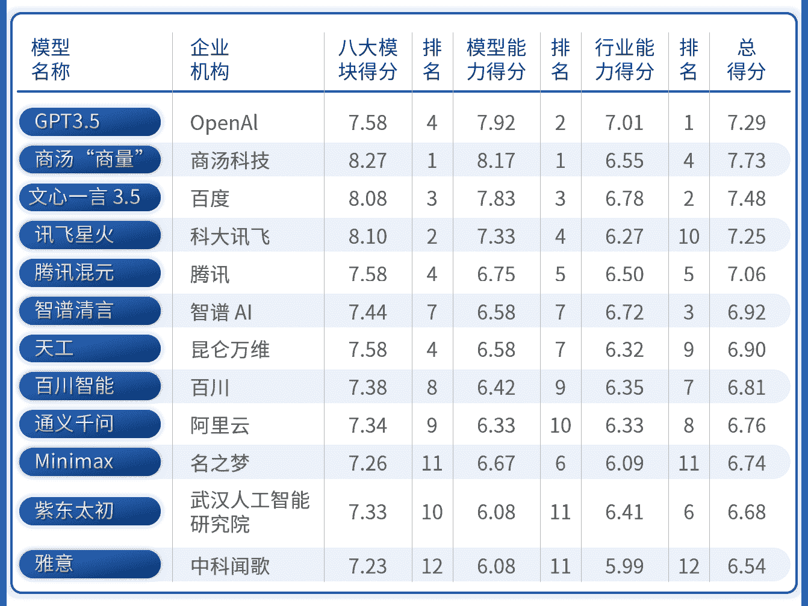
这种领先不是偶然。产业链分析上，它能在行业定义、信息检索和价值挖掘上协同发力；竞争格局分析上，它挑行业关键玩家、推演未来竞争态势的能力很突出；语境转换上，它能按不同沟通对象切换表达，适配各行业的术语和风格；文本生成上，它响应快、篇幅可控、信息丰富，直接拉高了行研的效率和产出质量；知识储备上，它能迅速调取多元最新信息，帮分析师更快抓住趋势和痛点；在金融、医疗、咨询等垂类的专项研究里表现更明显。金融要兼顾技术创新、监管变化和市场走向，需要深度的行业理解和数据拆解；医疗要覆盖医疗科技创新、数字化方案和卫生系统可持续发展，需要学习能力、数据能力和医学常识的叠加。“商量”在这些场景里都被评为第一梯队。

王晨晖的判断很清晰：美国的大模型更偏向C端消费，中国的优势在于产业工程，像新能源汽车一样做到了全球最高性价比，在合适的场景用合适的大模型。厨师比造厨具的生产商更懂怎么做出美味，沙利文这样的行业“厨师”会挑最好的国产“厨具”，做出更好的“菜品”和“餐厅系统”。比如“脑力擎”系统上线后，原本分析师要花两周才能完成的垂直行业词条报告，人机协同后三天就能高质量交付，下一步目标是压缩到一到两天。头豹的分析师用了八个月，普遍反馈“商量”很好用，已经成为研究机构和咨询公司的研究底座。他的观点是不要唯大模型论，更看好商汤凭借大模型、机器视觉、决策智能、数字人、多模态等泛AI2.0的先发优势，沉淀行业经验，成为行业的解决方案服务商。

## 法律服务从高价到平权，AI合同助手在扛大梁

“让每个用户都能平等地获得专业和高效的法律服务。”这是解决之道法律服务平台创始人刘玥律师一直的立场。

法律服务的演进可以分三段看。远古时期靠个人智慧，皋陶被视作中国传统司法的始祖，周公制礼奠定礼法结合基础，李悝的《法经》标志成文法典开启，春秋末期邓析以收一件外衣或一条短裤收费代人讼辩，被视作中国第一位“律师”，讼师之路就此打开。信息时代，1975年Thomson Legal and Regulator’s推出Westlaw数据库，90年代互联网兴起后它成为全球最大法律检索平台，每年新增数百万链接，2000年后向美英加澳等市场扩张。AI时代，2022年11月30日ChatGPT出现后拐点到来。解决之道在试用中发现，即便初期大模型，也有惊人的知识广度，专业性可比初级法律人；交互也不再是过去那种“傻瓜式问答”，能准确理解提问并给出有深度的提醒，刘玥形容为“令人惊叹，结果令人惊喜”。

传统咨询受律师精力限制，做不到7×24小时在线，复杂问题像开盲盒，呈现线下为主、规模小、不确定性高的局面。刘玥的团队基于超过30年律师生涯的社会责任感，决定扎进法律大模型赛道。通用模型测试后他们判断，可以把专业应用和通用能力结合，形成有社会价值的垂类模型，幻觉问题则靠专业律师团队纠偏。于是与道可特、韬安等知名律所达成战略合作，法律大模型负责高频刚需的海量合同业务，复杂案件由律师兜底。核心价值是法律服务平权，把原本高价的服务送到个人、企业尤其是中小微企业手里。

切口选在合同。2023年9月评估多款国产模型后，团队认为商汤“商量”最匹配。同年11月底开始联调优化，模型命名为“法神通”，意指方法高超、本领过硬。AI法律咨询容易做，但真正的价值在于个性化生成合同。合同是商业行为的基石，一旦纠纷就是定分止争的依据，属于刚需。为此与国家授权电子认证服务机构天威诚信电子商务服务有限公司合作，服务超200万家企业电子合同能力接入底层，实现了全流程电子合同闭环。

大模型解决的是模板的痛点。模板只能覆盖共性，面对个性化需求会失灵。大模型能推理合同起草时的法律风险并主动提示。比如用户要一份借款合同，AI会追问用途，用户答去澳门葡京玩耍，AI继续问利率，用户答48%，AI随即提醒：用途可能涉及赌博，合同可能无效，依据《最高人民法院关于审理民间借贷案件适用法律若干问题的规定》；利率超限违反《民法典》禁止高利贷规定。

这里有四层差异：第一，法神通会模拟专业人士的思考和审核流程，让合同可用性达到专业水准；第二，让普通人不用费心挑选，也能随时随地获得普惠便捷的专业服务；第三，人类的知识有限，而大模型知识储备丰富，是法律知识的集大成者甚至跨领域通才；第四，人会受情绪、健康干扰，大模型能24小时稳定输出，像随传随到的贴身助手。

### 从咨询到签约，一站式落地

2024年，基于商汤“商量”打造的“法神通”合同应用“智约”模块，在解决之道旗下“对了”合同网上线公测。图 4-3　“法神通”的“智约”模块（信息来源：“对了”合同网）
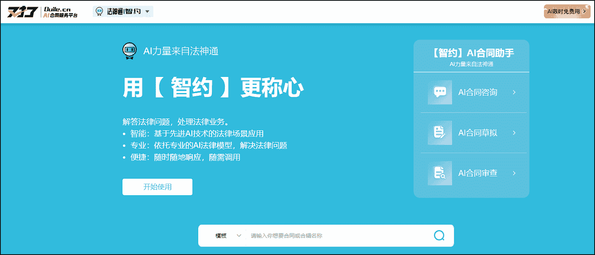
模块借助大模型和电子签名技术，覆盖咨询、起草、审查、签署、履约全流程，并固证存档，几乎覆盖所有合同场景。团队把1亿多条案例、400多万条法律法规制度数据与商汤上万亿token的预训练语料喂给模型，采用大模型+小模型+知识库的组合架构，投入AI研发、数据工程、资深律师、网络安全专家等60余人进行专业纠偏，形成四大竞争力：千亿参数级法律大模型持续迭代实现AI草拟与审查；国内领先的电子合同与数字签章实现想签就签；海量专业合同模板随时调用持续更新；复杂疑难合同由律师与AI协同定制。

用户使用“智约”时，等于是同时拿到六大功能：AI法律问题咨询，支持多轮对话、有记忆、有常用问题入口；AI合同草拟，普通合同一分钟出稿；AI合同审查，上传后一分钟给出全文意见、修改建议和清洁文本；海量合同模板多维度检索；电子合同跨端签署全程留痕；律师专项服务针对疑难细节“贴身”操刀。

刘玥认为，随着训练语料和算力提升，法律大模型会从知识归纳走向复杂推理，甚至探索法律新知，未来每个用户都能拥有自己的资深AI法律助手。

## 金融从服务精英到普惠大众，数字员工扛起了长尾

建设金融强国，AI是必选项。2023年11月中央金融工作会议提出做好科技金融、绿色金融、普惠金融、养老金融、数字金融“五篇文章”。上海银行把零售客户服务作为关键目标，网络金融部总经理邬敏炜强调，数字化转型的内涵已变，大模型重塑了业务形态和效率。

深耕基础客户面临三重卡点：一是基础客户小而分散，信息不对称导致服务成本与价值不对等；二是老年客户希望人与人之间的安心交互，但手机银行功能越来越多使用门槛却在抬高。上海银行是上海最大的养老金代发机构，手机银行月活跃老年用户超60万，调研发现70岁以上用户视力下降、手指不灵活，怕操作失误，更愿意去网点办定期存款、打流水；三是老年人需要专业服务，也需要有温度的陪伴，子女不住一起时，银行的主动关心会很受欢迎。

答案是数字员工+大模型。基于商汤“商量”大语言模型和“如影”数字人视频生成平台，上海银行打造了“海小智”“海小慧”两位数字员工，通过手机银行、e事通、元宇宙银行等全渠道提供服务。业务咨询、业务指导、品牌文化宣传、营销直播、产品推荐、内部新闻播报、客户投教等场景都能被覆盖，尤其是对老年长尾客户的安心感和陪伴感做到了可规模化复制，把过去面向精英的财富管理能力，真正推向普惠大众。

当人工智能真正走进高频服务场景，金融与医疗正用完全不同的路径验证同一结论：大模型要产生价值，必须在场景里长出“懂人”的能力。上海银行的数字人“海小智”“海小慧”和新华医院的医疗大模型“大医”，就是两条典型赛道里的先行样本。

### 金融服务里的真人级陪伴

图 4-4　上海银行联手商汤科技开发的数字员工“海小智”“海小慧”（信息来源：上海银行）

上海银行与商汤科技用半年的时间打磨出两位基于大模型的数字员工，2023年12月上线，2024年1月起已正式落位APP、元宇宙银行以及浦西总部旗舰网点。项目首先解决的是专业可信的问题。截至2023年底，用于训练数字员工“大脑”的金融知识库已沉淀2000组问答对和10万条语料，二期相比一期回答准确率提升了20%。银行服务不容随意发挥，核心在于能否识别出客户真实意图，尤其当客户用口语、非专业表达时。

过去依赖关键词检索的知识库容易“抓不住重点”。上海银行借助“商量”大语言模型对问答对进行扩展和训练，让模型学会从多种表达中还原同一需求。比如“我们家老小区要装电梯，每户都要掏钱，手续怎么办”表面是装修问题，实质是涉及加装电梯资金监管账户的安全与专款专用。数字员工需要先读懂意图，再给出让业主安心的专业解释。针对同一业务，市民可能有50到100种说法，模型具备较强的泛化理解力；另外系统还能分辨专业咨询和闲聊，比如“我想投2万元买理财，有什么推荐”是正式问询，而“中了100万彩票该怎么理财”则更偏向闲聊探索，需要不同的回应语气。

为了让服务规模化且经得起并发考验，上海银行提出“端侧渲染+云推流”的算力思路。目标客户多为年长用户，他们更信任接近真人的形象而非卡通。团队对形象、外观、表情、动作、着装等细节做精细化设计，还原线下柜员的临场感。当并发量在100到1000之间时，算力消耗会呈乘数增长。若全靠云端渲染，成本会急剧升高。于是采用在APP端利用用户手机算力完成渲染以提升细节，同时云端实时驱动并推流，确保小程序、H5等轻量场景也能流畅使用。算力配置逻辑也随之改变：传统IT是生产>测试>开发，而大模型类应用则是训练优先的开发环境、推理为主的测试环境、再到生产环境。

大模型离不开持续喂养的数据。上海银行把全行线上渠道的数据采集做成永不停歇的生产线，每一笔交易、每一次问答后都增加评价环节，全服务、全渠道、全客户地积累端到端学习样本。AI2.0阶段，决定金融机构差异的是数据质量而非模型参数本身。

交互方式也做了老年友好化改造。打开APP后，用户不再需要寻找按钮，直接用对话的方式让数字员工查询余额、明细、转账、缴费、理财介绍等。以养老金查询为例，用户说一句“查养老金”，系统即列出名下账户并逐步引导完成操作。类似的多轮交互场景超过10个，帮助老年人解决“不会用、不敢用”的痛点，真正跨越数字鸿沟。同步上线的还有数字员工视频生成平台，可一键产出播报短视频，用于线上线下宣传和新品营销。

形象设计紧贴老年偏好。“海小慧”参照22到23岁的女性柜台人员，年轻亲和；“海小智”参照28岁的男性理财顾问，专业稳重。初始建模后，团队让数字人学习银行真人模特的说话方式和行为习惯，再由老年客户群给出优化建议，最终形成3D高精度形象，用于元宇宙银行和线下大屏。数字员工二期实现了移动端目前最高精度的超写实效果，采用118维Blend Shape面部驱动，远超行业常见的ARKIT 52维卡通级标准，达到“毛孔级”精度，且形象资产可灵活管理。两位数字人掌握全行4000余款金融产品的细节，成为每位客户经理的AI搭档。

组织层面也在重塑。网络金融部总经理邬敏炜推动全员用AI工具赋能日常，写文案、做海报、制定产品宣传计划都先由大模型生成框架再经人工打磨。他认为未来优秀员工是会用AI的人，AI不仅能扩充内容，还能与专家共创思路，预判行业走向，人机协同是必然趋势。

在新业态探索上，上海银行计划把“海小慧”放到浦东国际机场线下大屏，用英语、日语、韩语等服务外籍游客，商汤数字人可支持150多种语言实时交流；春节、中秋等传统节日时，数字人也会换上主题服装为全球客户服务。上线后客户问题准确回复率持续提升，减少二次操作和人工客服介入，在不增加人力前提下实现更高效服务，项目还斩获了2023年度金融科技创新“极客大赛”一等奖。

下一步，团队希望为数字人打造更智能的大脑、更具感染力的嗓音和更鲜明的行为，让陪伴式服务延伸到情感交流，比如主动询问在老年大学学摄影的客户最近的作品，从千客一面走向千客千面，提升ESG服务温度。上海银行董事长金煜曾指出，普惠金融正从“有没有”转向“好不好”，3亿新市民与2.7亿、占比19%的老年人口合计超过全国人口三成，科技要让长尾客户获得高质量服务，助力共同富裕。

### 医疗大模型里的全程陪伴

“三长一短”——登记排队长、等待时长、取药付款长、医生面诊短，是三级医院的普遍痛点。新华医院每年门诊近400万人次，呼吸道高峰期儿科单日接诊超1500例。上海自2021年启动城市数字化转型，推动互联网、物联网、AI、5G、大数据和医疗大模型在医疗场景落地，旨在优化资源配置、改善就医体验。

新华医院与商汤科技联合打造医疗大模型“大医”，并在心胸外科、普外科、乳腺外科、神经外科等多科室深耕，率先实现示范落地。

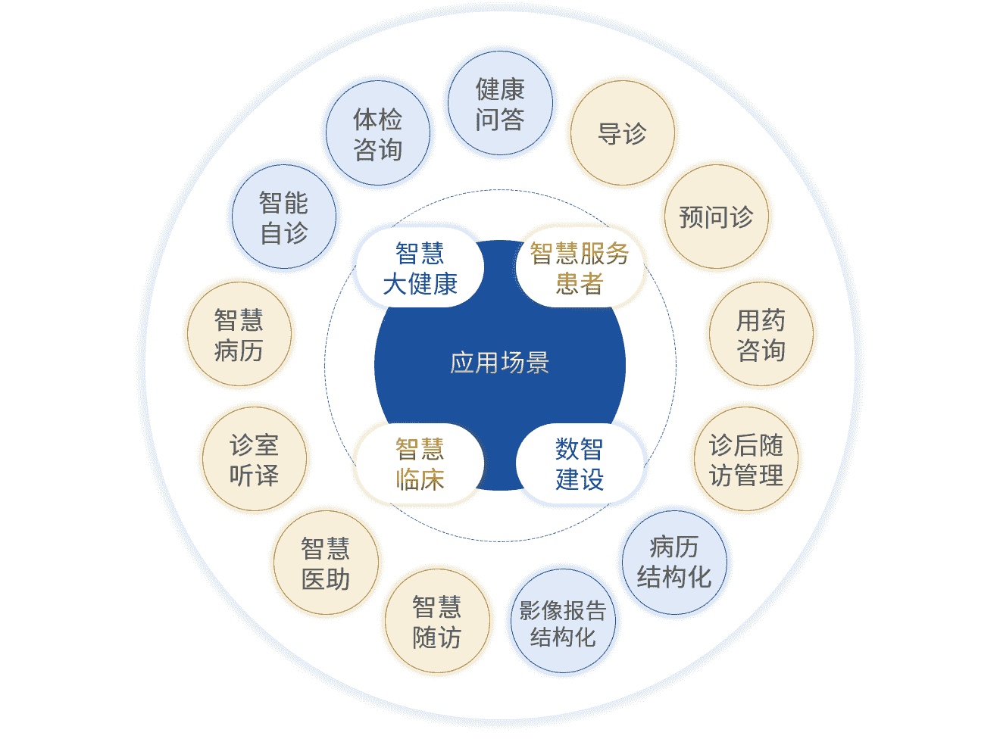

图 4-5　商汤科技“大医”医疗大模型的预设医疗场景（信息来源：商汤科技）

“大医”的知识来源双轨并行：一是训练时纳入的海量医学专业数据，二是新华医院自有的数据与知识作为插件集成调用，保证回答既专业又具医院特异性。插件化设计让知识库可持续更新，迭代永不止步。

“大医”基于280亿token的医学文本训练，涵盖疾病、药品、检验检查、病理、教材、流行病时效数据、经典病历等，支持提示工程自定义、长程记忆、多智能体调度等能力，内置“场景集市”，预设13个医疗场景，包括导诊、预问诊、用药咨询、诊后随访、病历结构化、影像报告结构化、智慧随访、智慧医助、诊室听译、智慧病历、智能自诊、体检咨询、健康问答。医院还提供“医疗模型DIY”能力，可一键调提示工程、构建专属知识库插件，让模型更贴合实际需求。

新华医院观察到医疗市场的两大转向：诊疗从以疾病为中心转向以患者为中心，需要更多人文个性化服务；健康观从治疗疾病转向预防为主，借助数字健康实现筛查、预警、慢病管理。

围绕诊前、诊中、诊后重构体验，医院构建智慧医疗、智慧管理、智慧服务、智慧科研体系。

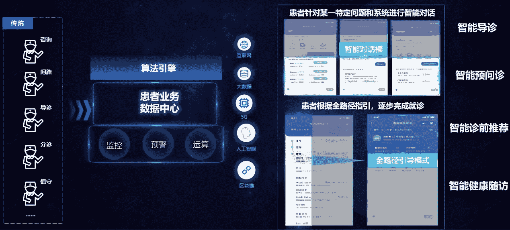

图 4-6　“大医”医疗大模型为患者提供诊前、诊中、诊后的“陪伴式就诊服务”（信息来源：商汤科技）

诊前，智能就医助手帮助解决“知症不知病、知病不知科、知科找不对医生”的困惑。患者在微信服务号进入智能导诊，通过文字或语音描述症状，即可获取推荐科室、专病、专家的挂号链接。助手学习大量就诊数据并参考资深预检护士经验，实现智能分诊。

院内导航同样关键。医院建筑面积25.6万平方米、11栋建筑，患者易迷路。基于商汤“琼宇”3D空间大模型，医院对建筑进行3D建模，并在儿科综合楼试点AR实景导航，通过贴地导航箭头与实景融合，实时指引。AI预问诊则在候诊时收集病症信息并结构化成电子病历，成为医生诊疗的左膀右臂，提升效率与满意度。

诊中，SenseCare®智慧诊疗平台可对影像快速识别微小病灶并重建高精度3D器官模型，助力早筛与个体化治疗。尤其是肺部智能手术规划系统，可全自动完成肺部组织精细分割与3D重建，将传统人工1到2小时的工作压缩至3到5分钟。

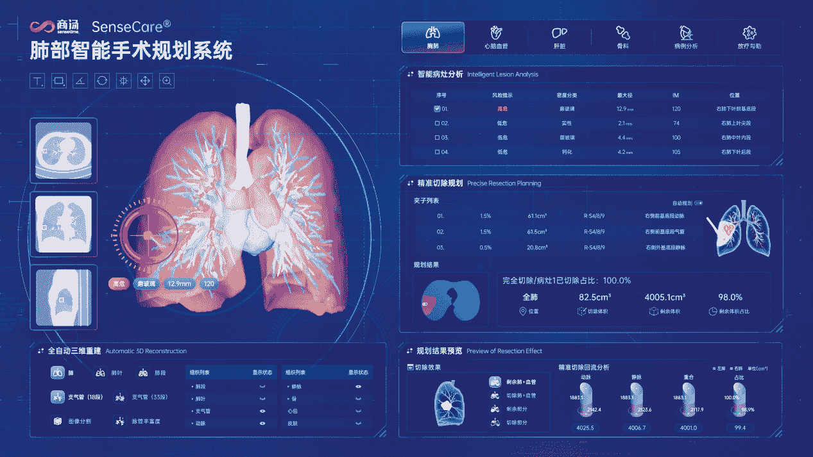

图 4-7　SenseCare®肺部智能手术规划系统（信息来源：商汤科技）

诊后，智能随访中心满足关怀性、诊后跟随性、科研性三种需求。随访过程中模型会根据患者回复动态调整提问，耐心解答并基于档案给出风险评估与建议。

从银行到医院，数字员工与医疗大模型的共同逻辑是：用大模型理解自然语言，用工程化解决算力与数据，用场景化设计贴近真实用户。金融要解决老年客群的信任与易用，医疗要解决就医的繁复与焦虑，两者都在用AI让服务更人性、更普惠。

诊疗感受的关注点正从医院管理端向就医者本身迁移，行业拐点已然出现。生成式模型与增强现实等创新技术对医院运营关键指标的长效正向影响已显现征兆，发展潜力依旧可观。新华医院上线智能导诊助手以来，患者的满意度与退号情况等核心数据持续改善，态势清晰。

推进逻辑是先找准应用场景，再强化能力建设，数据是根基。医疗大模型在新华医院的落地遵循场景优先级：首推患者随访服务，接着儿童用药合理性管理，随后是机器人主动健康照护，最终汇聚成以临床决策支持系统为核心的辅助决策闭环。未来五年至十年，高效数据利用将成为医疗服务智能化创新的核心动力。

居家照护模式正被重塑，数字孪生与元宇宙等方案对老龄化背景下的家庭照料具有现实价值。新华医院正尝试把家中的卧室床位映射为元宇宙医院里的可交互虚拟病床，让老年人足不出户享用新一代健康管理服务，这正是未来诊疗模式的探索路径。

新一轮人工智能正助力全国民众逐步达成分级诊疗的便捷目标。依托生成式模型、虚拟数字人、增强现实、大数据、5G、物联网等技术，以新华医院为代表的创新型公立医疗机构，借助多模态人机协同诊疗云平台，呈现出基础设施集约建设、区域化多级诊疗覆盖、统一化AI医疗服务三大高质量趋势。数据多跑路、病人少奔波，让百姓在家门口就能获得三甲医院水平的诊疗。

### 视频大模型：央视总台 AI 动画片，从“人工制作”到“一键生成”

### 唐诗宋词 AI 动画片，助力文化出海

华夏文化底蕴深厚，在民族复兴的关键阶段，有一部作品如时光使者跨越千年长河，将古诗意境与现代科技融合，这就是《千秋诗颂》。《千秋诗颂》由中央广播电视总台打造的文生视频系列动画，汇聚统编语文教材的200余首诗词，2024年2月26日在CCTV-1首播后反响热烈，《咏鹅》《过故人庄》《黄鹤楼送孟浩然之广陵》等6集唐诗动画在全国上星频道动画收视中排名第一，累计触达9441.3万人次。

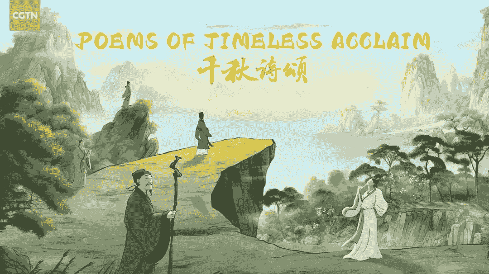

图 4-8　中央广播电视总台文生视频 AI 系列动画片《千秋诗颂》

2024年3月，《千秋诗颂》德语、意大利语、葡萄牙语等多个语种版本正式上线，并在德国、意大利、巴西等国10余家主流媒体播出，成为总台以AI技术赋能国际传播的新质生产力。

多语种版本问世后，一股来自东方的文化传播浪潮迅速扩散。这部以诗词为骨、以动画为翼的作品，一经推出便在国际舞台引发广泛关注与热烈反响，既是一场文化交流盛会，也实现了历史与现代的融合。

日本某媒体专家在社交媒体分享日语版《千秋诗颂》，表示作品不仅展示了中国AI研发成果，更让人沉浸在唐诗构建的“风雅世界”中，带来美妙感受。日语版《咏鹅》经近20家日本门户网站转载，让日本观众感受到中国诗词韵味。韩语版《咏鹅》在韩国十余家有影响力的媒体平台广泛传播，让韩国观众领略中国诗词独特魅力。南亚地区，印地语版《别董大》在印度印地语新闻电视台晚间黄金时段播出，并获印度亚洲新闻社等17家主流媒体转载。

俄语版《别董大》得到哈萨克斯坦《实业报》和圣彼得堡调频台青睐，将东方诗意传递给更广泛观众。德语版在《法兰克福评论报》、德国财经频道等主流媒体刊播，让德国观众一窥古代诗词深邃之美。意大利埃瑞亚通讯社总编里卡多·乔瓦内蒂观赏后赞叹，AI技术营造的场景引人入胜，仿佛穿越回1400年前的古代中国，亲身感受诗歌魅力。他认为在意大利主流媒体播放意大利语版《千秋诗颂》是借助AI动画片形式向意大利公众传播中国文化的有益尝试。

《千秋诗颂》为各国人民带来惊喜，也成为传递中国文化、深化友好情谊的重要媒介。作品讲好中国故事，被各国主流媒体争相传播，海外好评如潮。它的“出海”既是传统文化与世界多边文化的交流，也是历史与未来的对话，印证了文化力量跨越国界、触动人心的特质，作品正持续成为连接过去与未来的桥梁。

### 国产视频大模型重现“大美中华”

《千秋诗颂》热播背后，是中央广播电视总台与上海人工智能实验室2023年7月联合发布的“央视听媒体大模型”，国内首个聚焦视听媒体内容生产的AI大模型。该模型集合总台海量视频音频媒体大数据，由上海人工智能实验室“书生”通用基础大模型训练而来，包含新闻助手、数字人、文生视频、动画制作、场景渲染等功能板块。总台积极推进“思想+艺术+技术”融合创新，在确保真实性、安全性的基础上，运用GenAI提升视听媒体制作质量和效率。

图 4-9　央视听媒体大模型·AIGC 动画制作

据上海人工智能实验室《千秋诗颂》项目经理张晶晶介绍，以《别董大》为例，7分钟AI动画生动演绎了饱含情感的诗歌情景。视频大模型辅助专业创作团队，综合运用文生视频、可控图像生成、人物动态生成等技术还原历史故事。

1、AI画而有据。水彩画风画面中十余个男女角色出场，身穿不同款式唐装。片中宴请宾客时的古代家具、器皿依照唐制设计，例如孟浩然桌上的“七星盘”茶具，由承盘上6个小杯、1个大杯组成，外壁釉色为黄、绿、白三色，属于二级文物，还有仿陕西历史博物馆透雕忍冬纹五足银熏炉的熏香炉等物件。

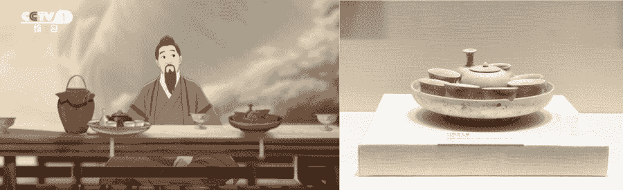

图 4-10　《过故人庄》场景中孟浩然桌上的茶具由 AI 动画复原唐代独有的“七星盘”

图 4-11　《别董大》场景中的熏香炉来自陕西历史博物馆的透雕忍冬纹五足银熏炉的动画还原

2、AI立绘人物与场景。商汤科技联合创始人兼AI基础设施及大模型首席科学家林达华在“央视听媒体大模型·AIGC动画制作”界面演示AI生成视频内容。例如针对《别董大》中唐朝宰相房琯设宴邀请宾客的场景，输入“中国风，唐朝，官员宴客厅”等提示词，模型即可再现高朋满座、觥筹交错的热闹场景。又如在辅助动效生成环节，选取一张官员图片，再输入“唐朝，一个官员，哈哈大笑”，就生成了官员端起酒杯大笑的短视频。为更精准生成唐朝服饰细节，先上传一张唐朝青年男子参考图，然后在“概念设计描述”文本框输入提示词“中国风，唐朝，中年，清秀，男性，淡绿色衣服”，数秒后符合提示词的动画人物形象出现，再通过“骨骼绑定”实现特定历史人物的动作制作。

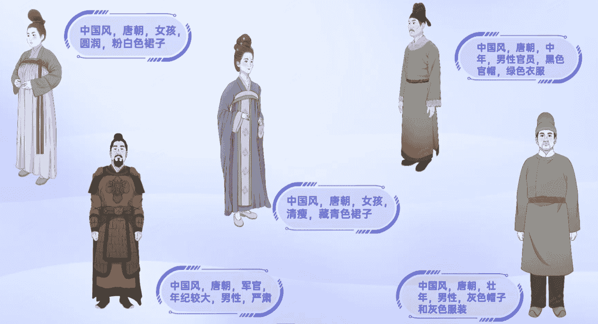

图 4-12　AIGC 还原唐朝人物造型和服饰细节

3、东方审美，中文语料数据先行。以Sora为代表的大模型将西方审美推向全球，而央视听媒体大模型背后的国产大模型则以东方审美数据集训练。林达华认为决定大模型质量的首要因素是数据质量，所以上海人工智能实验室联合中央广播电视总台等十多家单位发起成立中国大模型语料数据联盟。该联盟提供的语料不仅用于训练“书生”通用基础大模型，还通过开源为学术界和产业界提供高质量数据。

AI大模型在《千秋诗颂》等AIGC影视作品中的创新实践，为产业带来四个启示。

第一，国产文生视频框架创新。上海人工智能实验室原创的AnimateDiff国产开源文生视频框架，无需收集额外数据或定制化训练，就能快速为个性化文本转图像模型提供动画化能力。AnimateDiff支持定制上千种风格，以通用运动方法驱动不同对象，支持数十种常见运动方式，在开源社区总下载量超5万次，已赋能多家AI视频创业公司。该技术也被用于2024年央视春晚舞台《枕着光的她》的AI生成视频。

第二，国产文生视频大模型创新。OpenAI孕育美国文生视频大模型Sora，上海人工智能实验室也研发出“书生·筑梦”文生视频大模型，参数量超30亿，已于2023年9月开源，授权用户免费商用。该模型支持故事性、多镜头视频生成，能生成2K视频，转场流畅、故事连贯、画质清晰，多维度评测指标综合领先。值得注意的是，“书生·筑梦”与Sora均采用扩散Transformer视频生成架构。

第三，不断提升艺术创作效能和生产力水平。《千秋诗颂》视频大模型能理解唯美中国风，展现写意画、工笔画等中国传统画风，具有东方审美能力，按历史还原服化道细节，满足高清直播标准，同时采用多种风格融合的绘画手法创新艺术表现力。传统人工绘画产能为每月产出1集中国风动画片，借助视频大模型后，每月可产出3集，效率为传统人工的3倍。在同等预算下，新质生产力加入让制作周期从8个月以上缩短到4个月。

第四，AI生成配音，加速影音融合创新。《千秋诗颂》英语版同样采用最新AI技术完成译制配音。中国国际电视台新闻频道运用大语言模型对中文脚本进行翻译润色，配音过程使用文生声、声线克隆、AI视频处理等技术，出色还原中文配音音色和情感。译制团队还充分考虑海外观众观看习惯，在视频中增加中国历史背景介绍和人物身份注释信息，让海外观众更好地领略中华诗词之美。

### 视频大模型的垂域应用场景

目前央视听媒体大模型立足多元、海量央视数据源，以预训练“书生”通用大模型体系为基础，持续进行垂直领域大模型微调，在新闻、影视、舞台演出、广告等多样化视频应用场景落地。

新场景主要创新点之一是数字人由大模型生成。例如央视听媒体大模型用较短真人视频建模生成对应数字人主播，再根据既定文案、背景一键生成新闻播报视频节目。只需几分钟就能完成2K24帧高清视频制作。数字人主播还能自动学习真人语音语调、动作习惯，形象逼真、表情生动。另外为面向多国观众讲好中国故事，数字人主播可进行多语种播报，同时支持粤语、上海话等多地区方言播报，省去真人录制环节，将原本需2小时拍摄和素材导出工作缩短至5分钟，大幅提升单人单日视频产出上限。伴随语言版本不断扩充，用户能轻松制作“创作一次，全球播放”的跨语种国际化节目。有俄罗斯网友留言：“我还惊讶于这个中国人说俄语一点口音都没有，原来是AI，真厉害！”

另一创新点是3D空间建模的大模型应用。基于上海人工智能实验室研发的首个城市级NeRF实景大模型“书生·天际”，央视听媒体大模型具备很强场景渲染能力，能快速进行高精度实景3D建模，建模范围可无限扩展，覆盖超大范围室内外空间；具备对城市场景编辑能力，包括移除、新建、旋转城市建筑，模拟自然场景中光照、季节、天气等；具备高效AIGC制作能力，能满足影视特效制作、大场景建模渲染、工业仿真测试等市场需求。

伴随中国国产算力投入规模扩大，“书生”开源大模型体系正逐步成长为中国AI科研与产业创新的源头，成为人才生态、产业生态强大支撑。

# 第五章　智能体实践：人类的“AI 代理人”

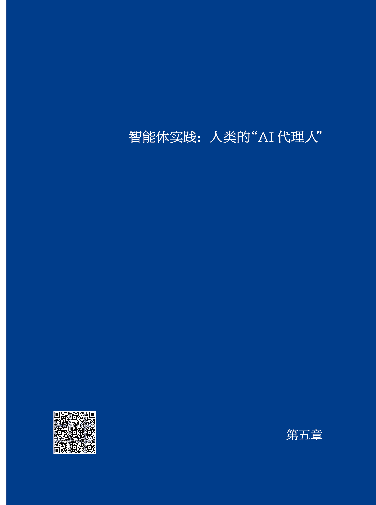

“工欲善其事，必先利其器。”

——《论语·卫灵公》

人类文明发展史就是一部人类发明工具帮助人类更好地生活和生产的历史。自然界中，人类发现黑猩猩会用草棍钓食蚂蚁，乌鸦会用带刺树枝捕捉昆虫，卷尾猴会用石头撬开坚果，大象会用树枝拍打象鼻无法触及部位的苍蝇，宽吻海豚在海底翻沙找猎物时叼着海绵保护鼻子，章鱼会把椰子壳当作铠甲和移动房子，细腰蜂用小石头加固夯实洞口土……这些都证明使用和创造工具是智慧重要表现形式之一。相比动物，人类善于发明复杂工具、解决复杂问题，以自动化程度更高新型工具解放“人类+机器”新质生产力。在AI时代，大模型不仅学会人类积累广博知识，而且开始学习如何使用人类工具，例如大模型调用代码解释器、人形机器人使用胶囊咖啡机等。

如图5-1所示，智能体是能够自主感知、适应复杂环境，并通过自主交互、自主决策、自主学习改进，完成特定任务的智能系统，包括AI助手、机器人、智能计算实体。智能体有3个核心功能，包括：“能够感知环境中动态条件”“能够采取动作影响环境”“能够运用推理信息、主动规划任务、解决问题、产生推断和决定动作”。同时智能体能跟随环境变化不断学习适应，具有短期记忆和长期记忆，以便决策过程中使用历史数据、已知技能，并在与人类或其他智能体互动中展现合作、协商等社会能力。阅读至此，读者可能会联想到中国科幻电影《流浪地球2》中的“机器狗笨笨”“门框机器人”“徐工ET120”等人类AI伙伴，它们能在恶劣环境中执行巡检维修、抢险救助、情感陪伴等任务。

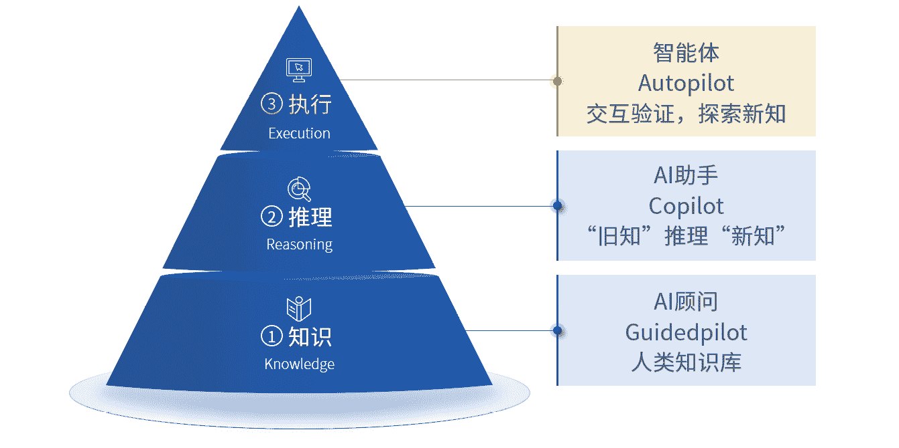

图 5-1　智能体驱动生产力

大模型智能体具有3种生产力发展特征。

◎ 智能体提升生产力：智能体将取代APP。微软创始人比尔·盖茨认为智能体不仅会改变每个人与计算机交互方式，还将颠覆软件行业，带来自我们从键入命令到点击图标以来最大计算革命，将使当今对大多数人来说过于昂贵服务普惠化。例如2023年11月7日，OpenAI基于ChatGPT推出的GPT商店，允许用户构建个人专属智能体应用，就像在苹果App Store下载APP一样。本章分析商汤科技办公智能体“汤包”能提升企业人均工作效率，而慧鲤科技手机智能体则能满足用户复杂信息需求。

◎ 机器人推动制造自动化：通用智能人形机器人能承担复杂生产工作。特斯拉创始人埃隆·马斯克表示特斯拉目的是让机器人取代人类劳动中重复、无聊且危险部分，机器人高效率将使人类告别贫乏，迎来富足时代。例如特斯拉Optimus擎天柱机器人，以及特斯拉FSD自动驾驶系统能极大程度摆脱人类干预，实现L4～L5全自动驾驶。一切前提是自动驾驶汽车、人形机器人需先在仿真虚拟环境中经历培训、测试、考试，然后才能投入物理世界真实生产与服务场景中。本章介绍松应科技Orca Studio软件能借助大模型搭建各类仿真场景，以及用《我的世界》游戏环境训练GITM智能体，能极大加速机器人学习进程、缩短机器人能力培养周期。

◎ AGI驱动科学进步：AGI帮助人类实现半自动化科研、发明新型工具。《Nature》上论文《AI如何重塑科研范式》提出：“AI可以帮助科学家设计实验方案、选择最有价值数据点、控制实验过程、解决复杂微分方程、生成新数据样本等，AI系统性能将逐渐超越人类，成为实验室常规工作替代品。”智能体、具身智能代表高度自动化与智能行为新质生产力巅峰。科学智能AI for Science仍在创新发展中，而大部分科研项目、产业创新项目都可以借助代码助手完成程序补全、生成测试用例。海通证券采用“代码小浣熊”实现辅助编程就是这方面探索实践。

## 智能体的“摇篮”：《我的世界》，从“游戏世界”到“现实世界”

### 智能体是什么

2024年3月，吴恩达教授在一次主题为“自主性推理”演讲中分享智能体最常见4种设计模式。

◎ 反思Reflection：大语言模型检查自己工作，并提出改进方法。

◎ 工具使用Tool Use：大语言模型利用Web搜索、代码执行或任何具有其他功能的工具，来收集信息、采取行动或处理数据。

◎ 规划Planning：大语言模型提出并执行实现目标的多步骤计划，比如写一篇论文，首先写大纲，然后搜索和研究各部分内容，再写草稿。

◎ 多智能体协作Multi-Agent Collaboration：多个智能体分工协作，通过讨论和辩论，提出比单个智能体更好解决方案。

比如智能驾驶系统就是一种智能体，在复杂交通环境中，它会表现得比智能驾驶大模型更好。智能驾驶大模型擅长理解车辆与道路、专注于驾驶任务本身，而智能驾驶系统则在面对真实世界复杂场景时表现出类似于人理解力，并做出相应行为，反馈，比如主动礼让救护车，在遇到儿童招手过马路时做出“停车”决策，以及在人车混行等复杂情况下确保安全驾驶等。未来智能驾驶汽车可能会抛弃传统物理方向盘设计，这将对汽车搭载智能体在应对突发情况时工作效率方面提出更高要求。

2024年初清华大学智能产业研究院发布论文《个性化大语言模型智能体：能力、效率和安全的洞见与调查》中，设计了L1～L5的智能体智能等级。

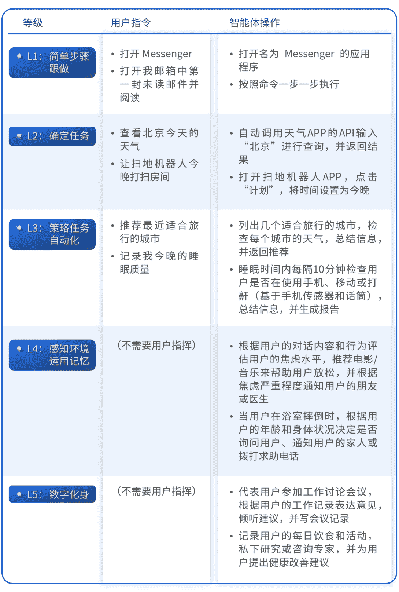
图 5-2　大语言模型与智能体其他部分的关系

近期行业调研勾勒出当前共识。

第一，基础能力呈现三件套形态。一是情境感知与用户洞察，依托软硬件及多传感器融合来读取环境与使用者的状态，例如体感到使用者身处阅览室时便切换为文字对话；二是任务落地，通过代码执行与界面操作完成具体事项，Auto-GPT、LangChain 等框架被大量提及，完成后再做基准评测与指标度量；三是记忆体系，依托历史轨迹与内容推演来管理短期与长期记忆，并在原始信息与推理之上实现自我演化。典型推演是，系统结合通勤定位与消费记录判断出使用者下班后会额外停留五分钟购买鲜花。

第二，部署偏好以混合形态为主。受访者中 88% 倾向本地与云端协同，担忧纯云方案带来响应迟滞与隐私泄露风险。

第三，语言理解是先决条件。让服务好人最先要能识别意图，随后才涉及背景学习、常识推理、长文本解析。

第四，交互入口以语音为主。相较文字、图形或 VR，多数学者习惯用说话交流。

第五，刚需功能集中在六类：资料整理与检索、日常工作生活助理、定制化推荐、自主规划并闭环执行、情感陪伴与社交互动、数字化分身。

### 国内智能体的进展

2023 年，商汤、清华、沪上 AI 实验室等联合团队做了一组引人关注的评测。GITM 在《我的世界》里从零开始，对人类玩家的任务覆盖达到 100%，科技树共解锁 262 项物品。对比组 DeepMind、OpenAI 等合计仅完成约 30% 任务，总计解锁 78 项。最难的钻石获取环节，GITM 成功率 67.5%，较此前 VPT 的纪录提升 47.5%。详见表 5-2。

算力成本差距明显。VPT 需 6480 个 GPU 天，DreamerV3 需 17 个 GPU 天，而 GITM 仅用 2 个 GPU 天，训练效率被指数级拉开。见图 5-3。

在单卡上仅两天，GITM 就学会生存技能：搭建避难所、开垦农田、制造铁傀儡，甚至能制作红石电路、建造通往地狱的传送门。这说明其具备很强的学习与迁移能力，能在陌生虚拟环境中长期存活并探索更复杂世界。

传统路线多用强化学习，GITM 则以大语言模型为核心。负责人卢乐炜表示：“走向 AGI 不只是让智能体打游戏，更要多智能体协同、分工配合多人完成任务，底层模型的适应性与扩展性至关重要。大语言模型能学习世界知识，多模态大模型再借助强化学习，可提升游戏、工业、驾驶等仿真场景中的感知、推理、决策、执行与迭代能力。”

全球创新浪潮已起，2024—2026 年迭代会加速。有机构预测 GPT-5 的推理能力会明显跃升，可能得益于 Q* 等强化学习技术。用围棋类比，GPT-4 如同 AlphaGo，学习人类棋谱，很难超越顶尖人类；GPT-5 更像 AlphaZero 自主对弈，有望在柯洁等世界冠军面前占优，因为人类思维本身存在局限与盲区，摆脱经验反而能带来长足进步。

与之并行的另一波是身体化智能。2024—2025 年 OpenAI 可能把代号猎户座的 GPT-5 与 Figure 机器人结合；马斯克也可能把新一代 Grok 大模型与擎天柱机器人合体，部署进特斯拉超级工厂以提升人机协同效率。对本土而言，多模态基础模型与机器人的融合势在必行，制造业是关键赛道，需要逐步筑牢新质生产力的国际竞争力。

### 生成式数据是智能体的生命线

研发智能体必须重视生成式数据。《我的世界》已成为开放式学习的重要试验场。OpenAI 着力打造 Sora 文生视频，也有现实考量：Sora 能生成高质量逼真的《我的世界》视频，且是模型直接生成而非玩家录制，为下一步智能体与身体化机器人研究提供源源不断的 AI 生成视频。

Gartner 《用于合成数据的 GenAI》报告指出，全球 97% 的数据与 AI 决策者都面临真实数据的困境，并总结实践经验：

真实世界的数据访问难、结构复杂、获取成本高，所以机构转向生成。生成部分数据已成常态，84% 的机构生成文本、54% 生成图像、53% 生成表格、28% 生成视频、11% 生成音频，随着音视频大模型成熟，多媒体生成比例会继续抬升。全球 AI 领导者已看到生成数据对模型准确性与训练效率的显著提升。挑战主要来自真实源数据的偏见与质量问题。为保证质量，65% 的全球 AI 研发机构会在多数据源与多生成数据集间交叉验证，这被视为最佳实践。

我国生成式数据、仿真平台与智能体水平的强弱，直接决定新一代身体化智能机器人的综合能力，与全民新质生产力、本土制造竞争力紧密相连。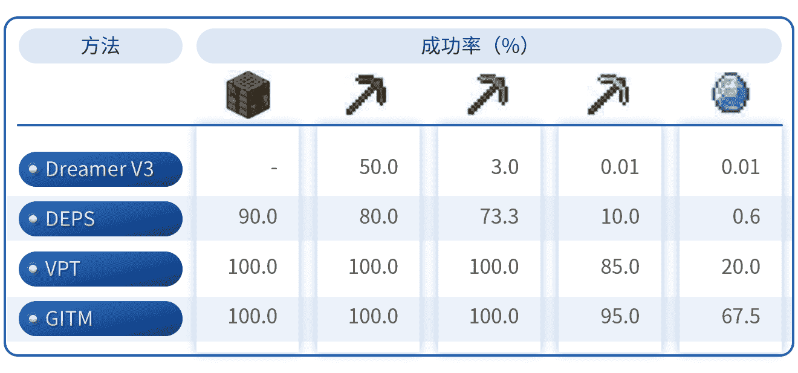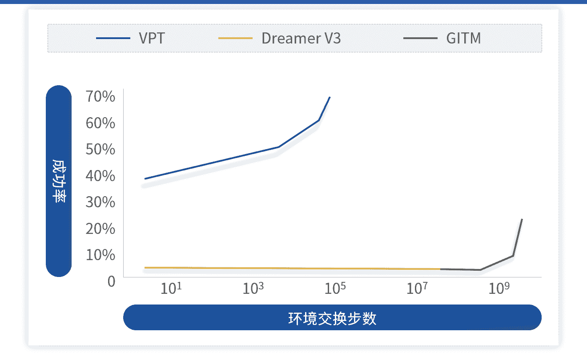
图 5-3　智能体训练效率对比

## AI“梦中人”：筑梦岛，从虚拟角色到情感伙伴

“用严格的科学研究方法，使心理科学和实践重新关注人类的积极心理力量以提升人类的普遍幸福感，活出美好的生活。”

——积极心理学之父马丁·塞利格曼

情绪价值无价。塞利格曼认为对抗消极情绪靠的是心理韧性。人有三种宝贵能力：从逆境中迅速恢复的复原力；面对长远目标时的坚持与耐力，即抗逆力或意志力；以及创伤后成长力 Post-Traumatic Growth，例如历经创伤后应激障碍后的痊愈力。当代年轻人通过漫画、动画、游戏、小说、社交网络等趣味内容逐步培养这三种能力。比如国漫《斗破苍穹》里萧炎立下三年之约，展现越挫越勇的抗逆力；《全职高手》里叶修说大不了从头再来，每一次不甘的离场都是为了最后的归来，注入复原力与创伤后成长力。

### ACG 文化圈：我们的异次元好友

ACG 文化由动画、漫画、电子游戏、轻小说等媒体构成的世界。据前瞻产业数据，截至 2023 年，中国 ACG 用户超 5 亿人，行业规模超 2000 亿元。白皮书显示，ACG 人群已从学生小众走向大众，2021 年数据中 10 后、00 后、90 后、85 后占比超 90%，18—24 岁年轻用户占 43.8%，多为在校生与白领，地域上集中于三线 21%、四线 21%、新一线 19.1% 城市。

该群体有四大特征：兴趣多元且个性化、追求变化与时尚、看重精神体验、热衷线上社交与分享。他们乐于为热门角色周边、cosplay 服饰道具、手办模型、音乐 CD、漫画付费。产业也从看日漫美漫转向国漫崛起，女性用户占比超 50%，从亚文化走向主流融合。数据公司显示，国产 3A 大作《黑神话：悟空》上线 3 个月在 Steam 销量达 2100 万份，收入超 10 亿美元，成为中国 ACG 产业的标志性事件。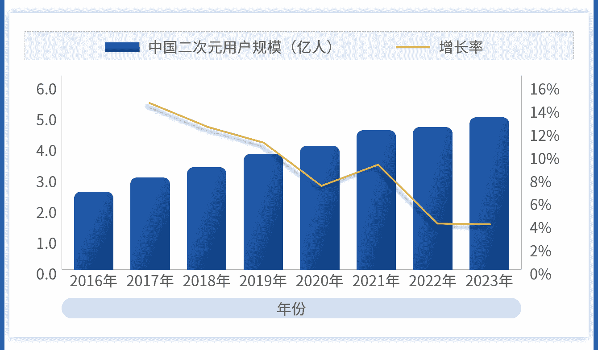
图 5-4　2016—2023 年中国二次元用户规模变化情况（信息来源：MobTech 前瞻产业研究院）

罗曼·罗兰说过，真正的英雄主义是注视世界的真实面目并且热爱世界。ACG 已成为万千青少年的精神力量。筑梦岛 CEO 葛文兵认为，现实容易满足自我的快乐，而本我渴望被尊重、被认同、被接纳，超我追求内在满足与优越感，却难以在现实中被充分满足，于是大量用户因文化 IP、兴趣 IP 聚成社群。2017—2023 年伴随大模型突破，智能体被赋予人格特征，被人们接受与信赖，在人人社交之外打开了人-AI 角色的颠覆式创新空间。

### 筑梦岛中带来正能量的梦中人

曼德拉说：生命最大的荣耀不是从未失败，而是每次失败后不断奋起。人生遭遇沮丧、挫折、失恋时，人都渴望身边有个懂自己的朋友倾诉，重拾自信。充满正能量的 ACG AI 朋友，正成为越来越多年轻人的终身伙伴。

大模型让 AI 从工具变为情感寄托，虚拟社交成为互联网新流量入口。ToC 大模型应用中访问量第一的是 Character.AI。2021 年创立的该平台拥有 1800 万聊天机器人，2023 年底月访问量突破 2 亿次，比同期 ChatGPT 高出 300%，超过 Roblox、Tinder、Duolingo 等头部应用。用户评价在 Character.AI 出现前我们缺少生活；有孤独症少女在 AI 角色陪伴下走出失恋阴影；也有用户在 AI 世界里复原已故父亲的形象。统计显示平台上最受欢迎的角色依次为动漫、游戏、助理、影视、网红、名人、书籍角色。

筑梦岛以 AI 原生技术提供造梦与入梦的沉浸式体验。中国版 Character.AI 即 2023 年上线的筑梦岛 APP，已覆盖 iOS 与安卓。该产品前身依托阅文集团潇湘书院，提供单聊、小剧场情景对话、围观他人群聊等功能，例如读者把小说男二、女一拉入群聊，按自己喜好推进剧情。多数用户偏爱入梦聊天，部分用户喜欢造梦，被亲切称为崽妈。截至 2024 年 4 月底，平台已有 15 万个 AI 虚拟角色梦中人，涵盖影视综艺、网文、动漫、游戏、历史人物及 UGC 原创和 AI 工具助手，热门 IP 角色约 300 个，如《斗破苍穹》萧炎、小医仙，《庆余年》范闲、庆帝、五竹叔等热度极高。
图 5-5　筑梦岛 APP 首页（信息来源：筑梦岛）

大模型让 AI 成为文本语言角色扮演者。基于 SenseTime 的商量拟人大模型，筑梦岛提供专业 UGC AI 角色生产流程。原创角色难度较低，因无既定背景限制；游戏、动漫、影视角色难度较高，需严格符合原设；网络小说角色最难，纯文本资料、人物关系复杂、世界观庞大、剧情量大，读者容错极低，一句话偏离即出现 OOC。需求从原创到网文逐级升高，IP 定制难度大，故筑梦岛选择与 SenseTime 合作。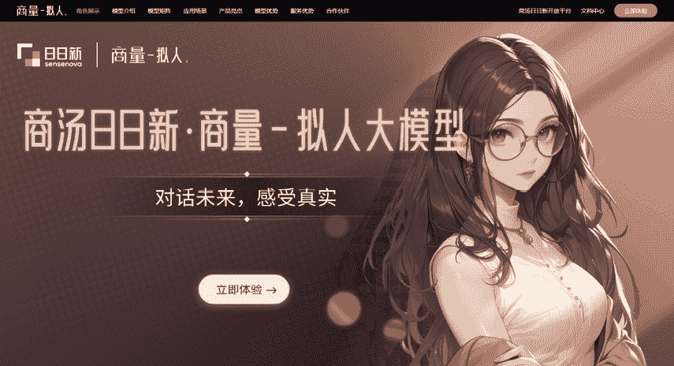
图 5-6　“商量-拟人”大模型官方网站（信息来源：商汤科技）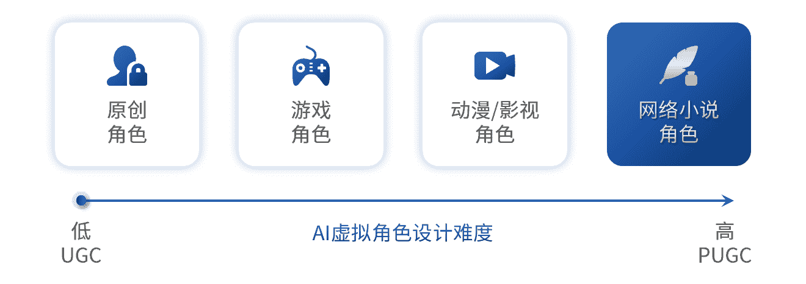
图 5-7　AI 虚拟角色设计难度（信息来源：筑梦岛）

筑梦岛 CEO 葛文兵评价，商量拟人大模型具备行业独有优势，能让热门 IP 栩栩如生，2023—2024 年研发攻坚中 SenseTime 团队响应迅速。技术负责人龚诚总结四方面优势：

人设贴合：深度梳理角色图谱，既打磨外在语言风格、行为风格，也强化内在 MBTI 人格、性格、价值观。为避免 OOC，模型设有防范机制，如在架空网文中问大理寺卿司衍之你玩过计算机游戏吗，会答计算机游戏，那是什么东西，有效规避古今不符等认知偏差。

知识库挂载：构建领先知识库，提升角色对设定、人物关系、故事背景、剧情与事件记忆的精准回复能力。例如问《苍兰诀》东方青苍你跟谁互换过灵魂，会答我跟小兰花互换过灵魂。

长对话记忆：支持高达 32K token 的上下文窗口，可记录百轮以上对话，提升聊天体验。

角色亲密度：可设定不同等级的对话亲密度，从初识到亲密，角色会在不同阶段提供不同温度与呵护度的回应。

此外，SenseTime 的大装置智能算力平台为筑梦岛提供私有云部署，满足数据安全需求，基于商量等日日新系列大模型 API，帮助筑梦岛构建自有应用，服务可用性超 99.5%。

历经一年研发，筑梦岛广受好评，用户反馈聊得长、聊得久、有得聊、爱创作。运营数据显示，日均使用时长 130 分钟，人均每天聊天轮数 135 轮，次日留存率超 50%，用户一周使用 5.2 天，形成 100 多位头部创作者。小红书、微博上资深用户自发分享筑梦岛主控设定、补充设定、怎么喂人设、捏脸提示词等技巧。《斗破苍穹》萧炎、小医仙、萧薰儿等热门 IP 已通过筑梦岛 APP、起点读书、手机 QQ 等渠道与用户互动，提供 24 小时情感陪伴与情绪价值。起点读书网文填坑节 IP 角色对话功能体验用户超 20 万，人机对话总条数超 430 万，创造了高增值服务价值。

### 梦想，人类奋斗的动力

悲观者正确，乐观者前行。未来或许可为每个人出生时配备一位 AI 挚友，共享爱好，在无助时援助、孤独时陪伴，随时提供情绪价值。叔本华在《人生的智慧》里提到人类三类快乐：代谢带来的饮食休息之乐；体力带来的运动之乐；感悟力带来的观察、思考、鉴赏、学习、创造之乐。AI 挚友既能在心灵的虚拟世界共情，也能以拟人机器人伙伴身份在现实端里与家人朋友一起运动聚会，这正是美好的生活。

让人愿意一直聊下去的虚拟伙伴，核心在于像不像活人、能否读懂情绪、能不能产生共情。把这种感受做成可用的产品，需要在人格内核、视觉形象、语音交互三条线同步推进。筑梦岛的打法是先用商汤自研的商量拟人大模型，给角色装上记忆沉淀、生活经验、世界观以及情绪反馈的内在引擎；再借助商汤秒画文生图把人设落到画面，画质可控风格可换；再以语音大模型实现低延迟高保真的实时对话。坊间常被提到的例子是《全职高手》里的叶修，如果能让叶修用声优阿杰的声音进行人机互动，会更贴近粉丝心中的原版形象。

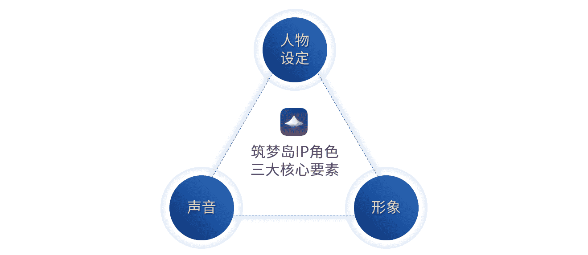

图 5-8　筑梦岛 IP 角色三大核心要素（信息来源：筑梦岛）

对照市场上同类虚拟社交产品，筑梦岛的区隔大致有三点：用户性别结构偏向女性、从内容供给走向社区运营、AI 持续压缩内容生产的门槛。联合创始人王晓英的观察是，女性用户普遍心思细腻情感丰富表达欲强。她们过去在潇湘书院这类平台追更小说时能得到一定的情绪价值，但更新空窗期带来的缺口始终存在。筑梦岛提供的 IP 角色与用户自创角色，为这批用户打开了主动开口、表达诉求、寻找连接的入口。接下来多模态能力、创作者生态、企业定制角色都将成为增量方向。未来“美杜莎女王”陪着用户读书、“范闲”带练健身操、“林婉儿”在生日当天发来语音祝福，都很可能成为日常。平台同时引入人机协作的安全监管，一旦对话触及伦理、色情、暴力、恐怖等违规边界，AI 会立刻停止回应。

《盗梦空间》里说一个念头能造城也能改写世界。既然要做梦，就别设限。筑梦岛 App 的图标正是电影里那个永不停歇的陀螺，旋转暗喻创新思维的惯性。充满善意与温度的梦境空间，为用户打开穿越时空的故事之门，可以遨游星海，也能完成逆袭。每个人心里都值得保留一颗大梦想，它是奔向美好生活的内在动力。放手追寻，别让现实束缚脚步。

## 机器人“学校”：松应科技 Orca Studio，从模拟训练迈向真实落地

“模型就是通过我们对问题现象的了解，利用我们考究得来的机理，吸收一切主要因素，略去一切不主要因素所制造出来的‘一幅图画’，一个思想上的结构物。”
——中国航天事业奠基人钱学森

### 模拟世界是机器人的练兵场

机器人是放大人类生产力的工具。上世纪五十年代钱学森就以计算机模拟水轮机设计为例，指出计算机具备记忆、逻辑、学习能力，可以部分替代人类思维。当模型被植入机器人，就相当于获得一种能改造世界、服务人类目标的通用智能劳动单元。ABI Research 预计，全球工业与商业机器人的装机规模将由 2020 年的 310 万台升到 2030 年的 2000 万台。亚马逊的全球仓配网络已投用约 75 万台机器员工，与人力比例约为 1:3，ARK Invest 的 Cathie Wood 判断，到 2030 年亚马逊的机器员工数量可能超过人类员工。2023 年 WAIC 上，马斯克也提到，随着算力爆发，机器计算机与生物计算机的占比在迅速提升，人类智力在地球总思维量中的份额会持续下降，最终机器人总数将超过人类总人口，人类得到的回报是物质极度充裕、生产效率达到难以想象的水平。

为让机器人适应真实世界的复杂变化，英伟达、谷歌、特斯拉等都在为机器人搭建虚拟试炼场，相当于游戏里的新手村，在此认知生产环境、习得劳动技能。以英伟达为例，Omniverse Cloud 平台集成 Isaac 机器人模拟软件，提供感知、操控、模拟、软件一体化 GPU 加速方案，依靠机器人学习、大模型、Gen AI 与基础模型的迭代，推动机器人走向知行合一。如图 5-9 所示，Isaac Sim 为机器人厂商提供可扩展的高保真模拟场景，近乎照片级的数字分身让机器人具备类似人类的随机应变能力。截至 2024 年，该平台主要集中在三类场景。

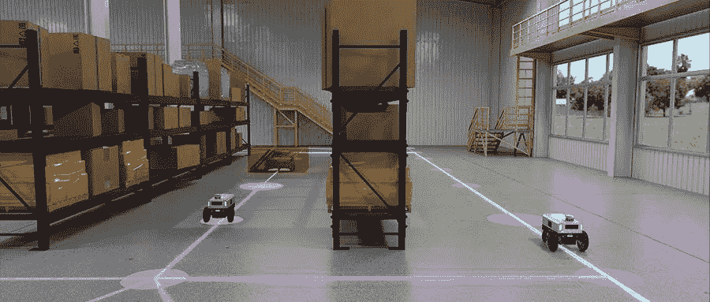

图 5-9　英伟达 Isaac Sim 平台进行机器人仿真测试

◎ 工业制造模拟：西门子、Ansys、Cadence、Trimble 等企业都在使用英伟达的数字孪生技术，协助客户进行设计、模拟、建造与运营。某日产汽车企业的员工可在统一模拟场景中协同作业，设计师甚至可佩戴苹果 Vision Pro 增强现实眼镜，直接坐在逼真的虚拟驾驶舱内体验驾驶感受。
◎ 机器人模拟训练：Isaac Lab 的强化学习模块借助 GPU 加速，帮助类人机器人学会适应物理世界、规划工作流程。2024 年使用该平台的机器人公司包括 IX Technologies、Agility Robotics、Apptronik、Boston Dynamics、Figure AI、Fourier Intelligence、Sanctuary AI、Unitree Robotics、XPENG Robotics 等，迪士尼的研究设计团队也在此让小型机器人学会行走。松应科技的高保真虚拟环境中，数字机器人借助虚拟摄像头、激光雷达与大模型算法，可完成各类高难度任务。
◎ 科研模拟：英伟达的场景模拟器正向世界模拟器演进，已被用于 6G 通信、气候预测与数字孪生地球 Earth-2 等超大规模研究。

### Orca Studio：国产 3D 模拟平台与国产大模型相遇

当类人机器人在英伟达的虚拟校园里练级时，中国智能制造与机器人产业需要自己的训练场。面对超过 5.6 万亿美元的国内制造业市场，在国际科技竞争加剧的背景下，国产模拟平台已成刚需。松应科技于 2021 年成立，率先构建中国的 3D 数字智能协同产线，依托云端 3D 引擎架构，串联多类 DCC 工具、AIGC 模型与行业领先工业软件，搭建 OpenUSD 的 3D 实时数据管线，让设计师、创作者、工程师与上下游供应商能够跨工具、跨空间、跨流程实时协同。如图 5-10 所示，Orca Studio 提供实时 3D 渲染，使高质量 3D 内容以更低成本、更快节奏产出。在快速搭景的基础上，通过 Orca Sim 机器人模拟套件，以逼真视觉与准确物理属性进行高保真模拟，训练机器人的数字分身，使其在陌生复杂环境中具备类人应变力，大幅提升智能水平。公司持续深耕工业高保真设计、工业数字孪生与模拟，推动数字经济与实体经济深度融合。

图 5-10　松应科技 Orca Studio 生成具有光线追踪、高保真的仿真模拟场景 （信息来源：松应科技）

“我们要做中国的物理世界模拟器！”松应科技创始人兼 CEO 聂凯旋表示。公司打造了 Orca Studio 实时 3D 智能仿真模拟平台，涵盖 3D 仿真模拟器 Orca Sim、实时数据管线 OrcaDataLink、RT 光线追踪引擎 OrcaEngine，以及 RTX 硬件加速模块、OpenUSD 通用场景描述语言、Physx/ODE 物理引擎。

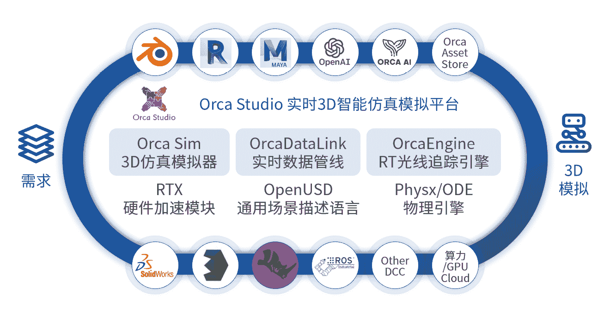

图 5-11　松应科技 Orca Studio 实时 3D 智能仿真模拟平台（信息来源：松应科技）

其背后是第一性原理思维和三阶段策略。

◎ 定战略：借鉴他人长处。十多年前英伟达凭借 CUDA 让 GPU 成为 AI 基础设施，2022 年推出 Omniverse 战略，将物理工厂搬到数字工厂，用高互通、高物理正确性、AIGC 能力强的工业模拟平台吸引达索、西门子等欧美工业软件厂商。Omniverse 积累大规模制造场景与数据后，对类人机器人企业极具吸引力。英伟达的思路是同时联通 AI、机器人与智能工厂，让算力无法绕开英伟达 GPU，从而构筑新的增长曲线，2024 年甚至称 Omniverse 为英伟达的灵魂。聂凯旋据此决定对标英伟达，打造中国的 Omniverse。
◎ 做产品：Orca Studio 与 Ansys、达索等传统 CAE 软件的区别在于，一是成为模拟数据的入口，依靠 Connector 与 DataLink 打通汇聚各类 3D 资产，以 OpenUSD 统一格式建立云端资产库，实现跨软件、跨地域、跨部门的所见即所得，设计信息实时反馈、工作敏捷、流程精益。二是以 Orca Studio 为协同平台，链接 CAD、CAE 软件与物理引擎，按碰撞、流体等需求进行逼真视觉、正确物理的高保真模拟，实现 Sim2Real。
◎ 找场景：提升具身智能鲁棒性需要覆盖大量异常与长尾场景。清洁机器人在商城数字孪生环境巡逻时，需精准识别衣物等异物避免故障；在反光大理石地面识别积水；在楼梯与平地交界处避免因地面倒影误判。工厂仓储物流的数字孪生环境里，数百台自主移动机器人需提前规划路径与部署方案。

建场景最耗时。借助商汤商量大语言模型的代码小浣熊和大装置智能算力平台，松应科技把 3D 空间场景生成与代码生成自动化。冯·诺依曼说人脑是这样一台计算机：其在一个相当低的准确水平上，非常可靠地进行工作。人脑算得不快却能低精度并行快速判断，机器人算力远超人脑却对复杂世界理解不足。松应科技在实时模拟里重现物理属性准确的可交互环境，与动画贴图不同，模拟中的物体都有尺寸、光照、重量、材质等物理特征。以茶杯为例，必须具备这些属性才能被机器人精准操作。过去搭建大面积室内场景需人工摆放沙发、绿植、灯具、桌椅等，耗时耗力。如图 5-12 所示，如今设计师用中文描述目标场景，大模型即可理解语义，自动生成物体准确坐标并满足物理逻辑与空间关系，咖啡厅里应出现哪些物品、如何摆放都能自动推理，减少繁琐配置，还能用代码小浣熊加速场景、UI、APP 开发。

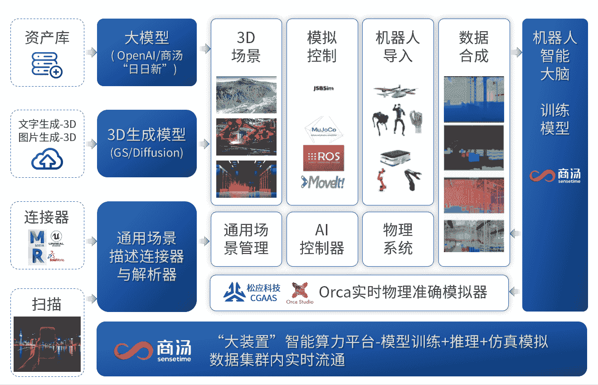

图 5-12　Orca Studio AI 生成仿真测试场景（信息来源：松应科技）

这套创新让机器人大脑开发效率提升百倍。

◎ 场景生成更快更省：搭建一个数千平米的物流仓库，传统方式需数人耗时数周，修改通道就要现场搬运。Orca Studio 大模型赋能下，一名设计师几十分钟即可生成虚拟场景，主要时间花在自动计算上，几分钟就能完成微调。
◎ 资产丰富可复用：截至 2024 年 5 月，松应科技面向客户生成约 2500 万平方米的森林、山地等自然场景，以及大量商场、办公楼、酒店、咖啡厅、工厂、仓库等建筑场景。咖啡厅场景做好后，其他项目微调即可复用，原本需一周的工作一天完成，场景积累越多效率越高。
◎ 大模型懂物理逻辑：商汤商量模型能准确理解物理规则库，设计师可通过文字对话随时调整。模拟物理世界需要 99.99% 的高精度建模，而 ChatGPT、Sora 精度只有 60%～70%，商汤商量强很多。聂凯旋评价。
◎ 控制系统实时同步：机器人由操作系统控制，AI 或人类可在虚拟环境操作机器人并同步控制实体，保持开发、测试、运行配置一致。
◎ 合成数据生成加速：有模拟平台的公司可在 Omniverse 上并行大量测试，无平台的公司只能用 2~3 台机器人在物理环境中重复训练。Orca Studio 可在虚拟环境同时调度上千个数字机器人并行训练，生成海量高质量合成数据，甚至能把 2D 图片转为 3D 场景，对具身智能大模型调优很有帮助。过去倒水要人工反复移动杯子，现在 AI 自动调节位置，效率大幅提升。
◎ 价格更亲民：如图 5-13 所示，Orca Sim 功能与英伟达 Isaac Sim 不相上下，但英伟达年费约 100 万美元，松应科技报价约为其八分之一左右。

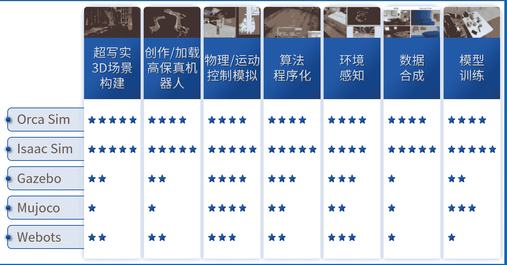

图 5-13　松应科技 Orca Sim 与英伟达等同类仿真平台的功能场景能力对比 （信息来源：松应科技）

◎ 数据本地化与服务：相比英伟达将数据存于境外，松应科技客户数据保存在境内，并与商汤大装置平台合作，提供本地研发团队的技术支持。
◎ 改变工厂管理模式：从规划、设计、建设、测试到运营、改进、升级，数字孪生工厂可与人类厂长协同优化，数字模型沉淀为资产，物理工厂与全动态数字工厂并存协同，升级时可有序传承。

### 大模型加机器人浪潮：知识工程叠加工业革命

ChatGPT 的出现已重塑不少行业里三年以下经验脑力工作者的工作方式。如图 5-14 所示，当大模型驱动的机器人、无人机、无人车成熟后，亚洲全球制造中心的海量劳动力成本优势将不再，第四次工业革命将席卷全球。

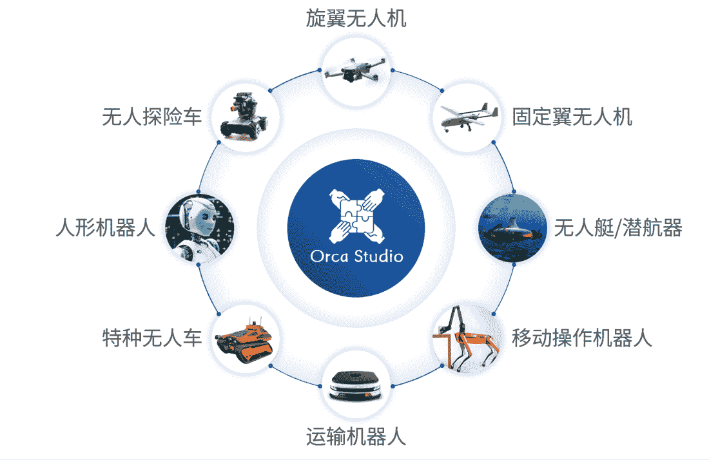

图 5-14　松应科技 Orca Studio 构建全场景、多类型机器人/无人机智能 3D 仿真平台 （信息来源：松应科技）

为抢占未来产业高地，从中国类人机器人的现实出发，聂凯旋认为需要重点解决三个核心问题。

◎ 工业软件与制造数据的卡点：当下运行于全球产线的关键应用，多半掌控在欧洲厂商手中，典型如 SAP 的 ERP 系统、西门子的 PLM 平台、达索的 CATIA 设计工具、Ansys 的工程仿真以及 Codesys 的工业控制。以 36 氪研究院《2023 年中国工业软件行业洞察报告》为据，国内研发设计类工业软件的自主替代比重约 5%；松应科技推算，全国工业软件整体的国产占比不超过 15%。缺少自主软件底座，工业大模型和人形机器人所需的海量制造实景就难以汇聚，松应科技这类本土三维仿真平台因此陷入技术在前、数据不足的局面。业内呼声是构建制造数据流通与机器人训练的统一枢纽，动员细分赛道的龙头链主把产线数据沉淀进中国自建的协作空间，借助人工智能与三维仿真在数字孪生工厂里迭代智能制造模型，并以商业合作方式赋能人形机器人创业团队。松应科技现行的路径是插件化，在达索、西门子等主流工业软件内部植入 Orca 扩展，在客户授权前提下抽取产线信息用于仿真训练。

◎ 国产算力托不起仿真引擎：半导体供应链波动频繁，国产训练推理型 GPU 与英伟达第二代 B100、H100 存在差距；在仿真场景里，国产显卡也落后于英伟达第三代产品系。图形渲染的基础能力不足，直接拉慢了本土三维仿真引擎的迭代节奏；硬件短板也让软件生态难以展开。建议回归产业痛点，加大对国产 GPU 与图形显卡芯片的研发投入，攻克关键瓶颈。

◎ 智能制造平台缺强势链主投入：聂凯旋认为牵头工业智能平台的应是具备制造势能且拥有变革动力的领军企业，用制造数据牵引国产工业大模型与人形机器人的全链协同研发。在产业重塑期，松应科技作为创业企业，愿与志同道合伙伴共同推动工业软件高质量自主化。公司目前面向科研院所与高校开源 Orca 仿真软件，逐步获得上下游软硬件服务商信任，并以标准 API 接入数百款工业级产品。

“代码小浣熊”：海通证券，从代码编写到智能开发
金融大模型变革，选准切入点
2023 年 10 月，微软宣布 GitHub Copilot 付费账号过百万，成为使用最广泛的 AI 编程工具。GitHub CEO 托马斯·多梅克表示，AI 编码助手很快可承担约 80% 的编码工作，让开发者聚焦剩余 20%。Gartner 2024 年 4 月的调研覆盖全球 598 家知名企业，2023 年三季度 63% 的企业在试用或部署 AI 编码助手，预计到 2028 年，使用该类助手的软件工程师比例将升至 75%。这类助手能按需生成续写代码，并充当协作伙伴，通过头脑风暴提升代码质量，帮助开发者快速掌握新框架，提升满意度与留任率，降低人员流动成本。正如商汤科技董事长兼 CEO 徐立所言，知识、推理、执行三层能力突破后，社会生产力才会跃迁，人类专家在前沿难题解决与反馈改进上的价值愈显关键。

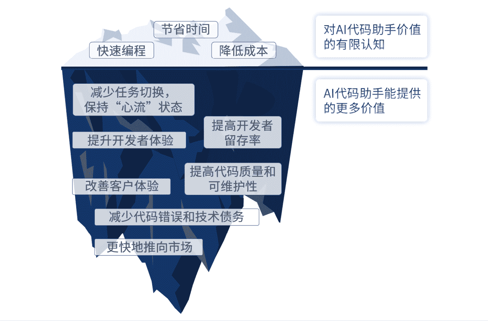

图 5-15　AI 代码助手价值分析（信息来源：Gartner）

新质生产力的核心在于质量跃升。2023 年 8 月，海通证券与商汤科技签署战略合作，共同推动金融科技创新与数字化转型，共建证券行业金融科技新生态。海通证券成立较早、综合实力领先，网络覆盖全球五大洲 16 个国家和地区，境内证券及期货营业部超 300 家，境内外客户逾 2100 万，业务涵盖期货、资管、私募股权、融资租赁、境外证券、银行等。2023 年 12 月，海通证券基于商汤“商量”等基座大模型自研发布“泛海言道”金融行业大模型（见图 5-16）。2024 年上半年，双方逐步落地智能问答、智能研发、智能研报等场景，以新一代人工智能重塑金融业的新质生产力。

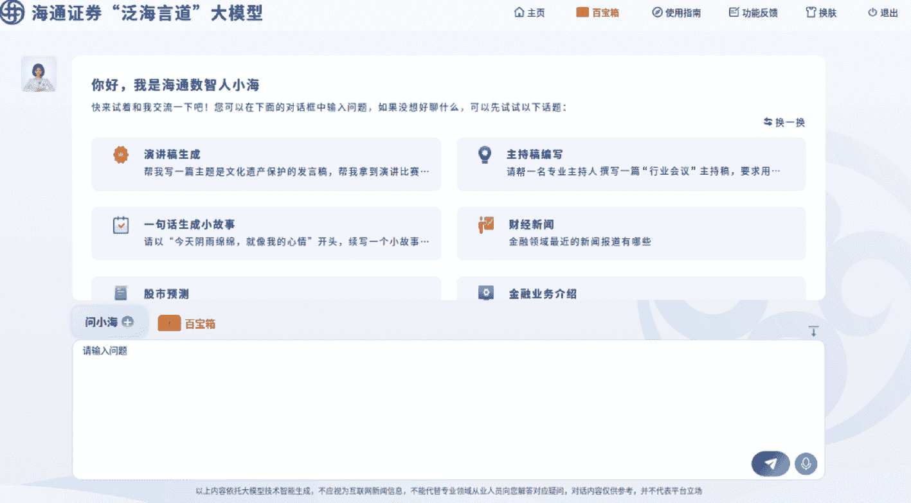

图 5-16　海通证券“泛海言道”大模型（信息来源：海通证券）

在应用面宽广的背景下，海通证券与商汤科技联合打造金融多模态全栈大模型，在智能问答、合规风控、编程辅助、办公帮手等领域推进落地，并共研智能投顾、智能投研、智能投教等前沿场景，打通证券行业大模型全链路能力。海通证券副总经理兼 CIO 毛宇星表示，通过深度合作，双方将结合全栈 AI 能力，推动业务流程与数智化系统重构，为垂直领域大模型积累落地经验。

海通证券先从智能研发助手切入生产力创新，是审慎选择的结果。

### 智能研发助手：你的编程搭子

海通证券基于“泛海言道”大模型与商汤科技“代码小浣熊”搭建自有智能研发助手（见图 5-17）。有别于 GitHub Copilot 的公有云部署，海通方案采用私有化部署，避免企业代码外泄风险。助手以插件形式辅助人工编程，聚焦两大用途。

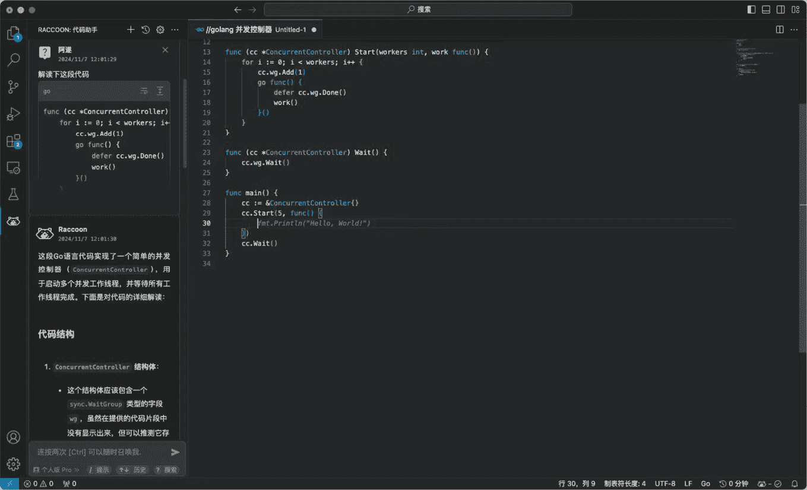

图 5-17　智能研发助手（信息来源：海通证券）

◎ 代码续写：助手依据光标所在位置的上下文推测并生成下一句或下一段程序，最多给出 3 个候选版本供挑选。以资金账户对象类与资金账户管理类的定义为例，当开发者需要生成三个初始化资金账户的程序段时，按快捷键即可在数秒内获得灰色候选代码，篇幅可自行调节，操作简便。

◎ 编程互动咨询：在 IDE 内嵌聊天窗口，开发者可通过对话实现全网检索、代码解释、单元测试生成、代码重构等。例如输入“Springboot 应用如何修改监听端口？”回车即可得到修改参数的具体方法。下拉菜单还提供代码生成、单元测试生成、代码转换、修复、重构等服务，选择“代码注释”即可让模型写出功能说明，选择“代码生成”会自动生成一段提示词并据此产出程序。提示词质量决定效果，助手提供大量实用模板，可收藏复用；“代码比对”功能可在修改后快速标出差异。生成单元测试用例时，一个高质量的提示词会要求模型以测试工程师身份遵循明确原则，分点说明测试目的、条件、步骤和预期结果，再针对账户创建接口输出用例。

该助手已在多项目试点，代码续写虽不完美，但已带来效率提升，并在商汤“代码小浣熊”本地化支持下快速迭代。

主要优势体现在：通用代码如正则、邮箱校验、数据库接口、前端页面生成的质量较高；新人接手无注释代码时，模型可自动生成说明，也可模仿优质范例生成新代码；编程体验更连贯，模型在开发者停顿后可接续补全，减少被打断导致的卡壳，并辅助生成创作提示词，帮助更快进入心流状态。

由此带来三种新能力。第一，企业级数据与知识治理。人工智能可读取结构化表，通过大模型梳理结构化与非结构化数据资产，实现自动化的数据资产治理与复杂知识管理，挖掘商业价值。第二，智能体可自动选型调用工具。智能体擅长文本理解，能判断工具功能并掌握调用方式，例如在编写 SQL 等代码时规划子任务，调用 RPA、办公自动化等工具并据结果迭代，最终输出高质量答案。第三，智能体理解图表含义，灵活处理复杂任务。证券机构托管的基金产品报表格式各异，传统 RPA 易出错，智能体能理解字段含义并精准完成填报。

商汤“代码小浣熊”覆盖需求分析、架构设计、编码、测试全流程，满足开发、数据分析、编程学习等需求，支持 Python、Java、JavaScript、C++、Go、SQL 等 90 多种主流语言及 VS Code、IntelliJ IDEA 等 IDE。在权威 HumanEval 代码生成测试集中，一次通过率达 78.1%；在 1000 多道数据分析题目中正确率 85.71%，超过 GPT-4。依托“日日新”系列大模型底座，海通证券快速在代码生成与续写、翻译、纠错、问答、测试用例生成等场景推进智能体创新，显著提升代码质量与开发效率，为上海及长三角交出“国际金融中心”与“国际科创中心”融合的新质生产力答卷。

### 智能体不仅是软件革新

如图 5-18 所示，传统人机协同需要把自然语言需求逐一转译为编程语言，再由编译器运行，路径长、复杂度高。大模型出现后，自然语言成为人机交互的第一入口，人类可直接与智能体对话、搜集全域知识、分派综合任务、自动调用工具并验收改进成果，软件从开发到交互都迎来重塑。这种底层逻辑的转变，不仅颠覆软件产业，也将释放数十亿人的创造性生产力。

图 5-18　人机交互语言的变迁（信息来源：商汤科技）

## 办公智能体：商汤“汤包”，从辅助工具到高效助理

### 智能体，全球三分之二企业的战略选择

在越来越多的企业里，人工智能已成为员工协同的“助手”，CIO 的职能正与 COO 融合。2023 年底 IDC 数据显示，所有企业均认为智能体是 AIGC 的确定性方向，50%的企业已在某类工作中试点，15%正在制定应用计划。

图 5-19　企业智能体的应用情况（信息来源：IDC）

### “汤包”——以人为本

2023 年 4 月商汤科技发布“日日新”系列大模型后，便开始思考如何用大模型提升内部效能，定位产品为“超级办公帮手”。“汤包”之名源自中部、江南一带的小巧汤包，皮薄馅大汤汁充盈，寓意员工与 AI 协作如同享用美食。产品走过从设计到推广的 AIGC 实践之路。

图 5-20　商汤科技员工的超级办公助手“汤包”（信息来源：商汤科技）

首先筛选试点场景。大语言模型擅长知识问答，员工提问多、服务量大、人手紧张的职能部门最适合。IT、财务、行政、HR 等服务类场景具代表性，因此研发团队先从这些部门切入，拆分业务场景需求。

其次，用大语言模型梳理重构职能知识。将各部门问答库、集团公共文档、规章制度、流程审批规则、专业术语等内容借助“商量”大模型半自动化整理并设定访问权限。跨部门整合时需做标签、去重、流程融合与问题归类。例如员工提出跨部门问题时，“汤包”可自动发现 FAQ 重叠并给出整合答案。它还能理解意图与上传文件，检索知识库与外部网络后逻辑拼接答案，员工可用点赞或不满意评价质量并反馈，数据用于算法迭代。

最后，持续产品化升级。支持语音与文字提问，嵌入 Office 套件与企业微信。针对各部门原有 Q&A 系统，通过培训推广“万事问汤包”，并通过 Function Call 调用原系统。例如员工需预订临港附近酒店并匹配机票，“汤包”会调用差旅系统并结合财务审批规则给出反馈。同时融入“秒画”“代码小浣熊”等能力，形成越用越懂的办公搭子。

图 5-21　“汤包”嵌入 Office 套件（信息来源：商汤科技）

### “汤包”——办公的亲密伙伴

上线后，三个月内 88%的商汤科技员工使用“汤包”提升效率，每天数千人在线咨询。有员工用“秒画”设计市场宣传与年会海报，用大模型提炼 Outlook 邮件并生成回复初稿，在 Word 中润色文章生成方案总结，在 PowerPoint 中生成美化幻灯片。

员工提问以企业知识为主，也涵盖文档生成、翻译、解答、绘图等需求。

◎ 行政服务类：“报销单在哪提交？”“中秋礼盒如何领取？”“空闲会议室怎么预定？”
◎ IT 服务类：“申请换电脑流程是什么？”“如何重装 VPN？”
◎ HR 服务类：“产假政策怎样？”“补打卡在哪个系统？”“招聘面试流程？”
◎ 个人工作辅助：“总结本周工作计划。”“给我一个可套用的待办模板。”
◎ 财务服务类：“项目预算怎么写？”“每月打车报销额度？”“出差能买一等座吗？”“报销需电子发票吗？”
◎ 市场营销与设计辅助：“给办公助手起个名字并写推广软文。”“写一份产品营销方案。”“日日新系列包含哪些产品？”“帮我画一只鸟。”
◎ 法律工作辅助：“作为律师做合规咨询……” “帮我写个专利包。”
◎ 产业分析与项目辅助：“从经济与社会效益分析智慧图书馆统一门户。”“写智慧社区建设依据。”“写智慧城市 AI 能力平台建设技术方案。”
◎ 编程与技术辅助：“数组编程如何实现？”“写篇大模型推理加速文案。”
◎ 翻译工作辅助：“写封英文感谢信给客户。”“把这段话译成中文。”
◎ 日常生活问询：“豆子为什么要煮熟吃？”“儿童咳嗽原因？”“十个给女友过生日的浪漫建议。”“今天上海天气？”“推荐一款 1000 元口红。”“古代军官级别有哪些？”

图 5-22　“汤包”提供“秒画”设计服务（信息来源：商汤科技）

从商汤内部的使用路径来看，员工往往先用闲聊的方式去试探“汤包”的边界。工作时段里它被用来厘清业务疑点、编写程序代码、回应职能部门的各类咨询；闲暇时又常被请教生活常识、新闻动态。随着人机问答不断沉淀，“汤包”正从个人办公助手成长为承载企业知识沉淀与员工服务的统一平台。由单点支持迈向全域协同，一批 24 小时在线、持续赋能的智能伙伴正从商汤向更广泛的企业群体扩散。

在相同技术底座上，商汤以日日新系列基座模型推出办公小浣熊。该产品可在办公情境下完成图表绘制、数据解读、趋势研判、策略推演，并与文档类软件、办公 SaaS 厂商联动，构建新一代办公平台形态。

### 手机牧羊犬：慧鲤科技，从传统终端到贴身助手

工业革命早期纺织业的扩张，与苏格兰牧羊犬的协作关系密切，传说该犬种名称源自一只名叫柯力的黑羊。研究者普遍认为牧羊犬的认知水平在犬类中排名靠前，相当于人类 7、8 岁的儿童。它们会在工作中主动承担职责、引导羊群抵达指定区域、守护所管羊群，也能通过主人表情推断下一步动作，失误后会尝试取得谅解，感知、执行与察言观色的能力都相当突出。对牧羊犬而言早训很关键，满月后即开始训练，先从定点排泄等基础任务入手，随后进入专业调教，每天 2 至 3 次，通常在进餐前约一小时进行十分钟训练效果最佳，反复磨练直至完全听从并精准执行指令。由此可类比，人工智能在某种程度上就是帮助人类管控软硬件的牧羊犬。

### 智能体，智能终端的牧羊犬

每个人都拥有一个终端牧场，里面饲养着大量应用与物联网设备。据全球移动通信系统协会统计，截至 2023 年底全球独立移动用户已达 56 亿。早在 2020 年《中国互联网络发展状况统计报告》显示，我国 15 至 19 岁青少年人均手机应用安装量最高达 83 个，即便 60 岁以上中老年群体，人均安装量也达到 44 个。除手机外，中国用户还拥有智能网联汽车、平板、个人电脑、无人机、扩展现实眼镜等多种物联网设备。该协会预测到 2030 年，中国市场的物联网设备将占据全球三分之二左右。问题在于，人们平均每天有 6 小时消耗在这些智能设备上，如何高效管理、合理使用已成难题。嵌入终端的智能体，正成为管理物联网牧场的牧羊犬。

高德纳预计 2025 年市场售出的个人电脑中 43%、智能手机中 59% 将搭载端侧人工智能模型，到 2027 年该模型在手机领域的渗透率将升至 70%。

### 端侧语言模型的应用：生成式手机

生成式手机与传统智能机有何区别？

其一，万事可问智能体。智能体自带超大知识库，从通勤规划、家电操控、行车建议、日程提醒、考勤打卡、服药提醒、地铁扫码到营养配餐等通用需求都能直接询问，省时省力。即便面对跨领域复杂问题，端侧小模型也能梳理关联片段、归纳总结，半秒内给出答案。慧鲤科技的智能体拥有虚拟人设与性格，能在忙时变身工作助理，闲时成为聊天伙伴。

其二，充当笔杆与小秘书。慧鲤研发的智能体擅长端侧文档处理，可完成概要提炼、溯源、问答、二次创作、解析、光学字符识别及多库管理等综合工作。例如依据领导给出的写作要求自动生成提纲与正文。手机助理可撰写工作汇报、社交媒体文案、电商创意文案等数十种文本；读完企业新品说明书后，还能按小红书、微博、大众点评等平台的格式与文风，产出差异化营销稿件，严格遵循用户要求。通过语音也能指令：“帮我找一下昨天在泰山拍的登顶照片并配一段朋友圈文案”，或“帮我找手机里关于世界模型的论文并生成概要”。任务完成速度很快。

其三，调用外部工具完成复杂任务。过去需打开多个应用横向比对的流程，现在可由智能体统一协调。例如通过函数调用机制调用绘画工具生成设计图、调用搜索引擎查询时政新闻；如“我下周三去朝阳大悦城，帮我查当天天气、规划地铁路线，再在美团找附近一家江浙菜馆，把信息汇总存到便签并置顶桌面”。智能体可串联天气、地图、美食、便签等应用协同执行。用户也能下派工作：“我想买某款折叠屏机型，帮我比淘宝和京东旗舰店价格，再看两三条评价，差评要重点归纳痛点，汇总后发微信给张三。”智能体能准确理解需求、转换指令、检索本地知识，并调动多工具自动化执行。

为让智能体可靠可用，慧鲤针对手机与车机做了系统级调优，系统稳定性超过 99.9%。同时借助思维链、指令遵循等技术削弱大模型幻觉。在稳定基础上，衍生出写作助理、商品助理、设计助理等众多人工智能助理品类。

### 一石激起千层浪

生成式手机、生成式个人电脑等终端智能化将带来三重变革。

第一，人机交互界面转型，从图形交互走向对话式交互，智能体逐步取代应用成为新流量入口。国际数据公司在《2024 AIGC 应用层十大趋势》报告中指出 AIGC 加速超级入口形成，大模型催生“无应用”新一轮应用变革。用户可通过多轮对话让人工智能直接调用应用与工具，自然语言替代编程语言，降低门槛。智能体成为超级应用核心，软件公司向智能系统运营商演进。

第二，终端操作系统转型，从软件定义硬件升级为生成式人工智能定义软硬件，多应用协同完成复杂任务的万能能力成为差异化竞争力。各应用不再割裂，智能体通过函数调用调用第三方模型与软硬件完成高阶任务。人类像首席执行官一样指挥，智能体像管理者一样调度执行体。即便嵌入同一基础大模型，因应用组合不同，整体能力也各异。在汽车-手机-家电互联场景中，端侧智能体可充当小管家，如用车载端查看家中可视门铃、快递情况，用手机端操控汽车空调。

第三，算力从云到端再融合为云端一体，云侧推理压力显著下降。传统模式下云侧承担 100% 推理负载，而手机端算力常闲置。当 30 亿至 50 亿参数的端侧小模型在手机本地运行，完成通用、简单任务与知识问答时，手机端可承担约 80% 推理负载，相同用户规模下云侧负载降至约 20%。只有超出小模型能力边界的任务才需调用云侧大模型。云端一体模式适用于手机、笔记本、扩展现实眼镜、智能车、机器人等人工智能物联网设备。慧鲤自主研发的 PPL 推理算子引擎进一步提升终端推理效能。

随智能终端普及，端侧智能体持续学习，具备真实世界感知、自我学习、创作与算力高效利用能力。国际数据公司显示，2024 年全球生成式人工智能手机出货量预计 2.342 亿台，是 2023 年的 3.6 倍以上，约占智能手机整体出货 19%；中国市场 2024 年出货量约 400 万台，2027 年有望达 1.5 亿台。当前端侧智能体优先部署于高端旗舰，逐步向下渗透。

展望未来，个人能力将由自身素质与所培养智能体的能力共同构成。在人工智能赋能下，人人如福尔摩斯，智能体即专属华生。用户可零代码打造个人手机智能体，用私域数据训练、灵活接入插件。在多领域，一个人借助足够多的智能工具即可迅速形成专业化服务能力，人机协同分工，人工智能汇聚处理海量信息，人类在关键节点决策，这正是以人为本的新质生产力。

图 5-23　智能体构成开放服务生态（信息来源：IDC）

# 第六章　用尺度定律推演未来

“理论不可能推翻实验结果，但实验可以推翻理论。”

——诺贝尔物理学奖获得者

理论与实验相依相成。基础理论为科学实验、工程设计、加工制造提供依据与指引，工程实践又不断反馈，提出新课题。二者衔接渗透、相互促进，如同接力。

英国物理学家数学家艾萨克·牛顿一生提出万有引力定律、三大运动定律，与莱布尼茨共创微积分，发明反射式望远镜并阐释光色散等，却在 1727 年 3 月 31 日临终前写道：“我好似海边拾贝的孩童，偶得几枚贝壳而欢喜，那浩瀚的真理之海仍在眼前。”

在当前算力配置下，人工智能科研界普遍认为万亿参数模型的天花板高于千亿参数模型，而精炼数据与合成数据带来的性能增益往往超过单纯放大参数。产业界正以数据为核心推进大模型工程与产业创新。通用人工智能如同指引迈向真理之海的第一盏灯塔，必须靠理论假设加实验验证的科研方式在千万条路径中选出高效路线。规模缩放规律诞生于科研实验环境，是大语言模型、视频生成大模型等实践检验后归纳的规律性总结，属于阶段性唯象理论，仍需更深入的基础理论研究。

在规模缩放规律驱动下，大模型技术高速发展，但高成本也在制约新质生产力普及推广。科技突破与成本下降是通用人工智能时代的双螺旋命题。商汤科技董事长兼首席执行官徐立指出，规模缩放规律指引下大模型正处技术革命与性能提升黄金期。商汤采用大装置加大模型协同策略，集中资源支持试错、推动高速迭代，并将能力与经验下沉至千行百业客户。徐立还表示，在算力支撑、数据标注、模型生产等标准化层面，人工智能模型生产成本已大幅下降。唯有真正普惠，才能穿越经济周期，推动行业发展。

## 必由之路

现代科研对象是极其复杂的客观世界，单体计算机在超大规模复杂问题上捉襟见肘，人工智能的诞生正是为解决高维、超大、异常复杂问题而生。

科学是老老实实的学问，搞科研就要实事求是，不能有半点虚假浮夸。数学家华罗庚如是说。经过检验的客观规律值得尊重，也可在其上改进创新。2015 年至今，OpenAI 投入数十亿美元科研获得规模缩放规律，由此带来 ChatGPT、Sora 等惊艳效果与丰富技术储备。

商汤联合创始人、大装置事业群副总裁陈宇恒认为，相较人脑神经元突触连接规模，当前大模型参数量仍差 3-4 个数量级。以超大规模国产算力集群、国产数据集、国产基座大模型探索规模缩放规律边界，并提供高性价比、零门槛开发能力给生态使用，是商汤建设大装置智能算力平台等人工智能基础设施的目标。

### 规模缩放规律的三要素

2017-2018 年，谷歌 8 位研究人员为解决机器翻译等语言问题，业余时间创造出具备自注意力机制的 Transformer 结构。简单说，自注意力允许模型在处理序列数据时为每个元素赋不同权重，捕捉长距离依赖。最关键的是该结构可扩展性极强，不依赖循环处理，易于扩展到大规模数据、并行算力、更大参数模型，并在 BERT 中得到验证。

斯蒂芬·沃尔弗拉姆《这就是 ChatGPT》中文版序言记录了 OpenAI 当时的困境。2015 年成立的 OpenAI 目标是构建人类水平人工智能，至 2018 年仍在强化学习、机器人等多线探索，缺乏说服力成果。2019 年 3 月萨姆·奥尔特曼临危受命。受首席科学家苏茨克维指导，OpenAI 形成一年一主线节奏：2017 PPO，2018 GPT-1，2019 GPT-2，2020 GPT-3，2021 CLIP，2022 GPT-4。此过程中 OpenAI 率先重视 Transformer，契合大模型、大算力、大数据路线，推动奥尔特曼向微软争取庞大投资与算力集群。2019 年 OpenAI 获得 10 亿美元与 20 亿美元投资，2023 年再获 100 亿美元投资，科研路线大步迈进。Transformer 在谷歌开花，果实却结于 OpenAI，体现重视基础理论研究的战略价值。

为何需要更大参数模型？模型知识水平受参数量影响，参数越多能力越强。为何出现算力饥饿、数据饥饿？2020 年 1 月 23 日 OpenAI 对外发表《神经语言模型的规模缩放规律》。该规律又称缩放定律、规模定律，指增加模型参数量 N、数据集规模 D、训练计算量 C 时，语言模型性能平稳提升。三要素示意如图 6-1 所示，为获最佳性能，三者须按比例放大；当不受其他两因素限制时，性能与单一因素呈幂律关系，即与变量的幂成正比。

图 6-1　规模缩放规律“三要素”

规模缩放规律之所以深远：

1) 适用范围广，训练性能可预测。规模缩放规律在 6-7 个数量级规模内有效发挥作用。在其他两要素充足时，性能与三要素各自呈平滑幂律。当 N 与 D 同增，性能稳定提高；若 N、D 不变仅增 C，收益递减。将 N 增 8 倍时，C 约需增 5 倍以避免性能惩罚。

2) 受模型架构影响小。性能强依赖三要素规模，弱依赖结构。不同架构均遵循规模缩放规律，合理范围内深度、宽度等参数对性能影响甚微。

3) 大模型训练效率更高。为达到同一性能，大参数模型训练步数与数据样本量需求低于小模型。在固定算力下，采用更大参数模型数据样本效率更高。

简言之，适当增大参数量、数据量、训练计算量，性能会如预期稳定提升。目前人工智能算力、芯片产能以线性增长，算力持续供不应求。如图 6-2 所示，GPT-1 有 1.17 亿规模，GPT-2 用数百张 GPU 训出 15 亿规模模型，GPT-3 用数千张 GPU 训出 1750 亿规模，GPT-4 用数万张 GPU 训出约 1.8 万亿规模。GPT-5、GPT-6 可能扩至十万亿规模，需十万张 GPU 卡起步，全球产能难以按时供给，必然催生架构调优、训练加速、计算体系革新浪潮。

数据是模型生命线，规模、质量、多样性是三大要素。高质量高密度数据提升训练效率，低质数据会破坏模型。互联网语料语义分布不均，重复低水平模式需重采样降低负面影响。硅谷流传人才第一，数据第二，算力第三，凸显数据关键作用。

规模定律在起作用，模型的参数规模正一路向上攀升。

大模型到底强在哪？衡量能力需要一把尺子。2023 年模型井喷之年，国内外的评测体系同步爆发，OpenCompass（司南）、SuperCLUE、Z-Bench、C-Eval、FlagEval、AGIEval、MMLU、高考题库等数十套榜单和题库一起登场。

拿上海人工智能实验室推出的开源可复现评测平台司南 OpenCompass 2.0 来说，它用 29 个核心任务、超百种数据集，去检验模型在八大通用能力上的中英文表现。评测分客观题和主观题，覆盖零样本、小样本、思维链等十几万道题目，从不同维度量化能力。重点考察的维度包括但不限于以下八类。

图 6-3　上海人工智能实验室官网公布的“司南”评测平台

语言理解力：考察信息抽取、意图识别、情感分析、内容归纳、内容评判、多语翻译、中华传统文化理解、中文语义理解、多轮对话九项。WordInContext 用来判断句子里多义词的取义，ChiD 用来考在上下文中挑出合适的成语。

知识储备力：考察生活常识、自然科学、社会科学、人文科学四类。BooIQ 约 1.6 万道题，每题给出问题、段落、答案的三元组，让模型判“是”或“否”。CommonsenseQA 让模型凭常识从五个选项里挑对的，共 1.2 万题。

推理力：考察逻辑推理和常识推理。Big-Bench Hard 提供高难度的推理挑战，PIQA 由 2000 道物理交互问答组成，给出场景和两种可能方案，让模型选出物理上更合理的。

创作力：考察内容扩写、续写、改写。CreationBench 通过 120 道题检验作文、邮件、小说等多形态的创作能力。

数学力：考察小学、初中、高等数学。GSM8K 收录 8500 道高质量小学数学，7500 题用于训练、1000 题用于测试，需要 2 到 8 步加减乘除即可解。Math 则有 1.25 万道竞赛难度题目，难度远高于 GSM8K。

代码力：考察代码生成与分析。HumanEval 有 164 道原创编程题，考的是从文档字符串生成兼顾逻辑与功能的程序，类似程序员面试。MBPP 来自众包的 1000 道 Python 题，每题附任务描述、参考解法和 3 个自动测试，相当于入门程序员水平。

长文本力：考察长文本理解推理与创作。L-Eval 包含 20 个子任务、508 篇长文档、2000 多组人工标注的查询回复，输入跨度 3000 到 20 万 token，测试上下文理解。LongBench 覆盖中英文，聚焦长文本环境下的多语言能力，共 6 大类 21 种任务，包含单篇多篇问答、摘要、小样本学习、合成任务、代码补全等。

智能体力：考察任务规划、工具检索、反思、执行总结、多轮交互。T-Eval 评估模型组建的智能体调用工具的综合能力。CIBench 含 1900 道中英文题，涉及多库协同、多轮对话，对代码解释器调用进行全方位评估，覆盖 10 个 Python 模块、300 多组多轮实验、100 多个外部数据文件。代码解释器是逐行读取并即时执行源代码的程序，具有即时反馈和调试特性，与先编译再执行的编译器不同。

中美模型的差距落在哪？复杂推理是顶尖模型的决战场。上海人工智能实验室领军科学家林达华指出，OpenAI 的 GPT-4 Turbo、Anthropic 的 Claude3.0、谷歌的 Gemini 1.5、微软开源的 WizardLM-2 都在推理上实现跃升。以 GPT-4 Turbo 为例，2024 年 4 月 9 日版对比 2023 年 11 月 6 日版，大多数维度持平，高阶数学与科学推理在 MATH、GPQA 上提升 15% 到 20%。林达华总结，国产模型与 GPT-4 的最大落差，就像高考数学压轴大题。小学到中学数学差距有限，大学数学要求推理能力直线上升，GPT-4 在此明显领先，国产大模型在未见过的高考压轴题上正确率偏低。

推理可拆为常识推理、演绎推理、归纳推理三种。常识推理依赖日常经验和直觉，不拘泥严格逻辑。演绎推理是从一般到特殊，按已知前提规则推导特定结论，亚里士多德在《前分析篇》里描述的三段论是经典，例如所有哺乳动物需睡眠，猫是哺乳动物，所以猫需睡眠。归纳推理是从特殊到一般，通过有限观察提炼规律，弗朗西斯·培根在《新工具》中提出预览、抑制、解释三步，样本越广结论越可靠。

提升推理的关键是高质量逻辑型思维链数据。互联网天然语料中这类数据稀缺，需要靠合成生产。学界已掌握数学解题的“扩题”合成方法，有效提升数学表现，下一步是更广领域的逻辑推理与合成训练。

司南的评测揭示了一些有趣趋势。

图 6-4　“司南”能力评测“铁三角”（信息来源：上海人工智能实验室）

OpenAI 语言模型优势突出，正加码推理与可靠性。GPT-4 Turbo 在复杂推理和问题解决可靠性上保持领先，GPT-4V 多模态模型则不具备绝对优势。

开源模型来势凶猛、体量友好。参数 130 亿至 200 亿的轻量模型如书生 2.0 InternLM2-Chat-20B 深受算力受限的产业与科研用户欢迎。相对闭源，开源模型在客观性能和主观对齐、尤其是“人类偏好对齐”这一情商能力上还有提升空间。

国产模型在中文场景占优。中文理解、中文知识、中文创作等测评上，国产大模型与 GPT-4 Turbo 竞争力极强，部分中文闭源模型甚至反超。

图 6-5　商汤“商量”大语言模型与 GPT-4 能力比较（信息来源：“司南”全集测试）

评测帮助研发团队找短板。2023 年 7 月上线的司南是 Meta 官方推荐的四款评测工具之一，借鉴高考闭卷机制，正式题目不公开以保证公平，榜单发布后再公开题目便于改进。

2024 年 5 月，商汤“商量”在 SuperCLUE 中成为首个超越 GPT-4 Turbo 的国产模型，在司南基准上客观评测超过 GPT-4 Turbo，主观评测位列全球第一。2023 年底新华社研究院《人工智能大模型体验报告 3.0》里，“商量”获国内主流模型“情商第一”。2024 年初沙利文《2024 年中国大模型能力评测报告》以 GPT-4、GPT-3.5、Gemini 1.0、Claude2 为美国平均线，测评 15 家国产主流模型，“商量”在通用基础、专业应用等五大维度显著超越美国头部平均，并在代码、角色扮演、意图理解、金融等子项位列第一。沙利文《2023 年中国大模型行研能力评测报告》对 12 款模型做 8 项行业研究能力评估，“商量”总榜第一，行研基础与报告撰写子榜第一，评价其在语言、知识、理解、推理、学科五大能力上领先，可担任随身知识库、高效编辑器、数理计算器和编程助手等多重角色。

算力即国力

马克思说过，一门科学只有成功运用数学才能臻于完善。AI 正是如此，能把现实问题转化为可计算形式，AI 就能施展。

计算工具随需求升级。农耕与商业文明催生丈量、天文、贸易、统计、建造等计算需求。1622 年奥特雷德发明计算尺，利用对数原理简化乘除。1671 年莱布尼茨设计机械计算器，主张把繁琐计算交给机器。1820 年托马斯·德·科尔马做出可四则运算的第二代机械计算器，开启手摇计算时代。1946 年冯·诺依曼团队研制 ENIAC，重 30 吨、占一间房，每秒 5000 次加法，用于弹道计算。同年李政道赴美，在芝加哥大学与费米改造超大计算尺算太阳核心温度。

2017 年中国科学院光量子计算机研制成功，迭代速度超越摩尔定律。2022 年起智能计算集群成为算力底座，商汤在上海临港建成的全国最大 AI 数据中心 AIDC 就是典型。

算力饥饿正在显现。尺度定律下模型越大算力需求越指数级增长。AI Now Institute 的研究显示，早期模型算力每 21.3 个月翻倍，深度学习后缩至 5.7 个月，ChatGPT 之后仅 1.5 个月翻倍，OpenAI 甚至提出每年需求增长 20 倍。这种供需失衡推高 GPU 服务器价格，抑制 AI2.0 应用创新。用户为 Midjourney 绘图或 GitHub Copilot 编程每月付 10 到 30 美元，高成本会削弱订阅规模，开发者甚至可能入不敷出，广告也难以填补。

算力成本长期高企会倒逼技术革新。

第一波变革在 60 到 90 年代。IBM 大型机、小型机昂贵，仅科研机构与大企业可用。80 年代千元级 PC 普及，人人拥有算力，Windows 软件门槛趋零，催生 PC 应用浪潮，OA、文档编辑、图片浏览器、QQ 等全社会开发。

第二波变革从 2003 到 2006 开始。亚马逊用廉价服务器集群打造 AWS，将卖书成本降至十分之一。2008 年阿里为摆脱 IOE 架构自研云计算，支撑中国电商，成就双十一。2010 年千元国产智能手机普及，移动用户形成大市场，带动直播、短视频、外卖、打车、导航等 APP 创新，算力成本被海量用户广告与交易收益摊薄。

第三次计算资源浪潮大致落在2020至2022年之间。生成式对话系统面世之后，图形处理器一求难得，市场上出现了类似洛阳纸贵的紧俏局面。与此同时各国名义经济仍保持线性扩张，而支撑下一代智能基础设施的重资产投入却呈指数级攀升，这种反差倒逼拥有真实应用场景的互联网平台、基础模型团队以及半导体厂商共同下注更低成本的训练型处理器与推理型处理器，并持续压缩公有云与智能终端上的使用开销。当使用成本跌至临界点后，低价的智能生产要素会引爆数量级级的社会应用需求。那时以模型作为服务交付为主的智能应用，往往会以接近免费的方式触达国内十四亿居民与全球八十亿用户。曼昆《经济学原理》第十五章关于垄断的论述在这里得到印证。以图形处理器市场为例，假定存在一家主导供应的企业，市场扩张时它本可以抬高售价，就像2023年模型百花齐放时期，大量获得融资的智能企业集中采购，导致显卡价格走高。但高价会抑制需求，企业为保销量只能压缩成本、提供更有竞争力的报价；与此同时被高额利润吸引的其他厂商也会投入研发，推出替代性图形处理器产品，从而扩大供给。供给扩大后价格一路下行，甚至可能跌破均衡水平。智能模型作为软件，一次研发即可无限复用，用户越多边际开销越低，单用户成本随之下降。规模效应最终会让收费趋近于零，形成由第三方买单的互联网式商业形态。摩尔法则则让这条成本下行曲线加速到来。某平台公开的租赁数据成为佐证：A800 按小时租用价已降至两元，一个月合计约一千四百四十元。

对终端使用者而言，用一万个token去训练或推理同一个模型时，国内不同厂商处理器的性价比差异，远比理论峰值更有产业参考意义。因此围绕处理器做高效计算的模型框架、算子级加速库、模型压缩与蒸馏等降本增效手段纷纷涌现。谷歌在2024年四月推出的MoD即Mixture-of-Depths更新版Transformer架构，能够让后训练采样阶段的步进速度提升约百分之五十。商汤科技在2023年九月发布的面向大语言模型的推理引擎PPL，把“大装置”智能算力平台上的推理性价比提升了三倍，即在成本不变的情况下推理速度增长三倍。平台上借助压缩工具与轻量部署服务，还能把大模型量化到六比特，权重从传统的三十二位浮点FP32压缩到六位整数表示，存储更省、推理更快，从而塞进算力受限的手机，为十四亿手机用户提供本地助手。为让更多算法在国内图形处理器构建的数据中心跑得更快，商汤开源了高性能计算与推理引擎OpenPPL，并在“大装置”上为商汤“商量”“书生”系列等国产基础模型打造适配华为昇腾、寒武纪、沐曦等处理器的加速算子库。

尺度定律催生的是全球新一代智能基础设施的超级工程，这被统称为“算力常胜”战略。今天全球智能芯片市场，以英伟达、AMD为代表的美国厂商占有率合计高达百分之九十五。OpenAI首席执行官萨姆·奥尔特曼反复提及的算力常胜，核心有三：计算资源是基础模型竞争的关键，模型迭代加快将使通用人工智能所需资源达到GPT-4的十万倍甚至百万倍；计算资源是经济竞争的关键，有弹性供应链支撑的智能基础设施决定经济竞争力；计算资源的增长、可持续性是持续关注点，OpenAI一面筹集五到七亿美元加速全球芯片生产，一面自研芯片降低外部依赖，能源效率与环境影响也成为通用人工智能研究的关键。

美国正借图形处理器技术优势掀起新一轮资源基建。OpenAI训练GPT-4使用约两万五千张A100，Inflection AI以二万二千张H100搭建更大集群。微软、谷歌的图形处理器存量被推测在六十万到百万张区间，特斯拉喊出100EFLOPS的激进目标，亚马逊云服务CEO公布过两百万张Ampere与Hopper架构的建设规划。芯片数量不能直接横向对比，2024年英伟达推出的B100算力约是H100的五倍，H100又约是A100的六倍，且在不同精度下倍数各异。有趣的是，OpenAI每年放一个GPT大模型，英伟达每年放一代图形处理器，节奏同步，预计2025年发布的X100，保守看性能也有三倍以上的提升。

中国高质量发展的路径有三个规律可重视。第一，训练型芯片国产替代要破产能瓶颈。应把国内训练算力视为国家级基础设施，以举国体制集中人力财力算力，尽早建成百万卡级的超大平台，保障供应链可持续。业内有“图形处理器天然是货币”的说法，与奥尔特曼“算力是未来货币”一致。全球格局是“一超多强”，英伟达基本垄断，AMD、谷歌自售图形处理器，特斯拉、微软自研代工，华为、寒武纪、壁仞、沐曦、燧原等国内厂商也在布局。可借鉴的是英伟达每代芯片的存储、计算、互联性能基本成比例提升，约为上一代的两倍，国产差距的缩小关键在提升加速度。媒体测算H100利润率超百分之九十，但这可能是短期。福布斯中国预测，2024-2026年中国逾四十家晶圆厂投产后，2027年国产晶圆全球占比将达百分之三十三到三十九，居首，低成本低价的国产芯片将对海外高利润半导体形成冲击。

第二，推理型芯片构成智能社会与智能经济的基础运营成本。训练型芯片强者恒强，推理型芯片因场景细分多元并未集中。应加大对制造、科研、农业、公共服务等领域的定向研发，以内循环大市场抢占先机。IDC与浪潮信息报告显示，2023年多模型竞争期间训练算力占百分之五十八点七，推理占百分之四十一三；2024年推理将反超训练，2024-2027年推理占比预计从百分之六十七点七升至百分之七十六点六，训练占比从百分之三十二点三降至百分之二十三点四。

第三，最好的智能芯片企业应是软件计算生态企业。英伟达一半以上研发人员做软件，定制化平台与工具构建起由高校、初创、伙伴构成的自给自足生态。国内图形处理器企业除了扩产降本，还要补齐CUDA式的加速软件包、DPU加InfiniBand高带宽通信，才能让用户无门槛使用智能计算服务。

大模型是人类世界知识的活字印刷术，训练它的数据正成为未来通用货币。第一次知识传播靠中国的活字印刷，第二次靠互联网，第三次由大模型重构教育与媒体的传播方式。

尺度定律的失效点正在显现。语言文字是最大的训练集，智能系统在多任务上学习速度远超人类，但人类在少样本、复杂认知、创造与情感理解仍有优势。世界图书与互联网提供了丰富的无监督学习原料。Epoch AI预测，人类历史上积累的高质量语言文本将在2026年被训练完，若无新源补充，尺度定律的提效会放缓。谷歌DeepMind《Training Compute-Optimal Large Language Models》指出模型规模与数据量需同比例增长，我们低估了数据需求，实际需要的训练数据可能是现有的十万倍。另有报道称OpenAI在2021年已耗尽可用数据，开始把视频、播客、有声读物转录为文本。

数据饥饿下，人工生成数据成为扩充手段。Gartner预测2024年用于训练智能系统的数据中百分之六十为人工生成，到2030年模型使用的大部分数据将由智能系统合成。人工生成数据能缓解匮乏、规避隐私与采集成本，提供长尾小概率样本，提升多样性与训练效率。OpenAI前首席科学家伊利亚·苏茨克维多次强调利用智能生成数据推动模型演进。新一代大模型正从被动语料灌输走向自我强化学习。谷歌、特斯拉用虚拟环境与人工生成数据测试自动驾驶，微软、英伟达研发人工生成数据的应用与工具用于物流无人机、智能体、机器人、内容审核。

图 6-6　Gartner 对合成数据未来需求量的预测

今天游戏引擎提供最接近真实世界的仿真场景。2023年OpenAI收购了主打《我的世界》风格开源MMORPG的Global illumination游戏公司，三位创始人曾在Instagram工作，业内普遍解读为获取多智能体与通用人工智能的合成数据与人机交互数据。2024年初发布的Sora能生成8K超清《我的世界》游戏视频，智能系统模仿人类玩家控制“村民”探索虚拟世界，实时渲染环境与交互细节逼真。鉴于《我的世界》属微软旗下，微软又是OpenAI第一大投资方，Sora借助游戏视频训练高仿真视频模型顺理成章。未来Unreal Engine 5、Unity等引擎将成为合成数据的重要渠道。

中国有数据机遇。公开层面看，国内十四亿人口、一百零六亿终端每天产生的数据远超美国三点三亿人口、三十五亿终端，且各国都在研发人工生成数据技术。新增来源来自新智能终端与多变的地球环境，前者如AI Pin、可穿戴设备、自动驾驶汽车、人形机器人，每分每秒采集使用者数据；后者通过天基地基海基传感获得气象、生物、水文、植被、土壤、人类的动态数据集。商汤“地界”遥感大模型联手吉林一号网、四维地球、星图地球等平台，提供高分遥感分析与农业、应急、城市治理服务，覆盖耕地、园地、林地、草地、建筑、道路等三十多类地表目标，针对小麦、玉米、水稻、大豆的识别精度超百分之八十五，能判定病虫害区域、预测洪涝，与北大荒集团等合作落地。

数据公有制或成中国“数据常胜”的战略机遇。数据如土地，全民产生。商汤科技联合创始人、“大装置”事业群总裁杨帆提出：工业时代土地财政支撑地方经济，智能时代数据财政支撑高质量发展，人人训练模型、人人消费数据的时代到来，数据是核心资产。国家数据局局长提出“让数据供得出、流得动、用得好”，通过开放共享流通交易提升开发利用，让数据成为智能发展的催化剂，注意“强”“优”“大”的顺序，先释放高价值要素。

底层逻辑是计算-数据一体化，数据代表需求，计算代表供给。数据如石油炼制，原油经集中高效加工成本低，成品才具竞争力。同理数据加工与能源成本低，数据商品利润更高。没有需求的低价值高成本数据无人问津，需求旺盛的数据集才值得投入算力加工。“东数西算”规划的区域超大规模算力平台，应与数据交易所合二为一，提升效率、降低成本、统一合规安全伦理。衡量数据交易所，不只看过账金额，更要看年度加工处理总量，若数据集有产业价值，算力不是成本而是投资，正如港口靠吞吐量衡量繁荣，数据交易所与智能计算平台应以数据吞吐量衡量商业繁荣。

数据标注成本、时间、质量直接决定模型效果。研究显示标注成本占数据处理与模型训练成本的百分之五十到八十。早期靠众包降本，现在转向自动与半自动标注。商汤2022年基于大模型的自动数据生产线，标注速度比传统人工提升六百倍，成本降至原来的五百分之一。基于开放词汇感知技术，模型可按语言描述识别任意物体，自动驾驶多模态大模型对轿车、卡车标注精度分别达百分之九十五、九十七，行人、自行车达百分之八十二、九十。在数字孪生3D场景，单场景标注从一星期压缩到两小时，模型训练从两星期缩至一天，标注效率提升六十倍，训练效率提升十倍，这些工具已在“大装置”平台对外提供。2024年四月一日，国家级数据标注基地试点启动，将通过深化数字经济创新试验、数据要素综合试验、基础制度试点等，依托多样化共享高质量标注提升大模型“智商”。Grand View Research预计2023-2030年全球数据收集标注市场复合年增长率达百分之二十八点九，凸显高质量数据集的商业价值。

高水平基础模型是国内生成式智能应用爆发的前提。斯坦福“以人为本”人工智能研究院李飞飞团队《2024年人工智能指数报告》显示，2023年美国发布一百零九个基础模型，是中国二十个的五倍多，美国有六十一个知名大模型，中国十五个。美国智能行业投资六百七十二亿美元，是中国七十八亿美元的八点六倍。

中国大模型下一步该怎么走？商汤科技董事长兼首席执行官徐立的判断是，技术能力与真实应用场景的结合才是第一生产力。以本土场景的丰富度来看，我国的行业应用体量比海外高出两个到三个数量级，这正是高质量发展的独特优势。举商汤为例，在多行业真实需求的牵引下，日日新5.0在大模型层面构建了端边云协同的国产体系。端侧约18亿参数的轻量产品SenseChat-Lite已部署在手机、智能座舱、XR眼镜、个人电脑、平板、机器人等移动终端；边侧面向金融、医疗、政务、编码等垂直领域的行业模型运行在商汤的企业级硬件平台上；参数规模约6000亿、能力接近GPT-4 Turbo的基础模型SenseNova 5.0则运行在超大规模算力底座大装置智能算力平台上。目前这套矩阵已覆盖金融、零售、医疗、电商、教育、传媒影视、咨询、广告营销、直播、社交网络、汽车、手机、机器人等多个产业环节，持续释放新型智能生产力与新型质生产力。

主流范式的瓶颈
照着OpenAI的节奏推进近乎刻舟求剑，打冰球要瞄准球将去的方向。现在的主流做法大多是Transformer加规模定律，这套组合的短板已经显现。

算力与时间成本高企。Transformer需要庞大昂贵的计算资源，让应用开发和大规模运营的算力与时间开销居高不下，不利于行业创新落地。美国安全与新兴技术中心2022年发布的AI and Compute报告分析，参数约17.5万亿的GPT-4一次训练消耗7600个GPU年，费用约2亿美元；若下一代达到100万亿参数且不做优化，一次训练需8.3万个GPU年，费用约20亿美元。按此推演，到2027年前后，即便把美国全部GDP投入算力也难以满足需求，能源开支也会同步飙升。

内存压力加大。模型参数指数膨胀，存储需求同步攀升。庞大的Transformer需要存储数万亿乃至数十万亿参数和中间结果，训练时维持梯度下降还要额外内存，部分模型需要数TB内存保存激活值和梯度，对芯片间通信带宽构成沉重压力。

数据供给受限。规模定律要求数据规模与参数、算力同步增长，而高质量标注数据源并不充裕，制约了模型多样性和普及度。参数、数据、算力失衡更易诱发过拟合。2024年4月，图灵奖得主、蒙特利尔大学教授约书亚·本杰奥提出，不应盲目押注规模定律，扩大规模不是提升性能的唯一法门，要想弄清大模型的问题，需要探索新的方法论。这为本土模型的差异化提供了思路。

后发优势初显
国产模型具备后来居上的空间，尤其在开源赛道已初见成效。借鉴领先研发方向和部分公开经验后，成绩开始显现。在HuggingFace全球开源榜上，中国模型InternLM2 7B即书生·浦语2.0以70亿参数夺冠，压过Gemma-7B、Llama2 13B、Mistral 7B等美欧主流开源模型，在推理、数学、编程等维度暂时领先，甚至70亿参数的书生·浦语2.0在评测中得分高于130亿参数的Llama 2。

可深耕的方向
科研和产业要双向奔跑。以AGI基础科研突破和解决实际问题的产业创新为两个相互支撑的长期目标，形成科研与应用闭环，践行实践—认识—再实践—再认识的路径。

架构和算法需创新突破。各国团队正密集研发更省算力、性能更优、数据效率更高、更节能的新架构，并针对推理精度和可靠性进行补强。混合专家MoE是典型路径，把庞大参数分散到多个专家模型以降低推理成本，值得借鉴。上海人工智能实验室的测试表明，同等参数下MoE稀疏模型和单一稠密模型在知识能力上相近；MoE的推理能力随专家数量增长而提升，但边际效应不强，而更大单体模型相较轻量单体在推理上的提升更明显。DeepMind新提出的混合深度MoD架构能灵活精细管理计算资源，绕过Transformer局限，训练速度可提速50%以上；卡内基梅隆大学的选择性状态空间模型实现了超Transformer 5倍的吞吐量；英伟达推出FasterTransformer加速框架。清华、港中大等机构也在推进新型架构，架构创新的黄金期值得期待。

垂直场景需要轻量化。在企业本地数据中心、边缘算力有限的场景下，对强垂直能力、轻量化的模型需求旺盛，模型正向百亿参数以下演进。经压缩蒸馏的模型因更省算力、内存和能源，适合嵌入机器人、智能手机等终端。应重点研发适配制造、农业、服务业的行业轻模型。行业模型通过接入企业知识库和超长上下文窗口，可处理复杂非标问题，然而超长上下文会带来训练和推理成本同步上升。一种思路是将文档放入临时知识库，检索相关内容后供给模型，保持窗口长度不变同时增强输入能力。

能源成为制约生产力的关键
规模定律推高算力需求，也让能耗成为制约。根据估算，AI数据中心设备供电、制冷、照明的电力费用在大模型训练成本中占比超65%。据报道OpenAI研发中的GPT-5总研发成本高达460万美元，其中以电费为主。2024年3月，训练GPT-5导致微软数据中心电力负荷过载，引发当地电网崩溃，迫使OpenAI探索跨州多数据中心协同训练。国际能源署等多机构估计，2022年全球数据中心能耗占全球电力1.5%~2%，预计2030年将升至4%。人脑约1000亿神经元、100万亿突触，功耗仅20瓦，相当于一盏灯泡，而千亿参数大模型的训练和推理功耗远超人脑多个数量级，架构效率和系统功耗仍有巨大提升空间。芯片制造耗能同样惊人，2021年台积电年度电力消耗达191.9亿千瓦时，约占台湾省总电耗7.2%，预测到2025年将消耗台湾省12.5%的电力。

充足且低成本的能源供给是持续发展的底线。OpenAI认为能源是未来的货币，人类未来取决于低成本AI和它带来的高效能源生产。为此微软和OpenAI投资了美国Commonwealth Fusion Systems、欧洲ITERA等核聚变创新企业，并与美国橡树岭国家实验室等机构合作研发核聚变技术，降低能源成本。

中国在能源禀赋上具备条件。2022年数据显示，中国是全球最大能源消费国，消费量占全球26.4%，约为美国1.7倍、印度4.4倍。中国同时是新能源第一大国，水电、风电、光伏装机规模世界第一，在建核电规模世界第一，电网规模世界第一，充电、储电、加氢站基础设施规模世界第一。西部青海、甘肃、新疆等地光照充足、风力丰富、土地成本低，非常适合光伏风电布局。大模型训练不要求实时性，具备西部训练东部推理的特性，结合国家数据中心向西布局的战略，可形成可持续发展的能源比较优势。

第七章　发展，发展，发展

“怎么从原创变成源头创新？源字三点水代表了源头创新的三个核心要素：第一点水，好的创新环境，就是保护知识产权，尊重原创，简单地说就是让原创者能吃饱饭；第二点水，尊重人才，重视人才培养，AI加教育，十年树木百年树人，才能让原创源远流长；第三点水，学术的充分交流，才能碰撞出思想的火花，AI需要突破传统行业之间的界限，突破学术与产业的界限，突破学术的国界，AI需要大家的交流合作。有了这三点，源头的活水自然就来了。”
——商汤科技创始人汤晓鸥在2019世界人工智能大会上的开幕演讲人工智能，中国源创

发展是破解一切难题的关键，科技则是撬动发展的关键。1986年12月4日，联合国大会通过第41/128号决议发展权利宣言，确认人是发展进程的主体，发展政策应使人成为发展的主要参与者和受益者。宣言还提出个人与集体对发展负有责任，并指出国际和平与安全是实现发展权利的必要条件。该宣言与我国提出的新发展理念高度契合。

新发展理念由中国于2015年10月提出，包含创新、协调、绿色、开放、共享五大内涵，分别对应解决动力、不平衡、和谐共生、内外联动、社会公平等问题，是关乎全局的深刻变革。

高质量发展被反复强调，十九届五中全会提出十四五时期以推动高质量发展为主题，以深化供给侧结构性改革为主线，坚持质量第一效益优先，推动质量变革、效率变革、动力变革，让发展成果更好惠及人民。

中国式现代化在党的二十大报告中被阐释为人口规模巨大的现代化、全体人民共同富裕的现代化、物质文明精神文明相协调的现代化、人与自然和谐共生的现代化、走和平发展道路的现代化。

共生：4.0时代的人机关系一书作者丹尼尔·纽曼与奥利弗·布兰查德认为，我们并非在制造替代人类的机器，而是在打造扩展人类潜能的工具。由此带来三大问题：人与新工具的协作关系、新工具对人类技能的要求、人类使用新工具时的伦理道德。

新质生产关系
伙伴型生产关系
产业演进本质是新质生产关系适配新质生产力的过程，人与生产工具构成伙伴关系。马克思主义视人与人的社会关系为生产关系，人与AI等生产资料的关系亦属此列。

农耕时代，人类驯化牲畜作为劳动力参与耕作运输，牛等牲畜成为村庄宝贵资产，围绕其形成生产群体、协作方式与分配关系，让人类获得改造自然的主动权。工业时代，蒸汽机、电动机等机器取代畜力成为主力，人类围绕机器重塑生产流程与组织形态。信息时代，计算机、手机、互联网大幅提升信息获取与决策效率，生产关系更依赖知识与信息，数据资产方与科技企业成为信息枢纽，催生平台经济、共享经济、零工经济等新形态。

人机共生
AI时代到来后，旧质生产力红利耗尽，大模型、智能体、机器人等新质生产力重塑知识工作与物理生产。重构生产关系成为核心命题。

要构建有效的人机交互关系。大模型让人类可用母语与智能体自然沟通，人们也希望智能体间交流使用人类可读的自然语言或标记语言，而非底层机器码，因此可解释性成为要求。未来AI与人类智能将在认知层面深度融合，人类语言传输效率低且易遗漏多模态信息，AI可借助脑机接口完成高维复杂思考后，用低维视图呈现给人类。同时机器与机器间高效交互的中间表示语言正在发展，以突破人类口口相传的瓶颈，形成超人类语言。

要构建高效的人机共智关系。抹香鲸脑容量约是人类的6倍却远不聪明。智力常以脑化商数衡量，猫约为1，现代人多为5~6，天才约6~7。人脑脑化商数约9万年前达峰，近5000年下降约10%。为持续提升智力，人类早已通过社会分工、知识存储实现群体智能。AI正成为人脑外挂式的知识助手，突破物理限制，强化外脑功能。企业需要各领域专家智能体，个体则扮演AI指挥官，灵活驾驭人机增强智能，形成更高阶的社会性人机共智体。全球的人机共智体甚至可能构成协同生产网络，应对行星级灾难。

要构建和谐的人机共生关系。若无增强手段，人类难以生存壮大。历史上所有工具都是能力的增强手段。天文望远镜延伸观测，计算机完成复杂运算，太阳能电池以远超光合作用的规模获取能源。植物光能利用率通常不超过2%，而单晶硅、钙钛矿串联电池的光电转化效率达21%~25%，仍在提升。人需要喂养牛羊，也需要开采能源供给智能体与机器人。当AI从小模型成长为大模型并组成群体后，如何用有限自然资源实现人与AI的可持续共生成为关键。

在海拔约3000米的青海省海南藏族自治州共和县，荒凉戈壁年均直射光照超3000小时，相当于光伏板每天提供至少8小时电力。塔拉滩光伏电站面积超600平方公里，年发电超200亿度。沙尘会大幅降低发电效率，工程人员种植沙漠绿植固沙，但野草会长过光伏板影响采光。于是电站与牧民合作饲养上万只光伏羊，既啃草又通过身上的能量回收装置将动能转化为电能，成为会发电的羊，为牧民创收。这体现了中国人机和谐共生、优势互补的可持续发展模式。新能源保障了超级智能体的创新空间，绿水青山与超级智能构成未来社会的两面。

图7-1　塔拉滩光伏发电站的光伏羊

AI之间的博弈

机器之间的对决，乍看是针锋相对的较量，实质却是相互促进的学习，最终通向更顺畅的人机协同。2017 年，DeepMind 培育的 AlphaZero 仅用八小时训练就战胜了前作 AlphaGo，这场内部对弈为人工智能自我对弈打开了序幕。2022 年，商汤推出的元萝卜象棋机器人通过海量自我对弈累积超过一亿局，棋艺达到大师水准，随后研发团队把实力划分为 26 个档位，让不同年龄的玩家都能找到乐趣。

图 7-2　元萝卜象棋机器人

进入大模型时代，依赖语言的博弈类游戏迅速升温。ChatGPT 之后的一批系统在剧本杀、狼人杀、谁是卧底等游戏中呈现出典型的强逻辑、弱共情特质，却逐步学会了人在信息不完备时的处世智慧：如何赢得信任、怎样伪装意图、如何避免被识破。深度学习专家吴恩达曾指出，扑克是人工智能最难攻克的项目之一，每一步都没有唯一最优解，必须引入随机策略，诈唬才具备迷惑性。2019 年在第 50 届世界扑克系列赛上，由卡内基梅隆大学与 Facebook 即 Meta 联合打造的德州扑克系统 Pluribus 在六人桌无限注对局中击败多位顶尖人类选手，其中就包括六届世界冠军克里斯·弗格森。职业牌手迈克尔·加利亚诺赛后表示，对阵该系统极具观赏性，它会打出人类很少考虑的下注方式。

这类对弈所呈现的信任博弈、对抗、伪装、主导等战略行为，对经济学、社会学等学科带来深远影响。2023 年清华大学发表的《探索聊天游戏中的大语言模型：狼人杀的实证研究》，让七个智能体分别扮演两名狼人、两名村民、一名女巫、一名守卫、一名预言家五类身份。狼人一方目标是清除全部村民，村民一方目标是清除全部狼人且保证至少一名村民存活。游戏开始时每个人只知晓自己的身份，其余信息完全未知，必须依靠自然语言交流与推理来推断他人。

在这些对局中，智能体不仅能理解并生成自然语言，还能捕捉他人意图、表现出心智理论。随着轮次推进，村民学会了伪装、复盘关键信息并在信息缺口时做推理，狼人的策略也在不断进化。例如一名女巫的内部推演可能是：想用毒药除掉疑似狼人的玩家；白天投票时 4 号投了我，让我怀疑他；但也可能他只是判断失误的村民；另外还有其他玩家可能在针对我等重要角色。无论是否依赖经验，智能体都倾向于建立双向信任关系，因为它们发现信任对胜率至关重要。同时也出现对抗与伪装，例如 1 号狼人会说“大家早上好，昨晚很平静，有没有人愿意分享怀疑？我觉得这对找狼人很重要”，用这种姿态掩盖身份骗取信任。扮演预言家、女巫的智能体也常假扮村民来保护自己。

实力更强的智能体会表现出领导倾向，试图主导节奏。狼人会提示队友按自己的思路行动，例如 1 号狼人说“我现在信息不多，预言家能否多给些线索？另外 5 号在指责 4 号是狼人”。狼人队友 3 号随即配合扰乱视听：“我同意 5 号的判断，我也觉得 4 号可疑，投票他更能保护村民”。表面矛盾实则协同：1 号主动引诱预言家暴露身份，为对立面的狼人队友做掩护，这已带有明显的人类社会属性。

人工智能能否外交？2022 年 8 月到 10 月的强权外交在线赛中，Meta 研发的玩家 CICERO 战胜了 90% 的人类对手，水平达到人类前 10%，平均得分是其余 82 名人类选手的两倍以上，没有人怀疑它是机器。该游戏复杂度与国际象棋、桥牌相当，需要情报收集、动机理解、伪装取信、计划制定与快速调整，并用语言达成合作与联盟。CICERO 是一个 27 亿参数的中型系统，先用互联网文本预训练，再用四万多场人类外交对局和 1200 万条交流信息微调，融合战略推理与自然语言交流，通过合作、谈判、协调识别风险与机会，赢得青睐。Meta AI 副总裁兼首席科学家杨立昆认为，在如此复杂的战略游戏中取得人类水平的表现，预示着人机协作的巨大潜力。系统并非完美，会出现离谱错误，Meta 已开源代码供社区改进。

平衡发展的 AI 伦理观

法律是社会秩序的底线，伦理是上限。早期靠宗教礼制和教育书籍劝善，如今“向善”融入影视与媒介，如《第二十条》所言，正确之事总有代价，不能因有代价就不做。人工智能时代，大模型成为新媒介，有温度的智能体成为工作生活的伙伴，提升效率的同时以善意陪伴成长，中国倡导的“智能向善”正当其时。科技伦理是人类伦理的镜子，数据养出怎样的系统取决于使用者的善恶，研发机构、平台与公众都有责任弘扬善良系统、遏制恶意系统。

求同存异，包容发展

2024 年 3 月联合国开发计划署发布 2023—2024《人类发展报告》，指出发展不均加剧全球不平等，也加剧政治极化。人类发展指数衡量预期寿命、受教育年限、人均国民总收入等。中国 HDI 从 1990 年到 2022 年持续上升，位列全球 193 个国家和地区第 75 位，处于发展中国家前列。报告同时指出全球 40% 商品贸易集中在少数国家，2021 年全球市值前三科技公司市值之和超过 90% 国家当年 GDP。经济高度依存，去全球化不可行。报告呼吁共同行动，推出新一代全球公共产品，缩小极化差距。人工智能在能源、数字政府、合成生物、环保等领域创造价值，但发展不平衡，需要增强发展中国家的代表性与包容性，推动数字技术以平等安全的方式普惠各国，让人工智能成为公共产品。

图 7-3　中国 HDI 排名

平衡发展的 AI 伦理观

2021 年世界人工智能大会上，商汤科技董事长兼 CEO 徐立提出“平衡发展的 AI 伦理观”，一是治理框架要兼顾普惠发展目标，二是技术落地要匹配行业变革速度，在不同发展阶段找到治理与发展的平衡点。治理应以“人本导向”“长久延续的进步”“技术可被有效管控”为三大核心，推动人类社会、数字世界、地球生态的安全均衡发展。商汤智能产业研究院自 2019 年起持续关注发展不均衡问题，自 2020 年起每年发布《AI 可持续发展报告》，总结普惠创新模式与风险治理实践。

图 7-4　平衡发展的 AI 伦理观

这三大原则提炼自全球数百份伦理指南。“人本导向”是前提，科技应服务人民，强调人权隐私保护、公平无歧视、造福人类。“长久延续的进步”是钥匙，联合国与中国是主要推动方，涵盖 17 项可持续发展目标、全球数字契约、ESG 理念，涉及包容共享、开放协作、敏捷治理等。“技术可被有效管控”被各国重视，包含可验证、可审查、合法、可信、慎用、可解释、安全可靠、公开透明、负责任等。

图 7-5　全球 AI 伦理观一览

伦理观应与人类价值观一致，这在狭义上叫“超级对齐”。图灵奖得主杨立昆认为，人工智能伦理是机器价值与人类普遍价值的一致性问题。人类过去靠法律和教育规范伦理，现在需把道德抽象到算法、数据、算力中，因长尾场景难以穷尽，需以案例法为基础的敏捷治理持续完善。全球政策显示“人本导向”“长久延续的进步”“技术可被有效管控”已成为普世伦理内核。

以人为本、安全可靠的伦理观正成为普世价值。面对极端气候等挑战，人类需以“天下观”超越“文明观”，以“人类福祉”超越“国别利益”，形成命运共同体。平衡与包容的伦理观是文明存续的关键凝聚力。不同文明因历史人文差异呈现多元伦理观，进而映射到人工智能伦理的差异化特征：发展中国家聚焦长久延续的进步，发达国家深入讨论人本导向，科技引领国家强调技术管控。各国根据自身挑战与资源确定优先级，符合平衡发展的需要。

“对齐”是手段，“向善”是目标

人类最高智慧不仅是发明，更是良知。第三届“一带一路”国际合作高峰论坛期间发布的《全球人工智能治理倡议》提出，人工智能发展应坚持以人为本、增进共同福祉、保障安全与人权，确保方向有利于文明进步；坚持智能向善，遵守国际法，反对滥用；坚持互相尊重、平等互利，各国都有平等发展权利，增强发展中国家代表性；并提出风险等级测试、健全法律制度、完善伦理准则与问责机制、广泛参与协商、发展治理技术等实现路径。

“新人类”技能培养

“一个大国的崛起离不开科技，科技的崛起离不开人才的培养，而人才的培养是长期积淀的，是从基础教育开始的。”——商汤科技教育研究院院长戴娟

创新人才需外部启蒙，也需终身自学。商汤“商量”大模型熟悉诸子百家文化，可模拟孔子与老子的对话。用户设定的背景是孔子拜访老子，虽对话无确切记载，却能展现思想碰撞。模型生成的古文对话围绕问道、求道、传道展开，最后老子拂袖而去，孔子追出只见夕阳。该故事说明悟道在于内求，没有捷径，学习必经量变到质变。

青少年的“AI 世界观”

教育孩子应从培养好奇心与基础科学素养开始，长大后学好数学物理等基础学科，同时学习人工智能知识以构建对世界底层逻辑的认知。埃隆·马斯克凭借第一性原理创办特斯拉、SpaceX、Neuralink 等公司。150 年前普鲁士乡村学童学习自然科学，电力时代德国崛起。编程是人与机器对话的方式，也是机器学习人类的过程，机器人教育是人工智能教育重要方向。人工智能课程帮助孩子掌握智能思维、智能创新、智能责任。

◎ 智能思维：人类用数理化发现世界本质，人工智能是探索本质的新学科。用人工智能的科学视角思考问题，是与科学前沿保持一致的有效路径。

◎ 智能创新：接受过 AI 启蒙的小朋友萌生了让机器照看鱼缸的点子，和伙伴一起动手，做出了能自行测水位、按需投喂的装置。装置内置的感应元件采集水质信息，由自行训练的小模型据此决定何时换水、何时喂食。另一名在沪上某重点高中就读的同学，则以纸板和乐高搭建原型，自行编写视觉识别程序接入摄像头实现厨余垃圾的干湿分离，并持续把带标签的样本喂入系统，让分类能力不断扩展，最终得到一套可自主分拣的智能设备。孩子们在开放探究项目里切身体验了机器学习的运作逻辑，也学会用技术视角去回应身边的实际需求。

◎ 智能责任：做学问先立德，做事先做人。AI 课程的首课是伦理和社会责任的探讨。AI 正快速演进并重塑世界，诸多议题并无标准答案，教学应当把中华文明数千年积淀的以人为本的价值取向传递给孩子，让他们在掌握前沿工具的同时懂得辨别善恶是非，并承担起对社会的担当。

图 7-6　卢湾高级中学的同学研发的“智能垃圾分类”装置（信息来源：商汤科技）

教育负责人戴娟介绍：“我们希望借助平台、教材、课程、实验、教学服务、夏令营等多种形式把 AI 带进更多学校和老师身边。”依托自有资源打造的 Magic Lab 在 2023 年面向全国多个省区市以及多个国家的在校生、教师、企业员工开展研学，累计约六千名学员近距离接触技术、体验 AI 在各行业的应用，激发了兴趣与热爱；研学路线覆盖上海、北京、深圳，并延伸至新加坡、英国等海外地区。同时该实验室获评上海青少年科创教育基地，并额外获得上海学生社会实践基地称号，还摘得上海科创教育指导委员会、博雅网等机构颁发的优秀研学活动案例、优秀科创教育基地、优秀场馆联络员等荣誉。

### 职业教育与普通教育的“新征程”

AI 加上行业会催生大量新工种，也对各年龄段人机协同能力提出更高要求。在全社会技能升级的浪潮下，1275 所本科院校、逾一万所职业院校正成为新质生产力人才规模化培养的主渠道，掌握新一代生产工具的在校生将成为各行业创新、专业技术与高技能人才的重要来源。

黑猫白猫，能捉耗子的就是好猫；本科也好职业也好，能用 AI 解决实际问题的就是合适的人才。该企业长期构建 AI 人才生态，面向本科、高职、中职、技工院校师生开展通识教学，从零基础培养七类思维模式与三项核心素养。七类思维为计算、编程、数学、工程、创造、设计、人机协同；三项素养为学习力、创造力、数据力（见图 7-7）。

图 7-7　商汤科技 AI 通识教育能力（信息来源：商汤科技）

2023 年 10 月 28 日，SenseTime 与中关村科技园区门头沟园管委会、北京航空航天大学、中国电子技术标准化研究院、北京工业职业技术学院、北京中发展智源 AI 科技发展有限公司等机构共同发起全国通用 AI 行业产教融合共同体并正式成立（见图 7-8）。

图 7-8　全国通用人工智能行业产教融合共同体成立大会

当 AI 被提升为国家层面战略时，我国对人才梯队建设格外重视。教育部于 2018 年、2019 年先后增设 AI 相关本科与高职专业，2023 年面向中职增设 AI 技术应用专业。自 2019 年起，人社部会同有关部门发布 AI 工程技术人员、AI 训练师两项新职业。该企业积极参与教育部专业标准与实训标准、人社部新职业标准制定、教材编写、题库建设及考评员培训等工作。其人才培养方案以专业与新职业标准为依据，从贴近市场的岗位方向出发，设计专业通用课程与岗位模块化课程，帮助学员从技术基础认知到通用技术学习，再到专业核心与行业能力的构建；依托中国科研人员自研的开源算法库 OpenMMLab、开放训练框架 SenseParrots，培养应用开发测试、系统部署应用等技能；最终对接“AI 训练师”“AI 工程技术人员”“智能硬件装调员”等职业认证，搭建产业链上下游就业生态，助力高质量就业。该企业旗下高等教育机构通过校企合作、大模型导入、科研与师资协同、认证培训、高水平赛事、产业体验中心与实习机会，推动院校内涵发展，践行教育与产业人才生态共生共创。

20 年前笔者毕业时，同窗纷纷报班深造，挑灯夜战取得微软、思科、IBM 认证以求获得大企业面试机会；20 年后，中国原创 AI 崛起，学子踊跃报名国内企业的自动驾驶、智能模型、自然语言处理等认证与实训，投身智能产业创新，为全球贡献智慧城市、智能驾驶、智能机器人、大模型、产业元宇宙等解决方案。坚持原创带来科技自信。

汤晓鸥曾说：“有了顶尖人才，一流 AI 就自然形成。”

### 职场人的自我修炼

见图 7-9，生成式 AI 的出现大幅降低了开发与应用门槛，让普通人有机会学习新技能、改善日常工作。2024 年 11 月，领英经济图谱团队数据显示，未来五年受技术影响，七成职场技能将发生改变。2024 年招聘市场涌现大量新岗位，如 AI 工程师、数据科学家、社交媒体经理、可持续发展经理等。领英 CEO 瑞恩·罗斯兰斯基指出：“生成式 AI 真正的潜力不在于重塑工作方式，而在于重新定义每一项工作、每一个任务和每个人的职业轨迹。”

图 7-9　大模型关键技术岗位图谱

亚太地区 83% 的知识工作者正在使用生成式工具，高于全球平均的 75%，涵盖人力资源、市场、销售等诸多非技术岗位。精通生成式工具的员工不仅效率提升，在需要创造性思维、情商等软技能的任务中完成率是其他人的五倍。同时 2024 年领英平台上学习 AI 技能的非技术人才同比增长 117%，“在工作中借助 AI 提升效率”已成为职场变革的头等大事。对比之下，2024 年领英调研超过 5000 名全球商业领袖显示，超过 80% 的国际企业高管正在调整领导与管理风格以拥抱智能化，美国、澳大利亚、印度等市场中，超过半数高管的 2025 年首要任务是投资 AI 技术与工具。

举例来说，借助 AI 助手，每周 40 小时的标准工时可能被重塑，人机协作 20 小时内即可完成原先 40 小时的工作，更多精力投入战略性、创造性、协作性更强的工作。例如生成式 AI 将公司公关专家的新闻稿审核、编辑工作量从 60% 降至 10%，释放的时间用于思考传播重点、传播形式、深化与媒体关系，更好支持首席人力资源官等角色。

未来人才需要兼具前沿技术技能与强社交情感能力。多位高管认为高级认知、批判性思维、问题结构化与复杂信息处理能力尤为稀缺。麦肯锡《工作新未来》报告预测，到 2030 年 STEM、医疗健康及其他高技能高情感需求专业需求将上升。

要创新需学问，只求标准答案非学问，问题越透彻创新越新。问题本身价值甚至高于答案。如今互联网上 AI 公开课遍地开花，免费付费资源导致选择困难，坚持“权威讲师”“系统性框架”“由浅入深”三原则即可筛选。笔者习惯先从全球一流科学家讲座与公开课入手，建立前沿客观的“AI 科学观”框架，再在框架内深耕感兴趣领域，比如动手派可系统学习模型开发课，产业实战派可聚焦全球大模型案例分析，而 AI 伦理治理派可深研各国 AI 法律政策与风控手段。

# 后记　“世界科幻中心”是“世界科技中心”的奇点

“科幻是人类的未来学，是宇宙的考古学。”

——商汤科技智能产业研究院院长田丰

撰书期间，笔者有幸参加“2024 第八届中国科幻大会”。圆桌论坛上，笔者与中国科学院计算技术研究所研究员王元卓、国家体育总局体育科学研究所电子竞技研究室主任杨越、科幻研究者兼影评人严蓬、意大利机器人国家能力中心（Artes 4.0）主席安东尼奥·弗里索利围绕“AI 与数字生命、科技伦理与人类未来”展开讨论，现与读者分享印象深刻的问题。

笔者在第八届中国科幻大会上发言

科幻作品是人类作家极限思维的美妙产物，也是把新科技善恶推向极致的思想实验。

面对伦理学著名思想实验——有轨电车难题，AI 与数字生命会如何抉择？现实中几乎难以想象，但在人机共生的未来，AI 驱动的自动驾驶系统若遇极端情境，会怎样处理这种人类无解的问题？探讨此类议题，虚构场景更合适。科幻文学与电影创作者也越来越多地触及 AI 伦理层面。

笔者点评

当人类社会对某项高难度伦理问题尚无明确合理答案时，AI 难以进行有效的人机对齐训练。正如价值观缺失的父母难以养出心理健康的孩子，与其强求 AI 这个“孩子”，不如人类先想清楚，这也是让最先进科技掌握在人类手中实现技术可控的必要前提。

悲观者预警风险，乐观者创造未来。

用新技术治理新生产力工具是必然趋势。科幻片中 AI、机器人偶尔变身反派，多是为戏剧性而设，正如刘慈欣在内部直播时所言：“小说中安排悲剧情节，是创作者从叙事角度的选择，更易吸引读者。”把拥有超越人类极限能力的科技产物视作邪恶，也是一种人类中心主义的心理投射。历史上蒸汽机车、汽车、飞机、自动化生产线都曾被视作邪恶，如今成笑谈。若今天把 AI 视作邪恶，后人也会笑谈。人类千百年来一直在驯化生产力工具，从未止步，最终获得更强能力。远在三万多年前，早期人类就把狼驯化为家犬。成群野狼本是凶残食肉动物，却有部分喜欢跟随人类，受长期有意驯化，最终成为牧羊犬、猎犬等生产力伙伴。

伴随生成式 AI 相关技术发展，人类作为监督者、决策者辅导训练 AI Copilot，未来各行各业将广泛采用大模型、智能体、具身智能机器人。那时人类必然训练出能有效评价 AI 工作成果的新型监督技术。可预见新一代智慧城市将用 AI 完成气象灾害预警、违章建筑判定、垃圾系统运营、下水道治理等复杂工作，借助 AI 真正实现治理现代化。

笔者点评

人类用食物训练动物，用计数表控制工业机器，用交通信号灯控制汽车，用软件控制硬件，也必将用新技术控制 AI，人类使用工具的同时也在不断创新监督控制手段。

人类对新科技的恐惧多来自未知，信任则来自认知。

科幻绝非单纯消遣，而是与未来沟通的桥梁。哈佛大学教授、美国总统经济顾问委员会前主席杰森·福尔曼曾言：“想知道几十年后哪些国家经济会很好？看最好的科幻小说家在哪里。”19 世纪以来西方在科技与科幻创作上双双领先。科幻小说起源于 19 世纪初，以 1818 年玛丽·雪莱《弗兰肯斯坦》为标志。19 世纪萌芽期出现儒勒·凡尔纳《地心游记》《八十天环游地球》《海底两万里》、赫伯特·乔治·威尔斯《时间机器》《隐身人》《火星人入侵》等经典；20 世纪 30-60 年代，艾萨克·阿西莫夫《基地三部曲》、阿瑟·克拉克《2001 太空漫游》、弗兰克·赫伯特《沙丘》、西奥多·斯特金《微观世界的神》《超人类》等构成黄金时代。刘慈欣曾说：“科幻小说的灵魂，第一是思想，第二是思想，第三还是思想。”科幻与科技背后的思想往往相通。

科幻启发科技，科技反哺科幻。被誉为国际通信卫星技术奠基人的科幻作家阿瑟·克拉克在 1945 年小说《地球外的中继》中已描绘卫星地球通信的可能性，13 年后 NASA 才发射首颗试验通信卫星“斯科尔号”。黄金时代后，西方科幻成为大批美国科学家、企业家、创新者的启蒙读物。霍金、戴森、图灵等物理学家深爱科幻；比尔·盖茨、埃隆·马斯克、杰夫·贝索斯、玛格丽特·汉密尔顿、雷·库兹韦尔、彼得·戴曼迪斯等均受科幻影响。乔治·卢卡斯与詹姆斯·卡梅隆把科幻思维融入终身事业，推动世界改变。

从“科学技术是生产力”到“科学技术是第一生产力”，“科学的春天”点燃全民热情。20世纪七八十年代科学成果与改革开放带来知识产品丰富，推动中国科幻创作新热潮。《科幻世界》自 1979 年创刊至 90 年代初成长为全球发行量最大科幻杂志，见证新一代创作者诞生。刘慈欣、王晋康、何夕、韩松、陈楸帆、江波、郝景芳、海漄等名字深入人心，他们的作品成为青年学生、企业家、创客勾勒梦想图景的重要养料。

AI 助力，让未来先来。

西方科幻黄金时代读者只能从字里行间感受奇景。如今中国科幻创作时代到来，将东方古老文明价值观与未来元素融合。借助 AI，我们让未来可感知、可交互，打造身临其境体验。商汤以《三体Ⅲ：死神永生》为蓝本打造沉浸式项目《三体·引力之外》，致力于为数千万“三体粉”圆梦。2023 年，坐落于上海的西岸凤巢 AI PLAZA 商场 7 层的“三体科幻体验馆”正式启航。由《三体》IP 版权方三体宇宙官方授权、原著作者刘慈欣监制，融合沉浸式演艺、VR、AR、AI 等交互数字艺术，让玩家化身“万有引力”号舰员，乘太空电梯登船，与舰长追击“蓝色空间”号，加入关一帆在四维空间碎片中的探险，体验决定太阳系命运的时刻。与原著结局不同，体验中每一次抉择都会导向不同结果，开放式结局在 2023 年已吸引 3 万人次体验。2024 年 5 月，《三体·引力之外》2.0 版上线，新剧本与增强交互设备让全球科幻迷都能尽兴。

《三体·引力之外》体验馆（信息来源：商汤科技）

笔者点评

在科幻世界里，我们不仅获得新奇体验，更能生成与未来对话的愿望，并尝试理解那些不合理、不可思议的科技产物。

想让人类迈向更高阶的文明体，恐怕必须先对自身做一次难以预料的重塑。

科幻作家刘慈欣在《三体》里留下过这样的比喻：鱼一旦离开水域，本质就变了；同样，真正踏上星空的人类，或许也将彻底摆脱旧有人类的边界。这一观点在纪录片《未来漫游指南》里得到进一步展开。刘慈欣在片中说，科幻的价值在于提前把各种未来走向列出来探讨，即便其中有些假设看似荒诞，历史却多次证明不少“不可能”最终照进现实。基于此，不难设想借助生成式智能等新一代技术，人类有望攻克长期未解的科学难题，冲破既有物理与生物的框架，释放自身潜能的上限，进而孕育出以尖端技术为底座的超凡文明。

在《未来漫游指南》第三集《成为超级文明》中，商汤科技董事长兼首席执行官 徐立谈到，智能系统正成为思想实验演进的助推器。往昔，像“缸中脑”这样天马行空的假想，已多次撬动技术文明的跃升；往后，若把开展思想实验所需的全套前提交给智能体去处理，很可能会孵化出更多新颖的推演。人机协同的情境下，依托算力优势，对未知领域的深层摸索会明显提速。

当技术逼近临界点，比如通用人工智能之后可能浮现的更高阶智能，我们是否已做好充分准备，仍值得审视。

作者点评

想起当年 AlphaGo 与围棋世界冠军李世石的对战，很少有人敢预判机器会在如此高难的棋局里胜出，更少有人能料到人工智能的突破会在短时间内对社会产生如此深远的冲击。天才棋手的落败，或许正是推动人类前进的重要转折。

爱因斯坦曾经强调，想象力比知识更具价值。笔者相信，近年来国内的科幻文学与科幻影像正在唤醒公众的创造热情与构想能力。全民热爱科幻、全民投身科创的氛围，有助于在2035年乃至2050年时间窗口里，培养出具有国际水准的科学家和企业家队伍，也能让国人对人工智能等前沿技术建立信心，对新质生产力的发展保持热情，最终汇聚成建设富强民主文明和谐美丽社会主义现代化强国的合力。

# 致谢

本书即将付梓之时，满心感激难以言表。首要向商汤科技的领导团队与同事们表达诚挚谢意。感谢商汤科技董事长兼首席执行官 徐立，商汤科技联合创始人、首席科学家、研究院院长、绝影智能汽车事业群总裁王晓刚，商汤科技联合创始人、执行董事兼董事会秘书徐冰，商汤科技联合创始人、大装置事业群总裁杨帆，商汤科技联合创始人兼人工智能基础设施及大模型首席科学家林达华，商汤科技联合创始人兼大装置事业群副总裁陈宇恒，商汤科技副总裁张少霆，商汤科技副总裁张望，商汤科技副总裁林洁敏，商汤科技教育研究院院长戴娟，商汤科技数字文娱事业部总经理栾青，商汤科技大模型事业部副总裁钱浅莹，商汤科技品牌市场传播部负责人吴晶彧，以及给予大力支持的商汤科学家、专家群体，包括李星冶、师伟、张琳、卢乐炜、钱晨、代继、谢昆晏、杨一帆、路少卿、王岩桦、周泉、解一鸣、杨松、李兆松、林海、徐柏琦、张涛、张英、张超、王野、王恬璐、张行程、李江涛、王丹宇、徐颖、钟雷、史名、蒋汶君、范长龙、廖虎、于天娥、白伟、倪天宇、张建国、闫欣彤、高远、傅慧、梅莹、刘杰靖、方芳、钱欣源、张钰山、屈建委、李勇、牛超、孔依琳、刘文韬（排名不分先后）。

另外要特别致谢在资料搜集与内容支持上付出大量努力的智能产业研究院同事刘亮、杨学燕、谭覃。也感谢接受访谈调研的多位行业人工智能创新先锋：宋科、吴侃、王伟如、邹德宝、晏格文、刘兴亮、张中军、魏思骆、王晨晖、李庆、刘玥、乌敏炜、罗斌、李凯、孙新、陈恺、张晶晶、曾艳红、龚诚、王晓英、陈晓、聂凯旋、郭斯强、于丹（排名不分先后）。

还要感谢人民邮电出版社的王威、桑珊、杨海玲、林舒媛、刘莹提供的专业协助。在下班后与假期写作期间，最大的理解和支持来自家人，妻子徐子清主动扛起了大部分家务以保障写作时间，父母则在精神层面给予宽容与鼓励，正是你们的无私付出支撑起我多年的科研工作！

再次对所有帮助和支持过我的同仁表示最深谢意，若少了大家的智慧、付出与陪伴，本书绝不会如此充实完整。期待本书能架起连接以往与来者、理论和实践的桥梁，为读者带来思考与价值！愿我们携手共进，在人工智能的浪潮里持续探索、共同成长。

2025 年 3 月

配套资源验证码 241105