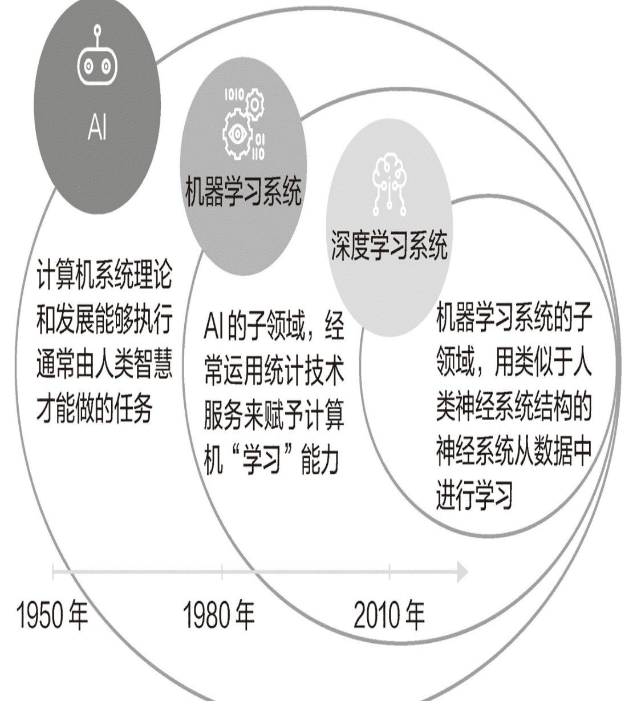
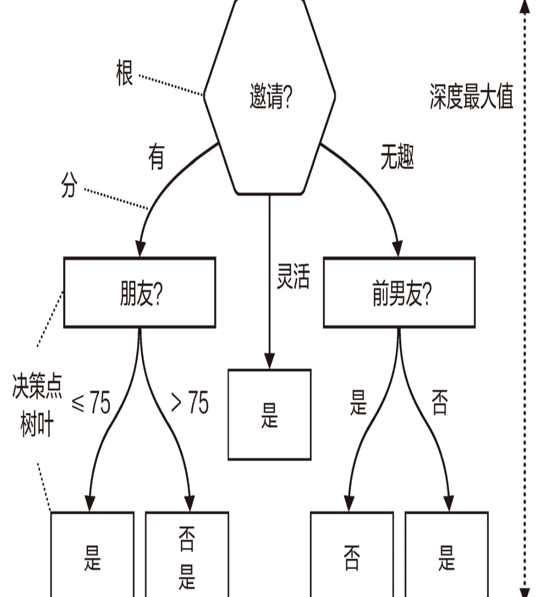
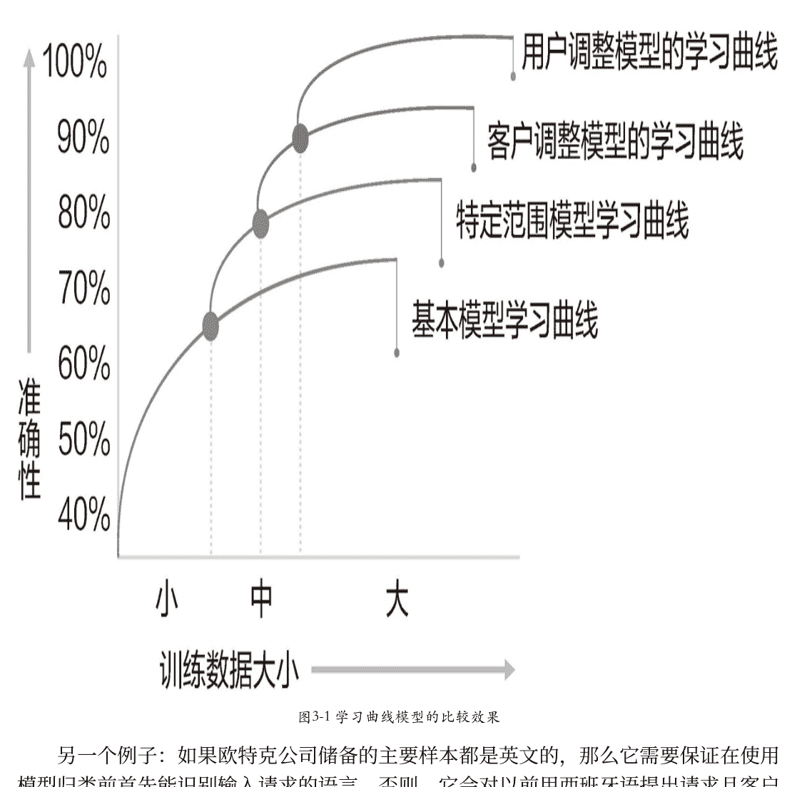
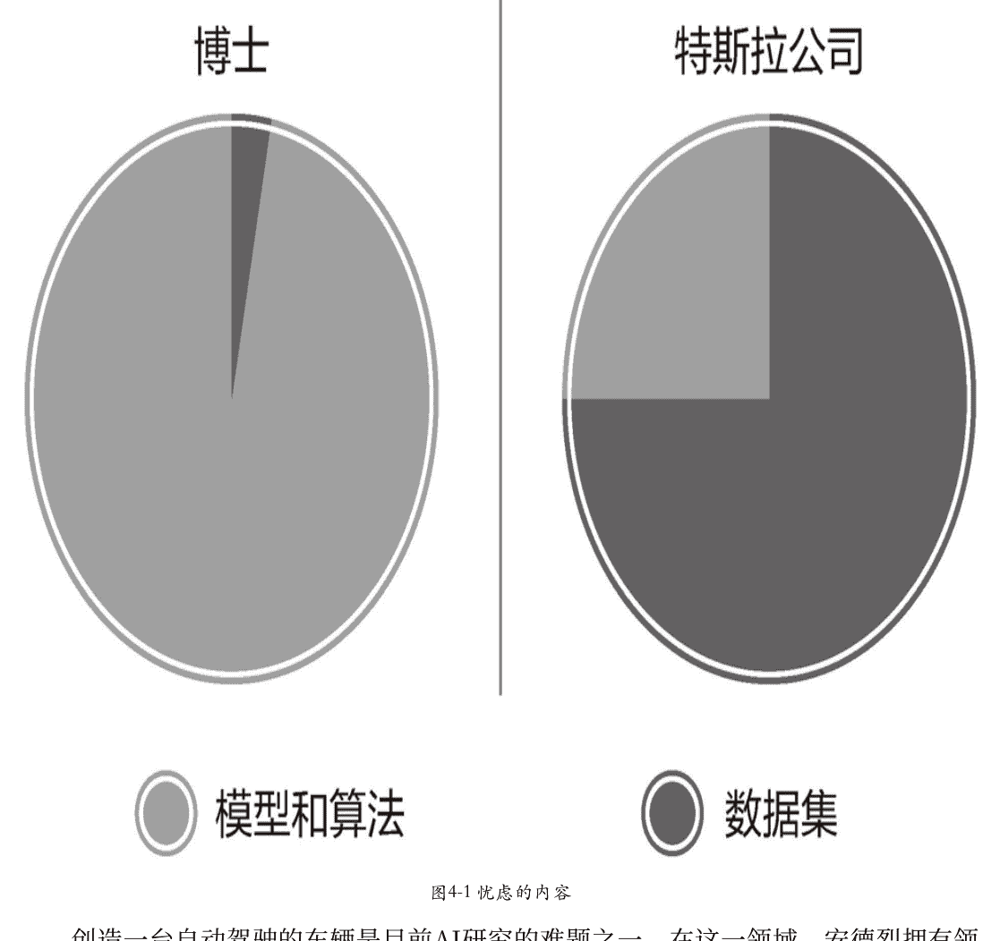
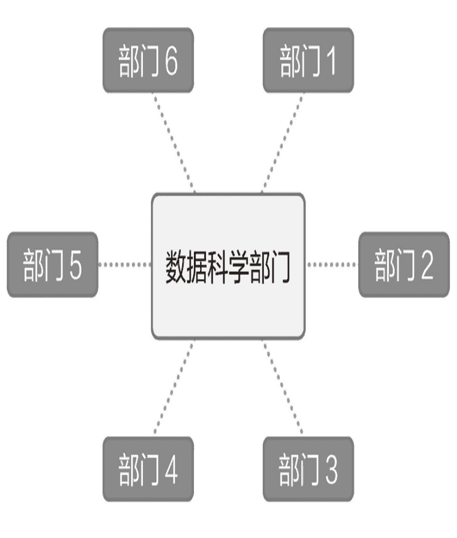
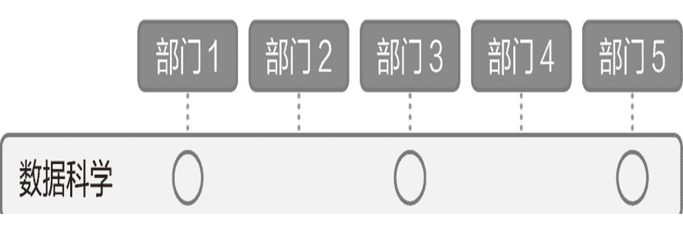
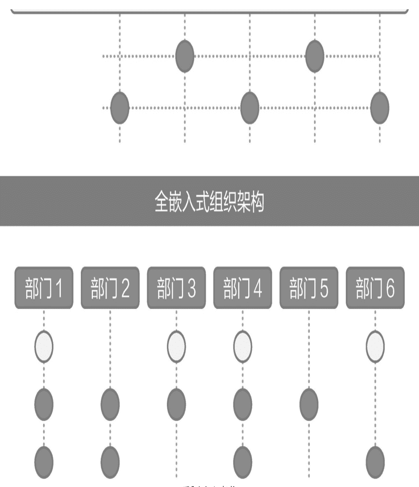
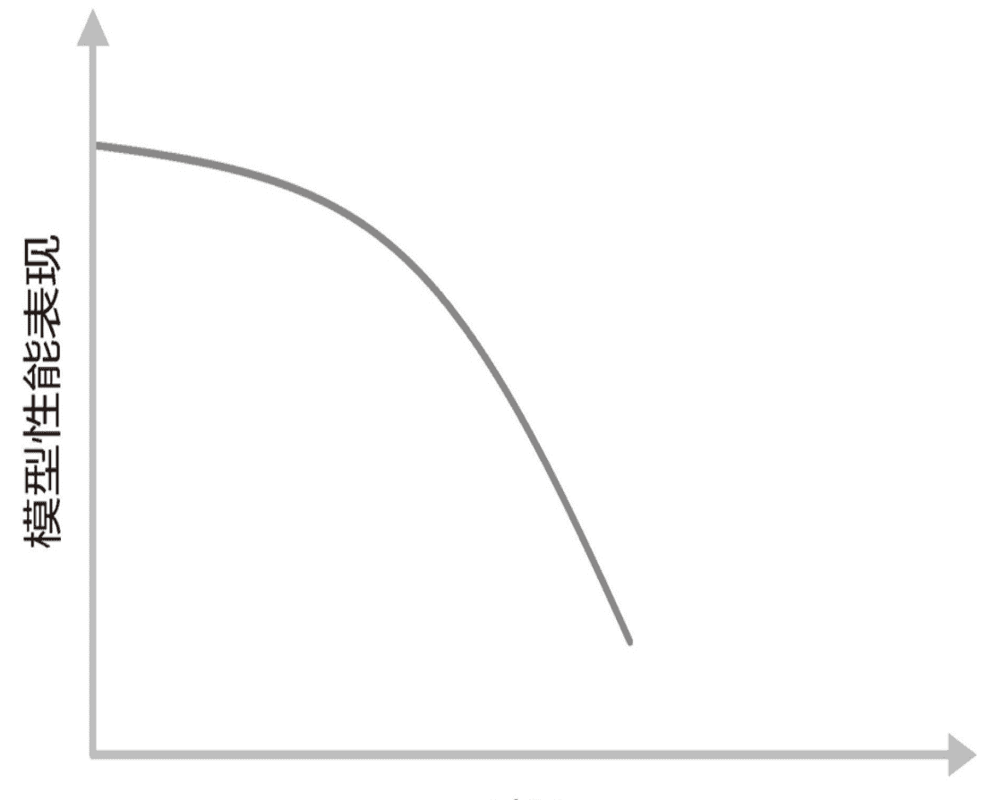
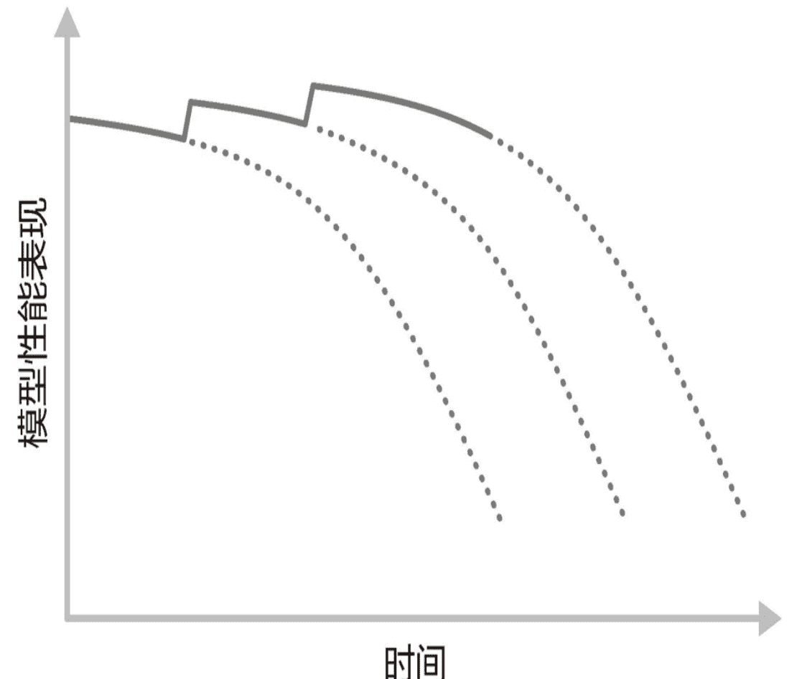
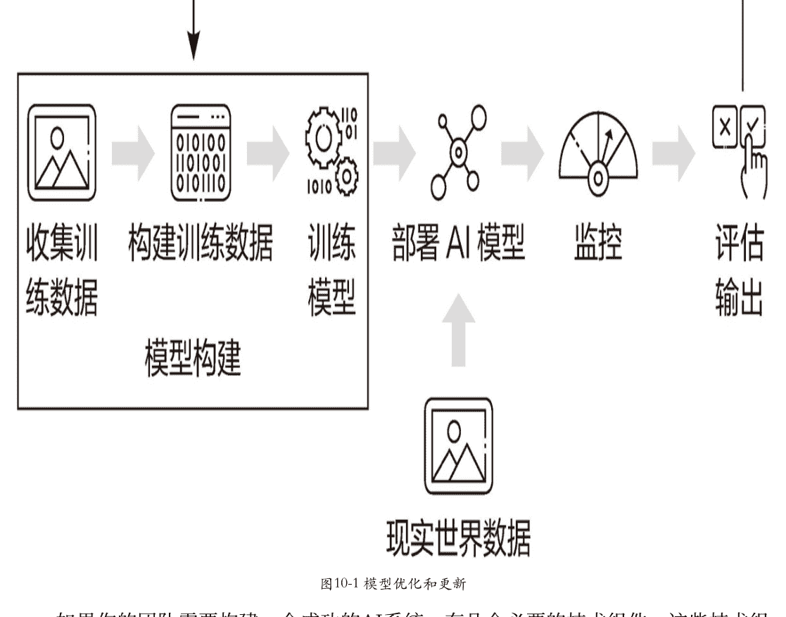

# AI图景：Sora时代的人工智能应用

## 作者简介

**阿莉莎·辛普森·罗赫韦格**

Alyssa Simpson Rochwerger

美国三一学院毕业，曾任澳鹏 Appen 的人工智能与数据副总裁、IBM Watson 的产品总监。如今执掌加州蓝盾 Blue Shield of California 的产品线。她擅长把概念级产品推向大规模商用，是以客户为中心的资深产品领导者。

**逄伟**

Wilson Pang

浙江大学电气工程科班出身，2018年11月加入澳鹏 Appen 担任首席技术官。此前先后担任携程 Ctrip 首席数据官、eBay 加州高级工程总监、IBM 架构师，带领工程师、分析师、产品经理与科学家协同作战，拥有超过19年的软件工程与数据科学经验。

## 序言

阿莉莎

2015年底，我在IBM新组建的计算机视觉团队里担任产品经理，首款面向客户的视觉识别API即将上线，倒计时只剩数天。数月来团队围绕一个目标打磨：打造比市面模型精度高出两倍以上的商用视觉接口。IBM寄望这项接口能成为新的稳定收入来源。为此我们把精力全放在提升F1分数上，F1分数是业界通用的精度评估标准。

这款API能给输入图像打上描述性标签。比如输入一只棕色猫的照片，会返回“猫”“棕色”“动物”等标签。企业可以用来在社交媒体上画像用户偏好做营销，或优化客户体验。为训好模型，我们动用了上亿张来自不同来源的配图。效果看起来很理想，连我妹妹婚礼上我和伴娘的合照都能被准确识别。

就在发布清单全部就绪、离正式上线仅差几天时，研究员发来一条让我心寒的消息：产品不能发。原因是一张轮椅用户照片被系统标记为：

失败者。

IBM百年历史里一直强调包容与多元，这个输出不仅结果荒谬，更与公司价值观冲突。我们拼命追精度，却把无意的偏见也一起训练进了模型。

我立刻叫停发布，并向管理层同步风险。团队随即进入修复模式。我们不仅要修模型，还必须回答两个问题：为何会发生？如何确保不再发生？

责任远不止精度

2015年10月我加入IBM Watson时，正值Watson团队扩张期。很多人还记得2011年Watson在《危险边缘》节目里击败肯·詹宁斯和布拉德·拉特的场景。那次胜利向世界展示了机器学习处理自然语言的潜力。四年前后，IBM开始把Watson的思路扩展到音频、视频，希望从游戏奖金转向可持续业务。

我的任务是为计算机视觉写出商业化路线图，把学术探索变成真生意。当时Watson已有多个计算机视觉原型，但都未规模化变现。IBM的老牌OCR自1975年起就被美国邮政USPS用于分拣，现在客户需要更丰富的现代化能力。

团队里有二十余年的老兵在争论用何种算法提升准确率，而我几乎是AI小白。我曾天真地问：换一种方法后，怎么知道结果更准？没人能马上给我通俗答案。几周的速成学习后，我们达成共识：F1分数提升，就意味着更好。

于是我们锁定了单一目标：做一个极其精确的系统。做到了，但也把偏见带进了训练数据。轮椅照片触发灾难性标签时，错误已很明显。

作为新手，我没意识到避免这类结果需要做什么。更糟的是，整个团队对一亿张训练图像里究竟出了什么问题都缺乏清晰认知。这是一个巨大的疏忽。

修复时，团队手工检视了上万个候选标签，从海量资料库里抽样测试，用人类判断来核验业务场景是否合适。付出大量额外成本后，我们筛出了十几个与团队价值观不符、也与IBM公众形象相悖的标签，移除后重训，问题才消失。耗时漫长，但最终在确认系统无攻击性标签后才放行。

我很幸运有资源去补救。在一个价值观高、支持强的公司，和一群正直聪明的同事一起工作。但同期微软、谷歌的模型也曾因不当输出引发种族歧视争议。IBM躲过一劫，可如果没有主动预防机制，类似问题必然重演。

### 解决真正的问题

好消息是躲过灾难，坏消息是产品并不成功。

上线后API并未带来明显收益。客户反馈它不够实用，无法推动业务。这成了我AI生涯的第二次顿悟。我深入客户现场后发现，我们追求整体精度，却忽略了客户真正要解决的细分问题。对他们而言，标签需要非常具体。

一家肉制品企业想用产线摄像头区分鸡胸肉和鸡腿肉，系统只回“鸡肉”“食物”；一家冰淇淋品牌想在社交图片里监测新品露出，系统只回“冰淇淋”过于宽泛。

我们把产品重构为可定制训练的系统，让每个客户用自有业务数据微调模型。鸡肉厂能区分部位，冰淇淋厂能按标准分类。六个月的投入后二次发布，收入迅速攀升。客户只需少量精挑数据，几分钟就能训出满足需求的模型。

IBM的困境并非个例。主流企业里，约20%的AI试点能进入生产，大部分无法交付客户价值。原因或是瞄错问题，或是忽视变量与偏见，而这两者决定模型成败。

逄伟

我也见证过负责任AI带来增长，同时也经历过类似阿莉莎的挫败。

2006年我加入eBay。2009年公司处境糟糕：股价跌破历史高位每股24美元、裁员、增速为负、市占率下滑、技术团队缺乏创新。

转机来自对技术的重注，新CEO、CTO及一批技术领袖把工程师变成思想引擎，与其他部门平起平坐。我有幸组建搜索科学团队，最早用机器学习优化买家体验，目标是提升单次对话购买次数。即浏览次数与销售次数的转化。模型越强调浏览量，排序越往前。

数据充足，我们能快速A/B测试。许多模型把转化率推高了，其他团队也跟进。

直到财务发现：测试成功并未带来业务增长。我们被叫进作战室，紧急排查。

深入分析后发现“配件污染”。买家搜iPhone时，手机壳等配件常被排在前面。配件受欢迎，但不是用户本意，体验被破坏。10美元的手机壳收益远不及300美元的手机，收入因此下滑。

衡量方式决定成败。

起初技术团队统一目标：提高销售额。eBay极度客户导向，卖得越多越好。但我们用“单次购买次数”衡量，模型达标却损害体验与增长。必须换一套评估标准，错误的衡量会诱发错误的动机。

### 数据与机器学习系统的力量

我们把价格信息纳入模型，清除配件污染，并把指标从单次购买次数改为单次购买商品交易总额GMV。

当全公司看到数据与机器学习的威力后，更多团队拥抱AI，销售受益，工程师文化被重塑。2012年eBay股价上涨65%，销售额达1750亿美元，占全球电商约19%，占全球零售近2%。

eBay的起势得益于海量数据库，能快速训练并扩展AI。并非所有公司都有此条件，也非所有公司都能投入建设。然而今天，错过AI就等于丧失竞争优势。AI既让人望而生畏又技术密集，如何跑赢市场又如何保证开发负责任且影响积极，是每个组织的问题。

幸运的是，成功与负责任的机器学习源于同一套流程。推出负责任且成功的AI产品并非难事。这本书就是为了帮助想打造世界级AI产品的组织，降低风险。

后续章节会讲如何启动大规模负责任的AI路线图。阿莉莎和我结合实战案例，谈如何选问题、数据为何关键、如何使用与扩规模，如何在开发、执行、维护的每个环节兼顾安全与伦理。

### 我们是谁

我并不像典型的AI领军者。我是学文化与摄影的，美国研究文学学士，阅读障碍者，拼写困难，编码也几乎无能。2015年前几个月，我在一趟伦敦到旧金山的航班上，偶遇一位成功人士。她问我职业规划，我得了一句指引，从此萦绕心头：

“去解决困难的问题吧，其他的一切自然就会解决了。”

我开始向所有能请教的人讨教，寻找能融合热情、技能与抱负的难题。很多导师劝我拿头衔、拿期权、去创业公司。但我想要尊重的团队、想做的不只是优化底线，而是在能让世界变好的团队里解决真正棘手的问题。

加入IBM Watson后，我正好赶上机器学习商业化的起点。从Watson到Appen再到加州蓝盾，我始终用数据与机器学习攻克难题。AI发展越快，负责任的发展就越重要。为避免有害结果与不必要偏见，组织必须有情感敏感度，在模型构建与优化全程谨慎处理数据。负责任的AI不仅更好，也让业务成果更有意义。

逄伟

我的职业起步于IBM，为银行、电信和证券交易公司构建大型系统，深知软件的掌控感。

五年后加入eBay，先做账单支付系统，之后有机会组建搜索科学团队，用机器学习扭转业务。一开始我犹豫是否转行，导师是必应图像视频搜索团队的创建者，也是eBay转型的领军者，他说服我迎接挑战。

接下来两年，我业余时间全部投入机器学习知识与统计研究。虽紧张，却亲眼见证机器学习改变企业。随后我领导水平数据服务团队，把数据驱动决策带到全公司，还建立零售科学团队与数据实验室，帮助卖家定价、预测库存、为买家发现商品。

在eBay干了十一年半后，我去携程担任首席数据官。团队用搜索、推荐与客户关系管理大幅提升业绩，用AI降本增效，建立公司数据底座，改变旅游业。

随着行业拥抱AI，我意识到能帮助企业加速落地。这促使我加入澳鹏担任CTO。澳鹏是AI数据领域领导者，致力于提供高质训练数据，解决从业者最大痛点。过去两年我们在试生产阶段的平均部署率达67%，远高于行业20%的平均水平。从一开始就建立AI责任与良好数据管理，长期来看更具适应性与成功率。

### 你将在这本书中学到什么

AI正在掀起一次类似电力、互联网级别的结构性变革。机器学习的能力几乎在重写商业规则。十年前能说自己有社交媒体策略的餐厅屈指可数，如今反过来，找不到社交策略的餐厅才稀奇。我判断用不了几年，企业界找不到AI战略的公司也会变得稀有。今天对AI战略无动于衷，差不多等同于2002年无视互联网、2008年无视移动端的企业，竞争力会迅速掉队。

我们清楚这种焦虑，也正因此写下这本书。想把AI从神秘的外衣里剥开，给出可落地的启动路径。内容建立在大量行业调研、数十位初创与大厂机器学习一线从业者的访谈，以及我们在真实场景的实操经验之上。我们能帮你搭出适配自身业务、又具备环境变化适应性的AI系统，而非手把手教数据科学或模型选型，那部分交给专业人才。我们更想帮领导者看懂战略方向该怎么选、如何实质性参与、怎么为成功建立路线。

这本书也为业务线与技术线搭一座桥。产品经理需要理解技术的边界，工程师与数据科学家需要理解商业的诉求。共通语言能把沟通隔阂降到最低。

走向负责任的AI绝非坦途，但有了实践指引，成功概率会大幅提升。用机器学习优化成本、提升业绩并不高深，反而很容易上手。它需要的是跨职能协作与一点创新气质，几十家公司已经做得很漂亮。

关键是小步快跑、持续迭代。从这一刻起，AI比你想象的更近在咫尺。

## 第一章 AI的基础逻辑与它的短板

> AI是科学工程，让计算机按照人类智能的期望去运转。

——前卡内基梅隆大学计算机学院院长 安德鲁·摩尔 Andrew Moore

2019年8月，苹果与高盛联合推出备受关注的苹果信用卡。随后却为一个没料到的缺陷忙乱。产品凭借安全性与设计快速吸客，到11月高盛报告显示信贷发放已达100亿美元。热度背后暴露出审批偏见：女性获批的信用额度普遍低于男性。BaseCamp联合创始人戴维·海涅迈尔·汉森在社交媒体指出，自己获得的额度是妻子的20倍，尽管夫妻联合报税且妻子信用分更高。苹果联合创始人史蒂夫·沃兹尼亚克也证实同样遭遇，额度相差10倍，两人并无独立账户或资产。

起初苹果内部无法解释算法为何如此判断。高盛称审批未设性别偏好，经第三方审核，且流程中根本不采集性别信息。汉森回击：把评估交给黑盒，没有歧视意图却产出歧视结果。

《连线》2019年11月的分析点出关键：性别盲计算并非真正盲。若输入或相关特征与性别高度关联，结果仍会偏斜。研究反复显示地址、消费场所等代理变量会携带种族、性别信号。苹果为避偏见去掉了性别字段，却保留了间接关联特征，等于用另一种方式重建了偏好。明明没填性别，却仍能“看得见”性别，偏见无处可查。

案例说明两件事：AI模型必须持续做稳定性测试与监控；负责任的AI很难实现。即便资源庞大的巨头也会吃力。若你觉得自己公司在低风险前提下试水AI很困难，并不孤单。苹果之外，谷歌、沃尔玛、特斯拉、微软等数十家头部企业都在反复碰壁。

业务专家而非数据科学家，在判断输入变量的重要性与商业目标下的可接受置信度上起决定作用。数据科学家的职责是提对问题。若模型解释对业务无意义的变量，准确率再高也徒劳。负责任的AI既是商业之利，也是社会之益。在能构建负责任系统前，先熟悉底层常识。

### AI日常里是怎么工作的

人们一提AI常想到机器人，其实每天都在无感交互。工作出差拍收据报销，计算机视觉的机器学习系统会抽取文字信息。打客服电话或语音导航，语音识别模型把口语转成指令。刷Instagram，推荐系统推送个性化内容，发帖时另一个系统决定呈现范围。手机拍支票上传，资金“神奇”到账背后是文字识别与反欺诈模型的连环判断。每次与苹果、谷歌、亚马逊语音助手对话，语音识别也在实时解读你。

这些交互通常被动、无缝，你甚至意识不到在用AI。AI是不断演进的技术集合，其定义随技术演进。现代AI虽早有哲学雏形，1956年达特茅斯会议才确立为正式研究领域并命名“人工智能”。经历上世纪70年代初与90年代初两次寒冬后，于90年代末重现生机。随后出现电脑击败顶尖象棋大师、在《危险边缘》胜出的场景。2021年后，数百万人用自然语言向穿戴设备或家居设备查询天气、路线、烹饪指导，设备礼貌回应，只是偶尔出错。

广义上，AI指机器完成原本需人类智能的任务。机器学习是子集，指算法在不被显式编程的情况下从数据中学习并提升表现，如苹果信用卡审批。深度学习是更复杂的分支，多采用类脑神经网络，可处理酒店客人上传照片中的食物、地点、天气等多元素识别与分类。

很多人把AI想成黑盒，东西进去、魔法出来。盒子本身并非不透明，所谓的黑盒多指在有限数据上训练的模型算法。如同汉森批评的案例，数据进去模型被训练成预期答案。数据充足时模型学会区分输入模式，训练后可对未见数据给出带置信度的输出。输出质量完全取决于人类管理的数据输入，类似幼儿模仿大人说话，会说“请”“谢谢”，也会冒出脏话。

### 训练与推理

要得到机器学习模型，就要训练它。像带小狗，每次说“坐下”，它做出动作就奖励。重复后，指令与行为关联建立。训练AI逻辑相近，只是对象是模型而非宠物。你教它什么是正确，过程叫模型训练。

数据科学家把大量数据喂入机器，让模型拟合数据。模型形式从简单直线方程到复杂逻辑网络不等。训练过程确定参数也就是权重与偏置。过去需大量手工矩阵计算与代码调试，如今TensorFlow、PyTorch提供模块化框架，大幅降低上手门槛。

训练好的模型要用来做新数据的预测，这一步叫推理。中间还包含打包、部署到生产、监控表现、发现性能漂移时刷新等环节。把机器学习系统全生命周期流线化管理的实践，被称作MLOps。

### 监督、无监督与强化

深度学习虽流行，了解传统方法仍有价值。以决策树举例：是否去同事派对，取决于有无空闲、派对是否有趣、是否临近交通站点等输入。不同因素权重不同，综合超过阈值就去。

对计算机必须明确给出决策规则。数据科学家与业务方需提前界定阈值，模型只会按已知规则行动。若知道前任会出席，理应直接否决。若未把该因素纳入并通过样本训练，决策树仍会按原输入判断。此例属于监督学习：基于已有的人类标注数据模仿决策。绝大多数商业场景采用监督学习，因其任务可重复、可规模化。

无监督学习在无正确答案的数据上寻找内在结构。强化学习则通过试错获得奖励，逐步学会提高正确率的策略。

### 你在AI构建中的位置

AI项目常像组织传话游戏。业务方构想，执行者落地，中间经过多层转译。模型建成时，建造者往往不理解业务背景，权衡时缺乏依据，最终偏离初衷。

Databricks机器学习负责人布鲁克·威尼格曾在MyFitnessPal实习。App鼓励用户记录饮食，通过游戏化帮助减重。她负责把食物归类为水果、蔬菜等，以便广告投放。用户输入常拼错，如apple写成三个P，banana写成三个N。她花六周清理数据、绘制层次，却发现归类不符合产品团队的商业诉求，浪费大量时间与资源。根因是业务方并未明确说明哪些分类真正产生价值。

业务参与者的工作是精确界定输出对业务的意义。建模的大部分精力其实在确定可接受阈值。高质量数据下，输入与输出衔接更顺畅。如今Databricks、Weights & Biases、IBM AI 360等工具让模型迭代更快。你的数据团队应善用这些工具。

在设定范围时，兼顾伦理影响。把精准度定在90%，意味着10%的错误率。若用于工单分级，可接受；若用于性暴力报案分流，则是严重道德与法律风险。优步的COTA系统用机器学习与自然语言处理把工单分类并派发，准确率至关重要，一条性侵投诉被误发至技术支持都是不可承受的失误。此时产品经理的商业判断至关重要，平衡速度、风险与准确度。

若模型替代了过去依赖人类道德判断的环节，团队单一化会带来无意识歧视。微软聊天机器人Tay即为例子。它用增强学习学习对话，训练数据来自公共推文，未做过滤。结果被灌输大量恶意内容，最终输出种族主义言论。缺乏对数据相关性与适用性的把控，模型会复制网络噪音。

AI不是魔法，而是一套技术组合，套用在明确的目标决策上。因为它进入日常生活，设计方式直接决定结果。参数与范围的选择、足以支撑业务的精准度标准、何时如何部署、怎样持续监控，都是成败关键。

想像一下急诊室里的一幕。病人推门进来，医生如果能立刻调出完整的病史，往往就是救命的关键。可现实是，同一个人的就诊信息可能长得完全不一样：姓名不变，但出生日期的格式从1/1/1980变成01/1/1980再变成01/01/1980；住址从1500 Main Street写成1500 Mn St，甚至写成1500 Maine St；城市写NY也写New York。表1-1里那三条记录，人眼一看就知道大概率是同一个人，但机器却没那么笃定。

医院现在普遍靠机器学习做记录归并。做业务的人要问的是：把不同人的病历误合并，会带来什么后果？还是说，眼看着本该匹配的记录没被连上，导致医生错过关键病史，风险更大？没有人会把决策全丢给模型。我们必须先设计好业务规则、数据清洗逻辑和置信度阈值，再让模型在可控范围内判断这三条记录是否属于同一人。说到底，AI只是工具，它的价值取决于你把它用在什么业务上、怎么用。

### 目标放错位置的代价

在AI领域烧钱最后打水漂的事，比你想的更常见。即便团队很强、规划很漂亮，项目照样会空转。

2013年10月，IBM宣布与美国德州大学MD安德森癌症中心合作，用沃森认知系统把癌症研究推向新高度。三年多时间过去，中心砸下超过6200万美元，项目最终被搁置，技术一个病人都没用上。

问题出在哪？团队把机器学习直接套在“攻克癌症”这种宏大目标上。AI能解决的是当下具体的问题，而不是遥远的愿景。AI也不是装好就不用管，它需要持续维护、管理、修正航向。没有清晰的目标、衡量方式、预期和里程碑，成功概率几乎为零。这就是典型的AI陷阱：许诺难以兑现的解决方案，却缺乏落地路径。看到苹果、MD安德森这样的故事，很容易得出“投资AI是错的”结论。

失败并非必然。AI是人造的，数据是可准备的，设计出能产生预期结果的系统完全在可控范围。当你有意且负责任地让AI去解决一个具体且有价值的业务问题时，成功率和用户体验都会显著提升。

### 当本该好的AI变味

目标清晰了，技术仍可能失控，伤害的不仅是企业，还有社会。

**谷歌翻译的性别偏见**
2018年谷歌为神经机器翻译做了针对性优化，想减少性别偏见。模型在数亿条跨语言平行语料上训练，不同语言的阴阳性差异被学了进去。用户输入“强壮”“医生”等阳性词，或“护士”“美丽”等阴性词，模型就会固化关联。土耳其语代词本身中性，输入“o bir doktor”，翻译仍会变成“他是一个医生”。

谷歌的补救在输出端做了限制：对性别中立的输入，英语输出同时给出“他是…”和“她是…”两种形式。

但偏见更深。以“[不分性别代词] 是 [形容词]”为模板时，“努力工作”会被自动分配给“他”，“懒惰”则偏向“她”。

前

后

图1-3 谷歌翻译结果案例

谷歌明确表示要促进公平，但训练数据来自庞大的人类语言库，必然带有全球性别惯例的烙印。任务的核心其实是管理输出，并持续处理有偏见的输入。

**亚马逊招聘**
2014年亚马逊启动AI简历筛选项目，给候选人打1到5分，想在海量申请中快速挑出前5份。模型用过去十年亚马逊收到的简历训练，当时投递者以男性为主。结果系统偏爱男性简历，对出现“女子”“女子运动队”等词汇的申请明显降分。

到2017年，亚马逊不得不放弃该工具，因为缺乏无偏见的训练数据。随后他们换了思路：开发一个通过互联网发现潜在候选人的AI，把历史简历喂给模型，让它学习与职业技能相关的术语。偏见却依旧存在：训练数据男性占优，模型学会了男性常用的描述词语，爬虫反馈的候选人大多仍是男性。最后项目被关停。

谷歌和亚马逊都想做负责任的企业，会监控结果、听取反馈并快速调整。这正是负责任AI的体现。

**假释决定的经典不公**
COMPAS用于预测再犯风险，帮助法官做是否假释的决定。2014年调查发现，其预测可信度极低：被判定高风险的暴力再犯者中，只有20%真的再次实施暴力，准确率勉强超过抛硬币。

更致命的是种族偏差。无论罪行如何，黑人被告被标记为高风险的概率显著高于白人。劳德代尔堡的布里莎·博登，因骑了几分钟邻居的未上锁滑板车被控轻罪盗窃，被打了8分高危。41岁的弗农·普拉特在Home Depot行窃，入狱前已有多次持械抢劫记录，却只得3分低风险。布里莎是黑人，弗农是白人。

开发商Northpointe辩称模型不含种族信息，问卷有137个问题，问父母是否入狱、朋友是否吸毒、学校是否打架等态度题。就像苹果信用卡App回避性别提问一样，回避了显性变量。但软件最初并非为法庭设计，用非定制模型做影响一生的决定，本质上是不负责的。

AI正以巨大的力量重塑世界，从居家设备到全球决策。它也在无数人身上产生即时影响。正因为如此，构建AI解决方案时必须确保道德、安全，并让世界变得更好而非更糟。负责任的AI对企业和世界都有好处。

## 第二章 制定一项AI战略

> 成功创造AI将是人类历史上最大的事件。但不幸的是，除非我们学会如何避免风险，否则，这也可能是最后一次。
> ——斯蒂芬·霍金

AI本身不是目标，它是极具变革性的工具。战略上要追求的是业务目标，而非为了造AI而造AI。

**逄伟的经验**
我在eBay工作11年，公司整体在向更结构化、可扩展的系统流程演进。2015年前，各部门各自推进AI，却没有统一战略：从构思到上线一个模型要数月，内部采购慢、跨部门取数难，效率损耗让市场竞争力受威胁。

2015年eBay决定投资内部平台整合AI，代号克雷洛夫。项目组由AI平台团队、基础设施团队和各业务领域团队组成。广告、计算机视觉、风险、市场、财务等部门的人都参与进来，共同制定战略路线图。

探索阶段先梳理全公司AI的瓶颈，与研发团队对齐日常工作流，构建并细化企业数据库。战略明确了未来几年要实现的大规模集中式安全训练数据集群、模型全生命周期的自动化训练与部署、数据的发现准备与存储流程。原则上支持多场景、多框架、多硬件，并坚定拥抱开源。

平台没有一蹴而就，先做小而独立的项目来验证。再给各团队分配可量化、与业务直接相关的指标。为了让全员熟练AI，还推出了工程师轮岗嵌入平台团队的计划，既提升技能，也形成了反馈闭环。

克雷洛夫落地后，模型从想法到上线从一年缩短到几天。集中化管理降低了数据流动风险，产品迭代提速让eBay重新夺回市场主导权，文化和基础设施也变得能随客户需求快速调整。成功源于有凝聚力的整体战略，而非把战略当成成果来宣传。关键在于你清楚想要什么、为什么要它、为何重要。

**为了AI而AI的反面教材**
2016年纽约大都会艺术博物馆慈善舞会上，时装品牌Marchesa与IBM沃森合作推出“认知礼服”。裙子上布满LED，沃森实时分析推特上关于裙子的情绪，正面情绪就亮一种模式，负面就换另一种。裙子不卖，只是AI进入时尚的一个噱头。合作后没有延续，更多是吸引眼球，商业价值有限。

反观米兰一家高端面料公司，为古驰、路易威登等供面料。厂区聚集了大量画师，保存了逾75年的约5000种圆点花样，部分被生产，部分闲置。客户常要“类似的样”，艺术家只能重新画。海量图纸按年份堆放，根本找不到70年代的某个备选设计。

他们用AI做视觉相似搜索，从档案里快速找出与客户审美相近的样稿。5000个圆点花样被重新激活，艺术家不必每次从零创作，服务效率大幅提升。这才是把AI用在具体业务痛点上。

**识别AI该解决的问题**
选AI像选软件包，都要考虑成本、培训、团队接受度。核心是先想清楚你要用它输出什么、期望达到什么结果，投入的时间和金钱是否匹配。

沃尔玛想提升到店体验来增加复购。货架缺货就是糟糕体验。门店商品上万种，人肉一天巡四次对照表格不现实，也要雇几十人专门记进出库，既贵又挡通道。

这类对人类来说繁琐重复、对手来说却很合适的问题，就是机器学习的绝佳场景。

沃尔玛与波萨诺瓦机器人公司合作，让机器人走过过道拍摄全景。机器学习模型分析图像，识别商品并标记缺货，系统几分钟内通知补货员。整个闭环必须在1小时内完成才有作业价值。

当AI被用来解决真正具体、可衡量、能带来业务价值的问题时，它才不再是噱头，而是生产力。

沃尔玛那批扫货架的机器人，刚上线时看起来很能打。靠着实时盘点数据，店员能把空位补满，顾客不再碰到空货架，进货节奏也被重新调顺，效率明显上去。这件事很好地说明，大麻烦往往是若干小型的机器学习模型，加上硬件、软件和工程能力的组合拳才搞得定。可故事最后还是收场了，五年扩张下来机器人占了太多通道，公司决定停用。教训很清楚，机器学习只是工具箱里的一个工具，最终要的是最合适的组合，而不是单一技术。沃尔玛把智能当作整体方案的一环来用，而不是全部，这种思路其实在各行各业都能看到。

农业就是个很直观的例子。现在不少农场已经用算法把作物养得更健康、更可持续，成本还不往上走。过去人手不够，做不到选择性用药，只能大面积喷洒，对环境很不友好。现在把摄像头接到喷药装置上，模型能逐片检查叶片上的虫害，直接告诉喷头去哪里喷。实测里杀虫剂的采购量和残留都能砍掉九成。智能除草也在推进，被约翰迪尔收购的蓝河科技就靠摄像头和模型区分作物和杂草，实现靶向除草。人省下来，农药和除草剂都少了，对生产者和环境都是好事。

### 组建能落地的复合队伍

业务负责人很难一眼判断哪些问题现在就能用人工智能去啃。数据可能不对口，业务场景也可能没覆盖。很多人第一反应是招个数据科学家就能搞定，事实是招人只是第一块拼图。

真正能把事做成的，是跨职能的组合。除了建模的人，还需要会做用户访谈的用户研究员，去挖出真正痛的业务点；需要机器学习工程师来评估现有信息能不能撑住问题，以及怎么补齐信息。

更关键的是队伍里必须有懂业务的牵头角色，比如产品经理或业务线负责人，他们清楚终点是什么，能保证研发的输出对应真实运营需求。技术模型再漂亮，非技术的一面同样重要，甚至同等重要。

再有，战略、问题、团队齐全也不够，没有算力、存储、网络这些底座，以及把数据调取、保存、搬运到合适位置的能力，项目就会卡住。就像外科医生离不开手术刀、手术室和护士团队一样，负责计算、存储、网络的运维人员必须在组里，他们的支持决定策略能不能落地。

数据怎么进来也是要提前想好的事。没有稳定、干净、高质量的信息通道，再好的硬件也训练不出可靠模型。业务里的数据拥有者最清楚来源，应该直接拉进团队。

### 先把成功定义清楚

项目启动前把成功标准说死，极其重要。要优化的是你真正关心的指标，而不是附带现象。易贝当年就因为附件污染影响收入吃了亏。如果目标是提效，就别拿病假天数去衡量，工作量翻倍的团队病假多也正常，指标必须对得上目标。

脑癌筛查的例子很经典。公众筛查里模型报99%准确率听起来惊人，实际上因为发病率不到百分之一，一直报阴性也能达到99%。这种定义下的成功毫无价值。对筛查类问题，假阳性和假阴性的权衡才关键。商业团队往往不容易理解这些度量差别，但战略沟通必须把大家对成功的共识对齐。

大家都想一上来就做前瞻性的AI项目，但太多团队在动手前没把战略和目标钉住。买酷炫技术很容易，没服务业务就会失败。机器学习产出必须和商业价值挂钩，不然就是浪费时间金钱精力。

易贝做得就很扎实，确认问题、搭好跨职能队伍、执行多年的战略，最后大获成功。公司规模大不大、资源多不多，都不妨碍提前把战略想清楚。

别想着一次解决全部。贪多会全盘皆输。先挑一个小切口做，做出动能后再迭代放大。第一个选中的议题往往会成为整条AI旅程的基石。

## 第三章 挑一个合适的切入点

> 把AI硬塞到不合适的场景，除了让人觉得像业余爱好者乱撞，还会让维护成本飙升。对真正需要解决的问题，用最合适的方案才有胜算。如果不用AI也能做到，那更好。机器学习是当其他方法达不到所需性能时才用的手段。

——谷歌首席决策科学家 柯凯茜 Cassie Kozyrkov

把人工智能嵌进业务，不等于让机器学习一次性解决所有事。最好的办法是先找一个够具体、够合适的切口，用它的成果积累势能。这就是常说的“金发姑娘”问题。

欧特克在接触AI前，技术支持几乎全靠人。数百万工程师和建筑师用AutoCAD LT做设计，出问题只能打电话或发邮件，形成漫长的手工队列，平均一个案例要一天半才能闭环。引入AI后，他们没去搞全量自动答疑，而是锁定一个最突出也最具代表性的痛点：密码重置，来改善用户体验。

把网站登录的密码重置请求挑出来，天然适合自然语言处理。用户提问方式高度相似，像“我登录不了”“帮我重置密码”。公司手里有海量历史邮件和通话记录，每月此类请求以数千计。自动化后，客服能把时间腾出来处理更复杂的问题。

更重要的是，提这些请求的人通常很焦虑。重置密码这种小事也要等一天半，核心工具用不了，体验差直接烧钱。

明确目标后，欧特克建了一个模型识别工单里是否在问密码重置。识别后自动引导用户到自助重置页面，无需人工介入。研发不只做NLP，还把内部系统连起来校验请求者权限。最终处理时长从一天半压到10到15分钟。

这是个很好的概念验证。模型不需要完美就能创造价值。起初识别率约七成，已经把解决时间的下限明显拉低。随着迭代，模型不断扩容，最终能识别60多种用途，从激活码、地址变更、合同问题到技术问题等，都能自动化，解放客服去处理更复杂的诉求，平均案例时长进一步降到5.4分钟。

当时运营副总裁格雷格·斯普拉托说，识别能力让公司解决用户问题的速度提升了99%。成本降了，体验好了，也带动了全公司对AI的投入。

他们先挑一个可控且有价值的首个问题做透，范围窄但商业影响可量化。没一上来就把60个场景全自动化，而是先快而好地证明价值，形成可复制的模板。更关键的是，团队把经验带出了小圈子。

能先拿下一个关键问题并证明效果，后续十个问题的资源和支持会更容易拿到。选切口时，用可控的机器学习组件去找规模和影响的甜点，这才是准备的关键。

“金发姑娘”问题长什么样？

### 先从微小可控的切口开始

理想的切口要足够小，能快速闭环。把请求分到两个桶里：是密码重置还是不是，这就是好切口。理性的人很容易达成一致，判断快且不易被质疑，放大规模时一致性也高。

反过来，歧义性强的分类就不适合。把工单分到上百个类别，需要专家花数周学习规则，别人对结果的同意度也很低，也不适合做起点。酒店评论分类看似直观，实际标注成本极高。

从人类能可靠重复、机器能更快更大规模完成的任务入手。

美国邮政的发展轨迹很典型。1965年第一台高速光学字符阅读器上线，做初步分拣；1982年单行OCR配上条码，实现全程自动分拣；1997年手写识别系统上线，首年就省下9000万美元。核心始终是同一个简单任务：读一行信息，把信件送到该去的地方。人类做得快准，机器做得更快更大规模，这就是好切口的雏形。

### 数据在哪就用哪

好切口往往自带历史标注。欧特克的密码重置请求本身就有大量已标记的历史记录，直接拿来训练。没有现成标注，就得花时间人工梳理，成本高。

数据质量也得盯紧，避免无意识偏见。IBM服务过一家以西班牙语为主的呼叫中心，语音识别准确率一直不理想。团队很快定位到问题：模型主要用智利西班牙语训练，而客户的实际口音分布并不匹配。分类本身不复杂，但数据不对口就没法用。这不是一个合适的切口。

现成模型也能派上用场，但迁移需要适配。西班牙语语音识别在整体指标上可能很好，对这个特定业务需求却不够。呼叫中心需要微调，借助迁移学习，用更贴近业务的术语和样本做二次训练，才能真正生效。

如果样本主要是英语，就要先解决语言识别，否则对西班牙语用户的响应会产生负面体验。要清楚边界在哪里，没做到的部分也必须看得见。

### 能快速交付价值

有时能直接用现成的服务。比如一个能快速判定客户请求语言的API，就能马上交付价值，避免花九个月到一年时间自己造轮子。首个问题的筛选时，数据科学家和团队要一起评估有没有捷径。

现成的高质量训练集也能大幅降低从零标注的成本。供应商提前保证了准确性，减少了训练过程中的变数。从价格和速度看都有优势，不过在信息隐私和合规要求变高时也需要额外注意。

### 影响要清晰可证

切口必须带来明显商业影响，要么增收，要么降本。把员工从重复、低成就感的体力劳动里解放出来，比如按邮编分拣邮件，就能同时降本提效。

经验法则是影响要能被明确衡量并证明。欧特克的密码重置模型就能在客户满意度上快速看到反馈。通常这类切口和收益、净推荐值、时间价值等指标挂钩。

首个成果如果带点新意，更容易获得关注。当非AI团队对AI团队的能力感到兴奋，组织会主动提出更多问题并给予支持。

### 看回报而不是只看技术

组织的成熟度会影响切口选择。对数据信任度低的团队，先用一场轻松的胜利建立信心更有用。对数据驱动的成熟公司，可靠的数据能支撑更大胆的尝试。

经验少的团队尤其需要从简单场景开始。第一次不可能完美，允许在低风险环境下试错。欧特克的案例就是典型，即便分类器出错，也不会造成严重伤害，给团队提供了安全学习空间。

不管选什么问题，都要先算出今天的表现基线。没有基准就没法算回报。提前给出现实预期很重要，否则业务方会以为给数据就能变魔术，项目失利后会长时间不愿再投钱。

比如一家大科技公司曾想做更准的汽车报警器。设计研讨会上发现问题不在模型准确率，而在设计。报警器即便达到99.999%准确率，如果第一次响起不是自己的车，用户就会忽略。第二次会怀疑，第三次就彻底成了“狼来了”。这提醒我们，有时问题根本不在机器学习。

与其把警报器调到更灵敏，不如把它调到更“像你”。就像手机铃声能一眼分辨出是不是自己的，车子警报也是这样——能听出这是我自己的车才真的会让你立刻靠过去。先把问题聊透再动手做模型，公司省下大把时间，卖警报器的公司也省钱，还不至于被客户骂。

谷歌首席决策科学家柯凯茜把这点说得很透：“试图把AI推到不属于它们的地方，除了让它们看起来像一群横冲直撞的业余爱好者，通常还会造成该解决方案维护成本过高的问题。相反，对于一个亟待解决的问题，使用最好的解决方案才会赢。如果你没有AI也能够做到，那就更好了。机器学习系统/AI是用于那些其他方法无法实现你所需性能的情况。”

已经把AI用熟的公司，反而更克制。过去尝到甜头后，它们更谨慎。每个模型都要过严格的A/B测试，涉及财务的决策全靠数据说话。讨论时大家意见各异，最后都得回到数据支持的结论。AI能让这类公司起飞，关键是它们有文化和机制，一发现新场景就能迅速跟进。

动手前，先盘点自己团队的经验。挑一个能快赢、效果好懂的问题做“金发姑娘”题，让成功有声有色。问题很多都合适，但起步时推进比完美重要，选个看起来顺手就能跑起来的先开干。

欧特克一开始的目标是减少用例解决次数，但它明智地先从一个小而简单的痛点切入，又快又好地解决了，内部赢得信任后才扩展AI去优化体验。要是一上来就啃预想好的60个用例，哪个都做不好，项目直接夭折。正因挑对了“金发姑娘”问题，公司才逐步成熟起来学会用数据。

解决“金发姑娘”问题的成败，很大程度上被现有数据绑架。你手上有什么数据、准备到什么程度，直接决定上限。下一章我们聊聊需要什么样的数据、怎样获得。

第四章 你有正确的数据吗

> 不幸的是，我们的数据存有偏见，如果你不承认它，并且没有采取具体的行动去解决它，那么，我们只会继续让它们作恶，甚至让它们变得更糟。

——赛富时（Salesforce）公司AI道德首席架构师 凯茜·巴克斯特（Kathy Baxter）

特斯拉AI与自动驾驶视觉高级总监安德烈·卡帕西（Andrej Karpathy）在2018年澳鹏AI培训峰会上讲过一个被低估的常识：在现实里做AI，训练模型用的数据比模型本身重要得多。学术界的惯例是博士们把精力放在造新模型上，数据只是证明模型能跑。放到实操要产生商业价值，就必须用对的数据训练。现实中能拿来训工作模型的干净准确数据，收拢起来非常费劲。

自动驾驶就是典型难题。车不仅要会从A到B，还得读懂整个环境，辨认障碍物、判断距离、规划路径，容错率极低，认错一次就可能要命。

行人本该是最先教会它避开的对象，可在传感器数据里认一个行人没那么简单。起初看起来就是在图上框出行人让模型学会长相。很快现实就打脸：坐轮椅的算行人吗？推婴儿车呢？挡风玻璃或镜子里反射的人影算吗？公交站海报上印的人算吗？边界远比想象多。

### 正确的数据

“金发姑娘”问题一明确，需要什么样的数据就清晰了。数据科学家能帮你细化，但问题本身决定数据质量。对自动驾驶来说，数据里得有红绿灯颜色、转向灯开没开、骑行人手势等等。

确定需求后是收集。先盘点已有数据的准确度和标注情况，再找来源补齐缺口。能否在模型生命周期里持续稳定拿到高质量带标注的数据，是项目生死线。数据不对，项目怎么死都有。

沃尔玛做货架清点机器人时起步时一分数据都没有。于是先让机器人在几十条过道里跑，拍下成千上万张图像。

拿到图后要标注。监督模型读不懂原始二进制图，得先有人告诉它图里是什么。沃尔玛把标注拆成四步：先在一张全景图里框出货架隔断并定位，用于训练图像分割；再拍隔断特写并框出单个货架；再识别每张货架照片里的产品标签或通用商品码；最后把标签图像转成文字。

所有标注前期都靠人工，得在短时间内高质高量完成。流程若不能保证标注的持续供给，就没法稳定建设和维护模型。

第一次做标注时要想清楚可用性：你有吗？好拿到吗？贵吗？是现成的还是需要处理？你知道里面装了什么吗？是否覆盖边缘情况？未来还能持续拿类似数据吗？

### 阿莉莎

数据如果只有短期可用，最好换来源。我在IBM时有个团队用和社交媒体平台的业务合作拿到的数据训练模型。合同一结束，数据被切断，还得删除所有存量。模型只能弃用，另起炉灶。事后看一开始就不该依赖注定会断供的数据。

这很常见。布鲁克·温尼格在“我的健康状态朋友”公司就遇到过，从别的网站抓的数据，因对方业务转型就不准用了。对业务方来说，确保建模团队能持续用上正确数据是最大难题。

根据问题，你也可以创造数据。做网页应用优化时，就能让应用记录用户点击和交互。有些流程改一下，数据会作为副产品自然产生。即使没有现成数据集，通常也能找到可长期获取的办法。公司里往往有能合作的数据专家，找对人就能省事。数据成本不低，但物超所值，尤其挑对了“金发姑娘”问题时，申请预算说服力会强很多，也是检验问题价值的试金石。

### 事情不会就此结束

别忘了给持续训练留资源。模型不更新就会漂移，随着现实变化变不准。数据是否可持续可用很关键。曾有分析师问：“五年后训练数据需求会消失吗，因为模型已经训好了？”我们认为大错特错，且很常见。

像亚马逊、谷歌、苹果这样的大厂，拥有顶尖科学家和近乎无限的高质量数据，却每年仍花数亿美元做数据标注来做内容审核。因为几年前认为禁忌的内容，今天标准已经变了，需要不断重标重训。

沃尔玛的库存跟踪模型达到精度要求后，却发现公司正在给产品标签做装饰性改动。之前标注的所有训练数据都对不上，精度会大幅下滑。幸好机器人一直在过道拍照，数据来源可控，旧设计和新设计足够相似，模型精度虽降但仍可用。标签还是英文，条码还是白底黑字。持续刷新数据就能让模型跟上变化。数据只有被收集的那一刻才算新鲜。

### 数据从何而来

来源很重要。企业数据散落在各部门，来源文档往往缺失。数据进入你找到的数据库时，可能已被改动或处理过。若假设数据原样到达，最后模型会没用。

比如做员工费用归类优化，看似费用系统里已有收据照片、金额、用途。初级团队直接拿来用，却不知道超100美元的费用走特殊审批，直接到某人桌上。基于这种假设建的模型解决不了业务问题。应该确保数据进入数据库前未被篡改，且数据集代表全部原始数据，而非部分。

沃尔玛起步时只有一家店的数据，够做实验。扩展到五家店后表现掉队。五家店布局相似但略有差异，产品也有不同。模型只见过一家店的数据，无法泛化到生产环境。产品经理对此应有预期并提前规划。

训练样本必须覆盖生产中会出现的全部场景。不能人为限制模型处理范围。没法知道所有未知，但要尽力预测真实生产环境会发生什么。别信假设，用数据验证。生产中要监控边缘情况。

数据科学家建模时常会删减业务流程里的步骤。项目启动时，最好像波萨诺瓦派团队进沃尔玛过道那样，近距离感受业务。先用用户研究确认问题，再向一线从业者请教训练数据的特性，对比现实差异。

### 数据质量

评估数据是否覆盖全场景时，要看质量。随着沃尔玛门店增多，错误数据也增加：机器人走错过道、没电停摆。差数据必须被检出并剔除，标注它们只会污染模型。可剔除后要保证没丢失必要的覆盖。

质量还取决于标注准确度。需要质量控制流程校验标注员是否做对了。比如框车时框太大带进树枝路面，就等于告诉模型那也是车，会拖慢学习。语音转录错字漏字同样会让模型变差。问题不在模型，在训练数据。垃圾进，垃圾出。

新冠疫情就是需求的现实例证。各地卫生组织因语言资源不足难以提供健康指导。澳鹏与其他数据公司如亚马逊、脸书、谷歌、微软、无国界译者合作，为37种资源不足语言提供数据源和注释。这项行动建了7万条含“新冠”关键词的数据集，供机器学习项目使用。

标注不一定全靠人。可用模型预标注再人工校对，比如先用目标检测框出车辆，再让人调框补漏；或先用ASR转录语音再人工校正。因为预标注模型的偏差会传导，所以人必须复核修正。这样既能保证质量又能省成本。

AI之旅早期，成本可控是首要关切，但别为省钱牺牲质量。便宜数据前期省钱，后期却要花更多时间和数据科学家成本去补救。2017年高德纳数据质量市场调查显示，企业因数据质量问题平均损失约1500万美元。

### 数据安全

收集数据几乎必然涉及安全。个人身份、医疗、政府管控数据受合同或法律限制。访问控制要纳入策略。即使不敏感的数据也可能需要谨慎处理，取决于拥有者和用途。脸书浏览行为不算敏感个人信息，却代表庞大商业情报，若泄露用于建模或直接卖给广告商，会造成灾难。

一家大科技厂商做咳嗽检测项目，要求标注麦克风录到的咳嗽类型。声音无法证明归属个人，但仍极敏感。《纽约时报》报道“科技公司记录你的咳嗽”，引发大量负面舆情。

沃尔玛建数据管道时，把机器人采集的数据导入安全平台，标注方全部签保密协议。店面布局、商品陈列比例也属商业机密，不能随意公开。

美国退伍军人事务部用AI预测自杀风险，基于医疗记录、虚拟服务使用、药物信息，信息极度敏感，需符合HIPAA。

### 把碎片拼凑在一起

可用性、覆盖面、来源、质量、安全，都要在数据管道设计时考虑。每一步须一致、可重复、准确。经深思熟虑且有文档记录的可重复管道，对模型长期成功至关重要。

刚接触AI的人常以为建模型最难，实际数据准备和管道建设更费时费力。没有可扩展可重复的管道，再好的模型也上不了线。数据不是一次性的任务，只要模型在线，就必须持续供养。

确认能拿到正确数据后，下一步是组建真正能落地的团队。

第五章 你有合适的组织吗

> 伟大的团队合作是我们取得突破的唯一途径，这些突破定义了我们的职业生涯。

> ——迈阿密热火队总裁 帕特·莱利（Pat Riley）

### 阿莉莎

在IBM沃森部门，我们有技术底座和人才，能相对快速搭出复杂模型。但和我合作的团队里，最头疼的始终是注释数据。我的部分工作是向几家数据标注公司采购数据，可它们能提供的特异性和多样性高质量数据仍然稀缺且极贵。

我最终离开IBM去解决这个问题。加入数据标注公司群花（CrowdFlower）担任产品副总裁时，这里数据充足却几乎没有机器学习人才。我受邀帮助开发能把流程做得更好的产品。从数据稀缺的高技能建模团队，到数据丰富但机器学习经验不足的地方，问题始终是同一个。

刚创业那阵子，我们的架子是典型的单线条。工程、机器学习、产品设计各自为政，有自己的头儿、自己的排期、自己的周会，向上汇报也很顺畅，但部门之间几乎不碰面。

这种上下通、左右不通的结构，很快显出了副作用。整体上几乎交付不了软件。前端想等后端把接口搭好再做交互，后端要等前端确定需求才动手，等后端终于跟上的时候，前端的人已经跑去别的项目了。连接感很差。与此同时，机器学习组悄悄训练出了一个模型，却找不到人接手、整合、放到产品里。

团队里的人都很聪明，但都卡住了。机器学习被关在自己的小圈子里，外面业务也没给清楚到底要解决什么，组员觉得自己在做没人关心的事，挺挫败。产品侧也委屈：花了大价钱养的高薪人才，却回馈不了什么能用的东西。

我们当时急需一款有竞争力的机器学习标注产品，如果再拖下去就可能被淘汰。于是新管理层上任后，我们决定先动结构。

保留原有的职能线不动，额外按业务投资方向拉出横向作战小组。一个小组里会出现产品负责人、设计师、几位前端、几位后端、再配一个机器学习同学。小组每天站会，对卡点快速对齐。我们没有改人事编制和正式汇报关系，只是让每个人同时属于两个身份：一个是工程/产品/机器学习的职能家，一项是市场、企业这类横向团队。鼓励大家给横向团队起个有梗的名字并打造文化，比如负责企业级特性、安全与分析的队伍自称“星舰企业号”，借用《星际迷航》的调性。公司氛围一下子活了。

变化带来的抵触不小。机器学习组说自己做不到敏捷，前端组担心分散会破坏一致性。大家都怕工作方式被颠覆。

我们回应：职能团队还在，每周照旧聚会保持技术一致性，产品团队也继续讨论需求，只是我们更重视横向协同。并且约定先试两周，两周后复盘什么行什么不行，再迭代调整。有时要把人从一个横向组调到另一个，有时要增减会议。

经过六七轮微调，模式开始跑通。人们逐渐认同跨部门身份，市场小组清楚自己在攻什么问题，为把企业能力做强而自豪。企业小组聚焦安全、规模与重型平台。归属感出来了，留存也好了。我们花了一百美元印了印有队名与徽标的贴纸，很快大家都往笔记本上贴，甚至外接设备上也贴。加入这些非正式的横向团队成了件“酷”的事。

结构变的同时，激励也得跟着变。过去产品按交付件数拿奖金，基础设施按平台稳定时长，质检按剔除缺陷数，机器学习按模型准确率。目标打架，行为也矛盾。机器学习拼命提高精度，要烧大算力做重训，却不一定产生收入；基础设施为了保稳定，反而排斥上线新功能。

重组后，我们把职能指标在总奖金里的权重降到约三成，其余与全员共享的公司整体收入挂钩。于是合作变多，结果更贴近业务。

效果立竿见影。重组前一年，我们大概只推出三四个产品改动。第二年，同样的团队、同样的资源，输出了三十三个改进。很多都带了机器学习组件，因为研发时模型同学就嵌在组里。

这件事给出的启示很直接：AI产生价值的从来不是模型本身，而是模型被整合进业务流程、客户体验或产品并真正发布的那一刻。绝大多数商业问题不是纯算法问题，需要数据管道、基础设施、用户体验、商业洞察协同。想靠一个数据科学家团队单打独斗做出AI是不现实的。

### 组织形态怎么选

没有唯一的正确答案，选择取决于AI成熟度、团队规模、人才储备与商业目标。

#### 星形组织架构

当公司规模小、刚起步时，集中式的AI卓越中心更划算。它像一个共享工厂，为各业务线提供模型与应用能力，资源利用率高，也能保持方向统一。但当AI需求爆发式的增长，星形很难规模化承接。

#### 矩阵型组织架构

当AI已经相对成熟、不同产品线需求增多时，矩阵更合适。比如一家旅行公司，酒店、机票、度假各条线问题各异又部分重叠。AI同学一头扎进对应的业务小组，直接把问题映射成建模任务，跟产品一起上线并处理用户反馈；另一头仍留在AI横向组织里交流方法、分享技术。矩阵能同时覆盖多条线，但汇报线会变复杂，管理者必须让每个人职责清晰，避免为忠诚而内斗。

最成熟的大公司会走向全嵌入。每个部门自带数据科学家与工程师，能独立构建部署模型，核心AI团队更多扮演标准与协作的角色。各域之间仍保持必要的横向交流以保证一致性。

### 先招对人，再配好人

横向团队的落地并非顺风顺水，前端人手不足常常成为瓶颈，最终要靠招聘补齐。搭建思路可以从零开始。

第一位进入团队的人，几乎总是懂业务的人：产品经理或业务分析师。他能把技术手段翻译成投资回报，而不是为了解决而解决，也能掌控规划与价值产出。必须是全职、能主持项目，否则团队会因竞争与分心而失焦。

第二位是数据科学家，和业务负责人一起把业务问题转成可建模的问题框架。随后引入机器学习工程师。

光有建模还不够，DevOps负责模型的操作化、部署与维护，让不擅运维的数据科学家发挥核心优势。架构师与系统负责人要参与，确保模型能无缝接入现有产品与流程。做应用还需UI设计师与应用开发。

### 别忘了软实力

硬技术是门票，软技能决定上限。好奇心、谦逊、合作精神在跨职能协作中价值巨大。数据科学家必须能用非技术语言沟通，清楚自己从团队获得什么、能贡献什么。

管理者同样要双向经营：创造心理安全感，让每个人被听见、被理解。AI软件天然需要多元视角，没有合作意愿，技术再强也做不好。

### 试点成败的分野

很多公司犯的错是先定AI问题再找业务。一家全国性汽车经销商想从二手车照片里自动识别凹痕与锈蚀，找了多家团队，花一年多数百万美元，准确率仍卡在六七成徘徊。光照不均、阴影干扰，让视觉模型不可靠。不是人才不够，而是问题定义太大、数据管理混乱、商业价值模糊。

对比推特的路径就清楚多了。它先锁定具体商业目标：打击垃圾邮件与恶意账号。2017年初上线的算法半年内封禁近三十万恐怖账号，两年多累计近三百万。试点成功后逐步扩展，最终在2020年大选期间自动为虚假信息添加免责声明。

优秀试点不是乱投模型。范围受控、时间有限、指标清晰，在不影响核心业务的情况下验证假设。盖特纳的数据也印证了这一点：仅约两成的AI试点能进入生产，其余八成因问题选错、策略不清、团队不配套、数据基建缺失、安全伦理忽视或成功指标模糊而失败。

一个实用的工作框架能帮助业务与技术对齐。围绕目标、团队、策略、偏差、执行五个维度提问：核心商业意图是什么、可量化的试点目标是什么、为什么重要、如何衡量成功、谁受益最大；机器学习是否适配、你要真正解决的痛点是什么、所需投入的人力和周期；潜在的数据偏差与伦理风险是什么；目标如何实现、需要哪些组件、是否有现成模型可用。只有先把问题定义清楚，试点才有机会从“金发姑娘”扩展为规模化生产。

很多团队做AI，第一个坑都是把试点当成表演。模型在小范围内跑通了就庆祝，结果一到生产就散架。项目要想活下来，前期必须把数据、标注、团队、规模化路径想清楚。

先说喂给模型什么。不是随便丢一堆文本就够了，至少要明确这些字段：联系人姓名、职位、个人描述、工作履历里包含担任过的职位、所在公司、公司规模、首次联系的时间点、联系时的具体内容、是否产生反馈、反馈原文、反馈的情绪倾向、反馈发生的日期、是否产生购买、购买日期、购买金额。

这批数据上需要人工介入的地方，主要是两块：联系时的对话内容要被标注，以及反馈的情绪要被标注。能落地的人基本是四类角色协同：写代码的软件工程师、建模的数据科学家、把控进度的项目经理、懂业务的业务分析师。

进入试点准备阶段，可以用一张自检表逼自己把细节说透。

数据标注相关：
样本到底怎么标？例如一句「感谢你的邮件，但我这次不感兴趣。」就是典型的负面拒绝。
数据能多快到位？例如试运行已经跑了两周，时间窗口很紧。
试点需要多少数据量？例如至少准备 25000 条个人档案及关联信息，其中带反馈的样本不少于 5000 条，带购买行为的样本不少于 1000 条。
标注有什么规范？核心是判断联络对象是否愿意继续沟通或参与互动，情绪分三类：乐观、消极、难以判断。
质量如何保证？做法是三人独立判断取交集，形成大家基本认可的黄金标准，目标一致率达到90%。
数据的语言范围？目前只涉及英语。
数据与技术安全怎么控？数据属性为私有，公司机密信息严禁离开办公场所，必须做安全加解密处理。
人员安全怎么控？相关人员需签署保密协议。

试点能成功不代表项目能成功。最经典的教训来自加州的用水监测。

2015 年加州大旱，州长下令市政限水 25%。地方政府想找超标用水户，却缺乏精准测量手段。初创公司 OmniEarth 用公开卫星图像分析草坪颜色，绿得异常通常意味着浇水过量；屋顶有太阳能板也常伴随其他节能行为，结合其他因子后能较精准估算每处房产的实际用水量。

模型能判断草坪是否过绿，却无法告诉水务公司该找谁。必须把模型结果和真实账单数据打通，才能定位高用水物业。第一次整合后，一名水务员工用自家地址测试，结果发现自己家后院在漏水，通过系统才意识到自己是“违规大户”。有了账单联动，城市能精准邮件触达真正的超用水户，节省预算，完成了州长的激进目标。

OmniEarth 并不是一上来就覆盖全州，而是从一个县起步再逐步扩张。 “太绿”的定义在内华达山脉、洛杉矶、旧金山湾区完全不同，先聚焦一县才能验证成功。

更重要的是，试点不能依赖规模化时不存在的特权。例如试点期间可用无人机拍更清晰图像，这会让试点表现更好，但全州不可能复制。因此他们放弃自有图像，转而使用美国地质调查局提供的公开数据。虽然数据质量变了，但保证了放大时的可复制性。最终方法被认可，公司在 2017 年被 EagleView 收购。

这就引出扩大规模的准备原则。

试点的作用是建立信心并为生产做预演，而不是做一个只能在实验室里好看的 demo。设计之初就tiny but scalable，资源只会增加投入，不会凭空出现。每个试点决策都要自问：放到真实生产规模还能做吗？能整合进业务流程吗？

AI 不同于传统 SaaS，成本不会随客户数微增就止步。模型要不断摄入新数据、定期重训，甚至为每个新客户单独适配，成本可能线性增长。试点即便便宜，也应该帮助你预测生产期的开销，算清在 AWS、Google Cloud 或 Azure 上买年付 GPU 还是按需更划算。长远看，没 AI 就得靠人工，自动化后成本更低、结果更好，同时能提前暴露安全和伦理风险。

回到业务目标。做机器学习的人都必须理解业务语境。业务方在试点阶段要做的是把探索限制在真实使用场景上，并帮助团队走最短路径。别怕钻数据细节，数据科学的底层概念并不玄，业务人员完全能懂。模型和业务之间若有缝隙，数据团队单独无法填补。之前就有案例因为数据被错误标记，导致输出出现灾难性后果，最后是业务视角发现了问题。

第七章 生产之旅讲的就是放大后的惊喜。

“只给示范项目投资是不够的。从一开始，我们就应该为扩大成功创新的规模制定好规划。”——鲁斯·西蒙斯

阿莉莎在 IBM Watson 早期做视觉识别。团队很小，一个实习生搭了个演示网页：拖拽本地照片，点按钮就能拿到标签，比如婚礼照片会标出“女人”“伴娘”。网站本身只是面向商家的演示工具，不是产品，周三上线后发给了少数销售。预期几十到上百人访问。

周四阿莉莎去波士顿，周末手机炸了。演示链接被发到 Reddit，周六冲上首页。每分钟上万访客涌入，实习生搭建的页面没有做扩容，自动扩容失效，直接拖垮了南部一个数据中心约二十分钟。机器学习接口本身没问题，是演示层扛不住。外界评论“我们扳倒了沃森”，对产品经理来说是噩梦，也让她明白：不预判生产负载就上线，风险极大。

生产和试点的差异常在意料之外。机器学习应用往往能实现过去做不到的有趣功能，用户会用出设计者没想到的办法。规模变大后数据分布也会变，边缘情况才暴露。

部署到生产要重点看三件事：可用性、性能、可扩展性。可用性要求服务不中断，升级也不掉线；性能要求响应足够快，页面慢一秒转化率就掉；可扩展性要求能从现在到未来流量增长时平滑扩容，外扩还是纵向扩都要提前规划。经验法则是，复杂模型和简单模型效果相当时，永远选简单。

数据缺口也会在放大时显现。美国国防部联合人工智能机构用 AI 辅助消防。2018 年加州大火，技术覆盖 190 万英亩、8500 起火点。最大挑战是火灾不可预测，试点模型靠历史数据训练，到了生产却缺乏可用于预测的训练样本。解决办法是调低预期，用当前趋势对比历史趋势做相对判断，虽不完美但仍能救人救资产。2019、2020 年同类应用继续发挥作用。

发布后输入不可控也是常态。Siri、Alexa 设计用来回答常识、开灯、查天气，不该处理信用卡或社保号，但用户仍会让它们记住敏感信息。应对方式可以是免责声明，也可以是围绕数据做更严的安全措施。关键是根据问题快速调整。

合规在生产阶段更容易被放大。数据来源是否合法？使用权限是否覆盖生产场景？模型如果做出可能导致保险拒赔等负面决策，能否经得起法律审查？这些问题最好在试点时就和法务一起梳理。

世界在变，两周前的真理两周后可能失效。新闻周期会改变消费者行为，让模型迅速过时。认为训练一次就完事是天真，模型必须随数据和环境持续演化。适应能力才是长期业务的可持续基础。

安全也必须前置。恶意用户会用对抗性输入不断微调消息格式，直到模型失灵。常见防御是限速、验证码，以及在能接受时隐藏模型细节。高级攻击者甚至会通过输出重建模型或推断训练数据中的敏感信息。反馈型系统如聊天机器人，也可能被刷评或集体灌水操纵。微软的 Tay 就是不到一天被 4Chan 带偏的典型，同样手法曾把新闻应用的评分打到下架。

做好试点，是为了让模型从笔记本里走出来，在真实业务流程里创造价值，而不是成为一次性的演示秀。

在真实的落地场景里，反馈的误用往往比算法本身更致命。人们习惯先把反馈拦下来，等验证过有效性再让它生效，这样就能把伤害降到最低。举个例子，如果泰先让人工把对话逐条过一遍再下线学习，如果苹果和谷歌在把某款应用拉黑前，先弄清楚一星评价为何会突然暴涨，很多麻烦就能避免。现实中它们直接照单全收，在数据真假还未被核查时就采取了行动。

即便执行得再完美，也挡不住那些预料之外的攻击。关键在于提前搭好从突发冲击中恢复的能力。应急小组必须清楚第一通电话打给谁，团队要有文档说明在出问题时如何迅速关停模型，或回滚到一个已知相对干净的备用版本。

把视觉识别的演示版推向生产前，我本该先铺好监控。有人想的场景、异常的触发条件，系统都应该提前预警，至少出事时能被看见。结果我是在接到愤怒的来电后才知道演示炸了，这是典型的经验不足，我和团队没有任何理由推卸。

规模的预判同样致命。我以为演示只是给公开课用的，几百人同时进来根本没在计划里。2015年给电脑照片打标签还是新鲜事，一般用户根本接触不到，但我应该预见到它会比想象中吸睛得多。酷的演示一旦失控，后果就是公开的事故。

安全性也得按用例分级思考。波音等航空制造商是机器学习最早的大规模使用者，全球不同法规下，叠层的学习系统在自动化从A点到B点的商业飞行。能接触这些系统的人必须被严格管控。设想一下，内部有人可以随意训练或操控这些程序，那是灾难。自动驾驶飞机只是极端例子，每一次生产部署都要评估潜在的安全风险。

第八章 依靠AI为导向

> 作为领导者，我们所有人都有责任确保我们正在建立一个所有人都能获得蓬勃发展的世界。了解AI能做什么以及它怎样适合你的战略，这些只是这个过程的开始，而不是结束。

——谷歌大脑联合创始人

吴恩达

(Andrew Ng)

把企业推向AI驱动不是一眨眼的事。亚马逊是机器学习应用的领跑者，但它也没一开始就用上顶尖AI。所有人都要经历探索、试错、再校准的过程。2017年的一则电视广告就意外触发了观众家里的亚莉克莎下单一个昂贵的玩具屋，对便利性的宣传变成一次公关尴尬。

亚马逊的韧性在于持续试错并把教训转化为商业价值。随着自研能力建立，它变得极其擅长几件事：

它意识到行政职能必须把AI嵌入全公司，帮助各团队解决日常业务痛点，于是组建跨职能小组去夯实AI的基础设施，比如数据标注、数据治理、部署管理等。

起步并不算早，但它用渐进的方式死磕，最终亚莉克莎只用了五年就把喜瑞和谷歌助手甩在智能家居音箱市场身后。起步晚不代表不能成为强者。

毅力和决心是AI领导力的根基，但它们从来不是与生俱来的完美品格。

另一个活下来的例子是《纽约时报》。过去十年，美国新闻的阅读和分发方式经历结构性迁移。21世纪第一个十年印刷媒体就开始下滑，2010年后超过两千家报纸从地方小报到大都会日报，不是大砍版面就是彻底关门。

《纽约时报》却在纸媒衰退中存活下来，并转向互联网做大。截至2020年8月，它拥有650万订阅用户。

差异从何而来？答案是叠加的优势。其中之一就是它最早把AI整合进业务系统，并在各类场景优先尝试AI。

出版业从纸面转向在线，读者互动从印刷的延迟变成互联网的即时与匿名，评论区很快就会失控。大量转型的出版商在开放与声誉之间挣扎，YouTube上的评论不需要审核就会立刻出现，严肃性荡然无存。《纽约时报》同样面临难题：如何让读者参与、直言，同时不被评论雷区拖垮。

人工审核评论对《纽约时报》这种规模来说不可扩展，也不是它的核心业务。它没有放弃反馈渠道，而是用AI承接。团队采用了由Jigsaw推出的Perspective API，这是一款基于机器学习的复杂内容审核产品，用来识别并过滤欺诈与辱骂性评论。这样既保留了互联网式的直接互动，也守住了可信机构的声誉。

这只是AI被编织进业务的一个切片。简言之，《纽约时报》不再是纯纸媒体，也不是AI公司，它是一家把AI解决方案植入多个业务口袋的媒体。它们与同行同处颠覆浪潮，用AI的根本性变革力量撑住了阵脚。

这绝非一夜之间发生。

世界级AI系统需要长期投入和持续的组织心态转变。不能只靠一个小创新团队解决点状问题。整个组织必须为技术机会买单，把它融入每个团队的日常运作，重塑指标、目标和结构。

一家企业不能只是用AI，要想获得优势，就必须以AI为主导。

这具体是什么样子？

细节随规模和复杂度变化，但做得好的组织都聚焦于让全体员工具备相应技能。组织必须发展自己尚不具备的能力。

### 找出正确的问题

在用AI引领业务前，先要锁定AI真正能解决的问题。找到那个“金发姑娘”问题是起点，接下来要把概念落到实处。

不能成立一个AI团队去每个部门挖低效问题。那个团队没有业务背景，全部时间都耗在了理解部门运作上。而各部门的人最清楚自己的流程和优先级，缺的只是对AI能力的认知。先做培训是第一步。

成功的组织相信每个部门都能用AI解决自己的问题，并致力于让领导层具备识别与定义用例的能力。比如首席财务官精通财务但可能完全不懂AI，他需要先提升AI意识，再在财务内部找到可落地的场景。必要时可引入新领导或搭档来补齐技能。

有诱惑想只挑最容易改进的部门先试点，避免大规模改动。不要上这个当。长期看效率更低。每个部门的AI机会不同，每个领导都应接受培训去发现本部门的问题。只教同一层级的领导，结果AI只会在同一子集部门扩散。更好的做法是让全员学习AI，并把这种学习文化根植下来。

### 管理数据管道

一旦锁定问题，AI就需要数据。业务日常会产生海量数据，但像多数公司一样，它们往往被困在各自的“数据孤岛”，分散在单一用途的数据库里。必须建立更成熟、更复杂的数据管理方式。

商业数据用法灵活，报表和计算可以绕过很多瑕疵。但AI不行，喂给模型的原料必须被清洗、标注、准备好。

如果销售想用市场数据训练模型，不能每次都定制流程。全公司需要学会组织和追踪数据集，让它们在全组织可访问、可用于训练，并随新数据自动刷新。

这项肌肉长什么样？成熟组织会有专门团队构建数据管道，从不同源提取数据，转化为通用格式并交付给生产模型。即便没有专职团队，也必须自上而下养成良好的数据卫生习惯。这和培养识别AI用例的技能一样，是全公司的文化转变。

### 数据治理

发现问题后会立刻碰到核心难题：如何确保模型的决策方式与业务优先级一致？

答案是数据治理。要制定规则和指引，保证输出数据的质量，并让模型持续服务于业务目标与伦理。

所有AI模型都是为优化某些指标而生。随着迭代，模型会与旧版做A/B测试，通常会出现指标间的取舍。有人必须决定哪个版本上线，这不该只由数据科学家或部门负责人决定，他们未必有全局判断力。

任何复杂的内容审核模型，比如《纽约时报》用来检测骚扰评论的系统，都是在数百个指标间做权衡。没有透明的治理结构，就无法确认哪些指标该优先。

这些取舍很微妙，需要跨部门综合。比如模型该优先压制煽动性语言还是保护广告收入？该过滤部分虚假信息，还是减少全网的诈骗评论？

业务表现不是唯一考量。治理还必须确保使用方式合乎道德。以苹果信用卡的性别偏见为例，当模型为优化其他指标而丢弃性别时，性别偏见反而成了输入。这种无意的偏见必须在每个新模型评估时被审视。

安全同样关键。人员流动时，企业需能追溯数据在模型中的使用路径。部分数据因含个人信息而敏感。即便公开信息，若对训练模型不必要或不合适，也不应使用。比如脸书在其服务条款中虽有权使用上传照片，但这不代表就该这么做。

数据治理并非新概念。世界经济论坛、艾伦人工智能研究所等都提供了大量模板和指南，可以直接采用或据此定制。

### 跨职能公司

第七章提到，AI试点需要多学科团队。AI规模化后同样适用。整个组织必须在跨部门协作上更高效。

最简单的形式可能是跨部门聊天群。有的公司推行敏捷流程来促进协作规划，让部门能对外界变化快速响应，像数八公司那样。定期全员会同步业务优先级并保持透明也是常见做法。

细节各异，但每个企业都需要更紧密的部门协作来发现共性问题、准备和共享数据、开发模型。有些情况需要重组汇报关系，比如销售等部门可能需要自建数据科学团队。

### 预算与资源分配

预算和资源是扩展AI的常见阻力。很大一部分投资需要在全公司层面提前投入，可能要从既有预算中重新调配人力和资金。资源从哪里挪、如何承诺长期回报，会影响整个组织。削减成本不受欢迎，但若能以对最终收益有清晰认知的AI主导心态去推进，成功概率会高很多。

一家运营呼叫中心来处理业务支持、退货和投诉的公司，没有神奇的AI专项资金。它必须从年度预算里挤出资源。预期聊天机器人能分流15%的来电、缩短处理时长，这种以业务为焦点的收益说明就更容易获得支持。清晰的成本节约目标天然提供了可衡量的成功标准。

### “肌肉”建设

扩展AI意味着每块核心肌肉都要被发展出来。它们同等重要，但不必同时启动。第一步通常是培养大量人员识别AI用例。随着识别能力提升，用例的需求优先级会自然浮现。

有些公司通过并购跳过肌肉建设。当澳鹏决定把技术作为核心并以AI为主导时，它先聘首席技术官和一个小团队再造肌肉。数月后收购了一家已有AI技能、人员和技术的公司，收购让肌肉建设的周期大幅缩短。原团队把现成技术人才嵌入已有业务团队。

这并非普适路径，但说明通过创造性机会可以加速建设。没有标准答案，各家路径不同。

过程艰难，需要时间、重金和大量运营方式的重塑，重组汇报线、调整优先级，必然触及既有利益。但配合长远眼光和对固有事物的颠覆，也可以做得很好，而且值得。

亚马逊和《纽约时报》都花了数年完成转型。如今它们在各自行业保持领先，成熟的基础设施和文化让它们能在业务全域快速落地新的AI方案。

起步时要跟踪进度：有多少模型已上线、使用频率如何、更新频率怎样。这些指标拼在一起能给出粗略的健康度。

一个每秒被使用数百次却从未更新的生产模型，风险很高，数据治理可能已失控。反过来，《纽约时报》若部署了审核系统却从未收到评论，模型使用量低，也意味着优先级不高。绝对数量因公司而异，但积极使用、维护且成熟的模型数量在上升，说明方向是对的。

即使模型已上线并被维护，工作也未结束。业务、客户、产品和数据都在变。若没有连贯的数据策略让AI随时间适应，就建不起世界级系统。

第九章 AI发育成熟

> 在成长型思维模式中，挑战是令人兴奋的，而不是威胁。所以你不会去想，“噢，我要暴露我的弱点了”，你会说，“噢，这是一个成长的机会。”

> ——卡罗尔·S.德韦克

> (Carol S.Dweck，心理学家)

2017年，谷歌遭遇舆论反噬。YouTube的儿童内容过滤本意是屏蔽不当视频，但家长发现它未能识别那些涉及儿童角色的性暗示内容。广告主随后发现自己的广告与儿童剥削评论、仇恨言论和极端主义视频一起投放，纷纷撤单。

应对的方案是人力加机器。谷歌扩充了内容审核团队至上万人，但仅靠人力无法跟上节奏。于是YouTube用机器学习系统先行筛查问题内容，再由人工审核员删除并标注可用于训练的数据。

这套机器学习把人工审核的速度、准确性和规模提升了约5倍。到2018年第二季度，已有1000万个视频被审核员删除，其中75%在未被观看的情况下就被移除了。如今约98%的极端主义视频会被算法标记，70%的极端主义内容在上传8小时内即被清除。

商业上，露骨与否的边界难以划清，内容一直在变，标准必须持续审视、监测和更新。而且模型并不完美。规模意味着即便有算法，也仍需上万人日复一日手工审核。

若没有提前构建连贯完善的数据策略，数据最终会失真、失用。你可以从质量、完整性、安全性、治理和漂移五个维度提前准备，确保数据被正确处理。

### 质量

几年前，我与一家全球时尚零售商合作做数据标注，目标是改善购物体验。比如消费者点进“运动夹克”，系统应返回一批合适的夹克。为此他们拍摄了大量库存并手工标注，每张图是否算“运动夹克”。

我审阅数据时发现很多标签模糊。不是时尚专家，但我对“运动夹克”有基本认知。不少被标记的图在我看来更像风衣，还有一件毛衣质地的夹克外套，我会归到毛衣。边界到底在哪？零售商必须明确并能举例说明什么算运动夹克。

对任何数据集，制定清晰的标注指导方针都至关重要。即便是看起来简单的“运动夹克照片”，细节差异也会影响结果。如果标注标准模糊或执行不一致，模型就无法达成预期的业务效果。

AI 项目成败，很大程度上取决于你对数据标注这件事有多较真。没有足够严格的监督去确保训练样本精准、相关、具体，最终模型的表现就会失控。比如用户搜“运动夹克”，如果标注时把各种单品都泛化成运动夹克，模型就会把不相干的商品推到前面，体验崩了，转化率跟着掉，项目也就宣告失败。

这并不等于数据里不能有歧义。适度的弹性反而会让结果更贴近真实世界。我第一眼看到“毛衣夹克外套”会觉得它是毛衣，但实际用户在搜“运动夹克”时，完全有可能指的就是这类款式。

我在给一家头部语音助手做意图分类时就撞见过这种分歧。短句“今天天气怎么样”统一归到天气类，全库大概五十多个大类，数学、音乐、商业、美容等都在其中。有一条“丽莎的美容店在哪儿”，我本能地想放到商业类，明显是在找门店。团队里却有人坚持该归美容类。对我而言，如果用户要店址却拿到护肤技巧，体验会极差。那次会议上我是唯一的女性工程师，我的视角帮助团队避免了把个人性别偏见写进系统。

正确做法是允许两种标注同时存在。两种判断都可能成立，强行二选一就等于把人类偏见固化在系统里。所以不能依赖小而封闭的标注小组。高质量标注来自多元、规模化的团队，多样性才能揪出偏见和边缘案例。

标注流程需要弹性，但弹性要有边界。合理的弹性能让极端或模糊的样本浮出水面，由业务层面决定如何处理。可如果太松，标注标准就会失去意义。标注员需要接触不同意见来体认模型的细微差别，同时要清楚数据最终怎么用，才能对齐业务目标。

很多质量问题，根源在于业务方说不清“高质量”到底是什么。项目启动时，最该做的就是先吃透应用场景和业务目标，然后反推数据标准。这意味着要亲手过几百到上千个真实样例，把所有业务目标都覆盖到，并让业务方逐例确认决策。流程看似繁琐，却是必须的投入。

第一版需求通常由产品经理提出，但最终必须由跨职能小组复审，数据科学家、设计师以及高管都要参与。

复审后会形成一份决策文档，写明要做什么、怎么控、什么不控。描述可以只有几句话，也可以很厚，取决于问题复杂度。识别入侵者的家庭安防系统，视觉决策必须极其严苛；只是给社交照片判断是否有人在，标准就可以宽松很多。

一旦决策文档定稿，就要规模化使用。即使最细的说明也可能被误解，所以在正式采集前，先让标注员练习典型用例，讲解常见歧义和背后的业务逻辑，会大幅提升一致性。

### 完整性

2018 年，一辆特斯拉 Model 3 自动驾驶时撞上横在高速公路上的半挂车，车顶被削掉，司机当场死亡。事后分析显示，自动驾驶仪既没刹车也没报警。因为它从未被教会识别“高速路上停着的卡车”这种罕见场景。人类司机遇到异常会本能地伸头看，但特斯拉的数据里几乎找不到这类样本，模型不完整，后果致命。机器学习对异常天然无力，好的 AI 必须配备不依赖模型的兜底机制。

完整性问题同样困扰常见场景。夜间和恶劣天气事故率更高，自动驾驶理应擅长识别这些危险，但正因为危险，人们在这些条件下开车更少，可用训练数据也更少。

信用卡反欺诈也是典型例子。正常交易占绝大多数，欺诈样本稀少且变化多端，要覆盖全部变体极其困难。

现在特斯拉这类公司会用模拟器主动制造边缘情况来补数据。方法不完美，因为需要预判异常，但能填补致命空白。

在写初始规范时，就要列出模型预期要覆盖的所有边缘情况。即使决定不处理，也要写下来，否则数据完整性无法验证。

### 安全性

一家在线眼镜零售商想用 AR 手机 App 解决“不能试戴就不敢买”的痛点。实现它需要大规模标注人脸关键点和佩戴效果。数据一旦泄露，竞争对手就能复制，商业优势就没了。

泄露还带来信任危机。哪怕在用户协议里写明可以二次使用，用户的脸未经同意出现在广告牌上，依然会引发公关灾难。能做的不等于应该做。

要记录必须遵守的规则、行业标准和使用限制。有些法律上非必要但行业通用的标准，放弃可能意味着失去进入市场的资格。这些边界必须提前划清。

### 治理

数据是新时代的知识产权，必须受控，否则不一致或误用会带来连锁问题。

有治理能力的公司会制定内部政策管控数据的采集、转换和使用，确保可信且用途明确。完整的保管链必须可追溯，从字段含义到采集方式到每一步转换，都要留档。否则模型可能在无意识中吃到被篡改的数据。

2011 年，Jeremy Howard 赢得数据科学竞赛，用模型预测墨尔本大学科研经费是否获批。关键字段的筛选却指向“空白值”，因为原始空字段被标记为空白而非忽略。他按规则获胜，但模型与真实评审流程毫无关系。数据清理本身没错，问题出在过程不可见。

治理同样关乎安全。必须明确每个环节谁能读、谁能改。

2019 年，英国航空因泄露约 50 万条客户信息被罚款 1.83 亿英镑，依据 GDPR 可罚到全球营收的 4%。管理松懈等于公司失信。

治理方案要匹配公司规模、AI 成熟度与数据复杂度。可以大而全，也可以小而精。核心是执行层对政策的支持。小公司可由 CTO 或 CPO 牵头，培养全员数据意识。大公司则需要专职数据治理团队跨部门协同。

不要怕从小做起。哪怕只是记录训练模型的数据来源，也能改善现状。可以和主管沟通，找到可落地的改进点。

### 漂移

2016 年 4 月，Facebook 上线直播功能，当时只是“炫酷附加”。用的还是非实时视频的审核过滤器。

2019 年，新西兰克赖斯特彻奇清真寺枪击案就通过直播传播了 17 分钟才被切断。审核模型没识别出来，因为训练数据里从未出现过这种极端内容，数据已漂移。

词义漂移也很致命。2016 年美国大选前，“trump”主要指“击败对手”。大选季后，它迅速变成特朗普的名字，依赖情感、意图分类的 NLP 模型被迫重训。

应对漂移，最稳妥的做法是按用例定期刷新模型。很多团队每月更新一次，敏感场景甚至要做到每日更新。随着使用范围扩大，输入分布自然会偏离训练分布。重大事件也会触发突变，比如 2016 年大选。

即便治理做得好，漂移速度往往快于更新节奏。更常见的是没有建立负责任的再训练机制，模型上线后就被遗忘。

时间在流逝，变化是常态。模型也应像人一样不断学习。IT 部门会监控服务器性能，却常忽略上线后 AI 产品的表现监控。必须建立跨层级的监控体系，数据科学家看技术指标，业务方看商业表现，并在初始策略里明确定期审计。

决策标准要具备自我进化能力，默认世界会变化且会倒退。只有预留弹性，才能持续可用。

这些问题都很难，但 YouTube 用庞大预算和技术也只能把人纳入持续反馈闭环。只要前期制定负责任且适应性强的数据策略，就能更好地应对变化。

### 构建还是购买

> 人工智能、深度学习、机器学习——随便哪一样，如果你不理解它，那就去学会它。否则的话，三年之内你就会变成恐龙。
> ——马克·库班

引入 AI 时的核心问题是自建还是采购。想自建，组织必须能完成：获取训练数据、标注、训练、离线验证、部署、A/B 测试、可选监控与定期刷新。

支撑自建的最小技术栈包括：数据采集与标注平台、训练数据管理平台、机器学习训练平台、机器学习推理平台、特征存储、MLOps 系统。

如果选择采购，关键是别低估所需能力，也别指望一站式方案。没有厂商能交付完整闭环，公司必须投资部分环节并制定清晰的采购策略。

策略起点是思考客户为啥选择你而不是竞争对手。核心价值要贯穿下游决策。能带来竞争优势的，倾向自建；短期服务客户更关键的，倾向采购。即便对手也采购同一产品，靠高质量数据和运营也能建立护城河。

时尚零售店做 AI 选品推荐，核心竞争力是时尚本身，自建技术栈是浪费，最优解是采购现成方案。

苹果的安全口碑是核心资产。照片里的面部识别把女性认成姐妹只是有趣错误，Face ID 用兄弟姐妹的脸就能解锁就很致命。虽然技术同源，敏感度完全不同，苹果很可能采购照片功能的基础模型，却对 Face ID 保持更高内部控制。

公司常因想抢上市时间而采购，当看到竞争对手在做时更想走捷径。雅虎当年担心招不到足够人才做搜索核心功能，选择放弃自建，最终输给 Google。

核心价值决定建与买的边界。

当企业在评估是自主研发还是引入外部智能产品时，首要工作是把待解决的问题界定清楚，并判断解决该问题对长期竞争地位的贡献度。无论走自研路线还是采购路线，都涉及资源投入，需要在价值兑现的前提下先厘清可用资金的上限。

决策时还要对照负责人的职责边界、可调配的人力时段以及产品上线的紧迫程度。把可用的版本尽快推向使用者往往是优先项。自研与采购各有排期，实践中引入一个组件并完成部署所耗费的时间，常常只有同等复杂度自研所需时间的大约一半。

对方案成熟度要做审慎判断。挑选现成组件时必须验证其表现。即便在其他维度更倾向于自研，若团队缺乏足够的技术深度、人力储备或交付保障能力，自研就难以落地。

不少人担心把第三方产品深度嵌入内部流程会带来安全隐患，但若内部安全能力不足，自行开发的功能在开发阶段同样容易引入漏洞。

以某消费电子巨头为例，其完全有实力投入巨资打造全球顶尖的人脸识别安全系统，可这样做是否会过度挤占其聚焦核心产品线的精力？

以上权衡都会影响最终选择。选择自研还是采购 AI，并不意味着整个技术栈必须统一取向。可以部分自研、部分采购。只要把底座建设好，并以合适的方式整合，就能围绕竞争焦点支撑运营。

底座建设的起点始终是资料、资料流动链路以及资料存储中心。如前文所述，学习网络需要大量资料喂养，必须规划好资料的汇入、清洗、搬运、整理与保存方式。除非需求极其特殊，否则市面上开源与商业工具都能覆盖资料迁移场景。

还需要一套能对全部资料完成标记并接入流程的基础设施。在某些场景里，标记的质量会成为学习网络产生商业价值的关键差异化来源，此时可能会选择自建以保护知识产权。但像澳鹏这类公司已提供现成的、安全可靠的标记解决方案，并能帮助更高效地完成资料标记流程。

接下来需要一个统一协调学习网络训练、验证与托管的平台。AWS、GCP、Azure 等主流云厂商都提供可自动完成训练、调优、验证与发布的 ML 平台。此外还有 Kubeflow 这类全生命周期开源方案，以及可灵活组合的单点工具，它们都能与自研组件集成。像数据积木这类商业供应商也能帮助搭建更复杂的定制化方案。

每一块基础设施到底自建还是采购，都值得反复推敲。事先明确公司的核心价值并衡量所解决问题的价值，就能找到合适的方案。在其他条件相当时，优先自建对公司主营业务至关重要的模块，其余部分则考虑采购。

## 结论

“实现完美的世界不是你的责任，但是你也不能就此放任它发展。” ——拉比·塔尔丰在书中写道。要把 AI 从概念转化为实际应用，需要定义一个全面的 AI 战略，建立正确的组织，选择正确的试点问题，明智地扩大生产实践。既然已经读过了这本书，那么就拥有了实现这一目标所需要的一切。

如果把书中描述的技巧和建议都付诸实践，试点项目就会更有可能进入生产实践中来解决真实的商业问题，并向组织中的其他人展示 AI 能做什么。同时，会在健全组织和基础设施方面迈出巨大的一步，这是实现 AI 长期成功所必需的。

复杂、考虑周到的数据管理对 AI 集成的成功至关重要。必须确保使用的数据是正确的，这些数据都是经过精心策划和组织的，用来满足具体商业的需求。必须对数据的来源和应用负责任。还必须充分考虑这些数据，以免不必要的偏见渗透到系统中。

现在明白了确保持续获取高质量的训练数据是多么重要。此前很多人都相信 AI 最难的部分是构建模型，但只有当模型部署到生产实践中，看到性能表现下降后，才明白自己大错特错了，模型必须要随着周围世界的变化而进行持续不断的后续训练。而本节说明了如何避免类似的陷阱。

哪怕没有技术背景，也希望获得了直接参与构建解决方案的信心。作为业务人员，参与对组织的成功绝对是至关重要的。AI 项目经常会失败，但是如果实施了最佳实践，就将能够测试和部署一个适用于公司业务、用户和整个社会的 AI 系统。

还希望在努力的同时有道德高度上的考量。机器学习是一种非常强大的技术，也非常容易被不负责任地使用。在玩火之前，必须学会如何处理它，这样它就不会导致弊大于利的结果。

无论如何部署机器学习模型，都在大规模地部署偏见。根据定义，把偏见和决策编码成一个代表人类做出决定的庞大而奇特的引擎。当参与这个引擎创建的时候，有道德义务负责任地创建它。既然已经读完了这本书，就有了能在正确的方向上开始道路的基础。

这一切听起来可能会令人生畏且不知所措，但人类没有理由害怕 AI。它不是魔法，更不是火箭科学。只要努力工作，再加上正确的团队合作，就可以做到这一点，而且能做得很好。现在，撸起袖子，开始干吧！

## 术语表

**A/B测试**
对系统或模型两个版本做受控的真实对比实验。

**算法**
计算机为达成特定目标而遵循的一组规则。

**注释**
为一段数据如音频、文本或图像添加说明、标签或批注。

**人工神经网络**
由多层人工神经元以非线性激活函数交织连接而成的结构，松散模仿动物大脑的神经元组织方式。

**边界框**
用于训练计算机视觉系统识别物体时，包裹一组点或物体的最小矩形框。

**聊天机器人**
通过对话与人类用户交互的计算机程序或人工智能。

**分类**
依据既定标准将事物有系统地归入不同组别或类别。

**聚类**
把对象集合分组，使同一簇内对象彼此相似度高于与其他簇的相似度。

**计算机视觉**
研究机器如何从图像或视频中获得高层次理解的机器学习分支。

**置信阈值区间**
估计未知总体参数时可能包含真实值的区间，与置信水平相关，用以量化参数落在此区间的把握程度。

**贡献者**
在数据平台上执行标注工作的人员。

**非结构化数据**
未经处理的原始数据，如文本、图像或音频，未被格式化或归入特定框架。

**结构化数据**
经过处理、机器学习算法可直接吸收的数据，若为有监督学习则为已标注数据。

**数据扩充**
通过内部和外部渠道获取新信息并进行标注，补充到数据集的流程。

**决策树**
一种有监督学习算法，数据据参数或标准进行迭代拆分。

**深度学习系统**
基于学习数据表示而非针对特定任务算法的机器学习范式，可为有监督、半监督或无监督。

**特征**
作为模型输入的变量。

**假阴性**
测试错误地判定不存在特定条件或属性的结果。

**假阳性**
测试错误地判定存在特定条件或属性的结果。

**垃圾进，垃圾出**
输入数据存在缺陷时会产生错误或荒谬输出的原则。

**《通用数据保护条例》**
欧盟关于欧盟境内个人数据保护与隐私的法律，赋予公民控制个人数据的权利。

**推理**
将训练好的模型应用于新的未标注实例以做预测的过程。

**机器学习系统**
AI的子领域，使用统计技术让计算机在不直接编程的情况下逐步提升特定任务的数据表现。

**模型**
机器学习系统在训练过程中从数据中学到的抽象表征。

**自然语言处理**
研究计算机与人类语言交互的AI领域，尤其处理和分析大规模自然用户语言数据。

**神经网络**
见人工神经网络。

**光学字符识别**
把打印、手写或输入的文本图像转为机器友好文本格式，属计算机视觉子集。

**优化**
根据特定标准从备选方案中挑选最佳元素。

**个人识别信息**
单独或与其他信息结合可识别特定个人的任何信息。

**预测**
训练模型基于输入实例产生的推断输出。

**回归**
一组用于预测变量间关系的统计过程。

**强化学习**
受人类行为启发的机器学习子领域，研究代理如何在环境中行动以最大化累积奖励。

**语音识别**
机器学习与计算语言学子领域，通过计算机识别口语并转为文本，如Siri、Alexa、Google Home。

**监督式学习**
基于示例学习将输入映射到输出的函数。

**TensorFlow**
机器学习社区流行的开源库，支持跨任务数据流编程，是符号数学库，也用于神经网络等应用。

**测试**
在监督学习中利用验证数据评估模型最终性能的流程。

**测试数据**
数据科学家挑选用于模型开发测试阶段的数据子集。

**无监督学习**
对未标注数据推断其内在结构的机器学习范式。

## 致谢

机器学习领域令人惊喜之处在于，众多同行乐于分享专业知识、经验教训与新想法。在各自的职业生涯中，若没有许多人以不同方式鼓励、指导并挑战假设，本书难以完成。感谢卡里姆·尤瑟夫、马蒂·卡根、塔拉·莱梅、艾利奥特·特纳、曼尼什·戈亚尔、约翰·史密斯、马修·希尔、贝思·史密斯、约翰·舒马赫、拉玛·阿克基拉朱、本杰明·卡恩斯、休·威廉姆斯、安迪·埃德蒙兹、迈克·马西森、佐赫·卡鲁、丹·费恩、大卫·哥德堡以及巴拉·梅杜丽。

感谢许多促成本书成形的人：乔恩·近藤、习德·米斯特利、泰特斯·卡皮尼、斯迪威·雷克斯、梅根·麦克拉肯、克里斯蒂娜·戈尔登及Scribe出版社全体团队，他们帮助把轶事和故事打磨成真正的书。感谢卢卡斯·比瓦尔德、斯塔西·罗纳翰、拉库玛·拉维查德兰、赫尔纳·阿尔瓦雷斯、克里斯·斯克里那克、布鲁克·威尼格、比·卡维罗、帕特里克·麦克德莫特、约恰伊·埃顿、艾伦·祖克夫、卡勒纳·曼基、马修·米里克、瓦纱丽·拉纳和杰-路易斯·卡莫诺，他们分享智慧与故事助力出版。

献给无条件爱我们的伴侣和家人，他们是我们的一切。没有你们坚定的支持，不可能抽出时间写作——感谢一切付出。

## 内容简介

如何在现实生活中高效应用 AI？

这是人们面临的新难题。

当人工智能发挥作用时，它无疑是高效的，既能帮助公司赚取或节省大量资金，又能以前所未有的效率满足客户需求。但是当它不受控制时，其结果可能是毁灭性的。

在这本书里，作者分享了数十个来自初创公司和各领域企业的人工智能应用案例，讲述了从事人工智能部署工作者的个人经历，生动形象地向读者展示了人工智能的实践思路，继而描绘了未来熟练应用人工智能的场景。

策划编辑 | 杜凡如 李 卫

投稿热线 | （010）63582802

封面设计 | 东合社

## 注释

1. “aha” Moment，意为眼前一亮。——译者注

2. 必应（Bing）是微软公司于2009年推出的一款搜索引擎服务。——编者注

3. 谢夫林·罗说道：“如果蒂姆·库克不告诉世界苹果信用卡怎么样了，我会告诉大家。”——作者注

4. 美国科技类月刊。——译者注

5. 威尔在康泰纳仕集团的《连线》杂志上称：“苹果信用卡不明白‘性别’，那就是问题。”——作者注

6. 支持工单：一种用于记录和处理客户问题或请求的在线支持系统。——编者注

7. 2016年3月24日，新闻媒体《卫报》撰文写道：“微软的AI聊天机器人泰从推特上了一堂种族主义的速成课。”

8. 2018年12月6日，李·达米在科技媒体网站The Verge上写道：“谷歌翻译现在为一些语言提供了性别特定的翻译。”——作者注

9. 2018年10月10日，新闻媒体《卫报》撰文写道：“亚马逊抛弃了有利于男性从事技术工作的AI招聘工具。”——作者注

10. 2016年5月23日，茱莉亚·安格温，杰布·拉森在ProPublica上撰写道：“机器偏见。”——作者注

11. 2020年11月17日，《机器人商业评论》中提出：“沃尔玛放弃了波萨诺瓦库存机器人项目——突出了零售机器人的挑战与机遇。”——作者注

12. 2020年8月7日，斯特里克勒·乔丹在《福布斯》杂志上发表评论：“蓝河科技公司利用脸书的AI来控制种子。”——作者注

13. 2017年9月7日，汤姆·西蒙尼特在《连线》杂志上发表评论：“为什么约翰迪尔刚花了3.05亿美元在生菜种植机器人上？”——作者注

14. “金发姑娘”出自英国的童话故事《金发姑娘和三只熊》。讲的是一位金发姑娘偷偷跑进了熊的家里，她发现房间里有三碗粥、三把椅子和三张床，粥有冷的、热的、不冷不热的，椅子有硬的、软的、不软不硬的，床有大的、小的、不大不小的。她都一一尝试了以后，选择了不冷不热的那碗粥、不硬不软的那把椅子、不大不小的那张床，因为那碗粥、那把椅子、那张床最适合她，对她来说都是“刚刚好”的。这种选择就叫作“金发姑娘的选择”。——编者注

15. 2022年12月26日，中国国家卫生健康委员会发布公告，将新冠肺炎更名为新冠感染。——编者注

16. 2020年7月6日，无国界译者网站上无国界交流撰文：“无国界译者与技术领导者合作开发COVID-19语言技术。”——作者注

17. Smarter With Gartner网站发表评论：“如何停止数据质量对你业务的破坏。”——作者注

18. 2020年11月23日，凯瑞·贝纳迪克特在《纽约时报》上撰文《算法能阻止自杀吗？》。——作者注

19. 红迪网在其板块上评论道：“给IBM的沃森一个图像，它会尝试猜测其中的内容。”——作者注

20. 2013年8月19日，在《福布斯》杂志上，柯蕾·凯丽写道：“亚马逊宕机，每分钟损失66240美元。”——作者注

21. 1英亩=0.0040469平方千米。——编者注

22. 2020年10月1日，在道琼斯公司的《华尔街日报》上，约翰·麦考密克写道：“加利福尼亚州消防队员利用AI在与野火的对抗中取得优势。”——作者注

23. 2017年6月12日，杰克·斯图尔特在康泰纳仕集团的《连线》杂志上写道：“不要被波音公司的自动飞行飞机吓坏了——机器人已经在空中飞行了。” ——作者注

24. 2020年8月5日，特雷西·马克在《纽约时报》写道：“《纽约时报》公司的网络收入首次超过印刷收入。” ——作者注

25. 2018年5月23日，CJ在谷歌博客上发文：《纽约时报：利用人工智能进行更好的对话》。——作者注