# 生成式语言模型与自主智能体落地实务：以 DeepSeek 与 Dify 加速企业智能化升级

## 作者简介


### 董超华

资深产品实践者，自媒体“董超华｜赢AI找华仔”主理人。获“人人都是产品经理”年度优选作者称号，受邀在全国中台战略大会暨互联网架构峰会发表演讲。曾任科大讯飞、富力集团产品负责人，现任头部新能源车企产品主管。著有《向上突破》《数据中台实战》，均进入京东、当当新书销量前十。


### 林振杰

前腾讯音乐大数据技术负责主管，现任头部新能源企业大数据主管。长期致力于把前沿智能技术融入企业级场景，2013 年即完成首个模型与大数据融合的工程，推动决策由经验判断转向数据驱动。此后主导多项“大语言模型+大数据”核心技术工程化落地，获多项企业嘉奖与发明专利。

## 内容简介

告别空谈，直面落地痛点。本书由产品专家与技术专家合著，为决策层、业务负责人、技术管理者提供从战略判断到落地执行的全景参考，也为开发者、创业者、个人 AI 爱好者拆解大语言模型与自主智能体的高价值实践路径。聚焦企业场景，系统梳理生成式模型的底层逻辑，并详解如何借助提示工程、智能体框架及 Dify 低代码平台，高效搭建智能客服、数据分析助手等典型应用。从零到一借助 Dify 搭建应用，深入剖析检索增强生成、函数调用、多智能体协作等关键技术在企业环境中的落地方式，覆盖知识库构建、提示设计、服务集成等全生命周期要点。

对企业用户与个人用户均具参考价值。对管理者、CTO、工程师、产品经理而言，本书是降本增效、业务革新与体验优化的实用指引。对开发者、创业者、个人爱好者而言，本书帮助掌握构建自主智能体的核心工程能力，打开职业跃迁新窗口，同时提供可复用的企业级方案框架，助力快速打造个人智能生产力工具。

本书既能赋能组织智能化转型，也为个人实践提供高浓度的落地弹药，助你在智能浪潮中占据先机，成为智能体生态的建设者与受益者。

## 前言

#### 写给实干者的落地手记

##### 一、本书缘起

你是否正被困在这些典型情境：

作为创始人或 CEO：每日被各路智能新闻轰炸——某模型融到上百亿、某能力宣称超越人类……眼热之余在会上追问“我们能做些什么？是否必须跟进？”“效率能提升多少？”“何时能见回报？”

作为技术负责主管或 CTO：一边跟踪 DeepSeek、LlamaIndex、各类智能体框架的动向，一边要回答“检索增强如何低成本部署？”“Dify 能否一站式解决？”“安全与成本如何权衡？”等灵魂拷问，压力倍增。

作为产品经理或业务骨干：反复思索“需求如何从业务中提炼？”“价值怎样量化？”“方案如何表述才能让技术团队理解？”最怕投入半年，最终产出一个花哨的玩具，声势浩大、业务采纳低。

作为独立开发者或个人智能爱好者：看过太多“三分钟搭应用”的宣传，真正要做能解决真实问题的智能体时，却发现企业方案与个人尝试之间存在认知断层。想用 DeepSeek、智能体框架做副业，却被部署成本、检索优化、多智能体协同等硬核难题卡住，代码能跑、收益难见。

我们忍不了了，这些问题必须有人把话说透。

市场上相关书籍不少：讲理论的晦涩难懂，读完像被塞了一本词典；讲概念的术语堆砌，落地即迷失；只教单一工具操作的，看似学会了，放到真实业务里却对不上。

组织或个人做智能，最缺的是从“知道”到“做到”的关键跨越。

我们提供的是把顶尖模型拉回地面、真正嵌入业务流程的操作手册、避坑清单与实录的集合体。

这正是董超华与技术搭档林振杰耗费无数夜晚打磨本书的初衷。

书名《AI大模型+智能体企业级实战：DeepSeek驱动企业智能化转型攻略》，听起来很硬核，但请放心，本书不谈玄学，只讲实战。它就是摆在桌上、翻开就能查到答案、用久了会卷边的落地宝典。

##### 二、本书能带来什么

我们不是让你从零学算法。本书结构像一张清晰的导航图，带你逐一攻克落地核心阵地。

- 把脉与布局：第1章先问智能是良药还是兴奋剂，帮助建立价值评估框架，理清“为何做、做什么、怎么做”，避免项目沦为烧钱机器。
- 拆解核心技术：第2~4章把大语言模型、检索增强、函数调用、DeepSeek 等让人眼花的技术概念，用人话拆解清楚，讲明白原理、价值与选型逻辑，治好不明觉厉。
- 掌握对话艺术：第5章聚焦提示工程，把与模型沟通从玄学变成科学，教你实现指哪打哪的精准控制。
- 构建私域知识大脑：第6~8章是本书精华。如何让模型用上组织内部知识？检索增强是关键。如何让模型调用外部工具？函数调用是核心。如何让模型自主规划与执行任务？自主智能体是终极形态。我们把智能体的思考、规划、记忆、工具使用逻辑讲透，让你看清 AI 在组织中的代理人如何运作。
- 亮出落地神器 Dify：第9~11章带你体验像拼乐高一样做智能应用。手把手演示如何用 Dify 低代码平台，通过可视化拖拽把前述能力组装成型，并结合 DeepSeek 提升落地效果。以智能客服、合同审查、数据分析助手等高频案例为样本，现场拆解需求、步骤、实现与避坑点。

本书目标，是把你从旁观者变为实干者，少走80%的弯路，省下90%的力气。

##### 三、本书作者

董超华：大厂出身，曾在独角兽公司担任产品总监，写作也有积累，《向上突破》讲产品心法，《数据中台实战》戳破数据项目的窗户纸。日常在公众号“董超华赢AI找华仔”分享大模型、产品与业务思考，曾产出多篇10万+文章，并获“人人都是产品经理”年度优秀作者，站上全国中台战略大会讲台。产品人深知技术必须服务业务，智能应用亦然。能否解决问题、有无商业价值、如何让老板拍板、业务买单、用户点赞，这套翻译能力我熟。本书我坚持一个标准：看完能动手做出成果。

林振杰：大厂数据总监出身、正统技术派。技术选型诀窍、工程落地雷区、性能调优细节、成本控制艺术，都是他的主场。本书由他负责把 DeepSeek 技术栈、检索增强、智能体框架、Dify 集成等前沿硬核技术掰开，写成可消化、可实践的技术指南，确保内容是真干货、能落地，而非纸上谈兵。

我负责讲人话、抓价值、找场景；林振杰负责技术硬核、落地保障、防跑偏。两人一个产品视角、一个技术视角，相互拉扯，目标一致：写出一本不注水、不忽悠、能解燃眉之急的组织智能落地硬核攻略。我们在大厂踩过的坑、走过的路，都尽量浓缩进书里。

##### 四、鸣谢

头号功臣——责任编辑林瑞。瑞和老师是本书的定海神针与首席催稿官。我们多次想躺平，是他不断跟进进度、审校稿件、梳理逻辑、推敲文字、打磨封面与标题，甚至在我们抓狂时充当心理按摩师。没有他的严苛鞭策与温柔引导，这本书很可能烂尾。能成现在这个样子，瑞和老师居功至伟！

最坚实的后盾——家人。写作看似风光，实则见缝插针、熬更守夜。无数个本该陪伴家人的周末与深夜，都被查资料、做验证、激烈讨论与反复修改占据。感谢我的爱人，感谢林振杰的家人，正是你们无条件的包容与默默付出，让我们能安心完成这场孤独的长跑。这本书也是我们给你们的答卷与拥抱。

所有读者朋友：最后最真诚的感谢给正在读前言、考虑翻开本书的你。你们的信任无比珍贵，你们的期待是我们最大的动力。我们倾尽所能，只为不负所望。

##### 写在最后

本书凝聚了太多思考、实践与经验，也承载我们对组织与读者的朴实祝愿：

愿你们真正用起来，少走弯路，让优秀的智能技术在中国组织的土壤中扎根、开花、结果。

如果你拿到这本书，请别供着，快翻！书角卷起、页面折痕，正是我们最乐见的，那是它被用过的印记。

智能落地之路道阻且长，愿本书成为你前行的地图与食粮。

出发吧！

董超华

谨录于广州

一个深夜交稿之夜


## 读者服务

- 微信扫码回复：51374
- 获取本书赠送的大模型产业上中下游整合架构图和组织级AI产品架构图
- 加入本书读者交流群，与作者互动
- 获取【百场业界大咖直播合集】持续更新，仅需1元

## 第1章 人工智能大模型时代的组织新机遇

智能技术正从规则驱动迈向涌现式智能，大模型凭借千亿级参数与自监督学习能力，打破传统AI边界，开启组织智能化新纪元。本章聚焦大模型重塑创新路径与商业生态的逻辑，从技术范式跃迁、价值释放到战略落地层层剖析，揭示大模型如何把效率革命与体验升级转化为商业价值，为组织在智能体经济浪潮中提供战略导航。

### 1.1 智能新范式：从传统AI到大模型的跨越

从传统AI到大模型的跨越，不仅颠覆底层技术逻辑，更重塑创新方式与商业生态。本节从技术范式革命、应用场景跃迁、转型路径三个维度，解析大模型如何开启智能化新纪元。

#### 1.1.1 技术范式革命：从手工作坊到智能工厂

传统AI与新一代大模型的区别，本质是工业化生产与手工作坊的差距。传统AI依赖领域知识搭建规则库，需要人工标注数据与特征工程，能力边界受限于开发者先验认知。例如早期客服机器人只能通过关键词匹配固定话术，遇到复杂语义便失效。大模型依托海量参数与自监督学习，实现从机械执行到认知理解的质变，主要体现在：

- 算法架构革新：基于Transformer注意力机制，能动态捕捉数据间潜在关联。
- 数据驱动范式：训练数据量从GB跃升至PB，可覆盖多模态信息。
- 智能涌现特性：参数量突破临界阈值后，自发产生逻辑推理、跨模态联想等高阶能力。

#### 1.1.2 应用场景跃迁：从工具赋能到生态重构

大模型正重构价值链，影响深度远超传统AI局部优化，具体表现为：

**1.核心业务智能化升级**

**1）生产流程重构**
例如某智能制造工厂用大模型优化机械臂运动轨迹，将芯片装配间隔缩短至0.3秒，良品率提升至99.87%，生产线具备自优化特性。

**2）组织形态变革**
众多大型公司已将大模型嵌入采购、销售、财务等流程，自动识别合同风险，大幅提升审核速度。

**3）决策机制颠覆**
例如某零售企业用大模型分析百万级消费数据，实时调整货架陈列与促销策略，销量周环比增长超30%，决策效率显著提升。

**2.商业模式创新突破**

**1）服务形态延伸**
例如某头部公司基于DeepSeek打造的金融大模型，通过自然语言处理自动生成结构化交易数据，处理效率提升40倍，助力提供智能投顾等增值服务。

**2）价值网络拓展**
例如某大型科技公司构建“1+N”生态，1个底座模型加N个行业应用，在医疗领域实现辅助诊断、药物研发、健康管理全链条服务，单病种服务成本大幅下降。

**3）用户体验革命**
教育大模型通过个性化学习路径规划，提升知识吸收效率，同时提供7×24小时虚拟教师答疑，重构教育服务交付方式。

#### 1.1.3 组织转型路径：构建智能代理生态体系

面对技术跃迁，组织需从三层构建新竞争力：

**1.基础设施层：混合架构部署**

- 云端协同：云端模型提供万亿参数级算力，端侧模型保障隐私与实时响应，混合架构可显著提高推理效率。
- 算力突破：存算一体芯片优化能耗比，相较传统GPU集群可大幅降低训练成本。

**2.能力中台层：动态知识进化**

- 联邦学习机制：例如某金融企业通过跨机构数据协作训练反洗钱模型，在保护隐私前提下使风险识别覆盖率大幅提升。
- 微调适配体系：例如某零售企业基于通用大模型微调商品推荐算法，转化率较传统协同过滤模型大幅提升。

**3.应用生态层：人机协同创新**

- 智能代理平台：例如某集团部署50余个业务代理，支持非技术人员用自然语言指令创建数据分析工具，开发效率大幅提升。
- 组织能力重构：开发者角色转向AI协同工程师，需掌握提示工程、模型调优等新技能，推动组织向开发即服务模式转型。

从传统AI到大模型的范式跃迁，本质是组织认知革命。智能时代，每个公司都需具备使用智能的能力，只有将大模型深度融入战略内核，才能在智能体经济浪潮中从追赶者变为领跑者。正如科大讯飞董事长刘庆峰所言：“若今天不让组织与生命运行在大模型之上，大概率所有依赖人力与市场的商业模式将在一两年内被彻底颠覆。”变革已启，关键在于理解跃迁本质，构建面向未来的智能代理生态。

### 1.2 大模型对组织的价值解析

大模型标志着人工智能进入新阶段，不仅是技术突破，更是对组织运营、行业竞争与商业生态的重塑。从提效、创新到体验升级，其潜力正逐步释放。

#### 1.2.1 提效：从人力密集到智能自动化

大模型最直接的价值是提升效率。传统运营中大量环节依赖人力，尤其是重复性、规则性任务，如客服、文档处理、数据分析等。大模型凭借自然语言理解、生成与推理能力，可大幅减少人工干预，甚至实现全自动化。

**1.流程自动化**
大模型可替代或辅助人类完成大量文本处理。例如金融行业合同审核、财报分析等任务，原需专业人员耗费大量时间，大模型可快速抽取关键信息并生成摘要，识别潜在风险点。法律领域可辅助检索案例、撰写法律意见书，减少基础工作耗时。

**2.决策优化**
大模型的另一优势是数据驱动的智能决策。在供应链管理中，需综合市场需求、库存、物流等多维信息，传统方法依赖人工经验或简单算法，大模型可整合海量数据提供更精准预测与优化建议。例如零售企业利用大模型分析消费者行为，动态调整库存与定价，降低滞销与缺货风险。

**3.知识管理**
组织知识常分散在文档、邮件、数据库中，员工查找耗时。大模型可充当智能知识库，通过语义理解快速检索相关内容，甚至自动生成知识图谱，帮助员工更快获取所需信息。

#### 1.2.2 创新：从渐进改进到范式突破

**1.产品与服务创新**
大模型生成能力使组织可快速开发新产品。例如内容创作领域可辅助生成广告文案、视频脚本，甚至短篇小说，大幅降低创意门槛。教育行业可充当个性化辅导助手，按学习进度与兴趣生成定制练习与讲解。

**2.交互方式变革**
传统人机交互依赖固定界面与指令，大模型让自然语言成为新交互范式。例如医疗领域患者可通过对话式AI描述症状，系统不仅提供初步诊断建议，还能生成易懂健康指导。智能家居场景中用户可用自然语言控制设备，无需记忆复杂操作。

**3.跨领域融合**
大模型通用性使跨行业创新成为可能。例如制造业结合大模型与物联网数据，实现设备故障智能预测与维护；零售行业融合门店智能摄像头数据与大模型，通过分析客流、停留区域、商品互动实时优化布局与陈列，提升转化率与体验。

#### 1.2.3 体验升级：从标准化到个性化

在消费者需求日益个性化的今天，大模型为组织提供规模化与定制化服务的可能。

**1.个性化推荐与营销**
传统推荐系统主要依赖历史行为，大模型可结合上下文、用户意图甚至情感状态，提供更精准推荐。例如电商平台可利用大模型分析实时对话或浏览行为，动态调整推荐策略，而非仅依赖过往购买记录。

**2.智能客服与用户支持**
传统客服依赖预设问答对，难以处理复杂问题，大模型可理解实际需求，提供更人性化响应。例如银行用户可通过自然语言查询账户、申请服务、获取理财建议，无需反复切换菜单或等待人工。

**3.沉浸式体验**
大模型与AR/VR结合可创造更沉浸体验。例如旅游行业游客可通过对话式AI获取实时导览，系统不仅回答常见问题，还能按兴趣推荐个性化路线。游戏领域大模型可动态生成剧情与对话，使每个玩家拥有独一无二体验。

### 1.3 组织引入大模型的战略考量

充分认识大模型潜力后，决策者与业务负责人需冷静系统思考如何将其有效引入并融入业务体系。这绝非简单采购，而是需周密规划与精细执行的系统工程。

#### 1.3.1 价值评估框架：成本、收益与风险

投入资金、人力、时间前，须进行全面客观的价值评估，从成本、收益、风险三维度细致权衡。

**1.组织使用大模型的相关成本**

**1）模型获取与使用成本**

大模型看起来很光鲜，落地前先把账算清楚，才不会被热情冲昏头。

一、钱花在哪里？成本版图
先是直接花在模型上的开销。调用OpenAI、DeepSeek这类商业化服务的费用按输入输出Token计费，高频大体量的业务很容易就水涨船高。想用某个特定预训练或定制模型，还要额外支付商业授权金。要是自己从头训基座或对开源模型做深度微调，硬件上得备大规模型GPU集群，数据采集清洗的钱、顶尖AI人才的薪资、以及拉长数月甚至数年的研发周期，都是硬成本。

基础设施也在烧钱。即便只用API，前端应用仍需一定的算力支撑；私有化部署就得买租昂贵的GPU服务器做在线推理。做RAG这类检索增强应用，向量数据库的采购、部署、运维和存储都是新增开销。像Dify这类模型应用开发平台，要么付云托管费，要么自建运维也是一笔持续支出。

数据本身就是成本。把内部文档、知识库、客服记录、交易历史等结构非结构数据整理、清洗、切分、向量化成可用知识库，需要大量人力与时间。想做微调，高质量标注数据的获取与标注费用常被严重低估。

再加上团队、集成、运维与合规。人要花钱，提示词工程师、AI应用开发者、模型运维等岗位的招聘培养薪酬福利不菲。把大模型嵌入CRM、ERP、OA等现有系统，需要一次深度集成开发；在此基础上再做应用逻辑的开发测试上线迭代，也是持续投入。7×24稳定运行的监控、性能观测、故障处置、模型迭代同样要人力兜着。数据安全审计、隐私影响评估、算法偏见审查、满足行业监管的咨询与内控费用，也是一部分隐形支出。

二、回报能拿回多少？收益的两面
可量化的直接收益最直观。自动化替代人工降本，流程优化缩短处理时长降运营成本，智能调度还能让算力使用更省。个人生产力被拉升，开发者写代码更快，营销人员内容产出效率提升，关键流程周转加快。体验改善带来转化率和复购率提升，个性化推荐与精准营销推高交叉销售和升级销售，AI驱动的新产品服务还能开辟增量收入。

更长期的战略收益同样关键。服务更快更准更个性化更有人情味，客户满意度和忠诚度随之上升。员工摆脱重复低价值工作，专注创造性和战略任务，满意度和投入度改善。模型像创新引擎，加速研发迭代，激发跨界融合思路。积极拥抱前沿技术塑造创新领先形象，率先落地者会在效率、成本、体验或产品创新上建立差异化领先优势。

三、暗礁有哪些？风险清单
技术与性能上，幻觉、偏见、知识过期可能让效果大打折扣并侵蚀信任。把模型嵌进复杂的既有IT架构，集成难度很高。生产环境的高并发下，推理速度、服务稳定性、资源消耗容易成为瓶颈。

数据安全与隐私风险突出。训练、建库或交互过程中，内部敏感信息和用户隐私可能外泄。恶意用户通过精心构造的提示注入操控模型行为，绕过安全限制。模型本身或API接口也可能存在被攻击滥用的漏洞。

伦理合规与法律风险不可忽视。训练数据或设计偏见会导致不公平歧视性结果，损害品牌声誉。违反GDPR、个保法、内容安全、AI伦理等法规可能招致重罚诉讼。AI生成内容的版权归属不明，用未授权版权数据训模或建库易引发侵权纠纷。

财务上，项目实际回报可能远低于预期，投入难以收回。API费用、GPU消耗、人力维护随着规模放大可能失控。组织层面，内部AI技能缺口很大，变革会遭遇岗位调整焦虑带来的抵触，用户因不理解不信任或体验差而拒绝采用。

要做客观全面的价值判断，必须让业务、技术、法务、财务等多部门协同参与，用数据支撑后续决策。

四、怎么拿到能力？三条路径怎么选
自建：从零训练专属基座或对顶级开源模型做大规模领域自适应预训练。优点是架构、数据、演进、安全策略完全自主可控，容易形成难以复制的知识产权护城河，并实现极致业务适配。缺点是研发投入动辄数千万至数亿美元加持续迭代成本，需要世界级研究与工程团队，周期数月到数年，技术路线、人才流失、资金链风险极高。只适合极少数财力雄厚、人才储备顶尖、战略需求明确且能承受高风险的全球科技巨头，或像DeepSeek这样长期深耕的专业模型公司。

合作：与AI公司、科研院所、云厂商携手共建共定制。能弥补自身在人才、算法、经验、基础设施的短板，投入风险低于完全自建，同时比通用API更贴合业务数据与合规要求。需要谨慎挑选伙伴，厘清合作模式、权责、知识产权、数据安全等细节，深度定制仍需大量资金数据人力，且会在技术迭代与服务上产生一定依赖。适合想要一定定制化、愿意投入资源且具备项目与伙伴管理能力的企业。

采购：直接调用成熟商业API或集成平台快速上线。这是目前最普遍最低门槛的入口。无需关心底层训练部署维护，能快速探索原型验证，能力主要靠应用层调度，对AI算法研发要求不高，按用量付费初期灵活可控，并可直接享受厂商持续升级带来的能力提升。代价是无法干预底层行为与更新节奏，供应商锁定导致迁移成本高，数据外送带来隐私风险，高并发下费用快速累积，通用模型难以满足高度专业化需求。适合绝大多数企业，特别是首次尝试，做智能客服、内容生成、文档RAG问答等通用场景，或快速集成以实现降本增效。

选择时要综合评估六个维度：AI对核心业务的战略重要性、所需的定制化与性能要求、企业内部技术人才资金预算、产品上线时间与市场窗口期、数据安全隐私合规要求、风险承受与试错意愿。实践中很少单一路径，核心竞争力强的应用倾向合作或少量自建，通用快速验证的应用则先用采购API或平台。

五、落地前的三块基石
数据是食粮。盘点结构化与非结构化资产，明确哪些对RAG或微调至关重要，建立数据治理规范，打破系统孤岛实现授权访问，对敏感数据全生命周期做分级、脱敏、匿名化、加密，严格合规。

人才是引擎。客观评估现状，找准规划设计开发部署运维管理环节的技能缺口，开展系统化AI素养与专业技能培训，同时从外部引入算法、模型工程、数据科学、AI产品管理等关键岗位，建立跨职能敏捷协作机制，让技术方案与业务需求对齐。

合规是安全网。持续跟踪国内外关于AI、大模型、数据隐私、内容安全、算法透明公平的最新法规标准，结合自身制定AI伦理准则、数据安全隐私操作规程、模型风险管理制度与员工使用规范，上线前做严格的风险评估、伦理审查与合规审批，必要时引入专业法律与第三方咨询。

六、现在最成熟的十个典型场景
智能客服实现7×24响应并降低人力；数据分析决策借助RAG与时序预测提升准确率与速度；流程自动化把合同审查从小时级压缩到分钟级；知识管理用语义索引与知识图谱加速检索；合规风控通过联邦学习与对抗检测拦截风险；产品创新用生成式设计秒级模拟；供应链优化靠需求预测提升周转降缺货；数字营销靠用户画像与个性化推荐降获客成本；智能运维靠异常检测与根因分析提高自愈率；组织协同靠语音助手与智能日程提升跨部门效率。

总结来看，算法革新让大模型突破传统规则边界，应用从流程自动化延伸到生态重构。企业要靠价值评估权衡成本收益，选择适配的引入路径，并夯实数据治理、人才储备、合规体系。将大模型真正融入战略内核，以智能体生态驱动从追赶到领跑的转变，才是长期胜负手。

> $P(w_t | w_{1:t-1}; \Theta) = \text{Softmax}(E \cdot \text{Transformer}(w_{1:t-1}))$

上式中 $\Theta$ 指全部可学习参数，体量常在百亿到万亿区间，$E$ 为词嵌入表，$w_{1:t-1}$ 为已生成的历史序列。与以往模型的根本区别可归结为两条。

1. 权重规模的相变节点：当可训练权重超过 $10^{11}$ 量级后，系统行为不再局限于表层的语言模式匹配，而是跃向更接近认知的推理层级。
2. 上下文的动态建构：借助自注意力，每个位置的表征 $h_t \in R_d$ 都是全局历史的函数，其表达为

> $h_t = \sum_{i=1}^{n} \alpha_{ti} W_V x_i$

其中 $\alpha_{ti}$ 为注意力系数，实现了显式的长程依赖刻画。

基于此两种特性，模型摆脱了传统 AI 的封闭世界假设，在开放情境里展现出类人的知识重组能力。

#### 2.1.2 关键特征：突破旧范式的四重跃迁

1. 超大体量：量变驱动质变
权重对数式增长带来表征空间的指数扩张，每个权重单元承载的信息碎片呈超线性提升。千亿级网络内部的知识交叉可达 $10^{15}$ 次。规模突破后出现的突现现象，如思维链推理，在小模型上无法复现，说明并非目标函数的简单外推。当训练 Token 超过 $10^{13}$ 时，网络开始捕捉语言背后的认知规律而非表面统计。此时性能随数据提升遵循幂律

$L(N) = L_\infty + (N_0/N)^a$

其中 $L$ 为损失，$N$ 为训练 Token 数，实证常数 $\alpha \approx 0.35$。

2. 预训练范式：知识蒸馏
通过掩码建模、下一句预测等自监督任务，把世界知识压缩进网络权重，可视作对人类文本的非结构化压缩。随后借助指令集如 FLAN 做对齐，把隐性知识转为可控生成策略，过程常以强化学习的策略梯度优化价值函数。

研究显示，知识在网络中呈现分布式干涉态——单个事实并非固化在某神经元，而是由多头注意力的干涉模式共同表征。这赋予很强的抗噪性，部分权重受损仍能保留知识完整。

3. 通用性：从单任务到元能力
预训练先构建高维任务嵌入空间，任何新任务都能看作该空间里的线性变换。例如摘要可理解为长文本→压缩向量→生成投影的路径。对新任务 $T$ 的描述 $D$，系统经语义解析映射到预训练阶段见过的原型 $T'$ 上

$\text{Sim}(E(D), E(T')) > \tau$

$E$ 为文本编码器，$\tau$ 为相似阈值。此能力依赖预训练阶段接触的任务范式足够丰富。

4. 涌现能力：智能的相变临界点
当权重突破临界规模约 620 亿时，会在多维度突现新能力：
元推理：无需微调即可读懂任务规范，例如“请用苏格拉底式对话分析此论点”。
类比迁移：把代码生成能力迁移到数学公式推导。
历史学习：借助提示的隐式指令调节生成策略。
这些现象无法用梯度下降的直接路径解释，遵循复杂系统里的“More is Different”规律。比如思维链的准确率在阈值后出现阶跃式提升。

#### 2.1.3 认知革命：重塑认知的三重转向

系统的本质是一个可微分的知识引擎，它把人类文明的文本沉淀转为连续向量空间，并以梯度下降实现动态重组，带来三重认知变革。

**1. 知识获取方式的颠覆**
专家系统过去靠人工编规则，系统则借助自监督从数据中自动抽取模式，实现知识获取自动化。

**2. 问题求解路径的迁移**
从符号逻辑的确定性推理转向概率分布的生成式推理，让系统能处理模糊、矛盾等现实世界的特征。

**3. 交互界面的升维**
自然语言成为人机协作的通用协议，借助提示工程可把非结构化需求直接映射到复杂计算流程。

### 2.2 能力边界：系统能做什么

#### 2.2.1 核心能力：生成、理解、推理与对话

这些能力源于预训练阶段对海量文本的深度编码，是对语言本质规律的参数化抽象。

1. 文本生成
基础是自回归与概率建模。注意力捕捉历史依赖，逐词预测时系统不是挑“最对”的词，而是在高维空间计算候选词的概率分布。温度参数可调节随机性，实现可控生成。语言的组合性被转为参数化策略，因而能完成续写、摘要、风格迁移、结构化输出等需求。

2. 语义理解
传统 NLP 依赖特征工程与规则，Transformer 实现了真正的历史感知。体现在词义消歧上，词向量随动态历史生成；意图识别上，注意力权重聚焦关键语义单元；篇章推理上，构建跨句的语义依赖图。这种深度理解让法律文书分析、科研文献解读等专业场景成为可能。

3. 逻辑推理
并非显式符号运算，而是参数网络隐式编码的关联推理。千亿级系统可形成类比链式推理，在数学解题、因果推断中通过逐步生成中间步骤逼近答案。关键在于预训练数据中的逻辑关系被编码为连接权重，特定提示下被激活。

4. 对话系统
多轮交互的状态维护是突破点。位置编码与注意力掩码让系统追踪对话历史，保持话题连贯。借助指令微调与角色提示，系统可模拟客服专业性、教育助手的引导性等人格特质。这种一致性不是模板匹配，而是价值对齐下生成过程的动态调节。

#### 2.2.2 涌现能力：Few-shot/Zero-shot 的魔力

权重突破临界后出现的、训练目标未显式定义的本领，是区别于传统 AI 的核心。

1. 元学习的觉醒
权重超过百亿级后任务自适应能力显著。Few-shot 下少量示例即可捕捉任务模式，因预训练见过海量任务范式。例如给出“中文→文言文”“英文→古英语”后，系统能泛化到“现代日语→古典日语”。技术上是注意力对示例间模式的快速编码。

2. Zero-shot 突破
零示例下仅凭任务描述即可输出合理结果。例如“请把商品描述改写成吸引 Z 世代的文案”，系统会自动调用预训练积累的营销特征与世代文化特征。依赖的是对自然语言指令的深度解析。

3. 思维链涌现
要求逐步思考时推理准确率明显提升。数学题中强制输出中间推导可使正确率提升 40% 以上。这揭示系统内部存在隐式推理，显式思维链能激活更深的逻辑关联，本质是注意力在时间维度的递归增强。

4. 跨任务泛化
传统系统需为每个任务单独训练，系统展现强迁移。例如未明确标注“情感矛盾识别”任务时，仍可组合已有正负情感识别模式处理复杂情感。理论基础是任务空间连续性假说：足够大的系统能把离散任务映射到连续特征空间。

商业价值在于降低门槛，企业无需为细分场景采集标注数据，靠提示工程即可部署。但可靠性随任务复杂度下降，关键业务仍需验证层。

#### 2.2.3 多模态交互：走出文本边界

标志着从语言认知向跨模态智能的进化，核心是统一语义表示空间。

**1. 跨模态对齐**
对比学习把文本、图像、音频映射到同一语义空间，如“狗”的文本向量与图像特征在隐空间相邻，从而实现跨模态检索与生成。关键突破是大规模弱监督学习，利用互联网天然图文对训练。

**2. 多模态联合推理**
医疗中可同步分析 CT 影像与病史文本给出诊断建议；工业质检中结合产品图像与工艺文档分析缺陷。多模态注意力可动态分配各模态权重，自动驾驶需实时融合摄像头、激光雷达点云与导航指令文本。

**3. 生成式多模态交互**
新一代系统支持跨模态连续对话，上传图片问“图中设备的第三项参数是什么”，系统通过 OCR 与图表解析作答。更前沿的是视频时序理解，如分析手术视频并生成操作要点报告。

**4. 具身智能萌芽**
连接机器人控制系统后，系统突破数字边界。例如理解“把茶几上的白色杯子放到左边第二个抽屉”，需视觉定位、空间推理与动作规划。要求建立三维空间表征并把自然语言分解为可执行动作序列。

挑战有三：计算复杂度指数增长需高效融合架构；生物特征处理带来数据隐私与伦理风险；评估体系缺失，需建立多模态数据质量管理。

### 2.3 理性看待：局限与挑战

#### 2.3.1 技术挑战：幻觉、偏见、知识滞后、可解释性

缺陷源于机制与人类认知的本质差异，非简单工程优化可解。

1. 幻觉生成机制
自回归采样本质是概率过程，追求语义合理性而非事实正确性。输入超出分布时系统会模式补全，生成看似合理实则虚构内容，注意力擅长局部关联却缺乏全局事实核查。互联网语料的噪声被编码，导致幻觉带有“数据支撑的虚假性”。

2. 偏见的系统性困境
来源包括语料分布偏差、RLHF 中标注者主观价值引入、Transformer 对高频模式过度拟合。链式推理会将微小偏差指数放大，如招聘场景中性别倾向经推理链形成歧视性筛选。

3. 知识滞后根源
系统是对训练时分布的静态快照，无法自主更新。检索增强可引入外部信息，但核心推理仍依赖过时世界模型。持续学习存在悖论：微调导致灾难性遗忘，扩训成本失控，混合专家系统仅能延缓。

4. 可解释性理论壁垒
高维黑箱使单个预测是数十亿权重非线性交互结果，现存方法只能揭示相关性。知识以干涉模式分布在多头注意力中，传统归因失效。安全约束由隐式奖励函数实现，决策路径不可追溯，合规审计缺乏技术基础。

需发展认知对齐技术，如动态知识图谱约束生成、价值观可验证奖励模型、因果推理解释框架。理论突破前企业应建立人工审核与规则引擎混合系统。

#### 2.3.2 工程与成本挑战：训练、推理、部署

面临规模、成本、效率不可能三角。

1. 训练阶段成本黑洞
千亿级系统训练需 $10^{24}$ FLOPs 量级算力，成本超 1000 万美元。Chinchilla 定律要求训练 Token 与权重线性增长。单次训练约产生 300 吨 CO₂，相当于 5 辆汽车终身排放。万卡 GPU 集群引发显存墙，3D 并行使代码复杂度指数上升。

2. 推理效率瓶颈
INT8 量化下 175B 仍需 350GB 显存，卸载导致延迟超 5 秒。自回归串行生成让 100 字响应约需 1 秒 A100，难以高并发。推测解码可提速 2-3 倍但牺牲质量。API 成本 70% 来自 KVCache 显存，服务百万日活需数千张 GPU，边际成本逼近物理极限。

3. 部署适配难题
边缘设备异构架构迫使二次优化，开发成本占项目预算 40% 以上。知识蒸馏可把系统缩小一半，但思维链能力丢失率高达 60%。4bit 量化使事实召回率下降 35%。千亿级系统热更新需小时级维护，制约业务连续性。

#### 2.3.3 安全与伦理风险

风险随能力自我进化，智能水平与风险等级正相关。

1. 数据隐私链式泄露
针对性提示可诱导系统逐字输出训练语料中的邮箱、住址等个人信息。成员推断攻击可判断数据是否在训练集中。联邦学习中恶意参与者可通过梯度反推原始数据分布。

2. 内容安全不可控
组合符号替换、语义分割、分步提问可系统性绕过过滤。意识形态偏见会隐式传播，需价值观向量空间多维检测。文生图可伪造证件，语音合成可模仿声纹，形成跨模态复合攻击。

3. 滥用风险指数扩散
系统可批量生成钓鱼邮件、伪造视频通话，攻击成功率大幅提升。结合 Stable Diffusion 一种文生图工具，单人日均可产 1000 条定制虚假新闻，检测成本远高于生成。化学合成指导、渗透代码生成降低犯罪门槛，AI 辅助勒索软件攻击同比增长数倍。

应对需在输入层建多模态威胁情报库，系统层用强化学习做动态防御对抗训练，输出层部署可解释审计接口并对高风险响应熔断。终极难题是价值对齐的哲学困境：安全标准如何定义、谁掌握道德决策权，需跨学科治理框架。部署系统是组织伦理能力的考验。

### 2.4 本章小结

本章拆解了系统的技术特征与能力边界。技术上，Transformer 自监督预训练借助超大规模权重实现语言规律向量化，突破封闭世界假设。能力上，文本生成、逻辑推理等核心能力与元学习、思维链等涌现特性重塑人机协作。局限上，幻觉、训练成本、安全伦理构成三重天花板。知识引擎属性既提供零样本任务迁移工具，也带来价值观不可解释的深层隐患。企业需善用认知重构能力突破边界，同时建立技术风险全生命周期管理体系。

# 第3章

## 探源究底：核心技术简史与原理

前两章已梳理系统带来的战略机遇、商业价值与应用场景，并初步触及能力边界与潜在挑战。若要真正驾驭这一变革性技术，尤其是研发、运维与管理者，必须深入理解其工作机理与根本原理。本章将系统梳理关键技术的演进脉络，并剖析核心架构与工作原理。

大模型并不是凭空冒出来的神技，它是多轮技术迭代堆出来的结果。把N-gram、循环网络、Transformer、词向量、预训练微调这些底座理清楚，并不是要你去写论文，而是给你一套看问题的方法论。有了这套框架，你才能真正读懂大模型为什么强、哪里会掉链子，在选型、做方案、写 Prompt、搭 RAG 时少踩坑，也能更早嗅到下一波风向。

### 技术怎么一路走到今天

大模型的爆发是渐进的，每一层都在解决上一层的卡点。

#### 先有统计语言模型，也先遇到天花板

在深度学习普及前，统计语言模型是NLP的主战场。它的核心假设很朴素：一个词出现的概率只取决于它前面 N-1 个词。N=1 就是 Unigram，词与词独立；N=2 是 Bigram，看前一个词；N=3 是 Trigram，看前两个。通过在大语料里统计各类N-gram的出现频次来估计条件概率，这种方法把数学带进了语言建模，在早期机器翻译解码、语音识别的语言模型、输入法上都真枪实弹地用过。

但局限也很致命。第一是数据稀疏和零概率，随着N变大，很多合理但在语料里没见过的组合直接被判为0，靠平滑只能缓解不能根治。第二是窗口太短，无法捕捉远距离的语法或语义关联。第三是缺乏真正语义，模型只是记共现频率，不懂词义相似。第四是存储爆炸，N和语料一起涨，N-gram表指数级膨胀。浅层统计很难触及语言深层。

#### 循环网络的突破与瓶颈

为打破统计模型的局限，研究者转向了循环神经网络RNN。RNN靠隐藏状态做记忆，每一步把当前输入和上一步状态融合，理论上能记住任意长上下文，效果远超N-gram。

实践很快暴露问题。长序列反向传播时梯度容易指数衰减，出现梯度消失，远距离依赖学不到；反过来梯度也可能爆炸。梯度裁剪能稳住爆炸，却治不了消失。

LSTM 用门控机制解决问题：遗忘门、输入门、输出门配合细胞状态，智能地决定记住什么、丢弃什么，显著缓解了梯度消失，让更长的依赖变得可学。GRU 是其简化版，参数更少、更快，在很多任务上表现相当。

LSTM/GRU 在2014-2018年几乎是序列任务的标准答案。但顺序计算是原罪，RNN本质串行，无法充分发挥GPU/TPU的并行能力；序列越长越慢。对超长依赖，多层门控传递中信息也会慢慢模糊。并行化难题最终倒逼架构的换代。

### 基石架构：Transformer与自注意力

2017年 Google 论文《Attention Is All You Need》一出，NLP进入新纪元。Transformer完全抛弃循环，用注意力尤其是自注意力来做序列建模，为所有后续大模型定下了蓝本。

它的革命性在于四点：证明纯Attention架构也能完成复杂的序列到序列任务；计算上几乎全并行，训练效率暴涨；自注意力能直接建立任意两个位置的关系，路径更短，长距离依赖更稳；它还是一种可扩展的范式，编码器-only、解码器-only、编码器-解码器三种变体成为今天主流模型的骨架。

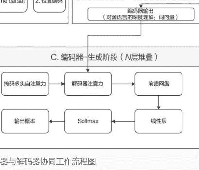

图3-1 Transformer核心部件：编码器与解码器协同工作流程图

#### 自注意力：让模型看全局

自注意力的直觉是：处理序列里每个元素时，都动态去“打量”其它所有元素，按相关性加权融合。这样每个词的表征都裹挟了全局上下文。

实现上，每个输入先通过可学习的三个矩阵得到Q、K、V，即查询、键、值。当前元素的Q与全部元素的K做点积并缩放，送入Softmax得到注意力权重，再用这些权重对V加权求和，就得到融合上下文的新表征。

为了从多角度捕捉关系，引入多头注意力。并行开多个独立的注意力头，各自学不同子空间的依赖，再拼接线性融合，鲁棒性更强。

自注意力本身不感知顺序。没有位置信息，“A作用于B”和“B作用于A”会被混淆。Transformer在Embedding阶段加入位置编码，把与词向量同维的位置信号加进去，常用正弦余弦函数生成。带了位置信息的表示进入自注意力后，模型就能利用词序生成和理解依赖顺序的结构。

#### 并行计算才是规模化的根

相比RNN/LSTM，Transformer最大的工程优势是并行。每一层里，自注意力和前馈网络都能对序列所有位置同时运算，和GPU/TPU的大规模并行设计高度契合，训练周期大幅缩短。正是这场计算效率的跃迁，让在数万亿Token上训练万亿参数规模的模型成为现实。可以说，没有并行性，就没有今天的模型盛景。

### 语言的数学化：Embedding的演进

机器不懂文字，必须先把它变成向量。Embedding的目标是把词或子词映射到低维稠密空间，语义相近的点在空间里靠得更近。

早期One-Hot编码把每个词变成高维稀疏向量，只有对应位为1。维度灾难和语义鸿沟明显：向量正交，无法表达相似性。稠密词嵌入随之兴起，Word2Vec、GloVe、FastText等把词压缩到几百到几千维的稠密空间，相似词靠拢，成了早期深度NLP的基础。

静态词向量给每个词一个固定表征，却解决不了“一词多义”。现代Transformer模型天然产出上下文感知的动态Embedding。词的初始向量经过多层自注意力后，会根据整句上下文被不断重写，同一个词在不同句子里获得不同表征，这是理解细微歧义的关键。

大模型不直接处理原始词，而是先分词。子词分词成了主流：Byte Pair Encoding从字符开始迭代合并高频相邻对，GPT系常用；WordPiece在合并时以最大化语料似然为准则，BERT系常用，并用##标记续词；Unigram Language Model从大集合倒着删掉贡献小的子词，分词时取概率最大序列。这些方法控制了词表大小，增强了对未登录词的鲁棒性。

智能正走向多模态。多模态Embedding把文本、图像、声音等映射到共享语义空间，让不同模态描述同一概念的向量彼此靠近。CLIP通过对比学习对齐图文，为看图说话、文生图、视觉问答等打下基础，标志着模型从纯文本向通用智能扩展。

### 学习范式：预训练与微调的艺术

大模型强大，很大程度上靠“先通用后专用”的预训练+微调策略。

预训练是重资产的一步。用海量无标签文本做自监督，让模型自己生成学习目标。掩码语言模型MLM如BERT采用的是随机遮盖Token后双向预测；下一词预测NTP即因果语言模型CLM如GPT采用的是单向预测下一个Token。通过这种方式，模型内化语法、语义、世界知识和初步推理，形成通用基础模型。

微调则是迁移适配。用少量标注、任务相关的下游数据在基础模型上继续有监督训练，把通用能力变成专用能力。预训练+微调大幅提升效率，降低标注依赖，通常效果更好。也带来灾难性遗忘、全参微调成本高等挑战，于是出现了LoRA、提示词微调等参数高效微调PEFT技术，只动少量参数就能适配。

即便经过预训练和微调，模型仍是统计模式的产物，可能不守规矩、不听指令。为此有了对齐技术。指令微调用大量指令-期望输出对训练，让模型学会理解和遵循自然语言指令，是从“文本预测器”到“智能助手”的关键一步。再配合基于人类反馈的强化学习RLHF等方法，模型在有用性、诚实性、安全性上更贴合人类意图。

把这些脉络串起来，你会发现大模型的优势与瓶颈都很清晰：从统计到记忆再到全局注意力，从静态向量到动态表征，从通用预训练到任务对齐，每一步都在解决信息表达和计算效率的问题。也正是这份理解，能让你在技术选型、Prompt设计、RAG构建时更精准，并对未来趋势保持敏锐。

构建能够覆盖全部指令形态与使用者喜好差异的高质量指令集，现实成本高而且难以维系。相较之下，利用人机偏好作为训练信号的 RLHF 路径更具弹性，它直接把人对不同生成结果的好坏判断作为学习信号来引导行为改进。该范式的常规操作可拆成两步。

先大规模采集使用者对模型产生的输出的偏好标注，例如在若干候选答案中挑出更优者，并用这些标注训练一个奖励器，让它学会预测人对输出的喜好程度。随后把语言模型视作待优化的智能体，以已训练好的奖励器提供环境回馈，通过近端策略优化 PPO 等强化学习方法微调参数，让生成的文本持续获得更高奖励，从而更贴合使用者偏好。

指令调优与 RLHF 多数情形下会配合使用，这两者对提升可用性、可靠性与安全性起到了决定性作用。

### 3.5 本章回顾

本章从源头梳理了支撑当下巨型语言系统崛起的技术演进脉络。我们先从 N-gram 统计语言系统讲起，继而看到加入记忆能力的 RNN 与 LSTM，再抵达奠定今天几乎所有系统基础的 Transformer 结构及其核心——自注意力机制。在此之上，我们剖析了把语言符号映射为机器可读向量表示的关键技术，认识到 Embedding 从静态到动态感知的跃迁，并讨论了分词的重要性。最后解析了预备训练加微调这一高效学习范式，以及指令调优和 RLHF 如何帮助系统更好地对齐使用者意图与价值取向。厘清这些底层原理，一方面能解释巨型系统为何如此强势、如何运作，另一方面也为后续深入研究 DeepSeek 特性、掌握提示词工程、RAG、函数调用与智能体等进阶应用奠定了坚实的理论基础。把握技术演进的线索，才能更从容地驾驭快速迭代的 AI 工具，并将其落地到企业实践中创造商业与社会价值。

## 第4章 DeepSeek 体系全景与核心技术揭秘

上一章我们已系统回顾了从早期统计语言系统到当代 Transformer 体系的宏大演进，并深入拆解了 Embedding 表征、预备训练、微调与对齐等核心原理。这些通识性理论框架，为理解任何具体系统的内部机理与能力来源提供了必要的认知底座。

现在焦点收窄到一个具体的实践主体——DeepSeek。近两年在全球 AI 赛场迅速冒头并展现出强劲竞争力的该公司，凭借差异化的技术路线、亮眼的高性能产品矩阵以及积极的开源姿态，在激烈的市场竞争中稳步占据一席之地。全面了解其产品构成、技术哲学以及核心创新的优势与实践，对把握当下格局具有重要的战略与实操意义。本章旨在呈现一份关于 DeepSeek 家族及其技术内核的完整深度图谱。

### 4.1 崛起轨迹

全球巨型语言系统赛道既有 Google、OpenAI、Meta 凭借深厚积累与资本长期领跑，也有百度、阿里、腾讯依托庞大用户与场景持续发力的局面。在此格局下，该公司作为一家相对年轻且专注的组织，短时间内实现快速成长并取得多项业界瞩目成果，其背后有着清晰的轨迹与坚定的技术理念。

DeepSeek 名义上成立于 2023 年，看似新创，但核心团队与技术骨干深植于国内知名量化私募幻方量化。幻方在高性能计算集群搭建与运维、大规模并行计算优化及前沿算法研究上的长期积淀，为其在算力基础设施与工程算法层面提供了得天独厚的先发优势。正因如此，成立之初便能把精力集中在核心技术突破上。

自 2023 年下半年起，该公司密集对外发布语言系统领域的重要成果，迅速获得关注。发展历程中的关键节点包括：

LLM 系列的推出。2023 年 11 月，发布了参数规模达 670 亿的通用系统，并提供基础版与对话优化版。公开 NLP 基准测试显示，该 67B 版本在综合表现上可媲美 Llama 2 70B 等国际顶尖开源系统，尤其在中英文理解、生成与推理上表现均衡，部分单项甚至更优。随后在代码智能方向，推出 Coder 系列。该系列在代码生成、补全、解释、翻译与 Bug 修复等任务上能力突出，在 HumanEval、MBPP 等权威代码评测榜单上，33B 等版本名列前茅，甚至超过参数更大得多的通用系统，成为开源代码系统领域的领先者之一。

技术主张可概括为技术驱动、追求极致、开放共赢。他们认为持续投入核心算法、数据工程与系统优化才能锻造卓越产出，同时积极拥抱开源，向社区开放大部分核心成果，与全球开发者共同推动技术进步与应用落地。

### 4.2 核心产品矩阵详解

目前已形成覆盖通用自然语言处理、专业代码智能，并在多模态交互方向积极探索的差异化矩阵。核心产品均可通过官方 API 调用，其中多个已开源。

#### 4.2.1 通用方向

V3 是通用方向的重要代表，并非传统稠密系统，而是通过创新架构在性能与效率间取得平衡。它采用混合专家 MoE 架构，官方信息显示总参数约 6710 亿，推理时每个 Token 仅激活约 370 亿参数。稀疏激活让系统在保持高水准表现的同时大幅降低推理算力与成本。

技术亮点可归纳为三方面。

极致效率设计。V3 引入多头潜在注意力 MLA，通过固定数量的潜在查询向量作为中间表征，将长序列注意力计算复杂度从平方级降至线性级，从而高效支撑官方宣称的最高 128K Token 信息窗口。同时在 MoE 负载均衡上做了优化，采用无辅助损失的负载均衡策略，减少专家间负载不均带来的瓶颈。

强劲性能。多个基准测试显示 V3 可与顶尖闭源系统抗衡，数学、代码、推理与多语言处理均突出，中文处理在 C-Eval 等权威测评中成绩优异。长信息窗口能力使其能处理超长文档分析与复杂多轮对话等此前难以胜任的场景。

开源与商业化兼顾。基础系统已开源并采用对商业友好的许可如 MIT License，鼓励社区二次开发与私有化部署。同时提供极具竞争力的 API 服务，通过低廉的按百万 Token 计价大幅降低企业使用高性能系统的门槛。

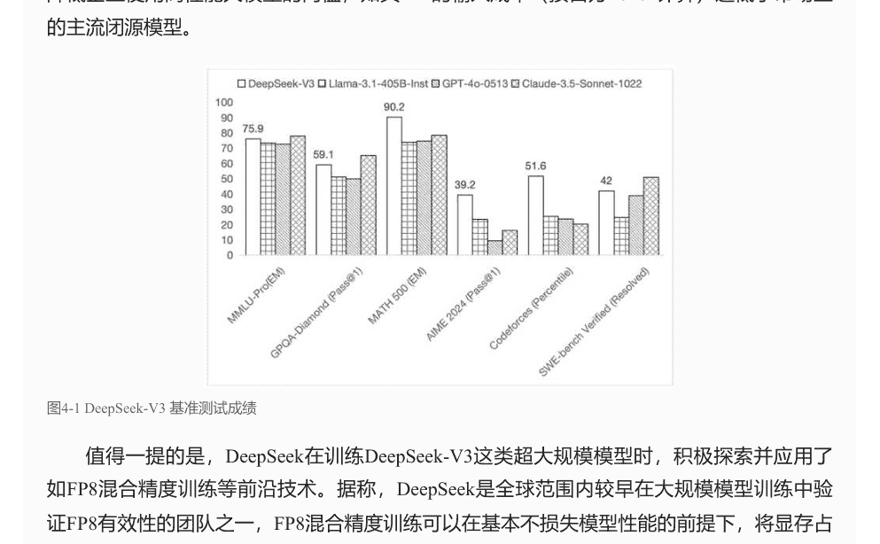

值得注意的是，在训练 V3 这类超大系统时，积极验证了 FP8 混合精度训练等前沿技术。据称团队是较早在大规模训练中验证 FP8 有效性的团队之一，FP8 可在基本不损失性能的前提下将显存占用减少约一半，并使训练速度提升近两倍，对控制成本与加速迭代意义重大。

#### 4.2.2 代码语言系统

Coder 系列是面向代码理解、生成、补全、解释、调试与转换等软件开发核心任务的专业系统，目标是成为开发者强力的 AI 编程助手，提升开发全生命周期效率与代码质量。

其卓越表现建立在扎实数据基础与针对性训练上。该系列在超过 2 万亿个 Token、覆盖 80 余种主流编程语言的高质量专业代码数据上预备训练。数据源不仅包含开源代码，还整合代码注释、版本控制信息如 Git 提交日志、技术问答社区内容等，使系统能学习到代码背后的意图与开发流程中的隐性知识。

为贴合真实开发中中间补全需求，训练特别强化了填充中间 FIM 能力。训练时把代码片段拆分为前缀、待补全中间段和后缀，让系统学会依据前后文生成缺失部分，从而在 IDE 补全场景下实现更高的准确率与实用性。

在 HumanEval、MBPP 等权威代码评测集上，Coder 系列尤其是较大规模版本取得顶尖开源水平的表现，部分指标超越参数更大的通用系统。开源发布进一步推动了代码智能生态的发展。

#### 4.2.3 推理方向

除通用与代码系统外，也在探索面向特定能力的优化方向。R1 曾被提及为提升长链逻辑推理能力的专用探索。R1-Zero 与 R1 是第一代推理系统，R1-Zero 采用纯强化学习训练，未经过监督微调，直接用精心设计的规则驱动奖励函数优化推理路径，验证纯强化的可行性。后续 R1 引入高质量冷启动数据，缓解纯强训可能带来的可读性与语言混杂问题，同时保持核心推理能力。基准测试成绩如图 4-2 所示。

在算法层面，提出了群组相对策略优化 GRPO，旨在改进传统近端策略优化，无需显式价值函数模型即可进行优化，从而降低计算开销并提升训练稳定，对复杂决策型推理系统优化具有价值。

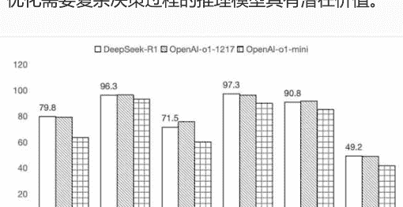

图4-2 DeepSeek-R1基准测试成绩

这类专用推理系统在数学竞赛题求解、算法竞赛编程、复杂技术文档分析与科学文献逻辑链提取等需要多步推演的任务上被期望超越通用系统。同时，其也可能衍生出参数更小的蒸馏版本，以适配更多硬件环境并与 Llama、Qwen 等开源生态兼容。

### 4.3 核心技术“杀手锏”

能在短时间内取得亮眼成绩，除战略定位与人才外，还依赖系统性的核心技术创新，这些创新共同提升了性能、效率与实用性。

#### 4.3.1 数据驱动

数据被视为 AI 燃料，将数据驱动贯穿研发始终。以 Coder 为例，超大规模高质量代码数据是成功的关键。2 万亿 Token 的训练规模本身即具优势，更关键的是质量与多样性：覆盖 80 多种编程语言确保广度；融合注释、版本信息、问答社区等多源数据帮助系统把握深层语义与真实场景。

数据质量控制据称采用严格清洗流程：基于静态分析工具自动筛选去除语法错误与逻辑缺陷代码；语义去重保留代表性样本；严格审查开源许可确保合规与商业可用。

同时强调项目级上下文与 FIM 训练的重要性。为让系统理解真实项目的复杂依赖，Coder 支持约 16K Token 超长窗口，训练时将关联源文件拼接为“超级样本”，并以特殊标记标注文件边界与路径，帮助系统捕捉跨文件作用域、调用与模块依赖。FIM 训练通过系统拆分前缀、中间、后缀，提升实际编程场景下的实用性与准确率。

#### 4.3.2 架构创新

在架构层面体现了性能与效率的平衡智慧。通用系统中的 MoE 架构将参数分散到多个专家子网络，推理时仅稀疏激活少数 Top 专家，在大幅提升系统容量上限的同时控制推理计算。训练 MoE 时，优化了专家路由与负载均衡，采用无辅助损失策略使各专家训练更均衡。

另一项关键创新是 MLA 长信息窗口机制。传统 Transformer 注意力在长序列下计算随序列平方增长，MLA 引入固定数量潜在查询向量作为摘要层，先压缩输入关键信息再与查询交互，将复杂度降至近线性，使系统能经济高效处理 128K 级超长窗口，提升长文档与复杂对话的推理速度与吞吐。

#### 4.3.3 训练策略优化

高效训练策略同样关键。预备训练阶段采用多令牌预测 MTP，允许系统一次性预测未来多个 Token，通过并行预测头与动态掩码提升训练吞吐，并帮助学习短语结构与局部依赖，对代码块连贯性生成尤为有益。

在对齐方面，探索新型强化学习算法如 GRPO，旨在融合直接偏好优化与近端策略优化的优势，可能通过直接利用成对偏好数据优化策略并引入更有效的信任域调节机制，提升训练稳定与最终对齐效果，对提升系统有用性、诚实性与无害性至关重要。

此外，为降低大规模训练成本，较早实践 FP8 混合精度训练。策略性地对权重、激活与梯度使用 FP8 格式并结合动态损失缩放，可在不显著牺牲精度的前提下大幅减少显存占用并提升计算速度，现代 GPU 对 FP8 吞吐远高于 FP16。在 H100 集群上的成功实施为超大规模系统的经济高效训练提供了经验。

### 4.4 技术创新总结

能在激烈竞争中迅速崛起，得益于构建了一套系统性、多维度协同的技术创新体系，形成了鲜明的差异化竞争力。

根本上来看，DeepSeek最难以撼动的优势来自数据层面的壁垒和精细化的数据工程功底。尤其在代码智能赛道，团队打造并持续迭代了一套超大体量的高质量代码训练库：规模逼近2万亿 token，覆盖80多种编程语言，并且刻意融入了项目级别的上下文信息，为 Coder 系列奠定了坚实的基础。数据链路全程执行严格的清洗、去重与合规筛查，保证了输入模型的样本质量，也直接反映在模型理解与生成复杂代码的能力上。这种对垂直领域做深度挖掘、精细化打磨的做法，形成了短期内难以被复制的护城河。

在架构层面，DeepSeek展现出的是一套对性能和效率极致权衡的设计思路。混合专家架构被成功引入并不断优化后，模型的总参数可以做得很大，但推理时真正激活的参数和计算量始终被控制在合理区间，实现了“大而省钱”的效果。配合自研的 MLA 机制，传统 Transformer 在超长上下文上的瓶颈被明显打开，模型可以高效处理128K 乃至更长的序列，在代码库全量理解、长文档分析等重任务上优势突出。架构层面的这些突破，让模型既保持顶尖水平，又具备更好的实用性和部署可行性。

在训练策略和算法优化上，DeepSeek始终走在前沿。多 token 预测等技术让预训练收敛更快，也强化了对局部结构的感知；自研的新型强化学习对齐算法 GRPO，让模型与人类意图的对齐更高效、更稳定；团队还率先在超大规模模型上落地 FP8 混合精度训练，大幅压缩训练成本与周期。这些创新共同提升了研发效率和最终产品质量，也是其持续保持领先的关键动力。

综合判断，DeepSeek的差异化定位已经越来越清晰。一方面它瞄准代码智能领域的头部位置，依靠数据与架构的独特组合，Coder 系列在代码生成、自动补全等核心能力上已显现出超越同类开源方案的实力；另一方面它也是大模型效率优化的积极探索者，通过 MoE、MLA、FP8 混合精度训练等技术组合，在高性能与低成本之间寻找最优解，这对大模型的规模化落地意义重大。更重要的是，DeepSeek

### 4.5 本章小结

积极拥抱开源生态，主动承担技术推动者的角色，把核心模型、架构思路乃至训练工具都开放出来，大大降低了企业和开发者使用前沿大模型的门槛，推动了行业整体进步。

DeepSeek凭借通用大模型尤其是以 DeepSeek-V3 为代表的 MoE 架构模型、代码语言模型 DeepSeek Coder 系列等多条核心技术线，展现出卓越的技术实力、前瞻的战略布局和持续的开源贡献，为全球企业用户和开发者提供了一套兼具高性能、高性价比和未来潜力的 AI 大模型解决方案。深入理解并善用 DeepSeek 模型家族的能力及其底层创新，有助于企业在人工智能浪潮中抓住关键机遇，构建差异化竞争优势，开启智能化转型与创新发展的新阶段。后续章节将围绕提示词工程、RAG、函数调用和智能体等核心技术，讲解如何真正驾驭这些强大引擎。

## 第5章 提示词工程：与大模型对话的艺术

在上一章拆解了 DeepSeek 模型家族的技术原理后，我们知道海量预训练和精密算法造就了大模型的强大能力。但如何让这些“沉默的巨人”精准响应需求并转化为业务价值，正是提示词工程要解决的问题。本章将揭示高效对话的技巧：从提示词如何激活模型的模式识别与序列预测，到结构化提示的核心构成；从零样本指令的直击要点，到少样本示例的精准引导；从思维链的逐步推理，到企业级模板的实战用法。通过系统学习提示词的设计逻辑与实践策略，你将解锁大模型的深层潜能，实现从原理到落地的跨越。

### 5.1 理论基础：为什么提示词如此关键

#### 5.1.1 大模型是模式识别与序列预测的高手

回顾大模型的核心学习方式，它们是在数万亿级别的海量文本上做自监督学习，反复训练“预测下一个词”。在这个看似简单的任务中，模型内化了语言的语法规则、词语搭配、语义关联，以及文本背后蕴含的世界知识和一定程度的推理模式。

因此，用户输入一个提示词时，模型的核心工作就是基于预训练阶段学到的语言模式、知识储备和推理能力，预测出在统计上最可能、在语义上最连贯、在逻辑上最合理的续写序列。

提示词本质上是一个引导信号。收到信号后，模型会在参数构成的知识库里检索并激活与该起点最匹配的模式，随后沿着这些模式继续生成。

比如输入“中国的首都是”，模型极大概率续写“北京”，因为训练数据中该搭配稳定且高频。再比如一条复杂指令：“请以资深客户关系经理的专业语气，起草一封关于某型号产品延迟发货的道歉邮件，收件人是张三先生”。此时模型会同时激活“商务沟通语气”“道歉邮件结构”“投诉处理策略”“变量替换”等多种相关模式，综合生成符合要求的邮件。

#### 5.1.2 指令微调让模型学会听话

仅靠预训练的基础模型知识渊博却不够“听话”，它更倾向于随意续写而非严格执行任务。为此，主流对话模型在预训练后会进行指令微调，用大量“指令-期望输出”样本对进行训练。

通过这种训练，模型学会了识别指令意图并按要求组织信息、调用知识，输出符合规范的内容，而非简单续写。指令微调让模型掌握了问答、翻译、摘要、写代码、角色扮演等多种执行技能的模式。

#### 5.1.3 自注意力机制帮助模型聚焦关键信息

Transformer 的核心是自注意力机制。生成每个 token 时，模型会动态评估输入序列中所有 token 的相关性，给重要部分更高关注度。

精心设计的提示词会引导注意力分配。关键词、整体结构、示例、明确约束都会影响模型在生成过程中把注意力放在哪些信息上。结构清晰、重点突出的提示词能帮助模型抓住核心、忽略干扰，从而输出更精准的结果。

提示词之所以有效，是因为它直接作用于模型的序列预测本质、指令遵循能力以及基于上下文的注意力分配。清晰的初始语境、明确的任务导航和有效的焦点引导，才能最大化激发模型潜能，稳定获得高质量输出。理解这些底层逻辑后，才能更好地设计出优秀的提示词。

### 5.2 结构化提示：高效提示词的核心要素

理解了原理后，关键问题是怎么做。经验表明，随意提问往往结果不稳定。高效的提示词通常是结构化的，包含几个协同作用的关键要素。

**1. 设定明确角色**
开头为模型赋予具体身份，会显著影响语气、专业度、知识侧重点和思考角度。因为角色会激活内部相关知识和表达习惯。角色描述越具体越好，如“精通 Python 且熟悉金融量化交易的高级程序员”，比“你是个程序员”效果更准。

**2. 下达清晰具体指令**
这是核心部分，要用明确的行动动词开头，详细说明任务内容、范围、目标和关键要求，消除歧义。

**3. 提供相关上下文**
补充背景信息、必要输入数据或约束条件，帮助模型理解任务环境，减少歧义，提升相关性。

**4. 提供高质量示例**
在提示中给出一个或多个完整输入输出示例，能直观展示期望格式、风格、质量标准甚至推理步骤。对复杂任务或格式要求严格的场景，示例往往比冗长指令更有效。

### 5.3 零样本和少样本

#### 5.3.1 零样本提示：只给指令不给示例
零样本是指不提供任何具体示例，仅靠清晰的自然语言指令和上下文让模型直接执行。依赖于模型的大规模预训练和指令微调能力。

优点是简单直接，设计成本低，对常见任务往往足够。
缺点是对于复杂、新颖或对格式要求严格的任务，模型可能理解偏差，输出的稳定性、格式一致性不如带示例的方式。

#### 5.3.2 少样本提示：用示例引导模仿
少样本是在指令之外，先给出一个或多个高质量示例，再给出待处理输入。模型通过上下文学习任务模式、输出格式和风格，无需参数更新。

优点是能显著提升复杂任务的准确率，增强对格式和风格的控制，成本远低于微调。
缺点是需要花费时间设计筛选高质量示例，示例会增加 token 消耗，可能触及长度限制，且示例质量、数量和顺序都会影响效果。

#### 5.3.3 实践选择建议
先尝试清晰的零样本指令，评估是否满足基本需求。若效果不佳，再引入少样本。示例数量从一个高质量示例开始，逐步增加到三到五个即可，过多可能引入噪声。示例质量比数量更重要，必须准确、代表性强、与目标任务高度一致。

### 5.4 思维链、思维树与自我反思

#### 5.4.1 思维链：让模型像人一样逐步思考
思维链的核心是要求模型在给出最终答案前，先把中间推理步骤、逻辑推导或计算过程以自然语言逐步展示出来。把复杂问题拆解为若干子问题，利用模型擅长续写的特性生成一条有逻辑的推理链，从而提高正确率。

**问题：** 某杂货店先进购15个新鲜苹果，随后又进购12个橙子。当晚共售出8个苹果和5个橙子，问店里现在还剩下多少个水果？

**推理展示：**

第一步把进货量汇总起来。苹果进货15，橙子进货12，相加是27。

第二步把当天售出量汇总起来。苹果卖出8，橙子卖出5，相加是13。

第三步用进货量扣减售出量得到结余，27减13等于14。

所以店内现在还剩余14份水果。

用同样的思路处理下面这道练习。

**题目：** 小华起初有5颗玩具弹珠，朋友小明又送了一些，现在总数变成11颗。问小明送了多少颗？

#### 5.4.2 分支推演：多线并行的决策模拟

线性类指令往往让模型沿着一条笔直的推导路子走到终点，而分支类指令则打破单一路线，让模型在每个关键节点同时展开若干备选思路，形成树状的探索网络。模型能够在这棵树里对不同分支的合理程度、可行程度或潜在价值进行打分，并据此回溯或挑选最有希望的分支继续深挖。就像职业棋手落子前不会只看一种走法，而是并行设想多种可能性及其后续局面，再择优推进。

搭建分支推理往往需要更复杂的指令设计，例如要求模型在某一步一次性给出多条下一步候选并自行排序，或借助外部控制逻辑，通过代码来管理不同推导路径的生成、评估与选择。

对于没有唯一标准答案、需要广度探索和权衡的复杂任务，比如复杂规划、开放式创意写作或多解难题，分支推理通常比线性推理更具优势。

#### 5.4.3 反思校对：让模型学会审视与改进

反思校对机制的核心，是让模型对自己先前的答案或推导过程进行批判性复盘、评估与校验，并在基础上自我修正，从而提升准确性、逻辑性和可信度。一般用多轮交互实现。

第一轮：产出初稿。先让模型针对原问题给出初步答案或方案，可结合线性推理呈现推导过程。

第二轮：引导反思与修正。设计新的指令，明确要求模型对第一轮结果进行“挑刺式检查”。引导其审视是否存在事实错误、计算失误、逻辑断层、是否有更简洁解法、是否遗漏关键因素等，也可提供评估清单辅助。

第三轮：输出改进版。要求模型基于反思结果，产出修正优化后的新版答案。

下面的示例可帮助理解反思校对指令技术。

##### 5.4.4 实践中如何选择和应用这些推理技术

“请重新回看并审视你对[原始问题 X]的解答思路和最终结论。请核查每一步计算是否正确？整体推导是否连贯无跳跃？是否遗漏边界条件或特殊情形？是否存在更简洁高效的解题路径？请结合自我评估，给出修正完善后的版本。”

反思校对能明显提升输出的准确性、可靠性和鲁棒性，尤其有助于减少模型“幻觉”或推理疏漏带来的错误。

线性推理是基础且首选策略。对绝大多数需要一定推理的任务，线性推理因简洁、通用且经验证有效，是首先尝试的核心技术。

分支推理、反思校对等更高阶技术实现门槛更高，往往需要更精细的指令设计、更多交互轮次，甚至外部代码辅助。因此更适合解决特定高难度、对结果质量要求极高的复杂问题，如数学证明、复杂系统设计、多目标优化，或允许多轮深度交互、时间成本不敏感的场景。常规应用中通常无需动用这些“重型武器”。

熟练掌握并灵活运用以线性推理为核心的激发技术，就能更好地引导模型应对更复杂、更具挑战的认知任务，从而释放更深层的智能潜力。

### 5.5 机构级指令设计实战模板

在掌握指令工程的理论、要素、技巧、迭代方法及安全考量后，关键在于落地到机构实际业务。本节针对机构常见 AI 应用场景，提供结构清晰、要素齐全的指令实战模板。

这些模板融合了前文核心概念与设计原则，可作为起点参考。但仅为示例，并非万能公式，实际使用需结合具体业务需求、输入数据特性、模型能力偏好和期望效果进行针对性调整与优化。

#### 5.5.1 智能客服指令实战模板

**设定角色**

你是一名拥有[公司名称]官方认证、经验丰富、耐心细致且表达友好的高级商品客服代表。你对公司核心商品“[具体商品名称]”的功能特性、使用方法、常见问题及解决方案了如指掌，并能以专业清晰易懂的方式解答。

**核心指令/任务**

你的核心任务是：依据“用户问题”区所述的关于“[具体商品名称]”功能的具体疑问，提供准确、清晰、简洁且非技术用户也能理解的专业解答。

- 若用户描述不清或存在歧义，请主动礼貌追问1至2次，以确认真实诉求。
- 若问题超出你所掌握的商品范围，或需更高级别技术支持或个性化方案，请礼貌告知无法直接回答，并引导联系人工技术支持团队，或查阅官方商品文档。[此处填写人工客服联系方式或链接]或[此处填写官方文档链接地址]。

全程保持积极、热情、乐于助人的专业服务态度。

**（可选）提供相关的上下文信息（Context）**：可为预设常见问题与解答，或通过RAG动态检索提供。

关于"[具体商品名称]"商品的FAQ片段：

```json
[
  {
    "question": "如何在XX平台中导入CSV格式的数据文件？",
    "answer": "您可以通过单击界面左上角的'数据源管理'按钮，选择'本地文件上传'，并按照指引选择您的CSV文件完成导入。导入过程中请注意检查文件的编码格式是否为UTF-8，以及第一行是否包含有效的列标题。"
  },
  {
    "question": "XX平台支持哪些类型的图表可视化？",
    "answer": "XX平台目前支持包括折线图、柱状图、饼图、散点图、热力图、地图等在内的十余种常用图表类型，能够满足多样化的数据可视化分析需求。您可以在'可视化仪表盘'模块中，根据数据特点和分析目标选择合适的图表进行创建和配置。"
  },
  ...... （此处可以继续插入更多相关的FAQ条目或产品功能说明文档的关键片段）
]
```

**待处理的用户问题（User_question为占位符，实际使用时替换为真实输入）**

用户问题："{user_question}"

**指定结果呈现方式（OutputFormat）**

请直接生成可面向用户展示或发送的回答文本，保持自然流畅、符合客服沟通规范，避免生硬或过度技术化术语。

#### 5.5.2 市场营销文案创作指令实战模板

**设定角色**

你是一位创意十足、紧跟潮流、深谙社交媒体传播规律的顶级营销文案策划专家，尤其擅长为面向[目标用户群体，如年轻时尚都市白领]的新品撰写引发关注、产生共鸣并促转化的推广文案。

**核心指令/任务**

请为我司即将上市的全新商品——"[具体商品名称，例如：悦动智能降噪耳机X1]"——创作三条高质量、适用于在[指定目标社交媒体平台，如小红书、抖音、微博]发布的推广帖文。

具体要求如下。

1. 精准聚焦关键卖点：每条文案须清晰有力突出1至2个竞争优势或独特卖点。关键卖点包括：[此处列出。例如：a)领先主动降噪，有效隔绝环境噪音；b)超长24小时续航；c)亲肤环保材质佩戴舒适；d)支持AI语音助手智能交互]。

2. 语言风格定位：整体风格须为[此处明确。例如：活泼有趣、富有网感、引发年轻人共鸣；或凸显科技感、专业性与未来感；或强调温馨治愈、情感关怀与生活品质]。

3. 融入热门话题标签：每条文案结尾至少包含一个与商品特性或用户兴趣高度相关、当前热门的社交媒体话题标签（# hashtag）。

4. 严格控制长度：每条独立文案（不含标签）总长度须控制在[此处设定字数或字符限制。例如：120个汉字]以内，适配平台阅读习惯。

5. （可选）建议使用表情符号：在文案中适度使用符合内容和风格的emoji，增强生动性与吸引力。

**提供必要的上下文信息（Context）：商品与目标用户详档**

- 商品全称：[例如：悦动智能降噪耳机X1]。
- 核心目标用户画像：[例如：20～35岁城市人群，注重生活品质与个人体验，对新科技感兴趣，常在通勤、工作或旅行中使用耳机的年轻白领和学生]。
- 商品关键卖点详述：[对上述卖点作更具吸引力的描述]。
- （可选）商品官方介绍页链接：[供模型参考细节]
- （可选）期望营销侧重点：[例如：本轮重点突出降噪效果与超长续航]。

**指定结果呈现方式（OutputFormat）**

请以无序列表（Markdown “-”或“*”）输出三条独立推广帖文，每条为一个列表项。

例如：

- [文案内容1] # [相关热门标签1]
- [文案内容2] # [相关热门标签2]
- [文案内容3] # [相关热门标签3]

### 5.6 本章小结

本章系统剖析了指令工程的理论基础与实践方法。指令通过激活模型的模式识别、指令遵循与注意力分配，成为人机协作的“对话密码”。结构化指令需融合角色设定、清晰指令、上下文信息与示例引导以提升质量；零样本与少样本策略应根据任务复杂度灵活选择，前者高效直接，后者通过示例降低歧义。线性推理提示外化推理过程，反思校对机制赋予迭代优化能力。最终，机构级模板为客服应答、营销文案等场景提供了可复用的设计范式。掌握这些策略后，开发者能更高效驾驭模型，将其转化为解决实际问题的智能引擎。

## 第6章 RAG：让模型掌握私域知识

解锁对话艺术后，更深层的挑战是如何让模型掌握机构专属知识。本章解析RAG系统核心架构，揭秘Embedding模型如何把知识转译为机器语义空间，探讨向量数据库选型策略与知识库持续进化机制，助力打造“常学常新”的智能知识引擎。

### 6.1 RAG架构与原理

模型虽知识广博，但在机构应用中面临三大痛点。

（1）知识滞后性：模型训练数据滞后于机构实时数据，无法响应最新业务需求，如政策变动或商品迭代。
（2）私有知识盲区：机构专有文档如合同、工艺手册等未被预训练覆盖，导致回答不准。
（3）上下文限制：上下文窗口有限，难以处理超长文档或复杂知识图谱。

RAG是融合检索与生成的混合架构，通过外部知识库增强生成能力。与仅依赖参数化知识的传统生成模型不同，RAG通过动态检索相关文档片段，显著提升生成内容的准确性和事实一致性。RAG典型架构如图6-1所示。

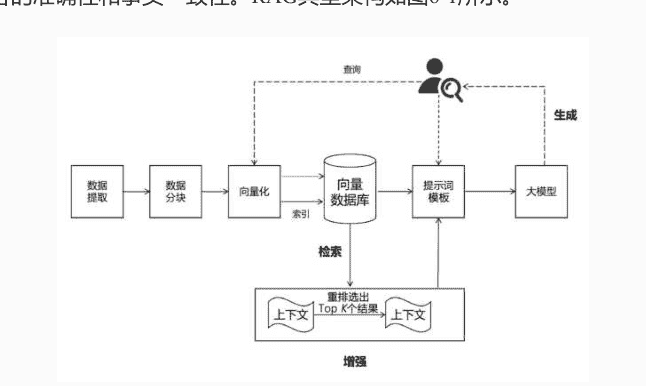

图6-1 RAG典型架构

RAG通过检索、增强、生成三阶段突破限制。检索是从向量数据库中实时匹配查询相关片段；增强是将检索结果注入提示词，构建上下文增强输入；生成是基于增强后的上下文产出精准回答。

### 6.2 核心组件1：Embedding与向量数据库

#### 6.2.1 文本向量化：选择合适的Embedding模型

第3.3节已介绍文本Embedding原理与发展。构建RAG系统时，选择最优Embedding模型至关重要，该选择直接影响检索准确性，进而影响增强生成质量。优秀模型能将离散符号系统转译为连续数学空间，捕捉深层语义而非仅表层词匹配，使RAG突破关键词局限，实现真正语义理解。

在RAG中，Embedding质量决定检索的认知边界。应从五个维度系统评估。

**1. 语义理解深度**

现代Embedding已从静态词向量如Word2Vec发展到基于Transformer的上下文感知模型。网络层数、注意力机制、预训练数据规模与质量共同决定其解析复杂语义的深度。对RAG而言，深层语义理解确保模型把握查询真实意图，并召回高度相关片段。检索不再局限关键词，而是能识别语义等价或相关的不同表述。例如领先开源模型常采用动态上下文窗口或任务优化，使其处理长文本或专业文本时自适应调整注意力范围，兼顾局部精确与全局连贯。

**2. 维度空间的构建**

向量维度并非越高越好，常见输出从数百到数千维不等。高维度通常语义表达更强，编码信息更丰富，但也会带来更高存储成本、更慢检索速度，并在数据不足时出现“维度灾难”。机构需根据知识库数据特性、数据量和预期检索性能权衡：技术文档、法律条文等细节密集文本可能适合更高维度以捕捉细微差异；社交媒体、日常对话则中等维度即可兼顾效果与效率。

**3. 多模态兼容能力**

随着AI发展，机构知识库常包含图像、图表、表格等多模态信息。若RAG需理解利用这些内容，则需具备跨模态对齐能力的Embedding模型。例如CLIP及其衍生模型能将文本与图像映射到统一语义空间。应用中用户可用文本查询检索相关图片，或系统在回答时融合图文信息。当知识库包含大量图文丰富的技术手册或商品说明时，统一多模态向量空间可显著提升检索质量与用户体验。

**4. 计算效率的平衡法则**

Embedding模型的推理速度与硬件资源需求，直接影响知识库构建/更新阶段的大规模批量向量化，以及用户查询的实时响应。需在语义表达效果与计算成本间找到务实平衡。对低延迟在线RAG系统，可能倾向参数少、推理快的轻量级模型；对可离线建索引且对精度要求极高的场景，则可采用更大更强的模型，即使成本更高。

**5. 领域适应性的进化**

通用Embedding模型在大量通用语料上预训练，但在医疗、法律、金融、特定工程等专业领域的术语体系、表达习惯和知识结构下表现可能折扣。为提升特定业务检索效果，常在选定高质量通用预训练模型后，用机构自有领域文本进行微调，使其更好学习领域语义模式，从而更精准匹配领域内查询与文档。

实际选型时，可参考MTEB等公开评测基准进行初筛。理论指标重要，但最终选择应基于机构自身知识库数据和典型查询场景的实测效果，因不同数据分布与应用需求会导致模型表现差异。此外，选择社区活跃、文档完善、易集成的模型有助于降低开发维护成本。还需综合评估规模化部署的API调用成本、所需硬件资源及与所选向量数据库的兼容性与集成顺畅度，这些都是确保RAG经济高效稳定运行的关键。

文本向量化模型的选择，本质是机构知识管理战略在技术层的映射。它不仅决定知识资产的数字化形态，更深远影响从数据治理到智能应用全链条的价值转化效率。明智决策不会单追技术指标，而是综合考量模型与业务知识结构的契合度、与RAG整体架构计算特性的匹配度，以及与组织未来学习能力的对齐。

#### 6.2.2 向量存储与检索：数据库选型

在企业面对大模型落地时，向量库的决策会从根上决定RAG的检索质量、扩容能力和投入产出。不同体量、不同查询诉求下，选型逻辑完全不同。

**体量与向量维度匹配**
百万级以下的小型探索，轻量嵌入式方案最合适，比如Chroma、Faiss，启动快、内存友好，适合做快速原型。进入十亿级量级，就必须上分布式架构，Milvus借助动态分片支撑PB级横向扩展，Qdrant则用一致性哈希做分片路由。高维场景超过512维时，压缩型存储更划算，Pinecone的S1存储优化借助PQ压缩能大幅压缩内存占用。

**性能取向决定选型**
追求极低延迟小于50ms，Qdrant里的HNSW表现突出，百万量级实测常在15ms以内。追求高并发吞吐，Milvus依靠异步IO叠多级缓存能稳定输出约1050QPS，电商实时推荐类业务常用。需要向量与结构化混合检索，Weaviate支持向量相似与倒排索引联用，带元数据过滤时召回提升明显。

主流向量库的差异化定位

| 数据库 | 核心长处 | 典型适用 | 企业参考案例 |
| :--- | :--- | :--- | :--- |
| Milvus | 分布式扩展能力最强，兼容8种索引算法 | 超大规模多模态检索如短视频 | 某电商平台1亿件商品向量库 |
| Pinecone | 全托管开箱即用，免运维 | 追求快速上线且无运维团队 | 金融行业实时风控系统 |
| Qdrant | Rust实现，延迟极低 | 实时推荐、对话式AI | 智能客服知识库 |
| Weaviate | 原生知识图谱能力 | 复杂语义推理 | 医疗文献关联分析 |
| pgvector | 与PostgreSQL深度融合 | 存量关系库改造 | 传统ERP系统升级 |
| Chroma | 轻量嵌入式部署 | 本地开发测试 | 中小企业内部知识库 |

**索引策略是检索加速的关键桥梁**
合理设计索引能在精度损失有限的前提下把查询提速几十到上百倍。

索引类型选择
精确检索型以暴力穷搜索计算查询向量与全库距离，保证100%召回但复杂度O(N)，仅适合百万级以下，常以FLAT作为召回基准。

聚类加速型借鉴倒排思想，用k-means先聚类，查询只扫最近若干簇，搜索范围可缩小到1/nlist，复杂度降到O(N/nlist)。经验上nlist建议取4倍根号N，聚类质量与精度需权衡。

图结构索引采用HNSW多层小世界图导航，路径长度对数级增长，复杂度约O(log N)，千万级仍能毫秒响应。构建参数efConstruction通常设200到400，直接影响索引质量与内存占用。

量化技术
标量量化把float32转int8，存储直降75%，相对距离基本保留，精度损失一般小于5%，适合对精度敏感的轻量场景。

乘积量化把高维向量拆成多个子空间分别量化再笛卡儿组合，1024维拆成8个128维子空间可达32倍压缩，但会带来10%到15%的精度损失，在移动端等资源受限场景价值明显。

实践建议先用FLAT验证数据特性，再按需求尝试IVF+PQ或HNSW+SQ组合，并持续监控召回率与响应延迟。

**知识库构建：从原始资料到可用文本块**
企业知识散布在PDF白皮书、Word手册、Excel表格、官网HTML、Markdown笔记、代码仓库、业务数据库等多种形态。要变成RAG可用，必须完成加载、清洗、分块。

文档加载常借助LangChain、LlamaIndex等框架的加载器，可读PDF、HTML、Markdown、JSON/CSV、关系与NoSQL。复杂排版的多栏、表格、浮动图、页眉页脚会干扰抽取，HTML中的脚本、样式、广告需过滤。扫描件或图片PDF必须先OCR，识别准确率决定后续质量。

深度清洗要提纯文本流：剔除页眉页脚页码、统一换行制表符与多余空格、清除HTML/XML标签及脚本样式、表格可转为自然语言描述、保留为元数据或按需舍弃、非文本的多媒体默认忽略、OCR错误可做规则或模型纠错、去掉水印、倾斜、背景噪声。清洗不彻底会把噪声向量化，严重拉低检索相关性。

文本分块受嵌入模型长度限制与LLM上下文窗口限制制约。块过长会得到平均化语义向量，定位不准；块过大会挤占上下文。

分块方式
固定大小切分最简单，按字符或Token硬切，易破坏句子语义，一般不推荐。

基于分隔符切分先用语义分隔符初步分段，再对超长片段二次强制切分，能更好保留句子完整性。

递归字符分块按优先级分隔符逐级递归，先段落再换行等，直到满足长度，尽可能在语义边界切分。

语义分块用句子嵌入相似度或文档结构识别主题切换点，如代码按函数类切分，块内聚性最高但实现复杂度高，需针对文档定制。

**知识库管理：元数据与持续维护**
为每个文本块附加结构化元数据，实现溯源与管控，常用字段包括来源文件名称或URL、页码、文档类型如产品手册白皮书FAQ、创建与修改时间、作者部门、章节标题、访问控制标签与安全等级。

更新策略
全量重建每次清空重建，逻辑简单一致性好，但对大规模库成本高、时效差。

增量更新只处理新增、修改、删除的源文档，效率更高。依赖可靠变更检测：文件修改时间戳、Git变更历史、数据库触发器或CDC、消息队列变更事件。更新过程需事务、重试与定期校验同步，保证向量库与源数据最终一致。

**增量索引与知识流处理**
增量索引只处理变动数据，避免全量重建开销，降低算力与时间成本，实时捕捉变化，适合高频更新的动态知识库，减少索引延迟与存储消耗，保持服务稳定。

知识流处理引擎可类比智能分拣站，分五步运行：
筛垃圾：过滤重复、无用、格式错误的知识。
分急缓：加急件如股价变化直入内存索引池即时处理；普通件如产品说明进入增量索引构建器逐步更新；大件如年报进入全量重建队列夜间处理。
独立工作：内存池像便签快速记录，增量通道像打补丁，批量通道像重理书架。
拼图检查：合并后校验冲突，如医疗指南版本不一致自动判定最新权威版。
送货上门：分发更新结果，热知识预置到用户附近缓存，冷知识存大仓，保证最新知识按需快速获取。

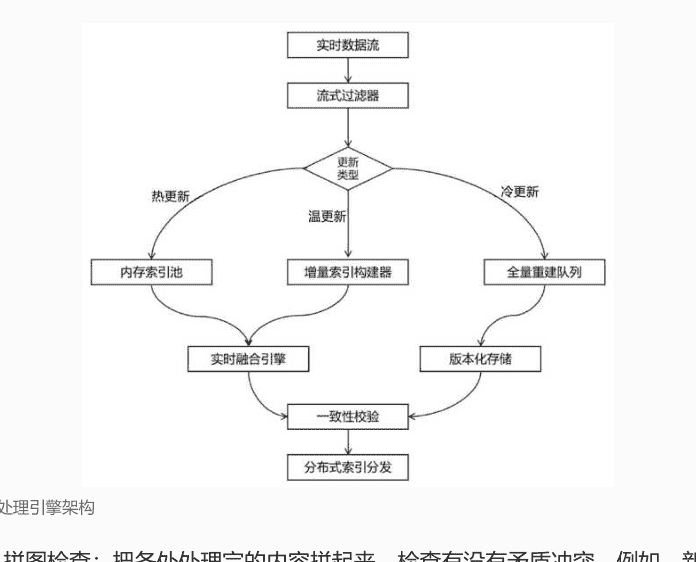
图6-2 知识流处理引擎架构

好的索引与持续的数据治理，让向量检索既快又准，知识库才能在业务变化中始终保持新鲜可用。

RAG 的落地思路，本质上是以检索、增强、生成三步为骨架，让大模型与实时知识库形成协同感知体系。本章对 Embedding 模型在搭建语义空间中的主导作用做了拆解，指出文本向量化已从单纯的词表映射进化到多模态对齐的阶段。面向向量数据库的选择，则系统梳理了索引算法与量化技术的工程落地经验，强调在检索效果与算力开销之间寻找最优平衡。知识库建设的方法论覆盖了文档的智能分块、元数据治理以及增量更新机制，确保企业资产能够持续活化。把这些要素串联起来，RAG 既能补上大模型先天静态知识的短板，也能跟上业务变化的节奏，为企业级认知中枢提供技术底座。

## 第7章 扩展模型边界：赋予AI“行动”能力

前文我们已经聊过提示词工程如何提升沟通效率，并在上一章学会用 RAG 把大模型的知识边界拉向企业内外、动态且私有的信息源。借助 RAG，大模型从只会背书的“书呆子”，成长为能引经据典、基于最新事实回应的“知识顾问”。

但真实的企业场景里，大家要的远不止高质量问答与文本生成。用户期待 AI 能主动“动手”，真正嵌入业务流程并完成具体操作：比如实时查库获取最新库存，调用内部业务系统 API 为客户建单，下周二下午订间会议室，按指令发出格式规范的邮件，甚至操控智能办公设备，或与不同的软件、在线服务、别的 AI 模型协同完成复合任务。

这些行动类需求，已超出传统大模型仅处理文本的边界。要打破数字隔阂，让困在语言世界里的模型伸出感知外部并与其交互的“双手”，就是本章要解决的核心议题——如何拓展行为边界，赋予模型实际行动力。

本章聚焦两大技术范式。第一是工具调用，即函数调用。模型据此能识别用户请求中隐含的外部工具或 API 依赖，并输出结构化的调用指令。我们会阐释其定义、价值、运行机理与主流实现，并重点讨论 DeepSeek 系列在函数调用上的实现特点、企业级优势与落地做法。第二是模型上下文协议 Model Context Protocol，MCP。MCP 是较新的交互探索，目标是为大模型与应用、或模型与模型之间搭建更复杂、可管理状态的底层通信框架。我们会介绍其设计目标、相较传统 API 的差异化优势、关键概念，以及当前进展与挑战。

熟练使用以函数调用为代表的工具调用，等于把大模型从被动的文本处理器或检索器，转变为能驱动业务运转、打通信息孤岛、自动化完成操作的智能执行者。对构建深度嵌入核心流程、提升自动化水平、解放员工生产力而言，这具有战略级意义。本章的意图是提供一套赋予模型行动能力的系统化知识与可落地指南。无论使用 DeepSeek 还是其他支持同类功能的顶尖模型，这里阐述的原理与方法，都能打开下一代智能应用的想象空间。

### 7.1 函数调用：赋予大模型连接并驱动外部世界的能力

函数调用，又称工具调用，其思想内核相近，是让大模型与外部数字或物理环境交互并执行具体操作的成熟机制。

#### 7.1.1 函数调用的核心定义与关键价值

通俗地说，函数调用是让模型在对话中识别出需要借助外部工具、函数或 API 才能完成的意图，并挑选合适的函数，同时从对话里抽取出执行所需的参数。模型本身并不执行外部函数，它更像调度员或指令生成器，会以结构化格式如 JSON 返回调用意图与参数。真正的执行由调用方应用完成，执行后再把结果回传给模型，模型据此生成面向用户的连贯回复。

引入该机制带来的价值是多维的，把模型从对话者/写作者推向行动者。

其一，打破能力天花板。大模型擅长理解与生成，却不具备精确计算、访问实时数据源、操作数据库/CRM/ERP 或物理设备的能力。函数调用把这些外部能力嫁接进流程，模型可间接指挥使用：如调用天气 API 获取预报、股票 API 查询行情、连通企业库执行自然语言查询，甚至借助 Wolfram Alpha 等专业工具做计算。

其二，实现非结构化到结构化的智能转换。用户习惯用口语化、模糊的表达，模型能解析真实意图并转化为对特定函数结构化、可机的调用请求，包含函数名与精准参数，极大降低调用复杂 API 的门槛。

其三，提供更可控的结构化输出。虽然模型可直接生成 JSON/XML，但稳定性与准确性常有波动。通过让模型调用专门的提取函数，可更稳定地获得规范格式且事实可靠的结构化结果，对下游系统尤为重要。

其四，提升对精确性与事实依赖任务的可靠性。数学计算、财务分析或实时查询航班、股价等场景，调用经过验证的外部函数远比依赖模型内部知识更可靠，能显著减少滞后、算错或幻觉。

其五，构成高级智能体的基础构件。能做多步规划、与环境持续交互并据反馈调整行为的智能体，其“大脑”依赖大模型做决策与规划，行动则通过调用预定义工具实现。理解函数调用是理解智能体运作的前提。

总体看，函数调用是连通认知引擎与外部世界的桥梁，让模型具备超越文本的行动能力，从而真正驱动业务。如图7-1所示即为大模型函数调用的整体架构。

##### 7.1.2 函数调用的核心实现原理

模型不会真正执行代码，其核心是意图识别与信息抽取。完整流程至少包含两次 API 交互。

**1. 第一次交互：判断是否调用函数**

首先，开发者需为每个可用函数提供清晰说明书，通常用 JSON Schema 描述函数名、用途、参数名、类型、是否必填及自然语言说明。

随后，应用把用户请求与工具描述一起发给模型。模型并行理解用户语义和函数定义，进行语义匹配，决定是否需要调用、调用哪个函数、参数能否从上下文中提取。

返回结果分两种：若需调用，则在 tool_calls 中返回结构化指令，含函数名与参数 JSON，content 通常为空；若无需调用，则直接生成文本回复，tool_calls 为空。

**2. 第二次交互：把执行结果喂回模型**

当模型要求调用时，应用解析指令并安全执行函数，校验参数类型与格式以防注入风险。

函数执行后返回结果，可是数据、状态确认或错误信息。

应用按 API 规范把结果封装为 role 为 tool 的消息，包含 tool_call_id 与序列化后的 content，加入对话历史。

再次调用模型，此时历史中已有用户问题、模型决策与工具输出。模型整合全部信息，生成最终自然回复。

模型的“智能”主要体现在第一次交互的决策环节：理解口语化请求、匹配函数功能、精准抽取符合参数定义的数值并结构化输出。

必须重申：模型绝不直接执行外部函数或远程 API，它只负责决策与生成指令。

### 7.2 函数调用的关键技术细节深度剖析

#### 7.2.1 函数的精确描述与规范

让模型准确调用，关键在于一份机器可读的函数说明书。JSON Schema 已成为标准，它定义了调用时参数的 JSON 组织方式。

模型通过解析 Schema 得知：

- (1) 参数清单：通过 properties 声明可用参数。
- (2) 类型与格式约束：type、format、pattern 等。
- (3) 必填项：required 数组。
- (4) 取值范围：enum、minimum、maximum 等。
- (5) 语义说明：description 用自然语言解释参数含义，是抽取准确性的关键。

一份高质量的 Schema 是模型正确理解意图并生成有效调用的前提。

下面以天气查询函数 `get_current_weather` 的 JSON Schema 为例，展示如何用丰富约束与清晰描述为模型提供可用的函数定义。

```json
{
  "type": "function",
  "function": {
    "name": "get_current_weather",
    "description": "获取指定城市或地区的实时天气信息，包括温度、天气状况等。",
    "parameters": {
      "type": "object",
      "properties": {
        "location": {
          "type": "string",
          "description": "需要查询天气的城市名称，例如：'北京市', 'London', 'San Francisco Bay Area'。这是必需参数。"
        },
        "unit": {
          "type": "string",
          "description": "温度单位，如果用户未指定，则默认为摄氏度('celsius')。",
          "enum": ["celsius", "fahrenheit"]
        },
        "forecast_days": {
          "type": "integer",
          "description": "可选参数，指定需要查询未来多少天的天气预报（包含今天）。如果省略，则只查询当天天气。最大支持查询未来7天的天气情况。",
          "minimum": 1,
          "maximum": 7,
          "default": 1
        }
      },
      "required": ["location"]
    }
  }
}
```

在这个示例中，

#### 7.2.2 函数选择与参数生成的内部决策机制

当模型收到用户文本与一组函数定义后，如何决定是否调用、调用哪个函数、如何抽取参数？这并非硬编码规则，而是依赖模型在超大规模语料上预训练与指令微调后习得的模式匹配、语义理解与信息抽取能力。

当大模型需要决定是否以及如何调用函数时，整个判断逻辑其实是一套分层筛选的过程。

在挑函数这一步，最关键的依据是语义契合度。模型会把用户的自然语言请求，和开发者为每个可用工具在 description 字段里写的用途说明做一次语义上的比对，倾向于挑选描述意图和用户表达最贴近的那一个。比如用户说“帮我查一下北京明天的天气”，工具列表里有“获取指定城市和日期的天气预报”这个说明，模型基本就会锁定它。除了当下这句话，模型还会看上下文。如果调用时带上了多轮对话历史，它会把前文一起纳入理解，从而更准地还原真实需求。像用户先说“我下周要去伦敦出差”，后面只说“那边的天气如何”，模型就能把“那边”映射到伦敦。还有一种情况是直接不调用。判断完后如果认为问题可以用已有知识回答，比如“你是谁”，或者用户的意图和所有函数说明都对不上，模型就会放弃生成调用指令，直接给出文本回复。

选定函数后，就进入参数填充环节。模型会仔细研读该函数的 JSON Schema，尤其是 properties 里每个参数的 description。基于这些说明，它会在用户当前输入以及相关历史对话里主动检索语义匹配的信息片段。比如 location 参数的描述写着“城市名称”，模型就会去找地名。提取时它会自检类型和格式，要求与 Schema 里的 type 如字符串、数字、布尔值，以及 format 如日期时间保持一致。被标记为 required 的必需参数必须成功找到对应值，找不到或格式不合规，模型通常会直接放弃这次调用。对不在 required 列表里的可选参数，若用户未提及就直接不填，让应用层使用默认值。若参数定义了枚举值，模型会尝试抽取与枚举项完全一致或语义最接近的值。最后把所有成功提取的名字和值组装成符合 Schema 的 JSON 对象，序列化为字符串放入 API 响应体 tool_calls 的 arguments 字段返回给应用。

这套机制很聪明，但落地仍有痛点。自然语言本身的歧义会干扰理解，函数或参数描述写得不清也会误导选择。用户提问不完整、缺少必需参数的情况也很常见，需要后续补齐。参数抽取并非百分百准确，有时会抓到无关信息或格式出错。Schema 设计过于复杂，比如多层嵌套对象、繁琐的依赖关系，会显著增加模型准确理解和完整抽取的难度。所以设计接口时保持描述清晰、结构简洁很重要。

函数一旦被模型点名，具体执行却不在模型内部，而是在调用方的应用端完成，这是一种明确的职责划分，兼顾安全与可控。拿到模型返回的函数名和参数后，应用要先做严格校验，把 JSON 字符串反序列化后再检查类型、数值范围、长度、正则或日期格式、枚举合法性，并对字符串参数做注入等安全检查。全部通过才继续。

通过校验后，按 function.name 找到后端本地实现或组装请求调用第三方 API。本地调用要健壮，外部调用要处理网络、鉴权、超时。执行结束后，需要把结果统一规范化，通常转成 JSON 字符串。无论是成功数据、状态信息还是异常，都要被捕获。

把结果回传给模型时，要构造符合规范的消息，包含与模型上一次 tool_calls 中 id 完全一致的 tool_call_id、被调用的函数名 name，以及放着结果 JSON 字符串的 content。把这条 tool 消息连同完整对话历史一起再发给模型，让它基于新信息生成用户可读的最终回复。

执行中出错时，不要直接崩溃或把原始技术错误暴露出去。要把错误捕获并转写成模型能理解的结构化反馈，比如一个包含错误码和错误描述的 JSON 对象放在 content 里。模型收到后可能重试、向用户解释并请求补充信息，或优雅终止。

在生产环境里，函数调用链路的任何一步都可能出错，必须有完善的错误处理和重试设计。常见错误包括模型 API 返回错误、应用自身逻辑错误、网络瞬时错误、外部函数执行错误如参数无效、依赖服务不可用、权限不足、资源耗尽或未捕获异常。应对策略是：先严格校验模型返回的调用指令，再做业务校验；在执行层做全面错误捕获并规范化反馈给模型；对网络波动、服务临时不可用等瞬时问题做有限次数的智能重试；同时建立日志与监控告警，记录调用的关键步骤、输入输出、错误与重试情况，并监控函数调用成功率、平均响应时间、错误率等指标，设置阈值及时告警。这样系统才具备自愈能力和业务连续性。

把视角收敛到 DeepSeek，情况与 OpenAI 等主流厂商类似。DeepSeek 的对话模型也提供函数调用能力，让开发者把模型接入外部工具和 API。接口设计基本遵循与 OpenAI 兼容的规范，迁移成本很低。典型做法是用兼容 OpenAI 的 Python SDK 完成天气类查询等任务，实际使用时需要把代码里的 “<your api key>” 换成从 DeepSeek 官方获取的有效密钥。

```python
from openai import OpenAI  # DeepSeek API 通常兼容 OpenAI SDK 的用法

# 假设这是开发者在应用程序中实现的函数，它内部可能调用真实的天气API
def get_current_weather_implementation(location: str, unit: str = "celsius"):
    """获取指定地点的当前天气信息（模拟实现）"""
    if location:
        # 在真实应用中，这里会调用外部天气服务API
        if location.lower() == "hangzhou" or "杭州" in location:
            return {"temperature": "24", "unit": unit, "description": "多云"}
        elif location.lower() == "beijing" or "北京" in location:
            return {"temperature": "28", "unit": unit, "description": "晴朗"}
        else:
            return {"error": "Location not supported or unknown."}
    else:
        return {"error": "Location parameter is missing."}

# 初始化 DeepSeek API 客户端
# 你需要从 DeepSeek 官方获取正确的 base_url 和 api_key
client = OpenAI(
    api_key="sk-xxxxxxxxxxxxxxxxxxxxxxxxxxxxxxxx",  # 替换为你的 DeepSeek API Key
    base_url="https://api.deepseek.com/v1"  # 请你补全网址
)

# 定义可供大模型调用的工具（函数）列表
tools = [
    {
        "type": "function",
        "function": {
            "name": "get_current_weather",
            "description": "获取指定城市或地区的当前天气信息。用户应首先提供一个地点。",
            "parameters": {
                "type": "object",
                "properties": {
                    "location": {
                        "type": "string",
                        "description": "城市和省/州, 如 San Francisco, CA 或北京市",
                    },
                    "unit": {
                        "type": "string",
                        "enum": ["celsius", "fahrenheit"],
                        "description": "温度单位，摄氏度 (celsius) 或华氏度 (fahrenheit)。如果未指定，则默认为 celsius。"
                    }
                },
                "required": ["location"]
            }
        }
    }
]

# 用户的初始请求
user_query = "请问现在杭州的天气怎么样？"
print(f"用户> {user_query}")
messages = [{"role": "user", "content": user_query}]

# 第一次调用大模型 API，期望大模型返回函数调用指令
try:
    response = client.chat.completions.create(
        model="deepseek-chat",  # 替换为 DeepSeek 提供的具体模型名称
        messages=messages,
        tools=tools,
        tool_choice="auto"  # 让大模型自动决定是否调用函数，以及调用哪个函数
    )
    assistant_message = response.choices[0].message
    messages.append(assistant_message)  # 将助手的回复（可能包含 tool_calls）添加到对话历史中

    if assistant_message.tool_calls:
        print(f"模型决策> 需要调用工具：{assistant_message.tool_calls[0].function.name}")
        print(f"模型提取参数>{assistant_message.tool_calls[0].function.arguments}")

        # 应用程序执行函数调用
        tool_call = assistant_message.tool_calls[0]
        function_name = tool_call.function.name
        function_args_str = tool_call.function.arguments

        if function_name == "get_current_weather":
            import json
            try:
                args = json.loads(function_args_str)
                location = args.get("location")
                unit = args.get("unit", "celsius")  # 提供默认值

                # 在实际应用中，这里应该有更严格的参数校验
                if not location:
                    function_response_content = json.dumps({"error": "Location is required but was not extracted."})
                else:
                    # 调用开发者自己实现的函数
                    weather_data = get_current_weather_implementation(location=location, unit=unit)
                    function_response_content = json.dumps(weather_data)

            except json.JSONDecodeError:
                function_response_content = json.dumps({"error": "Invalid JSON format in function arguments."})
            except Exception as e:
                function_response_content = json.dumps({"error": f"Error executing function: {str(e)}"})
        else:
            function_response_content = json.dumps({"error": f"Unknown function: {function_name}"})

        # 将函数执行结果构造成tool消息，添加到对话历史中
        tool_message = {
            "tool_call_id": tool_call.id,
            "role": "tool",
            "name": function_name,
            "content": function_response_content
        }
        messages.append(tool_message)
        print(f"应用执行结果 (反馈给模型)> {function_response_content}")

        # 第二次调用大模型API，将函数执行结果传回，获取最终回复
        final_response = client.chat.completions.create(
            model="deepseek-chat",  # 确保使用相同的大模型
            messages=messages
        )
        final_assistant_message = final_response.choices[0].message
        print(f"模型最终回复> {final_assistant_message.content}")

    else:
        # 如果大模型没有要求调用函数，则直接打印其回复
        print(f"模型直接回复> {assistant_message.content}")

except Exception as e:
    print(f"与DeepSeek API交互时发生错误: {e}")
```

代码片段完整呈现了一次工具调用的来龙去脉。最开始借助 JSON Schema 把叫做 get_current_weather 的能力做了结构化说明。用户一旦抛出关于天气的询问，程序就会把原始问题连同能力说明一并提交给 DeepSeek 的 LLM 去解读。模型判断需要外部支持后，会回传一个 tool_calls 指令，里面装着函数名称和需要带入的参数。应用层拿到指令后，会去激活本地的 get_current_weather_implementation 做落地执行，并把执行结果打包成一条 tool 类型的消息。随后，应用把这条结果消息和整段对话历史再次喂回模型，模型就能在完整上下文的基础上，产出最终的自然语言答案。

这里要特别提醒，示例里的 get_current_weather_implementation 只是演示用的伪实现。真要上线，开发者得在这里接入真实的天气服务接口，同时做好网络抖动、接口限流、数据解析失败等异常的兜底处理。并且，模型返回的入参在交给执行层之前，必须做业务合规和安全合规的双重校验，防止出现越权或异常行为。落地时请以 DeepSeek 官方发布的最新文档为准。

## 本章小结

本章讲的是如何让语言模型从只会说，变成会做事，抓手就是函数调用。它的价值在于两点，一是把模型的边界撕开，挂接到外部系统与 API；二是把口语化的用户诉求自动转成机器可执行的结构化指令。我们拆解了“先判断再执行”的完整链路，重点在于用 JSON Schema 精确刻画接口，以及在应用侧如何安全执行、容错并把结果写回。掌握这套机制后，搭建更稳、更复杂的产品会容易很多，也为下一章要谈的能够自主规划与行动的 AI Agent 铺好了技术底座。整体来看，这是从“让 AI 生成内容”到“让 AI 去完成真实任务”的转折点。

## 第8章 AI Agent：迈向真正自主的智能体

前面几章已经把驱动现代 AI 产品的几块基座补齐了：能理解也能生成文本的 LLM、用来高效沟通的提示词工程、用来拓宽知识面的检索增强生成 RAG，以及赋予模型行动力的函数调用。现在把这些拼起来，就能造出更高阶、更独立的系统——AI Agent。它能围绕用户给出的上层意图，自己做计划、调工具、找信息、复盘进展，最后收敛到目标，代表人机协作从被动应答转向主动推进的范式变化。

本章会深挖 Agent 的前沿话题。先厘清概念与特质，和传统 LLM 产品做区分；再拆解以 LLM 为核心大脑的系统架构，讲清楚规划、记忆、工具使用、反思与自我修正这些模块怎么设计、怎么协作；然后盘点 LangChain、LlamaIndex、Microsoft AutoGen 等主流开发框架，给选型提供参考；最后展望 Agent 在企业里的落地潜力、典型场景，以及现在面临的瓶颈与未来走向。对想把 AI 真正嵌进核心业务流程、实现更深自动化的人来说，这部分有很强的战略参考价值。

### 8.1 从被动式助手到具备自主决策能力的智能体

先把定义说清楚。Agent 可以看成一个持续感知外部环境、靠内部决策机制处理信息、并据此采取行动去改变环境以达成既定目标的计算实体。整体形态如图8-1所示。

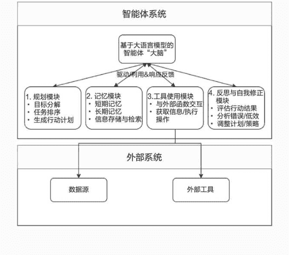
图8-1 智能体架构图

一个成熟的 Agent 通常具备这些特质：行为受目标牵引，所有动作都服务于一个或多个明确的上层意图；具备环境感知力，能通过搜索 API、文件读写、数据库接口等工具获取数字或物理环境的状态；自主性很强，可以自行做任务拆解、路线选择并持续推进，不需要人手把手教；对环境变化敏感，能及时调整计划与策略；不只是被动反应，还会主动寻找新机会或按既定策略出手。

造 Agent 的终极目的，是让系统足够聪明，去替代或配合人类完成那些复杂、多步、需要大量外部交互的工作，从而提效、扩容人类能力，并在不同领域实现更高程度的自动化。

Agent 和常见的 LLM 产品，比如聊天机器人、RAG 系统、简单的函数调用助手，本质上不一样。驱动方式不同，前者靠用户即时指令，后者靠更模糊、更长期的高层目标。行为模式不同，前者是问答式的被动响应，后者是主动规划并持续执行一系列动作来达成宏观目标。自主性与规划能力是最大分野，前者自主性弱，需要人一步步指定；后者追求高度自主，能独立做判断和行动。常规产品几乎没有规划能力，而规划是 Agent 的灵魂，要把高层目标拆成可执行步骤。交互上，前者多是短暂的请求响应，后者是持续的感知-思考-行动闭环。记忆上，前者基本无状态或只依赖上下文窗口的短期记忆，后者必须有分层的记忆体系，包含短期工作记忆和长期经验记忆，用来追踪进度、记录环境并从经验中学习。目标复杂度上，前者擅长单一明确任务，后者面向更开放、更复杂、需要多步协作的宏观目标。

Agent 的思想并不新鲜，它的根可以追溯到 AI 早期的规划、强化学习和机器人学。LLM 的出现带来了上下文学习、指令遵循、初步推理等革命性能力，为构建更通用、更灵活的 Agent 提供了理想的核心大脑，极大推动了 LLM-based Agent 的发展。回看演进的几个关键节点：早期基于规则或符号 AI 的尝试，在封闭场景里能显出智能，但泛化能力不足；强化学习的兴起提供了强大的决策数学框架，AlphaGo、AlphaZero 在封闭竞技场取得标杆成绩，但直接搬到开放通用任务仍受样本效率低、奖励设计难等限制。

真正的拐点是生成式 LLM 的出现，随后 2022 年提出的 ReAct 成为里程碑。ReAct 让模型交替产生“思考”和“行动”的迭代循环：先接收目标和初始观察，生成分析、计划类的思考文本，再输出具体的行动指令，通常是调用外部工具。工具的执行结果作为新的观察反馈回去，模型进入下一轮思考-行动，直到目标达成。ReAct 证明了显式思考可以指导行动选择与工具使用，并借助外部反馈动态调整。

2023 年初，AutoGPT、BabyAGI 等开源项目爆发，点燃了公众对自主 Agent 的热情。它们的思路是让 Agent 完全自主运转：接收上层目标后自行拆解为任务清单，按优先级挑选执行、选择工具、根据结果自生新任务并迭代，直到完成。早期版本在可靠性与成本上还有短板，但核心思想极具启发性。为降低工程门槛，LangChain、LlamaIndex、Microsoft AutoGen 等专业化开发框架快速成长，提供模块化组件和现成逻辑，简化开发、测试与部署。如今 LLM-based Agent 仍处在高速演进与挑战并存的探索期，但其潜力已指向未来 AI 应用的核心方向。

### 8.2 以大模型为“智能大脑”的协同系统

要让 Agent 真正可用且稳定执行复杂任务，需要把若干相互依赖的技术组件整合成一个协同工作的体系。在这个体系里，强大的 LLM 扮演核心大脑或中央认知与决策引擎的角色。弄明白各组件的功能定位、相互作用方式，以及它们如何共同支撑自主行为，是后续设计、实现和优化 Agent 的基础。

在以大语言模型为底座的 Agent 体系里，大模型基本处在指挥塔的位置，负责最高层的理解、推理、规划和拍板。它通过调用外部工具来获取环境感知，调阅内外记忆，在既定目标下把任务拆解、择优决策下一步要不要调工具或直接生成文本，行动结束后又要消化结果和反馈，为下一轮感知-思考-行动打底。围绕这个“大脑”，规划、记忆、工具、反思等模块像器官一样配合，让智能体跑起来。

#### 8.2.1 大模型：认知与决策的发动机

可以把大模型看成智能体的智能中枢。任务解读、环境理解、复杂逻辑推演、策略制定与抉择，以及所有自然语言的产出，都在这里发生。强大的语义理解、上下文把握和长程依赖建模能力、指令遵循力、常识与知识调用能力，以及结构化输出能力比如 JSON，基本决定了 Agent 的上限和落地效果。

#### 8.2.2 规划模块：把目标翻译成行动序列

规划就是把用户给的笼统、模糊的终极目标，自动拆成一组有逻辑、可执行的子任务或步骤。是自主决策能否落地的关键。

常见做法分两类。单步或反应式规划，基于当下状态直接决定下一步，适合环境变化快、目标明确的短任务。多步规划则会提前或动态生成一条包含未来数步的完整路线，能更早看见长期后果，兼顾整体效率，适合复杂策略场景。

在大模型里，规划主要靠两种思路实现。一是靠精心设计的提示，让模型凭借预训练中的任务分解经验直接输出步骤。二是 ReAct 式的交错模式，每一步都先显式写出对现状的思考和分析，再给出具体行动指令，规划过程可视化，也能根据实际执行结果即时修正。进阶做法还有任务清单维护，像 AutoGPT 那样从列表里挑任务、动态增删改序；层次化规划，先把高层目标拆成中层子目标再落到具体动作；先生成象征性计划或代码片段，再交给外部执行器跑。

#### 8.2.3 记忆模块：保持连贯与持续学习

记忆负责收纳 Agent 在执行中接触、产生或学到的关键信息，是对话连贯、不重复踩坑、实现经验进化的基础。大模型受上下文窗口限制，超窗就“失忆”，独立于窗口的持久化结构化记忆是处理长任务和持续学习的必要设施。

通常分为三层。

1. 短期或工作记忆：承载当前任务的即时信息，要能被模型快速读写。常见做法是把最近对话、工具调用记录、中间思考等打包进提示词，或维护一个暂存区记录中间结果。
2. 长期记忆：保存有持久价值的信息，比如用户偏好、过往任务的完整思考-行动-观察序列、从文档或知识库学到的知识点。信息量大，需要高效存取。主流方案是用向量库+Embedding，把文本、对话片段、结构化数据转成高维向量存库，检索时把当前查询也向量化做相似度匹配，把最相关的片段重新注入上下文。
3. 结构化记忆：针对强结构数据，用传统关系数据库或图数据库精确管理。例如用知识图谱存实体关系，或用关系表存配置、任务状态、商品目录等。Agent 需要配备相应的工具，比如 SQL 查询、GraphQL 查询，才能读写这类记忆。

#### 8.2.4 工具使用模块：把语言模型变成行动者

工具让 Agent 能真正在外部世界感知、获取信息并产生影响，弥补模型本身算不准、查不到实时数据、操作不了外部系统的短板。工具是能力的放大器和延伸器。

函数调用机制是实现的基础。每个工具对应一个可被大模型选用的外部函数或 API。种类很多：信息类如搜索引擎、百科、天气股票 API、文件读取、数据库查询；代码执行类如 Python REPL、SQL 执行引擎；系统交互类如日历邮件 API、CRM/ERP、智能家居控制；甚至能调用其他 AI 模型如图像生成、语音识别。大模型决定用不用、怎么用，应用层负责实际调用并把结果喂回模型。

#### 8.2.5 反思与自我修正模块：从失败中进化

反思模块让 Agent 在执行中对行为、结果和计划做动态的批判性评估，识别错误、低效或偏离目标之处，并主动修正。这是鲁棒性和适应性的核心。

常见做法是行动结束或出错时，用特殊提示引导模型复盘：回顾最近动作、对比现状与目标、判断计划是否仍有效、提出修正方案。生成的反思可用于更新计划、调整行动或修正对任务环境的理解。更高级的做法是把成功的反思-修正-成功经验写入长期记忆，或用强化学习的思路根据最终成败调整规划与决策参数。

总体看，一个可靠且能进化的智能体，是大模型大脑与规划、记忆、工具、反思等支撑模块高效协同的产物。理解各模块职责、定位和相互依赖，是设计、搭建、调优 Agent 的前提。

### 8.3 主流智能体开发框架的技术选型与比较

从零手写一套完整 Agent 成本极高。社区已出现一批开源框架，提供模块化组件、标准接口和开箱即用的执行逻辑，让开发者聚焦业务与创新。

#### 8.3.1 LangChain Agents：通用构建框架

LangChain 专注于把大模型能力与计算资源、知识源、工具结合起来，构建更具上下文感知的应用。其 Agent 模块是亮点，主张模块化、可组合，像搭积木一样拼模型、工具、记忆、提示词。

架构上提供统一的大模型/Chat Model 封装，方便接入不同来源模型。工具定义与管理内置大量预置工具如搜索、计算器、第三方 API 封装、Python REPL、SQL 交互，也能把自定义 Python 函数或外部 API 包成标准工具。记忆支持即插即用，如 ConversationBufferMemory、ConversationBufferWindowMemory、VectorStoreRetrieverMemory、ConversationSummaryMemory 等。核心执行器负责协调模型、工具、记忆，完成感知-思考-行动循环，并提供多种预置Agent：经典 ReAct、原生函数调用型、带对话记忆的会话式 Agent。提示词模板管理也成熟，运行时自动填充占位符。

典型使用流程：先初始化模型实例，再准备可用工具列表，初始化记忆，再按任务和模型能力选型初始化执行器，最后调用 run 方法把用户输入或高层目标丢进去，Agent 开始自主循环直到完成或触发终止。

优点是功能全、模型工具生态庞大、社区活跃、文档丰富、扩展性强。缺点是抽象层多，上手门槛偏高，复杂 Agent 的调用链调试相对繁琐。

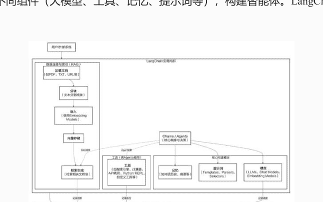

#### 8.3.2 LlamaIndex Agents：数据与检索专家

LlamaIndex 原名 GPT Index，走的是数据驱动路线。核心是让大模型智能选择并使用不同数据索引或查询引擎作为“工具”，高效回答依赖大量异构数据检索整合的问题，在高级 RAG 和数据型 Agent 上很有特色。

技术特点体现在数据处理：内置海量数据源的连接器/读取器，支持文件、数据库、SaaS API、网页等；提供列表、树、关键词表、知识图谱等多种索引结构；对数据做预处理、组织、优化以实现精准检索；基于索引提供高性能查询引擎，构成 RAG 核心。Agent 设计强调与索引/查询引擎的智能交互，能按问题类型动态挑选最合适的索引作为工具。除此之外也兼容通用工具，并与 LangChain 工具互通。

它特别适合需要深度联动企业内部私有文档、技术手册、合同，或跨多库做自然语言数据分析、基于知识图谱问答等数据密集型场景。

LangChain 与 LlamaIndex 既有重叠也有分工。前者在数据层连接、索引、RAG 查询引擎的专业度和深度上更突出，后者在通用 Agent 执行逻辑、Agent 类型丰富度、通用工具集成上更全面。实践中常组合使用：用 LlamaIndex 建复杂检索引擎，再作为一个工具接入 LangChain Agent。

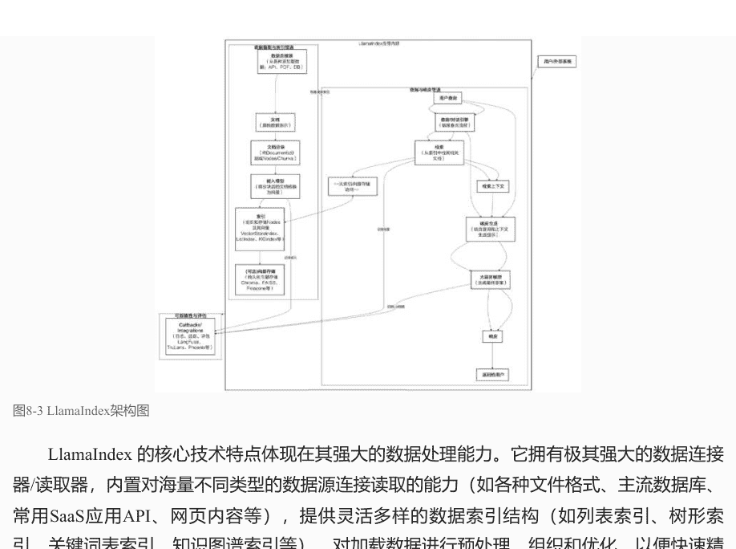

#### 8.3.3 Microsoft AutoGen：多 Agent 协同框架

AutoGen 由微软研究院推出，目标是简化多智能体应用开发。核心思想是构建由多个角色构成的虚拟团队，不同角色可由不同模型驱动，通过自然语言对话协作，解决单个模型调用难以处理的复杂目标。

架构围绕可对话 Agent 展开，两个基础角色关键：

- 用户代理 Agent：代表用户发起任务，能在本地安全环境执行其他 Agent 请求的代码或函数调用，并回传结果，把人类工具权限安全赋能给整个团队。
- 助手 Agent：通常由强模型驱动，负责深度认知、制定计划、提出方案、写代码，并与其他 Agent 讨论完善。

典型工作方式是按任务设计若干角色如工程师、测试员、产品经理、用户代理，放到群组聊天中，由群组聊天管理器协调发言。各 Agent 通过对话共享信息、分工、评审、整合，直至达成目标。

优势在于更贴近真实团队分工，能把复杂任务拆给最擅长的角色，协作灵活。挑战在于多 Agent 协调更复杂，对话轮次多导致 API 调用增多和延迟上升，且需要保证目标一致、处理意见分歧。

典型场景包括自动化软件开发流水线、多学科 AI 科研团队、模拟商业谈判或复杂决策博弈等。

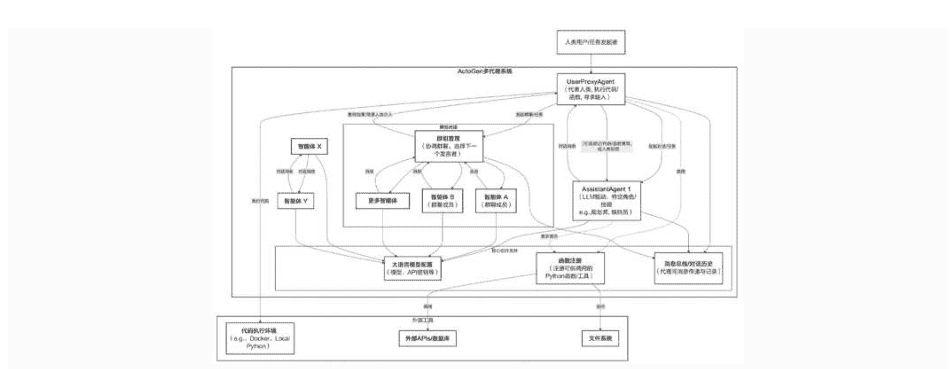

#### 8.3.4 如何选择合适的框架

没有万能答案，关键看需求。

要做通用单体 Agent，需要丰富的预置工具和灵活的执行控制，LangChain 因其全面性和成熟生态多为首选。

如果核心是与大量复杂异构外部数据源尤其是企业私有数据深度交互，LlamaIndex 在数据连接、索引、查询引擎的抽象上更专业。

如果需要多角色通过对话完成复杂工作流自动化，AutoGen 的多 Agent 对话协作设计更有创新性。

同时要考虑团队技术栈熟悉度、学习成本，社区活跃度、文档完善度与长期维护前景。初学者可以先从 LangChain 的 ReAct 或原生函数调用 Agent 入门，建立对自主运行机制的直观认识，再逐步探索更复杂功能。轻量级库也是不错的过渡。

这些框架并非互斥，存在互操作可能，比如把 LlamaIndex 的查询引擎作为 LangChain Agent 的工具，或在 AutoGen 团队里用 LangChain/LlamaIndex 构建的单体 Agent 作为角色。根据模块需求灵活组合各框架优势，往往更有效。

### 8.4 本章小结

本章围绕智能体的自主性展开：从定义、特征、技术演进，到以大模型为大脑、规划、记忆、工具、反思协同的架构，再到 LangChain、LlamaIndex、AutoGen 等主流框架的选型参考。智能体标志着从“使用 AI”到构建能自主行动与学习的系统。走向规模化仍需面对可靠性、成本与安全挑战，但对现有 AI 技术的深度整合，正在推动企业与社会的智能化转型。

前面几章我们已经把大模型的工作原理、DeepSeek 家族的技术路线以及关键的应用技术都过了一遍，手里已经攒够了搭建下一代 AI 应用的理论积木和技术元件。但光有积木还不够，真正要把它拼成能在线上跑的生产系统，工程上的摩擦感非常强：要接大模型 API、搭 RAG 链路、反复打磨提示词、写函数调用的后端、再做前后端产品，这些琐碎工作很容易拖慢企业内部的落地节奏。

于是 LLMOps / AI 应用开发平台就出现了，Dify 在这一赛道里因为功能扎实、体验顺滑、开源社区很活跃而脱颖而出。它的核心价值是提供一套可视化、一体化的高效解法，让用户用直观的操作把学到的 AI 核心技术以低代码的方式快速组合成可运行的应用，并一键对外发布成 Web 应用或 API 服务。可以把 Dify 视作面向 AI 应用的“IDE”，也是高度封装的“BaaS”平台，它把底层 LLM 技术栈的复杂性藏在了后面。

本章的目标是帮你完整认识 Dify。我们会先搞清楚 Dify 是做什么的、价值主张是什么、在技术栈里处在哪一层，接着把平台里反复出现的核心概念拆开讲：应用、知识库、模型提供商、提示词编排、工具。最后进入最关键的实操部分，手把手教你怎么选部署方式、怎么搭环境，并演示如何把 DeepSeek 系列模型安全可靠地接入 Dify，为后面的实战打底。

### 9.1 Dify 平台简介

Dify 以开源为引擎，专注于把生成式 AI 应用从创建、部署、管理到持续迭代的全生命周期变得更简单、更快。它集成了高度一体化的可视化工具和稳定可托的后端支撑，让开发者把精力留在业务逻辑创新和用户体验上，不必在底层基础设施搭建、多模型适配集成、后端运维上浪费太多时间。整体思路是用更敏捷、高效、易普及的方式重新定义 AI 应用的开发范式。

#### 9.1.1 核心思路：用声明式的方式定义 AI 应用

Dify 的吸引力在于直击 AI 应用开发痛点的几层颠覆性价值。

其一是革命性的可视化提示词与逻辑编排。平台提供一个图形化画布，用户可以把大模型调用、知识检索、条件分支、工具调用等预设模块像搭积木一样拖拽出来，用连线把执行顺序和数据流串起来。这样复杂逻辑的设计变得直观，后续调试、迭代和维护也轻松很多。

其二是极致易用与门槛降低。常见的企业级 AI 能力都被预封装成开箱即用的模板、标准组件和可复用的节点。大多数场景下，只需要在网页里选模型、上传文档、填提示词变量、调工具参数，就能搭出可测试、可上线的应用，技术门槛被显著拉低。

其三是强整合与可扩展。真实业务里 AI 需要和 CRM、ERP、数据库等系统联动，也可能要灵活切换不同厂商的大模型/嵌入模型。Dify 内置对主流大模型和 Embedding 提供商的原生支持，同时兼容 OpenAI 规范的 API，方便接入第三方。知识库方面，从文档上传、自动化处理到向量化存储与检索，形成闭环。智能体场景下，用户可把内部私有 API 或本地函数封装成工具，让模型按需调用。平台本身也提供完整 API，方便把已发布的应用嵌进现有业务系统、移动端或官网。

其四是接近后端即服务的体验。除了前端交互，平台在底层提供了身份与权限、API 密钥安全存储、调用日志分析、版本控制与发布、甚至一键托管为 Web App 等生产级能力，开发者不需要从零造轮子。

#### 9.1.2 产品定位：AI 应用开发与 LLMOps 平台

Dify 并不是单一工具，而是一个综合解决方案。

它首先是一个实用的 LLMOps 平台，覆盖模型应用从开发到运维的关键环节。其次，它是智能体构建与运行平台，可视化画布能直接设计智能体的决策流程，让没有强编程背景的用户也能通过少量配置甚至零代码，快速做出知识问答机器人、营销文案生成器、任务型 AI Agent，并直接获得 Web 界面或 API 接口。

总体来看，Dify 是一个以加速 AI 应用构建与部署为目标，深融 LLMOps 理念并原生集成 AI Agent 开发运行能力的开源驱动型平台级方案，特别适合需要快速开发、敏捷迭代并面向用户交互的大模型智能应用。

#### 9.1.3 发展与生态

Dify 的快速成长离不开开源战略。核心代码完全公开，任何人都可以下载使用、学习修改并贡献代码。社区活跃，功能迭代很快，能跟上大模型技术和市场变化。活跃的开源生态带来了学习资源、及时支持和集体智慧，修复缺陷、扩展功能的速度远超封闭产品。

同时，项目也提供付费增值或商业版，以及官方托管的 SaaS，让企业获得更强性能、企业级特性，同时为项目可持续发展提供资金支撑。

### 9.2 核心概念详解

上手 Dify 前，弄懂平台里高频出现的概念会省很多事。

#### 9.2.1 应用：可交付的 AI 服务实例

“应用”是 Dify 里最顶层的抽象，一个应用就是一个能独立运行并对外提供特定 AI 能力的项目或助手。

常见形态有三类：对话型应用，支持多轮自然语言交互，背后通常结合模型对话、记忆、RAG、函数调用；文本生成型应用，按主题、关键词或草稿生成高质量文本，如邮件、产品描述、代码片段；工作流/智能体型应用，逻辑更复杂，可定义多步骤、分支、循环并调用多种工具，接近完整 AI Agent。

配置完成后，Dify 能自动生成公开的 Web 界面供终端用户使用，也能输出标准 API 供系统集成。

#### 9.2.2 知识库：RAG 的数据底座

知识库负责管理和组织用于检索增强生成的知识来源。每个知识库都是一组经过结构化处理和索引的文档集合。

平台提供从接入到可检索的全流程：支持本地上传 PDF、TXT、Markdown、Word、Excel 等，也能从 URL 抓取或对接在线知识库。上传后后台自动做文本分块和向量化 Embedding，用户可调分块大小、重叠度、选择 Embedding 模型等参数。

建应用时可把一个或多个知识库关联进去，运行时系统会根据用户查询语义检索最相关片段，注入到大模型提示词中。简单说，知识库是让大模型掌握企业私域或领域知识的关键。

#### 9.2.3 模型提供商：统一的模型管理入口

模型提供商模块集中配置、管理和接入来自不同第三方模型厂商的 API 凭证与参数，相当于平台与外部模型能力之间的统一适配器。

好处是不用在每个应用里重复填敏感的 API Key，也不用关心各家调用差异。一次性配置好后，全平台的应用都能直接选用已配置的模型。

#### 9.2.4 提示词编排：可视化画布

这是 Dify 最具代表性的功能，也是低代码/无代码开发的核心。用户在画布上拖拽节点、连线、填参数，就能设计复杂的应用内部流程，并动态拼装最终发给大模型的提示词。

画布由节点构成，常见节点有开始、LLM、知识检索、工具、条件分支、代码执行、结束等。通过端口连线定义数据与控制流，变量在节点间传递，开始节点定义输入，后续节点可读、写变量。

这种设计把原本需要大量代码实现的动态 RAG、工具调用、结果整合、条件判断等变得可视化、可协作，非程序员也能搭出功能复杂的流程。

#### 9.2.5 工具与插件：对外交互的手脚

工具就是大模型可以判断并调用的外部功能或 API。Dify 利用函数调用能力，让模型根据意图选择工具并生成参数。

工具分内置和自定义两类。内置有网页获取、代码解释器等常用能力；自定义则允许把企业内部 API、第三方服务甚至本地函数按规范封装成工具，定义名称、描述和 JSON Schema 参数。执行时工具节点会调用外部服务并把结果作为变量传给下一步。

工具机制让 Dify 构建的智能体能够感知外部世界、获取实时信息并执行行动，是连接业务系统和开放生态的桥梁。

### 9.3 环境准备

概念弄清楚后，就要动手搭环境。本节重点是根据需求选部署方式，成功跑起 Dify，并把 DeepSeek 模型安全接入，使其成为后续实战的智能引擎。

#### 9.3.1 部署选型

Dify 提供了三种典型部署方式。

官方云版，注册即用，无需运维。即开即用，最适合个人学习、原型验证或对数据主权要求不高的非核心业务。代价是成本较高、定制和数据控制受限。

基于 Docker 的本地/私有云部署，目前最推荐给希望掌控数据的团队。官方提供 Docker Compose 方案，容器化部署整个平台及其依赖，兼顾数据私有与部署便捷，合规性好。本书后续实践以此为主。

源码手动编译部署，技术门槛最高。从 GitHub 拉取源码，自行配置运行环境、安装依赖、编译前端、分别启动后端、前端、数据库等服务。灵活性最高，可深度定制，但需要资深开发与运维能力，对普通用户不友好。

#### 9.3.2 部署步骤

部署前先准备一台合适的服务器或开发机，安装最新稳定版 Docker 引擎和 Docker Compose。建议至少 2 核 CPU、4G 内存，并保证外网可访问，以便拉取镜像和连接外部模型 API。

具体流程如下：

第1步是拿到 Dify 的 Docker Compose 部署文件，通常从官方 GitHub 仓库克隆或从发布页下载。

```
# 假设当前的最新版本为 0.15.3（请检查 Dify 官方仓库，以获取最新的稳定版本进行替换）
git clone https://github.com/langgenius/dify.git --branch 0.15.3
```

第2步是配置环境变量。Docker Compose 依赖 .env 文件来设置数据库账号密码、Redis 密码、对外端口域名等关键项，按官方文档把 .env.example 复制为 .env 并修改。

```
cd dify/docker
cp .env.example .env
```

第3步是在包含 docker-compose.yaml 的目录下执行拉取镜像并启动服务的命令。

```
## 首次执行可先拉取镜像
docker compose pull
## 启动服务
docker compose up -d
## 若版本是 Docker Compose V1，则使用以下命令
## docker-compose up -d
## 若成功启动服务，则应该可以看到类似的输出
[+] Running 11/11
 ✔ Network docker_ssrf_proxy_network Created 0.1s
 ✔ Network docker_default Created 0.0s
 ✔ Container docker-redis-1 Started 2.4s
 ✔ Container docker-ssrf_proxy-1 Started 2.8s
 ✔ Container docker-sandbox-1 Started 2.7s
 ✔ Container docker-web-1 Started 2.7s
 ✔ Container docker-weaviate-1 Started 2.4s
 ✔ Container docker-db-1 Started 2.7s
 ✔ Container docker-api-1 Started 6.5s
 ✔ Container docker-worker-1 Started 6.4s
 ✔ Container docker-nginx-1 Started 7.1s
```

##### 9.3.2 Dify 体系部署与访问

执行一次部署指令后，后端会按编排清单的规则自动从指定的镜像仓库拉取全部依赖映像，待镜像就绪便在后台完成容器实例的创建与启动。

第4步的核心是确认各个服务是否真正进入运行态。

```bash
docker compose ps
```

把本次部署所涉及的所有容器实例全部列出，检查其状态标识是否均为 Up 或 Running。

```bash
docker logs -f <service_name>
```

若出现启动异常，可对单个容器开启实时日志追踪，迅速定位报错位置。

第5步是打开 Web 入口。待所有服务稳定后，即可用浏览器访问，前端地址通常由 `.env` 中定义的服务域名或可达 IP 配合端口决定。默认情况下服务会监听 80 与 443。

```
#### 初始化
##### 本地环境
http://localhost/install

##### 服务器环境
http://your_server_ip/install

#### 访问 Dify 平台
##### 本地环境
http://localhost

##### 服务器环境
http://your_server_ip
```

部署阶段容易出现的风险及对应的排查思路。端口被占用时，需要修改 `.env` 或编排清单改用空闲端口；Docker 权限不足，要确保当前账号有权执行 Docker 指令，且守护进程对宿主机挂载的数据卷目录具备读写权限；主机资源紧张时，需查看 CPU、内存、磁盘占用，必要时升级或做瘦身优化；镜像拉取失败多半是网络不通或未使用镜像加速；数据库初始化失败或连接异常，往往源于 `.env` 中的数据库账号密码与编排清单定义不一致、数据卷目录权限错误或磁盘已满；后端 API 无法连通数据库或 Redis 缓存，则要逐项核对 `.env` 中的连接参数以及服务间的网络可达性。逐条阅读各容器的启动日志，是判断根因最可靠的做法。

##### 9.3.3 Dify 大模型接入配置

部署完毕并能正常登录管理后台后，最关键的一步是把本章要使用的 DeepSeek 系列大模型安全接入，让其成为后续搭建各类 AI 服务的核心算力。

前提是持有有效的 DeepSeek AI API Key，这相当于调用模型服务的身份凭证。申请方式请参照 DeepSeek 官网或开发者文档说明，并妥善保管，如图 9-1。

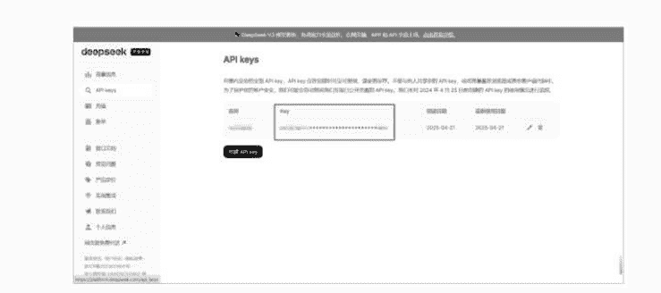

进入模型供应商管理页面，可看到已支持的提供商列表及新增按钮。一种做法是直接选用“深度求索”来新增 DeepSeek 大模型，如图 9-2。另一种做法是借助 DeepSeek API 对 OpenAI 规范的兼容性，通过“Open AI Compatible”路径接入。


填写配置表单时，必填项务必填准。最核心的是 API Key 和 API 接入点 URL；在 Open AI Compatible 方式下，还需明确模型类别，例如是“大模型 LLM”还是“文本 Embedding 模型”。模型名称只是在 Dify 内部便于识别的别名，更关键的是要把“API endpoint 中的模型名称”填对，该标识必须与 DeepSeek API 实际要求的模型 ID 完全一致。可选参数则根据平台与模型要求自行配置，例如最大上下文长度、是否支持原生函数调用或工具调用等特性。

### 9.4 本章小结

本章带我们正式进入 Dify 的世界，这是一款能够大幅提速 AI 应用研发的 LLMOps 创新体系，也为后续基于 DeepSeek 的实战开发铺平道路。我们先从宏观角度理解了 Dify 的价值定位与产品思路，并系统梳理了应用、知识库、模型供应商等核心概念的管理方式。之后按步骤完成了部署方案的选择，并以 Docker 容器化方式搭建起了运行环境。学完这一章，构建 AI 应用的基础已经准备就绪。在 Dify 这个“AI 应用梦工厂”里，核心算力 DeepSeek 系列也已就位。下一章会结合 Dify 的可视化能力，动手打造基于 DeepSeek 的实用应用，感受其加速创新的独特魅力。

## 第10章 Dify 体系实操：打造首个 AI 应用

第9章结束后，Dify 已在本地服务器或私有云上稳定运行，并且 DeepSeek 系列大模型也已接入。概念理解与环境准备全部到位，现在可以把知识落地。

本章的目标是手把手教你从零出发，利用 Dify 提供的核心模块与可视化界面，亲手搭建几个可用的、基于 DeepSeek 能力的 AI 程序。我们不再停留在理论层面，而是直接进入真实操作界面，通过点击、参数填写、逻辑编排与效果预览，把前面学过的大模型原理、DeepSeek 特性、提示词工程、RAG、函数调用与智能体等内容，变成看得见、能互动、可验证的成果。

首先会重点拆解 Dify 最吸睛的可视化提示词与逻辑编排能力。学会在编排画布上拖拽、连线、配置各类功能节点，直观设计复杂的智能交互流程，管理流程中的动态占位符与对话历史，并借助实时预览与调试快速迭代。

接着会实操一个带 RAG 流程的应用。先在 Dify 上新建知识库，上传企业内部文档，观察后台自动完成的分块与向量化处理，再把知识库接入应用，让 DeepSeek 能够基于私有知识给出精准回答与分析。

在此基础上，还会讲解如何借助大模型的函数调用能力，在 Dify 中定义并调用外部工具，赋予应用与外部世界真实交互、获取实时信息甚至执行操作的行动力。

最后，应用测试通过后，我们还会了解如何发布、分享或嵌入到企业现有网站与业务系统，以及如何通过 Dify 提供的标准 API 接口实现程序化集成与交互。

整章以大量实操步骤与贴近业务的案例为线索，目标是让你在跟随操作后，能够独立自信地在 Dify 上探索与构建。我们将循序渐进地完成一个基础智能问答助手和一个基于企业私有知识的 RAG 应用，全面覆盖 Dify 的核心功能。

开始前，请再次确认 Dify 能正常访问，并且 DeepSeek API Key 已正确配置并通过连通性测试，这是后续实操顺利的前提。

### 10.1 创建 AI 应用与基础配置

登录自建的 Dify 系统后，映入眼帘的是“工作室”页面，展示已创建应用的清单，如图 10-1。无论新手还是熟手，构建 AI 应用的第一步都是新建一个实例。

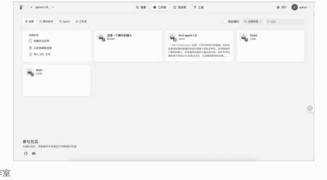

图10-1 Dify工作室

#### 10.1.1 应用类型的挑选

点“创建应用”后，Dify 会提供几种针对不同交互模式的预设类型供选择。常见类型包括聊天助手、文本生成应用、智能体、对话流和工作流。

- (1) 聊天助手：最常用的对话交互形态，依托大模型的轮询对话能力，适合做客服机器人、智能伙伴等。
- (2) 文本生成应用：面向创作类任务，如写故事、生成摘要、文本分类或翻译，侧重单向文本生成。
- (3) 智能体：更高级的形态，可拆解复杂任务、进行推理并调用外部工具与现实世界交互。
- (4) 对话流：适合需要定义复杂多轮对话流程的场景，强调记忆与对话历史管理，通常以可视化编排实现。
- (5) 工作流：侧重自动化、批处理等单轮任务，如批量文本处理、按固定流程生成报告，也可通过可视化编排完成。

选对类型是后续设计的基础。对初学者而言，从“聊天助手”或“文本生成应用”入手，能快速熟悉 Dify 的交互与提示词设计。

#### 10.1.2 应用的基础设定

选定类型后，例如新建一个“聊天助手”，Dify 会引导完成基础信息填写，过程很直观，如图 10-2。

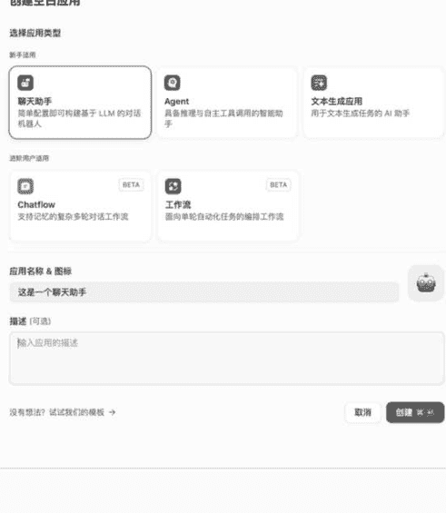

图10-2 应用的基础设置

第一是应用名称。为新应用起一个清晰简洁、能准确概括功能用途的唯一名字，例如 DeepSeek 企业产品问答助手。好名字便于后续管理和识别。

第二是可选的图标与描述。图标帮助在众多应用中快速定位，描述则简要说明功能、用途与目标用户，对协作与分享很有帮助。

最关键的一步是选择核心语言模型。在模型下拉列表里应能看到第9章已配置的 DeepSeek 模型，可将其设为当前应用的驱动引擎。之后可以对模型的默认生成参数做初步调整，如温度，它控制输出的随机性。需要精确答案的问答类应用建议用较低温度，如 0.1~0.3；需要创造力的内容生成建议用较高温度，如 0.7~0.9。`top_p`、存在惩罚、频率惩罚等进阶参数可在后续编排中再调。初次创建不确定时，可沿用平台默认值，如图 10-3。

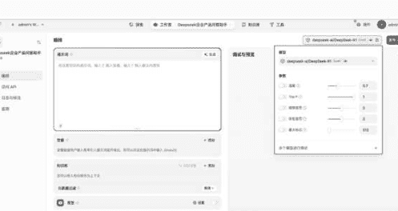

图10-3 DeepSeek企业产品问答助手

#### 10.1.3 快速上手体验

为帮助新用户更快熟悉功能并体验价值，Dify 通常提供针对常见场景的预设应用模板。这些模板已内置基础提示词结构、核心逻辑流程，甚至示例数据或工具集成。

使用模板的优势是极速上手，几乎立刻得到一个可运行的原型。同时它们也是很好的学习范例，研究其内部配置能快速掌握高质量应用的实践经验。

例如官方或社区可能提供一个名为“DeepResearch”的模板，如图 10-4，其目标是用户输入研究主题后反复检索生成报告。流程大致为：用户输入问题与研究深度；大模型解析问题提取检索主题；按设定深度迭代检索，如使用 Tavily 搜索引擎；大模型判断是否继续检索；最后由另一模型汇总结果并生成 Markdown 报告。在案例中，可把模板默认模型替换为我们配置的 DeepSeek，从而快速得到一个基于 DeepSeek 的复杂对话流应用并在此基础上学习改进。

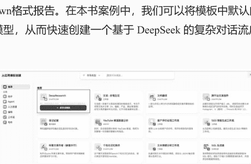

图10-4 从应用模板创建应用

无论从零搭建还是基于模板，现在你已拥有一个 Dify 应用实例。接下来我们将深入 Dify 最核心的功能——可视化提示词与应用逻辑编排。

### 10.2 AI 应用的可视化编排

创建应用后，对于需要深度定制逻辑的 AI 应用，通常会进入名为“编排”的页面，这里是注入应用灵魂的主战场。Dify 在此呈现一个强大且直观的可视化编排画布。图 10-5 为“DeepResearch”模板的编排画布。

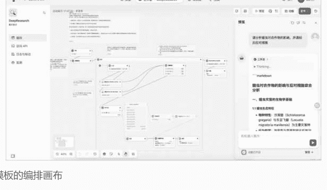

图10-5 “DeepResearch”模板的编排画布

#### 10.2.1 深刻理解 Dify 可视化编排画布的核心构成与各类功能节点

Dify 的可视化逻辑编排画布是其产品创新的核心。它提供所见即所得的图形化工作区，通过拖拽、连接与参数配置，清晰地设计、构建和管理 AI 应用运行时的内部流程。

画布通常包含主工作区，可从侧边工具栏拖入代表不同处理步骤的功能节点并进行布局，如图 10-6。前置节点的输出可定义为带名称的占位符，并在后续节点配置中以特定语法动态引用，如图 10-7。


图10-6 将功能节点添加到画布区域

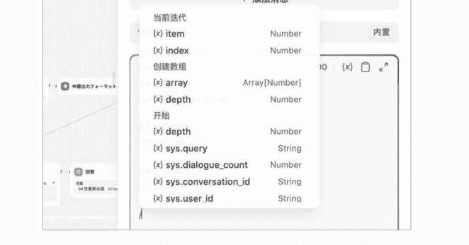

图10-7 变量引用

Dify 编排画布中常见的核心节点类型在前章已介绍，这里回顾实操意义。

- 1. “开始”节点：定义流程起点与核心输入占位符，如用户查询。
- 2. “LLM”节点：与 DeepSeek 等模型交互的关键处，用于配置提示词模板与模型参数。
- 3. “知识检索”节点：实现 RAG 的核心步骤，从关联知识库中检索相关信息。
- 4. “工具”节点：连接外部 API 与服务的执行器，让智能体具备行动能力。
- 5. “条件分支”节点：依据占位符值或大模型输出判断，实现流程的智能分叉。
- 6. “代码执行”节点：进行数据处理、转换或执行简单代码片段。
- 7. “结束”节点：标志流程终点与最终输出结果的定义。

#### 10.2.2 有效运用指令、变量与上下文管理

在可视化编排画布中，“LLM”节点里的提示词模板设计是构建 AI 应用最核心也最具灵魂的部分。它决定了如何与 DeepSeek 模型交互，直接影响模型能否准确理解意图并生成期望的高质量输出。

编写提示词模板时，首先要在节点中输入核心指令内容。可借用前序章节的提示词工程实践：明确设定模型角色，例如你是一位专业的某领域顾问；下达清晰具体的任务指令，例如请分析以下文本并提取关键信息；提供必要的背景或约束条件，例如基于公司最新规定；若适用可加入高质量的少样本示例，例如输入：[示例 A] 输出：[期望结果A]，并明确指定期望的输出格式，例如请以 JSON 格式返回结果。

让提示词具备弹性，关键在于把“动态参数”用对、用准。在模板文本里按 Dify 的约定语法，把来自上游模块比如开始模块、知识检索模块、工具模块等吐出的值嵌进去，就能实现拼接式生成。把这套引用手法练熟，指令模板就能随着流程里的实时数据和上下文自动适配，让大语言引擎始终给出最贴合的输出。

#### 10.2.3 从首语到多回合交流的智能管控

做对话型项目，单次问答的表达只是入口，整段会话的体感才决定留存。Dify 的可视化流程区正好能搭建复杂的对话架构。

先把第一印象做好。对终端用户而言，一段亲切、清楚且点明核心能力的迎宾语极重要。Dify 里常用两种做法：在项目基础配置里写死一段固定问候；或在开始模块后接一个专属的 LLM 模块，让它零输入地生成一段略有变化的接待语。该模块的指令模板不需要依赖用户侧信息，只负责产出对话的起点。

再设计能应对不同复杂度的多回合逻辑。

基础问答。最纯粹的大语言引擎问答可简化为一个循环：用户在开始模块输入 query，随后连同系统自动维护的对话历史参数 chat_history 一起送入 LLM 模块，生成回复后由结束模块回传。Dify 会自动完成历史的传递与维护，开发成本很低。

RAG 增强问答。需要私域资料时流程会更厚：收到 query 后先走知识检索模块，从关联集里挑出最相关的上下文，再把原始问题、检索片段和对话历史一起喂给 LLM，引擎基于完整增强信息给出更准的答案，最后经结束模块发出。

工具行动问答。若要让 AI 真正去执行操作，通常需要两个 LLM 模块加一个工具模块，并配合分支判断。第一个 LLM 负责意图解析，判断是否要调外部工具并生成结构化调用指令。随后条件分支依据是否存在 tool_calls 决定走向：不需要则直接结束；需要则进入工具模块调用外部 API 并取回结果。最后把执行结果连同前面上下文送入第二个 LLM，由它整合反馈并产出面向用户的最终回复。

借助条件分支等逻辑控制模块，可以按用户意图、知识仓置信度或工具调用状态等动态条件来路由对话，从而支撑真正复杂的多回合交互。

### 10.3 项目与知识仓的融合

让引擎既懂企业私域资料又能灵活调用，正是 RAG 的价值，也是 Dify 设计的一大强项。下面以实操为例，为基于 DeepSeek 底座搭建的项目装上“私域知识大脑”。

我们拿“基于知识仓的文档修订助手”来演示：用户上传一份内部管理制度类文档，比如计算机系统操作手册，项目会对照事先载入知识仓的最新官方政策法规，比如《计算机化系统（征求意见稿）》，给出针对性的修订建议，帮助完成内部文档更新，如图10-8所示。

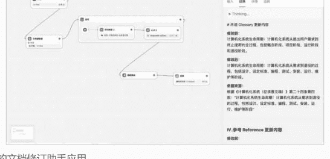

#### 10.3.1 新建并管理知识仓

先在 Dify 的知识仓管理页点“新建知识仓”，命名例如“附录-计算机系统-征求意见稿”，并上传资料，如图10-9所示。

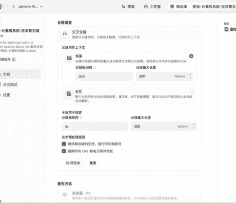

图10-9 新建知识仓

上传后后台会自动预处理，核心是把长文档切成合适大小的文本块并生成语义向量。几个关键配置要留意。

（1）分段策略。通用策略按用户自定义规则，比如固定长度、标点分割，将内容拆成独立片段。提问时系统会分析关键词，计算与各片段的相关度并挑选最相关的供给引擎。更进阶的是父子策略，采用双层结构兼顾检索精度与上下文。父块保持较大单位如段落提供丰富上下文，子块是更小的句子用于精确检索。先用子块精确定位，再带回父块补充上下文，可自定义分隔符与最大长度。

（2）Embedding 引擎。选择在模型供应商侧已配置好的可用引擎，选得好检索质量才有保障。

（3）文档处理策略，即索引方式。高质量策略用 Embedding 把分段文本转成数字向量，压缩存储且匹配更精准。经济策略则在各块内以少量关键词检索，准确度下降但省去 Embedding 费用，采用倒排索引。若经济索引效果不足，可在知识仓设置里升级为高质量索引。

（4）检索配置。高质量索引下可配置向量检索、全文检索与混合检索。向量检索把用户问题向量化后与知识仓向量算距离；全文检索靠明文关键词匹配；混合检索两者兼用，或用 Rerank 引擎从候选里挑最优。

配置完成后 Dify 会开始处理文档，耗时取决于文档量与引擎速度，界面可查看进度。完成后知识仓即可使用。

#### 10.3.2 配置检索策略

回到“基于知识仓的文档修订助手”项目，在流程区里新增“知识检索”模块。配置时先明确目标知识仓，这里选“附录-计算机系统-征求意见稿”。

再合理设定 Top K，即相似度检索后希望返回的前 K 个文档块。K 太小会漏掉关键信息，K 太大则引入噪声并增加引擎负担与成本，通常从 3～5 开始尝试再根据效果调整。

系统还允许对相关性得分设过滤阈值，只有余弦相似度等指标高于阈值的块才被采纳，有助于剔除弱相关结果，但阈值过高会误杀有用信息，过低则形同虚设，需结合引擎、度量方式与仓内内容特性实验确定。

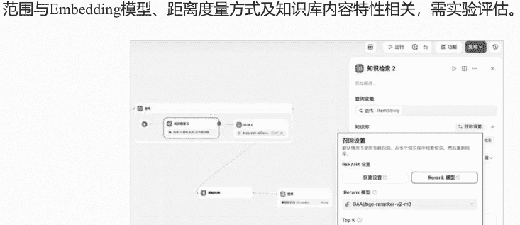

若流程里单独做了重排，重排模块的参数也需同步配置。

#### 10.3.3 引用和利用检索到的上下文

模块建好后，最关键的是把检索结果可靠地注入下游 LLM 的指令模板。

先把“知识检索”模块的输出端口连到 LLM 模块的输入端口，确认输出参数名。然后在指令里显式引用这些检索片段，如图10-11所示。

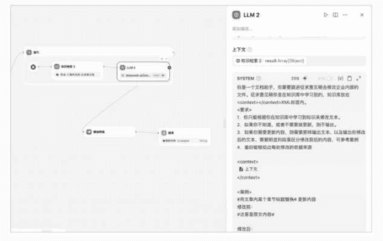

按此步骤，就能在 Dify 上搭出基础却完整的 RAG 项目。用户上传文档后，系统先从知识仓检索相关法规，再把这些“事实证据”连同用户文档一起输入 DeepSeek，产出更准确、可信、针对性强的修订建议。

### 10.4 项目的对外上线

当项目在 Dify 里经过反复设计、调试、预览后基本满意，就要正式上线，让目标用户能访问或嵌入到既有业务流程。

#### 10.4.1 上线前的全面预览与深度调试

点“正式上线”前，务必用系统提供的预览或在线调试功能做一次全覆盖的深度测试。覆盖典型输入与边界场景，检查知识检索的准确性、工具调用的正确性、多回合对话的连贯与鲁棒性。只有在各种情况下都能给出合理预期响应，体验与可靠性才有保障。

#### 10.4.2 公开分享或嵌入片段

Dify 会为每个项目自动生成可即时访问的 Web 界面，交付给终端用户非常便捷。

在项目管理或上线设置里通常提供两种方式。

- 获取公开分享链接。系统会生成唯一公开 URL，直接转发给同事、客户或测试用户即可在浏览器打开使用，无需安装配置。
- 获取 HTML 嵌入片段。若希望把聊天窗口无缝嵌到企业官网、产品页或内部知识门户，系统会提供一段 `<iframe>` 片段，复制到目标页的合适位置即可实现原生体验。

#### 10.4.3 API 访问与集成

除了 Web 形式，Dify 还支持把项目发布为标准化 API 接口。企业内部其他业务系统、移动端或自有前端可通过调用该接口程序化交互，获取 AI 能力。

在项目设置或 API 管理区可查到调用说明：API 端点 URL、API Key 的获取与鉴权方式、请求参数格式、响应格式与错误处理。通过这种方式，Dify 上的 AI 能力能更灵活地融入整体 IT 架构与业务流程。

借助上线、分享、嵌入与版本管理功能，可以更可控地交付项目并持续迭代优化。

### 10.5 本章小结

本章手把手掌握了用 Dify 构建与部署 AI 方案的核心路径，把理论转为可用能力。从创建首个 Dify 项目、选型并把 DeepSeek 设为引擎，到深度使用可视化流程、拖拽模块与管理参数，设计出带 RAG、工具调用与条件判断的智能交互，并用实时预览调试优化。再到创建管理知识仓，让 DeepSeek 基于私域资料精准应答。最后学习了上线、分享、嵌入与 API 集成的办法。系统实操后，你已具备用 Dify 与 DeepSeek 快速落地实用 AI 方案的基础。系统大幅降低开发门槛，让我们更聚焦业务创新。下一章将通过更深入的企业案例继续提升实战技能。

## 第11章 Dify 企业级智能体实战案例

上一章打通了 Dify 的基础功能与核心操作。本章进入企业级场景，用五大实战案例展现 Dify 与 DeepSeek 的深度结合，每个案例都直指行业痛点。通过可视化流程、知识仓融合与工具链集成，你将学会把大语言引擎能力无缝嵌入企业核心业务，实现“自然语言即服务”的智能化升级。

### 11.1 案例一：Dify+DeepSeek 搭建智能客服机器人助手

智能客服是刚需，但市面方案普遍有三痛点。

- 意图识别弱：规则引擎难以应对多回合复杂表达。
- 知识更新滞后：活动政策变动需手工更新，存在延迟。
- 数据安全隐患：第三方 SaaS 可能泄露对话数据。

本节用 Dify 搭建一个基于 DeepSeek 且可调用本地知识仓的电商客服助手，分三步走。

1. 搭建本地化电商常见问题知识仓。
2. 用 Dify 流程化客服助手项目。
3. 上线并嵌入业务系统。

#### 11.1.1 搭建本地化电商常见问题知识仓

第1步，进入 Dify 主页选择知识仓菜单，点击“新建知识仓”，如图11-1所示。


图11-1 新建知识仓

第2步，选择导入已有文本。系统支持 TXT、Word、XLS 等主流格式，也可直接同步 Notion 或网页内容，如图11-2所示。


图11-2 知识仓导入文件

第3步，设置分块规则与索引方式。图11-3 中的分段最大长度是单段文本上限，防止溢出；分段重叠长度是相邻两段的重复字数，避免上下文断裂。此处沿用默认即可。


图11-3 知识仓的分块规则

第4步，设置检索规则。倒排索引即关键词查找，图11-4所示。Top K 按权重从结果中快速挑出前 K 个最优解，类似“展示前10条最优结果”。


图11-4 知识仓的索引规则

完成以上步骤，一个可供引擎检索的简易知识仓就建好了，如图11-5所示。

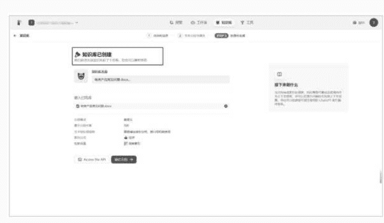

图11-5 知识仓创建完成

#### 11.1.2 通过 Dify 流程化智能客服助手

先看整体逻辑。

1. 用户提问时，系统先在私有知识仓“电商产品常见问题”里检索相关答案。
2. 把检索结果交给配置好的 DeepSeek 引擎推理。
3. 将推理结果回传给用户。

整体逻辑如图11-6所示。

第1步，配置知识检索环节，选择已建好的“电商产品常见问题”知识仓，如图11-7所示。

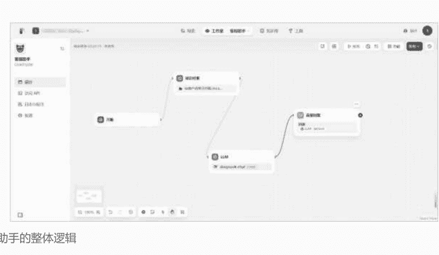

图11-6 智能客服助手的整体逻辑

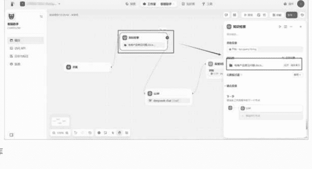

图11-7 选择知识仓

第2步，选择大语言引擎，这里使用 DeepSeek。可在 SYSTEM 区域增加指令，例如敏感词过滤等，如图11-8所示。

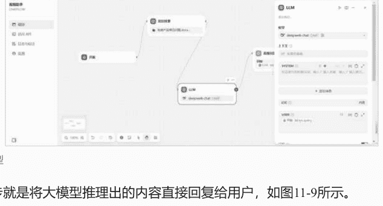

图11-8 选择引擎

最后一步，把引擎推理结果直接回复给用户，如图11-9所示。

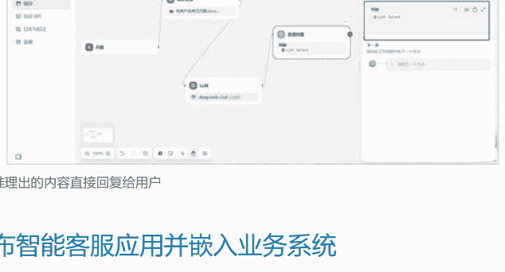

图11-9 将引擎推理结果直接回复给用户

#### 11.1.3 上线智能客服并嵌入业务系统

流程编排完成后点击“上线”，在弹出的页面里选“运行”，即可看到智能客服机器人的效果，如图11-10所示。

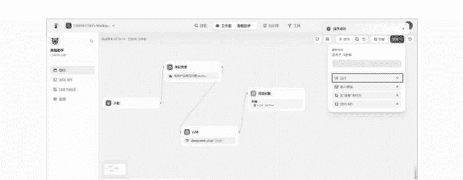

图11-10 上线智能客服机器人

实际效果如图11-11所示。图中用户问“我们都销售哪些品类”，引擎基于私有知识仓作答。


图11-11 编排的智能客服机器人的效果

图11-12 是上传的“电商产品常见问题”知识仓原文。可以看到引擎对答案做了优化，比如电子产品下增补了智能手机、平板电脑等子类，而原文并未出现这些词，这说明出现了“幻觉”式编造。可在 SYSTEM 指令中增加“禁止编造、必须严格基于知识仓回答”等约束，以降低幻觉概率。


面向会话类智能体的落地，除了标准的流程编排，Dify 还支持把生成的代码直接写进公司产品的网页前端，实现无缝接入，见图11-13。

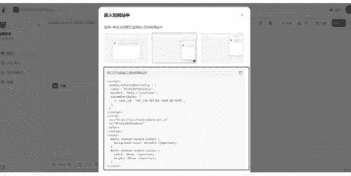

图11-13 把对话助手接入公司内部系统

接入后的实际呈现见图11-14。

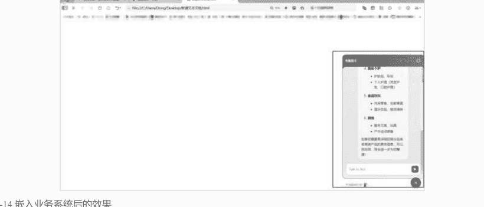

图11-14 接入业务系统后的展示效果

### 11.2 案例二：用 Dify 配合 DeepSeek 构建自然语言数据分析助手

过去企业做数据分析基本是使用者提需求、IT 部门建数仓、定制报表，链条又长又重。使用者要排队等开发，一个需求从提交到上线常常要好几天；报表从抽取、建模到可视化，边际成本很高。

自然语言的 LLM 改写了这套打法。使用者可以直接用口语下指令，例如“请分析华东区 Q3 的客户流失原因”，模型借助多模态理解能力与企业图谱，能自动完成抽数、关联、预测与可视化。带来的变化有三点：使用者侧拿到秒级响应的数据服务，转化效率提升；IT 从重复开发中抽身，聚焦数据资产治理；企业整体从设定好的分析转向探索式分析，决策敏捷度实现数量级提高。

本次搭建的自然语言数据分析助手分三步走。

1. 搭建能够解释数据库关键字段的参考库。
2. 用 Dify 编排自然语言分析助手。
3. 发布助手供使用者使用。

#### 11.2.1 搭建能够解释数据库关键字段的参考库

第一步把建库建表的 SQL 以及对应的说明文本导入参考库。示例中使用了名叫 hz-test 的库，里面有两张数据表，第一张是部门表，第二张是职员表，见图11-15。

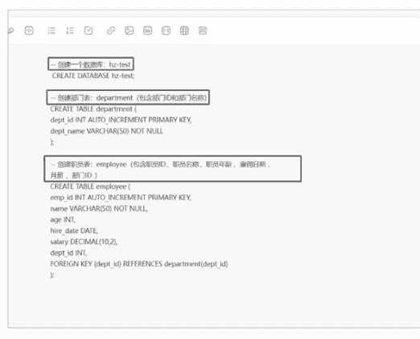

图11-15 数据库与表结构的建立

第二步新建参考库并把文件载入进去，见图11-16。


图11-16 参考库的建立与文件导入

#### 11.2.2 通过 Dify 编排自然语言数据分析助手

整体运行逻辑如下。

1. 使用者输入分析诉求。
2. 系统在参考库里检索与诉求相关的说明。
3. 把使用者原话和检索结果交给 DeepSeek，让它生成可执行的 SQL 指令。
4. 用数据库查询组件拿到结果。
5. 把结果原样返回给使用者。

流程图为图11-17。

第1步，先建一个对话应用，见图11-18。

图11-18 建立对话应用

图11-17 数据分析助手的整体逻辑

第2步，从参考库里检索使用者输入，见图11-19。

第3步，把检索内容输入模型，并预设指令：依据使用者输入和参考库内容生成数据库可识别的 SQL 指令，见图11-20。

图11-19 检索使用者输入的内容

图11-20 将内容输入模型并预设指令

第4步，把模型生成的 SQL 交给查询组件，该组件可在 Dify 工具市场获取。安装后需配置数据库地址、账号密码、库名，见图11-21。

第5步，把查询结果直接回填给使用者，见图11-22。

图11-21 查询组件配置

图11-22 回复配置

##### 11.2.3 发布自然语言数据分析助手

我们向助手提出两类诉求。

第一个问题是共有几个部门？模型生成的 SQL 指令见图11-23。

图11-23 模型生成的 SQL 指令（1）

第二个问题是哪个职员工资最高？模型生成的 SQL 指令见图11-24。

图11-24 模型生成的 SQL 指令（2）

助手回答的实际效果见图11-25。

数据库中部门表的示例数据见图11-26，共10个部门，助手回答正确。

图11-25 自然语言数据分析助手回答效果

图11-26 数据库中部门表的示例数据

职员表的示例数据见图11-27，其中黄晓明的工资最高为32000元，助手回答正确。

图11-27 数据库中的职员表

以上演示只是 LLM 做数据分析的玩具版，像乐高说明书里的示例模型。要变成可落地的工业化方案，需要补齐几块短板。

- 数据大扫除。先把各部门散落的 Excel、报表统一格式并打标签，区分过期可淘汰和需重点保护的数据。
- 权限管控。销售总监可查看全量数据，区域经理只能看自己片区。敏感信息自动脱敏，例如“把董事长工资发我看看”会被系统拦截。
- 操作体验升级。加语音入口，市场部同事可直接说“帮我查上周爆款商品的退货原因”。并让助手学会行业黑话，比如采购口中的“水货”指海关特殊渠道商品。
- 安全防护。遇到“把客户名单发到外网”这类危险指令，系统立刻刹车。定期体检、打疫苗，避免模型吸收异常信息。

### 11.3 案例三：用 Dify+DeepSeek 搭建需求智能预测引擎

需求预测是各行业的刚需。电商场景里能做到：库存优化避免积压与缺货；精准营销提升转化；供应链管理优化路径与生产计划。

新能源换电行业也高度依赖预测：动态调度高峰充电需求，配合分时电价降低成本；预测使用者换电需求，将低需求站的电池调度到高峰站。

本案例用 Dify 与 DeepSeek 搭建预测引擎，分两步：编排引擎、发布引擎。

#### 11.3.1 通过 Dify 编排需求智能预测引擎

引擎逻辑：

- 使用者提出分析诉求。
- 查询组件从库中取数。
- DeepSeek 基于输入和数据完成分析。
- 结果回传给使用者。

整体图为图11-28。

图11-28 需求智能预测引擎的整体逻辑

第1步，建立空白对话应用，见图11-29。

图11-29 建立空白对话应用

第2步，在流程节点挂载查询组件，配置数据库地址、账号密码、库名及演示用的预设 SQL，见图11-30。

图11-30 查询组件配置

demo4_csv 的结构与内容见图11-31，h1 为消费时段，num 为消费次数。

图11-31 demo4_csv 的结构与内容

为便于演示，直接把数据结构告知模型，见图11-32。

图11-32 告知模型数据结构

最后把模型分析结果原样返回使用者，见图11-33。

图11-33 配置最终回复内容

#### 11.3.2 通过 Dify 发布需求智能预测引擎

图11-34 展示了运行效果。使用者给出分析诉求和准确度定位，并要求 HTML 格式输出。

图11-35 是分析报告第一部分，说明抓取的数据特征和分析方法。

图11-36 是第二部分，展示预测结果与实际值的对比。

图11-37 是第三部分，给出整体准确率与改进建议。

图11-37 模型输出的分析报告的第3部分

图11-38 是第四部分，提供明确结论与建议。

图11-38 模型输出的分析报告的第4部分

预测方向正确但准确率偏低，因为只喂了两天数据。想达到可用水平至少需要两年数据。数据越厚，模型可调用的高级算法越多，精度越高。

有了 LLM，企业不必再养算法团队，它就是全能的 AI 算法顾问，只需提示“帮我用时间序列分析下数据趋势”。相当于24小时在线的算法顾问，关键是学会用大白话指挥它。

### 11.4 案例四：用 Dify+DeepSeek 搭建出行规划助手

MCP 模型上下文协议让 AI 能直接操作电脑文件、手机 App、网络工具，像真人助理一样办事。此前 AI 订机票只能告诉你去哪个网站，现在可自动查日历、看天气、比价下单并微信确认行程。

传统 AI 像书呆子只会背书，MCP 给了它手脚，能读文件、控浏览器、发邮件。相当于在 AI 与现实世界间搭起桥梁。该协议由 Anthropic 公司推出，谷歌、Cursor 等厂商正在跟进，有望成 AI 连接现实的标配。

本节用高德 MCP 搭建出行规划助手，分三步：配置高德服务、Dify 编排、Dify 发布。

#### 11.4.1 配置高德出行服务 MCP 准备

先登录高德开放平台，无账号则注册，见图11-39。

图11-39 登录高德开放平台

进入应用管理，点击创建新应用，填写名称和类型，见图11-40。

图11-40 高德开放平台-创建应用

在我的应用列表里为目标应用添加 Key，选择 Web 服务，见图11-41。

图11-41 高德开放平台-为应用添加 Key

创建成功后获取 Key 和安全密钥，见图11-42。

图11-42 高德开放平台-获取 Key 和安全密钥

在 Dify 应用市场安装两个 MCP 相关插件，见图11-43。

图11-43 安装有关 MCP 的插件

插件说明：

- Agent 策略支持 MCP：提供 Function Calling 与 ReAct 策略，支持 MCP SSE/Streamable HTTP 发现与调用。
- MCPSSE：通过 HTTP with SSE 或 Streamable HTTP 使用 MCP 协议发现和调用工具。

#### 11.4.2 通过 Dify 编排高德 MCP 的出行规划助手

整体逻辑：使用者输入诉求→模型通过 MCP 调用合适智能体→智能体返回结果。

图11-44 出行规划助手的整体逻辑

图11-44 出行规划助手的整体逻辑

先配置 Agent 策略，ReAct 让智能体先推理再行动。随后配置已安装的 MCPSSE 和 Agent 策略及 MCP 服务，见图11-45。

```json
{
    "mcpServers":{
        "amapamapsse":{
            "url":"https://mcp.amap.com/sse?key=你在高德官网上申请的 Key"
        }
    }
}
```

图11-45 给模型配置 MCP 服务

为模型预设指令，定位为出行规划专家，依据使用者诉求和预设 MCP 工具选择 Agent 执行，见图11-46。

图11-46 给模型预设指令

最后把智能体输出直接回给使用者，见图11-47。

图11-47 将智能体输出的内容回复给使用者

#### 11.4.3 通过 Dify 发布高德 MCP 的出行规划助手

使用者提问后，模型通过 MCP 调用高德出行服务给出答案，见图11-48。

图11-48 模型回答演示

MCP 通过标准化接口让模型实时读取高德出行、天气 API 等。传统模型依赖爬虫碎片信息，误差偏高；接入 MCP 后能动态获取位置、价格等实时数据，推荐更准。

核心价值是“一次开发，全域通用”。企业部署一个 MCP 服务器，多个 AI 应用可安全调用。未来 MCP 可能成为 AI 时代的 HTTP 协议，支持跨会话记忆与多厂商模型共享工具生态，2025 年是“说一句就办成事”的 AI 普惠元年。

### 11.5 案例五：用 Dify+DeepSeek 搭建合同审查助手

法务财务等职能部门最怕数据泄露。合同、简历、报表类文件想用 LLM 分析，却不敢上传到外网。本节用本地版 Dify 搭建合同审查助手，实现数据不出内网。

搭建分两步：编排助手、发布助手。

#### 11.5.1 通过 Dify 编排合同审查助手

逻辑：使用者载入文件→文档提取器转文本→模型推理后回答。

建立空白对话应用后，开启文件载入功能，见图11-50。

图11-50

设置允许格式、最大份数等，见图11-51。

图11-51

插入文档提取器节点，将图片、音频等转成模型可读文本，输入变量选择载入文件，见图11-52。

图11-52

选择模型时务必把供应商设为本地部署，避免文件外泄。并预设提示词，让模型扮演合同审查专家，基于使用者要求和文件内容给出优化建议，见图11-53。

图11-53

#### 11.5.2 通过 Dify 发布合同审查助手

运行效果见图11-54。载入软件采购模板后，模型给出风险提示与建议。

图11-54

该编排不仅是法务工具，更是可复用的企业级智能中枢，能快速适配多部门文档处理。

- 人力筛选简历：自动提取学历、证书、履历，接入背调识别造假。
- 财务审核报表：OCR 识别票据并钩稽科目，内置准则库预警违规。
- 行政审核文件：移植合同审批流，实现公文格式校验。
- 营销优化文案：敏感词检测规避广告法风险，并生成多版本创意。

这套带锁的 AI 工具箱兼顾效率与安全，能显著提升职能部门工作效能。

### 11.6 本章小结

本章用五个面向企业的案例完整呈现 Dify 与 DeepSeek 的协同价值。工程化落地的关键在于参考库语义化处理、提示词工程抑制幻觉、工具链安全接入。这些实践证明了低代码平台与 LLM 结合的可行性，为企业提供“AI 即生产力”的标准化路径：以自然语言为交互界面，以前沿技术为引擎，以业务流程为轨道，推动智能化转型进入人人可参与的新阶段。