# 生成式人工智能：驱动电信行业升级

# 内容简介

近几年人工智能正经历加速演进，以 ChatGPT 为标志的 GPT 体系在信息理解与内容生成上持续提升，影响逐步扩散至各行各业，对电信行业既带来新机遇也提出新挑战。本书以 GPT 演进脉络为线索，系统梳理其在电信行业的落地实践，展望“GPT 融合电信”的发展走向、核心议题，并据此提出可操作建议。

完整阅读后，读者能把握大语言模型的基础原理，并思考在电信场景中的具体实现路径。书中内容面向信息通信领域的技术与管理从业者，也可作为高校通信、电子、计算机、自动化、网络空间安全等专业的硕士、博士研究生的参考资料。

# 作者简介

**曾捷** —— 现任北京理工大学副教授、特别研究员、博士生导师，兼具通信与计算机双博士背景，研究重心包括生成式大模型与电信融合、低时延高可靠通信等。已在相关领域以 SCI 期刊论文五十余篇发表，出版中英文学术专著五部，获授权专利八十余项。

**杨一帆** —— 北京理工大学网络空间安全学院博士研究生，研究方向集中于第六代无线通信、生成式大模型与电信融合等。曾主编未来移动通信论坛白皮书《GPT 与通信》，在 SCI/EI 期刊发表高水平论文多篇，申请发明专利十余项，参与国家级科研项目三项。

**栗欣** —— 清华大学电子工程系教授、无线与移动通信技术研究中心副主任、中国 IMT-2030 6G 推进组专家组成员兼无线技术工作组组长。长期从事无线通信理论与技术、通信网络架构与应用、高速数据传输与业务等领域的科研、教学与标准化。

**吕铁军** —— 北京邮电大学学术委员会委员、教授、博士生导师。已出版学术专著四部，发表 SCI 期刊论文一百五十余篇，曾获教育部新世纪优秀人才支持计划高校优秀人才奖。当前研究聚焦信号处理、通信理论与网络等方向。

**钟怡** —— 北京理工大学长聘副教授、博士生导师。长期从事智能物联网研究，近年聚焦通感一体化、无线感知、行人重识别等方向，已在 IJCV、IEEE TIP、IEEE TGRS、IEEE TMM、ICCV、CVPR 等刊会发表论文六十余篇。

**袁昕** —— 拥有北京邮电大学与悉尼科技大学双博士学位。研究方向为人工智能与机器学习在图像与信号处理、数据分析及网络安全中的应用。迄今出版学术专著二部，发表期刊论文五十余篇，拥有授权专利五项。

# 本书编委会

**主 编**
曾捷、杨一帆、杨铮

**副主编**
王紫如、张雨婷、徐晨、但玉然、白朕铭

**全书绘图**
张诗语、杨一帆

**参编人员**
· 北京理工大学：曾捷、杨一帆、钟怡、杨铮、王紫如、张雨婷、程波铭、徐晨、但玉然、白朕铭、刘勇懿、刘思杨、肖瑞欣、王琛红、杨圣辉、刘兆钰、黎华清、程雯楚、王佳乐、叶能、朱超、于珊平
· 清华大学：粟欣、李云洲、刘蓓、谭志强
· 北京邮电大学：吕铁军、张诗语、王鲁晗、路兆铭、黄平牧、崔莹萍、喻茜、王梦珂、何晓宇、牛海文、李秉轩
· 悉尼科技大学：袁昕
· 中山大学：陈翔、王玺钧、郭志恒
· 西安交通大学：范建存、陶梦丽
· 西安电子科技大学：任智源、赵佳昊
· 桂林电子科技大学：李晓欢
· 中国科学院计算技术研究所：田霖、孙茜
· 中移智库：邓灵莉、马梦媛、何克光
· 中国电信：郭建章、李振、张劲松、王栋
· 中国联通：黄蓉、刘珊、周伟
· 紫光展锐：苗润泉
· 中信科移动：程志密
· 鹏城实验室：杨婷婷、宁嘉鸿、郑孟帆、张平
· 上海交通大学：吴泳澎
· 维沃移动通信有限公司：袁雁南、周通、姜大洁
· 图灵人工智能研究院：李强
· 深圳清华大学研究院、清华大学深圳国际研究生院：郑斯辉

# 前言

信息技术正进入快速迭代期，人工智能发展迅猛，各行各业都在探索落地路径，全球电信行业正经历前所未有的变革。以 ChatGPT 为代表的大语言模型脱颖而出，成为推动电信数字化转型的核心动力。凭借出色的语言理解与生成能力，这类模型能够解析电信行业中错综复杂的海量数据并输出智能化结果，加速传统业务的智能化升级，同时催生新商业模式与多元创新。

本书围绕 GPT 的发展历程展开，介绍其赋能电信行业的典型实践，探讨“GPT 融合电信”的未来走向与突出问题，并提出建议。第一章阐释大语言模型的基本概念与发展脉络。第二、三章探讨 GPT 在电信行业的创新应用及其对网络智能自治的促进作用。第四、五章研究面向 GPT 泛在应用的未来网络与边缘智能支撑方案。第六章对 GPT 与电信的协同演进作整体梳理。第七章指出融合发展面临的显著挑战。第八章给出发展建议与展望。

谨此感谢参与编写与校对的同事与同学，尤其是杨铮、张诗语、王紫如、张雨婷、程波铭、但玉然、徐晨、白朕铭、肖瑞欣、何晓宇、刘思杨、袁雁南、马梦媛、王筱诗、刘娴婧等。同时国内外 AI 与电信领域的专家姚彦、易芝玲、卜祥元、李云洲、李忻等在撰写过程中提供了宝贵意见。

感谢国家重点研发计划编号 2024YFE0200300、国家自然科学基金编号 62371039 和北京理工大学青年教师学术启动计划对本书的支持。

最后衷心感谢家人、同事、同学对作者工作的理解与支持。

# 作者

# 第一章

# ChatGPT 与 GPT 的发展

科技持续推进，科幻作品中描绘的强人工智能正逐步落地，大模型进入公众视野，其中最受关注的就是 ChatGPT。作为 AIGC 在自然语言处理领域的代表，它在文本创作、人机交互、科学研究等方面展现出强大的语言理解与生成能力，获得业界与学界的广泛关注。

ChatGPT、GPT 与大模型是什么关系，该如何理解与应用，本章以 ChatGPT 为切入点，介绍其基本概念、技术路线与典型用途，进而梳理 GPT 的模型架构与演进历程，以及大模型的研究现状，帮助读者全面把握 GPT 与大语言模型的整体图景。

**1.1 ChatGPT 开启人工智能新阶段**

**1.1.1 对话系统概览**

2022 年 11 月 30 日，OpenAI 正式推出对话机器人 ChatGPT，上线仅两个月活跃用户即突破一亿，成为历史上增速最快的消费级应用之一。其强大功能改变了大量人的工作与生活方式，掀起全球 AI 新浪潮。ChatGPT 不仅体现技术进步，更开创了新的交互方式，让人与机器的对话前所未有地流畅与实用。如图 1-1 所示，该系统能够像人一样自然回应并进行自我介绍。

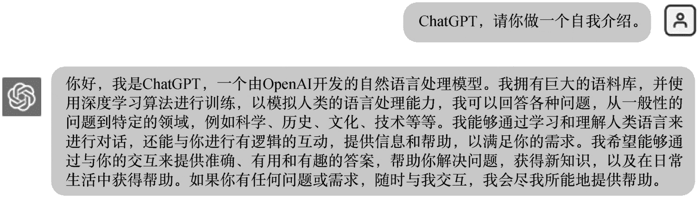

图 1-1 ChatGPT 的自我介绍

OpenAI 是该对话系统的研发方，总部位于旧金山，由特斯拉创始人马斯克、Sam Altman 等投资人于 2015 年共同创立，目标是研发造福人类的 AI 技术。在自然语言处理、机器学习、计算机视觉等领域均有突出贡献，GPT 系列模型是其核心成果。该系列凭借优秀的内容生成能力被广泛部署，影响深远。

ChatGPT 基于 Transformer 结构的深度学习模型构建。该结构于 2017 年提出，采用“自注意力机制”，能够有效处理序列数据，对输入的每个位置均保持关注，实现全局理解，并通过并行化提升训练效率与复杂文本处理能力。相较于依赖规则或简单机器学习的传统 NLP 方法，ChatGPT 在理解复杂语言结构与语境、生成接近人类交流水平的语言方面优势明显。

GPT 模型的核心特点是“预训练”，即在投入特定任务前已在海量数据上完成训练，学习语言规律与知识，形成强大的语言基础。训练数据涵盖新闻、书籍、网站等内容。在此基础上借助机器学习尤其是深度学习分析海量数据，模型可自动生成文本、图像、音乐等内容。开发 ChatGPT 时，OpenAI 重点关注对话质量与用户体验，例如增强上下文理解能力、记忆对话历史、生成连贯回复等。通过预训练与微调，ChatGPT 在语言生成上展现强劲能力，提供高质量交互体验，并在特定领域实现多样化应用，如撰写用户手册、生成产品描述、辅助制定营销策略与执行方案等。

ChatGPT 的走红促使各行各业思考如何利用其优势。科技企业关注如何把握新一轮 AI 竞赛主动权；教育工作者思考当教材知识被语言模型掌握后，应试导向的教育模式该如何调整；大量转型中的非数字原生企业则更关注如何借助 AI 提升管理效率与客户体验。

在客户服务领域，多家大型零售商与电信运营商引入 ChatGPT 自动化处理常见咨询并解决问题，明显提升响应速度与满意度。教育行业中，ChatGPT 帮助教师生成个性化学习材料，作为虚拟学习伙伴与学生互动、答疑解惑。内容创作领域，ChatGPT 协助创作者快速产出文章初稿、创意文案与营销素材，大幅提升效率与创新性。软件开发方面，ChatGPT 通过代码建议与错误修正提高编程效率。医疗行业中，ChatGPT 提供医学信息查询与患者教育服务，促进医患沟通。这些案例既证明了技术的成熟度，也彰显其深远影响。

**1.1.2 技术实现路径**

ChatGPT 基于 Transformer 结构，采用微调与基于人类反馈的强化学习训练，人类干预使机器学习效果更优。训练中人类扮演用户与 AI 助手的角色，通过近端策略优化算法进行微调。凭借强大性能与海量参数，ChatGPT 涵盖更多样的数据，能处理更多小众主题。当前可进一步实现问答、文章撰写、文本摘要、语言翻译与代码生成等任务。

ChatGPT 的核心技术建立在三大支柱之上：预训练、有监督微调 SFT 与基于人类反馈的强化学习 RLHF，三者共同奠定理解与生成语言并实现自然对话的基础。

（1）预训练

ChatGPT 最初基于 OpenAI 的 GPT-3.5 自回归语言模型，2023 年后升级至 GPT-4 架构，在理解与生成自然语言的能力上实现更明显提升，可处理更复杂任务与更广主题。通过大规模无标注语料的自监督预训练，模型获得基础的语言理解与生成能力。预训练是构建 ChatGPT 的第一步，核心在于让模型从大量文本中学习语言的深层规律与结构。在无特定任务条件下训练，模型捕捉语言的普遍性质与模式。预训练原理如图 1-2 所示。

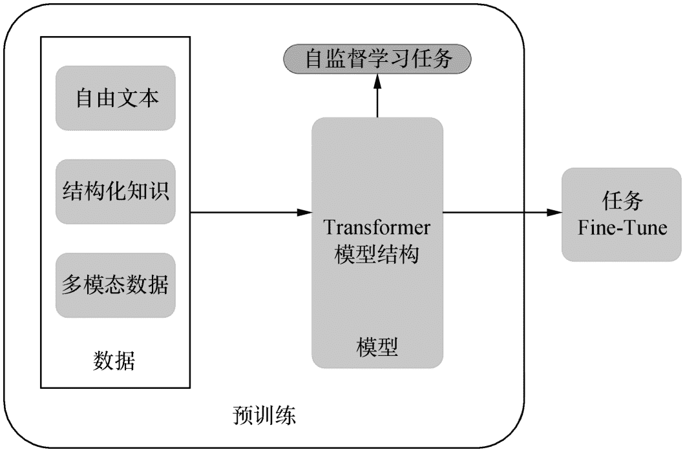

图 1-2 预训练的原理

预训练阶段数据划分为训练集、验证集与测试集，数据质量与多样性直接影响模型性能与适用范围。该阶段 GPT 关注语言模式的两个维度：词共现频率与语句结构。共现频率指特定语境下词语同时出现的频次，有助于模型把握词语关联；语句结构学习涉及语法与句法分析，使模型学会组织词语形成合理语句。

图 1-3 展示了当前主流的自然语言预训练方法，其中 GPT 系列采用自回归语言建模方法，即根据前 i-1 个词预测第 i 个词。自回归模型属于生成式模型的一种，可基于已生成值预测新目标值，在时间序列、语音与自然语言处理等领域广泛应用，尤其在机器翻译、文本生成、语音合成等序列生成任务中作用突出。

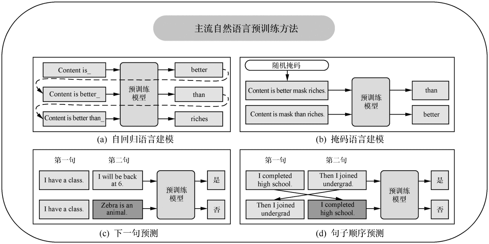

图 1-3 主流自然语言预训练方法

具体而言，GPT 使用 Transformer 架构的 Decoder 部分，在预测词时基于已生成的历史词进行自回归计算，获得下一个词的概率分布，并不断重复生成连贯且符合上下文的文本。自回归任务与生成任务本质契合，使 GPT 在文本生成方面表现优异，可处理对话生成到文章写作等多种任务。

通过大规模文本预训练，GPT 模型能够深度理解自然语言的词汇与语义，生成语法正确、语义连贯的文本，为后续特定任务学习奠定基础。

（2）有监督微调

有监督微调指先在源数据集上预训练神经网络得到源模型，再构建目标模型复制源模型除输出层外的设计与参数。源模型参数蕴含源数据集的知识，可迁移至目标数据集。源模型输出层与源标签强相关，在目标模型中舍弃，改用对应目标类别数目的输出层并随机初始化，在目标数据集上从头训练输出层，其余层基于源参数微调。

SFT 是 ChatGPT 训练的关键环节，确保模型在真实对话中给出恰当回应。预训练后模型语言生成能力强，但难以准确理解不同指令意图。因此需通过有监督微调引导模型按人类意图生成答案。具体做法是选取部分输入 Prompt 并人工构造高质量答案，以 <Prompt, Answer> 形式对预训练模型进行精调，使其初步具备理解意图与生成优质答案的能力。

微调将模型的通用知识转化为专业知识，学习在具体对话场景中按用户意图反馈。与预训练数据相比，微调数据规模较小但质量高、专业性强，涵盖客服、技术支持等对话实例，由人工生成并标注，以保证模型学习正确回应。微调需调整模型权重以匹配特定场景语言特征，使其识别意图、理解问题并生成相关答案。

图 1-4 展示了将预训练模型前 L-1 层参数复制到微调模型，输出层参数随机初始化，通过较小学习率实现微调目的。

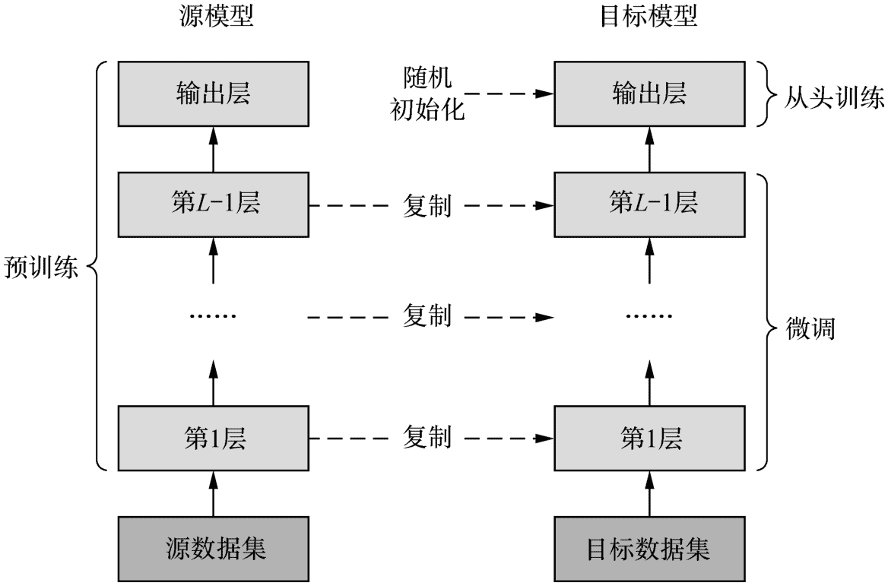

图 1-4 有监督微调过程示例

微调涉及损失函数选择、学习率调整与正则化技术。损失函数衡量预测与标注的差距，学习率决定权重调整速度，正则化帮助模型保持泛化能力，避免过拟合。通过有监督微调，ChatGPT 在特定领域的对话质量与信息准确性得到提升。微调后需通过自动评估如准确率、召回率、F1 分数与人工评估如用户体验与满意度确保表现达标。

（3）基于人类反馈的强化学习

基于人类反馈的强化学习 RLHF 是根据人类对输出结果的反馈对语言模型进行强化学习，可提升对话质量，使回答更符合人类习惯。如图 1-5 所示，TAMER 框架将人类引入 Agent 学习循环，通过人类奖励反馈指导 Agent 训练，快速达成目标。RLHF 结合强化学习算法与人类反馈，调整策略与奖励函数，实现更全面长期优化，处理即时反馈稀疏问题，适用于大规模复杂任务，提升 Agent 在复杂环境中的表现。

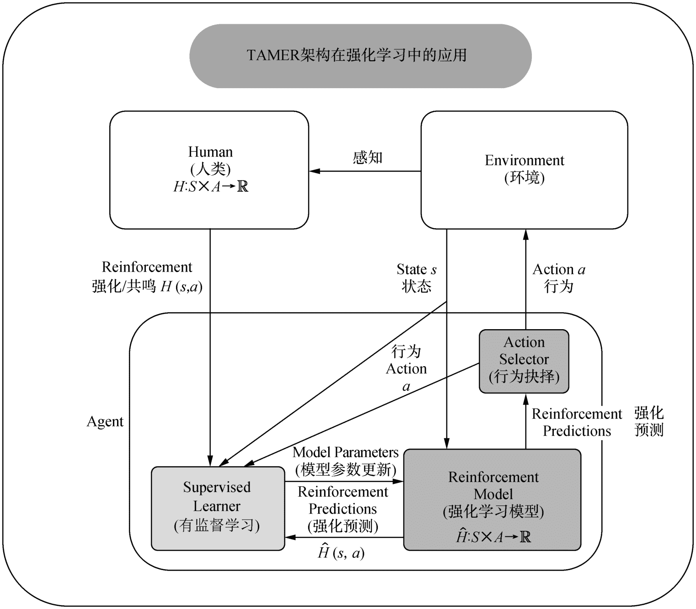

图 1-5 TAMER 架构在强化学习中的应用

在 RLHF 过程中，ChatGPT 在实际对话中尝试不同回答方式，人类评估员依据准确性、相关性与自然性提供反馈，指导模型调整对话策略，提升对话质量。通过不断试错与调整，ChatGPT 逐步优化策略，实现更自然、更准确的交流。

总体而言，ChatGPT 的训练可分为三个核心阶段，如图 1-6 所示。

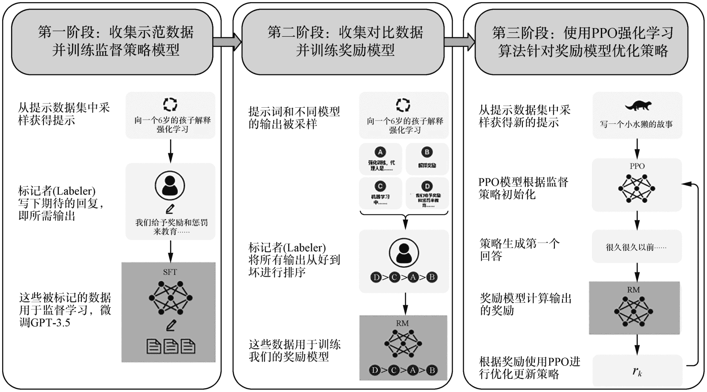

图 1-6 ChatGPT 训练过程

第一阶段：收集示范数据并训练监督策略模型。
为使 GPT-3.5 初步具备理解指令意图的能力，研究人员从数据集中随机抽取问题，由人工标注人员给出高质量答案，用这些标注数据微调 GPT-3.5 得到 SFT 模型。此时的 SFT 模型在遵循指令与对话方面已优于 GPT-3，但不一定完全符合人类偏好。

第二阶段：收集对比数据并训练奖励模型。

这一轮训练的核心是靠人工标注来打造奖励模型，标注规模大约在 3.3 万条左右。做法是先从语料库里抽取问题，让现有的生成模型批量产出多个候选答案，再由人类评审对答案做排序。随后把这些排序信息用来拟合奖励模型，把多个排名拆成两两对比的样本对输入网络，Reward Model，RM 在收到一对回答后会给出质量分值 ^(⁸)。参数调节的方向就是让高质回答的得分稳定高于低质回答。

第三阶段则用近端策略优化 Proximal Policy Optimization，PPO 来借助奖励模型做策略微调。PPO 的关键思想是把策略梯度中原本在线同策略的学习，借助重要性采样转成离线异策略的形式。训练时引入信任域约束，把新旧策略的偏离限制在一定范围内，以保证更新的稳定性 ^(⁹)。在这个阶段，第二阶段训练好的奖励模型充当判分器，随机抽取问题后由 PPO 模型生成回答，RM 给出分值，回报依次回传形成策略梯度，从而用强化学习的方式更新模型参数。不断轮回第二阶段的偏好学习和第三阶段的策略优化，就能让 ChatGPT 的整体表现逐步提升。

**1.1.3 ChatGPT 的典型应用**

ChatGPT 的能力横跨多个板块，落地场景非常广，市场想象空间也很大。除了常见的问答聊天、写代码、写论文、图片处理等，它在商业智能分析、教学辅助、游戏交互设计、线上购物体验优化以及医疗诊断与健康管理等领域也出现得越来越多。这些应用既体现了它跨领域的通用能力，也凸显了它在推动各行各业数字化转型中的作用。图 1-7 列举了“ChatGPT 能做的 49 件事”。

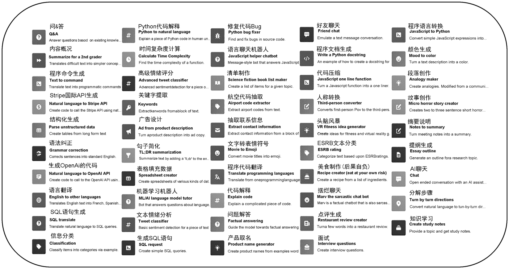
图 1-7 ChatGPT 能做的 49 件事

下面分别看它在商业办公、教育学习、游戏开发、电商购物和辅助医疗里的具体样例。

**1 商业办公**
①场景描述。办公尤其是财务工作，对文字和报表处理要求很高。财务人员要整理海量报表，还要解读税务政策、会计准则等专业问题，资金规划、投资决策也是常态，最后还要产出一份能真实反映公司经营状况的报告。
②具体应用。ChatGPT 能参与财务数据的清洗分析、财务问答、规划预测以及报告撰写，提升效率与准确度，让专业人员更专注创造性判断。办公场景里，智能客服、销售文案生成也是常见用法，例如 Copy.ai 这类初创公司就能在数秒内产出高质量广告和营销文案。
结合大模型、Microsoft Graph 数据及 Microsoft 365 生态，微软于 2023 年 3 月 16 日推出 Microsoft 365 Copilot，把生成式 AI 与 Word、Excel、PowerPoint、Outlook、Teams 等套件打通，可自动生成文档、邮件和 PPT，从根本上改变了办公方式。Microsoft 365 Copilot 界面如图 1-8 所示。

图 1-8 Microsoft 365 Copilot 界面

**2 教育学习**
①场景描述。国内教育体系以复习补课为主，课外班、高考一轮二轮、考研培训、刷题 App 都是典型体现，学生负担较重。但大模型通过预训练已覆盖大量通用知识，知识调用成本大幅下降，教学产品设计也必须随之调整。
②具体应用。ChatGPT 既能服务学生，也能为教师减负、提升机构运营效率，例如可汗学院和 Coursera 用提示词辅助教师生成课程材料。日本 Bessie 早在 2023 年 4 月就宣布在内部使用 Azure OpenAI 以提升运营效率，其数字化部门也在积极讨论 ChatGPT 的应用。GPT-4 强化了 Duolingo 的对话功能，在 SuperDuolingo 基础上通过“角色扮演”和“答案解释”两大新能力打造 Duolingo Max，推动语言教育升级。Duolingo Max 界面如图 1-9 所示。

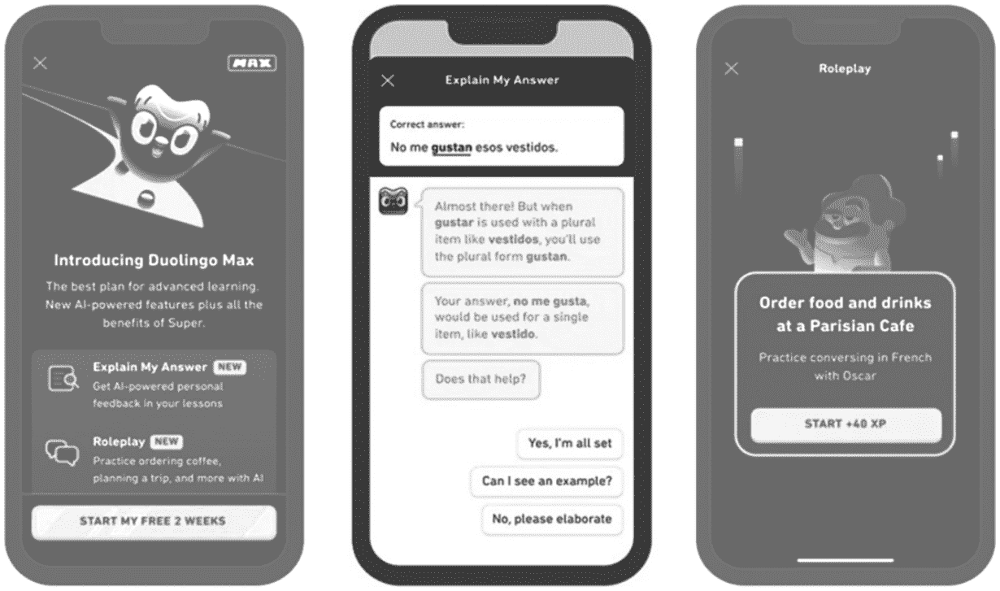
图 1-9 Duolingo Max 界面

**3 游戏开发**
①场景描述。游戏制作极其复杂，现代游戏代码库动辄数百万行，涉及多种语言，开发周期长、成本高、延期超支风险大，开发人员压力和倦怠感随之上升。
②具体应用。ChatGPT 能快速生成符合要求的代码、甚至搭出小游戏，相比人工编写速度更快、注释更清晰、冗余更少，但目前仍无法完全替代程序员，主要用于降低重复性编码负担。GitHub Copilot 是微软旗下 GitHub 推出的 AI 编程工具，主打代码补全与建议。GitHub Copilot 界面如图 1-10 所示。

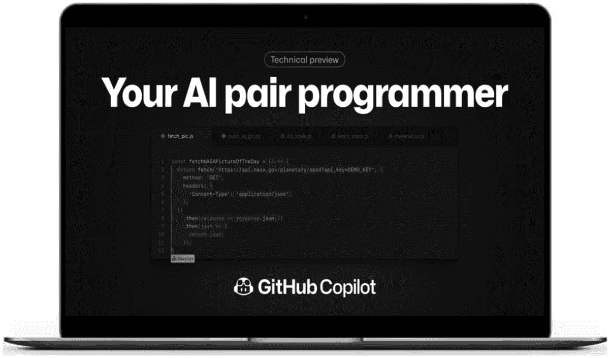
图 1-10 GitHub Copilot 界面

研究者还提出 GameGPT，这类模型可整合多个 AI 智能体，自动完成游戏开发的部分流程。它能简化传统流程中重复繁琐的环节，比如代码测试，让开发者把精力放在 AI 难以替代的设计上，目前仍处于概念验证阶段。

**4 电商购物**
①场景描述。随着线上消费普及，购物流程在改变。过去需要反复比价筛选，现在只需对 ChatGPT 说“帮我买一套约××元适合明天户外骑行的装备”，它即可结合地址、预算、身高体重、购买记录、当地天气、送达时间等信息给出方案，实现快速决策。
②具体应用。Shopify 从 2022 年底起引入大模型并发布 AI 工具包 Shopify Magic，涵盖建站、营销、客服、后台管理。其中 Sidekick 是面向商家的 AI 助手，可用自然语言解答问题、启发创意、分析业务；AI 导购则面向消费者提供决策信息。Shopify Magic 界面如图 1-11 所示。

图 1-11 Shopify Magic 界面

国内方面，阿里巴巴推出淘宝问问、通义万相、瓴羊 one 等大模型产品，淘宝问问在 2023 年双 11 预售日已上线带购物链接版本。京东在推出言犀电商大模型后发布多款云上 AIGC 产品，百度则用文心一言加持百度优选，重塑电商体验。

**5 辅助医疗**
①场景描述。医疗数据高度敏感，电子健康记录包含病史、诊断、治疗方案等大量文本，医生阅读耗时；医学影像解读需要专业经验，耗时较长；在突发或资源紧张地区，远程医疗对信息准确性和实时性要求更高。
②具体应用。2023 年上半年已有重磅进展：医联 MedGPT 与真人医生做多维度对比，与三甲医院主治医生一致性达 96%；谷歌 Med-PaLM 在医学问答测试中，92.6% 的长答案符合科学共识，与临床医生生成的 92.9% 相当。
Be My Eyes 推出免费 App Be My Eyes Virtual Volunteer，这是首款由 GPT-4 驱动的数字视觉助手，面向盲人和视障人士。用户可把图像发给 AI 虚拟志愿者，实时提问并获得视觉帮助，提升独立生活能力。Be My Eyes Virtual Volunteer 界面如图 1-12 所示。

图 1-12 Be My Eyes Virtual Volunteer 界面

未来，ChatGPT 在金融、市场营销、教育等领域仍有广阔空间。金融机构可借助它做资讯解读、产品介绍、市场数据分析、风险评估与趋势预测；广告营销可实现个性化推荐与投放；银行保险的智能客服可快速响应客户常见问题，同时为员工提供个性化福利咨询，提升满意度。

总体来看，ChatGPT 的出现标志着 OpenAI 在自然语言处理领域的重大突破。作为创新技术，它具备巨大发展潜力。强大的模型容量、多元训练数据、上下文感知、自我学习和多语言支持，共同塑造了更优质的用户体验，也将持续推动人工智能向前发展。

**1.2 GPT 引领人工智能发展热潮**

**1.2.1 GPT：生成式预训练转换器**

GPT 全称 Generative Pre-trained Transformer，即生成式预训练转换器，其诞生背景是深度学习和 NLP 的快速进步。计算力提升与海量数据共同催生了突破，GPT 正是这一轮技术积累的集大成者。

其含义由三个字母体现，如图 1-13 所示。

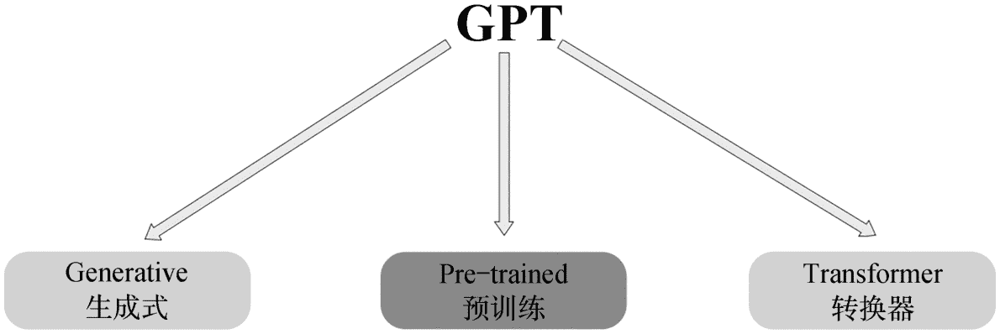
图 1-13 GPT 的含义

G：Generative，生成式。模型不仅能理解输入文本，还能基于理解创造全新文本，从而完成多样化的语言任务。
P：Pre-trained，预训练。模型在正式任务前已在大规模文本上学习语言表征，捕捉统计规律和使用场景，形成对语言深层结构的先验理解，为后续微调奠定基础。
T：Transformer，转换器。基于 自注意力机制，不受传统序列模型时序限制，能同时评估序列中各 token 的关联性，对长距离依赖和细腻上下文变化更敏感。

2017 年 Google 团队首次提出基于自注意力的 Transformer 并用于 NLP。OpenAI 在此基础上于 2018 年发布首代 GPT-1，此后参数量呈爆炸式增长：2019 年 2 月的 GPT-2 为 15 亿参数，2020 年 5 月的 GPT-3 直接达到 1 750 亿。因此 ChatGPT 的爆发并非偶然，而是长期技术演进的结果。

**1.2.2 Transformer 架构**

Transformer 是 GPT 的技术基座，是一种基于自注意力机制 Self-Attention Mechanism，SAM 的神经网络架构，广泛用于大模型。谷歌与 OpenAI 的 NLP 优化都建立在它之上。其核心是编码器 Encoder 与解码器 Decoder。编码器把输入文本编码为向量序列，解码器再逐一将其解码为输出。

Transformer 提出前，RNN、递归和卷积网络是主流。2017 年 6 月，Google Brain 在 NeurIPS 发表 *Attention is All You Need*，首次提出完全基于自注意力、摒弃递归和卷积的新架构 ^(¹⁰)。注意力机制可建模远距离依赖，无需受序列位置限制。Transformer 完全依赖注意力捕捉输入输出的全局关联，仅用 8 个 P100 GPU 训练 12 小时就达到高水准翻译质量 ^(¹¹)，展现了出色的并行能力。

Transformer 网络结构如图 1-14 所示。它由多层编码器和解码器堆叠而成。

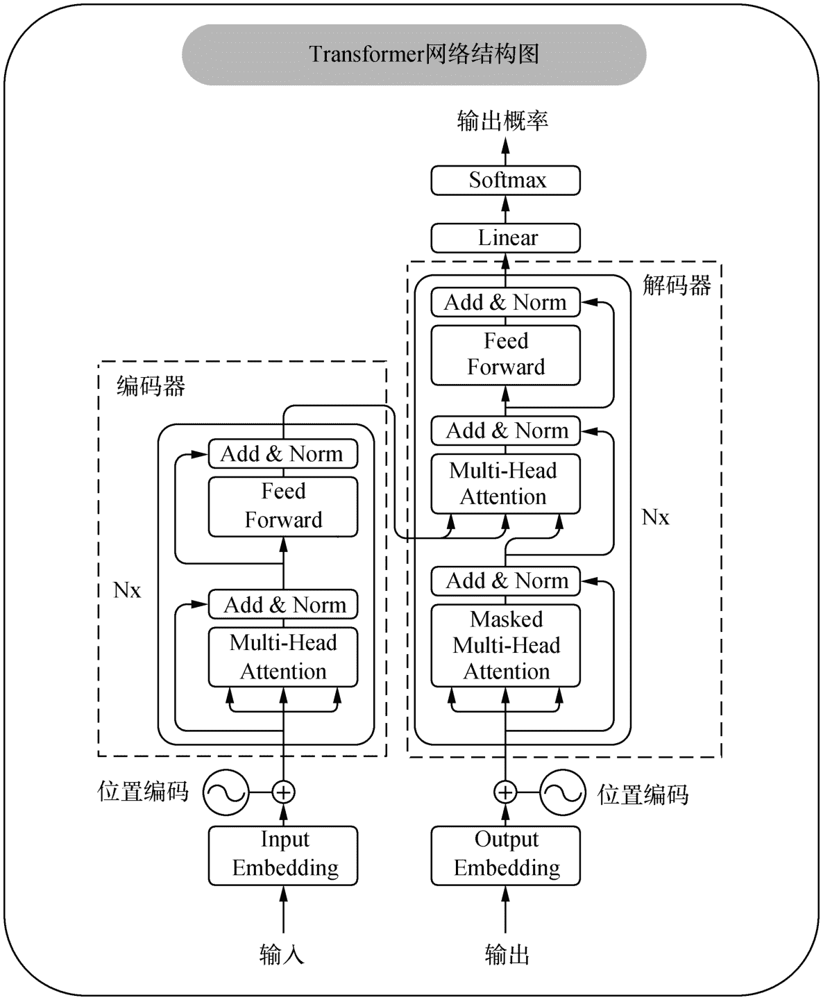
图 1-14 Transformer 网络结构图

编码器由 N 个编码器块串联，每个块包含一个多头注意力层和一个前馈全连接网络。解码器由 N 个解码器块串联，每个块包含一个带掩码的多头注意力层、一个接收编码器输出的多头注意力层，以及一个前馈全连接网络。

除 GPT 外，BERT 也是 2018 年由 Google 提出的重要大模型 ^(¹²)，同样基于 Transformer。GPT 类似 Transformer 的解码器部分，BERT 类似编码器部分。BERT 为双向模型，可同时利用前后文信息；GPT 为自回归模型，利用已生成文本预测下一个词。如图 1-15 所示，图中共用 Trm 表示 Transformer 层，E 为 Token Embedding，T 为模型输出的每个 Token 特征向量 ^(¹³)。

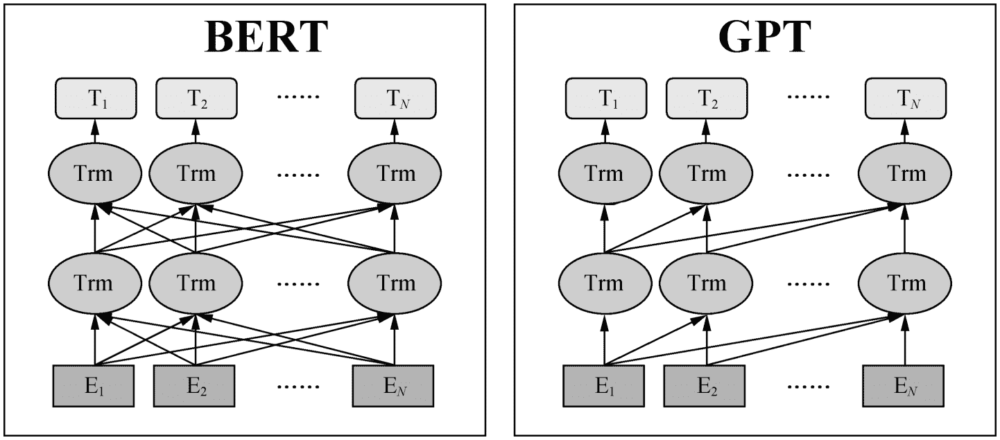
图 1-15 BERT 与 GPT 技术架构的区别

Transformer 还有两个关键组成。

**词嵌入与位置编码**
输入文本先经嵌入层转为稠密向量，捕捉语义和句法信息。为保留顺序信息，再加入位置编码。输入句子的每个词表示 X 由词嵌入与位置嵌入相加得到，如“我有一只狗”中的每个词被映射为不同向量。

**自注意力机制**
经过嵌入和位置编码的输入进入编码器层，形成句子各词的编码矩阵。自注意力层随后对各词间的关联度进行加权计算，完成向量化后的深层建模。

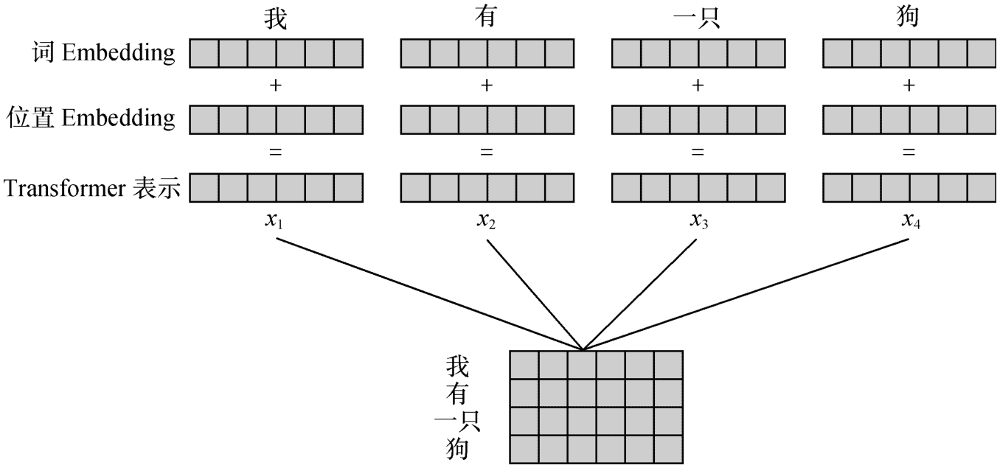
图 1-16 输入数据的向量化表示

在自注意力的工作原理里，同一段输入会被同时映射成三类表征：查询 Q、键 K、值 V。Q 刻画当前节点想捕获的关注点，K 为序列里每个位置打上标识，V 则保存该位置携带的实际语义信息。三者均源自同一源输入，计算时先对 Q 与 K 做两两相似度度量，再依据相似度对各 V 做加权求和，最后得到注意力结果。整体流程可概括为

举例来说，把“The animal didn’t cross the street because it was too tired”译成中文时，“it”指代动物还是街道并不明确。对人而言判断很直观，对算法则是难题。自注意力让系统不只聚焦当前词，还能顾及句子中其它位置的词，从而让词的编码更扎实。如图 1-17 所示，编码“it”时，注意力会分出一部分投向“The animal”，并把该部分信息融入“it”的表征中。

多头注意机制

多头注意是 Transformer 架构的核心要素，对单头方案做了进一步完善。思路是把输入投射到若干个不同的子空间，让系统在不同视角下各看重点。具体做法是先用 h 组不同的线性变换分别处理 Q、K、V，然后把各组得到的 Attention 结果拼接起来，最后再做一次线性变换。整体结构见图 1-18 所示。

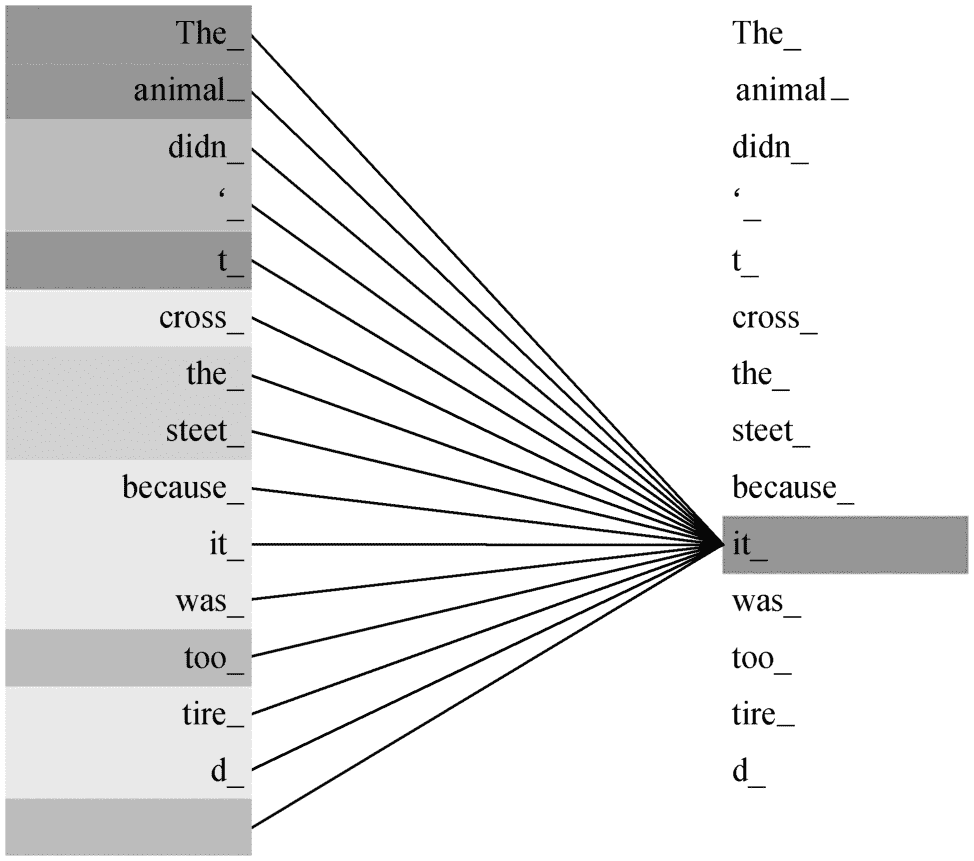

图 1-17 自注意力机制示例

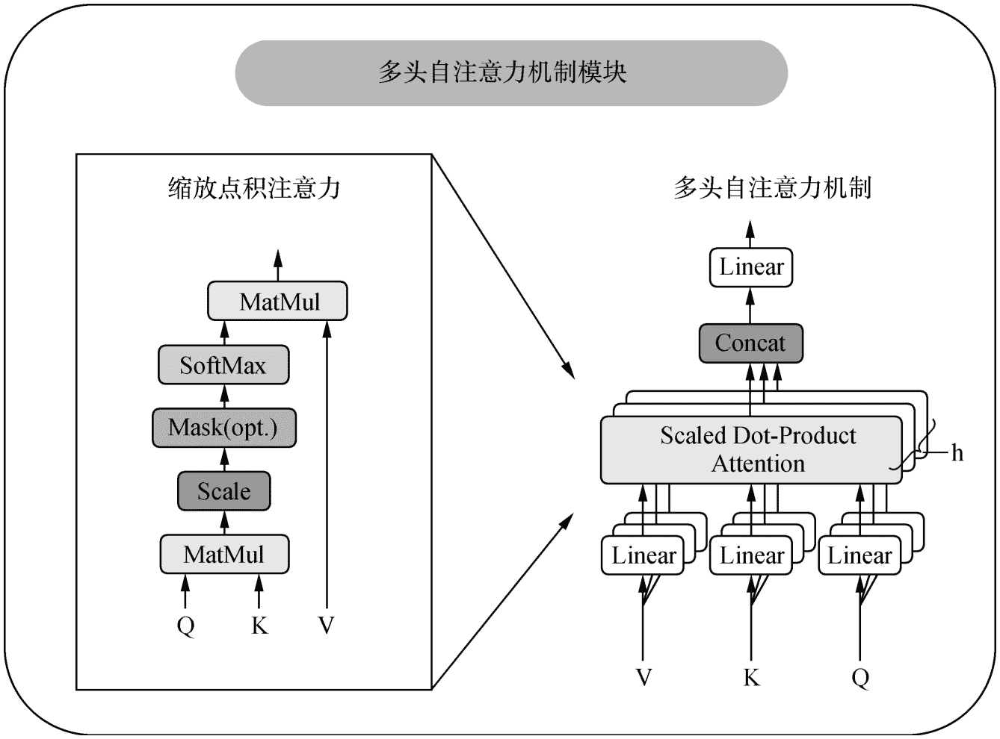

图 1-18 多头自注意力机制模块

它不再只执行一次注意，而是把输入切分成若干子块，在各个子空间上并行执行缩放点积注意。借此每个注意头都能专攻词汇的某类特征，分散单一注意可能带来的偏向，让系统捕捉到更丰富的语义层次，提升表达力和效果。

1.2.3 GPT 的演进路线

如图 1-19 所示，GPT 的演进大致可分成两段。以对话式产品出现前为主的阶段，重点是通过不断放大基础体量来增强能力；对话式产品及之后的 GPT-4，则更强调引入基于人工评价的强化调优，让系统更好理解意图并提供服务。

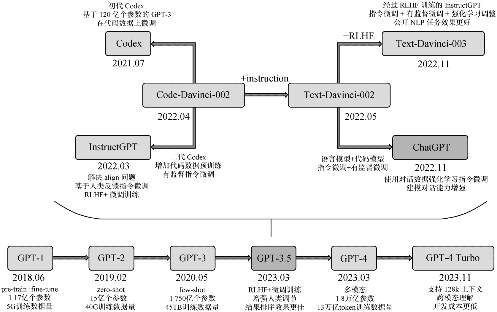

图 1-19 GPT 发展历程

① 2018 年 6 月，OpenAI 公布论文《通过生成式预训练提高语言理解能力》，正式推出 GPT-1。
· 思路：无监督生成式预训练+有监督下游微调。
· 单向语言体系，基于 Transformer Decoder，共 12 层。
· 可学习权重约 1.17 亿，学习素材 5 GB，体量与能力有限。
· 可处理的 token 上限 512。

② 2019 年，OpenAI 公布《语言模型是无监督的多任务学习者》，发布 GPT-2。
· 思路：去掉有监督环节，只保留无监督学习。
· 48 层 Transformer 结构。
· 权重 15 亿，学习素材增至 40 GB。
· 处理上限 1 024 token。

③ 2020 年 5 月，OpenAI 公布《语言模型是少样本学习者》，推出 GPT-3。
· 思路：无监督学习+in-context learning。
· 96 层多头 Transformer。
· 权重扩至 1 750 亿，基于 45 TB 文本训练。
· 处理上限 2 048 token。

④ 2022 年 3 月，OpenAI 公布《训练语言模型以遵循人工反馈的指令》，提出 RLHF 并推出 InstructGPT。
· 思路：基于人工评价的强化调优+微调训练。
· 强化了人工对输出的调控与排序。
ChatGPT 是 InstructGPT 的派生版本，结构和训练方式一致，区别在于数据采集更偏向对话式交互。

⑤ 2023 年 3 月，OpenAI 发布跨模态预训练巨型体系 GPT-4。
· 思路：跨模态。
· 处理上限 8 195 token。
· 权重约 1.8 万亿，训练素材 13 万亿。
· 识图能力强劲。
现实场景下未必全面超越人类，但在专业与学术考试中表现突出，SAT 成绩超过 90% 的考生，已达哈佛、斯坦福录取水平。2024 年上半年，GPT-4 在 HumanEval 上 pass@1 达 85.73%，pass@10 达 98.17%，代码生成能力明显提升。ChatQA 通过首尾两步指令微调提升了对话问答表现，减少错误回答。此外，中国顶尖国产巨型体系已追平 GPT-3.5 水平，与 GPT-4 的差距在缩小，中国大语言体系超 130 个，占全球约 40%。

2024 年 5 月，OpenAI 对产品进行升级，推出桌面版 ChatGPT 及网页端 UI 更新，并发布 GPT-4o。“o”代表 omni 全能。官方介绍称 GPT-4o 可处理文本、音频、图像任意组合的输入，并生成对应组合输出。音频响应最低可达 232 ms，平均 320 ms，接近人类日常对话反应。与前代相比，GPT-4o 在视觉和音频理解上尤为出色，英文文本与代码性能与 GPT-4 Turbo 持平，非英文文本显著提升，API 速度更快，处理量大幅提高，成本降低 50%。在传统基准测试中，GPT-4o 相比 GPT-4 Turbo 更具优势，对其他体系领先明显。

据最新声明，GPT-5 将很快到来，智力水平预计从高中生跃升至博士生。与 GPT-4 相比，语义理解、上下文关联与语言生成将有显著进步。未来应用将涵盖更精准的机器翻译、更自然的对话系统及更高效的文本摘要。GPT-5 不仅限于文本，还将融合视觉、音频等多模态数据，提供更全面深入的分析，形成更综合的智能系统。

1.3 巨型体系

1.3.1 巨型体系概述

ChatGPT 之前，公众熟知的 AI 多为单任务体系，如 2016 年轰动全球的 AlphaGo，基于围棋谱计算击败李世石。相较之下，这类聚焦单一任务的体系只能称作“小体系”。

巨型体系指可学习权重庞大、复杂度高的机器学习体系，常说的就是大语言体系 LLM。语言体系经训练后能理解并生成人类语言，“大”指的是权重远超小体系。LLM 可处理文本分类、问答、对话等多种自然语言任务，是迈向人工智能的重要路径，主要特点如下。

· 体量大：通常含数百万到数十亿权重，体系体积可达数百 GB，训练与存储需大量算力与空间。
· 能力强：能学习更细腻的模式与规律，提升预测与泛化能力，表达更强。
· 精度高：可处理更复杂的素材集，减少预处理与特征工程成本，更好捕捉数据复杂关系，提升准确性。

图 1-20 从任务处理能力增强的角度梳理了 LLM 的演进。可以看出语言体系并非全新概念，而是随 AI 发展逐步演化。早期主要做文本建模与生成，最新的如 GPT-4 已专注复杂任务求解。从语言建模到任务解决，是理解其发展脉络的关键。

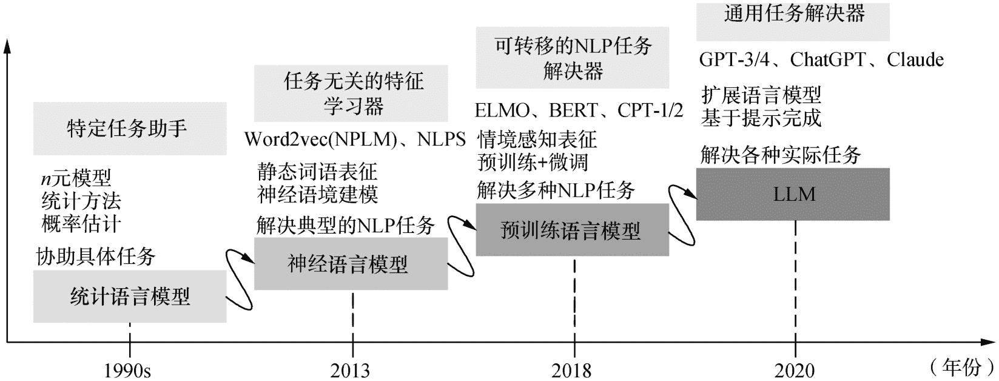

图 1-20 LLM 的发展过程

统计语言体系先在特定任务中做概率预测辅助；神经语言体系随后学习任务无关表征，减少人工特征工程；预训练语言体系学习上下文感知表示，可针对下游任务优化；最新一代 LLM 通过缩放效应增强体系容量，被视为通用任务求解器。总体来看，可解决的任务范围和各方面性能都大幅提升。

如图 1-21 所示，巨型体系进化树追溯了近年发展，重点标注了知名体系，同分支关系更近。实心块为开源，空心块为闭源。基于 Transformer 的体系中，仅编码器在最左，仅解码器在最右，编码器-解码器居中。

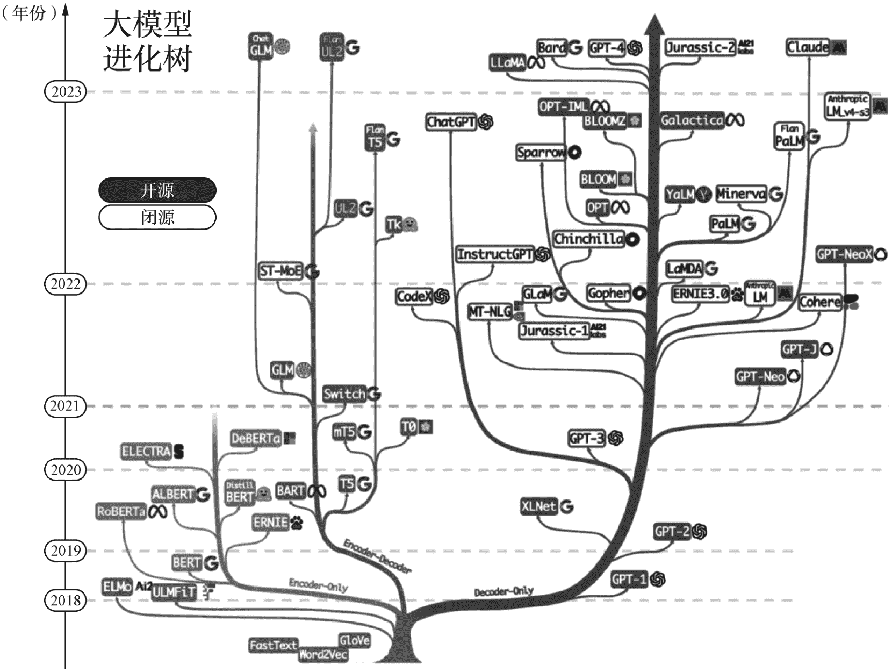

图 1-21 大模型进化树

1.3.2 巨型体系研究现状

2023 年 10 月 12 日，stateof.ai 发布《2023 年人工智能现状报告》。报告指出 GPT-4 仍是全球最强 LLM，凸显了专有技术与开源替代之间的能力鸿沟，也验证了 RLHF 的效果。ChatGPT 是用户增长最快的产品，带动生成式 AI 在图像、视频、编程、语音等领域突破，吸引约 180 亿美元风险与企业投资。生成式 AI 也推动生命科学进展，尤其在分子生物学与药物发现取得实质性进展。

2023 年 12 月 14 日，《自然》公布 2023 年度人物，ChatGPT 因占据全年新闻头条，深刻影响科学界与社会，被破例列为第 11 个“非人类成员”，表彰其对科学发展带来的改变。目前国内外研究不断深入，应用场景日益丰富，ChatGPT 为代表的巨型体系正式开启 AI 2.0 时代。

国外

美国由 OpenAI、Anthropic 等初创企业与微软、Google 等巨头领跑。谷歌曾向 Anthropic 投资 3 亿美元以应对 ChatGPT 挑战。2024 年 2 月，OpenAI 发布文生视频巨型体系 Sora，展现强内容理解与视频生成能力。

欧洲成立 ELLIS 研究机构以争夺 AI 高地。芬兰 Flowrite 基于 AI 生成邮件等内容；荷兰 MessageBird 推出 MessageBird AI，可理解客户意图并响应。2024 年 2 月，Mistral AI 发布 Mistral Large。2023 年 4 月，英国政府拨 1 亿英镑支持本土 AI 基础体系建设，以确保“主权能力”。律所 McFarlan 与法律生成式 AI 企业 Harvey 达成合作。

日韩方面，日本 7-11 使用巨型体系提升产品创意与研发效率，本田将其用于汽车设计。韩国较早布局巨型体系，代表包括 NAVER、Kakao、KT、SKT、LG，半导体企业正结盟应对算力挑战。

国内

近年来国内投入加大，算法、算力、数据方面取得突破，出现一批具国际竞争力的体系。很多人以为国产巨型体系始于“文心一言”，实则其只是类 ChatGPT 产品，背后的文心体系早已被百度、阿里、腾讯、华为等布局。

2023 年 3 月 16 日，百度基于文心体系发布“文心一言”，成为中国首个类 ChatGPT 产品。科大讯飞 2023 年 5 月 6 日发布“讯飞星火认知大模型”，具备文本生成、语言理解、知识问答、逻辑推理、数学、代码编程与跨模态等七大核心能力。2024 年 5 月 15 日，字节跳动豆包体系在火山引擎原动力大会发布。截至 2024 年 7 月，日均 Token 使用量突破 5 000 亿，平均每家企业客户日均用量较发布时增长 22 倍。

标准组织

ISO、IEC 等已开展关键术语标准化研究。2023 年 3 月，ETSI 提出 AI 透明度与可解释性标准规范。3GPP 规范涵盖 AI 在网络架构中的部署与使用，包含算法、架构、数据处理与管理标准，目前有 4 个工作组开展 AI/ML 标准化研究。2023 年 11 月，IEEE 巨型体系标准工作组由中国电子技术标准化研究院、上海人工智能实验室、华为云等 11 家单位发起，将制定技术规范、测评、安全可信、可靠决策等国际标准。

学术研究

跨模态技术发展使 GPT 巨型体系跨模态处理能力不断增强。传统单模态体系仅处理单一数据，缺乏全面理解；跨模态巨型体系可同时处理文本、图像、声音等，实现更深理解与交互。

例如，香港中文大学多媒体实验室联合上海人工智能实验室提出统一跨模态学习框架 Meta-Transformer，通过统一学习无配对数据，可理解 12 种模态并在 12 个模态上完成感知任务，如图 1-22 所示。该工作为跨模态学习提供了新工具与思路。

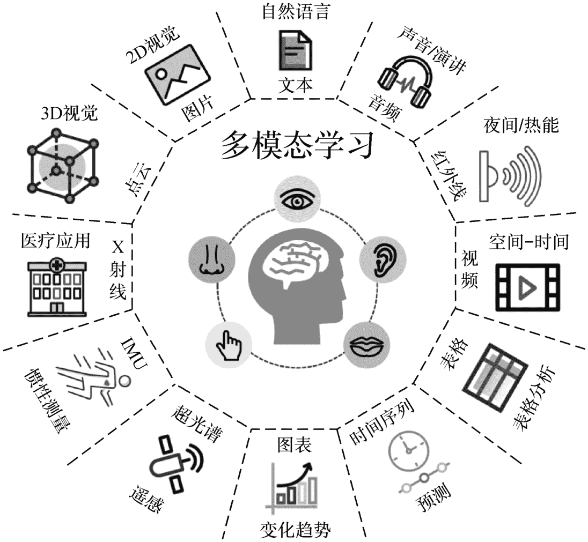

图 1-22 多模态学习

在情感识别领域，新型多模态情感识别系统 MMER 融合多模态变压器与关键交叉注意力融合方法，提升预测准确性。先用独立主干网络捕捉各模态时空依赖，再通过融合架构整合嵌入，有效捕获模态间与模态内关系。

自回归型视觉语言模型在对齐环节的效能不足，成为制约多模态应用的瓶颈。新加坡国立大学 Show Lab 与微软 Azure AI 合作提出的 COntrastive-Streamlined MultimOdal 框架 CosMo^(²⁷)，把对比式目标引入文本生成流程，并将语言模型拆分为两个专职组件：一个负责纯文本处理，另一个专精多模态信息处理。拆分后模型在兼顾文本与视觉的任务上表现提升，可训练参数显著减少，多模态分类与生成能力同步增强。

在高分遥感影像场景，多模态方案开始融合数字表面模型以及 RGB、近红外等异构信息源，用于地表覆盖的像素级分类。轻量化多源融合网络 LMFNet 为同时消化多种数据类型并提取有效特征而设计。该网络在 US3D 数据集上取得 85.09% 的 mIoU，优于现有多方案。相较单源方法，mIoU 约提升 10 个百分点，额外参数仅 0.5M^(²⁸)。

**1.3.3 典型的大模型**

境外头部大模型主要来自 OpenAI、Anthropic、Google、Meta 等机构，规模多在百亿至千亿量级，部分已进入万亿级。发展至今，境外头部模型大致可归为四类，如图 1-23 所示。

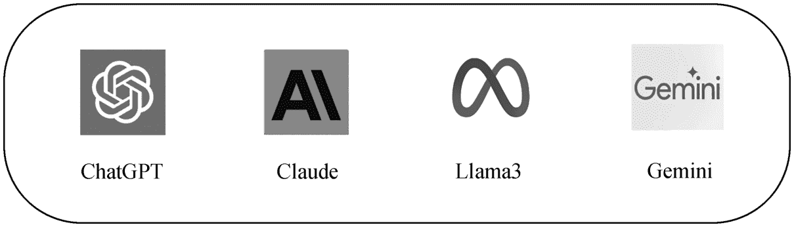

图 1-23 外国头部大模型

（1）ChatGPT

ChatGPT 出自 OpenAI 研发，以 Transformer 结构为底座的自然语言处理工具。模型依托海量语料训练，兼具理解与生成能力，可依据对话脉络持续互动，被戏称为知晓天文地理。实际使用中可撰写邮件、视频脚本、文案、翻译、编程以及学术论文。

目前 ChatGPT 仍是热度最高的对话式 AI，也是首批走出圈层的大模型。凭借强功能与跨场景适应性，在企业提效与内容创作中价值明显，并持续迭代以提供更精准个性化的服务。2024 年 5 月 14 日，OpenAI 发布了 ChatGPT 桌面客户端。同年 6 月，苹果在 WWDC 2024 上宣布与 OpenAI 合作，把模型能力接入 Siri。

（2）Claude

Claude 由 Anthropic 推出，在语言理解生成方面取得显著突破。依托海量训练数据与算法创新，其表现可与 ChatGPT 比肩，部分场景更胜一筹。

2023 年 11 月，Anthropic 宣布与谷歌深化合作；同时获得亚马逊加持，可使用其云基础设施完成训练与部署。Claude 在医疗、金融、法律的专业文本处理，以及客服、内容创作、教育等场景都有不错表现。开发时特别注重安全与伦理。

2024 年 3 月 4 日，Anthropic 发布 Claude 3 系列，包含 Haiku、Sonnet、Opus 三个递进型号。Claude 3 为多模态模型，可接受照片、图表、文档等输入进行分析问答，视觉表现突出。

（3）Llama 3

Llama 3 由 Meta AI 发布，是开源大语言模型，采用仅解码器式 Transformer 设计，分词器词表覆盖 128K token。模型在 Meta 自建的两组 24K GPU 集群上完成预训练，使用超过 15T 公开数据，其中 5% 为非英语，覆盖 30 多种语言。训练数据规模约为 Llama 2 的七倍，代码数据约为四倍。

其核心优势是基于公开可得的数据集训练，对研究者与开发者更友好。经广泛测试与微调，模型反应更贴合人类偏好，同时避免敏感信息泄露，在多项行业基准上展现领先推理能力，是当前较优的开源模型之一。

2024 年 7 月，Meta 透露将推出 Llama 3 的更新版，支持 8 种语言对话，代码质量更高，并能处理复杂数学问题。新版参数达 4050 亿，远高于 2023 年版本，但仍低于部分竞争对手。据称 GPT-4 拥有 1 万亿参数，亚马逊正在投入 2 万亿参数的模型研发。Meta 还计划继续发布 80 亿与 700 亿参数的轻量版。

（4）Gemini

Gemini 由谷歌于 2023 年 12 月 6 日推出，是原生的多模态大模型，前身是 Bard。2023 年 3 月，Bard 在全球 40 多种语言版本上线，基于 LaMDA 后升级为 PaLM，可辅助编程与调试。2023 年 5 月服务范围扩大，2024 年 2 月 8 日正式更名为 Gemini。

多数模型靠拼接独立模块模拟多模态，难以实现深度推理。Gemini 的亮点在于原生多模态，可一次性处理语言、听觉、视觉等不同形态数据，能无缝理解、操作与组合信息。模型能处理文本、图像、音频、视频和代码五类输入，并可理解及生成 Python、Java、C++ 等主流代码，同时做全面安全评估。

首发版本 Gemini 1.0 包含三档模型：面向高度复杂任务的 Gemini Ultra、面向多任务的 Gemini Nano、面向终端设备特定任务的 Gemini Pro。谷歌持续投入偏见与有害内容审查，确保多模态能力不引发安全风险^(²⁹)。

除上述熟面孔外，GPT 系列仍在扩容。中国亦紧跟步伐，布局了科大讯飞星火、腾讯混元、阿里通义、华为盘古、百度文心、中国移动九天等模型。

2023 年 8 月 31 日首批国产大模型通过《生成式人工智能服务管理暂行办法》备案并面向公众服务。截至 2023 年 10 月，国内参数规模 10 亿以上的厂商与高校院所共计 254 家，“百模大战”正从生产转向应用。图 1-24 展示了国内外主要模型分布。

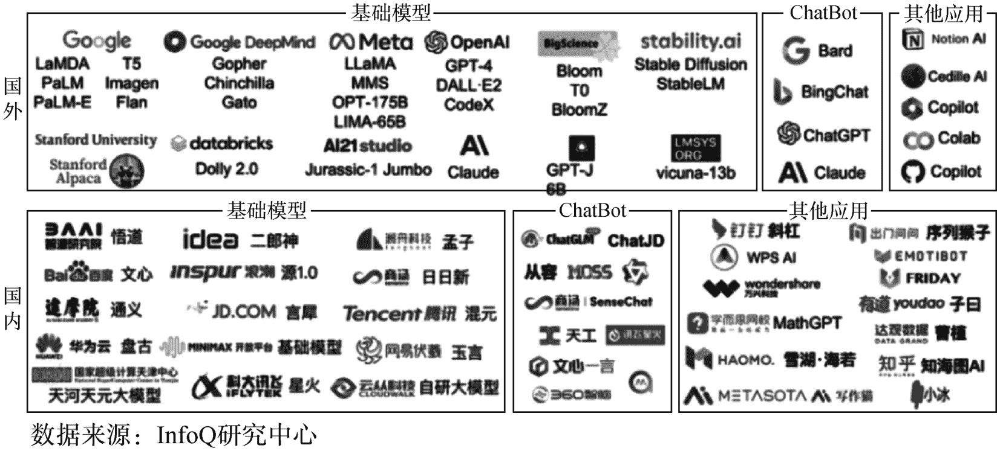

图 1-24 国内外各类大模型

此外，OpenAI 于 2024 年 2 月 18 日凌晨推出文生视频模型 Sora，再次引发热议。Sora 在 GPT 与图像生成模型 DALL-E 基础上构建，可依据文本指令生成逼真或富有想象力的场景视频，展现出模拟物理世界的潜力。如图 1-25，借助提示词，Sora 还原了墨镜女子在东京街头行走的场景。

图 1-25 Sora 模型生成的视频场景

Sora 采用扩散模型技术，借鉴 DALL-E 3 的再标注思路，从近似静态噪声的帧起步，经多步精细化得到视频内容，可生成高度描述性的视觉训练数据，实现文本指令到视频动作的精准映射^(³⁰)。模型架构如图 1-26 所示^(³¹)。

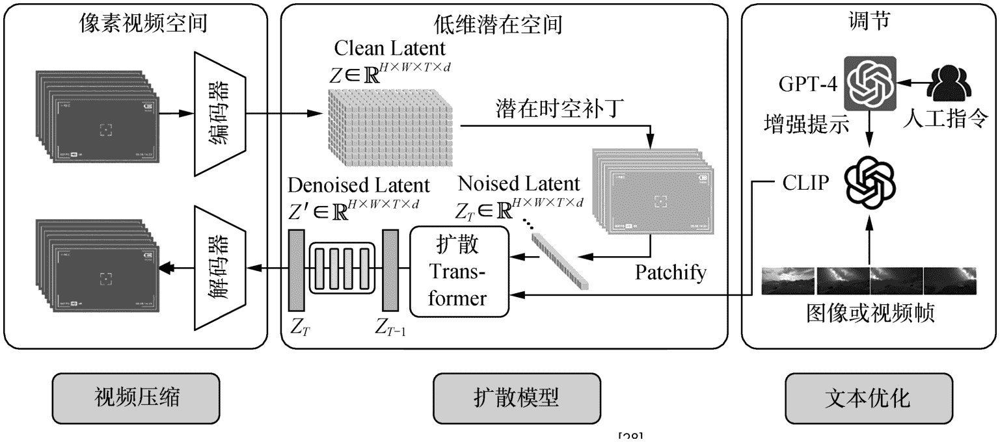

图 1-26 Sora 模型架构 ^(³²)

Sora 融合视觉与文本信息，利用 CLIP、Vision Transformer 等视觉-语言模型实现文本到视频的生成，多模态融合提升了应用广度与生成效果^(³³)。借助扩散过程将噪声逐步转化为图像，Sora 能产出细节丰富、质量较高的视频，内部使用 U-Net 架构逐步预测并削弱噪声。

模型还内置幻觉检测机制，确保生成视频的真实性与一致性，可识别并纠正提示一致性幻觉、静态幻觉与动态幻觉，提升可靠性^(³⁴)。

Sora 不仅能从文本生成视频，还可对静态图像进行动画化，或无缝补全视频缺失帧，增强流畅性与完整度。这标志着向真实世界模拟迈进，是通往通用人工智能的重要里程碑。尽管如此，在复杂场景物理效果的模拟上仍有提升空间，例如物体交互、食物消耗、空间细节等表现尚不完全准确^(³⁵)。

**1.4 本章小结**

总体而言，GPT 的出现极大推动了自然语言处理的技术进步与应用落地。依托 Transformer 架构与大规模预训练，这些模型能够处理复杂语言任务，并在众多领域实现突破。随着持续演进，GPT 及其衍生技术将继续重塑人与机器的交互方式，驱动人工智能在各行业的深度应用。

本章以 ChatGPT 为切入点，先介绍其概念、技术体系与典型应用，再阐释 GPT 的含义与核心 Transformer 架构，以及大语言模型的发展脉络，并回顾 GPT 的演进历程与研究现状。最后梳理了几款代表性大模型，它们在不同 NLP 任务中展现出强劲性能与广泛用途，帮助读者全面理解 GPT 与 ChatGPT 的背景、技术与影响。

## 参考文献

# 第二章 GPT 催生通信新应用与新变革

第一章已梳理 GPT 的概念、演进与研究现状。可以看到，GPT 已深度渗透多个领域，成为经济社会变革的关键力量，也将为全球产业带来跃升。当前 GPT 已实现人与机器以多种形式沟通，体验接近甚至超越人与人文本聊天，与通信行业的交流支撑作用高度契合。AI 应用在通信领域的落地，为信息基础设施建设与运营打开新思路。作为 AI 新高度，GPT 催生的 AI 即服务拥有更大业务空间，为通信创新提供广阔舞台。GPT 如何赋能通信，通信如何保障 GPT 落地，是行业必须回答的问题。

**2.1 GPT 赋能多元化通信新应用**

GPT 的多元化应用为千行百业打开想象空间，也为通信行业带来机遇与挑战。它打破了人与机器交互的传统边界，带来更智能、便捷、个性化的通信体验，极大提升信息交互与行业应用能力。

GPT 可作为工具提升信息通信服务能力。其强大的自然语言能力可用于智能客服、智慧运营、欺诈监测等运营场景，通信网络海量数据亦可训练通信大模型。其次，GPT 在自然语言上的成功推动了语音、视觉等多模态技术发展，为各行业数字化转型提供工具。最后，GPT 类大模型的运行对算力和网络要求较高，将倒逼算网融合建设，为更多大模型在通信行业落地创造条件^(³⁶)。

通过海量数据训练，GPT 具备不断增强的上下文语义理解与交互能力，在多场景中展现潜力。目前应用集中于文本、图像、音频、视频及多模态内容生成，摄影、游戏、传媒等领域常在此基础上做定制化开发。例如文本生成与分析^(³⁷)、软件测试^(³⁸)、专业领域聊天机器人^(³⁹)等，如图 2-1 所示。

下面将重点介绍 GPT 在通信行业的创新应用，包括智能客服、自动化仿真、芯片设计重塑及语义通信增强，彰显其对通信细分领域的推动作用。

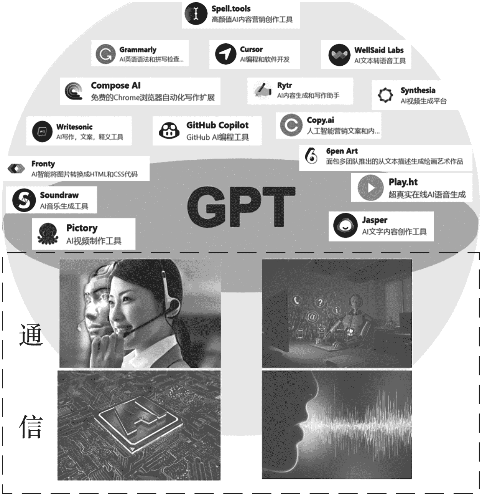

图 2-1 GPT 在通信领域的崭新应用

**2.2 智能客服**

智能客服是运营商与用户连接的重要桥梁，承担提升体验、优化流程的重任。随着人工智能、物联网、大数据发展，我国智能客服行业迎来机遇。据中商产业研究院《2023 年中国智能客服市场前景及投资机会研究报告》，2022 年市场规模达 66.8 亿元，2019—2022 年年均复合增长率 52.66%，如图 2-2 所示。2023 年规模达 86.9 亿元，预测 2024 年将达 95.0 亿元。

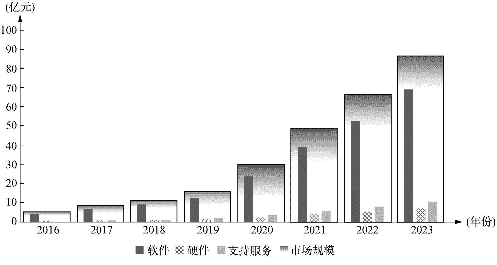

图 2-2 2016—2023 年中国智能客服市场规模统计图

**2.2.1 传统智能客服面临的挑战**

在既有技术背景下，传统智能客服存在多重限制。其一理解能力受限。虽可通过关键词检索匹配答案，但在面对复杂个性化需求时，单一匹配方式难以捕捉真实意图，往往给出预设、标准化的浅层反馈，无法回应个性化问题^(⁴⁰)。用户表述习惯各异，未必使用特定关键词，导致情感与诉求难以被准确把握。交流中情感互动不可或缺，但传统系统缺乏情感识别，难以捕捉情绪变化，给出贴心回应。

其二存在渠道整合与数据共享难题。过去各渠道客服系统独立运行，数据整合难度大，用户在多元渠道获得的体验不一致，可能在微信公众号、小程序、微博等平台重复咨询，增加用户时间成本与运营商负担。

随着 GPT 等先进技术出现，智能客服升级迎来新机遇。GPT 借助深度学习与自然语言处理，能更准确理解用户意图与需求，具备较强情感识别能力，并可实现跨渠道统一管理，让服务体验更一致高效。

**2.2.2 增强语义理解与情感识别**

GPT 不仅能生成文本，更能在一定程度上“理解”用户意图与需求。它利用互联网可用数据训练文本生成模型，提供更准确、个性化的服务，提升人与机器、机器与人之间的语言交互水平。GPT 的智慧化更符合“对话机器人”的期待：能识别提问主题与关键词，感知用户情绪，理解真实需求，给出恰当回答或解决方案，而非仅因关键词触发就抛出固定的标准答案。

情感识别方面，GPT 表现突出。智能客服中情感交流至关重要，用户因不同问题产生喜悦、生气、失望等情绪。GPT 通过训练带情感标签的文本数据，学会识别文本情感色彩并作出相应回应，增强用户与企业的情感联结，提升满意度与忠诚度。

GPT 模型中的自然语言理解模块通常基于深度学习算法实现，典型方法包括循环神经网络、长短时记忆网络，以及目前备受关注的 BERT 等模型^(⁴¹)。这些算法不仅赋予系统强大的文本生成能力，也能在一定程度上解析文本中的情感信息。

当用户和智能客服聊上几轮，GPT 就在悄悄把对话变成宝贵的经营资产。提问的用词、回答的倾向、点击和停留的轨迹，都被沉淀下来，形成可用的市场洞察。企业能据此更清楚客户真正要什么、习惯怎么用，进而调整产品细节、优化营销话术、提升服务体验。

这个能力叠加其他技术后效果更明显。接上语音识别，GPT 可把口语转成文本，让不习惯打字或行动不便的人群，比如老年人和残障人士，用说话就能对话。搭配自然语言生成，系统能在不同场景下自动组织出更顺、更好懂的回复，让互动更有人味。

**跨渠道整合与统一管理**

通信场景里，电话、短信、邮件、官网聊天、私信…用户入口越来越多。传统客服往往割裂，换一个渠道就要重新说明问题，体验断层。GPT 的自然语言理解让多入口融合成为可能。

无论用户从哪条路进来，模型都能识别意图并转成统一的内部格式处理，工作流如图 2-3 所示。电话还是社媒，得到的服务口径和进度是连贯一致的。

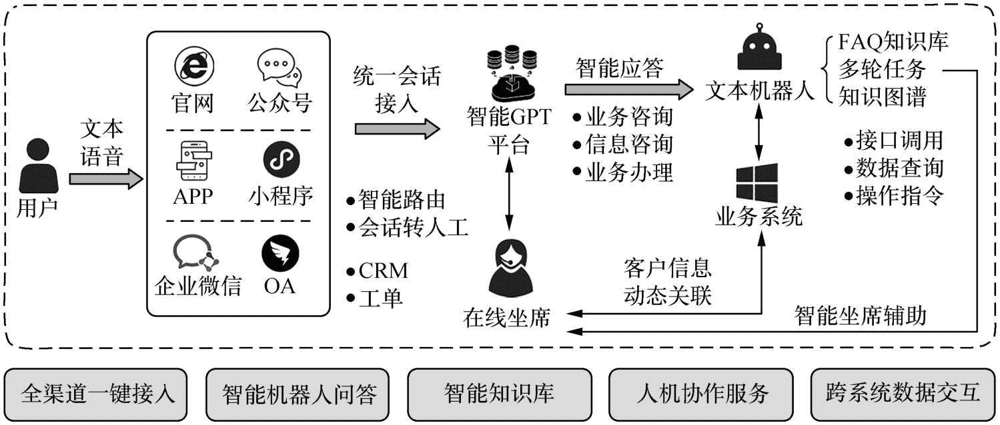

图 2-3 智能客服的工作流程

统一后，企业不必为每个渠道养一支团队，一个智能系统就能承接咨询、投诉，既省人力又提效。更关键的是应急能力。突发事件时，系统可以瞬间向全渠道推送说明和处置方案，让用户及时得到帮助，缓解焦虑，守住品牌口碑。

**自动化仿真的新玩法**

仿真在科研和工业里是标配，却长期被繁琐的手动调参和重复操作拖慢，还容易因人为失误出错。深度学习和大模型的出现，把自然语言的能力带进了仿真链路，GPT 正是其中一把关键钥匙。

**2.3.1 重构实验流程**

GPT 预训练于海量文本，能根据上下文提示迁移。对比传统流程，如图 2-4 所示，它不再要求每次都手动改模拟参数、底层算法或数据格式。用户用自然语言给出与预设架构相关的参数，GPT 解析后填入准备好的模板，就能完成一次自动化仿真。操作被大幅简化，失误率下降，实验质量和效率同步提升。

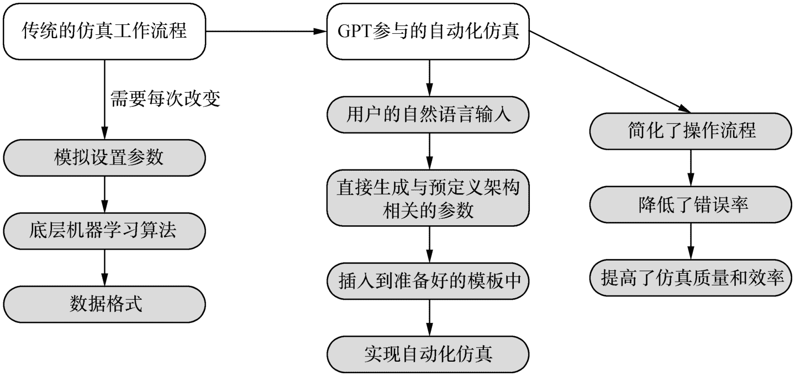

图 2-4 传统的仿真流程与 GPT 参与的自动化仿真流程的对比

在设计期，GPT 能快速搭出交互原型，让团队直观看懂系统逻辑，提前发现问题。图 2-5 所示，设计师只需用自然语言描述需求，模型就能生成原型，避免手工搭建的低效。结合用户反馈还可以迭代优化，需求响应更快。

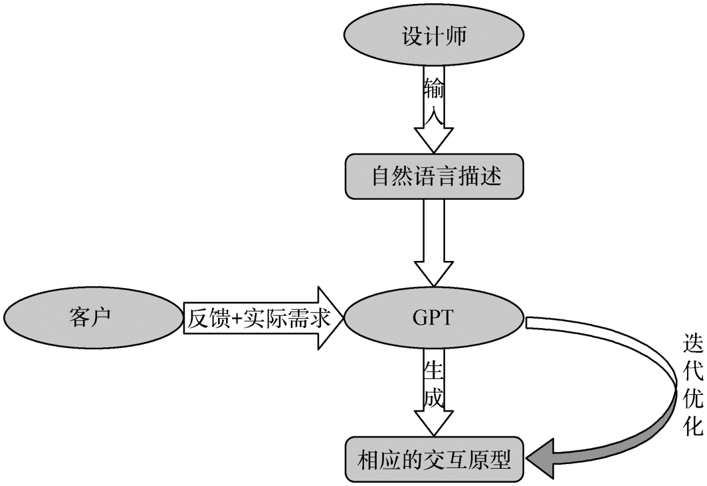

图 2-5 GPT 帮助设计师快速设计原型

**2.3.2 模拟参数分析**

把 GPT 和图数据库如 Neo4j 结合，能实现数据导入、图构建、查询等全链路自动化。Dragana Krstic 等人提出的基于 ChatGPT 的框架，就用对话 Agent 加 Neo4j 模型驱动的方式，自动完成移动网络信道容量的计算，实现无线网络规划仿真，如图 2-6 所示。用户用口语描述数据，ChatGPT 解析后生成结构并写入 Neo4j，后者高效存储图结构，之后再自动生成网络拓扑和信道模型图，为后续分析提供直观依据。

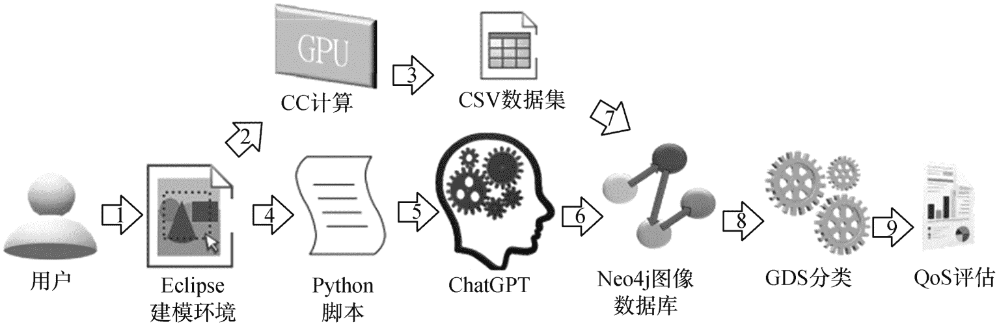

图 2-6 GPT 帮助进行信道容量分析实验

参数设置向来费时易错。借助 GPT，用户说“我要模拟一个 10 个仓库、50 辆运输车的物流系统”，模型即可推导出仓库位置容量、车辆数量速度等参数。

仿真设计阶段，自然语言描述可以快速变成交互原型，设计师更聚焦功能和体验。执行阶段，开发者用自然语言描述功能，GPT 直接生成对应仿真代码，比如“写一个求两数之和的函数”。开发更快、错得更少。

实验结束后，结合图数据库，GPT 可按需求自动跑分析、产出图表、表格和文本报告，让结果更易读、传播更方便。

**2.3.3 实现智能编程**

GPT 不止写常规代码，还能理解意图、生成复杂逻辑，图 2-7 显示了这种智能编程的趋势，大幅提升效率并降低门槛。

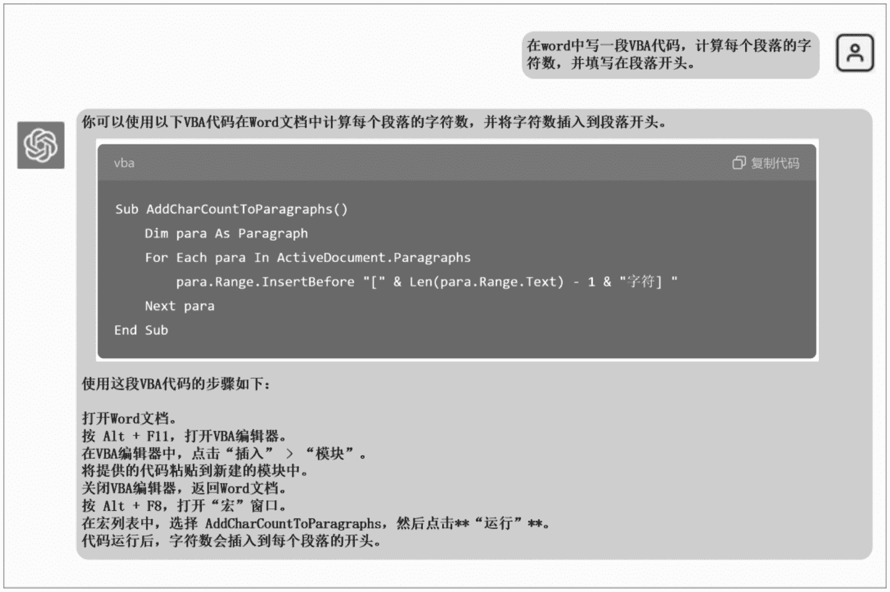

图 2-7 GPT 进行自动化编程

典型案例是 OpenAI 的 Codex，基于 GPT-3 把口头或键入指令转成可执行代码，支持 Python 等语言，让编程更直观。GitHub Copilot 就依托它提供行级或函数级建议，让非专业开发者也能高效构建软件。

总体看，GPT 把仿真的交互拉向自然语言，操作走向全自动，从设计、执行到分析、报告的闭环更顺滑、更精准。

**重塑芯片设计领域**

芯片是通信的底座，承载协议支持、硬件加速、射频收发、安全加密等功能。随着 AI 进步，GPT 在硬件设计中的应用加速。2023 年 9 月，纽约大学 Tandon 工程学院的研究人员用 OpenAI GPT-4 完成了芯片设计并流片，如图 2-8 所示，用日常英语对话生成可行的硬件描述语言代码，经过基准测试后在 Skywater 130 nm 流片成功，是 AI 进入硬件设计的标志性突破。

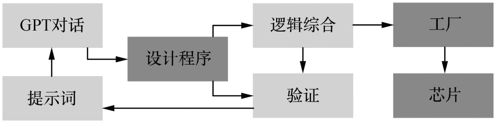

图 2-8 GPT 在芯片设计中的应用

**2.4.1 优化设计流程**

Synopsys 的观点是，芯片设计正走向软件中心化，ChatGPT 等技术将重塑流程，推动更多 AI 硬件创新。传统流程人力密集、周期长，大模型可以帮助快速、准确地生成 RTL、验证环境等关键模块，压缩时间、减少失误。

Synopsys.ai 是其全栈 AI EDA 工具套件。

更快交付更优架构：DSO.ai 用强化学习在设计空间里寻优，几周内就能找出性能、功耗、面积的较优组合，传统方法往往需数月。

加速 IP 验证：VSO.ai 用 AI 驱动验证，提升覆盖率，减少覆盖盲区，生产力可提升约 30%。

快速布局布线：DSO.ai 平台不用穷举所有布局方案，而是用 AI 评估架构、功耗性能目标和几何组合，再模拟少数布局快速锁定符合 PPA 需求的方案，GPU 加速让大规模电路如存储器也能高效模拟。

测试与硅生命周期管理：流片后需验证功能，测试模式数量是关键。Synopsys.ai 生成优化测试模式，可减少 20%~30% 测试时间，用同一序列覆盖量产芯片，降低检测成本，如图 2-9 所示。

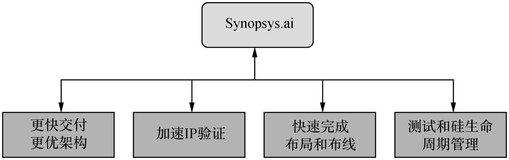

图 2-9 Synopsys.ai 应用的芯片设计环节

**2.4.2 辅助自动设计**

Cadence 推出的 JedAI 平台是“芯片到系统”AI 驱动的 EDA 方案，涵盖验证、物理实现、系统优化、PCB 设计等，图 2-10 为其 Allegro X AI 工具。

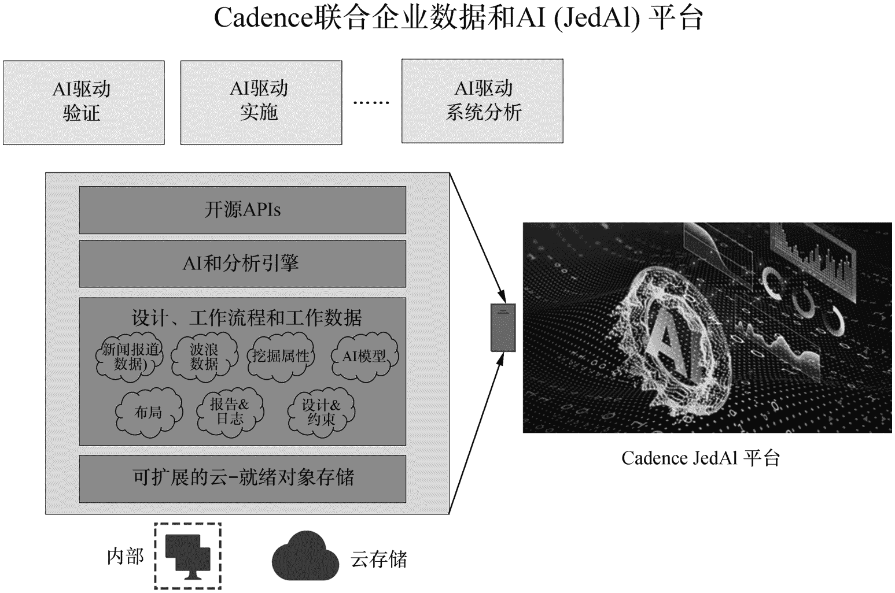

图 2-10 Cadence 推出的 Allegro X AI 工具

Allegro X AI 可在云端自动完成器件摆放、金属化、关键网络布线，并集成信号完整性和电源完整性分析，用生成式 AI 把 PCB 设计周期缩短 90% 以上。平台通过自主学习海量数据，减少人工决策，提升生产力。

有了初稿 HDL 描述，工程师可用大模型做需求分析、规格核查、问题探索，并得到自然语言解释，规范审查、代码审查、测试审查都能省下大量人力会议时间。

大模型还能沉淀设计知识，从文档和代码里提炼经验形成知识库，便于传承。门槛也随之降低，非专家可参与设计，创新者更多进入赛道。Efabless 的开源硅设计挑战赛就借助 AI 生成工具，让全球设计者提交方案，推动资源与知识共享，未来可能出现“码芯”云平台，用户输入自然语言需求即可生成定制硬件。

**2.4.3 提高验证效率**

芯片验证是保证正确性的核心，传统写法测试用例耗时耗力。GPT 可自动生成高质量验证用例并做根因分析，极大提效。

Synopsys 的 VCS 仿真器结合 AI/ML 提供智能覆盖优化，增强激励多样性、暴露测试平台缺陷。把 GPT 部署在 GPU 上，能高效生成验证激励，加速流程、提升覆盖率，降低设计风险，如图 2-11 所示。

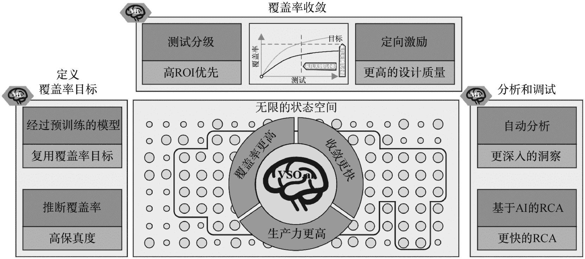

图 2-11 在仿真中使用 AI/ML 后实现的覆盖率改进

GPT 还能推动创新，打破既有模式限制，从海量设计数据中发现规律，自主尝试方案，带来性能与功耗的突破，加速新技术产业化。

当然挑战仍在：芯片设计专业性强、约束复杂，模型需要大量领域数据和专家微调；物理设计、时序分析等对算力要求高；IP 保护限制数据共享；生成结果的可解释性和可信度仍需提高。需要 EDA 厂商、芯片公司和科研机构共同攻关。未来，GPT 将更深度融入芯片设计，成为驱动 EDA 创新的核心力量。

芯片设计领域正在被生成式大语言模型重新塑造。

1）EDA 工具链与生成模型的协同演进。下一代设计自动化平台会把大模型的推理与生成能力深度内置，但这并不意味着要抛弃经典算法与启发式策略，而是让二者形成互补协作，各自发挥长处。在智能助手加持下，原本繁复的设计流程会被处理得更快更顺。

2）方法论从经验主导转向数据主导。生成式智能普及后，芯片研发不再单纯依赖工程师直觉。海量历史设计结果与项目数据会被系统性挖掘，大模型能够从中捕捉隐含规律与可复用的最佳实践，并以结构化方式呈现给团队。这种数据化路径直接拉高了设计效率与一次通过率。

3）知识的自动萃取与即时调用。面向未来，智能系统借助自然语言理解等手段，能自动从设计文档、技术论坛等非结构化来源中抽取并归纳专业知识，沉淀为可检索的知识库。设计人员通过智能问答与该库交互，即时获得针对性的设计指引。

总体来看，生成式模型在芯片设计中的落地，正在明显提升效率、压缩成本、激发创新，为半导体产业带来可观的经济价值。可以说，它正重新定义芯片设计的未来，并为行业打开新的增长空间。

**2.5 SemCom 能力强化**

伴随 6G 移动通信以及物联网等新一代网络的演进，万物智联成为共识，基于意义的通信 SemCom 有望成为未来网络的核心范式。然而现阶段 SemCom 仍受制于两大瓶颈：一是背景语境推理与背景知识不足，二是模型训练以及意义知识图谱构建耗时耗力。因此，如何加速模型训练、降低训练开销、实现网络内高效传输与部署，已成为研究的基石难题。引入生成式预训练技术，可实现输入的意义理解与表征学习，并完成意义匹配。

生成式模型与 SemCom 结合时，优势主要集中在三方面：训练效率的提升、语境推理能力的增强、频谱资源利用率的改善这 3 点^(48)。

**2.5.1 加快 SemCom 训练节奏**

生成式预训练模型的加入能明显加快意义通信系统的训练节奏。模型已在海量语料上完成预训练，掌握了丰富的语言知识与模式识别能力，面对新任务时可快速迁移，无需从零开始。实践中，只需用少量特定任务数据做微调，就能在很短时间内得到可用系统。

关键词抽取与目标识别是 SemCom 的核心环节，生成式模型在此表现突出。它能从长文本中提炼核心关键词，并据此判断通信的具体意图。例如用户提到即将到来的家庭聚会时，大模型可自动识别出家庭成员姓名、聚会日期地点、可能的话题活动等关键要素，并据此帮助整理邀请函或活动方案，确保细节完整表达清晰。该处理既节省通信资源，也降低了对即时响应的压力。图 2-12 展示了模型提取关键词的流程。

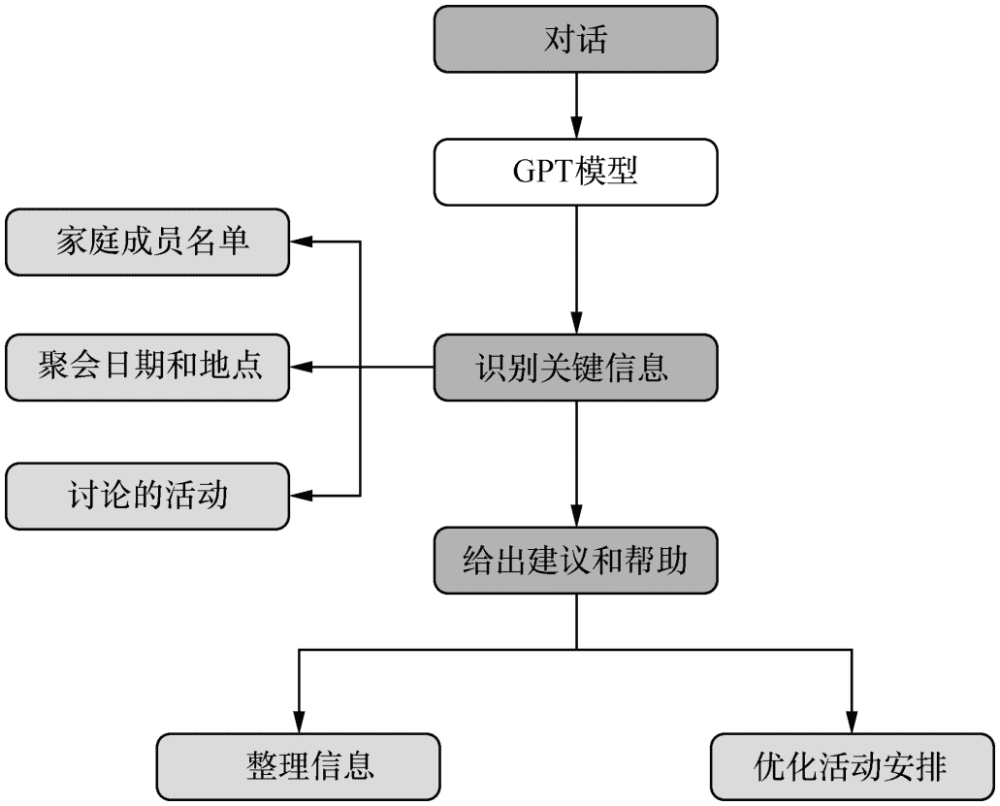

图 2-12 GPT 提取关键词的过程实例

另外，预训练已覆盖极广的语料，微调时所需数据量与迭代次数大幅下降，训练时长与算力消耗随之降低。意义通信系统的部署与迭代因此更经济、更敏捷，能迅速适应新的通信需求与环境变化。预训练模型在多样化数据上学到的广泛意义与语言结构，还赋予了较强的泛化能力，使 SemCom 在复杂多变的场景中表现更稳健。

**2.5.2 强化意义语境推理**

深层的意义理解能力显著提升了 SemCom 处理复杂交互的能力。它能够捕捉文本的细微差别与复杂关联，让系统在复杂交流中更准确地把握用户真实意图与语境。例如在多轮对话中，生成式模型可依据前序内容推断用户深层需求，从而给出更精准的回应。

从技术视角看，生成式模型作为背景知识供给者，可分为全局知识与个性化知识。全局知识指书籍、文章、视频等公共信息，个性化知识则关乎用户个人习惯与沟通风格。依托深度预训练，模型能迅速从网络检索全局知识并保持通信双方的一致性，保证 SemCom 的知识对等。在个性化层面，模型可在意义通信准备阶段通过分析用户互动学习其偏好，提供定制化服务。

再者，通过分析历史交流，模型能识别特定用户的沟通习惯与偏好，在意义编码解码环节注入个性化意义信息，明显提升沟通效果与体验，让系统更智能更人性化。理解与推理用户意图与语境，生成式模型帮助 SemCom 更准确地解析与响应需求。

**2.5.3 优化频谱使用效率**

通信发展中，提升有限频谱以及复杂环境下的数据传输效率是关键课题。SemCom 通过意义层编码传输，降低了对传统比特级传输的依赖。在此背景下，生成式自然语言处理模型带来的高效意义编码思路，为提升通信效率与频谱利用率提供了新路径。模型凭借强大的意义理解与生成能力，可将大量复杂信息压缩为更小的数据包传输，在频谱受限条件下传递更多有效信息，实现频谱优化利用。

更关键的是，在信号质量差或频谱受限场景下，生成能力的价值同样重要。无线环境常出现衰减、干扰与丢包，传统纠错能力有限。生成式模型可借助语境推理与意义补全，在数据丢失时推断缺失信息，维持通信连续性与可靠性。该能力不仅适用于自然语言，也可延伸至图像、视频等多模态意义通信，提升恶劣环境下的整体传输质量。

此外，高效意义编码在优化频谱利用的同时，也为 SemCom 提供稳定性保障。频谱稀缺是 5G 以及未来 6G 的瓶颈。模型具备的意义理解能力使其能在复杂环境下实现更高效信息传输，在频谱紧张时通过剔除冗余与压缩非关键信息提升传输效率；其自适应意义生成能力可在信号恶劣时动态补充信息，保障通信流畅。这种编码与生成能力提升了稳健性与可靠性，为智能通信开辟更广阔前景。

**2.5.4 推动智能通信的广泛应用**

基于以上优势，学界已出现大量生成式模型与 SemCom 结合的研究。例如文献^(49)提出一种 AI 辅助 SemCom 网络框架，采用全局与局部生成式模型，收发端分别部署意义编码与译码模块，用于提取与恢复意义信息，如图 2-13 所示。

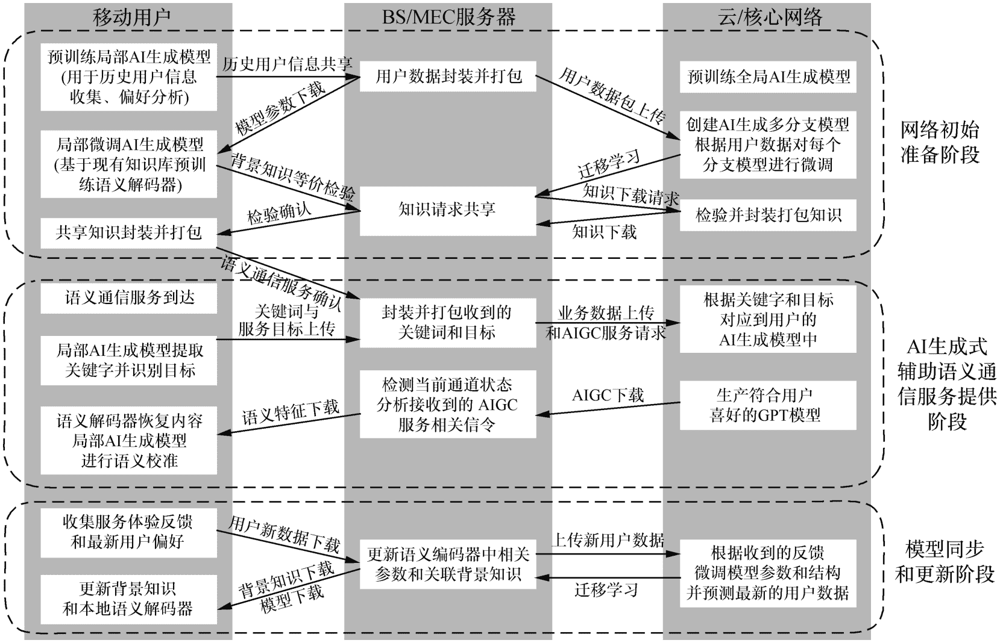

图 2-13 增强语义通信

生成式模型可在服务器端生成意义模型，并按收发端请求动态部署适配模型。收发端将模型保留于各自意义模型库。发送端将原始信息送入意义提取与表征模块得到意义信息，经联合意义编码与信道编码转为比特数据传输。接收端经联合信道译码、意义译码与意义信息重建恢复原始信息。语境与通信环境等背景因素会影响恢复效果，意义译码模块可对背景误差进行补偿。该方法实现多模态意义内容理解与意义级联合源信道编码，在一定程度上提升意义推理可靠性与资源利用率，减少传输流量与时延，实现更高效意义传递。

文献^(50)提出生成式联合源信道编码 JSCC 框架用于意义图像传输，在低信噪比下提升图像质量，展示生成式方法在意义通信中的潜力。文献^(51)探讨面向移动 AI 生成内容的跨模态生成意义通信，结合自然语言处理与计算机视觉，通过联合意义编码与提示工程在保持生成质量的同时显著提升传输效率。文献^(52)梳理了生成式模型在智能城市、自动驾驶、远程医疗等领域的具体应用，指出生成式 AI 将与意义通信网络深度融合，推动各行业数字化转型。

在内容重构与意义校正方面，生成式模型价值突出。无论网络核心还是用户端，模型都能基于接收信息重构内容并处理传输中出现的意义误差，确保信息准确完整，显著提高意义通信的可靠性与效率。图 2-14 对比了大模型辅助的 SemCom、传统 SemCom 与传统通信的系统特性与优劣^(53)。

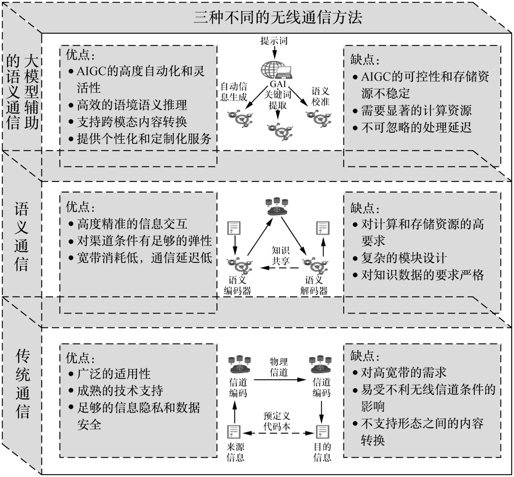

图 2-14 大模型辅助的 SemCom、SemCom 和传统通信 3 种不同方法的优缺点比较

未来，生成式模型驱动的 SemCom 网络在自动驾驶与智慧城市等场景展现广阔前景^(54)。在自动驾驶领域，模型可提升车际通信效率与安全性。借助 SemCom，车辆可有效交换道路状况、交通流量与突发事件信息，经过高级意义分析后辅助更精准的导航与避障决策。模型还可用于车载系统，通过意义理解生成更贴合驾驶场景的响应与警示，增强人机交互体验。

例如 GPT-Driver 是基于 GPT-3.5 的运动规划方法，由 PointsCoder 提出，将运动规划重构为语言建模问题^(55)。该方法把规划器的输入输出表述为语言标记，并通过坐标位置的语言描述利用生成式模型生成驾驶轨迹。GPT-Driver 提升了规划精度并增强系统可解释性，使得自动驾驶系统能够更好地理解并应对复杂的驾驶环境。

模型还可通过分析交通数据与意义理解优化城市交通信号灯设置，缓解拥堵。实时监测流量与路况后，模型可动态调整信号时长与顺序，优先处理高峰流量。智能化交通管理提升通行效率并降低事故率。同时，模型可用于动态路线规划与导航，帮助驾驶员避开拥堵。智能交通系统中，模型可实时分析路况并与驾驶员对话，结合当前与预测交通趋势给出最优路线建议，基于意义分析的动态导航大幅提升出行效率与安全性。

**2.6 本章小结**

在信息化和数字化加速的今天，通信技术正处变革前沿。智能技术的进步使生成式模型成为推动行业创新的重要力量。把生成式技术引入现有移动通信系统，不仅能提升传统无线业务与网络服务能力，更能拓展全新应用场景。

本章中，“智能客服”阐述了集成先进生成式模型在电信客服领域的显著改进，聚焦意义理解与情感识别能力；“自动化仿真”说明生成式模型如何凭借先进自然语言处理能力改变各领域仿真实践；“重塑芯片设计”探讨生成式模型对芯片设计尤其是电信领域的革命性影响，介绍如何将 AI 驱动技术融入设计各环节以提升效率、精度与创新；“增强语义通信”深入讨论生成式模型与 SemCom 的融合，强调 6G 与物联网进步，重点介绍模型如何通过提升训练效率、增强意义推理、优化频谱利用来增强 SemCom。

新一代通信致力于提供完全沉浸式交互，满足人类在多感官乃至情感与意识层面的沟通需求。生成式模型与通信业务结合，将为用户带来高智能、多交互、立体多样的通信体验，极大提升信息交互能力、行业应用能力与生产力。在新型应用场景拓展上，生成式模型将继续推动垂直行业应用发展，尤其是在石油化工、建筑、矿场等安全生产领域，通过专网部署可支持一线生产现场传感器、摄像头等异构海量连接，极大增强生产状态管控能力。总之，生成式模型在移动通信领域应用潜力巨大，必将带来超越时代的未来移动通信体验，助力更多行业加速转型，为人类创造更美好生活。

**第三章**

**GPT 促进通信网络智能自治**

第二章介绍了生成式模型在通信领域的崭新应用，包括智能客服、自动化仿真、意义通信与芯片设计等，并展望了其持续改变通信技术与行业、带来更多可能性的路径。在此基础上，本章将聚焦生成式模型促进通信网络智能自治的关键作用，从网络规划、切片部署、网络运维与网络优化 4 个角度全面分析大模型如何赋能通信网络。

**3.1 通信网络智能自治**

智能技术赋能的自治网络是 5G 与后 5G 网络发展的重要趋势，将为移动网络带来根本性变革。随着通信技术进步与网络需求增长，传统网络管理方式已难以满足未来需求。在此背景下，智能技术引入将为网络管理带来革命性变化。

当前网络管理高度依赖人工干预，存在诸多局限。人工管理效率偏低，在复杂网络环境与不断变化的业务需求面前，易出现响应迟缓、决策失准等问题。智能技术赋能的自治网络可通过自动化与智能化手段，从被动管理转向主动管理，使网络管理更高效、灵活、精准。智能技术在移动网络中带来的网络自动化能力，是除 3GPP 定义的 5G eMBB、mMTC、URLLC 之外，5G 网络不可或缺的第四维^(56)，如图 3-1 所示。

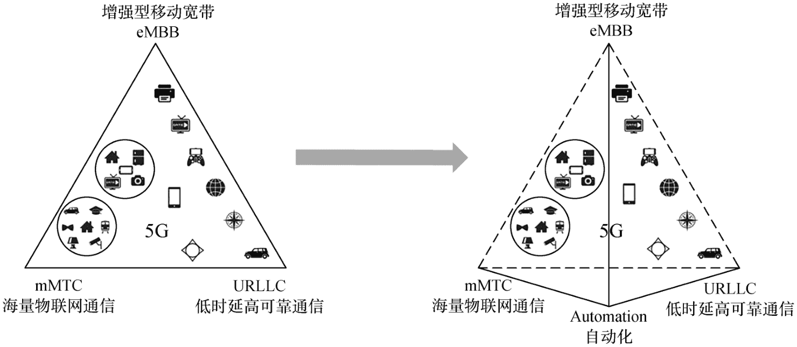

图 3-1 网络自动化成为 5G 网络的第四维

5G 在网络规划设计上需要快速简洁地体现运营商意图；在业务开通上需要减少人为配置错误、快速上线业务；在网络运营运维上需要突破以专家经验为主的传统模式局限。未来，智能化网络将通过多维数据感知，包括业务数据、用户数据、网络状态数据等，全面了解运行状况。基于这些数据，智能技术可进行智能分析，提供更灵活高效的网络策略。例如在流量高峰时自动调整资源分配保障稳定运行；发现潜在故障时提前预警并自动修复，减少故障对用户体验的影响；在网络维护时通过智能诊断与预测性维护降低成本、延长设备寿命。

自智网络^(57)的核心理念是通过引入智能技术等推动新一代通信网络向自配置、自治愈、自优化、自演进方向发展。“AI+通信”已成为 ITU 定义的 6G 六大场景之一^(58)，包括辅助自动驾驶、设备间自主协作、辅助医疗应用、基于数字孪生的事件预测等新功能。目前，生成式模型已初步实现在网络智能自治领域的多种应用，全球多家运营商、设备商与第三方厂商已展开相关研究，如图 3-2 所示，涵盖网络规划、切片部署、网络运维与网络优化等案例。

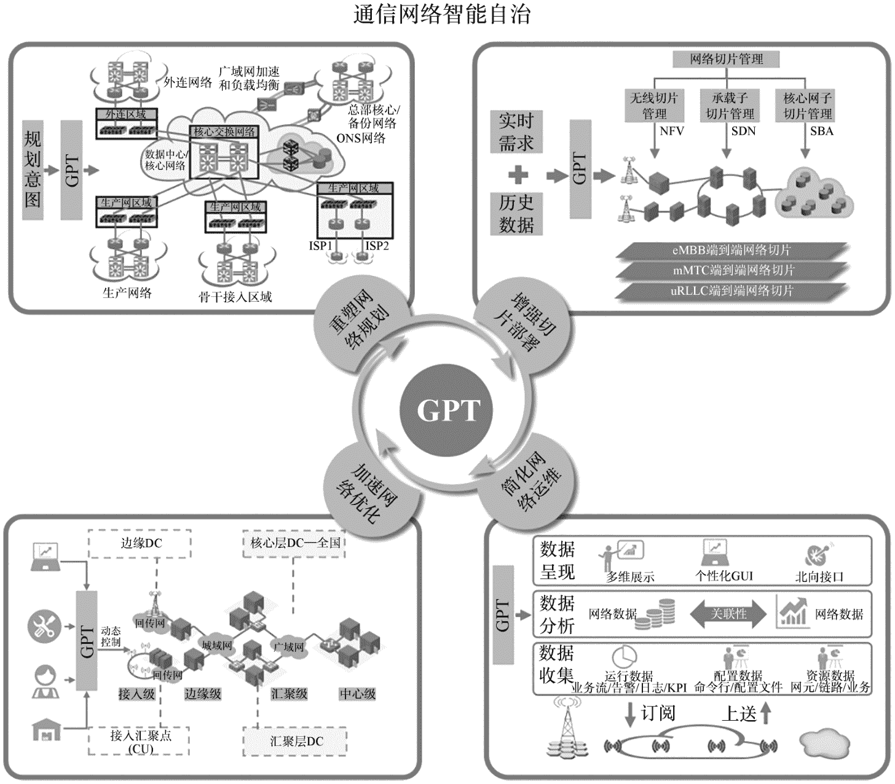

图 3-2 GPT 促进通信网络智能自治

**3.2 GPT 重塑网络规划**

互联网深刻影响业务与生活，不仅改变工作与生活方式，也改变日常交流与信息获取方式。随着智能技术、大数据、物联网等新技术发展，这种影响日益加深。在全新背景下，新场景、新业务与新应用持续涌现，类型愈加丰富，网络架构因此变得愈加复杂。

同时，移动通信网络建设高速推进，站点数量持续增多，终端用户规模爆炸式增长。运营商面临精准选址、连续覆盖、干扰控制等诸多难题。新型技术出现与业务需求多样化还要求网络架构能快速适应变化。这不仅是技术挑战，更是管理与规划挑战。如何在快速变化环境中进行精准网络规划，降低投资风险、提升网络与业务质量，是运营商持续关注的重点。因此，在设计与部署网络时，合理规划愈显重要。

**3.2.1 无线网络规划**

网络规划本质上是对网络架构与设备进行合理部署与管理，以提高可靠性与效率，实现资源最优配置与利用。网络规划是一个循环往复的动态过程，需随变化不断调整优化。对于无线网络，随着移动用户增长与无线环境变化，话务分布也在持续变动。

网络规划需依据覆盖范围、用户需求、业务发展等因素进行合理安排，如新建基站、扩容现有基站、优化覆盖、频谱管理等，以减少干扰、提升稳定性与性能。网络规划涵盖规划目标建立、方案设计、仿真验证的全流程管理，从网络整体表现、产品运营战略、业务体验提升等角度建立规划目标。通过打通环境数据、业务需求数据、资源数据等多维度分析能力，拉通规划目标与方案，实现业务覆盖、容量、带宽等目标。借助仿真能力验证规划目标。如图 3-3 所示，其主要过程可分为调查、分析、勘察与仿真 4 个阶段，每个阶段包含多个具体步骤，共同构成全面的网络规划体系。

网络筹划是一套从感知需求到完成验证的闭环。起步阶段要用调研把终端用户的真实诉求拆开来看，弄清带宽量级、覆盖边界、体验指标等关键要素，厘清前提后后续设计才有依据。随后做规模测算，粗略估算容量、连接数、数据吞吐等核心体量，据此判断基础设施投入体量。接着进入概要设计，按前两步结论搭建概念性架构。随后安排实地踏勘，步行拟建区域确认地形与现场约束，筛出合适的站点位置。最后完成精细化设计并用仿真校核，形成满足甲方预期的验证结论与筹划报告。

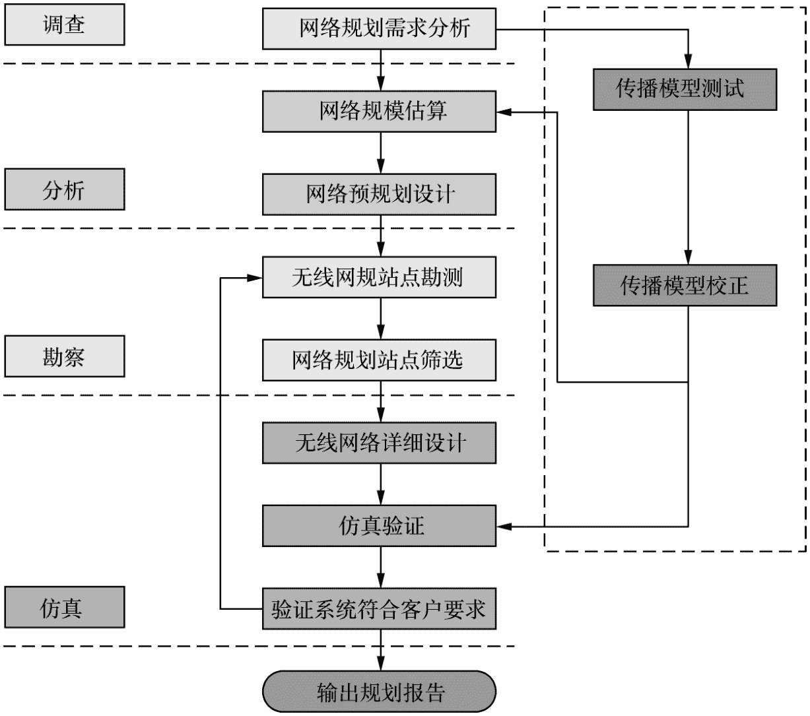

图 3-3 无线网络规划过程

把筹划做扎实，故障概率会明显下降，可靠性与运行效率同步提升，企业和运营商在竞争环境里更具韧性。筹划能提前识别潜在风险，保持网络持续稳定。以选址举例，定位精准可保证覆盖连续，减少盲区；干扰管控合理则能提升传输效率，降低信号干扰带来的损耗。

容错收益很直接。合理布局设备和资源后，关键设备失效时可快速切换到备份单元，服务不中断。典型的冗余做法是配置多套路由器与交换机，主用单元故障时备用单元即刻接管，避免链路中断。

负载均衡效能也会增强。当网络出现热点或局部拥塞时，前期筹划配合设备配置可把流量分散，避免个别节点过载。借助负载均衡装置和优化的路由策略，资源分配能动态调整，保障整体运行效率。

安全性同样属于筹划范畴。筹划时会部署防火墙、入侵检测与安全监控，形成防护体系。配合流量监测机制，异常行为可被及时发现并阻断，确保网络安全运行。

**3.2.2 基站定位与天线调优**

传统做法更多聚焦覆盖、容量、拓扑与路由，对网络价值、业务演进预测等维度涉猎不足，且对仿真建模等专业工具依赖度高。生成式大模型可以提供一体化综合方案，规划人员只需输入简要意图，多轮对话即可完成多样化需求的筹划，还能输出工具代码或脚本，大幅提高效率。基站定位和天线调优就是典型的应用场景。

未来几年无线接入终端数量预计指数式增长，运营商必须扩建基础设施以满足容量。过去新建基站定位主要靠无线规范专家手工完成，借助覆盖仿真工具按照关键性能指标对每个候选点打分，再按预算挑选排名靠前位置。当候选点规模庞大时，人工方法成本高昂且难以兼顾各影响因素。基于人工智能的推荐方案可以为新蜂窝基站指明更优位置，帮助降低筹划成本。

针对最优站点选择问题，Siddhartha Shakya 等人 ^(⁵⁹) 提出了基于人工智能的定位方法，如图 3-4 所示。在此基础上，可借助生成式大模型开展站点定位筹划，通过采集历史时空特征数据，分析无线资源使用率的演变规律，监测与评估覆盖小区的 KPI。模型综合分析覆盖状况、用户分布和场景特征，通过无监督机器学习依据小区属性进行同质聚类。监督回归模型捕捉不同小区属性间的关系，如小区性能、用户吞吐量等。在回归模型基础上构建仿真算法，估算拟新建站点的潜在流量负载。最后基于计分排名机制对站点排序，排名靠前的站点进入候选基站名单。

除了定位，天线设计也是基站筹划阶段的关键环节。移动通信网工程设计中，进行基站天线设计前，需要综合覆盖要求、话务量分布、抗干扰要求和网络服务质量等实际情况合理选择基站天线。首先天线类型的挑选是基站天线设计的关键一步。而在实际的天线优化和设计过程中，通常涉及的天线参数较多，天线几何形状越来越复杂，天线性能要求之间的矛盾也频繁出现，给天线选型和设计带来诸多挑战。

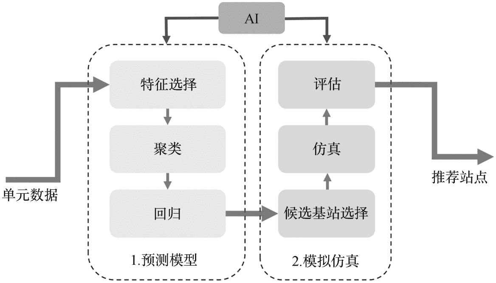

图 3-4 基于 AI 的选址方法

把生成式大模型引入天线仿真设计，可以替代电磁仿真软件的角色，模拟应用场景对天线参数进行微调，结合粒子群智能优化算法 ^(⁶⁰) 进行天线的快速仿真和优化设计，相比电磁仿真软件，可以进一步提升计算效率。模型还可以学习天线的主要特征，并在设计天线时根据所学知识，设计不同频率的天线模型。如图 3-5 所示，将人类工程师设计的天线模型与 AI 设计的天线模型对比，可以看出人类工程师设计的模型是有规则的，参数数量有限。而 AI 设计的模型是不规则的，参数更多，自由度更高，更像自然形成的形状 ^(⁶¹)。

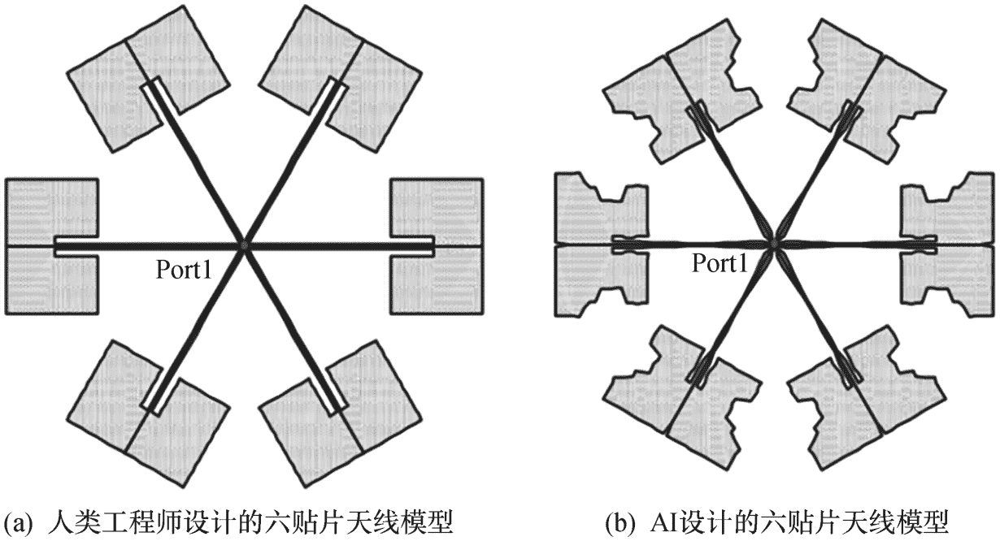

图 3-5 人类工程师与 AI 设计的天线模型对比

**3.2.3 基于意图的网络设计**

如图 3-6 所示，大语言模型与基于意图的网络 Intent-Based Networking，IBN 的理念高度契合，其核心是：网络高度自治智能，可自规划、自部署、自优化、自演进。通信新技术与现代人工智能的结合推动网络智能化技术发展，加速自动化、智能化特征的自智网络建设。模型凭借理解和生成能力，可作为通信认知增强工具，覆盖网络建设、维护、优化等关键领域，为网络智能自治提供支撑。其核心功能是实时分析，利用大模型的意图理解、外部能力调用和信息生成能力，提供智能数据处理和洞察。通过 API 调用保障数据隐私，用户可用自然语言查询，提高数据的发现和获取效率。

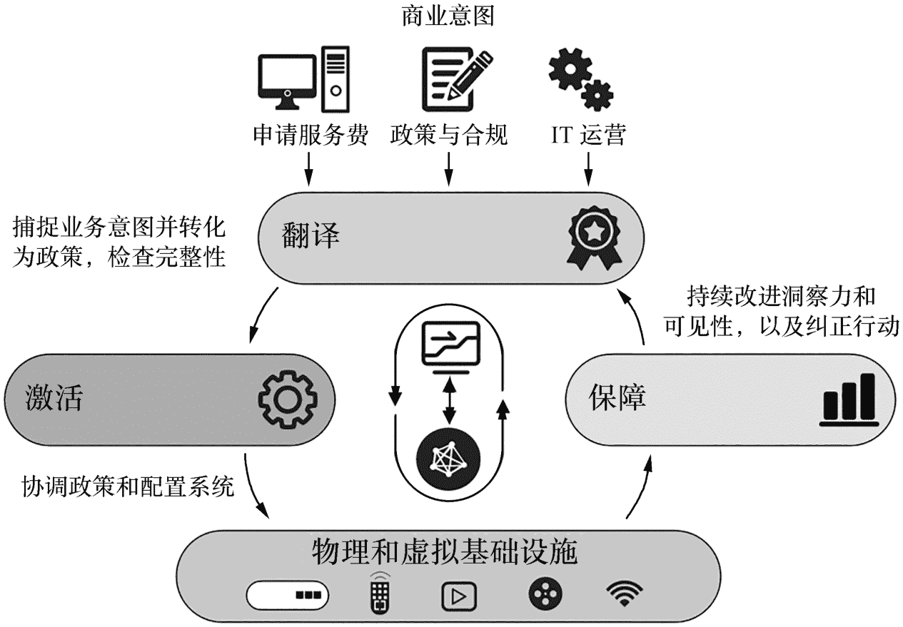

图 3-6 基于意图的网络构成

在网络筹划中，基于意图的网络可根据业务意图配置网络基础架构，无需人工干预，不断提供关键网络见解，并持续调整硬件配置以确保意图达成，把网络从以设备为中心转变为以业务为中心的模型，实现更高效的规划。意图转译是核心任务，实现用户意图到网络策略的转变。用户意图表达形式多样，最普遍的是自然语言，还有语音输入或图形化用户界面 GUI 输入等。

大模型对输入内容理解和处理能力强，能识别解析用户输入的各种形式，帮助专业筹划人员更准确高效地分析用户意图，并在一定程度上提升用户输入意图的抽象层级。筹划人员仅需输入简单的筹划意图并通过多轮交互即可实现不同要求的网络规划。在此过程中，模型通过深度学习，不论文本、语音还是 GUI 输入，人员只需输入简单的筹划意图，通过多轮交互即可实现不同要求的网络规划。同时大模型也可给出专业规划工具的代码、脚本等，大幅提升工作效率。

如图 3-7 所示，用户以各种形式输入意图，然后由模型辅助把各种形式的意图统一为标准形式，例如把语音输入、GUI 输入等都统一为自然语言形式。模型作为意图引擎，负责用户意图的解析与转译，然后根据当前网络状态信息对网络策略进行验证并优化，进而下发到实际网络规划部署中。

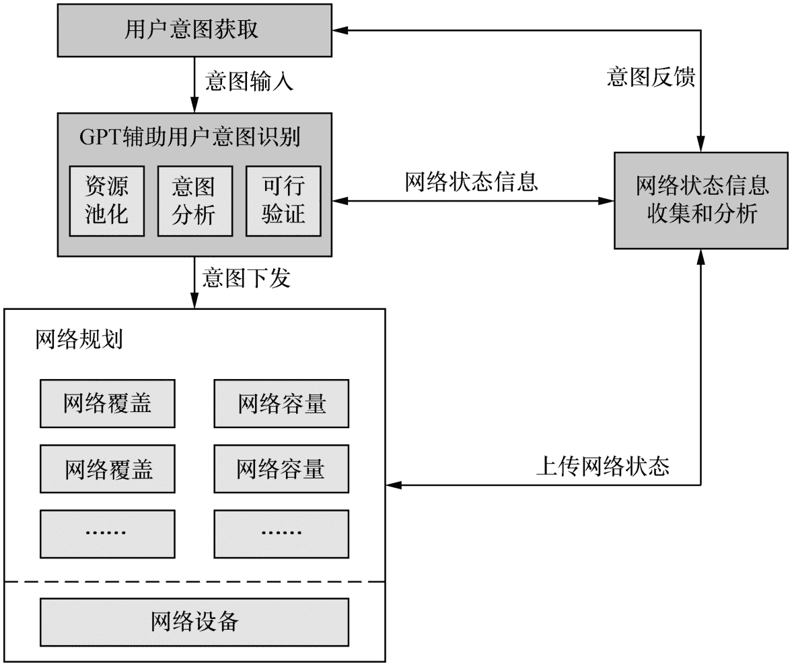

图 3-7 GPT 作为意图引擎实现网络规划

网络筹划不仅是技术问题，更是战略问题。需要考虑业务需求、技术发展趋势、市场竞争状况等多方面因素。好的网络筹划要综合考量并科学分析决策。运营商在筹划时需关注未来业务发展趋势，预见可能的技术变革和市场变化，提前做好应对准备。网络筹划也是持续改进的过程。随着业务需求变化和技术进步，筹划需要不断调整优化。随着物联网设备增多，需要考虑更多设备连接和数据处理需求，网络架构也要随之调整，以适应更高的数据传输速率和更大数据流量的需求。

总之，合理的网络筹划对提升网络可靠性和效率、降低网络投资风险、提升业务质量至关重要。在互联网和新技术不断发展的今天，网络筹划的重要性愈加突出。通过科学的网络筹划，企业和运营商可在快速变化的环境中保持竞争力，实现业务持续发展。

**3.3 大模型增强切片部署**

随着 5G 和云时代多样化新业务涌现，不同行业、业务或用户对网络提出各种服务质量要求。例如移动通信、智能家居、环境监测、智能农业和智能抄表等业务需要网络支持海量设备连接和数据传输；网络直播、视频回传和移动医疗等业务对传输速率要求更高；车联网、智能电网和工业控制等业务则要求毫秒级时延和超过 99.999% 的高可靠性。

因此 5G 网络应具备海量接入、确定性时延、极高可靠性等能力，需要构建灵活、动态的网络以满足用户和垂直行业多样化业务需求。面对以上需求，网络切片技术应运而生。

**3.3.1 网络切片技术**

网络切片是基于逻辑的概念，是对资源进行重组，即根据 SLA 为特定通信服务类型选定所需虚拟机和物理资源。通过网络切片，运营商能够根据业务需求提供高度灵活的网络服务，满足不同客户对网络能力的差异化要求。

网络切片是一种按需组网方式，可让运营商根据不同业务应用，通过对时延、带宽、安全性和可靠性等要求，在统一基础设施上分离出多个虚拟端到端网络。每个网络切片从无线接入网到承载网再到核心网进行逻辑隔离，以服务于特定业务类型或行业用户。由于各切片相互隔离，某一个切片出现错误或故障时不会影响其他切片，每个网络切片可灵活定义自己的逻辑拓扑、服务级别协议 SLA 需求、可靠性和安全等级。网络切片是 5G 网络计算策略、移动边缘计算、移动云计算及物联网、车联网和工业物联网等垂直领域中广泛使用的关键技术之一，允许对稀缺和有争议的资源进行优化和定制，满足不同业务、行业或用户的差异化需求。

目前 5G 主流的三大应用场景：eMBB、uRLLC、mMTC 就是根据网络对用户数、服务质量 QoS、带宽的不同要求，定义的 3 个通信服务类型，分别对应 3 个切片。5G 网络切片的示例如图 3-8 所示。

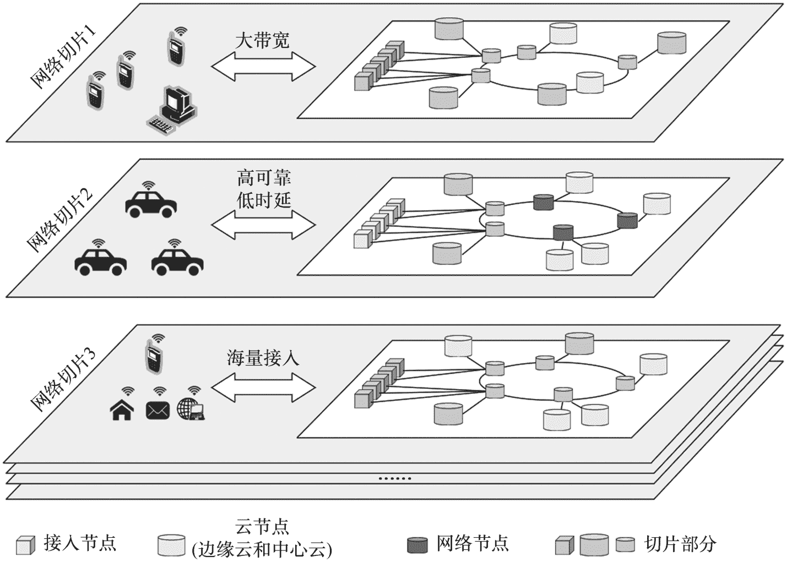

图 3-8 5G 网络切片的示例

在一个网络切片中，至少可分为无线网子切片、承载网子切片和核心网子切片 3 部分。5G 端到端网络切片包括无线接入网络切片、移动核心网络切片和 IP 承载网络切片。其中，无线接入网和移动核心网的网络切片架构和技术规范由 3GPP 定义，而 IP 承载网络切片的架构和技术规范主要由 IETF、BBF、IEEE 和 ITU-T 等标准组织定义。

在 5G 端到端网络切片中，IP 承载网络切片的主要功能是为无线接入网与核心网的网络切片中的网元和服务之间提供定制化网络拓扑连接，以及为不同网络切片的业务提供差异化服务质量 SLA 保证。IP 承载网络切片的架构整体上可划分为 3 个层次：网络切片转发层、网络切片控制层和网络切片管理层，如图 3-9 所示。此外，为实现与无线接入网和核心网切片的端到端网络切片协同管理，以及将网络切片作为新业务提供给垂直行业租户，承载网还需要对外提供开放的网络切片管理接口，用于网络切片的生命周期管理。

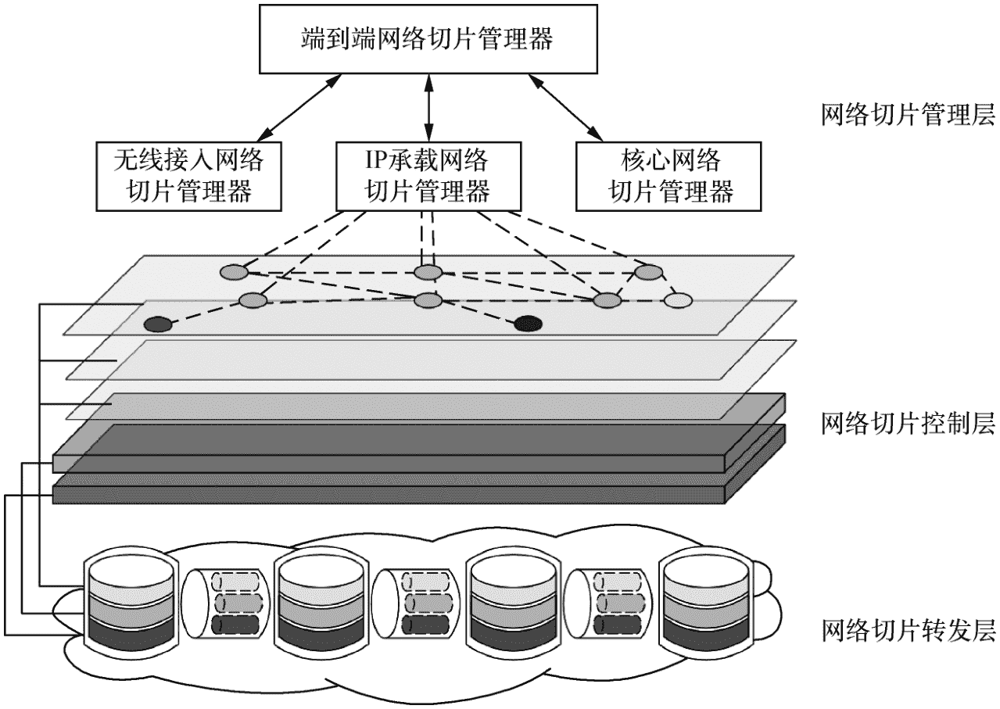

图 3-9 IP 承载网络切片架构

当然，网络切片并不仅限于当前 5G 的三大应用场景，运营商可根据不同应用场景，将物理网络切分成多个虚拟网络，满足各种特定需求。未来网络切片技术将在众多领域发挥更广泛深入的作用，应用场景范围将不断扩大。从虚拟现实 VR 和增强现实 AR，到自动驾驶、智能交通及无人机，再到物流仓储和工业自动化，作为信息化的基础设置，网络切片都将提供适配不同领域需求的网络连接特性，推动各行业能力提升及转型。

VR 和 XR 将受益于特定优化的网络切片，提供低时延和高带宽网络连接，确保用户在虚拟世界获得身临其境体验。自动驾驶和智能交通系统也将依赖高可靠、低时延的网络切片，保证车辆与基础设施实时通信，提高交通安全和效率。无人机技术快速发展也离不开网络切片支持。通过网络切片，无人机被广泛应用于物流配送、应急救援、环境监测等领域，实现高效数据传输和远程控制。在工业领域，网络切片将推动物流仓储和工业自动化发展，提供稳定高效的网络连接，提升生产效率和自动化水平。

此外，自动化将在网络切片中发挥更重要作用，预计未来移动网络运营商将构建和管理数百个甚至数千个网络切片。6G 网络将在不久将来成为现实，并将在各行各业得到应用，智能化网络切片将使服务提供商和重要消费者能最有效地利用网络资源。图 3-10 展示了 5G 和 6G 中的网络切片。

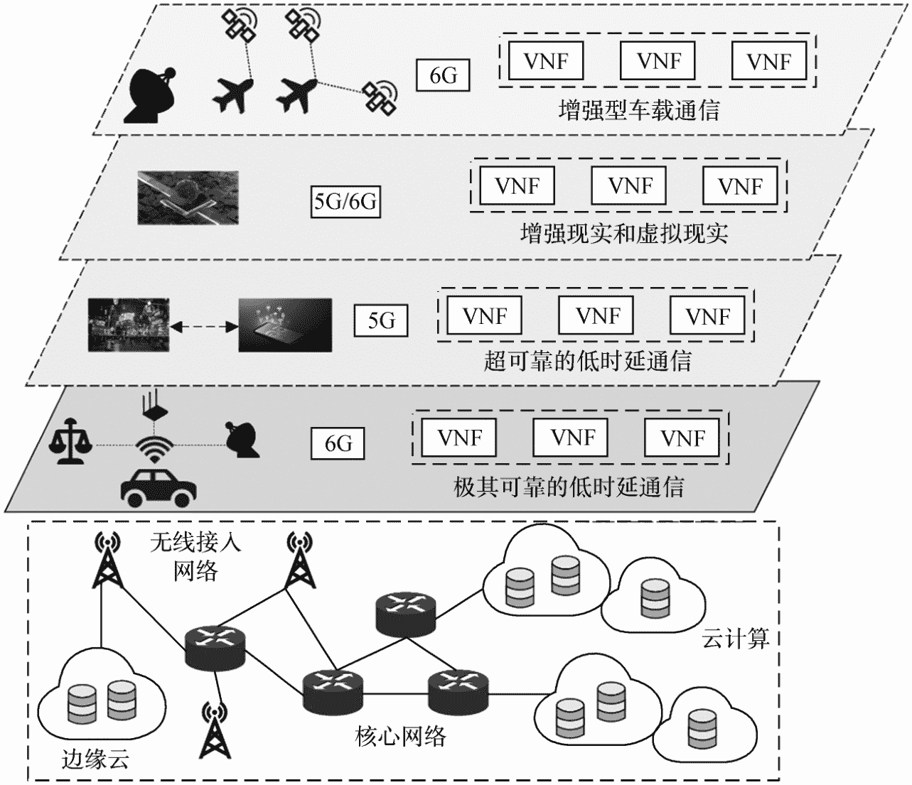

图 3-10 5G 和 6G 中的网络切片

6G 网络架构将开辟新的收入来源，并允许各种不同需求的不同企业共享网络和频谱资源。同时基于不断发展的开放无线接入网络 Open Radio Access Network，ORAN 范式，6G 网络能够提供无与伦比的开放性、定制化、自动化和软件化 ^(⁶²)。Ramraj Dangi 等人还为当前切片方法的分析提供了一个更好、更高效的基于人工智能的网络切片框架，并预计该框架将用于下一个 6G 通信网络，使智能 6G 网络建设变得更加简单 ^(⁶³)。

**3.3.2 未来网络智能切片**

网络切片的引入成功解决了不同业务场景网络资源分配不均问题，给网络带来极大灵活性，使网络可按需定制、实时部署并得到动态保障。网络切片部署中，不同业务场景的切片对底层物理网络资源需求不同，网络切片在部署结构上也存在差异。传统算法无法满足网络多业务场景切片的安全部署问题，而结合 AI 等相关技术，可在满足端到端网络切片安全部署的同时，降低部署成本。

6G 将结合多种技术和服务，提供不同网络功能。为了有效利用这些独特服务，网络的虚拟化切片将是一种很有前景的方法。例如，参考文献 ^(⁶⁴) 中提出了一种基于网络切片概念的虚拟化 6G 网络架构，如图 3-11 所示。该架构由 3 层组成，分别是智能云切片层、RAN 切片层和应用程序切片层。该架构完全基于网络切片，为网络提供灵活性，且能够提高系统效率，并有助于提供大量应用程序和有效利用网络功能所需服务。

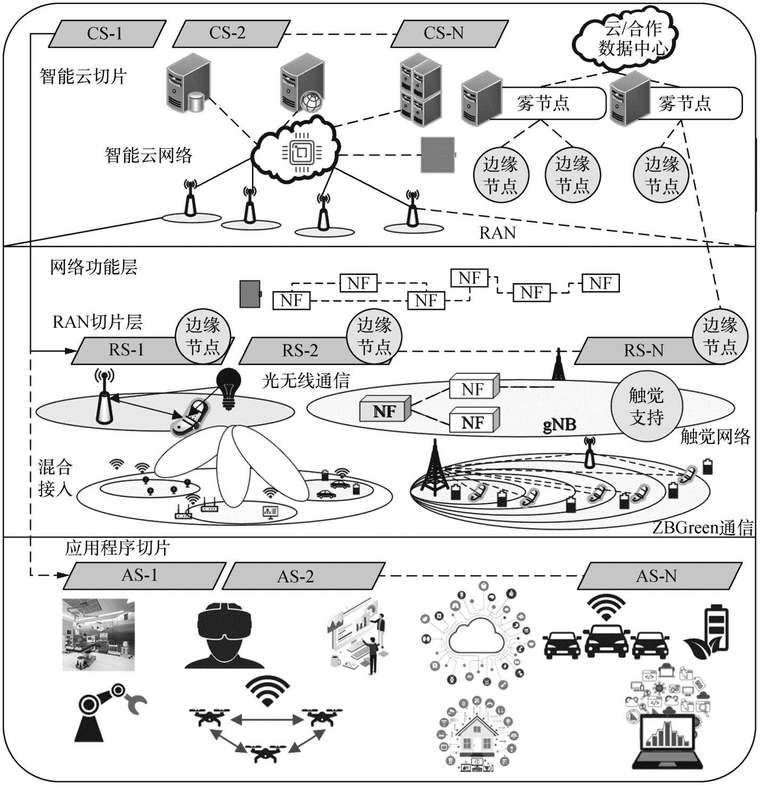

图 3-11 基于虚拟化网络切片的 6G 网络架构 ^(⁶⁵)

网络切片使用网络功能虚拟化 Network Functions Virtualization，NFV 和软件定义网络 Software Defined Network，SDN 的概念来提供虚拟化和灵活性 ^(⁶⁶)。NFV 包括将虚拟链式网络功能组成一个基础设施，一般称为 NFV 基础设施 Network Functions Virtualization Infrastructure，NFVI。NFVI 由存储块和网管块组成，它包括自动配置、协调和管理网络的管理和编排 Management and Orchestration，MANO。MANO 体系结构主要负责启用服务和实现 NFVI。而 SDN 建立在将网络基础设施的控制面与转发面分离基础上，将自动化和编程应用于控制面，使整个网络在逻辑上体现为单一网络设备，通过可编程配置实现自动化配置、控制、保护和资源调整，使管理员具有动态调整全网流量的能力。

作为未来网络的基石技术，网络切片能在共享物理基础设施上创建定制化虚拟网络。然而现有编排和管理方法在处理多管理域环境下较为复杂的新服务需求时仍存在局限性。参考文献 ^(⁶⁷) 中提出了一个由 GPT 等 LLM 和多代理系统驱动的新型网络切片架构，并提供了一个可与现有 MANO 框架集成的新框架。该框架利用 GPT 把用户意图转化为技术需求，将网络功能映射到基础设施，并对整个切片生命周期进行管理。

LLM 多 Agent 系统在端到端网络切片管理与编排中的位置如图 3-12 所示。其中包含了从协助用户提出基于高级意图的切片请求，到部署和监控位于接入网、边缘、核心和托管应用程序的云上的不同切片功能。

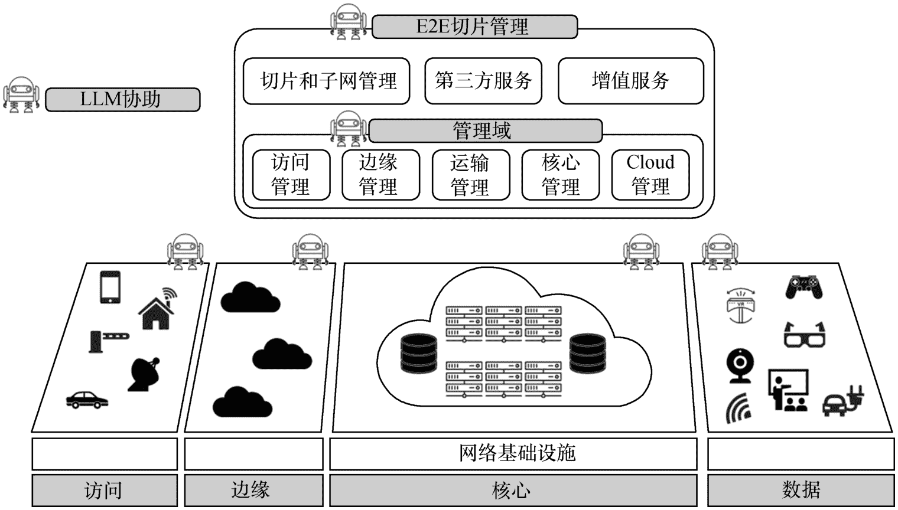

图 3-12 LLM 辅助网络切片管理 ^(⁶⁸)

5G/6G 网络切片面临的主要挑战是 5G 生态系统中的资源共享、切片编排和网络优化。Eranga Bandara 等人提出了一种名为“SliceGPT”的动态网络切片经纪人和市场新架构以应对这些挑战 ^(⁶⁹)，平台分层架构如图 3-13 所示。该架构利用自定义训练的 GPT-3.5 模型、区块链和非同质化代币 Non-Fungible Token，NFT，使云提供商、网络运营商、RAN 提供商和传输网络提供商等 5G 网络中的不同利益相关方能够共享和租用其资源，以创建满足应用特定需求的定制化网络切片。SliceGPT 还可从广泛的网络数据集中产生有价值见解和建议，有助于优化网络切片以提高性能和效率。

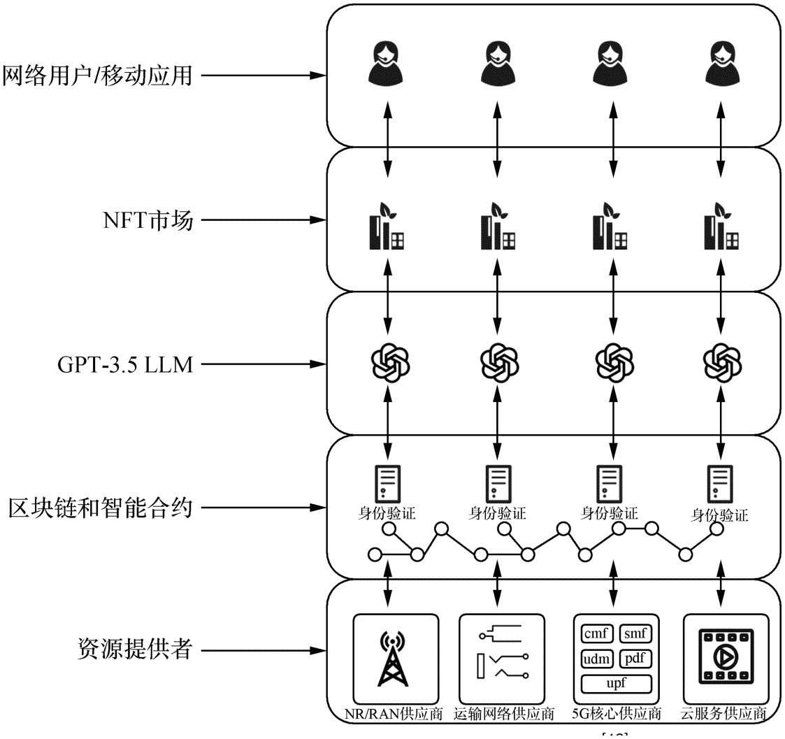

图 3-13 “SliceGPT” 平台分层架构 ^(⁷⁰)

网络切片的部署还涉及虚拟网络功能 Virtual Network Function，VNF 的放置和相关链路选择。VNF 的放置是指在满足网络容量的条件下，网络切片请求中的节点总能在物理网络上找到相对应节点来承载请求。相比于传统启发式算法与精确式算法求解 VNF 映射过程，GPT 可对网络环境状况进行分析，根据业务场景需求智能调整网络参数，并做出业务资源需求预测，通过 Agent 和环境的相互作用，执行特定动作，更新网络资源利用情况，充分感知 VNF 映射过程中的状态信息。

参见图3-14，生成式模型先探查网络部署环境，把物理节点的相关属性转成安全特征矩阵存档。策略代理被设定为可输出节点安置概率的网络，其决策内核由生成式预训练系统提供。代理读入特征矩阵算出各节点被选中的概率，随后以概率最高的节点执行此次虚拟网络功能部署。部署完毕后，系统会依据业务诉求挑选链路调度算法，并以资源占用水平作为回馈信号传给代理，同时刷新环境状态。

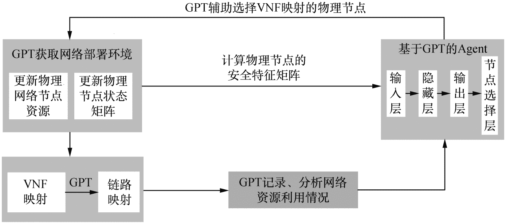

图3-14 生成式模型驱动的 VNF 安置优化

**3.4 用生成式模型让运维更省心**

数字化变革已成行业共识。SDN 时代和云计算时代到来，伴随海量数据和机器学习等技术的推进，越来越多业务迁移到云端。算力存储池化后，网络架构日趋复杂，运维压力随之加大，对业务的洞察不足、定位故障慢、恢复耗时长等问题突出。

Gartner 提出的 AIOps 核心在于用人工智能自动完成并简化运维流程。网络智能运维可按场景拆分为数据中心和运营商两类，数据中心方案的逻辑架构见图3-15，由上至下包含网络层、控制层和分析层 ^(⁷¹)。

典型场景有异常探测、根因追踪、事件预警和智能决策。过去多依赖人工巡检和数据研判，效率不高。引入生成式技术后，能实时高效感知网络运行，实现自动化研判处置，进而显著提升网络稳定性和可靠性 ^(⁷²)。

图3-15 数据中心智能运维逻辑架构

**3.4.1 异常检测**

异常检测也被称为异常发现或异常诊断，核心在于判断设备、系统、网络等关键性能指标的历史数据是否偏离正常轨迹。异常不等于故障，运维更关注 KPI 时序上不合规律的点位。传统方式是运维人员依据单一指标或多指标组合设定阈值，超出范围即判为异常。这种方法在稳定可预期的环境中尚可，但在复杂多变的场景下易失效，需要模型学习更长时间的历史规律来做判断和预测。

智能异常检测的基石是状态感知，能够持续自动收集各类网络状态信息并进行智能分析，发现异常即刻判定并上报 ^(⁷³)。具体流程如图3-16。

首先按感知任务类型创建不同的状态探测器，按需启动性能、告警、日志、配置等任务，并把指标订阅推送到采集平台。随后启动分析器，利用生成式技术快速完成异常研判和探测。常用手段有动态阈值、单维研判、多维关联和时序预测。在复杂网络中落地效果好，能明显提升故障发现和处理效率。

以承载网的同缆异常排查为例。在承载网中，同缆现象是影响可靠性的隐患之一。光纤属于哑资源，管理手段有限，常规方式难以主动发现，纯人工排查费时费力难以满足快速响应。利用生成式算法扫描光纤相关历史数据，通过数据、位置、故障特征的比对关联，并结合指标相似性挖掘出疑似同缆点，再由专业人员复核，可及时发现隐患并优化处置，显著提升排查准确率和效率。

单维研判中，生成式系统可对单一维度数据展开深度挖掘，如在某时段的网络流量中识别异常波动，帮助管理员快速定位原因。多维关联则综合多维数据识别指标间的联系。时序预测利用生成式系统对网络数据进行时间序列建模，提前预判未来可能出现的异常。

图3-16 网络异常检测流程示意

**3.4.2 故障诊断**

故障诊断是在异常被确认后，对导致故障的根本原因进行溯源，并给出可行的解决办法。生成式技术能够挖掘不同因素间的强相关关系，推断出关键根因，帮助用户更快定位问题、提升修复效率并预防复发。

基于知识图谱的推理引擎可以对采集的网络数据进行分析，实现快速根因定位。知识图谱是包含实体及其关系的语义网络，具备推理与表达能力。对于未知故障，生成式模型也能依托过往历史数据进行推理，协助运维人员探索根因。

借助生成式系统的特征挖掘和海量数据分析，运维平台能利用告警、性能、配置、操作日志、业务状态、故障历史等多维度数据，自动学习人工难以总结的潜在规律，构建故障与特征的匹配规则库。平台可依据故障特征自动匹配规则进行研判，给出判断和处置建议，并结合工单系统实现高效派发，提升整体运维效率。

智能化故障诊断流程如图3-17。系统先收集整合多维度历史数据，包括告警、配置、KPI、业务状态、操作日志及运维结果，预处理后送入训练模块。训练阶段使用生成式系统进行特征挖掘与建模，涵盖特征提取、降维、分类、关联与深度学习，最终生成规则库。应用时，实时数据经现网监控模块分析后与规则库匹配完成诊断，推理结果驱动处置建议并通过工单系统派发，全流程反馈持续优化规则库与模型，提升准确性和效率。

长期来看，可用生成式系统构建智能诊断平台，对网络故障自动排查并给出解决方案。面对复杂故障，系统凭借强大的学习与推理能力理解运维人员的意图与提问，提供参考建议，实现持续学习与知识更新，更好应对复杂网络，同时节省大量人力时间。

此外，诊断结果的准确性评估需要关注数据质量与多样性、模型训练优化与用户反馈。训练数据应覆盖各类故障案例与解决方案，且质量可靠，避免错误信息干扰。模型训练消耗资源大，需在充分学习规律的同时提升响应速度。结合用户反馈做定量评估，有助于持续改进准确性与体验。

图3-17 智能故障诊断流程

总体而言，海量数据分析与生成式模型结合能够实现网络故障的精准探测与高效处置，为现代网络稳定运行提供强力支撑。经过持续反馈优化，智能诊断系统可适应网络变化，确保运维高效可靠。

**3.4.3 事件预警**

事件预警是基于 KPI、告警、日志与感知等历史数据，运维系统自动预测未来特定事件的发生并提前提醒。例如根据视频网站的历史播放数据，生成式模型可预测次日可能卡顿的页面，提前调度流量保障体验。

传统预警多采用固定阈值并依赖人工配置，工作量大且受经验限制，阈值不当易导致误报或漏报。生成式模型相关技术可显著提升预警的自动化、智能化与准确性。

一方面，模型通过学习海量历史数据自动确定合理阈值范围，并随运行状态变化动态调整，摆脱纯人工经验。另一方面，可进行多维度关联分析，综合多种因素影响网络状态，如判断性能时不仅看单一指标波动，还结合相关指标趋势，提供更精准的预警信号，有效降低误报漏报。最后，时序预测分析可对网络状态数据建模，提前识别潜在问题，提升可靠性。

实际预警流程如图3-18。首先通过采集工具收集性能指标、告警信息、日志等多维运行数据，经预处理去除噪声后形成高质量输入。其次用生成式模型提取特征、识别关键点并迭代训练构建预警模型。系统对实时数据监控并输入模型，异常时自动触发告警并通知运维。随后对预警信号做多维度关联分析与时序预测，输出工单并给出详细预警信息与处置建议，实现预警的智能化、自动化与精准化，大幅提升运维效率与效果。

图3-18 事件预警流程示意

预警过程还涉及智能监控。生成式智能监督预警平台利用生成式技术收集整理海量数据，快速识别潜在风险并及时告警，辅助决策。通过历史数据模型的异常探测结合生成式技术，可实时准确发现监控数据中的异常，为后续分析提供依据，缩短排查时间、提升效率并降低风险。

随着技术演进，平台将融合更多人工智能与海量数据能力，为网络运维提供更全面方案。持续优化预警模型与算法，可更好适应变化，提升探测与处置效率，实现网络事件精准预警与高效管理，降低运维负担，提高服务质量与用户满意度。

**3.4.4 智能决策**

智能决策是在异常探测、故障溯源与事件预警之后，基于分析结果给出可恢复异常与故障的合理处置方案。自适应配置、智能调度与智能重启都是故障自愈过程中的典型手段。

生成式模型可分析历史数据与实时性能指标，利用生成能力产出运维系统可自动执行的诊断与修复流程，包括运行脚本重启服务、重新配置网络或回滚到稳定版本。

实现离不开专家知识库与智能推荐系统。通过海量数据与知识图谱沉淀大量人工处置经验与自愈案例，生成式模型的智能推荐算法可将知识泛化到更广运维场景，减少人工介入，实现从异常探测、故障溯源到智能决策，再到自动评估处理效果的全流程自动化与无人运维。图3-19展示了生成式模型简化网络运维的流程。

网络采集器把 CPU、内存、网络拥塞、事件日志等实时信息发送给生成式模型，模型快速统计分析识别当前运行状况，结合业务场景进行预测并给出运维决策，如调整配置、分配带宽、优化路由等。决策结果存入数据库便于追溯，模型还可辅助可视化呈现当前与预测状态，将复杂数据转为直观图表，帮助运维人员更高效决策，及时恢复故障，提升运维效率与可靠性。

图3-19 生成式模型简化运维流程

参考文献 ^(⁷⁴) 中提出意图驱动的通信网络专用机器学习模型与高级策略，实现“故障定位—策略生成—策略验证”的闭环。与传统人工辅助方法不同，该方法利用时空表征学习进行知识推理与状态探测，自动生成并验证故障恢复与多任务管理策略，通过绕行路由、资源编排等保障业务带宽与性能，并可自主修复故障，推动意图驱动的自主网络闭环。

总体上，智能决策系统提升了故障处理效率与准确性，实现了全流程自动化运维，推动网络运维向无人化迈进，保障网络稳定。智能化运维可缩短响应时间、降低成本，提升可用性与稳定性。

不过落地仍有挑战：数据质量与完整性直接影响 AI 大模型效果；系统透明度与可解释性在关键业务中尤为重要；技术集成与人员培训也制约推广。

未来，随着 AI 进步与运维需求增长，智能化运维将成为网络管理的标配，企业会更重视数据驱动决策与生成式模型在降本增效中的作用。伴随边缘计算与物联网发展，智能运维将覆盖更多设备与场景。

**3.5 生成式技术加速网络优化**

智慧医疗、智能家居、车联网等新兴应用普及，网络结构更复杂，性能要求更高。在云端计算快速发展的背景下，网络优化成为满足多样化需求的关键。传统手段已难以为继，以生成式模型为代表的 AI 大模型参与的智能化、自动化优化方案受到关注。生成式模型凭借强大的数据处理与分析能力，可快速分析海量网络数据，定位性能瓶颈并生成优化策略，显著提升效率与稳定性，同时通过持续学习减少人工干预，降低成本并改善体验。

网络工程师可用生成式模型改善性能、优化结构、解决故障。运营商也可利用通信网络巨量数据训练通信生成式模型，实现智能分析、实时预测、代码生成与漏洞扫描，提升安全水平。目前基于生成式模型的网络优化可通过自主探测、分析和操作实现自我校正，主要包括网络流量优化、无线网络覆盖优化、网络信令追踪三个方向。

**3.5.1 网络流量优化**

互联网数据均通过网络流量传输，精确建模流量有助于提升服务质量与数据隐私。随用户需求变化，流量呈现动态特征。针对网络流量的预训练模型可利用大规模原始数据学习流量本质特征，为输入流量生成可区分表征，无需针对下游任务单独设计。有效预训练模型可显著提升应用分类、攻击探测、流量生成等下游任务的效率与效果 ^(⁷⁵)。

近年来，网络连接用户规模持续扩大，移动互联网接入流量快速增长。工信部2023年通信业统计公报显示，2023年移动互联网接入流量达3 015亿GB，同比增长15.2%，如图3-20所示。截至2023年底，移动互联网用户达15.17亿户，全年净增6 316万户，体现了数字化服务的普及与需求增长。

网络流量记录并反映网络及用户活动，可关联几乎所有网络行为。对网络威胁而言，流量特征是入侵与攻击发生时的关键表征；无论攻击是否成功，其载体都是网络流量。深入研究异常行为与攻击的数据特征并应用于流量深度探测，可突破现有瓶颈，提升对未知威胁的识别与上报能力。

按流程，生成式流量智能分析系统需先把采集数据处理入库，再从数据库提取分析数据，使用智能分析模块处理，最终提供异常行为监测、威胁监测与数据共享配置管理。通过分析网络拓扑与设备配置要求，生成式模型还可生成符合最佳实践的配置模板并自动下发，提升一致性与准确性。对海量流量数据经生成式模型分析后，可自动感知明文流量中的异常行为与异常流量并及时告警，实现非法协议、网络攻击行为的识别，提升应对异常的效率。

图3-20 2018至2023年移动互联网接入流量趋势

在运营侧，生成式大模型对海量运行数据具备很强的洞察力。它能把移动承载网产生的日志、指标拆解，快速定位拥塞点、性能短板和故障征兆，并描绘这些问题的发展轨迹，为现场工程师给出可执行的改进建议。把历史积累与实时采集结合起来训练后，模型对流量行为的理解更透彻，进而对带宽分配和路由策略进行精细化调优，帮助运营商实现资源弹性供给，提升用户体验和服务质量。对易拥塞的区域与时段可提前进行预测性调度，对负载偏低的区域与时段可智能休眠部分站点，既节约成本又能让网络长期保持最佳工作状态。

**3.5.2 无线网络覆盖优化**

随着移动通信持续演进，6G 对覆盖范围、承载能力、时延等提出更高要求，需要实现全球连续覆盖、支撑高速数据传输，并进一步压缩用户面与控制面时延。6G 愿景下的覆盖要实现跨地域、跨空域、跨海域的空天地海一体化，形成真正意义上的全球连续覆盖。可以说覆盖始终是无线网络必须攻克的核心难题，无论是建设初期还是成熟期都需重点关注。

无线覆盖受天馈参数、系统配置、电磁干扰、地形地貌、气象环境等众多因素影响。如图 3-21 所示，当前网络普遍采用扇区化天线，站址、天线挂高、天线增益等一般在建设初期已确定，后期可调的覆盖要素主要集中在水平指向角、俯仰角和发射功率上。

图 3-21 无线网络覆盖

覆盖水平直接决定通信质量。统计显示 LTE 各厂商的无线参数总量已超过 8 000 个，仅靠人工经验难以实现精细化校准。有研究提出利用人工智能对通信网络做系统性分析，实现参数精准配置，并在此基础上引入生成式预训练技术。该技术可协助移动网络的资源管理，覆盖频谱资源、天线配置和能量分配等。在覆盖优化里，它能依据实时环境和网络状况提升资源使用效率，扩大容量与覆盖范围，从而降低优化复杂度，提高效率与准确度。

例如面对 Top*N* 小区覆盖问题，可利用该技术训练图神经网络模型，构建区域覆盖模型并输入影响覆盖的特征信息，如基站结构、参数配置等数据 ^(⁷⁷)。经隐含层训练学习特征后，在迭代收敛阶段可通过高层表征给出覆盖预测、参数取值建议并指导无线参数的调整与配置。另外，它还能帮助运营商把站点大规模多输入多输出天线的波束覆盖和传输形态纳入考量，解决目标用户因室内外、地面高度差异带来的信号覆盖不一致问题，充分利用 mMIMO 天线的三维特性和周边环境特征，提升站点规划准确性，更好地实现无线网络覆盖优化。

覆盖优化不止于参数调整，还要应对复杂环境和用户需求的动态变化。该模型能通过学习历史数据并实时监测网络状态，识别流量规律和趋势，预测未来需求。这种预测能力让运营商能提前调整资源分配，避免拥塞和性能下降。例如在高峰来临前，可建议提前扩容带宽或优化路由，确保高流量时段用户仍能获得流畅体验。

通过实时监测网络状态，可动态调整网络配置，及时响应突发状况，降低用户受影响程度。例如针对不同业务需求优化数据传输路径和带宽分配，提升整体效率。对视频传输等高带宽业务，可建议采用更高效的压缩算法和优先级策略，减少延迟和卡顿。对物联网设备的海量连接需求，可优化连接管理与资源调度，提升连接稳定性和响应速度。对远程医疗和自动驾驶等对超低时延和高可靠有刚需的场景，可帮助优化网络传输协议和数据优先级分配，保障实时性和安全性。

**3.5.3 网络信令追踪**

信令信息即通信系统中的控制指令，主要用于处理和控制通信过程。信令消息在移动网络中承担关键角色，不仅承载用户数据，还负责呼叫建立、维护、拆除及各类服务管理等控制信息的传递。如图 3-22 所示，信令数据通常呈现体量大、不固定、波动明显等特点 ^(⁷⁸)。

有效的信令追踪可帮助运营商优化网络性能、监控运行状态、迅速定位问题，从而提升整体通信系统的效率与稳定性。通过实时采集网络信令数据并进行处理，可识别和预测网络中可能出现的异常与瓶颈，对通信过程实施监控和管理，持续优化通信质量和效率。信令追踪涉及网络优化、性能监控和问题定位等多个方面，是电信设备管理和故障排查的关键技术。

图 3-22 信令数据特点

参考文献 ^(⁷⁹) 中提出了人工智能信令追踪思路，在此基础上引入生成式预训练技术。该技术凭借强大的数据处理与分析能力，可监测分析海量信令信息，发现潜在故障或异常，掌握网络真实运行状况。同时，通过比对正常与异常信令流程，可快速定位故障位置并生成诊断报告，实现故障的自动修复，缩短网络中断时间，降低运维成本。

此外，基于实时信令信息和用户需求，生成式预训练驱动的信令追踪可预测网络流量需求，动态管理、分配和调度资源，以适应时间、区域和用户类型的变化。同时可分析监测用户连接过程中的信令信息和延迟情况，及时发现并解决影响体验的问题，如延迟高、信号弱等，提升用户满意度，保障网络稳定高效。基于 GPT 的网络信令追踪过程如图 3-23 所示。

图 3-23 基于 GPT 的网络信令追踪过程

**3.6 本章小结**

生成式预训练模型在推动通信网络智能自治方面作用显著，并在网络规划、切片部署、网络运维和网络优化等领域初步落地。在网络规划中，其不仅能输出专业规划工具的代码、脚本，还能识别解析用户以多种形式输入的信息，帮助规划人员更准确高效地理解用户意图并给出规划方案，大幅提升工作效率。在切片部署中，可辅助网络切片管理，并根据不同业务需求选择最合适的算法进行链路映射，优化 NFV 流程。在网络运维中，在异常检测、故障诊断、事件预警、智能决策等典型场景均发挥重要作用，有效提升网络稳定性和可靠性。最后在网络优化中，通过自主检测、分析和操作实现网络的自我校正，显著提升效率与稳定性，同时带来更好的用户体验。

未来，在网络安全防御方面仍有广阔空间，主要体现在辅助识别和管理防御网络威胁。可用于分析网络安全事件的描述，帮助理解攻击模式和动机；可模拟攻击者行为，生成仿真攻击以测试防御能力；还能协助开发更精准的入侵检测系统，通过持续学习适应新威胁模式来提升防御能力。在网络安全性层面，智能化防御机制能够快速识别并响应新威胁，保护网络免受攻击。

# 第四章 未来网络对 GPT 应用的支撑和优化

过去 20 年，通信网络完成了“人联”“物联”的发展，面向 2030 年及未来，人类社会将步入智能化新时代。社会服务将更均衡高效，社会治理将更科学精准，社会发展将更绿色节能。未来网络技术是实现这些目标的重要支撑，它将从服务人和物发展到服务智能体，并实现与生成式预训练模型的紧密联接。未来网络技术将进一步支撑生成式预训练模型应用，通过人、机、物的智能互联服务智慧化生产生活，满足经济社会高质量发展，推动构建普惠智能的人类社会。

本章在了解生成式预训练模型赋能通信网络，以及通信网络保障生成式预训练模型应用落地的机理上，继续研究未来网络对生成式预训练模型应用的支撑与优化，包括未来网络设计的典型思路，以及未来网络如何支持生成式预训练能力下沉。

未来，网络将通过人机物智能互联和协同共生，满足经济社会高质量发展，服务智慧化生产生活，推动构建普惠智能的人类社会。被人工智能赋能的未来网络如同一个巨大的分布式神经网络，集成了通信、感知、计算等多种能力，能够深度融合物理世界、生物世界和数字世界，真正开启“万物智联”新时代。如图 4-1 所示，生成式预训练模型作为最新的人工智能应用，将助力实现人联和物联的跨越，把智能带给每个人、每个家庭和每家企业，引领新的创新浪潮。同时，“万物智联”的未来网络同样也将为生成式预训练模型提供原生支持，为其训练和优化提供海量数据集，支撑更广泛、更便捷的应用。

图 4-1 “万物智联”时代 GPT 的定位

未来生成式预训练大模型将成为基础设施并深度融入生活，在未来网络赋能下成为像互联网一样的常态工具。人工智能与物联网的结合形成了一种新趋势——人工智能物联网，是未来产业发展的核心驱动力，推动“万物互联”向“万物智联”进化。生成式预训练模型的智能终端是未来人工智能物联网商业化落地的重要一环，其将作为空间感知的入口、决策执行的出口与算力的主要提供者，通过网络连接实现云边端算力协同，提高算力效率、降低算力成本；通过网络实现数据实时共享，真正做到“数据上行”和“知识下行”，在降低网络成本和业务延迟的前提下提升用户体验；通过开放性行业知识平台，持续将业务数据转化为行业知识并不断迭代优化算法，提高人工智能物联网价值上限，打通智能终端、算法、算力一体化闭环，使人工智能物联网具备商业化基础 ^(⁸⁰)。

（1）零售和电子商务

在零售和电子商务领域，领先于消费者期望至关重要，而生成式预训练模型可能是实现这一目标的关键。如图 4-2 所示，零售与人工智能的结合正在重新定义购物体验，使其更个性化、高效。有效的库存管理是在满足客户需求与最小化持有成本间取得平衡。通过分析历史销售数据、进行需求预测和市场趋势分析，生成式预训练模型能帮助零售商优化库存水平。 ^(⁸¹)其中关键在于能够用自然语言查询这些庞大数据集，从而轻松获得洞察并采取行动。这不仅能降低库存过剩或不足风险，还能确保客户需要时产品可供，提升整体客户满意度。

图 4-2 AIoT 智能零售和电子商务应用

（2）医疗保健

众所周知，药物发现与开发过程漫长、复杂且昂贵。如图 4-3 所示，未来生成式预训练模型应用有望改变这一模式。通过模拟分子相互作用并预测潜在候选药物，可加速药物发现速度。这不仅加快创新，还降低研发成本，使救命疗法更快推向市场。

通过分析大量数据点，包括基因图谱、病史和生活方式等因素，可推荐既有效又微创的治疗策略 ^(⁸²)。具体到治疗，每位患者身体状况理论上独一无二，因此医疗保健和治疗方案也应体现差异。生成式人工智能有望在根据每位患者具体需求制定个性化治疗方案方面发挥重要作用。

图 4-3 GPT 智能医疗保健分析

（3）农业种植

精准农业可利用生成式预训练相关工具分析来自传感器、卫星和无人机的数据，绘制详细的田地地图。这些地图提供土壤健康、湿度和作物生长的洞察，使农民能够优化灌溉、施肥和种植模式，提高作物产量，减少资源消耗，提升可持续性。同时，尽早发现农作物疾病对于最大限度减少损失至关重要。生成式人工智能通过分析农作物和叶片图像识别疾病、营养缺乏和虫害迹象，在此领域发挥关键作用。

如图 4-4 所示，将生成式预训练模型融入农业不仅是为了改善农场运营，也是为了培育可持续未来。它使农民能够用更少资源生产更多产品，最大限度减少环境影响，为全球粮食安全做出贡献 ^(⁸³)。

随着生成式预训练模型技术不断发展和网络基础设施完善，其在万物智联时代的应用将更广泛深入。它不仅改变各行业运作方式，还将深刻影响人们日常生活，推动社会全面智能化和高质量发展。通过不断创新和优化，有望在未来智能世界中扮演更加重要和不可或缺的角色。

图 4-4 智能农业应用

**4.2 未来网络设计的典型思路和方案**

未来网络设计涉及物联网、云计算、人工智能、区块链、网络安全等多个领域，针对不同应用场景和需求需提供不同思路和方案。秉承的设计理念应具有兼容性、跨域设计、分布式设计、至简性、安全性、内生设计等，实现继承式创新，并确保多种新增能力一体化接入，使网络架构更灵活、更简洁、更安全，同时更加主动引入人工智能技术 ^(⁸⁴)。

6G 网络将通过不断自主学习和设备间协作，持续为整个社会赋能赋智，把人工智能服务和应用如生成式预训练模型推向每个终端用户，让实时可靠的智能成为每个人、每个家庭、每个行业的忠实伙伴，实现真正的普惠智能 ^(⁸⁵)。新网络架构需灵活适配协同感知、分布式学习等任务，以实现生成式预训练模型应用大规模普及。在未来网络针对生成式预训练模型技术的架构设计中，需实现其在网络中的原生化，从设计之初就考虑对该技术的支持，而非仅将其作为优化工具。

无线系统架构 NET4AI 可为 6G 系统中生成式预训练模型应用的原生支持提供解决方案，为人工智能计算服务提供端到端支持。例如华为 6G 研究团队提出的 NET4AI 系统架构 ^(⁸⁶)，它包含控制平面和计算平面。控制平面除提供传统终端管理功能外，还会管理人工智能计算服务并控制其作业执行和任务执行。控制平面包含多个实体，如业务管理器、编排器、资源管理器、接入管理器、作业管理器与任务管理器等。计算平面控制人工智能计算服务例程的执行，支持业务功能间数据通信。计算平面包含例程管理器及转发子平面，转发平面对应 3GPP 5G 系统架构中的用户面，包含转发平面功能和 RAN 节点，而转发平面功能可与 RAN 节点集成 ^(⁸⁷)。

如图 4-5 所示，该系统架构在各实体通信接口之间建立链路，支持以服务为粒度定义或创建链路。通过授权的应用控制器，可在 NET4AI 系统中注册人工智能计算服务，应用控制器归属服务提供商，负责管理人工智能计算服务。注册即是将计算服务实例化的过程：在一个或多个网络位置如边缘云将计算服务的具体业务功能实例化。注册完成后，NET4AI 系统通过协同执行人工智能计算服务的例程、任务和作业控制其操作。

图 4-5 华为 6G 研究团队提出的 NET4AI 系统架构 ^(⁸⁸)

除原生支持生成式预训练模型应用外，未来网络还需要包括原生数据保护、原生可信、原生多元生态系统等新特性，普惠智能网络如图 4-6 所示。此处“可信”涵盖网络安全、隐私、韧性、功能安全、可靠性等多方面 ^(⁸⁹)，要求未来网络设计必须注重网络安全和隐私保护 ^(⁹⁰)，采取多层次、全方位的安全防护措施。未来网络原生支持各种类型网络接入，构成实现普惠智能的多元生态系统。为普惠智能助力的是，人工智能技术将内生于未来移动通信系统，通过无线架构、无线数据、无线算法和无线应用等呈现出新的智能网络技术体系。

图 4-6 普惠智能网络

**4.2.1 云原生**

云原生的概念由 Matt Stine 首先提出，是一系列云计算技术体系和工程管理方法的集合，既包含实现云原生的关键技术，也包含工程实践的方法论 ^(⁹¹)。通常认为，云原生架构包括容器、微服务、服务网格、DevOps 等关键技术 ^(⁹²)。云原生涵盖很多内容，未来网络需要借助这些“原生特征”，结合生成式预训练模型带来的便利，进行长远设计。

（1）原生支持 GPT 应用

原生支持生成式预训练模型应用是指在设计和开发系统、平台或应用时，直接集成并优化对生成式预训练模型功能的支持 ^(⁹³)。这种集成方式使能力可无缝嵌入和利用，提供更流畅、高效的用户体验和功能。技术的成熟、平台与工具的完善、行业应用的深入、用户体验的提升及安全隐私保护的加强，都是原生支持生成式预训练模型应用现状的重要组成部分。例如，现有的低秩适应技术可对大型语言模型进行轻量级微调，以适应特定应用场景并减少计算资源消耗 ^(⁹⁴)。这有助于在边缘设备上实现生成式预训练模型的原生支持。

（2）原生数据保护

原生数据保护是指在系统或应用程序设计开发过程中内嵌和集成的数据保护机制。这些机制旨在确保数据安全性、完整性和隐私性，防止未经授权访问、泄露、篡改和丢失。相关调研数据显示，如今每 11s 就会发生一起网络攻击事件。与过去相比，环境因素与企业数字化转型深入共同使得数据保护方向正在从功能为主向整体策略为主，从备份数据孤岛到统一备份存储池，从以传统方法为主到与现代技术结合迅速变化。

（3）原生可信

原生可信是指在系统或应用程序设计开发过程中内嵌和集成的可信赖机制。这些机制旨在确保系统安全性、可靠性、透明性和可审计性，从而提升用户和业务对系统的信任度。此处“可信”涵盖安全、隐私、韧性、可靠性等多方面，要求未来网络设计必须注重网络安全和隐私保护，采取多层次、全方位的安全防护措施。其中，安全、隐私和韧性是 6G 可信的三大支柱，每个支柱又包含几个不同属性。基于这三大支柱，6G 可信网络的架构设计如图 4-7 所示。

图 4-7 6G 可信网络的架构设计

（4）原生多元生态系统

原生多元生态系统强调在产品或系统规划伊始就把多样并存与互联协同的原则固化到架构之中。这种先行设计让不同平台、不同技术路线、不同服务形态得以顺畅配合，最终形成开放、可塑、易于扩展的生态网络。展望未来，这类原生生态将显著拉高未来网络的智能水位、安全等级与使用体验。凭借互联、开放与对多样性的包容，网络能够更快适应需求变化，提供更优质服务，同时推动技术创新与产业升级。

**4.2.2 无线技术新体系**

过去十余年通信技术演进迅速，无线网络迭代加速。计算技术与无线技术在通信领域的深度融合催生了云计算与物联网。各类无线方案在组网方式、功耗表现、传输距离、安全特性上各有侧重，因而适用场景差异明显。无线技术大致可分为架构、数据、算法、应用四个维度，在不同对象、不同使用情境、不同生成式模型场景下侧重点不同，共同构筑新的智能网络技术框架。进入大数据时代后，生成式预训练模型参与其中，无线技术的价值空间将进一步放大 ^(⁹⁶)。

（1）无线架构
无线架构是一种设计方法论，目标是构建具备高伸缩性与高灵活性的体系，使其能随需求增长持续演进。典型特征包含伸缩性、灵活性、高可用性与数据驱动。图 4-8 呈现了大规模无线组网的典型形态。

图 4-8 大规模无线组网架构

（2）无线数据
依托射频技术，在有线传输基础上实现数据的无线化、移动化与数字化，是数据搬运的重要路径 ^(⁹⁷)。承载内容涵盖语音、文字、图像、视频等多种数字形态。未来网络中绝大部分信息将以无线形式流动，生成式模型能够提供智能预测与资源优化，实现资源使用最大化。从用户视角看，模型借助数据分析与个性化推荐提升体验与满意度，无线数据的灵活性与可扩展性保证需求可被迅速响应。

（3）无线算法
无线算法是用于管控和优化无线通信网络中数据搬运、资源分配、信号处理与网络拓扑的数学方法与计算程序。其目的是提升传输速率、时延、能效、可靠性与覆盖范围。相关算法广泛应用于移动网络、Wi-Fi、卫星通信和物联网。算法也能为生成式模型的大规模落地提供智能化优化建议，并依据用户需求与网络状况实时调整资源分配策略，通过用户数据分析提供个性化服务体验。

（4）无线应用
无线应用是指借助无线通信技术完成数据搬运与交互的程序与服务。可运行于Wi-Fi、蜂窝网络、蓝牙等多种无线网络，并兼容智能手机、平板、笔记本、物联网设备等终端。无线应用技术是智能化不可或缺的构成，在智能终端研发设计中占据重要地位 ^(⁹⁸)。如图 4-9 所示，无线应用与生成式模型将在智能网络管理、个性化服务、边缘计算等领域产生协同。未来将无线应用与生成式模型结合，可打造智能化、高效的无线通信体系。

图 4-9 无线应用

**4.3 未来网络支持 GPT 能力下沉**

要让生成式模型的能力下沉到网络边缘，需要网络具备高效灵活的数据搬运能力与强大的分布式数据处理能力。从部署设计出发，要削弱对中心计算的依赖，在减少不必要回传的前提下保证数据准确性。

**4.3.1 自适应切片**

6G 时代，移动网络服务对象不再局限于手机，还涵盖传感器、车辆等各类设备，业务类型也越来越多样。若为每种典型业务单独建网，成本过高会制约发展；若所有业务共用同一套基础设施与网元，则难以同时满足不同业务的 QoS 保障需求 ^(⁹⁹)。

自适应网络切片技术能够创建多个虚拟网络切片，每个切片由一组网络功能与其资源构成，形成完整的逻辑网络，每个逻辑网络以特定网络特征匹配对应业务。通过对网络功能与协议的定制，切片为不同场景提供匹配功能。每个切片可按业务场景与话务模型独立进行网络功能裁剪与资源编排，是 6G 网络架构的实例化。这种灵活性使 6G 网络能够同时承载延迟敏感型与大带宽型等对特定性能有需求的服务。自适应切片的核心在于依据实时网络条件与服务需求动态调整资源分配 ^(¹⁰⁰)。面对生成式模型的高性能计算需求，自适应网络切片展现出独特优势。如图 4-10 所示，网络切片可作为服务供给方式应用于多种垂直行业，按应用场景与业务类型按需供给网络能力，切片之间相互隔离、互不干扰。

图 4-10 分层网络切片管理

图 4-10（续）

**4.3.2 分布式学习**

AI 技术发展，使分布式学习逐步成为提升 6G 网络 AI 性能与效率的重要路径，如图 4-11 所示。它可以拓宽样本空间、部署更大规模模型、设计全局优化算法并提升网络 AI 开发训练效率 ^(¹⁰¹)。

图 4-11 AI 分布式学习的渐进过程

在智能服务层面，分布式学习使各智能节点在学习过程中交互信息、共享经验，并在网络智能中常见的分布式智能决策中发挥关键作用，具体包括通用移动智能体的控制决策、各分布设施的智能推荐决策、环境监测的事件判断决策及网络自身参数优化配置等 ^(¹⁰²)。未来智能网络将形成传统集中训练支撑系统级全局智能应用、分布式学习支撑各分布节点自主智能的新范式。

如图 4-12 所示，趋动科技 OrionX 提出了一种 AI 分布式训练架构，能够把多台服务器的 GPU 资源聚合后供给单一虚拟机或容器使用，从而支持大模型训练等场景，为用户提供数据中心级的海量算力 ^(¹⁰³)。与传统端到云传输与计算相分离的运作模式相比，分布式学习的突出特点是网络中分布式可计算节点的参与带来的计算融合，减少冗余数据传输，降低通信开销，提升计算效率。联邦学习即是典型的通信计算、网络智能相互作用的系统。传统联邦学习框架下，多节点利用本地数据训练，并周期性上传模型，参数在中心整合更新后再分发。各节点之间以通信支撑数据传递与信息交互，计算过程影响调度与模型准确度，二者耦合共同决定系统可靠性与效率 ^(¹⁰⁴)。

图 4-12 OrionX AI 分布式训练架构图

**4.4 本章小结**

本章在探讨生成式模型赋能通信网络以及通信网络如何保障模型应用落地的思路上，进一步研究了未来网络对模型应用的支撑与优化，并从多角度讨论了如何通过网络创新设计更好地服务大模型应用需求。

首先，以万物智联时代为背景，明确了生成式模型在未来智能社会中的定位，探讨了其作为智能中枢推动各行业数字化转型的潜在价值。其次，在网络架构设计层面，介绍了未来网络设计的典型思路与方案，重点围绕云原生架构和无线技术新体系展开。最后，在未来网络支撑模型能力下沉的讨论中，详细介绍了自适应切片和分布式学习两大关键技术。

总体而言，本章通过对未来网络架构及其关键技术的深入分析，揭示了如何借助网络设计的优化提升生成式模型等大模型的应用能力，确保其在未来智能社会中广泛落地。通过这些研究，我们不仅能更好地理解未来网络在支持和优化模型应用中的重要性，也能为未来智能网络的设计与实施提供理论支撑与实践参考。

**第五章 支持 GPT 应用的边缘智能**

人工智能技术快速发展，尤其是生成式预训练模型的大规模应用，通信行业迎来前所未有的变革。第四章已介绍未来网络对模型应用的支撑与优化。然而随应用场景复杂化与用户需求多样化，传统中心化计算模式逐渐暴露瓶颈。尤其在实时性要求高的场景，数据传输时延与计算资源集中负载使中心化模式难以满足高效低延迟处理需求。在此背景下，边缘智能应运而生，逐步成为支撑模型应用落地的关键技术路径。

边缘智能与生成式预训练模型结合时优势明显：一方面可把模型部分推理任务下沉至边缘节点，缓解中心节点计算压力；另一方面可在网络边缘提供定制化服务，满足用户对实时性与个性化的需求；同时能在一定程度上提升数据隐私与安全性，避免敏感数据在传输中的潜在风险。本章围绕支持模型应用的边缘智能展开，包括边缘智能概述、模型在边缘智能中的应用及实现模型边缘部署时对网络 KPI 的需求。

**5.1 边缘智能概述**

边缘智能是融合边缘计算与 AI 的技术，通过在靠近数据源的边缘设备上进行数据处理与 AI 计算，提供实时响应、节省带宽与提升数据隐私的解决方案。随着 IoT 设备普及与 AI 进步，传统集中式计算架构面临带宽压力、延迟与数据隐私等挑战。边缘智能作为新兴计算范式，在数据生成的边缘设备上进行智能数据处理，提供高效低延迟的解决方案。

**5.1.1 概念演进**

近几年，云计算、大数据、AI 等技术快速发展，各类应用场景不断成熟，愈发大量数据需上传云端处理，给云计算带来较大负担 ^(¹⁰⁵)。边缘智能的出现满足了行业数字化在敏捷连接、实时业务、数据优化、应用智能、安全与隐私保护等方面的关键需求 ^(¹⁰⁶)。

如图 5-1 所示，边缘智能最早可追溯至分布式计算的发展 ^(¹⁰⁷)。通过将计算任务分解为多个子任务，更高效地处理大规模语言模型训练，在泛化能力上取得显著进展。边缘智能的进一步演进在于将感知、计算与决策深度融合为整体。感知阶段的核心目标是采集高质量数据，为后续计算决策提供信息基础。随着深度学习与神经网络技术飞速发展，计算在边缘智能中的角色日益重要。边缘设备上的 AI 模型能够解析理解用户语言并做出相应决策，使人机交互更自然智能。感知、计算与决策的融合提升了系统智能化水平 ^(¹⁰⁸)，使系统能更快更灵活地响应不同任务与环境变化，为用户提供更个性化智能服务。

图 5-1 边缘智能的概念演进

边缘智能的雏形是边缘计算，其概念在 2000 年初期提出，主要用于优化内容分发网络，将数据与计算资源移至网络边缘以减少延迟、提升性能。边缘计算是一种分布式计算模式，在数据生成的物理位置附近进行计算，减少向远程数据中心传输数据的需求，核心目标是提升响应速度与节省带宽。边缘计算通过在网络边缘部署计算与存储资源，将云服务从网络核心推向更靠近物联网设备与数据源的位置，使数据处理更贴近数据源，从而降低延迟并提升整体性能。

如图 5-2 所示，边缘节点可以是附近的终端设备，可通过设备到设备通信连接到接入点如 Wi-Fi、路由器、基站的服务器、网络网关，甚至可供附近设备使用的微型数据中心。虽然边缘节点规模各异，从信用卡大小的计算机到多机架微型数据中心，但与信息生成源的物理接近性是边缘计算强调的重要特征 ^(¹⁰⁹)。从本质上讲，与传统云计算范例相比，计算与信息生成源之间的物理接近性带来多重益处。

传统智能需将所有数据上传至中心云服务器处理分析，传输过程易引发延迟与安全问题。而边缘智能通过将边缘计算与人工智能结合，在靠近数据源的边缘设备上以分布式方式完成智能应用任务，实现本地生成与处理数据。

图 5-2 边缘计算示意图

这样不仅减少数据传输延迟、提升实时性与响应速度，还增强数据安全性与隐私保护。边缘智能通过本地数据处理与分析，降低中心服务器负担，优化资源使用，适应多样化应用需求，提升系统整体性能与可靠性。

边缘智能的演进不仅体现边缘计算技术的逐步成熟，也反映出随着 AI 与深度学习的飞速发展，智能应用在边缘设备部署的可行性与必要性。近年来，伴随生成式 AI 与生成式预训练模型技术发展，研究者开始探索这些大模型在边缘设备上的部署与优化。最新研究主要集中在如何高效运行大模型与视觉模型于边缘设备，包括批处理与量化技术，以降低模型内存占用与推理延迟。

未来，随着 6G 等高速网络普及与边缘设备计算能力提升，边缘智能将进一步推动物联网、智慧城市等领域创新与发展，为生活带来更多智能化解决方案。同时，针对边缘智能的研究将继续深化，包括更高效的模型优化策略与更完善的架构设计，以应对不断增长的应用需求与复杂性。在这一过程中，边缘智能将在数字化转型浪潮中扮演愈发重要的角色。

**5.1.2 关键特征**

边缘智能的演进体现在概念拓展，也体现在关键特征的不断丰富。边缘智能通过在网络边缘进行数据处理与 AI 计算，实现高效、低延迟、增强隐私保护的智能服务。当其兼具生成式模型泛化能力时，这些特征使边缘智能在各行业与应用场景中更具吸引力。以下从自适应性、多模态融合、低能耗、边缘计算与云协同、实时性、安全与隐私保护等方面介绍边缘智能的关键特征，如图 5-3 所示。

图 5-3 边缘智能的关键特征

（1）自适应性 ^(¹¹⁰)
边缘智能系统具备高度自适应性，能依据环境变化与新数据实时调整优化。这种自适应性使其能在动态复杂场景中提供稳定服务。

首先，边缘智能设备能够感知环境变化并进行动态调整。例如在智能交通系统中，边缘智能可依据实时交通数据动态调整交通信号灯控制策略，优化交通流量。这种动态调整不仅提升交通效率，还减少拥堵与污染。其次，边缘智能系统可通过不断学习与优化提升自身性能，并借助生成式模型的学习能力不断积累经验与数据，提升预测准确度与网络性能。最后，边缘智能还能根据环境、任务变化及不同应用需求自动灵活调整。例如在智能家居中，边缘智能设备可依据用户行为习惯与环境变化自动调整家居设备工作模式，提供个性化服务。

（2）多模态融合 ^(¹¹¹)
多模态智能是一种前沿技术，结合语言、文字、视频、激光雷达点云、3D 结构信息、4D 时空信息及生物信息，旨在实现多尺度、跨模态的智能感知、决策与生成。通过多模态融合，系统能更全面地感知与理解复杂环境与任务场景，从而做出更准确可靠的决策。该技术不仅依赖单一数据源输入，还能通过多种模态协同作用提升整体感知能力，使其在多元化场景中展现更强适应性与处理能力。

在边缘智能系统中，先进的数据融合技术得到广泛应用，使系统能同时处理来自多种传感器的信息并有效整合不同类型数据。这大幅提升了边缘智能系统在实时分析与决策中的效率与精度，尤其面对复杂多变环境时，融合多种数据模态可显著提升决策准确性与可靠性。通过深度数据融合，边缘智能系统能提供更全面、更精确的智能分析与决策支持，在各种应用场景中展现卓越性能与广泛前景。

（3）低能耗 ^(¹¹²)
通过优化算法、硬件设计与电源管理策略，边缘智能系统能在保持高性能的同时最小化能耗，延长设备使用寿命。在算法优化方面，边缘智能系统采用轻量级、低复杂度的算法，减少计算资源消耗，同时提升处理速度。这些优化算法可在不牺牲性能的前提下有效降低功耗，从而在资源受限的边缘设备上实现高效计算与处理。此外，针对不同应用场景，边缘智能系统还能动态调整算法复杂度与计算负载，进一步提高能源利用效率。

硬件设计也是降低能耗的关键。通过采用低功耗处理器、定制化芯片与先进半导体材料，边缘智能设备在计算效率与功耗间取得良好平衡。设计中还引入局部处理与数据压缩等技术，减少数据传输与存储的能源消耗。这些硬件优化不仅提升系统整体性能，还显著降低功耗，使边缘设备能在较低能源消耗下长时间稳定运行，提供持续可靠的智能服务。

（4）边缘计算与云协同 ^(¹¹³)
边缘智能强调边缘计算与云计算协同工作，以充分发挥二者优势。在数据处理与分析过程中，边缘设备处理实时本地任务，云服务器负责更复杂计算密集型任务，二者协同可实现最佳性能与资源利用率。

边缘计算与云计算协同构成分布式计算架构。在该架构中，边缘设备与云服务器相互协作，共同完成数据处理任务。例如，边缘设备可在本地处理与存储实时数据，云服务器则负责大规模数据分析与存储。协同工作方式可显著提高系统整体效率，减少数据传输延迟与带宽消耗。在智能制造中，边缘设备可实时监控生产线状态，并将重要数据传输至云端进行深入分析与优化。

（5）实时性 ^(¹¹⁴)
边缘智能通过在数据源附近进行计算，将计算与数据处理从中心化云端转移到更接近数据生成的物理位置，从而减少数据在网络上传输的距离与时间，大幅降低传输时延，提供实时数据处理与响应能力。这对需要实时决策的应用场景尤为关键，如自动驾驶、工业物联网与智能家居等领域，这些场景要求系统能在毫秒级时间内作出反应。

边缘智能系统不仅能在数据生成物理位置附近进行实时处理，还能在资源受限设备上运行复杂算法与生成式模型等模型。通过将智能分析与决策过程下沉至边缘设备，系统能更迅速响应用户需求，减少数据在网络上传输次数与时间。这不仅降低通信时延，还提升用户体验，使边缘智能在各种需要快速反应的应用场景中展现巨大潜力与优势。

端侧智能为什么受到关注，核心在于把计算和决策推向源头。资料无需远距离搬运到中心节点，近端闭环让传输途中被截取、泄漏的可能性大幅降低。加密、身份核验等手段被嵌入流程，隐私获得主动守护。因为处理和存储在本地完成，路途暴露窗口显著缩小。成熟系统还会叠加多层防护，如加密与访问管控，确保信息始终可控。

隐私技术也在同步演进，差分隐私、联邦学习等被引入到端侧场景，在保持分析效能的前提下守住边界。以医疗健康为例，联邦学习让分散在多家医院的资料各守本地，只上传模型参数进行联合训练，模型越练越强，病人信息却从未集中，形成可用不可见的闭环。

总体看，端侧智能融合近端计算与人工智能，实现了高效、响应快且更尊重隐私的服务。自适应、多模态融合、低功耗、端云协同、实时响应、防护与保密等特质，让它在复杂场景中游刃有余。智能水平与适用范围被拉高，信息保密与个人隐私也能被实质保障，为下一代智能网络与终端提供坚实底座。随着技术演进，渗透面会越来越广，成为各行各业数字化转型的关键推手。

5.1.3 研究进展

物联时代到来，端侧终端数量爆发式增长，海量资料在网络边缘持续产生。嵌入式高性能芯片的进步明显提升了终端算力，本地分析变得现实。可预见的趋势是，学界与工业界都在加速把人工智能模型下沉到端侧，以获得更快、更高效的决策能力。与此同时，生成式大模型的崛起，让大模型在端侧的应用成为新的研究热点。

文献116回顾了边缘计算与中心计算在AI中如何分工协作，探讨了大模型推理任务在边缘与中心之间的最优分配方式，在资源消耗与算力表现之间找到平衡，整体效率与灵活性因此提升。文献117则聚焦6G网络，提出联邦学习驱动的端原生智能体系，研究大模型在分布式端节点间的协同训练路径，通过优化设备间的信息共享与模型迭代，提升6G通信的智能化水平与整体性能。

围绕大模型在边缘的落地，文献118提出了一种面向6G移动边缘计算的LLM部署架构，利用网络虚拟化与边缘模型缓存优化训练与推理流程，显著降低模型拉取的延迟与带宽开销。配合低精度模型量化，LLM可在无需重训的前提下压缩存储与计算开销，提升端设备的承载力。文献119探索把LLM当作缓存资源部署在端侧，设计模型缓存与分发机制，优化端侧资源管理，重点在于提速响应、降本延迟，让低资源设备也能流畅完成复杂推理。文献120研究了基于协作分布式扩散的AIGC在边缘网络中的应用，通过优化内容生成与分发算法，构建能在多节点协同工作的高效边缘架构，提升AIGC服务的覆盖面与响应速度。

产业侧也在加速布局。NTT Data推出了面向工业与制造业的Edge AI平台，把AI处理带到现场，加速IT与OT的融合。平台大幅简化了模型部署与运维，在制造场景中表现突出，可实时接入传感器、设备与应用资料，支撑预测性维护，提升产线效率、减少停机。

该平台在能耗优化上同样出色，能实时监测能耗、预判峰值、优化设备使用，降低能源消耗与碳排放，既省钱也契合绿色制造理念。目前平台已在多行业落地，比如拉斯维加斯智慧城市建设，以及罗伯特舒曼医院与患者的智能互联，生动体现了端侧智能的独特价值。Edge AI平台界面如图5-4所示。

图5-4 Edge AI平台界面的示例

综合来看，端侧智能把计算与信息处理推向网络边缘，结合先进AI提供高效、低延迟、安全的新范式。资源利用更合理，响应更快，隐私保障更强。未来随着技术成熟，端侧智能将在更多领域发力，推动智能化应用普及，为各行各业的数字化转型提供强力支撑，发展潜力巨大。

5.2 生成式语言模型在端侧智能部署的典型应用

端侧智能强调本地决策与资料处理，而预训练语言模型在语言理解上表现突出。把大语言模型引入端系统，可为其注入更强的语言理解与生成能力，显著拓宽自然语言处理的应用边界。

5.2.1 智能网联车

大语言模型强大的自然语言处理能力可以承接驾驶员与乘客的语音、文本指令，实现自然流畅的人机交互。系统能记住过往对话、学习驾驶偏好，提供个性化建议与陪伴式服务，整体体验更定制化。智能车联网架构示意图如图5-5所示。

图5-5 智能车联网架构示意图

车企可基于大语言模型搭建智能客服，车主用语音或文字就能实时沟通，获取技术指导、保养建议与故障诊断，无需等待人工回复，满意度明显提升。

如图5-6所示，驾驶员可用语音与模型对话，直接控制空调温度、音乐切换、导航等功能。借助NLP与机器学习，指令识别准确、响应迅速，同时系统还能推送音乐、影视、新闻等娱乐内容，按兴趣做个性化推荐，丰富车内体验。

图5-6 GPT语音互动功能示意图

模型还能做情感感知与情感交互，通过分析语音、面部表情、生理信号等判断驾驶员情绪，并据此调整服务策略。

同时，模型可参与智能导航与路况预测，对实时路况、交通信息进行分析，给出更精准的路线规划，帮助避开拥堵与事故，如图5-7所示。

图5-7 GPT辅助智能导航功能

在自动驾驶研发中，模型可借鉴人类反馈强化学习思路，验证与评估机器模型的输出，通过对海量驾驶资料的分析识别驾驶模式与交通趋势，助力算法迭代，提升决策与反应能力，最终逼近人类水平的自动驾驶。

总体而言，大语言模型将为车联网带来更便捷高效的智能驾驶体验，也能提升交通管理与运营效率。但信息保密与隐私保护仍需重视，确保应用符合法规与伦理要求。

5.2.2 智慧工厂

智慧工厂通过物联网把工业设备、系统与网络联通，企业可采集、分析并利用大数据，提升效率、降本节能。

资料采集是关键。通过部署传感器与监测装置，可实时获取温度、湿度、压力等产线资料，用于过程监控与设备故障预测。

如图5-8所示，智慧工厂支持设备远程管理与控制，企业能远程查看状态、动态调整参数、及时排除问题，运营成本下降、效率提升。

图5-8 智慧工厂生产场景

智能制造的核心是单元自主性与系统自组织能力，基本形态是分布式多自主智能系统。端侧智能与智能制造天然契合，具备工业互联网接口的制造系统本身就是边缘计算节点。大语言模型作为先进的NLP技术，在工业端场景具备丰富潜力。借助机器学习与数据挖掘，可深度挖掘生产资料，发现隐患与优化方向；通过智能调度与优化，实现流程自动化与智能化，并在质量管理、设备诊断等方面发挥作用。

强化学习算法可有效解决工业自动化控制与机器人控制问题。工厂运行资料可作为强化学习的仿真环境与反馈，实现参数自动优化。深度学习模型还能让机器人学习复杂动作规划，机械臂等执行单元实现更精细的协同控制。

工业大模型COSMO-GPT以开源通用大模型为底座，通过知识注入、模型融合与模型判决提升工业任务表现。依托COSMOPlat的技术积累与海量工业资料，其参数规模达百亿级，内置3900多个机理模型与200多个专家算法库，覆盖智能问答、文本生成、图文识别、控制代码生成、数据库查询、辅助决策、运筹规划等，其模型介绍如图5-9所示。

图5-9 工业大模型COSMO-GPT介绍

在实时视觉与力控加持下，COSMO-GPT能精准感知外部变化，担任机器总控大脑，对多模态资料进行理解、分析与推理，实现感知-规划-执行一体化的智能柔性装配。

大语言模型与智慧工厂、端侧智能的结合，把生产智能化与自动化推向新阶段，有助于提升效率、降本增效、强化安全。但安全措施必须到位，确保工业系统可靠可控。

总之，该融合为工业生产打开更多可能，推动制造更智能、更高效，未来影响将愈发深远。

5.2.3 智慧社区

AI浪潮下智慧城市建设加速，智慧社区随之兴起。大量传感器布设于城市各处，面对遍布的监控、照明设备，端设备与端侧智能是实现实时城市管理、减轻云端压力的理想选择。大语言模型为城市端部署带来更灵活的实时语言理解生成、多模态支持与大模型处理能力。

如图5-10所示，大语言模型在智慧城市的应用场景丰富多样，显著改善管理与市民生活。

图5-10 智慧城市的应用场景

在交通领域，大语言模型可处理海量交通资料，提供实时预测与路线优化建议。结合历史资料与实时传感器信息预测拥堵，为市民与管理部门提供最优出行方案。

北航发布了首个将大模型与交通行业结合的产品TrafficGPT，凭借强大的自然语言理解能力与可扩展工具链，完成复杂交通任务，也催生了一批交通大模型。TrafficGPT运行界面如图5-11所示。

图5-11 TrafficGPT运行界面

在公共服务方面，大语言模型可通过聊天机器人与虚拟助手为市民答疑解惑。例如纽约市虚拟助手“Nyc.gov”利用生成式技术回答公共交通、垃圾回收、社区活动等问题，市民可通过手机或电脑互动办理政务，减少等待、提升效率。多语言支持也能帮助不同背景市民融入城市。

智慧社区产生的海量资料经大语言模型处理分析后可挖掘关键洞察，辅助规划者科学决策。例如新加坡利用基于大语言模型的分析平台整合人口流动、经济活动、环境资料，优化布局与公共设施配置，提升管理效率与宜居可持续性。大语言模型还可参与自然灾害与突发事件的应急预案制定，增强城市韧性。

总体看，大语言模型应用能显著提升城市管理智能化水平，改善公共服务质量，增强生活便利性，推动可持续发展，潜力持续释放。

5.2.4 智慧医院

大语言模型在医疗领域应用广阔，为诊疗、运营与患者服务带来显著改善。首先可作为医学知识库，为医护提供精准、即时的文献与研究成果检索。医生遇到疑难病例时，可快速获取方案参考。

其次，大语言模型能整理分析病历、检验报告等海量资料，辅助诊断与治疗决策。例如雲禾提出的智慧病房整体方案，如图5-12所示，以病房与住院患者为中心，通过技术把医护、患者与医疗设备资料联通，提供高效优质服务，降低运营成本，推动病房数字化运营。

再者，大语言模型可通过聊天机器人或虚拟助手为患者提供健康咨询。Mayo Clinic集成生成式模型的虚拟助手可进行症状初步筛查、健康建议与护理指导，如图5-13所示，患者随时互动，获得个性化建议，减少不必要的就诊，提升资源利用率。

图5-12 智能病房交互平台示意图

图5-13 医疗GPT大模型框架

香港中文大学深圳与深圳市大数据研究院王本友教授团队开源的HuatuoGPT，融合ChatGPT蒸馏资料与真实医生回复，赋予模型类医生诊断能力与信息生成能力，同时保持流畅交互与内容丰富性，如图5-14所示。

图5-14 HuatuoGPT示意图

此外，大语言模型可辅助临床决策。基于病史、症状、检验结果等资料提供可能的诊断与治疗建议。例如IBM Watson Health利用类似技术帮助医生分析大量临床资料，提供个性化方案，提升准确性、减少误诊漏诊。

综上，大语言模型在智慧医院的应用提升服务效率与质量，促进研究创新，为患者带来更好体验与个性化治疗，未来将在医疗智能化、人性化方向持续深化。

5.3 生成式语言模型在端侧部署时对网络KPI的需求

端侧部署大语言模型时，网络关键性能指标的需求尤为突出，主要包括延迟极短、带宽充足、可用性高与弹性扩展。延迟极短是实时应用的核心，如智能客服、实时翻译、交互式应用，靠近资料源的端节点能显著缩短传输时延，保证流畅体验。

带宽充足源于大语言模型处理海量资料的需求，语音识别、视频处理、多模态分析都需要足够带宽快速传输，避免拥塞与性能下降。

可用性高要求端节点具备良好的容错与服务连续性，确保各种情况下稳定运行、服务不中断。

弹性扩展则是支撑场景与用户增长的基础，网络需能灵活扩容，满足不断增长的算力与流量需求。大语言模型在端侧部署时对网络KPI的需求分布如图5-15所示，KPI的优化直接决定性能与用户体验。

图5-15 GPT在边缘部署时对网络KPI的需求分布

（1）大语言模型应用于车联网场景下端侧部署的潜在需求

延迟极短：网络时延需控制在10ms以内，并减轻移动性带来的性能波动，以满足实时语音交互的响应要求；车载算力有限，端侧部署需降低对云端的依赖以减少延迟。

带宽充足：车辆通过传感器、摄像头、雷达实时采集高清图像、视频、道路信息、车速、位置等资料，本地处理或上传至端服务器会消耗大量带宽，视频流场景下需求尤其突出。

统一接口：大语言模型有望在端侧智能上实现车辆传感器与道路信息的实时分析，需解决资料异构问题，提升收集与利用效率；车载模型需支持语音、触摸、视频等多种交互，设备应具备收发多模态交互资料的能力。

边缘智能正在成为让生成式大模型真正落地的关键底座。不同行业对GPT在边缘侧的诉求各有侧重，核心都围绕低时延、高可靠、安全可扩展展开。

在车联网环境里，安全是首要命题。网络必须同时适配分布式架构又能兼容现有的集中式体系，形成一种原生可信的网络底座，才能有效抵御攻击、防止数据泄露。

工业场景对边缘部署的需求更为苛刻。
可靠性方面，生产线的可用性要求达到99.999%级别，需要依据不同工业设备的算力匹配合适的AI能力，保证持续稳定运行。
时延要求极高，涉及远程操控、机器视觉等业务时，端到端时延通常要控制在10毫秒以内；当边缘智能设备借助GPT算力生成实时报表时，通信时延的期望更是压到0.1毫秒以内。
覆盖范围要求广，工业互联网往往跨区域部署，需要具备大规模互联互通能力，网络规模最高可扩展百倍；同时工业设备间的连接密度远高于传统互联网，以设备制造为例，连接密度可达每立方米100个连接。

智慧城市的边缘部署则呈现多维需求。
响应速度上，要实现语音指令的即时响应和城市管理的实时调度，网络时延需小于5毫秒，并配合99.999%到99.99999%的超高可靠性。
可扩展性上，交通治理、环境监测等应用产生海量数据，边缘设备必须支持弹性扩容，实现按需动态调度算力，完成实时数据处理与资源优化。
安全性层面，城市数据处理对隐私保护要求极高，需构建高级安全机制，抵御恶意攻击和数据外泄。
易用性层面，普通居民缺乏专业技能，交互必须简单直观，给GPT提供友好自然的语音交互界面。
互操作性层面，为实现不同网络段和不同厂商的GPT无缝协同，必须支持统一的接口协议。

智慧医疗的边缘化要求更为严苛。
可靠性要求涵盖AI的数据处理能力、决策可信度及可解释性，确保诊断准确；医疗流程不允许中断，故障恢复时限、故障率、冗余备份和可用性是核心指标。网络中断后GPT需迅速恢复，对实时图像处理或决策的恢复时间不超过100毫秒。
时延要求，远程手术和远程诊断的端到端时延、传输时延、处理时延和排队时延之和需控制在5毫秒以内，以保障医疗数据的高效传递。
准确性要求，部署在医疗设备上的GPT需做实时监控与预警，需配备高灵敏低延迟传感单元，检测生理特征，并提供高精度的检测、传输与处理，关键在于检测精度、传输误码率和图像清晰度，同时控制抖动与丢包。医疗影像和生命体征实时监测的准确率需达到99.99999%以上。
安全性要求，涉及患者隐私，必须确保GPT不记忆、不泄露用户信息，建立完善的数据管理与隐私保护机制，防止丢失、泄露、篡改，并构建多层安全防御，保护网络基础设施与终端安全。

本章小结来看，边缘智能从概念演进到实践落地，已成为支撑GPT规模化应用的基础。低时延、高带宽、高可靠等关键性能指标是模型在边缘高效运行的保障。车联网通过边缘智能实现更快更智的通信与自动驾驶决策；智慧工厂在边缘计算赋能下提升生产线智能化；智慧社区借助边缘节点提供更个性高效的服务；智慧医院则在诊疗决策、患者管理与资源配置上释放巨大潜力。优化KPI是确保GPT在多样化场景稳定表现的关键课题。

第六章聚焦GPT与通信的协同发展。边缘智能为智能工业、智慧医疗、智能交通、智慧农业、智能家居、数字娱乐等带来新机遇。移动通信每十年迭代一代，而GPT的崛起让AI应用进入新阶段，GPT与通信正从独立演进走向融合发展，再到协同演进共同赋能生产与生活。

6.1 GPT与通信松耦合发展
6.1.1 独立演进
2008至2016年是通信AI起步期，厂商和运营商开始关注机器学习对网络的助益，自组织网络SON概念将机器学习嵌入网络规划到运维全生命周期，成为标志性里程碑，但2G/3G生态与AI未能形成紧密耦合。
2017年9月，3GPP首次定义网络数据分析功能NWDAF，ORAN同年定义无线接入网智能控制器RIC，相当于网络中的AI大脑。
2018年6月，3GPP 5G NR独立组网标准完成发布，5G在速率、时延、连接规模上实现跃升，为GPT落地创造条件，同时网络复杂、能耗高、控制灵活性差等问题催生AI助力运维需求。
2023年3月，ETSI发布AI透明度与可解释性标准；2023年9月，3GPP AI/ML工作组把生成式AI引入讨论并纳入NWDAF，逐步形成数据采集、训练、推理、闭环控制及分布式大数据的分析架构，相关网络功能与接口趋于成熟。

图 6-1 GPT 与通信独立演进的过程

6.1.2 前沿交叉
通信与AI持续创新呈现交叉趋势，GPT对通信行业影响加深。优化方向包括用数据优化网络设计、信道设计、大规模MIMO配置、网络管理、面向服务架构SOA、网络虚拟切片与SON。
2017年ETSI成立体验网络智能ENI工作组，引入闭环AI机制改善运营体验，5G网络切片智慧运营是重点验证方向。
2019年TM Forum报告指出未来OSS需数据驱动，依赖AI、机器学习、自动化、微服务，具备敏捷、自动化、主动、预测、可编程特征。OSS智能化来自流程自动化闭环、网络自动化优化、AI驱动客户互动与AI驱动网络优化。

图 6-2 数据驱动下 OSS
AI赋能让通信网络通过智能评估与监测理解用户体验需求，结合业务需求与网络能力分析，通过反馈动态调整策略，实现成本与体验最优平衡。算力、数据和场景优势下，AI可预测计算与网络负载，实现云边端一体化调度与动态分配。

6.2 GPT与通信紧耦合发展
6.2.1 协同演进
2023年12月，3GPP Release 19面向新场景新技术，让AI更懂网络，推动网络与AI深度融合。2024年2月，ETSI探讨AI在医疗、智能交通、工业自动化及未来移动网络中的应用，为GPT在通信领域应用提供新思路。
GPT可大幅简化5G站点开通，例如站点部署场景引入大数据与深度学习，可实现极简参数规划，减少部署策略开发，提升准确性，部署时间可缩减80%以上。

用于5G物理层
物理层负责在传输媒体上传输比特流，核心研究包括波束形成、调制解调、信号检测、信道估计与信道状态信息压缩。传统模型难以解析复杂效应，AI开始支撑物理层功能，涵盖信号检测与压缩、编码、安全、通信延迟。Hyeji Kim等梳理基于深度学习的编码进展，Himanshu Sharma等回顾基于深度学习的安全技术，Francesco Restuccia等总结实时性需求。
Li Sun等人指出传统深度学习在非高斯时变信道低信噪比下表现不佳，提出GAN让接收机自适应信道变化。
参考文献开发GAN模拟端到端无线系统的未知信道，收发模块由DNN取代以联合优化性能，条件GAN表示信道并允许梯度回传，导频信号作为条件信息提升时变信道建模精度。

图 6-3 传统无线通信系统和端到端基于学习的通信系统架构
大规模天线是5G NR基石，支持至100GHz频谱。GPT可综合天线波束覆盖与传输形态，利用周边环境特征优化天线参数。

用于5G网络运维
运维面临资源分配、网络控制、故障管理与预防三大难题。AI已用于资源分配规划、负载均衡与设备管理。传统时序预测难以应对用户行为动态变化，难以满足低延时事件需求。引入GPT可进行短期与长期趋势预测，学习导致网络波动的因素并智能判断趋势。

图 6-4 基于 AI 的流量需求预测方法
故障管理引入GPT实现自动检测、诊断、定位与修复，结合GPT设计弹性自修复架构。基于AI的SLA用于SDN网络控制服务入侵检测，支持虚拟化基础设施动态安全监控、安全级别自适应请求、AI审计与安全配置执行。

用于5G网络优化
5G网络复杂度与用户需求双升，深度强化学习被用于网络优化，具有灵活学习潜力。模型训练与部署资源需求高，对网络服务器压力较大，是当前需平衡的关键点。

混合专家机制 Mixture of Experts 的近期进展提供了一种可落地的思路 ^(158)。把生成式预训练语言模型放入专家池后，MoE 可以做到多组专家协同判别，显著降低从零训练单任务专属模型的工作量。如图 6-5 所示，生成式语言模型拥有宽泛的知识储备与较强的推理能力，在以文本交互为主的场景里捕捉诉求十分突出 ^(159)。它能快速甄别、调用并融合各类子专家，从而把系统的整体判别效率与对需求的响应水平拉升 ^(160)。Du Hongyang 等人 ^(161)提出一种把生成式语言模型与 MoE 结合、面向用户中心网络体系的优化做法。该方案把深度强化学习模型部署到所服务的网络边缘节点运行，生成式语言模型负责把 DRL 的输出校准到用户诉求上，进而改善群体决策的质量。

图 6-5 基于生成式大模型的 MoE 框架工作流程

**6.2.2 深度耦合**

（1）多输入多输出场景中的生成式大模型应用

多输入多输出技术是无线架构的基石，近年来发展迅速。随业务需求升级，复杂组网与集成环境给新一代 MIMO 的分析设计带来挑战。依托智能属性与可扩展性，生成式语言模型能够支撑 MIMO 系统的高效定制与个性化设计，如图 6-6 所示。依托生成式语言模型构建的生成式智能体，可在性能评估、信号处理与资源配置上提供支撑，输出创新方案并按具体要求对设计进行评判。

图 6-6 GPT-agent 构建 MIMO 系统

性能评估的难点在于部署环境的复杂性。剖析 MIMO 系统的特征与需求后，以生成式语言模型为基础的智能体可以为研究人员制定细致的工作流与建模约束，提升设计效率，减少人工建模易忽略的疏漏，既贴合部署环境的特殊性，也使性能分析更全面且易于处理。

在信号处理层面，生成式智能体能够针对特定 MIMO 配置与部署环境定制优化求解思路。先把复杂的设计诉求与多维优化难题转化为结构化、可操作的形态，再借助智能体的深度学习能力与宽广知识库，对优化问题的本质特征进行拆解，使其更易管理与求解。另可参考外部数据库与历史验证库，对方案可行性做更全面的核验。

在资源分配上，生成式智能体可兼顾用户诉求与方案复杂度之间的关系，包括设定优化目标、挑选变量、定义精确约束，并特别强调 MIMO 系统中带宽受限等资源限制。同时，通过深入分析系统变量例如波束赋形变量间的复杂耦合，智能体可给出详细的工作流，启发变量的联合优化设计。

（2）移动性管理方向

移动性管理是 5G 的重要研究议题，为满足超低时延、超低功耗、超高可靠等要求，无论终端位置如何变化，都需要独立的移动性管理技术与策略来保障业务连续性。

当前主流做法主要为功率控制与虚拟机迁移两类。已有工作把智能技术引入 MEC，例如针对车辆多小区环境提出基于智能的动态参数双资源分配切换方案，以提升系统性能与资源利用率 ^(162)，如图 6-7 所示。

图 6-7 基于 AI 预测功能的移动性优化方案

目前对 MEC 系统能耗的研究多聚焦服务器 CPU 分配，仍需把 CPU、RAM 与磁盘空间统筹考量，才能更贴合实际场景。

生成式语言模型可以为每个用户起点构建距离矩阵，结合服务器总 CPU、RAM、磁盘空间及其权重系数，计算各项对用户 QoS 的贡献权重，最终得到系统效用矩阵，再对效用函数进行训练以求得最优卸载策略。此外在移动场景下，各 MEC 计算节点的任务量是动态变化的，会随终端切换而迁移，传统手段难以获得动态网络的最优卸载决策。把生成式语言模型与 SDN 结合，SDN 提供灵活可靠的实时可用资源信息，生成式语言模型便能让系统各单元做出最优决策。

（3）网络防御方向

6G 将把人类生活的各个方面接入网络，在带来便利的同时也大幅提升网络安全挑战。把生成式语言模型与网络防御结合，能够对网络中存在的安全问题进行检测与分析。面对多元应用系统，生成式语言模型可以依据功能与部署特点实施针对性安全评估，并给出精准有效的防御建议。

针对医疗、金融、法律等典型场景，生成式语言模型可以按系统功能与安全等级对平台进行测试，模拟越狱攻击、提示注入攻击、多模态攻击等，包括安全性评估、攻击模拟实验、prompt 范式等。依据测试结果，生成式语言模型分析模型存在的安全隐患并划分安全等级，为各场景与攻击方式制定防御策略，从模型防御算法、身份认证、对抗训练等角度提升鲁棒性，并借助虚拟环境进行实验验证与对抗策略验证。在异常检测中，生成式语言模型可分析海量网络日志与事件，识别异常模式与潜在威胁，解析来自不同来源的威胁情报，帮助安全团队更快应对新威胁。如图 6-8 所示，Ximing Zhang 等人 ^(163)基于安全文件传输协议 SFTP 将网络流量数据送至后端，利用微调后的生成式语言模型分析流量并生成威胁告警。基于生成式语言模型的方案可识别并应对 DDoS 攻击、恶意软件感染等常见安全事件，分析已知漏洞与攻击模式，协助系统自动进行预防性修复与补丁推送。此外，还可助力安全社区内威胁情报的智能化分析与共享，提升整体网络安全水平。

图 6-8 GPT 模型用于异常流量分析

（4）语义通信方向

语义通信 SemCom 可以利用编码器提取必要语义信息，在传输压缩信息时降低带宽消耗 ^(164)。接收端能够准确解读传输比特的语义，减少信道噪声带来的语义失真，从而在语义层面提高传输可靠性 ^(165)。凭借这些优势，SemCom 在端到端高质量内容传输任务上表现突出。将 SemCom 与生成式语言模型结合，有望在通信资源受限、计算资源分布不均的无线网络上提供 AIGC 服务。传输的是生成式语义信息而非完整内容比特，可缓解通信资源压力。另通过识别有意义语义并剔除噪声，可把接收语义解码为高质量内容，从而在恶劣信道条件下仍能提供合适的生成式内容服务。

Runze Cheng 等人 ^(166)提出 SemAIGC 框架，如图 6-9 所示，用于无线网络中图像的协同生成与传输，在 AIGC 编码解码器中部署扩散模型，构建工作负载可调的收发器。为支持用户在复杂动态资源分配与有限信道质量下的多元需求，AIGC 工作负载分配问题被建模为马尔可夫决策过程 MDP，并提出 ROOT 方案智能进行工作负载权衡决策，以智能调节资源使用与服务质量。

图 6-9 SemAIGC 框架 ^(167)

**6.3 GPT 与通信融合发展**

**6.3.1 融合演进**

6G 网络与生成式语言模型的融合是未来重要发展方向，既包括利用端到端智能实现空口和网络的定制优化与自动化运维，为多元需求提供最优解，也包括向第三方业务提供智能能力，例如通过 6G 网元原生集成通信、计算、感知能力，推动云端集中智能向边缘泛在智能演进，为服务第三方的生成式语言模型提供分布式学习基础设施。

“6G+GPT”服务主要面向高实时、高性能、强安全需求，在网内完成训练或推理，提供适配各应用场景的智能能力。6G 作为原生智能架构，依托网内通信、计算、数据集、基础模型等资源，结合生成式语言模型高效训练推理能力，实现海量数据处理、网络自服务、资源优化和内生安全等任务，为用户提供无处不在的高性能智能服务。下面具体介绍 6G 与生成式语言模型融合发展的 4 个方向，如图 6-10 所示。

图 6-10 GPT 与 6G 紧密耦合

（1）支撑海量数据处理

6G 网络需支撑海量数据采集、预处理、分布式存储和高速传输等基础数据业务。信息时代数据量爆发式增长蕴含巨大价值。随着 6G 时代智能终端和无线边缘设备增多，对边缘算力要求进一步提升。目前英伟达已发布生成式语言模型专用 GPU，推理速度可提升 10 倍，满足 6G 较高算力需求。

6G 网络由大量用户子网构成，部署在各子网的生成式语言模型以各异位置和方式接入网络，使网络具备融合多样化接入模式的能力，可协调用户多接入路径，提供更可靠高效的数据连接通道。此外，生成式语言模型的多模态特性可同时处理转换文本、图像、音频 ^(168)等多种数据类型。

Oran Gafni 等人 ^(169)提出一种新文本到图像生成模型，利用先验知识将文本描述转化为图像。模型由文本编码器、图像生成器和在人工标注数据上训练的先验知识模块组成，可在大型图文数据集上训练以快速响应用户请求生成图像，例如创建道路地图视觉表示。Andreas Blattmann 等人 ^(170)提出基于级联视频扩散模型的文本条件视频生成系统 Imagen Video，采用基础视频生成模型与空间、时间视频超分辨率模型交错序列，从文本输入生成高清视频。Imagen Video 既能生成高质量视频，也具备高可控性和世界知识，可生成多种艺术风格、具备三维物体理解能力的视频和文本动画。Paula Maddigan 等人 ^(171)利用生成式语言模型将自然语言直接转换为可视化代码，降低自然语言接口开发成本并保障数据安全与隐私，如图 6-11 所示。

图 6-11 Chat2VIS 架构，将自由形式的查询文本转换为可视化 ^(172)

生成式语言模型强大的数据处理分析能力帮助 6G 网络进一步统一数据业务与服务标准，包括数据格式、参数定义、计算方式等，实现数据资源在网内的快速流转与共享应用，推动以海量数据为中心的智能计算。

（2）推动网络自服务

6G 内生智能网络的特征之一是自适应匹配用户个性化需求，提供网络自服务能力。多目标、多变场景和个性化需求要求 6G 网络具备显著可塑性。传统通信系统面向连接，服务需求预先确定且不变。主动感知网络环境状态至关重要，并持续决策优化。最终网络要从感知进化到认知，理解用户意图，构建闭环认知学习网络 ^(173)。基于生成式语言模型，6G 网络除提供传统固定连接服务外，还应提供基于智能的动态服务，且具备自适应性，能够动态调度和编排多维资源以适应需求变化，如图 6-12 所示。

图 6-12 基于用户意图的网络自服务

具体体现为，用户对带宽、时延、计算能力、存储能力等性能指标的需求动态变化，网络接收个性化需求后，基于生成式语言模型分析并转译用户意图为网络 QoS 需求，再据当前网络状态感知将其设为网络执行方案或策略，自动编排部署各域网络功能，整个过程无需运维人员介入，并支持动态资源分配以满足超大带宽、超低时延等不同目标，实现网络规模自适应。

（3）协助网络资源编排

6G 网络是集通信、感知、计算于一体的信息系统，需对通信、计算资源进行编排以满足 SLA 需求并实现运营效率最优。编排是对计算机系统、应用及服务进行自动化配置、管理和协调。云网资源按需进行网络资源编排是云网融合关键，弥补了传统云网融合下网络 SLA 保障和差异化保障不足，为多样化云业务部署提供按需可靠连接 ^(174)。如图 6-13 所示，基于生成式语言模型的云网资源按需编排模型，关键功能由意图驱动云网融合架构的意图引擎和服务引擎完成。

图 6-13 基于 GPT 的云网资源按需编排模型

此外，基于生成式语言模型的网络 AI 服务解析与编排方案，将 AI 服务映射为包含多个 AI 模型和数据处理模块的逻辑 AI 工作流，通过逻辑编排和封装对外体现完整的 AI 训练、推理服务，并进行资源消耗趋势预测，优化通信和计算资源编排调度方案。具体而言，根据业务需求分析，网络生成通感算联合优化需求并下发意图管控功能。基于生成式语言模型辅助进行全面业务意图感知、网络意图解析、网络能力转换，输出并下发具体业务感知 SLA 需求，例如综合智能、算力、连接情况，实现将业务 SLA 需求细化为业务传输计算模型和基站资源消耗趋势。随后基于学习算法优化影响通感算性能的网络配置参数，生成网络参数调优策略。指导资源编排时，生成式语言模型与用户交互获取反馈，进而迭代优化策略。

（4）构建网络内生安全

为实现泛在覆盖、泛在智能愿景，6G 网络深度融合以陆基通信为主的空基、天基、海基一体网络，并充分利用人工智能与大数据挖掘技术的边缘化，持续拓展通信向各行业渗透。场景切片化、接入网异构化、接入点边缘小型化、接入设备海量化，使网络对恶意身份节点攻击极度敏感。生成式语言模型有望提供有效安全技术抵御和预判各类网络攻击，在保护 6G 网络免受安全威胁方面发挥关键作用。

基于零信任的软件定义安全边界已应用于 6G 来构建新的安全边界防护体系 ^(175)。通过持续验证用户、设备和应用的合法性与权限，实时界定每次资源访问是否被合理授权，完全以软件定义对象安全边界。在零信任框架中，生成式语言模型基于用户、设备和应用进行动态风险评估，及时调整权限；依据用户身份、行为、时间、地址、应用上下文等信息构建指定风险管控方案，更高效综合分析应对每次访问风险。

此外，分布式学习框架与生成式语言模型结合，可增强 6G 网络隐私保护能力，如图 6-14 所示。

图 6-14 分布式学习框架与 GPT 用于构建网络内生安全 ^(176)

**6.3.2 紧密结合**

6G 将具备原生 AI 能力，不仅空口和网络设计将借助端到端智能和机器学习实现高度定制化优化，同时各网元也将原生融合通信、计算与感知能力，从集中智能向分布式网络泛在智能转变，通过边缘智能分布式机器学习架构满足社会生产大规模智能需求 ^(177)。6G 作为未来数字世界的“超级基础设施”，将以大连接、高算力、强安全极致性能支撑人机物泛在智联，赋能全社会数字化转型，实现“万物智联，数字孪生”愿景。生成式语言模型与 6G 深度融合后可应用场景丰富，可支撑和提供诸多新业务与应用，最典型领域包括智能工业、智慧医疗、智能交通、智慧农业、智能家居和数字娱乐等，如图 6-15 所示。

图 6-15 “6G+GPT”赋能行业数字化转型

（1）赋能智能工业

^(178)

近年来，人工智能、大数据、云计算等新技术正迅速与传统制造业融合，以“绿色”和“智能”为核心的制造模式成为重点发展方向，如图 6-16 所示。现代工业智能化生产模式建立在智能应用基础上 ^(179)，6G 通信技术与生成式语言模型协同可充分发挥两者优势，提升工业系统性能，实现无线覆盖广、感知能力强、服务响应快等，进一步提高数据采集、处理与分析效率，挖掘行业数据潜在价值。

工业智能化生产通常对传输与处理时延、鲁棒性、可靠性要求较高，由于工业智能制造以本地部署执行为主，在 6G 与生成式语言模型协同下，工作中的基站侧传输、算力、算法资源与能力的拓展非常重要，它能比传统方案提供更低的传输处理时延和抖动，从而保障更高工业级信号处理的确定性。同时，工业智能产线上部署的智能终端都可能具备本地强大的无线感知和数据分析、推理、决策能力。此外，还可结合神经网络、模糊控制等先进算法应用于产品配方、业务编排等，实现智能制造过程，这有助于进一步提升生产效率并减少人工参与，更好满足客户大规模个性化需求，推动工业生产技术进步。

图 6-16 智能、绿色工业架构 ^(180)

（2）赋能智慧医疗

6G 通过搭建统一集成化平台，打破不同信息系统壁垒，实现医疗数据有效整合与互联互通，更好支撑智慧医疗相关海量信息传输与同步。而生成式语言模型的出现突破了传统智能模型受算法成熟度和病例样本数限制，减少人工参与和监控，简化诊断方式与流程。

人类数字孪生 Human Digital Twin，HDT 有望将人体特征在虚拟空间复制模拟，同时实时反映其心理生理物理状态 ^(181)，为个性化医疗保健带来革命性变化。然而 HDT 在个性化医疗中的成功实施很大程度上取决于对大量多模态数据的利用。生成式语言模型生成的内容可支持个性化医疗保健中 HDT 任务，如图 6-17 所示。例如，生成医学图像和三维模型帮助 HDT 建模与优化，而生成式语言模型的决策与用户交互能力可帮助实现交互实验与医疗服务 ^(182)。

可穿戴传感设备与穿戴终端的普及正重塑健康服务形态。第六代移动通信与生成式预训练模型配合后，能够直接部署于各种穿戴节点及传感装置中 ^(¹⁸³)，即时采集个体的生理指标与情绪变化，实现随时随地、快速响应的健康监测，整体提升诊疗水准，使使用者能够更主动地掌控自身健康。电子健康档案完整保存并呈现患者的病史全貌，涵盖病情、诊疗方案、用药清单、过敏史等细节。第六代网络为海量设备接入提供底座，生成式模型负责智能解析，二者联动打通设备间的数据孤岛，加速信息采集流程，以高吞吐量实现医患信息即时同步，并通过持续迭代优化预诊与治疗的精确度、稳定性和时效性。在生成式模型加持下，患者资料的整理与管理走向数字化与集中化 ^(¹⁸⁴)，有助于迅速搭建统一的信息仓库，推动以数据为依据的决策，加快智慧医疗转型步伐。

图 6-17 智慧医疗中移动 AIGC 驱动的 HDT 用例 ^(¹⁸⁵)

（3）“6G+GPT”赋能智能交通

智能出行是人工智能与通信技术融入现代路网的产物。6G+GPT 可为城市交通带来全新升级，通过实时数据交换与协同决策，支撑交通调度、自动驾驶 ^(¹⁸⁶)、路况预测、智能咨询助手、公共出行服务、线路规划、交通安全教育、事故上报与分析等功能，在自动驾驶、无人机配送、无人出租车、车路协同等方向推动城市交通体系持续演进。

路网级信号联控的核心在于感知能力。目前路网感知主要依赖城市卡口、微波雷达、GPS 定位等数据源，采集设备的部署总体较稀疏，可用于构建时空模型的有效信息依然有限。6G 与 GPT 协同可充分发挥内生感知与数据处理能力，有望通过广域覆盖提供全方位、多维度的路网感知数据 ^(¹⁸⁷)。

交通流预测的精度与时效对主动管控至关重要。面向超大规模交通网络状态的估计与预测，6G 与 GPT 协同相比传统云端 AI 更贴近交通现场，能够提供更精准、更实时的预测结果，并且 GPT 可与相关人员进行单轮或多轮对话，协助分析、解决交通事故，提供城轨应急事前、事中、事后的处置服务。

此外，GPT 可根据用户交互内容自动化创建流程，并按个性化需求进行服务定制，显著提升智慧交通服务的有效性 ^(¹⁸⁸)。例如 Waymo 公司发布了一个 VectorNet 模型，用于预测自动驾驶场景中个体的行为及其与周围环境的互动，通过预测未来目标状态，有效捕捉未来多种可能的轨迹模式，并根据用户需求自动化创建任务过程，从而最终提高服务的效率，如图 6-18 所示。

图 6-18 车辆未来轨迹预测示例 ^(¹⁸⁹)

（4）“6G+GPT”赋能智慧农业

智慧农业是物联网技术在现代农业领域的应用，利用实时图像和视频对农业生产系统进行监控和检测。与传统手工或机械化农场相比，智慧农场可以采用基于 6G+GPT 的新型生产作业模式，如通过传感器采集农场片区的各类数据，智能调控农作物的生长环境，使其更好地满足作物生长的需要，并将各种类型的农业机器人应用到耕地、播种、喷药、收割、采摘、包装等农业作业环节中，进一步提高农场作业的质量及效率，减少人工投入。

^(¹⁹⁰)

“6G+GPT”能为智慧农场提供各种 AI 业务支持，包括基于多类传感器的感知数据精准获取与传输、基于海量数据的分布式 AI 模型训练、模型参数的高效传输与聚合、无人机喷洒作业路线的精准规划和飞行控制、农机自动驾驶路线规划等。Priyadharshini 等人 ^(¹⁹¹)提出了一种使用线性回归和神经网络的模型，帮助农民根据土壤状态选择合适的作物。该系统考虑了土壤、温度、季节、降雨量和地理位置等参数。根据上一年的数据进行作物利润分析，并考虑到一个地区的气候条件和土壤类型。在培养种植环节，智能传感器设备可以实时获取精准的数据，比如时刻监测大棚内的生长环境数据 ^(¹⁹²)，GPT 据此输出温控、水肥等解决方案，帮助农民实现节能种植，真正达到降本增效的目的，如图 6-19 所示。基于“6G+GPT”控制采摘机器人 ^(¹⁹³)，通过高精度定位和动作控制，实现智能采摘。此外，基于对农作物生长数据的分析，对农作物的全生命周期进行管控，能够及时发现种植问题并发出预警，减少损失。Tahmid Enam Shrestha 等人 ^(¹⁹⁴)提出了一种改进的 AIGC 方法，利用 Kaggle 数据集在早期阶段对黄瓜的疾病进行识别和分类，其模型准确率高达 96.81%，超过了现有的黄瓜叶病分类模型的准确性。

图 6-19 “6G+GPT”进行精准种植 ^(¹⁹⁵)

（5）“6G+GPT”赋能智能家居

智能家居是人工智能技术和物联网技术在居家生活场景中相互融合的产物。通过先进的通信和自动化控制技术，将家庭内的各种设备、设施和系统互联互通，实现家庭管理、设备控制、能源管理、安全监控等功能。智能家居系统能够像人类一样思考、决策和调节用户习惯和家庭环境，从而提供便捷、舒适、安全的智慧生活。据统计，在智能家居市场中，2022 年 AI 技术的行业整体渗透率约为 25%，预计 2025 年 AI 技术的行业整体渗透率将接近 50%，而在拥有计算机视觉、语音交互功能的智能扫地机器人、智能摄像头、智能门锁、智能音箱等品类中则有望突破 60%，如图 6-20 所示。

图 6-20 智能家居

“6G+GPT”可用于家居控制、安防监控、健康监测等，利用 6G 网络设施，可以感知和分析人们的行为、手势和位置等信息，结合历史数据刻画住户习惯，通过 GPT 了解人们的意图，实现对各类家居设备的最优控制。在维护家庭安全方面，“6G+GPT”可检测非法入侵，基于家庭成员画像，分析并评估入侵动作的危险等级，同时安防系统自动触发报警等动作，避免家庭财产受到损失。在生活家居健康监测方面，“6G+GPT”基于传感数据进行识别分析，可实现对住户和宠物的健康监测管理，当健康指标与历史信息相比出现异常时，能及时发现和预警。在个性化需求方面，“6G+GPT”通过分析用户的习惯，定制个性化服务，满足不同用户的需求。

（6）“6G+GPT”赋能数字娱乐

数字娱乐行业存在“成本、效率、质量”的不可能三角，即难以同时兼顾研发成本、研发效率与产品质量。而 AIGC 的广泛应用，能够极大地提升策划、音频、美术、程序等环节的生产力，压缩整体项目的研发周期与人员规模，大幅降低制作成本。虚拟现实、增强现实、扩展现实等技术的使用是新一代数字娱乐的趋势。6G 与 GPT 能够提供完全沉浸式的交互场景，支持精确的空间互动，满足人类在多重感官甚至情感和意识层面的联通，助力实现现实环境中物理实体的数字化和智能化，构建虚实融合的数字娱乐新模式。

XR 需要进行对象定位和运动追踪，处理和反应依赖于 AI 的能力，GPT 技术可用于 6G 网络未来 XR 业务，提供更为丰富的算力和算法资源，保证各种 XR 应用的执行和卓越的用户体验 ^(¹⁹⁶)。如图 6-21 所示，J. Chen 等人 ^(¹⁹⁷)提出了 GPT-VR Nexus 系统，由 GPT 驱动，可创建真正身临其境的 VR 体验，并且无须对复杂的 AI 模型进行微调。除了 AR、VR 业务以外，6G 网络需要更强大的网络图形图像业务，未来，会覆盖 cloud XR，还有云游戏、智慧城市、数字孪生城市、数字可视化等。网络图形图像处理过程中存在大量的数据传输，这需要 GPT 对网络传输进行调优，保证网络的通畅和业务的时效性。此外，现实感知技术需要基于便携式终端感知周围环境，使信息收集更方便，GPT 能够对信息进行识别、分析和处理，提供超越人类自身的强安全、高精度、低功耗的感知与成像能力。其中，超高分辨率场景需要更高的带宽和更大的天线孔径，通过“超越人眼”的 GPT 应用，可以获得皮肤下、遮挡物后或黑暗中隐藏的重要信息。

图 6-21 GPT-VR Nexus 的系统架构 ^(¹⁹⁸)

**6.4 本章小结**

GPT 与通信行业的融合正日益加深，这种融合不仅仅是技术层面的独立演进，更是前沿技术的交叉应用，预示着未来两者将实现更深层次的协同演进和紧密结合。这是相辅相成的结果，也是行业发展的必然趋势。

GPT 与 6G 的紧密耦合，将极大地提高通信网络的智能化水平。GPT 与通信领域的相关技术紧密结合，如 MIMO、MEC、移动性管理等，将加速通信行业的创新和发展，为社会经济的数字化、网络化、智能化发展提供强有力的支撑，为通信行业带来前所未有的变革和机遇。

GPT 与 6G 的融合发展，预示着一个全新的智能化时代的来临。6G 作为下一代通信技术，为 GPT 提供了更广阔的应用平台和更高效的数据处理能力，推动多个领域的智能化发展，如智能工业、智慧医疗、智能交通等，从而实现生产效率的显著提升。随着 GPT 与 6G 的深度融合，全社会将迎来一个更加智能化、互联互通的时代。这不仅将极大地提升人们的生活质量，还将为人类创造出更加便利、高效、安全和有趣的生活方式。我们有理由相信，这一技术的融合将为人类社会的发展带来深远的影响。

## 参考文献

# 第七章

# GPT 与通信融合发展面临的问题

第六章研究了 GPT 大模型与通信从独立演进到融合发展的过程，并讨论了未来 6G 网络与 GPT 结合后如何支撑更多行业的数字化转型。然而，在二者协同发展和实际应用的过程中，仍然存在一些难点和挑战。这是因为通用大模型虽然能够掌握广阔的通识知识，但缺乏对特定任务和行业的深入理解，导致其在面对不同领域的专业化需求时，很难给出令人满意的解决方案。此外，大模型本身也存在一些局限性，通信行业的数据复杂性及网络环境的动态变化等因素，都可能导致模型输出效果不佳。

因此，在将 GPT 大模型应用到通信领域时，往往会与实际场景的应用需求存在一定差距。本章将分别从高质量数据稀缺、硬件资源不足、云边端网络协同难、带宽存在瓶颈及相关法律滞后这 5 个角度进行分析，讨论“GPT+通信”融合发展过程中需要解决的痛点问题和可能的研究思路，如图 7-1 所示。

图 7-1 “GPT+通信”融合发展面临的问题和可能的研究思路

**7.1 通信高质量训练数据稀缺，专用模型准确性和泛化性差**

在数字经济飞速发展的今天，各个行业都积累了丰富的专业知识和实践经验，包括技术规范、操作流程、行业术语等。为了开发出能够满足特定行业需求，特别是对精度和专业性要求极高的垂直行业模型，大模型就必须将这些行业知识和专有数据相结合，融入模型的训练过程中。这不仅是一个简单的数据输入过程，更是一个深度学习和内化行业知识的过程，它要求模型从通用型向专用型转变，以实现更精准的预测和决策支持。在设计和训练适配通信领域的 GPT 大模型时，训练数据集的选择和构建尤为关键，数据集的质量会直接影响模型生成内容的准确性和相关性。然而，通信领域中的高质量训练数据仍然稀缺，使得大模型在理解和处理这些复杂或非标准的指令时出现欠拟合现象，准确性较差。

如图 7-2 所示，通信高质量数据的稀缺将导致模型性能降低。此外，如果模型的训练仅限于对单一的数据集进行重复训练，可能导致模型出现过拟合现象，即模型对训练数据过于敏感，而降低了对新情况的适应能力。这将严重影响模型的泛化能力，对通信专用模型性能的进一步提升提出了挑战。

图 7-2 通信高质量数据稀缺导致模型性能降低

通常提到的准确性指的是大模型生成的回答是否正确，是否符合逻辑和人们的认知常理，是否能够被人们理解、解释和信任。在通信领域，准确性尤其关键，因为高准确性意味着模型能够精确地识别和处理信号、进行有效的调制解调，以及准确预测和管理频谱资源。这些任务的准确完成直接影响通信系统的性能和稳定性。为了达到高准确性，模型进行学习所需要的高质量的数据应能够全面覆盖通信领域的各种情况和场景，并且输出符合逻辑和认知常理，易于被人们理解和信任。而泛化性描述了模型对新的、未见过的数据的处理能力。一个具有良好泛化性的模型能够将训练学到的规律应用到新情境中 ^(¹⁹⁹)，不仅能够在训练数据上表现出色，还能够在新数据上进行准确的预测和决策。现实世界中的数据是多样且不断变化的，模型同样需要适应这种多样性和变化性，因此泛化性是衡量大模型性能的重要指标。

模型泛化性差会造成很多问题。当训练数据集样本过于单一，模型可能会出现欠拟合或过拟合的问题。欠拟合是指模型在训练初期对数据集学习不足，无法捕捉数据中的规律和模式的现象。而过拟合则是指模型过度适应训练数据，过于强调训练数据中的每个细节，而不是学习普遍规律，导致模型在新数据上表现不佳，泛化性大幅度降低 ^(²⁰⁰)。过拟合可能是因为训练数据集样本单一，也可能是因为模型过于复杂，过于贴合训练数据，而忽略了数据之间的一般关系，以至于学习到了训练数据的噪声和细微差异。

除了欠拟合和过拟合的问题，不足或低质量的模型训练数据还会造成大模型出现“幻觉”问题，主要有事实性幻觉与忠实性幻觉两种，如图 7-3 所示。事实性幻觉 ^(²⁰¹)指的是模型生成的内容包含与现实世界可验证事实相矛盾的信息。例如，问模型“第一个在月球上行走的人是谁”，模型回复“查尔斯·林德伯格在 1951 年月球先锋任务中第一个登上月球”。实际上，查尔斯·林德伯格是一位真实存在的飞行员，但普遍认为第一个登上月球的人是尼尔·阿姆斯特朗。而忠实性幻觉是指模型生成的内容与用户的指令或上下文不一致，这种输出不一致的情况可能与要求完全无关，或者逻辑不连贯。例如用户本想让模型总结 2023 年 10 月的新闻，结果模型却在说 2006 年 10 月的事。

图 7-3 大模型面临的两大幻觉问题

在深度学习领域，许多研究在评估深度学习模型时只关注准确性，而忽视了泛化性。这意味着这些模型可能在特定数据集上表现良好，但在新的环境下可能无法泛化。在实际的通信系统中，由于环境多变，模型需要能够适应不同的数据 ^(²⁰²)，否则模型的实用性将极大受限。因此在设计通信领域的深度学习模型时，需要在准确性和泛化性之间进行平衡，使模型不仅在训练数据上表现良好，还要能够在新的数据上保持性能的稳定，这就会涉及更复杂的模型架构设计和数据增强等策略。但是，实现这一目标面临着获取高质量数据的挑战，目前通信领域训练所用数据量远远低于需求，通常只有数十 GB，与达到模型理想性能所需的数百 GB 到数个 TB 相比，存在巨大差距。而且现代预训练数据集的巨大规模使得任何个人都无法彻底阅读其所包含的所有文档，或对其进行质量评估。因此，如何从海量数据中挑选合适的高质量数据集对 GPT 进行预训练仍有待研究 ^(²⁰³)。

但是，通信行业内的许多数据未公开或受到商业保密协议的保护，导致公开可用的数据来源有限，或数据缺失无法充分利用。由于行业的专业性强，非可靠来源的数据更可能包含技术上的错误、过时的信息或误导性内容。在通信行业中，使用不准确的数据训练的大模型可能会生成包含事实错误、逻辑错误或偏见性观点的内容，导致技术误解和错误的决策，这在设计网络、维护系统或应对紧急情况时尤为严重，不仅会降低用户对模型的信任度，甚至可能造成严重的事故。

因此，针对通信领域不同任务的特殊需求，为了在有限数据下训练专用大模型，不仅需要综合考虑通信数据的特点、大模型本身的复杂度和计算成本等因素，选择适配任务的大模型，还需要按需求对模型进行“剪枝”和“压缩”。模型剪枝是指通过移除不重要的权重或神经元来简化模型，从而降低计算成本，同时尽量保持模型的性能。但剪枝策略仍存在一些弊端。剪枝后微调的模型性能可能仅略优于或甚至不如随机权重初始化的模型，而且过度参数化的大模型并非必要，直接训练目标网络可能更有效 ^(²⁰⁴)。而“压缩”指的是权重量化、知识蒸馏等，可以用来减少模型的大小，使其更适合在资源受限的设备上运行。

**7.2 端侧算力及硬件资源不足，大模型轻量化部署难**

^(²⁰⁵)

在 AI 技术快速发展的当下，智能手机等移动设备在人机交互、语音交流等功能方面的需求不断提升，将大模型轻量化部署到终端设备（如智能手机、物联网设备等）正成为一个重要的研究方向和发展趋势。端侧 AI 指的是在设备本地进行数据处理和机器学习模型推理，而不是将数据发送到云端服务器，无须等待网络响应，降低了对网络的依赖，提高了响应速度 ^(²⁰⁶)。另外，其数据在本地处理，能保护用户隐私，并且能够减少对于网络带宽的需求，有助于其适应带宽受限的环境。利用端侧 AI 还可以更好地为用户提供个性化的服务和支持，帮助用户进行自我管理。端侧 AI 还能够降低运行成本，减少处理延迟，具备可扩展性、环境适应性、易集成性。如图 7-4 所示，种种因素展现了端侧部署的重要性，决定了端侧 AI 具有极强的创新潜力和市场潜力，发展前景广阔。

然而，这一设想的实现仍面临诸多挑战。当今普遍的从云侧训练模型到端侧部署的流程存在一定的问题。一般框架从云侧训练模型，在端侧部署模型，其流程如图 7-5 所示。但是这种方式目前存在一些问题。首先，两套模型的定义很难保持一致，比如云侧和端侧的算子经常会出现一方缺失的问题，导致模型转换失败。其次，云和端都需要的功能会重复开发，并可能不一致。比如为了提升推理性能而进行的优化需要端云两边都做一遍，数据处理的不一致可能会导致精度问题。最后，云侧训练好的模型在端侧进行在线训练需要相对复杂的转换，效率难以得到保障。

图 7-4 端侧部署的重要性

图 7-5 从云侧训练模型到端侧部署的流程

早期搭载在手机上的语音助手，只能应付最基础的问答，面对稍复杂的意图就显得吃力，可用范围也十分有限。随着生成式预训练体系的发展，理解与推理能力得到明显增强，过去受限的语音助手才有了承接更复杂人机对话的可能，这正是终端厂商争相落地的方向。苹果内部自建 Ajax 超大规模模型并试点了聊天机器人“Apple GPT”；vivo 推出自研多梯度参数的“蓝心”系列，涵盖端云协同方案和端侧专业文本方向；小米把自研轻量 MiLM 接入澎湃操作系统；华为宣布 HarmonyOS 4 全面接入“盘古”系列；荣耀、OPPO、三星等也在加速把高参数系统装进终端，如图 7-6 所示。

图 7-6 部分手机厂商在终端部署大模型的进展

把高参数系统塞进手机门槛很高。算力与硬件是硬约束，移动终端存储空间紧张，压缩精简在所难免，但准确度与表现会受影响。端侧运行的耗电也不小，对续航提出更高要求。用户对即时反馈很挑剔，这就要求算法高效、数据处理快。同时隐私与数据安全必须靠强加密与安全机制兜底。当前落地水平距离这些诉求仍有明显差距。

把重参数系统真正植入终端，对算力和硬件提出更高门槛。统计显示 vivo、荣耀、小米的相关系统基本从十亿级参数起步，随后逐步向更大规模扩张，这说明端侧智能的复杂度与性能在持续攀升。业界大致分两条路线：本地推理与远程推理。本地推理即在手机等移动设备本机完成处理与推理，延迟小、隐私保护性好，适合实时性强、隐私敏感的场景；远程推理则把设备数据经网络送到云端服务器处理存储，算力强劲、可弹性扩展，适合存储与计算需求巨大的任务。荣耀、小米更偏向纯本地模式，vivo 采取端云双轨并行。远程算力更强，但每次调用成本较高，对厂商是经济负担，且数据需上云，难免引发用户对隐私安全的顾虑。相比之下本地在设备闭环，成本可控，数据不出机，泄露风险更低。

硬件层面，支撑重参数系统运行需要 CPU、GPU、NPU 等处理器升级，以及更大容量的存储与内存。随着负载提升，散热设计变得关键，良好的散热能在高负载下保持稳定并提升能效、延长续航。软件也需要同步革新，为移动端提供灵活的模型优化与部署框架。例如商汤科技的 Spring.NART 模型部署框架适配多种硬件，通过编译优化和量化模型生产工具实现高效自动化部署。

软硬件协同是关键。紫光展锐提出软件、硬件、算法一体化的全栈方案，通过缓解带宽瓶颈并采用低比特量化，使重参数系统在端侧部署成为可能。为了降低端侧性能消耗和资源占用，还需做算子优化与内存管理。OPPO Find X7 系列就凭借模型压缩和轻量化技术实现了 70 亿参数系统在端侧的应用。

具体落地中，重参数系统需要大量内存保存参数，复杂计算又会带来巨大的算力和电量消耗，而智能手机的硬件资源和电池容量有限，轻量化仍面临内存受限、算力不足、功耗偏高等挑战。但这些难题并非无解。随着技术突破，改善已经出现。针对内存约束，可用模型压缩减少参数量，用知识蒸馏把大系统的知识迁移到更小模型；针对算力不足，轻量级神经网络架构和异构计算资源能明显提升计算效率；针对功耗，可采用能量效率优化技术，按任务需求动态调节硬件性能，减少能耗。

当下端侧智能正处在关键发展期。借助上述策略，能在有限硬件和算力条件下实现重参数系统在移动设备的轻量化部署，提升运行效率，让用户获得更流畅满意的体验，也为端侧智能向更广阔领域铺开、创造业务价值提供基础。

**7.3 云边端异构网络高效协同难，大模型性能稳定性差**

云、边缘与终端三层融合的网络，把云端算力、近端算力和端点设备集成起来，优化从数据源到计算中心的流转。云端层位于网络顶端，拥有高性能处理器和大容量存储，负责大规模数据处理、存储和复杂计算，并提供数据冗余与恢复能力，保证高可用性和安全性。边缘层介于用户与云之间，贴近数据源，节点可以是路由器、交换机或微服务器，负责对端点数据进行实时分析、处理和决策，减少对中心云的依赖和传输延迟。该架构能提升效率、降低时延、增强可扩展性和灵活性，同时兼顾安全与隐私。

在当前系统架构下，要在终端部署 GPT 应用并形成真实业务，必须依靠云、边缘、端共同完成。GPT 系统常部署在边缘节点，而大规模预训练数据库多在云端存储，涉及终端—边缘、边缘—云两段链路的数据传输。随着移动用户个性化需求激增，云、边缘、端必须实现高效协同，计算资源需要合理分配，否则系统稳定性会下降，用户体验受损。

在异构网络中，数据处理和分析任务会根据计算需求和响应时间要求在云、边缘、端之间动态分配。借助智能路由和网络协议，可优化数据流、减少冗余传输、提高响应速度和资源利用率。总之云边端异构网络是现代架构的重要方向，它结合了云的强大算力和边缘的实时性，以及终端的普及便捷，为物联网和智能设备提供强力支撑，尤其在物联网快速发展的今天价值凸显。边缘—云计算的系统模型和结构如图 7-7 所示。

图 7-7 边缘—云计算的系统模型和结构 ^(²⁰⁸)

然而，随着个性化服务需求增加，云、边缘、端需要高效协同并合理分配计算资源，以防止系统稳定性下滑和体验恶化。面临的挑战包括异构性导致的兼容问题、数据量剧增与实时性要求的矛盾、动态资源调度与负载均衡等。例如不同设备间的通信时延和带宽限制，对 GPT 执行实时视频分析或自动驾驶决策支持等任务尤为关键。

云服务器凭借强大处理和存储能力，适合处理大规模复杂任务。边缘节点作为中介，拥有一定算力和存储，可减少数据传输时延、加快任务响应。终端设备如智能手机和传感器，算力和存储有限，却位于数据采集最前线，能捕获大量实时数据，通常负责简单预处理和初步分析，以减轻后端负载和带宽压力。在分层架构中，数据与任务会按特性和处理需求在云、边缘、终端间动态流动，如图 7-8 所示。

图 7-8 GPT+云边端异构网络架构

尽管边缘计算有把处理靠近数据源的潜力，但受物联网带宽资源限制和其他基础设施制约，其发展仍相对初级 ^(²⁰⁹)。在此环境下，必须在保持模型准确性的同时让模型在物联网设备上有效运行，其中最关键的是边缘应用的处理速度 ^(²¹⁰)，确保数据处理既快又准。

不同节点在性能、存储和网络连接能力上的显著差异加大了复杂性。云服务器通常配备高性能处理器和海量存储，能处理复杂计算和存储大数据。相比之下，边缘节点和终端设备在算力和存储上受限，这种差异直接影响重参数系统在这些设备上的运行效率和准确性。

首先，响应时间差异明显。云服务器在几十毫秒内可处理请求，得益于强大算力和高速连接。边缘设备处理较慢，通常需几百毫秒到数秒，因算力有限。终端设备如智能手机或 IoT 设备处理复杂任务时延迟更显著，受制于处理能力和内存。

其次，边缘节点算力有限会导致系统性能波动。重参数系统有效运行常需在多个计算节点间同步大量数据，网络时延和传输速率直接影响实时响应和决策。例如在智能交通等数据密集、计算密集场景，高峰期需求可能超出边缘节点能力，导致响应变慢。

最后，系统稳定性还受网络节点可靠性和故障恢复能力影响。边缘节点故障或中断可能导致服务中断，需要通过增强冗余和恢复机制来管理。因此必须综合考虑设备性能和资源约束，实现高效协同，同时保持系统准确性和可靠性。

以城市监控为例，大量视频数据需传至云端服务器处理，传输时延会显著影响实时监控效率和应急响应能力。处理计算密集型模型时，边缘节点可能受硬件性能限制，难以达到理想速度和精度。在自动驾驶中，车辆需快速处理来自众多传感器的数据 ^(²¹¹)，高带宽、低时延网络是保障实时决策和驾驶安全的重要因素。因此优化网络负载均衡、分析用户需求并合理分配有限资源至关重要，这有助于灵活应对变化的网络环境，提升云、边缘、端协同能力并维持系统稳定运行。

**7.4 服务器互联存在带宽瓶颈，训练时间长推理效率低**

重参数系统的训练与推理需要海量计算资源和数据，仅训练就需要由数千甚至上万片 GPU 组成的集群连续运行数月，同时伴随海量数据交换。对内部通信互联的要求相比传统 CPU 与存储集群明显提高。随着系统参数量和 GPU 算力增加，要在动态无线通信环境下同时满足内容高质量和低时延，需要更高的互联带宽支撑。

然而目前计算服务器间的互联带宽不足，可能导致网络传输缓慢甚至中断，需要长时间从云服务器下载数据，从而降低资源使用率，削弱训练与推理的效率和准确性。如图 7-9 所示，当前通信带宽提升速度远低于计算提升速度。

GPT 等系统参数量巨大，如 GPT-3 拥有 1750 亿个参数，每次迭代涉及海量数据通过复杂神经网络的前向和反向传播，管理和训练如此庞大的系统需要极其庞大的计算资源和时间。在分布式训练中，数据需要在多个训练节点间传输，带宽有限或网络时延高时，传输与处理的时延会显著影响整体效率。此外在分布式系统中节点间同步，尤其参数更新时的同步，需要大量跨节点通信。采用数据并行策略时，每次迭代后需同步所有系统副本的参数更新，会产生巨大通信开销。高的通信开销会拉长每次迭代时间，延长整体训练周期。

尽管 GPU 等专用硬件加速了许多任务，硬件性能仍可能成为 GPT 推理效率的瓶颈。特别是系统超过 GPU 内存容量时，必须采用系统并行等技术把不同部分分配到不同 GPU 上，这不仅增加复杂性，还可能因硬件资源限制降低运算效率。通常训练一个重参数系统就需要数千至上万片 GPU 集群连续工作数月，期间不仅计算需求巨大，还伴随大量数据交换，对内部通信互联要求很高。与传统 CPU 存储集群框架相比，重参数系统需要更高网络带宽和数据传输速率以确保数据流动性和处理效率。

随着系统规模不断扩大，单 GPU、单服务器已无法满足计算与存储需求，动态无线通信环境下低时延与高质量的要求也在提升。首先并行处理需要同时向多个处理单元传输大量数据。目前 AI 重参数系统训练通常在多节点计算集群中进行，由若干服务器通过高效分布式训练框架协作完成复杂训练任务 ^(²¹²)。在这种复杂系统中，任何环节的瓶颈都可能对训练效率和可扩展性产生重大影响。当服务器数量增加时，各应用线程间通信成本升高，进而导致整体训练性能下降。

在传统服务器配置中，AI 计算卡间通信受限于 PCIe 接口带宽，使得 GPU 内存间数据传输速率仅为理论速率的约 1%。不同服务器上的 AI 计算卡间通信还受数据中心网络带宽限制，如常见的 10Gbit/s 以太网速率，进一步制约训练效率。简言之，随着集群规模扩大，通信成为影响 AI 系统训练性能的关键因素。

其中服务器间高速互联影响最大。为改善 GPT 类系统训练通信带宽，需要在系统间提供 100Gbit/s 甚至更高的带宽，以提升算力利用效率。因此必须解决计算服务器间互联带宽瓶颈，确保数据快速高效传输。同时需要正确配置和优化服务器硬件，设计合适的网络拓扑，最大程度提高网络带宽利用率。在通信领域应用 GPT 系统时，对算力需求和数据中心网络稳定性要求同样高。为提升通信数据集获取效率，预训练过程中往往需要更大带宽传输海量数据，这提高了硬件设备性能门槛。

如图 7-10 所示，分布式训练需要在多台主机间同步大量参数、梯度和中间变量，对重参数系统而言单次同步参数通常在十亿量级，因而对高带宽网络需求很高。在分布式计算环境中，不同计算机需频繁进行数据交换与通信，网络性能优劣直接影响分布式训练质量和速度。若网络吞吐量不足，数据传输会成为瓶颈，限制训练效率。

此外实时数据分析要求数据迅速从源头传输到分析平台处理。带宽不足会导致传输变慢、无法及时分析反馈，影响实时决策与响应。例如在金融交易系统中，实时分析交易数据对市场动态快速反应至关重要，任何传输时延都可能造成重大损失。严重带宽瓶颈甚至可能导致数据传输中断，迫使数据处理流程暂停，可能造成数据丢失或不一致，影响系统准确性。

因此网络性能对分布式训练质量和速度影响重大。必须采取措施提升服务器间互联带宽，同时优化网络负载均衡，保障计算集群效率最大化。这可能包括升级网络硬件、引入高速以太网或光纤连接等更先进的数据传输技术，并使用更高效的数据压缩与传输协议减少时延和带宽消耗。同时优化数据传输协议和算法，提高传输效率。谷歌开发团队在其各类服务中常使用数据压缩技术，例如在谷歌云平台上使用自定义压缩算法优化数据存储和传输效率。谷歌 Chrome 浏览器也采用 Brotli 压缩算法减少网页数据大小、提高加载速度。

图 7-9 通信带宽提升速度远低于计算提升速度

图 7-10 分布式训练

**7.5 大模型相关法律法规滞后，安全隐私与道德伦理风险高**

随着人工智能技术飞速进步和重参数系统普及，信息化世界的方方面面都在迅速演变，但网络安全和隐私泄露风险也在不断上升。在数字化时代，确保网络安全和保护个人隐私已成为极其紧迫的任务，需要深入理解风险并采取适当措施，以保障数据安全、内容安全、社会安全乃至国家安全。此外，落地到现实社会的 AI 技术也进入了复杂的人类社会，它不仅是技术工具，也将作为社会对象影响使用者，其训练数据不可避免地包含人类社会的偏见。如何正确合理使用重参数系统，如何科学看待并解决系统在社会维度上的价值观与道德伦理问题，如何结合技术手段和治理体系合理控制安全隐患和隐私泄露风险，是全人类面临的重要课题，如图 7-11 所示。

图 7-11 GPT 大模型面临的多种风险

然而法律法规的制定不可避免地滞后于重参数系统技术的快速发展。现有法律难以及时应对数据篡改、窃取和投毒攻击等新型风险，同时在数据来源监管、透明性和责任划分上仍存在空白，导致安全隐私与道德伦理风险显著升高。

例如以 ChatGPT 为代表的聊天机器人在创作过程中大量学习和使用语料库中他人作品内容，可能导致智能洗稿，侵犯原作者权益。在教育领域，ChatGPT 也带来学术伦理挑战。学生可能利用 ChatGPT 制作不属于自身的作品，导致抄袭、剽窃等学术不端行为出现，进而影响教育和学术生态。2023 年 1 月 27 日，《科学》杂志就曾发表评论文章，明确拒绝将 ChatGPT 列为作者。

研究人员还发现预训练系统容易受到对抗性样本影响，原始输入的微小干扰可能误导系统产生特定的错误预测 ^(²¹³)。同时，训练数据集和参数量更大的系统更容易受到攻击 ^(²¹⁴)，导致更严重的隐私泄露。通信行业数据较为复杂且不少需要保密，其中工业和信息化领域数据包括工业数据、电信数据和无线电数据等，这些数据专业化程度高、体量庞大多样且质量不一致，给数据保护带来一定困难。

因此各国家和地区普遍高度重视研究与治理 GPT 带来的安全性问题，并对其风险与挑战进行系统分析。然而尽管各国努力填补法律空缺，相关政策发布相对于系统技术发展仍较为缓慢。若缺乏及时立法约束，可能让不法分子钻法律漏洞，利用系统窃取数据和隐私，危害社会安全。为此应重视系统研发与配套监管的协同发展，全球各国和地区也需加强治理框架间的互操作性，深化共同合作，从而找到适合整个国际社会的 AI 治理机制 ^(²¹⁵)。图 7-12 展示了中文语言大模型安全评测框架。

图7-12 国产语言模型安全评估架构

在防护层面，体系化设计是首要抓手。可以通过加密加固、权限管控、身份鉴别等技术手段共同筑牢防线，保证用户信息在传输与存储过程中的保密性与完整性。多因素认证、授权令牌等机制能够有效阻断非法访问与滥用。再辅以实时运行监控和异常行为探测，系统可以第一时间捕捉到可疑流量与安全威胁并触发应对措施；同时配套安全审计与事件响应流程，实现威胁的快速定位、处置与复盘，将潜在损失压到最低。

在私密性层面，核心是把数据主权交还给用户。可搭建用户数据自主管理入口，让个人在采集、留存、使用与删除等环节拥有可视化、可操作的管控权限。同步制定清晰的隐私条款与数据使用协议，明确采集范围、存储期限、处理边界与共享条件，划清合规底线。提升使用者和数据处理人员的隐私意识，形成自上而下的保护氛围，同样是保障权益的关键。

实践已敲响警钟。近年来隐私泄露事件频发，美国棱镜监听项目即是典型例证。2023年4月，三星内部员工在工作中调用ChatGPT时，不慎将公司绝密信息外泄，所幸数据仅滞留在OpenAI服务器内部，未进一步扩散。在半导体这样竞争白热化的赛道，任何泄露都可能招致毁灭性打击。通信运营商也承担着保密义务，一旦用户使用生成式模型的通信行为被不当记录，住址、单位、行为习惯等敏感信息就可能被窃取，进而被用于诈骗或人身威胁，造成难以估量的后果。

由此可见，生成式模型并非绝对智能与绝对安全，其内部或暗藏偏向。若在数据采集、处理与应用中绕过授权、超出范围使用，便极易引发个人信息与私密信息外泄，为违法犯罪提供温床。针对生成式模型使用带来的安全、私密与伦理风险，尽早制定相关法律法规已势在必行。

为防止模型演化成人类无法驾驭的不可控技术巨兽，需要在全面评估数据安全风险的基础上，构建覆盖全流程、多方共担的数据安全责任体系，在创新提速与风险化解之间寻得平衡点，提前完成风险预判，加快政策落地，为模型应用的长远可信提供法治保障，同时兼顾便利性与安全性。

7.6 本章小结
本章围绕高质量数据稀缺、计算资源不足、云端边缘终端协同困难、带宽瓶颈以及法规滞后这五条主线，梳理了“生成式模型+通信”融合推进过程中的痛点与研究方向。

其一，高质量标注数据难以获取。模型训练对海量精标数据依赖度高，而通信领域的实战场景数据获取成本高、难度大。其二，终端计算与存储受限约落地，硬件承载能力不足会阻碍模型部署。其三，云侧、边缘侧与终端侧协同存在断点，如何实现跨域实时传输与协同计算是融合的关键。其四，5G乃至6G时代带宽压力凸显，在有限带宽下兼顾海量数据传输与模型性能仍需突破。其五，现有法律框架滞后，数据私密、算法透明与责任归属等方面存在空白，制约了安全合规发展。

展望未来，随着高质量数据的持续积累与优化，模型将更精准；硬件资源利用效率提升会推动终端普及；云边协同成熟将带来实时高效的处理体验；网络承载能力增强可支撑更复杂的业务；法规体系完善则为应用提供坚实底座，共同驱动通信行业向智能化、自动化迈进，提升效率、体验与安全。

第八章 发展建议与未来展望
从1G到4G的跃迁后，5G已商用，6G正以泛在智能联接为目标深化物联网应用。生成式模型在通信行业的渗透持续加深，人工智能驱动的6G智慧内生网络初见雏形，“生成式模型+通信”融合已成大势。要处理通信领域的海量数据，需在计算能力、空口技术之上，辅以更完备的政策与标准护航。

8.1 发展建议
8.1.1 加快人工智能计算能力建设，提供基础设施支撑
各行业都在布局自有生成式模型，通信作为一切设备联接的数据通道，计算能力布局必须前置。计算能力是人工智能的三大要素之一，支撑着海量、持续的计算需求，是模型训练、推理、部署与商业模式创新的基础，也为数据处理与应用提供平台。除集中式超大规模计算中心外，终端、物联网、边缘计算、工业模组、基站与网络设备也在逐步内嵌计算能力。

国家层面已将计算能力视为国力标尺。2024年2月19日，国资委召开“AI赋能产业焕新”央企人工智能推进会，要求央企统筹谋划人工智能发展，加快布局智能计算中心，开展“AI+”专项行动，十家央企现场签署倡议书。上海持续夯实计算能力底座，打造“算赋百业”生态；河北张家口依托区位、气候与绿色电力优势，推进“一廊四区多园”布局与“1+3+9+*N*”发展体系，打造环首都计算高地；浙江省2024年1月印发的《关于加快人工智能产业发展的指导意见》提出到2027年构建国内一流通用人工智能生态，培育十个千亿级融合产业集群等目标。

我国计算能力规模持续扩张，智能计算保持强劲。2023年国内智能计算市场规模达5 097亿元，同比增长143.64%。中商产业研究院预测2024年规模将升至8 690亿元，如图8-2所示。
图8-1 数智中心内部结构示意
智能计算中心以异构计算为核心，面向训练与推理场景，性能与能效更优。依托“人工智能芯片+计算机组”的组合，计算能力可实现指数级跃升，并显著提升安全可用性，从计算卡到服务器的自主可控底座，使运行更稳定可靠。随着应用场景丰富，智算需求将爆发式增长，未来架构将走向多元开放，兼容主流软件生态与AI框架。

计算需求激增催生共享计算与分布式超算公链。共享算力连接全球分散计算资源，将闲置资源投入使用，降低人工智能计算成本。其“链上共识、链下计算”模式使节点免受共识算法约束，可并行聚合多节点能力，为重负载任务提供持续、绿色的计算供给。
图8-2 2020—2024年国内智能计算市场规模预测趋势图[数据来源：中商产业研究院]

8.1.2 加强校企联合培养，填补创新人才空缺
产业转型与国际竞争加剧下，高技能人才是核心支撑。生成式模型成为人工智能新风向，对教育与人才培养提出结构性重塑需求，复合型人工智能人才缺口突出。据高盛统计，我国人工智能人才缺口超500万人，供需比达1:10，全球人才储备占比约5%。2024年2月7日，人社部、教育部、科技部等七部门联合印发《高技能领军人才培育计划》，2024-2026年新培育领军人才1.5万人次以上，带动新增高技能人才500万人次左右，如图8-3所示。
图8-3 校企联合人才培育计划
计划强调围绕国家战略与重点产业需求，依托校企联合、重点项目实战等方式提升综合素质与创新能力。目前人工智能行业人才以本科、硕士为主，博士占比偏低。

一要夯实基础理论教育，把人工智能既作为技术工具，也作为思维与理念的“道”，服务人的全面发展。二要构建校企协同培养体系，高校、企业、科研机构分工配合，实现学习、实训与科研联动。三要柔性引进顶尖科学家与青年人才，通过新型研发机构、国际学术委员会、海内外联络处等机制，绘制全球高端人才图谱，设立“青年引才专项计划”，营造国际化环境，打造世界级人才高地。

8.1.3 加速制定相关政策，建立产业标准体系
全球人工智能生成式模型竞争白热化，背后存在技术短板、治理不足、资源浪费与路径不明等问题。ChatGPT等模型仍可能输出偏见、误导或虚假内容，需提前识别风险并配套监管。

从风险治理看，应提前布局、加快政策出台，统筹规划发展路径，强化跨部门、跨领域协同监管。制定法律与伦理规范，明确技术应用边界与义务，保障公众利益，并加强国际合作，形成以人为本、智能向善的全球共识。

数据治理是关键。要加强训练数据源头管控，尤其对合成数据建立托管机制。监管通过约束托管方行为，规范生产方与使用方，确保来源可靠、标准合规、质量可控、安全私密有保障，进而提升模型输出质量。
图8-5 数据托管与权益分配机制[数据来源：《数据托管促进数据安全与共享》（姚前，《中国金融》2023年第2期）]

行业层面应强化“伦理先行”意识，加强自律自治，开发者持续优化以消除偏见与不准，政府正向引导并明确权责，遏制恶意竞争。依托开源共享平台促进协同创新，联合攻关计算、算法与工程化难题，积极参与国际规则制定，提升国际话语权。

标准化是产业成熟的基石。《国家新一代人工智能标准体系建设指南》提出以市场驱动、政府引导为原则，建立八大板块的标准框架，包括基础共性、支撑技术与产品、基础软硬件平台、关键通用技术、关键领域技术、产品与服务、行业应用、安全／伦理，如图8-6所示。基础共性标准提供框架性支撑；支撑标准规范数据、计算、算法要求；关键技术标准推动文本、语音、图像及具身智能等创新；产品服务与行业应用标准保障赋能落地；安全治理标准提供发展护栏。

统一的标准体系将成为人工智能产业新阶段不可或缺的底座，推动技术、产品与应用健康、可持续发展。

图 8-6 人工智能标准体系结构图

智能产业被视为决定未来竞争格局的关键力量，如今推动统一标准已是刻不容缓且价值重大。规范化工作有助于产业走向成熟、提升我国在国际版图上的影响力，也能让各方在同一框架下汇聚资源、共享成果。历史经验表明，规范往往代表着制高点，谁先掌握规则制定权，谁就能抢占先机并获得市场分配的主导权。将本土培育的智能规范推向全球，是增强国际话语权的最有效路径之一。当前全球统一框架尚未成型之际，主动输出本国体系，有利于对接国内外行业实践，也让依托该体系研发的产品与产线更容易走向海外 ^(²²⁰)。

**8.2 未来展望**

**8.2.1 核心技术实现突破，关键能力显著增强**

现阶段通信运营商已能借助生成式对话系统的强解析与强生成特性，让网络运维更智能，性能与效率同步提升。向前看，这类系统会以更大体量渗透至通信全链路，第六代移动通信网络更将内置原生支持，凭借更高传输速率与更大吞吐能力，加强模型与真实生产的联动，加深模型与业务耦合，时延大幅下降后不再受限于物理硬件，数据可在集中节点处理后迅速回传至终端，进而推动大模型在各行各业落地。

（1）从集中式智能向泛在分布式演进

第六代移动网络将具备原生 AI 基因，无线空口与核心网能够借助端到端智能实现按需定制与自动运维 ^(²²¹)。每一个网元都将融合通信、算力与感知能力，推动智能由云端集中逐步向边缘蔓延。若要实现真正普惠而非局限于少数专属场景，就必须与作为底座的通信网络深度绑定，在网络内部提供泛在智能所需的基础平台、资源与服务，涵盖算力、数据、存储、训练与推理，让智能像连接服务一样高效廉价、随处可得。

在应用侧，内置智能与泛在感知的第六代网络能够提供更综合的能力，以意图驱动、人工干预最少的方式进行智能化管理与运维，是提升管控效率的关键。网络运维与管理的流程与指令本质上可表述为人类语言的问答互动，因而可借助数字孪生网络，利用其试错与预测特性对模型进行细化评判并预训练裁判模型，在海量运维数据与专家经验基础上持续强化网络运维领域的生成式系统，最终实现通用化的智能运维管理。

从基础设施视角看，第六代网络在内置智能与感知能力的加持下，一方面可成为泛在的分布式算力平台，另一方面可成为泛在的移动大数据平台，这与未来强算法的部署需求高度契合。云计算正逐渐成为数字世界的中央神经，算力云化即依托云技术向社会各部门提供通用计算、智算、超算等资源与服务。未来生成式对话系统将持续推动云算力服务升级与产业数字化转型，融合算力、网络、智能技术、区块链等多要素形成一体化服务，推动算力供给侧结构性改革，激发算力服务新范式。

（2）供需之间更紧密对话，促进需求互换

模型研发进程中，多方交流对推进工作至关重要，涉及模型开发者、数据提供方、模型落地方等。各方对话能够实现知识共享与协同合作。大型对话系统发展中，不同角色对同一样系统的认知各有侧重，如开发者更关注技术本身，落地方更侧重应用价值。生产链各环节加强沟通，有助于每一位参与者更深入理解系统，加速研发进程并减少重复劳动。

另外，开发者通过交流可实现资源共享，包括数据、算力与市场资源。与数据提供方交流，能获取更深入、更贴合、特征更典型的训练数据，对提升训练精度至关重要。与落地方交流，则能更精准把握用户需求，对潜在需求作出调整以契合市场走向，助力数字经济增长 ^(²²²)。

最后，模型开发者与研究机构应加强与工程师的联系，如技术分享交流、适度代码开源、学习逻辑开源，让更多学者与从业者深入研究系统，在交流中碰撞思维、产生新想法，从而构建更适配的系统，形成良性循环，如图 8-7 所示。

图 8-7 各方交流沟通形成良性循环

（3）交互模态更丰富，对话形式更多样

大型对话系统的多模态处理前景广阔，目前已有文字、图像、语音、文件等多种方式，技术演进后分支会进一步丰富。一层面是对现有分支的细化，例如将同模态下的系统扩展至更多应用。以语音处理为例，可通过降低系统体量或传输方式将其植入嵌入式设备，使原本依赖笨重终端的系统转向便携可穿戴设备，融入日常生活。另一层面，通过多模态对话系统，可同时处理文本、语音、图像等多形式输入并生成多模态响应，让对话系统更丰富灵活，满足更多样化的用户需求与场景 ^(²²³)。

另一层面是对已有模态的融合，实现类似人类思考与给出建议的能力。进一步探索跨模态表征学习，使系统在处理文本、图像、语音等多种数据类型时能有效整合不同模态信息，推动跨模态语义理解与特征提取，为多模态任务提供更强支撑。在此基础上，可开展情感分析等涉及人类内在领域的工作。随着情感智能需求提升，多模态处理会更深度涉及情感分析，未来方向包括跨模态情感分析、情感多模态融合等，以实现更准确全面的情感识别与表达。

**8.2.2 体系建设更趋完善，数字经济加速成长**

随着生成式对话技术成熟与各领域智能大模型涌现，类 GPT 产品可实现低门槛定制开发，应用商店加速落地推广，以生成式模型为核心的生态建设明显提速，验证了大型对话系统的商业潜力。伴随模型、工具、平台整体提升，大型对话系统有望成为生态核心，加速智能商业化进程并打开市场天花板。同时新型智能芯片的突破，也将持续推动智能框架软件、基础硬件和终端操作系统的研发应用 ^(²²⁴)。智能网联、北斗导航、低空卫星通信等基础设施建设不断加强，自动驾驶汽车、无人机、无人船等智能交通装备也日趋普及。

如图 8-8 所示，以规范、技术研发、内容创作、行业应用、产权服务为核心的 GPT 生态体系架构日益完善，无论是 GPT 赋能产业升级还是自主释放价值，都将在此框架下健康有序发展。

图 8-8 GPT 生态体系架构

规范构建覆盖技术、内容、应用、服务的全流程体系，促进 GPT 大模型在合理合规合法框架下良性发展。同时在核心技术持续演进、关键能力显著增强背景下，性能更强、决策更智能的智能算法将被引入 GPT，技术创新将强力推动内容创作，提升生成内容质量，使其更接近人类智力和审美水平，并应用于各行业各场景。GPT 的发展还将带动产权服务快速跟进，通过对生成内容进行合理评估保护创作者知识产权，构建大型对话系统的经济循环体系。

近年来我国数字经济快速成长成效显著，已成为经济增长新动能和高质量发展重要引擎。一层面是互联网、云计算、大数据等数字技术驱动的新兴产业有力拉动增长；另一层面是数字技术与实体产业深度融合催生新业态新模式，传统产业动能不断增强。中国信通院数据显示，2022 年我国数字经济规模达 50.2 万亿元，总量稳居世界第二，同比增长 10.3%，占 GDP 比重 41.5%。国新办新闻发布会数据显示，数字经济核心产业销售收入同比增长 8.7% ^(²²⁵)。

未来随 B5G/6G、云计算、VR、AR 等前沿技术快速发展和新一代智能终端创新，完整的 GPT 生态链将成为释放数据要素红利、助力传统产业升级、促进数字经济发展、构建数实融合、创造元宇宙世界的重要推手之一。

GPT 模型可作为生产流程的一环，从顶层规划到底层执行均有广阔场景，从而加强产业上下游沟通，促进应用生态形成。

统筹规划方面，通过微调优化使模型更好地满足特定规划需求。GPT 在自动化生产流程、质量控制和故障诊断、自然语言交互界面及持续优化学习等底层执行环节具有更高适应性，可帮助企业提升生产效率、优化资源配置，实现更智能可持续的生产管理。

底层执行方面，GPT 可自动化生产流程。将其用于文档撰写、报告生成、规划方案设计等任务，能生成符合标准要求的文档，减少人工编写，提升效率；同时可进行实时质量控制和即时故障诊断并提供解决方案，确保产线正常运转和产品质量。模型可依据实时数据和反馈动态调整优化，适应不断变化的生产环境和需求，实现持续性能提升。

除此之外，GPT 模型可结合基础设施降低使用成本并扩大受众，如图 8-9 所示。

图 8-9 GPT 模型结合基础设施

首先，GPT 模型可以部署在云计算平台上运行，这些平台提供了灵活的计算资源、弹性扩展和自动化管理的功能，使得用户能够更加方便地扩展模型的规模和服务的范围，以满足不断增长的需求；同时用户可以根据需要动态调整计算能力，以降低部署和运行模型的成本。其次，GPT 模型还可以通过服务器和集群来部署和运行。通过有效地管理服务器资源和集群配置，可以降低硬件设施的成本，并且提高模型的运行效率和性能。例如，采用虚拟化技术和容器化技术可以提高资源利用率，降低硬件成本；采用负载均衡和自动伸缩技术可以提高服务的可靠性和可用性，满足不同规模的用户需求。此外，通过将 GPT 模型部署在不同地理位置的多个节点上，可以降低数据传输和延迟，提高模型的响应速度和性能，并且节约网络带宽和成本。同时，分布式计算和边缘计算还可以提高模型的可靠性和容错性，避免单点故障和数据丢失，从而提高服务的稳定性和可用性。

在基础设施建设中，还可采用节能环保技术降低能耗和污染。例如选用低功耗服务器和节能型数据中心设施可降低能源成本和碳排放；采用智能温控和能源管理系统可提升能源利用效率。这不仅降低运行成本，还能提升企业社会责任感和可持续形象，吸引更多用户和投资者。通过结合基础设施优势，GPT 可降低使用成本并扩大受众，为企业和用户提供更高效、可靠、环保服务。

**8.2.3 应用场景持续拓展，融合共生逐步推进**

随着 GPT 不断迭代升级，应用范围持续扩大，正为全行业智能化转型开辟无限空间并释放新动能。GPT 和通信融合发展，未来将在社会生产生活各领域广泛应用，激发全新体验。为更好推动创新应用和产业发展，需要产学研用多方协同参与，在把握行业智能化发展趋势前提下追求技术创新、聚焦工程实践，确保人工智能安全可信，护航其造福人类。

首先，将 GPT 应用于增强现实和虚拟现实可提升交互性、个性化和智能化水平，为用户带来更丰富体验。凭借出色自然语言处理能力，GPT 集成到 AR 和 VR 应用后可实现更自然语言交互。用户可通过语音或文本和虚拟环境中对象、角色交流，获得更生动智能体验。集成 GPT 模型可实现智能虚拟助手，用户能进行自然语言交流获取实时信息、指导和帮助，提升 AR、VR 应用交互和智能水平 ^(²²⁶)。在此基础上可发展虚拟旅游助手，针对旅游导览，GPT 能根据用户目的地提供全面介绍和建议，确保旅行体验最佳，如图 8-10 所示。

图 8-10 GPT 模型应用于虚拟旅游

其次，在智能规划系统中 GPT 同样展现巨大潜力。传统规划决策需要大量数据分析和复杂计算，GPT 的引入可显著提升效率和智能化水平 ^(²²⁷)。例如在城市规划和交通规划中，规划者需综合人口密度、交通流量、环境影响等多因素，GPT 可通过分析相关文本和数据快速生成符合条件规划建议，帮助做出更明智决策，如图 8-11 所示。GPT 还可用于项目规划和管理，通过理解项目需求文档、时间表、资源分配等信息自动生成详细计划，并在执行中提供智能化进度监控和风险预警。

图 8-11 GPT 模型应用于智能规划系统

最后，基于 GPT 的自动化网络规划系统可依据用户需求自动生成网络拓扑、配置参数和部署方案，极大简化部署复杂度、提升速度和质量。通过语言理解能力，用户只需输入需求或限制条件，系统即可自动提供最优解，对大型企业网络管理极具吸引力。通过实时分析网络设备日志、告警信息和用户反馈，GPT 可帮助管理员识别和解决故障，提升网络稳定性和可靠性，为用户提供更好体验和服务 ^(²²⁹)。

GPT 和通信融合将不断加速创新场景赋能，打造人工智能创新应用先行地并拓展更多新型场景。例如在科技创新方面，将建立人工智能驱动科研专用平台，构建“人类科学家+AI科研助手”人机协同新模式 ^(²³⁰)。在实体经济方面，AI 大模型在工业领域落地应用，分级诊断评估标准不断完善，引导企业数字化转型和智能化升级。在社会智能化方面，智慧医院和智慧诊疗建设持续完善，包括疾病风险预测、医用机器人和智能公共卫生服务等场景 ^(²³¹)。此外，在线教育将实现虚拟课堂、AI 教育助手等创新场景，同时建设智慧图书馆和智慧校园 ^(²³²)。在城市现代化治理方面，智慧交通将加速建设，持续提升交通运行监测、出行信息服务和应急指挥能力，从而提升公共安全治理能力。

**8.3 本章小结**

GPT 在通信行业应用场景不断丰富，由 AI 大模型驱动 6G 智慧内生网络已开始构建，“GPT+通信”融合发展已成不可阻挡趋势。为高效准确处理通信行业海量数据，除对算力发展、空口技术提出更高要求外，还需制定更多政策和标准帮助“GPT+通信”合法合理健康发展。因此针对第七章指出融合发展中面临问题和挑战，本章提出具体发展建议并对未来趋势作出展望。

在大数据时代，如何采集、分析、提炼数据用于改善社会生活是 AI 的基础。可以预见，GPT 的流行将使人机自然对话交互方式愈发普及，并不断从文本对话扩展到语音对话，以及和数字人面对面交流，进而大幅提升信息通信流量和用户粘性，这也将推动信息通信从人与人沟通扩展到人机沟通。“GPT+通信”将持续深度融合，其相关技术进步和创新将提供更多机会，实现应用开创、各领域交叉学习和协作。因此，只要不断围绕通信和 AI 大模型协同创新，构建开放共享创新生态，促进人工智能和通信产业深度融合，就将继续加速构建下一代信息基础设施，助力经济社会数字化转型，未来在 6G 时代实现真正“人机融合”及“万物智联，数字孪生”美好愿景。

下面对10至55号文献做一次换写梳理，保留全部作者、年份、题名、载体与标识信息，仅把表述方式做了大幅调整：

10. 2017年Vaswani A为首的作者组把题为《注意力即全部需求》的预印本挂到arXiv，编号1706.03762。
11. 第11条与第10条指向同一份注意力奠基预印本，作者、题名、编号完全雷同。
12. 2018年Devlin J、Chang M W、Lee K等人把《BERT：深度双向Transformer用于语言理解的预训练》放上arXiv，编号1810.04805。
13. 13号是12号的重复记录，内容、作者、编号一致。
14. 2018年Radford A、Narasimhan K、Salimans T等人撰写的《以生成式预训练提升语言理解》可在https://cdn.openai.com获取。
15. 2019年OpenAI博客发表Radford A、Wu J、Child R等人的《语言模型是无监督的多任务学习者》，原文链接为https://cdn.openai.com/better-language-models。
16. 2020年Brown T、Mann B、Ryder N等人arXiv预印2005.14165，题为《语言模型是少样本学习者》。
17. Ouyang L、Wu J、Jiang X等人论文《利用人类反馈训练语言模型服从指令》刊于2022年NeurIPS第35卷第27730-27744页。
18. 2024年Li D、Murr L发表《HumanEval在最新GPT模型上的表现—2024》，arXiv编号2402.14852。
19. 2024年Liu Z、Ping W、Roy R等人arXiv2401.10225，提出《ChatQA：构建GPT-4级别对话问答模型》。
20. 2023年12月23日Global Times Annual Conference报道《中国大模型与GPT-4的技术差距正在缩小：专家观点》，在线版https://www.globaltimes.cn/page/202312/1304189.shtml。
21. 2024年Sonoda Y、Kurokawa R、Nakamura Y等人于Japanese Journal of Radiology发表《GPT-4o、Claude 3 Opus与Gemini 1.5 Pro在“请诊断”案例中的诊断表现》，页码1-5。
22. 2023年Zhao W X、Zhou K、Li J等人综述《大型语言模型概览》，arXiv2303.18223。
23. 2023年Yang J、Jin H、Tang R等人arXiv2304.13712，题为《实践中释放LLM潜力：关于ChatGPT及后续发展的综述》。
24. 《State of AI Report 2023》2023年发布，网址https://www.stateof.ai。
25. 2023年Zhang Y、Gong K、Zhang K等人arXiv2307.10802，提出《Meta-Transformer：多模态学习的统一框架》。
26. 2024年Waligora P、Zeeshan O、Aslam H等人arXiv2403.10488，题为《野外场景下维度情感识别的联合多模态Transformer》。
27. 2024年Wang A J、Li L、Lin K Q等人arXiv2401.00849，介绍《COSMO：带交错预训练的对比精简多模态模型》。
28. 2024年Wang T、Chen G、Zhang X等人arXiv2404.13659，提出《LMFNet：高分辨率遥感语义分割的高效多模态融合方法》。
29. 2023年12月7日AZHAR A在AIwire刊文《Google发布Gemini，其最大也最强AI模型》，检索日2024-09-15，链接https://www.aiwire.net/2023/12/07/googlelaunchesgemini/。
30. OpenAI文章《视频生成模型作为世界模拟器》可于2024-09-15访问https://openai.com/index/video-generation-models-as-world-simulators/。
31. 2024年Liu Y、Zhang K、Li Y等人arXiv2402.17177，撰写《Sora综述：大型视觉模型背景、技术、局限与机遇》。
32. 32号与31号为同一篇Sora综述，作者、编号、题名一致。
33. 2024年Chu Z、Zhang L、Sun Y等人arXiv2405.04180，发表《Sora Detector：面向大文本到视频模型的统一幻觉检测》。
34. 34号是33号的重复记录。
35. Synced：AI technology & industry review主页https://syncedreview.com/于2024-09-15仍可打开。
36. 2023年Mathur A、Pradhan S、Soni P等人于IEEE 2023 9th ICACCS发表《利用T5与GPT-3进行自动化测试用例生成》，页码1986-1992。
37. 2020年Qu Y、Liu P、Song W等人于IEEE 2020 ICEIEC发表《基于BERT与GPT-2的新语料预训练文本生成与预测系统》，页码323-326。
38. 2023年Zimmermann D、Koziolek A于IEEE 2023 ICSTW发表《借助GPT-3实现GUI软件测试自动化》，页码62-65。
39. 2023年Jeong S W、Kim C G、Whangbo T K于IEEE 2023 ECTI DAMT & NCON发表《基于BERT与GPT的医疗信息问答系统》，页码348-352。
40. 40号与39号为同一篇医疗问答会议论文。
41. 包永红2024年在《互联网周刊》第2期发表《自然语言处理技术在智能客服系统中的应用与优化》，页码21-23。
42. 2023年Krstic D、Petrovic N、Suljovic S等人于Electronics第12卷第19期发表《利用ChatGPT的移动网络实验AI框架：η-µ衰落及同信道干扰信道容量计算案例》，页码4088。
43. 施羽暇2019年在《电信科学》第35卷第4期发表《人工智能芯片技术体系研究综述》，页码114-119。
44. 陈永伟2023年在《山东大学学报哲学社会科学版》第3期发表《超越ChatGPT：生成式AI的机遇、风险与挑战》，页码127-143。
45. Taruna Reddy、Will Chen、Badri Gopalan于SYNOPSYS·新思发表《新思科技科学家通过AI驱动的验证空间优化加速覆盖率收敛》。
46. 46号与39号指向同一篇BERT+GPT医疗问答论文。
47. 47号与44号重复，作者、刊物、页码相同。
48. 2024年Liang C、Du H、Sun Y等人于IEEE Transactions on Cognitive Communications and Networking发表《生成式AI驱动的语义通信网络：架构、技术与应用》。
49. 2023年Xia L、Sun Y、Liang C等人arXiv2308.15483，题为《语义通信的生成式AI：架构、挑战与展望》。
50. 2023年Erdemir E、Tung T Y、Dragotti P L等人于IEEE Journal on Selected Areas in Communications第41卷第8期发表《语义图像传输的生成联合源信道编码》，页码2645-2657。
51. 2024年Liu Y、Du H、Niyato D等人arXiv2404.13898，题为《面向移动AIGC的跨模态生成语义通信：联合语义编码与提示工程》。
52. 52号即48号那篇生成式AI驱动语义通信网络论文。
53. 53号与49号为同一篇生成式AI语义通信综述。
54. 54号再次指向48号语义通信网络论文。
55. 55号亦是48号《生成式AI驱动语义通信网络：架构、技术与应用》的重复记录。

5G规模商用已经进入成熟期，行业目光正加速转向“AI原生”的下一代网络。近几年来的研究文献清晰地勾勒出一条主线：从智能化运维到自治自感知，再到以大模型驱动的意图式管理，网络正从被动管道变成会思考、会自愈的智能体。

最早的探索体现在自治与自感知层面。GSMA 在 2019 年的案例研究就已系统梳理了智能自治网络的落地思路；随后 Gelenbe 等人在 IEEE Proceedings 上提出的自感知网络框架，直接点明了网络需要同时兼顾安全、服务质量和能耗的自优化能力。ITU-R 在 2023 年发布的 IMT-2030 发展框架，进一步为 6G 设定了整体目标，为后续的技术路线提供了顶层指引。

AI 在无线接入层的介入越来越具体。面向 5G RAN 的规划研究开始引入机器学习模型，微波集成电路设计里出现关系归纳神经网络的应用案例，而粒子群算法在中继协同优化上的比较研究，也反映出传统优化方法正被智能算法逐步取代。与此同时，6G 的技术图景也在不断清晰：Dangi 等人 2023 年的综述梳理了 6G 的关键技术方向，Dogra 等人的多篇 IEEE Access 综述则从架构与新兴技术角度描绘了超越 5G 的演进路径。中国移动 2022 年的 6G 网络架构技术白皮书、华为发布的 NET4AI 6G 支持 AI 即服务的方案，都把“网络为 AI 服务，AI 让网络更智能”作为核心假设。

网络切片成为智能化落地的关键载体。Afolabi 等人对切片与软件化的综述奠定了原理基础，之后关于 ML 驱动的 5G 切片安全、LLM 与切片管理编排结合的研究密集出现。2024 年的预印本工作把大语言模型引入切片编排，2024 年 CCNC 会议上的 SliceGPT 项目更进一步，用 OpenAI GPT-3.5、区块链与 NFT 构建 5G/6G 切片经纪与市场平台。这些工作共同指向一个结论：切片不再是静态资源划分，而是需要语言理解、意图解析和市场化调度能力的动态服务。

“网络遇见 ChatGPT”成为现象级命题。Wang 等人提出意图自治管理、控制与运营的范式，Meng 等人提出 NetGPT 用于网络流量的生成式预训练，Tong 等人系统梳理了 NetGPT 的十个关键问题。国内也有大量跟进：中兴通讯 2018 年的 5G 网络智能化白皮书、2024 年的大语言模型时代智能运维研究、2023 年 NetGPT 超越个性化生成服务的内生智能网络架构，均强调网络能力向内生长。GPT-GNN、基于 BERT/GPT 的医疗问答与网络信道计算案例，进一步证明预训练模型可迁移到图神经网络、运维问答等网络具体场景。

架构演进上，云原生与通信计算融合同步推进。面向云原生的 5G 核心网架构研究、CNCF 云原生定义在 5G 网络中的实践、Open source 社区端到端云原生网络演示，都表明软件定义与容器编排已成为基础设施。边缘智能、边缘 AI 框架、分布式学习在无线网络中的应用，也把模型训练和推理下沉到边缘侧，与 AI 原生网络的延迟和隐私要求相呼应。

从自组织 LTE 网络的冲突诊断，到无线接入网络的 AI 内生架构设计，再到 6G 网络智能内生的系统思考，整个文献脉络说明：未来网络的竞争力，将不再只比速度和频谱，而是比网络能否感知环境、理解意图、自主决策、动态进化。AI 与通信的融合，已经从工具辅助走向架构共生。

从边缘智能到物理层AI，过去十年里学术界与产业界的关注点正在加速收敛。下面是一份基于近期公开文献的脉络梳理，把大模型、边缘计算、6G、AIGC、自组织网络与物理层深度学习等关键方向串起来，方便快速抓住研究热点与演进逻辑。

**大模型与边缘侧协同推理**

彼得·李、凯丽·戈德伯格、伊萨克·科恩在2023年由浙江科学技术出版社出版的专著《超越想象的 GPT 医疗社科》，系统探讨了生成式预训练模型在医疗与社会科学领域的潜力。Al-Quraan 等人2023年在《IEEE Transactions on Emerging Topics in Computational Intelligence》7卷3期957-979页发表的综述，围绕联邦学习驱动的6G通信原生边缘智能，梳理了技术趋势与待解难题。2024年arXiv预印本中，Zhang 等人提出结合批处理与量化优化大语言模型在边缘侧推理效率的方法；同年 Xu 等人提出“以模型为资源”的缓存范式，用以在空天地一体化网络中部署大语言模型代理。

Dong 等人2023年arXiv预印本《Lambo》论证了大语言模型如何赋能边缘智能；Liu 等人在2020年《IEEE Internet of Things Journal》第8期发表的文章则从多接入边缘计算切入，勾勒了面向5G与物联网的边缘智能演进路径，该文在文献中被多次引证。Qu 等人2024年arXiv预印本提出 TrafficGPT，突破token限制实现长序列交通分析与生成；Li 等人在2024年KDD会议论文《Urbangpt》中构建了时空大语言模型，尝试用语言模型表征城市动态。

**工业、医疗与多模态应用**

乔兵与朱剑英2001年在《南京航空航天大学学报》33卷1期1-7页发表的多 Agent 智能制造系统研究综述，为后续工业智能化提供了早期框架。智振、张奇、李森在2024年社会科学文献出版社出版的《中国智能互联网发展报告》中第203-218页阐述了2023年工业大模型赋能新型工业化的路径与趋势。Chen 等人在2019年Springer出版的DUXU国际会议论文集中第408-419页，对智能设备中多模态交互界面的响应时延进行了评估。

在医疗场景，夏孟恒2021年在《智慧中国》撰写的《智能融合，焕然“医”新——雲禾智慧病房助力医院智慧化升级》介绍了智慧病房实践；Zhang 等人2023年arXiv预印本《Huatuogpt, towards taming language model to be a doctor》则探索如何驯化语言模型成为医生助手。

**AIGC与无线网络的融合探索**

Du 等人2023年在《IEEE Network》38卷3期178-186页研究了无线网络中基于协作分布式扩散模型的AI生成内容。上述工作与大模型边缘部署共同指向生成式智能向网络底座下沉的趋势。

**自组织网络SON的持续演进**

SON相关研究延续多年。Iacoboaiea 等人在2015年IEEE PIMRC会议论文1495页对应的1459-1463页提出异构网络中SON冲突诊断方案，该成果在文献中被多次重复引证。Isa 等人在2015年IEEE ISCAIE会议第1-6页研究了自组织LTE网络中切换参数优化，同样被多次引用。Luketić 等人2011年在MIPRO会议第612-617页讨论了LTE自组织网络覆盖与容量优化。Seppo 等人2012年由John Wiley & Sons出版的《LTE self-organising networks》专著系统总结了自动化网络管理的运营效率问题。López Pérez 等人2012年在《IEEE/ACM Transactions on Networking》21卷4期1145-1158页提出自组织LTE网络中分布式协同的干扰缓解资源分配方案，该文亦被多次引用。

**物理层深度学习与通信系统创新**

Zhijin Q 等人2019年在《IEEE Wireless Communications》26卷2期93-99页综述了物理层通信中的深度学习进展；O’shea 与 Hoydis 2017年在《IEEE Transactions on Cognitive Communications and Networking》3卷4期563-575页介绍了物理层深度学习入门。Restuccia 与 Melodia 2020年在《IEEE Communications Magazine》58卷10期58-64页讨论了物理层深度学习的系统挑战与5G及以后应用，该文亦有重复引用。Kim 等人2020年在《IEEE Journal on Selected Areas in Information Theory》1卷1期5-18页研究了基于深度学习的物理层通信；Sharma 与 Kumar 2023年在《Physical Communication》57期102002号发表综述，聚焦5G及以后地面通信的物理层安全。

在技术实现上，Li 等人2021年在《Nursing Administration Quarterly》39卷1期47-60页提出的生成对抗网络辅助信号检测方法面向未知信道模型；Nir 等人2020年在《IEEE Transactions on Wireless Communications》19卷5期3319-3331页提出ViterbiNet，用深度学习实现符号检测的Viterbi算法；Hao 等人2020年计算研究库预印本提出基于条件GAN的端到端无线通信系统，以未知信道建模。Zheng 等人2022年在《IEEE Transactions on Antennas and Propagation》70卷9期8584-8589页展示了AI驱动的天线设计优化，实现了低RCS宽带圆极化缝隙阵列。

**数据驱动、边缘云与新架构**

Dumitrel L 等人2020年在《IEEE Transactions on Knowledge and Data Engineering》32卷6期1179-1198页分析了5G对数据驱动技术与应用的颠覆；Lexi X 等人2019年在《International Journal of Ad Hoc and Ubiquitous Computing》发表论文，研究电信大数据辅助LTE/5G基站资源分析。Tiago K R 等人2020年在《IEEE Communications Surveys and Tutorials》第22期38-67页探讨了边缘与云演进中机器学习与计算通信控制的交汇挑战。Yong C 等人2020年在《IEEE Internet of Things Journal》第7期5816-5826页提出软定义网络中AI代理的网络服务预测与无线资源调度优化。Xiaochen L 等人2020年在《Frontiers of Computer Science》14卷6期146808号提出面向云服务安全符合性的行为感知SLA框架。Hussein A A 等人2021年arXiv预印本2104.14589则综述了用户中心无小区大规模MIMO网络的机会、挑战与解决方案。

整体来看，从多接入边缘计算到联邦学习驱动的6G原生智能，从大语言模型在工业、交通、城市、医疗的垂直落地，到AIGC在无线侧的协作生成，再到SON自动化与物理层深度学习对底层通信的重塑，文献共同描绘了一个向边缘下沉、模型即服务、智能内生的技术图景。

近年来围绕 AI 驱动的网络、通信与智能应用，文献产出非常密集。下面按编号对 157-194 的核心工作做一次梳理，方便快速把握研究脉络与技术趋势。

157. Iacoboaiea O 等人在 2015 年 IEEE PIMRC 会议上发表的论文，关注异构网络场景下自组织网络之间的冲突如何识别与诊断。
158. Lexi X 等人在 2019 年《International Journal of Ad Hoc and Ubiquitous Computing》上提出，利用电信大数据来辅助 LTE/5G 系统的基站资源分析。
159. Hongyang D 等人在 2023 年 arXiv 预印本中探讨了面向用户的交互式 AI，如何服务于基于分布式扩散模型的 AIGC 生成。
160. 同 159，Hongyang D 等人 2023 年同一 arXiv 预印本对分布式扩散模型驱动的 AIGC 用户中心交互 AI 进行阐述。
161. Hongyang D 等人在 2024 年 arXiv 预印本中给出一种面向网络优化的专家混合方案，其使能手段是大型语言模型。
162. Nan-nan L 等人在 2018 年 DEStech Transactions 上研究了车载设备直连通信中的双资源分配切换策略。
163. Ximing Z 等人在 2023 年 CSAT 国际会议上介绍了一个基于开源 GPT-2 的智能网络威胁检测引擎。
164. Danlan H 等人在 2021 年 IEEE GLOBECOM 会议上提出面向语义通信的深度学习图像语义编码方法。
165. Güler B 等人在 2018 年《IEEE Transactions on Cognitive Communications and Networking》上构建了语义通信博弈的理论模型。
166. Runze C 等人在 2023 年 arXiv 预印本中提出一个由语义通信赋能的无线 AIGC 内容供给框架。
167. 同 166，Runze C 等人 2023 年同一 arXiv 预印本重复论述语义通信赋能的无线 AIGC 供给框架。
168. Yinqiu L 等人在 2024 年《IEEE Wireless Communications》上以教程形式综述深度生成模型在高效无线网络管理中的应用与案例。
169. Oran G 等人在 2022 年 ECCV 会议上发表 Make-a-scene，提出结合人类先验的场景化文本到图像生成方法。
170. Blattmann A 等人在 2022 年 arXiv 预印本中提出半参数神经图像合成模型。
171. Maddigan P 等人在 2023 年《IEEE Access》上推出 Chat2VIS，利用 ChatGPT、Codex 与 GPT-3 等大模型实现自然语言驱动的数据可视化生成。
172. 同 171，Maddigan P 等人 2023 年同一期刊论文再次描述 Chat2VIS 的自然语言制图能力。
173. Jingyu W 等人在 2023 年《Journal of Communications and Information Networks》上探讨网络与 ChatGPT 结合，实现意图自主管理、控制与运维。
174. 同 170，Blattmann A 等人 2022 年 arXiv 预印本的半参数神经图像合成工作被再次收录。
175. Jeong S W 等人在 2023 年 ECTI DAMT & NCON 联合会议上提出基于 BERT 与 GPT 的医疗信息问答系统。
176. 同 175，Jeong S W 等人 2023 年同一会议论文重复呈现基于 BERT 与 GPT 的医疗问答方案。
177. Letaief K B 等人在 2021 年《IEEE Journal on Selected Areas in Communications》上展望 6G 时代的边缘人工智能愿景、使能技术与典型应用。
178. 同 157，Iacoboaiea O 等人 2015 年 PIMRC 会议关于异构网络 SON 冲突诊断的研究被再次引用。
179. Gopinath R 等人在 2014 年 ICSE 会议上研究开发者视角下测试套件评估的代码覆盖率问题。
180. 同 179，Gopinath R 等人 2014 年 ICSE 论文对开发者套件评估的代码覆盖率再次出现。
181. Samuel D O 等人在 2023 年《IEEE Network》上描绘了个性化医疗的人类数字孪生愿景、架构与未来方向。
182. Jarada T N 等人在 2021 年《Knowledge-Based Systems》上提出 SNF-CVAE，利用相似性网络融合与集体变分自编码器预测药物疾病相互作用。
183. Panchal B 等人在 2023 年 NMITCON 会议上提出面向医疗物联网的 AI 与区块链融合安全消息交换框架。
184. Kuzlu M 等人在 2023 年 MECO 会议上综述医疗健康领域生成式人工智能的兴起态势。
185. Jiayuan C 等人在 2023 年 arXiv 预印本中论述移动 AIGC 如何赋能人类数字孪生，推动个性化医疗变革。
186. Kai L 等人在 2019 年《IEEE Communications Magazine》上提出面向未来车联网的分层架构设计。
187. Cao H 等人在 2022 年《IEEE Transactions on Intelligent Transportation Systems》上研究面向 6G 赋能协作智能交通系统的软件化自主感知资源管理与分配。
188. 同 183，Panchal B 等人 2023 年 NMITCON 会议的医疗物联网 AI 区块链安全通信框架被再次列出。
189. Hang Z 等人在 2020 年 arXiv 预印本中提出基于目标驱动的 TNT 轨迹预测方法。
190. 同 157，Iacoboaiea O 等人 2015 年 PIMRC 会议关于异构网络 SON 冲突诊断的工作再次出现。
191. Priyadharshini A 等人在 2021 年 ICMCC 会议上提出基于机器学习的智能作物推荐系统。
192. 史明文 2023 年西北农林科技大学博士论文，系统研究了基于生菜生长模型的温室环境节能控制方法。
193. Ranjha A 等人在 2021 年《IEEE Transactions on Industrial Informatics》上探讨在 6G 网络下，利用多移动机器人辅助无人机中继以促进农业 4.0 的 URLLC 实现。
194. Tahmid E S 等人在 2024 年 ICEEI ICT 会议上展示 AI 精准分类黄瓜叶片病害，推动黄瓜农业智能化进程。

整体看，文献集群覆盖了网络智能化、语义通信与 AIGC 融合、6G 边缘 AI、数字孪生医疗、智能交通与车联网，以及 AI 赋能智慧农业等多条主线，形成从基础理论到典型应用的完整图景。

近期围绕大模型与下一代网络、沉浸式交互、算力治理等方向的文献呈现出明显的交叉与深化态势，核心脉络可以归纳如下。

195. 2021年Ranjha A、Kaddoum G、Dev K在《IEEE Transactions on Industrial Informatics》第18卷第7期4954-4965页发表研究，论述了在农业4.0场景下，利用无人机中继加多移动机器人协同，为6G网络提供超可靠低时延通信的可行思路。
196. 2023年Esswie A A与Repeta M在arXiv预印本arXiv:2306.04012中梳理了3GPP标准向6G演进过程中，为实现真正意义上的扩展现实支持所做的技术迭代。
197. 2024年Chen J、Lan T、Li B在IEEE虚拟现实与三维用户界面摘要与研讨会VRW会议论文集中，介绍了以ChatGPT驱动沉浸式虚拟现实体验的GPT-VR Nexus方案。
198. 2024年Chen J、Lan T、Li B在IEEE VRW会议论文集中再次收录了ChatGPT赋能沉浸式虚拟现实体验的GPT-VR Nexus工作。
199. 2019年Elsayed M与Erol-Kantarci M在《IEEE Vehicular Technology Magazine》第14卷第3期70-77页，系统盘点了AI赋能未来无线网络所带来的机遇、挑战与开放问题。
200. 2023年冯帅帅、张佳星、罗教讲在《社会科学杂志》第1卷第1期157-184页，探讨了AI时代社会科学研究方法创新的同时，对模型过度拟合风险进行了审视。
201. 2023年Akrout M、Mezghani A、Hossain E等在arXiv预印本arXiv:2307.07359中回顾了从多层感知机到GPT的演进，并反思了深度学习在无线物理层研究中的发展轨迹。
202. 2023年Kaddour J、Harris J、Mozes M等在arXiv预印本arXiv:2307.10169中总结了大语言模型在应用落地中面临的关键挑战。
203. 2023年Chen Z、Zhang Z、Yang Z在arXiv预印本arXiv:2308.06250中分析了大AI模型在6G无线网络中的机会、难点与未来研究方向。
204. 2018年Liu Z、Sun M、Zhou T等在arXiv预印本arXiv:1810.05270中对网络剪枝的实际价值进行了再思考。
205. 2023年Alizadeh K、Mirzadeh I、Belenko D等在arXiv预印本arXiv:2312.11514中提出LLM in a flash，在内存受限条件下实现大语言模型的高效推理。
206. 2024年Xu Y、Han X、Yang Z等在arXiv预印本arXiv:2402.11295中提出OneBit，探索了面向极低比特大语言模型的压缩路径。
207. 2023年Ullah I、Lim H K、Seok Y J等在《Journal of Cloud Computing》第12卷第1期第112页，基于深度强化学习提出边缘云网络中任务卸载与资源分配的优化方法。
208. 2023年Ullah I、Lim H K、Seok Y J等在《Journal of Cloud Computing》第12卷第1期第112页再次收录了基于深度强化学习的边缘云任务卸载与资源分配优化研究。
209. 2023年Akrout M、Mezghani A、Hossain E等在arXiv预印本arXiv:2307.07359中再次呈现了从多层感知机到GPT的无线物理层深度学习研究反思。
210. 1994年Nielsen J出版专著《Usability Engineering》，由Morgan Kaufmann发行，成为可用性工程领域的经典参考。
211. 2023年Lei L、Zhang H、Yang S X在《Intelligence & Robotics》第3卷145-193页，评估了ChatGPT在连接与自动驾驶汽车中应用的收益与挑战。
212. 2015年李抵非、田地、胡雄伟在《吉林大学学报 工学版》第45卷第3期921-925页，介绍了基于分布式内存计算的深度学习实现方法。
213. 2023年Zhou C、Li Q、Li C等在arXiv预印本arXiv:2302.09419中作了从BERT到ChatGPT的预训练基础模型全景综述。
214. 2020年Qiu X、Sun T、Xu Y等在《Science China Technological Sciences》第63卷第10期1872-1897页，系统梳理了自然语言处理领域预训练模型的发展。
215. 2024年刘金瑞在《行政法学研究》第2期17-32页，构建了生成式人工智能大模型新型风险的规制框架。
216. 2023年Zhou C、Li Q、Li C等在arXiv预印本arXiv:2302.09419中再度收录了从BERT到ChatGPT的预训练基础模型综合综述。
217. 2019年王小芳、王磊在《电子政务》第5期86-93页，以“技术利维坦”为视角讨论了人工智能嵌入社会治理的潜在风险及政府应对。
218. 2023年刘羿鸣、林梓瀚在《网络安全与数据治理》第42卷第12期27-33页，分析了生成式大模型的数据安全风险并提出法律治理建议。
219. 2023年姚前在《中国金融》第2期23-24页，论证了数据托管对促进数据安全与共享的积极作用。
220. 2023年10月，工业和信息化部、中央网信办、教育部、国家卫生健康委、中国人民银行、国务院国资委联合发布《算力基础设施高质量发展行动计划》。
221. 2023年10月，上述六部门联合发布的《算力基础设施高质量发展行动计划》再次被引证。
222. 中国人工智能产业发展联盟发布《国家新一代人工智能标准体系建设指南 2020》。
223. 斯坦福大学于2021年发布《Artificial Intelligence Index Report 2021》。
224. 2023年Achiam J、Adler S、Agarwal S等在arXiv预印本arXiv:2303.08774中公开了GPT-4技术报告。
225. 中国科学技术协会发布《中国人工智能发展报告 2020》。
226. 2024-09-15可访问的网络文章《通信网络与大模型的融合与协同》，网址https://www.zte.com.cn/content/zte-site/www-zte-com-cn/china/about/magazine/zte-communications/2024/cn202402/specialtopic/cn202402005。
227. 2024-09-15可访问的网络文章《AI 大模型：为 VR 产业装上“加速器”》，网址https://epaper.cena.com.cn/pc/content/202311/03/content_8588.html。
228. 周棪忠、罗俊仁、谷学强等在《系统仿真学报》2014年第5期发表了从大语言模型视角审视智能规划方法的综述。
229. 2023年刘鑫、阳波、王鹏在《湖南邮电职业技术学院学报》第22卷第3期14-17页，基于多维大数据分析构建了5G网络规划模型。
230. 2024年周源在《北京观察》第4期18-19页，呼吁加快大模型产业创新与应用高地建设。
231. 2024年傅云瑾、王浩亮、曲广龙等在《电信工程技术与标准化》第37卷第4期82-87页，展望了人工智能大模型发展趋势并提出电信运营商应对策略。
232. 2024年曹培杰、谢阳斌、武卉紫等在《Modern Educational Technology》第34卷第2期，综述了教育大模型的发展现状、创新架构及应用前景。