# 八步AI引流变现实操

## 前言

当下数字经济正处高速奔跑期，人工智能正像一场席卷全行业的浪潮，重新定义了获客和转化的逻辑。要把智能工具用好，达成高效引流并实现商业化，已成为创业者、操盘手和技术爱好者共同的关注点。《AI实操：引流变现8步法》就是为拆解这种迷雾而写的。

在信息爆炸的场景里，智能的价值无处不在。电商借助算法模型，能把商品精准递送给匹配的买家，同时智能客服提供全天候的细致服务。流量因此被聚拢，并转化为可观的商业回报。把书中八个关键步骤真正落地，你会明白怎样用智能锁定目标人群，怎样用巧妙的方式抓住注意力，以及怎样把关注变成收入。无论是怀揣创业想法的人、希望规模化的营销从业者，还是对智能充满好奇的探索者，都能把这本手册当作路上的得力助手。

展望未来，智能的渗透会更深，可能重塑工作与生活形态。它或在商业中催生出更多全新的引流与变现路径，带来更强劲的增长；也可能在医疗、教育等关键领域发挥更大作用，解决复杂难题，推动社会进步。前景广阔，可能性无限。现在就做好准备，开启这段令人期待的实操之旅吧。

## 1 人工智能加文案：零成本大数据变现方法

### 文案环节中的智能赋能

商家天然关注获客，因为顾客规模直接决定订单总额GMV[1]。顾客越多、人均消费[2]越高，销售额就越高；反之就下滑。顾客与销售额的关系可归纳为：GMV=流量×转化率×客单价。

这个模型在线上线下都适用。我辅导过的海尔、美的、爱普生等，均依据此模型为抖音店、天猫店完成有效引流。据了解，采用该模型的大型经销商已超50家。那么模型如何起作用？以火锅店经营为例。

假设我是一家火锅店经理。某天店门口有1000人经过，这1000人是人流，即线上的流量，并非顾客。若其中10%进店消费，便有100位顾客，10%即转化率。若人均消费100元[3]，即平均客单价100元，则当日销售额为1万元，即GMV。

老板要求利润更厚，销售额至少要到10万元。面对这个目标，我需要思考火锅店需要的是哪类顾客，以及团队怎样才能让更多人进店。

此时GMV模型派上用场。要把销售额从1万拉到10万，流量、转化率、客单价三变量中任意两个不变，第三个放大10倍即可。看可行性。

第一种，流量和转化率不变，客单价翻10倍。原客单价100元涨到1000元。现实中愿意花1000元吃火锅的人很少，且食材等成本必然大幅上升，风险极大，即使成功也未必更赚钱。

第二种，流量和客单价不变，转化率翻10倍。经过人数仍是1000，客单价仍是100元，转化率从10%升到100%，就餐人数从100人变1000人，销售额达10万。可行性较高，核心是团队要明确火锅店的理想客户是谁。

第三种，转化率和客单价不变，流量翻10倍。若转化率仍是10%、客单价仍是100元，就需要把经过门口的人数提升到1万人，实现快速获流。

负责业务的销售额因此实现数倍乃至百倍的增长。此外智能工具还能帮商家勾勒用户画像，拿到目标人群。智能是如何做到的，需要一层层揭开。

总体看，拿到理想客户和掌握快速获流的方法，是提升销售额的两大关键，而智能将在其中发挥重要作用。

### 先明确目标人群再写文案

在用生成式模型生成与优化引流文案前，必须先解决前提：确认企业的目标用户。怎样解决企业痛点、拿到目标用户？一个有效办法是运用SEO技术。

SEO全称Search Engine Optimization，即搜索引擎优化。我们可以利用搜索规则提升企业相关页面、短视频的自然排名。SEO对很多人并不陌生，百度早在20多年前就已应用。那么SEO如何发挥作用？

日常中人们按自身需求搜索，需求通常很精准。比如想吃汉堡，可以在百度搜索框输入“哪里的汉堡好吃”，回车后会得到多家推荐，排名靠前者更易成为首选。如今也可以打开抖音搜索同一关键词，排在最前的多是一条短视频，时长约30秒，15秒左右就能判断是否符合预期。若符合，就会进入直播间了解或按视频指引领券到店消费。

对汉堡店商家而言，我就是典型的目标用户。只要耐心看完视频、进直播间或到线下店，付费意愿会很高。若连这样的顾客都留不住，经营必然出问题。

这不仅适用于汉堡店，适用于所有商家。主动搜索代表强需求，哪怕只看一半视频就去直播间或门店，也说明对店铺已有兴趣，已经“陷”进来，容易做出购买决策。对商家来说，这类人就是需要的理想客户。这印证了SEO营销能为商家提供目标用户的观点。

明确后，所有商家尤其是线下门店，都要学会SEO做精准需求分析，获取目标用户。

为什么线下门店更需要SEO？做电商多是先做精美详情页，再以投流[1]获客，成本即投流成本。若线下门店不获取目标用户，接待非目标人群本身就是成本。他们来店多为随便看看，人力物力投入大回报低。这正是线下商家需要精准获客、需要SEO加持的底层逻辑。

### 文案好坏取决于对官方大数据的洞察

找到目标用户就万事大吉了吗？并非如此。还要了解目标用户常搜什么，并对搜索内容进行分析、归纳、总结。哪里能看到真实情况？只有官方大数据平台可避免片面信息误导。

国内常见的官方大数据平台涉及百度、腾讯、抖音等。我们常用的百度指数、微信指数、巨量算数均来自这些体系。[2]百度指数基于百度海量网民行为数据，聚焦趋势研究、需求图谱、人群画像，可查询近十年关键词变化、用户关注焦点及集体画像，支持近7天、近30天、近90天、近半年、全部的指数曲线。

微信指数是移动端指数产品，可在微信App搜索框输入“微信指数”进入。其规则显示：微信指数以关键词为基础，基于大数据呈现微信生态内关键词热度。指数每日更新，来自搜一搜、视频号、直播、公众号文章、网页及部分广告渠道的热度都会影响指数。计算时关注内容受欢迎程度及关键词重要程度。支持近7天、近30天及全部曲线查询。

巨量算数相对特殊，名字虽看似与抖音无关，实则是抖音旗下内容消费趋势洞察品牌。以今日头条、抖音、西瓜视频等场景为依托，结合巨量引擎数据与技术，输出内容趋势、产业研究、广告策略洞察，并开放算数指数、算数榜单、抖音垂类[3]等工具。支持近7天、近14天、近30天、近半年曲线查看。

举例更直观。我的学员中有瑞幸咖啡门店团队，他们能清楚知道喜欢瑞幸的人会搜哪些方面。靠的是巨量算数。

找到巨量算数不难，可通过官网或抖音平台。进入后打开“算数指数”模块，输入“瑞幸咖啡”，“关联分析”里会出现关联词图谱。如无特殊要求，默认展示近7天用户搜索关联词情况。

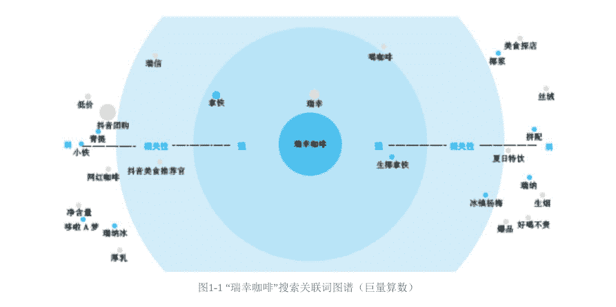
图1-1有三个作用：一是选品，比如图中生椰拿铁离瑞幸咖啡最近，说明在该时段最受顾客欢迎。二是选题，做短视频要围绕用户需求，可从图中提炼用户去喝瑞幸要满足什么需求。三是让成片的视频与直播排在相关搜索最前。

若是瑞幸门店经营者，就应通过巨量算数找到所有关键词，全部融入公众号文章、短视频乃至直播。当关键词都融入后，别人一搜索，自家内容就易排在前面，获客概率大幅提升。

容易排前不等于一定排前，需做好两件事。

一方面，需要出色的文案，把从搜索关键词图谱中提取的关联词都融入内容。遗憾的是并非人人都能写出好文案，这时就需要智能技术的帮助。

另一方面，要锁定正确的关键词。比如只关注“瑞幸咖啡”一个词，在巨量算数输入后点击搜索，可在“关键词指数”下看到一张雷达图。

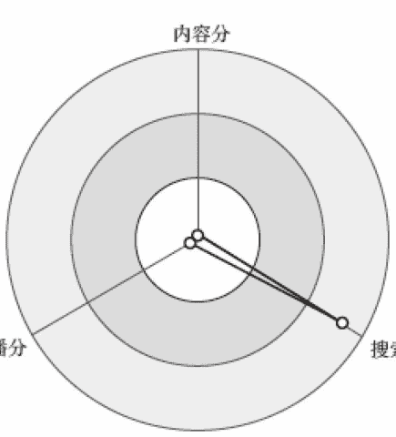
图1-2 “瑞幸咖啡”综合指数解读搜索雷达图

雷达图包含搜索分、传播分、内容分三个分数，对应关键词综合指数解读的三个指标。按巨量算数定义，搜索分由关键词及相关内容的搜索量等数据加权得出，衡量关键词在抖音的搜索情况；传播分由文章阅读量或视频播放量得到，衡量传播声量，不等于实际阅读或播放；内容分由文章或视频数量加权求和，衡量基础声量。也就是说，搜索分代表想了解你、想搜索你的人的分数；传播分代表点赞、转发、评论等数值分数；内容分代表图文、短视频、直播的质量分数。

要找到搜索分高且内容分低的关键词，把它们融入公众号推文、短视频、直播，才能实现“别人一搜，我们就排前”。这时获客成交概率会提升，即相关的“搜索”+“热词”=融入标题、融入图文、融入视频、融入直播=“又精又热”。

需要注意的是，即便某些品牌搜索分很高，若内容分和传播分长期低迷，后续发展也会受影响。不仅瑞幸，很多商家在新媒体市场都有提升空间，特别是用智能结合SEO，可做到每分每秒都在获取目标用户。

有人会说工作已很忙，哪里有时间天天生产内容？AIGC[4]是不错的助手。目前瑞幸等企业已在AIGC帮助下不断生成图文、做短视频、搞直播，推动营业额持续提升。

### 让生成式工具产出可用文案

众所周知，SEO营销长期是营销界的焦点，百度、谷歌等也因此获益。自信息流广告兴起，SEO逐渐“失宠”。它很实用、几乎零成本，只需把所有关键词融入文案，然后写、拍、发即可。事实上操作并不容易，不仅耗时耗力，还需持续输出，即便有专门团队也难实现。

有趣的是，近年来先前“失宠”的SEO正在回潮。关键原因之一是生产速度慢的难题被解决。我自己和合作的网红都有自媒体账号，如今生产内容很快。

以我从事的智能行业为例。我打开巨量算数，输入关键词“人工智能”，会出现一堆相关搜索关联词。

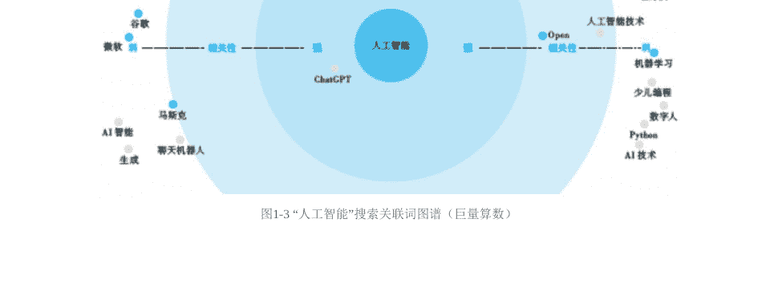
图1-3 “人工智能”搜索关联词图谱（巨量算数）

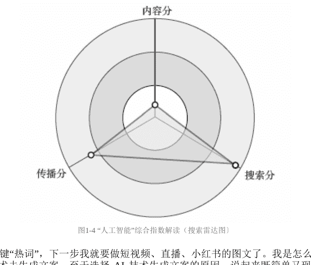
随后我就把所有关于“人工智能”的关键词融入这条视频、直播文案。别人一搜索，我的内容就排在前面。具体操作时，若觉得全部融入有难度，可先只做“人工智能”这个词的文案融入。即便如此，文案在搜索时排名也较靠前，传播力也强。

有了这些关键“热词”，下一步就要做短视频、直播、小红书图文。我是怎么做的？我选择用智能技术生成文案。原因既简单又现实：我每月约20多天在外讲课，若仍用老方法做自媒体根本忙不过来。

具体操作：打开ChatGPT，直接输入“帮我写短视频文案，围绕人工智能应用领域，和我卖的直播数字人有关，要求200字左右，刺激用户好奇心”。这就是我的要求，还可加上“ChatGPT”“计算机”“Python”“AI”“科学少儿编程”等关键词。接下来约10秒钟，ChatGPT就能生成一条文案，且包含所有精准关键词，可能比专业写手写的更好。

当有人搜索“数字人”“科学少儿编程”等关键词时，我的视频就会排在前面并实现即时获客。你完全可以复制此模式，先用巨量算数等工具找到关键“热词”，再用智能生成所需文案。

### 按目标指令微调文案

用生成式工具生成的文案是否十全十美？如果我觉得内容还行但只有60分，能否提升到90分？这些问题并不难。智能可以帮助按目标优化文案。

比如我要优化前文关于人工智能应用的文案，需要重新给一条指令：“要求该文案更具可读性，朗朗上口，获取更多赞和评论。”ChatGPT收到指令后，文案果然比之前更完美。

这只是与智能最简单的交流方式。复杂一点，可这样发出指令：

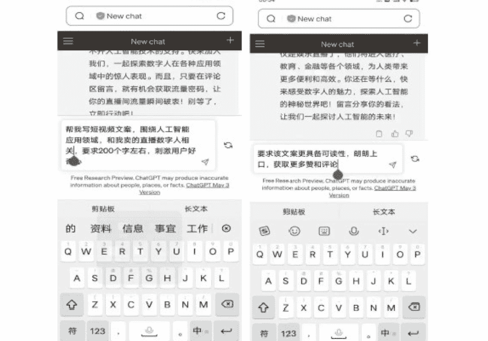
我是××，帮我做××，并且严格执行：

- 1. 我的用户是××

- 2. 植入关键词××

- 3. 要求文案风格××

- 4. ......
如此优化内容会更成功。

[1] 订单销售额（Gross Merchandise Volume，简称GMV）通常称网站成交总额（一定时间段内）。多用于电商行业，一般包含拍下未支付订单金额，比实际成交金额要大。

[2] 客单价（per customer transaction）是指商场（超市）每一个顾客平均购买商品的金额，即平均交易金额。

[3] 如无特别说明，本书涉及的金额均指人民币（单位：元）。

AI 的工作态度就是不挑活、不喊累。一旦稿子不合心意，就能立刻按你的目标去打磨。手里有一套会自己长关键词的文案，别人一搜索，你的短视频、直播间就能被顶上来。即便不做视频直播，只配几张图发到小红书，搜索权重照样能把你排在前面。效果就是这么直接。

这也是为什么有些账号一天能堆出100到500条小红书文案，直接把同行信息淹没。线下实体赛道里这种差距更夸张。你一天发一两条，对手一天砸几百条，你的声音很快就消失在信息流里。

当然，ChatGPT 并不是唯一解。国产的很多工具也很能打，比如知识星球等，同样的文案生成和优化逻辑也能跑通，大家按需求和习惯挑就好。

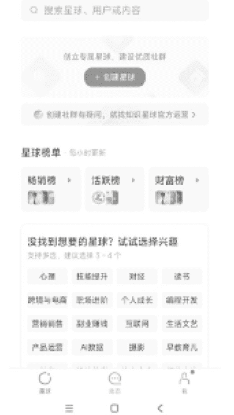

图1-6 知识星球应用界面

### 文案到视频的闭环用法

有了可用的文案，下一步就是喂给数字人，马上就能出片。我们团队就用着这样一个数字人，说话的语气、肢体动作、站姿和真人几乎分辨不出。[1] 他在网上说的内容，全是 ChatGPT 生成或润色过的。文案递过去，他就能直接说出来，视频也就成型了，连剪辑环节都省了。

在 AI 加持下，我们团队写一条文案只要10秒，一天能产出2000条视频。爆款很容易被“跑”出来，带来流量分成、广告收入，还能把人导到直播间完成交易。

这套打法并非特例。有人会担心，AI 写的文案看上去总是有问题，这种顾虑合理。想让数字人直播更稳，常见有两招。

第一招，升级工具。付费版的 ChatGPT、Claude AI 或国内集成类 AI，功能更全、可定制性更强，更贴合商业场景，产出的文案质量明显高一档。

第二招，找对标微创新。比如一家火锅店想做90分左右的引流稿，先找一个标杆。我们调研后锁定小肥羊火锅 [2] 。在抖音搜“小肥羊火锅”，点右侧漏斗筛选，最多点赞、半年内、5分钟以上，挑一个历史最高赞的视频来看。

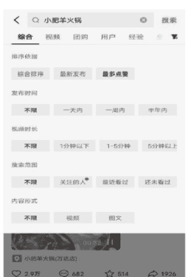

拿到参考视频后，先把它的文案提炼出来，再加自己的创意做小改动。具体操作路径：

- 1. 点视频下方转发键。
- 2. 点“复制链接”。
- 3. 手机装创作猫 App，必须是手机端，注册登录。
- 4. 首页点“链接转文字”。
- 5. 把刚才复制的链接粘贴进去，点“粘贴内容”。
- 6. 点“免费转换”，一天可转3条，转换完得到原视频文案。
- 7. 点“修改台本”图标，全选复制。
- 8. 打开 ChatGPT 粘贴文案，提取关键词。
- 9. 在 ChatGPT 里植入关键词和其他指令，也就是 SEO 词+自定义要求。
- 10. 让 ChatGPT 重新生成文案。

关键词里有节假日活动词，也有视频本身的高频火锅词，还有从巨量算数里扒出来的搜索词。

拿到新稿后打开剪映，用文案直接生成视频，配图发出去，一天能做到几百上千条，而且搜索时很容易被排在前面。同一套稿子也能用在直播带货上，搜索关键词时直播间排名靠前，主播的话术脚本也齐了。既能帮新手快速吸来精准人群，也能帮老手解决持续获客的难题。

这招不仅线下商家能用，线上企业也能用，企业和个人都适用。

> [1] 真人数字人制作前必须取得授权，后文不再重复。
> [2] 小肥羊火锅现名“快乐小羊”，新媒体上仍多用老名，下文同。

### 大牌的 AI+文案实操

餐饮圈里可口可乐、麦当劳、星巴克、汉堡王、必胜客、库迪咖啡、小肥羊等，都在用 AI 写稿，主要集中在：

1. 引流文案写作
可口可乐用 ChatGPT 把优秀写手的思路喂进去，批量产出经典宣传语、口号、产品描述。省下了大量人力，让团队把精力放在推广执行上，品牌声量和销量都上来了。

2. 视频制作
麦当劳重仓视频获客，很多素材用数字人完成，还跟皮卡丘、哆啦A梦等 IP 合作，用 AI 写脚本，做有趣的广告片和故事短片，品牌形象更鲜活。

3. 社交媒体广告投放 [1]
星巴克的投放精度是行业标杆。一是文案精准，二是用 LBS 定向。举例来说，锁定上海闵行世博家园周边喝过星巴克或咖啡的人群，就能做到人群定向推送。

4. 小程序开发
汉堡王的小程序做得细。便捷点餐、预约和优惠是基础，真正厉害的是千人千面。系统根据每个人的消费习惯推送不同信息，实现个性化触达，订单量随之提升。背后靠 AI+文案做千人千面的内容分发。

5. AI 客服
必胜客用 ChatGPT 训练客服机器人，把高频问答用 AI 文案喂给机器人。用户问题能被快速解答，企业人力成本下降，而且 AI 客服形象温柔耐心，体验更好。

6. 虚拟形象设计
库迪咖啡用数字人打造了一批吸睛的虚拟形象作为品牌面孔，这些形象都是 AI+文案加持的成果，帮助品牌塑造差异化记忆点。

7. 数据分析
必胜客还用 AI 分析线上用户行为，以分析结果优化推广文案和广告文案后再投放，目标人群更准，转化率更高。

8. KOL 合作
小肥羊火锅很会和 KOL 配合。联系美食达人到店免费试吃，用 ChatGPT 给达人预制合作内容。达人到店试吃拍照后，稍作个性化调整就能发布，曝光和到店率都提升了。

> [1] 推送商业信息需遵守《个人信息保护法》等规定并取得用户同意。
> [2] LBS 即基于位置服务，利用定位技术向设备提供资源和服务。
> [3] 收集分析消费者数据需遵守《消费者权益保护法》《个人信息保护法》等并获授权。
> [4] KOL 即关键意见领袖，能影响追随者购买决策。

## 2 AI+短视频：线上线下导流变现

### 用数字人进入短视频创作

知道怎么用 AI 写稿后，怎么把稿子装进数字人、放大品牌影响力？第一步是先有自己的数字人。市场上有很多模板可供挑选 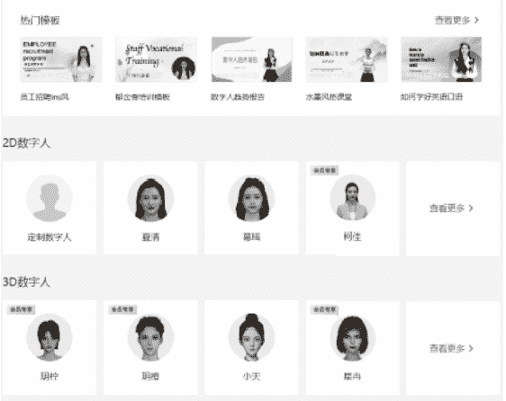 。按场景分，有 PPT 用的、会议室用的、餐厅用的；按表现分，有2D 有3D；按类型分，有动漫风也有真人建模，企业和个人都能做。

常用工具是 HeyGen 和 Midjourney。HeyGen 用视频上传，上传你拍的素材它就生成数字人，效果偏初级，一眼能看出是假人。Midjourney 用照片合成，先生成400到800张图再合成，画面更生动、更像真人。

我把两者结合给自己做过数字人。先用 Midjourney 生成800张不同状态、不同角度的照片，有开心、生气、苦闷等情绪，再用 Midjourney 和 HeyGen 融合成视频，最后上传 HeyGen 成型。商用场景其实不用这么繁琐，选一个工具稍作优化即可。不习惯这两个工具，也可以用国内替代品，前面提到的知识星球就不错。

做好数字人后会发现一个问题：单一形象不够用。要解决，就要么按场景多做几套风格的数字人，要么给已有形象做个性化定制，比如定制声音。现在 ElevenLabs，简称11Labs，已经能克隆声音。用他人声音必须授权；想复刻自己的声音，打开软件说上大概1分钟，对方就能训练出来。最终你就拥有了带专属声音的数字人。

对企业来说，数字人能放大网红员工的影响力。以前苏宁就培养过一位单场带货能卖110万大家电的网红员工。现在可以用数字人给网红员工做备份，必要时征得员工同意后量身定制。真人要休息，数字人能24小时在线。把 ChatGPT 生成或优化、带大数据关键词的文案交给数字人，它既能直播互动，也能批量出视频。公司现有的做法是，每个孵化的网红达人配1到3个数字人。

除此之外，数字人对短视频推广和新手特别友好。拿到含全量关键词的文案后，1分钟的视频很容易排到搜索前列。有家公司的一个从未做过短视频的员工，学会用数字人后，一天能产140条视频，平均每条获赞50到80个。

总体看，数字人加持后，企业在短视频引流上的效率会明显提升。

### 如何拍出有质感的短视频

用数字人做视频优势明显，但如果不依赖 AI，还想靠视频获客怎么办？先看平台。国内主流内容平台有抖音、快手、视频号、淘宝、小红书、知乎、B站、微博，共有个特点：重内容、轻制作。

在这些平台，专业设备并非必需，手机就够了。很多企业觉得手机落后，非要上专业设备，结果花钱做的片子反而不如手机拍的受欢迎。我接触的百万粉网红，最火的作品很多是用2000元左右的手机拍的。

平台对内容要求高，需要把从巨量算数等渠道提取的关键词融进文案。但更关键的是，这些平台讲究内容大于制作、形式大于内容、人设大于形式。人设就是 IP，有了 IP 曝光才稳。可形式老套还是不行，比如抖音上有一家火锅店，服务员边滑冰边拍视频、让顾客猜谜再上菜，这类新奇的形式更容易激发好奇和互动。

明确原则后就可以开拍了。

1. 选器材与软件
轻制作意味着手机拍摄即可。拍摄前建议装一个软件——说得相机 AI 提词器。抖音上不少数字人素材就来自它。它的功能包括：

第一，AI 提词。免费智能提词器，把稿子放进去就能控制节奏，一句过。语速变化、加词跳词时字幕实时推进。传统提词器看上去不自然，说得相机采用向下滚动字幕，表现更自然。

第二，AR 演员。内置大量3D虚拟演员，可与主播同框互动，也可单独表演，支持多演员同屏。

第三，虚拟背景。无需绿幕就能实时抠像布景，一键切换背景，效果接近真绿幕。

第四，精准字幕。自研算法提升识别率，减少错字校正。本地生活商家多讲方言引流，字幕能让信息不丢失；电商讲普通话，识别更省力。

第五，美颜美妆。50多项口播专属美颜可自定义，滤镜+美颜+妆容组合，气色更在线。

第六，一键分享。App 内生成专属链接，作品上传云端，可快速分发到各平台。

2. 注意镜头切换
手机参数设置好就开始拍。虽然轻制作，但基础镜头语言要具备。远景、全景、中景、近景、特写要轮换使用，单一景别会让人疲劳，就像直播时语调需要抑扬顿挫。

远景主要展示大场景、风光建筑人海，常配合无人机俯拍；全景表现场景全貌、人物全身动作及人与环境关系；中景取膝盖以上或局部，能看清表情兼顾形体；近景胸部以上或景物局部，细化面部神态情绪；特写拍面部局部或物品细节，增强节奏感和氛围。

通俗理解：我走在茫茫大山旁，大山和我融进你的眼睛，小路上我在走。你在看我、看山，山那边也有人看你。远景能把山和整个人都装下；全景是脚到头；中景是大腿到头；近景是胸到头；特写就是头。

拍摄时根据需求选择。远景建议尽量少用。一是远景多用于企业宣传片，需要专业团队，普通人驾驭难度大。二是远景容易把竞品框进去，比如火锅店不小心拍进海底捞，炸鸡店拍进肯德基，得不偿失。做门店经营的尤其要注意。

门店短视频拍摄与获客实战手册

做线下门店的短视频，全景一定要用，而且要占到全片镜头量的三成到四成。我们团队每天派十到十五个主播达人外出探店，我的要求很死：拍摄前五到十五秒，务必先在店外完成一个全景。先把自己拍进去，再带出这家店的门头。对线下商家而言，门头就是第一张名片。把门头纳入画面后，轻轻挪动镜头，让整条街都进来，这样竞品就很难被带进画面。店外全景控制在两三秒足够，最多别超过五秒。到五到十五秒这个节点，要有一个进店的运动动作，跟着镜头走进店内，把桌位、台位、陈设等全都走一遍。

做连锁和本地生活的内容一定要谨慎使用中景。中景简单好上手，所以很多人滥用。某知名汽车品牌在宣传片里几乎全程用中景，结果视觉效果最差。中景是几种景别里表现力最弱的，电视台用得比较多。

火锅、西餐厅拍近景，本质上就是拍顾客吃饭。切忌乱拍，要找到流量密码。我拍近景的原则是先找颜值高的出镜，颜值高完播和互动通常更好。拍之前必须征得对方同意。万一入镜者颜值一般，安卓自带的美颜相机先处理一下。接着马上接一个特写，把镜头切到他正在吃的食物上。无论什么品牌的食物，都有一种诱人的光泽，一看就让人想流口水。

餐饮类一定要多用特写。之前带团队拍淄博烧烤，我把滋滋冒油的羊肉串卷进小饼裹葱的那一刻拉成特写，食欲感立刻出来了。记住，一条一分钟的餐饮视频，特写镜头占比要超过三成。当然不能只见食物不见人，人物必须同框。

“推拉摇移跟”我们日常都会用，但推、拉、移使用频率最高。

推镜头就是把镜头推到人物面前，镜头语言是慢慢靠近要表达的事物。比如要强调西冷牛排好吃，就用推。推的时候镜头要稳。

拉镜头是沿着拍摄方向由近及远，视觉上慢慢远离被摄对象。核心作用是放大全局，让整体更清晰。短视频里用拉镜头要看投放平台，抖音尽量别用横屏。拉镜头时身体稍微下沉，微微屈膝，画面倾斜控制在十五到二十度左右。

移镜头是机位移动着拍，主要用来交代左右的环境。

#### 3. 调整曝光和焦点
手机拍摄也要手动调曝光和焦点。iPhone 设置相对简单，这里主要说安卓。打开相机，会看到一个小太阳的图标，它代表曝光值，用来整体提亮或减光。往上拉画面整体变亮，甚至过曝成白一片，适合环境很暗欠曝的场景；往下拉整体变暗，适合户外过亮的环境。

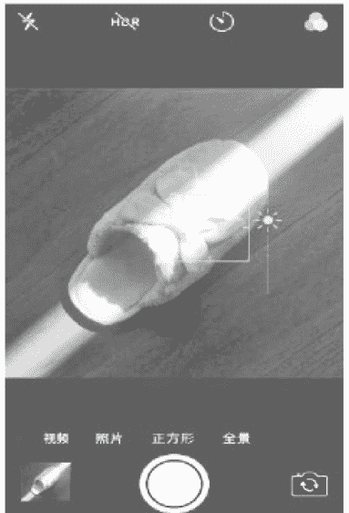
需要注意的是，不少安卓手机录像模式自带美颜功能，这就省掉了后期电脑美颜的繁琐。目前大部分安卓手机分辨率只能到 720P 或 1080P [1]，尽量选 1080P/60fps，分辨率越高成像越好。

光圈也会影响亮度。光圈越大进光越多，景深越小背景越虚，画面越亮清晰度下降；光圈越小进光越少，景深越大背景越实，画面越暗清晰度提升。要画面更清晰色彩更稳定，还是用专业模式。

#### 4. 根据拍摄场景选择灯光
拍摄要结合场景选灯。

室内拍摄用柔和的白光，适当拉开明暗，别过度曝光。房间自然灯光基本都是白光，不管方灯圆灯，外面通常套着一层柔光罩，拍摄时不要取掉。也要注意通风，通风差会出汗，头发贴脸影响效果。一般室内空调开得低，出镜者适当多穿一件衣服，状态会更稳。

拍摄时把好距离和角度，突出视觉美感，减少抖动。手机自带防抖，必要时配云台三脚架。

室外拍摄多利用自然光。光线强时防止过曝，可用曝光补偿，效果不佳时用遮光板。拍摄时用镜头微调景深和人物位置，协调人物与环境的关系。

拍人要多用柔光，有时还要叠两层柔光罩。戴眼镜出汗会反光，这时柔光要更足，或者把灯移到人物侧面或后面，增加轮廓感。带货主播常把轮廓灯放在后方，营造伟岸形象。想要有深度感，多用轮廓灯，还可以配合小景深和背景虚化。

拍家电避免冷光，尽量用温暖柔和的光源，质感会更好。手稳或用三脚架、云台，成品会更有高级感。

拍景色要利用远近对比。户外拍摄要处理好景物远近，突出主体，主体位置要准确。人物或美食为主体时，别被背景抢镜。背景搭配要协调，懂得用流量密码。

按场景选灯，既能提升品牌调性，也能帮助获客。

#### 5. 运用可全终端使用的软件剪辑
高质量短视频离不开剪辑。剪辑不必复杂，也不必用冷门软件。哪怕几百万、几千万粉丝的网红，也大多用剪映。剪映是抖音旗下产品，支持手机、Pad、电脑全终端。

##### （1）剪映有哪些功能
第一，切割。快速自由分割视频，但“智能镜头分割”要慎用，它本质是一键切割，容易出现不可控问题。切割主要切气口，比如说错话、大喘气的位置，语速加快也有利于后期切割。

第二，变速。剪映支持 0.2—4 倍，节奏可快可慢。镜头感来自熟悉镜头。新手镜头感差，可以先慢后快。

第三，倒放。时间倒流制造反差感。比如男顾客走进餐厅又倒退出来，视线里出现正在用餐的女生，制造故事感。日常拍摄用得少。

第四，画布。多种比例和颜色随心切换。不用 AI 的情况下，一分钟产两条视频最简单的方式就是改比例，比如 9:16 竖屏改成 16:9 横屏。

第五，转场。内容枯燥时用转场增加变化。线下门店短视频里转场不大常用。

第六，贴纸。贴纸承担有用有趣的功能，比如“9.9 元”“19.9 元欢迎光临”，笑脸爱心等都靠贴纸。

第七，字体。抖音很多爆款视频没投放，字体、声音、曲库功劳很大。剪映字体库收录了不少爆款字体，完播率往往更高。选字体要注意版权，即使在剪映库内也要看授权范围。声音和曲库同理，尤其是跨平台素材要确认授权。我常用刺绣中文字体。

第八，曲库。一种是用抖音爆款曲库的热歌，一种是用有独立风格的音乐。想用爆款就看每周音乐榜。添加音乐注意：视频主体不讲话时可用带歌词的音乐；主体在讲话时不要用带歌词的音乐，用纯音乐。音乐用好可带来自然播放。我不少视频用《精武门》1982 版陈真出场配乐，有条视频没投放也有十几万到几十万播放。选音乐一定要看版权是否已授权，范围是否覆盖。

第九，变声。通常萝莉音、大叔音、怪物音要慎用。注意同一视频一人分饰多角会产生多种变声。

第十，一键同步。把局部剪辑好的静音、字体等同步到整条视频。

第十一，滤镜。多种高级风格滤镜让视频不单调，但不要乱用。西餐厅一般用高级灰或高级黑，中餐厅多用暖色调。

第十二，美颜。智能识别脸型，定制专属美颜方案。

##### （2）如何利用剪映进行剪辑
下载剪映 App 注册登录即可创作。

第一步，添加视频。点“+”，从相册选视频加入项目。

第二步，视频编辑。拍摄难免失误，需要切割。开头完美中间一段质量差，就用切割功能裁掉。

第三步，合并视频。比如周一拍了一部分周二补完，先加第一个视频，完成后再点右侧“+”加入第二个，分镜头拍摄同理，一个一个添加即可。

第四步，添加转场。转场即救场，画面不佳时可用，但最好别轻易用。某些情况也可以用转场合并视频。

第五步，添加音乐。视频噪音大或单调时加背景音乐更生动，也能产生共鸣。注意找有情感驱动的音乐，剪映音乐均已授权。

第六步，添加字幕。刷视频时看到的字幕基本是后期加的。可手动新建文本，也可用“识别字幕”快速生成。第一步加视频时就能先上字幕，看字幕剪辑也可行。

第七步，特效和滤镜。特效多用于救场，滤镜使用更常见。比如高档餐厅拍摄多用清冷滤镜提升格调。

第八步，画中画。实现两段视频同屏播放，可与蒙版结合做结尾引导关注。很多探店达人用画中画，把牛排制作前后的画面植入探店视频。植入素材要保证音画质量，使用网上素材必须搞清版权。

第九步，导出视频。点击右上角“导出”，可保存相册、草稿或分享到抖音、西瓜视频、今日头条等。导出规格一般选 1080P/60fps，适合各大平台上传。注意平台要求：抖音类导 9:16 竖屏，小红书、B站一般导 16:9 横屏。

总结来看，高品质视频需要拍摄团队、手机、软件配合。提取字幕用创作猫，拍摄用说得相机，剪辑用剪映，优势互补。

> [1] 目前市面已有支持 1.5K、2K 分辨率的安卓手机。不过很多平台最多只支持 1080P 短视频，超 1080P 投放后会被压缩。

### 运用AI技术生成短视频
优质短视频赏心悦目，但目的不是参奖而是增业绩、快速获客。如果员工太忙没空拍，就可以用 AI 生成。

第一步，准备好文案，可自己写，也可让 ChatGPT 等 AI 生成或优化。第二步，把文案导入剪映，用文字生成视频功能产出。仅用剪映一天能生成约 100 条视频。剪映不是唯一手段，有数字人的话，把文案给数字人，大约一分钟生成一条，形象接近真人。

我自己是真人数字人混合出镜。比如某天我在抖音同时上线一条真人视频和一条数字人视频。监测时段前者 5162 个赞、88 条评论、约 8 万曝光，后者 1 万个赞、156 条评论、约 22 万曝光。

若接着做直播，这条数字人视频 22 万曝光可带来 5000 多精准流量，按 5000 计。正常转化率 1.76%，客单价 980 元，GMV 就是 5000×1.76%×980=86240 元。

俗话说天下武功唯快不破。别对优质视频过度执念，拍一周未必能获客。商业短视频关键是赚钱获客。我一条点赞 1 万的视频从想法到完成只用了 3 分钟。先用 ChatGPT 生成文案，文案里包含巨量算数搜索的全部关键词，直接给数字人生成，再快速剪辑。因为视频里有热词，排到前面，获得 1 万点赞。

除了 AI 加持，我还注意了两个细节。

第一个细节规避数字人缺乏情绪价值的缺陷。我的数字人视频里戴了熊猫头，也可用口罩处理。不愿戴熊猫头口罩的朋友，可选无人出镜只拍商品加声音。大多数用户更在意性价比、有赠品等信息，这类视频一天能产几百条。也可露出侧脸，咖啡、炸鸡类账号常用。

第二个细节是用引流道具。视频桌上放了法国香水、波尔图红酒、发财树，都是买的模型道具。因为这条视频要上抖音，这些都是抖音商铺的爆款商品。用户刷到时会被爆款吸引目光，这就是流量密码。一旦停留，收益就来了。

ChatGPT 或创作猫生成优化文案，再以声音形式植入视频，一条新爆款就出来了。属于二次创作，商用必须取得原视频作者授权。

我司用 AI 生成短视频帮助客户实现高增速获客。客户是海南一家会员制高端私房菜，员工 KPI 就是获客。博鳌论坛期间获客增速 9%—10%，论坛结束后老板要求保持 20% 左右增速。最快的方法离不开 AI。用传统方式做视频再优化费时费力，AI 生成可做到一分钟 30—40 条。若视频包含文案全部关键词，大概率成爆款。爆款跑出来后，用 AI 一天内快速复制更多，再分发给负责人发布，迅速占领市场。服务这家餐厅时，当地其他高端私房菜一天只能发一两条，我们帮助客户迅速发布上千条。最后当地各大新媒体平台前 100 名短视频几乎都是客户的，获客任务圆满完成。

KPI 全称 Key Performance Indicator，即关键绩效指标。

### 用复盘优化短视频
短视频不能只会拍剪，还要会复盘。复盘后才知道该保持什么、改什么。复盘依据要用客观数据。

举例。某高端餐厅是我们客户，某天在抖音发一条短视频，截至某个时间点的数据：

作品时长 119 秒，平均播放 51.64 秒。作品表现：
播放方面，播放量 19 万，5 秒完播率 82%，整体完播率 13%。
互动方面，点赞 7178，评论 2107，分享 118。
粉丝方面，视频带粉 672，粉丝播放占比 1%，粉丝完播率 29.6%，粉丝点赞率 22.2%，粉丝评论率 5.3%，粉丝分享率 0.3%。

复盘这条视频主要看以下五个数据。
第一个数据，5 秒完播率。

短视频做得好不好，别凭感觉，先看数据说话。

开头的5秒留存度，本质上是有多少人把前5秒看完了。留存很差基本就等于视频失败，这也是国内主流内容平台推崇轻制作重内容的底层逻辑。抖音内部对这个指标很看重，合格线是50%，创作者中心和企业服务中心里都能查到具体数值。某高端餐厅的一条视频5秒完播率做到82%，已经算非常健康的开局。

第二个看平均访问深度。计算方式是平均观看时长除以视频总时长。同一条餐厅视频平均观看时长约51.64秒，算方便就按52秒，视频长度119秒，最后得出0.43。抖音这个维度的及格是0.3，已经是优。

第三个看点赞率。泛行业3%到10%算合格，餐饮赛道要求更高，10%才及格。该餐厅视频点赞率只有3.7%，制作者需要重新审视内容吸引力。

第四个看互动与吸粉效率。账号魅力最终体现在吸粉成本上。大多数行业抖音DOU+投100元能带来5000次曝光，约吸50个粉，单粉成本2元。监控显示该条视频投100元DOU+后单粉成本降到1.7元，吸粉性价比在多数行业里算低的。

看完这几项复盘后，这条视频的短板也很清晰。

第一，形象更新不及时。同样的上衣、同样的花瓶、同样的发型反复出现，不仅视觉疲劳，还容易被系统判定为低质内容而限流。服务类账号尤其要注意，除非建立了强视觉锤，否则不要重复。视觉锤的例子就是我自己出镜常戴口罩或熊猫头。点赞和互动偏低，可能就是系统误伤，也可能是用户觉得人天天一身行头没新鲜感。

第二，没有完成蓝V认证。这是比较致命的坑。没认证就做广告或引流有风险。蓝V和企业号是两码事，抖音企业号免费注册，个人号也能转成企业号。蓝V认证主要有五点价值：官方认证标识提升品牌信任；可搭建个性化品牌页，接入官网链接提高认知和转化；支持发布更专业的高质量内容，提升关注与互动；提供更细致精准的用户数据分析，指导内容与投放优化；增加商业合作机会，提升曝光与商业价值。一个营业执照可认证两个企业号，费用600元。常见做法是先把企业号养起来再升级蓝V，也可直接上线认证。

第三，内容质感不高。19万播放的视频里混入了大量其他内容的截图，关键词植入也很弱。

第四，关键词联想走偏。现在很多用户用AI搜索，精准很重要。该餐厅关联词里出现了不少名人名字，导致看到视频的用户误以为门槛极高，直接划走。虽然划走的人里也有消费能力，但流量浪费严重。

新手账号的这些不足，放到成熟账号上对照会更清晰。以星巴克某门店的一条抖音视频为例，2023年8月8日数据，假设播放1万。核心考核项是导流量，但四个前置指标必须先达标。

互动率即互动量除以播放量。低于3%说明内容缺乏有趣、有用、有共鸣。点赞、评论、转发、收藏都算互动。

涨粉率即涨粉量除以播放量。低于1%视频不合格。1万播放应该带来至少500粉，否则账号没有温度，粉丝不愿留下。

咨询率即咨询量除以播放量。餐饮要求不低于1%，1万播放要100个咨询。咨询指问地址、优惠券、活动、会员等私信。低于线就需要在巨量算数或小风车等环节做优化。注意车企这类行业标准只有0.15‰。

导流率即导流量除以咨询量。餐饮行业要达到10%。如果100个咨询只有20人到店，导流率20%才算合格。不到10人到店，说明账号IP与门店建设有问题，继续做视频意义不大。

复盘之后就知道怎么优化。做品牌，就把互动和涨粉做起来；做营销变现，就把导流做起来。

DOU+是抖音的内容加热和营销推广产品，可用于视频和直播，提升曝光与转化。小风车是直播间展示与分享商品的工具。

怎么让短视频迭代变好，可以从九个方向检查。

一，看评论区有没有未被满足的需求和高赞评论。爆款也不可能满足所有人，评论区里常有新角度。比如茶饮视频有人留言不想看喝饮料，想要椰奶咖啡，又有人夸主播手漂亮，下次就能把手作为视觉点。

二，服化道是否匹配内容主题。我吃过亏，给一家粤式茶餐厅拍视频，达人是身高1.72米的北方风格女孩，服装、妆容是少女妆，与餐厅本地审美完全不搭。广东本地偏瘦肤色自然，妆容偏素或港风浓颜，道具也要有流量密码，包包logo不要过于暴露。

三，内容是否平淡无反转。念稿子式的视频不行，要有转折。

四，镜头是否单调，要有远近中全特及推拉摇移跟的切换。近景过多会枯燥，远景过多也容易有版权风险。

五，画面是否清晰稳定。

七，语气和表演表现力如何，广告植入后评论区的态度就是反馈。

八，logo出镜是否超过5秒。蓝V认证后长时间露logo也不被鼓励。我拍瑞幸视频几乎不露logo，小蓝杯本身就是标志，足够让人联想。

九，声光影调性是否一致。中餐厅不用冷光，优雅西餐场景不要用小蜜蜂收音。声光影服化道必须统一。

讲故事技巧上，人货场要协同。

人方面服化道最先考虑，静态动态态度表演和语气要贴合本地风格。货方面商品价格品牌卖点都要在1-3秒、中间、最后5秒的细节里清晰呈现。场方面先定景别角度，再定视角，获客类视频多用第一或第三视角，少用第二视角。场所室内室外要规划好，音乐选爆款还是原创要考虑版权，特效慎用，再设计声光影呈现。

用户心情控制曲线是讲好品牌故事的关键。流程是注意、兴趣、了解、欲望、行动、满足。

注意阶段，用冲突画面抓住眼，比如两人吵架、接吻、为牛排好坏争论。

兴趣阶段，一个女生一口吃完某物会出人意料，触发兴趣。

了解阶段，用快动作、推镜头快速传递信息。

欲望阶段，用夸张特写表现情绪。

行动阶段，明确顾客选了哪个套餐。

满足阶段，品牌加码如到店即打折，性价比感带来愉悦，故事收束，引流自然完成。

投放层面，投1元赚68元靠的是精准投放。某快餐店抖音投放数据里，平均投入1元回报9.92元，最优计划成本稳投ROI15单粉计划，投入1元回报68.81元。差别在投放是否精准。

精准投放先要精准画像。麦当劳做夜宵产品时做了年龄需求思想工作健康情感八卦消费学习等多维度画像。没有会员系统，也可以用平台数据。抖音创作者中心路径是：我→三条杠→创作者中心或企业服务中心→全部作品右侧更多→数据中心→粉丝分析，粉丝超100后画像功能开放。

技术层面，抖音热点宝会提前两个月公布官方活动日历。餐饮行业7月夏日清凉节、8月美食节通常维持半个月左右，素材贴合活动主题曝光会明显提升。了解规则才能备好预算和投放节奏。

AI+投放可拆成三个环节。投流前要测试素材和商品。素材包括短视频的34频素材和直播素材，商品是品牌固定款。做好测试再放大，才能把钱花在刀刃上。

有了靠谱的拍摄素材、有了一款固定在售的品牌单品，就能高枕无忧了吗？现实远非如此乐观。不少人这两块其实已经做得不错，可投放效果依然扑街。症结在哪？核心瓶颈往往出在产量上。很多人一天就撸出一两条，多的也就五到十条，而头部团队动辄日产数百条，我们内部甚至能稳定做到日产两千条。日产几百上千条并非神话，AI就能把这个事情跑通。直播同理。大规模做短视频、大规模开直播，才可能在几千条内容里淘出一条真正爆的。

借助AI，一天产出几百上千条普通素材，源源不断给线下导流成为可能。等数据回温，再把表现最好的那条拿出来重点投放。这里必须强调一个原则：只找爆品去打，千万别把自己都不看好的货投出去。

投放全流程其实分成三个阶段来管。
投流中，要盯投放手法，同时看大屏实时调控，后文会展开。
投流后要做两件事：把售后打磨细，再把供应链做迭代。打个比方，牛排卖爆了缺货，供应链就必须马上升级。根基别动，但链路要活。

二、AI加持下的投放关键点

想把投放尤其是精准投放做成，先把策略理清。目前流行的投流打法主要有两种，直投和短直投。

直投就是直播间里直接挂流。风险极高，很多人亏就亏在这里。举个例子，抢“鸡翅”这个词。最早进场成本只要0.07元，上海一家连锁把价格抬到0.12元，湖南一家跟到0.24元，广州一家拉到0.5元，北京一家再抬……等你想进场时，这个词已经2到3元了。

那直投就不能用了吗？不必。做好直投的前提是先测，测过有信号再投，而且投量要循序渐进，等账户稳了再放大。

现在电商和本地生活更偏爱短直投。短直投对素材有硬门槛：播放量必须破10万，CTR即点击通过率要达到4% [1]。这直接把做视频慢、还在用传统手工产片的人筛掉了。

为什么说速度决定生死？投1元赚不到68元，多半就是产片慢。量少，曝光面窄，就很难从中挑出一支10万+播放、CTR达标的片子。一旦日产能到几百上千条，找到同时满足10万+播放、且能带来4%用户留电的片子就会很容易。

找到合适的片后，用巨量千川去加热。千川带来的全是付费流量。原本10万+的播放，被加热后能拉到百万、千万甚至上亿；CTR保持4%，意味着4万、40万乃至400万用户会跑到账号下预约、领券。对比直投步步惊心，用“先打爆短视频，再用千川投这支电商属性短视频”的短直投，能给企业一个更稳妥的投流路径。

> [1] CTR和CVR是抖音两大核心指标。CTR4%指100次曝光有4人进直播间。

利用AI做投放数据操作

策略确定后就要落到千川的操作上。下面以千川为例拆成九步。

1. 选择营销场景
千万别选通投广告。通投就是全流程位覆盖，信息流、搜索等全上，看似面面俱到，实际ROI常拉胯，成本白花。更有效的做法是选搜索广告。虽然单次搜索成本略高，但来的都是主动表达需求的用户，系统会按目标匹配合适场景，效果更有连锁反应。

2. 选择推广方式
有极速推广和专业推广。极速推广设置简单，系统自动跑，适合老手验证，不适合新手无模型时上，基本就是快烧钱。专业推广可自定义创意和人群定向，给到更精准的用户。建议优先专业推广。

3. 设置投放方式
千川分控成本投放和放量投放。建议优先控成本，它能先保证成本达标，把预算用足。比如账户有1万元，选放量可能很快花完，控成本可以设定花多久用完，还能借助AI辅助排期。注意控成本里的“严格控制成本上限”最好不勾。千川是开放竞价平台，别人可能2元抢词，你出2.1元跟进，如果锁死了上限就无法追价，灵活性会被卡死。资金紧张或新手更适合控成本，资金充裕再评估是否放量。

4. 设置优化目标
可选进入直播间、直播间商品点击、直播间下单、直播间成交、粉丝提升、评论。怎么选看人看货。
进入直播间对人货场要求极高，明星出镜才吃得开，效果差会打击士气，新手可小范围测试不宜长期投。
商品点击要求强吸引力加福利，否则慎用。
投评论是给爱评论的人看，系统会把直播推给高互动人群。
要促单就投下单或成交。
想孵素人网红就投粉丝提升。个人号无特殊资源建议直奔下单和成交；达人可尝试粉丝提升和评论。

5. 选择投放时段
资金足可覆盖15点到22点。做精细化要按人群走。用户是全职宝妈，9到11点最合适，大数据里这是她们相对空闲的窗口；蓝领和司机群体凌晨后效果好，他们白天忙，夜深才有空；大学生则14到18点，午休后到晚饭前是空档。

6. 设置出价
系统会基于同类店铺给出建议出价，比如0.10到0.19元/观看。模糊投放可取中间值约0.145元。商业化投放建议从0.10元起步，投不出去就0.11、0.12逐步加，看数据再决定是否继续加价。跑不动就继续冲：卡屏送冲互动，福利品冲成交密度，爆款冲GPM [3]。

7. 定向人群投放
可用达人相似功能。投放后同类达人粉丝会被覆盖到你的直播和视频。例如卖鸡翅的同学投了某大牌餐饮，品牌11点下播，他11点半开播并投达人相似，品牌粉丝就会收到推送。达人多时可分组测试，筛出高精准达人建库复用。

8. 行为兴趣选择
定向广告涉及行为用户和兴趣用户。行为用户指已被大数据证实的高频行为人群，比如一周吃三次披萨的人；兴趣用户是行为相关但未必高频，比如爱吃鸡腿汉堡的人，可推为爱吃西餐的人群。遵循大行为小兴趣的原则用AI定向。达人可通过蝉妈妈找。投放时行为兴趣意向和抖音达人要谨慎，新手可先选更多人群，在标签广场第二步细筛，保证精准。

9. 选择创意分类与创意标签
选错分类会埋雷。先明确类目做二三级划分，如服装、美妆。创意标签至少填满20个。选词两条路：一是搜索广告-新建计划-以词推词获取推荐关键词，从下载的Excel筛选；二是搜索流量分析-关键词分析，看近7天表现，适合想破亿播放或小类目。投汉堡就要收集所有相关人群标签，输入核心词后AI会推送一堆表格工具，再按价格、收入、年龄等细筛，实现精准触达。

> [1] 投放需遵守《电子商务法》等法规。
> [2] 卡屏送指主播在特效卡屏直播中送虚拟礼物。
> [3] GPM为千次观看成交额。

利用AI执行投放计划

数据设置完要落地执行，主要有八个动作。

1. 提升品牌认知
在社交媒体投放个性化广告，AI做人群定位和情感分析实现精准推送。哈根达斯就靠社交活动实现短视频和直播的大数据精准投放，提升曝光与认知。

2. 吸引目标消费者
用搜索引擎广告定向，AI优化关键词和人群。可用巨量算数找常搜星巴克、瑞幸的人群关键词，再定向投放。星巴克的地理定位广告就是典型成功案例。

3. 个性化推荐
机器学习分析偏好，协同过滤做推荐。必胜客用它做菜单个性化推荐提升转化。瑞幸也是受益者，实现千人千面。

4. 智能预约
缓解排队痛点，在线预订和智能排队提升体验。法国某知名餐厅靠智能排队预约吸客。AI的自然语言处理和数据分析让这件事变得可行。

5. 社交媒体营销
英国某餐厅做创意社媒营销很成功，AI做情感和社交网络分析后进行精准推送，提供投票、上传美食等互动内容，而非简单广告，提升互动与影响力。

6. 管理在线评价
瑞幸和麦当劳做得好。麦当劳用在线评价系统监测回应，通过AI做文本情感分析和舆情监控后精准推券，提升口碑与转化。

7. 数据分析决策
达美乐是代表。它收集用户从拆包装到擦手等全链路行为，记录番茄酱或原味偏好，用AI挖掘和预测，优化投放和营销策略。

8. 实时监测
为复盘服务。肯德基实时监测客流和满意度，用AI视觉识别和情感分析及时调整运营，提升服务和利润。

以上是理想流程，企业需结合自身优势不足做适配方案。

知名企业AI+投放应用：小白鞋引爆直播间销售

这是我在苏宁负责直播时的一个案例。看到小白鞋大火，就想复制到苏宁直播间。苏宁供应商在南昌，是当地最大MCN之一。我去南昌和负责人对齐后一起找生产厂家。爆款小白鞋风格接近Gucci，模糊但可对标。我们结合市场调研把苏宁版小白鞋的指标量化：排面、码数、质量、皮质等。最终在福建找到合适厂家。

样品出来后拍视频，用AI批量生成大量视频在苏宁系抖音全量上线，看数据。跑出来两条表现不错的视频，我们追加约5万元DOU+投放，视频持续爆单，最终直播间卖出约1万双。

思路是先收单再生产。投放前找爆款去南昌对接；投放中工厂已承诺生产但未开工，靠两条好视频投放并实时调控；投放后工厂正式生产。供应链端有厂家、经销商、品牌商、产地，直播间端有苏宁官方平台、主播、MCN、各电商平台和消费者A、B、C、D，提前预售+柔性供应链预付，确保稳赚不亏。

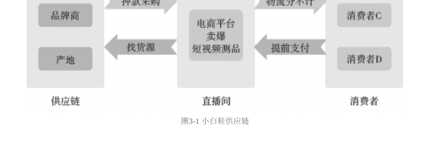

> [1] MCN即Multi-channel Network，多频道网络，俗称网红经纪人。

| 画像种类 | 年龄画像 | 性别画像 | 地域画像 | 需求画像 | 时间画像 | 思想画像 | 工作画像 | 健康画像 | 情感画像 | 八卦画像 | 消费画像 | 学习画像 |
| :--- | :--- | :--- | :--- | :--- | :--- | :--- | :--- | :--- | :--- | :--- | :--- | :--- |
| 麦当劳主打夜宵 | 30—35岁 | 男性为主 | 北上广及新一线城市 | 希望拥有品质生活，至少看着像 | 22点以后有空 | 保守 | 互联网技术人群，非常忙碌 | 亚健康 | 未婚 | 喜欢探究新鲜事 | 月消费可支配改善生活费用1万元以上 | 双一流本科生为主 |

四、AI+直播：真人与数字人混合变现法

直播在线下门店的应用

刷短视频看直播已成日常，线下门店为引流获客纷纷入局，但普遍面临全职主播不足，基本靠员工兼职。并非不重视专业人做专业事，而是成本考量。电商靠详情图+投流+补贴做自然流，成本就是投流。线下门店获客后还要接待到店，成本更高，中小企业很难负担全职主播。

数字人直播特别适合线下门店

线下门店想做直播，第一道坎往往是人。养一个全职的真人主播薪资、排班、稳定性成本都很高，付不起怎么办？先说结论：当下已经是短视频驱动的直播时代，直播不是锦上添花，是基本盘。离开它基本就看不到流量。所以问题不是要不要播，而是怎么用更低成本把播常态化。最直接的解法，就是让数字人进店。

顾客到底在乎主播还是商品？回想一下自己刷内容时的瞬间：因为主播长得好看就点进去的情况有，但更多时候是被画面里占据大半屏幕的商品吸引。很多间里，商品几乎占了四分之三的画面，主播反而被挤到边角。没有明星达人加持的普通间，主播的吸引力明显弱于商品。既然如此，把真人换成数字人，对效果的打击其实有限。

数字人即便替代真人出镜，也有自己的可玩性。先是形象可以做的精致、统一，而且作为新物种自带好奇心。更关键的是成本结构：真人需要休息、排班，数字人能做到24小时在线拉客，企业承担的只有电费和网费。放下顾虑后，数字人进店完全可行。我们在服务的某火锅店就采用了真人+数字人双轨模式。

人选是怎么来的？先内部培训，再内部PK，胜出者上镜。数字人团队则复刻了真人主播的形象气质，用业内常用的HeyGen和Midjourney做了建模，并取得了主播本人的授权。现在店里真人主播每周在线时长基本控制在3小时以内，而数字人则是全天不间断。单场数字人直播带出的消费券就能突破5万元，业绩相当可观。

做数字人直播，平台和互动是两件要事。平台可选抖音等公域，也可以接入团队自研的数字人直播系统。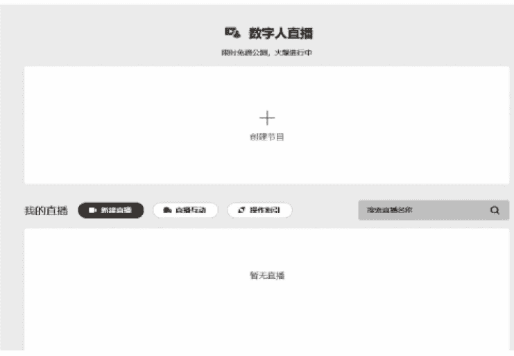

图4-1 国内自主研发的数字人直播软件

互动上，重点不是说多少话，而是能不能接上。我们的自研系统内置了一套互动问答库，汇总了调研中用户高频出现的100个问题及标准答法。用户在评论区打出关键词，数字人就能即时回应。

这里也有国内外的路径差异。国外常见的数字人，形象基于Midjourney生成的400到800张AI图合成视频，声音调用国外数据库的音源，话术靠ChatGPT即时生成，用户提问就由ChatGPT即时作答。国内自研方案在互动环节的处理逻辑不同。

> [1] 数字人直播，特别是数字人带货，必须遵守《广告法》《反不正当竞争法》《消费者权益保护法实施条例》等相关规定。真人直播同样适用上述法规。

### 品牌们已经在用24小时数字人获客

1. 数字人直播+推广特色菜品。麦当劳用ChatGPT介绍招牌汉堡、薯条等，把制作与搭配过程做成视频直播，数字人24小时轮播并搭配限时折扣，引导到店尝鲜。
2. 数字人直播+互动游戏抽奖。必胜客在间内植入AI互动小游戏，数字人提问“披萨能吃几块、偏好什么口味、会不会自己做”，用户参与互动就有概率获得优惠券，中奖率能做到70%以上，直播间同步推新品。
3. 数字人直播+名厨分享烹饪技巧。肯德基的数字人化身主厨，讲解标准化炸鸡的烹饪要点，直播期间限量发售卡通版炸鸡套餐，驱动到店。
4. 数字人直播+快速外卖。赛百味借助ChatGPT实时处理外卖订单，直播展示准时送达，同时提供直播专属免费配送，边看边下单。
5. 数字人直播+跨界联合。星巴克联动知名餐饮品牌，数字人推荐咖啡搭配甜点或早餐，直播期间推出联名限定组合。
6. 数字人直播+传统美食文化。达美乐用ChatGPT讲述披萨历史与工艺，数字人演示撕披萨的画面增强食欲，并赠送小包装试吃，鼓励用户体验。
7. 数字人直播+品牌故事与社会责任。麦当劳用ChatGPT讲述品牌历史与可持续公益，直播中推广麦旋风并承诺每售出一杯捐赠一定金额。

### 到底选不选数字人，要看数据说话

数字人能24小时播，但策略选择仍需用数据验证。

案例一，某餐饮门店的24小时数字人获客。间里主推红薯粉、酸辣粉、煲汤调料。同一款酸辣粉，其他平台5.9元，间里3.9元。数字人持续讲解并互动。最终24小时间售出代金券56246元。按券后消费1:10的常规比例，带动销售额约56万元，门店直播成本基本只有电费和网费。

案例二，我的数字人在2023年5月28日20点到23点04分于抖音的一场直播。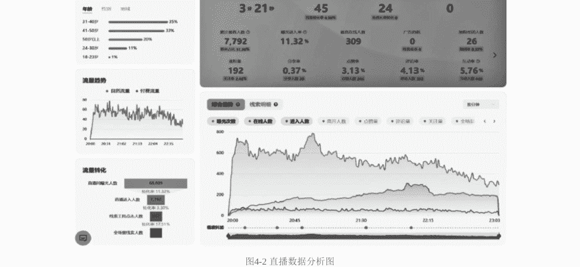

从图4-2可见，这场直播共带来7792次进间。想一想，自家门店一天有多少7000多人到访，对大多数中小商家并不容易。直播的价值就在于把人聚拢。

进一步拆解，人均观看时长3分21秒，属于较高水平。有效获客45人，加上私信24人，共69人。实时在线0人，总场观7792，广告花费0。

要判断贡献，得看左下角的流量转化。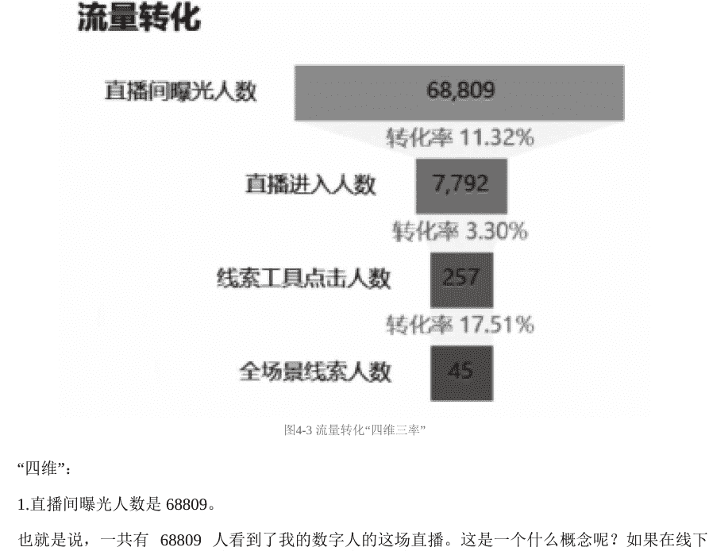

图4-3 流量转化“四维三率”

“四维”即直播间曝光人数、直播进入人数、线索工具点击人数、全场景线索人数；“三率”即四维间的转化率。

本次数据：曝光68809人，进入7792人，线索工具点击257人，全场景线索45人。

进入转化率11.32%，即68809曝光里有7792人进入。点击转化率3.30%，即7792人里257人点小风车。全场景线索转化率17.51%，即257人里45人留资。

抖音常规水平，进入转化率约20%。我的数字人场次11.32%，若本人出镜通常在20%-30%。若提升到20%，线索数可翻倍到90人。

进入到点击的常规水平约60%，本场3.3%明显偏低，用户看到数字人且内容平淡就只看热闹。

点击到留资的常规水平约60%，本场17.51%也偏低。

复盘下来，这场数字人直播做得不算成功。按模型测算，若本人出镜，全场景线索可达约5400人。

一两场数据不好，不代表数字人不可用。策略确定要以流量转化数据为依据，同时评估视听体验和引流视频的价值。

视听体验可从四个维度优化：

第一，场景对首屏点击的影响。曝光到进入的转化，核心是场景的第一眼观感。新奇特、美观的场景更容易把人拉进间。

第二，主播与团队的气场。主播形象风格是否有吸引力与亲和力，团队能否营造温和亲切的氛围。

第三，用户权益的可见性。是否有吸睛的贴片和信任背书，如七天无理由、运费险、抽奖、周年庆、低价购等。

第四，听觉体验。声音是否清晰，BGM是否匹配。日常直播建议佩戴领夹麦并加棉套防爆音，选择契合主播气质的背景音乐烘托氛围。

引流视频方面，要确认是否有明星达人背书，拍摄更多搜索型获客视频，植入巨量引擎搜索关键词，并借力达人背书。

### 用手游+直播+餐饮提升首屏点击

提升曝光到进入的点击率CTR，餐饮行业出现了一种新打法：手游+直播+餐饮。

第一种是手游竞赛+直播。美食猜猜乐举办餐饮主题手游赛并在直播平台实时直播，玩家积分可兑换餐厅优惠券和奖品，邀请知名主播解说并展示AI点餐系统。

第二种是线上点餐优惠+点餐直播。某靠《舌尖上的中国》走红的品牌定期推出线上点餐优惠，主播直播点餐体验并分享口味感受，观众用AI点餐系统享受优惠，主播同时预告手游赛活动。

第三种是线下活动见面会+现场点餐体验。法国某知名餐厅线下办见面会，邀请主播和手游冠军同台，现场演示AI点餐，参与点餐的顾客获额外优惠和礼品，还能同步宣传智能产品。

核心思路都是把游戏的参与感导流到直播间，再导向到店。

### 如何提升进入到点击的转化

提升直播进入人数到点击小风车或团购工具的比例，需要视听体验与后台操作协同。

视听层面，要有引导话术与奖品话术，引导用户点击购物车或引流。利用表情、评论区互动、利益点和商品信息吸引停留与点击，并通过手势、贴纸指向购物车。

后台操作层面，直播过程中需高频触发“正在讲解功能”，把小风车或团购页弹出来，用户才有点击机会。

最有效的手段是情绪价值加连麦互动。表4-1给出了一种脚本框架，分菜品介绍、厨师烹饪技巧、餐饮文化、优惠活动、口碑分享五个15分钟节点，每个节点都包含主播内容、运营配合、连麦互动和门店引流设置。

### 如何实现直播变现

变现本质是线索工具点击向全场景线索的转化。前文那场直播257人点击工具，仅45人留资，转化率偏低。

提升路径可从商品属性、视听体验、后台操作、小风车信息、店铺账号五方面入手。

商品属性上，关注性价比与供需匹配。

性价比：与同类商家对比，要么同价更高质，要么同质更低价。可设置限量折扣制造紧迫感，例如知名品牌水饺原价39.9元/份，直播间19.9元/份限5份。

供需匹配：避免过度渲染低价引发冲动消费，选品要击中目标人群需求，逻辑清晰经得起推敲。

直播想做好，细节比创意更致命。先从看得见的视听体验说起，核心其实是主播话术和场上运营的默契配合。

主播必须有一套能快速点燃购买欲的临门一脚话术，用报余量、掐时间等手段把抢购的紧迫感拉满。语气上要有起伏，有起有落，节奏感才会出来。介绍产品时不能泛泛而谈，要对准用户真实痛点，同时把性价比讲透，让人觉得值。

光有主播不够，场控同样关键。比如餐饮类直播里常见的“餐饮金刚”，就是站在主播身后专门拱火的角色。主播喊“一、二、三上链接，现在9.9元抢价值29.9元的券”，话音一落，负责配合的人立刻接“券来了”，一来一回把氛围推起来。营造氛围的手段不止话术一种，但配合是基础。

后台的执行力也很关键，这体现在客服的服务力上。有的直播间运营和客服是同一个人，既要盯评论区引导用户领券领代金券，也要及时点开私信，把主播没来得及回的问题补上。能不能把用户问到底、把疑问讲清楚，直接决定了信任感和转化率。

再看前端的挂载。抖音的小风车，也就是抖音小房子 [1]，要看的就是主图是不是吸睛、标题是否清晰、卖点是否突出、价格是否合理。这几个点直接影响点击。

店铺层面的信任背书也不能忽略。账号有没有蓝V认证、带货口碑分怎样、经营品类是否清晰，这些都会影响消费者下单的最后一刻。你想想，在抖音看到一家没认证、差评不少的店，还敢买吗？直播间的每处细节都在积累信任。

有句话说得准，短视频是艺术，直播是细节。把这些小处做扎实了，间才能做大。再以餐饮为例，常见的直播变现路径其实有六种。

直播美食推荐，请美食博主或名厨推餐厅招牌，讲制作和口味，结合ChatGPT或数字人做实时互动问答，并给出个性化推荐。直播间挂在线订餐、外卖链接和优惠券，引导到店消费。

直播美食制作教学，请厨师、面点师或茶艺师现场演示传统或创意的制作技巧，观众可通过数字人提问食材、做法、搭配等。同步宣传餐厅相关菜品，带人到店尝鲜。

直播酒水品鉴和调酒教学，请酒品专家或调酒师介绍酒类、品牌、口感和搭配，数字人解答口味相关问题并做个性化酒水推荐，同时推餐厅特色酒水。

直播美食评测和挑战，请博主、KOL或网红现场评测和挑战，观众可通过数字人参与讨论并给出建议，鼓励用户到店体验后上传分享，直播中放特色菜、优惠券刺激到店欲望。

直播美食文化分享，请美食专家或文化传播者讲不同地区的饮食文化和习俗，数字人提供实时答疑和故事分享，宣传餐厅特色菜和主题活动，吸引体验。

直播明星厨师云厨房，请明星厨师在线分享厨房秘籍和新菜，数字人承接关于烹饪技巧、食材搭配、创意菜的提问，推广与明星合作的招牌菜和签名菜。

综合来看，餐饮直播的变现大体分两类：一类是通过优惠券引流，把线上流量导到线下门店；另一类靠直播内容本身，点赞高、停留久，换来平台流量扶持和广告收益。这两类方法餐饮能用，其他行业一样适用。

说到变现，就绕不开红线。想做得顺，必须给观众情绪价值，同时避开违规。

情绪价值怎么给？一套组合拳是开场10连炸+欢迎话术+商品价值塑造。

直播的3件套是红包、福袋、优惠券。账号等级不同能发的虚拟福袋额度不同，拿最低级举例，开播就先连放10个福袋，每3分钟再放一个，就能让前半小时一直有新流量进来。很多人冲着福袋来的，属于福袋粉，他们未必买券，也未必去门店，但停留本身就能养数据，关键是把福袋粉慢慢转化成精准粉。

欢迎话术也很关键。“欢迎×老师！”先把人叫出来，感觉被重视。紧接着小助理备注并安排一套贴心的礼物，比如“给×老师备一套车内除甲醛的”。随后主播点出“天气一热，车内甲醛容易挥发”“这会儿坐着确实不舒服”，制造一点情绪波动。再说“给大家也安排同款”，×老师往往是品牌老板或重磅嘉宾，用同样的待遇拉近距离。最后来一句示弱的“我是新人，交个朋友，点个关注别走散了”。观众停留时长就会上去，数据好平台就推流。只要流程顺畅，200到300人同时在线就是合格的开局。

有了流量就要做价值塑造。卖课时常用的四问模型很管用：为什么买？AI时代新赛道的机会和流量红利。为什么买你家？实战经验总结加自研工具包落地，学成后保证交付结果。能无风险吗？不满意随时退，200多家企业好评率95%，1800名学员5分好评率100%。为什么马上买？不满意包退，永久有效，终身答疑，限时优惠持续更新。把这四个问题讲透，成交自然顺。

再一个关键是，用AI监控直播间，改掉违规话术。常见的红线话术包括：违规买赠，比如“拍下就免费送”“0元购”“拍一发二”；诱骗秒杀，提前说秒杀但不给准确上架时间；诱导互动，如“一分钟后开，扣小1”；不规范秒杀，没提前明确活动规则；返现诱导好评，“好评返现3到5元”；低价引流，低价SKU跨品类、货不对板；材质虚假，与详情图吊牌不符；虚假原价，没销售记录却标999变99；擦边商品，拿自家和专柜大品牌对比；送运费险诱导消费，“拍下送运费险”；优先加急发货承诺，无法证实就易被认定欺诈；高返违规，以好评为条件返现；背景违规，画面出现“0元送”“0元抢购”等字样；互动违规，要求关注才送赠品。通过AI实时监测话术和画面，及时复盘纠正很重要。

更严重的，是可能导致封号的操作。现在很多人把直播带货做成了直播零售，一单一单卖，还不如线下。有的人用互动封单 [2] 的方式做批量导流，15分钟内把在线人数翻3到5倍，然后集中封单。这种玩法需要慎用，否则踩线封号。

封单要注重五个方面。产品使用，要直击用户的四大场景：时间适合什么时候用、地点在什么地方的人必须入手、人物跟谁在一起时需要、事件看电影、吃晚餐、出游等具体情境。加分项，用App或新奇互动提升观感，但要守住品牌调性，低俗行为必封。塑品，上车前先完成价值塑造，与竞品对比不拉踩，用田忌赛马的方式拿自家优势打对方弱势。报价技巧，要分清钩子品 [4] 和主推品，别把引流品当主力卖。钩子品是低价高性价比的引流工具，主推品才是赚钱的核心。

三种高危做法要避开。一是9.9块我“炸”给你但不上车。主播喊10个汉堡9.9元抢券，却迟迟不上链接，靠拖延把人数堆高，这属于欺骗。二是同时转款到正价，一样优惠爱着你。经营者先推9.9元引流，随后强行转到99元套餐正价，甚至把原来499元的商品标成99元大优惠，直接触碰封号规则。三是库存营销造假，主播喊上链接后，运营立刻把99个库存调成98甚至0，这也是严重欺骗。

福利饥饿是常用手段，但要用对。常见的有“砸”，用红包福袋优惠券把吊牌价打下来；“失误”，以老板或高管失误为由放出AB链接福利；“怕失去”，强调数量只够在线人数的十分之一。把握好度，才能既有张力又不违规。

怎么判断一个直播电商是真是假？四个信号：是否有官方认证标识如V标、粉丝认证或实名认证；选择是否在淘宝、抖音、京东等主流平台，且数字人直播需报备并明确提示；产品评价和评论是否真实多样，假店多为刷评；客服沟通是否专业及时，能否提供产品咨询和技术支持。

现在不少正规商家采用真人加数字人混合直播。为避免被误认为假店，除了上播前报备、上播时打标记，还要好好调教数字人。成熟的数字人能带来三个惊喜：与观众自然对话，快速准确回答常见问题；知识储备广，能回答商品外的各类问题；能根据个人喜好做定制化推荐和服务。

线下门店想建立自己的直播电商模式，可以从内容切入。以餐饮为例，第一是直播美食文化分享，请专家讲各地美食和饮食习俗，观众可实时提问并分享故事，借助ChatGPT和数字人答疑互动，推广餐厅特色菜和主题活动，甚至用数字人形象持续讲解和派发优惠券。第二是直播明星厨师云厨房，让明星厨师在线分享秘籍和创新菜，数字人承接互动提问，推广联名菜品和签名菜。

把视听、后台、信任背书、内容变现和合规红线都梳理清楚，直播才能从流量游戏变成可持续的生意。

> [1] 抖音小房子主要用于挂载抖音官方的团购商品。

> [1] SKU，全称 Stock Keeping Unit，意为最小存货单位。
> [2] 封单，是抢购模式直播带货的一个专业词汇。抢购模式的带货，一般由主播先拉人气，当直播间的人气提升到一定数量后，再进行放单，也就是上库存，让用户下单。
> [3] 直播间的“车”本质上是指购物车，不同平台对购物车有不同的叫法。
> [4] 钩子品，指价格很低、性价比很高的商品，主要用于吸引用户关注停留、提升直播间或电商平台的流量和数据。

> [1] 直播主是直播岗位的核心角色，他们通过直播平台向观众展示自己的才艺或经验，并与观众进行互动交流。

把厨房搬进直播间已经成为线下餐饮抢客的新打法。找一位有号召力的明星大厨在线开场，现场拆解专业厨房里的独家手艺和新菜单思路，观众就能实时通过 ChatGPT 驱动的数字人提问，聊烹饪技巧、聊食材怎么搭。直播里主播会重点推和大厨联名的招牌菜、个人签名菜，直接把食欲转化成到店尝鲜。甚至还可以让虚拟角色出镜，介绍自己偏爱的厨房菜品。呷哺呷哺就是这么做的。

再往下走就是时间差制造欲望的玩法。限定窗口期的特价抢购，用直播带节奏推。ChatGPT 加数字人负责在镜头里讲解抢购款的卖点、口感细节，并即时解答各种疑问。观众看完就能下单，用折扣价到店自提或走门店配送。短时限价能把围观推成参与，也能顺带拉升单店营收。数字人 24 小时在线，抢购也不受作息限制。

想让直播电商真正跑起来，不能只盯着人。数字人需要被“调教”。只有让它越像真人直播，效果才越稳定。调教的最好师傅就是头部主播。下面以一个头部主播的拆解为例。

优秀主播的话术通常走五步。

第一步先锁定用户痛点，用痛点把注意力抓过来。
第二步把痛点放大，让不适感更强。举例来讲，一款 130 毫升的瓶装化妆水，天猫官方卖 280 元，而直播间喊 226 元买一送一再额外赠一支面霜。
第三步抛产品承接痛点。比如欧莱雅奶盖水刚上新，现在给大家安利。
第四步抬价值。强调这款水是欧莱雅研发中心精研出来的。
第五步降门槛促成交。用无风险承诺、力度大的折扣推动即刻下单或到店转化。

这套流程跑通有两个收益：一是直接把品牌认知种进观众心；二是方便把数字人放在旁边“观摩学习”，不断抄作业。

我曾帮老百姓大药房规划直播路径。直播很耗精力，门店员工本就忙，硬上直播很难持续。最后协商的结果是：参与直播的同事每周播一次，每次两小时，按团队脚本走，同时保持个人最佳状态。直播现场配一个数字分身。真人带情绪，数字人做学徒，既不耽误服务用户，也让数字人边播边学，最终带动业绩倍增。

对企业来说，不管卖什么，想做直播电商，最省事的起手式是去偷师。监控对家直播间：时间点、进出人数、销售额、平均停留、主播行为、话术密度、关键词分布。每隔 5 分钟做一个切片，看谁进来了、卖了多少、观众留了多久、主播说了什么。他卖汉堡你也卖汉堡，他卖咖啡你也卖咖啡，为什么人家流量到峰值后 5 分钟就能冲出 20 万元？他们做了什么操作？这些细节才值得抄。

5 AI+社群：裂变私域变现法

AI+社群：企业数字化运营的新动向

很多连锁门店都在喊数字化，实际落地的大多只剩一个空壳小程序。瑞幸咖啡却把数字化做成了增长引擎。业内共识是：要做真正的数字化运营，至少需要上千名程序员支撑，才能像瑞幸那样搭建智能社群系统。

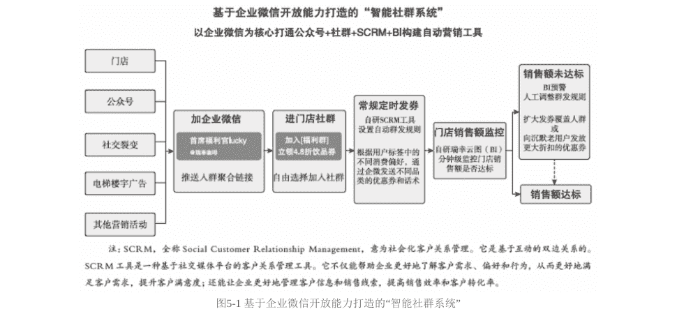
在瑞幸的智能社群体系里，门店海报、公众号、社交裂变、电梯楼宇广告等触点，都把企业微信二维码摆在显眼处。扫码即进门店社群，主理人会不定期投放优惠券，而且是千人千面的。

不少老用户都有过这种体验：打开 App 或小程序，自动弹券；点开券码，又出现一个企业微信二维码；加了企微后，系统继续推券。比如一杯 26 元的咖啡，第一次弹 9.5 折，你滑走不买，马上变成 9.3 折，再滑又变成 9.1 折，直到 8.8 折。下次再打开小程序，券会根据你上一次的点击习惯和兴趣偏好再推送。这就是千人千面。

背后靠的是 SCRM。用户一旦添加企业微信，系统就能沉淀行为轨迹、兴趣偏好、星座、收入、性格、消费习惯等标签，生成个性化营销方案，再做差异化券包投放。

有了这层能力，每家门店的销售额都能被实时监控。业绩不达标，运营看板立刻亮红字，提示流量缺口、转化率缺口、销售额缺口、需要补投多少券。

普通商家很难复制。没有千人程序团队，普通 CRM 只能粗放运营，连精准券包推送都做不到。可现在有了 ChatGPT 和数字人，写代码、搭系统变得更轻。我在一次公开分享中说过，人是人工智能里的神经元，互联网是连起神经元的网络。过去需要千人团队做的数字化搭建，现在 AI 可以分担大头。

### 如何在社交圈中获得高质量客户

瑞幸 2023 年全年营收 249.03 亿元，同比 +87.3%；营业利润 30.26 亿元，同比 +161.7%。年末门店 16248 家，净增 8034 家；月均交易客户 4837 万，同比 +124.1%。

支撑成绩的是获客成本的持续下降。2019 年一个客户成本 44.61 元，2021 年起稳定在 13 元左右徘徊。

获客成本下来了，爆品也在不断滚动。陨石拿铁、厚乳拿铁、生椰拿铁、椰云拿铁、酱香拿铁，每款都能在单周做到百万杯甚至千万杯。爆品带来引流和复购，瑞幸牢牢占据 10-25 元咖啡价格带的前列。

这不只是技术团队厉害，更是摸准了破坏性创新的逻辑。云南保山是瑞幸和星巴克共同的豆源地，同样品质、同样服务，瑞幸价格几乎是星巴克的一半。同等品质我更低价，同等价格我品质更高，用精准满足需求换来用户选择。

产品怎么做到持续爆？看瑞幸的产品研发流程。

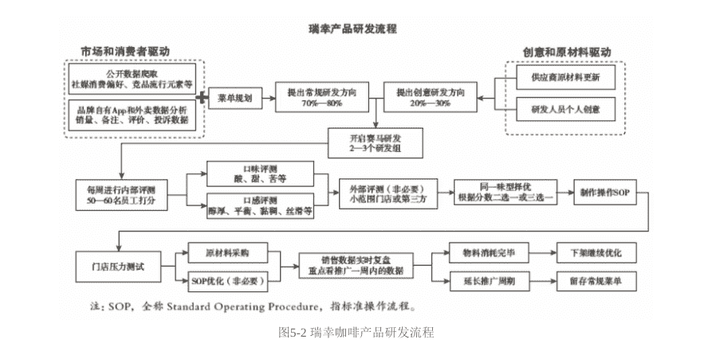
流程分市场消费者驱动和创意原材料驱动两条线。

市场驱动主要靠公开数据爬取和自有 App、外卖平台数据归纳。重点看美团等平台上自家和竞品的销量、评价，用反馈反推菜单和研发方向。这部分占整体研发的 70%-80%。

剩下 20%-30% 靠创意和原材料驱动，包括研发人员的个人创意、老板建议、供应商的原料更新。原料到位了，就能开发新品。

驱动明确后启动赛马研发：比如十个方向，安排两三个小组同时冲，最后比品质。

内部测评每周 50-60 名员工尝味，大的节点会到近 200 人参与。再邀请社群成员做外部测评，愿意发朋友圈晒体验的用户本身就是核心爱好者，若是社群 KOL，还能带下一批高质量客群。

测评打分后选优，制 SOP。随后门店压力测试，预售看能不能卖动，能就量产，不能就回炉优化。

再用千人千面做数据复盘：GMV、流量、转化率、进店转化率等指标上看板。物料耗尽就下架优化，能常卖的就进入常规菜单。走完这套闭环，才能保证次次出爆款，也才能持续获取高质量客户。

### 如何充分利用私域流量

盈利 = 营业收入 - 成本。提升盈利有三条路：增收不增本、保收降本、增收又降本。第三条最可持续。

营业收入 = 销量 × 客单价。提销量靠拓店和单店稳定性；提客单价靠上高价新品和控优惠。但销量和客单价往往不同步。此时大 AI 调盘能帮助在优惠收紧的同时保持销量稳定。

成本包括原材料、房租、运营等。原材料成本可通过规模化采购降价，或自建工厂提升环节利润。大 AI 调盘可以判断选址，例如通州区北京物资学院附近的一家新店，开业后上午营收就能达到普通店全天水平。门店火爆售罄、需要支援，也能通过大 AI 调盘、大 AI 监控、大 AI 模拟推算洞察，工厂端云南、广西都能被 AI 全链路监控降本增效。

损耗控制属于工业互联网范畴。自建供应链平台和数字化运营都能减损。大 AI 调盘还能帮助图纸设计者做科学预算和规划输出，减少设计层面的浪费，并把数字化运营本身的损耗算清楚。

房租涉及租金、动线周期、关店率。人员成本随门店规模和自动化程度变化。配送成本可通过战略合作、自建配送中心或单店配送缩小半径来优化。最终的计算结果经财务人工复核后，形成可执行的降本增效依据。

私域在其中起关键作用。上新品前可先在私域社群做测试，用反馈决定是否放量；备货前可在私域预售，按实际订单确定生产规模和原料采购量，把大 AI 调盘和私域流量结合起来，才能真正降本提效。

### 利用 AI 技术进行社交圈裂变运营

瑞幸的社交裂变涵盖获客、提频、复购和会员，分为三步。

1. 转化 / 多渠道引流
线下门店、自有 App、微信生态、抖音、小红书、微博、B 站等全面导流至社群。2021 年 9 月后，平台间付费引流成为常态，例如抖音通过巨量星图导微信，成本约 2 元/粉。持续把公域导进私域，是裂变的前提。

截至 2021 年底，瑞幸线下门店超 6000 家，小程序私域用户 993.4 万，App 私域用户 1145.1 万，公众号、抖音官方号等私域用户 181.1 万。全年累计用户 9200 万，私域占比超四分之一。

2. 中心化社群运营
添加企业微信、LBS 进群、日常运营已全 AI 化。系统先做千人千面标签，再由 ChatGPT 生成内容，Midjourney 快速出图做定制化海报推送。价格敏感用户发大额券；价格敏感且爱分享的用户同时获分享链接，带来成交还能拿佣金；价格不敏感且不爱分享的用户则收到个性化种草海报。

3. 提频 / 裂变
限时福利券、付费会员卡、多渠道直播是常用手段。仅 2022 年 3 月，瑞幸抖音直播销售额就达 753.6 万元。裂变过程尽量自动化，后续仍需人来训练 AI，例如拉新、下载 App、群内抢券、运营小程序和视频号，都需要人机协作。

真人直播提供情绪价值，数字人可 24 小时不间断，真人还能调教数字人。社群运营同理，人机结合才能让 App、社群和社交裂变长效运转。

### 让公私域流量实现联动

私域撬动公域，最直接的是连麦。直播中与主播就私域热话题互动，把流量“炸”起来，有话题、有故事的人效果更佳。连麦是小撬。

还有大撬。早期社群是“文科版”千人千面，缺乏 AI。虽然有 AI，也必须真正了解客户。

比如客户张彦祖 11，他的微信资料如图：

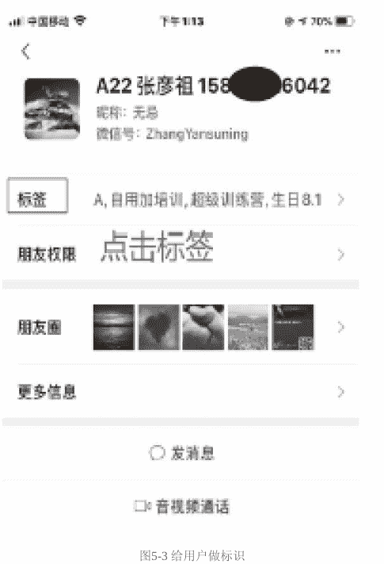
图里能看到名字前带“A22”，表示在我们公司消费 22 次。消费 20 次以上的标记为 A，名字后跟电话，另有标签分组。这是早期的私域分组玩法。

如图 5-4，我们为他设置的标签如下。

### 客户标签与私域运营

A：
在我们公司消费 20 次以上的消费级别为 A。

自用加培训：

在私域里做客户分层，我最直接的用法就是把参加完课程的个人学员编进公司的流量交付组。不少宝妈就是走这条路出来的，我会把一部分企业客户的订单分给她们执行。以后要给这批人发定向任务时，直接在后台点一下“自用加培训”标签，人群就筛选出来了，省事又省时。

超级训练营是另一个分层抓手。这个营要到线下基地面授，费用自然会高一些。系统里给它单独建了标签，一点就能判断客户有没有来过。来过的都归到高级客户池，我每半年就会给他们定向派发优惠券。

生日、画像这些基础信息也要同步补上。生日比如写成 8.1，就是八月一号。客户描述别只停留在消费金额，最好多维一点：性格倾向、交友方式、对人的态度、对商品的态度…配上一张照片更直观。等标签建起来后，新品优先推送给 A 级客户，超级训练营的新课优先通知他们，想牵线认识，也能按爱好做匹配。

上面这些千人千面的做法是早期的打法。关系熟了之后，下一步就是用私域去撬动公域。以我每周五晚上直播为主推的 299 元套餐券为例，周一到周四，我会在对应的微信群里反复提醒，同时把 100 元抵 150 元的券先发进去。群里的人有的自己要买，有的冲着信任，有的就图个便宜，券领的人很多。临近开播时，我再把抖音直播链接发到群里，领券的人点进去先看一条加热过的短视频，然后顺势跳进直播间下单。配合的话术可以参考下面这组模板。

表5-2 直播间话术模板

| 预热动作 | 话术类型示例 |
| :--- | :--- |
| 周五晚 8 点正式开播 | 痛点解决型：就是媒体上说过的那件显瘦裙子 |
| 周一至周四甚至更早开启预售 | 服务至上型：1. 这家店东西不行。答：逐一解释后买家道歉 2. 客服姐姐很负责，上次帮我催了两小时快递 |
| 周五晚把加热短视频发进群 | 好评轰炸型：东西真的好，下次还来买！+1+2+3… |
| 领券客户点短视频右上角进直播间 | IP 助力型：主播还记得我吗？前天在朝阳公园遛狗我们碰到过 |
| 下单沟通环节 | 门槛强调型：美白效果挺可以的，有研发团队的公司就是不一样 |
| 直播与短视频流量叠加甚至闭环 | 高频复购型：这个月第四次回购了，能不能再优惠点 |

抖音的机制是成交就会给推流。关键是这个流量是短视频带来的跳链流量。平台判断这批用户是带着购买意图来的，所以认为价值很高。短视频给直播间导流，直播间再给账号贡献数据，形成了私域撬动公域的循环。等公域流量进来后，再把人沉淀到社群，慢慢培养成分销节点，获客和流量的闭环就打通了。

> [1] 关于张彦祖的一切信息都是虚拟的，不涉及某个真实人物的隐私。

社交圈在门店里的应用很多人理解偏了。以瑞幸的智能监控系统为例，图 5-5 所示的设备并非用来盯员工或粉丝，而是服务于千人千面的推送。摄像头采集的数据汇入处理中心，输出帧图信息，经 Face ID 识别后，分发到全国门店的系统里指导投放。这只是表层应用。

内核其实是瑞幸的全链路数字化地图，图 5-6 所示。瑞幸内部有“六脉神剑”：门店管理、门店选址、产品研发、供应链管理、人员管理、用户运营。社交圈在门店的内核作用，只是智能用户运营这个板块的一小部分。

亚马逊飞轮就是典型的内核工具，图5-7。第一环是客户体验。无论私域还是社群，先要保证界面友好、信息清晰、评价透明，再用会员计划提升复购意愿。第二环是流量。体验好后适度推广就能自然引流，苏宁时期我就明显感受到，好产品一点推就会有量，抖音、微信、今日头条等平台的爆品逻辑类似。第三环是卖家，流量大了自然吸引更多商家入驻。第四环是选品，商家多了品类丰富，体验又被进一步放大。

国内照搬飞轮走不通，得先礼后兵。先重仓做好物流加服务。物流上自建加第三方协同送达，提升满意度与忠诚度，同时用自动化设备提升仓配效率。服务上提供好客服、免费退换、丰富评价与问答，并做社会责任项目赢得口碑。后重点靠双优品挣钱。双优品就是质量过硬且性价比高的商品。物流服务打底后，用户对这类产品接受度更高。

AI 加持前，社群私域的打法通常是：先用优质服务立住口碑，再靠价格、入口体验、产品质量吸引注意，有流量后压缩上游利润、做选品和营销活动，流量再放大就用更低成本补贴用户，雪球越滚越大。AI 进来后，企业在私域的动作明显不一样了。

1. 私域社群构建。瑞幸搭建了高度互动的私域社群，已经在试 ChatGPT 加数字人做互动与点单，准备开拓新市场。
2. 个性化推荐。麦当劳用 AI 分析偏好，通过 ChatGPT 与数字人给出专属美食建议。
3. 内容创作与互动。必胜客在做内容共创，尝试用 ChatGPT 与数字人生产有趣内容，数字人形象采用动漫场景与用户交流。
4. 会员专属福利。星巴克的私域核心就是千人千面的会员福利，为提升复购率而设，并尝试用 ChatGPT 与数字人升级。
5. 数据分析与精准投放。呷哺呷哺用 AI 解析用户数据做精准投放，券类内容占比很高。
6. 用户反馈与互动。阳坊胜利涮羊肉把用户反馈搬到社群私域，鼓励用户参与互动，并试水 ChatGPT 与数字人接入。
7. AI 客服。康师傅私房牛肉面用 AI 客服提供智能解决方案，训练 ChatGPT 与数字人解答问题。
8. 私域社群营销。小肥羊火锅在做社群营销，尝试用 ChatGPT 与数字人生成个性化促销，提升转化。

这些只是部分实践，企业落地时要结合自身优势多点突破，而不是单点发力。

AI+IP：11 件套持久变现法

谈到 IP，很多人会问现在做 IP 还能不能赚钱。主要有两层担忧：头部 IP 生存艰难，IP 运营本身难度大。其实不必过度焦虑。对个人而言，做到 KOL 或圈粉级别，已经能每年带来百万元甚至千万元的增收。对企业而言，尤其是线下传统渠道型企业，走 IP 路线是转型必选项。IP 是抓取流量的利器，能提升辨识度，也能和消费者建立情感连接，提供温度和情绪价值。有了自有 IP，品牌影响力会无形放大，消费者更愿意在需要时付费。

> [1] 实际上，KOL、圈红已经属于广义上比较低层次的 IP 了。

提升品牌影响力的 IP 打法有两类。

一是打造知名 IP 形象。资源依赖性强，大企业多采用。麦当劳与游戏《部落冲突》合作出安格斯 MAX 厚牛堡，肯德基与可达鸭、皮卡丘合作做玩具套餐。拿到授权后，还可以用 Midjourney 等 AI 软件生成配套图、头像，为后续展开打基础。常规打法分五步：第一步定战略，明确目标人群、IP 与品牌契合度、IP 选择标准并匹配策略。核心是用户画像是否匹配 IP，比如儿童套餐配经典动画合适，配《狂飙》人物就不匹配。第二步做方案，把战略具体化。肯德基以新媒体为主渠道，打造 IP 粉丝生态圈。具体可匹配手游题材选 IP、借人气扩粉丝、建粉丝社群实行会员管理。关键在于会员管理能否让新老用户参与。第三步执行活动，以互动为核心提升知名度和粘性，用短视频等创意提升话题。第四步监测效果，用社交媒体反馈数据分析新趋势，调整运营策略并复盘预算与收益。第五步持续迭代，不断推新结合热点，推动用户共创，保持产品竞争优势。肯德基后续推出的“星愿大咖抖音生活节”就是迭代案例。

二是打造自有 IP 形象。中小企业资源有限，可自行生成。常用的有 Midjourney 和知识星球。Midjourney 是 AI 绘图工具，能生成动漫形象、数字人等。优点是无需绘画基础，输入关键词即可出图，细节细腻，可调风格主题。用我的照片做测试，关键词“动画写实和美式插画”，排版后即可形成一套海报，出图效率是人工的十倍以上。注意两点：图生图时原图人物要足够大，否则景深大画面杂，相似度下降；原图清晰度要高，最好是相机拍摄的高质量照片，像素决定还原度。知识星球则集成了数字人播报、文本配音、视频剪辑、形象与音色定制、智能抹除、字幕识别、数字人直播、AI 绘画等功能，是生成 IP 的关键操作工具。

> [1] 该软件有文生图和图生图两种方式。
> [2] 这一功能属于图生图。

知名 IP 合作的价值主要体现在引流到店和促进复购。以瑞幸为例，引流到店可做 IP 形象推广，如 2023 年 9 月与茅台联名酱香拿铁，首日销售额破亿元，至 2024 年 3 月 21 日用户超 2500 万。社交媒体营销上，双方在社群做抽奖、打卡、分享，送免费咖啡、专属红杯、二次联名巧克力，让参与者在玩乐中认识品牌。瞬间分享互动上，2023 年 4 月与哆啦 A 梦合作冰吸生椰拿铁，推出限量纸袋、杯套、贴纸，消费者二次创作后在社交平台晒图，互动量大增。

促进复购方面，个性化 IP 推荐可以根据消费记录推送相关产品，瑞幸用 ChatGPT 与 Midjourney 分析偏好实现精准推送。IP 会员计划可提供专属权益，如必胜客与宝可梦合作，购买指定套餐送限量皮卡丘周边，借助童年记忆提升复购。IP 主题活动如瑞幸与椰树椰汁 2022 年联名生椰拿铁，2023、2024 连续办“生日”，2024 年邀请合作者演唱《生椰快乐歌》，表情包贴纸传播后进一步提升复购。

换句话说，IP 合作模式可复制，企业只要找到合适的合作方、联名款和互动方向，就能复用。

IP 形象大致可分五类。第一类是可爱卡通形象，面向年轻人及家庭客群，传递健康、创意、便利的价值观。如小熊西餐厅用社交媒体、网红合作引流，结合会员制度与专属优惠提升复购。第二类是黑科技形象…

做品牌到现在已经不是光靠口味或价格拼了，谁手里的IP有温度、有记忆点，谁就能更快把人拉进来留下来。把IP用在餐饮和消费场景里，本质上是在用一种可识别的形象，帮品牌讲清它是谁、为谁服务、凭什么被反复选择。下面这套打法，把常见的IP形象分类、打造方法、裂变玩法以及AI加持的实战逻辑全部拆开讲清楚。

先看企业会用哪五类IP形象去锚定人群。

第一类是科技时尚感形象。受众是关注新技术的尝鲜者和追潮人群，品牌传递的核心是创新和科技感。有的餐饮品牌就用这类调性，通过AI聊天机器人做个性化推荐、订单跟进、智能服务来引流，再用手机点餐、智能支付等顺滑体验去促复购。

第二类是文化符号形象。锁定地域文化爱好者和来旅游的人，品牌要表达的是在地文化、历史与传承。河风精致寿司就走这条路，和本地文旅机构、景区联动把人群引进来，用地道地方特色美食唤起情感共鸣，从而实现复购。

第三类是名人形象。受众是明人的粉丝和社交媒体常客，品牌价值是知名度与影响力。星厨餐厅就是典型，和知名厨师、明星绑定，用其影响力完成引流，再通过联名菜品、独家签名纪念品等方式提高复购。

第四类是智能互动形象。面向科技爱好者和年轻人，核心是提供个性化的互动体验。互动食堂是代表，借助AI技术做互动游戏，提升趣味感和参与度；同时用积分、等级体系奖励高频互动用户，刺激二次消费。

IP形象选定后，如何把IP做成可落地的运营能力，通常有五种打法。

第一，用VR沉浸体验造势。某知名企业就用虚拟技术打造门店沉浸感，把对新奇体验感兴趣的人聚到店里，还配了会员体系，用VR定制菜单并对消费会员给予回馈。

第二，用AR互动菜单吸睛。通过AR把点餐变成可玩的体验，吸引顾客到店感受新型点餐方式，再配合积分、折扣券来拉动回头。

第三，用智能语音服务升级点餐。吃货寿司门店的语音点餐系统是IP打造的亮点之一，基于语音识别，顾客用语音就能浏览菜单、下单，减少点餐焦虑；同时发放电子礼品卡、提供独家权益，引导线上消费。

第四，用个性化推荐做粉丝经营。基于顾客的历史消费和偏好推送专属菜品和优惠，精准触达能更快沉淀粉丝甚至铁粉。叠加限时特价新品试吃，也能有效提高复购。

第五，用AI服务做日常运营。食尚配送在IP构建上比较有想法，用AI聊天机器人做在线客服和点餐支持，提升使用体验吸引客流，再通过生日特典、积分翻倍等会员活动增强归属感和忠诚度。

VR、AR、智能语音、个性化推荐、AI客服只是把IP嵌进运营的常见手段。真正要让IP产生经济效益和品牌势能，还得回到目标受众、品牌主张、引流逻辑和复购逻辑上去做选择。

IP离不开AI加持

麦当劳、必胜客、星巴克、肯德基、赛百味的成功，各自有可复制的要素：麦当劳是标准化供应链加快捷便利服务与创新营销；必胜客强调品质服务、多元菜单、外送和家庭团体场景；星巴克靠独特的咖啡文化、舒适空间、个性化定制和社交媒体策略；肯德基做本土化融合、口味适配、产品定位与广告；赛百味提供健康轻食、个性化定制、快速服务和区域化合作。这些要素让品牌成为行业标杆。今天品牌仍能延续辉煌，但呈现形式从口号变成了可感知的IP。

要把企业战略通过IP建立起来，核心是九步走。

明确目标市场是谁，了解年龄性别、地域、兴趣和消费习惯。定义品牌定位，包括价格、服务质量和创新度。确定好有记忆点的品牌名称。阐述品牌价值观与使命，并在顾客心智中树立正向形象。描述视觉标识与形象元素，如颜色字体图形。制定传达策略，投放渠道涵盖广告、促销、社交媒体。规划品牌扩展路径，比如新店、新品、新服务。制订品牌保护计划，涉及商标注册、版权和法律支持。最后，用AI技术完成品牌的引流与复购闭环，比如智能推荐、CRM和个性化营销。

这九步里最后一步起决定性作用。没有AI整合，按前八步常规做品牌或IP，速度跟不上就会被淘汰。拍宣传短视频，过去请高手一小时出一条，有了AI一小时能出几百条，而且能自动融合定位、名称、价值观等要求。

AI还能让IP形象变得更生动。团队曾用Midjourney为某餐饮品牌设计徽章，指令是要一个充满神圣感的IP形象供会员领取。最终生成四张图，质量细腻、完成速度极快，人工做要耗费更多时间。

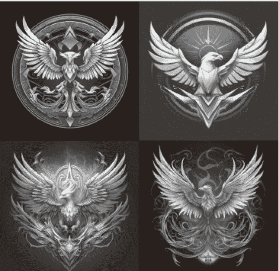
图6-1 为某餐饮品牌设计的徽章

IP打造的效率和成品质量被AI大幅提升，放弃的理由几乎没有。

想实现持续引流变现，IP裂变是关键。常用的裂变有十个方向。

任务裂变。以邻里互助计划为代表。公司做“1元包邮领”活动，把含企业微信二维码的海报发到邻里群，群成员扫码加好友后收到自动回复的专属文案和海报，参与者按规则转发社交媒体后获得奖励，活动曝光带来新客，社区达人参与效果更好。

积分裂变。以“积分换购，低至1分钱”为例。用户扫码领取专属文案海报并分享到个人社交媒体，完成后进专属群查积分。初始积分不够，需通过群内小程序进积分商城挑选心仪商品并分享购买链接，每带来一个好友助力就加分，直至达到1分钱购买门槛，商家获得新用户和营业额增长。

分销裂变。刺激用户主动分享带来即时收益，适合与个人IP合作。个人IP在朋友圈发海报，好友扫码领红包，领取后需分享指定购物链接，被点击成交后企业返佣，品牌获销路，达人获报酬。

抽奖裂变。参与者需将链接转发出去，人越多收益越大。核心点在于提现必须下载指定App或注册小程序，主办方收获大量新用户。

社群裂变。设置诱饵奖励吸引成员拉新。吃货社群曾做“邀请新人入群，1元吃美食”，参与者分享拉新海报完成任务即可低价用餐。用AI生成专属拉新海报能增加新鲜感，提升进群意愿。

社交红包裂变。点击小程序抽红包，需先添加发起者为好友，想多抽就需分享给更多朋友，人越多机会越多金额越大，发起者顺势把好友引导入群。

养成游戏裂变。通过等级、奖励、场景设计吸引用户参与并分享，游戏互动带来品牌曝光，个人IP也能汇聚同好。

打卡裂变。常与自律或公益结合，如每日英语、减肥、做饭打卡。扫码进群坚持打卡并分享到社交媒体，感兴趣的人通过二维码扫码或被邀请入群。也可与企业引流结合，如职业培训品牌让用户分享学习打卡内容置换福利，吸引同类需求者主动咨询。

测试裂变。像升级打怪的游戏兑换形式。企业设计进阶游戏，难度递增，需做抢券等任务提升实力，通关失败可通过转发游戏链接获得继续机会，月榜展示可转发积攒道具，形成持续获客闭环。

解锁裂变。先完成任务再拿奖励，适合社区达人和线下门店引流。设置精准的解锁标准，能让获客更精准。

AI+IP合作策略：11件套持续变现方案

以老乡鸡和咪咕视频的合作为例，系统化的IP合作可以按十一件套推进。

第一步，确认合作意向与目标。老乡鸡此前深耕二三线城市，现需转型扩大人群，需测试传播；咪咕视频想下沉市场，双方在体育运动与营养快餐上具备适配度。

第二步，研究咪咕视频在体育内容领域的市场地位与用户基础。咪咕是国内顶级体育内容平台，用户基数大，其中不少人有快餐消费需求，合作前景可观。

第三步，研究老乡鸡品牌的体育元素与营养快餐推广活动。营养快餐要做出来而非说出来，需要从品牌中提炼体育关联点。

第四步，定义版权合作范围，包括影片、音乐、广告、商标、品牌形象等。

第五步，确定版权使用期限与使用范围。

第六步，确认权益保护机制，包括知识产权保护与侵权追责。

第七步，进行合作协商。

第八步，签署协议，明确权责、版权使用规范、期限与终止条件。

第九步，履行协议，完成版权交付与推广执行。

第十步，建立沟通协调机制，确保问题及时解决和意见反馈。

第十一步，定期复盘评估效果，根据市场与用户反馈优化策略。

这个模板适用于任何品牌间的IP合作，关键在于用户融合、目标互补与元素可融合。

如果把AI嵌入这十一件套，每一步都会加速。AI可提供数据分析与市场洞察帮助精准定位受众；分析用户兴趣偏好以优化内容和参与度；提供消费者洞察优化推广策略与活动设计；监测侵权并提供自动化版权保护；分析渠道地域需求给出定制化版权使用建议；提供自动化版权监测与侵权追责；为协商提供数据预测支持；提供自动化合同管理与监控；提供个性化内容推荐与互动方案；提供智能客服与数据分析支持强化实时沟通；提供实时数据分析与反馈指导策略迭代。AI版的十一件套让IP合作完成度更高。

AI+IP定制策略：业绩N倍增的AI生成方案

用户体验旅程地图本质上是用户从获知信息到付费的漏斗，记录行为、触点、情绪、痛点与机会点。过去收集数据、分析整合耗时很长，现在AI大幅压缩了周期。

当IP由清晰的形象分类、落地的打造方法、系统化的裂变玩法和AI赋能的合作逻辑共同支撑时，品牌才真正从“有名字”走向“有势能”。

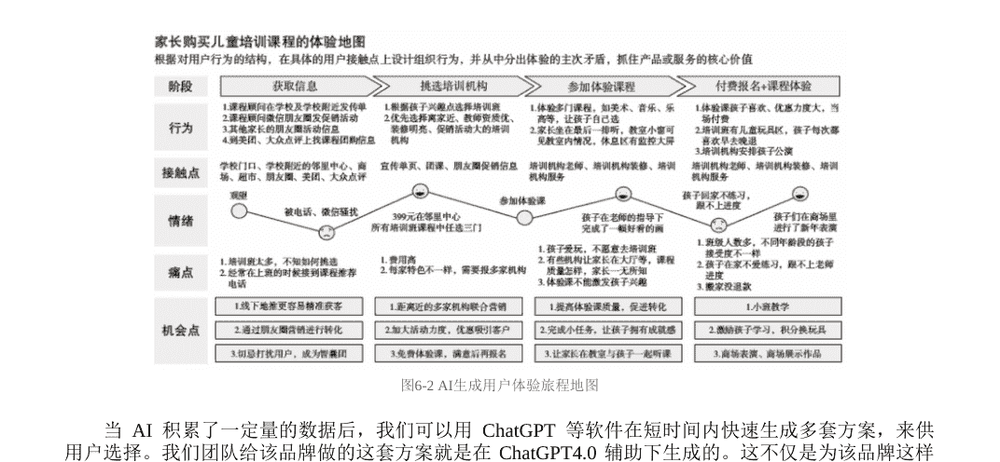

当AI已经攒够了数据体量之后，用ChatGPT这类工具在一两天里批量产出几套可供挑选的方案已经是常规操作。我们团队为某知名IP做的那套打法，就是借助ChatGPT4.0完成初稿迭代的。它既是为头部品牌量身定制的解决方案，也是一套可复用的、能让业绩数倍放大的AI产出方法论。前文提到的老乡鸡携手咪咕视频的案例，用同样的思路一样能快速成型。

做到这一步，关键是把从信息触达、到合作落地的全链路梳理清楚：要经历哪几个节点、信息怎么抓、怎么筛选、体验要叠加哪些环节、付费点如何设计。把这些要素铺到体验地图上，一眼就能看懂。

落地时到底是上AI“11件套”，还是直接走AI生成方案，得回到IP打造的真实诉求来决定。

## 7 AI+矩阵：三位一体持久变现法

### AI+矩阵怎么用、为什么用

现在做新媒体矩阵的企业很多，但认知参差不齐。有人以为矩阵就是起个好听的名字、给蓝V认证、批量注册号。早期确实是这么玩的，可现在还停留在这个层面，矩阵基本发挥不出价值。新东方给出的参考很有启发——三位一体AI矩阵。

这个模型顶端是各层级领导者。店长、区域负责人、甚至老板本人，都可以入局。他们开号不是为了带货，也不是为了招聘，而是为了做影响力。个人号的影响力往往能超过企业蓝V，一旦影响力起来，分销才水到渠成。团队合作过的孙姐家螺蛳粉，现在叫灯泡厂孙姐老牌螺蛳粉，就是孙姐个人影响力先炸开后，才去招分销商的。

矩阵左下角是企业账号，表述为企业多蓝V。不少人把蓝V当个人号来经营影响力，这是不对的。蓝V真正的使命是立行业标准。标准立住之后再做爆款，企业才能同时拿名声和收益。

矩阵右下角是员工侧，表述为标杆员工团，负责转化和高客单。员工矩阵是必选项吗？为什么要做高客单？实践里有人做有人不做，要结合自身判断。管理者常有顾虑：员工能做起来凭什么不单干？做不起来又怎么放心交给他们经营企业号？新东方用三位一体AI矩阵解开了这个死结。员工矩阵不是孤岛，能和领导者、企业蓝V互通有无，互相导流、互相兜底。员工不单打独斗，企业和员工都能双赢，这正是三位一体AI矩阵的核心价值。

标杆员工团必须是筛选出来的。我们服务过的一家火锅连锁就做得很严，全国门店海选、培训、PK，优胜者晋级，多轮下来才定出标杆团队。

高客单的逻辑也很清晰。高客单商品对人工服务依赖高，低客单则可以用图文或数字人完成。技术进步让三位一体AI矩阵成为服务、品牌、技术深度融合的产物。

### 矩阵生态圈的账号怎么搭

打造矩阵生态，第一件事是把账号做好，拆成四块来打。

**1.矩阵生态需要什么样的账号**

以汉堡王抖音号为例说明。头图写着“有我、有种、有趣”，头图就是品牌广告位，不要浪费。头像高清logo清晰，一眼可辨，记忆点更强。蓝V已认证，企业号注册后再认证更稳妥。

再看赞粉比，即点赞数除以粉丝数。合理区间要看行业，汉堡王当时是一个直播号，获赞远小于粉丝数，恰恰说明用户是奔着品牌来的。

简介要有，且要简短。还要考虑官方电话、粉丝群、抖店、商品卡投放、封面、语言风格、横竖屏、标题等展示与设置。

这六项就是1.0账号的底线。1.0能满足起步，后续要升级。2.0版要叠加视觉锤+语言钉+音乐弹+裂变斧，3.0版要形成自有标签。用户是谁，账号标签就该是什么。

**2.矩阵主播怎么选、魅力怎么提**

**筛选方法**

某公司做乡村振兴，主播要面对农产品。用SWOT拆解：优势劣势机会威胁。先把候选人条件归类，结论是该候选人博学、外形不突出。

第二步是放大优势、转化劣势。外形朴实做农产品直播反而亲切，像身边人。配合博学表达，吸引力自然提升。

真人主播和AI主播都能入局组成矩阵。主播分四层：

入门话术型，口头禅是欢迎光临、666、点个关注。此类要完成7天破零，7天内引到一单，否则淘汰。

普通熟手型，对话术和流量掌控熟练，月销破百万元。

运营型主播很稀缺，能自己发现判断拿下流量，相当于自带运营，月销可破千万元。

顶流IP主播，有人设信任和专业内容，月销常破亿元。多位头部主播都是从入门一路长出来的。

配比上IP主播很难得，一般健康结构是话术型约20%，普通熟手型和运营型各占30%到45%，IP主播约5%。

**魅力提升九件事**

妆容：抖音主流有纯欲少女妆、亚裔混血妆、港风浓颜妆、通勤百搭妆。数据上纯欲少女妆从曝光到进直播间转化最高，视觉重心在面部，腮红+镜面唇釉，大面积横向腮红+晶莹唇。

年纪偏大可选亚裔混血妆，重心在眉根，野生眉+狐系眼妆，低饱和唇。

港风浓颜重唇部，眼妆+高饱和红唇，眉峰上挑。

百搭素颜妆同色系搭配，口红腮红眼影统一，鼻头点腮红提气色。

直播参数：美颜滤镜清晰度等，依软件设定微调找最佳状态。

镜子练习：找最合适的角度和表情，比如45度斜角微笑。自信来源于熟练，熟能生巧。目光坚定、嘴角微扬，每天对镜5分钟，还可模拟粉丝互动和与运营配合。

目光练习：目光要锐利有神。练法是闭眼用眼睛“写”名字，每天4分钟内重复50次以上，慢慢来，对引流促单有帮助。

气息练习：憋气增大肺活量，多数人可憋一分钟；喊麦刻意控制声音；运动中发声保持气息稳定；闻花香练习，闭眼想象花田深吸入丹田屏息10秒，手放肋侧感受扩张，每日3分钟。

嗓子保护：开播前后各按虎口1分钟；可用气泡音改善音质；多喝温水，菊花茶、胖大海也行。

灯光：身高不同打光不同，矮个子可把顶灯加亮。侧光约45度凸显轮廓，常用唯卓仕SL-200W；背光约30度强化背景和轮廓感，常用纽尔环形灯；顶光向下约35度提升明亮度，常用LED视频灯；前光45度以内营造亲和温馨感，常用纽尔环形灯。

直播贴片：醒图App和直播加加App都能做个性化贴片，实时修改，传达重点信息、提升参与感、减少重复口播。

流量道具：法国香水、波尔多红酒这类高客单模型放在直播间，刷到的人会被道具本身吸引而停留。

**3.矩阵账号怎么装修**

标题：前期要有人设易记，直观带行业搜索词，如xx说车，叠词更亲切如皮皮。后期走品牌IP路线，企业号最好把品牌名放最前，如汉堡王沈阳xx区店。可权威式、数字式、情感式、悬疑式，AI也能帮忙生成。

头像：个人或企业都遵循超高清像精英。蓝V企业号头像最好呈现logo。

头图：广告位，要说清我们是谁能给什么，也可做互动共鸣持续塑人设。

封面：用于品牌宣传转粉复播，抖音和剪映可保持风格统一。标题可用疑问或探秘句，字体可选刺绣中文字体。

横竖屏：横屏能弱化面部小瑕疵，展示更宽场景，如两家门店并排、人潮画面，还能放长文案。竖屏适合颜值高、沉浸感强、商品展示需求。并非唯一因素，可配合其他手段。

语言钉+视觉锤：语言钉把定位品质品性刻进心智，可口号广告语；视觉锤是品牌视觉符号，商标色彩产品外观创始人形象。两者共同作用产生记忆、联想、转粉裂变。

BGM：风格匹配带来流量。旅行类可用《旅行的意义》《这一生关于你的风景》《夏至未至》，生活记录可用《万有引力》《小手拉大手》《现在就出发》。使用需取得版权授权。

**4.矩阵账号内容怎么发**

内容为目标用户服务。真功夫做减肥餐，目标是35到50岁不想运动又想瘦的人，账号内容就要围绕这个人群。

树根模型50%内容做 broad引流，用明星代言人分享日常饮食等大流量主题吸引泛人群。

树干30%内容做精准聚焦，如每天发10条，其中3条是《懒人绿色健康减肥法第X期》，持续8、10、15期，把目标人群抓牢，期间植入如9块5减肥餐。

树枝20%内容做直播导流，直播前发热点结合内容或代言人直播日常分享。

该结构可迁移到其他品类，再按产品特性微调。

### 用AI在矩阵内推技术和服务

达美乐、星巴克、麦当劳、赛百味都已用AI在矩阵里推广服务。

**1.AI+供应链管理**

餐饮行业正加速进入 AI 赋能的新阶段，越来越多的品牌把自然语言处理、机器学习、计算机视觉等技术嵌入到业务链路里，用来提效和提升顾客体验。典型做法就是像墨式烧烤那样，用机器学习来做供应链与菜品需求的预测，让出品更准、履约更快。

#### AI 升级客户服务
不少企业把自然语言模型比如 ChatGPT 部署到服务前端，实现自动问答、下单辅导、菜品推荐，分担人力同时拉高满意度。达美乐在这块做得突出，在线用 ChatGPT 和聊天机器人处理点单与咨询。顾客问“怎么还没送到”“现在到哪儿了”“披萨怎么拆”这类高频问题，人类客服容易因情绪波动波动，机器人则能稳定输出标准答案。

#### AI 带来个性化陪伴
数字人、虚拟代言人等形态开始在矩阵里与用户实时互动，讲解产品、发放优惠、强化品牌记忆。星巴克推出 AR 虚拟导购，基于数字人技术为用户做个性化咖啡建议、代为下单并提供饮品知识，显著改善了体验。

#### AI 推动订单全流程自动化
引入自动化订单系统后，接收、处理、分发都能由 AI 驱动，效率提升的同时矩阵人力成本下降。麦当劳通过自动化订单处理加快了履单速度、提升了准确率，也带动了满意度。

#### AI 实现精准推送与运营
借助算法挖掘消费习惯和历史购买轨迹，品牌可以在矩阵里做个性化券包、活动与新品的精准触达，转化率明显提高。肯德基是这一路线的代表者。

#### AI 让点餐更自主
智能点餐的落地让顾客用手机或自助终端自助下单付款。排队减少、服务效率提升，还能回流数据用于菜单优化与个性化营销。麦当劳的自助点餐机和 App 就是典型，顾客自主选品、自主支付，既自由又省时。

#### AI 驱动菜品创新与优化
机器学习结合消费者反馈可以对配方、口味、营养等维度进行迭代，推出符合潮流和需求的新品，从而提升销售额与复购。赛百味通过数据分析与机器学习掌握偏好，持续推出新口味与营养均衡款。

#### AI 支撑精细化运营
对客群做精细分层后，通过矩阵推送个性化优惠与定制促销，能有效提升复购与忠诚度。星巴克的做法是基于偏好和购买历史做定制化券和产品推荐，构建出独特的购物感受。

#### AI 简化财务作业
自动财务系统能自动记录、归类、分析财务数据，提升准确性与效率，降低差错风险。肯德基采用该类系统后财务操作更稳健、延迟风险下降。

### 矩阵里如何差异化推广品牌
以某平台对老舍茶馆、味千拉面、比比客炸鸡的矩阵推广为例，三者的打法各有侧重。

老舍茶馆锁定追求清新时尚的年轻群体，定位是传统茶文化的品质体验。策略上强化中式时尚的门店与包装，推出高品质茶饮。AI 应用建议是分析茶饮需求做个性化推荐，数字人担任茶馆导游式服务员做实时文化解读，ChatGPT 聊天机器人提供茶品知识与订单咨询。

味千拉面面向拉面爱好者，主打正宗美味。策略是丰富口味和配料组合。AI 建议用机器学习分析口味偏好做个性化菜单定制，数字代言人以虚拟形象传递餐饮文化，聊天机器人提供口味与预约信息。

比比客炸鸡面向年轻人及炸鸡爱好者，定位美味多元的韩式炸鸡。策略是打造趣味时尚的空间与包装，拓宽口味。AI 建议借助大数据分析偏好做个性化营销，数字人做虚拟主播或代言人以直播短视频吸睛，ChatGPT 驱动智能点餐系统实现个性化推荐与互动。

综合来看，矩阵推广要做好三件事：锁定目标受众并匹配合适的矩阵；明确品牌形象与定位；结合品牌调性与新 IP 制定策略并接入 AI。一般性 AI 加速效率，数字人增强互动，ChatGPT 提升投放精度与服务质量，矩阵生态因此更智能。

### 在矩阵中把数据与智能价值放大
AI 在矩阵的数据化运用主要体现在三类技术路线。

一般性 AI 技术：智能点餐可收集订单与偏好，用机器学习预测喜好与趋势并推送菜单与优惠，麦当劳为代表；社交媒体监控通过自然语言处理解析评论反馈，实现快速响应，星巴克为代表；外卖数据分析基于历史订单预测峰值并优化配送，美团为代表。

数字人应用：服务员机器人收集需求、自然交互、下单送餐并提供咨询，海底捞为代表；虚拟主播或代言人收集关注数据并传播品牌与促销，肯德基为代表；聊天机器人收集咨询数据并提供 7×24 小时自动答复与定制推荐，达美乐为代表。

ChatGPT 应用：在线聊天通过对话生成识别意图并处理重复性咨询，麦当劳为代表；顾客回访收集评论数据以评估体验并做声誉管理与个性化服务，Yelp 为代表。

企业可按自身情况挑选适配的组合，而非全盘照搬。

### 用 AI 高效搭建矩阵生态圈
数据分析与预测：持续采集消费数据、洞察习惯、预测需求与趋势，为菜单与促销提前布局。星巴克移动支付即基于数据与预测围绕需求与反馈做互动，形成更精准的顾客模型。

供应链管理：与供应商协同、优化流程、引入数字人做自动化管理，确保稳定并降本减错。麦当劳用数字人自动化管理配合物联网提升供应链效率。

菜品研发与创新：跟踪市场趋势、探索特色品类、用 ChatGPT 激发创意，持续输出新品。肯德基以顾客需求为锚点持续迭代，并结合潮流与地域特色，保持矩阵的内容供给。

品质与卫生管理：员工培训、标准化流程、AI 辅助卫生管控共同守住口碑。墨式烧烤以追溯系统与供应链透明化建立信任，为矩阵生态奠定基础。

积分与会员管理：会员积分计划提升忠诚度，ChatGPT 提供个性化推荐提高消费频次与口碑扩散。达美乐通过忠诚计划与个性化推荐在单点突破后实现生态降本增效。

营销与推广：数字人自动化营销扩大影响，效果分析提升销售额，ChatGPT 辅助内容创作引导到店。昔客堡通过线上优惠与 AI 媒体矩阵快速建立知名度。

### AI+管理：持久变现的变革
管理领域 AI 正在崭露头角。业界常提“阿里管理三板斧”，实质是九板斧，按层级分为基层、中层、高层；基层为招开人、建团队、拿结果，中层为懂策略、搭班子、做导演，高层为定战略、造土壤、断事用人。

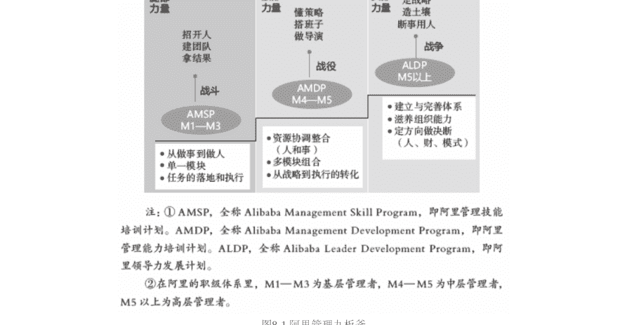
注：① AMSP，全称Alibaba Management Skill Program，即阿里管理技能培训计划。AMDP，全称Alibaba Management Development Program，即阿里管理能力培训计划。ALDP，全称Alibaba Leader Development Program，即阿里领导力发展计划。
②在阿里的职级体系里，M1—M3为基层管理者，M4—M5为中层管理者，M5以上为高层管理者。
图8-1 阿里管理九板斧

结合实操，我把九板斧的精髓归纳为“武政委三板斧”：提效能、促人才、推文化。提效能要求赋能管理者实现组织与业务目标，让竞争动态与客户声音顺畅流转，简化决策流程，激发员工潜能。促人才强调梳理人才结构、引进、选育留用与汰换，形成支撑战略与文化的人才梯队。推文化则靠管理者以身作则、影响团队、共同打造企业独特能量场。

实践案例丰富：星巴克用 AI 算法基于历史点单推荐饮品；必胜客用 NLP 与机器学习分析评论与评分生成优惠，提升留存转化；麦当劳用机器学习预测需求优化库存并通过智能餐桌、智能支付实现设备联动；汉堡王用语音识别等技术分析供应链数据预测订单与需求；肯德基用计算机视觉实时监测餐厅安全；7-11 用 NLP 与语音识别打造智能客服实现自动化问答与点餐。

管理的本质是提效与增收，事故即归零。AI 能有效降低管理风险，实现单点与整体突破，支撑可持续发展。

### 企业智能化管理的三层路径
想要全方位提升管理能力，需要分层推进。

基础层：基于 AI 的内部管理场景，搭建深度一体化的信息共享平台。AI 能显著提效，若只让员工私下用公司却不共享信息与重设 KPI/OKR，反而会制造管理矛盾，应统一规则并正向激励。

核心层：基于 AI 的商业场景，打造对外业务数据智能管理平台。瑞幸智能社群系统、麦当劳等在此层表现突出。

深化层：基于 AI 智能数据分析，构建面向战略场景的数据平台。这是跨时代的境界，瑞幸等企业正在迈向这一层。

企业需循序渐进，先夯实基础层再向上突破。

### AI 应用于公司管理的融合态势
头部企业的智能化管理实践已呈现“三元一体”，即数字人、机器人、仿生人融合。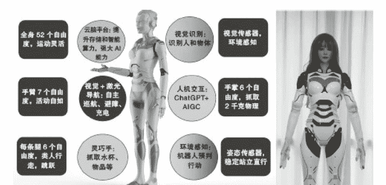
数字人制作门槛已大幅下降，外形相似的仿真人成本数千元，声音高度还原的几十万元，配合五六万元外设即可成为机器人。餐饮里机器人做刀削面、迎宾、送餐、环境监控已常见；服务型机器人与工业机器人各有场景。要达到人形仿生标准成本更高，管理本质是降本增效，中小企业需谨慎测算投入产出。

### 用 AI 提升管理效率
AI 应用于管理可系统化提效。

#### 1. 提升人力资源管理效率

人力资源运转正被通用大模型加速。以这类对话助手为例，输入“画一份组织架构图”“我们要招聘××岗位”“这个岗位的职责是什么”“帮忙写一份招募启事”等提示词，通常在一分钟内就能得到初稿。结果不满意还能让它继续优化。过去需要耗费一整天的人事事务，现在几分钟就能走完一轮。

#### 2. 财务运营提速
财务始终是企业里耗时最长的环节。缺少智能支持时，一张可复核的报表往往要计天。引入模型后，结论几分钟即可呈现，预算编制的节奏也被带起来了。

过往财务先形成预算草案，却在多轮会签中被反复改动，节奏与金额都难以把控。比如某个项目为何花费高？启动要投入多少？周期多长？进展如何？需求分析够不够充分？研发进展怎样？集成测试完成度如何？评估是否到位？预算是否合理？收入能否达成？一连串疑问让预算迟迟定不下来。

现在销售测算、成本测算、盈利测算都能由财务团队与模型协同完成。以引流类项目的销售额推演为例，主导方是财务团队加模型；开发成本、部署成本等成本推演也是财务团队加模型；净利润测算则在前两者基础上得出，责任主体同样是财务团队加模型。这样的结果更科学、更中立，对企业长期发展更有支撑。

表8-1 利用AI进行预算

| 预测项目 | 描述 | 开始日期 | 结束日期 | 负责人 |

| :--- | :--- | :--- | :--- | :--- |

| 收入预测 | 预测引流项目的销售收入 | 2022/7/10 | 2022/8/12 | 财务团队+AI |

（续表）

#### 3. 项目管控更精准
不少公司现在用项目化方式做获客。表 8-2 就是肯德基的一个案例。肯德基在“引流到门店”项目里，要求同时启用 ChatGPT、数字人，以及机器学习和大数据分析的智能手段，来预判并识别潜在客群，实现精准投放，从而提升项目管理的效能。

表8-2 肯德基AI管理应用

| 项目名称 | 项目描述 | 其他AI应用 | ChatGPT应用 | 数字人应用 | 知名餐饮公司 | 开始日期 | 结束日期 | 进度 |

| :--- | :--- | :--- | :--- | :--- | :--- | :--- | :--- | :--- |

| 引流到门店 | 通过项目管理实现顾客引流到门店 | 使用机器学习和大数据分析来预测和识别潜在顾客，并进行精准的推广活动 | 创建一个基于ChatGPT的智能客服系统，与顾客进行在线沟通，并提供个性化推荐 | 开发一个数字人系统，通过虚拟形象为顾客提供咨询和服务 | 肯德基 | 2022/7/10 | 2023/8/10 | 25% |

精准推送只是第一步，留住用户还需要产品与服务本身过硬。表 8-3 展示了某企业对该项目落地全流程的管控。

表8-3 项目流程实施

| 流程事项 | 描述 | 开始日期 | 结束日期 | 负责人 | 进度 |

| :--- | :--- | :--- | :--- | :--- | :--- |

| 项目启动 | 定义项目目标、范围和关键要素 | 2022/7/10 | 2023/7/11 | 项目经理 | 100% |

| 需求分析 | 确定其他 AI 应用、ChatGPT 应用和数字人应用的具体需求 | 2022/7/12 | 2023/7/14 | 产品团队 | 75% |

| 技术开发 | 开发并测试其他 AI 应用、ChatGPT 应用和数字人应用 | 2022/7/15 | 2023/8/5 | 开发团队 | 50% |

| 集成与测试 | 集成不同应用，进行系统测试和质量保证 | 2022/8/6 | 2023/8/8 | 测试团队 | 25% |

| 实施与上线 | 将应用部署到门店，并进行上线运营 | 2022/8/9 | 2023/8/10 | 运营团队 | 0% |

| 项目评估 | 评估项目效果和运营情况 | 2022/8/11 | 2023/8/12 | 项目经理 | 0% |

在该案例里，ChatGPT 被搭建成智能客服，通过在线交流减少人工投入，实现降本。数字人负责获客、复购、咨询和服务，也是一种降本增效的做法。

### 借助智能加速项目落地
公司新媒体同事常听我这样要求：“1 分钟内给我做完 1 分钟的视频。”听起来夸张，其实能做到。以前一个编导可能要花 1 小时，还不保证转化。如今只要把诉求说清楚，模型就能精准生成文案，再与数字人或主播结合直接合成视频。团队 1 小时内就能产出更多条内容。

以我们为例，新媒体 1 小时产出 60 到 100 条视频已成为可达成的目标。也就是说，视频生成类项目在智能加持下被极速推进。设计领域同理，过去 5 人小组一周的工作量，现在 3 分钟就能完成。比如我让模型执行：“帮我设计一款目前世界上还没有的 35 克 AR 眼镜，要全功能，标出每个部件的重量，给出电池或电源部分的重量，给出该部件的全球最佳供应商，给出一个以往眼镜未曾出现的功能。”

模型从镜框、显示器等九个方面给出了精确答案，并呈现了四款精致的 AR 眼镜原型。大量调研时间被压缩，方案确定周期被大幅缩短，整体设计进程明显加快。

### 智能驱动的供应链运转
无论哪个行业，企业对供应链管理都有要求。如何做好供应链，少不了智能技术的加持。下面以肯德基为例说明。

#### 1. 数据采集与整理
此环节需收集与整理订单数据、库存数据、消费者数据以及各类进销存数据，并保证准确完整。肯德基通过 POS 系统获取订单和销售数据，并与供应商库存数据整合，利用智能分析后输出公允结果。

#### 2. 需求推演
利用算法分析历史数据，预测未来需求量与趋势，据此制定采购计划与库存策略。肯德基利用智能技术分析销售数据与市场趋势，预测各产品需求量并制定采购计划。

#### 3. 供应商甄选与管理
可利用算法评估供应商的可靠性、交货周期等指标，辅助决策并进行动态管理。肯德基将智能与采购、法务、财务结合，评估供应商质量、可靠性和交付能力，减少中间费用，并通过供应链平台动态管理。不少头部企业也如此应用。

#### 4. 订单处理
可利用算法优化订单管理流程，实现自动化处理，包括订单生成、配送安排、库存更新。肯德基通过智能技术实现订单自动化处理。肯德基、瑞幸咖啡、麦当劳、必胜客等头部企业的订单管理已基本智能化，这是供应链中应用最成熟的领域。

#### 5. 运输与配送优化
可利用算法分析运输网络与需求情况，优化配送路线与运输方式，提高效率降低成本。肯德基用智能技术处理物流订单，分配能力很强，不少顾客反映其外卖体验是最佳之一。

#### 6. 仓储与库存优化
可利用算法对库存进行动态管理与优化，避免滞销与缺货，实现精细化管理。肯德基依托智能技术实时监测与优化库存，预测产品销售与消耗，降低滞销与缺货风险。

#### 7. 数据分析与决策支持
可利用算法对供应链数据进行分析，提供关键指标的可视化报表并生成决策支持报告，辅助管理者决策。肯德基正是如此落地。

#### 8. 风险预警与管控
可利用智能技术监测供应链风险，如天气、地震、交通拥堵等因素，及时预警并制定应对措施，降低风险。肯德基利用智能技术监测风险并及时预警与调整策略。

#### 9. 持续改进
需定期评估供应链管理效果，并根据反馈数据持续优化改进，提高管理水平与运营效率。肯德基定期通过智能技术分析反馈数据，不断优化改进。只有持续改进，供应链才能更完善，企业才能持续向上。

### 智能化解管理难题

#### 1. 绩效管理难题的化解
绩效管理是企业管理的难点之一。评估需要公平客观。过去 HR 要与各业务团队反复磨合，再开会确定最终 OKR，规则制定有时要一周甚至半个月。如今智能工具成为公平助手。把数据交给模型分析，可生成多套方案供大家挑选，直至各方认可。HR 能从法务、业务、财务等多角度给出管理者与被管理者都能接受的方案。

利用智能解决绩效评估体系设计只是其中一方面，智能在绩效管理的其他环节也能发挥作用，见表 8-4。

表8-4 AI在绩效管理中的应用

| 方案名称 | 方案内容 | 目标 |

| :--- | :--- | :--- |

| 绩效评估体系设计 | 设计并建立基于数据的绩效评估体系，通过数据指标和量化方法来对个人、团队和企业的表现和业绩进行评估 | 提高绩效评估的客观性和公正性，推动提高工作效率和业绩 |

| AI驱动的绩效管理 | 利用 AI技术对大量数据进行分析和处理，提供智能化的绩效管理工具和决策支持 | 提高绩效管理的效率和准确性，发现潜在的业绩增长机会 |

| 大数据应用于绩效数据挖掘 | 运用大数据技术对绩效数据进行深度挖掘和分析，发现关联性模式和趋势，为绩效改进和决策提供洞察和建议 | 发现绩效提升的潜力和优化的方向，实现业绩增长 |

| 企业绩效管理的数字化升级 | 将绩效管理从传统的手动操作转变为数字化系统，包括数据采集、分析、报告等环节的自动化和智能化 | 提高数据处理的效率和数据质量，促进绩效管理的持续优化 |

中层管理者或门店管理者使用智能加绩效管理的方式优势明显，答案可即时得到。高层往往只下达年度指标，如何拆解需中层自行解决。有了智能帮忙，中层可明确该做什么、遵循什么体系、如何挖掘数据、升级目标是什么，再请人辅导落地，就能达成目标，实现共赢。偏执行的岗位也能用智能持续提升绩效管理效果。

#### 2. 生产管理难题的化解
智能在生产管理的体现主要集中在以下环节。

##### （1）物料管理
可使用智能技术对库存进行智能管理，包括采购、出库、库存预警。通过分析历史数据与市场需求，系统可提供准确的库存预测，并自动触发订购流程，解决物料管理难题。

##### （2）生产监控
可利用智能技术对生产过程进行实时监控与分析，包括食材加工、烹饪与装配等。图像识别与视频分析技术可检测生产线异常并及时发出警报，解决监控难题。

##### （3）质量监控
基于图像识别与机器学习算法，可实现对产品质量的自动检测与评估。例如系统可分析食物颜色、形状、大小等特征，判断是否符合标准，从而提高产品一致性与品质，解决质量监控难题。

##### （4）工艺优化
可利用智能技术对生产数据进行分析与建模，提供工艺优化建议。比如在烹饪过程中，系统可根据实时监测数据推荐最佳烹饪时间与温度，以提高口感与营养价值。

##### （5）维护管理
可利用智能技术进行设备维护的预测与计划。通过监测设备运行数据与故障历史，系统可预测维护需求，减少停机时间，提高生产效率。

#### 3. 人员管理难题的化解
人员管理难题中热度最高的是“智能是否会替代员工”。国内某知名高校人工智能研究员的研究给出了参考，见表 8-5。农民、工人整体替代率达 70%-80%，销售人员约 30%，教师约 50%，护士约 40%，医生约 40%，司机约 70%，办公室职员约 60%，客服人员约 70%，零售员工约 60%，建筑工人约 40%，技工约 30%。

表8-5 AI较难替代的岗位

| 职业名称 | 基本任务 | 较难被替代部分 | 整体替代率（毛估） |

| :--- | :--- | :--- | :--- |

| 农民、农场工人 | 种植，收割，畜牧 | 复杂的农业工作，比如树木修剪 | 70% |

| 工厂工人 | 操作机器，装配产品，检查质量 | 需要手工技能和判断的任务 | 80% |

| 销售人员 | 客户沟通，销售产品，维护客户关系 | 理解复杂的人类需求和建立人际关系 | 30% |

| 教师 | 讲授课程，批改作业，辅导学生 | 理解复杂的学生需求和提供人性化关怀 | 50% |

| 护士 | 照顾病人，执行医嘱，管理药物 | 提供人性化关怀和处理复杂的医疗情况 | 40% |

| 医生 | 诊断疾病，提供治疗建议，进行手术 | 进行复杂手术和理解病人需求 | 40% |

| 司机 | 驾驶车辆，遵守交通规则，保证乘客安全 | 在复杂环境下的驾驶能力 | 70% |

| 办公室职员 | 处理文件，管理日程，处理通信 | 需要人际交往和判断能力的任务 | 60% |

| 客服人员 | 回答客户问题，处理投诉，提供产品信息 | 理解复杂的人类需求和处理复杂问题 | 70% |

| 餐饮服务员 | 接受订单，提供食物，清理桌子 | 提供优质服务和处理复杂情况 | 50% |

| 零售员工 | 为客户提供产品信息，协助选择商品 | 处理交易面对面的销售和咨询服务 | 60% |

| 清洁工 | 打扫卫生，清洁设施 | 处理复杂环境和不可预见的清洁任务 | 60% |

| 建筑工人 | 建筑结构施工、装修 | 复杂的手工任务和现场决策的能力 | 40% |

| 技工（电工、管道工等） | 维修、安装和检查电气和管道系统 | 复杂的手眼协调和现场判断 | 30% |

| 工程师 | 设计、测试和优化复杂系统 | 创新设计和解决复杂问题 | 40% |

| 程序员/软件开发者 | 编写、测试和维护软件 | 复杂的软件开发 | 70% |

| 会计师 | 记录财务交易，准备报表，进行审计 | 在解释和提供财务咨询方面 | 60% |

| 律师 | 提供法律咨询，代表客户处理法律事务 | 理解和应用法律原则及代表客户进行谈判和诉讼 | 35% |

| 市场营销专员 | 策划和执行营销活动，进行市场研究 | 理解消费者行为，创造吸引人的营销策略和内容 | 50% |

| 设计师 | 创造视觉效果，设计空间布局 | 理解和创造吸引人的设计 | 70% |

| 项目经理 | 规划和协调项目，管理团队，监控进度 | 理解项目需求，处理复杂的人际关系和决策问题 | 30% |

| 质量控制员 | 监督生产过程，确保产品质量 | 处理复杂的质量问题 | 60% |

| 金融专员/银行职员 | 进行金融分析，管理投资 | 处理银行业务进行复杂的金融决策 | 60% |

| 研究员/科研人员 | 进行科学研究，发表科学论文 | 提出创新的科学理论，进行复杂的实验设计 | 30% |

| 咨询顾问 | 为客户提供专业的建议 | 理解客户的具体需求，提供个性化的解决方案 | 40% |

| 社会工作者 | 帮助那些在生活中面临困难的人 | 理解人的情感，提供心理支持 | 20% |

| 法官 | 研究法律案例，裁决案件，解释法律、庭审监督等 | 法律的解释和裁决，以及对人类情感的理解和道德判断 | 30% |

| 记者 | 报道新闻、撰写文章等 | 挖掘新闻背后的故事，进行深入的采访 | 50% |

| 演员 | 表演角色，传达情感 | 传达复杂的人类情感，进行高水平的表演 | 50% |

| 导演 | 制定创作方向，管理电影制作 | 提出创新的电影理念 | 20% |

| 自媒体营运人员 | 创建和发布内容 | 理解受众的需求，提供个性化的内容 | 40% |

| 董事长 | 公司的高级领导职务，负责公司的重大决策制定和战略指导 | 领导能力、战略思维和人际交往能力 | 20% |

| 歌手 | 创作歌曲，录制音乐，举行演唱会 | 情感表达和个人魅力 | 40% |

| 编剧 | 创作剧本 | 理解复杂的人物关系、人性深度、文化背景等 | 40% |

| 按摩师 | 对人体的穴位和肌肉进行按摩 | 复杂的人体结构、肌肉感知和反应 | 5% |

| 美甲师 | 进行指甲美化 | 手工技艺 | 20% |

| KTV歌手 | 娱乐、陪唱、互动等 | 人际交往和情感互动 | 20% |

| 网红 | 内容创作，粉丝互动，商业合作 | 粉丝互动和商业合作 | 50% |

当你把镜头对准同一样工作，两种角色的分工会立刻暴露出差异。

摄影师：负责按下快门、构图、掌控光影，核心技能占比大约三成；主持人：靠语言表达、临场掌控、现场互动，核心技能则高达六成。表8-5用一组数字点破了一个现实：不管你现在坐在哪一层——高管、中层还是基层，终有一天必须学会用AI。关键不在于机器会不会取你而代之，而在于会用AI的人早就把不会用的人淘汰了。

拿短视频制作举例，有人一天憋出一两条，有人借助工具一天就能产出上百条、两百条，甚至上千条。如此差距下，前者的岗位还能谈得上延续吗？答案很直白。这正是AI替代的底层逻辑。

未来真正抗风险的“铁饭碗”，很可能落在高创造性与高情感性的脑力、体力劳动上，比如卫生服务、社会工作等专业。我们的策略很清晰：一边拥抱AI做放大器，一边把自己沉下去做机器难以复制的创造与共情。

### 让AI成为数据统计的专业副驾

数据统计向来繁琐、耗人耗力，引入AI后效率被彻底改写。它的作用主要体现在七个环节：

**先定目标，再谈数据。**统计之前必须搞清要解决什么问题、要达成什么效果，采集才有意义。肯德基在分析销售前，就借助AI明确了核心命题：各区域业绩如何、哪款产品最受欢迎。这一步是分析能否落地的先决条件。

**锁定指标，找准抓手。**目标明确后，要对应拆解需要跟踪的关键指标，用来洞察运营、捕捉风险或机会。实际操作中可以把问题抛给AI，再对它的输出不断打磨。肯德基关注的指标就有单店销售额、顾客满意度以及各品类销售占比。

**采集要准、要全、要可信。**数据收集过程必须保证准确全面、来源可靠。有技术工具尤其是AI加持，可以实现自动化采集并大幅降低失误。肯德基就靠POS系统自动汇总门店销售与订单信息，确保基础数据的完整性。

**清洗整理，消除噪音。**原始数据收集完要做校验、清洗、去重，剔除异常与重复记录。AI能在短时间内完成这套流程。肯德基利用相关技术快速清洗订单，去掉重复和异常后统一格式，为后续建模做准备。

**分析结合可视化呈现。**借助数据分析工具、统计分析、相关性分析和趋势分析，再用图表把结论讲清楚。肯德基用AI对销售额、销售走势等进行统计，并把结果做成可视化报表。

**输出报告，给出决策依据。**分析的价值在于解读与行动。AI擅长快速生成报告、解读趋势、归纳问题并给出建议和决策方案，这正是统计工作的终点。

**持续迭代，保持手感。**只学一次是不够的。要不断追踪新方法、新工具，尤其是AI的最新进展，参与学习与培训并落地实践。肯德基正是通过持续关注技术动向、强化AI应用和内部学习，提升了数据分析的效能。

### 用AI把客户服务做得更懂人

**客服自动化。**客服业务繁杂，AI可以通过自然语言处理与语音识别搭建智能客服，实现自动问答与点餐。肯德基上线了智能客服，顾客在App或小程序里用语音/文字就能实时交互，完成自助点单与咨询。

**情绪识别。**除了自动化，还能分析顾客语气、文字背后的情绪，提供差异化安抚或热情回应。肯德基依据AI解析的情绪信号，对不同状态的顾客做出个性化应答，提升满意度。

**千人千面推荐。**基于机器学习与推荐算法，系统会学习顾客的历史点单与口味偏好，推送定制化菜品组合与优惠。肯德基正是通过这一路径提高复购与满意度。

**智能预订与排队。**排队是普遍痛点。AI可以支撑在线预订并结合实时客流进行智能排队。肯德基允许顾客提前下单，到店按系统排队，显著缩短等待。

**精准推送与营销。**结合消费习惯与购买历史，AI可定向投放优惠券、活动与新品信息，拉升转化。对销售业绩与趋势的解读、业务改进建议，也源自这一流程。肯德基管理层收到的趋势分析与优化方案即由此产生。

**风险预警与管理。**在服务过程中建立实时监测机制，一旦出现异常立即预警并启动应对，可有效降低风险。

**持续优化与学习。**客户服务要不断进化。AI与人性化同理心结合后，企业能提前预判问题、提供无摩擦体验，实现主动服务。肯德基不断吸收数据分析新方法，将所学转化为服务能力的提升。

### AI营销与行业走向

AIGC市场体量庞大、潜力可观。随着技术加速渗透，越来越多的企业把目光投向AI营销。市场研究预计AIGC将在未来数年保持高增速，规模有望达到数万亿元级别。

布局上不分中外都在发力。美国的OpenAI、谷歌、Meta[1]，国内的百度、阿里、360、华为、腾讯、科大讯飞，以及清华大学、复旦大学、中国科学院等科研机构，均在投入大量资源研发AI营销与行业应用。

现在，只要是电商相关、面向C端的ToC企业[2]，几乎都离不开AI。发展的方向或将从虚拟世界走向数字孪生，再迈向超级物联网。中国不少公司已借助新媒体+AI开启商业新篇。它们在六大层面同时发力：利用社交媒体实现品牌与促销的广泛传播，并由AI自动化内容分发提升覆盖；借助评论、私信等互动渠道结合ChatGPT式自然语言回复，实现实时精准的个性化沟通；以平台沉淀的海量行为数据辅以AI的强计算能力，进行精细洞察与趋势预测；依托直播、短视频、UGC等形式定制多渠道传播，AI则基于用户行为做精准投放与ROI优化；通过优质内容与品牌故事塑造形象，AI的情感分析和舆情监测帮助声誉管理与口碑应对；同时在在线预订、外卖、互动活动等场景中以智能点餐、语音助手提升体验。

具体投入方向也逐渐清晰。技术创新上，AIGC提供类真人对话体验，激发好奇与关注；应用广度上，娱乐、教育、办公等场景均可落地，形成多元需求；个性化体验上，基于输入的定制化回复提升参与感；交互灵活性上，手机、平板、电脑多端可用，随时对话；社交化分享上，用户乐于传播与AI的对话内容，自带传播效应。

除了社交媒体，AI在获客上还有更广的空间：基于数据制定个性化市场定位、传播与定价策略；搭建邮件、社交、搜索等数字化营销渠道实现精准触达；驱动广告投放数据分析和效果追踪，提升投放效率；挖掘海量用户数据发现潜在需求与消费趋势，指导新品与活动策划；在社交媒体上通过情感分析与口碑监测优化互动效果。

AI的价值最终体现在持续探索。只有把先进技术不断融入运营，才能让企业在可持续发展中真正受益。