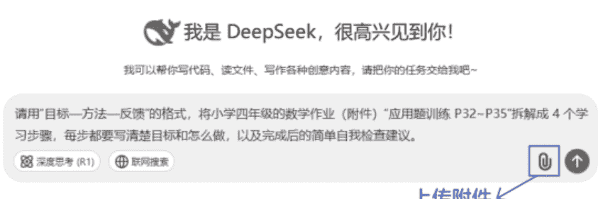

# AI协同育儿：让家庭教育更轻更准
# 序

做父母的日常往往高度重复。白天被工作牵扯，到了晚上又要回到英语跟读、古诗背诵、资料检索、演讲稿润色这些小事里。单独一件都不难，长期堆积的争执和焦虑却会迅速消耗耐心。

我也常遇到这样的瞬间：孩子说不会，我一边压住不耐烦手把手教，一边怀疑自己的方法是否失当。想做科学育儿，读了不少理论，真正落地时却总卡壳。

在这种拉扯中，我开始把 DeepSeek 这类对话式模型引入家里的教育场景。尝试后才发现，育儿可以有另一条路径：父母不必持续透支时间和精力盯控，孩子也不必被动执行指令，双方能共同进入人机协作的陪伴状态。

《AI家庭教育来了：DeepSeek陪你做智慧父母》并不讲技术参数，而是聚焦普通家庭如何把工具用起来，让教育更省力、更合规律、更有温度。出发点很单一：把智能放到真正需要的位置。你不需要成为专家，掌握几招提问与规则设定，就能率先进入 AI 协同育儿的节奏。

过去的家庭教育像拔河。AI 的出现，尤其是兼具中文理解与多轮对话能力的 DeepSeek，并不是要取代父母的责任，而是提升判断力、强化陪伴、引导孩子成长。

实践下来会发现，孩子并非排斥管教，只是厌恶带着情绪的沟通。DeepSeek 能够拆解学习卡点，快速给出个性化建议，并通过提示词扮演错题盲区教练、作业拆解助手等角色。

这段时间我把自己当试验者，既用在自家孩子身上，也帮助几户邻里搭建专属育儿助手模型。从初期的混乱试错，到沉淀出可复用的使用场景与对话模板，我感受到一种全新的教育思维。

愿这本书能用智能赋能家长，让父母和孩子一起成长。智能让我们从监督者转向引导者，愿它成为你育儿路上的伙伴，一起开启科学育儿的探索。

# 第1章 新工具到家，准备升级育儿方式了吗
## 1.1 何为面向家庭的智能教育伙伴
当前最热的智能是什么？是能聊天写稿、解题编程的大语言模型。模型是基于海量文本训练出来的系统，能读懂人话也能生成人话，像个知识面广、表达流畅的超级大脑。

在众多模型里，DeepSeek 是国内团队打造的中文新秀，诞生于 2023 年中国 AI 生态加速的时期。它用数千亿条中文语料训练，知识储备厚实，表达能力强。既能理解你的意思，也能用人类的口吻回应。

没接触过的可以这样理解：一个具备知识、逻辑、表达与情绪模拟能力的智能伙伴。它能够：

- 解答语文数学英语题目
- 批改作文、提供范文
- 协助撰写计划、整理汇报
- 扮演情绪陪伴者、沟通引导者
- 编故事、出点子、模拟角色扮演
- 充当学习教练、习惯监督、时间管理助手

总的来说，只要要求清晰，它就能给出对应反馈。对父母而言，DeepSeek 正悄然成为一种新型的智能家庭教育助手。

### 1.1.1 核心长处概览
**母语级理解，更贴合表达习惯**

这是 DeepSeek 最明显的特长。像以英文训练为主的产品，面对复杂中文提问时容易出现理解偏差或答非所问。DeepSeek 的母语就是中文。

诸如“小升初该关注哪些点”“写一篇 600 字秋景作文”“五年级孩子如何高效背古文”等问题，它都能准确理解并用通俗语言作答。对习惯中文思维的家庭而言，这是关键。

**教育场景深度适配，衔接中国课标**

DeepSeek 在设计上就强化了教育场景，覆盖语文、数学、英语、科学等学科内容，从小学到高中。

因此它能：
- 生成符合课标的写作素材
- 讲解小学奥数题
- 梳理英语长难句

它不只是通用知识库，而是一个熟悉教材、贴近考试的课堂伙伴。

**贴合中国家庭的使用习惯**

DeepSeek 对国内用户的习惯做了大量优化：
- 支持中文语音输入、图片上传、格式识别
- 对作业辅导、时间规划、学习建议响应快
- 输出语气温和，不带讽刺冒犯

在辅助孩子解题时，不会出现不合适的表达，也不会用指责语气，可以安心让孩子使用。

### 1.1.2 个性化教学的实现路径
个性化教育时代已来，智能是核心支撑。传统教育是为群体设计：一个老师面对几十个学生，讲课方式单一，听不懂的问题无法反复讲。

家长越来越意识到：每个孩子节奏不同，家长精力有限，盲目报班成本高效果也不稳。此时一个能因材施教、随时陪伴、反应迅速的智能工具，就是家庭教育的超级助手。

DeepSeek 可以 24 小时不间断讲解，能成为：
- 孩子的家长顾问
- 卡壳时的讲解员
- 家庭矛盾时的情绪管理教练
- 学习计划的制定师
- 激发好奇的知识启迪者

这不是想象，是当下就能用到的现实。

### 1.1.3 使用起点 先学会提好问题
你不需要懂编程，只要学会提出具体问题，例如：

- “为三年级孩子制定一份涵盖语文数学英语和课外阅读的暑假计划”
- “用孩子能懂的方式解释分数和小数的关系”
- “列一份《红楼梦》初中生读书笔记提纲”
- “孩子最近情绪低落不想学习，该怎么安抚”

问题越具体，答案越精准。DeepSeek 并非替代父母，而是增强育儿能力，解决不会、没时间、没思路的困扰。

### 1.1.4 工具价值与教育理念的转变
用智能并非为了投机取巧，而是为了：
- 降低家庭教育的焦虑感
- 激发孩子的探索欲
- 释放父母精力，调节情绪
- 让孩子主动愿意学习

未来教育的方向是让每个家庭拥有自己的智慧学习生态，DeepSeek 值得尝试。

**结语：不是智能有多强，而是你愿不愿意迈出第一步**

教育正在被重新赋能。你不必一次学会所有技能，只要开始和 DeepSeek 聊聊孩子、聊聊烦恼、聊聊期待。它会像一位懂教育、懂孩子、懂你的朋友一样回应你。

## 1.2 怎样搭建专属的 DeepSeek 育儿助手
本节教你从零搭建专属助手。把家庭情况说清楚，它才可以按你的方式回应。理解来自训练和引导，描述越清晰，它越懂你家孩子和你的育儿风格。

### 1.2.1 三步搭建专属助手
**第一步：建立家庭画像，即背景描述**

打开官方网站，点击开始对话，用手机号或微信注册后即可使用，APP 流程相同。

需要告诉它：
- 你是父母还是祖辈
- 孩子年龄、年级、兴趣、性格、薄弱点
- 家庭教育风格：宽松、严格、鼓励型等
- 当前挑战：作业难完成、沟通困难、动力不足等

示例指令：
“我是一名五年级男孩的妈妈，孩子 12 岁，比较内向，数学偏弱，喜欢动漫和绘画。我们家风格温和，不打骂，希望提升专注力和数学成绩，请帮我做计划、给建议、优化沟通。”

**第二步：加深角色设定**

可以创建单一角色或多个角色。

示例 1 学习顾问：
“请扮演学习顾问，按孩子放学时间和作业情况安排晚间时间，每天我会反馈学习表现，请给出温和有效的鼓励建议。”

示例 2 情绪开导者：
“我会描述孩子的情绪问题，请你像一位温柔理性的心理咨询师，分析状态并给出建议。”

还能指定语气：温柔坚定、幽默鼓励、逻辑严谨等，直至调试到理想风格。

**第三步：设计任务清单，形成持续互动**

让它负责：
- 每日每周学习计划
- 作业辅导方案预设
- 情绪波动时的应对策略
- 根据反馈评估学习与行为

示例指令：
“帮我做一份兼顾学习与休闲的周末计划，含语文预习、数学练习和一次户外活动。”
“设计一个睡前亲子沟通的 5 问模板，增强交流深度。”
“孩子沉迷短视频，请给出以健康兴趣培养和亲子互动为核心的行为引导方案。”

做到这三步，你就拥有了专属的 DeepSeek 育儿助手，后续可按实际情况微调。

### 1.2.2 进阶玩法
DeepSeek 支持反馈迭代，对回答不满意可以继续要求调整。

例如：
- “表达太复杂，孩子听不懂，简化一下”
- “鼓励语太套路，更走心一点”
- “别用‘你一定能行’，改成‘这次比上次进步了’”
- “保持刚才那种轻松风格”

也可以要求用词温和，避免“你必须”“你错了”，改用“你有没有想过”“我们可以一起试试”等提问式表达。

示例指令：
“把‘你作业为什么又没写完？’改写成鼓励型表达。”

示例输出：
“最近写作业时是不是遇到困难了？有需要帮忙的地方随时说，我们一起想办法，相信下次会更好！”

使用后可继续微调：
- “用更口语化的表达”
- “回答再简短些”
- “语气更温暖点”
- “不要重复上次建议，换新的”
- “孩子不爱听大道理，用小故事讲”

**结语：陪伴从现在开始**

每个家庭和孩子都独特。DeepSeek 可以成为情绪稳定、逻辑清晰、24 小时在线的陪伴者。用得巧，它会越来越像你理想中的育儿助手，与你并肩照亮孩子的成长。

## 1.3 怎样让 DeepSeek 一句话说进孩子心里
经常会有这样的场景：早上叮嘱“别忘了带作业”，孩子还是落家里；讲数学题反复说“先算括号”，孩子却记不住顺序。家长的讲解里有经验和逻辑，孩子的接收却更依赖具体形象。

与其纠结“我讲了多少遍”，不如关注：
- 我的说法孩子能接受吗
- 他理解后的反馈我注意到了吗
- 有没有更形象的表达方式

DeepSeek 擅长把抽象逻辑转化为具体情境，用比喻类比让孩子听懂。它是亲子沟通的语言翻译器。

例如：
家长原话：“别拖拉，提高学习效率。”
DeepSeek 优化：“你现在是个升级中的游戏角色，任务是 30 分钟内打败‘拖延怪兽’，通关就能开启下一关。”

提示示例：“孩子不专注，我想说‘集中注意力’，请换成适合一年级听懂的说法。”
示例输出：“宝贝，你的专注力就像奥特曼的能量光波，写作业时保持专注，就像用光波打怪兽，作业就完成了！”

批评变鼓励
家长：“你怎么总是粗心！”
指令：“用温柔正向语气告诉孩子粗心可改，并用‘细心小侦探’故事引导。”
示例输出：“宝贝，每个人心里都住着细心小侦探，有时他会贪玩，轻轻唤醒他，他就会帮你找出错误。”

减少抗拒
家长：“快写作业，不然做不完！”
指令：“生成一段轻松幽默的引导语，把写作业变成闯关游戏，适合小学。”
示例输出：“叮！作业星球求救，需要你的数学知识救援，准备好拯救它了吗？”

习惯具象化
家长：“要坚持，别三天打鱼两天晒网。”
指令：“用比喻让孩子理解坚持的作用。”
示例输出：“坚持就像每天往魔法存钱罐投一枚硬币，罐子满了就会变出意想不到的宝贝！”

同一句话换个表达，孩子反应完全不同，家长沟通也更轻松。

**结语：教育孩子不仅要说对，更要说进心里**

亲子沟通要走近孩子。把表达方式交给 DeepSeek 优化一下，也许不用大声也能让孩子听进去。

(1) 人工智能（Artificial Intelligence）的英文缩写。指研究开发用于模拟、延伸和扩展人类智能的理论、方法、技术及应用系统的一门新技术科学。

# 第2章 DeepSeek 助你破解家庭教育难题
## 2.1 怎样用 DeepSeek 从根源激发孩子内驱力
- “孩子要我催着学，一放松就刷手机，不管不行，一管就吵。”
- “题讲几遍他点头不写笔，难道天生就不爱学？”

困扰的根源往往不是没人辅导，而是没动力。很多孩子不是不爱学，而是不知道为什么学、怎么学，缺乏构建意义感的能力。

### 2.1.1 实操方案：找到对话突破口
与其反复灌输，不如找到正确打开方式。DeepSeek 的语言组织和联想能力适合扮演意义引导员，让家长从说教者变成共同探索者。

**家长训练提示词：构建意义引导员**

指令示例：“我家孩子小学五年级，最近说学习没用不想写作业，请设计一段既能共情又能引导他看到学习意义的亲子对话，语气温和，最后给一个小目标。”

示例输出：
家长：“我看你写作业时有点不开心，是作业太难吗？”
孩子：“不是，就是不想写，觉得没用。”
家长：“有这种感觉一定有原因吧？你能告诉我是从什么时候开始的吗？我们试试今天设个小目标，先写完语文作文，完成后一起做点好玩的，你觉得如何？”

被理解是激活内驱力的第一步。

**DeepSeek 辅助生成目标与反馈机制**

孩子缺乏动力，往往是不知道怎么开始或得不到成就感。可以让 DeepSeek 生成个性化的任务-反馈-即时奖励方案。

指令示例：“为初一学生设计一周学习小目标，每个目标要有行动步骤、完成标准和奖励建议，鼓励自主规划。”

示例输出：
周一：完成语文阅读理解 5 道，正确率 80% 以上。
奖励建议：完成后可自行选择 15 分钟休闲活动，如听音乐、打球。
家长任务：给予鼓励语并用贴纸记录完成情况。

“做完就被看见、立刻收到小回应”的微型闭环，能让孩子更愿意上手，也会在潜意识里种下“付出就有回响”的期待。

### 2.1.2 用DeepSeek疏通情绪认知行为的环路

在日常亲子互动里，常会撞见下面几种看似不同实则同源的现象：

- ★ 考砸之后情绪低落，复盘环节直接划掉
- ★ 一碰到复杂学业就想先拖一拖
- ★ 课堂上能听懂，一到作业就卡壳

表象各不相同，症结却高度重合：情绪、认知、行为这条内在通道被堵住了。认知行为疗法[1]（Cognitive Behavior Therapy）里最核心的模型就是说明情绪、认知、行为三者互为因果，形成闭环。情绪决定我们如何看待一件事，认知决定我们给这件事贴上什么解释，行为则是最终的应答方式。举例来说，数学考砸→沮丧→“我大概学不会数学”→直接逃避订正。

这个时候如果家长硬逼“立刻把错题改完”，孩子多数会口头顺从、内心更封闭。更有效的路径是先安住情绪，再重塑认知，最后带动行为。DeepSeek可以在这里帮忙设计对话，先把情绪与认知的窗口打开，再推动行动转化。

#### 输入指令示例：
> “我家孩子数学刚考砸，现在很沮丧，总觉得自己数学不行，帮我写一段话，先安抚情绪再扭转想法，让他愿意回来复盘失分原因。”

##### DeepSeek输出示例：
> “宝贝，看你这次发挥失常心情很沉重，爸爸/妈妈都能感受到。一次成绩说明不了全部，它更像一面镜子，照出哪里还需要补强。学数学有点像学骑车，摔几次是常态，每一次调整都在让你更稳。你其实很会思考，只是撞到一个小坎。咱们一块儿打开试卷，把出错的地方挑出来，变成下次提分的小台阶，好吗？”

### 2.1.3 DeepSeek实操方法与常用指令模板

#### 情绪觉察与共情回应
目的：让情绪被接住而不是被压下去，为后续沟通腾出空间。

**输入指令示例：** “孩子因为考试没考好闷闷不乐也不肯说话，我想用温和的语气先表达我在意他本人，而不是成绩。请帮我写一段亲子对话，不带指责。”

**DeepSeek输出示例：**
> “我注意到你今天回来后状态有点低，我不确定是不是考试的事，但我想让你知道，不管结果怎样，我都愿意先听听你的感受。”

情绪被接纳后，理性交流才有落点。

#### 认知重建
目的：帮助孩子换个视角，重建“我能行”“这件事值得投入”的信念。

**输入指令示例：**
> “我想通过一次谈话，帮助读初一的孩子重新理解努力的价值。他常说学了也没用，我不想说教，希望从兴趣、成长或未来生活的角度引导。请写一段有共情又有引导力的对话。”

##### DeepSeek输出示例：
家长：“你说得有道理，有时候投入看不到即时回报我也曾怀疑过。但你有没有发现，努力本身也在悄悄改变你，比如你坚持练篮球，动作是不是比之前更流畅了？”

用可感的具体经验，把“努力”从抽象概念变成可体会的过程。

#### 行为启动与效能提升
目的：从“愿意做”到“想做”，再到“做得到”。

**输入指令示例：**
> “请为我家读五年级的孩子设计一份‘作文任务拆分卡’，他写作文爱拖延。我希望任务可视化，每完成一个小步都有小成就感，最终能独立写完整篇。”

##### DeepSeek输出示例：

作文任务拆分卡：

第一步：选一个熟悉的话题，控制在两分钟内定下来。
第二步：列出三个相关的片段或小故事。
第三步：用“起因—经过—结果”的骨架先写五句草稿。
第四步：正式成文，分两段完成。

完成后奖励：贴一张“写作小达人”贴纸，集齐三张可兑换一次免除家务的特权。

内驱力的培养需要循序渐进。把“情绪转认知”“认知转行动”连起来，学习会更主动。

### 2.1.4 家长定位调整：从盯着做向善用助手转变
借助DeepSeek，家长的角色从疲惫的提醒者变成有策略的引导者。可以从三点自检：

- ★ 帮孩子看见做事的意义：不只是做什么，更是为什么做；
- ★ 设计协同任务：让孩子感觉不是单打独斗；
- ★ 建立合理反馈：成就感来自被记录与被看见。

每周固定时段让孩子说出想学的内容，再由DeepSeek辅助生成目标与方法；也可以让它生成家庭学习计划表或亲子共学日志，并设置周末回顾，增强仪式感。

结语：与其推着孩子走，不如点亮他想走的动力。DeepSeek替代不了父母的爱，却能帮你找到打开孩子内心的对话方式，在互动中激活学习内驱力。

## 2.2 让DeepSeek担任作业拆解助手
陪写最大的问题不是家长累，而是家长替孩子用掉了“学习大脑”。孩子缺的是把大任务拆小、规划时间的本事，久而久之主动性被掏空，家长情绪也容易失控。

DeepSeek不仅知识储备广，还能按指令完成拆解、计划、润色等辅助工作，成为个性化的作业拆解伙伴：

- 把语文阅读、数学应用题、英语作文等大块任务拆成具体小步；
- 提示每一步该做什么、目标是什么；
- 提供参考素材或范例，降低启动门槛；
- 依据年级与能力输出匹配难度和引导问题。

它不是代做，而是陪练，提供框架，保留思考空间。

### 实操三步

**第一步：提供基础画像**
先让模型认识孩子。输入年级、学习习惯、性格特点如拖延、分心等，输出的拆解建议才更贴合。

提示词范例：
> “我是一名家长，我家孩子三年级，写作业容易分心，尤其是语文作业总写不完。请帮我生成一张‘今日作业拆解表’，把大任务拆成易完成的若干小任务，表里包含任务名、目标、预估时长、是否需要协助。”

提示：年级、特点、习惯越具体，模型输出越准。

**第二步：植入目标—方法—反馈思维**
把作业结构化为“做什么—怎么做—做完如何自查”，训练任务思维，从盲干转向有序执行。

提示词范例：
> “请用‘目标—方法—反馈’格式，把小学四年级数学作业‘应用题训练P32~P35’拆成四个学习步骤，每步写清目标和做法，以及完成后的简易自检建议。”

DeepSeek示范回复：
Step1：预读题干并标记重点（3分钟）
目标：快速判断题型如行程、倍数，并抓住关键数据。
方法：用荧光笔圈出数字如“每小时60千米”、关系词如“比……多”、问句。
Step2：画图（5分钟）
目标：把文字转成图形或算式框架。
方法：行程类画线段图，标出速度、方向、距离等。
Step3：分步计算（8分钟）
目标：保证每步可追溯，避免跳步。
方法：编号列式，如①60×3=180km ②280-180=100km……
Step4：错因归类（7分钟）
目标：建立错题库。
方法：用三色笔在错题旁标注，计算错误则补一道相似口算。

**第三步：生成每日计划表+鼓励语**
把步骤与时间整合成清晰路线图，再配一句温暖鼓励，提升执行力与信心。

> “请把以上任务逐条配一句简短鼓励语，适合10岁孩子，语气像老师对学生。例如：‘别急，慢慢走。’‘这题看着难，你已经会大半了！’‘就差一点，再坚持一下！’”

DeepSeek像一个可定制的陪写机器人，帮孩子逐步建立自我管理意识：如何启动、如何控时、如何自评，这些都是终身学习的基石。

结语：从陪写到陪练，DeepSeek解放家长，也赋能孩子。

## 2.3 用DeepSeek构建科学表扬方案
夸孩子要讲究“夸什么、怎么夸、何时夸”。科学表扬三原则：

- 夸过程而非结果：聚焦解决问题时的具体行为；
- 用具体描述而非模糊标签：少说“你真棒”，多说做了什么、怎么做；
- 对准心理需求：内向孩子需要表达鼓励，外向孩子需要专注肯定。

### 2.3.1 三步打造专属表扬模板

**第一步：输入性格特征**
提示词范例：
> “我的孩子五年级女生，比较敏感内向。最近她开始尝试主动举手，这对她很难。请生成一段适合她的表扬，体现努力与勇气。”

DeepSeek示范回复：
> “妈妈/爸爸注意到你今天主动举手了。我知道这需要很大勇气，你做得特别好！就像种子一点点顶开泥土，你的每一次尝试都在让自己更勇敢。”

**第二步：还原具体行为**
提示词范例：
> “孩子今天独立完成了一篇读书笔记，还加入了自己的见解。请生成一段表扬，突出思考能力和认真态度。”

DeepSeek示范回复：
> “宝贝，这篇笔记完成得很用心，妈妈/爸爸最喜欢你写的（引用孩子的一个见解）这个想法，说明你不仅读懂了，还动了脑子去思考，这种认真比得100分更宝贵。”

**第三步：多版本可选**
提示词范例：
“请用‘温暖型’‘幽默型’‘鼓励型’三种风格，各写一句表扬，场景是孩子主动拖地并整理鞋柜。”

DeepSeek示范回复：
温暖型：“宝贝一进门就看到地板亮亮的，鞋柜整整齐齐，原来是你帮忙收拾了，有你这样的细心小帮手，家里真温暖。”
幽默型：“家好像来了清洁小精灵！地板能照镜子，鞋子摆得井井有条，这位卫生高手下次能教教大人吗？”
鼓励型：“主动想到拖地、整理鞋柜，这份责任感很让人骄傲，下次大扫除你来当卫生小队长好吗？”

不同孩子需要不同模板：回避困难的重成长心态，缺乏自信的重勇气与突破，做事耐心的重专注与坚持。把这些提示词每周更新一次，让表扬成为家庭习惯，点燃成长引擎。

结语：科学的表扬不仅是语言奖励，更是认同。有了DeepSeek，家长不再发愁不会夸、夸不对。

## 2.4 用DeepSeek建立兴趣替代与行为引导机制
“我说了不许玩，你怎么又偷偷打游戏”“没收手机就哭闹”“写作业三分钟就想玩”。压制不如重建激励系统。

DeepSeek可帮你发现真实需求、兴趣方向与替代路径，制定替代游戏的策略并建立反馈机制。

**第一步：厘清沉迷背后的心理需求**
打游戏的动机往往是：

- 成就感缺失，现实中少被认可；
- 社交补偿，游戏好友填补归属感；
- 注意力涣散，现实学习枯燥；
- 情绪逃避，用游戏躲避焦虑与沮丧；
- 自主权渴望，游戏自由弥补被管控感。

提示词范例：“我是一名家长，我家孩子最近对某款游戏非常沉迷，每天都要玩。我怀疑他是因为情绪/人际/成就感问题在寻求满足。请列出五个可能的心理原因，并提示我如何逐步了解他的真实需求。”

DeepSeek示范回复：
孩子沉迷的五种可能心理原因：
1. 成就感缺口，现实学习/社交受挫，游戏通过升级、排名给予“我能行”的即时反馈。
2. 社交归属，游戏中固定队友提供了现实缺少的友谊与认同。
3. 情绪躲避，游戏是他应对压力的“安全屋”。
4. 自主渴望，游戏里的自由决策弥补了现实过度管控的无力感。
5. 感官刺激，游戏的视听快节奏填补了生活的单调。

了解需求的步骤：观察而非评判→用好奇式提问打开对话→提供替代性满足→共同制定规则。

游戏成瘾、亲子沟通、兴趣迷茫、专注力差，这些家庭痛点其实可以借助DeepSeek变成一套可操作、有反馈的成长系统。核心逻辑始终是：不硬碰硬，要引导、要共情、要协作。

**一、用退让代替堵截，让游戏慢慢让位**

先说一个底线：别搞断崖式戒断。说停就停、直接没收设备，很容易把孩子的逆反和逃避心推得更强。

真正的思路是兴趣替代+动机转移双管齐下，给孩子另一条同样有满足感的通道。

可以这样让DeepSeek帮忙找替代方案：
> “我家孩子六年级，正在沉迷xx游戏。请根据他的年龄、性格和过往表现，给我推荐3到5个既能挑起兴趣又有挑战性和成长性的活动方向。”

> “结合我孩子偏爱策略/竞技/建造类游戏的特点，帮我制定一个用兴趣活动替代游戏时间的方案，要包含活动内容、周目标、激励方式和反馈形式。”

有了替代方向，再配上行为引导机制。别把DeepSeek当监督员，而是当家庭正向反馈器。用“任务生成+亲子协作”把过程做成打卡游戏。

比如输入：
“我想让孩子逐步压缩游戏时长，培养阅读、运动、创作三项新习惯。请以闯关形式设计一周执行计划，包含具体任务、激励设置和每晚复盘提问。”

当家庭教育被设计成有目标、有反馈、有奖励的闭环，孩子的注意力、创造力和成就感才会从屏幕里迁移到现实生活，戒断自然水到渠成。

**二、用DeepSeek搭起情绪对话桥梁**

“我一句话，他顶十句”“一提作业就翻白眼”，很多父母都会怀疑自己是不是失败了。真相往往是孩子感受到的不是理解，而是指责、控制和否定，本能地关闭沟通。

DeepSeek可以充当情绪翻译和缓冲带。

**第一步：共情先于说教**
传统误区是孩子发脾气就讲道理，沉默就质问，顶嘴就批态度，这基本聊不起来。孩子要的是被看见情绪。

可以这样问：
“孩子最近情绪波动大，写作业就哭闹。请从他的视角分析可能经历了哪些情绪，我该怎样回应才能让他感到被理解？”

得到的共情思路大致是：作业无力感带来的挫败和逃避、对被批评的焦虑、对自由时间的压抑。回应方式是先降温再对话：“我注意到你现在不太舒服，要不要先缓五分钟？”“写作业确实累了，今天学了很久，我能体会你的感受。”配合“五分钟充电”如撕纸、涂鸦，等情绪回稳再学习。

**第二步：把情绪行为翻译成语言**
冲突的背后往往是不会表达。孩子用尖叫、摔东西、沉默代替“我委屈了”“我怕被骂”“我不确定自己做得对吗”。

让模型做亲子情绪翻译器：
“孩子一被提醒就大声回嘴说你烦不烦，请分析这句话背后的真实情绪，以及我该如何回应引导他说出真实想法。”

解析下来可能是：被打断产生失控感、已经很烦不想被重复提醒。回应可以是：“我知道现在提醒会让你不舒服，我也在学怎么挑合适时机。”“我们约定个信号，你准备好再告诉我可以吗？”给孩子台阶，沟通就顺了。

**第三步：从对抗控制到协作共创**
堵不如疏。别在第一步就跳到“该怎么做”。用协作脚本让孩子感觉我们是共同解决问题的队友。

例如：
“请帮我写一段和孩子聊‘怎样让每天写作业更顺畅’的对话脚本，语气平和，要有听取意见、共同出招、制定计划三个环节。”

对话示例会是：先问孩子最不喜欢哪部分，再追问希望家长怎么配合，最后一起约定提醒方式。这样的协商能避免情绪爆发，也在潜移默化中教孩子表达、协商和决策。

把流程总结成情绪-认知-行为三部曲：
情绪识别阶段用情绪解析和共情建议，提示词如“请分析孩子说xx时的情绪成因”；
认知翻译阶段用情绪语言模板，把行为转成内心语言；
行为协作阶段用场景脚本和协商方案，提示词如“请设计一个协作式对话模板”。

父母的有效共情才是修复的关键。先接纳情绪，道理才会被听进去。若只以“为你好”替代沟通，爱就会变成枷锁。

**三、用DeepSeek做精准兴趣分析和规划**

“我的孩子到底适合做什么？是真的喜欢画画还是在逃避作业？”传统测评耗时且空泛。DeepSeek可以基于行为痕迹、真实表达和成长经历，绘制学习地图。

记住：兴趣不是问出来的，是做出来的。看他花时间做什么、什么事能沉浸、困难时愿不愿意坚持。

**第一步：设计家庭兴趣访谈**
别直接问“你喜欢什么”。引导回顾经验和行为。

可以让模型生成访谈清单，如：“如果用一个动物或超级英雄比喻自己，你会选谁，为什么？”“做什么会让你忘记时间？”“你觉得自己最厉害的隐藏技能是什么？”“跟某位名人共度一天，你会选谁，会问什么？”把问题做成卡片轻松聊，再由DeepSeek整理关键词做初筛画像。

**第二步：生成个性化兴趣分析报告**
把访谈记录整理后输入：
“请根据这段访谈总结孩子可能感兴趣的领域，比如艺术、科技、人际、逻辑等，并给出学习建议和拓展方向。”

报告会呈现感兴趣领域、潜在特质和推荐路径，例如艺术创作+观察自然，细腻敏感爱独处，建议参加漫画插画班、学基础美术软件、阅读科普杂志、建立个人作品集目标。这比“一测定终身”更贴合真实。

**第三步：制定可落地的探索路线图**
兴趣需要节奏和反馈。让模型制定周计划，避免跟风试学。

例如：
“孩子对摄影和自然观察感兴趣，请为小学高年级制定4周探索路线，每周1-2项可执行活动，含反思记录。”

第一周找微观世界拍纹理，第二周追踪小生物行为并做昆虫酒店，第三周做自然艺术排列和色彩标本，第四周做一组有连续性的故事摄影并办家庭影展。这样兴趣才能落地。

**如何分辨真假兴趣？**
看三个维度：热情来源是否自发而非比赛或家长推动；成就反馈是否遇到卡点后仍坚持，是否有观众和实用场景；环境是否支持。热情因压力消失而断、因挫折自我否定、因环境阻碍而停，多为阶段性倦怠而非长期兴趣。

兴趣是在探索中慢慢显现的，DeepSeek可以陪你提线索、定节奏、辨真伪。

**四、训练专注力和学习节奏**

作业慢、拖拉、走神，本质是时间感、专注力和节奏感不同步。

时间感差：没时间概念，预估时长不准；
专注力差：三分钟热度，易被打断；
节奏感差：开头磨蹭，中途冲刺，收尾潦草。

DeepSeek不强制监督，但能个性化引导和生成训练计划。

**第一步：识别拖延分心的触发点**
让孩子回忆最近一次注意力涣散的经历，提炼情绪、环境、任务难度、身体状态等原因。

引导问题可以是：“你还记得上次学不进去是什么时候？在做什么？”“当时你先注意到什么？手机、发呆还是反复读同一句话？”“当时饿了、累了或坐得不舒服吗？”

原则是保持中立、用“我注意到”代替“你总是”，给孩子选择权，允许沉默。

**第二步：任务拆分，重建节奏感**
把大目标切成闯关。

例如把“60分钟写完10道数学题”拆成热身关、突破关、BOSS关、收尾关，每关配细分目标、专注动作、时间限制和休息方式，用打卡呈现，体验阶段挑战而非整体压力。

**第三步：专注力打卡训练营**
把专注力当心理肌肉来练。设计一周15分钟微任务+3分钟冥想+任务后自评。

比如感官侦探日、身体指挥官日，最后一天办专注力庆典，让孩子当裁判教家人玩，连续完成兑换特权卡。循序渐进中专注时长自然拉长。

**第四步：家长做节奏合伙人**
父母的节奏会传染。一起打造专注角落、同步执行计划，让训练成为亲子共同项目而非单方面要求。

**五、当父母理念不一致时，用DeepSeek当第三方协调员**

教育分歧会让家庭内耗，孩子在夹缝里最难受。父母争执时情绪拉锯，DeepSeek可以提供稳定、理性、不偏不倚的第三方视角，帮助家庭回归共识和分工。

家庭教育需要理念融合、分工明确、彼此补位。当你愿意把“谁听谁的”换成“我们能不能一起好好说话”，这套工具就能真正成为亲子关系修复的桥梁。

DeepSeek 实操手册：把育儿分歧变成协同共建

### 四步让 DeepSeek 成为亲子沟通的“第三方协调人”

第一步：先把藏在理念里的担忧一次性摊开
很多夫妻的教育冲突，本质是双方的真实顾虑与价值立场没被说清楚。

可用的提问指令思路：请协助我们厘清两人在育儿观念上的差异，输出一份结构化访谈清单，围绕孩子理想特质、最担心的负面走向、认可与排斥的教育手法、对自由与规则的理解比例、成年后希望孩子掌握的能力这几个维度分别作答。

DeepSeek 会给出类似的梳理框架：

1. 核心期许是什么？你希望孩子未来具备哪三项关键素质，比如独立、善良、创造力，其中哪些是不可退让的底线？ 回答参考：我最想孩子拥有……因为……其次……再次……我绝对不接受孩子缺乏……

2. 最惧怕孩子变成怎样？哪种性格或行为，比如过度依赖、冷漠、缺乏主见，会让你焦虑？这份焦虑根源于你童年的哪段经历或观察？ 回答参考：我最怕孩子……这源于……

3. 哪些教养方式你认同、哪些让你难以接受？请举一个你支持的具体做法，以及一种会触发你情绪的教育行为。 回答参考：我主张……因为……坚决反对……这会让孩子……

4. 自由与规矩如何拿捏？请用百分比描述你的倾向。当孩子越界时你的第一反应是什么？ 回答参考：我认为自由是……规矩是……比如孩子……时，我会先……再……

5. 理想成年的能力清单？列出孩子必须掌握的核心能力，哪些你愿意亲手培养？ 回答参考：孩子必须掌握……和……，我会通过……教他；而……可以交给学校和社会。

对照后，家长能用更理性的视角看见差异，避免情绪化指责。教育没有唯一标准，就像一个人负责指航，另一个人负责供能。

第二步：把共识变成可执行的家规
理念清晰后，要把能谈的部分转化为落地规则。

指令思路：基于我们已梳理的教育观，请为8至14岁家庭生成一份教育共识清单，分“原则共识”和“行动协定”两部分，表述简洁可操作。

可参考的输出形态：

原则共识
1. 共同目标
我们希望孩子成为有温度的行动者，既有善良底色又有解决问题的能力；同时是自主的终身学习者，保持好奇且能规划目标。
2. 底线
绝不容忍冷漠对待他人苦难、逃避自身责任；必须介入危害健康安全或触碰道德底线的行为。
3. 教育观
采用风筝式养育：给探索空间，但握紧底线。自由与规矩随年龄推移，当前可设为约60%自由+40%规矩。

行动协定
- 作业检查由爸爸主导，沟通时避免打击性语言。
- 妈妈负责课外拓展选题，每周共同阅读一次。
- 每月召开家庭教育例会，回顾孩子变化并调整做法。

DeepSeek 把价值观落到制度层面，帮助协同执行。教育是合作不是对立，清单随孩子成长迭代。

第三步：让孩子进入反馈回路
教育内耗的终点往往是孩子受损。把孩子纳入共建者，减少压抑与误解。

指令思路：为10至16岁孩子设计一份家庭沟通反馈表，涵盖本周最想表扬的事、父母可改进之处、冲突时希望谁调解、每周想聊的话题、全家轻松相处的建议。

参考表项：
- 我想给……点赞，因为他做了……
- 如果爸妈能……我会更开心。
- 下次吵架时，我希望……来当裁判。
- 我的底线是……
- 每周最想聊：校园趣事、奇思妙想、未来规划、烦恼树洞、其他。
- 我觉得全家可以试试……

每周一次的对话，让孩子的声音被听见。

第四步：为严重分歧设置缓冲演练
家长意见冲突时，可用 DeepSeek 做模拟调解，通过情景预演降低伤害。

指令思路：请模拟孩子长时间玩游戏的冲突：爸爸想立刻收设备，妈妈想先沟通，形成一致解决路径。

模拟对话示例：
爸爸：我生气点在规则被破坏，以及担心视力。
孩子：我超时是因为在对战中途，退出会被队友怪。
妈妈：建议理解游戏社交属性，提前约定时长。
爸爸：超时可用做家务抵扣。
孩子：我愿意第二天自行缩短时长。
妈妈：执行上可留弹性自由时段。

调解核心是把对抗转为协作，让孩子不成为战场。

结语
教育系统崩塌往往来自日常的争执与否定。DeepSeek 不能替你定方向，却能把情绪争论转为理性对话，从“我对你错”步入“我们共同面对”，在中立引导下建立有序、有爱、可协商的家庭系统。落脚点始终是父母共识与亲子信任。

### 2.9 用 DeepSeek 提升孩子的抗欺凌勇气与心理韧性

面对校园欺凌，家长常下意识安抚甚至否认：“忍一忍”“别理他们”“告诉老师”。这些回应可能加深孩子的孤独与无助。研究显示，缺乏支持的受害者易陷入沉默、自贬、是非模糊。因此要教孩子产生勇气，增强抗压力。

实操四步法：

第一步：识别欺凌情境
很多孩子无法准确判断自己是否受欺凌。

指令思路：我家孩子近期情绪低落，可能在校受不公对待。请扮演12岁孩子的情绪访谈引导者，用温和方式帮助他回忆是否遭遇孤立、排挤、羞辱、威胁或恶作剧，询问当时感受和是否求助过。

DeepSeek 可给出流程：
建立安全感：以心理健康周采访为由，承诺匿名。
情景联想切入：用天气比喻本周校园心情，追问对应事件。
事件探索：发生了什么、当时感受、感受有无变化、是否告知他人、为何说或不说。
赋能闭环：请孩子自评处理能力1到10分，并肯定其观察力、幽默感或冷静等优点，鼓励后续求助。

第二步：模拟对话练习
欺凌是权力不对等的压制，孩子需要清晰的非攻击性边界表达。

指令思路：模拟语言讽刺、肢体推搡、社交孤立三种场景，为青少年提供坚定且不带攻击的回应句。

示例：
语言讽刺：你刚才学我说话，让我很尴尬，请停下来。
肢体推搡：你推了我的肩膀，这不安全，请离我远点。再发生我会告诉老师。
社交孤立：我听说你们不让别人跟我玩，这很伤人，再这样我会告诉父母。

训练形成主动表达习惯。

第三步：制定个性化应对策略
不同程度需分级应对。

指令思路：结合孩子经历，制定“自我处理—寻求同伴—告知长辈教师”三级机制，每级含建议、示范语、适用场景。

一级自我处理：嘲笑绰号、忽视、轻微推搡，保持冷静、不正面冲突，记录时间地点目击者。
二级寻求同伴：谣言、集体孤立、物品被藏，扩大正向社交圈削弱霸凌力量。
三级告知家长老师：肢体伤害、财物损毁、人身威胁，提供证据寻求专业介入。

三位一体协同防护给予孩子信心。

第四步：鼓励勇气表达，强化韧性
反欺凌不仅是反击，更是抗压能力。

指令思路：设计为期四周的勇气训练营，每周一个小任务，帮助建立勇气与自我认同。

第一周认识勇气：每日记录一件勇敢小事。
第二周自我认同：制作超能力清单，列出三项独特特质。
第三周抗压训练：思考压力如何转化为动力。
第四周行动挑战：完成一件认为正确的事。

DeepSeek 将自我保护与抗压结合，培育有勇气也有智慧的孩子。

结语：与其替孩子每次出头，不如教他成为自己的守护者。DeepSeek 可助表达情绪、识别问题、制定科学应对、提供语言模板，重建边界感、自尊与勇气。每一次欺凌都是裂缝，也能成为力量的出口。

### 第3章 DeepSeek 时代的学生新学习力

#### 3.1 用 DeepSeek 培养孩子的提问力

课堂上“还有问题吗”往往换来沉默。传统学习强调听懂、记住标准答案，孩子习惯被动接受。真正的学习需要主动质疑。会提问意味着深度思考与主动学习。

DeepSeek 能让孩子在对话中练习提问、优化提问、反思提问。

按布鲁姆分类法，思维从低到高依次是记忆、理解、应用、分析、综合、评价。大多数孩子停留在记忆，深度学习者能触达高阶。AI 不仅能答题，更能训练思维。

实操三步：

第一步模仿式提问，建立问题意识
通过模仿高质量问题激活提问能力。

指令思路：我是一名五年级学生，读完《嫦娥奔月》神话，请按布鲁姆分类法给出六个递进问题并解释思考角度。

参考输出：
记忆：请按顺序复述故事三个关键事件。
理解：为何不同版本中嫦娥是偷吃或被迫吞药，形象有何差异？
应用：用一首诗形容奔月场景。
分析：对比捣药结局与化蟾结局，哪个更符合逻辑？
评价：有人认为她是背叛者，有人认为她是受害者，你支持哪方？如何论证？
创造：为嫦娥设计现代新结局，玉兔探测器可带去什么礼物缓解孤独？

第二步互动式提问，与内容对话
指令思路：我刚做完一道几何题，请扮演智能陪练，只回应我的提问，不给标准答案，并对提问层次打分并建议改进。

示例互动：
提问：为何这里用勾股定理？
回应：评分四星，抓住了核心方法。建议更精准：为何不用相似三角形？更深入：如果不是直角三角形还能用吗？

形成提问—修正—优化循环。

第三步反向提问，从答案出发找问题
指令思路：给出结论“成功的人都能坚持长期目标”，请设计三个支撑该结论的问题，体现因果、对比、条件等思维。

示例：
因果：长期坚持如何提升成功概率？
对比：短期爆发式成功者与长期坚持者的核心差异？
条件：坚持长期目标在何种情况下反而阻碍成功？

从被动回答转向主动发问。

3.1.2 让提问成为日常习惯
指令思路：我想帮孩子养成每天提一个好问题的习惯，请制定按学科轮动的每日提问计划，并配每周自评模板。

示例计划：
周一语文：人物动机、情节矛盾。
周二数学：方法对比、逆向思维。
周三科学：条件假设、实验设计。
周四社会：多立场分析、因果链。
周五生活：观察反思、改进方案。
周末：挑选本周最佳问题并升级。

自评模板包含黄金问题、进步点、待改进及家长鼓励。

结语：标准答案不再珍贵，珍贵的是人类提出的问题。DeepSeek 是思维训练师，让好奇心转化为学习力。

#### 3.2 构建“思维导图+金句训练”模式

作文难写常因缺乏结构性思维，文章无头无尾，不知起承转合。

很多家长都遇到过同一个困境：孩子动笔总是写出干巴巴的流水账，文章缺少细节，语言平平没有亮点。根源不在孩子没想法，而是思路没结构、素材没积累、表达没方法。

借助 DeepSeek，我们可以给孩子搭起一套可复制的写作训练体系，让思维先成形，再长血肉，最后出亮句。

**一、用DeepSeek建立“思维导图+金句打磨”双模式**

写作卡壳的核心是思维没有被结构化。把零散的记忆变成可操作的框架，孩子才能从“写不出来”走向“写得清晰”。

第一步，给文章搭骨架
让孩子把一个题目拆成开头、发展、细节、回望四个板块，并配上引导性提问完成初步梳理。
比如可以这样提问：围绕“那一次我真的被感动了”这个主题，请生成一份包含引子、经过、细节描写、感悟收束的思维导图，每个部分配上能帮助回忆和组织内容的提问。
生成的框架会指向：引子部分问当时天气、地点、第一情绪是什么；经过部分问谁做了什么、哪个瞬间最触动；细节部分问声音、光线、表情、内心变化；回望部分问这件事带来什么改变、想如何回应这份感动。

第二步，把生活挖成素材
作文空洞是因为没有真实画面。让模型不断追问，把日常经验提炼成可用的片段。
例如提问：从“一场失败的考试”这个情境里，帮我找出五个能直接用在作文里的真实细节，要包含场景、心理、家人反应。
得到的细节会是类似：成绩单发下来时胸口一紧、手心冒汗；考场里静得能听见翻纸声；回家后妈妈没说话只是把饭反复加热；躺在床上反复复盘错在哪；窗外灯一盏盏亮起，试卷上的分数却越来越模糊。
这些提问也可以拿来做亲子对话，先口语化表达，再整理成文字，最后落实到篇章里。

第三步，让好句子变成训练成果
语言有感染力不是靠死背，而是靠仿写与替换。
可以让模型针对“成长中的一次挫折”这个主题，为小学生生成五句表达成长、反思与希望的句子，并给出动词、形容词的替换练习。
比如“挫折像一阵风，把我从懒惰吹向努力”，练习把懒惰换成迷茫，努力换成坚定前行；“摔倒不是终点，而是学会站起来的方式”，练习把摔倒换成受伤，站起来换成成长。
引导孩子把这些句子套进自己的经历里，比机械背诵有效得多。

这三步可以循环使用：先用提示词生成结构，再用问题引出素材，最后用句库打磨表达。套用到“我最敬佩的人”“一次失败的经历”“未来的我”等题型，都是一样的流程。

**二、用DeepSeek做错题盲区教练，复盘不再堆题**

考后最怕的不是错题，而是不会复盘。孩子常出现三种表现：错题本只抄答案不做思考；只记住选项不明白为什么错；不会分类，知识一片散乱。

把复盘拆成五步，让模型当复习向导。

第一步，定位错因
提问：请分析这道题我错在哪里，是概念不清、审题失误、计算问题还是知识点没掌握，并指出需要重点补强的内容。
例如平行四边形面积题算成12。模型会指出是公式混淆或计算失误，并提醒用底乘高套用，复习平行四边形、三角形、长方形的面积区别。

第二步，归类错题
提问：把这十道错题按知识点归类，并指出每类最容易栽跟头的题型。
输出会给出类目、典型错例、错误原因、易错点和复习建议，形成知识地图。

第三步，反向追问
提问：针对这道错题，设计三个层层递进的问题，帮我自己找原因。
如倍数关系题，会先问题意如何数学表达，再问计算步骤是什么，最后用逆向验证确认结果是否合理。

第四步，盲点强化训练
提问：根据我不会判断三角形成立的薄弱点，出五道同类难度练习。
题目会覆盖基础判断、小数、隐藏陷阱、单位换算、应用题，并附上验证口诀：任意两边之和大于第三边，注意单位统一。

第五步，生成反思工具
让模型制作一份错题反思表，记录题目、错误类型、具体原因、改正步骤与防错技巧，把错题从堆积变成积累。长期坚持就能从“不会复盘”变成“善于总结”。

**三、用DeepSeek练口语与演讲，让表达敢说会说**

孩子词不达意、上台紧张、课堂不敢举手，问题不在性格，而在表达系统没搭建。表达力=逻辑组织+情绪调节+内容张力。

第一步，点燃表达欲
先解决“没话说”。让模型根据孩子兴趣生成轻松话题和启发性问题。
比如喜欢游戏的孩子，主题可以是“金牌游戏设计师”，问如果设计一款新游戏类型是什么、隐藏关卡如何触发；喜欢动物的孩子，主题可以是“动物界超级英雄”，问哪种动物配什么超能力、变异宠物会带来什么趣事。

第二步，搭建表达结构
把话题变成三层结构：开场抓注意、主体讲清楚、结尾留印象，并配上可照说的模板。
以“我最想去的地方”为例，开场用假设抓人，主体用三个问题展开：有什么独特事物、能学到什么、带来何种情绪，结尾用行动计划和比喻收束。

第三步，沉浸式演练
让模型模拟观众提问，训练应答能力。
针对“我的未来职业”，模型会问激发兴趣的来源、职业最酷最难之处、现在可以做的准备、是否能让世界更好、百年后是否会被取代等。

再设计七天家庭演讲训练营，每日一个主题、一个结构图、互动问题和技巧提示，如Day1“我的超能力”，用三个关键词介绍自己，配合手势练习，让演讲变成讲故事的快乐。

第四步，家长从听众变教练
示范先行、过程有趣、反馈具体，比单纯听更有效。

写作、错题、口语，本质都是训练思维和表达。DeepSeek的价值不在于替孩子写答案，而在于不断提问、拆解、归纳，陪孩子把思考做扎实，把表达做漂亮。当我们关注的不是字数够不够，而是孩子有没有想说的内容时，真正的学习能力就打开了。

给孩子的学习装上“导航”，家长不必单打独斗，DeepSeek可以成为家庭成长的搭档。下面三条实用路径，把表达、时间管理、主题探索都变成熟练可复制的亲子协作。

**一、表达力训练：从“会说”到“会讲清楚”，父母当好陪跑者**

表达力是孩子走进世界的第二张脸。父母的角色不是挑错的裁判，而是支持和互动的伙伴，可以配合孩子做三件事。

★用手机把孩子的演讲或口述录下来，回放时让孩子自己先点评，家长再补充感受。
★和孩子一起让DeepSeek生成一个口语话题抽卡轮盘，轮流抽题练习，把练习变成游戏。
★陪着孩子打分，并借助DeepSeek把三次练习的记录整理成成长档案，看得见的进步最有动力。

输入提示可以这样设计：
“请根据孩子最近三次口语练习的资料——包含结构安排、用词情况和时长——输出一份《表达力成长记录卡》，从词汇丰富度、思路清晰度、情绪把控和时间控制四个角度做对比，并给出下一步训练建议。”

DeepSeek会给出类似这样的分析框架。

一次对比拆解
维度覆盖语言丰富度、逻辑清晰度、情绪控制、时长控制四项，三次练习逐项对照，趋势用箭头标注。
语言丰富度：第一次用词单一，连接词只会用“然后……然后”；第二次开始加入少量形容词，如“漂亮的”“有趣的”；第三次词汇开始多样，并尝试比喻“像小鸟一样”，趋势明显向好。
逻辑清晰度：第一次事件顺序混乱，缺少衔接；第二次能用“第一、第二”分点，但收尾突兀；第三次呈现完整起承转合，因果关系明确。
情绪控制：第一次语速偏快、停顿少，紧张时笑场；第二次语速放慢，但仍出现忘词；第三次节奏稳定，手势配合，眼神交流增多。
时长控制：第一次1分50秒，超出目标1分钟；第二次1分10秒，接近目标；第三次58秒，基本精准。

阶段小结
词汇从基础到尝试修辞，进步明显，建议多积累“兴奋”“惊讶”等情感类词。
逻辑已能搭建完整叙事，下一步可练“观点+理由”的议论文式表达。
情绪更自然，可通过录音回听强化语调的抑扬顿挫。

下一阶段打法
拓展类型：每周一次虚构故事创编，一次观点辩论，比如“为什么应该养宠物”。
专项训练：每天用“因为……所以”“虽然……但是”各造两组句子；每天学五个情绪词并造句，如“失望”“自豪”“悲伤”。
家庭配合：用复述反馈法，先复述孩子的话肯定逻辑，再递一个高级词，如孩子说“跑步很累”，可以提示“精疲力竭”。

核心是不把表达当考核，而是让孩子在一次次练习中感受成长。DeepSeek在此可以做思维搭建者、语言模板设计者、陪练伙伴和家庭训练系统管理员。

**二、用DeepSeek搭起时间与任务管理图谱**

很多家庭都有同一种困惑：孩子在桌前坐很久，效率却上不去。根源通常是目标模糊、任务堆成一团、时间感缺失、缺少复盘反馈，久而久之容易低效、自我怀疑甚至焦虑。

学习力本质上是目标设定、任务拆解与时间安排的综合能力，简言之就是明确目标+精准分解+科学排程。孩子很难凭经验做到，DeepSeek可以充当规划教练。

第一步，钉住可测量的目标
引导孩子向DeepSeek提出具体请求。
“帮我制定一个把英语单科提到85分的45天计划，要求每周做两次模拟测试并记录正确率。”

得到的结果是分阶段可执行的方案：前15天基础巩固积累词汇语法；中间15天专项突破阅读听力；最后15天综合冲刺写作和模拟考。每日安排细化到时间段，比如早晨背诵高频词并艾宾浩斯复习，之后语法专项练习，再到阅读精读或听力跟读，最后写作仿写积累句式。这样就不会剩下“多学点英语”这种模糊说法。

第二步，把大目标拆成每日任务并标优先级
“针对期末数学复习，帮我列出未来30天每天要做的具体事项，并标出必须完成的重点。”

输出是一个30天冲刺表，策略是基础巩固→专项突破→综合模拟，每日用★标注核心任务。比如第1天★复习代数公式，次要任务做十道基础题；第2天★几何定理证明，次要任务画图标注条件……任务条理清晰，压力被分散。

第三步，生成贴合作息的每日时间表
“我的任务有数学复习、英语单词记忆、物理习题，需要一份学习与休息约4:1的作息表，16点前结束。”

得到的样表总学习约6小时，休息1.5小时。晨间背单词，接下来数学核心任务，之后物理专题精练，午间错题复盘，下午英语写作语法，最后用15分钟做当日小结，记录数学完成度、英语背诵量、物理攻克点。坚持每周复盘，计划会越调越准。

当孩子能自己设定目标、管理任务、掌控时间，学习就不再是熬时间的苦战，而是有节奏的进步之旅。

**三、用DeepSeek开展主题式探索学习**

课本式记忆容易压制个性，未来真正有竞争力的是能自主提问、跨界整合、持续反思的人。主题式探索学习围绕一个真实有趣的主题，让孩子主动提问、收集信息、创造方案并不断调整。

它强调：自主提问、跨学科整合、探索创造、持续反思。DeepSeek正好能当最强的探索搭档。

第一步，从兴趣出发选主题
“我是一名中学生，喜欢航天、科幻小说和科学实验，请推荐三个可研究的探索主题。”
例如外星植物生长实验——火星农场预演。科幻灵感可以联想到《火星救援》种土豆、《阿凡达》发光植物；现实技术有NASA的VEGGIE太空种植、中国月宫一号。实验设计可模拟低气压、高二氧化碳环境，用水萝卜、拟南芥做对照，用延时摄影记录差异，形成科普短片。

第二步，搭建问题链
“围绕‘火星移民的挑战’列出十个由易到难的问题，涵盖环境、技术、伦理等。”
基础层问火星大气与地球区别、昼夜温差原因；技术层问水资源获取、低成本建筑、能源选择；生物层问转基因作物存活、封闭生态氧平衡；社会层问首批移民职业组合、法律适用；伦理层问火星出生者能否回地球等。问题链让探索不发散。

第三步，规划信息检索
“为‘火星移民的挑战’列出检索关键词和资料渠道类型。”
环境适应、生命维持、居住技术、社会伦理、能源方案各有基础和进阶关键词。渠道建议NASA官网白皮书、ESA梅莉莎计划、中国科学院数据、arXiv预印本、NASA行星数据系统、科普频道Veritasium、SpaceX社区讨论等，学会辨别权威来源。

第四步，整理思维导图
“请为‘火星移民的挑战’画一张思维导图，分支包括生存环境、技术需求、社会伦理等。”
主干下分生存环境挑战——极端气候、资源匮乏、低重力影响；技术支持需求——生命维持、能源、运输通信；社会与伦理——群体组织、法律争议、哲学困境；经济政治因素——资金来源、国际竞争。视觉化后知识脉络一目了然。

第五步，输出成果
“基于上述导图，帮我设计一篇面向初中生的小论文大纲，要通俗易懂。”
引言用悬念引入，火星作为地球备份家园；第二部分描述火星恶劣环境，用比喻类比；第三部分介绍关键技术方案，用游戏外挂类比；第四部分讨论人类自身难题，心理、法律、伦理；结尾鼓励思考未来角色并提出开放问题。

主题探索让学习从记忆转向创造，DeepSeek在全程提供灵感、问题拆解、资料筛选和成果组织，让孩子真正拥有面对复杂问题的综合思考力与行动力。

火星探测与地球生活的视觉对照、一组中学生手绘的火星居住方案获奖作品，以及文末扫码直连NASA火星实时气象数据的互动设置，共同组成了本次探索单元的呈现方式。延伸阅读可参考中信出版社出版的《给孩子的生命简史》，以及NASA官方推出的“火星学校计划”网站，其中收录了大量适合青少年动手操作的实验资源。

### 3.7 远离AI依赖，守住学习的内核

学习的最终落点始终是表达能力。唯有通过持续输出来训练理解，才能真正把思维练深、把表达练准。我们常问：DeepSeek怎样重塑儿童的探索学习力？

主题化探索学习的本质是不断提问、独立研判、创造新知。借助恰当的提示，DeepSeek能帮助孩子实现四个维度的成长：好奇心驱动，从自身兴趣出发主动打开探索路径；系统化思维，用思维导图等工具把零散知识点串成网络；跨界综合应用，把不同学科的知识整合去解决复杂议题；表达与创造力，学以致用并产出有价值的成果。

方法得当，孩子就能在AI的配合下养成面向世界主动探索的习惯，走上自我驱动的成长轨道。

AI工具进入家庭学习后，学习支持能力大幅提升，但随之浮现的“AI依赖症”风险也在增加。常见的表现有：写作文时直接照搬AI生成的文本；做难题时把思考外包给AI，自己不再动脑。短期看似乎省力，长期却在侵蚀自主学习、批判判断与创造力。

在家庭场景下，如何让孩子科学使用DeepSeek，既用好优势又避免过度依赖，是每个家长都需要面对的课题。

首先要在认知上厘清边界：

- AI是协作伙伴，不是包办一切的答案机。
- AI可以提速认知，但无法替代人的思考。

在学习中，DeepSeek更适宜扮演这几种角色：

- 快速检索资料的辅助搜索者；
- 提供多元视角的思考启发者；
- 润色文字的表达陪练者；
- 进行思维推演的对话模拟伙伴。

当孩子对能力边界有清晰认知，使用过程才会保持主动，而非被动接受。

#### 实操方法：五步建立协作边界感

**第一步：先自问后求助**
先引导孩子把问题梳理成框架，哪怕不完整也要先做独立构思，再请AI补充视野。

提示词示例：
“关于‘保护海洋生态’的作文，我目前想到减少塑料污染、守护海洋生物这两个点，能否再补充一些可落地的措施？”

先思考再求助，能先形成初步判断，再借AI拓宽思路。

**第二步：把AI当作参考素材**
明确AI结果仅供参考，需要二次加工、取舍和改写。

提示词示例：
“请列出‘网络匿名言论的利弊’的不同立场，我需要自己进行分析。”

培养批判性阅读，而不是全盘照单全收。

**第三步：反向质疑AI，增强批判思维**
学会对AI发起反问、核查与求证。

提示词示例：
“有人说‘所有人都能适应远程办公’，你能列出可能的反例或限制条件吗？”

通过质疑训练怀疑精神和独立判断。

**第四步：设定使用比例，强化自主完成力**
建议学习任务中至少70%由孩子自主完成，AI辅助不超过30%。

使用协议可约定：使用前先完成初稿或提纲；标出需要AI介入的部分；最终成果注明AI参考处与自主创作处。既保护探索欲，也帮助孩子感知能力边界。

**第五步：复盘使用经验，反思优化**
每次使用后做一次简短复盘：

- 哪些环节过度依赖了？
- 哪些部分是自己主导的？
- 下次哪些环节可以更独立？

提示词示例：
“帮我做一份AI协作反思表，用来检视本次学习中做得好的地方，以及哪些环节需要减少AI依赖。”

定期复盘让成长过程可视化，强化自主学习的满足感。

结语：真正优秀的孩子，不是使用频率高，而是使用得恰当。

面对DeepSeek这样强大的工具，优秀学习者的特质是：

- 使用意识清晰，知道何时该用、何时该自己干；
- 思维保持独立，能借力不借脑，扩展不替代；
- 成长路径自觉，在每次协作后检视并优化自己。

AI时代，家长的角色不是隔离技术，也不是放任沉迷，而是做智慧的引路人。让孩子在享受便利的同时保持审慎使用态度，否则就容易沦为技术的附庸。

注
（1）美国教育心理学家本杰明·布鲁姆在1956年提出的认知目标分类，从记忆到评价包含六个递进水平。
（2）美国心理学家J.H.弗拉维尔提出的元认知概念，指个体对自身认知过程的觉察与调控。
（3）德国心理学家艾宾浩斯提出的遗忘规律指出，新的记忆在短时间内衰退很快，可通过及时间隔复习来巩固。
（4）美国国家航空航天局开展的一项太空环境蔬菜种植研究项目。

# 第4章 DeepSeek赋能下的家庭教育新范式

## 4.1 DeepSeek让亲子关系走向合作

传统家庭教育中，家长多扮演监督与管理者：盯作业、管设备使用、定目标并追责。初衷虽好，副作用明显：孩子易产生逆反，学习内驱力下降；家长焦虑加剧，家庭氛围紧张；亲子关系从协作滑向对立。

如何让家长从“督察官”变为真正的学习伙伴？DeepSeek为这种转变提供了可能。

观念需要先行：未来合作式教育应把孩子视作学习合伙人，强调共同成长。

在DeepSeek时代，AI可承担大量重复性、技术性的学习支持，释放家长精力，让家庭教育回归情感交流、思维共创与成长协同。DeepSeek不仅是孩子的助手，更是亲子间的认知共创平台。用得好，就能让亲子关系从单向监督转向双向合作。

### 4.1.1 实操方案：四步实现亲子协作

**第一步：共创学习目标**
让孩子参与目标制定，提升主动性与责任感。

提示词示例：“我想和孩子一起制定下个月的英语学习计划，请给一个可填充的初稿框架。”

输出要点可包括基础每日任务如单词积累、听力练习，以及兴趣板块如角色表演、歌曲学习、共读绘本、英语游戏等。关键在于目标共创而非指令下达，让孩子成为主人。

**第二步：把任务重构为协作项目**
将枯燥作业包装成亲子小游戏，分工合作。

提示词示例：“请把‘了解地球气候变化’设计成亲子协作项目，家长与孩子分工，最后做小型展示。”

示例分工：研究周家长负责资料收集、碳排放对比表制作；孩子负责拍摄身边气候线索、绘制未来地球想象画；每晚进行15分钟发现交流会。行动周家长设计节能挑战并指导采购；孩子用废物制作环保发明、制作节能提示贴。展示周家长搭建PPT时间轴；孩子排练动物天气预报表演。让学习充满参与感与成就感。

**第三步：把DeepSeek引入对话，作为第三方启发者**
用AI打破权威，让讨论更平等开放。

提示词示例：“请以思考伙伴身份，设计5个关于‘人工智能对未来工作影响’的开放问题，供亲子探讨，不直接给答案。”

例如：假如AI能完成所有考试和作业，学校会变成什么样？如果你是AI公司CEO，哪三类工作绝对不交给AI？观察父母工作，哪些像重复指令，哪些像需要灵感的魔法？20年后与AI共事，希望AI记住你哪三个人类特质？AI会让人类变懒还是更自由？每个问题后可追加“如果是你的朋友会怎么答”“AI永远学不会什么”。AI是催化对话的工具，而非答案的权威。

**第四步：定期复盘与庆祝，而非检查问责**
建立正向复盘机制。

提示词示例：“请帮我做一个亲子复盘清单，用来总结一次共同项目的经验，侧重积极反馈。”

清单可包括项目名称与完成日期、宝藏发现地图：最自豪的成果、互相欣赏的具体行为、意外收获；神奇配合时刻：最佳搭档瞬间、分工亮点、从对方学到的事。让复盘成为共同成长的庆典，而非单向审判。

常见误区：警惕“换皮监督”。表面协作实则掌控，只会削弱自主性与信任。真正的协作允许不同观点、试错与探索，DeepSeek的力量在平等对话与真实共创中才能释放。

结语：亲子关系重构始于信任。

在DeepSeek赋能下，家庭学习正在转变：家长由控制者变为合作伙伴，孩子由被管理者变为主动探索者，家庭由高压战场变为共创实验室。未来属于能自我驱动、善与AI协作、具备创造力的一代，这种能力靠合作激发，而非监督培养。把DeepSeek当作亲子共创的桥梁，让学习成为连接，让成长在合作中自然绽放。

## 4.2 DeepSeek助力低冲突沟通模式

在AI时代，可探索一种低冲突、高效能的亲子沟通方式。减少冲突需重建四大支点：情绪调节、先冷静再沟通；需求识别、听见情绪背后的真实需要；非暴力表达、清晰坚定而温和；认知共创、引导孩子参与方案。

DeepSeek可在关键节点辅助家长预演沟通、设计对话策略、调整表达方式，降低现实冲突概率，提升家庭和谐度。

### 4.2.1 实操方案：五步构建低冲突沟通

**第一步：自我情绪扫描**
沟通前先了解自身情绪状态，避免失控。

提示词示例：“我因孩子拖延写作业而生气，请帮我梳理情绪背后可能隐藏的焦虑。”

常见根源：未来投射焦虑、自我价值质疑、失控恐慌、时间剥削感、情感连接恐惧。先面对自己，才有力量平和面对孩子。

**第二步：识别孩子真实需求**
拖延背后可能有深层需求。

提示词示例：“孩子写作业磨蹭且烦躁，请推测其可能的情感需求，并设计3个温和沟通问题。”

可能需求：渴望自主权、能力受挫不敢承认、情绪超载、通过拖延寻求关注。沟通问题可采用赋能式提问、隐喻式提问、情感命名提问，将对抗转为连接。

**第三步：设计非暴力沟通表达**
用尊重、去指责的语言替代命令。

提示词示例：“我想让孩子早点开始作业，但不想用命令语气，请按非暴力沟通框架重组表达。”

观察事实：用具体现象描述而非评判；表达感受：将情绪转化为关怀；说明需求：把对抗目标转为共同利益；提出请求：提供游戏化、可选方案。表达情绪而非发泄情绪。

**第四步：预演沟通情境**
正式沟通前预演可能反应并准备回应。

提示词示例：“我要谈减少短视频时间，请预演两种可能反应及我的回应。”

防御反驳时，先共情再重构事实再赋能选择；消极抵抗时，先共情情绪再自我暴露再引入第三方视角。预演是为了提前准备，而非假设最坏。

**第五步：共创解决方案**
让孩子参与问题解决，提升合作感与执行力。

提示词示例：“孩子作业质量不高，请设计一个共创对话，让他自己提出改进办法。”

先营造安全氛围，用游戏化开场；再聚焦事实不评判，使用作业实物作为讨论基础；后续引导孩子提出可行策略并共同落地。

让对话更柔软：从对抗到协作

先用形象类比打开评价入口。邀请小主人用恐龙战队的角色给作业做标签，哪些部分已达到霸王龙级别的强势，哪些部分仍停留在小翼龙待进化的阶段。把对错判断转为状态观察，表达会顺畅许多。

再把方案的主动权交出去。用抽卡式提问让答题人自己回应：若把整份功课比作一座乐高城堡，缺了哪块积木会让结构倒塌，该怎样补上；再做一次换位，如果你是授课老师，会给自己这份作品开哪一条改进建议。当找缺口、提对策成为自己的行动，抗拒自然降低。

随后把共识具象化。共同绘制一张作业升级的闯关图，让小主人画出想攻克的作业形象，比如粗心魔王、拖延怪。视觉化的目标比抽象的批评更容易产生行动力。

复盘保持弹性。不追问“为什么又没做好”，而是回到感受与策略迭代：
昨天打败应用题怪兽后，心里是什么体验？
如果给今天的作业策略打1到10分，你会给几分？丢掉的分值去了哪里？
关注点放在体验和策略的更新，而不是结果审判。

### 4.2.2 低对抗不等于无底线
低对抗交流并不是放弃原则，而是在尊重的前提下守住底线，在温和中坚持立场。
可以平静地表达：我注意到你此刻很累，按时完成作业是基本要求，我们一起想想更轻松的完成方式。也可以明确规则：哭闹不会换来玩手机的许可，但我愿意听你对娱乐时间的想法。
温柔而坚定，才是低冲突交流的真实形态。

结语
借助生成式智能，家庭对话可以被重塑：责骂与争吵逐渐淡出，理解与协作成为主旋律，家从冲突场域变为温暖港湾。低冲突交流并非技巧堆砌，而是源于对小主人的理解、尊重与信任。DeepSeek 可用来梳理情绪、润色表达、预演对话、共创方案。从现在起，用更温和也更聪明的温度去爱，也成就自己。

### 4.3 用 DeepSeek 为家庭学习建立可执行的规则
不少家庭的困扰是：写作业十来分钟就要上厕所喝水；学习内容东一榔头西一棒子，缺乏连贯；父母盯得筋疲力尽，小主人却更抗拒，学习变成双向焦虑。
父母对自觉性的期待很高，小主人却在混乱中迷失。根源不在于努力不够，而在于家中缺少清晰、可落地的规则流程。
学校靠作息与课堂纪律保证效率，家里若无制度支撑，仅靠提醒催促远远不够。学习也需要制度化。
在生成式智能时代，家庭完全可以借助工具为小主人定制一套匹配的学习规则，既提升效率，也修复关系。

一个科学的家学规则，大致需要满足：内容时间方式一目了然；小主人参与共创，有认同感；每一步都有明确指引，减少随意发挥；可根据实际情况做微调；通过可见的成长反馈驱动持续动力。

DeepSeek 在搭建过程中可提供思路启发、框架设计、流程打磨与话术优化，帮助父母从监督者转为引导者。

五步搭建家学规则
第一步：盘点现状
清楚现状才能定制，而非套模板。
指令示例：“小主人写作业总拖延分心，请列出可能导致此现象的内部与外部原因清单。”
输出方向可能包括：任务设计模糊，难度不匹配；环境干扰如数字设备在视线内、家庭作息混乱；反馈机制缺失，完成后再只有新任务、父母过度代劳；时间感知薄弱，缺乏具象化工具。
要点：制度解决的是结构性问题，而非情绪上的不爽。

第二步：设定目标导向
先明确具体目标，如每天自主学习两小时、独立完成错题整理、每周做一次小项目复盘。
指令示例：“小主人英语词汇偏少，请制定一个可量化的三十天词汇训练方案。”
示例方向：认知词汇新增一百五十个高频词，每日五个；活用词汇能拼写造句八十个核心词，每日二到三个；兴趣词库自主收集三十个相关词。
第一到七天建立收集习惯，第二到十四天强化词义理解，配合贴纸墙、分类游戏、你说我画等检测。
要点：没有目标的规则是空的，具体目标才有方向感。

第三步：制定执行框架
制度不只是几条规矩，要把流程标准化：何时学、何内容、如何启动、如何收尾、困难怎么办、每日每周如何反馈。
指令示例：“希望小主人每天自觉完成作业加英语练习加阅读，请设计一个具体流程含开始收尾与奖励。”
示例方向：开始三分钟心理锚定，自选启动方式如按下自制太空任务按钮、与玩偶击掌交接学习力、做大脑开机操。可视化任务板用磁贴展示，语文作业为采蜜罐，完成度零到五朵花；英语为猫头鹰图书馆，需收集三颗单词宝石；阅读为外星人加油站，每读一页等于百分之一燃料。
结束用4F复盘：事实、感受、发现、未来行动。视觉记录拍照留存，周末制作成长动画。
奖励分即时、阶段、终极三层。
要点：明确规则加标准流程，规则才能落地。

第四步：让小主人参与设计与承诺
规则必须是亲子共创的约定，而非父母命令。给予发言权甚至主导权，遵守意愿会大幅提升。
指令示例：“我想和孩子一起制定学习规则，请设计一场亲子协商对话。”
示例方向：营造平等氛围，放零食饮品，提出像联合国开会制定家庭学习公约，你是儿童代表我是家长代表。父母用非暴力沟通表达观察与担忧，小主人用情绪卡片具象化感受。随后列利益交换清单与创意解法，处理分歧，最后签约仪式。
要点：参与感带来认同感，认同感带来执行力。

第五步：周期性优化调整
小主人成长快，规则要定期复盘微调，跟上节奏。
指令示例：“请生成一份家学规则复盘对话清单，含满意度评价、困难梳理、优化建议采集。”
示例方向：情绪天气报告，用天气形容一周学习感受；三色评分法，对作业效率、练习趣味、亲子体验分别打分。
要点：规则要灵活，小主人才能在其中成长，而非被束缚。

常见误区
惩罚型：违规就扣分，学习充满压迫。宽松型：规则形同虚设，权威流失。
正确做法：规则用来支持成长而非控制；规则要有清晰激励与合理弹性；规则之外需要亲子情感的柔性连接作支撑。

结语
规则不是束缚，是助力。科学清晰且灵活的家学规则，让小主人在稳定结构中自由探索，在正循环里建立自信与自律。DeepSeek 帮助家庭从混乱到秩序，从焦虑到成长。制定规则不是为了管住小主人，而是为了放飞他们。

### 4.4 从分数导向转向成长导向
很多家庭的日常对话是：“怎么又考砸了？”“别人家孩子九十五分！”“成绩好什么都好说，考差了别想玩手机。”分数成了衡量价值的唯一标尺。
长期分数导向的后果：小主人把学习等同于痛苦任务；面对挑战选择逃避；亲子关系因成绩波动积累矛盾；内在驱动力被消磨。
分数只是成果的外在体现，成长才是内核。智能时代需要从分数思维转向成长思维，DeepSeek 可成为重要助力。
摆脱分数焦虑，不是空喊分数不重要，而是通过真实的小成就建立新认知。自我效能感来源于体验中的小胜利。诸多被看见的小进步、小突破、小努力，才是激发内驱力的关键。
哪怕主动复盘一道错题，克服开口表达的紧张，坚持完成一周小挑战，这些被看见的微成就，就像火苗点燃内心成长动力。DeepSeek 可帮助父母和小主人发现、记录、总结这些成就。

五步搭建成就感事件系统
第一步：识别成长信号
成长不仅是名次提升，还包括态度转变、技能提高、思维升级。
指令示例：“请列举小主人日常学习生活中可视为成长信号的变化。”
示例：自主性萌芽如主动收拾书包；思维升级如能归类错题；微小独立如第一次系好鞋带；情绪管理如生气时去冷静角；隐性进步如主动给缺课同学分享笔记；思维外化如用乐高搭建平面图。
要点：事件虽小，意义却大。

第二步：记录成就轨迹，让变化可见
成就感需要被具体记录。可生成每日每周记录表：今天哪件事多坚持了一点？我尝试了什么新方法？我制造了什么作品？我解决了什么问题？我最骄傲的是什么？我主动做了什么？这周哪次失败带来收获？
要点：记录具体事件，才能看见变化。

第三步：正向复盘，赋予深度意义
引导小主人用DeepSeek 进行成果描述、难点分析、心态变化、经验提炼。
探索地图可分为感受花园、经验矿山、未来太空站三站，帮助情绪觉察、过程分析、迁移应用。
要点：复盘让成就沉淀为能力。

第四步：适度仪式化庆祝，强化体验
小仪式放大成就感，如颁发勇气之星证书、家庭特别晚餐、成就墙展示。可设计银河许愿瓶、时光胶囊茶话会、人形奖状合影等低成本仪式。
要点：庆祝过程而非结果，奖励成长而非事件。

第五步：构建成长地图，让成就串联成价值感
可设计成就月历、成长故事集、能力清单、心态曲线，让小主人清晰看见进步轨迹。
要点：看见成长曲线，小主人就不易被分数裹挟。

常见误区
过度夸张小成就或盲目表扬会失去真实感，活动流于形式会成为负担。正确做法是真诚具体地肯定成长，尊重真实情绪，关注过程与变化而非绝对结果。

结语
未来需要自我激励、成长型心态的人。当家庭从分数导向转向成长导向，DeepSeek 持续帮助发现、记录、放大每一次成长，小主人自驱力增强，亲子关系更温暖。真正的成就不在分数表上，而在不断成长的灵魂里。

### 4.5 用 DeepSeek 做知识联结
不少家庭的学习日常是：上午刷数学卷，下午做英语练习，晚上听语文阅读讲座。任务表排得密不透风，小主人却常说没兴趣、太无聊、不知道学这个有什么用。

很多家庭的教育困境，其实都指向同一个根源：学科被割成了孤岛。孩子在语文里学语文，在科学里学科学，很少能把它们连到真实世界的场景里。时间长了，学习就变成了重复搬运信息，而不是真正理解。更让人焦虑的是，知识堆得再多，遇到一个实际问题也无从下手，缺少整体视野去融会贯通，也缺乏自己去探索的驱动力，只能被动接受喂养。

从记住知识到形成能力，从学习到创造，中间最关键的一次跨越就是跨学科连接。这恰恰是传统家庭教育最容易忽略，也最难落地的环节。这时候，DeepSeek可以作为一个破局的协作者。

举个直观的例子。孩子对“海洋污染”产生好奇，别只给他翻一本环保手册。可以一起把问题拆开看：
地理上看海域分布和洋流如何搬运污染物；化学上看塑料降解需要哪些条件；生物上看污染怎样影响海洋生态；政治与伦理上看国际环保协议和责任归属；语言上让他写一份倡议书或演讲稿；技术上用AI做建模可视化呈现数据。
真正优秀的学习者，不在于记得多，而在于能调用不同领域的知识给出解决方案，这正是未来人才需要的跨学科整合素养。

### 如何用DeepSeek把知识连起来：四步操作法

**第一步：先搭建知识框架，让视野立体化**
要帮孩子跳出单科思维，看见问题的多面性。DeepSeek可以快速列出一个主题能联动的学科维度，并说明每个维度能回答什么。
指令示例：以“垃圾分类与环保”为主题，按小学认知水平梳理涉及的主要学科维度，并说明各自的关键点。
示范输出思路：
语文维度：写给校长的倡议书练习数据说明和故事论证；写《塑料瓶的流浪日记》体会物品生命周期；做环保成语卡。
数学维度：统计一周家庭垃圾占比画饼图；估算全校厨余垃圾量；分析垃圾清运最优路径。
科学维度：对比塑料袋纸袋布袋降解实验；做“垃圾漂流记”思维导图；参观垃圾焚烧发电理解热能转化。
历史维度：画人类垃圾处理方式演变时间轴；对比日德分类制度看政策与文化关系。
有了框架，孩子的认知就从点变成网络。

**第二步：画探索地图，任务要可执行**
有了维度，需要一张可执行的路径图。让DeepSeek把探索拆成步骤，每步写清核心任务、参考资料、工具和产出。
指令示例：以“电动汽车的环保性”为主题，为初中生设计一个多学科学习任务地图，包含三到六步并标明学科。
示范路径：了解工作原理解析物理化学原理；研究电池制造与矿产资源涉及地理化学；解析制造工厂流程物理工程；推演环保路上可能的问题政治经济；思考废旧电池再利用生物艺术；设计充电桩网络信息技术工程。
学习由此从刷题打分，变成任务思考表达产出的创造循环。

**第三步：准备提示词工具箱，提升提问深度**
推进中孩子常卡在“不知道问什么”。家长可以事先让DeepSeek生成一套高质量提问清单。
指令示例：围绕“减少海洋塑料污染的倡议书”，生成五到八个能引导深度思考的提示词。
示范清单：列出三个因塑料致伤海洋动物的真实案例；塑料袋为何比香蕉皮难消失；画出塑料微粒进入食物链的流程图；把“请减少使用塑料”改写成五种更具号召力的表达；为倡议书设计一个动物代言人；设计校园“塑料侦探”寻物游戏；用零食包装做手工证明垃圾可再利用。
提问质量决定了和AI互动的深度。

**第四步：成果呈现与对话，把成长可视化**
项目收尾时，引导孩子把认知变成表达，再通过家庭对话深化。
指令示例：为可再生能源探索设计一个家庭展示方案，要求创意且可在家操作，并配家长反思提问清单。
示范方案：家庭能源游园会。风能体验站用纸杯涡轮带动LED，亲子比拼纸风车抗压表现。家长可以问：自制风车和真实风力发电机的相似与不同是什么？阴天如何让装置仍能运转？
表达帮助理清逻辑，对话让孩子感受到学习的价值。

**常见坑与对策**
误区一：学科堆砌。把多科硬拼在一起失去整体感。对策始终围绕一个真实问题，用不同学科去解题。
误区二：孩子被动，家长主导。对策让孩子自己选方向、提问题、做建议。
误区三：追求完美导致中断。对策重过程不求完美产出，守住好奇心。

总结来说，学习不只是分数，更是解读世界提出问题和行动的能力。兴趣出发，跨学科整合，借助AI协作，家庭才能从训练营变成连接世界的桥梁。DeepSeek是思考的伙伴，帮助孩子走得更远看得更广。

### 从管教到共建：用DeepSeek做规则共创者

“你又玩手机”“作业能不能快点”“我说的话你怎么老忘了”。反复提醒却无效，双方都在挫败。根源是家庭规则尚未建立起科学有效的运行方式。

规则需要从管控工具转向成长支持机制：
错误认知是规则用来让孩子听话；正确认知是规则是亲子共同生活与高效学习的秩序指南。
错误认知是规则由家长单方面决定；正确认知是规则是协商的结果。
错误认知是规则是惩罚机制；正确认知是规则包含目标预期与纠错机制。
错误认知是靠压迫吼叫执行；正确认知是靠结构流程与监督机制执行。

有效规则的三个底座：孩子参与制定才有认同感；结构清晰具体可反馈；用工具持续优化。DeepSeek不是规则警察，而是规则共创助手。

**五步搭建家庭规则体系**
第一步，锁定高冲突场景。先别列十几条，先聚焦最常起冲突的1-2个点。
指令示例：列出五个常见亲子冲突场景可通过规则解决。
示范：电子设备使用冲突，可用“彩虹时间管理法”，不同颜色卡片代表学习娱乐时长由孩子自分配，家长同步执行；作业拖延冲突，可用“番茄钟+自由银行”，专注赚代币兑换自由时间，拖延则扣除，家长同样受约束。

第二步，结构化提问共建草案。让孩子主导，家长用提问引导。
指令示例：孩子总玩手机忘了时间，设计亲子共建的结构性提问清单。
示范三阶段：需求探索“你最喜欢用手机做哪三件事，为什么重要”；规则共创“如果用能量格表示使用时长，每格15分钟，你希望总量多少”；结果承担“我们怎么记录使用情况，你愿意设计记录表吗”。

第三步，生成家庭规则卡可视化。把口头约定变成可打印的卡片。
指令示例：为五年级孩子生成标准化家庭规则卡，含孩子承诺区家长承诺区复盘空间。
示范内容：孩子承诺使用时长、作业主动检查等，自选奖励；家长承诺提醒次数、亲子游戏时间、不在孩子面前刷手机等；并授予每月一次规则暂停日和争议投票权。

第四步，设置反馈闭环。规则靠复盘持续。
指令示例：设计一周执行反馈表，含孩子自评家长评价，适合小学生。
示范：每日用星号、勾号记录，另设亮点栏，让孩子从评价中成为自我管理者。

第五步，定期修订形成成长周期感。
指令示例：设计亲子月度回顾会议流程，有温度有仪式感。
示范流程：开场手叠手宣誓；轮流说改进意见；勋章时刻孩子自绘奖状；真心树洞匿名感谢与建议纸条；未来合约保留修改新增规则并捺手印；结束制作进步蛋糕庆祝。

要避免父母一言堂。可借助DeepSeek建立家庭协商会议模板，包含发言顺序议题建议规则制定等，让孩子有发言权，规则在互动中生成。

终点是尊重。当规则从“你要听话”变成“我们一起商量，按计划执行”，孩子会感受到被尊重而非被压制。

### 科学陪伴：构建智慧家庭成长系统

很多家庭的教育是被动反应，缺乏系统思维，导致内耗。更有远见的家庭会建一个智慧成长系统：清晰目标、工具协同、规则运行、关系缓和。

智慧家庭成长系统有四个特征：目标从分数转向兴趣能力性格的个性化路径；工具协同借助AI分解任务管理时间探索主题；规则运行用任务清单情绪复盘稳定状态；关系从布置执行检查转向深度交流共同进步。

在这一系统中，DeepSeek的核心作用之一是任务分解引擎。家长常说“我希望孩子学业进步，却不知怎么做”。AI可以帮助把模糊愿望转化为可执行的计划。

当你想让孩子语文成绩上去的时候，脑子里往往是一团乱麻：到底是多堆阅读量、多刷几篇作文、还是把文言文啃透？与其凭感觉吩咐，不如把大目标交给DeepSeek来拆成可执行的小步子。

比如你可以这样提问：“请帮我把‘提升语文成绩’这个大目标，拆解成阅读、写作、基础知识和练习节奏四个维度的具体任务。”

它会给出一条清晰的行动线。

**阅读力怎么养起来**
精读层面，每天花点时间朗读一篇三百字左右的短文，用笔圈出里面的好词好句；每周安排一次深度阅读，要求孩子梳理人物性格和作者意图。泛读层面，保证每天课外阅读不少于二十分钟，记下书名、作者、梗概和个人感悟；每月做一张手写书单推荐卡，说清楚为什么推荐。

**写作力怎么破局**
训练层面，每天用五十字记录生活片段，观察窗外或写件小事；每周完成一篇三段式小作文，明确开头、经过、感悟。积累层面，建立一个分类素材箱，按人物、景物、事件归档；每月做五次病句自查，把写错的句子改出来。

**基础知识怎么扎牢**
字词层面，每天听写十个课内生词，错字单独抄在本子上；每周做一张形近字对照表，比如躁燥噪。古诗文层面，每周背一首古诗并配一张诗意小画；每周用一句文言文写日记，比如今日天寒，吾加衣。

**节奏怎么排**
每天固定两段：早上十分钟，朗读加背诗；晚上十五分钟，字词听写加生活速记。每周完成一套单元测试卷，重点在阅读理解；每月做一次错题归类，分析错误类型。

这样从散到整，从感觉到计划，孩子学有方向，家长也从零碎安排变成了有节奏的管理。

**从单向教学到亲子共学**
过去很多家里的学习场景是父母讲孩子听。现在可以用DeepSeek设计一次真正的亲子共创项目。

比如输入：“帮我设计一个以中国古代科技为主题的小学生跨学科亲子项目，要有分工、资源和展示方式。”

它会给出一个角色共建表。历史学家角色，孩子负责搜集北宋科技的小故事，家长提供《天工开物》少儿版电子书。工程师角色，孩子用纸板齿轮搭建转动结构，家长协助使用热熔胶枪。数学家角色，孩子计算刻度盘的二十四等分，家长引导理解圆周率。艺术家角色，孩子绘制星图，家长准备荧光颜料或UV灯营造星空。解说员角色，孩子写讲稿并练习讲解，家长录制演示视频。

孩子不再单打独斗，父母也不再只是发号施令的角色，双方都成了参与者。

**把成长看得见**
很多父母有感而发：感觉孩子进步了就是记不下来。DeepSeek可以当成长记录员，把零碎表现变成可追踪的数据。

你可以说：“根据我输入的学习日志，生成一份本月学习成长月报，要包含重点成果、情绪状态和后续建议。”

月报会呈现三部分。重点成果里，语文的文言文理解力明显提升，能辨析实词虚词并做简单翻译；数学公式记忆更稳，计算正确率提高；英语词汇量增长，听读中能捕捉关键词。情绪表现里，语文学习兴趣浓，自信心足；英语学习态度认真，有成就感；数学遇到难题时容易烦躁，有畏难情绪。后续建议里，数学采用分段练习法，每隔二十分钟休息；语文继续强化文言文阅读，增加历史故事类文本；英语通过动画短故事沉浸学习。情绪调节上，数学挫败时先暂停转换话题，等情绪平复后再继续，多给正向反馈。

**智慧家庭成长系统的四个支柱**
一个可持续的家庭学习体系大致包含四层：

学习目标系统，每季度定成长目标并拆成子任务，靠目标任务拆解模板落地。家庭规则系统，协商出可调整的行为规范，靠共建引导话术执行。情感沟通系统，建立情绪复盘和共情回应机制，靠情绪反思脚本和对话引导。成果记录系统，归档关键成果并定期输出报告，靠成长档案和月报生成。

只要让成长节奏形成微循环，不断优化和迭代，这个系统就会越用越顺。

长期主义才是育儿的隐藏能力。有效的家庭教育需要持续投入和不断校准。DeepSeek能降低你的教育成本，提升协同效率，理清成长路径。成长是马拉松，有系统有家人同行，孩子才能走得稳走得远。

**当AI比你更有耐心，父母的价值在哪里**
用过DeepSeek的父母会发现，它不会因孩子问题简单而不耐烦，不会因作业慢而发火，也不会深夜焦虑。它24小时在线，像个超级耐心的AI老师。那父母的陪伴还有什么意义？

把AI取代家长的恐惧说开看，其实是误会。过去父母要当半个老师，查资料、讲知识点、控情绪，压力巨大。现在内容讲解、计划生成这些环节，AI能接手。不是让父母退出，而是让父母重新定义陪伴的边界，从解决问题的执行者，变成赋能成长的引导者，从传授知识，转向引领学习。

AI时代的亲子陪伴在发生四个转向。

从辅导者变成见证者。过去是孩子学父母教，现在是孩子学AI教，父母的角色是陪在身边，见证孩子的尝试与坚持。这种情绪陪伴和情感依靠，是AI给不了的。

从控制者变为共学者。AI能即时答疑，父母可以和孩子一起向AI提问，形成平等共学的氛围，比一味说教更能建立信任。

从机械陪伴到高质量陪伴。作业不用你全程盯着，时间被释放出来，你可以关注孩子的情绪健康，教他怎么解决问题、怎么做决定。

从我告诉你怎么做，到我也愿意学。AI能训练孩子的思维，但父母自身的成长示范更重要。和孩子一起用DeepSeek练英语写作，就是在告诉他学习是终身的事。

林先生的例子很典型。他以前是典型的虎爸，晚上一边催作业一边发火。孩子开始用DeepSeek辅助写作后，写作水平反而提升。他开始放下管控，睡前讲自己小时候的学习故事，关系反而拉近了孩子也不怕他了。

AI再博学，也看不到孩子眼里的落寞，给不了拥抱。家庭教育的核心是人格塑造，这只能靠父母的言传身教实现。

**AI正在成为家庭教育的基础设施**
用过一段时间后你会发现，DeepSeek不只是助手，而是家庭教育系统的底座。它不仅给知识，还在构建认知；不仅拆任务，还给出建议；不仅辅助沟通，还在重塑亲子关系。

这意味着家庭教育从经验驱动走向智能协同，从人为推动走向系统支撑。谁能和AI协作，谁就掌握了教育主动权。

它在三个层面发挥作用。

理念层面，从父母主导到人机协作。传统模式靠经验，AI模式能生成个性化目标方案、个性化学习路径、分析专注力曲线和兴趣点、从行为偏好中挖掘潜在优势。

实践层面，从被动应付到系统指导。它能创建目标系统，提示词例如设计五年级阅读成长路径图含阶段目标书单任务；创建任务系统，提示词例如为六年级数学偏拖延学生制定一个月每日清单；创建追踪系统，输入一周表现生成成长报告标亮点改进项。

关系层面，从监督到协作。中立的第三方角色能引导情绪复盘，亲子共学项目能把学习变成合作。父母从批评者变成伙伴，孩子从执行者变成学习者。

**DeepSeek改变家庭教育的五大功能模块**
认知辅助，快速讲解难题解析错因。学习导航，拆解目标规划路径。时间调度，科学拆分任务防拖延防过劳。输出驱动，锻炼写作和表达形成输出习惯。沟通引导，调节情绪共建家庭规则。

**搭建家庭教育底层结构的四步**
先明确目标结构，让AI根据孩子的兴趣性格年级制定三年成长蓝图。再创建共学制度，设计家长与孩子每周一次的跨学科共学项目。接着明确运行规则，用AI生成家庭规则模板并安排学习休息时间。最后搭建追踪反馈体系，每周输入关键成果生成成长记录册便于对比。

DeepSeek能把父母从焦虑中解放出来，回到理解和陪伴的本位，让孩子主动爱上学习。未来的家庭教育不再是单人扛起，而是AI与家庭系统一起运转。

**父母自身的成长才是关键**
焦虑往往源于对未来的不确定。DeepSeek时代，教育逻辑变了，父母要重启自己的成长计划。

传统父母要查资料讲知识排计划定规则，AI能替代大部分内容和计划工作。新要求是提出好问题、协作调整节奏、情绪承接和理性引导。从知识型管理者，转向关系型成长教练。

三种思维转变很有用。

从控制型到理解型。知识不再稀缺，技能需要跨学科迁移，职业处境动态变化。父母要从给答案转向搭路径。

从情绪焦虑者到情绪锚定者。AI稳定耐心，父母要成为孩子的情绪锚点。每晚五分钟情绪复盘很有帮助，比如问孩子消极情绪带来的影响和应对方式，引导他写日记发泄情绪，建立情绪笔记记录触发点和焦虑原因，每月做一次家庭情绪体检。

从发布任务者到示范引领者。父母要和孩子一起学，一起成长，这样的示范比任何说教都更有力量。

AI会越来越耐心，但只有父母能给拥抱。亲子间的温度，永远是教育里最不可替代的部分。

孩子是什么样的，父母的日常早已写好答案。

孩子会无意识地复制父母面对学习的姿态、处理难题的方式、安排生活的方法。家里有人在持续学习还是完全躺平，遇到挫折是推给运气还是去找方法，有没有目标感、有没有计划的习惯，这些看不见的细节，决定了孩子未来会不会拥有持续成长的能力，会不会自己把事情做成。

所以最实在的行动是：每周固定一次，父母和孩子坐下来一起定学习和生活的目标，也一起复盘这周做到了什么、哪里卡住了。这不是监督，而是一起走路。

### AI时代，家庭教育在悄悄换赛道

当DeepSeek这类工具进入客厅，教育的关系也在变化。过去父母多是权威的发声者，现在更需要以“学习者”的身份下场，和孩子一起探索世界。孩子则需要跟着父母的节奏，一步步把目标实现。

唯有父母先把认知升级，孩子才有可能长成更好的样子。可以把AI当成一面镜子，它照见的不是我们希望看到的孩子，而是真实的孩子；照见的不是孩子的错，而是自己的缺位；它照见教育可以更科学，只要我们愿意长期坚持下去。

孩子在成长，父母也得同步成长。

### 职业正在重构，教育不能再原地踏步

很多父母的焦虑，根源只有一个：不知道孩子以后能做什么，不知道现在学的有没有用。

过去的逻辑很清晰：高分→好学校→好工作→好生活。但今天这条线已经被现实打破。教育到底该跟谁走？与其被动等待，不如主动去看职业在怎么变。

**未来工作的四大新特征**

技术下沉，AI在重新划定知识门槛。检索资料、写报告、做初步数据分析，这些过去需要专业的人才能做，现在普通人也能借助工具完成。大量中低熟练度的岗位会加速边缘化，真正值钱的是独立思考和整合创新。孩子要学会用AI去解题，而不是被AI替代。

边界消失，跨界融合成为常态。医学结合AI形成智能诊断，教育叠加心理学与AI出现自适应学习平台，艺术加上AI催生生成式创作。未来不是学一个专业干一件事，而是多领域叠加产出复合价值。教育要的不是单科成绩，而是系统思维和跨学科整合力。

路径不再线性。一个人白天上班晚上做自媒体，接自由项目；上班、投资、内容变现组合在一起；按项目切换角色而不是靠职称升迁。孩子的工作会跨领域发展，教育的使命也该从“批量生产考生”转向“个性化培养人才”。

价值重估。年轻人越来越在意意义感、认同感、工作和兴趣的匹配度，以及心理健康与自我成长。教孩子学知识的同时，更要帮他思考“我未来想成为谁”“我能创造什么”。

传统教育的标准答案导向、对抗多元解法与创新；孤岛式学习对抗跨学科实践；老师教学生学的灌输对抗主动学习和AI协同；追求排名对抗能力与作品。这种错位，正是焦虑的来源。我们总想让孩子赢在起跑线，却忘了赛道已经换了。

**从分数教育转向能力加兴趣教育**

AI时代，家庭教育的方向是让孩子拥有在真实世界里构建的能力。

从应试学习转向问题驱动学习。比如引导孩子思考“如何设计一个小程序解决校园垃圾分类”“如何用历史和技术讲述AI发展史”“如何规划一次亲子城市游，兼顾地理预算和交通”。让学习从题目出发，变成解决真实问题的过程。

从统一标准转向多元发展。每个孩子都不一样，社会未来需要技术开发者、故事创作者、组织动员者、个性化服务者等多种角色。世界不是单赛道竞速，而是多元并行。

从封闭学习转向协同学习。AI不是替孩子写作业的帮手，而是未来工作的伙伴。孩子需要学会提好问题、写准指令、判断输出是否靠谱。

父母要成为孩子职业探索的引导者。可以一起用AI绘制2035年新兴职业地图，包括需要的能力、相关学科和学习资源；可以一起做职业角色模拟，比如“如果你是城市规划师或游戏策划或AI伦理顾问，会怎么开展工作”。帮助孩子把兴趣养成习惯，把喜欢的事变成优势。AI可以生成清单、反馈进度、复盘问题，父母要给的是选择的能力和判断的底气。

### AI有价值观，父母要做守门人

AI工具越深入家庭，新问题也越多。AI是否中立？亲子沟通、情感引导、伦理判断这些场景里，AI的回应方式会在潜移默化中影响孩子的思维。

AI的倾向从哪里来？一是训练数据的偏好，公开语料多是高曝光的主流观点，相对扁平；二是提问方式决定输出方向。“请帮我写一篇鼓励孩子多读书的文章”和“请写一篇质疑教育系统的批判文”，结果完全不同。

孩子在无意识中吸收AI价值观有三种路径：表达习惯被同化，长时间使用后语言趋于套话；决策依赖增强，快速得到答案削弱了信息判断力和思考深度；情绪表达工具理性化，AI的建议偏功能化，容易让孩子的真实感受被稀释。

家长要教孩子正确共处。亲子共读共评，培养观点辨识力。比如一起分析AI写的“学习成绩能否衡量能力”，看它用了什么论据、有没有立场偏向、忽略了什么。然后让孩子反驳AI，提出自己的看法。思考题可以是“如果你是老师，会怎么对待成绩不好的学生”。

使用AI时聚焦价值澄清而非答案对错。可以问孩子：“你觉得它说得有道理吗？你最认同哪部分”“如果你重写会加什么”“它为什么没提到某些点，可能为什么”。

同时培养主动思辨习惯：提问前先想清楚想要哪些角度；练习换位思考；设计多版本提问对比结果。比如围绕“内卷”设计三个不同立场的提问，或从父母、老师、学生三个视角分析“升学焦虑”。

AI可以是家庭思辨的对话平台。父母要引导孩子建立自己的价值判断体系，把AI当信息源而非判断者，每次用完都问自己：这个答案对吗？为什么？

教育的终点是让孩子拥有选择的能力。信息越来越多，答案越来越快，深度思考才不会被洪流裹挟。

### 给AI使用立规矩，也是给亲子关系立信任

AI像百科全书，也像私教。但没有规范，孩子容易误用，甚至生成不当内容。家庭公约的意义在于保护健康、培养正确操作能力、提升数字素养。

设立公约前先厘清：理性看待AI，它是人类智慧的延伸，不是替代；把规则当作共创过程，孩子参与才有认同感；以能力培养为目标，每次互动都是提问、选择、判断的训练。

一份有效的公约建议包含五方面：

使用目的与边界。明确AI是辅助学习和启发思考，不是逃避任务。比如“作文类作业先写初稿再用AI拓展优化，不可直接复制”。

使用时段与场景。控制时长，娱乐性使用需额外批准。完成自学和初步思考后再使用，不能跳步。比如“晚饭后复习错题完，可用30分钟辅助检查”。

过程记录与反思。记录使用情况，每周家庭回顾一次，孩子分享心得和疑问。

内容判断。任何生成内容使用前都要价值判断，必要时请家长。

修订与协商。每月复盘，条款可增删，孩子有提案权。

共创流程建议：先开家庭会议达成共识，再共同拟草案讨论修改，随后签字确认试运行，最后建立反馈循环，每周回顾、记录异常、提出优化。

三种参考模型：学习任务导向型，限定次数时长、必须先写草稿、每周一次共写创作；价值判断训练型，使用前先写自己思路、每周做一次反向论证、禁止直接复制；数字素养共建型，每月一次全家共学日、发现错误信息记录反馈、练习个性化提示词、二级判断“是否认同→为什么”。

家庭公约不仅是工具规范，更是亲子达成共识的机会，是对有效学习的认知校准，也是数字时代的共同成长。

### 父母的终极角色，是给孩子装上内在导航

在数字化养育时代，学业问题可以被即时拆解，文字可以被快速润色。但父母真正的价值，是帮孩子建立内在导航系统：知道自己要去哪里，遇到风浪时能自己校准方向。

与其用旧的分数—学历—职业模式去套新一代孩子，不如和孩子一起研究属于他的成长规划。共闯、共学、共成长，孩子才能找到擅长的事，对未来更有信心。

智能助手进家门后，学习方案可以很快被对话定制出来。可“家教”这根主轴正在悄悄后移。换一个教育视角来看，真正要给年轻人装上的，是能自己找方向的内心罗盘。

### 这套罗盘到底指什么

它不是 App，也不是课程表，而是一组长在身上的心理结构。面对快速变化的环境时，能稳住航向、独立判断、做出选择的心智罗盘盘。

可以拆成四个底层能力：

- ★价值感知力：自己判断该选什么，而不是被他人代选。
- ★目标设定力：能自行描绘未来走向，而不是被短暂刺激牵走。
- ★情绪调节力：碰到压力或挫败时，有自安抚与自我平复的办法。
- ★道德判断力：有辨是非、守底线的原则。

这四项都和刷题技巧无关，和知识堆叠无关，都是在日常互动里慢慢长成的。

### 为什么智能助手搭不起来这套罗盘

DeepSeek 会给出答案，却给不出“为什么”。真正需要厘清的是：

- ★“这件事为什么会困住他？”
- ★“他想借这件事达成什么？”
- ★“他内心真正想表达的是什么？”

这些答案来自对情绪和动机的觉察，需要耐心的聆听与共情才能摸清。

助手可以给出建议，却无需承担后果。它能说某个方案更合理、某篇作文结构更清晰，却不用为选择失误买单。现实里做选择就要担结果，而责任感正是伴随父母一次次陪着走过挫败而培养出来的。

助手还能模拟共情，做不到真正的感同身受。算法可捕捉情绪关键词，可青少年的感受是鲜活的，需要在父母这里得到真实的关爱与温暖。

### 家长怎么搭建这套罗盘

这是一种互动的教育智慧，大致有三条路径。

**第一，把自己当成价值观的启蒙者**
DeepSeek 只列选项，不解释选项背后的意义。它不会问：你做这件事，是为了成为什么样的人。父母要做的，是在关键节点提醒：你有选择权。

可以这样实践：
- ★问一句：“你选这个，是因为大家都选，还是你自己真心想？”
- ★当孩子跟风模仿时，别急着否定，而是引导：“你觉得这种跟风方式对吗？”
- ★面对网络言论、社会事件，鼓励孩子说出支持或反对的理由。

小提示：价值观不是靠说教灌进来的，而是在一次次日常抉择中修正形成的。

**第二，做目标意识的点燃者**
DeepSeek 能画出学科路径，却不会问：你想把努力用在何处？未来想要怎样的生活？真正可持续的成长靠目标驱动，而非短期利益驱动。

可以尝试：
- ★每半年做一次未来对话，设想十年后的自己在做什么。
- ★不把目标框在“高分、名校、职位”上，而是围绕“理想生活画面”展开。
- ★鼓励孩子用 DeepSeek 生成一份“目标路线图”，再一起讨论其可行性。

小提示：内驱力才是立目标、找方向的核心。

**第三，做情绪力的承接者**
助手能辨识焦虑疲惫的信号，却处理不了情绪。父母能做的，是先稳住情绪。

可以尝试：
- ★睡前设一个“情绪时光”，不谈学习，只谈“今天什么让你开心或难过？”
- ★孩子表达负面情绪时回应：“你有这种感受很正常，这件事不全是你的错。”用“这事可以被处理”拉近彼此，筑起安全感。

小提示：适度的波动与表达是心理健康的出口，疏通情绪才能释放情绪。

DeepSeek 更像导航仪，父母才是绘图的人。AI 能秒算 A 到 B 的最优路线，只有父母才知道 B 是不是孩子真正想去的地方。我们更该问，孩子想要的生活是什么模样。AI 负责给出答案，父母负责提好问题，找到兴趣才是功课。

结语常说，父母是人生路上的信号塔。未来教育的关键不再是卷，而是个性发展。让年轻人于信息浪涛中不迷失，于智能浪潮中不被替代，于竞争里保持方向，于每次重要抉择里守住原则。DeepSeek 是引擎，父母是那盏永不熄的信号塔。

### 智能化阶段的家庭教育困境与新可能

过去十年国内教育从减负到双减，从普惠到素养导向持续迭代。自 2023 年起，ChatGPT、DeepSeek 这类助手进入家庭，生态再次重构。

**困境主要在两点。**
数据与算法监管仍空白。孩子使用工具会留下学习偏好、搜索轨迹、情绪表达等敏感信息，若被用于商业模型训练就有隐私风险。算法生成的内容也可能出现价值偏差或事实错误，需要家长甄别。

数字鸿沟在放大。经济条件好的家庭设备更好，条件差的家庭受硬件网络限制，获取智能教学的机会更少，差距被拉大。

**可能也同样明显。**
教育公平能在家庭层面延伸。DeepSeek 提供跨地域的内容触达能力，资源薄弱的家庭可用它制定量身方案，替代部分昂贵补课，拓宽视野。对双职工家庭而言，晚间也能快速了解学习情况。

家庭可以成为教育试验场。提前适应智能社会，关键是培养通用能力：
- ★学会提出关键问题。
- ★学会判断信息的可靠性。
- ★学会把 AI 当作参考。

家长由此从传统教者变成 AI 使用教练，教会孩子让工具为自己服务。

家校沟通多了新抓手。AI 使用记录可作为沟通依据，老师了解在家使用情况给出建议，家长依据反馈调整作息和节奏，形成协同。

**AI 加政策，如何选路。**
双减之后，竞争从分数转向综合素质与自驱力。
- ★让孩子抽离内卷，借助 AI 探索知识与兴趣。
- ★利用 AI 引导孩子自主设定学习目标并复盘成长路径。
- ★让家长从作业监督者变成成长设计师。

艺术体育招生改革后，专业要硬文化也不能丢。AI 可补文化课短板，定制学习内容，辅助创意表达。

职业教育政策倾斜，技能与学历同等重要。AI 可帮助探索职业方向、生成能力图谱、做基础技能模拟。

高考选科自由化，路径更复杂。AI 可构建选科-专业-职业图谱，分析录取趋势，解析专业前景，帮助决策。

留学通道多元化，AI 可纠正口语、润色雅思作文、模拟入学面试，了解各国教育体系，提前做学术规划。

政策在变，路在变，每个家庭都要回答孩子适合走哪条路。AI 能降低试错成本，提升决策效率。教育不再是标准化筛选，而是一场关于认知、行动与工具整合的博弈。

最后要说，技术会改变教育形式，改变不了教育本质。AI 只是转型辅助，真正决定成长的仍是父母的引导、关爱与陪伴。家庭教育在智能化阶段不应退场，而应进化。