# AI 干法

**曹晖**

笔名响哥，“转型有术”创始人

18 年企业数字化转型经验

曾在阿里钉钉负责新制造行业业务，在用友负责机械、电子、船舶行业全国业务，长期推广“未来工厂”心智，现运营“慧造云学堂”知识品牌。为多个省市、区县提供 AI 与数字化转型教材服务。为全球知名品牌和大型集团企业提供线下 AI 落地实战工作坊和内部全员 AI 创新大赛指导。

服务近 300 家大型企业，包括河南省投资集团、山东能源集团、京博控股、佛吉亚、中国电科十四所、双良集团、航天八院、新时代造船、创美集团、金川集团、晶科能源、中国中车、盾安控股、泰尔重工、长航重工、安阳钢铁、江铃发动机、中建七局、三一重能、达能、汉高、安踏、恒源祥等。 EXr6287u6NNVz+GYLY+7SGN8EvPKHDRD0R2fs+hJH6FUGuD/ntK17kx1EckHp5InRbOjsqs+vx5PQzEkttGAOg==

# 内容简介

本书是一本面向企业 AI 与数字化转型实战的干法手册。书中用“1 个模型、3 场效率革命、36 个干法”，涵盖了组织进化、工具升级、决策升维等核心议题，把复杂的 AI 与数字化转型拆成看得懂、学得会、能照做的方法。

书中不仅汇总了 AI Agent 在企业各职能部门的典型应用场景，还设计了 VV AI 场景矩阵，并通过 SMART 成熟度模型帮助企业评估 AI 落地现状、规划 AI 落地路径。更难得的是，书中的每一个“干法”都是从真实案例提炼而来的，可学、可用、可复制。

本书适合企业高管、数字化转型负责人、一线业务骨干阅读，也适合咨询顾问、研究人员和关注 AI 的学习者阅读。无论你是正在寻找 AI 应用切入点，还是希望推动企业在 AI 时代的整体升级，本书都能为你提供清晰的方向和路径——它不是空洞的口号，而是一本让 AI 真正创造业务价值的行动手册。 EXr6287u6NNVz+GYLY+7SGN8EvPKHDRD0R2fs+hJH6FUGuD/ntK17kx1EckHp5InRbOjsqs+vx5PQzEkttGAOg==

# 序言
我的成功可以复制

“我的成功可以复制。”

这不是一句口号，而是一种价值观。关键在于—— **干法可见、路径可行、认知可共鸣** 。

**从“创美体验会”到“转型有术”的诞生**

10 年前，在创美工艺的生产车间，我和团队举办了一场主题为“我的成功可以复制”的现场体验会。

那时，中国制造业正处于 **深刻变局** ：全球化红利逐渐退潮，低端产能过剩，客户需求高度个性化，许多企业都陷入了焦虑。

那场体验会，我们把创美的全员创新、现场管理与数字化实践，从 8 个视角梳理出来，邀请制造企业来学习。令人欣喜的是，这场体验会吸引了全国 300 多位制造企业的管理者参与，之后又有上百家企业前来取经。凤凰财经还对我做了关于创美工业 4.0 的深度专访。

没想到，这场体验会竟成了我创办“转型有术”的契机。

今天回望，那次尝试不只是一次企业交流，而是一次产业启蒙。它让我意识到：如果能找到更多的“创美”，把更多企业的数字化转型方法和经验总结出来，就能让更多企业少走弯路。

**让好干法被看见，推动数字化转型普遍成功**

“转型有术”的使命很明确：

让好干法被看见，推动中国制造业数字化转型普遍成功。

我们希望和更多人一起对标杆企业进行案例拆解。我们希望：

·一个案例只讲清一个点，让复杂的转型找到可落地的切口。

·从点到方法论，再沉淀为系统化、结构化的干法。

·最终让干法成为可以共享、流动、复制的认知与实践。

“转型有术”在创立初期取名时没有选择“转型有道”，是希望总结更多 **一线的实战方法** 。术中见道，以小见大，以点带面。因为我们坚信：

· **真正能落地的干法，必须能被复盘、能被模仿，最终还能被超越。**

· **真正的产业升级，不靠少数样板，而靠成千上万家企业的集体跃迁。**

**中国需要自己的方法论**

2023 年 6 月，我与 20 多位制造企业的总经理赴日研学，走访了京瓷、松下、欧姆龙等知名企业。

·京瓷的哲学管理，强调心性与自驱。

·松下的“PHP 理念”和水库式经营，凸显利他与长期主义。

·Avex 的“三心经营”和“零零发表会”，让“改善”融入员工日常。

让我印象深刻的是，一位天津的制造企业总经理勾总问道：“日本有京瓷、松下这样的企业让全世界学习，中国的哪些企业也有自己的经营哲学和方法论，可以让全球的企业来学习呢？”

我相信答案是“肯定有”。中国制造正在从跟随者走向引领者。

这趟研学，也让我更坚定了一个想法：

和更多中国的标杆企业共创，将这些企业的最佳实践提炼为通用方法论，形成中国自己的“数字化转型干法”。

这就是我写下《AI 干法》一书的原因。它既是向稻盛和夫的《干法》致敬，也是在 AI 时代探索企业进化路径的一次思考。

**本书主要内容及读者对象**

本书凝聚了我 18 年服务近 300 家制造企业的经验，以及“转型有术”知识社群两年多的共创成果，主要包括：

· **1 个** 清晰的企业 AI 数字化转型模型（S-TOP 模型）。

· **3 场** 革命：组织进化、工具升级、决策升维。

· **36 个** 具有代表性、实操性的干法。

· **102 个** 真实案例（“102”是虚数，非实数，数字取自“阿里要活 102 年”的愿景，寓意长期沉淀与可持续传承）。

我希望这本书可以成为一套 **系统又务实的转型干法指南** 。

本书适合谁看？

·正在转型的制造企业的管理者。

·推动数字化落地的中层骨干。

·正在搭建 AI 能力中心的技术负责人。

·关注中国制造转型的研究人员与行业观察者。

“转型有术”的初心，不是讲一个看起来很高大上的“超级样板”，而是回答一个朴素的问题：

**如果我在这家企业，我该怎么开始？怎么落地？**

我们相信，每一个点滴经验都能成为 **照亮产业升级的星火** 。当无数星火汇聚时，中国制造就能在全球舞台上，绽放出属于自己的璀璨光芒。

**干法，可以复制；成功，可以流动。**

**一灯能传万灯，终至万灯皆明。**

——曹晖
“转型有术”发起人
2025 年 8 月于上海 EXr6287u6NNVz+GYLY+7SGN8EvPKHDRD0R2fs+hJH6FUGuD/ntK17kx1EckHp5InRbOjsqs+vx5PQzEkttGAOg==

# 1　AI 时代企业的 3 场效率革命

1.1　企业经营的本质：最优化企业资源配置

1.2　AI 时代每家企业都是一个智能体组织

1.3　1 个模型和 3 场效率革命 EXr6287u6NNVz+GYLY+7SGN8EvPKHDRD0R2fs+hJH6FUGuD/ntK17kx1EckHp5InRbOjsqs+vx5PQzEkttGAOg==

## 1.1　企业经营的本质：最优化企业资源配置

在当今这个充满不确定性的商业环境中，企业面临着前所未有的挑战：客户需求日益多样、生产模式趋于灵活、供应链中断风险不断上升。为应对这些复杂挑战，美国国家标准与技术研究院（NIST）提出了“智能制造”的概念。NIST 指出，智能制造的核心在于提升三大关键能力：提供差异性的定制化服务、高效处理小批量生产，以及快速应对不可预知的供应链变更与中断，如下表所示。这三大能力最终聚焦于一个本质问题——企业如何在变化中实现实时响应与动态调整。

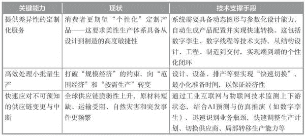

2017 年，我在《中国工业评论》上发表了一篇题为“智能制造为不确定性而生”的文章，文章中提出了一个关键观点：企业为什么要去解决不确定性？答案是“代价”。

企业为了应对不确定性，往往愿意付出不同程度的代价，例如提前生产、备库、安排设备定期检修、进行大宗套期保值以避免原材料价格波动，以及进行大量的自检、厂检、客户检等。

这些代价不仅增加了企业的运营成本，还可能导致资源的浪费和效率的降低。

在 VUCA（易变性、不确定性、复杂性和模糊性）时代背景下，中国制造企业所面临的挑战愈发严峻。不确定性持续上升，已从外部环境蔓延至企业内部，从线性系统演化为高度耦合的复杂系统。这种变化渗透在企业运营的方方面面——从战略规划到组织架构重塑，从客户关系维护到产品与产能规划，从销量提升到供应链风险应对，从订单交付到成本控制与库存优化，从人力资源配置到技术与创新体系的重构，企业正处在一个全维度、多变量、高动态的博弈环境之中。

著名经济学家科斯曾指出， **企业经营的本质是一种资源配置的机制** 。在不确定性日益成为常态的今天，企业经营的核心任务，正是在有限资源与动态市场之间，构建一种快速、精准、低风险的资源配置能力，不断在“复杂约束条件下寻找最优解”。这也正是企业在新时代能否持续赢得竞争优势的关键所在。

那么，企业应如何提升自身的应对能力呢？

构建面向不确定性的快速响应与协同决策机制和系统。谁能率先实现对客户需求的即时洞察、精准预测与智能排产，实现高效履约并具备实时沟通、即时反馈与动态调整的能力，谁就有可能在市场变化中赢得先机、抢占主动。在这一过程中，所有的计划、决策与协同，本质上都是应对不确定性的系统化手段。无论是战略级的布局决策，还是执行层面的排产排程，抑或是供应链、人力、财务的联动协同，背后所依赖的，不再是经验主义和静态规则，而是以数据为驱动、以 AI 为引擎的“智能决策系统”。

这些系统和工具的真正价值，不仅在于提升运营效率和资源利用率，更在于降低不确定性所带来的风险和成本，帮助企业从“被动反应”转向“主动预测”与“快速响应”，实现从不确定性到相对确定性的动态优化。事实上，企业的发展过程，正是在不确定性与确定性之间不断交替演化的过程。而能否持续识别关键变量、构建可预期的反馈系统，并在复杂环境中快速做出最优决策，决定了企业是否具备在剧烈波动的环境中生存并发展的能力。

因此，在 AI 与数据技术加速渗透的时代，制造企业必须主动拥抱 AI 数字化转型，把握“变化”中的确定性。 **唯有掌握变化，才能驾驭复杂；唯有快速适应，才能持续领先** 。 EXr6287u6NNVz+GYLY+7SGN8EvPKHDRD0R2fs+hJH6FUGuD/ntK17kx1EckHp5InRbOjsqs+vx5PQzEkttGAOg==

## 1.2　AI 时代每家企业都是智能体组织

当 AI 成为企业的新底座时，每家企业不再是静态的组织结构，而是一个具备感知、决策与行动能力的“智能系统”——这就是“企业智能体”的未来形态。

在 AI 快速演化的时代，我们正在见证企业形态发生根本性转变。从传统科层制组织，走向以数据驱动、智能决策、自我优化为特征的企业智能体组织，这是应对不确定性的系统化手段。构建企业智能体组织，既是一场技术革命，更是一个组织进化工程。“每家领先企业都需要实现从管理人转为激活人，从流程治理转为智能协同。”

### 企业进化终局：成为数字化的生命体

企业智能体组织如同有生命的系统，具备 3 个系统，如下图所示。

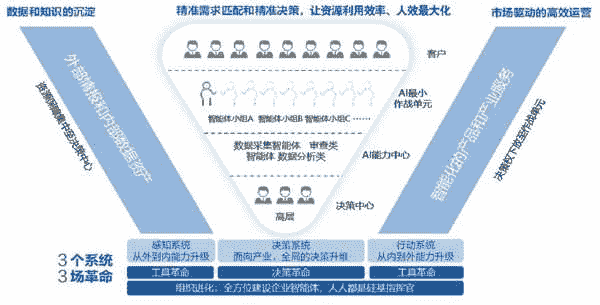

· **感知系统：** 企业的“眼睛与耳朵”，从外到内实时感知外部市场与内部运营情况。

· **决策系统：** 企业的“大脑”，基于 AI 算法与“Knowhow”知识沉淀，面向产业、业务做出最佳判断。

· **行动系统：** 企业的“手脚”，从内到外赋能每一个最小作战单元，使其高效执行策略、完成市场反馈闭环。

这些系统并非孤立的，而是打通数据、知识与行为的闭环网络，实现了从信息输入到智能反应的系统化协同。

传统企业在应对市场变化时，往往反应迟缓、效率低下、有信息孤岛，而 **智能体组织则具备“感知—决策—行动”的实时自适应能力** 。就像生物体面对外部刺激能快速做出判断并采取动作，企业也应构建具备自主运行、协同优化与持续学习的“神经系统”。

### 感知、决策、行动三大系统：支撑“企业智能体”运行的神经网络

构建“企业智能体”，核心在于感知、决策、行动三大系统的设计与融合运行。

**感知系统：打造“数据和知识的沉淀中枢”**

感知系统连接着企业的所有感官，是数据、知识与经验的沉淀平台。其目标是实现 360 度全数感知，包括对外部情报、行业趋势、客户行为、竞争动态的实时洞察，也包括对内部流程、运营数据、员工行为、设备状态的深度掌握。

感知系统的构建应具备 3 种能力：

· **数据采集能力：** 通过 RPA（机器人流程自动化）、爬虫工具、Agent  、IoT、ERP、CRM、MES 等，实现数据实时采集和打通。

· **知识沉淀能力：** 构建企业知识库，将信息转化为结构化知识，支持推理与再利用。

· **语义理解能力：** 通过 NLP 与语义识别，理解非结构化信息（如客户反馈、行业政策），并提炼可供 AI 使用的知识。

这个系统将感知层数据转化为“可计算、可判断、可预测”的输入，打造的是企业对变化的第一时间感知能力，也是企业决策的数据底座和知识中心。例如，山东一家医药制造企业通过建立感知系统，可以在 5 分钟之内了解全球最新的靶点研究成果。

**决策系统：实现“精准需求匹配+精确资源配置”**

决策系统是“企业智能体”的“大脑中枢”，它的本质在于：把业务逻辑模型化、资源配置算法化、决策过程自动化。

AI 时代的决策系统不仅仅是做简单的数据分析，而是具备“模拟、预测、优化”能力的智能中台。其功能包括：

· **需求预测与匹配：** 通过历史订单、市场行为、季节性变化等数据训练模型，实现销售预测、库存预警、排产优化等。

· **资源调度优化：** 将人、财、物在多维度进行算法优化，基于目标函数进行“仿真+推演+推荐”。

· **多智能体协同决策：** 在企业内部实现 AI 辅助的跨部门协同，如供应链、财务、销售之间的动态协调。

· **全局最优而非局部最优：** 支持从单点决策升级为“链路级”“网络级”的系统性决策。

根据波士顿咨询公司在 2024 年发表的《未来已来：AI 组织进化论》报告，高成熟度 AI 企业的共同特征之一就是“决策闭环+实时优化”：不仅做出决策，更能基于执行反馈持续修正决策。这就是企业从“经验决策”到“智能决策”的跃迁。

**行动系统：“以市场为导向的高效运营”**

如果说“感知系统”是企业的眼睛与耳朵、“决策系统”是大脑，那么“行动系统”就是企业的手和脚——它决定了企业是否能够将洞察变成快速响应、将决策变成执行、将战略变成结果。

在 AI 时代，企业正在构建以“Agent+RPA+自主自动执行引擎”为核心的智能行动系统，该系统的目标是提高响应速度、降低执行成本、增强运营敏捷性，最终实现“市场变化驱动资源自动流转与调度”。核心能力包括：

· **Agent 驱动的自动执行引擎：** 将 Agent 输出的优化方案自动传递至执行系统中，无须人工中转。例如，销售预测结果可自动驱动生产系统调整产线排产计划，或根据安全库存预警自动生成采购订单。

· **以 RPA 为核心的协同执行：** 利用 RPA 技术，自动处理标准化、高频的事务性流程，如发票核验、表单填写、系统对接等，提高“动作效率”。

· **端到端业务联动：** 通过“感知—决策—行动”链路的闭环机制，实现端到端的业务联动，如“营销自动化→销售推荐引擎→订单响应→产线排程→物流调度”，让每一个环节相互感知、无缝协同。

· **智能产品与产业服务：** 行动系统不仅服务于企业内部流程，更面向客户与市场，提供智能化的产品或者产业化的服务。企业可以通过嵌入 AI 和具有感知能力的产品，实时获取客户使用数据，反向驱动产品升级与服务迭代。例如，智能设备提供远程故障诊断、预测性维修、按用量计费等服务。

行动系统的设计原则是“即时、透明、联动”：信息从一端进入，系统自动分配任务、驱动流程、提供反馈，一气呵成。这才是真正打通了“洞察—判断—执行”的“最后一公里”。

目前大部分企业还不具备自主化、自动化执行的条件，最核心的原因是数据标准化和业务规则化的基础还比较弱， **企业需要以 AI 思维来重构企业的业务流程，例如通过岗位重构、流程重塑来推动核心业务能力的提升。** 下图为某制造企业通过 RPA+Agent 重构其物资采购流程并进行岗位重塑的示例，供大家参考。

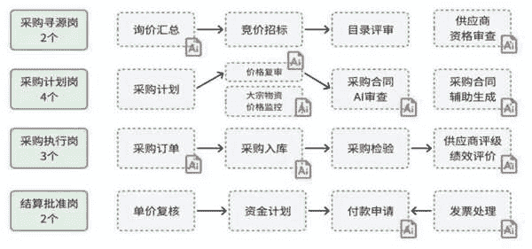

三大系统协同构建企业智能体组织，感知系统赋能企业看清楚（ **看见** ），决策系统帮助企业想明白（ **洞察** ），行动系统确保企业做得到（ **落地** ）。它们不是孤立的系统，而是相互感应、彼此联动的动态体系。正是这样的系统化设计，才能使企业真正从“数字化运营”迈向“智能化运营”，最终在高度不确定的市场中实现稳定增长与资源配置最优化。 EXr6287u6NNVz+GYLY+7SGN8EvPKHDRD0R2fs+hJH6FUGuD/ntK17kx1EckHp5InRbOjsqs+vx5PQzEkttGAOg==

## 1.3　1 个模型和 3 场效率革命

在 AI 深度融入企业运营的时代，制造企业正在经历一场系统性的变革。技术的引入不再只是“工具更新”，而是要推动业务、组织、决策全面升级。为帮助企业系统认知和落地 AI 数字化转型路径，我提出了“S-TOP 模型”——以业务场景为切入点，系统梳理组织能力、工具体系和决策机制的协同关系，帮助企业实现高人效、高韧性、高响应的成长。

### S-TOP 模型：场景驱动，闭环优化

S-TOP 模型从 4 个维度切入：S 代表场景（Scenario），T 代表工具（Techndogy），O 代表组织（Organization），P 代表决策（Pre-decision）。这是一个既结构化又系统化的企业智能跃迁方法论，致力于回答 4 个根本性问题：

· **我们从哪里出发？（场景）** ——以真实业务任务为起点，识别业务痛点与创新机会点。

· **我们用什么提效？（工具）** ——以 AI 工具为杠杆，推动内容、流程自动化与智能化，实现全员结构化提效。

· **我们如何协作？（组织）** ——推广 AI 思维，培养 H 型人才，推动大规模人机协同，激活组织的智能协同能力。

· **我们如何决策？（决策）** ——借助数据与算法实现决策升维，从经验驱动走向前置判断与全局优化。

其中，场景是整个模型的逻辑起点。企业 AI 数字化转型，不应从“用什么工具”开始，而应从“解决什么问题、落在哪个场景”出发。只有从具体场景出发，才能选对工具、设计好组织结构、构建有效的决策逻辑，如下图所示。

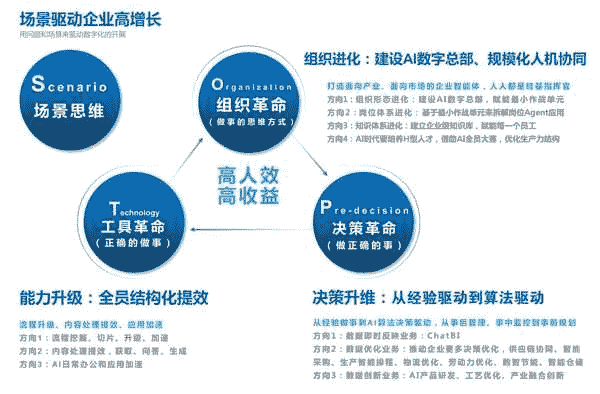

**模型底层逻辑：3 场效率革命形成转型铁三角**

在数字工业时代，各种新的技术和业务模式不断涌现，企业家面临的机会与挑战并存，焦虑感也随之增加。对于制造企业而言，AI 数字化转型不仅仅是技术的更新，更是业务流程、组织结构、企业文化乃至价值创造方式的全面更新。企业家要想成为数字工业时代的变革者、领军者，需要开展 3 场效率革命：组织革命、工具革命、决策革命。

**组织革命解决企业中人的意愿问题和激发人的活力，决策革命解决事情的正确性问题，工具革命解决如何把事做得正确及更加高效的问题。** 这三者如同三角形的三条边首尾相连，构成一个转型铁三角，组成闭环优化系统，互为支撑：

·组织是载体，AI 人才密度与结构决定执行力。

·决策是大脑，关系到企业方向和资源配置。

·工具是杠杆，承载日常任务与能力升级。

场景则是牵引这些要素协同演进的起点——没有场景，就没有方向，也无从形成闭环优化。

**场景驱动：让技术回归价值锚点**

“Scenario（场景）”是原点，AI 数字化转型要与企业的核心业务战略紧密结合，用问题和场景来驱动数字化的开展。这样的数字化成效才是真实的、清晰的，才能够量化价值和被有效识别。因此，转型原点应是“痛点识别”和“场景拆解”：

·哪些流程环节是痛点、难点、堵点、突破点？

·哪些任务可以结构化、自动化？

·哪些决策频繁但依赖个人经验？

只有锚定“关键场景”，技术、组织与工具才能构建有机联系，推动实质性提效。

S-TOP 模型中的“TOP”不只是 Tool、Organization、Pre-decision 的缩写，更象征着“标杆导向”（Top Practice）。鼓励企业基于自身场景，向行业领先者对齐能力建设与转型路径。

大多数企业在 AI 数字化转型过程中，常见的问题并非“不重视技术”，而是路径不清晰、落地不系统。 **S-TOP 模型，正是解决企业 AI 数字化转型“从哪里入手、如何系统开展工作”的关键。**

### 组织革命：建立 AI 能力中心，赋能每一个最小作战单元

如果说传统企业的组织结构更像“金字塔”，强调分工明确和层级控制，那么在 AI 时代，企业更需要一种类似“神经网络”的结构——扁平、高效、联动性强，能够快速响应内、外部变化。组织变革的核心在于重新定义“做事的方式”与“人机协作的模式”。

**组织革命的本质，是重构“做事的方式”与“人机协作的模式”。**

过去，我在很多场线下活动中都在强调，AI 时代企业数字化管理的底层逻辑发生变化了。在过去的数字化实践中，企业大都以“流程型组织”为核心——从端到端梳理流程（L1～L5），识别断点和瓶颈，推进优化。然而一旦涉及判断与决策节点，流程往往中断，需转向流程体系之外处理。因此企业不得不借助消息机制、预警系统、异常管理等手段来“推动信息找人”。而现在，随着 Agent（智能体）的大规模推广，企业正加速向“智能协同组织”进化。Agent 能够自主识别意图、触发任务、闭环处理，组织不再依赖层层传递，而是更去中心化、更具弹性。

因此，我建议企业从岗位出发，构建“AI 最小作战单元”（如下图所示）：让每一个业务岗位都配备 AI 助手，具备感知数据、辅助判断、执行任务的能力，推动业务在一线就能完成高效决策与闭环执行。

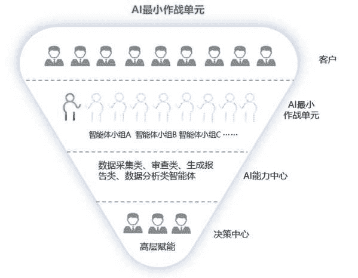

AI 时代的组织形态呈现出以下新特征：

· **倒三角协作结构：** 弱化层级，强化前线授权，让一线员工具备更高的响应自主权与协作能动性。

· **“AI+人”的作战单元：** 每一个岗位都配备 AI 助手，实现“感知—判断—执行”闭环，推动业务在一线就能完成高效决策与闭环执行，形成真正意义上的“人机协同”。

· **平台型管理者角色：** 管理者的职责从“控制”转向“赋能”，提供工具、资源、文化支持，构建组织自进化机制。

AI，不只是一个工具，而是组织能力的再造引擎。

**这场革命不在于职位重新排列，而在于让组织运转的底层逻辑，从“经验+流程”走向“数据+智能体”。**

每家企业都应该思考：

·我的 **感知系统** 是否足够敏锐？

·我的 **决策系统** 是否足够智能？

·我的 **行动系统** 是否足够高效？

更进一步，每个员工是否都已具备“AI 协作力”，这将决定企业能否真正迈入“高人效、高收益”的新范式。

AI 正在让企业成为具备生命特征的智能体组织。它可以自我感知市场、自主判断趋势、高效推动执行。未来，企业的智能化程度，将直接决定其存在方式、增长方式与领先方式。

当每一个人都被激活后，企业的“整体智力”将实现跃升。企业将不再只是组织结构的集合，而是一个拥有神经系统的生命体：“看得见”“想得明白”“动得起来”。

### 工具革命：能力升级，推动全员结构化提效

在 AI 时代，工具不再只是单纯的辅助软件或自动化系统，而是企业能力的“杠杆”，让每个人都能更聪明、更结构化地完成工作。

**工具革命的核心是结构化提升人效**

过去企业提升效率依靠“人海战术”，而如今是“人机协同”——一个人+AI 工具，可以完成过去要靠整个团队才能完成的任务。这一转变的底层逻辑包括：

· **流程智能化重构：** 借助 AI 打通任务链路，基于业务规则实现自动分配、过程监控与即时决策，让系统的整体响应速度显著提升。

· **知识标准化嵌入：** 将判断逻辑、行业经验和最佳实践封装进工具中，使工具不仅能执行任务，还具备“知识即服务”的能力。

· **人机协同普及化：** 通过构建“人+AI”的协作单元，确保每一个环节都能“借助智能、发挥所长”。

**工具革命的意义，不是让人更努力，而是让工作本身更智能**

例如，浙江某制造企业在人力资源招聘环节引入 AI 工具重构流程：从简历筛选、自动评估匹配度到智能邀约面试，全过程实现自动化，HR 团队只需聚焦于高潜力候选人的深度沟通和决策。最终，简历处理效率提升 80%，初筛准确率超过 90%，招聘周期显著缩短。

企业推动 AI 工具落地的关键，是让工具融入流程设计、制度机制与任务分工中。当人的能力与工具的智能真正融为一体时，企业才能迈入“全员结构化提效”的新阶段。

### 决策革命：数脑替代人脑，从经验驱动到算法驱动

今天，企业面临的最大挑战，不再是“是否有数据”，而是“如何用数据做更聪明的决策”。传统基于经验和层级的决策方式，正逐步让位于数据驱动、模型决策、AI 参与的“智能决策体系”。决策，正在升维。

我提出了“AI 赋能企业决策的 3 个层级”，不仅是工具和系统的升级，更是企业能力、结构和组织认知的深度重构，如下图所示。

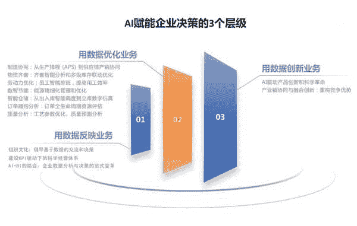

**用数据反映业务**

这一层级让业务“看得见”、理解得透。

这是企业数据化决策的起点，通过数据分析工具实现数据可视化、可追溯、可交互。在这一层级，数据主要承担“反映器”角色，帮助管理者回答 3 个问题：

（1）发生了什么？（描述性分析。）

（2）为什么发生？（诊断性分析。）

（3）现在情况如何？（实时数据。）

例如，通过 ChatBI（对话式商业智能）进行问答式分析，可以让数据真正“用得起来、问得出来”。

业务人员可以直接询问关键业务问题，如“本月产线良品率变化趋势怎样？”“哪几类客户退货率最高？”系统会自动从数据中找出答案，以图表、结论、建议的形式呈现，真正实现“问答即洞察”。

这一层级的价值在于：

· **打破数据壁垒：** 人人可问，人人可用。

· **减少数据依赖：** 不再等报表，而是即时分析，即时决策。

· **建立数据文化：** 以数据为依据推动协作与共识。

在这一层级，企业从“拍脑袋”决策进化为“看数据”决策，实现了从直觉到事实的第一步升级。

**用数据优化业务**

这一层级让业务“算得准、算得快”、做得好。

企业不再满足于数据回顾和可视化，而是希望用 AI 和算法实现流程的智能调度、资源的动态配置、策略的实时优化，真正实现“从数据中做出更优决策”。

企业有很多场景需要通过数据来进行决策优化，例如产品研发创新、智能配方、工艺流程优化、产品自动报价、采购高效评估、货仓物流规划、产能规划、生产智能排产、设备预测性维护、风控、订单分配（急单/插单）、订单履约风险、数智化节能等。这些场景的决策优化的共同点是需要从事后管理、事中监控到事前规划的转变。

· **研发创意模拟优化：** 帮助设计团队优选创意、模拟仿真，减少“试错成本”。

· **产销协同优化：** 联动 APS 系统和供应链数据，动态匹配产能和订单。

· **仓储与物流优化：** 通过算法预测补货时机、分配库存资源。

· **员工调度优化：** 智能排班提升人效。

· **能源使用优化：** 精细化用能管理与动态调度。

· **降低订单履约风险：** 通过订单数据与风险模型，提前识别交付问题。

用数据进行决策优化的核心是建立“数据—模型—执行”的闭环：

数据采集→规则建模→决策优化→系统执行→反馈修正→持续学习

企业在这一层级会出现明显的变化：AI 不仅辅助人决策，而且承担部分自动决策职能，使得业务流程响应更快、准确性更高、成本更低。

这意味着企业正式进入了决策的“算法驱动阶段”，是决策升维的关键阶段，也是组织能力的结构性进化。

**用数据创新业务**

如果说前两个层级是“用数据做得更好”，那么用数据创新业务则是“用数据做之前做不到的事”，即通过 AI 技术，重构业务模式、产品设计，甚至企业边界。

这代表着决策不再是对现有业务的优化，而是创造新的业务与增长模式：

· **AI 驱动的产品创新与科学革命：** 例如智能产品设计、AI 生成新材料、AI 发现新药等。

· **产业融合协同创新：** 数据打通企业之间的协作链条，从单点突破走向产业链整体优化。

在这一层级，AI 成为创新的“共同体成员”，决策从“效率提升”跃迁为“创新突破”。

企业的决策力，决定了企业在 AI 时代的进化速度。从 ChatBI 的“人人问数”，到算法优化的“系统调度”，再到数据创新的“重构边界”，每一个都是企业认知、工具、机制与文化的全面升级，如下表所示。

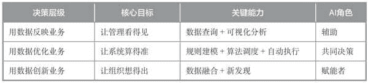

在 AI 时代，“经验驱动”不再是竞争优势，而是潜在瓶颈。 **唯有迈向“算法驱动”的决策体系，企业才能真正解锁数据价值，进入智能生产、智能经营、** **智能组织的新时代。**

### 始于场景，终于组织，赋于工具，成于决策

S-TOP 模型之所以重要，是因为它不仅是一种指导企业行动的思维方式，更是一套面向 AI 时代的效率重构方法论。它帮助企业从场景切入到组织重构，从工具赋能升级到智能决策。它提供了一条由局部突破到整体重构的路径，我们可以用一句话来理解 S-TOP 模型的内核逻辑：

“始于场景，终于组织，赋于工具，成于决策。”

公元 1 世纪，普鲁塔克提出了著名的哲学悖论：如果忒修斯的船在航行过程中逐块更换木板，直到所有部件都被替换掉，那么这艘船还是原来的忒修斯之船吗？S-TOP 模型的本质，正如这艘“不断更替”的船。它并非一成不变的静态结构，而是一个可以在不同场景中持续迭代、演进的动态系统。每一次场景重构、工具更新、能力替换，都是对“木板”的调整，但系统的核心身份与方向——也就是“这艘船”——仍然得以保留。

因此，S-TOP 模型并不追求一次性的完美升级，而是通过持续适应变化，维持系统本体的一致性与进化力。

**在未来，竞争不再是谁拥有 AI，而是谁真正重构了自己的 S-TOP 模型，完成了从单点创新走向全局智能。** EXr6287u6NNVz+GYLY+7SGN8EvPKHDRD0R2fs+hJH6FUGuD/ntK17kx1EckHp5InRbOjsqs+vx5PQzEkttGAOg==

# 2　AI 应用方向、路线图和共识

2.1　AI 是人的延伸，解放人的身心

2.2　AI 路线图：人机协同九宫格

2.3　AI 推动业务增长的 3 个共识

2.4　AI 落地实战共识：信息流转速度决定企业经营效率 EXr6287u6NNVz+GYLY+7SGN8EvPKHDRD0R2fs+hJH6FUGuD/ntK17kx1EckHp5InRbOjsqs+vx5PQzEkttGAOg==

## 2.1　AI 是人的延伸，解放人的身心

要真正理解 AI 的价值，我们需要回归到“人”这个核心维度。自动化、数字化、AI 技术的兴起标志着人类与工具关系的重大变革。从最初的手工劳动到机械化生产，再到信息化和智能化，技术的本质始终在于扩展人类的能力边界。今天，在 AI 与数字化工具的加持下，我们迎来了一个全新的协作模式：通过技术解放人类的体力与脑力，让人专注于更具价值的任务，推动人与工具的深度融合。

### 员工一天的任务类型分布

我们从员工一天的任务类型分布开始思考，如下图所示。

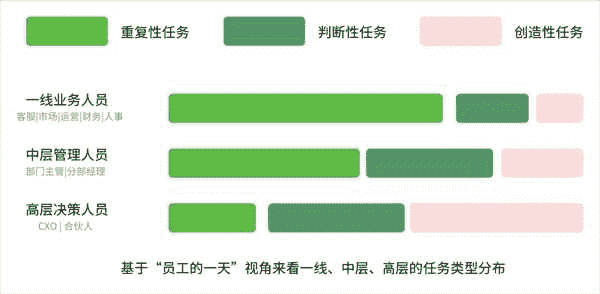

一个典型的职场人的工作任务可以分为 3 类：

· **重复性任务：** 如数据录入、信息分享、文档处理等流程的执行和标准化作业，这类工作占据了大量时间，尤其在客服、运营、HR、财务等一线岗位中，比例高达 70%～80%。

· **判断性任务：** 需要依据经验或数据进行分析和决策，如业务流程优化、风险评估、资源调配等。整体占比约 15%～20%。

· **创造性任务：** 依赖人的创新思维和战略眼光，如产品创新、战略规划等。创造性任务占比通常不到 10%。

我建议企业可以用这 3 类任务作为切入点，制定 AI 导入优先级与应用策略。

·对于重复性任务：通过 AI 技术手段实现高效自动化，重复性任务能够被大规模替代。

·对于判断性任务：通过数据赋能提升决策能力，判断性任务可被大量优化。

·对于创造性任务：提供支持与灵感激发，AI 成为人的第二大脑，创造性任务可被赋能。

### 人机协同的 3 种应用范式：执行式 AI、决策式 AI、创造式 AI

在 AI 时代，员工的 3 类任务（重复性、判断性、创造性）对应着 3 种人机协同应用范式：执行式 AI、决策式 AI、创造式 AI。这 3 种范式不是割裂的技术模块，而是相互协同、层层递进的，构成了企业组织进化的人机协同飞轮系统，如下图所示。

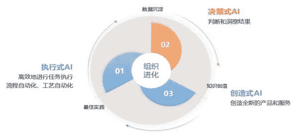

**执行式 AI：减少重复性劳动，推进流程自动化**

· **主要任务：** 数据录入、报表生成、订单录入、财务对账、工艺标准执行等。

· **应用特征：** 基于流程标准化和规则驱动，实现自动化大规模处理。

· **技术基础：** RPA、Agent、ChatBI、OCR 识别、自然语言处理等。

· **赋能价值：** 减少基层员工的重复性劳动，实现全员的自动化加速，从解放蓝领到向解放白领发展。

**决策式 AI：辅助判断，提升决策质量与响应速度**

· **主要任务：** 供应链优化、市场预测、生产排程、库存物资智能配料等。

· **应用特征：** 依赖结构化或半结构化数据，通过建模找出相对最优解。

· **技术基础：** 机器学习、数据建模、知识图谱、智能推荐引擎等。

· **赋能价值：** 为中高层提供决策建议，提升判断力、减少不确定性，在不完美的信息中寻找相对最优路径。

**创造式 AI：激发灵感，成为人的“第二大脑”**

· **主要任务：** 产品创新、策略构思、内容策划、场景创新等。

· **应用特征：** 结合大模型、企业知识库与行业趋势，实现“共创”模式。

· **技术基础：** 生成式 AI、机器学习、深度学习等。

· **赋能价值：** 自动扫描市场趋势、用户痛点与技术前沿，输出颠覆性创意与概念，捕捉新机会。

创造式 AI 不仅是“助手”，更是“联合发明家”，是新产品、新服务、新模式的共同创造者。它可以打破既有行业边界，探索跨界融合的可能，驱动从产品思维、系统思维到生态创新思维的跃迁。

**AI 不再只是工具，而是员工能力的放大器、组织结构的重构器、企业演化的加速器。** EXr6287u6NNVz+GYLY+7SGN8EvPKHDRD0R2fs+hJH6FUGuD/ntK17kx1EckHp5InRbOjsqs+vx5PQzEkttGAOg==

## 2.2　AI 路线图：人机协同九宫格

### 企业人机协同九宫格模型

人机协同九宫格模型是一个系统性的框架，从两个维度对 AI 与人类协同场景进行了精准划分，共分为九大类应用场景，为企业推进 AI 应用提供了清晰的路径，如下图所示。

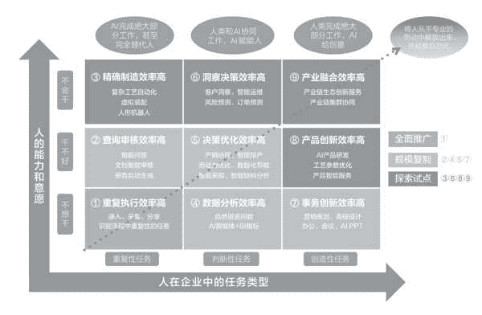

横向维度体现了任务的复杂度，从左侧的“重复性任务”、中间的“判断性任务”到右侧的“创造性任务”，展现了任务难度的递进关系。纵向维度则反映了人的参与意愿、能力，从底部的人“不想干”、中部的人“干不好”到顶部的人“不会干”，每一层级都代表着不同的智能化需求和 AI 能够参与的深度。这两个维度揭示了 AI 介入程度的差异和人机协作的不同模式。

### 企业 AI 落地路线图

九宫格模型不仅是企业理解 AI 能力方向的参考框架，更代表着企业 AI 落地的全景式路线图。从左下角到右上角，构成了一条清晰的推进路径：从任务替代到流程重构，再到业务创造，从 AI 解放体力到解放脑力，逐步实现 AI 从局部赋能到全域渗透的演进过程。

在这个模型中，第①格位于左下角，代表着 AI 落地的起点，也是企业最容易推动、最应全面普及的基础场景。它通常聚焦于标准化、重复性强的事务流程，例如各种信息录入、采集、共享，具有投入小、见效快的特征，是 AI 认知与接受度的“破冰”区域。

九宫格的第②、④、⑤、⑦格，是企业实现 AI“规模复制”的核心区域。这些场景具备高度的流程通用性和可复制性，例如智能问答、文档智能审核、各类报告生成、ChatBI 智能报表生成、决策优化等，可以形成“局部可复制、整体可扩展”的能力体系。

至于九宫格的第③、⑥、⑧、⑨格，则代表 AI 探索的前沿地带，是企业进行前瞻性试点与战略性投入的关键区域。这些格子通常涉及高度复杂、不确定性强、跨领域融合的任务，例如 AI 驱动的产品创新、柔性自动化应用、设备预测性维护、产业融合创新。因为具有较高的不确定性与技术门槛，所以适合具备一定基础的企业进行探索试点。

以下是针对各个九宫格应用的描述。

### 重复性任务被大规模替代

AI 在重复性任务中表现出强大的自动化能力，例如数据录入、文档处理、简单客服等。通过 RPA+AI，这些任务可以被高效、准确地完成，从而解放人力，提高工作效率。以溢达集团为例，仅在物流场景的报关及产地证、订舱、发票处理、库存、快递等场景就有 120 多个自动化执行应用，大幅提升了物流效率。具体从以下 3 个维度来描述。

**九宫格①　重复执行效率高**

·通过 RPA+AI 实现流程自动化，如财务报表自动生成、人事档案自动归档。

·标准化流程的智能处理，即 Agent 工作流。

·数据录入、文件整理等基础工作的自动化。

**九宫格②　查询、审核效率高**

· **智能问答助手：** 构建跨系统、跨文档的信息查询入口，实现对结构化与非结构化数据的快速提问与准确响应，提升员工获取信息的效率与准确性。

· **智能文档审核：** 通过 AI 识别合同、发票中的关键字段与规则，实现高精度审核与异常预警，大幅减少人工核查时间并降低错误率。

· **各类报告自动生成：** 基于数据自动抽取与生成模板，快速产出业务报告、分析摘要、会议纪要等文档，提升内容生成的标准性与时效性。

**九宫格③　精确制造效率高**

· **复杂工艺自动化：** 通过 AI 与工业控制系统协同，实现焊接、打磨、喷涂等多工序的高精度自动化执行，显著提升一致性与良品率。

· **虚拟装配与仿真：** 利用数字孪生与仿真系统，在虚拟环境中模拟装配流程，提前发现问题，优化工艺路径，减少试错成本。

· **人形机器人：** 部署具备感知与执行能力的人形机器人，代替人工完成危险、高强度或精密操作任务，增强柔性制造能力。

### 判断性任务的优化升级

AI 在数据分析、预测、决策等方面具有优势。通过对大量数据的分析，AI 可以帮助人们做出更准确、更快速的判断和决策。例如，在供应链管理、风险评估等领域，AI 可以提供有价值的洞察，帮助企业优化运营，具体表现如下。

**九宫格④　数据分析效率提升**

· **从 Excel 到全员自助分析平台：** 数据不再依赖少数分析人员，全员可通过自助分析平台快速获取所需洞察，实现人人皆可“数据驱动”。

· **智能报表系统：** 借助自动生成的动态报表与可视化图表，快速呈现业务全貌，支持趋势洞察与多维分析。

· **ChatBI：** 用自然语言“问数”，替代传统“查数”，让业务人员即时获得决策所需数据，缩短分析响应时间。

**九宫格⑤　决策优化效率提高**

· **资源利用效率最大化：** 如通过智能排产与能耗优化系统，实现生产资源的动态调度与能源最优化配置，提升整体产能与运营效率。

· **供应链优化：** 基于 AI 算法进行采购策略优化、库存精准预测与物流路径智能安排，推动供应链从被动响应走向智能预判。

· **劳动力优化：** 借助智能招聘与劳动力预测工具，实现人员配置最优、用工弹性增强，让“人岗匹配”更加科学高效。

**九宫格⑥　洞察决策效率提升**

· **设备预测性维护与流程挖掘：** 通过传感器数据与流程日志分析，提前识别设备故障与流程瓶颈，实现主动维护与持续优化。

· **市场趋势分析：** 运用大数据与 AI 模型预测消费者行为与行业发展趋势，帮助企业把握未来需求，抢占潜在市场机会。

· **风险管理与智能风控：** 构建基于实时数据的风控引擎，识别异常交易与潜在风险，提高企业的防御能力与合规保障能力。

### 创造性任务的赋能

AI 不仅可以完成重复性任务，还可以辅助人类进行创造性工作。虽然 AI 还无法完全取代人类的创造力，但它可以为人类提供灵感，拓展创造的边界。具体表现如下。

**九宫格⑦　事务创新效率高**

· **营销策划与海报设计：** AI 助力从创意生成到视觉输出，快速完成营销文案、广告图、品牌物料的高效制作，释放创意团队的“产能”。

· **办公、会议与 AI PPT：** 借助 AI 助手自动生成会议纪要、整理要点、制作 PPT，使日常事务处理更加高效专业，实现知识的即时表达与复用。

**九宫格⑧　产品创新效率提高**

· **AI 产品研发：** 通过 AI 辅助需求分析、方案设计与功能建模，显著缩短产品研发周期，提升创新响应速度与产品命中率。

· **工艺参数优化：** 基于历史数据与仿真模拟，AI 自动推荐最优工艺参数组合，实现产品性能提升与制造成本降低的双重优化。

· **产品智能服务：** 将 AI 嵌入产品中，实现远程监测、预测性维护、按需升级等服务，推动产品从一次性交付向持续服务转型。

**九宫格⑨　产业融合效率提升**

· **产业链生态创新服务：** 通过 AI 与数据平台构建产业生态服务体系，打通上下游资源，提供协同研发、共享服务、金融支持等综合能力，推动产业链共生共创。

· **产业链集群协同：** 借助数字化平台与智能调度系统，实现区域产业集群内的资源共享、产能互补与物流协同，提升产业链集群整体的反应速度与运作效率。

总的来看，企业在推进 AI 落地的过程中，应以九宫格为地图，明确阶段性重点：先“普及第①格”，打牢认知基础；再“复制第②、④、⑤、⑦格”，实现能力扩展；同步“试点第③、⑥、⑧、⑨格”，把握未来方向。这不仅有助于明确资源配置与组织节奏，更能系统性地 **推动 AI 真正嵌入业务、嵌入流程、嵌入组织，实现从“用 AI”到“以 AI 运营”的根本跃迁。** EXr6287u6NNVz+GYLY+7SGN8EvPKHDRD0R2fs+hJH6FUGuD/ntK17kx1EckHp5InRbOjsqs+vx5PQzEkttGAOg==

## 2.3　AI 推动业务增长的 3 个共识

### 干法 1　回到客户第一原点，做客户运营商

2003 年，任正非在《在理性与平实中存活》的讲话中明确指出：企业必须建立一套“以客户为中心、以生存为底线”的管理体系，取代过度依赖企业家个人判断的传统管理模式。当这一体系实现规范化运作后，企业的“灵魂”将不再是企业家个人，而是对客户需求的持续响应。客户是企业最稳定、最长期的变量，唯有以客户为原点，企业的根基才能真正具备可持续性。

这段讲话深刻揭示了华为组织变革的核心目标：构建一个围绕客户需求、以流程驱动、制度化运行的现代企业体系，从而打造穿越周期、基业长青的能力。这一理念在华为得到了系统性贯彻，其客户服务与管理经验被总结为《华为客户法则》《以客户为中心》等图书，全面展现了华为对客户价值的长期投入与持续创新。

这不仅是一种管理思想的升级，更是企业迈向长期主义与高质量发展的战略选择。要真正实现这一转型，企业需要突破传统“以产品为中心”的经营范式，重构自身的商业模式与价值交付体系。 **未来的业务不再只是提供一个单点产品，而是构建一个围绕客户需求的整体解决方案生态。** 这要求企业：

·将客户需求作为设计与运营的起点。

·联合上下游伙伴，构建跨企业、跨领域的协同生态系统。

·提供涵盖产品、服务、数据、内容、体验在内的“组合式价值”。

这种转变使企业不再仅仅是产品的制造者，而是升级为“客户运营商”——通过 AI 和数字化手段，与客户建立起持续、高频、深度的链接关系，实现 24 小时在线感知、预测并响应客户需求。企业与客户的互动强度与频次显著提升，客户响应速度加快，进而反向推动内部运营体系的优化升级。

这不仅是价值创造逻辑的根本性重构，更标志着客户运营模式进入了一个全新的智能化阶段。

以我之前服务的无锡一家锅炉设备制造企业为例，该企业转型经历了 3 个身份：从产品信任伙伴到服务运维伙伴，再到价值共创伙伴，如下图所示。

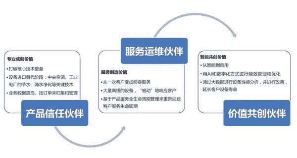

**转型 1.0 时代：产品信任伙伴——专业成就价值，打破核心技术壁垒**

· **机遇：** 赶上设备进口替代时代，中央空调、工业电厂的节水、海水净化等关键技术实现突破，寻求技术含量更高的产品，实现销售收入的增长。

· **问题：** 企业高速发展，存在很多业务数据孤岛，需要按订单来归集和管理，同时追求提高生产效率，降低成本，提高产品的齐套性。

· **解决路径：** 以订单为龙头、设计为依托、计划为核心实现订单管控，通过销售合同号、产品编号贯穿整个业务，实现以订单为中心的闭环管理。

· **核心目标：** 及时、准确、可视、共享，让所有的业务信息流和数据能够共享。

**转型 2.0 时代：服务运维伙伴——“服务”创造价值，从一次客户变成终身服务**

· **机遇：** 基于产品服务全生命周期管理来重新规划客户服务生命周期，通过全生命周期数字化的服务进行迭代。

· **问题：** 大量离线的设备，“被动”地响应客户。

· **解决路径：** 基于客户视角，从销售、产品制造过程、分公司、办事处的客户服务出发，重新对业务、流程、数据做全面的系统化梳理，打造统一的服务平台。

○面向服务，基于 AIoT、CallCenter、移动化等重构服务管理系统。

○面向设备，进行远程监控，及时监控水泵出口压力、蒸汽流量、冷凝出水温度、冷气、本体排烟温度、冷凝器进水温度及各种异常。

○面向客户，建设设备管理平台，覆盖设备故障知识库的建设。

○面向现场，建设服务 App，聚焦与客户相关的全生命周期流程管理。

**转型 3.0 时代：价值共创伙伴——“智能”共创价值，从智能到善用**

· **机遇：** 通过大数据进行设备性能分析，并进行改善，延长客户设备寿命。

· **解决路径：** 优化商业模式，用 AI 和数字化方式进行能效管理和优化，根据创造的价值和效果与客户进行分润。服务提供者与客户的关系，正在从一般的买卖关系向客户价值共创伙伴关系转变。

数字化不再是一个管理工具，服务工具，而是一种资产和资源。

建立以客户需求为导向的数字化经营体系，成为“客户的运营商”是企业 AI 数字化转型的原点。这要求企业在组织结构、运营模式、技术应用等多个方面进行深度变革，以实现以客户为中心的业务重塑和创新。这包括围绕客户设计组织结构、基于客户场景进行创新，以及设计提高客户体验的互动方式。

**企业唯有真正建立“以客户为中心”的转型意识，才能更好地适应市场变化和新的竞争格局，这是立身之本。**

### 干法 2　高价值进击原则，从局部优化到全局价值链创新

在当今高度互联的商业环境中，企业竞争已演变为产业链与产业链之间的竞争。传统聚焦于工厂内部的“段—段”优化策略正面临边际效益递减的困境，而真正的竞争优势来源于贯穿研发、生产、供应链到服务的全价值链创新。这一转变催生了“高价值进击”的新范式——通过 AI 与数字化技术的深度融合，企业不仅能够突破局部优化的天花板，更能构建跨企业、跨产业的协同创新网络。

高价值进击原则的核心在于 3 个维度的突破，表现为从企业级运营效率提升（1.0 阶段），到产业级价值链协同创新（2.0 阶段），再到社会级平台生态化运营（3.0 阶段）的系统跃升，如下图所示。

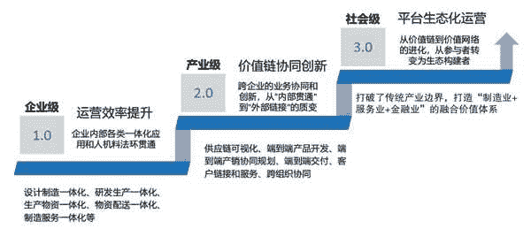

**1.0 阶段：“段—段”效率优化与孤岛式问题**

1.0 阶段的主要目标是提升企业内部各环节的生产效率与产品质量。典型做法是引入 MES、ERP、PLM、财务等系统来实现局部自动化与信息化。但这一阶段普遍面临“工具先进、系统割裂”的困境，导致孤岛式现象严重。

以我服务的一家汽车零部件企业 JL 为例，企业投资 180 万元引入 MES 后，单条产线效率提升 23%，但设备综合效率（OEE）仅提升 7%。根本原因在于系统之间的数据标准不统一，导致计划安排与实际生产存在偏差。

破局关键在于推动企业研发、采购、制造、服务等关键环节一体化，实现企业内部数据贯通。例如，设计制造一体化、研发生产一体化、生产物资一体化、物资配送一体化、制造服务一体化等。

**2.0 阶段：跨企业的价值链业务协同和创新**

2.0 阶段标志着从“内部贯通”到“外部链接”的质变，智能生产、产品和服务开始贯穿于整个产业价值链。这一阶段的本质是价值流动重构。

这一阶段企业视野从内部延伸至整个产业链。价值流动不再局限于企业内，而是涵盖从原材料采购、设计研发、制造执行、物流配送到客户服务的端到端价值链重构。下表是“转型有术”根据麦肯锡对外发布的“灯塔工厂”材料整理的端到端价值链的场景类型和主要应用方向，场景类型包括供应链可视化、端到端产品开发、端到端产销协同规划、端到端交付、客户链接和服务与跨组织协同。

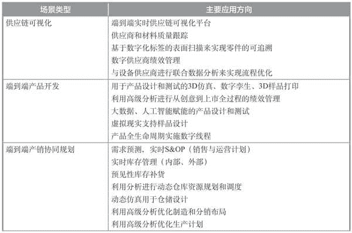

续表

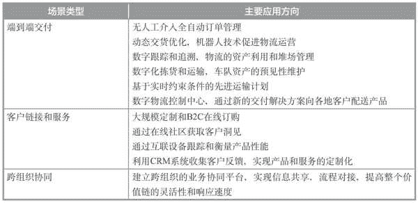

这张表整理了企业如何通过数字化在端到端价值链中形成一系列数据驱动的新型业务形态。这些端到端应用实践证明，数字化的应用若能突破实体工厂的范畴进而在整个产业链发力，那么企业的敏捷度将得到极大提升，也会诞生各种各样新的运营模式。企业创建的全新运营系统，可在最短的时间内以最小的成本拥有更高的投资回报率。

**3.0 阶段：生态化平台运营的指数级增长**

当企业在价值链中形成主导力后，将进一步进化为产业平台的构建者与运营者。这一阶段的核心特征是：从链条管理者转型为价值网络的主导者，推动产业资源、能力、数据的重组。

IDC 在《工业互联网生态 2.0 白皮书》中指出，平台型企业通过将寻源、制造、渠道、金融等能力外部化，构建“服务+交易”的综合赋能体系，主要有两类核心赋能平台，如下表所示。

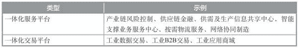

**进入 3.0 阶段是企业质的飞跃，表现为从价值链到价值网络的进化。** 工业互联网平台成为资源配置的中枢，企业的角色从参与者转变为生态构建者。这一阶段的核心是平台化运营。平台不仅是技术的载体，更是价值的枢纽。通过平台，企业可以将自身资源、能力、数据等开放给外部合作伙伴，形成协同创新的生态系统。

“高价值进击”不是对局部流程的升级，而是一次系统级价值重构。它要求企业：

·在 1.0 阶段打通内部信息链，提升内部一体化协同能力。

·在 2.0 阶段实现价值链重构与上下游共创。

·在 3.0 阶段迈向平台化运营，实现跨生态价值共生。

未来，那些能够率先完成 3 阶段跃迁的企业，将不仅仅是效率优胜者，更会成为行业规则的重新定义者、全球价值链的引领者。

### 干法 3　产品再定义，边界在融合，服务在闭环

**产品再定义、边界在融合**

我们正在见证一个无比快速的产品数字化创新时代，数据已经成为实物产品的内在特征，类似于 DNA 序列。越来越多的产品具有非常多的“智能”和“信息”特征，变成了一个包含物理实体和虚拟空间的复杂系统。每个产品在使用过程中会产生大量的新数据，这些产品可以被监测、控制和分析。过去不相干的两个设备之间、人和人之间、物和物之间、人和物之间，现在的联系越来越紧密，必然使得一个系统连接另一个系统，小系统组成大系统。这种产品泛在的连接使得客户、企业、产品不再割裂，而是融为一体，企业可以在产品制造、使用、维护、回收全生命周期内为客户提供服务、掌控产品，并形成更多服务的闭环和创新做法。

以美国约翰·迪尔（John Deere）为例，该公司已经从传统的物理产品制造商转型为集成化产品系统提供商，从制造农机转变为销售“农场服务”的公司，如下图所示。

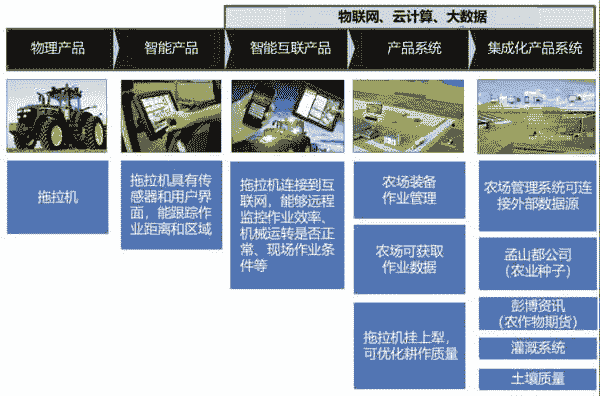

通过数据和服务，约翰·迪尔重新定义了农耕过程。所有拖拉机、联合收割机、耕作机和搅拌设备都可以通过云平台链接，实现更好地协同工作。客户不仅拥有收割和播种设备，还可以享受相关的系统智能服务，实现先进的智能农场管理。

以下是约翰·迪尔提供的智能产品服务：

·iTEC AutoLearn 系统——自动记录并学习操作员在田头转向头部的控制行为，如停机、提升、转弯等，降低操作员的疲劳程度并提高效率。

·ExactEmerge 质量保证体系——支持高速精准播种，通过真空计量、Curve Compensation、Auto-Load 与实时文档记录，实现种子精准投放与作业一致性。

·ICA2（Integrated Combine Adjustment 2）系统——配备两台高速摄像头持续监测并自动调整割台参数，以保持破碎率低于 1%，提升作物收割质量与产量。

·Active Yield 系统——通过谷仓内装载传感器持续校准流量传感器，实现自动校准与精确产量数据采集。

·Active Fill 同步控制系统——利用 GPS 自动同步青贮机/收割机与拖拉机之间的装卸作业，进行精准同步卸粮/卸料，优化装卸动作并减少损耗。

·GoHarvest 收割机驾驶模拟装置——提供带有真实反馈效果的收割机操作模拟，培训人员预演各项作业功能，降低误操作停机风险。

·360 度 3D 摄像——提供全景三维视角，用于提升辅助驾驶与自动化识别能力。

注：以上智能产品服务信息主要来源于 PTC、约翰·迪尔官方质量保障说明文档、Agritechnica 展会报道内容，由“转型有术”整理。

**无形的正在决定有形的，服务在闭环**

产品的交易方式、形态和效能正在被重新定义，无形服务和协同网络正在决定企业为客户提供全新的价值。企业由提供“实体物理产品”向提供“一个复杂的产品服务系统”转变。服务提供者与客户的关系发生了很大的改变，正从提供产品的短期交易服务向长期服务转变，从一般的买卖关系向客户价值共创伙伴关系转变，如下图所示。

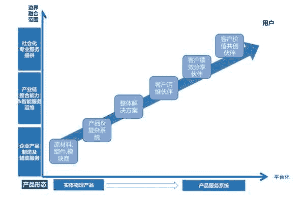

下面介绍 6 种基于产品的新型智能化服务应用趋势，如下图所示。

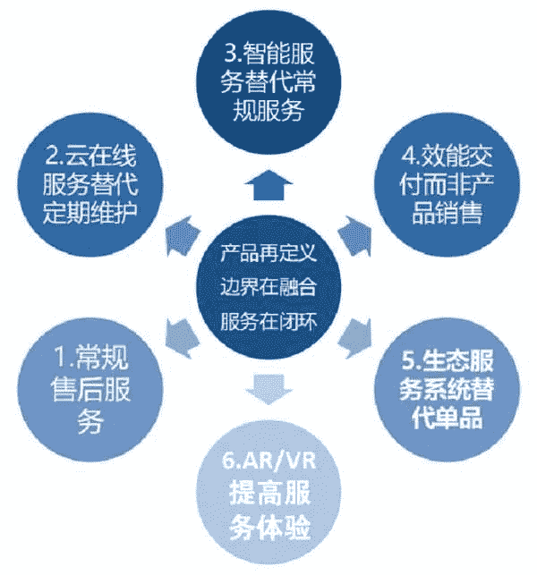

**趋势 1：常规售后服务**

当前，大多数制造企业仍以产品为核心，提供一系列标准化的售后服务。这些服务包括统一的客户信息管理、产品档案管理、三包服务、定期巡检与保养、维修维保服务、零配件销售等。部分企业还拓展到供应链金融等增值服务领域。与此同时，越来越多的企业正通过“一物一码”等数字化手段，实现产品全生命周期与全渠道的动态监控，以提升服务水平和客户满意度。

**趋势 2：云在线服务替代定期维护**

工业产品在线服务支持和远程运维是制造企业服务化转型的重大机会，伴随制造业数字化和智能化水平的提高，设备代替人工、设备复杂性程度提高、生产运行节奏加快，任何机器设备的停工所造成的损失都是巨大的。传统设备靠人定期检修、运维和保养，这种模式将会被远程实时监控、远程故障诊断、远程维修等快速替代。大型企业都已经在开展大量的实践，像小松 KOMTRAX 系统、沈鼓云、陕鼓云等都是此类。

**趋势 3：智能服务替代常规服务**

与云在线实时服务有显著区别，智能服务更侧重对产品在制造、使用过程中的信息进行深度的数据挖掘，实现更高级的自主化功能和增值服务。如针对大型装备制造企业，企业可以从传统基础维修、增强性服务（备件预测与供应）向设备预防维护、设备寿命拓展转型，提供设备故障知识库建模和智能分析等增值服务，如罗尔斯-罗伊斯 TotalCare、东芝机械的预测性维护系统、大金工业的空气网络服务、蒂森克虏伯电梯 MAX 应用等。

**趋势 4：效能交付而非产品销售**

产品数字化和智能化实时可控使得产品购买不再是唯一的商业模式，产品租赁或基于绩效的服务购买成为合作的开始，而不是结束。企业与客户的关系也从一次购买变成长期服务。例如：

·凯撒空压机：客户只需购买其压缩空气服务包，凯撒即可为其安装和维护所有的设备、部件及优化系统。

·索尼克林（Soniclean）：为客户提供清洁设备的租赁、样品服务，客户大修期间可无偿借用，以及使用按结果付款的清洁合同，客户只需要为清洁的结果付费，中间不需要购买任何产品。

**趋势 5：生态服务系统替代单品**

当产品不再是孤立的存在，而是嵌入一个更大系统时，企业间的竞争将从“单一产品”竞争转向“系统与系统”之间的较量。企业的竞争焦点也正在由硬件产品本身，转向以智能产品为基础构建的软性服务系统和生态整合能力。

约翰·迪尔便是这一趋势的代表企业。它不再仅仅销售农机设备，而是构建起“精准农业解决方案”这一完整生态系统。其核心竞争力已经从“卖设备”转向“运营农业”，实现了从硬产品制造商向农业系统服务商的战略跃迁。这种模式的本质，是用生态系统锁定客户、提升黏性，构建高壁垒、高复购率的“产品+服务+数据”复合型价值体系。

**趋势 6：AR/VR 提高服务体验**

AR/VR 技术可以提高产品在研发、生产、使用等过程中的体验，通过营造虚拟化体验场景，为客户提供“超预期”的极致体验，从而带来营销方式、研发方式、操作方式和维护方式的改变，将是未来制造企业产品服务竞争的重要高地。例如沃尔沃可在 2500 千米内远程操作挖掘机，曲美、顾家使用 AR/VR 技术创建线下客户体验中心，能展示所有家居产品，突破现实展示的局限性。

这些 **新型的服务正在加速形成新的商业形态** ，使企业从提供面向产品的传统服务到面向使用的服务系统，再到面向效果的服务系统转变。 EXr6287u6NNVz+GYLY+7SGN8EvPKHDRD0R2fs+hJH6FUGuD/ntK17kx1EckHp5InRbOjsqs+vx5PQzEkttGAOg==

## 2.4　AI 落地实战共识：信息流转速度决定企业经营效率

### 干法 4　定架构：企业架构是企业数字化转型的底层方法论

在数字经济浪潮下，企业面临的竞争已从资源与规模转向敏捷性与智能化。麦肯锡的研究表明，70%的数字化转型项目因缺乏系统性规划而失败，而成功的企业往往将企业架构（Enterprise Architecture，EA）作为核心的底层方法论。

**企业架构设计无处不在**

在企业数字化转型的过程中，未经过系统架构设计的组织常常面临诸多问题，这些问题直接影响企业战略的落地与数字化投资的效果。

· **烟囱式系统林立：** 企业通常以部门需求为驱动进行信息化建设，导致各个系统之间缺乏有效整合，形成信息孤岛。这使得不同系统无法共享数据与资源，影响业务流程的协同效率。

· **业务流程割裂：** 因为缺乏整体规划，企业的业务流程往往存在多处断点，部门之间“各管一段”，所以沟通成本高，协作效率差。

· **业务标准化程度低：** 因为缺乏统一的流程和规范，不同部门和业务线在执行时往往采用各自的方式，操作标准不一致，所以影响整体运营效率。

· **数据分散、数据缺失、数据标准不一：** 企业内外的数据往往分散存储、管理不善，且数据标准不统一，形成数据孤岛，导致数据难以有效利用，阻碍数据驱动决策的实施。

数字化转型是一项涉及数据、技术、流程和组织等复杂系统的工程。如果缺乏系统性的方法论指引，就会出现如上所述的各种问题。正如生物构造需要基因架构、建设房屋需要房屋架构蓝图、建设城市需要规划方案，企业的数字化转型同样需要一套科学、系统的方法论作为支撑。企业架构（EA）正是这样一种全面且行之有效的实践方法论，如下图所示。

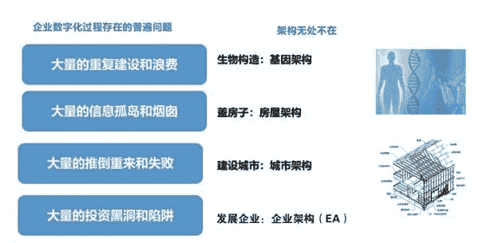

通过企业架构可以形成全局的应用架构，有效支撑业务战略，明确系统边界，避免重复建设；企业架构可以厘清数据资产，形成数据标准，打造无边界信息流，释放数据价值；企业架构可以帮助企业打造数字化的业务平台，形成敏捷的业务创新能力，完成数字化转型。因此，企业架构不仅是企业数字化转型的底层方法论，更是推动业务能力提升、实现数字化战略目标的关键。

**企业架构：向上承接战略、向下指导项目实施**

就像埃菲尔铁塔的建造源于法国工业革命，并成为承载法国人民梦想的标志性建筑，企业的数字化转型也必须从清晰的战略目标出发。没有明确的战略目标，就无法进行有效的架构规划；没有架构规划，企业的业务和流程将无法高效运作，因为企业的所有业务、所有流程都是架构下的事件。

如下图所示，企业战略决定了要构建什么样的“铁塔”，而企业架构则是这座“铁塔”的规划设计蓝图，系统设计则是最终建成的效果图。企业架构不仅承接战略，还能够指导具体项目的实施，确保业务对准战略，IT 对准业务，实现“战略不跑偏、系统不重复、数据不孤岛”。

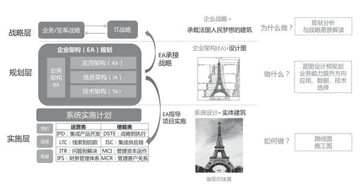

因此，企业架构的核心目的是为数字化转型提供顶层设计，通过制定企业架构蓝图和实施路线图，确保战略目标得以实现。企业架构通过一系列原则和实践，帮助组织应对业务、信息、流程和技术方面的变革，最终实现战略目标。企业架构通常由 4 部分构成，包括业务架构（BA）、信息架构（IA）、应用架构（AA）和技术架构（TA），这些部分共同形成企业架构的整体框架，其关系如下图所示。

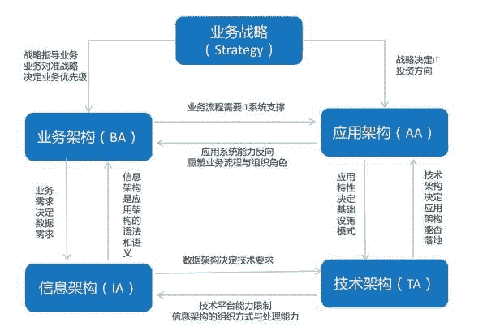

**业务架构（BA）：** 业务架构定义企业的商业模式、流程周期和实现框架，明确企业的商业模式、组织结构、治理机制和关键业务流程。它涉及战略、治理、组织结构和关键业务流程的信息，业务架构向下驱动数据架构、应用架构与技术架构。

**信息架构（IA）：** 信息架构聚焦于业务运作与决策中所需的数据对象、数据模型、数据流与规范。信息架构通过业务对象实现与业务架构、应用架构和技术架构的集成，描述在业务运作和管理决策中所需的各种数据及其关系。

**应用架构（AA）：** 应用架构规划企业各类应用系统的边界、功能模块、集成路径与支撑流程。业务流程是设计应用架构的驱动因素，旨在确保应用系统的集成与协同。

**技术架构（TA）：** 技术架构定义支撑应用系统与数据服务的软硬件平台，包括基础设施、网络、安全机制与云资源等。应用架构提供实现业务策略和功能所需的技术组件，为数字化转型提供技术支持。

企业架构不是为了画图，而是为了打通战略落地路径、消除信息孤岛、提升系统协同效率、支撑敏捷业务。

在企业架构方法论中，“业务架构是灵魂，信息架构是语言，应用架构是结构，技术架构是地基”，四者协同进化，构成一个“从想法到执行”的全景式能力框架。

### 干法 5　通流程：流程体系好比企业的神经系统，要端到端贯通

流程管理是现代企业的根基，它不仅是业务运作的基本形式，更是战略落地和价值交付的核心机制。正如管理学大师彼得·德鲁克所言：一家有效管理的企业应该是平淡无奇的。真正管理好的企业，外部看起来是风平浪静的。因为每个人、每个部门都知道流程该如何往下走，内部和外部的循环有良性互动的机制。

**APQC 端到端贯通流程设计框架**

在实际的企业调研中，我发现“段—段”的部门墙现象非常普遍，部门间的壁垒往往会导致企业资源的割据、流程断点和出现真空地带，关键信息和数据被封锁在部门内部，无法在企业内部自由流通，形成信息孤岛。这会严重影响企业的整体运营效率和创新能力，因此，打破部门墙，实现端到端跨部门的高效协同，已成为企业运营的关键。

从端到端视角进行整合，要求我们重新审视和设计业务流程，确保从客户需求的识别到满足需求的整个过程，各个环节能够无缝对接，形成一个连贯高效的工作流。这种流程体系能够有效避免信息孤岛和流程断点，实现企业的高效运作和持续优化。

企业进行流程体系构建时，可参考 APQC（American Productivity & Quality Center）发布的跨行业流程分类框架（PCF），如下图所示。这是目前全球最通用的端到端流程标准，自 1992 年起，已迭代至 v7.4，广泛应用于 IBM、华为、卡特彼勒、小松等领先企业。它将流程划分为 5 个级别，具备高度通用性与可对标性，能帮助企业系统梳理流程目录、流程标准和优化路径。

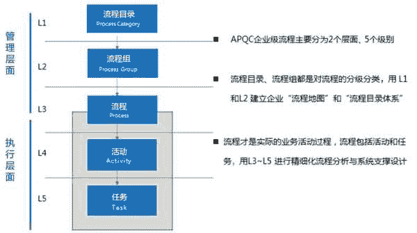

稳定且高效的流程对于企业至关重要。它能确保在不同时间、不同操作人员和不同条件下，产出相同的结果，从而保证业务的连续性和可靠性。每一步操作都遵循标准化流程，这不仅确保了输出的一致性，还提高了整个流程的可控性。

**华为的运营流程、使能流程和支撑流程体系**

华为结合自身管理实践和 PCF 框架，总结出“3 类流程体系”建设经验：运营（Operating）流程、使能（Enabling）流程和支撑（Supporting）流程。这 3 类流程共同构成了华为全面的业务流程体系，实现了“横向拉通，纵向集成”，确保企业高效、有序地运作，如下图所示。

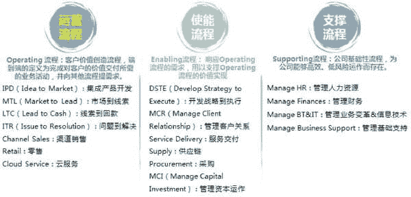

**运营流程：** 是客户价值创造的核心流程，目的是通过一系列端到端的业务活动，完成对客户的价值交付。这些活动包括从产品研发、市场推广、销售、交付到售后服务等环节。例如，华为的 IPD、MTL、LTC 和 ITR 等，都是典型的运营流程。运营流程直接面向客户，通过提供高质量的产品和服务，帮助企业实现为客户创造价值。

**使能流程：** 支持和响应运营流程的需求，确保运营流程能够顺利进行，并推动企业为客户创造价值。这些流程包括 DSTE 和 MCR 等。使能流程为运营流程提供支持，确保整个流程能够高效运作。

**支撑流程：** 是企业的基础性流程，旨在确保公司能够持续、稳定、高效地运作。这些流程包括 Manage HR、Manage Finances 等。支撑流程为运营流程和使能流程提供必要的支持和服务，确保公司整体运作的稳定性、低风险性和高效性。

这 3 类流程相互关联，共同构成了企业全面的经营和业务流程体系，确保企业的各项业务高效、有序地推进，提升了整体运营效率和竞争力。企业在搭建流程体系时，可以借鉴华为的流程体系。

**信息流转速度决定企业经营效率**

企业经营的本质，是“价值流”的高效运转，包括资金、原料、信息等流转的过程，而信息流是价值流的主脉络。资源流动速度决定了企业的响应能力、生产节奏和市场把握程度。在数字化时代，信息流转的速度已成为衡量企业竞争力的关键指标。

如何提升信息流转的速度呢？重点在以下两个方面：

（1） **提高各个业务系统的集成率：** 在现代企业中，业务流程往往依赖多个系统协同完成，如销售、库存、财务、物流等。通过系统集成，将这些分散的系统有效连接，可实现信息的实时流转与高效协同，带来多方面的价值提升。

· **提升数据一致性，降低运营成本：** 系统集成能保障数据在多个平台间的一致性与准确性，避免因人工输入或格式转换造成的错误与混淆，从而降低运营风险，以及管理和维护成本。

· **消除数据孤岛，流程更顺畅：** 高度集成的系统可实现业务流程的自动衔接，避免跨系统手工操作。例如，客户下单信息可直接从 CRM 系统传递至 ERP 和库存与物流系统，形成自动闭环，大幅提升响应速度与客户体验。

· **增强决策支持，实现智能化报告生成：** 集成后的系统能够统一数据源，支持全面数据分析和自动化报表输出，为管理层提供实时、准确的业务视图，提升决策的质量与速度。

不过系统集成并非简单拼接，它涉及流程重构、系统对接、数据标准化与业务规则协调等复杂问题。因此，企业需要从战略层面统筹规划，分阶段实施，以确保集成工作真正为业务赋能，并提高效率。

（2） **推进端到端流程全链路信息自动流转、提高流转效率：** 流程效率的跃迁，不靠加班和加人，而靠自动化与智能化。

· **RPA 推动流程自动化：** RPA 是一种通过模拟人类在软件系统中的操作，实现高度重复性任务自动化的技术。它可用于自动执行数据录入、表单填写、系统间数据传输等任务，大幅提升效率，减少人为错误，尤其适用于遗留系统之间的集成。

· **Agent 推动流程自主化：** Agent 通过模拟人类的感知、理解与决策能力，能够处理复杂的业务逻辑，实现端到端业务流程的自动化和自主化，加速企业从流程驱动向智能驱动的转型。

流程不是流程部门的事，它是企业运营的底盘，是每一个岗位都必须内建的系统思维。 **建设端到端、标准化、智能化的流程体系，才能让企业从“低效协调”走向“高效运行”，从“依赖个体”走向“系统驱动”，从“标准响应”走向“智能应变”。**

未来的领先企业，必然是流程领先的企业。唯有流程畅通，组织才能健康，企业才能具备可持续的创新能力与扩展能力。

### 干法 6　选场景：聚焦经营核心议题，精准打造新型能力

在 2023 年 9 月的“转型有术·深圳分会”上，一位制造业的总经理杜总提出了一个颇具代表性的问题：

数字化转型到底能给企业带来什么具体价值？能不能清楚算出投入产出比？如果可以量化，我就愿意投入。

杜总精准道出了当前企业管理者的核心“关注点”：转型不能停留在口号和愿景层面，必须看得见成效、算得清投入产出比、落得下具体行动。

AI 与数字化的真正落地，必须回答两个关键问题：“解决了哪个实际经营难题？”“带来了哪些可持续的新能力？”

唯有如此，转型才能从“技术工程”走向“经营工程”。

**以问题与场景为导向，锚定经营主线“4 个维度”**

那么如何选择正确的场景呢？

我建议，企业要聚焦于经营管理中的核心主线——交期（D）、质量（Q）、成本（C）和创新（I），从这 4 个维度精准识别新型能力的建设方向。

· **交期（D，即 Delivery）：** 提升企业端到端交付能力，重点提升订单履约率和准确率，优化计划排程与资源调配，提升研发出图效率与生产响应速度，提高整体供应链效率。

· **质量（Q，即 Quality）：** 加强全流程质量管控，从源头上减少变更，提升产品和服务质量，减少返修和投诉问题，优化质量管理体系，提升客户满意度。

· **成本（C，即 Cost）：** 通过技术手段优化业务流程、供应链和资源配置，最大限度地降低运营和生产成本。

· **创新（I，即 Innovation）：** 通过新技术应用、数据驱动和研发创新，持续推动产品、服务和商业模式的优化。

企业可基于这 4 个维度，从价值链中识别痛点与短板，在营销、生产、交付和服务等环节进行切片分析，寻找数字化的介入机会。“转型有术”在大量企业案例的基础上，总结出一张基于“客户价值链”视角的场景能力提升图，如下图所示。

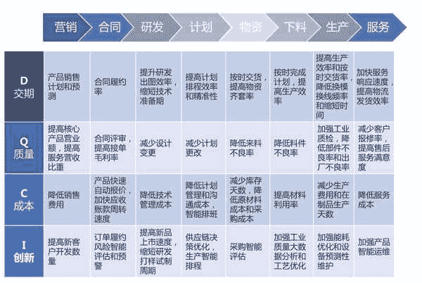

上述各个具体的场景也是企业 AI 数字化转型场景选择的优先考虑方向。

**VV AI 场景矩阵**

在推进 AI 数字化转型的过程中，“选对场景”远比“做多场景”更关键。我提出了一个场景优选的“四象限评估模型”，即 VV AI 场景矩阵，以速赢度（Velocity）与价值（Value）分别为横轴与纵轴，帮助企业科学排序、聚焦资源，如下图所示。

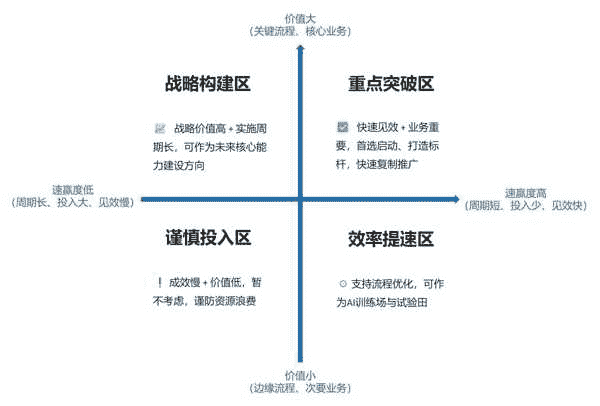

以下是对四象限评估模型的详细解读和应用建议。

**重点突破区（高价值×高速赢度）：** 位于图的右上角，代表那些价值大且速赢度高的场景。这类场景通常涉及企业的核心业务，并且能够在短期内带来明显的效益，如订单履约、客户智能服务、产销协同等。因此，企业应当将这些场景作为首选实施方向。通过快速启动并不断优化这些关键场景中的转型，企业可以在较短的时间内实现业务突破，并进一步推动效率提升和业务增长。

**战略构建区（高价值×低速赢度）：** 位于图的左上角，代表那些价值大但速赢度较低的场景。这些场景中的转型通常需要较长的实施周期，且在初期效果并不明显，但它们却为企业未来核心能力的建设提供了重要的基础，如数据中台建设、智能工厂改造、产品创新平台。通过这些场景中的转型的实施，企业能够在长周期内构建起可持续的战略性能力，进而为未来的竞争打下坚实基础。

**效率提速区（低价值×高速赢度）：** 位于图的右下角，代表那些速赢度较高但业务价值较小的场景。这些场景中的转型通常需要较低的投入，且实施难度不大，适用于优化现有流程，提升工作效率和降低成本，如流程自动化、报表自动生成、审批流程优化。企业可以通过快速部署这些场景中的转型来取得短期效益，为后续更具战略价值的项目积累经验和数据。

**谨慎投入区（低价值×低速赢度）：** 位于图的左下角，代表那些速赢度低且业务价值较小的场景。这些场景中的转型在短期内难以带来较大回报，且实施周期较长，可能会消耗较多资源，如冷门、低频业务信息化。因此，企业应避免在此类场景中的转型上过多投入，应将资源集中在其他具有更高价值或更快回报的项目上。

总体而言，这个模型为企业提供了 AI 数字化转型场景选择的重要框架。在实施过程中，企业应根据每个场景的特点，灵活制定资源投入策略。

对于重点突破区的场景，应该迅速推进，并建立标杆；对于战略构建区的场景，应做好长期规划，为企业积累核心竞争力；对于效率提速区的场景，可以采取快速实施的方式，为企业带来即时效益；对于谨慎投入区的场景，则要避免过多投入，以将资源集中于其他更有价值的领域。

转型的本质，是能力系统的升级。 **选择什么样的场景，本质上就是回答：我们要建设怎样的新能力，解决哪些真实问题。** 企业唯有以“清晰的问题意识”+“科学的场景策略”为驱动，才能在 AI 数字化转型浪潮中，找到通往“长期竞争力”的正确路径。

### 干法 7　复用化：从“数出一孔”到“数据全链通达”

随着 AI 数字化转型的推进，企业面临着数据孤岛、重复录入、系统割裂等一系列挑战。如何高效管理、利用和复用数据，已经成为提升企业竞争力和实现价值最大化的关键。企业数据管理应遵循“数出一孔”的理念，确保数据从唯一的源头（“一孔”）流出，并在整个价值链中得到高效、多次复用。这不仅是技术问题，更是一种管理思维的转变。通过提高数据质量、标准化、分类、自动化采集、系统集成和全流程复用，企业能够实现最大限度地利用数据资产。

**“数出一孔”思维：数据精准采集与分类是基础**

“数出一孔”思维强调数据在采集时做到“一次录入，源头唯一”，避免数据重复录入和孤岛现象。其核心在于明确哪些数据需要采集、哪些不需要采集，并做好数据分类。以我曾服务过的苏州 SK 工厂为例，这家日资企业在 3 个月内便实现了全业务的数字化运营，核心是基于之前业务流程体系梳理的数据体系能快速复制。

**全面梳理业务流程：** 对从产品到合同、生产、发货、验收、回款等全流程进行梳理，明确数据采集和复用场景。例如，采购、质量、生产等环节的数据可以共享。

**制定清晰的数据分类体系：** 对每类数据进行标注和采集必要性分析，避免数据混乱与重复。例如：

· **文档类：** 入厂检查规范、作业指导书、工艺规程书、生产装配检查规范、出厂质证书、包装作业指导书等。

· **单据类：** 生产计划单、物料采购申请单、送货单、入库单、生产准备单、领料单、生产订单、工程周转单、出库单、发运单等。

· **表样类：** BOM 明细表、工程检查表等。

· **标识类：** 工卡、发车卡、各类 RFID 标识卡或标签、设备标识等。

· **设备类：** 机器人、自动导引车等。

· **报表类：** 质量报表、生产作业日报、设备统计报表、人力统计报表等。

这些分类不仅是技术层面的整理，更是管理思想的体现，是建立全员数据意识的基础。有了这些基础数据分类，每一个员工会审视每一个流程中究竟有哪些数据需要采集。数据采集范围确定了，用什么样的工具采集就是具体实现层面的事情。

大多数制造企业业务系统的建设都跨越很多年，有的甚至长达二三十年，不同数据类型、数据来源，以及数据量的飞速增长，导致系统集成、数据共享和提高数据质量在很多企业已经变成很复杂的问题。数据不准确、不及时，找不到、看不懂是企业数字化转型的重大阻碍。主数据治理是确保数据质量和共享的关键，尤其是面向源头的数据非常重要，例如产品研发、工艺规格、客商档案、统一会计科目体系、物料数据等。

主数据的管理可以帮助企业建立一套统一的数据管理规范和标准，确保所有部门和团队在收集、处理和存储数据时遵循相同的标准。

**数据全价值链复用：从“局部最优”走向“全链通达”**

数据全价值链复用的核心是实现数据在企业内、外部的高效流转和复用。重点有两个方向：推动数据来源自动化和建立数据流转与复用机制。

**推动数据来源自动化：** 企业数据输入涉及多方人员，包括销售、财务、物流、生产等，在输入端尽量自动化、减少人工参与，可以避免人为导致的数据不准确。企业可通过设备联网、工业物联网（IoT）、AI 视觉识别等技术，实现数据的自动采集，减少人为干预，降低错误率，提升数据的准确性和采集实时性。各种数据来源自动化及具体内容和技术场景描述如下表所示。

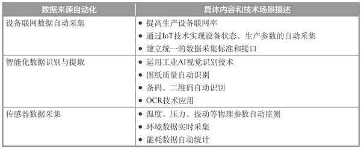

**建立数据流转和复用机制：** 通过系统集成实现数据流转与复用，系统自动生成表单报告。

· **在流程设计阶段考虑数据复用路径：** 一笔订单信息，可自动生成报表、发货通知、备料计划，构建以“数据触发业务”为核心的自动化流程，将数据沉淀为资产，用于智能分析、决策支持。

· **自动化系统集成与数据传递：** 打通 ERP、PDM、OA、供应链等多系统的数据接口，实现数据标准化、业务表单标准化、数据格式统一，避免信息孤岛，支持数据的多场景复用，避免数据“走一段路就断”。

· **自动生成报表与做数据分析：** 基于统一数据源，系统自动生成经营报表、生产日报、质量分析等，提升管理效率和决策速度。

我曾服务过的杭州一家半导体企业的董事长贺总曾提出一个看似简单却极具洞察力的观点：“数据只录一次。”这不仅是对数据录入流程的简化要求，更体现了对企业数据价值观的深刻重塑。它要求企业摒弃“局部最优”的思维惯性，强调以“全链通达”为目标的系统性设计，推动企业向“数据高效流动、一次采集多点复用”的方向转型。

截至 2024 年 7 月份公开的数据，这家企业的报表、单据由系统自动生成，每天自动生成 1000 多张单据，覆盖了经营分析、销售、质量、制造、设备、仓储、技术、工艺等核心业务场景。

从“数出一孔”，到“全链复用”，再到“自动化生成报表”，这是一条 **制造业数字化成熟度提升** 之路，也是制造业 **迈向高效率、快响应、低成本运营** 的必经之路，更是 **打造智能化、协同化企业** 运营的关键所在。通过这种方式，企业不仅能高效管理数据，还能将数据转化为真正的资产，推动整体业务的优化和创新。

### 干法 8　一线化：构建面向班组的即时化、高频决策体系

在当今快速变化的商业环境中，企业的竞争力越来越依赖于其决策的速度和精准度。传统的层级式决策模式，因其缓慢的响应速度和远离实际问题的决策者，已无法满足现代企业对敏捷性的需求。因此，如何将决策权下沉至一线，构建即时化、高频决策体系，以提升企业的敏捷性很重要。

**决策权下放：让离问题最近的人做决策**

英特尔创始人安迪·格鲁夫在《给经理人的第一课》一书中提出了一个颠覆传统管理理念的观点：决策权不应仅由职位决定，而应赋予那些掌握相关知识和技能的人，即使他们在组织中的职位较低。这一理念的核心在于认识到，离问题最近的人往往最了解问题的本质、背景及可能的解决方案。因此，“一线化”管理理念应运而生。“一线化”的本质，是推动企业从“命令—控制”型文化转向“信任—赋能”型文化。它强调将决策权下沉至靠近客户、靠近现场的团队成员手中，从而提升组织对市场变化的反应速度与应变能力。实施“一线化”的三大核心如下。

· **信息实时化，让一线“看见全局”** ：“一线化”的前提，是信息的透明与实时共享。借助 ERP、CRM、IoT 设备、大数据平台等数字化工具，企业可以实现数据从总部到前线的双向流动。

· **信任与授权机制，让一线“有权行动”** ：“一线化”的关键，是构建清晰、科学的授权机制。这不仅意味着要明确一线团队的决策边界，更重要的是建立一种基于信任的激励体系——确保他们的判断与组织战略同频共振。授权不是放任，而是有机制、有边界地自主决策，让一线人员能基于数据与经验做出判断，真正成为问题的第一解决者。

· **快速反馈与持续迭代，让一线“快速改进”** ：“一线化”并不意味着放弃协同，而是通过建立高频反馈机制与迭代流程，实现前、后方高效协作。通过持续的数据回传、跨层级的快速响应机制，企业可以不断优化策略，实现从“静态决策”向“动态适应”的跃迁。

正如丰田汽车 CEO 丰田章男所说，每当他遇到危机、遇到困难时，总会去一线寻找答案。这不仅是一种管理哲学，更是对不确定性时代组织韧性的深刻理解。

在充满不确定性的时代，答案永远在现场，而数字化和 AI 则是我们理解现场、赋能一线的强大工具。通过构建科学的“一线化”决策体系，我们能够让“神明”常驻现场，让每一个员工都成为问题的解决者和价值的创造者，最终实现企业效能的全面提升和持续成长。

**数字化赋能：构建即时化管理的技术基础**

数字化工具是实现一线即时决策的技术基础。它通过数据的实时采集、分析和可视化，突破了传统管理中信息滞后和失真的瓶颈，为一线员工提供了决策所需的全方位支持。

2023 年 12 月我带企业管理者去施耐德无锡“灯塔工厂”参观时，看到施耐德电气的 SIM（Short Interval Management）5 级即时化管理体系完美诠释了这一理念。SIM 体系是施耐德内部生产运营的一个即时沟通、即时处理的系统，覆盖了员工、线长、车间经理、管理者。

· **SIM1 员工级：** 一线员工快速了解产量，进行异常反馈，跟踪当天重点事项。

· **SIM2 产线级：** 主要体现了产线绩效、重点生产事件跟踪。每日定期线长会拉着质量、工艺、安全、仓库等团队一起来看今天整体的加工损失、工单异常、设备效率，需要重点跟踪异常事项和 WIP 齐套情况，一起来解决问题。

· **SIM3 车间级：** 多个部门一起解决问题，如果超过 5 天，在车间级没解决问题，就会流转到 SIM5 总经理级。

· **SIM4：** 1 对 1 的沟通，部门经理汇报，工厂汇报。

· **SIM5 总经理级：** 面向各经理层面的汇报和沟通。

这种分层设计确保了问题能在最合适的层级得到解决，避免了不必要的层级汇报和时间浪费。最好能让大多数问题都在 SIM2、SIM3 得到解决。

施耐德即时化管理体系的核心价值在于构建了“数据驱动+层级协同”的敏捷响应机制。这种机制的创新性在于其双螺旋运行机制：横向打通了生产、质量、物流等职能壁垒，形成以问题为中心的现场作战单元；纵向则通过层级的反馈机制，实现问题的自动化分类与升级。数字化和 AI 平台在此过程中扮演着信息中枢的角色。

**层级职责会议：日常科学管理运营的引擎**

**从霍尼韦尔码捷工厂说起**

2024 年 7 月，我带企业管理者走访霍尼韦尔码捷工厂，参访团对其“层级职责会议”（T1～T4）体系印象深刻。尤其是每日 15 分钟的 T2 会议，已成为制度化动作，确保现场问题能被快速识别并闭环解决。这种日常化、机制化的管理方式，使得企业得以稳步达成月度、年度目标。T1～T4 层级结构定义如下：

· **T1 会议：** 面向班组长和一线员工。

· **T2 会议：** 面向主管、班组长和相关支持人员（如工程、质量、设备人员）。

· **T3 会议：** 面向部门经理与各职能主管。

· **T4 会议：** 面向总经理及高层决策层。

事实上，很多制造企业也有晨会或班前会等，关键在于是否在系统化、制度化执行。

**什么是层级职责会议**

层级职责会议的英文全称为 Tiered Accountability Meeting，简称层会或 T 会。顾名思义 T 会就是企业不同组织构架层级的人员为了协调并达成一致性的行动，在层级内或跨层级进行信息交流的会议。T 会是以指标管控为核心、以问题快速反馈和解决为主线召开的会议。

**层级职责会议的核心价值**

**紧盯指标，快速闭环：** T 会以“目标一致→问题暴露→行动跟进”为主线，通过对关键指标（安全、质量、交付、库存、成本）进行分层管理，及时发现偏差，推动整改。

**消除信息壁垒，实现跨部门协同：** T 会不仅是执行力平台，更是打通横向沟通通道的枢纽，促进信息共享，提升决策效率，推动组织由“墙内各自为战”走向“横向联动、一体运作”。

**推动现场驱动原则：** T 会坚持“贴近现场、贴近问题”，多数为站立会议，在现场的可视化看板前直接讨论异常与对策。例如，在施耐德无锡“灯塔工厂”，SIM2 会议就在现场完成。

**实现企业治理的柔性适配：** T 会的设置不是一成不变的。对不同规模的生产性企业，层级可以灵活变化，可以是 2 级、3 级、4 级等。

**层级职责会议的关键内容**

T 会是公司用来追踪和管理公司关注的过程或结果最核心的手段。可以说 T 会是公司业务开展的发动机，尤其是在提高工厂侧的执行力方面。

· **层级指标管理：** 围绕质量、成本、交付、安全、士气确定过程与结果指标，并对照目标值进行追踪。

· **识别异常与机会：** 借助数字化手段（如电子看板、BI 报表）进行指标的可视化，清晰识别偏差、异常和机会点。

· **制订行动计划：** 确定责任人、截止时间和行动方案。

· **闭环追踪机制：** 将行动项纳入改善工具，如 A3 报告、RPS（问题解决流程），形成问题跟踪与验证的正反馈机制。

· **升降级制度：** 当问题无法在本层会议解决时，按规则“升级”至上一层会议；同样，已解决问题也需“降级”回执行层监督成果。

很多企业在实践 T 会与数字化融合，比如我曾参与过的佛吉亚生产系统建设中每日 TOP5 问题的数字化反馈，还有欧姆龙上海工厂的 1m、10m、100m 智能车间分层数字化架构设计和现场系统建设等，都遵循了 T 会的理念。

T 会不是会议形式的更替，而是企业管理方式的升级。它是一个连接战略、行动与反馈的闭环系统，更是让目标“活”起来、问题“动”起来、组织“跑”起来的管理引擎。我在一次活动分享中说：“T 会不是天天找问题，而是天天解决问题；不是层层传话，而是层层闭环。”

在 AI 时代，企业竞争的本质是决策效率和执行力的竞争。 **构建面向一线的即时化、高频决策体系** ，不仅能够 **提升运营效率** ，更能 **激发一线员工成为转型的主角** ，打造持续创新的能力。通过一线员工的参与，可以让数据说话的起点有准确的数据，让数据说话的终点有正确的决定，这是每家企业追求的目标。

### 干法 9　平民化：人人都是开发者

化用刘禹锡的一句诗，“AI 正在飞入寻常企业中”。当技术不再高高在上时，当代码不再是少数人的专利时，我们正迎来一个前所未有的技术民主化时代。在这样的时代，我们正见证越来越多“平民程序员”和“平民科学家”的涌现。他们不一定有计算机专业的学位，也不一定受过严格的科学训练，但他们拥有解决实际问题的强烈动机和日益普及的技术工具。

这种“技术平民化”浪潮不仅重塑了个体能力边界、重新定义了创新的边界——当车间工人能调试算法参数时，当销售专员可构建预测模型时，企业创新的源泉将从精英智慧转向全员创造。这样的转变，不仅是技术工具的普及，而是人的解放。

**让一线员工成为 AI 数字化转型的主角**

AI 数字化转型面临的最大障碍，是技术与业务的割裂。AI 数字化转型往往被视为 IT 部门或管理层的职责，而一线员工则被动接受工具和流程。实际上一线员工才是真正推动变革落地的核心力量。只有让基层员工从被动执行者转变为主动参与者，AI 数字化转型才能真正扎根业务、创造价值。

**技术门槛越来越低，员工自主意愿越来越高**

今天基于零代码、低代码的流程管理、智能体搭建工具和 AI 编程工具越来越普遍，非技术人员也能快速通过“拖拉拽”搭建简单应用，例如实现质量检查表单、异常上报系统等。这种来自“一线的创新”不仅能提升效率，还能增强员工的数字化思维和主人翁意识。

我在 2020 年去柳钢进行标杆企业包装的时候，柳钢自动化室仅用 3 人就开发了上百个应用、400 多个表单，搭建了一个透明化的数字工厂。当一线员工每天能主动瞄准真实业务问题，用数据思考、用技术解决问题时，转型才能从口号变为现实竞争力。从“钢花四溅”到“数据四溢”，柳钢工厂是非常好的标杆。

赋能一线员工，不仅能够提升决策质量，更能激发组织的创新活力。谁能降低 AI 和数字化工具的应用门槛，谁就能获得广泛的群众基础。平民化的理想目标是推动全员开发，让人人都掌握先进的生产工具。

**推进全员开发的 3 个阶段**

企业推动全员开发一般会经历如下图所示的 3 个阶段。

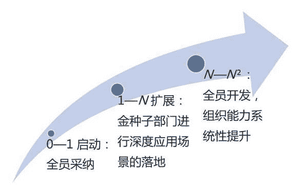

**0-1 启动：全员采纳**

技术平民化的第 1 步，是让每个人都拥有数字化的入口。我在阿里钉钉负责新制造业务的时候，为了推动钉钉在企业的全面应用，通常会选择一些低门槛、能够全员参与的场景来启动应用，包括：

· **聚焦日常高频场景：** 全员考勤、全员请假、全员食堂吃饭、寝室进出等基础应用，这些场景门槛低、使用频率高，能够快速建立用户习惯。

· **个人福利相关应用：** 全员运动打卡排名、全员学习积分、积分换福利、企业内部商城等，通过福利激励来驱动用户参与。

· **不得不用的应用场景：** HR、OA、财务、企业内部沟通的 IM 软件等刚需应用，通过业务必要性来推动采用。

这个阶段的关键是建立用户对数字化工具的基本认知和使用习惯，为后续的深度应用打下基础。

**1-** *N* 扩展：金种子部门进行深度应用场景的落地

在建立了基础的习惯后，企业可以在一些深度应用场景落地数字化，让业务人员看到数字化的真正价值。这个过程需要遵循“找有意愿的金种子部门，启动培训，思考用新工具来改善现有业务”。这个阶段工具平台的选择至关重要。零代码、智能体相关的工具，通过简单培训结合部门场景特点，可以有效激发业务人员的参与热情。

2019 年我去拜访朝阳轮胎的郑总时，郑总和我说：他们最早落地的场景是基础的各种安全器材点检、设备巡检，然后逐步覆盖到生产管理统计、成品日报表、物资出门申请、班组安全管理、能源管理系统、质量管理等。企业仅 1 年就有 100 万条生产现场数据反馈。这些数据不是“为了数据而数据”，而是真正服务于生产现场和问题解决。

从 1— *N* 扩展最核心的要点是找到有意愿的部门和场景先做起来，这样就能影响更多部门，让更多业务人员懂数字化。

***N* — *N* ²** ：全员开发，组织能力系统性提升

当企业各部门都有了懂数字化的人，能够自己上阵、自己规划时，IT 部门开始承担支撑角色，企业就迈入了全员开发的阶段。这个阶段最重要的是应用治理。要对各个业务部门产生的系统资产进行管理，解决任何新业务系统资产的增删改查问题。全员开发的价值是，让业务人员能参与到 AI 数字化转型进程中来，发挥创造力，可以快速解决各类“长尾、零散”的需求，解放生产力，同时将创新管理、重视客观数据、全员应用 AI 技术参与持续改善的意识，植入企业文化。

2022 年，敏实集团举办了面向全员的 RPA 创新大赛，全面激发了“全员开发、业务主导”创造力。一个又一个由业务人员自主开发的机器人相继涌现，覆盖了大量高频、重复且跨系统的事务性工作，例如财务自动化、订单处理自动化、报表生成自动化、数据结构化与数据服务自动化。这些 RPA 机器人源自一线人员对业务痛点的深刻理解和实际优化需求，充分展现了“人人可创造、业务即开发”的转型思路。

技术平民化的最终目标，不是让每个人都成为程序员或科学家，而是 **让每个人都能够利用技术工具更好地解决问题、创造价值、实现自我** 。当这种能力成为每个人的基本素养时，每个个体都有机会成为所在领域的专家和创新者，每家企业都有机会通过技术平民化实现跨越式发展。当创新不再是少数人的特权时，整个组织就会焕发出前所未有的活力。

### 干法 10　即时化：人机交互范式的变革，从 GUI 到 LUI

从鼠标点击到语音交谈，从图形按钮到自然语言指令，人机交互正经历一场深刻的范式革命。过去，我们依靠 GUI（图形用户界面）开启数字化革命；如今，我们正通过 LUI（自然语言用户界面）加速迈入智能时代，如下图所示。

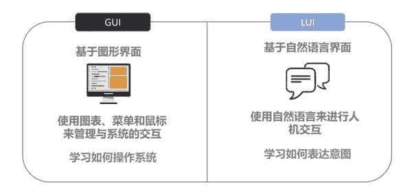

这场变革不仅是交互方式的更新，更是技术基础、认知逻辑与效率结构的全面重构。LUI 的兴起标志着智能化交互成为主流，系统从“能被操作”进化为“能理解人类语言并主动协作”，重塑了我们理解和使用技术的方式。

**从 GUI 到 LUI：交互范式的根本性转变**

LUI 基于大模型与自然语言处理技术，使“问答即流程起点”“对话即业务洞察”成为可能，深刻影响企业服务设计与管理者的使用体验。

· **GUI** — **降低门槛，但路径固定：** 自 20 世纪 80 年代以来，GUI 通过窗口、图标、菜单、按钮等元素，显著降低了人机交互的复杂度。但本质上，用户需要学习系统规则并按既定路径操作，面对多系统协同与非结构化任务时，效率瓶颈日益显现。

· **LUI** — **语言成为智能系统的操作系统：** LUI 以自然语言为交互介质，核心不再是“点击哪里”，而是“表达意图”，系统负责理解、联想并执行。语言成为系统最通用的调用入口。

在 2024 年 6 月“转型有术”走进研华昆山工厂的活动中，邓总分享了 LUI 在企业中的典型实践：

·直接查看今天哪些生产运营指标有异常、产生了警报。

·通过 ChatBI 直接查询当月的空压机能耗情况，并进行环比分析的问答。

传统 BI 系统难以直接响应这类复杂问题，而 LUI 可自动解析语义、提取数据、进行分析，并给出建议，大幅提升管理者的决策效率。

LUI 的核心能力在于：语言即入口，系统即助手。用户无须学习软件，通过自然语言“对话系统”，即可让技术真正服务于业务。

**智能化的本质：从交互行为到思维协同**

GUI 的交互是“点对点”的，而 LUI 的交互是“意图对系统”。这种转变背后，是“系统是否具备理解和推理的能力”这一更深层的智能基础。

**语言即意图：系统不再只是反应，而是理解** ——LUI 最大的特征不是语音输入，而是语义理解。以下是通过语言现在正在落地的一些场景：

· **人力资源管理：** “给我升一级”或者“新增一个员工，姓名是响哥，运营部，P13，3 天后入职”，然后系统自动完成相关入职事宜。

· **行政事务：** “帮我预订 10 月 20 日上海飞广州的下午 1 点到 3 点的最低价机票。”

· **设备控制：** 工厂中可通过语音指令调整空压机转速。

这些场景表明，系统已经从“机械执行者”变成了“智能理解者”，LUI 正在推动企业业务流程从被动响应向主动执行转变。

**从工具到搭档：LUI 赋能人机共创** ——智能化的 LUI 不仅能“听懂”，还能“主动建议”“纠正输入”“补全信息”，并与用户进行多轮对话。这种人机共创的协同方式使得系统的角色从被动服务者转变为主动共创者。比如：

·在你撰写文章或方案时给出结构化建议。

·在你分析数据时推荐更好的指标口径。

·在你写代码时补全可能遗漏的安全逻辑。

交互过程正在从“一次性点击”变为“连续性协商”。LUI 使得 AI 从被动工具转变为主动搭档，深度嵌入每一个工作角色与业务场景中。

**LUI 的真正价值：构建人与智能系统之间的“理解之桥** ”——LUI 不仅是“更自然的交互方式”，更是一座“认知桥梁”，连接人类意图与复杂系统能力。它重新定义了人与技术的关系：

·GUI 强调“人学习系统”，LUI 强调“系统理解人”。

·GUI 通过操作完成任务，LUI 通过语言驱动协同。

·GUI 适配功能，LUI 适配认知。

我们正迈入一个“人人拥有 AI 助手”的时代。未来的智能系统将不再等待用户适配，而是主动理解需求、辅助决策、共同完成任务。技术从工具变为伙伴，系统主动适应人，而不是人被迫适应系统。

**从 GUI 到 LUI，是交互逻辑的代际跃迁，更是企业智能化的关键入口**

从点击到语言，从操作到协同，从系统驱动到人机共创，LUI 正开启一场深刻的智能交互革命。这不仅 **关乎效率** ，更关乎 **未来组织的协作方式、创新逻辑与技术基座** 。 EXr6287u6NNVz+GYLY+7SGN8EvPKHDRD0R2fs+hJH6FUGuD/ntK17kx1EckHp5InRbOjsqs+vx5PQzEkttGAOg==

# 3　组织进化革命：从超级个体到智能组织

3.1　底层思考：组织革命是一项科学管理，也是一场心理革命

3.2　规律：敬畏员工的无穷性，就能链接员工的无穷性

3.3　方向：成为高频进化的智能体组织

3.4　进化实践：从人本文化到规模化人机协同

3.5　以人为先，打造企业 AI 转型的基石

在数字化转型的浪潮中，技术革新与组织进化是驱动企业变革的双轮引擎。一方面，数字化技术重塑商业模式，增强企业竞争力；另一方面，组织结构与文化的优化，通过更新生产关系释放新的生产力。只有技术与组织协同演进，企业才能实现真正意义上的高质量转型。 EXr6287u6NNVz+GYLY+7SGN8EvPKHDRD0R2fs+hJH6FUGuD/ntK17kx1EckHp5InRbOjsqs+vx5PQzEkttGAOg==

## 3.1　底层思考：组织革命是一项科学管理，也是一场心理革命

我们重温一下泰勒百年前的证词，进而思考当下组织变革的内在逻辑：

“科学管理不是计件工资，不是工时研究，不是奖金制度……科学管理是一场全面的心理革命。”

——1912 年，泰勒在美国国会证词中如是说

泰勒的科学管理，常被误读为“效率工具论”的代名词。然而，这段发言强调的是：科学管理的核心，是管理者与劳动者之间信任关系和心理态度的根本转变。在今天这个人机协同、组织边界重构的时代背景下，这一“心理革命”的内涵愈发值得重新理解和思考。

### 从制度到心态：科学管理的本质并非“管控”而是“共识”

泰勒在证词中明确指出，科学管理不是核算成本的新制度，也不是提升效率的一套技术手段，而是管理者与劳动者双方的认知、价值观和行为模式的转变。这场转变要求：

· **用协作代替对抗：** 管理者与员工不再是对立的双方，而是共创绩效的伙伴。

· **用信任代替猜疑：** 管理的起点是激发善意，而非防范恶意。

· **用目标一致代替本位主义：** 不再有层级推诿，而是围绕问题共担、共解。

这场心理革命，不是文件发布、流程优化所能完成的，而需要一种文化上的认同、一种关系上的重建。

### 三大关键切口：心理革命如何落地组织实践

**推动员工的自我管理与自主驱动**

传统管理强调“他律”，而新型组织更依赖“自律”。员工不再只是被动执行任务，而是主动适应变化、解决问题、创造价值。

山姆·奥特曼（Sam Altman）在 2024 年 9 月的博客文章中提到：

我们即将进入一个每个人都拥有个性化 AI 助理的时代。

在制造企业，这些 AI 助理可以帮助员工监测产线的良率、平衡率、能耗，还能自动给出优化建议。

我们已经进入一个人机共生的智能组织时代，个体的生产力甚至可以被无限放大，每个人都可以拥有多个数智分身，帮助自己完成各种各样的任务。

在这种背景下，员工的自我管理能力、自我驱动意识成为组织效率和适应性的源头。真正的科学管理，首先要释放人的潜能，而不是限制人。

**让每个优秀员工被看见，让每个声音被听见**

心理革命的另一个重要落点，是员工的归属感与存在感。当员工感受到自身的价值被看见、被尊重时，他们才会更愿意为组织付出、参与创新。

2018 年，我在拜访春风动力时，春风动力的高总跟我分享他们在做的一件事情：企业创办了“春风动力的一天”厂内专栏，由 18 位高管轮流撰写每日动态，全员可参与评论和互动。

在高总看来，“春风动力的一天”是一个舞台，让每个优秀员工都被看见，是很好的提高组织凝心聚力的方式。“春风动力的一天”表面上是日报，但更多是企业思想的窗口、是透明的天、是温暖的港湾，这会让公司的每个人都有一种归属感，让每个员工都能够感受到公司“鲜活的”变化，感受到自己或者其他员工为公司付出的一天。

在新的时代，企业需要找到一种方式来重构企业和员工的关系。当员工感到自己是组织成功的一部分时，他们更有可能投入实现组织的愿景和目标的实践中，从而推动组织向前发展。让个体连接组织、让贡献被组织感知，从而形成自驱型文化。这种“可参与的透明感”，就是组织文化最有温度的体现。

**构建“视人为人”的组织文化**

真正的科学管理，必须建立在人本主义的土壤之上。企业在管理和运营中要“视人为人”，将员工视为具有独立思想和情感的个体，而非仅仅是完成任务的工具或机器。这种文化尊重员工的个性、需求和愿望，员工是企业最宝贵的资产，他们的幸福和成长对企业的长期成功至关重要。

2023 年 6 月，我和国内近 30 位制造企业的总经理组团前往日本 Avex 公司研学。一位无锡制造企业的总经理沈总提问：“如果员工出现失误，公司是否会罚款？”

Avex 公司的高管表示他们公司没有任何罚款规定，也不会因为这类事情解雇员工。

然后进一步介绍说：Avex 公司把员工成长当作企业的核心资产，公司一直秉承“三心经营”理念，用意识之心、关怀之心、共同成长之心来培养人才，如下图所示。即便在 2008 年雷曼危机来袭时，企业收入直线下降 40%～50%，Avex 的会长还是表示，宁可动用他的个人财产，也不会裁员，因为员工是企业的财富。

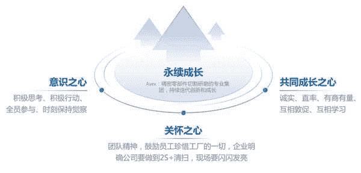

这种文化体现了对人的极致尊重，也成了员工与组织之间深厚的信任纽带。科学管理的灵魂，从来不在制度，而在文化。

从泰勒的证词出发，我们可以更深刻地理解，科学管理是一场“信任建设”的革命，是对激励方式、关系模式和价值认同的再造。

在当下这个以智能化、人机协同为主导的新阶段， **企业的成功不仅取决于技术的先进程度，更取决于组织是否完成了从“控制人”到“成就人”的转型：**

·当员工能够自我驱动时，组织才能敏捷响应。

·当个体被真正看见时，团队才有凝聚力。

·当企业“视人为人”时，文化才有生命力。

正如泰勒所言：“科学管理的第一步，是心理革命。” EXr6287u6NNVz+GYLY+7SGN8EvPKHDRD0R2fs+hJH6FUGuD/ntK17kx1EckHp5InRbOjsqs+vx5PQzEkttGAOg==

## 3.2　规律：敬畏员工的无穷性，就能链接员工的无穷性

在这个充满不确定性与高速变化的时代，企业面临前所未有的挑战与机遇。如何在激烈的市场竞争中保持韧性与活力？如何激发每一个员工的潜力与创造力？这是摆在每一个企业管理者面前的核心命题。

古希腊哲学家赫拉克利特曾说“世界的本原是火”，象征着持续的能量与变化。而员工，正是企业持续发展的“火种”和源动力。德鲁克指出“每个人都是自己的 CEO”，员工不仅是执行者，更是洞察问题、提出创见的决策者。从一个小小的现场改进到一次重大的技术突破，员工的创造力始终在深刻影响着企业的命运走向。张瑞敏曾说：“企业营造什么样的环境，员工就会成为什么样的人。”在海尔集团，“以人为本”不是口号，而是系统性实践。在很多世界一流企业中，都能看到这一信念的“回响”。

### 日航逆转：敬畏人的潜能，是最强的经营策略

2023 年 6 月，我有幸参访了日本京瓷公司，看到在经济不景气和巨大危机中，京瓷是如何进行预防和应对的，第一原则就是保持敬畏和爱的心态，激发员工的无穷潜能，并维持全员参与经营的状态，这样就能带领企业走出困境。

京瓷高管特别讲述了稻盛和夫拯救日航的故事。当时的日航濒临破产，稻盛和夫接手日航的第一天上午就开了高管会议，但会议充满了对制度与市场的抱怨。然而，下午他便走向了一线员工，就高管们所抱怨的问题向他们寻求解决方案：“你怎么看？”结果发现：那些被高管视为无解的问题，一线员工却早已有清晰的应对办法。

在接下来的 3 个月里，稻盛和夫通过走访、座谈会、大会、空巴等多种方式，与 3 万个日航员工握手，并不断询问：“你怎么看？”“你怎么看？”“你怎么看？”……员工的好点子如泉水般涌现，日航在短短 10 个月内便实现了扭亏为盈。

稻盛和夫认为，遇到困难时，如果自己无法解决，就去找下属，找一线员工，因为他们往往拥有解决问题的智慧。他强调，只有敬畏员工的无穷潜能，才能真正链接并释放员工的无穷潜能。这种对员工的尊重和信任、推动全员参与经营的方法，是企业克服困难、实现转型的关键。

### 松下众智经营：把每个人当成经营者

在日本松下 PHP 资料馆学习时，我读到了松下幸之助的一句名言：“最强的经营，是凝聚众人智慧的经营。”

这并非理想主义，而是松下集团长期践行的经营哲学——每个员工都是自己岗位的“经营者”，要以主人翁的姿态主动思考与持续改进。

在松下看来，企业的竞争力不只依赖完善的流程和制度，更取决于是否拥有一群愿意与组织同心、同行的人。因此，松下一直坚持“先育人，再谋事”。基于这一理念，公司鼓励每个员工将自己视为工作的责任人和决策者，不仅要完成任务，还要主动思考如何优化与创新。这样的集体智慧，使企业能够更敏捷地应对市场变化，解决复杂问题。松下还推动决策权下放，让更贴近市场与生产一线的员工参与决策，做到快速反应、提高决策效率。

这一理念可追溯至 1920 年，堪称“松下众智经营”哲学的起点。当时，第一次世界大战后日本经济先经历膨胀过热，继而陷入萧条与不景气，失业率攀升。在这样的背景下，松下于 1920 年 3 月成立了“步一会”，寓意“大家步调一致、精诚团结、同心同德、上下合作”，并倡导“一步一个脚印，踏实干事，杜绝空谈”，如下图所示。“步一会”的成立，让松下电器制造所的员工空前团结，携手推动生产与销售的繁荣发展。

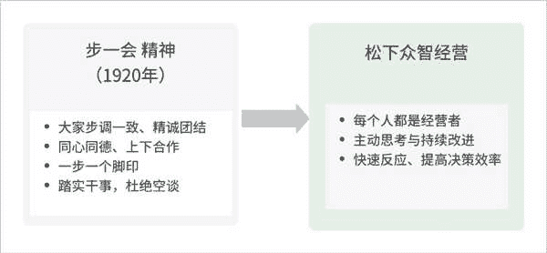

### 创美伊索谱：让人人成为创新者

任何事业的关键都在于人，无论怎样经营，只有在得到合适的人才后，事业才能获得发展。经营的组织和方法固然非常重要，但将其活用的依然是人。所以，在事业经营方面，首先必须追求人才、培养人才。

在苏州，我曾服务一家制造企业——创美工艺，他们用一套独特的方式推动全员创新。公司总经理大迁纯生说：“经营企业的第一步，是确保人才的创造性。”在他看来，设备、流程、场地的差异在全球竞争中已越来越小，真正能拉开差距的，是人，是创意，是感性智慧。为此，创美建立了一个内部创新系统——伊索谱。伊索谱的初衷是把事情做正确、做好。伊索谱的英文 ISOAP，意味着践行 ISO 标准化的理念，将标准化渗透到企业每一个员工的思想意识中，渗透到企业的技术研发创新、现场生产、运营管理中。

伊索谱的中文“伊索”借用伊索寓言的含义，集中全员智慧，开展创新活动，谱写科技篇章。创美集团每年举行两次伊索谱成果发布会，鼓励员工自由组建项目团队或单人申报，从课题立项、数据量化、资源配置到成果展示、CEO 亲自颁奖，形成自下而上的创新闭环机制，如下图所示。从管理流程优化到车间工艺改进，从科技研发到运营提升，员工的创造力得以全面释放。

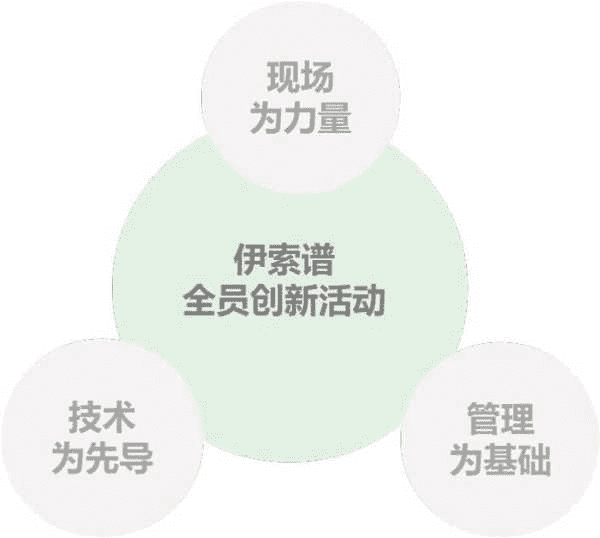

在创美，人不是管理的对象，而是知识与价值的共创者。2014 年，创美董事工场长金吉光跟我说，他们还成立了企业内部的科学技术协会，将每一个普通岗位的员工都视为科技变革的实践者。企业认为只有创造性地改变、改善现状，更好的群体智慧才会涌现。伊索谱全员创新活动的存在，使创美集团超越了“管理与被管理”的关系，形成了一个无形的创造知识的道场，持续优化产品、生产和运营的实践。

从日航的全员参与，到松下的自主责任经营，再到创美的伊索谱创新机制，这些案例都指向同一个核心命题： **企业的根本，不在流程制度，而在人；组织的上限，不在资源配置，而在人心链接。**

当企业敬畏员工的潜力，愿意赋权于每一个普通人时，就能真正释放集体的创造力。反之，如果组织试图用制度控制人、用规则束缚人，最终只会导致创造力的衰竭与组织的僵化。

当一个老板具有无穷性时，就能造就员工的有穷性；当一家企业敬畏员工的无穷性时，就能链接员工的无穷性。

### 心胜，则事胜

**企业经营的本质，是对人心的经营；组织要赢得未来，必须先赢得员工的心。** 转型的背后，不只是技术升级，更是人力价值的重估。企业的本质不是流水线的场，而是赋能的场。

不能仅靠金钱驱动，更要依靠尊重、信任与成长机制，让员工主动参与、持续自我提升，组织才能具备真正的再生能力。正所谓：

“心胜，则事胜。” EXr6287u6NNVz+GYLY+7SGN8EvPKHDRD0R2fs+hJH6FUGuD/ntK17kx1EckHp5InRbOjsqs+vx5PQzEkttGAOg==

## 3.3　方向：成为高频进化的智能体组织

### 制造范式的重大转向：从“持续改进”到“高频创新”

目前我们正处于新一轮产业变革的交汇点。从 20 世纪中期的精益制造到 21 世纪的智能制造，制造企业正经历一场范式转型：从以效率优化和流程改善为核心的“持续改进”迈向以数据、算法、软件为基础的“高频创新”。

在过往的工业发展中，丰田主义以其成熟的精益生产理念、看板拉动体系、零库存理念和持续改善文化，为全球制造业提供了卓越的模板。但在 AI、大数据、物联网和智能制造快速发展的今天，企业面临的最大挑战已不仅是“把事情做对”，而是“做正确的事情”，并能在实践中不断自我学习与进化。

### 为什么中国企业不能跳过丰田主义

许多中国制造企业希望一步到位迈入“智能制造”，但忽略了一个事实：精益管理的地基尚未夯实。

丰田主义并非横空出世，而是泰勒科学管理、美国工业工程、5S 管理、质量管理等多种管理思想的系统演进（如下图所示）。从 20 世纪 50 年代起，丰田结合日本本土资源匮乏的现实，发展出包括“准时化生产”“看板系统”“持续改善（Kaizen）”“零缺陷”在内的一整套精益生产体系（TPS）。

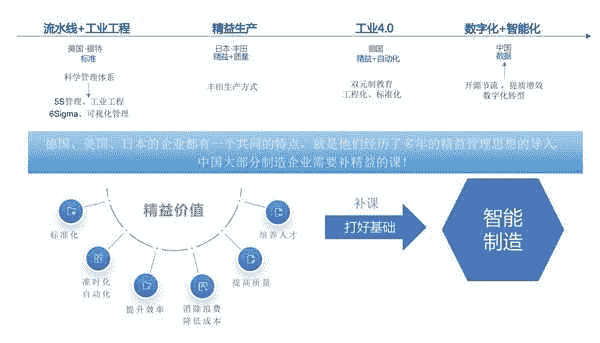

德国、美国、日本等国家的制造企业均深度导入了精益理念。但对于中国企业而言，这段精益“基础建设期”在大多数企业中是缺失的。过去 40 年的高速增长和人口红利，让不少企业习惯了粗放式发展，缺乏对流程、标准、质量与效率的深度认知，也很难沉淀真正的数据资产和过程能力。有些制造企业的基础数据采集、标准作业流程、现场管理系统尚未普及。

可以说精益水平决定了数字化的起点。离开了精益的地基，数字化和智能化就如同沙滩上的高楼。没有精益，就没有高质量、结构化、可量化的流程数据；没有精益，也就没有组织内部“持续改进”的文化基因。

因此，中国制造企业要从数字化中获益，不能直接越过丰田主义，而是必须以精益为基础，筑牢企业的底层操作系统。对大多数中国制造企业而言，需要补上精益这一课。

### “特斯拉主义”的兴起：AI 原生、软件定义、高频进化

特斯拉主义并非仅仅是“数字化制造”的代名词，而是一种底层认知逻辑不同的企业组织形态。特斯拉主义并非对精益制造的否定，而是对其边界的突破。与传统制造企业不同，特斯拉从一开始就不是单纯的“造车公司”，而是一个以数据为核心、以算法为驱动的“AI 原生智能体组织”，它的系统逻辑是闭环的、自反馈的、自演化的。特斯拉主义主要呈现如下图所示的 4 个典型特征。

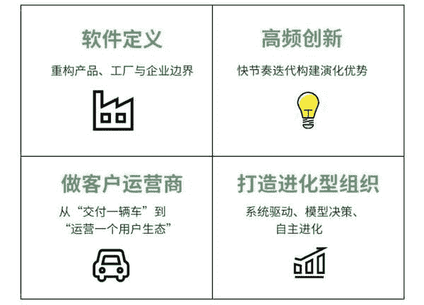

**软件定义：重构产品、工厂与企业边界**

特斯拉最本质的颠覆来自“软件定义一切”的理念。传统制造企业是以硬件为中心的静态系统，而特斯拉从一开始就将软件置于产品与组织核心。

·每一辆车都是一个运行着上百万行代码的智能终端，可以通过 OTA（空中升级）不断优化。

·工厂生产线由软件控制的 MES、APS 和 AI 模型动态协同控制，打破了传统自动化的静态逻辑。

·企业内部运营系统以 Warp-ERP、自动化财务系统、CRM 等构成统一平台，打通了端到端的流程与数据。

这意味着，特斯拉不是“造车公司”，而是一个持续运行的“算法平台+软件系统+制造执行体”。产品、生产、服务皆由代码定义，决策逻辑逐渐由更多模型来决定。

**高频创新：快节奏迭代构建演化优势**

丰田主义强调“持续改善”，而特斯拉主义更强调“高频创新”。

·特斯拉的研发速度比传统车企快 2～3 倍。

·功能迭代不依赖产品换代，而是通过软件实时更新，例如自动驾驶功能、导航优化都可在线激活。

·创新不仅存在于产品层面，也深嵌在制造系统、供应链协同乃至组织架构中。

这一切的前提是“系统架构化”：只有当产品架构、组织接口、平台技术具备高内聚、低耦合能力，企业才能实现“日更式”的快节奏试错与进化。

**做客户运营商：从“交付一辆车”到“运营一个用户生态”**

传统制造的终点是交付，而特斯拉的运营恰恰在交付之后。

·每一位车主的驾驶数据、行为偏好、充电习惯，都会实时同步至特斯拉云端，用于模型训练和体验优化。

·车主与平台之间形成持续交互关系，通过导航优化、娱乐内容推荐、远程故障诊断、在线服务预约等形成完整闭环。

·特斯拉不是“卖车给你”而是“持续运营你”，用户既是数据源，也是模型参与者，更是产品共创者。

这是一种“以客户为中心”的智能运营逻辑：产品使用过程即持续共创过程，企业成为平台型客户运营商，获取的是“生命周期价值”而非“一次性交付利润”。

**打造进化型组织：系统驱动、模型决策、自主进化**

特斯拉主义最深层的精神是组织自身也应是一个“进化中的系统智能体”。

·它不是静态分工的“科层结构”，而是以任务驱动、模型协同、系统流动为特征的“去中心化组织”。

·特斯拉内部打破了传统职能部门划分，将算法、工程、制造、IT、AI 安全等归入平台协同团队，推动跨界交付。

·激励机制围绕任务闭环，以组织进化而非 KPI 为导向，更强调“能动的工程师个体”和“组织学习速度”。

特斯拉不是在管理人，而是在训练系统、优化模型、调度智能，真正实现了“人—系统—任务”的三元协作。这正是未来组织所需具备的“自演化能力”。

这 4 个特征——软件定义、高频创新、做客户运营商、打造进化型组织，共同构成了特斯拉主义的核心内涵。它不仅是一个技术方向，更是一种组织哲学——一种以“感知—决策—行动”为基础的智能体组织构建方式。

### 范式比较：丰田主义与特斯拉主义

丰田主义与特斯拉主义，谁更契合这个时代呢？

加里·哈默尔（Gary Hamel）认为，丰田是会思考的系统，依靠人的智慧实现持续改进，而特斯拉则能通过数字化手段加快学习速度，实现持续创新，二者的对比如下表所示。不是每一个企业都能立刻成为特斯拉，但每一个企业都可以开始组织的进化。

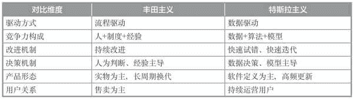

这张表并非以“新胜于旧”的方式否定丰田主义，而是提示大家：企业可以根据自身所处的产业成熟度、技术能力、人才结构与客户需求，选择合适的演化路径。特斯拉所展现的“AI 原生范式”，确实为全球制造业提供了新的目标模型。

从丰田主义到特斯拉主义，不仅是方法的变化，更是底层认知范式的跃迁。从强调“如何正确地做事”到思考“能否让系统自己进化，做正确的事”——未来的组织将 **不仅依赖“人管理人”的方式** 来应对复杂性，而且会逐步演化为一个 **具备自我感知、自我学习、自我调度、自我修复能力的“自组织系统”。**

如果说丰田主义是构筑地基的砖石，那么特斯拉主义就是面向未来架构起飞的轨道。它们不是对立的而是承前启后的关系。对于中国制造企业来说，拥抱精益、融入数字、迈向智能，是一条必须走且持续走的进化之路。 EXr6287u6NNVz+GYLY+7SGN8EvPKHDRD0R2fs+hJH6FUGuD/ntK17kx1EckHp5InRbOjsqs+vx5PQzEkttGAOg==

## 3.4　进化实践：从人本文化到规模化人机协同

### 干法 11　让人成为人：建立以人为本的人机共生文化

1994 年，《连线》杂志主编凯文·凯利在《失控》一书中写道：“人造物表现得越来越像生命体；生命变得越来越工程化。”这不仅揭示了技术与生命边界的模糊，更预示着人机关系的深刻变革。

如今，随着大模型与智能体（Agent）的发展，这种变革加速显现：人类如何在智能化协作中被“解放”？人机关系将呈现何种新形态？它又将如何重塑我们的工作与组织方式？

**人机协同的 3 阶段进化：从执行者到创造者**

人机协同的 3 阶段进化如下图所示。

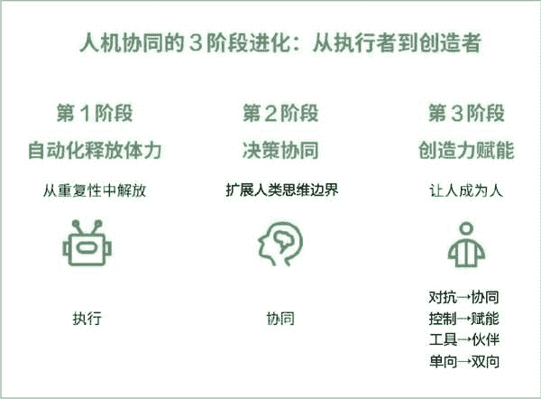

**第 1 阶段：自动化释放体力，从重复性中解放**

Agent 的兴起，使大量标准化、重复性工作得以自动化。通过将复杂流程拆解为可管理任务，结合 RPA 与 AI 执行模块，企业将大幅提升效率。

人类在这一阶段不再专注于数据录入、文件处理、审核校对等琐碎事务，而是被“解放”出来，负责更有创造力和战略性的任务。例如，在制造企业中，AI 自动完成质检、数据分析、物料调度，员工则转向流程优化、质量改进等更高阶的工作。

解放的关键不在“替代”，而在“增强”。AI 负责规则化执行，人类专注于设定目标与评估结果，真正实现“人机分工，各展所长”。

**第 2 阶段：决策协同，扩展人类思维边界**

以前人类是决策者，机器是执行者，但大模型的发展正在打破这一界限。Agent 不再只是工具，它能理解复杂语言，参与多步骤逻辑推演，具备规划能力，可以成为真正的“业务搭档”。

例如，在新产品上市前，Agent 能基于行业数据自动生成市场分析报告、竞争格局分析报告、推广建议，辅助决策者更高效地完成战略筹划。

这种协同不是取代人类的判断，而是通过智能反馈与联想，扩展人的思维边界、提高人的决策质量。

**第 3 阶段：创造力赋能，让人成为人**

最具颠覆性的，是 AI 对创造性工作的重塑。大模型通过自我训练、深度学习与语言生成，辅助人类进行创造性工作。在科研、设计、营销等领域，AI 可参与趋势预测、方案生成、技术模拟，辅助人类实现更高层次的创新。例如，宝马在新车型研发中引入生成式设计平台，工程师设定零部件的强度、重量、成本等目标参数后，AI 会自动生成优化方案。

在这类共创模式中：

·人类提供目标、伦理判断与创造性火花。

·AI 提供强大的知识、生成、组合与反馈能力。

人类不再做执行者，而是做系统设计者、策略制定者与意义赋予者，“人”的价值由此回归本源。

**人机关系的范式演进：从工具到伙伴**

随着人机协作模式的演进，我们看到 4 种人机关系的深刻变化：

· **从对抗到协同：** AI 不再是威胁，而是合作者，人类提供方向，AI 执行并优化。

· **从控制到赋能：** 人不再掌控每一步，而是被 AI 辅助，获得更大的行动自由。

· **从工具到伙伴：** AI 拥有理解、记忆与联想能力，逐渐从被动型工具转向主动型伙伴。

· **从单向到双向：** AI 能够与人进行多轮互动，建立起“反馈—修正—再反馈”的交互闭环。

这一切促使我们重新定义 AI 的本质：AI 不是外在的冰冷机器，而是能够共感、共创、共生的智能存在。

**人机关系的哲学思考：建立以人为本的人机文化**

人机关系不仅是技术话题，更是社会与哲学话题。

· **技术为人服务，而非控制人：** 无论 AI 多强大，人的价值应始终是技术演进的方向标。技术必须围绕人的目标、愿景与伦理展开，确保人不会迷失在效率与智能的洪流中。

· **激发人的主体性，而非弱化人：** 智能技术应该赋能人，而不是弱化人。我们必须避免成为被动依赖 AI 的“思维外包者”。人类应主动设定目标、激发好奇心、持续学习，在协作中提升自己的认知力、判断力与创造力。

· **人与技术的未来，不是替代，而是共同进化：** 未来，人机不再是“谁替代谁”的竞争博弈，而是“共同进化”的协作系统。AI 扩展人类的知识边界，人类赋予 AI 目标与价值。

**让人成为人** 的核心，不在于逃避技术，而在于借助人机共生，让人重新回到选择、判断、创造与思考的主体位置。

### 干法 12　组织进化：建设 AI 数字总部，赋能最小业务作战单元

在数字经济时代，组织的生存逻辑正在发生根本性变革。传统的金字塔式组织结构正面临前所未有的挑战——信息流动滞后、指令层层传递、市场响应迟缓，使企业在瞬息万变的环境中显得笨重而脆弱。要在复杂多变的商业环境中立于不败之地，企业亟须构建更扁平、更敏捷、更数字化的新型组织形态。

从美国太空军的“数字原生”军种转型到华为“让听得见炮火的人来决策”的组织实践，从 AWS 的原子化服务模式到海尔的“人单合一”用户中心化运营，全球领先企业都在以不同路径探索同一方向。这些实践揭示了组织革命的两大战略核心：AI 数字总部（Digital HQ）的构建与最小业务作战单元（Minimum Business Unit，MBU）的赋能，如下图所示。

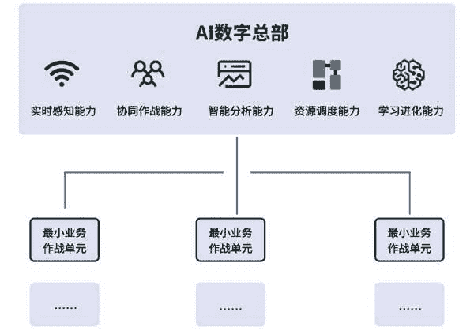

**AI 数字总部：组织的大脑**

AI 数字总部是新型组织的中枢系统，它是企业的大脑，通过 AI 和数字化技术整合组织资源、优化决策流程、赋能一线单元，实现组织的敏捷响应和持续进化。AI 数字总部与传统总部相比具有以下区别：

· **从物理存在到虚拟实现：** 不再依赖固定的办公场所，而是构建起分布式的智能决策网络。

· **从集中控制到赋能支持：** 不再层层审批，而是通过平台、工具和算法，支持一线快速行动。

· **从层层审批到实时决策：** 基于数据共享与模型推演，推动决策的前移和实时落地。

· **从封闭系统到开放生态：** 不仅能整合内部资源，还能无缝连接外部数字生态，实现内外协同共创。

一个成熟的 AI 数字总部应当具备五大核心能力：

· **实时感知能力：** 通过物联网、边缘计算等技术，构建企业的“神经系统”，实时感知内外部变化，包括最新研发动态、生产状态、客户动态、市场动态等。

· **协同作战能力：** 通过统一平台和标准接口，打通各业务单元与外部合作方，实现跨部门、跨组织的无缝协同。

· **智能分析能力：** 借助大数据和 AI 算法，对感知到的信息进行深入分析，提供预测性洞察和决策建议，支持业务“用数据做选择”。

· **资源调度能力：** 打破传统僵化的资源配置方式，实现人、财、物的动态优化调度，使资源利用效率更高。

· **学习进化能力：** 利用运营数据持续优化规则、流程与模型，推动自我进化。

AI 数字总部本质上是一个实时运行的智能平台，它让组织内的每一个单元——不论是一线班组、区域团队，还是业务前端——都能快速感知变化，自主做出判断，协同执行任务。

也就是说，AI 数字总部不是“发号施令”的塔楼，而是“赋能协调”的系统。未来的企业竞争，不再取决于谁的总部更大，而是看谁的 AI 数字总部更聪明、更快、更有进化力。

**赋能最小业务作战单元**

最小业务作战单元是指组织中最小的、能够独立完成特定业务目标的团队或个体。这些团队或个体分布在组织与客户所有的触点上，拥有自己的目标、资源和决策权。AI 赋能下的最小业务作战单元应具备：

·明确可衡量的业务目标（OKR）。

·高度自主的决策权与资源获取渠道。

·按需供给的内部 AI 资源与能力中心的支持。

·基于实时数据的快速决策与执行能力。

·对市场和客户需求的响应周期以小时、分钟计。

华为 B 端市场的“铁三角”模式（销售+交付+服务）正是这一理念的落地实现，通过一线自主决策与资源调度，显著缩短了项目交付周期。SpaceX 将大型项目分拆为极小的工程作战单元（如火箭控制系统、推进模块、软件地面系统等），每个单元全权负责模块开发、测试和迭代，从而可以在数周内实现同行需要数月才能完成的技术迭代。

**数字太空军：基于时间线的作战机制**

美国太空军（USSF）堪称数字太空军，自成立之初即以“数字原生”为战略核心，构建分布式、实时化的数字总部，形成四大能力：

·分钟级更新的实时战场感知。

·AI 驱动的智能威胁分析与决策建议。

·全球范围的动态资源调度。

·跨军种、跨层级的无缝信息与行动协作。

其独特的时间线作战机制，将传统数周甚至数月的决策周期压缩到分钟级，如下图所示。

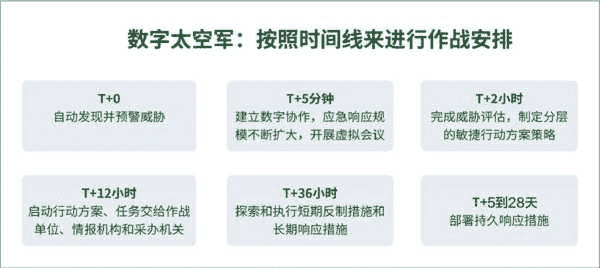

这种机制体现了“速度即生命”的作战理念，充分展现了数字化组织的竞争优势。

建设 AI 数字总部与赋能最小业务作战单元，不仅是技术升级，更是组织理念、结构与文化的系统性重构。华为、SpaceX 与美国太空军的实践表明： **当组织实现实时感知、快速决策与高效执行的闭环时，便能在高度不确定的环境中，以速度、智能与协同赢得竞争优势。**

### 干法 13　知识流动：打造企业级知识库，赋能每一个员工

在 AI 技术驱动的数字化时代，知识管理已成为企业核心竞争力的关键。传统知识管理模式是“池塘模式”，知识分散且孤立；而现代企业需要向“水库模式”跃迁，实现知识的集中化、结构化存储；最终迈向“矿泉水模式”，将知识转化为可即时应用的智能资源，赋能全员高效决策与创新。

因此，知识管理不再是文档归档，不再是建系统、建平台，而是激活一个组织的“群体智能”。通过构建“全员超级大脑”，让每一个员工都能被知识赋能，激发从无到有的创造潜力。

**企业知识管理的 3 种模式**

企业知识管理的 3 种模式如下图所示。

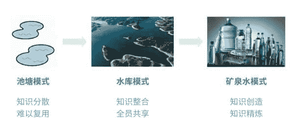

**从“池塘模式”到“水库模式”：知识整合的革命**

传统企业的知识管理多呈现“池塘模式”：各部门独立建库、数据分散、标准不一，导致知识利用率低、重复劳动频发。而“水库模式”的核心是通过建立企业级知识库整合全域知识和内外部多种数据，形成统一中枢，从分散到集中，知识从“查找困难”变为“即取即用”，为全员协作奠基。

**“池塘模式”困局：知识分散，难以复用**

“池塘模式”的特征：知识分散在各个部门和个人手中，如同散布在企业各处的小池塘，彼此孤立、流通不畅；每个部门都有自己的资料库，彼此不联通；员工获取信息靠“问老员工”“翻历史记录”；知识如同一汪汪静态池塘，缺乏流动与共享，有沉淀却不能使用。在这种模式下，组织会出现以下典型问题：

· **重复劳动：** 项目资料各自归档，不同部门间知识难以共享，导致大量重复劳动和资源浪费。

· **经验失传：** 经验大都存于老员工脑中，员工离职会带走关键知识。

· **响应缓慢：** 检索困难，知识难以复用，员工分享依赖口口相传、低效问询。

这类知识虽然“存在”，但却无法流动、整合、演进，更难形成组织级的共享资产。

**“水库模式”：知识整合，全员共享**

要破除“池塘模式”的困局，企业必须搭建集中、统一的知识管理平台，将分散的知识资源整合起来，形成企业的“知识水库”。“水库模式”强调知识的系统化收集、标准化分类和高效检索，知识逐步从“个人资产”变为“组织资产”，知识能够在组织内自由流动。实施“水库模式”知识整合的关键步骤包括：

·建立统一的知识分类体系和统一的知识平台。

·制定知识贡献与更新的流程机制。

·对知识进行标签化、元数据管理。

·建立从采集、审核、归档到分发的治理机制。

“水库模式”是企业知识管理“从有到优”的基础。“水库模式”能实现知识集中、可检索、有版本，提升调度效率与知识的规范性。

某跨国电子科技公司的案例展示了“水库模式”的成效。该公司通过建立全球知识共享平台，将分布在 30 多个国家的研发成果、市场洞察和客户案例集中管理，任何员工都能快速获取所需知识。实施“水库模式”知识整合后，该公司新产品开发周期缩短了 40%，客户问题解决速度提高了 60%。“水库模式”打破了知识孤岛，显著提升了组织效能。

**从“水库模式”到“矿泉水模式”：知识的创造与精炼**

“水库模式”虽然解决了知识集中存储和共享的问题，但仍存在显著局限：知识价值提取不足，难以转化为实际生产力。“矿泉水模式”是一个形象的比喻，指企业不仅存储原始知识“水”，还能对其进行精炼、加工和赋能，创造出如同矿泉水般高价值的知识产品。

这一模式更强调员工能基于已有知识创造新方案、新方法，强调“无中生有”。

**企业级知识库的高频应用场景**

对于企业而言，生产流程复杂、技术要求严苛，纸质文件、电子表格、文档、标准作业书及各类业务系统中每天都会产生海量数据。这些数据涵盖工业运行参数、技术资料和专家经验，唯有经过系统整合与提炼，它们才能沉淀为精确、实用且结构化的知识体系。

因此，在启动企业知识库建设之前，必须先明确高频应用场景——知识库的价值不在于“存起来”，而在于直接赋能业务岗位，提升工作效率、优化决策质量、催生创新成果。部分企业级知识库典型应用场景如下表所示。

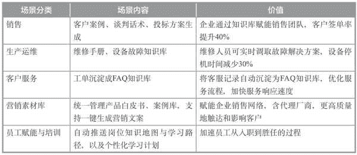

**企业知识创造的途径和落地建议**

响哥结合日本野中郁次郎提出的 SECI 模型思想，具体从 4 个阶段来进行企业知识创造和落地分析，如下表所示。

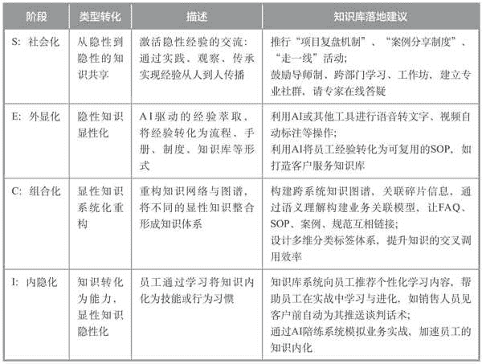

企业在具体落地知识库的时候，可以建立“知识贡献激励机制”，鼓励员工分享案例，如佳沃集团推出了全员分享知识的机制，目前已经积累了 3 万多个知识文档，并且这些知识可以被调用来辅助业务查询和管理决策。当企业建立好全面的知识库后，AI 可以激活沉睡的数据和知识资产。

**私有知识资产：AI 时代企业的护城河**

在数据同质化严重的 AI 时代，私有知识资产将成为企业不可复制的核心竞争力，重点有 3 个方向：

· **企业运营积累的专家经验、工艺 Know-how 等隐性知识难以被竞争对手复制：** 今天企业在设备、材料、水电费这些方面很难拉开差距，真正拉开差距的实际上是产品的制造方法和企业的运营方法，这些是企业看不见的竞争力。让隐形知识结构化、模型化、可调用、可计算，例如，苏州某电子企业将 18 年生产经验转化为各种可见的改善成果和专利，形成技术壁垒，这些很难被竞争对手复制。

· **标准化知识库沉淀：** 沉淀各种流程制度、各种业务单据模板、SOP 指引、项目报告、产品文档，方便员工及时查询和检索。

· **资产化实践：** 自 2024 年 1 月 1 日起《企业数据资源相关会计处理暂行规定》施行，知识资产可以入表使企业增值。

企业知识库的建设，不仅是一次技术应用，更是组织进化的关键一步。通过系统化的知识管理，企业能够打破信息孤岛，让知识在组织内高效流动。以一家全球顶级咨询公司为例，其核心竞争力在于深厚的知识储备与专家经验，但在传统模式下，该公司面临三大痛点：

·顾问需要花费大量时间检索内部数据库或向同事求助。

·海量报告、案例未被有效关联利用。

·高级合伙人的洞察难以规模化复用。

2023 年，该公司上线了一个基于 AI 的企业级知识平台，目标是在客户服务场景中，让每个顾问都能即时调用公司积累的智慧。该平台的核心措施包括：

· **全球知识聚合：** 整合近百年的研究报告、项目案例与专家访谈。

· **自然语言交互：** 顾问可直接以对话的方式获取精准答案，例如“帮我找零售行业的数字化转型案例”。

· **智能推荐：** 系统自动关联相关文档、图表，并推荐可联系的内部专家。

未来的企业竞争，本质上是知识流动效率的竞争。当知识库从“静态知识库”进化为“智能伙伴”，上述咨询公司的每个员工都能调用近百年的智慧，该公司便真正具备了“集体进化”的能力。

知识库不是终点而是起点， **真正的智能企业，不是拥有最多知识的企业，而是能让知识不断流动和再创造的企业。** 通过私有知识资产构建竞争壁垒，并依托 SECI 模型实现知识创造闭环，企业将真正赋能“全员超级大脑”，在 AI 时代实现“知识即战力”的进化。 EXr6287u6NNVz+GYLY+7SGN8EvPKHDRD0R2fs+hJH6FUGuD/ntK17kx1EckHp5InRbOjsqs+vx5PQzEkttGAOg==

## 3.5　以人为先，打造企业 AI 转型的基石

2024 年 4 月 17 日，人力资源社会保障部联合其他 8 个部门发布了《加快数字人才培育支撑数字经济发展行动方案（2024—2026 年）》。该方案提到，要紧贴企业发展需求开设数字人才培训班，培养一批既懂产业技术又懂数字技术的复合型人才，不断提升从业人员的数字素养和专业水平，助力产业数字化转型和高质量发展。根据这一政策指引，企业需要构建一支素质优秀、结构合理、分布均衡的高水平数字人才队伍，进而推动业务转型和创新。

### 干法 14　打造 H 型人才：让人人成为 CAIO

在数字化转型的浪潮中，人才形态的演变从未停止。从最初的“I 型人才”到“T 型人才”，再到近年来热议的“π型人才”，人才形态的每一次变革都伴随着生产力的质变。而今天，在 AI 技术的赋能下，一种全新的复合型人才形态——“H 型人才”，正在成为企业 AI 转型的核心驱动力。

**什么是 H 型人才**

H 型人才是 AI 时代企业最需要的复合型人才，具备深厚的专业技能与卓越的 AI 应用能力两大核心优势。他们不仅拥有传统 T 型人才的专业深度，还能将业务问题精准转化为可由 AI 协同优化、自动化解决的任务，通过人机协同实现效率倍增、决策升级与创新突破。他们是 AI 时代的“人机协同指挥官”，他们连接“人类智慧”与“人工智能”，推动工作模式从“人做”迈向“人+机共做”，是企业推进 AI 转型的核心驱动力。

**H 型人才核心特征：双支柱专业能力和横杠人机协同能力**

· **双支柱专业能力：** 他们像字母“H”一样，左侧是专业支柱——在某一领域（如生产、财务、营销、研发）有深厚积累，能抽象业务逻辑；右侧是 AI 支柱——熟悉 AI 工具（大模型、RPA、数据分析等），能调度“Agent 数字员工”协同工作。

· **横杠人机协同能力：** 人机系统思维，能在专业与 AI 之间架桥，设计最优人机协作流程。通过将专业知识与 AI 能力有机结合，最终实现“1+1>10”的协同效应。

H 型人才的核心价值在于其专业洞察力与 AI 杠杆率的深度融合，能够最大化 AI 在业务场景中的赋能效应。

**H 型人才价值=专业洞察力×AI 杠杆率**

· **专业洞察力：** 决定业务理解能力，有扎实的领域知识和经验，是识别问题本质和判断 AI 应用方向的基础。

· **AI 杠杆率：** 决定效率放大倍数，能够将 AI 能力有效嵌入业务流程，放大专业技能的效能，实现指数级的效率提升和创新突破。

在 AI 时代，只有知识深度或技术广度已无法应对复杂多变的商业环境。H 型人才融合业务洞察与 AI 驱动，是企业 AI 转型的关键变革者与价值放大器。

**H 型人才的角色定位：企业 CAIO**

H 型人才可被视为企业的 CAIO（Chief AI Officer，首席智能官）。这里的 CAIO 不是一个固定的岗位，而是一种在各自专业领域内运用 AI 思维和工具改造业务、放大效能与创造价值的能力与身份。与传统人才不同，H 型人才不仅依靠自身的专业知识与技能创造价值，更通过 AI 技术的嵌入与创新，成倍扩大价值创造的范围和提高价值创造的速度。

每个 H 型人才都是自己岗位上的“首席智能官”，是组织 AI 转型的最小作战单元。H 型人才≠技术专家，而是懂 AI 技术的业务操盘手。他们主导 AI 与业务融合，训练和管理“数字分身”，推动组织 AI 化升级。

H 型人才在企业中承担“硅基员工指挥官”角色，引领 AI 赋能的组织再造与业务转型。

**H 型人才的能力模型**

H 型人才的核心特征可以概括为 3 种相互关联的能力：执行力、决策力和创造力。这 3 种能力共同构成了 H 型人才的能力模型，也是评价一个人是否具备 H 型人才特质的重要标准。

H 型人才能力=执行力（AI 工具链掌控）×决策力（数据驱动洞察）×创造力（AI 增强创新）

· **执行力：** 用 AI 思维高效完成任务。H 型人才的执行力体现在他们能够用 AI 思维找到 10 倍、100 倍及更高倍提升效率的方法，能调度 AI 工具和数字劳动力，高效执行复杂任务。例如，某智能财务专家利用 OCR+RPA 工具，自动处理发票、对账等重复性工作，将月均 3000 张发票的审核时间从 80 小时压缩至 4 小时，错误率从 5%降至 0.1%，将财务人员从烦琐的事务性工作中解放出来，专注于更有价值的分析和决策工作。

· **决策力：** 善用 AI 辅助分析和洞察。在 AI 时代，数据已经成为企业最重要的资产之一，从海量数据中获取有价值的洞察并做出正确的决策，是提高企业竞争力的关键。例如，某制造企业资深计划员通过 AI 排程系统，将制订生产计划的时间从 3 天缩短至 2 小时，准确率提升至 90%。

· **创造力：** 借助 AI 工具进行业务模式、产品与流程创新。在 AI 时代，创新不再仅仅依赖人类的创造力，而是可以通过 AI 工具实现更高效、更精准的创新。例如，在产品开发领域，可以利用 AI 工具进行需求分析、原型设计和测试验证，缩短产品开发周期，提高产品创新的效率和质量。例如，某医药科技企业研发人员结合临床数据与大模型，开发出可预测药物副作用的智能系统，将新药研发周期缩短 40%。

H 型人才通过这 3 种能力的协同作用，在 AI 时代展现出强大的竞争力和创造力，成为企业 AI 转型的核心驱动力。

**H 型人才画像和典型案例解析**

H 型人才是企业 AI 渗透率的直接推手，站在“碳基智慧”与“硅基能力”的交叉点，通过独特的人机协同操作系统，让业务价值实现指数级增长。他们是企业 AI 落地的核心驱动力。当下，H 型人才会成为企业 AI 落地的主要力量。H 型人才画像如下图所示。

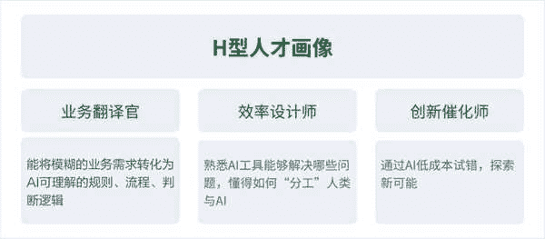

· **业务翻译官：** H 型人才是企业内外部技术和业务需求之间的桥梁，他们能够精准识别哪些业务环节可以通过 AI 赋能，并将模糊的业务需求转化为可由 AI 解决的问题。他们能够抽象出可以被 AI 化的专业知识，如规则、流程、判断逻辑等，确保 AI 技术能与实际业务场景相匹配。

· **效率设计师：** H 型人才具有深刻的 AI 工具应用知识，熟悉大模型、RPA（机器人流程自动化）、BI（商业智能）分析工具、低代码平台等。他们懂得如何设计人类与 AI 的协作模式，并巧妙地将 AI 能力嵌入业务流程和岗位中。

· **创新催化师：** 通过 AI 能够快速试错，低成本探索新可能。例如，用生成式 AI 可快速探索 100 种产品设计原型。

下表中的案例展示了 H 型人才在不同领域中的价值。

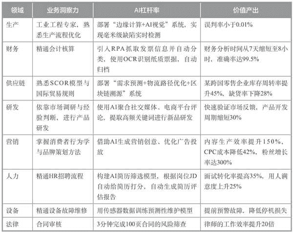

**H 型人才对组织的影响和培养方法**

未来的组织不再是金字塔式的“人—岗—责”结构，而是以 H 型人才为核心节点的“人机共生网络”，硅基员工密度加速提升，企业生产力发生结构性变化。

正如工业革命催生工程师阶层，AI 革命正在塑造新一代“硅基指挥官”——他们既是传统专业的守护者，也是 AI 数字员工的驯化者。谁先培养出一批“岗位级的 CAIO”，谁就能在 AI 时代实现真正意义上的降本增效、敏捷创新和组织进化。

企业需要采取多维度的方法来培养 H 型人才：

· **跨部门合作与知识共享：** 鼓励业务部门与 AI 技术团队的深度合作，促进专业知识与 AI 技能的融合。

· **AI 技能培训与认证：** 为现有员工提供 AI 基础知识、工具应用和思维模式的培训，通过认证提升其 AI 素养。

· **设立内部 AI 创新平台：** 鼓励员工利用 AI 工具进行创新尝试，并提供相应的资源和支持。

· **实践人机协同项目：** 从小场景切入，通过实际的 AI 赋能项目，让员工在解决真实业务问题的过程中学习和成长。例如，用 AI 采集最新文献和专利动态，用 AI 辅助阅读并自动生成最新情报动态。

· **导师制度与经验交流：** 建立 H 型人才导师制度，促进经验分享和技能传承。

· **构建学习型组织文化：** 鼓励员工持续学习新技术，拥抱变化，积极探索 AI 在工作中的应用。

· **招聘与引进：** 在招聘过程中，重视候选人的学习能力、跨领域知识和对 AI 的兴趣。

AI 时代衡量企业生产力的核心 KPI，就是员工人均拥有 Agent 的数量，企业的竞争力取决于“H 型人才占比”，即 AI 人才密度，而非员工数量。

**AI 时代 H 型人才的十大行为倡议**

AI 的真正价值，不在于取代人类，而在于让人成为更好的自己——前提是，人们愿意思考、敢于变革、勇于创新。在以人机协同为核心的新时代，领先的组织不仅依赖先进技术，更依赖开放的思维、灵活的应变能力和持续的学习能力。技术是驱动器，而人的认知与行动才是变革的真正引擎。

H 型人才正是这一时代亟须培养的核心力量——他们具备 AI 思维，能够重塑工作方式、优化业务流程，并引领组织向智能化转型。基于“转型有术”的数字人才培养实践经验，我们提炼出 H 型人才的十大行为倡议，为企业与个人在 AI 时代的成长与突破提供可操作的行动指南，如下图所示。

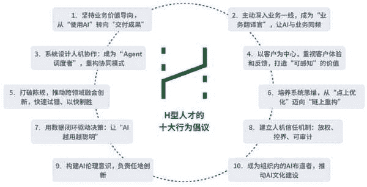

**1.坚持业务价值导向，从“使用 AI”转向“交付成果”**

摒弃“工具思维”，将实现可度量的业务价值作为一切 AI 落地的出发点和核心检验标准。强调 AI 应用的最终目标是解决实际业务问题，创造具体、可量化的业务成果（例如成本降低 30%、效率提升 5 倍、客户满意度提升 15%）。要从关注 AI 的功能实现转向关注 AI 对业务目标的贡献。

**2.主动深入业务一线，成为“业务翻译官”，让 AI 与业务同频**

H 型人才需要深入理解业务流程、痛点、需求和战略意图，并将模糊的业务需求精准转化为 AI 可理解和执行的任务、规则、流程及判断逻辑，成为业务与 AI 之间的“桥梁”和“翻译官”。确保 AI 的开发和应用与业务目标高度一致，实现 AI 与业务的同频共振。

**3.系统设计人机协作：成为“Agent 调度者”，重构协同模式**

H 型人才需要具备端到端的系统思维，成为人机协作的“硅基指挥官”，设计高效、流畅的人机协作模式。明确人和 AI 在业务流程中的角色、分工、协作方式和决策权限，充分发挥各自的优势，实现人机协同效率的跃迁。理解 AI 正在从“被调用工具”升级为具备一定“自主性”的“智能代理”，认识到 MCP 和 A2A 协议加速了这一进程，人类的角色转变为“目标制定者+协同编排者”。

**4.以客户为中心，重视客户体验和反馈，打造“可感知”的价值**

H 型人才以客户为中心，利用 AI 深度洞察客户需求与痛点，赋能更精准的服务与创新体验。借助 AI 快速收集、分析并响应客户需求，驱动产品迭代和服务升级，确保解决方案贴合客户需求。

**5.打破陈规，推动跨领域融合创新，快速试错、以快制胜**

AI 时代唯快不破，创新是核心驱动力。AI 应用往往需要跨领域知识、技术和资源的整合。H 型人才要敢于打破思维定势，整合行业知识、技术工具与业务场景，主动探索 AI 赋能的新机会，利用 AI 低成本试错的特性加速创新。H 型人才要成为连接“碳基智慧”与“硅基能力”的桥梁，以开放的心态快速试错和快速迭代，在实践中持续优化。

**6.培养系统思维，从“点上优化”迈向“链上重构”**

H 型人才需要具备系统思维能力，不仅要关注单个 AI 任务的完成质量和效率，更要从全局视角出发，考虑 AI 应用对整个组织、业务生态和长期战略的影响，优化人机协同的“输入—处理—交付”全过程，提高智能化水平。

**7.用数据闭环驱动决策：让“AI 越用越聪明”**

在 AI 时代，数据是重要的生产要素。H 型人才要重视 AI 应用过程中的数据积累，建立“数据—洞察—行动”的闭环思维，善于利用 AI 辅助分析海量数据，平衡算法分析结果与专业经验判断，做出更科学、更精准的决策。通过数据反馈不断优化 AI 应用，形成“AI 越用越聪明”的飞轮效应，实现持续改进和提升。

**8.建立人机信任机制：放权、控界、可审计**

要建立人与 AI 之间的信任关系，人类需要逐步转变角色，将重复性、规则性、可预测性的任务适度委托给 Agent，让 AI 在清晰定义的范围内自主决策和行动，从而更好地发挥 AI 的能力，将人类从烦琐的工作中解放出来，聚焦于高价值的创造性工作。同时，建立对 Agent 的责任管理机制，确保 Agent 行为的透明、可控、可审计。

**9.构建 AI 伦理意识，负责任地创新**

制定企业内部的 AI 伦理准则，明确 AI 开发和应用的伦理要求，开展 AI 伦理培训，提高员工的伦理意识。要高度关注数据隐私、算法公平性、潜在偏见等伦理问题，建立完善的伦理审查机制，确保 AI 的开发和应用符合伦理规范、法律法规和社会价值观，实现负责任的创新。

**10.成为组织内的 AI 布道者，推动 AI 文化建设**

H 型人才要积极分享 AI 知识和最佳实践，帮助团队成员提升 AI 素养，促进组织内部对 AI 的理解和接受度，营造开放、协作、创新的 AI 文化，推动全员参与 AI 转型。例如，推动各类 AI 技能大赛、AI 分享会、AI 培训活动、AI 应用创新大赛等。坚持“干中学，学中干”，以前瞻性思维引领组织变革。

历史告诉我们，每场重大技术革命最终解放的都是人类自身。蒸汽机解放了“体力劳动”，计算机解放了“脑力劳动”，而 AI 将解放“人类的创造力”。但这一解放过程不会自动发生，它需要我们有意识地打破思维枷锁、重塑组织形态。正如第一代汽车驾驶员需要忘记马车的操作习惯一样，今天的组织也需要放下工业时代的思维包袱，以全新的心态拥抱 AI 带来的可能性。AI 转型成功与否不取决于技术的先进性，而取决于组织成员——尤其是领导者——能否完成认知升级和思维革命。 **唯有解放思想，才能真正解放生产力。**

### 干法 15　解放思想才能解放生产力，人是创新主体

在今年的多次峰会和培训中，我常用一个问题开场：“大家觉得，第一代汽车最容易损坏的部件是什么？”备选答案有——发动机、轮胎、方向盘。令人意外的是，80%以上的人会选择发动机和轮胎，但正确的答案却是——方向盘。

为什么会这样呢？

因为第一代汽车的驾驶员大多来自马车行业，他们习惯用缰绳控制马匹停车，于是在开车或踩刹车时，会不自觉地猛拉方向盘。这种思维惯性，让方向盘成为最易损坏的部件。

这个细节生动地揭示了一个道理：旧有的思维，往往是新技术应用的隐形阻力。

如今，在 AI 转型过程中，很多企业也陷入同样的困境——把 AI 简单叠加到旧的管理体系中，却忽视了 AI 本质上是一场生产力革命。要突破这种惯性，我们必须先解放思想，只有这样才能真正解放生产力。

**AI 转型的最大挑战：意识问题和能力不足**

20 世纪初，许多马车制造商坚持“人们习惯乘坐马车”的旧思维，把马车改得更大更豪华，想留住市场，拒绝接受汽车带来的变化。最终被历史淘汰。而美国最大的马车商之一——威廉·杜兰特，却展现出非凡的远见：他收购了别克、雪佛兰、凯迪拉克等品牌，将公司打造成了通用汽车。这一历史事件说明： **真正的转型，始于思维的转变** 。

德勤对中国 145 家企业（其中国企占 77%）的调研也印证了这一点：六成企业认为，转型的最大挑战不是技术落地，而是——缺乏统一的转型愿景和目标、高管与骨干对转型理念认识不足，以及数字化技术与业务场景的脱节。

这种“意识问题”主要表现为：

· **战略定位模糊：** 缺乏清晰的整体规划与阶段目标，方向不明，推进缓慢。

· **高层认知不足：** 高层若未意识到转型的必要性与紧迫性，即便项目启动，也难持续推进。

· **认知深度不够：** 对 AI 的理解停留在表面，缺乏机遇意识与风险意识，容易走弯路。

· **文化阻力：** 传统思维惯性、保守理念与对新技术的抵触情绪，往往成为转型的绊脚石。

**解放思想的关键路径：从“意识觉醒”到“机制变革”**

**意识觉醒：认识到 AI 不仅是效率工具，更是认知延伸与组织能力的升级**

再强大的 AI，也只是人类意图的延伸器，它不懂企业战略、不识行业生态、不能判断伦理方向。真正决定 AI 能产生什么价值的，是人。

因此，我们不应问“AI 能做什么”，而应问“我们能让 AI 做什么”。离开具体的业务场景和应用，AI 再先进，也难以真正落地。

**机制变革：让创新成为组织的日常**

解放思想不应仅停留在口号上，它需要通过制度和机制的支撑转化为实际行为。只有当机制与思想匹配时，认知升级才能转化为组织行为的转变，最终推动组织进化。

在推动 AI 转型的过程中，企业必须构建适合创新的机制，这些机制要鼓励试错、促进协同、奖励创新。通过有效的机制设计，可以激发员工的主动性，使他们能够在 AI 场景中充分发挥创造力，并推动转型的深入实施。

三大机制创新如下：

· **容错机制：** 允许员工在 AI 应用中试错。创新本身常常伴随着一定的试错过程，企业应当建立容错机制，鼓励员工大胆尝试，探索新的解决方案。

· **协同机制：** 推动人机协作流程的再设计，而非简单地“人补 AI 漏洞”。人与 AI 的合作应当是互补的，AI 能够处理重复、枯燥、量化的任务，而人则能提供创造性思维和判断。重新设计协作流程，使人和 AI 能够在工作中发挥各自的优势，才能实现效益最大化。

· **激励机制：** 奖励那些主动应用 AI 解决问题、产生成果的员工，而非仅仅依据传统的 KPI 来评估员工的绩效。企业需要将 AI 赋能与员工个人目标挂钩，激励他们充分发挥 AI 的潜力，推动企业整体的创新。

AI 转型不是简单地引入技术，而是一场思想革命。

只有当管理者、员工和组织都具备了足够的创新意识与能力时，AI 才能真正成为推动生产力跃迁的引擎。技术再强大，也无法取代人的决策、判断与创造力。

**解放思想，才能解放生产力；让人发挥主体作用，才能让 AI 释放最大价值。**

### 干法 16　老板知：老板认知决定 AI 落地的力度、深度和速度

在 ChatGPT、Sora、RPA、Agent、AI 编程等技术不断涌现的今天。AI 早已不是技术人的“新玩具”，而是能深刻影响企业效率、业务模式与核心竞争力的生产力工具。

我们常说：“AI 转型是战略性工程。”但这个工程是“做做样子”还是“全面开展”，关键不在技术，而在老板的认知深度与行动决心。

**AI 不是 IT 升级，是商业逻辑的重构**

很多企业把 AI 转型当作“技术部门的事”，交给 CTO 或信息化主管“研究研究”，这是一种根本性的认知误区。AI 转型的本质不是工具替换，而是工作方式重构、组织逻辑重构、价值创造方式重构。

2023 年，我拜访了一家为医疗企业提供 OEM 设备的企业，我问了总经理一个问题：“为什么要把用 AI 作为企业的核心管理思想之一？”总经理和我说：作为管理者一定要从传统靠人来解决企业运营问题的思维转变成用 AI 来解决企业运营问题的思维。总经理分享了他的 3 点感受：

·如果把 AI 仅作为降本增效的工具，企业可能只需要招聘一个 IT 经理或者 AI 技术人员，响应业务部门的需求，每年开展几个项目。

·如果将 AI 视为提升运营管理能力的系统，需要成立 AI 创新部或者 AI 研究院，主动了解业务需求，并有计划地改进。

·如果将 AI 作为实现经营管理目标的思想，用数据驱动业务，构建企业差异化竞争优势，那就需要全员懂 AI、全员会 AI、全员参与 AI。需要基于公司长期发展来做规划，把 AI 作为整家企业的基础设施来看，用 AI 思维解决企业运营问题，用 AI 驱动业务的方式来进行流程改造。

AI 时代，企业经营逻辑发生了如下图所示的变化。

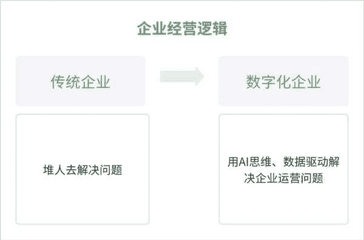

这不是 IT 换代，而是企业经营逻辑的革新。这场革新，不能只靠懂技术的人推动，而必须由真正懂业务、定方向的人——老板亲自参与布局。例如，远东控股要求所有管理岗位人员必须掌握 AI 应用能力，对全员进行 AI 应用摸底，高层、中层、基层都要找到 10 倍、100 倍及更高倍效率提升的领域。

**老板认知决定 3 个“度”：转型的力度、深度、速度**

“转型有术”在 2024 年到 2025 年期间，调研过近 50 家制造企业 AI 转型情况，发现一个共性：老板对 AI 认知越深的企业，AI 转型越早、越深、越有效。

**力度：有没有把 AI 上升为“一把手工程”**

AI 项目到底是 CIO 负责，还是老板亲自挂帅？这是转型力度的分水岭。

那些真正走在前面的公司，都是老板亲自参与 AI 战略制定、资源调配和机制设计。因为他们知道：

AI 转型不是某一个系统上线，而是整家企业的能力模型的升级换代。

如果老板没有深度介入，则企业只能停留在“项目试点阶段”，无法形成战略合力与组织动能。

**深度：有没有把 AI 嵌入业务、流程与决策核心**

表层 AI，是“辅助”现有流程；深层 AI，是重塑业务本身。

·是“用 AI 提高效率”，还是“用 AI 重新定义客户价值”？

·是“用 AI 替代人力”，还是“用 AI 赋能员工成为超级个体”？

·是“做个 AI 助手”，还是“打造 AI 驱动的智能业务系统”？

只有老板具备深度认知，AI 才能进入“企业主流程”，否则 AI 可能永远停在“边缘创新”上。

很多企业还处在“试 AI”的阶段，企业让部门试着用 AI 工具生成内容、用 AI 做客服机器人、用 AI 优化流程。也许这些企业尝到了些甜头，但没有战略级地思考组织、能力和人才体系的 AI 化重构。

这些企业有“点状智能”，没有“系统性智能”，最终很容易沦为“新瓶装旧酒”，陷入“局部优化”的陷阱。

真正领先的企业在“用 AI 重塑企业”时，会思考：哪些核心流程能由 AI 重写？我们是否可以用 AI 重构客户流程？我们能否让员工拥有一个专属 Agent，解放“重复劳动”？我们能否用 AI 建立新的业务模式或产品形态？

这些企业的老板，是 AI 时代的战略设计师。他们不仅“会用 AI”，而且“会用 AI 重新定义公司”。例如，宁德时代、华为、字节跳动等公司，早已把 AI 作为组织能力战略资产进行深度投资。

**速度：能不能快速聚焦、迭代、放大**

在 AI 时代，比认知更重要的，是认知后的行动速度。

·老板是否具备试点→总结→复制→推广的推动力？

·是否敢于打破旧流程、旧机制，为 AI 让路？

·是否能以“平台化视角”建立 AI 能力，而不是碎片化部署？

这些，决定了 AI 转型是“做几年 PPT”，还是能真正形成规模化成果。

如果你是老板，你可以问问自己，你是在“看 AI”“试 AI”还是在真正“用 AI 重塑企业”？

**认知差异，正在制造竞争力差距**

在现实中，我们看到企业的 AI 转型状态各不相同，如下表所示。

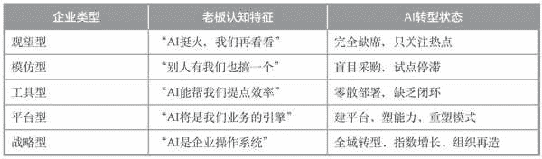

你的企业是哪一个类型的？你希望企业走向哪一个类型？你准备好升级你的认知了吗？

一句话，“老板知多少，AI 转型走多远”，认知不到位，行动永远在表面。

在 AI 时代，认知差距会直接变成竞争差距。 **谁先理解并运用 AI 重构组织，谁就拥有未来的增长引擎。** 而这一切，必须从“老板知”开始。

### 干法 17　全员知：以赛促建，训战结合，转人转心

技术不是最大的门槛，“人”的意识与行动才是 AI 落地的真正变量。

**从“少数人懂”到“全员知”：AI 转型的真正拐点**

当我们谈论 AI 落地时，企业里最常出现的声音是：

·“这和我有什么关系？”

·“AI 是技术部的事吧？”

·“会不会把我替代掉？”

这些声音背后，是一种典型的“局部认知”状态。很多企业都是技术团队在研究 AI，业务部门围观，管理层观望，员工焦虑——这样很难支撑企业的整体 AI 转型。

要真正实现 AI 转型，不是靠几个专家、几个项目经理就能完成的，必须推动“全员知”，让 AI 走进每一个岗位、每一个流程。

“全员知”不是让人人懂代码，而是让人人理解 AI 的方向、找到自己的角色、将 AI 思维和自己的业务结合在一起。

**“以赛促建、训战结合”：打通组织认知壁垒的突破口**

在研究上千家企业的实际推进经验后，我发现了一个真相：

讲 100 次 AI，不如让员工用一次 AI 解决问题。

“以赛促建、训战结合”正是从这个真相出发的组织学习机制——它不是开培训、发通知、做宣讲，而是让组织“动起来”“赛起来”“战起来”。

**什么是以赛促建**

以赛促建即通过竞赛机制推动能力建设与成果转化，让员工在解决实际业务问题中形成 AI 认知、使用习惯和价值感知。

· **设定主题：** 如“数据算法黑马大赛”“数据创新大赛”“RPA 机器人创新大赛”等。

· **激发动力：** 如奖金、曝光、晋升，以及跨部门合作与学习。

· **构建氛围：** 形成“人人参与、人人开发、人人创造”的企业文化。

**什么是训战结合**

训战结合即边训练边实战，不是等讲完再用，而是“学即用，用即练”，在真实业务场景中把 AI 用起来。

·训练≠PPT，而是 Agent 实操、场景构建、Prompt 设计等。

·战=围绕真实流程、问题、客户、数据，部署“AI+业务”的实战任务。

·融合=形成“学—用—改—复盘—再用”的内生学习机制。

阿里有句土话：“虚的事情实着做，实的事情要虚着做。”我认为，大赛、评奖、发表文章是虚的事，培养员工、发挥每一个员工的能力才是实实在在的事。

以某汽车企业的商业智能软件大赛为例，该企业是一家整车制造企业，拥有丰富的内外部数据资源，但各个部门如何利用这些数据资源，挖掘价值，降低成本，提升效率，改善产品质量，是比较迫切的事情。为了更好地培养全员数据分析能力，2019 年这家企业举办了首届商业智能软件大赛，共集结了 6 大条线的 35 支战队和 113 位选手，每支战队都能够立足自身的业务需求，运用数据思维，发掘数据价值，覆盖了从研发到营销的全业务流程场景，成果可谓遍地开花。这样的大赛对企业来讲是一场数据创新盛宴。

**大赛落地 4 步行动法：选拔报名、培训指导、竞赛评比、表彰激励**

大赛作为集体的“行动学习”，核心在于激励员工主动寻找 AI 与业务发展的“结合点”，大赛不仅可以通过课题场景的展示涌现出更多的应用，更重要的是可以促进思维的转变，为更多 AI 应用埋下创新的种子。通过大赛能够快速建氛围、拉认知、让群体隐性知识显性化、成果化。同时，还可以形成 AI 实战人才梯队，可谓一举多得。

以数据创新大赛为例，可以分为如下图所示的 4 步。

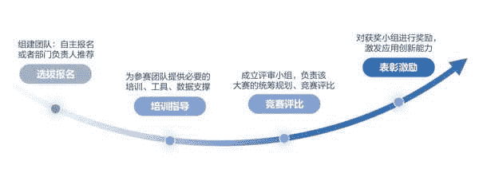

**选拔报名：** 公司面向全员发布宣传海报，介绍数据创新大赛，采取自主报名或者部门负责人推荐的方式。选拔时可以从营销、运营、采购、财务、精益、信息、人力资源、计划、制造、品质等业务部门进行选择。鼓励跨部门、跨职能的团队合作，促进不同背景和技能的员工之间的交流和协作。

**培训指导：** 根据员工实际素养和技能水平，为参赛团队提供必要的培训、工具、数据等。可以将线上培训与线下培训相结合，制订适合该大赛的人才培训计划。

**竞赛评比：** 成立专门的人才培养领导小组和评审团，负责该大赛的统筹规划、组织实施和监督评估等工作。竞赛评比可以分为前期的评比筛选和最终决赛路演两个环节。竞赛小组可以聚焦企业经营管理、营销管理、研发管理、质量管理、生产管理、工艺技术等领域的难点问题，阐述项目应用的背景、难点、课题规划内容及实际成效。

**表彰激励：** 对在数据创新大赛中表现突出的个人或课题团队进行表彰，并通过内部刊物广泛宣传，可以作为公司人才认定、岗位聘用、职级晋升、薪级调整等的参考，激发员工的学习热情和创新能力。通过大赛可以快速培养既懂业务又懂数据的复合型人才，企业可以进行证书认证激励。

除了大赛，企业还可以建立更长效的激励机制，比如在公司层面发布《数据应用创新项目管理办法》，将数据应用提升至同公司级管理创新同等重要的位置，确立长效激励机制，深化数据驱动业务的文化。

技术从来不是变革的难点，人心才是。让员工使用 AI，不难，难的是：

·让员工信任 AI。

·让员工愿意尝试 AI。

·让员工真正感受到价值提升。

·让组织形成“人+AI”的协同工作文化。

只有让员工从被动接受变为主动探索，从“怕 AI”变为“用 AI”，从“旁观者”变为“参与者”，AI 才能不止于概念，这不是靠发文件能完成的，而是靠组织机制、氛围营造、赛制激励、实战反馈慢慢“转人转心”。

“全员知”这一目标，最有效的路径，就是：

以赛促建，以建助变，训战结合，转人转心。

**全员 AI 转型是一个系统工程，每一个员工 AI 思维的转变，都会有一段“与 AI 共生成长”的历程。** 贵企业准备好了吗？

### 干法 18　全员行：把 AI 能力建在业务部门上

**AI 转型的核心在业务，而非技术**

在许多企业的 AI 转型实践中，普遍存在这些“技术陷阱”：

·AI 项目被归到 IT 或数据部门管理。

·技术能力突出，但业务团队缺乏参与。

·平台上线后，业务部门不想用。

这种技术与业务的割裂，导致 AI 转型在试点阶段看似顺利，一旦进入规模化推进便屡屡受阻。根本原因在于：AI 真正的价值，不在于技术有多先进，而在于它是否深入业务、嵌入流程、融入日常运作。

所谓“全员行”（如下表所示），意味着：

·不是技术先行，而是业务带动；业务才是真正的价值来源，业务人员最贴近客户，知道痛点，了解流程。

·不是让人围着 AI 转，而是让 AI 围着业务长；有业务问题，才有场景，才有算法和 AI 应用。

·不是“能不能用”，而是“是否建在一线，植入日常业务，打通流程”。

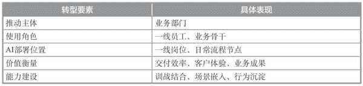

如何推动 AI 全员行，“转型有术”从过去服务企业的过程中总结了一套方法：建组织、定标准和搭体系。

**建组织：建立 AI 学习与创新中心**

企业可以建立专门的 AI 学习与创新中心，通常可以由业务团队、技术团队、HR 团队共同组建。AI 学习与创新中心的主要工作是：围绕企业战略，以促进 AI 驱动业务创新为主旨梳理岗位需求，围绕能力标准进行人才盘点、建立 AI 数字人才培养体系、培养规划，将 AI 能力嵌入职级职等体系，制定 AI 数字人才培养方向，输出符合企业需求的 AI 数字人才。

在人员培养上，按照“AI 驱动业务”的方向，来制定 AI 数字人才培养中长期建设规划，具体可以分为如下图所示的 3 步走。

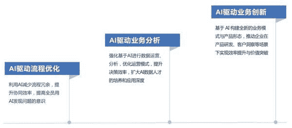

通过 AI 驱动流程优化、AI 驱动业务分析、AI 驱动业务创新，提供有针对性的、灵活的 AI 数字人才能力提升对策。未来的组织，不是“谁懂 AI”，而是“哪里都有 AI”。

每一个人都是 AI 的使用者、推动者，每一个流程都是智能增强的对象，每一次协同都是人机共创的场景。人与 AI 共同分析、决策、执行，真正走向“共生”。

**定标准：AI 数字人才能力素质模型**

企业在推进 AI 转型时，必须将人才标准化。通过调研、访谈、对标，总结出符合自身业务特征的企业 AI 数字人才能力素质模型（如下图所示），并据此推动传统业务人员向“AI+业务”的 H 型复合型人才升级。

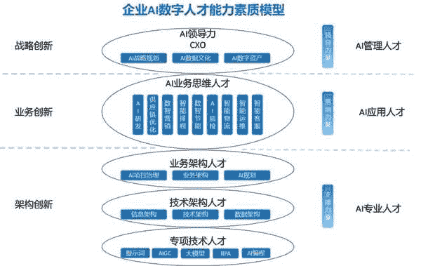

AI 数字人才培训可分为 4 类：

· **AI 业务思维人才培训：** 该培训旨在提升学员的 AI 思维能力和发掘业务中可 AI 化场景的能力。通过 AI 视角分析现有业务流程，识别 AI 转型的机会。

· **业务架构人才培训：** 该培训内容应包括业务架构的设计和规划方法，使学员能够理解和应用业务架构原则，以支持 AI 转型。这涉及 AI 业务规划、AI 业务流程优化、AI 业务模型创新。

· **技术架构人才培训：** 该培训专注于 AI 技术架构的选型和实施，包括信息架构、技术架构和数据架构。学员将学习如何设计和维护支持业务需求的 AI 技术架构，以及如何确保技术架构的灵活性和可扩展性。

· **专项技术人才培训：** 针对最新 AI 专项技术领域，提供深入的技术培训。比如 AI 提示词、AIGC 办公效率提升、大模型、RPA、AI 编程等，这些人才将专注于将专项 AI 技术和企业业务结合，推动技术创新和业务价值的实现。

这种 H 型人才兼具业务深度与技术广度，可使企业在 AI 时代保持竞争力。

**搭体系：3W1H 学习飞轮体系**

AI 转型是一场业务变革，从长期来看，企业要系统构建 AI 数字人才培养体系，包括为谁培训、培训哪些内容、在哪里培训、如何开展培训活动。建立长效的运营体系和机制，可以满足企业对 AI 数字人才的需求。我们整理了一个 3W1H 学习飞轮体系，如下图所示。

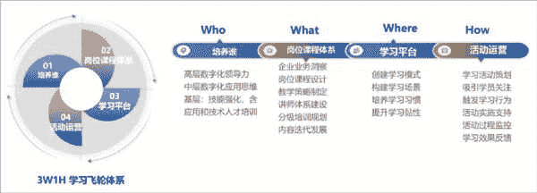

· **WHO 即培养谁：** 哪些人需要进行培训，针对不同层级的人采取不同的培训策略，如高层加强 AI 领导力提升，中层加强具体应用能力提升，而基层则加强技能强化，从具体应用、技术角度来开展。

· **What 即岗位课程体系：** 针对不同岗位的人，设计不同的岗位课程体系。从长远发展来看，企业要建立自身的 AI 转型教材或课程，通过讲企业自己的转型实践和应用案例来影响更多的员工。

· **Where 即学习平台：** 也就是创建什么样的“学习场”，例如，建立企业内部线上大学，为不同地区、不同需求、不同岗位的人提供即时化的学习场景。再例如，提供线下面对不同业务领域的 AI 主题讲堂。

· **HOW 即活动运营：** 通过更多内部学习活动策划，吸引学员关注，通过平台活动运营和项目化运营，建立学习氛围，对活动过程进行监控和效果的反馈。

“全员行”不只是战术手段，而且是一种 AI 信仰—— **相信 AI 可以被普惠到每一个岗位** ，让 AI 真正走向一线、走进流程。 EXr6287u6NNVz+GYLY+7SGN8EvPKHDRD0R2fs+hJH6FUGuD/ntK17kx1EckHp5InRbOjsqs+vx5PQzEkttGAOg==

# 4　工具革命：全员结构化提效，流程全面自动化

4.1　底层思考：工具进化史，从“解放双手”到“解放大脑”

4.2　规律：高效打败低效、便宜的打败贵的

4.3　方向：感知—决策—行动闭环成为新工具的应用范式

4.4　企业感知系统的能力升级：数据与内容的处理和沉淀

4.5　企业行动系统的能力升级：流程挖掘、升级、优化、加速

国外有一句谚语：“A Fool With a Tool Is still a Fool。”（有工具的笨蛋仍然是笨蛋）。这句话强调了工具背后的思想才是最重要的。同样是铁铲，泰勒通过铁铲实验，得出一个结论：在搬运铁矿石和煤粉时，最好使用不同的铁铲，从而开启了“科学管理”之门。

工具本身并不会改变一个人的本质。若缺乏智慧、知识、判断力或正确的思维方式，即使你手中拥有再先进的工具，也难以真正发挥它的作用。

企业亦是如此。今天大多数企业在设备、原料、水电等显性成本上难以拉开差距，真正决定竞争力的，是产品的制造方法与运营管理方式。这些“隐性能力”才能构建企业的长期竞争壁垒。

在 AI 与 BI 快速普及的今天，工具的功能愈发强大，但能否将其真正转化为生产力，取决于企业如何结合场景与问题进行创造性应用。随着数据链接一切、驱动一切，AI 席卷各行各业，人类对工具的依赖只会不断加深。但真正拉开差距的，不是工具本身，而是组织能否解放思想、释放工具的潜能。这种思维与应用的差异，正是未来企业竞争的核心所在。 EXr6287u6NNVz+GYLY+7SGN8EvPKHDRD0R2fs+hJH6FUGuD/ntK17kx1EckHp5InRbOjsqs+vx5PQzEkttGAOg==

## 4.1　底层思考：工具进化史，从“解放双手”到“解放大脑”

人类发展史可被看作一部“工具进化史”。从原始的石器、青铜器，到工业时代的机械、电力、计算机，人类通过工具延伸和增强自身的能力。在工业革命的推动下，工具不再只是“辅助”，更是解放人类潜能的核心动力。从底层来看，这是一场关于“人—工具—组织”关系的深刻重构。

工业 1.0 到 3.0 是“工具驱动”，旨在解放双手；工业 4.0 则是“智能驱动”，核心在于解放大脑。

这一趋势背后，不仅是技术的跨越，更是管理思想的持续演进。从泰勒的科学管理，到德鲁克的知识型组织，再到西蒙的有限理性与认知决策理论，工具革命与管理变革相互推动，共同构成了现代工业社会的“管理支柱”，如下图所示。

### 工业 1.0 到工业 3.0：工具“解放双手”

**工业 1.0：机械化“解放体力”**

18 世纪的第一次工业革命，以蒸汽机的发明为标志，使人类第一次大规模摆脱了手工劳动的束缚。工具此时的本质是“延展人的体能”—让人从重复、繁重的物理劳动中解放出来，从“操作”转为“监督”。

**工业 2.0：电力与流水线，组织流程的系统化**

19 世纪末泰勒在这一背景下开始探索科学管理，强调标准化、时间——动作研究和效率优先，人是流程中的可控变量。

进入 20 世纪初，电气化与流水线使大规模生产成为现实，福特主义的兴起带来高效、复制、低成本的工业流水线模式。管理思想进入“组织系统化”阶段，亨利·法约尔（Henri Fayol）提出的五大管理职能（计划、组织、指挥、协调、控制），进一步强化了“制度—流程—执行”的企业架构。

人被嵌入标准化流程中，作为系统的一部分运作。此时的工具更多的是为提升产能和效率服务的，它们帮助企业将人的重复劳动“模块化”，达成规模经济。

**工业 3.0：信息技术革命，初步认知协同**

20 世纪中后期，计算机与信息技术的兴起引发了第三次工业革命。自动化控制系统、ERP 系统、CAD 设计软件等工具被广泛应用于企业中。虽然主要仍是“解放双手”，但这一次，工具开始具备“认知性”——它们能处理大量信息，辅助决策、优化流程。

管理思想逐渐向信息导向、流程导向转型。日本的精益生产、戴明的全面质量管理（TQM）、野中郁次郎的知识管理等理念开始流行，企业开始重视数据驱动、流程再造。工具开始辅助大脑进行逻辑判断与信息整理，为“解放大脑”积累了初步条件。

### 工业 4.0：工具开始“解放大脑”

2011 年德国在汉诺威工业博览会上提出“工业 4.0”概念，并于 2013 年将其写入国家战略，这标志着人类步入智能制造、认知协同的新纪元。人工智能、大数据、物联网、边缘计算等技术共同构建出智能工厂、数字孪生、预测维护等复杂系统，工具开始参与感知、分析、判断和优化。

这意味着，工具已具备部分“认知能力”，能在复杂条件下自动决策和自我优化。工具开始与人类协同完成任务，甚至能提出建议、预测风险、重构流程。

这正是管理思想所长期思考的问题：人类认知的边界是什么？我们如何做决策？如何更高效地组织知识与信息？

正如诺贝尔奖获得者赫伯特·西蒙所提出的，人类的理性是有限的。在现实世界中，信息不完全、计算力有限、时间受限，因此我们只能做出“满意解”（Satisficing），而非理论意义上的最优解。他提出“程序性决策”与“非程序性决策”的分类：

· **程序性决策：** 重复性高、规则明确，适合流程自动化。

· **非程序性决策：** 复杂性高、结构不清，需要判断与创造力。

工业 1.0 至 3.0 的发展为企业处理“程序性任务和决策”提供了数据基础。而工业 4.0 时代的 AI 系统，开始探索“非程序性决策”领域，AI 系统能够处理模糊逻辑、建立复杂系统、进行语义理解，它正在解放管理者的大脑——不再陷于信息处理与事务性判断，而聚焦战略设计与价值判断。

### 管理范式的演化：从流程思维到全人思维

**管理不再以流程为中心，而以人作为价值源头**

传统管理逻辑建立在流程最优化的基础上：岗位划分清晰、操作标准一致、组织层级分明。在这一模式下，人被视作任务执行者，其思维、情绪与创造力被弱化。

然而，在 AI 工具的辅助下，人力资源的价值重构成为可能。AI 接管了大量标准化、程序化的事务，人则能够专注于更具战略性和创造性的工作：提出问题、制定愿景、应对模糊复杂的挑战。

这推动管理范式从“以流程为核心”转向“以人为核心”，不再只是追求控制与效率，而是激发主动性。

**从流程思维走向全人思维**

长期以来，工业化背景下的管理依赖流程思维——强调标准化、结构化和可复制性，其目标是通过流程的设计和执行，尽可能地提高效率与可控性。

但在具有高度不确定性的环境中，过于刚性的流程往往成为创新的障碍。因此，管理需要从流程思维走向全人思维。全人思维不再把人视为“岗位的填充者”，而是承认人作为“全人”的价值。它要求管理者不仅要设计流程、分派任务，更要营造能激发人的潜能的环境：

· **从控制到赋能：** 给予员工自主权和决策空间，促进自组织与跨界协同。

· **从绩效评估到成长支持：** 关注学习力、长期发展与成就感，而不仅是短期绩效。

· **从产品功能到用户体验：** 在研发与设计产品时兼顾用户体验，包括用户的心理感受，避免技术异化。

全人思维本质上属于人本主义管理哲学的范畴，是对工具革命所带来的“认知解放”的回应。当流程不再是唯一的秩序来源时，组织必须依靠“有温度的个体”和“有弹性的结构”来面对未来的不确定性。

从工业 1.0 到工业 4.0，工具的演进轨迹清晰可见：从“体力延伸”到“认知扩展”，从“解放双手”到“解放大脑”。而更深层的变化是管理思想的转型——从“人是资源”到“人是创新的主体”。

当我们理解“工具革命”的底层逻辑时，就会明白： **技术的价值不在于取代人，而是让人成为人** —— **它让人真正做值得人做的工作。** EXr6287u6NNVz+GYLY+7SGN8EvPKHDRD0R2fs+hJH6FUGuD/ntK17kx1EckHp5InRbOjsqs+vx5PQzEkttGAOg==

## 4.2　规律：高效打败低效、便宜的打败贵的

在技术演进中，工具革命从未停止。从石器到 Agent，从蒸汽机到大模型，每一次工具的更替都遵循着一个朴素的底层规律：高效打败低效、便宜的打败贵的。这不仅是技术升级的方向标，更是商业竞争持续演进的核心逻辑。

### 高效打败低效：效率决定生存

效率，是所有工具演进的首要驱动力。从石器时代的磨制斧头到工业时代的蒸汽机，从流水线到人工智能，工具的核心使命始终是让人类用更少的时间和资源完成更多的事情。例如：

· **农业社会：** 铁制农具取代石器，提高耕作效率。

· **工业革命：** 蒸汽机替代人力与畜力，使运输和制造的效率提升成百上千倍。

· **机械化制造：** 电动织布机让纺织速度从每小时几米提升到上千米。

· **自动化时代：** 工业机器人全天候无间断工作，实现了对高精度、高频操作的自动化掌控。

· **智能时代：** Agent 正在替代大量重复性劳动，并且开始切入“脑力工作”领域，如自动化预测、主动推荐、辅助决策。

历史表明，在这个过程中，原先被广泛接受的“传统方法”，一旦在效率上被颠覆，便会迅速失去生存空间，如打字机被键盘取代、传真被邮件淘汰、大量人工客服被 AI 语音与文本机器人取代。

效率革命带来的不是渐进式改进，而是范式切换。一种工具的崛起往往不是因为它更“完美”，而是因为它更快、更稳、更自动化，从而彻底改写原有的效率边界与行业结构。

### 便宜的打败贵的：成本决定普及速度

如果说效率高低决定工具是否“先进”，那么成本多少则决定它是否能被“普及”。真正改变社会结构的工具，从来不是“最顶尖的”，而是“最多人用得起的”。

事实上，许多划时代的技术最初都是价格高昂、复杂难用的，仅限于科研机构或高端企业使用。但随着技术迭代和规模化应用，其成本会迅速下降，从而打破“贵族工具”壁垒，走向全民应用：

· **计算机：** 从政府专属的庞然大物到人人可用的智能手机。

· **3D 打印：** 曾是高端制造的象征，如今已在医疗、建筑、教育等平民化场景中广泛应用。

· **AI：** 从科研机构和企业巨头的专利能力到云计算和轻量化模型支持下的全民使用。

在市场经济中，成本优势决定技术的命运。强大但昂贵的工具只能小范围存在，而“足够好+足够便宜”的工具才能撕开普及的口子。

“高效打败低效、便宜的打败贵的”，看似朴素，却揭示了人类选择工具的底层逻辑。人们不会因为技术“酷”而使用它，而会因为它更省力、省钱、省时间而使用它。每一种改变世界的工具，都遵循这一实用主义的铁律。

在这个 AI 驱动的工具革命加速时代，从工业化到智能化，从移动互联网到生成式 AI，效率与成本依旧是胜负手。 **真正的竞争优势，不在于炫技，而在于谁能让更多人以更低成本获得更高效率。** EXr6287u6NNVz+GYLY+7SGN8EvPKHDRD0R2fs+hJH6FUGuD/ntK17kx1EckHp5InRbOjsqs+vx5PQzEkttGAOg==

## 4.3　方向：感知—决策—行动闭环成为新工具的应用范式

在技术不断重构组织运行方式的当下，新一代工具革命的核心是以多模态 AI（Multimodal AI）为代表的智能系统。它融合视觉识别、语言理解、语音识别与生成能力，让系统能够“读懂合同”“听懂客户”“看懂图像”，并自动驱动流程与内容的生成。这不仅让内容处理方式跨入了自动化新纪元，而且驱动了流程自动化与业务智能化。

### 理解力是新工具的核心：多模态 AI 崛起

多模态 AI 是企业认知升级的关键技术，它能同时处理图像、文本、语音、视频等多种信息，构建组织的新型“感知系统”。其能力集中体现在 4 个方面：

· **视觉理解（CV+OCR）：** 识别合同、发票、图像与视频帧中的文字内容。

· **语言理解（NLP）：** 解析自然语言文本，理解合同条款、客户意图与业务文档等。

· **语音理解（ASR+NLU）：** 将语音转化为可操作信息，自动创建业务单据或转成会议摘要。

· **内容生成（LLM）：** 自动撰写总结，生成报告、邮件与演示内容。

这些能力的结合使 AI 首次具备了“理解世界”的能力，而不只是“执行命令”。企业的核心竞争力从流程线性执行转向感知—决策—行动的闭环响应系统，如下图所示。

多模态 AI 让机器不仅能看、听、读，更能理解、判断、决定。这就是新一代工具革命的方向： **用理解力驱动自动化，用自动化释放创造力** 。

### 3 个层次的自动化：数据、内容与流程

多模态 AI 带来的不是单点突破，而是对企业运营基本单元的全面重塑，主要体现在数据、内容、流程 3 个层次。

**数据自动化：从沉睡信息到可用资产**

企业有大量的数据仍沉睡在非结构化形态（PDF、扫描件、语音、视频）中。多模态 AI 能将其转化为可用资产：

·OCR+CV 自动提取合同、发票数据。

·NLP 解析报告、邮件与客户留言。

·语音识别系统转写电话与会议内容。

这些数据在进入数据湖、知识图谱后，支撑 BI 分析、实时监控与推荐系统。数据自动化不仅能节省人力采集数据的成本，更能让企业拥有对业务的“全量认知视角”。

**内容自动化：从理解到生成**

当 AI 能理解信息后，下一步就是自动表达与创造。多模态技术结合大模型，使得 AI 能够：

·自动撰写报告、总结、邮件。

·自动填写表单、生成任务单。

·自动摘要：对文档、会议纪要进行一键摘要。

·图文与视频一体化生成：自动配图、生成演示 PPT、短视频。

·在客服与销售中提供个性化内容来回复客户。

随着内容处理能力的提升，企业将人员从“枯燥搬运”与“反复打磨”中解放出来，转向更具有战略意义的内容策划与洞察工作。

**流程自动化：从执行到判断**

传统 RPA 能“执行流程”，但“看不懂任务”，多模态 AI 的加入，使流程系统具备“感知多样化输入—决策判断—自动执行动作”的能力闭环，从而推动更多流程自动化和智能化应用，如下图所示。

**流程挖掘+流程切片：看见真实流程，才能重构真实效率**

流程优化的前提是“看见”。借助流程挖掘（Process Mining）与流程切片技术，企业可以基于日志和行为数据，重构流程的实际运行路径，识别瓶颈、等待、分支与重复点。这种基于数据的洞察取代了“流程靠拍脑袋设计”的传统做法，使流程优化有了精准依据。

**流程自动化+智能化：让流程自动跑**

基于明确的流程路径，企业可以用 RPA 进行流程自动化，将规则化任务交由系统完成。进一步，通过引入 Agent，流程不仅能自动跑，还能智能判断路径、预警异常、执行调整，实现从业务流程解构到流程智能化的升级。

**流程节点加速：让每一步更快、更准**

多模态 AI 也可嵌入具体流程节点中，提供组件级的智能增强：

·一句话生成任务单（自然语言建单）。

·聊天记录生成工单自动触发流程（Chat 转 Action）。

·文档解析、视频识别、OCR 识别自动填单。

·发票、表单、报告等结构化建单。

将这些“智能组件”嵌入流程节点，可进行流程整体的升级和优化。

**AI 让流程不仅跑得快，而且跑得对、跑得稳、跑得灵活。**

### 工具革命新范式：感知—决策—行动闭环

多模态 AI 的加入，使得流程系统第一次拥有了完整的感知—决策—行动能力闭环，如下表所示。

企业的运行逻辑从“人找数据、人跑流程”彻底转向“数据自己跑、流程自动触发”，效率、准确性与响应能力都实现了系统性跃升。

理解力就是竞争力，从工具革命的角度看，它代表着工具第一次“能理解”人类语言与人类世界的信息。工具将沉睡的数据唤醒，让创作变得更智能、更高效，业务开始真正进入“自治时代”。未来企业竞争的底层能力，不仅是信息获取能力，还包括信息理解与流程自主能力。越早构建“看得懂、听得清、说得明白、能自动做事”的系统，越能在智能时代立于不败之地。

**看得见，才能管得住；读得懂，才能跑得快；系统自动理解业务，才是真正的“企业大脑”。** EXr6287u6NNVz+GYLY+7SGN8EvPKHDRD0R2fs+hJH6FUGuD/ntK17kx1EckHp5InRbOjsqs+vx5PQzEkttGAOg==

## 4.4　企业感知系统的能力升级：数据与内容的处理和沉淀

### 干法 19　AI 辅助精准获取信息和洞察情报

打造企业的“数字感官系统”，实现从信息力到洞察力的跃迁。

**海量数据精准获取：打造企业的“数字感官系统”**

在 AI 的加持下，信息获取已不再是难题，真正稀缺的是从庞杂的数据中提炼的“可行动的洞察”。传统依赖人工整理报告、浏览新闻、口耳相传的情报获取方式，面对瞬息万变的市场、政策和竞争环境，暴露出严重的滞后与偏差问题。

AI 正在重塑企业的信息能力：

·RPA 工具+大模型+知识图谱+多模态分析可以构建 7×24 小时运行的“数字感官系统”。

·实时感知市场动态、技术趋势、舆情风险、供应链异常等。

·从被动收集信息走向主动生成洞察报告，在竞争中获得先发优势。

**AI 辅助精准获取信息典型应用场景**

下图是 AI 辅助精准获取信息典型应用场景。

下表是部分应用场景的详细介绍，供大家参考。

**从统一推送到“千人千面”的智能情报**

AI 不仅提升了信息收集速度，更推动了信息服务从“通用推送”向“个性化订阅”进化：

· **研发：** 专利地图、技术趋势→提高创新命中率。

· **市场：** 舆情监控、用户反馈→敏捷调整品牌。

· **销售：** 竞品定价、机会识别→动态营销。

· **供应链：** 原材料预测、供应链风险评估→提前预警。

· **管理层：** 行业简报、战略洞察→数据驱动规划。

“岗位化+个性化”的智能分发，可避免信息骚扰，让每个员工接收到与其职责最相关的信息。

**自动智能文献打标分类和获得系统性的洞察优势**

AI 系统可自动对大量报告、论文、简报进行打标分类，并形成高效的内容索引。

·支持“主题抽取+语义标签+摘要生成+图表识别”。

·用于知识库建设，提升检索效率和重用率。

通过自动打标分类可节省 80%文献整理与标记时间，提升内容重用的效率。

基于“大模型+私有语料”，可构建 AI 情报助手，支持问答式信息获取：

·支持从行业研报、科技文献、技术专利中查找答案。

·支持对单个报告和全部报告进行检索分析。

·支持返回结构化摘要+引用路径+后续建议。

在 AI 赋能下，企业竞争的核心不再是“谁掌握更多信息”，而是“谁更快、更深地将信息转化为洞察”。从海量数据中“精准获取信息”，再到千人千面的“智能分发”，最终形成企业的智能感知、快速响应、预测判断能力，这正是企业打造“数字感官系统”的核心所在。

**未来最强的企业不是“信息最多”的企业，而是“用 AI 形成了系统性的洞察优势”的企业。**

### 干法 20　AI 增强智能问答和加速知识流动

知识即资产，但只有当它能被提问、理解、使用时，才真正产生价值。

**企业的知识困境：信息太多，回答太难**

随着业务复杂度和数据体量的持续增长，企业知识体系正在遭遇三大瓶颈：

· **信息孤岛遍布：** ERP、CRM、OA、文档库、流程系统等数据分散，难以统一调用。

· **非结构化内容占比高：** PDF 报告、邮件、会议纪要、政策文件、手册等非结构化内容占比在 80%以上，难以结构化利用。

· **员工问答成本高：** 新员工入职、业务部门查询制度流程、销售查找产品参数等都依赖“人找人、反复问”。

总之，大量知识沉睡在系统中，沦为“沉默资产”，无法快速被理解、调用和转化为行动建议。AI 正是打破这些瓶颈的关键力量。

**AI 问答典型应用场景**

自然语言用户界面（LUI）的普及，使 AI 问答成为企业最直接的知识交互入口。下图是 AI 增强智能问答和加速知识流动的典型场景。

下表从具体业务场景出发，结合行业实践案例，详解 AI 如何赋能不同部门的智能问答，并量化其价值。

**从问答助手到企业认知入口**

AI 问答的价值不仅在于提高效率，而且在于推动企业知识管理体系本身的进化：

· **由搜索式向对话式转变：** 自然语言提问取代关键词检索。

· **由工具型向角色型转变：** 每个部门都拥有“AI 助理”“AI 顾问”。

· **由内容查找向知识生成转变：** 不仅能回答，还能自动总结政策、生成报告、推演方案。

过去，知识是静态的；今天，AI 让知识“流动”起来、“说”起来、“连”起来。将结构化与非结构化内容结合的 AI 问答助手，不只是一个“效率工具”，还是企业的认知入口。

在 AI 时代， **谁掌握了智能内容问答的能力，谁就掌握了组织内部的“认知领先权”** 。

### 干法 21　AI 提升智能文档处理的精准性

从识字到识意，AI 读懂全局逻辑。

**从手工到 AI 智能处理的演进**

在信息爆炸的时代，企业会产生和处理大量的合同、报告、投标文件、合规文书、财务报表等非结构化文档。这些文档的正确性、合规性与逻辑性，直接关系到企业的声誉与运营风险。

然而，传统人工审核流程面临四大痛点：

· **效率低下：** 处理人员负担沉重。

· **易出疏漏：** 依赖主观判断，难免错误。

· **结构复杂：** 文档内容冗杂，关系繁多。

· **不可复用：** 结果难以追溯和沉淀。

随着 AI，尤其是自然语言处理、知识图谱和大模型的发展，文档处理正经历第 3 次进化。文档处理工具进化路径如下图所示。

· **1.0 时代手工处理：** 依赖人工经验，低效且不稳定。

· **2.0 时代电子化处理：** 借助信息化工具，提升存储和检索效率，但仍停留在“看懂字”阶段。

· **3.0 时代 AI 处理：** 通过语义理解、多模态分析和知识推理，实现从“看懂字”到“看懂全局”的飞跃。

当下文档处理正从“人工主导、机器辅助”走向“人机协同、智能主导”，其核心变化体现在以下 4 个方面：

· **工作流程：从串行到并行，** 传统审核依赖人工逐段查阅，效率低且易遗漏；而 AI 可并行分析结构完整性、语义合理性与法规合规性，大幅提升处理速度与覆盖度。

· **判断逻辑：从经验驱动到知识驱动，** 过去依赖资深人员经验，容易受主观影响；如今 AI 通过学习历史数据和法规文本，构建知识图谱与推理体系，形成“类专家”式判断，降低对个体经验的依赖。

· **反馈机制：从结果导向到过程可解释，** AI 不再只是给出“是否合规”的结论，而是提供判断依据、标注风险来源、提出改进建议，使审核过程更加透明和可追溯，增强了信任感。

· **人机关系：从被动执行到主动共创，** AI 不仅是“审核助手”，更逐步成为“决策搭档”与“风险哨兵”，让人专注于关键判断与策略把握，把人从重复劳动中解放出来。

**智能文档处理典型应用场景**

智能文档处理典型应用场景如下图所示。

一些智能文档处理的场景描述和价值分析如下表所示。

**案例：** 某汽车制造企业面临每年超过 30 万份供应商文档（包括 PPAP、APQP 等）的审核挑战。通过引入 AI 审核系统，该企业将文档处理时间减少了 86%，错误识别率提高了 40%，有效降低了质量风险和合规性风险。

**文档处理突破：从“读懂字”到“看懂全局”**

**语义理解增强：跨越“看懂”的门槛**

文档处理的首要挑战是“理解文本的真实含义”。传统系统多基于关键词匹配或规则引擎，难以处理语义模糊、逻辑复杂的表达。而当前主流的 NLP 技术，具备强大的语义理解能力，可实现：

·跨段落、多章节语义关联，判断条款之间的前后逻辑。

·合约或政策类文档中的模糊措辞识别（如“应当”“可以”等）。

·语境驱动的风险点提示，如与法律法规相冲突的表述。

以合同审核为例，AI 可识别“限制性条款”“免责条款”“付款义务”等潜在风险内容，做到理解内容、识别语义、提示隐患。

**规则结构化：知识图谱与规则引擎融合**

文档处理往往需基于制度、行业标准、内部规范等制定规则。AI 可以通过以下方式将这些知识结构化：

·构建领域知识图谱，形成审核所依据的逻辑网络。

·运用实体识别+关系抽取，定位文档中的关键要素。

·结合规则引擎或逻辑回归模型，实现自动判断与风险评分。

在汽车、医药、化工、能源等高监管行业，企业可以训练定制化模型，实现对法律法规变化的快速响应和审核规则的自动更新。

**多模态交叉分析：文本+表格+图像的统一审核**

很多企业文档并非纯文本的，而是图文混排的，包含表格、图像、签章等。AI 通过多模态模型可实现：

·文档结构自动识别（页眉、页脚、目录、正文、附录等）。

·表格理解与校验（数值合规性、总计一致性等）。

·签章验证与 OCR 比对（确保图文一致、防止篡改）。

这使得 AI 不再只是“读懂字”，而是“看懂全局”，提升了复杂文档处理的全局精准性。

AI 带来的不是简单的“文字识别”，而是一场文档处理范式的变革。从“信息识别”到“语义理解”，从“规则匹配”到“知识推理”，从“静态输出”到“人机共创”。它从事后把关转向过程预警，从被动合规走向主动防控。最终目标不是替代人工，而是 **通过人机协同，让审核更高效、更精准、更智能，并推动企业风险管理与合规体系迈入智能化新阶段** 。

### 干法 22　AI 加速各类数据与报告自动生成

只有将人从重复性报告整理任务中解放出来，人才能聚焦于真正重要的判断、设计与创新。

**从模板化输出到个性化洞察**

企业每天都在处理大量结构化和非结构化数据：销售日报、运营周报、市场分析、财务预测、政策跟踪、行业情报、投标方案、管理例会材料……这些数据既要“及时”，又要“专业”；既要“全面”，又要“洞察深入”。

然而，当前的报告处理仍面临多重挑战：

·数据提取慢、更新难，常常基于手工汇总。

·撰写报告缺乏标准，质量依赖个人经验，需要按照预设报告模板组织内容。

·内容空洞、结构松散，难以支撑关键决策。

·多协作流程混乱，版本控制难，可复用性差。

·报告频率高、期望值高，团队疲于应对“文山会海”。

·不能够按照管理层视角、甲乙方视角、专家视角等进行报告风格切换。

企业迫切需要一种既能提升效率，又能保证专业质量与个性化输出的报告生成方式。以大模型、自动化数据分析与知识图谱为代表的生成式 AI，正逐步释放报告生成的新生产力。企业通过生成式 AI 不仅可以自动采集和处理数据，还能够生成符合语境、结构严谨、逻辑通顺的专业报告，实现从“数据加工”到“洞察表达”的跨越。

**AI 报告生成典型应用场景**

下图总结了 AI 报告生成典型应用场景。

一些场景描述和价值分析如下表所示。

**五大技术，驱动 AI 报告自动生成**

在企业日益追求高效率、高质量数据表达的背景下，AI 报告生成技术成为关键支撑能力，其底层由五大部分构成，如下图所示。

· **自然语言生成（NLG）技术：** 通过大型语言模型（如 GPT-4、Claude、通义千问等）对上下文进行语义理解与语言表达分析，从而生成符合语境的、结构完整的报告。这一能力实现了从“看懂数据”到“写出结论”的飞跃。

· **数据分析引擎：** 可对表格数据进行趋势分析、同比和环比对比、异常检测及预测建模，是驱动报告提高内容逻辑性与专业性的关键工具。

· **知识图谱支持：** 知识图谱为报告生成提供了语义结构和逻辑骨架。通过构建领域知识图谱，AI 能更好地理解专业术语之间的关联，提高生成内容的逻辑严密性与专业深度。

· **语境工程：** 通过系统设计的上下文结构，为 AI 生成报告提供“说什么”“怎么说”“对谁说”的语境定位，从而让内容更符合特定业务场景和角色的需求，实现沟通意图。它使得 AI 不只“写得通顺”，而且“写得对口、得体、管用”。

· **多模态融合：** 整合文本、图像、表格、语音等多种形式的数据输入与表达方式，使 AI 能够在报告中呈现更丰富的信息，实现从“数据展示”到“场景还原”的跃迁。

五大技术相互协同，构建起新一代智能报告生成体系，帮助企业从繁杂的数据中快速获得清晰洞察与可用表达。在报告生成时，还可以根据岗位、层级、语言风格生成个性化报告，实现千人千面的报告定制。例如，同一数据可同时生成面向高管的摘要、面向业务人员的详细分析和面向技术团队的技术报告。

报告是组织洞察力的显性表达，也是战略执行的基础抓手。过去，报告是“信息的终点”；而今天，借助 AI，报告正变成“从数据到决策的起点”。 **AI 不仅能生成报告，还能自动给出运营优化建议、模拟决策等，真正实现从“报”到“策”的演进。** EXr6287u6NNVz+GYLY+7SGN8EvPKHDRD0R2fs+hJH6FUGuD/ntK17kx1EckHp5InRbOjsqs+vx5PQzEkttGAOg==

## 4.5　企业行动系统的能力升级：流程挖掘、升级、优化、加速

### 干法 23　流程挖掘：打开全价值链的效率之眼

只有看见真实流程，才能重构真实效率。

**为什么流程优化进入“挖掘时代”**

在数字化转型的早期，流程大多依靠人工“设计”——用流程图定义步骤。这类流程图常常停留在图纸上，与实际执行脱节，这是因为：

·真正的流程并不在图纸上，而是在日常的业务运营中。

·每个组织都声称有流程，然而有流程不等于有效率。

·实际执行路径往往充满例外、绕行与返工。

因此，企业真正需要的不仅是“流程设计”，而是“流程发现”。这就是流程挖掘的价值所在：

·基于数据自动还原真实流程，而不是依赖经验定义。

·通过可视化揭示瓶颈、漏洞与偏差，而不是停留在假设模拟上。

·从单次审计走向持续监测与优化，实现全链条效率提升。

在数字化转型进入深水区的今天，流程挖掘（Process Mining）技术正在成为企业提升全价值链效率的新利器。

**流程挖掘：企业流程的高分辨率“X 光机”**

流程挖掘技术通过分析企业信息系统中的事件日志（如 ERP、CRM、BPM 等系统的操作记录），就像为企业运营装上了“X 光机”，能够还原实际业务流程的运行状况。

**发现：数据驱动还原真实流程**

通过系统日志（事件记录）挖掘出实际业务流程路径、频率、时长等信息，帮助企业回答：

·实际流程和设计流程是否一致？

·哪些环节被绕过？哪些任务被反复执行？

·哪些流程被多种方式执行，导致一致性差？

由于流程挖掘的分析结果完全基于系统记录的数据，避免了人工访谈可能带来的主观偏差和遗漏，可以真实揭示“真实流程”与“理想流程”之间的差距。

**合规：智能比对偏差**

流程挖掘系统自动比对实际执行路径与标准流程，识别：

·非授权流程。

·缺失的关键控制点。

·超时节点与瓶颈环节。

·审批合规率与异常归因。

**优化：驱动流程再设计与智能升级**

流程挖掘能够打通系统壁垒，将分布在不同系统中的相关事件关联起来，提供完整的、端到端的流程视图来进行流程优化和设计规划，可以实现：

·动态调整流程路径。

·高频重复环节自动化。

·重构跨系统协同逻辑。

·为 Agent 提供流程优化图谱，实现流程自适应。

可以说，流程挖掘就像为企业流程拍了一张高分辨率的“X 光片”，让隐藏在系统深处的真实运营脉络一览无余。这种基于数据的“看见”能力，是实现流程优化的前提。

**流程挖掘的典型应用场景**

流程挖掘不局限于某个部门，它适用于整个企业的端到端价值链，典型的应用场景如下表所示。

**从流程挖掘到流程智能化**

流程挖掘是流程智能化的“眼睛”，它能告诉你：

·哪些流程值得被优化？

·哪些环节可交由 Agent 执行？

·哪些节点影响了整体效率，是瓶颈？

流程挖掘代表着企业在理解和优化自身运营流程方面的工具进化。它将流程分析从基于猜测和描述的时代带入了基于客观数据、可视化的新时代。

这种能力的升级使得企业能够以前所未有的深度和广度洞察其全价值链的实际运行情况，识别并量化“低效和风险”，从而做出更明智的流程改进决策。

在数字化转型进入深水区的今天，流程挖掘已从“锦上添花”变为“必备基建”。它让企业真正做到： **用数据发现真相、用可视化看清全局** 。

那些能够持续利用流程挖掘洞察全价值链、不断迭代流程设计的企业，必将具备更高的敏捷性与韧性，在激烈的市场竞争中脱颖而出。

### 干法 24　流程切片：基于场景进行全流程分析，识别优化方向

基于场景进行系统性拆解，再针对因果链进行“切片”分析，可聚焦关键环节，识别优化方向。

**流程切片的核心：切得清、看得透、改得准**

流程切片（Process Slicing）是一种基于特定业务场景，将整体流程划分为若干子流程或关键节点，形成可分析、可改进的子流程（切片单元）的方法。其核心思想是“切得清、看得透、改得准”。

· **聚焦关键场景：** 不是盲目分析整个流程，而是选择高价值或问题频发的场景进行深入挖掘。

· **数据驱动切割：** 基于流程关键点、日志、用户行为数据等，客观划分流程阶段。

· **精准优化：** 针对每个切片提出定制化改进方案，而非“一刀切”地优化。

传统的端到端流程分析往往难以精准定位问题，而流程切片作为一种新兴方法，就像医学中的 CT 切片一样，能够帮助企业从不同角度“扫描”流程运行情况，透视表象背后的深层结构，从而快速定位问题、分析根因并制定改进方案。

与整体流程分析相比，流程切片具有更强的问题聚焦能力。企业可以根据业务目标灵活选择切片方式，常见方式包括：

· **角色切片：** 按不同参与方（客户、客服、财务等）拆解其独立流程路径。

· **时间切片：** 比较工作日与节假日、高峰期与低谷期的执行差异。

· **异常切片：** 聚焦失败订单、投诉工单等特殊场景，追踪异常成因。

· **区域/渠道切片：** 对比线上与线下、不同分公司或渠道的差异化表现。

· **事件切片：** 围绕关键事件（如合同签署）展开全流程分析，涵盖合规性审查、付款、实施等环节。

**流程切片 6 步法**

流程切片 6 步法如下图所示。

**1.全景梳理：流程地图**

构建完整的流程全景图，可系统呈现从原材料采购、生产加工到成品出货的各个关键环节，亦可聚焦某一具体流程，如采购询报价流程，清晰展示采购申请、询价、比价、供应商审核等步骤。此类全景式梳理有助于全面识别流程中的关键节点与潜在问题，为后续的流程切片分析和优化提供结构化基础。

**2.场景聚焦：锁定切片点**

在流程全景图的基础上，企业需要进一步缩小范围，找到最值得优先分析的切片点。这个过程的关键是从完整流程中寻找“高频+痛点”场景。

分析时可以从“人、机、料、法、环”5 个角度进行审视。例如，员工重复填报、采购异常提价、收货补单、提前付款或超期付款等，都可能成为具有代表性的切片点。这一步的价值在于锁定问题最突出的环节，避免在冗长复杂的流程中盲目发力。

**3.深度剖析：构建因果变量链**

在确定切片点之后，需要对该场景进行深度剖析。这里可以采用因果变量链的方式，把切片场景重构为“因系统”，即从故障发生的原因、影响变量入手。例如，当切片点聚焦在产品质量或供需异常问题时，分析必须覆盖直接因素（如原材料质量、人员操作方法、设备状态）与潜在因素（如制度设置、流程衔接情况）。通过建立因素间的因果变量链，明确“是什么问题+为什么发生”，而不仅仅停留在表面。

**4.识别关键影响因素**

要让切片分析具备可操作性，企业必须进一步明确关键因素及数据来源。在这一步中，可以利用 Excel、思维导图等工具，对影响问题的关键因素及其数据获取方式进行系统梳理。同时，还需要识别数据缺失情况，并通过自动化的数据采集工具采集数据，减少人工干预，提高数据的准确性和及时性。

此时，可以对切片节点的相关数据进行“数据准备度”和“数据重要度”分类：哪些数据最重要？它们是通过人工录入、系统生成还是自动化采集的？这一步既是数据治理的起点，也是后续分析可靠性的保障。

**5.精准分析：数据驱动的诊断**

有了关键数据，就可以进入分析与诊断过程。在数据可视化方面，企业需要围绕“给谁看、看什么、产生什么管理行为”来设计看板和分析模型。

不同层级的管理者需要的数据呈现方式各不相同：现场层关注操作偏差，分析层关注趋势和模式，管理层则关注整体效率与战略决策。因此，需要针对不同受众设计相应的指标体系和可视化方式，确保分析不仅能解释“发生了什么”，还能够明确“为什么发生”。最终目标是通过数据分析锁定问题的根因，为改进提供有力证据。

**6.优化闭环和持续改进**

最后一步是优化与改进。通过对切片数据的深入分析，企业可以识别出问题的真因，并制定针对性的短期和长期改进措施。例如，如果发现某一供应商的制程控制不严导致异常率居高不下，就需要通过加强供应商管理与质量控制来改进。

通过流程切片 6 步法，企业可以实现全景梳理→痛点聚焦→因果剖析→数据准备→精准分析→持续优化的闭环。这种方法的优势在于：既能快速锁定关键问题，又能以数据为基础提供有力的诊断和决策支持，通过小切片、小场景帮助企业探索出真正意义上的数据驱动型的运营体系。

**流程切片典型应用场景**

流程切片典型应用场景如下表所示。

**工单流程优化切片分析**

我曾服务的一家钣金加工企业，曾基于“员工的一天”优化工单流程，探索每一个现场人机交互环节的提效空间，如下表所示。基于工单输入、打印、传递、生产、填写来分析问题和找到优化空间。

我们可以将工单流程切成 5 个关键切片，每个切片对应一个潜在的优化单元，如下表所示。

通过流程切片思维，企业不再被动等待整体流程升级，而是聚焦小切口，从一个核心场景、一张工单开始优化。流程切片通过场景化、数据化、精准化的分析方法，帮助企业从海量流程数据中快速定位问题，并制定针对性的优化策略。

流程优化的关键，不是头痛医头、脚痛医脚，而是基于场景进行系统性拆解，再针对因果变量链进行切片分析。 **企业需要从“整体优化”转向“精准切片”，找到每一个可以被 AI、被数字化优化的点才能真正实现降本增效。**

### 干法 25　流程自动化：RPA 完成重复性、规则型任务

只有把“重复”交给机器，人才能回归创造。

**组织效率瓶颈，藏在无数重复动作里**

在竞争日益激烈的商业环境中，效率已成为企业的生命线。然而，很多企业的业务流程往往是在发展过程中自然形成的，缺乏整体设计。这些流程表面上在维持运转，但其中隐藏着大量低效、手工、重复的环节，不仅消耗人力，还存在错误与风险。

麦肯锡的研究表明，企业 30%～50%的工作任务可以通过自动化优化。“低价值、高频率”的事务性工作典型如：

·财务报销单的核对与录入。

·销售数据的整理与分析。

·采购申请的流转与审批。

·客户信息的校验与更新。

·发票录入、归档与对账。

·报表的下载、合并与格式化。

这些工作通常具备一些共性特征：规则明确、步骤固定、重复执行、容易出错，但难以通过传统方式优化。它们长期被视为“不可避免的运营成本”，在无形中限制了组织效率的提升。

真正的流程变革可以从一个最小的重复动作开始。

**RPA 的本质：把规则型任务交给“数字员工”**

RPA（Robotic Process Automation，机器人流程自动化）正是为完成规则型任务而生的。它就像企业的“数字员工”，能够 7×24 小时不间断工作，以极高的准确率完成大量重复性、规则型任务。

与 AI 强调的“感知+认知”不同，RPA 更偏重“操作+执行”，更像数字世界的“机械臂”。它的本质是用软件模拟人的操作行为：

·打开网页、填写表单、点击按钮。

·读取邮件附件、解析 PDF 文档。

·登录 ERP、CRM、财务系统并导出数据。

·复制/粘贴到 Excel、生成图表、导出报表。

·自动保存、重命名、归档文件。

·触发审批流程、发送邮件或通知。

随着 AI 与 RPA 的融合，出现了更智能的 IPA（Intelligent Process Automation，智能流程自动化）。它不仅能“干活”，还能“思考”——例如自动识别票据字段、判断表格异常、理解语义意图，为流程自动化注入了更强的智能属性。

**典型 PRA 应用场景与落地实践**

要想推动流程升级，企业首先要对现有流程进行系统梳理，识别“高频、规则、重复、耗时”的任务，并评估自动化的价值（节省人力成本、降低出错率、缩短周期）。基于价值和可行性，可以构建优先级矩阵，先在“高价值+高可行性”的场景进实落地实践。

以下是不同部门的常见 RPA 应用场景：

· **研发设计：** BOM 更新维护、PDM 图纸同步、CAD 外发、主数据维护。

· **财务会计：** 发票录入、对账校验、应付应收处理、税务申报、银行流水核对。

· **采购管理：** 供应商信息维护、采购订单生成、合同录入与付款处理。

· **销售支持：** 客户信息更新、合同上传、报价单生成、CRM 同步。

· **质量管理：** 不合格品处理流程，合规性文档的自动收集、整理与推送。

· **人力资源：** 简历筛选、员工信息更新、入转调离手续、考勤管理、绩效数据收集。

· **客服运营：** 订单处理、工单分类、自动 FAQ、投诉登记。

· **报表分析：** 跨系统数据拉取、清洗、合并，自动生成日报或周报。

· **法务合规：** 合同编号分配、风险词条标记、档案归档。

· **IT 运维：** 服务器巡检、权限变更、设备维护、系统更新与监控预警。

· **物流仓储：** 订单处理、配送跟踪、库存监控、快递申请、发货单生成。

· **报关业务：** 进出口申报单处理、订单录入与审核。

· **政策与行业监测：** 监管政策下载、行业信息汇总、简报推送。

**案例：** 深圳某制造企业，通过 RPA 技术实现国内客户订单自动识别和打印，国际客户订单转装箱单和发票、发货单自动打印，采购订单自动生成及打印，市场部招标信息自动获取等。订单业务处理效率提升 71%，每年节省超过 8000 小时人力工时。

**从“人做流程”到“人成为自己”**

RPA 推动流程升级的核心是将那些不该由人完成的、重复的、低价值的任务交给“数字员工”，释放人力去承担更具创造性与战略性的任务。

流程自动化不仅仅是冷冰冰的技术话题，更是企业组织力、响应力与执行力的再造。它不是大企业的专属，也完全适用于中小企业和各类组织。 **任何渴望提升运营效率、减少无效劳动、释放人力价值的组织，都可以通过 RPA 开启“效率新纪元”。**

### 干法 26　流程智能化：Agent 重构企业业务流程

不懂 Agent，就不懂 AI 时代的管理。

**从“流程自动化”到“流程自主化”的 4 阶段跃迁**

企业流程的智能化并非一蹴而就，而是经历了从“流程自动化”到“流程自主化”的渐进式演进，如下图所示。

这一演进路径从最早的自动化工作流，到当前主流的 LLM 增强的工作流，再到正在崛起的初级自主 Agent，最终迈向多 Agent 协同系统。每一个阶段都是“认知力、决策力、自主性”的一次跃升。

**RPA 流程自动化：完成结构化重复任务（已经成熟）**

最初，企业借助 RPA 技术实现基础流程的自动化，如报销录入、对账等。这一阶段的核心特征是：流程以规则为驱动，效率显著提升，但灵活性与智能性不足。本质上工具仍是“机械的任务执行器”，缺乏对语境、目标的理解能力。

**LLM 增强的工作流：让流程具备“理解力”（当前主流）**

随着大模型的引入，流程从“机械执行”迈向“意图理解”。企业开始在 Workflow 节点中嵌入大模型，处理非结构化数据（文本、语音、文档），并实现自动摘要、智能检索、辅助决策等。这是目前大多数“AI 工具型应用”的主流状态，实现了流程中局部节点的智能化，但整体仍以人为主导。

**自主 Agent：迈向感知与自执行（正在兴起）**

当大模型不再只是“插件”，而成为“规划者”时，流程进入了真正的智能化阶段。Agent 能够将复杂目标拆解为子任务，自主调用基于 MCP 的浏览器、API、代码解释器等工具，端到端地完成任务。例如，一个 Agent 接收到处理异常订单的目标后，可自动调用查询接口、生成分析报告，并给出处理建议。这种端到端的流程代理能力，使企业能以更低的成本、更快的速度应对复杂业务。自主 Agent 的代表性产品包括 Manus、Genspark、Flowith、ChatGPT 智能体、扣子空间、百度心响等。这一阶段标志着企业开始探索“自主 Agent”应用。

**多 Agent 协同系统：构建智能团队（未来方向）**

这个阶段的企业会构建一个“智能协同网络”，由多个专业 Agent 分工协作，像团队一样完成复杂任务。比如，客服 Agent 负责与客户的沟通，风控 Agent 负责各类风险控制，财务 Agent 负责账务流转。基于 A2A 协议和 MCP 技术，它们像一个“分布式智能团队”一样运作，实现跨部门、跨流程的高度协作。

**流程智能化典型应用场景**

“转型有术”整理的部分流程智能化典型应用场景如下表所示。

续表

“转型有术”发布的《企业 AI Agent 应用蓝皮书》，整理了 13 大部门共计 160 个 Agent 应用场景清单，读者可关注“转型有术”视频号获取。

**企业 Agent 落地：遵循“二八定律”**

在企业实践中，一个常被忽视的事实是：创建 Agent 很容易，让它真正好用却很难。打造 Agent 绝不是一次性“买工具”，而是一个需要持续训练、深度调校的人机协同工程。

二八定律形象地揭示了这一事实：大约 20%的时间用于创建 Agent，80%的时间用于训练与调优 Agent。企业 Agent 落地遵循的二八定律如下图所示。

创建 Agent 相对容易，就像“招一个 AI 新员工”，只需较短周期就能搭建出一个可运行的 Agent 系统。

训练才是真正决定 Agent 是否有价值的关键。只有经历长期磨合，Agent 才能逐步掌握业务逻辑，具备自主判断和协作能力，真正融入企业流程。

这就如同一个师傅带徒弟的过程。徒弟刚入门时只能听指令、按流程操作，而真正的成长发生在长期磨炼、反复复盘中。企业要教会 Agent 业务知识、工作逻辑和边界规则，这个过程没有捷径，也无法速成。

正如我在一次峰会上分享的：

“打造一个 Agent DEMO 很快，打造一个有用的 Agent 需要时间。”

这句话道出了 Agent 落地的长期主义。企业在追求效率革命的同时，更要理解：创建只是起点，长期训练迭代才是关键。只有走出“买机器”的误区，转向“培养徒弟”的心态，把 Agent 当作真正的团队成员去持续打磨，逐渐提升其“智力”和“执行力”，它才能逐步成长为值得托付的“数字员工”和“智能伙伴”。

在这个人机深度融合的新商业时代，流程不再是线性操作，而是演化为由 Agent 驱动的动态系统。 **Agent 不只是效率工具，更是重塑流程逻辑、连接组织能力、驱动持续创新的关键引擎** 。它让流程具备理解、决策与学习能力，推动企业从“规则执行”走向“智能协同”。那些能够前瞻性识别 Agent 的潜力，并有节奏地推进 Agent 体系建设的企业，正率先构建新的流程竞争力。

### 干法 27　流程加速：AI 自动建单推动效率提升

AI 自动建单，让流程从起点就跑得更快。

**AI 自动建单推动的流程革新**

建单是企业运营中高频且基础的动作，传统的手工建单模式——人工录入、逐项填写、反复核对，不仅效率低下，而且容易出错，已成为组织的效能瓶颈。常见问题有：

· **效率低下：** 录入耗时，难以满足大规模业务需求。

· **易出错：** 遗漏、逻辑错误频发，影响后续流程。

· **人力成本高：** 大量重复劳动，浪费人力资源。

· **数据利用率低：** 分散、非结构化，难以分析。

· **客户体验差：** 响应慢、错误多，客户满意度低。

随着 AI 的发展，AI 自动建单正成为流程智能化升级的切入口之一，可以为企业带来巨大的效率红利。

AI 自动建单提供了一种新的路径，如通过自然语言处理（NLP）、语义识别、规则建模等技术，实现从非结构化数据中自动提取关键信息，并根据预设规则自动创建各类工单、报表或记录。这种自动化能力不仅能够显著提升建单效率，更重要的是，它是一种对业务流程的深度革新。它将过去由人工主导的烦琐环节，转化为智能系统自动完成，从而推动整个流程的优化和再造。

AI 自动建单的重点在 3 个方面，如下图所示。

**提取：智能信息提取与规范化**

· **识别多源信息：** 不论是客户的语音留言、邮件文本、聊天记录还是纸质文档扫描件，AI 都能从中识别并提取出结构化的关键信息。

· **语义理解与实体识别：** AI 不仅能识别文字，更能理解其背后的语义，准确识别出客户名称、产品型号、故障描述、时间地点等关键实体。

· **信息规范化：** 提取出的信息会根据预设的字段和格式要求进行规范化处理，避免了人工录入时因习惯差异导致的数据不一致问题，为后续的数据分析和利用奠定基础。

以用户日常语言描述需求为例，用户说“下周二到周四请年假照顾家人”，AI 会自动解析出请假类型、起止时间、天数、事由等字段，并填充到对应表单中。在某大型制造企业的安全管理系统实践中，工作人员只需输入“彭军工号 2221，3 月 8 日发现二车间设备 A89 轴承有裂缝”，系统就能自动提取发现人、工号、时间、位置、问题描述等关键信息，原本需要 5 分钟的手动录入工作在 30 秒内即可完成。

AI 自动建单可以将用户的有效信息自动提取并规范化录入，从而实现“非结构化输入→结构化数据”的自动转换。实际应用数据显示，这种方式的填报速度比传统方式快 5～8 倍，且字段准确率在 98%以上。

**整合：自动化问题整合与分类打标**

AI 能够基于预设的规则和机器学习模型自动进行问题整合，并精准分类打标，这展现了 AI 在建单后的智能化处理能力。

· **智能整合：** AI 可以根据提取到的多个信息点，自动将分散的问题进行整合，形成一个完整、清晰的问题描述。例如，客户在不同时间提交了关于同一产品不同问题的反馈，AI 可以将其整合为一条关于该产品的综合性问题工单。

· **精准分类打标：** 基于预设的规则和机器学习模型，AI 能够对工单进行自动分类打标。例如，识别出“严重影响生产”“大面积故障”等关键词，即可自动标记为“重大客诉”或“批量客诉”。这种智能分类，不仅大大提高了打标的准确性和一致性，也为企业后续的统计分析、优先级排序和资源分配提供了精准依据。

· **提升一致性：** 人工对客诉分类打标的标准经常不一致，准确性也差。AI 的智能打标则“提高一致性的同时，又提升了工作效率，确保分类准确，可以帮助企业优化客诉管理流程，提升客户满意度”。

**自动化：自主触发后续流程，推进流程自动化与协同优化**

AI 自动建单将信息提取、整合、分类等环节串联起来，形成了端到端的自动化流程。

· **自动触发后续流程：** 一旦工单创建完成并打标，系统就可以根据预设规则自动触发后续流程，例如：

○“重大客诉”自动分配给高级处理人员，并发送紧急通知。

○“售后维修”自动创建维修工单并推送给维修部门。

○“新客户咨询”自动同步至 CRM 系统并录入销售线索。

· **减少人工干预：** 大幅减少人工在信息流转和工单分配过程中的干预，减少了人为错误，并缩短了延迟时间。

· **提升整体效率：** 通过自动化串联使得整个业务流程更加顺畅、高效，有效缩短了响应时间。

**AI 自动建单典型应用场景**

AI 自动建单的应用潜力巨大，几乎可以渗透到企业运营的各个环节，一些典型应用场景如下表所示。

续表

AI 自动建单不仅是一次效率升级，更是一次流程的自动化重构。

从数据入口的智能生成到流程联动的自动触发，再到组织整体运转效率的飞跃， **AI 正在让建单这个曾被认为“微小琐碎”的动作，显著提升运营效率、降低成本、提高数据质量。**

### 干法 28　流程加速：OCR 从字符识别到智能解析

从字符识别到语义理解，OCR 正在加速业务流程智能化升级。

**被精准识别困住的制造业效率**

传统 OCR 的核心能力是“字符识别”，通过图像预处理、特征提取、字符匹配等技术，将纸质文档中的文字转换为可编辑的文本。但在制造业的复杂业务场景中，其局限性和短板非常明显。

**非结构化数据“读不懂”**

制造业文档多为混合格式：一张图纸可能包含文字、表格、尺寸标注、公差符号（如ø10±0.02）；一份工单可能夹杂英文技术参数（如“Material：304 Stainless Steel”）、中文备注（如“紧急订单优先排产”）和手写修改批注。传统 OCR 只能输出“文本块”，无法识别“尺寸标注”与“技术要求”的逻辑关系，也无法区分“手写批注”与“正式内容”的优先级。

**多语言、多版式“理不清”**

在全球化制造中，文档常涉及中、英、德、日等多种语言（如德国供应商的技术规格书中含德文术语，日本客户的图纸中标注日文公差）；同一类文档（如质检报告）可能因部门习惯不同，出现“表格版”“图文版”“简化版”等十余种版式。传统 OCR 依赖固定模板匹配，遇到版式变化（如表格行列调整、标题位置偏移）便无法准确识别。

**业务流程“连不上”**

传统 OCR 的输出是静态文本：需人工二次录入系统才能触发后续流程（如将发票信息录入 ERP、将工单参数同步至 MES）；需将识别出的数据映射到 ERP、MES 等系统字段中；需推动单据实时处理与流程联动，如来单即录、验单即审，需即时响应流程。

制造业需要的不是“识别文字”的工具，而是“理解文档”的 Agent——让机器不仅能识别字符，还能理解业务结构和语义，从而自动完成信息提取、分类、映射与流转，真正驱动流程自动化的“智能解析”。

**OCR 技术的演进：从字符识别到语义理解**

OCR 的进化本质上是“从感知到认知”的跨越。其技术演进可分为 3 个阶段，每个阶段都对应着企业文档处理能力的跃升。

**基础识别阶段：解决“有没有”的问题**

早期 OCR 基于模式匹配和简单图像处理算法，仅适用于标准印刷体（如书籍、打印文档），局限性明显：

·依赖固定模板，无法适应多样化的文档版式。

·对低质量图像（如传真、拍照文档）识别率较低。

**版式分析阶段：解决“在哪里”的问题**

随着计算机视觉（CV）技术的进步，OCR 开始关注文档结构——不仅能识别文字，还能定位“文字在页面的哪个位置”“属于标题、表格、正文哪类元素”。例如，使用 Google Cloud Vision 的 Layout Analysis 功能可自动划分文档区域（如页眉、页脚、表格、图片）。

**智能解析阶段：解决“为什么”的问题**

大模型与多模态学习的融合，推动 OCR 进入“语义理解”时代。智能解析 OCR 不仅能识别文字，还能：

· **理解上下文：** 通过自然语言处理 NLP 技术解析技术参数间的逻辑关系，如“转速：3000rpm”与“功率：50kW”的匹配性。

· **关联业务规则：** 基于企业知识库（如 BOM 标准、工艺规范）验证信息的有效性，如“材料：304 不锈钢”是否符合采购规范。

· **驱动流程自动化：** 将解析后的结构化数据直接写入系统（如 ERP、MES、PLM），触发后续动作，如自动生成采购订单、更新生产排程。

**智能解析 OCR 典型应用场景**

智能解析 OCR 在制造企业落地的场景有很多，典型应用场景如下表所示。

续表

OCR 技术正从单纯的“字符识别”迈向“语义理解”的新阶段，这一突破正在重塑制造业的核心流程。

从文档的数字化、结构化到语义化，再到流程自动化，智能解析 OCR 正在为制造业创造更为灵活的数据驱动引擎。未来，每一张订单、每一份报告、每一份合同将不再是静态的文件，而是 **能“理解”、“触发”并“执行”的流程起点** 。

### 干法 29　应用加速：AI 编程是企业应用开发的“新杠杆”

人人都能成为开发者，AI 打破了技术壁垒，赋能全员，提高创造力。

**AI 代码生成成为企业 AI 应用的首要场景**

随着生成式 AI 的快速发展，企业正在经历一场深刻的效率革命，传统的软件开发流程正被 AI 所重塑，开发者的角色和工作方式也正在发生剧变。AI 编程和自动化代码生成正在成为企业 AI 转型的核心驱动力。

根据 Menlo Ventures 的 2024 年企业 AI 使用情况调查报告，“代码生成”以 51%的比例位居企业 AI 应用场景的首位，远超聊天机器人（31%）和企业搜索（28%），如下图所示。这标志着 AI 编程正在改变开发模式，成为企业的第一生产力。

例如，GitHub Copilot 已被超过 100 万开发者使用，帮助开发者完成 40%以上的代码编写，编程效率平均提高了 55%。从“人写代码”到“与 AI 共写代码”的转变，不仅提升了企业的开发产能，更为企业带来了前所未有的创新空间。

**交付范式的转变：从“代码交付”到“场景交付”**

AI 编程不仅提高了开发效率，还促使交付范式发生了根本变化：从“代码交付”转向“场景交付”。在传统开发模式下，交付的是技术模块或功能代码，而在 AI 编程的推动下，交付的是完整的业务解决方案，涵盖界面、流程、逻辑和数据。

“场景交付”模式具有以下特征：

· **以业务语言定义需求：** AI 直接理解业务需求，如“生成基于仓库日志的异常预警系统”。

· **快速搭建原型：** 通过 Prompt 转化需求，缩短传统开发周期，快速搭建原型。

· **以结果可用为标准：** 交付的标准不再是代码数量或技术指标，而是“可用的业务解决方案”。

· **支持迭代优化：** 业务人员可实时调整 Prompt，AI 会自动优化系统，形成动态迭代优化。

这种转变不仅提升了开发效率，而且重构了企业的组织协作模式。企业不再只是“开发系统”，而是“构建可以直接激活的业务解决方案”。

**人人都是开发者：从“需求提交”到“自助实现”**

“人人都是开发者”（Everyone is a Developer）不再是一句理想化的口号，而是正在形成的现实趋势。随着 AI 编程工具的普及，软件开发的专业壁垒正在被打破。非传统 IT 岗位的员工，如产品经理、制造工程师、质量管理员、设备维修人员等，也能通过自然语言与 AI 协作生成前端界面、业务逻辑、设备接口等。

这种趋势带来了三大变化：

· **开发者角色的转型：** 开发者从“码农”转变为系统设计师、Prompt 工程师和平台构建者，重心从“写多少代码”转向“如何协作”和“如何优化 AI 使用”。

· **业务与技术融合：** AI 成为业务人员的“代码翻译器”，使他们能够将业务需求转化为自动化程序，极大地缩短了从构想到系统交付的周期。

· **组织边界扩展：** 企业的开发从传统的“专职技术团队”转向“泛开发生态”，一线员工也能参与自助开发，提升了业务响应速度与 IT 协同效率。

例如，在一家制造企业中，生产计划科的工程师无须等待 IT 部门开发物料追溯系统，而是借助 AI 助手，仅通过自然语言对话，就快速生成了一个基于物料批次编号、工单流转状态、质检数据整合的可视化查询小程序，实现了从“需求提交”到“场景上线”的小时级转化。这类开发原本需要两周，现在 1 天内即可完成，并且更贴近一线使用场景。

**未来的软件开发不再是“我提需求、你来写”，而是“我能借助 AI，自助实现”。** 这种角色重塑的趋势正在倒逼组织结构发生变化：企业必须构建新的协作模式，让 AI、开发者与业务一线人员形成更扁平、实时、弹性的共创体系。

AI 编程所引发的不仅是工具层面的变革，更是生产关系和能力结构的深度重塑。若要真正释放“人人都是开发者”的潜能，让 AI 编程从试点走向体系化落地，企业需在组织建设、流程机制、人才策略和资产管理等方面做出系统性部署。 EXr6287u6NNVz+GYLY+7SGN8EvPKHDRD0R2fs+hJH6FUGuD/ntK17kx1EckHp5InRbOjsqs+vx5PQzEkttGAOg==

# 5　决策革命：实现企业资源利用率最大化

5.1　底层思考：基于数据+算法重构决策机制

5.2　规律：从单目标决策到多目标平衡，最大化企业资源利用率

5.3　方向：数据从反映业务到优化业务，走向创新业务

5.4　用数据反映业务：实现全局、全程、分级实时用数据

5.5　用数据优化业务：实现从事后分析到事前决策的优化

5.6　用数据创新业务：实现创造新产品和重构新产业 EXr6287u6NNVz+GYLY+7SGN8EvPKHDRD0R2fs+hJH6FUGuD/ntK17kx1EckHp5InRbOjsqs+vx5PQzEkttGAOg==

## 5.1　底层思考：基于数据+算法重构决策机制

### 诺贝尔奖背后的启示：企业也需要“数字试管”

2013 年诺贝尔化学奖授予 3 位科学家，表彰他们在复杂化学系统的计算模型研究中取得的突破，让实验从现实试管迁移到虚拟世界。这一成果让人们意识到：计算机不仅能“算”，还能“试”，甚至能“决”，以低成本、高效率大幅提升研发效率。2024 年诺贝尔化学奖再次印证这一趋势。David Baker、Demis Hassabis 与 John Jumper 因“计算蛋白质设计”和“蛋白质结构 AI 预测”获奖，宣告 AI 已成为理解和塑造自然的核心工具。

这一理念也逐渐被企业借鉴。过去，企业重大决策往往依赖经验、直觉和有限数据，一次试错可能意味着巨大的成本。如今，借助数字孪生与 AI 算法，企业也能像科学家一样，把经营活动放入“数字试管”中反复模拟、验证与优化，实现从“先执行后评估”到“先仿真优化再执行”的转变。

在西门子安贝格工厂，数字孪生覆盖了产品、产线和制造全过程。每一次参数调整或工序变更，都能先在虚拟系统中推演，再反馈到真实产线。

这背后的逻辑是：企业将原先基于人判断、高成本试错的环节，转移至可计算、可仿真、可优化的虚拟空间，实现低风险、高效率地试错。

### 决策优化的基础：构建数字孪生，链接现实与虚拟

数字孪生作为现实世界与虚拟世界之间的桥梁，是企业智能决策的底层关键。它不只是可视化工具，而是一个涵盖数据采集、建模与决策反馈的动态闭环系统。

整个系统可划分为三大层次：现实世界的数字化→虚拟世界的建模→虚拟世界的优化仿真。

· **现实世界的数字化：** 企业通过全面的数据采集，打通客户、订单、库存、设备、环境、物流、售后等各环节，将碎片化的业务流与信息流整合成结构化数据。这一阶段的核心是现实世界业务的数字化。

· **虚拟世界的建模：** 将已采集的数据进行结构化建模，这一阶段的重点在于将经验、规则、历史行为模式抽象成模型，如库存流动模型、客户行为模型、排产模型、供需平衡模型等。业务人员的知识不再只是隐性经验，而是成为可被引用、分析的模型资产。

· **虚拟世界的优化仿真：** 基于建模系统，借助遗传算法、强化学习等技术，模拟多种策略并寻找最优路径。

企业中的数字孪生可以是产品级的（如发动机的数字孪生监控其运行状态）、流程级的（如智能工厂的产线模拟）、系统级的（如供应链供需平衡模拟），甚至组织级的（如战略决策模拟）。它不仅提高了企业对现状的可感知能力，也提升了企业对未来的可预测能力。

因此， **数字孪生不仅是企业数字化的映射工具，更是推动智能决策、降低试错成本、驱动持续优化的核心引擎** 。 EXr6287u6NNVz+GYLY+7SGN8EvPKHDRD0R2fs+hJH6FUGuD/ntK17kx1EckHp5InRbOjsqs+vx5PQzEkttGAOg==

## 5.2　规律：从单目标决策到多目标平衡，最大化企业资源利用率

### 从单目标决策到多目标平衡：决策机制的升级

在传统制造与管理中，决策往往围绕单一目标展开：最大化产能、最小化库存、压缩成本或保障交付……但在现实业务环境中，多个目标常常彼此冲突，如何在其中找到平衡，成为企业 AI 转型的关键挑战。随着智能排产、供应链优化、产能分析等技术的发展，决策逻辑正在从“单点最优”走向“多目标协同”。

企业的运营目标从来不是唯一的。在不同场景下，可能既要追求按时交付率最大化，又要兼顾设备利用率、库存/成品率，同时还有切换成本、能耗等多重诉求，如下图所示。传统方式常以某一 KPI 为核心进行流程设计，却忽略了整体效率。

例如，企业通过引入“多目标协同优化”的理念：在保障交付率最大化的前提下，适度牺牲设备利用率或库存周转率，以实现全局最优而非局部最优。

这种转变不仅是工具更替，更是企业认知方式的升级：

·从关注单一指标转向理解指标之间的平衡关系。

·从依赖静态规则转向动态权重调整与实时反馈。

·从单点最优转向全局博弈与最大化资源利用率。

多目标优化看似复杂，但它更接近真实世界的运行状态。只有“看见”复杂性、用模型“表达”、靠系统“执行”，企业才能真正迈入一个灵活、高效、极致利用资源的新阶段。

### 从刚性规则到柔性规则：构建动态决策机制

实现多目标优化的前提，是建立一个灵活可控的规则库体系。这一体系中的规则通常分为两类：

· **计划相关规则：** 如 BOM 替代、设备产能、客户优先级、交货等级、紧急插单等。

· **排产相关规则：** 如换线时间、工装模具冲突、资源共享、质量标准、投料顺序优化、人员约束（多技能工人）等。

每一条规则都可以被视为一个约束条件或优化变量。在智能化系统中，企业能够根据业务特性灵活定义、启用、停用或调整规则。例如，在高峰期选择“交付优先”规则模板，在淡季切换为“能效优先”或“成本最小化”规则模板，从而实现动态策略切换。

更关键的是，这一体系形成了一个“数据—规则—模型”的闭环机制：

·数据实时反映企业运行状态。

·规则定义优化的边界与优先级。

·模型在约束条件下计算最优执行路径。

企业可随时调整规则的权重，实现快速适配与柔性决策。规则库并非孤立存在的，而是一个覆盖“人—机—料—法—环—数”的全要素规则配置平台。它突破了传统 MES/ERP 的流程固化和模型僵化，使企业能够从整体资源的视角出发，应对高频波动场景与突发场景，真正实现低成本、敏捷地进行动态决策。

### 从相对确定性的低频决策走向高度不确定性的高频决策

过去，企业决策的核心依赖于稳定的外部环境与相对可预测的内部逻辑。年度预算、季度调整、月度复盘，构成了典型的“低频决策”体系。而今天，我们已步入一个完全不同的时代：变化常态化、高度动态化、反馈实时化。决策机制正经历一场前所未有的范式转变：从相对确定性的低频决策走向高度不确定性的高频决策。

当下的竞争，不再是“谁掌握更多信息”，而是“谁能更快对信息做出反应”。数字化带来的最大革命不在于数据汇聚的规模，而在于基于时间维度对决策的重构，比如：

·决策周期从天级降到分钟级，从小时级降到秒级。

·原本新品需要 6 个月才能上市，如今可在 7 天内测试上线。

·供应链结算从月度核算，演进到每日自动处理。

时间不再只是管理对象，而成为战略资源。真正的竞争力，来自单位时间内完成多少有效决策。我在多个场合分享过一个主题：“智能制造是一场时间减史”，它正在优化企业从合同签约到订单评审、生产设计准备、物资采购、生产安排、订单交付的全过程。例如，产品快速自动报价周期缩短、研发快速出图效率提高、生产周期缩短、服务响应效率提高等，这些变化的背后是企业必须以“高频响应机制”去替代原有的“低频决策逻辑”。

**企业的组织形态正在从“金字塔层级制”走向“分布式液态”：** 高层不再是唯一决策者，而是平台搭建者；一线员工通过数据系统拥有更多即时决策权；AI 系统与人类共同构成“人机混合决策机制”。

规律正在悄然转变。谁能在混沌中保持极快的决策节奏，谁就能在不确定性中赢得确定性的主动权。

从低频走向高频，从确定走向不确定，从组织控制走向敏捷响应，这并非短期潮流，而是一种深刻的规律性变化。 EXr6287u6NNVz+GYLY+7SGN8EvPKHDRD0R2fs+hJH6FUGuD/ntK17kx1EckHp5InRbOjsqs+vx5PQzEkttGAOg==

## 5.3　方向：数据从反映业务到优化业务，走向创新业务

在数字化转型中，数据的角色正发生根本性转变。过去，数据只是记录与汇报的工具，是结果的归档；如今，它已成为企业的反馈神经、决策引擎与创新催化剂。数据的价值不再局限于“看见过去”，而是驱动企业走向“洞察现在、预演未来、创造新生”。企业利用数据进行决策的演化过程大致可分为 3 个阶段：用数据反映业务→用数据优化业务→用数据创新业务，如下图所示。

### 用数据反映业务：构建全局、全程、分级实时的可视化系统

让数据“看得见”，是数字化的第一步。其核心目标是让企业具备对业务全局和细节的感知能力，避免信息孤岛与判断滞后，实现“数据驱动”管理。

· **全局：** 打通 MES、ERP、WMS 等系统，统一主数据与流程模型。

· **全程：** 覆盖订单从售前、签约、生产准备、计划、执行到交付服务的全过程。

· **分级：** 不同角色看到不同粒度的数据看板——车间一线看进度，中层看问题和瓶颈，高层看业务规划和趋势。

**案例：** 某机械制造企业通过部署 AIoT 数采系统，将 20 多个工序的数据接入统一平台，管理者可在移动端实时查看工序状态，实现“离场管理”。

### 用数据优化业务：从事后分析走向事前决策

数据只有进入优化业务环节，才能真正释放价值。企业正在从“报表统计”走向“实时预测与优化”。

传统的数据应用多聚焦在事后统计：产能报表、成本分析、交期达成率等。但现在，企业更关注“未来”：明天会出什么问题？哪个订单需要提前准备？哪个设备存在隐患？

要实现这一转变，企业必须构建实时优化算法与预测模型：

·数据+规则→异常识别。

·数据+模型→未来预测。

·数据+算法→优化方案。

### 用数据创新业务：从产品创造到价值重构

数据的最高价值，不仅在于提升效率和降低成本，更在于催生新的业务模式与增长方法。这一阶段的核心，是让数据从“改进现有流程”转向“创造全新价值”，主要体现在以下两个方向。

**AI 驱动的产品创新**

数据与 AI 的结合正在重塑产品创新的全过程：

· **需求预测：** 通过分析市场趋势与用户行为数据，提前洞察潜在需求。

· **智能设计：** AI 自动生成多种设计方案，减少人为的局限性。

· **虚拟测试：** 利用仿真与数字孪生，大幅降低试错成本。

· **快速迭代：** 从创意到原型周期缩短，研发成本显著降低。

**产业融合创新**

数据不仅推动单点产品创新，更重构整个产业生态：

·构建跨企业、跨区域的“产业数据平台”，实现产能共享与资源互补。

·通过实时需求联动，催生“共享产能服务”“智能协同制造”等新业态。

用数据创新的本质，不是让企业“流程跑得更快”，而是让企业“走出一条新路”。它赋予企业新的认知能力与组织能力，从而实现从产品层面的创新到产业价值的系统性重构。 **未来，谁能率先将数据从信息资产转化为创新资产，谁就能引领产业变革的下一个周期。** EXr6287u6NNVz+GYLY+7SGN8EvPKHDRD0R2fs+hJH6FUGuD/ntK17kx1EckHp5InRbOjsqs+vx5PQzEkttGAOg==

## 5.4　用数据反映业务：实现全局、全程、分级实时用数据

### 干法 30　组织文化：倡导基于数据的交流与决策

基于数据的组织文化转变的核心是：企业应从依赖经验和直觉，走向依赖数据与科学。数据不仅是数字的集合，更是科学决策的依据和改进管理的工具。

**数据驱动决策面临的挑战**

我有一次在朋友圈看到一个案例，企业上了一套 CRM 系统，有一天老板突然想看销售报表，高层问中层，中层问底层，底层做完 Excel 表，中层处理后，再发给老板。逐级加工汇总，过程烦琐且时效差。这个过程人工干预过多，数据可靠性不足，信息不对称，导致了企业沟通效率低、决策质量差。

之所以出现这样的情况，是因为企业在建设 CRM 系统时，系统间的数据标准不同，难以共享，业务线上、线下双循环，系统使用率低，未能真正实现数据驱动的经营模式。这导致老板和员工在实际操作中仍然依赖传统的工作方式，如使用 Excel 表，而不是直接从系统中获取数据。

企业每天都在产生海量数据，包括生产数据、物料数据、产品数据、财务数据、质量数据和销售数据等。由于不同系统可能在企业不同的发展时期开始建设，如 PDM（产品数据管理）、ERP（企业资源规划）、OA（办公自动化）、供应链管理等系统均在企业不同的发展时期开始建设，所以这些系统在数据接口、格式、基础字段标准化、数据标准化和业务表单标准化等方面往往不一致，数据孤岛现象严重。这些数据若能得到有效管理和分析，将为企业带来巨大的价值。据统计，90%的制造企业在经营和系统之间存在脱节，未能实现自动化经营分析，数据未能真正发挥作用。

现场信息反馈不及时、生产过程不透明、异常状态响应不及时等，可能导致生产过程和质量追溯困难，进一步带来库存、资金等资源浪费。这些典型问题会导致企业经营存在很多管理黑盒，绩效考核无参照，决策无依据。

**企业理想的经营状态**

在当今竞争激烈的环境中，数据已成为获取竞争优势的关键资源。数据驱动能够更有效地指导决策、优化流程，并创造更大价值。

**数据驱动决策的重要性**

数据驱动决策依托数据的收集、分析和解释，而非直觉。它能提升决策的透明度与可预测性，降低风险，并帮助企业在复杂多变的市场环境中保持敏捷。

**数据驱动经营分析的理想时间分配**

在数据驱动经营分析的企业中：

·50%的时间用于基于 KPI 的经营分析决策——将原始数据转化为洞察，识别趋势、预测变化、制定战略。

·40%的时间用于动态异常管理——快速响应异常，使风险最小化。

·10%的时间用于数据收集——通过自动化减少人工投入，释放更多的人力资源用于高价值活动。

这种时间分配反映了企业对数据的深度利用和对经营决策的重视。大多数传统企业的经营状态与基于数据驱动经营分析的企业的经营状态对比如下图所示。

制造企业数字化经营分析的核心在于实现数据的自动化采集和流转。这意味着从生产线到供应链，从销售点到客户服务，所有数据都能被实时收集、处理和分析。自动化不仅提高了数据采集的效率和准确性，还减少了人为错误和延误，使企业反应更快。

通过深入分析数据，企业能够发现新的商业机会，优化业务流程，提高产品质量，降低成本，增强客户满意度，从而实现价值增长。

**让员工成为数据的主人**

2024 年 6 月，我拜访上海一家阀门制造企业，CEO 苏总问我：“数据文化如何在企业落地？”我从员工思维、员工能力和数据治理 3 个方面展开了介绍。

**员工思维：从“要我用”到“我要用”**

数据文化落地首先要解决员工的认知和态度问题。企业需在内部营造数据驱动的氛围，并通过实际业务场景中的正向反馈逐步内化理念。

·创新活动塑造氛围

○举办数据创新大赛（如景旺电子“数据分析赋能营”、东风商用车“BI 创新大赛”），降低员工对数据的陌生感，激发兴趣。

○设立场景分享会和跨部门交流会，推动理念的传播。

·嵌入业务形成闭环

数据文化不能仅停留在活动中，更要渗透到日常业务的每个环节，如生产运营、销售决策、客户反馈等。将数据分析与具体业务成果挂钩，可以让员工在实际工作中体验到数据的作用。

·高层支持是关键

CEO 与高管在业务复盘、绩效评估、问题改善等环节中坚持“用数据说话”，并通过数据分析带来实际业务收益，员工将感受到数据驱动的价值。这种从上到下的正向反馈是建立长期数据思维的关键。

**员工能力：全面赋能一线员工**

数据分析不能停留在管理层，而要普及到全员。Gartner 提出“平民数据科学家”的概念，正是要降低数据使用门槛，让更多员工在实践中使用数据。

·赋能一线员工是核心

○ **数据工具普及：** 通过自助 BI 工具或者 ChatBI 工具，让一线员工能够快速上手数据分析。例如，施耐德电气的 SIM 即时化管理体系，赋能班组长、车间主任，让他们能够利用数据工具分析班组的生产情况。

○ **分层覆盖：** 霍尼韦尔的层级职责会议，将数据分析能力分层分级地传递到不同岗位的员工手中，从管理者到基层员工都能用数据推动自己的工作。

·明确全员数据能力培养路径

○ **基础培训：** 对所有员工提供基础数据工具和分析方法的入门培训，培养基本的数据意识。

○ **实战培训+业务场景演练：** 将培训内容与员工日常工作场景结合，例如库存管理、客户投诉处理等，帮助员工在实践中掌握数据应用能力。

○ **数据驱动业务习惯培养：** 在员工日常工作中嵌入数据分析流程，例如，设置每周数据报告会，强制形成“以数据支持观点”的习惯。

**数据治理：夯实数据文化的基石**

数据治理是数据文化落地的基础，没有高质量的数据企业的“数据驱动”只能是空谈，重点从两个方面来着手。

·数据采集自动化

○数据采集要尽可能减少人工参与，以提高数据的准确性和一致性。例如，在制造企业中通过传感器和物联网设备实现生产线数据的实时采集，避免人工录入的延迟和误差。

○数据采集应一次性完成并规范化，避免重复录入和手动处理。

·数据复用与系统集成

○数据的复用率决定了企业数据治理的效率。各系统之间的数据接口要打通，避免数据孤岛现象，确保数据在不同部门之间自由流转。

○报表自动化：通过集成的系统和 BI 工具，自动生成报表并实现实时更新，减少人工干预，提高效率。

数据文化建设是一个长期而复杂的过程，很难一蹴而就，需要从“思维、能力、治理”3 个层面逐步推进。

· **思维层面：** 企业高层以身作则，带动全员形成“数据驱动业务”的意识。

· **能力层面：** 通过工具赋能和分层培训，让一线员工也能用数据解决问题。

· **治理层面：** 通过数据采集自动化和系统集成，提升数据质量和复用率。

对于企业来说，建立数据文化不是单纯的技术问题，而是一场组织变革。 **唯有将数据融入每个业务场景，让员工在使用中获得反馈，企业才能真正实现数据驱动。**

### 干法 31　建设 KPI 驱动的科学经营体系

**构建基于 KPI（关键绩效指标）的数据驱动的智能运营体系**

我们可以想想，一家制造企业有哪些场景需要通过数字化来进行管理？和传统管理的区别在哪里？举例如下表所示。

在快速变化的商业环境中，企业若要保持竞争力，必须构建科学经营体系，其核心是基于 KPI 的数据驱动决策。数据让企业从定性管理走向定量管理，实现以事实和理性分析为基础的科学决策。

然而，企业往往需要先回答几个关键问题：

·经营目标如何定义？对应的 KPI 有哪些？

·每个 KPI 所需的数据来源是什么？哪些能自动采集，哪些依赖人工？

·数据与具体业务活动如何一一对应？

进一步，企业要能识别影响 KPI 的瓶颈，制定改进措施，选择合适的数字化工具提升效率，并持续评估执行效果。

KPI 是衡量企业经营成效的关键。通过设定明确的 KPI，企业能确保所有员工围绕共同目标协同努力。每个 KPI 都应可量化、可追踪、有时限（年、月、周、日），并与员工日常工作紧密相关，可作为绩效评估的重要依据。

基于 KPI 的数据驱动决策，强调以即时化的数据反映实际经营状况。企业可通过建设统一指标应用中心，实现指标数据的统一管理、价值分析与实时应用。

总之，构建基于 KPI 的数据驱动的智能运营体系，是制造企业 AI 数字化转型的关键。它不仅能提升运营效率，更能培育全员改进的习惯，激发创新动力，为企业注入持久的竞争力。

**两大支柱：指标矩阵+层级职责会议贯彻**

优秀的企业会通过公司长期经营指标矩阵和面向生产一线的层级职责会议结合来执行战略。

·目标：通过数据驱动每日改善，将战略目标分解为可执行的日常行动。

·两大支柱：

○指标矩阵（Performance Matrix）：量化关键指标，确保公司全员对齐长期、中期、短期目标。

○层级职责会议（Tiered Accountability Meeting）：通过不同层级的会议追踪进度，快速解决问题。

**指标矩阵**

·结构：

○横向维度：财务、质量、交付、安全、库存等关键业务指标。

○纵向维度：公司级、部门级、班组级、个人级目标分解。

·动态更新：指标与业务变化同步调整，避免僵化。

**层级职责会议**

层级职责会议的落地代表着企业在工厂侧的执行力。它能确保问题在最低层级解决，避免信息滞后。

面向科学经营体系的层级职责会议案例如下表所示。

其运作逻辑如下。

· **自下而上反馈：** Tier 4 的问题若未解决，升级至 Tier 3 或更高层级。

· **数据驱动：** 每层会议需准备前置数据，如 Tier 3 需展示前 24 小时的生产指标。

在制造企业中，企业总经理会有长期计划，每周会开周会，企业的研发团队、物流中心、生产车间、零售团队也会开自己的周会，车间也有各种会议。这些会议都是在解决不同层次的问题，如果能将每一层级会议都指标化、数据化，围绕指标转、围绕问题转，收集各种信息并基于数据做出决策，企业目标达成效率和核心竞争力自然就会提升。

从欧姆龙上海工厂的 1m—10m—100m 工厂经营 KPI 文化到施耐德无锡工厂的 5 级 SIM 即时化管理体系，本质上都是通过数字化的方式来实现层级职责会议和现场问题的闭环。关于层级职责会议的更多内容，大家可以回看本书中的“干法 8”。

**关注先导指标，从事后管控到事前优化**

在 AI 数字化转型过程中，很多企业面临着指标体系不完整的问题。这时需要定义一些指标，通常有两类指标——滞后指标和先导指标。滞后指标用于回顾和总结过去，而先导指标用于预测和规划未来。在实际应用中，往往需要同时关注这两类指标，以做出更全面和更准确的决策。

**滞后指标：对过去已经发生的情况的衡量和反映**

**特点：**

· **具有确定性** ：因为它们反映的是已经发生的事实，所以数据是确定的。

· **具有验证性：** 主要用于验证过去的决策或行动的效果。

**示例：**

· **订单准交率：** 能明确告诉企业过去一段时间内订单按时完成交付的情况。

· **齐套率：** 能够分析当前一段时间物资齐套的情况。

**作用：** 评估绩效和总结经验，帮助评估过去的工作表现和成果，总结过去成功或失败的经验，为后续决策提供参考。

**先导指标：用于预测未来趋势和进行事前分析及优化**

**特点：**

· **具有前瞻性：** 能提前预测可能的发展方向和结果。

· **具有不确定性：** 由于是对未来的预测，存在一定的不确定性。

**示例：** 订单平均转计划天数，可判断营销与计划协同的效率。

**作用：** 提前规划和进行策略优化，根据预测结果优化当前的策略和行动，以更好地应对未来的变化。

我针对不同的管理域整理的滞后指标与先导指标如下图所示，供大家参考。在实际生产经营中，往往先导指标的意义更大。

### 干法 32　AI+BI：企业数据分析与决策的范式变革

在 AI 技术与数据智能不断融合的大趋势下，企业正在迎来前所未有的认知与决策模式重构。尤其是 ChatBI 的兴起，正在把“人人都是数据分析师”从愿景变成现实。一场围绕“AI+BI”的范式变革正在悄然重塑企业的数据资产管理能力、提高洞察生成效率和决策响应速度。

**数据分析和 AI 技术成熟度**

Gartner 于 2024 年 9 月发布的中国数据分析与人工智能技术成熟度曲线，作为科技发展的“晴雨表”，为企业评估技术阶段和市场潜力提供了权威参考。

根据该曲线，传统数据中台与数据治理技术已进入泡沫低谷期，难以满足企业对实时性与灵活性的需求。与此同时，增强型数据分析、组装式数据分析、决策智能、数据资产管理、数据共享与数据编织等技术，将在未来 2～5 年逐步进入主流应用，推动数据分析走向“更智能、更高效”。

其中，大模型应用最受关注。大模型可将数据分析自动化和可视化，显著降低数据分析的门槛，让数据分析更简单化、个性化和智能化。在未来 2～3 年，大模型将深度融入数据分析工作流，重塑 BI 团队的角色：

·支持更智能的数据分析。

·生成更深入的洞察。

·服务更广泛的用户群体（包括一线业务与运营人员）。

这场变革不仅重塑技术本身，而且对企业提出新挑战：如何有效利用新一代技术，提升竞争力并创造更大价值。

**问答即洞察的时代到来**

BI 的发展史，本质上是分析人员被不断从烦琐的数据操作中解放出来的过程，大致经历了 3 个阶段：

· **传统 BI 阶段：** 高度依赖 IT 部门生成预定义报表，业务人员只能被动等待，如销售月报、库存周报等，响应周期长，灵活性差。

· **自助式 BI 阶段：** 业务人员可直接操作数据和生成分析报告，无须 IT 部门介入，如设备管理人员能生成 OEE 报告，提升了灵活性与时效性，但业务人员仍需要一定的数据与技术基础。

· **AI+BI 阶段：** 用户通过自然语言交互即可获得分析报告。当生产管理者询问“为什么某产线 OEE 不达标”时，系统可自动识别并输出 TOP10 影响因素（如换产频繁、物料不足、设备故障），并生成可视化报告。例如，国内某消费电子企业已实现 CEO 到一线销售，人人可通过对话获取产品销售数据与洞察，无须依赖专业分析团队。

这种演进带来了深刻变革：数据分析不再局限于固定指标，而是转向实时、对话化的即时分析；系统不仅提供数据，还能自动生成洞察与策略建议，形成决策智能闭环；同时，大模型和 Agent 的应用大幅降低了技术门槛，让“人人都是数据分析师”成为现实。可以说，AI 与 BI 的结合正引领企业进入问答即洞察的新时代，让数据真正成为驱动业务的核心生产力。

**从业务数据化到数据资产化**

在数字化转型浪潮中，企业正逐步从业务数据化迈向数据资产化。前者是对运营环节的记录与计算，后者则是将数据转化为可创造价值的资产，通过分析与应用服务于经营决策与业务优化。

**数据资产化的关键步骤**

· **数据采集与接入：** 企业需要整合多源数据，包括内部系统（如 CRM、MES、OA 等）、外部数据（如营销渠道、媒体渠道等）以及互联网公开数据。通过统一的数据平台（如数据中台）实现数据的集中管理和标准化处理。

· **数据治理与标准化：** 通过数据清洗、脱敏、聚合和归因分析等，将原始数据转化为高质量、标准化的数据资产。例如，可利用 DataWorks 等工具实现数据的统一治理，以确保数据的质量和一致性，为后续分析提供可靠的基础。

· **数据建模与标签化：** 基于业务需求，构建指标体系、标签体系和客户画像。例如，在制造企业中，可以围绕生产效率、设备状态、供应链管理等核心业务场景建立数据模型。

· **AI 驱动的数据分析：** 结合大模型、LangChain 框架与 RAG 知识库，支持多轮问答、语义理解与意图识别，快速响应复杂业务问题，生成精准分析。

**资产价值化**

**资产价值化是指将数据分析结果应用于实际业务场景，** 如设备 OEE 分析、供应链优化、质量预测分析、自动化营销策略制定等。数据资产化的最终目标是实现数据的闭环应用，从战略决策到运营优化，全面提升企业的竞争力。

数据资产化不是“存数据”，而是“用数据”——让数据真正成为企业的生产要素和竞争资本。

**ChatBI 典型应用场景**

在 2024 年 7 月的“转型有术”走进阿里钉钉活动中，一位集团企业的 CIO 分享了两个 AI 数据分析的应用场景：

·列出逾期 60 天以上的应收账款及对应公司，特别是那些应收账款超过 500 万元的公司。

·分析 2024 年 5 月销售额异常高的原因，以及为何在营收增加的情况下利润却下降了。

这两个看似简单的问题，实际上涉及自然语言识别、自动拆解、自动取数、自动分析，甚至包括对指标波动的归因分析等技术挑战。

ChatBI 典型应用场景举例如下表所示。

这些场景表明，ChatBI 正在推动企业从“看数据”走向“用数据”，让人人都能成为数据驱动的决策者。

AI+BI 正在重塑企业数据分析与决策方式。从 Gartner 的技术成熟度曲线到越来越多的企业实践，这一变革已从概念走向落地。ChatBI 通过降低技术门槛、提升效率与实时性，让“人人都是数据分析师”成为现实。

对于企业而言，拥抱 ChatBI 不仅是一次技术升级，更是管理模式与决策方式的系统性迭代。未来，随着大模型与 Agent 的成熟，ChatBI 将成为企业转型的核心应用，帮助企业在快速变化的市场中抢占先机。 **率先实现“问答即洞察”的企业，将在数据驱动的时代赢得优势** 。 EXr6287u6NNVz+GYLY+7SGN8EvPKHDRD0R2fs+hJH6FUGuD/ntK17kx1EckHp5InRbOjsqs+vx5PQzEkttGAOg==

## 5.5　用数据优化业务：实现从事后分析到事前决策的优化

### 干法 33　决策优化：从单一场景突破到价值链协同优化

在当今高度复杂和动态的商业环境中，企业面临着日益增长的决策挑战。传统的决策模式往往局限于单一部门或场景，难以适应全局价值链的协同需求和系统性挑战。随着数字化转型的深入，企业需要从孤立的“点状思维”优化策略转向更系统化的“链式协同”和“网状”优化策略，以实现整体效益的最大化。这不仅是技术手段的升级，更是运营管理方式的升级突破。

**决策优化的演进：从单一场景到价值链协同**

决策优化并非一蹴而就，其发展历程如下图所示，体现了企业对效率和效益的追求的不断深化。

**1.0 单一场景优化**

单一场景优化代表了决策优化的初级阶段，其核心特征是针对特定业务环节或部门（如生产排程、库存管理、物流配送等）进行局部优化。这种方式虽然能够在局部取得显著效果，但存在明显的系统性缺陷。

在这个阶段，企业往往关注的是单一 KPI 的最大化，比如生产效率最高、库存成本最低、运输费用最省。然而，这种局部最优往往导致产生全局次优的结果。例如，生产部门为了追求设备利用率最大化，可能会过量生产，导致库存积压；采购部门为了获得更好的价格，可能会大批量采购，却忽视了资金占用率和库存风险。

以生产排程优化为例，某制造企业主要针对待执行的生产订单进行排程优化，但并未考虑供应链上游的原材料供应波动和下游的销售需求变化，导致整体效益受限。

单一场景优化的局限性主要有：

·局部最优未必带来全局最优。

·忽视跨部门或跨价值链的协同效应。

·难以应对市场的动态变化。

**2.0 跨部门协同优化**

随着企业对系统性思维认识的加深，跨部门协同优化应运而生。这一阶段的核心理念是打破部门间的信息壁垒，通过数据共享和流程协同，实现跨部门的协同优化，包括多个相关部门的联合优化。跨部门协同优化通常涉及 2～3 个紧密相关的部门，如生产与库存的协同、采购与生产的协同、销售与生产的协同等。这种优化方式开始考虑部门间的相互作用，通过平衡不同目标，寻求整体效益的改善。

跨部门协同优化不仅是技术问题，更是管理问题。它要求企业重新设计绩效考核体系，从单一部门 KPI 转向跨部门的联合 KPI。这往往涉及组织架构的调整、流程的重新设计，以及企业文化的转变。

例如，某家电企业通过打通销售预测、生产计划、采购计划之间的数据流，建立了以市场需求为驱动的协同决策机制，以整体的客户满意度和资金周转率作为核心指标，建立跨部门的联合绩效考核机制。销售部门的需求预测直接驱动生产计划的制订，生产计划又自动触发采购需求。这种协同机制使得企业的库存周转率提升了 30%，客户满意度也有显著提高。

跨部门协同优化的好处主要有：

·减少信息孤岛，提高决策的一致性。

·优化资源分配，降低运营成本。

·增强企业对市场变化的响应能力。

**3.0 价值链协同优化**

价值链协同优化代表了决策优化的最高阶段，它以价值链理论为基础，将优化范围扩展到企业的全价值链，甚至延伸到供应商和客户。这种优化方式不再局限于企业内部，而是构建一个包含供应商、制造商、分销商、零售商在内的协同网络，强调端到端的协同。

在这个阶段，决策优化需要考虑的变量和约束条件急剧增加，优化目标也从单一的成本最小化或利润最大化，扩展到包括客户满意度、环境影响、社会责任等多维目标的综合优化。价值链协同优化推动了企业运营模式的生态化转变。企业不再是独立的竞争主体，而是生态系统中的重要节点。通过与上下游伙伴的深度协同，共同创造和分享价值。在这种模式下，竞争不再是企业与企业之间的竞争，而是生态系统与生态系统之间的竞争。

以智能供应链优化为例，某服装企业通过实时数据采集（如门店销售数据、社交媒体趋势）调整生产计划，并协同供应商快速响应需求变化。该服务企业能够在 2～3 周内完成从设计到上架的全过程，远快于传统服装企业的 3～6 个月。这种端到端的协同优化使该企业保持了极高的市场竞争力。这样做的优势有：

·数据驱动实时决策。

·跨企业协同供应商、物流、销售等。

·动态调整以适应市场波动。

企业可以并行推进 3 类优化：单一场景优化：快速见效，局部突破；跨部门协同优化：改善整体效益；价值链协同优化：打造生态竞争力。这是企业逐步走向智能化决策的必经路径。

**决策优化在企业中的典型应用场景**

从销售到制造，从制造到服务，决策优化已深入企业的各个关键业务场景。决策优化在企业中最具代表性的四大典型应用场景如下图所示。

这里讲的“决策优化”和干法 34 中讲的“数字孪生”是企业转型时经常提及的两个概念，很多人会混淆，实际上它们既有区别又有联系，我对二者简单做个比较，如下表所示。

一句话， **数字孪生负责“看清世界”，决策优化负责“选对方向”。**

下表是常见的决策优化典型应用案例，供大家参考。

续表

续表

**决策优化落地的挑战和应对**

决策优化从单一场景到价值链协同的演进，不仅是技术进步的体现，更是管理思维的根本转变。然而，在实际落地过程中，企业仍面临组织文化、业务与数据等多方面的挑战。

· **跨部门协作障碍：** 决策优化通常涉及多个部门，部门间的利益冲突和信息壁垒可能阻碍协同优化。

· **业务流程不规范、目标不清晰、规则不明确：** 缺乏标准化、清晰的业务流程和明确的业务目标与规则，是决策优化难以有效实施的首要障碍。优化模型需要基于明确的业务逻辑和目标才能发挥作用。

· **业务数据质量低：** 决策优化高度依赖高质量的数据。数据缺失、数据错误等问题会严重影响优化模型的准确性和可靠性。

· **数据集成困难：** 企业数据分散在不同的系统（ERP、CRM、SCM 等），数据集成面临技术和管理上的复杂性。

· **业务建模与算法选择困难：** 真实的业务问题高度复杂，使得业务建模与算法选择成为专业性很强的挑战。

以上挑战的应对策略如下：

· **自上而下的推动与支持：** 决策优化需要高层领导的战略性支持和投入，只有在高层的推动下，才能克服组织内部的阻力，确保决策优化的顺利实施。

· **建立跨职能团队和设计联合 KPI：** 打破部门壁垒，组建由业务、技术和数据专家组成的跨职能团队，确保业务目标和技术实施的一致性。同时，设计跨部门的联合 KPI，使各部门在共同追求整体效益时有明确的责任和协同目标。

· **构建孪生业务模型：** 通过需求分析、业务建模，将实际业务流程、资源配置、约束条件等映射到虚拟模型中，提供准确的业务上下文，使决策优化模型能够在真实世界中有效应用。

· **数据集成与质量优化：** 建立统一的数据平台，实现跨系统的数据集成，打破数据孤岛。加大对数据清洗、校验和质量管理的投入，确保数据的准确性、完整性和时效性，从而为决策优化提供可靠的基础。

这些应对策略能够有效解决决策优化中的痛点，帮助企业实现从局部优化到全局协同的转变，推动企业在复杂环境中做出更准确、更高效的决策。

决策优化是企业数字化转型与高质量发展的关键引擎。从单点突破到跨部门协同，再到全价值链的生态共赢，企业正迈向更智能、更高效的运营模式。决策优化的旅程没有终点，只有持续探索和实践，我们才能不断接近那个 **理想的状态：一个高度协同、智能优化、价值最大化的商业生态系统** 。

### 干法 34　数字孪生：从“以虚映实”到“虚实共生”

数字孪生是物理实体在虚拟空间中的镜像，它通过实时采集物理世界的各种数据，在数字世界中构建一个“与实体同步”的虚拟模型。其核心目的是“以虚映实”——通过虚拟模型实现对物理系统的可视化、可预测、可优化。

**数字孪生的跃迁路径**

数字孪生作为工业 4.0 时代的重要支撑技术，正不断重塑现实世界与虚拟世界的关系。从最初的“以虚映实”到“虚实共生”，数字孪生经历了从辅助理解到智能决策、再到深度协同的跃迁，如下图所示。

**以虚映实（L1）：单向映射**

通过实时数据驱动，在数字空间复现物理实体的状态和变化过程，实现物理世界的可视化镜像。此阶段的关键任务是“可视化”：把不可见的流程、设备状态、资源流动等进行建模呈现，让企业能够“看见发生了什么”。

典型技术包括三维可视化、设备建模、数据采集与集成。其在制造企业中的代表性应用如工厂布局仿真、设备状态看板、能耗监控平台等。虽然这一阶段的数字孪生尚不具备预测和反馈能力，但已经为企业提供了重要的感知层数据基础。

**以虚控实（L2）：双向交互**

在“以虚映实”的基础上增加双向数据传输通道，需构建实时闭环交互机制，远程指令控制物理实体。这一阶段标志着从单向映射走向双向互动：系统不仅“看得见”，还“动得了”。

技术上，依赖于实时数据采集、IoT 传感器融合、工业网关与远程控制系统。企业可通过数字孪生模型调整设备参数或启停机械，提升管控效率。在工业场景中可远程操控高危环境设备或关键工序，提升了生产的韧性与效率。

**以虚预实（L3）：预测推演**

如果说前两个阶段是“感知与控制”，那么“以虚预实”则是“洞察未来”。该阶段的核心价值在于“预测”：通过虚拟仿真系统推演多种场景下的系统行为，帮助企业提前发现潜在问题，进行风险规避与资源预调。

依赖技术包括多源异构数据建模、动态仿真引擎、AI 预测算法等。系统可以基于历史数据训练预测模型，结合实时数据进行趋势分析与异常检测。

**以虚优实（L4）：决策优化**

预测之后，数字孪生系统进入“以虚优实”的阶段，即不仅要预测问题，还要基于模型和算法给出最优解。

这一阶段重点聚焦于运行优化：通过 AI 优化算法与强化学习技术，数字孪生可以在虚拟空间中模拟不同策略下的运行效果，从而找到最优运行参数和管理策略，提升资源利用率与系统稳定性。例如，一条自动化产线可以通过虚拟模型评估不同排产顺序对产能的影响，最终选择最优排产策略。“以虚优实”标志着数字孪生从辅助决策向策略建议的转变。

**虚实共生（L5）：自主协同**

“虚实共生”是数字孪生跃迁路径上的高阶形态。在这一阶段，虚拟与现实不再是“主—从”或“映射—控制”的关系，而是真正的“协同体”。虚拟模型不仅是描述与预测的工具，更是与现实世界并行运行的“智能伙伴”。企业在运营过程中将形成“人—机—模型”三元协同机制，模型实时感知现实数据，并给出优化方案，系统根据模型反馈进行动态调整，实现实时闭环。

此阶段的核心价值是“协同联动”与“自我调整”，构建真正意义上的“虚实一体化操作系统”。

从“以虚映实”到“虚实共生”，数字孪生的每一步跃迁，都是对现实世界的认知与控制能力边界的突破。在这个过程中，企业也经历了从“信息孤岛”到“数据贯通”，从“人工经验”到“智能决策”的跃迁。数字孪生也将演变为整家企业的智慧中枢，承载感知、思考、决策、执行等全部功能，成为真正意义上的“智能运营系统”。

**制造业全生命周期的数字孪生应用场景**

数字孪生作为制造业数智化转型的核心技术，正在深度融入企业从产品研发到运维管理的全生命周期场景中，实现对人、机、料、法、环等要素的全面建模、实时映射与智能决策。常见应用场景如下表所示。

续表

续表

**私有数据、专属模型、专有工具是 AI 时代企业的护城河**

数字孪生的真正价值，不在于构建一个精美的虚拟镜像，而在于成为企业智能化运行的核心引擎。在生成式 AI 迅速普及的背景下，构建真正具备差异化能力的数字孪生模型，已不再依赖开源模型或通用算法，而是回归 3 个关键要素的深度融合：私有数据、专属模型、专有工具，如下图所示。这 3 者构成了企业 AI 时代的“护城河”，不仅是企业技术能力的体现，更是长期竞争优势的来源。

**私有数据是基础：数据获取与实时性瓶颈**

构建高精度的数字孪生模型，离不开全量、实时、多模态数据采集。但现实中，企业设备老旧、系统割裂，导致数据孤岛普遍存在，尤其是传统工厂，许多关键数据依然靠人工录入或离线存储，难以实时更新。应对思路如下：

·推动设备物联网化升级（传感器布设、边缘采集终端建设）。

·引入数据治理，实现异构系统的数据统一接入。

·识别关键数据断点，优先打通“高价值数据通道”。

私有数据不仅涵盖结构化的运营与财务数据，还包括图像、语音、视频等非结构化数据。这些数据是模型训练、决策模拟与工具执行的根基。企业的感知越全面、数据颗粒度越精细，智能系统的响应与优化能力就越强。

**专属模型是核心：模型构建难度与专业性门槛**

数据只是原材料，真正实现智能的关键在于模型。企业需要在多个业务层面进行建模和提升数字世界的“认知能力”，包括研发模型、销售模型、生产模型、预测模型等。这些模型围绕企业的核心价值链，提供了决策分析、资源调度、场景优化等关键能力。

相比通用大模型，企业需要的是“专属模型”，即高度匹配自身业务流程、管理逻辑与行业特征的垂直模型。这些模型具备以下特点：

· **业务嵌入性强：** 模型设计与企业战略目标、组织流程、客户需求高度一致。

· **数据驱动性强：** 模型可基于企业私有数据持续动态训练与迭代。

· **场景适配性强：** 覆盖从产品设计、排产计划到供应链协同、营销投放等全流程。

例如：

·在研发设计中，模型可辅助进行产品参数调整、仿真验证。

·在销售与预测中，模型可预测渠道销量、库存变化。

·在生产与物流中，模型可进行多目标排程、劳动力优化与仓储推演。

企业要建设的不再是一个单一模型，而是一个由多个模型组成的“Agent 群落”，这些模型共同支撑决策系统，并在多场景中自适应运行。

**专有工具是载体：打造企业智能行动系统**

如果说数据是感知，模型是思考，那么工具就是行动的体现。前面图中的“智能演化”模块，展示了企业 AI 能力如何通过工具转化为实际生产力，并实现 5 个智能演进层级，企业的终极进化目标是打造一个数字孪生的 Agent，而专有智能工具就是载体。

这些智能工具覆盖从规划（如 APS 系统）、运营（如设备预测维护、产线仿真）、协同（如智能排班、物流调度）到执行（如 RPA、控制系统联动）等多个层级，是专属模型的具体应用方式。

企业的数字孪生系统不仅是“在后台算”，更是“在前台做”，实现了“从数据到决策、再到执行”的闭环。

这样的基于数字孪生的闭环能力构成了企业真正的“护城河”：

· **护在源头：** 数据源是独有的，形成信息壁垒。

· **护在中枢：** 模型设计匹配企业战略与流程，具备强定制性。

· **护在末端：** 工具落地能力强，形成业务的即时优化与迭代。

企业迈向 AI 时代，不能仅依赖外部通用模型，也不能只聚焦单点工具，而是要在“私有数据、专属模型、专有工具”三位一体中建立系统能力。这是一场技术能力与管理智慧的融合过程，是从点状智能到系统智能的进化之路。

**数据是资产，模型是能力，工具是战力。** 企业要赢得 AI 时代的竞争，必须从这 3 方面同步发力，构建独一无二的智能护城河。企业的最终目标，是 **构建** 一个 **高度协同、动态优化、持续演进的数字孪生商业 Agent 系统，在复杂的市场环境中实现真正的降本增效与价值增长。** EXr6287u6NNVz+GYLY+7SGN8EvPKHDRD0R2fs+hJH6FUGuD/ntK17kx1EckHp5InRbOjsqs+vx5PQzEkttGAOg==

## 5.6　用数据创新业务：实现创造新产品和重构新产业

### 干法 35　AI 驱动产品创新和科学革命

AI 正在引发一场前所未有的科学革命，并深刻重塑产品研发的创新范式。从 AlphaFold 破解蛋白质结构，到 AI 在制药、材料发现等领域的突破，AI 已成为推动产品创新和科学发现的核心引擎。

2024 年，Google DeepMind 发布的报告 *A New Golden Age of Discovery：Seizing the AI for Science Opportunity* 引发全球关注。报告指出，我们正站在“AI for Science”黄金时代的门槛上，AI 正从“工具角色”升级为“发现合作者”，引领科学范式从“人主导—机辅助”走向“人机共创—智能发现”。其深远影响，正同步波及产品世界与科学世界。

**产品创新：以低成本实现高频率试错与迭代**

**从用户洞察到 AI 共创：需求生成的变革**

在传统产品开发中，创新始于“用户调研”，企业通过问卷、市场反馈等方式洞察需求。在 AI 时代，这种方法正在升级为智能生成式洞察。AI 可实时分析海量非结构化数据，如社交媒体、搜索趋势、用户评论、产品评价等，生成用户“情绪热力图”与“潜在需求图谱”，发现传统调研中无法识别的前瞻趋势。

DeepMind 的报告中提出“AI 将帮助我们发现那些我们甚至不知道我们不知道的事”（discover unknown unknowns）。这意味着，AI 不仅能解释显性需求，还能预测隐性动因，成为企业的“早期洞察雷达”与“战略需求生成器”。

**从“设计—验证”到“生成—验证”：开发流程的双轮驱动**

AI 彻底改变了产品开发的节奏与逻辑。在设计阶段，生成式 AI 可快速输出多样化的概念草图、结构模型、营销文案，解决“创意瓶颈”问题，加速灵感物化。在中期迭代中，AI 可参与 A/B 测试、用户画像分析、行为路径预测与情感反馈分析，驱动产品实现“千人千面”的精细调优。而在后期优化阶段，AI 则基于用户使用行为与反馈数据，推演功能优先级、自动提出改进建议。

这意味着产品开发不再是线性流程，而是一种 AI 驱动的“生成—验证”飞轮机制：不断生成、实时验证、持续优化。

例如，西门子通过 AI 进行产品仿真，实现未投入制造前就完成了多版本验证与性能评估；航空航天行业则借助 AI 根据性能要求自动生成轻量化、高强度的航天器结构，提高设计效率与制造精度。

**AI 助力快速试错与版本迭代：从原型到共创**

AI 不仅可以提出方案，还能模拟用户行为、预测使用路径，提前发现可能出现的问题。例如，通过强化学习与数字孪生构建虚拟用户交互模型，企业可以在线测试用户路径、界面点击率、功能热区分布，优化用户交互体验，提升用户的留存率与转化率。

AI 让产品设计从“发布即完成”走向“上线即演化”，低成本实现高频率试错与迭代。

**科学革命：知识发现、实验设计与理论构建的新范式**

AI 正在重构科学研究的流程和角色，推动科学从“人类驱动”向“智能共生”演化。

**AI 生成假设：科学从“验证式推理”走向“生成式思维”**

传统科学方法强调归纳—推理—实验—验证。而 AI 模型，尤其是大模型（LLM）和图神经网络（GNN），具备从复杂数据中自动生成假设和解释框架的能力。例如：

·AlphaFold（DeepMind）：2020 年，DeepMind 的 AlphaFold 成功预测了 98.5%的人类蛋白质结构，解决了长期悬而未解的蛋白质折叠问题，这一突破极大加速了新药研发和疾病机理研究。

·化学 GPT（MIT）：通过分析数百万篇化学论文，AI 可预测新分子合成路径，缩短实验周期。

·材料发现（伯克利）：AI 筛选出数百万种潜在新材料，如高效电池材料、超导体等。

·AI 制药：国内药明康德、恒瑞医药等企业已布局 AI 制药，百图生科（BioMap）推出“免疫大模型”，加速抗体药物研发。

“AI 不只是推理机器，更是新的理论生成工具。”在未来的科研中，AI 可能提出人类未曾设想过的物理法则、材料结构或化学组合。

**实验自动化：加速验证过程，实现科研提速**

在材料科学、天体物理、化学合成等领域，AI 与自动化实验平台结合形成了“自动化实验室”。

例如，英国利物浦大学开发的“机器人化学家”，可以基于前次结果自动选择下一次实验，它在 8 天内完成 688 次实验，工作 172 小时，仅需微充电中断，效率约为人类的千倍。这种人机协同的闭环实验系统，使科学研究从“人等实验”转向“实验等人”。

AI 正在帮助科学家跳出线性试错的困境，加速验证过程，实现真正的科研提速。

AI 正在同步驱动两个世界：一个是改变世界的产品世界，另一个是理解世界的科学世界。 **未来最具竞争力的组织，不仅是“懂 AI”的企业，更是能构建“AI 驱动发现—验证—共创”系统的智能体。**

### 干法 36　产业链协同与融合创新：重构竞争优势

在 AI 驱动、技术融合和市场剧变的时代，企业的创新已不再是“单打独斗”，而是走向产业链、生态圈、协同体的系统性重构。

**产业的边界正在消失**

过去 40 年，中国制造和科技企业完成了从“模仿创新”到“自主创新”的历史跃迁。过去 10 年，随着云计算、大数据、人工智能、工业互联网、低代码等技术的发展，企业的数字化程度快速提升。但在迈入 AI 时代的“2020 年代”，企业面临的核心挑战不再是“我怎么更快、更强”，而是：

·我的价值链是否还具备抗波动、快速响应能力？

·我的数据、能力、知识是否能与外部协同共享？

·我是否具备产业级平台化、生态化创新的组织能力？

这正是“产业融合创新”的新背景。

产业融合创新，不再将创新局限于企业内部的技术、流程或产品，而是把视野放到更广阔的“产业网络”中：融合上下游企业的数据、算法、能力和资源，打破组织与组织之间的壁垒，实现“共创共赢”的新范式，如下表所示。

**产业融合创新的 3 种典型路径**

产业融合创新不是简单的“协作加强”，而是创新逻辑的根本转变。从“链条式协同”走向“平台化组织”、从“技术共建”迈向“标准共创”、再到“价值链重构”，企业正经历 3 重跨越。

**从“链式协同”到“平台化组织”：** 创新的关键不再是“我怎么做得更快”，而是“我如何构建一个让大家都快的平台”。

· **链式协同：** 以核心企业为中心，组织上下游协作，共享数据与计划。例如，华为通过构建 ISC+两层智能供应链体系，以及全球集中管理与本地响应的 GSC 架构，在统一的数字平台上协调全球数百家合作伙伴和一级供应商资源，实现高效、敏捷的供应链协同。

· **平台化组织：** 构建开放平台，吸引多类主体（开发者、客户、合作方）共同创新。如阿里云工业互联网平台，聚合设备厂商、工业软件商、制造企业共同开发行业解决方案。

**从“技术共建”到“标准共创”：** 融合创新不仅是技术的对接，更是认知、标准、接口的统一。

2023 年，通用汽车通过向 COVESA 提交 uServices 接口规范，推动行业统一车载服务接口，为未来的软件定义汽车生态构建标准基础。工业互联网联盟 IIC 发布的 Connectivity Framework 旨在定义通用协议和互联能力，支持跨企业设备、系统和平台的数据交互与操作兼容性。

产业级创新，离不开标准的共创。这正是“技术协同”跃升为“系统能力”的关键一步。

**从“产业链协同”到“价值链重构”：** 真正深层次的融合创新，不仅仅是提升效率、降低成本，更在于发现并创造新的价值增量和商业模式。

在农业机械领域，约翰·迪尔将其所有农机设备接入 John Deere Operations Center 云平台，实时采集设备位置、作业轨迹、发动机状态、土壤湿度、播种密度、作物长势等多维度数据，并与卫星遥感、气象信息、农艺知识库等外部数据源集成，形成完整的农业数据底座。更重要的是，这一平台不仅服务于设备用户（农户），还开放给农艺顾问、作物科学家、种子公司、农业金融机构等合作伙伴，共同参与农事决策、田间管理、产量预测与运营优化。这一模式不仅提升了农业生产效率和资源配置水平，也将约翰·迪尔自身的定位从“设备制造商”升级为“农业智能基础设施提供商”，彻底重塑了其在产业链中的角色与收益结构。

这些案例说明： **产业融合的本质，是跨组织重构价值创造逻辑，从制造产品到共建场景、从线性价值到协同涌现。** 融合的终极目标，不是更高效地“做原来的事”，而是共同发明“新的事”。

**企业创新正在“被平台化”**

我们正步入一个组织边界被技术消融、产业结构被协同重构的新时代。企业创新的逻辑正在发生根本性转变：从以自身资源为中心的内部优化，转向以连接、共享和共创为基础的网络型创新体系。企业要从“自己变强”走向“组织产业变强”：

·从“企业核心竞争力”到“生态系统调度能力”。

·从“单点能力”到“系统协调、跨域融合、平台化交付”。

·从“封闭研发”到“开放共享、产业级实验室、共创机制”。

在 AI、数据和连接技术的推动下，我们正在迈入一个“企业间协同优于企业内效率”的时代。未来，谁能构建起一个可扩展、可信赖、高频交互的“产业协同网络”，谁就能在技术、组织、商业三重结构中，获得指数级的增长杠杆。 **企业的边界不再由产权决定，而由其所连接的价值网络决定。** EXr6287u6NNVz+GYLY+7SGN8EvPKHDRD0R2fs+hJH6FUGuD/ntK17kx1EckHp5InRbOjsqs+vx5PQzEkttGAOg==

# 6　AI 场景成熟度评估：SMART 模型

6.1　定位：评估 AI 场景成熟度与价值落地的框架

6.2　模型结构：SMART 模型的五大维度解读

6.3　落地：用 SMART 模型把握方向、节奏与优先级

6.4　AI 转型是一场持久战，需要方向感与战略定力 EXr6287u6NNVz+GYLY+7SGN8EvPKHDRD0R2fs+hJH6FUGuD/ntK17kx1EckHp5InRbOjsqs+vx5PQzEkttGAOg==

## 6.1　定位：评估 AI 场景成熟度与价值落地的框架

AI 转型不再是一个短期项目，而是一场深刻的组织变革。这场变革既涉及流程改造，也关系到能力重塑和文化演进。在此过程中，企业常常遇到三大挑战：方向不明、路径不清、节奏失衡。试点项目可能成功，但在复制和推广中难以为继。究其根本，这些问题并非源于技术本身，而在于缺乏一个能够从技术、组织、流程、价值等多个维度进行综合评估的模型。

SMART 模型正是应对这一问题的系统性模型。它从标准化（Standardization）、建模化（Modelling）、自动化（Automation）、人力解放（Release）、技术创新（Technology）5 个维度，帮助企业明确转型方向，协调推进节奏，持续优化 AI 组织能力结构。SMART 模型不是简单的打分工具，而是一套用于衡量 AI 场景落地成效与成熟度的多维度评估工具，旨在引导企业在 AI 转型的过程中，逐步实现从试点建设向体系化运营的过渡，如下表所示。它不仅关心项目是否上线，更关心背后的数据质量、模型能力、流程连接、人机协同、技术演化等核心基础，帮助企业理解“AI 做得好不好”，并判断“能不能复制，值不值得扩大”。

这 5 个维度覆盖了企业从数据标准化建设（S）出发，通过建模化（M）实现洞察力，通过系统自动化（A）形成行动力，再通过组织解放效应（R）与技术创新突破（T）形成完整的链路。

SMART 模型既可用于单一 AI 场景评估，也可用于多场景横向对比，通过评估和对比可以构建企业级的“AI 能力雷达图”，帮助管理层识别瓶颈、调整资源、统一节奏。它是一把“看见”AI 能力质量的尺子，涵盖从输入到执行、从认知到创新各个维度的评估。 EXr6287u6NNVz+GYLY+7SGN8EvPKHDRD0R2fs+hJH6FUGuD/ntK17kx1EckHp5InRbOjsqs+vx5PQzEkttGAOg==

## 6.2　模型结构：SMART 模型的五大维度解读

### 标准化（S）：AI 落地的“地基工程”

标准化（S）维度衡量的是企业在数据采集、流程描述、信息分类等层面的一致性、规范性和结构化程度。在 AI 系统中，数据不是“越多越好”，而是“越规范越有价值”。如果数据是土壤，那么标准化就是让土壤变得肥沃、均匀、可耕种的基本功。

**评估维度**

许多 AI 项目“死于数据”，根本原因就是输入数据的颗粒度不统一、缺乏标准接口、标签体系混乱、设备记录不一致等。无论是训练模型，还是部署系统，标准化程度越高，AI“理解业务”的能力就越强，成效也就越稳定。

· **采集标准化：** 是否通过条码、RFID、IoT 等自动化手段进行数据采集？是否减少人为错误？

· **结构标准化：** 是否建立统一的数据字段、编码规则、命名体系？

· **流程标准化：** 业务流程是否规范化、文档化，并具备流程建模基础？

· **平台标准化：** 是否建立统一数据平台？数据是否打通？是否具备权限管理、元数据管理功能？

**评估建议（0～5 分等级）**

标准化的评估建议从采集、结构、流程、平台标准化程度等方面来进行特征描述，如下表所示。

标准化不是工程师的工作，而是“组织理解 AI 的语言”。它是一切智能化的前提。

·没有标准，就没有高质量数据。

·没有高质量数据，就无法训练有效模型。

·没有高质量模型，就无法实现智能决策与效能释放。

在 AI 时代，标准化不再是幕后支持工程，而是地基工程——它决定了企业是否具备智能化的“可塑性”。

### 建模化（M）：让业务知识“结构化、可重复、能复用”

建模化（M）维度衡量的是企业是否能够将业务流程、专家经验与判断规则，系统性地转化为可执行、可复用、可优化的模型。模型不仅是算法的核心，更是智能系统持续进化的知识引擎。

在 AI 落地的过程中，数据是原料，模型是大脑。企业是否具备“将经验转化为系统”的能力，决定了其智能化的深度与可持续性。建模化程度越高，智能系统的适应性与扩展性也就越强。

**建模的两大核心方向**

**知识建模（Knowledge Modelling）**

知识建模是指将企业中隐性的专家经验、判断逻辑与业务知识，结构化为可计算、可推理的形式，常见方式包括：

· **知识图谱：** 构建业务要素之间的关联网络，支持智能问答、语义搜索。

· **规则库/决策表：** 将判断逻辑显性化，支撑业务规则的自动化执行。

· **推理引擎：** 基于规则和上下文实现复杂问题的自动化分析与解答。

**案例：** 安徽某大型装备制造企业以历史维修记录、故障案例、专家经验为基础，构建了设备故障知识图谱，涵盖常见失效模式、工况参数异常范围与对应解决方案。可快速进行故障定位与初步诊断，并提供相应的处理建议，大幅缩短了平均检修时间。

**算法建模（AI/Data Modelling）**

算法建模是指以结构化或非结构化数据为基础，训练出可执行的 AI 模型，支撑具体业务的预测与优化，例如：

· **分类模型：** 识别异常产品、识别客户画像。

· **预测模型：** 需求预测、销量预测、设备故障预测。

· **聚类模型：** 客户分群、品类优化等。

**案例：** 某制造企业基于历史工艺参数与质量检测数据，构建缺陷预测模型，实现提前预警，良品率提升 12%。

**评估建议（0～5 分等级）**

建模化的评估建议如下表所示。

建议配套建设“模型资产中心”，统一管理模型生命周期（设计、训练、验证、部署、反馈），形成可持续的“智能中枢”。

建模不是技术人员的专利，而是组织“让经验变标准、让标准变智能”的必经之路。

一家企业是否具备 AI 进化能力，不在于模型多复杂，而在于是否能持续构建模型、复用模型、管理模型。从“经验型”组织迈向“模型型”组织，是组织知识的结构化再生。

### 自动化（A）：规模化人机协同

自动化（A）维度衡量的是企业在实际业务场景中，是否实现了从人驱动流程，到系统自动运行的能力。自动化不在于“是否用了工具”，而在于“是否形成了机制和规则”。如果标准化解决的是“地基工程”，建模化解决的是“认知能力”，那么自动化则是整个 AI 系统的“执行系统”，决定着 AI 是否能真正落地、产生实效。

**自动化的 5 个演进阶段**

自动化的 5 个演进阶段如下表所示。

从“流程自动化”到“智能执行”，再到“自主闭环”，标志着企业正在迈向以 AI 为核心的“数字自治”组织。

**评估建议（0～5 分等级）**

自动化的评估建议如下表所示。

自动化程度是 AI 从“概念”走向“实效”的分水岭。真正的智能系统不只是建议，更是执行；不只是分析，更是行动。只有当 AI 系统能够承接任务、推动流程、闭环决策时，企业才能真正步入“数字自治”的阶段，从“用 AI”迈向“以 AI 运营”。

### 解放效应（R）：解放体力、脑力与心力

解放效应（R）维度衡量的是人力释放程度，是衡量 AI 系统是否真正“赋能人”的关键指标。

解放效应不仅关注效率提升，更强调“人”的角色是否得到尊重与升级——AI 是否帮助员工从琐碎事务中解脱，专注于高价值任务；是否改善了人机协作体验，而非制造额外负担。

AI 的目标不是“替代人”，而是“释放人”。

在很多企业，AI 系统上线后，虽然看似“效率提升”，但员工却抱怨“系统变多了、工作更碎了、决策还要我们自己拍板”。这是典型的“人机脱节”：系统不理解人、流程不考虑感受、工具没解放人反而给人加压。解放效应这一维度，就是要解决这个问题——要以人为本。

**解放效应的三大维度**

解放效应的三大维度如下表所示。

解放不是“减少工作量”，而是让人专注于更有意义、更能创造价值的工作。

**评估建议（0～5 分等级）**

解放效应的评估建议如下表所示。

在 AI 系统设计阶段就把“解放人”变成系统设计原则，而非只盯技术指标。激励员工“使用 AI”，而不是“被动适应 AI”。评估 AI 成效不能只看技术指标、运营数据，更要关注“人在系统中的位置是否被尊重”。智能系统的最终价值，不在于跑得多快，而在于是否让组织中的每一个“人”都获得了解放与成长。

### 技术创新（T）：业务战略性差异

技术创新（T）维度衡量的是企业在 AI 转型过程中，是否真正实现了技术上的结构性创新，并进一步转化为产品、工艺或服务的重大突破与商业模式重构。

是否“用了 AI”并不重要，重要的是 AI 是否带来了质变性的突破与价值重构。

**技术创新的三大方向**

**产品迭代与创新**

· **新品发布/升级速度：** 企业是否能借助技术迅速推出新产品或进行产品迭代。

· **市场反馈：** 新产品的市场占有率、客户满意度、与竞品对比的优势。

**工艺优化**

· **生产流程优化：** 例如，通过智能监控和反馈系统，实现生产缺陷率下降、设备稼动率提升等。在数字制造和数智制造场景中，技术突破可推动工艺优化、设备迭代和柔性生产，实现生产效率和质量的双提升。

· **生产周期缩短：** 例如，数字制造使得更换模具、调整生产线的周期大幅缩短。

**服务模式创新**

· **服务效率提升：** 智能预警与预测在维保、物流、客服等方面的实际应用效果。

· **用户体验改善：** 技术驱动的主动服务、智能推荐明显提升用户满意度。

**评估建议（0～5 分等级）**

技术创新的评估建议如下表所示。

续表

技术突破是 AI 转型最具战略意义的部分。它不仅体现了企业应用 AI 技术的程度，还决定了企业在未来竞争中的位置。 EXr6287u6NNVz+GYLY+7SGN8EvPKHDRD0R2fs+hJH6FUGuD/ntK17kx1EckHp5InRbOjsqs+vx5PQzEkttGAOg==

## 6.3　落地：用 SMART 模型把握方向、节奏与优先级

SMART 模型不是停留在纸面上的概念，而是一套可评估、可运营、可演进的实战体系。其落地路径可以分为 3 个核心动作：定方向、控节奏、定机制。

**定方向：评估现状，识别短板，聚焦发力点**

通过 SMART 模型，企业可对现有 AI 项目或潜力场景进行量化评分，生成：

· **能力雷达图：** 直观展示 5 维能力分布，识别薄弱环节，例如下图中对工艺参数优化和供应商评估进行了量化评分。

· **场景热力地图：** 按业务单元或子公司定位高潜力场景与关键短板，为战略资源配置提供依据。

**示例：** 某制造企业评估发现，在设备运维场景中建模化（M）得分偏低，暴露出知识萃取与算法工程能力不足，于是成立“运维模型共建小组”，集中强化数据建模与算法训练，从而快速补齐短板。

**控节奏：按阶段推进能力建设**

根据企业所处的 AI 转型阶段，不同阶段聚焦不同维度——初期以标准化（S）和建模化（M）为重点，中期聚焦自动化（A）和解放效应（R），长期实现技术突破（T），如下表所示。通过这种节奏控制确保转型循序渐进。

**定机制：定期评估，持续监控与修正**

要让 SMART 模型真正发挥作用，关键在于建立可运行的评估与反馈闭环：

· **定期评分与更新雷达图：** 每季度或半年一次，基于五大维度对场景进行评分并绘制雷达图，沉淀出清晰的能力演进曲线。

· **资源与业务挂钩：** 将评估结果纳入决策标准。

○标准化（S）与模型化（M）不达标的场景，不予立项。

○得分高的场景优先获得算力、资金等资源。

· **纳入绩效与激励体系：** 把 5 维得分与团队 OKR、专项激励对齐，让评估结果直接影响行为，形成内生的 AI 文化。

SMART 模型不仅是一种“测评工具”，更是一种战略思维与组织认知框架。它帮企业回答清楚——在 AI 转型中该做什么、不该做什么，从而保持方向清晰，行动高效。 EXr6287u6NNVz+GYLY+7SGN8EvPKHDRD0R2fs+hJH6FUGuD/ntK17kx1EckHp5InRbOjsqs+vx5PQzEkttGAOg==

## 6.4　AI 转型是一场持久战，需要方向感与战略定力

企业的 AI 转型，绝非一朝一夕的“技术升级”，而是一场系统性、长期性的“认知重构”与“组织进化”。它是一场马拉松，拼的不是短期投入，而是战略定力与持续演进的能力。

在这场持久战中，SMART 模型不仅是一个评估工具，更是一张指引方向的智能化“战略地图”：

·通过标准化（S）夯实数据地基。

·通过建模化（M）提炼知识与经验。

·通过自动化（A）构建智能执行体系。

·通过解放效应（R）解放人的体力、脑力与心力。

·最终通过技术突破（T）实现战略性业务创新。

这一整套逻辑，构成了企业从“用 AI 做项目”走向“以 AI 运营组织”的跃迁路径。

企业不能再停留在单点试验、示范样板，而应以系统性评估与能力建设为抓手，构建可复制、可迭代、可扩展的 AI 转型体系。唯有如此，AI 才能不只是工具和外设，而真正成为战略的一部分、文化的一部分、运营的一部分。

真正领先的企业，不是技术用得最多的，而是最早建立“AI 内生能力”的。

通过 SMART 模型，我们不仅看到了企业当前的能力坐标，更看到了它不断进化的潜能与路径。

AI 转型是一场马拉松，只有不断评估、不断迭代、不断改进，才能真正迎接智能时代的挑战和机遇。 EXr6287u6NNVz+GYLY+7SGN8EvPKHDRD0R2fs+hJH6FUGuD/ntK17kx1EckHp5InRbOjsqs+vx5PQzEkttGAOg==

# 结语
未来已来，只是分布得还不均匀

我们正处在一个前所未有的技术跃迁点。人工智能，不再是硅谷实验室里的前沿模型，也不再是少数科技巨头的专属工具，而正在悄然深度嵌入每一家企业的日常经营、组织结构与业务逻辑中。

从“提效工具”到“能力系统”，从“辅助角色”到“决策引擎”，AI 的身份正在系统性升级。

美国科幻作家威廉·吉布森（William Gibson）曾言：“ **未来已来，只是分布得还不太均匀。** ”这句话，精准描绘了当前 AI 在企业中的落地差异。

在一些企业中，AI 已落地生根，成为推动 **3 场效率革命** —— **工具革命、组织革命、决策革命的核心引擎** ：

·它帮助企业构建 AI 能力中心，推动全员数字化，打通“人+系统”的双脑结构。

·它深入业务一线，从局部试点迈向全链协同，实现系统性跃迁。

·它让组织从经验驱动迈向模型驱动，从响应变化走向预测变化。

与此同时，也有大量企业仍停留在“概念包装、技术跟风、工具采购”的初级阶段。AI 未能融入业务流程，人与系统割裂，项目投入看得见、产出却摸不着。所谓“分布不均”，正是这种能力分化、路径分裂的真实写照。

本书提出的 36 个 AI 干法，并非一套标准答案，而是一条组织进化的路线图。它帮助企业：

·从认知升级出发，建立正确的 AI 观。

·穿越组织结构与文化壁垒，释放人力潜能。

·沉淀数据资产，构建模型能力。

·推动流程重构，完成从“用 AI”到“以 AI 运营”的飞跃。

这是一个关于长期主义的叙事思考。

未来不会自动抵达，它属于那些 **主动拥抱变化、持续演进自我并敢于重新定义边界的企业。**

AI 转型不是一场“闪电战”，而是一场“持久战”与“系统战”——它不仅关乎技术能力的提升，更关乎组织认知、文化底座和战略意志的重建。

真正的智能化企业，不是“用了 AI”，而是“用 AI 重新定义了产品形态、运营体系与客户服务关系”。

现在，就是未来的起点。

我们愿与更多志在转型的企业共创同行，

共同驾驭这场波澜壮阔的智能浪潮，

迈向一个由 **数据驱动、模型为骨、算法赋能** 的 AI 新纪元。 EXr6287u6NNVz+GYLY+7SGN8EvPKHDRD0R2fs+hJH6FUGuD/ntK17kx1EckHp5InRbOjsqs+vx5PQzEkttGAOg==

# 后记
“转型有术”10 年之约

“转型有术”走到今天，已经 2 年半。从最初“服务 1 亿工业人”的设想，到坚定聚焦“标杆案例研究”这一件事，我们始终在迭代、在成长，努力成为中国最大的制造业数字化转型案例知识社区。

2023 年 4 月 12 日，我们启动了第 1 期标杆案例分享，同时确立了“转型有术”的使命、愿景和价值观：

· **使命：** 让好干法被看见，推动中国企业数字化转型普遍成功。

· **愿景：** 为行业找标杆，分享更多数字化转型的最优解。

· **价值观：** 开放、利他、实学、共创。

2024 年初，我们推出了《数字化转型场景术语词典》《101 案例集》系列，开始打磨课程与教材，目前已经形成近 100 节的《10 分钟 AI 微课堂》和近 30 门的具有版权的教材课程。这份坚持，就像养育一个孩子，我们希望每一步都走得扎实而稳健。

在 2024 年元旦的直播中，响哥将“基于标杆形成更多可复制的干法体系”总结为“转型有术”的核心竞争力，如下图所示。

同时，响哥许下认真干“转型有术”10 年的承诺，并写下一副对联：

· **上联：** 下笨功夫拆标杆做好知识。

· **下联：** 结真硬寨打呆仗建根据地。

前 5 年，努力把上联做好——让“转型有术”成为“企业转型干法的发射台”，与那些专注一件事 10 年以上或已服务上千家的品牌企业，共同沉淀优质内容。我们希望“转型有术”是一家笨企业，下笨功夫做好内容。

后 5 年，再把下联落实——在全国建立分会，打下长期价值的根据地，真正推动企业数字化转型的普遍成功。

截至 2025 年 8 月 17 日，“转型有术”已：

·整理 **2836 个转型案例** 。

·深度拆解 **197 份重点案例** 。

·举办 **98 场头部 AI 与转型专家分享** 。

·建立 **26.7 万人的制造业垂直专业社群** 。

正如 1300 年前，崔颢一首《黄鹤楼》写尽羁旅乡愁与历史沧桑；李白因其难以超越，留下“眼前有景道不得，崔颢题诗在上头”的慨叹；百年之前，毛泽东立于江边，把酒临风，以“极目楚天舒”再一次注解了黄鹤楼的时代精神。黄鹤楼之所以成为文化丰碑，正是因为在不同的历史节点，都有人赋予它新的使命与诗意。

今天，每一家企业都是一座黄鹤楼，而好的干法则是一首诗。

愿每一家企业都能找到属于自己的那首诗。

如果你正在打造标杆，如果你有好的干法，欢迎关注“转型有术”视频号并和我们联系，一起推动中国制造业数字化转型的普遍成功。 EXr6287u6NNVz+GYLY+7SGN8EvPKHDRD0R2fs+hJH6FUGuD/ntK17kx1EckHp5InRbOjsqs+vx5PQzEkttGAOg==

